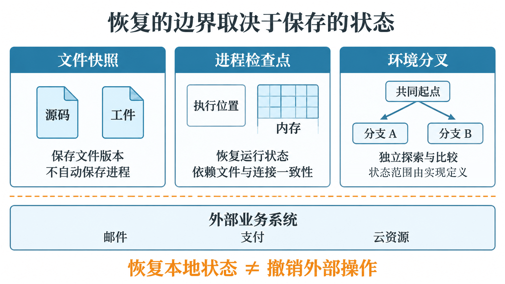

# 目录

[1. 编码 Agent 与 AgentOS 工程系统的核心价值是什么？](#q-001)
  - [面试问题：编码 Agent 的工程能力应如何分层？](#q-101)
  - [面试问题：编码 Agent 与传统 IDE Copilot 有什么区别？](#q-002)
  - [面试问题：一个终端/IDE 编码 Agent 的典型架构是什么？](#q-003)
  - [面试问题：为什么编码 Agent 是 Agent 工程落地最快的场景？](#q-004)
  - [面试问题：你了解哪些 Coding Agent？OpenCode、Gemini CLI、Codex CLI 和 Claude Code 有什么区别？](#q-040)
[2. 编码 Agent 的工具系统如何设计？](#q-005)
  - [面试问题：怎样组织文件、命令与代码工具的执行接口？](#q-102)
  - [面试问题：FileRead、Edit、Bash、Search、Git、LSP 工具分别解决什么问题？](#q-006)
  - [面试问题：工具权限模型应该如何设计？](#q-007)
  - [面试问题：为什么 Bash 和文件写入工具必须强权限控制？](#q-008)
  - [面试问题：如何处理远程会话或云端执行中的权限请求？](#q-009)
  - [面试问题：Harness 通常需要管理哪些内容？Workspace 和抽象文件系统分别起什么作用？](#q-039)
  - [面试问题：文件快照、进程检查点与可分叉执行环境有什么区别？](#q-201)
[3. 编码 Agent 如何理解一个真实代码仓库？](#q-010)
  - [面试问题：代码仓库理解需要哪些信息入口？](#q-103)
  - [面试问题：CLAUDE.md / AGENTS.md 这类项目记忆文件有什么作用？](#q-011)
  - [面试问题：上下文压缩、摘要和恢复在编码 Agent 中如何工作？](#q-012)
  - [面试问题：代码索引、ripgrep、LSP、文件缓存如何协同？](#q-013)
  - [面试问题：如何避免把无关文件塞满上下文？](#q-014)
[4. 编码 Agent 为什么需要子 Agent 和 Skills？](#q-015)
  - [面试问题：如何组织主 Agent、子 Agent 与技能资源？](#q-104)
  - [面试问题：子 Agent 适合处理哪些任务？](#q-016)
  - [面试问题：Skills 的本质是什么？与工具有什么区别？](#q-017)
  - [面试问题：Hooks 在编码 Agent 中有什么价值？](#q-018)
  - [面试问题：Plan Mode、Todo、任务状态如何提升长任务可靠性？](#q-019)
[5. 编码 Agent 为什么常同时支持 CLI、IDE 和远程会话？](#q-020)
  - [面试问题：多入口编码产品如何共享执行能力？](#q-105)
  - [面试问题：CLI Agent 和 IDE Agent 的体验差异是什么？](#q-021)
  - [面试问题：IDE Bridge 通常需要传递哪些信息？](#q-022)
  - [面试问题：远程编码 Agent 如何处理 session、interrupt、resume 和 reconnect？](#q-023)
  - [面试问题：MCP 在编码 Agent 中通常如何使用？](#q-024)
[6. 如何评估编码 Agent 是否真的有用？](#q-025)
  - [面试问题：编码 Agent 的效果与成本应如何一起验收？](#q-106)
  - [面试问题：SWE-bench 类评测为什么重要但不够？](#q-026)
  - [面试问题：编码 Agent 的 tracing 和 telemetry 应该记录什么？](#q-027)
  - [面试问题：编码 Agent 常见失败模式有哪些？](#q-028)
  - [面试问题：如何设计企业内可用的编码 Agent？](#q-029)
[7. AgentOS / 个人助理型 Agent 系统通常如何分层？](#q-030)
  - [面试问题：个人助手的入口、执行与数据层如何配合？](#q-107)
  - [面试问题：Gateway 控制平面在 Agent 系统中负责什么？](#q-031)
  - [面试问题：Provider、Model、Agent Runtime、Channel 如何解耦？](#q-032)
  - [面试问题：多通道 Agent 如何做会话路由和用户隔离？](#q-033)
  - [面试问题：多 Agent 系统如何做到 workspace、auth、session 隔离？](#q-034)
  - [面试问题：OpenClaw 这类个人助手型 Agent，和普通聊天产品有什么区别？](#q-041)
[8. AgentOS 中 Sandbox、Tool Policy、Elevated 为什么要分开？](#q-035)
  - [面试问题：执行环境、工具策略与提权机制有哪些不同边界？](#q-108)
  - [面试问题：Context Engine 的 ingest / assemble / compact / after-turn 生命周期如何理解？](#q-036)
  - [面试问题：Hooks、Cron/Webhook、Background Task 在 AgentOS 中分别解决什么问题？](#q-037)
  - [面试问题：如何设计支持长任务、断线恢复和事件流的 Agent 运行时？](#q-038)

---

<h1 id="q-001">1. 编码 Agent 与 AgentOS 工程系统的核心价值是什么？</h1>

<h2 id="q-101">面试问题：编码 Agent 的工程能力应如何分层？</h2>

**难度评分：⭐⭐⭐ (3/5)  |  考察频率：⭐⭐⭐⭐ (4/5)**

编码 Agent 的能力应沿着一次工程任务来理解：**读懂要改什么，找到影响范围，在受控环境中修改，再用证据证明结果。** 模型写代码只是其中一环；仓库状态、执行环境和交付质量决定了这段代码能否成为可接受的变更。

可以分成四层。第一层是任务理解，把“修复登录偶尔失败”转为可复现现象、预期行为和不能破坏的约束。第二层是仓库理解，连接入口、调用链、配置、测试和依赖，而不是只找到一个同名函数。第三层是行动，执行有前置条件的文件编辑、构建与诊断。第四层是验收，把测试结果、实际行为和变更范围与最初要求对应起来。

例如定位令牌过期问题，Agent 需要确认时间单位和时区，找到校验逻辑及调用方，复现临界时刻，修改实现，再运行覆盖正常、过期和边界时间的验证。若只改了一处比较符号却没检查缓存中的令牌状态，局部测试通过仍可能留下真实故障。

运行时贯穿这四层：保存当前任务、用户已有修改、工具执行状态和预算；在命令超时或进程中断后核对实际结果；交付时给出可审查的 diff。权限也应与动作绑定，允许编辑本地文件不自动包含提交、推送或发布。

这是一种职责划分，不要求系统安装固定数量的组件。小仓库可以用搜索、文件工具和测试完成闭环；复杂项目才可能需要语义索引、独立工作区和任务调度。能力层次应通过任务表现验证，不能用工具数量或生成代码行数代替。

<h2 id="q-002">面试问题：编码 Agent 与传统 IDE Copilot 有什么区别？</h2>

**难度评分：⭐⭐⭐ (3/5)  |  考察频率：⭐⭐⭐⭐ (4/5)**

传统补全式 Copilot 通常由开发者决定下一步，模型在当前编辑位置提供建议；编码 Agent 可以接收目标，在允许的范围内决定读取哪些文件、怎样修改以及何时验证。**差别主要是控制权与任务跨度，而不是有没有聊天窗口。**

<div align="center">

| 观察维度 | 补全或建议式协作 | 任务执行式协作 |
|---|---|---|
| 下一步由谁推动 | 用户选择文件、操作和验证 | 运行时允许模型选择部分行动 |
| 交付对象 | 代码片段、解释、修改建议 | 仓库变更及其验证证据 |
| 环境反馈 | 用户把错误交给模型 | Agent 可以读取构建、测试和诊断结果 |
| 用户注意力 | 较连续地参与每一步 | 主要投入目标澄清、关键决策和审查 |
| 主要责任 | 判断建议是否值得采用 | 还需约束执行、恢复和完成声明 |

</div>

例如修改一个正则表达式，开发者知道位置和预期行为，局部建议已经足够。排查一个跨前后端的登录故障则需要不断根据日志改变调查路径，任务执行式协作更有帮助，但也增加了误改配置、遗漏调用方和运行不必要命令的可能。

今天的 IDE 产品经常同时提供补全、聊天、编辑和 Agent 模式，“Copilot”也可能只是产品品牌。因此不能把某个品牌永久归到低自主性一侧，更不能默认 IDE 只能提供局部上下文、CLI 才能执行任务。

选型时应直接检查当前模式：能访问什么、能自行做什么、哪里需要用户判断、失败后怎样继续。越多行动交给系统，越需要清楚的权限和验收；它不会因为自主程度更高，就自动比局部工具更适合每项工作。

<h2 id="q-003">面试问题：一个终端/IDE 编码 Agent 的典型架构是什么？</h2>

**难度评分：⭐⭐⭐⭐ (4/5)  |  考察频率：⭐⭐⭐⭐ (4/5)**

典型架构可以围绕三条路径设计：用户请求如何进入，模型提案如何变成执行，以及结果怎样回到用户。把三者接通，比列出很多“层”更能说明系统怎样工作。

入口适配器从终端或 IDE 收集目标、文件引用和编辑器状态，经过身份与工作区绑定后创建任务。会话服务保存对话，任务服务保存运行阶段、待处理动作和工件引用。二者可以共用数据库，但不能把一条聊天记录直接当成完整执行账本。

上下文构建器读取必要的项目说明、相关代码、当前 diff 和诊断结果，生成本轮输入。模型输出回答或工具提案；运行时检查参数、授权、文件版本和预算，再交给文件、命令或远程工具执行器。长命令先返回执行标识，后续通过事件或查询获得结果。

例如 Agent 请求修改 `auth.py`，编辑器中该文件可能还有未保存内容。执行器应校验文档版本或内容哈希，避免用磁盘旧内容覆盖用户缓冲区。执行成功后保存新版本和 diff，测试结果还要绑定这份代码，才能支撑最终交付。

<div align="center">

| 职责 | 应拥有的状态 | 不应承担的替代职责 |
|---|---|---|
| UI / IDE Bridge | 选区、文档版本、展示状态 | 不以界面断线判定后台任务失败 |
| Runtime | 任务阶段、预算、动作与恢复 | 不让模型文本充当业务回执 |
| 执行器 | 进程、文件变更、工具结果 | 不接受模型自报身份来授权 |
| 持久化与观测 | 事件、检查点、工件与版本 | 日志存在不等于能够精确重放 |

</div>

这些职责可以在一个进程内实现，也可以拆到远程 worker。拆服务前先确定状态的权威归属，避免 UI、运行时和执行器各维护一份互相矛盾的“任务已完成”。

<h2 id="q-004">面试问题：为什么编码 Agent 是 Agent 工程落地最快的场景？</h2>

**难度评分：⭐⭐⭐ (3/5)  |  考察频率：⭐⭐⭐⭐ (4/5)**

编码是较早形成有效 Agent 闭环的场景之一，但“落地最快”需要统一口径才能比较，不能作为无条件的行业排名。它的优势来自**任务对象可操作、反馈比较具体、产物便于审查**，而非代码任务天然简单。

仓库提供文件、版本、依赖和测试入口。Agent 可以用搜索定位对象，用补丁表达修改，用编译器、类型检查和测试获取反馈，再根据报错继续。这些工具把一部分抽象判断转成可观察结果，比单纯让模型评价自己的答案更可靠。

Git diff 也降低了协作成本。开发者可以看到究竟改了哪些行，比较前后行为，在独立分支中试验，再决定是否接纳。许多任务可以先限制为本地变更，减少直接触达生产的需要。这个可审查、可分阶段放权的特点，使产品较容易进入既有研发流程。

不过，测试通过只覆盖被测试的条件。性能退化、权限漏洞、数据迁移和并发问题可能不在测试里；构建脚本还可能执行任意代码。即使能复原仓库，也未必能撤销脚本已修改的数据库或云资源。

经济价值同样需要实测。应计算需求沟通、等待、审查、返工和后续维护的总时间。例如生成补丁节省二十分钟，却需要一小时检查无关改动，就未必提高效率。编码 Agent 的优势是容易构造反馈闭环，能否转化为生产力，取决于任务选择、验证质量和团队接纳成本。

<h2 id="q-040">面试问题：你了解哪些 Coding Agent？OpenCode、Gemini CLI、Codex CLI 和 Claude Code 有什么区别？</h2>

**难度评分：⭐⭐⭐ (3/5)  |  考察频率：⭐⭐⭐ (3/5)**

这几类产品都可以作为理解编码 Agent 的入口，但比较必须绑定日期、产品入口和版本。截至 **2026-11-25**，它们的定位已有变化，旧教程中的默认模型、账户和安装方式不能直接沿用。[1–4]

<div align="center">

| 产品 | 当前公开定位 | 选型时应实际核对 |
|---|---|---|
| OpenCode | 开源编码 Agent，提供终端、桌面与 Web 入口，连接多种模型提供方 | 提供方适配、插件、权限和团队部署；不能混用不同代版本配置 |
| Gemini CLI | 主要面向 Google Cloud 上的企业 Gemini Code Assist 工作流 | 许可证及模型适配；个人入口迁移后的产品边界 |
| Codex CLI | 在本地终端读取仓库、编辑文件、运行开发工具，也可连接其他工作入口 | 当前工作根、执行与审批策略、会话恢复、云端与本地任务责任 |
| Claude Code | 提供终端、IDE、桌面和浏览器等入口的编码产品 | 入口对应的执行位置、账户能力、权限、项目说明与团队配置 |

</div>

其中 Gemini CLI 的官方 README 已说明，个人免费及 Google AI Pro/Ultra 入口迁往 Antigravity CLI；当前仓库还明确提醒，其 harness 并未针对 Gemini 4 及后续系列调优，不应拿它直接衡量这些模型的能力。这是产品与运行时边界的变化，不能据此推断模型本身变强或变弱。[2]

公平比较应使用相同仓库快照、任务要求、工具权限、预算和测试环境，再记录修复率、无关修改、恢复表现、延迟及总费用。若一边有现成依赖和测试工具，另一边还要从零安装，就同时比较了环境准备能力，需要把这个差异写清楚。

还应区分“工具支持某功能”和“本次账户已启用并验证”。开源项目也可能依赖付费推理服务；支持多模型不保证切换后行为一致。面试时用亲自完成的一项任务说明选择理由，比背一张不断过期的功能大全更有说服力。

<h1 id="q-005">2. 编码 Agent 的工具系统如何设计？</h1>

<h2 id="q-102">面试问题：怎样组织文件、命令与代码工具的执行接口？</h2>

**难度评分：⭐⭐⭐ (3/5)  |  考察频率：⭐⭐⭐⭐ (4/5)**

文件、命令和代码工具应提供明确的动作契约，让模型知道何时调用，让运行时知道怎样检查，让用户知道发生了什么。契约至少覆盖输入、身份与资源范围、执行前提、结果语义和失败后的恢复方式。

例如文件编辑工具可以接受路径、预期旧内容或版本以及补丁，返回新版本、变更摘要和冲突信息。旧内容不匹配时应返回冲突，而不是模糊定位后强行覆盖。命令工具则需要工作目录、参数、环境范围、超时和输出上限；长任务返回 `execution_id`，由查询或事件接口继续追踪。

接口应区分“请求有效”“已开始执行”和“已经完成”。进程退出码为零只能说明该进程按自己的约定成功，还要结合测试输出及产物判断任务。文件写入成功也只说明写操作完成，不代表代码正确。

内部实现最好把模型可见 Schema 与可信运行上下文分开。模型选择文件和操作，真实用户、租户、凭证和权限由宿主绑定。工具返回可以携带被截断标记、完整日志位置和内容哈希，避免把截断后的尾部误当成完整证据。

对错误也应分类：参数错误允许修正，版本冲突要求重新读取，权限拒绝需要合法授权，进程超时需要核对是否仍在运行。统一返回一段“执行失败”会迫使模型猜测下一步，容易把可恢复故障变成重复执行或覆盖错误。

<h2 id="q-006">面试问题：FileRead、Edit、Bash、Search、Git、LSP 工具分别解决什么问题？</h2>

**难度评分：⭐⭐⭐ (3/5)  |  考察频率：⭐⭐⭐⭐ (4/5)**

这些工具从不同角度观察或改变仓库。工具名只是入口，真实能力仍取决于参数、实现和所处环境。

<div align="center">

| 工具 | 最适合提供的证据或动作 | 使用时的限制 |
|---|---|---|
| FileRead | 获取具体版本的文件或片段 | 读取可能泄露密钥；片段可能遗漏调用背景 |
| Edit / Write | 应用有前置条件的局部补丁或创建文件 | 检查旧版本，保留用户修改 |
| Search / Grep / Glob | 快速缩小路径、文本与符号候选范围 | 文本命中不证明语义调用关系 |
| LSP | 定义、引用、类型与诊断 | 依赖语言服务器、项目配置和索引新鲜度 |
| Bash / Shell | 调用构建、测试、脚本和诊断工具 | 会执行仓库及依赖代码，需限制资源与权限 |
| Git | 查看变更、分支与历史，组织补丁 | 提交、切分支、推送等动作影响范围不同 |

</div>

修复一个函数签名时，可以先用 `rg` 找候选，再用 LSP 核对引用，读取调用上下文后编辑，最后检查 diff 并运行相应测试。单靠搜索可能漏掉动态调用，单靠 LSP 也可能忽略配置字符串或模板，因此两者应相互补充。

不要笼统认为读工具安全、写工具必须逐次确认。读取配置并把内容发送到外部同样可能有风险；用户已授权范围内的可逆编辑则可直接推进。是否需要确认，应依据实际授权、影响与可逆性，真正的访问限制由执行边界落实。

也不能通过禁用 `Edit` 就宣称系统只读：如果仍允许 Shell 任意执行，程序照样能够写文件。工具策略必须覆盖等价能力，并与文件系统、网络和凭证边界共同设计。

<h2 id="q-007">面试问题：工具权限模型应该如何设计？</h2>

**难度评分：⭐⭐⭐⭐ (4/5)  |  考察频率：⭐⭐⭐⭐ (4/5)**

编码工具的权限模型要回答四件事：**谁在操作，针对哪个资源，允许产生什么效果，以及授权在何时有效。** “允许 Bash”只回答了工具名，离完整授权还很远。

可以把决策视为身份、资源范围、动作、环境和已有授权的组合。企业策略给出不可越过的边界，项目与用户配置在允许范围内缩小或细化能力，本次任务授权再绑定具体操作。合并优先级必须由产品明确规定，不能假设所有框架都遵守相同的 allow/deny 规则。

例如允许修复登录模块，可能覆盖该模块及相关测试的编辑、在隔离环境运行测试；它不自动覆盖读取个人凭证、修改部署密钥或推送主分支。授权可以覆盖一类明确动作，不必每次改一行代码都询问。方案或影响范围实质变化时，再判断原授权是否仍适用。

执行时检查规范化后的真实路径、文件版本、网络目标及当前身份。对符号链接和路径替换，还需避免“检查时在范围内，使用时指向范围外”的竞态，仅做字符串前缀判断不够。进程子孙、挂载和继承环境变量也在实际权限范围内。

Plan Mode、自动执行和交互审批是产品提供的策略组合，并非通用标准安全等级。计划模式若仍可运行任意脚本，不能仅凭名称保证只读；沙箱若挂载了宿主凭证，也不等于与宿主完全隔离。通用威胁与治理见 [第 06 章](06_Agent安全评测与AgentOps高频考点.md)。

<h2 id="q-008">面试问题：为什么 Bash 和文件写入工具必须强权限控制？</h2>

**难度评分：⭐⭐⭐ (3/5)  |  考察频率：⭐⭐⭐⭐ (4/5)**

Shell 和文件写入能直接改变工程环境，而且影响常常超过命令表面。例如 `npm test` 会执行仓库配置的脚本，安装依赖可能运行安装钩子；一个看似普通的验证步骤，也可能读环境变量、访问网络或修改文件。因此权限判断不能只依赖命令名称。

文件写入的常见问题是覆盖并发修改。用户可能在 IDE 中编辑，另一个进程可能生成文件，Agent 自己的旧缓存也可能过期。安全的增量编辑应携带旧内容或版本前提；前提不满足时重新读取并合并，而不是整文件重写或把仓库重置到“干净”状态。

命令执行则要同时控制工作根、挂载范围、网络、凭证、时间、进程数和输出大小。仅把当前目录设成仓库目录，无法阻止程序访问其他目录。对不可信仓库，使用低权限环境和独立测试数据，通常比维护一长串危险命令黑名单更可靠。

用户授权仍然是执行依据。普通范围内的修改和测试可以按既有授权进行；销毁性清理、推送或发布需要确认任务是否已明确覆盖。若需要确认，应展示具体命令、目标和预期变更，不能用“允许继续”代替对影响范围的说明。

最后，取消和回滚都有限度。终止父进程不保证所有子进程已停止，恢复文件不撤销外部 API 操作。应核对进程树和外部回执，并在交付中说明哪些变更已发生、哪些结果仍未知。强权限控制的意义是限制错误扩散，而不是用弹窗数量衡量安全。

<h2 id="q-009">面试问题：如何处理远程会话或云端执行中的权限请求？</h2>

**难度评分：⭐⭐⭐ (3/5)  |  考察频率：⭐⭐⭐⭐ (4/5)**

远程执行时，审批是跨网络的状态转换。远端不能把一条聊天回复直接解释成任意工具的许可，本地界面也不能只凭收到一个请求就相信它属于当前任务。

执行器先保存待审批记录，包含请求 ID、任务与用户身份、具体动作、资源范围、参数摘要或哈希、有效期和当前状态。UI 从认证通道读取并展示可审查内容，例如命令和文件 diff。用户响应必须绑定这个请求及版本，服务端重新核对审批者权限，再原子地将状态从 pending 改为 approved 或 denied。

例如审批时展示的是向测试环境部署版本 A，而重连后任务已经改成版本 B 或生产目标，旧批准不能复用。审批记录应保留方案版本；重复点击或重复网络投递只能处理同一次决策，不能触发两次执行。

断线时保留等待状态，恢复连接后重新查询。用户取消、请求过期、任务结束或权限撤销，都应使旧请求失效；UI 不在线不能成为默认放行的理由。客户端只需展示可信的动作描述，不必拥有完整工具实现，但远端必须是最终策略执行者。

审批成功表示可以尝试，执行前仍要核对文件版本、环境和当前授权；执行结果另存回执。这样才能区分“用户同意了”“工具开始了”和“任务完成了”，并在事故时说明哪一步发生了变化。

<h2 id="q-039">面试问题：Harness 通常需要管理哪些内容？Workspace 和抽象文件系统分别起什么作用？</h2>

**难度评分：⭐⭐⭐⭐ (4/5)  |  考察频率：⭐⭐⭐⭐ (4/5)**

运行 Harness 是围绕模型组织执行的系统：提供上下文和工具、管理状态与预算、执行权限检查、处理错误并核对交付。Workspace 是其中的工作资源集合，可能包含源代码、临时文件、产物和任务配置。**工作区便于组织工作，目录名称本身不构成隔离。**

例如为两项任务分别建立 Git worktree，可以避免它们直接改同一份工作文件，却仍可能共用 Git 对象、宿主用户、网络、凭证和外部数据库。若需要阻止互相访问，必须另外设计文件权限、挂载、进程隔离和凭证范围。

抽象文件系统把本地磁盘、远程容器或对象存储接到统一接口，方便迁移执行位置。但它应说明自己提供的语义：读到哪个版本、写入是否原子、目录列表是否一致、是否有锁、怎样处理符号链接和并发修改。统一函数名不会自动统一后端保证。

比如本地文件系统中的同目录原子替换，与对象存储中的复制再删除不是同一种事务。若上层依赖“重命名后只能看到完整新版本”，适配器应提供等价实现或明确不支持，不能悄悄退化成部分可见的多步操作。

恢复也要分层：文件快照可以帮助撤销局部改动，运行中进程和工具内部状态需要更完整的检查点，远程服务已产生的效果需要查询、幂等或补偿。下一题进一步说明这些状态边界；[第 08 章](08_Agent_Harness_Engineering高频考点.md) 则讨论 Harness 的系统设计与评测。

<h2 id="q-201">面试问题：文件快照、进程检查点与可分叉执行环境有什么区别？</h2>

**难度评分：⭐⭐⭐⭐ (4/5)  |  考察频率：⭐⭐ (2/5)**

**能恢复多少状态，决定 Agent 可以安全地试验哪些方案。** 文件快照保存某个时间点的文件；进程检查点还可能保存内存、线程和执行位置；环境分叉则希望从共同状态派生多个可独立探索的环境。三者的覆盖范围由实现决定，不能看到“快照”二字就认为整个世界都可回滚。

<div align="center">



</div>

图示比较的是保存状态的能力，没有给出速度或安全等级。外部邮件、支付与云资源位于本地恢复边界之外；即使工具的连接状态被保存，远端服务也不会随之退回过去。

例如要比较两种数据库迁移方案，仅复制源码还不够：运行中的数据库、缓存和应用进程可能已有不同状态。可以准备独立测试数据库和环境快照，让两个分支从相同起点试验，再比较结果。若两个分支仍连接同一生产数据库，文件隔离就失去了试验所需的前提。

写时复制（Copy-on-Write）可以降低派生分支的成本：初始未修改的数据共享，分支第一次写入时才创建私有副本。它减少重复复制，不会让修改免费；当分支大量改写内存或文件，存储和内存成本仍会上升。进程状态与文件版本、时钟、随机数和外部连接的一致性，也会影响恢复后行为。

2026 年 11 月的 TimeTravelContainer 将这一路线用于有状态工具环境，以用户态内核组织分叉，并在 EDA 工具上评估克隆和重复启动成本。其评测重放固定工具工作负载，不调用 LLM；因此报告的加速不能直接解释为编码 Agent 总耗时或成功率的提升。[10]

长期值得关注的是把“尝试另一方案”从文本分支扩展到可比较的执行环境。采用前仍要核对硬件与系统兼容性、持久化、资源回收、外部副作用隔离及合并规则；选中一个分支，也不等于可以无冲突地把所有运行状态合并回主环境。

<h1 id="q-010">3. 编码 Agent 如何理解一个真实代码仓库？</h1>

<h2 id="q-103">面试问题：代码仓库理解需要哪些信息入口？</h2>

**难度评分：⭐⭐⭐ (3/5)  |  考察频率：⭐⭐⭐⭐ (4/5)**

理解仓库要建立与当前任务有关的依赖关系：需求落在哪个入口，数据经过哪些模块，行为由哪些配置决定，又由什么测试约束。目录树提供地图，调用链和运行反馈才说明代码实际怎样工作。

开始时先确认仓库根、分支、工作树改动、构建环境和适用的项目说明。随后从任务里的可定位对象进入，例如报错文本、接口路径、类名或配置键。用 `rg --files` 找文件，用 `rg` 缩小命中，再读取上下文，必要时借助 LSP 定义与引用、测试及 Git 历史补足关系。

例如接口返回 401，原因可能在路由鉴权、令牌生成、代理转发或测试环境配置。只搜索“401”容易停留在响应层；应从一次可复现请求沿调用链检查身份信息在哪一步丢失，并比较正常路径。先有具体问题，再增加上下文，通常比把整个仓库交给模型更有效。

当前用户改动也是重要入口。磁盘版本、Git 已提交版本、未暂存修改和 IDE 未保存缓冲区可能不同，不能只记住一个 commit 就认为代码已确定。准备编辑前应核对目标文件，测试证据也应记录对应版本。

最后要区分事实与推测：“配置文件写着端口 8080”是可读证据，“生产一定使用这个端口”则需要部署信息。项目文档可能滞后，历史提交只能解释当时意图。仓库理解的产物应是可核查的定位与影响范围，而不是一份听起来完整却没有路径依据的架构介绍。

<h2 id="q-011">面试问题：CLAUDE.md / AGENTS.md 这类项目记忆文件有什么作用？</h2>

**难度评分：⭐⭐⭐ (3/5)  |  考察频率：⭐⭐⭐⭐ (4/5)**

这类文件把团队希望 Agent 遵循的项目约定放在明确位置，例如构建和测试命令、模块边界、生成文件规则与交付要求。它们能够减少重复探索，但更准确地说是**项目指令入口**，并不等同于自动学习得到的长期记忆。[5]

好的内容应具体、可执行、有适用范围。例如“修改 API 类型后运行类型检查；生成客户端由脚本维护，先改源定义再生成”，比“请写高质量代码”有用。目录局部规则可以描述该模块的特殊约束，稳定背景则链接到维护中的正式文档，避免复制成多份过期说明。

`AGENTS.md` 被多种工具采用，`CLAUDE.md` 与 Claude Code 的上下文机制相关，但支持文件名、搜索目录、父子覆盖、用户配置和会话加载时机都依客户端而异。不能仅因格式开放就假定所有产品有同样的指令优先级。

例如仓库的构建命令已经改变，说明文件仍指向旧命令，Agent 应结合实际脚本和失败信息识别不一致；应修正维护源或说明差异，不能不断追加互相冲突的“经验”。测试命令也应包含工作目录和必要环境，避免在错误子项目运行一套无关测试。

信任边界尤其需要保留。外部仓库里的文件可以包含恶意指令，不能因为叫 `AGENTS.md` 就获得读取私密文件、外传数据或修改高层策略的权限。项目说明负责表达约定，宿主负责决定哪些约定可信、怎样生效；长期记忆的确认与更新见 [第 05 章](05_Agent记忆与上下文工程高频考点.md)。

<h2 id="q-012">面试问题：上下文压缩、摘要和恢复在编码 Agent 中如何工作？</h2>

**难度评分：⭐⭐⭐⭐ (4/5)  |  考察频率：⭐⭐⭐⭐ (4/5)**

编码任务的压缩应保存“继续工作所需的证据和状态”，而不是把整段对话改写成更短的故事。摘要帮助模型理解，文件和执行记录承担可核查事实，两者应能互相定位。

需要保留的内容包括当前目标、用户最新约束、修改范围、关键文件位置与版本、已验证的结论、失败尝试及其原因、未完成步骤、后台执行标识和结果未知的动作。长日志可以放到文件中，只保留错误摘要、退出状态与读取位置；不要把“输出被截断”压缩成“没有错误”。

例如测试启动后连接中断，摘要应记录“执行 ID 为 T7，结果未核实”，不能写成“测试失败”或“待重新运行测试”。恢复时先查询 T7 是否仍在执行，再读取结果。如果文件在这期间被用户改过，旧测试通过也只能证明旧版本。

恢复顺序可以是：加载任务状态和必要摘要，确认工作区与当前权限，检查文件和 Git diff，恢复项目约定，核对后台任务与外部动作，再决定下一步。旧摘要中的路径或行号可能已变化，定位时应重新验证，不能机械照抄。

压缩还必须保持模型接口要求的工具调用与结果配对，保留指令来源和权威级别。外部网页中的要求不应在摘要后变成用户命令。评估压缩质量，应检查恢复后是否重复执行、覆盖改动、忘记限制或错误宣告完成，而不只比较压缩前后的 token 数。[6]

<h2 id="q-013">面试问题：代码索引、ripgrep、LSP、文件缓存如何协同？</h2>

**难度评分：⭐⭐⭐ (3/5)  |  考察频率：⭐⭐⭐⭐ (4/5)**

这些能力分别提供文本定位、语义关系、跨文件检索和读取复用。它们应围绕同一份代码版本协作，否则“查得快”也可能只是更快地得到旧答案。

<div align="center">

| 能力 | 适合的定位问题 | 需要补充的校验 |
|---|---|---|
| ripgrep | 报错文本、配置键、函数名出现在哪里 | 命中是否属于实际调用路径 |
| LSP | 符号定义、引用、类型与诊断是什么 | 服务是否就绪，项目与文档版本是否匹配 |
| 代码索引 | 大仓库中相关模块、符号或语义候选在哪里 | 索引版本、增量更新和权限过滤 |
| 文件缓存 | 刚读过的内容能否复用 | 文件内容、版本或哈希是否变化 |
| Git diff | 当前变更涉及什么 | 未跟踪文件与编辑器缓冲区也需考虑 |

</div>

例如要修改 `User` 的序列化行为，可以先搜索类型和接口，利用 LSP 找静态引用，再搜索配置中的字段名，最后阅读关键测试。动态加载、反射或字符串拼接可能不在静态引用图中，索引结果只能作为候选，不能保证影响范围已经完整。

缓存与索引都需要失效策略。按路径缓存文件，在文件被覆盖后仍返回旧内容，会导致补丁错位；仅依赖时间戳也可能漏掉某些更新。可用文档版本、内容哈希或可信变更事件绑定结果，重要写入前再次核对前提。

不必为每个小项目建设向量索引。先测搜索是否成为瓶颈，索引是否改善定位准确率，再承担构建、更新、权限和存储成本。工具协同的目标是更可靠地找到证据，不是让每项任务都遍历全部工具。

<h2 id="q-014">面试问题：如何避免把无关文件塞满上下文？</h2>

**难度评分：⭐⭐⭐ (3/5)  |  考察频率：⭐⭐⭐⭐ (4/5)**

避免无关上下文，首先要把当前问题表达得足够具体。例如“理解整个仓库”几乎没有收敛条件，而“找到请求中的时区在哪里被丢弃”能够直接指导搜索、读取和验证。

先做宽而轻的定位，再做窄而深的阅读。第一轮返回文件名、符号、命中行和短摘要；确认候选后读取函数及相关调用上下文。日志先读异常附近，必要时追溯前因。片段不能短到失去变量来源或控制分支，否则节省了 token，却增加错误推断。

信息也要随阶段变化。探索阶段关注结构与候选假设，实现阶段关注接口约束和具体文件，验证阶段关注测试、边界与 diff，交付阶段关注已完成事项和证据。已经排除的路径可以保留简短理由，不必让全部失败输出持续占据窗口。

完整文件、日志和截图可保存在可取回的工件位置，模型携带路径、版本、用途与必要引用。这个做法不是把重要证据删除，而是让证据按需进入上下文。若使用子 Agent 探索，返回结论时应附定位和不确定性，主 Agent 仍要核对关键事实。

还应为输出与下一次工具反馈保留空间，避免一次读取填满窗口。评估时看定位是否准确、遗漏是否减少、是否出现重复搜索和约束丢失；仅以“上下文更短”为目标，可能把真正需要的信息也裁掉。[6]

<h1 id="q-015">4. 编码 Agent 为什么需要子 Agent 和 Skills？</h1>

<h2 id="q-104">面试问题：如何组织主 Agent、子 Agent 与技能资源？</h2>

**难度评分：⭐⭐⭐ (3/5)  |  考察频率：⭐⭐⭐⭐ (4/5)**

主 Agent、子 Agent 和 Skill 解决的是不同问题。主 Agent 维护总目标并整合交付；子 Agent 接受边界明确的工作，可以拥有独立上下文；Skill 提供可复用的流程、知识和脚本。**增加角色并不自动增加可靠性，分工必须减少真实耦合。**

例如修改鉴权模块，主 Agent 可以负责接口变更，让一个子 Agent 只读核查调用方，另一个检查测试覆盖。两者返回路径、发现和建议，主 Agent 决定补丁并做整体验证。若每个子 Agent 都自由修改核心鉴权文件，沟通和冲突成本往往超过并行收益。

委派时应明确目标、输入版本、可用证据、允许动作、可写范围、预算、返回格式和完成判据。返回的不应只有“已完成”，还应包含工件、验证结果和未解决问题。主 Agent 对最终交付负责，不能把子 Agent 的自然语言结论当成独立验收。

Skill 可以被主 Agent 或子 Agent 按需使用。例如测试诊断 Skill 提供复现、缩小范围、验证修复的流程，工具负责真正执行命令。一个任务采用 Skill 不要求新建 Agent；一个子 Agent 也不一定需要专属 Skill。

独立上下文只隔离模型输入，不一定隔离文件、进程、网络或凭证。若共享工作区，应规定文件归属与串行写入；若使用独立分支，还要核对合并冲突和全局测试。涉及多个角色的复杂编排见 [第 03 章](03_Agent设计模式与工作流编排高频考点.md)。

<h2 id="q-016">面试问题：子 Agent 适合处理哪些任务？</h2>

**难度评分：⭐⭐⭐ (3/5)  |  考察频率：⭐⭐⭐⭐ (4/5)**

适合委派的工作通常有明确输入、独立产物和可检查的完成条件。只读探索、某模块的复现、测试覆盖审查、独立文档补充，往往比高度耦合的架构修改更容易拆分。

判断是否值得并行，可以看关键路径。若主任务必须立即等待某一步才能做任何事，把它交给子 Agent 未必节省墙钟时间，不过仍可能获得上下文隔离或专业化收益。若多个子任务可以同时推进、最终合并成本较低，才更可能缩短整体时长。

例如要升级一项跨多个服务的接口，可以并行调查各服务的调用方式，但接口契约最好先统一，再分别实现。否则不同角色各自猜测字段语义，最后会产生看似独立、实际上不兼容的修改。

写任务需要更具体的边界：允许修改哪些文件、谁维护共享类型、谁处理锁文件和生成产物、何时同步。独立 worktree 能减少直接覆盖，却不能消除语义冲突；两个补丁都通过局部测试，合并后仍可能违反同一业务约束。

成本要包含子 Agent 调用、重复探索、信息传递、主 Agent 审查和整体验证。子任务结束后，应停止无用执行并收回临时资源。最终选择依据是任务是否更快、更准、更容易审查，而不是并发数越大越好。

<h2 id="q-017">面试问题：Skills 的本质是什么？与工具有什么区别？</h2>

**难度评分：⭐⭐ (2/5)  |  考察频率：⭐⭐⭐⭐ (4/5)**

Skill 是把一类工作的使用条件、流程、知识和辅助资源组织起来的能力包；Tool 是可以执行的具体动作。Skill 说明“怎样把工作做好”，工具实现读取、计算、修改或查询，两者可以配合，也可以独立使用。[7]

遵循 Agent Skills 格式的包以 `SKILL.md` 为入口，包含名称、描述和任务说明，并可附带脚本、参考材料与资源。渐进式加载先暴露简短用途，任务匹配后读取正文，执行到具体环节再加载必要附件，避免所有技能全文常驻上下文。

例如文档导出 Skill 可以规定输入要求、公式与表格处理、导出步骤和验收方式，脚本负责转换文件，Agent 负责检查实际输出。仅把“调用转换器”写成一步，并不能保证图片没丢、公式没坏或目标文件正确。

编写时应给出明确触发条件、输入输出、完成判据和常见失败恢复。确定性重复操作适合脚本，判断和边界放在说明里；凭证从受控配置读取，不写进技能正文。入口保持简洁，但不能删掉影响正确性的必要约束。

验证至少覆盖应当触发的任务、相近但不该触发的任务，以及依赖缺失或中途失败的情况。语法检查通过只证明包的结构满足要求，能力是否有效仍需真实任务验证。安装 Skill 也不会自动赋予脚本执行权、网络权限或业务授权。

<h2 id="q-018">面试问题：Hooks 在编码 Agent 中有什么价值？</h2>

**难度评分：⭐⭐⭐ (3/5)  |  考察频率：⭐⭐⭐⭐ (4/5)**

Hook 是运行时在特定事件发生时调用的扩展逻辑，例如工具执行前核对条件、执行后记录结果、压缩前保存恢复信息。它适合把必须重复执行的程序规则放到明确时点，减少仅靠模型“记得做”的不确定性。

要先分清**事前阻断、事后检查和异步处理**。只有执行前且运行时会等待结果的检查，才能阻止该动作；命令已经运行后，Hook 发现错误最多触发修复、告警或后续中止。Claude Code 的官方文档也明确指出，异步 Hook 的决策字段不能追溯控制已经发生的动作。[8]

例如修改源文件后自动运行格式化可以是后处理，但格式化本身又修改文件，需要纳入 diff，并避免再次触发同一 Hook 形成循环。若多个工具并行完成，还要防止重复测试、抢占锁或把较早版本的检查结果写成最新状态。

Hook 应有时间上限、权限范围、可观测输出和明确失败策略。关键授权检查失败可阻止执行；非关键统计写入失败则可记录告警，避免使全部业务中断。具体选择取决于该检查承担的责任，不能统一设成“出错继续”。

事件名称与覆盖范围依产品而异，`pre_tool` 或 `after-turn` 可以作为抽象说明，不应假定是所有框架的真实 API。Hook 代码本身也需要审核、版本管理和资源限制；生命周期入口不会让脚本天然可信。

<h2 id="q-019">面试问题：Plan Mode、Todo、任务状态如何提升长任务可靠性？</h2>

**难度评分：⭐⭐⭐ (3/5)  |  考察频率：⭐⭐⭐⭐ (4/5)**

Plan Mode 帮助在执行前厘清方案，Todo 帮助跟踪工作，任务状态决定运行时能否继续、等待或恢复。它们相互补充，但列表勾选不能代替真实完成证据。

计划应写清目标、依赖、关键假设和验收方法。例如“复现失败 → 定位原因 → 修改 → 验证”比“开始、处理中、结束”更能指导工作；发现新事实后可以重规划，并说明哪些旧步骤失效。用户已明确授权的普通任务不必为了形式强制先批一份计划。

Todo 记录待做事项，执行账本则保存每步对应的文件、命令、结果和版本。测试这一项只有拿到结果，并确认对应当前代码，才应完成；进程启动或模型说“已测试”都不够。任务还可能处于等待输入、等待外部作业、取消中或结果核对中，不能全部塞进 `blocked`。

状态转换需要条件。例如取消后不再启动新动作，等待审批期间保留方案版本，预算耗尽时交付已完成部分与剩余事项。多个独立子任务可以同时处于进行中；“只能有一个 in_progress”是某些工具的交互约定，并非可靠性的普遍定律。

计划模式的只读性也需要执行策略落实。若仍允许任意 Shell 脚本，文字声明“仅规划”并不能保证环境不变。长任务可靠性来自可检查的状态与恢复规则，计划和清单则让这些规则更容易被人和模型共同理解。

<h1 id="q-020">5. 编码 Agent 为什么常同时支持 CLI、IDE 和远程会话？</h1>

<h2 id="q-105">面试问题：多入口编码产品如何共享执行能力？</h2>

**难度评分：⭐⭐⭐ (3/5)  |  考察频率：⭐⭐⭐⭐ (4/5)**

多入口产品可以共享同一套任务服务和执行协议，让终端、IDE 与 Web 各自发挥交互优势。需要统一的是身份、任务、状态和工件语义，而不是强制所有入口展示相同界面。

CLI 擅长命令与脚本工作流，IDE 提供编辑器选区、诊断和 diff 视图，远程入口适合查看后台任务及跨设备协作。它们把不同输入转成统一任务请求，再订阅进度、工具结果、审批与终态。运行时不必为每个界面重复实现模型循环。

例如用户从 IDE 发起修复，关闭编辑器后通过 Web 查看结果，应继续访问原来的 `run_id`，而非创建另一项相同修改。终端显示了“已完成”而 IDE 仍在转圈时，双方应向权威任务服务核对，不能根据各自最后收到的一段文字独立判断。

共享后端不意味着共享全部权限。查看进度的移动设备未必能批准部署，IDE 能访问未保存缓冲区，远端 worker 通常只能看到已同步版本。每次操作都要明确工作区、代码版本、身份和能力范围，审批也要绑定实际执行对象。

并非成熟产品都必须同时有三个入口。单一终端工具也可以很好地完成任务，多端支持会增加同步、认证和交互一致性成本。只有用户确实需要跨入口延续工作时，统一任务与事件层才更有价值。

<h2 id="q-021">面试问题：CLI Agent 和 IDE Agent 的体验差异是什么？</h2>

**难度评分：⭐⭐⭐ (3/5)  |  考察频率：⭐⭐⭐⭐ (4/5)**

CLI 与 IDE 的主要差异是用户可直接提供的上下文和审查方式。两者都可以驱动强大的执行器，自主能力并不由界面决定。

<div align="center">

| 维度 | CLI 入口 | IDE 入口 |
|---|---|---|
| 自然上下文 | 当前目录、Shell 环境、文件与 Git | 当前项目、选区、缓冲区、诊断和导航 |
| 交互优势 | 脚本化、命令复用、远程终端 | 局部编辑、可视化 diff、逐处审查 |
| 同步难点 | 会话与后台进程生命周期 | 未保存文档、版本及磁盘状态 |
| 输出展示 | 文本事件、日志和终端状态 | 编辑覆盖、问题面板、变更视图 |
| 权限要求 | 依据实际命令和资源 | 同样依据实际工具和执行环境 |

</div>

例如用户在 IDE 选中一个函数要求修改，选区携带了很强的定位信号，但它可能属于尚未保存的文档。CLI 直接读取磁盘则未必看到这份内容。系统需要传递文档版本，或明确保存与同步过程，不能默认两端读到相同文件。

终端更接近开发者的命令流，并不代表权限必须更大；IDE 看起来直观，也不能消除后台命令的风险。实际选择应根据用户工作方式、代码审查习惯和远程执行需求，而不是把二者视为安全或智能程度的高低等级。

<h2 id="q-022">面试问题：IDE Bridge 通常需要传递哪些信息？</h2>

**难度评分：⭐⭐⭐ (3/5)  |  考察频率：⭐⭐⭐⭐ (4/5)**

IDE Bridge 连接编辑器状态与 Agent 运行时，最关键的是**同一文件在两端是否指向同一内容版本**。仅传文件路径和行号，在用户继续编辑后就可能失效。

IDE 向 Agent 提供工作区标识、文档 URI、版本号、选区、诊断、打开文件及必要内容；Agent 向 IDE 请求展示 diff、定位、应用编辑、显示进度或提供确认界面。诊断和编辑都应关联对应文档版本，远程路径还需要明确映射到哪个本地工作区。

例如 Agent 根据文档版本 12 生成替换第 40 行的修改，用户已经把文件改到版本 15，直接应用可能改错位置。Bridge 应做版本前提检查，返回冲突，再重新读取或使用编辑器支持的变换机制。行号只是展示位置，不能充当内容身份。

连接应验证宿主、客户端和当前会话，限制允许操作。监听回环端口也需要考虑恶意网页访问、Origin 校验和认证；随机端口不是认证机制。传递选区和诊断时应按需读取，避免默认上传所有打开的私密文件。

Bridge 返回“编辑已接受”后，运行时还需读取实际结果或版本变化，确认文件确实更新。UI 展示、磁盘保存和远端同步是不同阶段；跨端验证应使用真正运行测试的那份内容，不能把界面上的 diff 当成最终已落盘代码。

<h2 id="q-023">面试问题：远程编码 Agent 如何处理 session、interrupt、resume 和 reconnect？</h2>

**难度评分：⭐⭐⭐ (3/5)  |  考察频率：⭐⭐⭐⭐ (4/5)**

先区分四个概念：session 保存连续交互，run 表示一次任务执行，reconnect 恢复连接，resume 从已保存的任务状态继续。`interrupt` 是请求中断执行的控制动作，它是否暂停、取消或终止，要由协议明确规定。

用户关闭浏览器后，后台任务可以继续运行，也可以按策略取消；连接断开本身不证明任务停止。重连应先获取任务快照，再补齐允许重放的事件。若服务不支持重放或事件保留期已过，就重新获取权威状态，不能假装中间事件仍然完整。

事件最好携带任务 ID、递增序号、类型和状态版本。客户端去重并识别缺口；控制请求携带独立请求 ID，防止重试导致同一用户消息或写动作重复执行。会话历史可以支持理解，但后台执行状态需要单独持久化。

中断也要有握手。例如运行时收到取消请求，先停止发起新工具，向活动执行器传递信号，等待终止结果，再核对已产生的文件或外部效果。对不支持取消的远程作业，应说明它仍可能完成，不能立即把状态记成“全部撤销”。

遇到 `session not found` 时，需要检查身份、路由、过期策略和存储状态；只有明确存在短暂可见性延迟时，有限重试才合理。盲目新建会话会丢掉原任务及审批关系，甚至重复提交。恢复的目标是回到正确状态，而不是让界面尽快重新输出文字。

<h2 id="q-024">面试问题：MCP 在编码 Agent 中通常如何使用？</h2>

**难度评分：⭐⭐⭐ (3/5)  |  考察频率：⭐⭐⭐⭐ (4/5)**

MCP 在编码场景中主要承担外部能力接入，例如仓库托管、Issue、文档、数据库或内部代码搜索。宿主通过 MCP 发现工具与资源，再将适合当前任务的能力提供给模型，实际执行仍由宿主和服务器共同处理。[11]

例如修复一项 Issue，Agent 可以读取问题描述、检索内部接口文档，在本地编辑和验证，再按已有授权创建草稿 PR。这几步可以来自不同工具；使用 MCP 的收益在于连接器能被多个客户端复用，而不在于把所有本地操作都改成远程协议。

接入时先核对服务器来源、版本、权限和工具语义。只读仓库查询与创建 PR 应是可区分的动作，凭证范围应匹配项目与用户。工具描述声称“只读”不等于服务器确实没有副作用，客户端仍需按可信程度配置能力。

返回的 Issue、评论、网页和文档是任务资料，其中可能夹带诱导指令。宿主应保留来源和信任边界，不能让外部描述改变本地文件或凭证权限。若通过 stdio 启动本地 MCP Server，还要考虑它继承的环境和文件访问能力。

执行结果应保留请求标识和真实状态。创建 PR 超时后先查询是否已经创建，不能因没收到响应就重复创建。MCP 统一接口形式，不替应用定义业务幂等或验收；协议细节见 [第 04 章](04_MCP与A2A协议高频考点.md)。

<h1 id="q-025">6. 如何评估编码 Agent 是否真的有用？</h1>

<h2 id="q-106">面试问题：编码 Agent 的效果与成本应如何一起验收？</h2>

**难度评分：⭐⭐⭐ (3/5)  |  考察频率：⭐⭐⭐⭐ (4/5)**

编码 Agent 的价值要按**合格交付的总成本**衡量。生成了补丁、测试通过或运行很快，分别只能说明一部分表现；最终还要确认需求被满足、修改可维护、没有超出授权范围。

先为任务定义验收契约，例如修复特定复现、保持已有行为、通过相关回归检查、保留用户修改。再记录成功率及失败类别，并把模型、环境、重试、人工介入和审查成本算到同一口径中。

```math
C_{\mathrm{per\ accepted}}=
\frac{C_{\mathrm{inference}}+C_{\mathrm{tools}}+C_{\mathrm{environment}}
+C_{\mathrm{review}}+C_{\mathrm{rework}}}
{N_{\mathrm{accepted}}}.
```

这里各项成本应采用可比较的计价口径，$`N_{\mathrm{accepted}}`$ 是满足预先约定标准的交付数；若没有合格交付，这个比值不能作为有限效率指标。人工时间可以单列，也可以按公开约定的费率换算，不宜藏在模型 token 费用之外。

工程质量可从回归、边界覆盖、无关改动、审查发现和后续返修观察。diff 小不必然好：遗漏必要修改也会很小；测试数多不必然好：重复实现逻辑的测试可能没有发现能力。需要看证据是否对应真实需求。

延迟同时报告典型水平和尾部情况，并说明并发、缓存与重试预算。一个很快生成但需要长时间人工修补的方案，与一个稍慢但直接通过审查的方案，实际价值可能相反。通用评测与观测见 [第 06 章](06_Agent安全评测与AgentOps高频考点.md)。

<h2 id="q-026">面试问题：SWE-bench 类评测为什么重要但不够？</h2>

**难度评分：⭐⭐⭐ (3/5)  |  考察频率：⭐⭐⭐⭐ (4/5)**

SWE-bench 类基准的重要性在于把代码生成放回真实仓库问题：给定问题描述和代码环境，系统提交补丁，再通过约定测试检查。它比单函数补全更接近工程修改，但仍是受控任务集合，不能覆盖整个软件生命周期。[12]

评测前要确认使用的是哪个数据集版本、划分、执行环境和评分器。原始 SWE-bench、Verified 及其他扩展不能混用分数；不同工具权限、尝试次数、模型预算、环境准备和候选选择方法，也会改变测到的能力。

测试判据很具体，也存在覆盖边界。通过指定测试不能证明不存在新的权限漏洞、性能回归或用户体验问题；模型可能见过公开问题与补丁，评测还需要考虑污染。任务环境若已提供依赖，与企业需要自行搭建环境的情况也不同。

企业可从真实历史问题构建补充任务集，冻结代码基线和验收条件，覆盖常见修复、配置变更、迁移、文档和跨模块任务。用于调参的任务与最终保留集分开，避免不断针对同一批题优化后误以为普遍进步。

还要加入人工协作和失败恢复：用户中途修改需求、工作树存在已有变更、测试不稳定、权限不足或长任务断线。公开基准提供可比较的一个截面，生产验收则要证明系统能处理自己真正会遇到的工作与故障。

<h2 id="q-027">面试问题：编码 Agent 的 tracing 和 telemetry 应该记录什么？</h2>

**难度评分：⭐⭐⭐ (3/5)  |  考察频率：⭐⭐⭐⭐ (4/5)**

Tracing 记录一次任务的可观察执行链，telemetry 汇总运行表现。前者帮助回答某次修改为何失败，后者帮助发现失败率、延迟或成本是否整体变化。二者都不要求把全部源码、提示和日志无差别上传。

一次编码任务应关联目标、代码基线、工作区、模型与运行配置、工具调用、编辑版本、命令状态、测试结果、审批和最终工件。命令结果记录工作目录、退出码、超时或截断状态，必要时保存受控的完整日志引用。子任务与父任务、压缩点与恢复记录也要能关联。

例如报告说测试通过，但实际补丁无法构建，trace 应能确认测试针对哪个代码版本、使用哪个环境、是否跳过了部分用例，以及最后一次编辑是否发生在测试之后。只保存“测试成功”四个字没有诊断价值。

统计可包括任务成功率、复现与修复阶段耗时、重试、人工接管、无关修改和费用分布。权限请求次数需要结合必要性解释：次数下降可能是授权复用更好，也可能是边界失效，不能单独当作正向指标。

隐私控制应在采集、传输、存储和读取各环节落实。凭证、个人信息、私有源码和工具 stdout 可能同时出现，应做字段限制、脱敏、访问控制与保留期管理。系统只能记录可见调用与输出，不应声称保存模型完整隐藏推理，也不能仅凭 transcript 保证精确重放。

<h2 id="q-028">面试问题：编码 Agent 常见失败模式有哪些？</h2>

**难度评分：⭐⭐⭐ (3/5)  |  考察频率：⭐⭐⭐⭐ (4/5)**

编码 Agent 的失败应定位到证据、决策、执行或验收环节。把所有问题归为“模型不聪明”，容易错过可由工程设计直接修复的故障。

<div align="center">

| 现象 | 应优先检查 | 改进方向 |
|---|---|---|
| 改错模块 | 是否沿调用链定位，有无复现 | 补足证据再改，不以同名命中代替理解 |
| 覆盖用户内容 | 文件版本、缓存、未保存缓冲区 | 带前提编辑，冲突后重新合并 |
| 测试通过但需求未满足 | 测试对象、代码版本、覆盖范围 | 绑定验收契约并验证真实行为 |
| 编造 API | 是否读取实际依赖版本与类型 | 使用版本对应的定义或官方文档 |
| 断线后重复执行 | 是否把连接状态当任务状态 | 通过原任务标识查询与恢复 |
| 多角色修改冲突 | 可写范围和共享接口是否明确 | 约定文件归属，合并后整体验证 |
| 外部资料诱导越权 | 信任边界与执行策略 | 隔离资料，检查真实动作权限 |
| 循环修复仍不收敛 | 是否反复使用同一错误假设 | 保存失败原因，补新证据并限制预算 |

</div>

例如 Agent 连续三次改动测试断言来消除失败，可能是为了迎合测试结果而破坏需求。应回到预期行为，区分测试本身过时与实现错误，并用独立复现或需求证据判断，不能仅看最终绿灯。

补救措施也有边界。增加计划并不保证定位正确，增加测试不保证测试有辨别力，换更强模型不解决文件竞争。每次修复系统能力后，应保留能复现原故障的回归任务，同时检查是否增加误拒绝、延迟或维护成本。

<h2 id="q-029">面试问题：如何设计企业内可用的编码 Agent？</h2>

**难度评分：⭐⭐⭐⭐ (4/5)  |  考察频率：⭐⭐⭐⭐ (4/5)**

企业编码 Agent 应先选定具体任务与允许影响的资源，再逐步开放行动。评审代码、生成局部补丁、修复测试、创建草稿 PR 和部署生产具有不同后果，不宜用一个“全自动”开关统一管理。

可以从有代表性的只读分析和补丁建议开始，验证定位与审查价值；再在独立工作区开放编辑与测试，积累失败样本；当身份、验证和回退路径稳定后，接入草稿 PR 等协作流程。是否自动合并或部署，应由任务风险和团队已有发布制度决定，不能从“允许写代码”推导出来。

执行环境是核心建设内容。使用与仓库权限对应的身份，按需提供短期凭证，分离生产资源与测试数据，约束网络和挂载，记录代码及依赖版本。运行测试和安装依赖都会执行代码，不能因为任务叫“验证”就默认给予宿主全部权限。

交付链应保留需求、补丁、验证证据和审查意见。用户已有修改与 Agent 产生的修改可以位于同一工作树，但必须能够区分并避免误覆盖；评测还要覆盖暂停、取消、进程故障和重复请求。

上线后按任务类型观察合格交付成本、返修、权限错误和接管原因，用真实失败改善工具、上下文和策略。SSO、审计、秘密扫描或 MCP 可以按现有基础设施集成；它们是否独立采购不决定系统质量，职责是否被可靠承担才是重点。

<h1 id="q-030">7. AgentOS / 个人助理型 Agent 系统通常如何分层？</h1>

<h2 id="q-107">面试问题：个人助手的入口、执行与数据层如何配合？</h2>

**难度评分：⭐⭐⭐ (3/5)  |  考察频率：⭐⭐⭐⭐ (4/5)**

“AgentOS”通常是对持续运行的 Agent 系统的一种产品或架构称呼，并无统一的操作系统标准。这里关注它怎样连接用户入口、执行循环和持久数据，不把它等同于替代内核或传统 OS。

入口层接收聊天、终端、语音或外部事件，识别发起者并绑定任务。Gateway 负责连接、路由和控制事件，Runtime 负责一次执行中的上下文、模型、工具与状态推进。数据层分别维护会话历史、任务账本、用户偏好、工件和业务系统引用，避免用一份聊天记录承担全部职责。[9]

例如用户要求“明早查看构建结果并整理报告”，入口先确定时间、范围和已授权动作，调度记录保存触发条件；到期后创建运行实例，读取构建状态，生成报告，再按交付约定通知用户。定时触发不应自动增加原任务没有的消息发送或系统修改权限。

持续服务还需要区分多个时钟：用户的对话轮次、后台作业的运行周期、凭证有效期和业务数据时效并不相同。任务仍在运行时用户可以断线，用户重新上线时旧任务可能已经完成；长期偏好仍在，也不代表短期授权仍然有效。

这些模块可以共处一个进程，也可以分布部署。重要的是身份、状态和责任可追溯，故障时能说明任务是否继续、数据是否更新、操作是否生效。企业平台的构建器、注册中心和多租户产品治理见 [第 07 章](07_企业级Agent平台与产品落地高频考点.md)。

<h2 id="q-031">面试问题：Gateway 控制平面在 Agent 系统中负责什么？</h2>

**难度评分：⭐⭐⭐ (3/5)  |  考察频率：⭐⭐⭐ (3/5)**

Gateway 控制平面把多种入口转换成可管理的连接、会话与任务请求。它负责认证接入、路由、状态查询及事件分发，让 Runtime 不必直接理解每个平台的消息格式。Runtime 则负责执行任务中的模型循环、工具和上下文，两者是逻辑职责划分。

以 OpenClaw 的公开架构为例，长期运行的 Gateway 维护消息通道，客户端通过 WebSocket 交换请求、响应和事件；请求可先获得带 `runId` 的受理响应，随后接收进度与最终结果。受理表示入口接受了请求，不能解释成任务已经完成。[9]

路由时应使用可信通道标识、账号、用户与会话范围，不依赖消息正文里自报的身份。对创建任务或发送消息等有副作用的方法，需要请求去重；去重缓存的有效期也要与重试窗口相匹配，不能认为有一个 key 就永远不会重复执行。

连接恢复能力必须依据具体协议。OpenClaw 当前架构说明明确指出事件不重放，客户端发现缺口应刷新状态；不能把通用设计中“按序号补历史事件”的能力直接写成该产品现有保证。产品支持哪些恢复接口，需要逐项核对。

Gateway 也不一定独立部署为微服务。小型系统可以在同一进程中协调连接与执行，规模或隔离需求增加后再拆分。关键是一个动作由谁授权、谁执行、谁保存权威结果，而不是架构图中画了几个方框。

<h2 id="q-032">面试问题：Provider、Model、Agent Runtime、Channel 如何解耦？</h2>

**难度评分：⭐⭐⭐ (3/5)  |  考察频率：⭐⭐⭐⭐ (4/5)**

Provider、Model、Runtime 与 Channel 分别描述能力供应、推理实现、执行控制和交互入口。把四者解耦，有助于更换模型或入口时保留业务任务与执行规则。

<div align="center">

| 概念 | 管理的主要对象 | 变化时需要核对 |
|---|---|---|
| Provider | API、认证、配额、服务协议 | 数据边界、错误语义、区域与可用性 |
| Model | 具体模型版本与推理能力 | 上下文、工具接口、行为和成本 |
| Agent Runtime | 模型循环、工具、任务状态与恢复 | 历史归属、执行能力、策略和持久化 |
| Channel | 用户或事件接入方式 | 身份映射、消息语义、展示与通知 |

</div>

例如同一客服入口可以切换模型提供方，但订单工具、身份、任务编号和退款状态不应随之丢失。适配器负责转换 API 格式，Runtime 维护工具调用与业务结果的关系，Channel 继续展示同一任务。

这种解耦不能只靠把 URL 和模型名放进配置。不同接口可能对工具消息、流式事件、并行调用、结构约束和取消有不同要求；会话状态也可能由应用或服务方管理。若换模型时丢了未决工具调用，表面上兼容，实际上已破坏运行语义。

应建立能力描述和兼容性检查，明确某模型不支持所需工具或某运行后端不可用时，是降级、排队还是失败。对涉及权限与写动作的任务，不能为保持输出不断流而静默切换到约束更弱的路径。模型可替换的前提，是任务契约仍得到遵守。

<h2 id="q-033">面试问题：多通道 Agent 如何做会话路由和用户隔离？</h2>

**难度评分：⭐⭐⭐ (3/5)  |  考察频率：⭐⭐⭐⭐ (4/5)**

多通道系统先要解决身份映射，再决定消息进入哪个上下文。`session_id` 是路由与状态标识，不能单独充当访问凭证；即便猜中了另一个会话编号，也不应获得其内容。

可信路由信息通常包括租户、通道、平台账号、发起者、群或线程、Agent 与任务类型。私聊可按用户分开，群聊按群或线程建上下文，Webhook 和定时任务绑定明确服务身份。只有完成身份核验后，才能把同一人的多个设备或平台账号关联起来。

例如 Alice 在私人会话里讨论薪资，后来在项目群中请求总结进度。系统不能因发起者相同，就把私人历史加入群聊。数据可见范围同时受用户、场景、收件对象和任务目的影响，不是把路由 key 拼得更长就自动安全。

检索、记忆、缓存、日志和工件也需要同样的范围过滤。隔离聊天记录却复用未分租户的检索缓存，仍会泄露信息；重置会话也不会自动删除长期记忆或共享对象，需要分别管理生命周期。

规则应明确优先级和冲突处理，允许审计“为什么这条消息进入这个会话”。无法可靠归属的事件应等待核对或进入受限上下文，不宜默认落到公共 main session。路由正确与访问授权正确都成立，才能防止上下文串线。

<h2 id="q-034">面试问题：多 Agent 系统如何做到 workspace、auth、session 隔离？</h2>

**难度评分：⭐⭐⭐ (3/5)  |  考察频率：⭐⭐⭐⭐ (4/5)**

多个 Agent 是否隔离，要检查它们实际共享哪些资源。换一段 system prompt 或给目录起不同名字，只改变逻辑身份，不会自动产生文件、凭证和数据访问边界。

工作区可以用独立目录、worktree、容器或远程环境组织，但每种方式提供的保证不同。共享仓库时应划分写入范围和合并责任；容器挂载宿主目录、Docker socket 或共用用户凭证时，仍可能访问同一批关键资源。

认证应按任务与角色授予最小范围，必要时使用短期凭证或代表用户的受控委托。子 Agent 不应直接继承主 Agent 的全部秘密。客服调查需要查询工单，通常不需要代码仓库发布权限；同一服务账号也应通过资源范围继续限制动作。

会话、记忆、缓存、向量索引和日志要带可信的访问范围。跨 Agent 共享成果时，发布允许共享的工件及来源，而不是把完整历史和凭证一起转交。共享存储可以实现隔离，但必须在服务端强制检查，不能只让模型“不要读别人目录”。

还应限制 CPU、内存、进程和并发，避免一个 Agent 耗尽资源使其他任务失败。评估隔离效果可测试越界路径、跨租户读取、过期凭证、共享缓存和并发写入。安全边界应由权限与执行环境证明，角色名称只帮助人理解分工。

<h2 id="q-041">面试问题：OpenClaw 这类个人助手型 Agent，和普通聊天产品有什么区别？</h2>

**难度评分：⭐⭐⭐ (3/5)  |  考察频率：⭐⭐⭐ (3/5)**

OpenClaw 这类个人助手系统关注跨时间、跨入口的持续工作：接收消息与事件，维护会话和任务，使用工具，保存适用的偏好，并在后台工作结束后交付结果。普通聊天产品也可能逐步加入这些能力，因此应比较运行职责，不能仅按名称分类。[9]

例如用户安排明早汇总项目动态，系统需要保存调度条件和授权范围，到期读取允许的数据，处理某个来源不可用的情况，形成报告并按约定交付。这个过程跨越了当前一次生成，单纯保存聊天文本不足以承担它。

持续性带来新的状态问题：用户可能从另一设备取消任务，凭证可能到期，通道可能断开，外部事件可能重复投递。系统要有权威任务记录、明确身份与事件去重，并把等待、运行、取消和完成区分开。

长期记忆也需要可修改与可删除。记住用户偏好“工作日早上收报告”，不代表永久获得读取所有邮箱或向任意群发消息的授权。若偏好、任务指令和实际权限冲突，应按当前有效边界处理，不能以“以前这样做过”为理由继续。

具体通道、插件和执行后端依版本配置而变，运行在本地也不意味着全部数据都留在本机：模型 API、远程工具和遥测可能各有数据流。评价个人助手，应看任务是否持续正确、可撤销、可追溯，以及用户能否理解和控制这些长期行为。

<h1 id="q-035">8. AgentOS 中 Sandbox、Tool Policy、Elevated 为什么要分开？</h1>

<h2 id="q-108">面试问题：执行环境、工具策略与提权机制有哪些不同边界？</h2>

**难度评分：⭐⭐⭐⭐ (4/5)  |  考察频率：⭐⭐⭐⭐ (4/5)**

Sandbox 约束执行环境能访问哪些系统资源，Tool Policy 决定哪些工具与动作允许使用，Elevated 通常表示某种经授权的执行边界提升。前两者是通用设计问题，Elevated 的具体含义则必须绑定产品。

<div align="center">

| 控制 | 应回答的问题 | 不能由它单独保证的内容 |
|---|---|---|
| Sandbox | 进程能读写哪里、访问什么网络与设备 | 业务动作一定正确、允许工具没有副作用 |
| Tool Policy | 哪个身份可调用什么工具及范围 | 任意 Shell 内部行为自动变成只读 |
| 提升执行边界 | 哪个动作可以临时获得哪种额外能力 | 获得新业务授权或绕过强制策略 |

</div>

OpenClaw 的公开文档将 Elevated 定义为针对 `exec` 的普通沙箱外执行机制，它不增加工具集合，也不覆盖工具拒绝；由创建者角色要求的强制沙箱不能借此绕过。这不能泛化成所有系统中的 root 提权或统一权限模型。[9]

一个关键例子是：禁用 `write`、`edit` 但允许不受限的 `exec`，仍可通过 Shell 写文件。若要实现只读，需在文件系统或其他可信执行层限制实际写入。反过来，沙箱内允许发送邮件的工具，仍可能对外产生真实效果，不能因为进程被隔离就省略收件范围和授权检查。

提升权限时应绑定具体动作、资源、时限和审计，不把一次获准操作扩展成后续全部任务的通行证。宿主挂载、共享密钥与管理套接字也要纳入边界分析。三种控制分别有效并正确组合，才可能形成完整约束。

<h2 id="q-036">面试问题：Context Engine 的 ingest / assemble / compact / after-turn 生命周期如何理解？</h2>

**难度评分：⭐⭐⭐ (3/5)  |  考察频率：⭐⭐⭐⭐ (4/5)**

可以用 ingest、assemble、compact、after-turn 理解上下文的生命周期：接收信息，为下一次决策选择信息，压缩历史，执行后持久化必要状态。它们是职责名称，具体框架未必使用同名接口。

**Ingest 记录信息身份。** 用户消息、工具结果、文件变化和网页内容进入系统时，应保留来源、时间、版本与可见范围。外部资料不能仅因进入同一消息列表就变成控制指令。

**Assemble 服务当前决策。** 根据任务阶段选择目标、约束、状态、工具和证据。比如修复失败测试时，优先提供相关代码与报错；不必重新载入全部旧搜索。拼装时同时考虑 token 预算、权限和接口结构。

**Compact 管理长期增长。** 把低价值历史折叠成带引用的摘要，保留关键决定、未决动作与工具结果关联。压缩可以在窗口压力出现前主动进行，但不能改变事实语义，例如把结果未知写成失败。

**After-turn 保存可持续状态。** 更新任务进度、工件引用和观测记录，按明确规则提出或写入记忆。记忆更新不应默认保存每句话，也不能将失败重试重复计为多条独立经验。记录写入应可去重并处理版本冲突。

例如用户中途改变交付目录，下一轮拼装应采用新目标，旧摘要中的路径需要标为失效；已经完成的文件仍保留真实位置，不能靠改摘要把它们“迁移”。生命周期设计让信息与执行保持一致，完整记忆工程见 [第 05 章](05_Agent记忆与上下文工程高频考点.md)。

<h2 id="q-037">面试问题：Hooks、Cron/Webhook、Background Task 在 AgentOS 中分别解决什么问题？</h2>

**难度评分：⭐⭐⭐ (3/5)  |  考察频率：⭐⭐⭐⭐ (4/5)**

Hooks、Cron/Webhook 和后台任务分别解决运行扩展、触发与持续执行的问题。一次自动化可以同时用到三者，但它们不必是同一个服务。

<div align="center">

| 机制 | 核心职责 | 实例 |
|---|---|---|
| Hook | 在运行生命周期节点执行扩展逻辑 | 工具前校验、工具后记录、压缩前保存 |
| Cron / 定时触发 | 根据时间规则创建工作 | 每个工作日早上检查构建 |
| Webhook | 接收外部事件并验证来源 | CI 失败或工单更新触发调查 |
| Background Task | 跟踪独立于当前连接的长工作 | 构建、远程分析、批量生成 |

</div>

以“CI 失败后调查”为例，Webhook 验证签名、时间戳和事件 ID，去重后建立任务；Runtime 调查日志，后台执行复现；Hook 记录工具结果，任务终态再触发授权范围内的通知。收到事件不等于已完成调查，发出通知也不等于问题已经修复。

定时任务需要时区、错过触发后的策略、并发重叠与去重规则。机器休眠后是否补跑、多个周期是否合并、上一轮未结束是否启动下一轮，都应明确。Webhook 还需处理重复、延迟和乱序，不能假定“来自同一平台”就按序且只送一次。

后台账本记录 queued、running、waiting 和终态，调度器负责实际启动与分配资源，两者职责可以分开。失联表示暂时无法确认工作者状态，不应立即当成任务失败并创建第二份写作业。自动化任务同样受原授权与当前权限约束，持续运行不产生额外执行权。

<h2 id="q-038">面试问题：如何设计支持长任务、断线恢复和事件流的 Agent 运行时？</h2>

**难度评分：⭐⭐⭐⭐ (4/5)  |  考察频率：⭐⭐⭐⭐ (4/5)**

长任务运行时应把“聊天连接”与“任务生命期”分开。请求进入后，先验证身份与去重，绑定任务和工作区，加载当前状态，构造上下文，再循环提出、验证、执行和核对动作。满足完成条件才进入成功终态；缺信息、等待批准和等待外部作业都应是可恢复状态。

任务状态可以用单写入者或版本化更新维护。多个 worker 竞争时，可使用租约和递增的 fencing token（隔离令牌）：每次重新分配任务发出更大的令牌，接收写入的服务拒绝旧令牌，防止过期工作者继续提交结果。只有资源端实际检查令牌，这个机制才有效；仅靠心跳超时重新派发，可能使旧工作者恢复后与新工作者同时执行。对外部业务仍需独立幂等，内部版本号不能替远程服务去重。

事件流用于展示和观测，状态库保存权威进度。若需要可靠发布状态变化，可将状态与待发送事件一并提交，再由发送器投递；客户端按事件 ID 去重。是否提供重放、保存多久、发现缺口如何恢复，都属于协议的一部分，不能由 WebSocket 或 SSE 自动保证。

写操作尤其需要记录执行意图、稳定业务请求标识和结果。工具调用超时后先核对是否已产生效果；任务检查点写入失败，也不能直接把已完成操作重做。外部服务不支持查询或幂等时，应限制自动重试并保留人工核对路径。

取消请求要传递到活动工具，停止新动作，并汇总已完成、未完成与结果未知部分。完成时输出与代码版本绑定的工件和验证证据；断线恢复时先刷新真实状态，再补上下文。可靠的长任务系统，必须能解释失败后的世界是什么样，而不只是恢复一段对话。

---

## 高频速记

1. 编码 Agent 需要贯通任务理解、仓库定位、受控执行与结果验收，工具数量不代表工程能力。
2. CLI、IDE 和远程入口可以共享运行时；身份、代码版本和任务状态必须一致。
3. 测试、构建和安装依赖都会执行代码，“验证命令”不天然只读或安全。
4. 增量编辑要检查旧内容或版本，Git worktree 不隔离凭证、网络和宿主权限。
5. 项目指令、Skill、会话摘要与运行账本分别维护；文件名本身不形成信任。
6. 子 Agent 的收益来自独立任务、上下文隔离或专业化，成本包括整合和最终验证。
7. 工具前的同步检查可以阻断动作，事后或异步 Hook 无法撤销已经发生的效果。
8. 断线、取消、暂停和任务完成是不同事件，恢复应核对原任务及其结果。
9. 文件、进程和环境快照有不同状态范围，任何本地回滚都不能自动撤销远程业务操作。
10. 模型、Provider、Runtime 和 Channel 可以解耦，切换后仍需验证任务与权限契约。
11. 多通道隔离同时覆盖会话、记忆、缓存、工件和日志，不能只靠 session ID。
12. 评价编码 Agent 应看合格交付的总成本、回归与审查负担，不能只看 token 费用或一次基准分数。

## 参考资料

以下产品页面按 2026-11-25 的公开内容核对；接口、入口与账户支持可能继续变化。

- [1] OpenCode，[Intro](https://opencode.ai/docs/)。
- [2] Google，[Gemini CLI 官方仓库](https://github.com/google-gemini/gemini-cli)；[Transitioning Gemini CLI to Antigravity CLI](https://developers.googleblog.com/an-important-update-transitioning-gemini-cli-to-antigravity-cli/)，2026-05-19。
- [3] OpenAI，[Codex CLI](https://developers.openai.com/codex/cli.md)。
- [4] Anthropic，[Claude Code Overview](https://code.claude.com/docs/en/overview)。
- [5] [AGENTS.md 开放格式](https://agents.md/)；项目文件的具体加载与覆盖仍以对应客户端说明为准。
- [6] Anthropic，[Effective context engineering for AI agents](https://www.anthropic.com/engineering/effective-context-engineering-for-ai-agents)。
- [7] [Agent Skills Specification](https://agentskills.io/specification)。
- [8] Anthropic，[Hooks reference](https://code.claude.com/docs/en/hooks)，尤其是生命周期、同步检查与异步 Hook 的限制。
- [9] OpenClaw，[Gateway architecture](https://docs.openclaw.ai/concepts/architecture)；[Sandbox vs tool policy vs elevated](https://docs.openclaw.ai/gateway/sandbox-vs-tool-policy-vs-elevated)。
- [10] [TimeTravelContainer: A Live Forking Sandbox for Stateful Agent Exploration](https://arxiv.org/abs/2611.32255)，2026-11，方法与固定工具工作负载实验。其 EDA 结果不等同于编码 Agent 端到端表现。
- [11] Model Context Protocol，[Architecture overview](https://modelcontextprotocol.io/docs/learn/architecture)；[Security Best Practices](https://modelcontextprotocol.io/specification/2025-11-25/basic/security_best_practices)。
- [12] [SWE-bench](https://www.swebench.com/)，使用分数时须注明数据划分、版本和评测设置。
