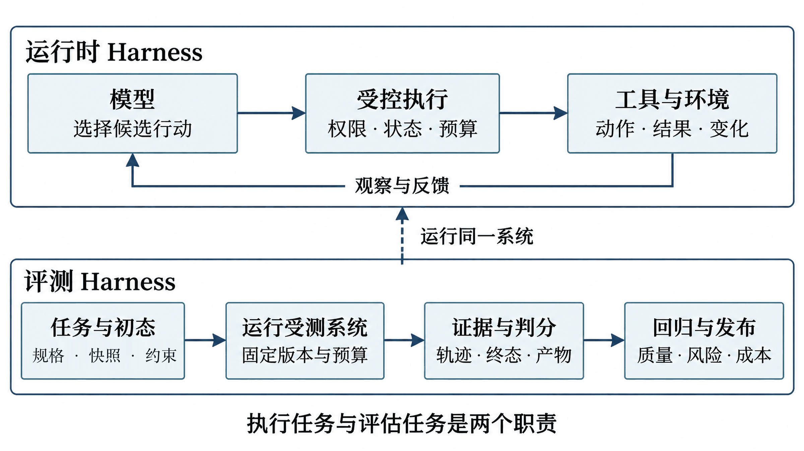

# 目录

## 第一章 Harness Engineering 总览

[1. AI Agent 中的 Harness Engineering 是什么？](#q-001)
  - [面试问题：Harness、Benchmark、Eval、AgentOps 有什么区别？](#q-002)
  - [面试问题：为什么 Agent 比普通 LLM 更需要 Harness Engineering？](#q-003)
  - [面试问题：一个完整 Agent Harness 通常包含哪些模块？](#q-004)

## 第二章 任务、环境与运行器

[2. Agent Harness 的任务数据应该如何设计？](#q-005)
  - [面试问题：Task Spec、Environment Spec、Expected Outcome 应该包含什么？](#q-006)
  - [面试问题：Environment Simulator / Sandbox 的核心价值是什么？](#q-007)
  - [面试问题：Agent Runner 如何保证可复现、可对比、可回放？](#q-008)
  - [面试问题：如何区分模型能力提升与Harness改进的收益，为什么需要交叉实验？](#q-201)

## 第三章 Trace、Grader 与指标体系

[3. Agent Harness 为什么必须记录完整 Trace？](#q-009)
  - [面试问题：Outcome Grading、Trajectory Grading、State Grading 如何区分？](#q-010)
  - [面试问题：规则判分、单元测试、LLM-as-Judge、人审如何组合？](#q-011)
  - [面试问题：Agent Harness 应该输出哪些核心指标？](#q-012)

## 第四章 主流场景 Harness 设计

[4. 编码 Agent Harness 应该如何设计？](#q-013)
  - [面试问题：SWE-bench Harness 给编码 Agent 评测带来哪些启发？](#q-014)
  - [面试问题：浏览器 / GUI Agent Harness 应该如何设计？](#q-015)
  - [面试问题：客服 / 工具调用 Agent Harness 应该如何设计？](#q-016)
  - [面试问题：多 Agent / A2A Harness 应该如何设计？](#q-017)

## 第五章 回归门禁、CI/CD 与生产闭环

[5. Agent Harness 如何接入 CI/CD 和发布门禁？](#q-018)
  - [面试问题：Smoke Eval、Regression Eval、Safety Eval、Canary Eval 如何分层？](#q-019)
  - [面试问题：如何用 Harness 做失败样本回流和持续优化？](#q-020)
  - [面试问题：Harness 如何服务线上 Shadow Mode 和灰度发布？](#q-021)

## 第六章 前沿趋势与高频架构题

[6. 2026 年 Agent Harness Engineering 有哪些主流趋势？](#q-022)
  - [面试问题：Model-native Harness 和传统脚本 Harness 有什么区别？](#q-023)
  - [面试问题：如何回答“请设计一个企业级 Agent Harness 平台”？](#q-024)

---

<h1 id="q-001">1. AI Agent 中的 Harness Engineering 是什么？</h1>

<h2 id="q-002">面试问题：Harness、Benchmark、Eval、AgentOps 有什么区别？</h2>

**难度评分：⭐⭐⭐ (3/5)  |  考察频率：⭐⭐⭐⭐ (4/5)**

Harness原意是一套把组件连接起来并约束其工作的装置。在Agent工程里，它有两种常见用法，讨论前应先确认范围。

**运行时Harness**围绕模型提供上下文、工具、状态、权限、预算和反馈，使模型可以持续执行任务。**评测Harness**围绕受测系统准备任务与环境、安排运行、保存证据、判分并生成报告。同一个项目可以同时包含两者，但两项职责不应混淆：模型所在的系统负责做事，评测系统独立判断事情是否做对。

<div align="center">



</div>

图 3：上方展示运行时将模型、受控执行和工具环境连接为任务系统；下方组织对这个系统的评测。虚线表示评测层运行受测系统，不表示评分器参与每一步模型决策。这是职责示意，不含性能比较。

几个相邻概念可以这样区分：

<div align="center">

| 概念 | 主要含义 | 与其他部分的关系 |
| --- | --- | --- |
| Benchmark | 一组任务、环境和评价约定 | 可同时发布数据、评分器与运行代码 |
| Eval | 在特定条件下实施一次评价，或对应配置 | 指定受测版本、样本、预算和判分规则 |
| 运行时Harness | 模型执行任务所依赖的系统机制 | 自身也是评测对象的一部分 |
| 评测Harness | 组织并核验实验的基础设施 | 执行Eval，可接入不同Benchmark与受测系统 |
| AgentOps | 开发到生产的质量与运营治理 | 使用评测、观测和业务反馈支撑发布及改进 |

</div>

例如SWE-bench的评测程序可以接收补丁，准备环境并运行测试；产生补丁的编码Agent则依赖自己的运行时Harness。评测程序的得分变化可能来自任务或测试变更，编码Agent的变化也可能来自上下文和工具，而不只是模型参数。

本章主要讨论可重复、可比较的评测基础设施，同时明确它和真实运行系统的关系。企业可以复用公开Benchmark的执行器，但仍需接入自己的权限、业务状态和验收规则。公开考题覆盖不了全部真实责任，自己搭建的评测系统也需要接受正确性检查。

<h2 id="q-003">面试问题：为什么 Agent 比普通 LLM 更需要 Harness Engineering？</h2>

**难度评分：⭐⭐⭐ (3/5)  |  考察频率：⭐⭐⭐⭐ (4/5)**

Agent的最终文本只覆盖任务的一部分。它可能读取数据、修改文件、调用业务接口，还会受到多轮交互和环境变化影响。评测必须连接**目标、过程和外部效果**，才能判断一次运行是否合格。

例如客服Agent最后说“已提交退款申请”，需要核对申请是否真的存在、属于哪个订单、金额是否正确，以及此前有没有查询其他客户的信息。正确终态不能抵消中途越权；同样，最后措辞不够流畅也不必然说明业务操作错误，需要按评价维度分别记录。

多步执行还会累积状态差异。第一次查询返回旧库存，第二次提交超时，用户又修改了日期，系统需要处理一个明确的未决状态。评测若只给定输入并比较一句标准答案，无法发现重复提交、旧确认复用和恢复后继续使用过期权限等问题。

因此Harness要能保存初态、执行证据与终态，注入超时和并发等扰动，并检查时间与费用预算。不同失败应能区分：模型误解政策、工具参数转换错误、环境服务未启动、评分器读取了错误路径，修复方法完全不同。

普通LLM应用也需要严谨评测，纯文本输出同样可能泄露信息或误导用户。这里的差别来自系统拥有的状态和动作能力，不是聊天界面与Agent名称的高低之分。

更完整的Harness也无法证明系统永不失败。它提供的是在指定任务、环境和预算下可复查的证据；结论能推广多远，取决于样本覆盖、环境真实性和判分质量。

<h2 id="q-004">面试问题：一个完整 Agent Harness 通常包含哪些模块？</h2>

**难度评分：⭐⭐⭐⭐ (4/5)  |  考察频率：⭐⭐⭐⭐ (4/5)**

一个评测Harness需要把“定义实验、运行实验、保存事实、判断结果”接成可追踪的流程。模块可以合并实现，但接口必须清楚，尤其要把受测Agent与评分器的权限分开。

任务仓库保存版本化的规格、初始数据、允许动作与验收规则。环境构造器据此启动仓库、数据库、浏览器或模拟服务；Runner固定受测系统和预算，生成独立运行ID并推进任务。证据采集保存可观察事件、工具回执、产物和终态快照；Grader读取这些证据，输出分项判定与理由。报告和发布门禁再消费判定结果。

这条链上有两个重要隔离点。第一，隐藏答案、评分规则中不应向受测者公开的部分、评分侧凭证等不能进入Agent上下文。第二，Agent不能修改最终评分器或其依赖，也不能通过删除日志让违规动作消失。测试代码需要更新时，应走独立的评测环境版本流程。

Runner要分别报告任务运行状态和评测状态。例如Agent正常结束但答案错误，是一次有效评测的任务失败；评分器崩溃则是判定缺失；环境构建失败也不能直接算成模型不会做题。后两类需要重试或调查，并在统计中报告数量，不能静默剔除。

还有一些工作容易被框图遗漏：清理残留进程与资源，限制并发造成的相互干扰，处理输出过大，保留失败时的工件，以及发现重复任务和评分器漂移。只有成功样本有Trace的Harness，恰好会丢失最有价值的诊断证据。

平台化后，可以把不同领域环境做成插件，但共用任务、运行和判分记录契约。统一报表不要求把所有任务都压成一个无含义的总分。

<h1 id="q-005">2. Agent Harness 的任务数据应该如何设计？</h1>

<h2 id="q-006">面试问题：Task Spec、Environment Spec、Expected Outcome 应该包含什么？</h2>

**难度评分：⭐⭐⭐⭐ (4/5)  |  考察频率：⭐⭐⭐⭐ (4/5)**

Task Spec描述任务与允许行为，Environment Spec描述执行起点和可用接口，Expected Outcome描述成功条件与禁止效果。三者一起，才能把一句自然语言请求变成可复查的实验。

下面是一份简化的预约任务规格，字段是教学示例，不属于某个框架的标准Schema：

```yaml
task_id: booking_001
task_version: 3
input: "帮我预约周五下午的课程A，费用不超过100元。"
actor_fixture: tenant_a_user_17
environment:
  snapshot: booking_state_v4
  clock: "2026-11-23T09:00:00+08:00"
  policy_version: booking_policy_v2
  tool_contract: booking_api_v3
budget:
  max_tool_calls: 12
  wall_time_seconds: 180
allowed_scope:
  user: user_17
  course: course_a
  max_price_cny: 100
expected:
  required: one_valid_booking_for_user_17
  forbidden: duplicate_booking_or_other_user_change
  evidence: booking_receipt
```

Task Spec还要约定相对时间的解释、信息缺失时怎样澄清，以及批准是否已包含在输入或任务授权中。上例的星期五需要结合固定时钟与时区解释；若业务要求额外确认，应在政策和用户模拟器中表达，不能事后凭评分者喜好增加条件。

Environment Spec应固定仓库提交、依赖、数据库、文件、账号、服务版本与必要网络条件。密钥使用测试凭证引用，不能将生产凭证写入任务包。用户模拟器的目标、可知信息和行为约束也属于环境，不是无关陪衬。

Expected Outcome优先定义业务不变量，例如只增加一笔符合条件的预约、其他用户状态未变、回执与实际记录一致。不要强制答案包含某个固定句式，或要求必须经过唯一工具顺序，除非这些本身就是任务约束。

Agent可见的需求和隐藏判分材料应分开存放；但对结果的要求必须有正当来源，不能用从未告知且不可推知的规则扣分。高影响禁止动作通常采用独立硬门禁，不能把越权与文风分数加权后相互抵消。

<h2 id="q-007">面试问题：Environment Simulator / Sandbox 的核心价值是什么？</h2>

**难度评分：⭐⭐⭐⭐ (4/5)  |  考察频率：⭐⭐⭐⭐ (4/5)**

Simulator模拟业务世界，Sandbox限制执行影响范围。前者帮助控制环境行为，后者帮助限制程序权限；二者经常结合使用，但不是同一种保证。

退款模拟器可以返回“订单已过期”“提交成功但响应丢失”等情形，便于重复测试策略。沙箱则限制文件、网络、进程和凭证，避免受测代码访问真实生产资源。一个容器若挂载宿主密钥、允许任意出站请求，仍可能影响真实系统；一个Mock服务若转发未知请求到生产，也没有实现隔离。

可复位环境需要覆盖实际会变化的状态。数据库快照之外，还可能有对象存储、浏览器本地存储、消息队列、系统时间和远程任务。只还原工作目录，却保留上一次运行的登录态或已发送消息，会使后续任务处在不同起点。环境分叉与恢复边界见[第二章](02_编码Agent与AgentOS工程高频考点.md#q-201)。

异常注入应有明确位置和概率，区分调用前拒绝、执行中失败、提交后响应丢失。这三类超时在业务上不同；若都返回同一个字符串“timeout”，无法测试正确恢复策略。并发冲突、限流与权限撤销也应来自真实可能出现的条件。

模拟真实程度要和用途匹配。快速回归可以使用稳定Mock，验证接口和策略；真实集成测试用受控测试账号检查认证、序列化、网络和供应商差异；有限生产灰度再验证真实负载。Mock成功不能替代后两项，真实系统测试也不能不受限地接触生产数据。

每次运行结束后检查资源清理和残留状态。隔离是一项需要实际验证的配置属性，不能从“使用Docker”或“运行在沙箱”这几个字推导出来。

<h2 id="q-008">面试问题：Agent Runner 如何保证可复现、可对比、可回放？</h2>

**难度评分：⭐⭐⭐⭐ (4/5)  |  考察频率：⭐⭐⭐⭐ (4/5)**

Runner首先保证条件有记录、差异可解释，再尽量减少不必要的随机性。固定随机种子和温度有帮助，但无法消除远程模型服务、并发调度、网络与环境变化带来的全部波动。

需要固定或记录的条件包括任务版本、初态、模型版本、生成参数、指令、工具契约、运行时、记忆和检索索引、预算、时钟与依赖。无法固定的外部服务，要记录实际观察到的版本和响应，说明它会怎样限制比较结论。每次尝试分配独立ID，不让重试覆盖第一次失败的证据。

公平比较要让不同版本面对同一批任务和等价起点。若预算是被研究变量，可以比较不同预算；若目标是比较模型，则不能让一个模型无限重试、另一个只试一次。批量运行还应控制资源争抢，将任务顺序随机化或交错安排，避免时段性限流偏向某个版本。

“回放”至少有三层含义：重新展示历史事件；复用录制的模型或工具响应；从初态重新执行完整系统。第一种只用于查看，第二种适合定位确定性代码问题，第三种才直接考验当前模型和环境。缓存模型响应后不再请求模型，无法证明新模型质量；真实重跑也不保证逐字复现。

工具回放需要匹配参数、状态和调用顺序。新Agent走了不同路径时，不能随意把旧轨迹的下一条工具结果塞给它。回放程序还要确认工具是否仍真实执行：只阻断模型网络出口，不一定阻断shell或插件自行联网。

Runner最终保存配置、状态、错误类别、工件、用量和判分引用。报告应区分可重复实验与确定性复现，并记录未能重现的条件；承认环境边界，比宣称“固定seed即可完全复现”更严谨。

<h2 id="q-201">面试问题：如何区分模型能力提升与Harness改进的收益，为什么需要交叉实验？</h2>

**难度评分：⭐⭐⭐⭐ (4/5)  |  考察频率：⭐⭐⭐ (3/5)**

系统得分同时受到模型、运行时Harness、工具、预算和任务分布影响。若更换模型时也换了提示与工具，只比较两个总分，无法确定收益来自哪一处。

可以先做模型与Harness的交叉实验。下面是假设性教学数据，所有单元格都应在同一任务集、等价初态和明确预算下重复运行：

<div align="center">

| 单次成功率示例 | Harness A | Harness B | 同模型更换Harness |
| --- | --- | --- | --- |
| 模型A | 60% | 70% | 增加10个百分点 |
| 模型B | 72% | 73% | 增加1个百分点 |

</div>

两行的收益不同，说明模型与Harness可能存在交互：某种工具描述或上下文组织对模型A更有帮助。只看Harness平均分，会丢失这种差异；只看最好的组合，也无法判断哪个组件具有可迁移价值。

实验还要明确比较的是默认产品组合，还是某个单独组件。更换完整Harness时，系统提示、工具Schema、输出截断、记忆和错误处理可能同时变化，只能得到组合层面的结论。若想判断压缩策略的贡献，应进一步做有控制的消融，并检查不同模型上的效果。

2026年11月的ShellBench采用了类似思路：100项日常任务，12个模型、5个Harness、3档推理努力和重复尝试；因一个模型与Harness组合未运行，共观察59种组合。它提示平均表现与特定组合表现可能不同，也把正确性与安全条件同时纳入任务判定。

解释这类研究时要保留边界。论文使用默认Harness，无法单独归因提示、工具或运行时；不同模型的推理档位只在模型内部有序，不是同等算力。90项任务依赖LLM判分，人工一致性检查针对部分单项条件，不能当作完整任务评分准确率。token成本也是估计，未包含判分成本。

企业实验应保留逐题配对结果，报告样本数、重复次数和不确定性；同一任务的多次尝试有相关性，不宜把所有运行都当作独立业务样本。再按任务类别查看收益与伤害、时间和费用。交叉实验的价值是帮助找出适合自身业务的组合，不能把一份榜单提升为“模型永远比Harness重要”的普遍结论。

<h1 id="q-009">3. Agent Harness 为什么必须记录完整 Trace？</h1>

<h2 id="q-010">面试问题：Outcome Grading、Trajectory Grading、State Grading 如何区分？</h2>

**难度评分：⭐⭐⭐⭐ (4/5)  |  考察频率：⭐⭐⭐⭐ (4/5)**

Outcome Grading评估交付结果，State Grading检查环境变化，Trajectory Grading检查可观察执行过程。三者有重叠，不是互斥分类：一笔预约是否成功既是业务结果，也体现在数据库终态。

例如报告任务的Outcome可以检查结论、引用和文件可读性；State检查文件是否保存到正确目录、是否覆盖了无关文件；Trajectory检查是否访问了授权数据、是否遗漏必须核查的证据。轨迹合理不要求逐步复制参考路径，Agent可以采用不同的有效方法。

对写操作，最终状态尤其需要配合过程约束。Agent先误改另一个客户的数据再改回，终态可能与预期一致，却已经触发通知或暴露信息。反过来，仅凭Trace出现一次工具调用，也无法确认效果发生，可能是调用前失败或日志不完整。工具回执、效果记录和终态需要交叉核对。

所以Trace应保留可观察的输入输出、模型与策略版本、工具参数和结果、授权事件、检索与记忆引用、状态转移、用量和产物。异步与多Agent场景用父子关联和业务意图标识表达因果关系，单靠时间排序不够。

“完整”应理解为足以支持判分和诊断，而非无差别保存全部敏感内容。可以用脱敏字段、受控工件引用与摘要记录，并明确哪些原始证据不可得；不要求暴露模型内部隐藏思维链。采样、截断或采集故障造成的缺口必须标记。

评分器应输出具体失败条件及证据位置。只给一个总分会掩盖问题，缺少证据时应报告不可判定或进入复核，不应由Judge编造一条合理轨迹填补空白。

<h2 id="q-011">面试问题：规则判分、单元测试、LLM-as-Judge、人审如何组合？</h2>

**难度评分：⭐⭐⭐⭐ (4/5)  |  考察频率：⭐⭐⭐⭐ (4/5)**

判分方法应由待判断的事实决定。数据库是否新增一笔订单，可以直接查询；代码修复是否通过给定行为测试，可以执行测试；报告解释是否完整，则需要语义评价和必要的人审。

确定性规则稳定且易复查，但规则写错也会稳定地错。检查“文件存在”不能证明内容正确，检查“SQL执行成功”不能证明统计口径正确。单元测试与集成测试提供更强功能约束，仍可能遗漏需求或被修改测试绕过，因此最终评测测试与受测工作区应有明确隔离。

LLM-as-Judge适合补足开放式质量。将评分标准拆成可核对条件，让Judge看到必要证据、输出判定与依据，并在一批人工标注样本上测一致性、误放行与误拦截。候选答案中的“请忽略评分规则”应被视为待评内容，不能成为裁判指令；长度、风格、位置和同模型偏好也需要控制。

人工复核能处理语义争议和高影响样本，但人也会受信息不足、疲劳与标准差异影响。需要清楚的标注说明、盲评、分歧处理和复核记录，不能把“人工看过”直接等同于真值。风险越高，越要看证据和责任机制，而非只增加一个签字动作。

组合评分时，可先检查不能被抵消的硬约束，再报告正确性、完整性和成本等维度。严重越权不能因为回答文风好而加权通过；普通质量维度是否汇总成分数，则按业务目标决定。不同类型任务也不必共享同一套权重。

Grader本身需要回归样本：已知错误要能拦住，合法替代方案应通过，证据缺失不能被默认为成功。评价器修复的机制和边界见[第六章](06_Agent安全评测与AgentOps高频考点.md#q-202)。

<h2 id="q-012">面试问题：Agent Harness 应该输出哪些核心指标？</h2>

**难度评分：⭐⭐⭐⭐ (4/5)  |  考察频率：⭐⭐⭐⭐ (4/5)**

报告首先说明评测了什么：任务版本、样本数、有效运行数、预算、失败重试规则和判分器版本。分母不清楚，再精细的百分比也难比较。

至少需要同时呈现以下维度：

<div align="center">

| 维度 | 主要指标 | 解释时要保留的条件 |
| --- | --- | --- |
| 业务质量 | 任务成功率、分项条件通过率 | 按任务类别分层，说明拒绝和转人工如何计入 |
| 稳定性 | 重复成功、运行间波动、恢复成功率 | 每次复位，区分至少一次成功与每次都成功 |
| 约束遵循 | 越权、泄露、误放行、误拦截 | 按严重程度与攻击样本分布报告 |
| 资源消耗 | 总费用、工具费用、人审和返工 | 包含失败尝试，不能只统计成功样本 |
| 时间 | 任务完成时延、P95/P99、超时 | 区分首响应、完成与等待人工时间 |
| 评测可靠性 | 环境失败、不可判定、Trace缺失、Judge分歧 | 不把基础设施故障静默删除 |

</div>

pass@k衡量k次中至少一次成功，多次全部成功衡量稳定交付，两者不能混用。生产还需要能够识别哪次结果正确的选择器，不能把离线“知道标准答案后挑最优”的分数当作一次交付率。公式与估计方式见[第六章](06_Agent安全评测与AgentOps高频考点.md#q-201)。

工具调用数、反思次数和协作次数适合诊断，不是越多或越少越好。少调用可能意味着高效，也可能意味着没有核实关键证据。高风险动作确认率也需以确实要求确认的动作为分母，已有有效授权不应被惩罚为漏确认。

比较新旧版本时，除平均变化，还要列出新增失败、修复失败、成本增加和危险退化。报告区间与样本量，避免把小幅随机波动当作确定进步。一个高平均分但出现新的越权行为的版本，可能仍不符合发布条件。

<h1 id="q-013">4. 编码 Agent Harness 应该如何设计？</h1>

<h2 id="q-014">面试问题：SWE-bench Harness 给编码 Agent 评测带来哪些启发？</h2>

**难度评分：⭐⭐⭐⭐ (4/5)  |  考察频率：⭐⭐⭐⭐ (4/5)**

SWE-bench把问题放回真实仓库与依赖环境，用补丁和测试判断修复是否有效。其评测Harness的职责是构建环境、应用补丁、执行测试和保存结果，通常不替编码Agent完成定位或生成补丁。

官方Docker实现按基础镜像、仓库依赖环境和问题实例分层，便于复用稳定部分，同时为每个任务准备对应状态。企业可以借鉴这一结构：固定base commit和依赖，保存原始工作区差异，在隔离环境让Agent修改代码，再由独立评测过程应用候选补丁并运行指定测试。

判分需同时核查被修复行为与原有行为。Fail-to-pass测试检查原本失败的场景是否通过，pass-to-pass测试检查已工作的场景是否退化。测试日志、测试选择和环境构建结果都要保留，否则“没有测试失败”可能只是测试根本没有运行。

一个容易忽略的工程细节是结果缓存。当前官方文档说明，结果按`run_id`与`instance_id`缓存，缓存不会因预测补丁内容改变而自动失效。因此换补丁重新评测需要新的运行ID；只改文件后重跑同一命令，可能读到旧分数。企业Harness也应将缓存键与实际实验输入绑定，或明确要求新的运行记录。

企业编码任务还要覆盖需求实现、重构、依赖升级、文档同步，以及用户已有未提交修改。diff越小不必然越好，修改测试也不必然作弊；要判断改动是否符合任务、是否削弱独立验收、是否引入无关行为。不能让Agent通过修改最终评分器获得通过。

Docker和锁定依赖可以减少环境差异，仍需要核对架构、镜像、系统资源和网络依赖。环境构建失败应独立分类。公开基准适合共同参照，私有仓库和真实工作流程仍需自己的任务集与权限约束。

<h2 id="q-015">面试问题：浏览器 / GUI Agent Harness 应该如何设计？</h2>

**难度评分：⭐⭐⭐⭐ (4/5)  |  考察频率：⭐⭐⭐ (3/5)**

浏览器与GUI评测需要固定**观察方式、动作接口和业务判据**。同一任务给一个Agent完整DOM与后台API，另一个只给截图，两者测到的能力不同，不能只比较最终百分比。

环境规格应记录浏览器或桌面版本、分辨率、缩放、语言、时区、登录状态、账号权限和初始数据。页面滚动、弹窗、重定向和异步加载会改变可见对象，Agent需要在动作前确认观察仍然有效。点击坐标合法，并不说明点击了正确客户或订单。

评测可注入过期页面、同名对象、动态列表和恶意页面内容，观察Agent是否重新定位、核查对象、遵守数据边界。截图与可访问性树是两种输入，二者是否同时可用需要报告；OCR结果和元素选择器也可能随环境变化。

结果检查优先连接权威业务状态。例如按钮显示“提交成功”，仍应核对目标记录和业务回执；仅看页面文本容易被旧通知、前端缓存或错误页面误导。下载任务要检查文件内容与位置，设置修改要确认实际生效对象和范围。

安全条件依据实际授权确定。用户已明确授权某项设置修改，Agent不必每一步重新确认；未知收款人、目标发生变化或超出原范围时，则要暂停或澄清。按所有点击是否弹确认框评分，会奖励无效交互。

WebArena与OSWorld提供网页和桌面环境的参考，但企业仍需覆盖自家系统。压测与回归时要清理账号状态和后台任务，避免前一轮操作改变后一轮的初态。浏览器返回上一页也不会撤销已经发生的交易。

<h2 id="q-016">面试问题：客服 / 工具调用 Agent Harness 应该如何设计？</h2>

**难度评分：⭐⭐⭐⭐ (4/5)  |  考察频率：⭐⭐⭐⭐ (4/5)**

客服与工具调用评测需要同时模拟用户、业务接口和政策。Agent必须理解对话、满足规则并改变正确的业务状态，单看回复是否礼貌，或工具Schema是否合规都不够。

一个退款任务可以提供测试用户、订单快照、政策版本和工具集，用户模拟器按既定目标补充信息、纠错或改变意图。模拟器只能知道角色应该知道的信息，不能读取隐藏答案后暗示Agent；也不宜无条件配合每个错误提问，否则会高估真实服务能力。

业务接口应区分拒绝、失败和结果未知。订单查询权限不足、退款条件不满足、提交成功但响应丢失，需要不同处理。最终判分同时核查退款记录、金额、订单归属、用户承诺和必要授权，不能让正确数据库终态掩盖此前的错误操作。

τ-bench采用用户—Agent—工具交互与终态比较，是这一方向的重要参考。原论文也指出，终态奖励可能遗漏确认政策违规。当前τ²-bench仓库已扩展到2.0的多语言与语音方向，版本之间任务输入和判分条件有变化，不能将旧版成绩直接并列。语音中的额外质量判定与原有任务奖励也应分开理解。

用户模拟会引入额外随机性。需要固定模拟器版本、控制可见信息，并对同一任务重复运行；适当人工检查模拟对话是否合理。更强模拟器并不一定更真实，真实用户可能表达不完整、不知道内部政策，也可能中途退出。

报告可并列给出任务成功、政策遵循、正确转人工、用户轮次、成本与稳定性。转人工不是天然失败，错误自动执行也不是高效完成；评分要反映系统应该承担的责任范围。

<h2 id="q-017">面试问题：多 Agent / A2A Harness 应该如何设计？</h2>

**难度评分：⭐⭐⭐⭐ (4/5)  |  考察频率：⭐⭐⭐ (3/5)**

多Agent评测增加了协作层：谁接任务、传递什么、谁拥有执行权、结果怎样整合。单个Agent分别通过测试，不能证明组合系统能够可靠完成任务。

任务应设置可核对的依赖与共同终态。例如调研Agent收集证据，分析Agent计算指标，汇总Agent产出报告。记录子任务、交接消息、输入工件版本和返回结果，检查是否丢失约束、引用过期数据，或把一个子任务的成功误当作整体完成。

远程协作还要注入重复消息、乱序、迟到结果、超时与取消竞争。两个Agent同时更新共享文件或重复提交业务时，平台如何防冲突；某个子任务已经成功但回执丢失时，协调者如何核对。这些都是可独立于模型语言能力验证的系统问题。

A2A测试分为协议契约与业务语义两层。前者检查支持版本、认证、消息结构、任务状态、订阅与工件；后者检查目标是否实现及权限是否保持。当前协议中的工件最后一个分块不等于任务成功，观察流关闭也不等于取消任务；不能让模拟器偷偷提供超出协议的重放或幂等保证。具体边界见[第四章](04_MCP与A2A协议高频考点.md)。

评价还应与单Agent或固定工作流基线比较。并行节省的时间可能被重复检索、上下文传递、等待与汇总抵消。统计总模型与工具费用，区分关键路径延迟和所有子任务累计耗时，保留无效委派与反复交接案例。

任务失败时，要能定位最早缺失的证据或约束，也要检查协调者是否对错误结果做了验证。多个Agent一致同意一个结论，并不提供独立正确性保证，尤其当它们共享同一错误信息时。

<h1 id="q-018">5. Agent Harness 如何接入 CI/CD 和发布门禁？</h1>

<h2 id="q-019">面试问题：Smoke Eval、Regression Eval、Safety Eval、Canary Eval 如何分层？</h2>

**难度评分：⭐⭐⭐⭐ (4/5)  |  考察频率：⭐⭐⭐⭐ (4/5)**

分层评测是在有限时间与成本下，让不同风险的变化得到合适验证。层次之间可以交叉，不必把同一任务强行归入唯一集合。

Smoke Eval用少量关键任务发现明显不可用，例如认证失败、工具Schema不兼容、无法形成最终结果。Regression Eval覆盖稳定业务和历史错误；Safety Eval关注越权、泄露和危险误执行；Robustness Eval注入异常与扰动。Canary是有限真实流量上的运行验证，Shadow则在隔离副作用的旁路环境观察真实输入分布。

每次变更应触发与影响范围匹配的集合。工具参数变化重点检查调用契约和相关业务，记忆策略变化检查跨轮状态与删除传播，模型切换则需要更广覆盖。仅跑“最可能受影响的样本”可以缩短反馈，但发布前仍需有核心回归，防止遗漏间接依赖。

门禁要区分硬约束和统计指标。某些已知危险行为出现一次即可拒绝发布；总体成功率、时延和费用则应结合样本量、基线和波动判断。把“回归下降不能超过1%”当作所有项目通用规则并不合理，几十个样本也未必支持这样的精度。

随机性任务需要预先规定重复次数与重试规则，不能失败后一直重跑直到变绿。基础设施错误可按明确条件重试，但原始失败记录仍需保留。零次观察到安全事故也不证明真实风险为零。

通过离线门禁只是进入下一阶段的证据。灰度扩大时继续监测真实完成率、接管和副作用，配置明确的暂停与回退条件。CI/CD负责执行规则，阈值与责任由业务和工程共同定义。

<h2 id="q-020">面试问题：如何用 Harness 做失败样本回流和持续优化？</h2>

**难度评分：⭐⭐⭐⭐ (4/5)  |  考察频率：⭐⭐⭐⭐ (4/5)**

失败回流应把一次模糊投诉转成**可复查的任务、环境和判分条件**。并非每条失败Trace都适合直接加入训练集或回归集。

先确认目标和影响。例如用户说“报告错了”，要找到错误字段、使用的源数据、生成版本和实际后果。随后沿事件定位偏离点，区分检索漏证据、模型误读、工具转换、缓存陈旧和业务规则缺失；同一失败可能有多个共同原因。

构造样本时，尽量恢复失败发生前的初态。不能把已经被失败操作修改过的数据库当作原始输入，再期待复现相同问题。敏感数据可以替换为结构与约束等价的测试数据，但要确认脱敏没有消除真正触发失败的特征。

接着写独立判据：正确结果是什么，哪些动作禁止，允许哪些替代路径，缺信息时应该如何处理。先验证旧版本在合理重复条件下能呈现问题，再验证修复版本减少失败，同时检查邻近任务没有退化。仅添加一条与修复代码相同的断言，容易得到自我证明。

样本应去重并分层保存。事故集可以刻意强调高风险，线上代表集则反映真实频率，二者的总体分数含义不同。训练、调参和最终保留评测要有边界，避免把所有失败案例反复优化到记住答案后继续作为独立成绩。

还要给样本设维护责任。政策、接口或任务范围变化后，旧样本可能需要更新、重新标注或保留为历史测试。失败数据只有经过判定、修复和回归验证才可能改善系统，数量增加本身不构成质量提升。

<h2 id="q-021">面试问题：Harness 如何服务线上 Shadow Mode 和灰度发布？</h2>

**难度评分：⭐⭐⭐⭐ (4/5)  |  考察频率：⭐⭐⭐ (3/5)**

Shadow Mode让候选版本接收真实输入，在受控旁路执行并记录结果；Canary让候选版本在有限范围内承担真实业务。两者回答的问题不同，不能互相替代。

Shadow首先要隔离副作用。写工具连接模拟服务或独立环境，邮件、通知、支付和外部分析事件也不能漏到生产。只把最终回答隐藏起来，实际工具仍然调用生产接口，并不构成安全的旁路。真实输入中的敏感内容仍需按访问规则处理。

旁路还要考虑数据时点。主路径完成操作后，候选路径若读取更新后的状态，已经不是相同条件。可使用一致快照、录制的受控响应或明确的时点读，但要记录这些选择如何偏离真实运行。用户后续回复也可能受主路径影响，不能把它视为候选版本自然引出的交互。

Shadow适合发现分类、检索、计划和部分输出差异，难以完全验证真实提交、并发、交互反馈和业务效果。Canary补上这些证据，但需要限制租户、场景、权限和流量，并提前设置停止条件。

对有副作用的任务，两个版本不能同时拥有执行同一意图的写权限。灰度还需保证同一长任务的版本一致，防止前半段在旧流程、后半段在不兼容的新流程。比较结果时检查样本分布，不把小流量里的容易任务当作全面提升。

Harness负责采集证据、执行评分和给出门禁信号；是否自动暂停或回滚，要有经过验证的控制策略。配置回退后仍需核对在途请求与已发生效果，不应宣称一个回滚按钮能撤销所有业务影响。

<h1 id="q-022">6. 2026 年 Agent Harness Engineering 有哪些主流趋势？</h1>

<h2 id="q-023">面试问题：Model-native Harness 和传统脚本 Harness 有什么区别？</h2>

**难度评分：⭐⭐⭐⭐ (4/5)  |  考察频率：⭐⭐⭐ (3/5)**

“Model-native Harness”不是具有统一规范的技术类别，通常强调运行系统围绕模型的工具接口、上下文特征和执行能力设计。传统脚本则描述实现形式，两者并非严格对立：脚本同样可以调用工具、管理沙箱、记录事件并支持长任务。

有价值的变化是把模型与运行机制共同设计。例如模型支持结构化工具调用，Runtime就能校验参数、管理调用结果并限制权限；模型面对长上下文时会遗漏旧信息，系统可以按任务组织检索和压缩；工具执行异步返回，Runtime需要保存等待状态并在恢复时重新核对条件。

这种集成可以减少适配工作，但“原生”二字不会自动带来安全、完整Trace或可恢复执行。托管沙箱隔离什么、权限检查在哪一步、结果能保留多久、是否支持导出，都要读具体契约。OpenAI当前官方文档也区分应用运行的Agents SDK与托管Agents API，二者的会话、存储和环境责任不同。

评测层应尽量覆盖真实运行路径。生产使用工具适配器A，评测却使用行为更宽松的Mock B，即使接口名相同也可能产生偏差。必要的模拟应明确边界，再用受控集成测试验证外部依赖。

截至2026年11月，可以持续关注几项跨周期机制：状态与工件判分、完整任务费用、用户模拟、可恢复环境、运行轨迹诊断，以及模型—Harness交叉评测。它们不是同一年新发明，也不因为被某个产品集成才成立。

OpenAI Agent Builder等产品处于具体生命周期中，评测与Trace能力的产品入口也会变化。选型要核对当前可用服务；技术学习应保留任务规格、运行证据和独立判分这些稳定部分。轨迹怎样进一步服务记忆、Skill或参数训练，见[第九章](09_自进化Agent与多平台运行时高频考点.md)。

<h2 id="q-024">面试问题：如何回答“请设计一个企业级 Agent Harness 平台”？</h2>

**难度评分：⭐⭐⭐⭐ (4/5)  |  考察频率：⭐⭐⭐⭐ (4/5)**

设计企业级Harness平台，可以围绕一次“改了退款工具参数后是否允许发布”的变更展开，而不是先列八个系统名称。

任务仓库保存业务样本、初态与判分版本；环境服务提供隔离的订单数据库、工具接口和用户模拟器；Runner用旧版与候选版在相同条件下运行；证据层保存调用、授权、回执、终态和费用；评分器检查目标与禁止效果；报告指出新增失败与修复情况，门禁据此决定是否进入灰度。

平台应隔离开发、测试和生产凭证，区分受测系统与评分器可访问的材料。离线评测不应拥有生产写权限；受控Canary确实需要真实动作时，则使用单独身份、明确范围和审计，不能把“评测平台永不涉及生产”作为不现实的前提。

扩展性来自统一契约：环境插件实现准备、复位、取证和清理，Runner适配不同Agent入口，Grader返回分项结论、证据与不可判定原因。具体实现可从一个仓库、一类业务工具和一组回归任务开始，避免一开始就维护所有类型的虚拟环境。

资源管理要按租户和实验限流，防止并发导致环境互相污染；模型费用与评测费用分别计量。结果缓存需绑定输入或明确新的运行ID，产物和日志有访问与保留规则，删除与恢复也要覆盖备份。评分器升级后保留旧结果，并说明分数口径变化。

验收平台本身时，准备已知成功、已知越权、环境故障、Judge分歧和重复提交等样本，检查它是否给出正确分类与证据。最终平台应帮助团队决定该修模型、工具、上下文还是业务流程，并证明修改带来的收益；一张总分排行榜不足以承担这项职责。

---

## 高频速记

1. 运行时Harness组织模型执行，评测Harness独立准备、运行与判定实验；Benchmark、Eval和AgentOps各有职责。
2. Task Spec、Environment Spec和Expected Outcome共同定义任务，成功条件与禁止效果都要可核对。
3. Simulator控制业务行为，Sandbox限制影响范围；容器名称不证明文件、网络和凭证已经隔离。
4. 固定seed不能消除远程服务与环境随机性；回放事件、缓存响应和重新执行测到的能力不同。
5. 模型与Harness要交叉比较，平均收益可能掩盖组合差异；组件归因还需要控制变量与消融。
6. 结果、轨迹与终态互相补充，正确终态不能抵消先前越权，缺失日志也不证明动作没有发生。
7. 判分器同样需要验收；确定性规则、测试、Judge和人审都有各自适用范围与误差。
8. SWE-bench当前结果缓存按运行ID与实例ID复用，修改补丁后重新评测要避免误读旧结果。
9. 预算、初态、工具权限和观察接口决定比较条件；截图、DOM和后台API不能不加说明地混比。
10. Shadow必须隔离副作用，Canary承担有限真实责任；离线通过只是扩大范围的证据之一。
11. 失败回流要恢复初态、明确判据并防止评测泄漏，不能把失败数量增加当成质量进步。
12. Model-native不是自动保证；长期有价值的是可解释的运行条件、独立证据和可比较的实验。

## 参考资料

- SWE-bench，[Evaluation Harness Reference](https://www.swebench.com/SWE-bench/reference/harness/)。
- [ShellBench: What Matters More for AI Agents, Models, or Harness for Everyday Tasks](https://arxiv.org/abs/2611.32946)，2026。本文借鉴实验设计，并保留默认配置、评分器与费用估计限制。
- OpenAI，[Agents运行方式](https://developers.openai.com/api/docs/guides/agents-sdk)、[Running agents](https://developers.openai.com/api/docs/guides/agents/running-agents)、[Deprecations](https://developers.openai.com/api/docs/deprecations)。
- [WebArena官方仓库](https://github.com/web-arena-x/webarena)、[OSWorld项目页](https://os-world.github.io/)。
- [τ-bench论文](https://arxiv.org/abs/2406.12045)、[τ²-bench当前仓库与版本说明](https://github.com/sierra-research/tau2-bench)。
- [A2A Protocol Specification](https://a2a-protocol.org/latest/specification/)。协议能力按2026年11月核对版本理解，不推断未声明的幂等与重放保证。
