# 目录

## 第一章 Stable Diffusion 系列核心高频考点

[1.介绍一下Stable Diffusion的原理](#q-028)
  - [面试问题：Stable Diffusion相比经典Latent Diffusion model的核心优化是什么？](#q-029)
  - [面试问题：介绍一下Stable Diffusion核心架构与训练/推理过程](#q-039)
  - [面试问题：Stable Diffusion中的图生图原理是什么？denoising strength起到什么作用？](#q-040a)
  - [面试问题：介绍一下Stable Diffusion中Inpaint和Outpaint的原理](#q-040)
  - [面试问题：介绍一下针对Stable Diffusion的模型融合技术(进阶)](#q-033)

[2.介绍一下Stable Diffusion中VAE的架构、原理和作用](#q-041)
  - [面试问题：Stable Diffusion中的VAE和原生VAE生成模型的区别是什么？](#q-044)
  - [面试问题：VAE编码和解码过程中有哪些注意事项？](#q-044b)
  - [面试问题：VAE提供的Latent空间会对扩散模型的图像生成质量和训练效率产生什么样的影响？](#q-044e)

[3.介绍一下Stable Diffusion中Backbone的架构、原理和作用](#q-045)
  - [面试问题：介绍一下Stable Diffusion中自注意力机制和交叉注意力机制的原理](#q-047)
  - [面试问题：为什么使用U-Net作为Stable Diffusion模型的核心Backbone？](#q-049)
  - [面试问题：U-Net与DiT在Backbone设计哲学上的本质差异是什么？SD系列从U-Net演进到DiT的根本原因是什么？](#q-049b)
  - [面试问题：SD Backbone中为什么设计GroupNorm+SiLU+残差连接的组合？(进阶)](#q-049d)

[4.介绍一下Stable Diffusion中Text Encoder的架构、原理和作用](#q-050)
  - [面试问题：Text Encoder和VLM条件编码器在扩散模型中起什么作用？](#q-051)
  - [面试问题：CLIP Text Encoder的Tokens长度限制对长 Prompt的实际影响是什么？工程上如何突破？](#q-053a)
  - [面试问题：Prompt中的权重语法（(word:1.2)、[word]等）的实现原理是什么？(进阶)](#q-053b)
  - [面试问题：如何优化Prompt和生成图像不对齐的问题？](#q-054)

[5.介绍一下Stable Diffusion XL的原理和创新点](#q-056)
  - [面试问题：Stable Diffusion XL的VAE部分有哪些创新？详细分析改进意图](#q-058)
  - [面试问题：Stable Diffusion XL的Backbone部分有哪些创新？详细分析改进意图](#q-059)
  - [面试问题：Stable Diffusion XL的Text Encoder部分有哪些创新？详细分析改进意图](#q-060)
  - [面试问题：Stable Diffusion XL中使用的训练方法有哪些创新点？](#q-061)
  - [面试问题：什么是SDXL Refiner？](#q-065)

[6.介绍一下Stable Diffusion 3的原理和创新点](#q-066)
  - [面试问题：SD 3的VAE部分有哪些创新？详细分析改进意图](#q-067)
  - [面试问题：SD 3的Backbone部分有哪些创新？详细分析改进意图](#q-067a)
  - [面试问题：SD 3的Text Encoder部分有哪些创新？详细分析改进意图](#q-067c)
  - [面试问题：训练Stable Diffusion 3过程中官方使用了哪些训练技巧？](#q-069)
  - [面试问题：Stable Diffusion 3.5有哪些改进点？](#q-075)


## 第二章 FLUX系列核心高频考点

[1.介绍一下FLUX.1的原理，与Stable Diffusion 3相比有哪些创新点？](#q-flux-001)
  - [面试问题：FLUX.1的VAE部分有哪些创新？详细分析改进意图](#q-flux-014)
  - [面试问题：FLUX.1的Backbone部分有哪些创新？详细分析改进意图](#q-flux-015)
  - [面试问题：FLUX.1的Text Encoder部分有哪些创新？详细分析改进意图](#q-flux-016)
  - [面试问题：FLUX.1在训练和推理过程中使用了哪些优化技巧？](#q-flux-002)

[2.FLUX.1有哪些主流的变体模型？介绍一下它们的核心原理](#q-flux-017)
  - [面试问题：介绍一下FLUX.1 Lite与FLUX.1的异同](#q-flux-005)
  - [面试问题：介绍一下FLUX.1 Kontext的原理，有哪些创新点？](#q-flux-006)
  - [面试问题：介绍一下FLUX.1 Krea的原理，有哪些创新点？](#q-flux-008)

[3.介绍一下FLUX.2的原理和创新点](#q-flux-013)
  - [面试问题：FLUX.2的VAE部分有哪些创新？详细分析改进意图](#q-flux-022)
  - [面试问题：FLUX.2的Backbone部分有哪些创新？详细分析改进意图](#q-flux-020)
  - [面试问题：FLUX.2的Text Encoder部分有哪些创新？详细分析改进意图](#q-flux-019)

---

<h1 id="ch-02">第一章 Stable Diffusion 系列核心高频考点</h1>

<h1 id="q-028">1.介绍一下Stable Diffusion的原理</h1>

<h2 id="q-029">面试问题：Stable Diffusion相比经典Latent Diffusion model的核心优化是什么？</h2>

**难度评分：⭐⭐⭐ (3/5)  |  考察频率：⭐⭐⭐⭐⭐ (5/5)**

Rocky认为我们可以这样理解，Latent Diffusion Models（LDM）是“在潜空间做扩散”的**通用扩散算法模型框架**，而Stable Diffusion是在此框架基础上，通过一系列工程技术优化后在开源社区大规模落地应用的**AIGC图像创作大模型**。

**从技术架构本质来看，Stable Diffusion本身也归属于Latent Diffusion架构体系**。Stable Diffusion整体流程如下图所示。

<div align="center">


</div>

具体来讲，若把Stable Diffusion与Latent Diffusion原论文中的文生图基准模型相比，核心差异主要体现以下维度：

1.  **训练数据集的迭代升级**：通用Latent Diffusion论文中的实验主要基于较小规模的LAION-400M图文数据集完成训练；Stable Diffusion则使用了规模更大的LAION-2B-en及LAION-5B中的不同子集系列图文数据集，并配合数据清洗、低分辨率过滤、美学评分等筛选策略来提升训练样本质量。整体的**数据规模、数据质量和工程策略都更完善**。

2.  **文本编码器的方案优化**：通用Latent Diffusion中的文本条件编码方案相对简单，是一个随机初始化的Transformer模型，在Latent Diffusion训练过程中一同训练；Stable Diffusion则采用预训练CLIP文本编码器作为文本特征提取模块。相较于从零开始训练文本编码器，在大规模图文配对数据上完成预训练的文本编码器通常具备更强的文本语义理解和图文对齐能力。

3.  **训练分辨率策略的优化**：通用Latent Diffusion更偏研究验证性质，只是在 $256\times256$ 分辨率上训练；Stable Diffusion采用分阶段训练和高分辨率微调等工程策略，先在 $256\times256$ 分辨率上预训练，然后再在 $512\times 512$分辨率上进行微调训练，满足高分辨率生成的质量要求。

4.  **架构持续迭代升级**：通用Latent Diffusion只是一个实验性模型架构；而Stable Diffusion作为商业化模型，其架构的持续迭代（如SDXL、SD3、FLUX.1、FLUX.2等），不断突破AIGC图像创作领域的效果上限。

总的来说，Stable Diffusion可以理解为Latent Diffusion的一次工程优化与扩展：更强的文本编码器、更大规模的数据、更系统的数据筛选和更面向实际场景的训练策略，共同提升了模型生成质量和可用性。


<h2 id="q-039">面试问题：介绍一下Stable Diffusion核心架构与训练/推理过程</h2>

**难度评分：⭐⭐⭐⭐ (4/5)  |  考察频率：⭐⭐⭐⭐⭐ (5/5)**

Stable Diffusion采用潜空间扩散架构。以SD 1.x为例，模型由由VAE、CLIP文本编码器、U-Net，以及负责噪声调度和采样更新的算法组件共同构成。VAE负责图像与潜变量之间的转换，CLIP文本编码器提供语义条件，U-Net预测当前Latent中的噪声，采样器依据这一预测更新Latent。经过多步更新后，VAE Decoder再把最终结果还原为RGB图像。在扩散模型训练阶段，VAE和文本编码器保持冻结，主要更新U-Net参数。下图是SD 1.x的整体架构示意图：

<div align="center">

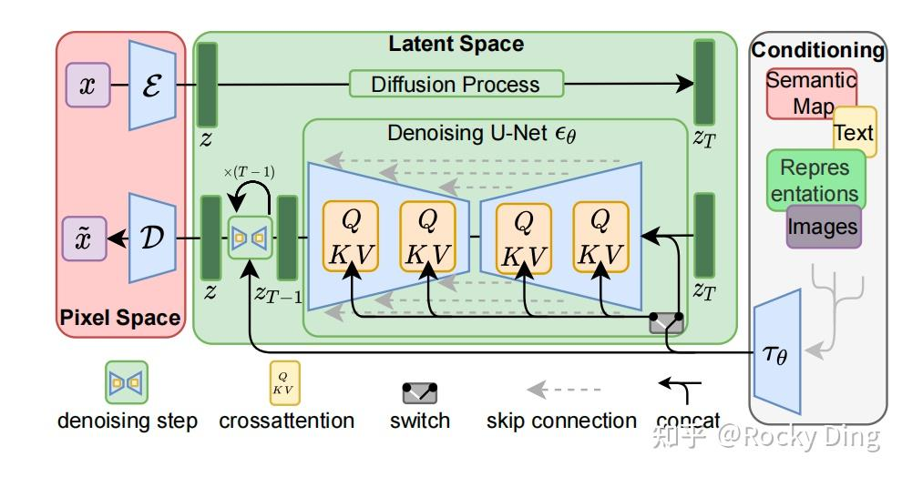

</div>

下面我们以SD 1.x模型为例，说明核心网络结构、训练过程和推理过程。对于一张512×512的图像，SD 1.x通常使用如下表示：

<div align="center">

| 模块 | 输入与输出 | 在系统中的作用 |
|---|---|---|
| VAE Encoder | RGB图像 → 四通道Latent特征，例如3×512×512 → 4×64×64 | 把图像转换为保留空间结构的紧凑表示，供U-Net扩散模型使用。在Latent空间进行扩散过程可以大大减少模型的计算量 |
| CLIP Text Encoder | 文本Prompt → 编码为文本Token特征，标准配置下为77×768，省略batch维度 | 为U-Net提供主体、属性、关系和风格等语义条件 |
| U-Net | 带噪Latent、时间步、文本特征 → 与输入Latent同形状的噪声预测 | 是SD 1.x的Backbone，学习不同噪声水平下，图像潜变量与文本条件之间的统计关系 |
| 噪声调度与采样器 | 训练时常使用DDPM噪声调度；推理时依据模型预测可以选择DDIM、Euler、DPM++、UniPC等采样方法更新Latent特征 | 组织噪声水平、采样时间步和数值更新规则 |
| VAE Decoder | 去噪完成的Latent特征 → RGB图像 | 将生成的潜变量解码为最终图像 |

</div>

### 1、 Stable Diffusion的训练过程

Stable Diffusion的单次完整训练迭代可以概括为：

1. 从数据集中随机选择一组图像—文本样本；
2. 使用VAE Encoder将图像压缩为Latent特征；
3. 从噪声时间步中随机采样一个timestep $t$，并向Latent特征加入该强度的高斯噪声，得到Noisy Latent特征，作为U-Net的主输入；
4. 使用CLIP Text Encoder将文本标签编码为Text Embeddings；
5. 把timestep进行正弦位置编码，再经过MLP，得到Time Embeddings，并将其注入U-Net的残差模块中；
6. U-Net通过Cross-Attention持续注入Text Embeddings；
7. U-Net完整接收当前的带噪图像Latent特征（Noisy Latent特征）、表示当前噪声水平的时间步（Time Embeddings）、文本编码器输出的Token特征（Text Embeddings）这三类核心信息后，开始预测本次实际加入的噪声；
8. 计算模型预测的噪声和真实噪声之间的MSE损失，反向传播并更新U-Net训练参数。

具体流程图示如下所示：

<div align="center">

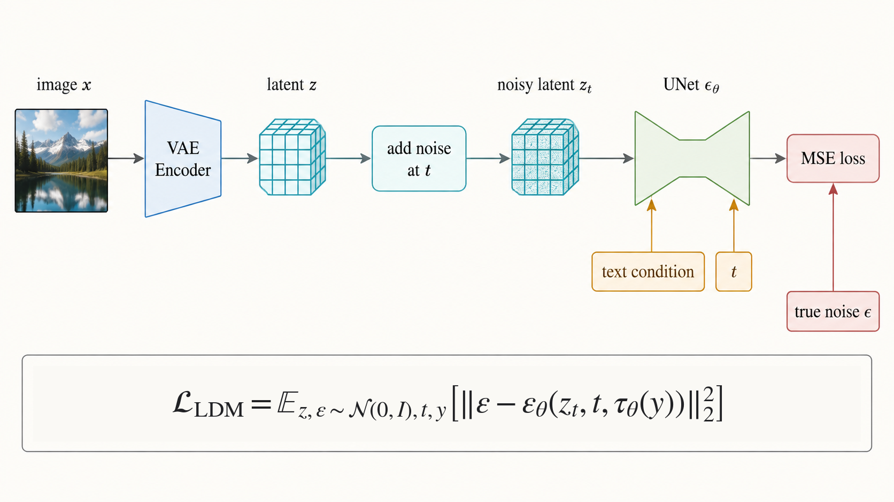

</div>

每个样本在每一次训练迭代中，只随机训练一个timestep，并不意味着模型只学习某一个去噪阶段。随着Epoch不断迭代，同一图像会对应不同的噪声强度；在整个数据集和训练周期上，模型最终覆盖从接近原图到接近纯噪声的完整噪声分布。Time Embeddings则让同一个U-Net知道当前位于哪一个去噪阶段，从而根据噪声强度来预测噪声。

### 2、 Stable Diffusion的推理过程

Stable Diffusion的推理过程主要分文生图与图生图，两者主要区别只在于初始Latent特征的来源：
- **文生图（txt2img）**：从随机高斯噪声开始；
- **图生图（img2img）**：先用VAE Encoder把输入图像压缩成Latent特征的，再根据denoising strength加入一定量的噪声。

随后二者都会进入相同的反向去噪过程：
1. CLIP Text Encoder将Prompt编码为Text Embeddings；
2. U-Net在每个timestep预测噪声，采样器还要根据当前噪声水平、下一时间步和采样规则更新Laten特征；
3. 经过多次迭代后，Latent特征中的噪声逐渐减少，图像语义信息信息逐渐增加；
4. 多次采样迭代完成后，由VAE Decoder将去噪后的Latent特征重建为像素级图像。

Stable Diffusion 文生图和图生图前向推理流程具体如下所示：

<div align="center">

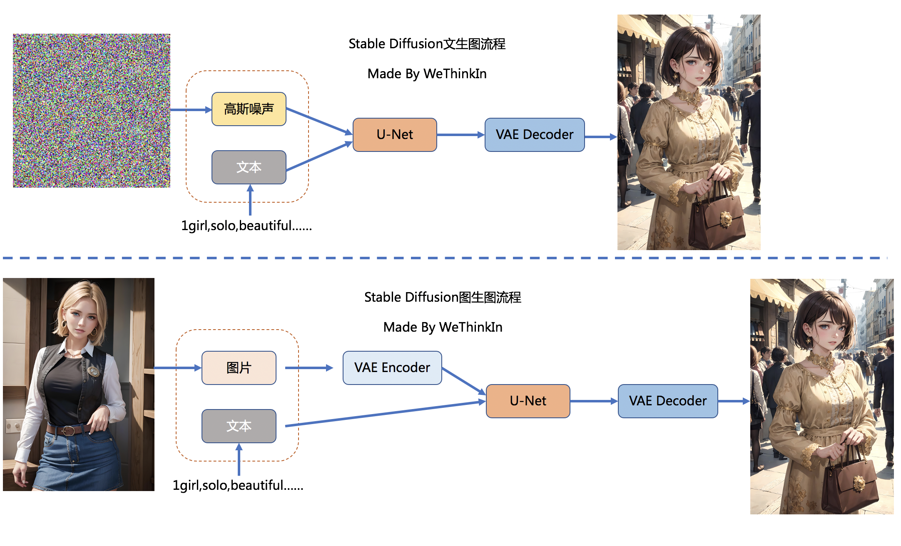

</div>


<h2 id="q-040a">面试问题：Stable Diffusion中的图生图原理是什么？denoising strength起到什么作用？</h2>

**难度评分：⭐⭐⭐ (3/5)  |  考察频率：⭐⭐⭐⭐⭐ (5/5)**

Stable Diffusion的图生图（img2img）是常用的二次创作能力，把输入图像转换为Latent特征，加入一定强度的噪声，再从这个中间状态开始生成。原图提供初始的视觉内容，文本Prompt描述希望得到的结果，扩散模型在两者共同影响下完成重绘。

本质是**在前向扩散链上选一个中间时刻 $t^*$ 作为起点，从这个加噪后的Latent特征开始反向去噪**，而不是从纯高斯噪声 $\mathcal{N}(0, I)$ 开始。

我们以SD 1.x的经典图生图流程为例，完整链路可以概括为：

>输入图像 → VAE编码与Latent缩放 → 选择起始噪声水平并加噪 → 文本引导下的多步采样 → 撤销Latent缩放并经VAE解码。

首先，我们对输入图像进行尺寸调整、裁剪和像素归一化，再送入VAE Encoder。对于512×512的输入图像，SD 1.x通常得到4×64×64的Latent。记经过VAE编码和模型约定缩放后的原图Latent为 $z_0$ 。

接着，选择一个起始时间步 $t^* = \lfloor s \cdot T \rfloor$ ，并采样与 $z_0$ 同形状的高斯噪声 $\epsilon$ 。在DDPM式的噪声参数化下，可以直接构造：

$$
z_{t^*}=
\sqrt{\bar{\alpha}_{t^*}}\,z_0
+
\sqrt{1-\bar{\alpha}_{t^*}}\,\epsilon,
\qquad
\epsilon\sim\mathcal{N}(0,I)
$$
其中 $z_0$ 是原图的干净Latent； $z_{t^*}$ 是用于启动图生图采样的带噪Latent； $\bar{\alpha}_{t^*}$ 由噪声调度决定，控制原图信号与噪声的相对比例； $\epsilon$ 是本次采样生成的高斯噪声。

这个公式已经包含从干净Latent到指定噪声水平的累计效果，因此可以一步完成初始化，无须先执行一串逐步加噪操作。采用其他噪声参数化的采样器时，公式形式可能不同，但同样需要依据起始噪声水平构造采样状态。

随后，将Prompt编码为文本特征。U-Net根据当前Latent、时间步和文本条件预测噪声，采样器据此更新Latent；启用CFG时，还会组合有条件与无条件的预测，增强文本引导。

以 $z_{t^*}$ 为起点、文本条件为引导，跑剩余的 $\lceil s \cdot \text{steps} \rceil$ 个采样步。这一过程重复到采样结束，最后将生成的Latent撤销缩放，再输入VAE Decoder得到图像。

**denoising strength怎样映射到采样时间步呢**？

以经典图生图流程搭配DDIM采样器为例，设原先配置的推理步数为 $N$ ，强度为 $s$ 。在有效步数至少为1的情况下，其默认截取逻辑可以写成：

$$
K=\lfloor sN\rfloor,
\qquad
i_{\mathrm{start}}=N-K
$$

其中， $K$ 表示保留的采样步数， $i_{\mathrm{start}}$ 表示在推理时间表中的起始索引。

如果采样器生成的时间表按噪声从高到低排列为：

$$
\left[
\tau_0,\tau_1,\ldots,\tau_{N-1}
\right]
$$

那么图生图真正使用的起始时间步是：

$$
t^*=\tau_{i_{\mathrm{start}}}
$$

随后沿时间表的剩余部分完成采样。起始索引与真实时间步是两个不同的量，必须通过采样时间表建立对应关系。

denoising strength控制的是重绘从哪个噪声水平开始。起始噪声较低，原图提供的约束较强，结果通常更接近输入图像；起始噪声较高，原图信息受到更强干扰，模型便有更大的空间改变内容与风格：

- $s = 0$：不加噪，模型基本「拷贝」原图。
- $s$ 较小（对应denoising strength为0.2 ~ 0.4）：保留原图大结构与构图，仅做「细节修饰、风格轻调」。常用于细节增强、轻微风格转绘、局部替换的边界融合。
- $s$ 中等（对应denoising strength为0.5 ~ 0.7）：原图作为「构图与色调骨架」，模型在此基础上做较强重绘。常用于风格迁移、人物动作迁移、参考构图二创。
- $s$ 较大（对应denoising strength为0.8 ~ 0.95）：仅保留原图的极低频信息（大体明暗、轮廓），生成结果与原图差异显著。
- $s = 1$：等价于文生图（从纯高斯噪声开始）。

配置50步采样时：

<div align="center">

| denoising strength | 默认截取规则下的有效步数 | 使用的采样区间 |
|---|---:|---|
| 0.2 | 10步 | 从完整时间表较靠后的低噪声位置开始，执行最后10步 |
| 0.4 | 20步 | 从索引30对应的噪声水平开始，执行最后20步 |
| 0.8 | 40步 | 从较靠前的高噪声位置开始，执行最后40步 |

</div>


<h2 id="q-040">面试问题：介绍一下Stable Diffusion中Inpaint和Outpaint的原理</h2>

**难度评分：⭐⭐⭐ (3/5)  |  考察频率：⭐⭐⭐⭐ (4/5)**

Inpaint和Outpaint都属于带有空间约束的图像生成任务：模型利用已有图像提供的上下文，在指定区域生成新的内容，并使新旧部分尽可能协调。

**Inpaint主要编辑画面内部的区域**。例如，修复破损照片、替换桌上的物体，或者重新生成一只绘制不自然的手。用户通过Mask（遮罩）标记需要修改的位置，再用Prompt描述希望出现的内容。

**Outpaint主要生成原图边界之外的内容**。例如，将方形风景图扩展为横版，让湖面、山脉和天空向左右延伸。它需要在新增区域中延续原图的空间关系、光照和画面风格。

两者可以复用相近的扩散生成机制，差别主要在画布组织方式和Mask覆盖的位置。下面以SD 1.x模型为例展开。

我们约定像素空间中的Mask为 $M$ ：
- $M=1$ 表示需要生成或重绘的区域，通常显示为白色；
- $M=0$ 表示希望保留的区域，通常显示为黑色。

由于SD 1.x在Latent空间中生成图像，Mask还需要调整到与Latent一致的空间尺寸。对于512×512的图像，Latent通常为4×64×64，相应的Mask可以表示为1×64×64。记这个缩小后的Mask为 $m$ 。

Mask提供的是空间位置，Prompt提供的是目标内容。例如，将一个杯子替换为玻璃花瓶时，Mask指出杯子及相关接触区域的位置，Prompt则描述花瓶的外观、材质和场景。

编辑区域通常也需要适当包含物体的阴影、反射或遮挡边缘。如果只遮住物体本身，原有阴影仍留在画面上，替换后的结果就可能不自然。

SD 1.x模型中通常在采样过程中通过外部Mask与Latent特征进行融合，控制哪些位置保留生成结果。

首先，将原图编码为Latent特征，并构造采样起点。随后，U-Net根据当前Latent、时间步和文本条件预测噪声，采样器据此计算下一步的候选Latent。

假设一次采样从 $t$ 推进到较低噪声水平 $t'$ ，得到候选结果 $\widetilde{z}_{t'}$ 。同时，根据原图的干净Latent构造相同噪声水平下的参考状态：

$$
z^{\mathrm{orig}}_{t'}
=
\sqrt{\bar{\alpha}_{t'}}\,z^{\mathrm{orig}}_0
+
\sqrt{1-\bar{\alpha}_{t'}}\,\epsilon
$$

然后按照Mask融合：

$$
z_{t'}
=
m\odot\widetilde{z}_{t'}
+
(1-m)\odot z^{\mathrm{orig}}_{t'}
$$

其中 $\widetilde{z}_{t'}$ 是模型预测与采样器更新得到的候选结果； $z^{\mathrm{orig}}_{t'}$是原图在相同噪声水平下的Latent； $m$决定哪些位置使用生成结果； $\odot$表示逐元素相乘，单通道Mask在Latent通道上广播。

这样，Mask内部沿生成过程继续变化，Mask外部则受到原图Latent的约束。融合后的结果再进入下一轮采样。到最后一步，可以使用干净原图Latent作为保留部分。下图具体展示了整个Inpainting流程：

<div align="center">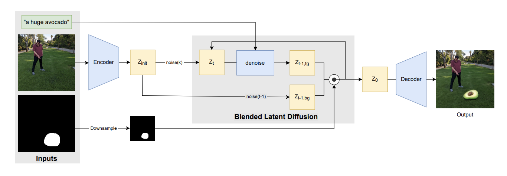</div>

Outpaint则可以通过重新组织画布和Mask，将新增区域变成需要补全的区域，再调用Inpainting生成流程。

例如，把一张方形湖景照片扩展成横版，可以按以下过程处理：
1. 建立更大的画布。将原图放在目标位置，左右留出需要扩展的区域。原图本身无需被横向拉伸。
2. 构造Mask。将新增区域标记为待生成，将希望保留的原图区域标记为已知内容。
3. 准备新增区域的初始状态。根据不同情况，可以使用噪声、颜色填充或其他占位内容构造输入。它们只是初始化方式，不代表新增区域的真实内容。
4. 保留接缝附近的上下文。模型需要同时看到原图中的湖岸、山脉和天空，才能判断新增部分应如何延续。
5. 执行条件采样与解码。在文本和已知图像条件下生成新增区域，再处理边界融合与最终合成。

接缝附近通常需要一定的可调整空间。适度将Mask向原图内部扩展，可以让一小段旧内容与新内容共同重绘，减轻明显的拼接痕迹。如果原图区域必须严格保留，就要缩小这部分调整范围，并在最终合成时明确保留边界。

大范围扩图还可能采用分方向或分阶段的方式，每次保留一段已生成内容作为下一次的上下文。这样可以控制单次生成的画布大小，但前一步的结构偏差也可能传递到后续结果，因此需要检查地平线、建筑透视和重复纹理是否连续。


<h2 id="q-033">面试问题：介绍一下针对Stable Diffusion的模型融合技术(进阶)</h2>

**难度评分：⭐⭐⭐⭐ (4/5)  |  考察频率：⭐⭐⭐⭐ (4/5)**

Stable Diffusion的模型融合主要通过 **Merge Block Weight（块权重融合）** 这种精细化的模型参数整合技术实现，通过分层处理U-Net/Transformer内部不同功能模块层的权重，实现多个Stable Diffusion模型特点优势的定向组合。

### 1、 核心原理：分层权重插值

模型融合的目标是合并多个训练好的Stable Diffusion模型（如风格模型+主体模型），生成兼具各方优势的新模型。Merge Block Weight的核心创新在于**分块处理U-Net/Transformer结构**，而非整体融合。

对于U-Net结构，Stable Diffusion的U-Net包含多个功能模块：

- **ResBlock**：负责基础特征提取与残差连接
- **Spatial Transformer（Cross-Attention）**：融合文本与图像语义
- **DownSample/UpSample**：控制特征图分辨率变换

对每个模块的权重独立计算插值，公式为：

```math
W_{\text{merged}}^{(i)} = \alpha \cdot W_A^{(i)} + (1 - \alpha) \cdot W_B^{(i)}
```

其中 $W_A^{(i)}$ 和 $W_B^{(i)}$ 是待融合模型在模块 $i$ 的权重， $\alpha$ 为该模块的融合系数（0~1）。

### 2、 技术实现流程

我们首先权重归一化（关键预处理），目的是解决不同模型参数分布差异导致的融合冲突。方法是对每个模型的权重进行LayerNorm或Min-Max缩放，使其处于相近数值范围。

接着我们进行插值算法选择，如下表所示：

<div align="center">

| **算法** | 适用场景 | 优势 | 缺点 |
|----------|----------|------|------|
| **线性插值（LERP）** | 简单融合、硬件资源有限 | 计算效率高 | 可能丢失非线性特征 |
| **球面线性插值（SLERP）** | 高质量风格融合（如艺术风格） | 保持权重向量方向一致性，避免特征坍缩 | 计算复杂度高 |

</div>

我们再开始分层系数配置，不同模块需设置差异化融合系数，例如：

- **ResBlock**： $\alpha=0.5$ （平衡底层特征）
- **Spatial Transformer**： $\alpha=0.8$ （侧重模型A的文本控制力）
- **UpSample层**： $\alpha=0.3$ （侧重模型B的细节生成能力）

### 3、 Stable Diffusion进行模型融合的主流技巧

我们在进行几个Stable Diffusion的融合时，可以调整U-Net架构中每一层模型的融合权重，从而能够进行模型融合的进阶整合。我们以Stable Diffusion 1.5为例，在MBW插件中，将U-Net分层了25个可调层，开源社区将其分为:
1. IN区：有12层
2. M区：有1层
3. OUT区：有12层

IN区影响下采样过程对特征的提取，层数从00到11，感受野越来越大，影响的程度越来越大。IN区块负责平面构成的相关工作（构图元素以及生成图像背景），特别是6-11层，总的来说层数越高影响效果越明显，更改层数越多影响效果越明显。比如：各个物体的大小、位置以及基本轮廓。其中在画面中占比越小的物体受到越浅层的参数控制，占比大的物体受到更深层的参数控制。浅层权重越高，小物体的表现效果就越向该模型靠拢；深层权重越高，较大物体的表现效果就越向该模型靠拢。

OUT区影响上采样过程对特征进行还原，层数从00到11，感受野越来越小，影响的程度越来越小。OUT区块负责色彩构成和画风的相关工作，主要是0-4层起核心作用，同时如果是人物图像，2-7层可以控制脸部的微调。

在IN区中编号越高，对平面构成的影响就越偏向大体。在OUT区中，编号越高，对细化过程的影响就越局域化，对上色过程的影响就越大体化。比如：基本色调，色彩丰富或单一，皮肤质感，光影，线条。深层参数负责大区域的色彩，比如基本色调、色彩丰富度与光影；浅层参数负责细节的色彩，比如线条是否清晰，通过浅层可以调整手指；深层与浅层之间的中层则负责区域的色彩，区域内色彩的不同变化程度可以体现出不同的皮肤质感和区域光影效果。

同时如果IN层和OUT层只改变其中的某一层，几乎不会产生影响效果。

M区：影响最大的一层，甚至比IN11层的影响更大，起到了类似IN层的作用，可以看作IN12层，但也只能起到一层的作用，不如IN层中多层叠加后的影响大。该层越大，构图越向该模型靠拢。


<h1 id="q-041">2.介绍一下Stable Diffusion中VAE的架构、原理和作用</h1>

<h2 id="q-044">面试问题：Stable Diffusion中的VAE和原生VAE生成模型的区别是什么？</h2>

**难度评分：⭐⭐⭐⭐ (4/5)  |  考察频率：⭐⭐⭐⭐⭐ (5/5)**

Stable Diffusion中的VAE沿用了变分自编码器的编码、后验采样和解码机制，但在整个生成系统中承担了更明确的分工：**VAE学习怎样用紧凑的Latent表示图像，并将它还原为像素；扩散模型学习这些Latent的分布，负责从噪声中生成新的图像表示。**

### 1、经典VAE怎样独立完成生成？

以采用标准高斯先验的VAE为例，编码器根据图像 $x$ 给出近似后验 $q_\phi(z\mid x)$，解码器建立从潜变量到图像的条件分布 $p_\theta(x\mid z)$ 。训练通常最小化负的证据下界：

```math
\mathcal{L}_{\mathrm{VAE}}(x)=
-\mathbb{E}_{q_\phi(z\mid x)}
\left[\log p_\theta(x\mid z)\right]
+
D_{\mathrm{KL}}
\left(q_\phi(z\mid x)\parallel p(z)\right)
```

其中， $\phi$ 和 $\theta$ 分别是编码器与解码器参数， $p(z)$ 是预设的先验，常取 $\mathcal{N}(0,I)$。第一项要求潜变量能够解释并重建输入，第二项约束后验与先验之间的差异。生成新样本时，从先验中取出一个 $z$，再通过解码器生成图像，不需要输入一张原图。

重建项的形式取决于对输出分布的建模：采用固定方差高斯似然时，它与平方误差相关；采用其他似然时，损失形式也会改变。因此，平方误差、无条件生成和单个向量潜变量都不是VAE定义上的限制。

### 2、SD 1.x的VAE怎样编码和解码图像？

SD 1.x采用带KL正则的空间自编码器，通常称为 `AutoencoderKL`。它保留Latent的二维排列，使扩散模型能够继续处理物体位置、边缘和局部纹理等空间关系。

以512×512的RGB图像为例，省略batch维度，其编码过程为：

1. **提取并压缩空间特征。** 图像经过输入卷积、残差块和三次下采样，空间尺寸从512×512降到64×64。中间块包含残差块与自注意力，用于整合不同位置的信息。
2. **输出后验参数。** 输出卷积和1×1投影得到8×64×64的参数张量，再分成均值与对数方差两部分，每部分都是4×64×64。
3. **得到原始Latent。** 根据后验采样得到4×64×64的潜变量；在需要确定性重建的流程中，也可以取后验均值。

记均值为 $\mu_\phi(x)$ ，对数方差为 $\ell_\phi(x)$ ，重参数化采样可以写成：

```math
z_{\mathrm{raw}}=\mu_\phi(x)
+
\exp\left(\frac{\ell_\phi(x)}{2}\right)\odot\xi,
\qquad
\xi\sim\mathcal{N}(0,I)
```

这里的 $\odot$ 是逐元素相乘， $\xi$ 用于VAE后验采样，与扩散训练中另行加入的噪声属于不同步骤。

解码时，原始尺度的Latent先经过1×1投影和输入卷积，再经过中间块、残差块与三次上采样，最终输出三通道图像。

如下图所示，图中上半部分展示SD 1.x的图像重建路径，下半部分比较经典VAE和SD 1.x的VAE的用法差异：

<div align="center">

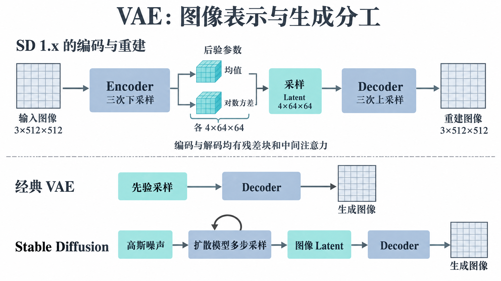

</div>

### 3、为什么SD 1.x的VAE训练时要兼顾重建、感知质量和KL正则？

图像压缩既要保留输入内容，也要让解码结果具备自然的局部纹理。SD 1.x中的KL自编码器将几类约束组合使用，如下表所示：

<div align="center">

| 训练目标 | 具体约束什么 | 单独依赖它容易忽略什么 |
|---|---|---|
| 像素重建损失 | 对齐对应位置的颜色、亮度和结构；公开基础实现使用L1，部分后续微调采用MSE | 小幅错位会造成较大像素误差，像素平均也可能让纹理变平滑 |
| 感知损失，如LPIPS | 比较预训练视觉网络中的特征，让重建在纹理、形状等感知属性上接近原图 | 特征相近不等于每个像素或每个文字笔画完全相同 |
| 局部对抗损失 | 通过判别器判断局部图块是否自然，鼓励清晰、逼真的纹理 | 逼真的细节也可能偏离原图，因此需要重建约束共同作用 |
| KL正则 | 约束后验相对先验的偏离程度，限制编码空间的无约束扩张 | 权重过大时可能压缩掉重建所需的信息，需要与其他目标平衡 |

</div>

概括自编码器这一侧的优化目标，可以写成：

```math
\mathcal{L}_{\mathrm{AE}}
=
\lambda_{\mathrm{rec}}\mathcal{L}_{\mathrm{rec}}
+\lambda_{\mathrm{perc}}\mathcal{L}_{\mathrm{perc}}
+\lambda_{\mathrm{adv}}\mathcal{L}_{\mathrm{adv}}
+\lambda_{\mathrm{KL}}\mathcal{L}_{\mathrm{KL}}
```

各 $\lambda$ 表示对应项的权重。弱KL约束为保留重建信息留下了空间，也意味着编码后的总体分布不能简单视为标准高斯。后续扩散模型正是在学习实际图像产生的Latent分布。

在SD 1.x的标准扩散训练阶段，VAE已经完成自身训练并保持冻结。Encoder把训练图像转换为Latent，U-Net在加噪后的Latent上学习噪声预测。

推理时，文生图任务由扩散模型生成Latent，最后调用VAE Decoder；图生图和局部编辑任务还需要Encoder读取输入图像。


<h2 id="q-044b">面试问题：VAE编码和解码过程中有哪些注意事项？</h2>

**难度评分：⭐⭐⭐ (3/5)  |  考察频率：⭐⭐⭐⭐ (4/5)**

### 1、输入的颜色、范围和空间尺寸要与模型约定一致

SD 1.x常用的输入是RGB浮点张量，按batch、通道、高、宽排列，并将像素映射到 $[-1,1]$。如果输入是 $[0,1]$ 范围的图像，可以使用 $`x_{\mathrm{in}}=2x-1`$ 完成映射。需要避免RGB与BGR混用、重复归一化，或把0～255的整数像素直接当成模型输入。

图像尺寸也要与编码器的下采样率、扩散主干的分块要求一起检查。SD 1.x的VAE在高、宽方向各下采样8倍；某些DiT还会对Latent进行分块或打包，带来额外的尺寸整除要求。为了适配尺寸，可以裁剪、缩放或补边，但图生图中的Mask、关键点和参考坐标必须同步变换。直接改变长宽比会改变物体比例，不能将这种变形归因于VAE重建。

解码后通常将模型输出从 $[-1,1]$ 映射回 $[0,1]$，再做范围裁剪、通道排列和文件保存。扩散Latent不受这个像素范围限制，不能在送入Decoder前把它也裁剪到 $[-1,1]$。

### 2、在Latent特征进入扩散模型前必须进行缩放和平移处理

VAE输出的原始Latent有自身的数值尺度。扩散模型会采用与训练匹配的变换，把它转换为Backbone使用的表示。记原始Latent为 $z_{\mathrm{raw}}$ ，缩放系数为 $s$，平移系数为 $b$，常见的变换为：

```math
z=s\left(z_{\mathrm{raw}}-b\right),
\qquad
z_{\mathrm{raw}}=\frac{z}{s}+b
```

编码侧先减去平移量，再乘缩放系数；解码侧先除以缩放系数，再加回平移量。没有平移的模型可令 $b=0$。

具体编码与解码的流程细节如下图所示，图中上方展示图像进入扩散空间的过程，下方展示完成采样后的解码过程：

<div align="center">

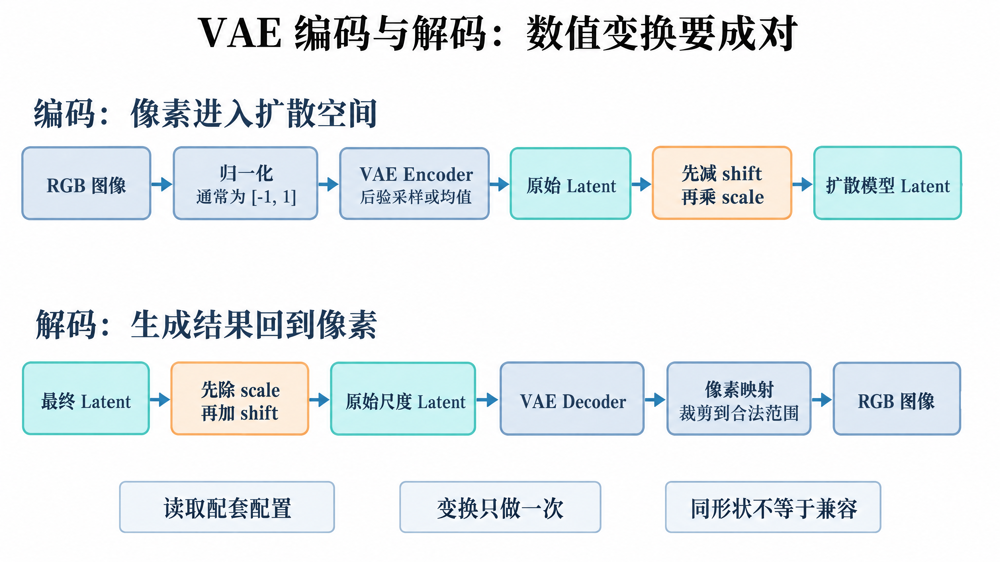

</div>

下表列出Stable Diffusion系列不同版本的缩放和平移系数：

<div align="center">

| 模型版本 | VAE下采样率 / 通道数 | 缩放 $s$ | 平移 $b$ |
|---|---|---|---|
| SD 1.x | 8 / 4 | 0.18215 | 0 |
| SDXL | 8 / 4 | 0.13025 | 0 |
| SD 3 | 8 / 16 | 1.5305 | 0.0609 | 
| FLUX.1 | 8 / 16 | 0.3611 | 0.1159 |

</div>

缩放和平移系数不是手工设定的，而是按「在训练数据集上让 Latent 的标准差近似 1」 这个原则统计估计出来的。把VAE跑在大批训练图上，估出 Latent的std，取倒数即为scale factor。

估计编码后Latent的总体标准差，并取其倒数作为缩放系数，是LDM中采用过的一种尺度校准方式，它的核心作用是让Latent特征的统计分布近似单位方差的标准正态。它不代表所有版本的系数都来自相同数据、相同统计流程，也不表示这些常数会跟着每个输入batch重新计算。使用发布权重时，应复用对应配置和推理代码，不能根据当前一张图重新估计系数。


<h2 id="q-044e">面试问题：VAE提供的Latent空间会对扩散模型的图像生成质量和训练效率产生什么样的影响？</h2>

**难度评分：⭐⭐⭐⭐⭐ (5/5)  |  考察频率：⭐⭐⭐⭐ (4/5)**

VAE决定扩散模型能够看到怎样的图像Latent特征信息：哪些细节被保留、空间信息怎样组织，以及Backbone需要处理多少位置和通道。**一个适合扩散生成的Latent空间，要同时便于重建、便于建模，并能在可接受的计算量下训练。** 只比较压缩倍率，或只比较重建清晰度，都不足以判断整套系统的效果。

### 1、先区分空间压缩率、通道数与Token数量

设输入图像尺寸为 $H\times W$，VAE在高、宽方向各下采样 $f$ 倍，Latent通道数为 $c$。省略batch维度，编码结果的形状为：

```math
z\in\mathbb{R}^{c\times(H/f)\times(W/f)}
```

Latent的空间位置数与标量元素数分别为：

```math
N_{\mathrm{spatial}}=\frac{HW}{f^2},
\qquad
N_{\mathrm{values}}=\frac{cHW}{f^2}
```

以SD 1.x的512×512图像为例， $f=8$、 $c=4$，得到4×64×64的Latent。空间位置从262144减少到4096，为原来的1/64；若比较三通道像素与四通道Latent的标量数量，则从786432减少到16384，为原来的1/48。两种比例的统计对象不同，也都不能直接当作端到端速度提升倍数。

对于DiT，如果每个Token进一步打包 $p\times p$ 个Latent空间位置，则图像Token数为：

```math
N_{\mathrm{token}}=\frac{HW}{f^2p^2}
```

增加通道数主要改变每个位置携带的信息和输入投影规模；增加空间下采样率主要减少位置数量。

<div align="center">

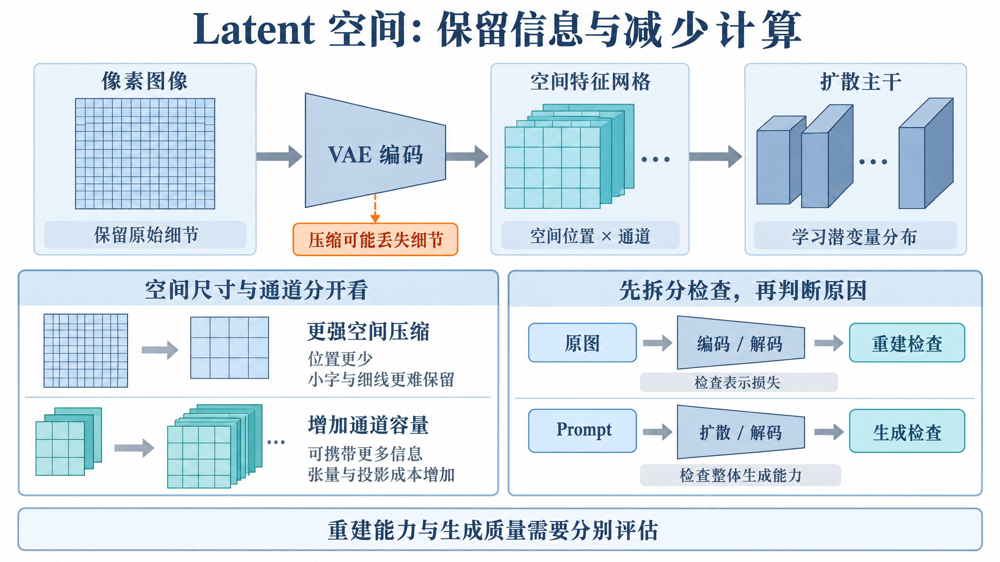

</div>

### 2、压缩怎样降低训练成本，又会把成本转移到哪里？

在网络宽度、层数和其他配置相近时，空间位置越少，卷积和逐位置特征变换通常越便宜，中间激活也更小。对于具有全局自注意力的DiT，长度为 $N$ 的序列，其注意力交互部分的计算量通常随 $N^2$ 增长。因此，减少Token数量对高分辨率任务尤其重要。

但整个Transformer块还包含投影、MLP等计算，使用FlashAttention也会改变显存占用方式，不能把注意力交互项的变化直接等同于总耗时变化。类似地，增加Latent通道会增加张量存储与输入、输出投影的负担；若主干隐藏维度保持不变，也不意味着所有层的计算量按通道数同比增加。

例如，图像的高、宽都翻倍，在 $f$ 和 $p$ 不变时，图像Token数会变为4倍，全局注意力的图像两两交互项约为16倍。由此可以理解高分辨率的计算压力，但具体时延还取决于模型结构、算子、精度和硬件。

VAE自身也有代价。更大的编码器和解码器可能改善重建，却增加每张图的预处理与输出成本。冻结VAE后，离线编码训练Latent可以减少重复编码开销，但缓存空间、数据增强和后验采样方式也要一起考虑。对于已经压缩到少量采样步数的生成模型，VAE编解码在总时延中的占比还可能变得更高。

### 3、重建损失怎样影响文字、细线与局部编辑？

小字笔画、细线、微小人脸和规则纹理，对空间位置和局部对比度非常敏感。压缩后若这些区别难以表达，解码器就可能把相邻笔画混合、把边缘变软，或生成看似自然但与输入不同的细节。

对于图像编辑，这种损失尤其直接：如果一张产品图仅经过VAE编码和解码，商标笔画就已经变化，那么即使扩散阶段没有主动修改商标，也不能指望最终结果自动保持原样。此时需要先检查自编码器重建，再考虑局部像素合成、更高的工作分辨率或其他保真策略。

文生图的判断则要更谨慎。生成主干和解码器可以利用学到的先验合成新的细节，所以“某张图的往返重建不完美”并不意味着模型绝对生成不了同类内容；但已经丢失的输入特征，也无法保证被准确恢复。**重建能力揭示了表示与解码的瓶颈，最终生成质量还要结合扩散模型单独评估。**

### 4、为什么重建更好，不一定就更容易训练扩散模型？

重建只要求编码器和解码器相互配合。扩散模型还要学习整个数据集对应的Latent分布，并在不同噪声水平下预测正确的更新方向。一个高保真的表示，如果把很多细碎差异编码成复杂、难预测的特征，生成主干仍然需要足够的容量、数据和训练预算来学习它。

因此，选择Latent空间还要观察通道尺度、特征相关性、局部变化的连续性，以及加入噪声后目标是否容易学习。固定的缩放和平移可以调整数值尺度，却不能自动简化所有分布结构。


<h1 id="q-045">3.介绍一下Stable Diffusion中Backbone的架构、原理和作用</h1>

<h2 id="q-047">面试问题：介绍一下Stable Diffusion中自注意力机制和交叉注意力机制的原理</h2>

**难度评分：⭐⭐⭐⭐ (4/5)  |  考察频率：⭐⭐⭐⭐⭐ (5/5)**

### 1、 自注意力机制与交叉注意力机制的核心区别

在采用U-Net的Stable Diffusion中，自注意力机制帮助一个图像位置读取其他位置的信息，交叉注意力机制帮助这个位置读取 Prompt 中的条件信息。前者用于协调画面内部的关系，后者把文本要求带入当前图像特征。

自注意力机制和交叉注意力机制都属于Transformer框架下主流的Attention机制，计算过程一致，区别在于输入的差别，具体如下图所示：

<div align="center">

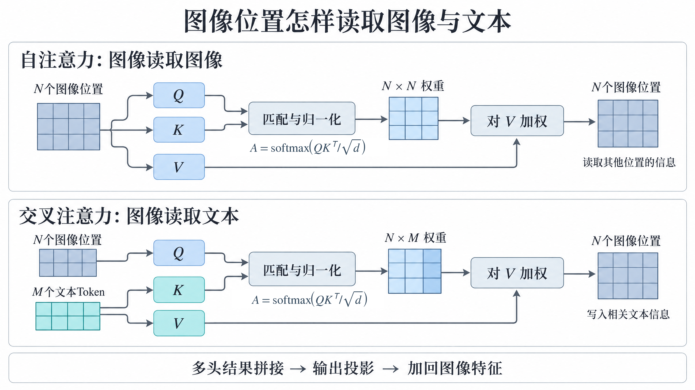

</div>

下面我们以SD 1.x为例，对自注意力机制和交叉注意力机制进行展开讲解。

**自注意力怎样让不同图像位置交换信息？**

设当前特征图共有 $N=H_fW_f$ 个空间位置，每个位置具有 $C$ 维特征，展平后记为：

$$
X\in\mathbb{R}^{N\times C}
$$

以单个注意力头为例，省略 batch 维度和归一化细节，Q、K、V 都由同一份图像特征投影得到：

$$
Q=XW_Q,\qquad K=XW_K,\qquad V=XW_V
$$

若每个头的特征维度为 $d$ ，Q、K、V 的形状均为 $N\times d$ 。注意力计算为：

$$
A_{\mathrm{self}}=
\mathrm{softmax}\left(\frac{QK^\top}{\sqrt d}\right),
\qquad
O=A_{\mathrm{self}}V
$$

其中， $A_{\mathrm{self}}$ 是一个 $N\times N$ 的权重矩阵。第 $i$ 行描述第 $i$ 个图像位置怎样读取全部图像位置；Softmax 沿被读取的位置维度归一化。再对 V 加权求和，就得到这一位置从其他位置汇总的信息。

例如，生成一辆汽车时，车头、车身和车轮虽然分布在不同位置，仍需要在方向、透视和外观上相互协调。自注意力提供了直接交换信息的路径。

**交叉注意力怎样把文本条件写入图像？**

设文本编码器输出 $M$ 个 Token，每个 Token 的特征维度为 $D$ ，记为：

$$
T\in\mathbb{R}^{M\times D}
$$

交叉注意力使用图像生成 Q，使用文本生成 K 和 V：

$$
Q=XW_Q,\qquad K=TW_K,\qquad V=TW_V
$$

其计算为：

$$
A_{\mathrm{cross}}=
\mathrm{softmax}\left(\frac{QK^\top}{\sqrt d}\right)
\in\mathbb{R}^{N\times M}
$$

$$
O=A_{\mathrm{cross}}V
\in\mathbb{R}^{N\times d}
$$

可以把 Q 理解为某个图像位置当前发出的查询，K 用于计算它与各个文本 Token 的匹配程度，V 提供被读取的文本特征。图像与文本原来的特征维度可以不同，Q、K 则需要投影到相同的每头维度，才能计算点积。

输出保留多少位置，由 Q 的序列长度决定。 因为 Q 来自图像，输出仍然对应 $N$ 个图像位置，经输出投影后可以写回原来的空间特征。文本作为 K/V 被读取，但这一层交叉注意力不会反过来更新输入的文本序列。

例如，在 SD 1.x 的某个 64×64 特征层中，如果文本序列长度为 77，单头交叉注意力的权重形状就是 4096×77。每个图像位置分别读取这 77 个文本 Token，输出仍对应 4096 个位置。

因此，交叉注意力的关键是查询与被查询的信息来自不同序列，而不是要求两路输入的长度和维度必须不同。

### 2、 在U-Net内部把文本与图像两种模态的语义对齐？

SD 1.x 通过 Spatial Transformer 把卷积特征送入注意力模块。其外层过程为：对二维特征进行 GroupNorm 与投影，展平为空间 Token，经过 Transformer 计算后还原二维排列，再投影回原通道数，并加上外层残差。

内部 BasicTransformerBlock 依次执行：
1. LayerNorm → Self-Attention → 残差相加；
2. LayerNorm → Cross-Attention → 残差相加；
3. LayerNorm → FeedForward → 残差相加。

自注意力和交叉注意力更新图像位置之间、图像与文本之间的关联，FeedForward 则继续变换每个位置的通道表示。不同注意力头可以学习不同的关联方式，但不能预先把某个头固定解释为“专门负责颜色”或“专门负责位置”。

文本条件会在多个注意力模块、多个采样时间步中被反复读取。对于不变的 Prompt，文本编码通常可以预先计算；随后，同一份文本特征面对不断变化的图像查询，会在不同阶段产生不同作用。

例如，“一辆红色汽车停在树下”需要同时约束主体、颜色和空间关系。交叉注意力为这些语义进入图像提供了通道，但不会直接把每个词指定给一块固定区域。语义对齐还依赖文本编码器、图文数据和训练结果，注意力图也不应直接当作精确分割图。

在标准 SD 1.x 训练中，这些投影和注意力层随 U-Net 一起，通过噪声预测损失获得更新。模型学习利用图文条件改善预测，并不依赖逐词、逐像素的人工对齐标签。文本编码器保持冻结，也不妨碍 U-Net 学习如何读取它输出的特征。

### 3、 为什么Self-Attention与Cross-Attention主要放在中、低分辨率层？高分辨率层为何以卷积为主？

SD U-Net是「卷积 + 注意力」的混合架构，注意力的放置位置不是随便选的，而是**在显存 / 计算成本与语义建模能力之间的精妙折中**。

首先，**注意力的计算复杂度是分辨率的二次方**。对于空间形状为 $H \times W$ 的特征图，自注意力的复杂度是：

```math
\mathcal{O}\bigl((HW)^2 \cdot d\bigr)
```

在SD 1.5（latent 64×64，VAE 8x 下采样）中，U-Net 的各下采样层分辨率依次为 $64 \to 32 \to 16 \to 8$。如果在 64×64 层就放 Self-Attention，序列长度是 4096，attention 矩阵需要 $4096^2 \approx 1.6\text{M}$ 个元素；而 16×16 层的序列长度只有 256，attention 矩阵只需 $\sim 65\text{K}$ 个元素，**计算量差 256 倍**。

同时，**中、低分辨率更适合做语义对齐**：

- **高分辨率层（64×64、32×32）感受野小、语义弱**，主要承担「纹理、边缘」这类局部信息，用卷积已经足够；
- **中、低分辨率层（16×16、8×8）感受野大、语义强**，每个 token 已经聚合了较大的图像区域，正适合与文本 token 做 cross-attention 进行「语义对齐」；
- 高 / 低分辨率的注意力放置规律也符合人类视觉的「先局部纹理后整体语义」直觉。


<h2 id="q-049">面试问题：为什么使用U-Net作为Stable Diffusion模型的核心Backbone？</h2>

**难度评分：⭐⭐⭐ (3/5)  |  考察频率：⭐⭐⭐⭐⭐ (5/5)**

扩散模型需要根据当前带噪 Latent、噪声时间步和文本条件，预测与图像空间逐位置对应的更新信息。U-Net 能够把局部特征、多尺度上下文和高分辨率位置线索结合起来，适合这类密集预测任务，因此成为 SD 1.x、SD 2.x 和 SDXL 的核心Backbone。

U-Net的结构具有以下特点：

- **整体结构**：U-Net由多个大层组成。在每个大层中，特征首先通过下采样变为更小尺寸的特征，然后通过上采样恢复到原来的尺寸，形成一个U形的结构。
- **特征通道变化**：在下采样过程中，特征图的尺寸减半，但通道数翻倍；上采样过程则相反。
- **信息保留机制**：为了防止在下采样过程中丢失信息，UNet的每个大层在下采样前的输出会被拼接到相应的大层上采样时的输入上，这类似于ResNet中的"shortcut"。

下图是SD 1.x U-Net结构示意图：

<div align="center">

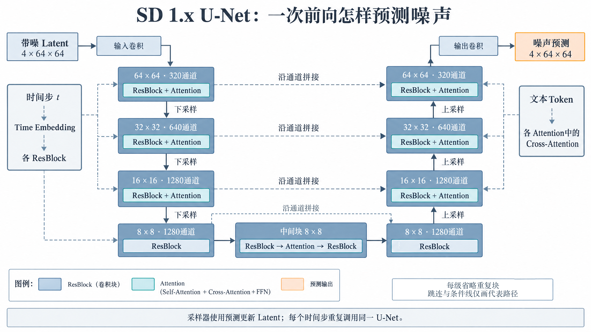

</div>

U-Net的下行路径逐步降低特征图的空间分辨率，结合卷积、残差块等计算，让后续特征汇聚更大范围的信息；上行路径逐步恢复空间尺寸，形成与输入位置对应的输出。

例如，处理一张街景时，局部特征有助于表示窗框、路沿和物体边界，较低分辨率特征有助于汇聚建筑、道路和天空之间的关系。它们在同一次前向中配合工作，不能把下行路径直接等同于采样早期、上行路径等同于采样后期。

以 512×512 输出对应的 SD 1.x 配置为例：

$$
\begin{array}{c|cccc}
\text{空间尺寸} & 64\times64 & 32\times32 & 16\times16 & 8\times8\\
\text{通道数} & 320 & 640 & 1280 & 1280
\end{array}
$$

通道数由各尺度配置决定，并非每次下采样都翻倍。上行阶段还会拼接跳连特征，其模块输入通道数可以暂时大于这里列出的输出宽度。

下采样有利于汇聚上下文，但只依赖最深层特征恢复输出，会增加保留边界和精细位置的难度。U-Net 将下行路径中的特征保存下来，在上行路径恢复到相应尺度时，沿通道维与当前特征拼接，再交给后续模块处理。

这样，上行路径既能使用深层汇总后的上下文，也能重新读取此前保留的空间线索，不必仅凭最深层特征推测所有细节。

这里需要区分两种连接：
- U-Net 跨路径的 Skip Connection通常是通道拼接；
- ResBlock 内部的残差连接通常是逐元素相加，必要时先做通道投影。

两者都改善信息传递，但输入输出关系不同。跳连传递的仍是当前带噪 Latent 产生的中间特征，其中包含噪声；网络需要结合时间步与条件，学习怎样利用这些信息。

Stable Diffusion沿用了经典U-Net的Encoder、Decoder、多尺度特征和Skip Connection，同时为扩散生成增加了三类关键组件：

1. **ResNetBlock + Time Embedding**：每个去噪阶段的噪声强度不同，Time Embedding 会告诉共享 U-Net 当前处于哪个 timestep，使网络能在早期优先恢复轮廓和低频结构，在后期补充纹理与高频细节。
2. **Spatial Transformer**：由 Self-Attention、Cross-Attention 和 FeedForward 组成。Self-Attention 建模图像内部的长程关系，Cross-Attention 将 Text Embeddings 作为条件注入图像特征。
3. **CrossAttnDownBlock / CrossAttnUpBlock / CrossAttnMidBlock**：把卷积 ResNetBlock 与 Spatial Transformer 组合在不同分辨率层中，使多尺度视觉建模与文本条件控制能够同时进行。

**时间步条件让同一套权重适应不同噪声水平**。 时间步先被编码成向量，再注入 ResBlock，使网络的特征变换能够随噪声状态调整。

**注意力补充远距离交互与文本条件**。卷积处理局部邻域，Spatial Transformer 让不同图像位置建立更直接的联系，并通过 Cross-Attention 读取文本要求。

**残差块改善深层特征变换**。每个尺度内部通过残差连接逐步更新表示，再与跨尺度跳连配合。


<h2 id="q-049b">面试问题：U-Net与DiT在Backbone设计哲学上的本质差异是什么？SD系列从U-Net演进到DiT的根本原因是什么？</h2>

**难度评分：⭐⭐⭐⭐⭐ (5/5)  |  考察频率：⭐⭐⭐⭐⭐ (5/5)**

U-Net与DiT都可以在潜空间中根据噪声状态和条件进行预测。它们的主要区别是**怎样组织图像特征，以及怎样让条件参与这些特征的更新**：U-Net显式安排多尺度路径与跳跃连接；典型DiT把Latent划分为Token，再通过重复的Transformer块进行建模。

在Stable Diffusion系列中，SD 1.x、SD 2.x与SDXL采用U-Net，SD 3采用MM-DiT。

U-Net 在网络结构中安排好“降低空间分辨率—汇聚上下文—恢复空间分辨率”的路径，并把不同深度的同尺度特征连接起来。网络由此获得明确的空间层次，卷积则提供局部连接和权重共享等归纳偏置。

典型 DiT 首先把 Latent 划分为不重叠的空间块，将每块投影成一个 Token，加入位置信息，然后送入多层 Transformer。主干中通常保持 Token 数量与网格对应关系，最后把预测重新排列为空间张量。

例如，64×64 的 Latent 使用 2×2 分块，会得到 32×32，即 1024 个图像 Token。

“固定 Token 网格”描述的是一次前向内部的组织方式，不代表只能输入固定图像尺寸，也不代表注意力只会处理同一种范围的信息。不同层的交互仍然可以汇聚局部与全局内容。

DiT 减少了对 U 形尺度层次的依赖，但并非没有归纳偏置。分块方式、位置编码、参数共享和注意力连接规则都会影响模型的学习。

下表展示了两者之间的区别与对比：

<div align="center">

| 维度 | U-Net | DiT / MM-DiT |
| --- | --- | --- |
| **基本算子** | 卷积为主 + 局部 attention | 纯 Transformer，全局 attention |
| **多尺度建模** | 显式多尺度（下采样 + skip-connection） | 单一尺度（patchify 后所有 token 一起处理） |
| **归纳偏置** | 强（卷积平移等变 + 局部性） | 弱（仅有位置编码） |
| **Scaling 能力** | 有限，加深加宽收益递减 | 强，深度 / 宽度 / 数据规模都能持续提升 |
| **多模态融合** | Cross-Attention 注入文本 | Token 拼接，文本与图像在统一序列里联合 self-attention |
| **算力成本** | 中分辨率有 attention，高分辨率纯卷积，整体节省 | 全局 attention，对长序列敏感 |
| **训练数据需求** | 中等 | 大（弱归纳偏置需要更多数据） |
| **实现成熟度** | 极高（diffusers / xFormers / TensorRT 全支持） | 上升期（FlashAttention、SDPA 已成熟） |

</div>

**接下来我们一起思考，SD系列从U-Net演进到DiT/MM-DiT的根本原因有哪些？**

1. **Scaling Law驱动**：Transformer在NLP、ViT、视频生成上反复证明，通过增加网络深度、宽度或Token数量等模型规模，并持续增加训练量，通常能够改善生成质量。U-Net在SDXL这一规模（≈2.6B）已经接近边际收益拐点，同时DiT论文首次系统性地证明Transformer在扩散模型上同样有清晰的Scaling Law。
2. **多模态联合建模**：MM-DiT让文本与图像token在同一序列里做self-attention，让图文条件交互更充分，对**长prompt、强语义、文字渲染**都更友好。
3. **Token化的接口便于扩展条件形式，便于跨任务复用**：DiT与文本、视频、3D、多模态生成共用一套Transformer架构范式，更容易促进AI行业不同技术方向的互相借鉴与扩展。
4. **去除卷积的硬约束**：卷积假设平移等变性，但生成模型未必需要严格平移等变（不同分辨率、不同长宽比都要支持）；纯Transformer + 位置编码更灵活。

下图展示了SD系列模型基于U-Net和基于MM-Dit的两种Backbone架构区别：

<div align="center">

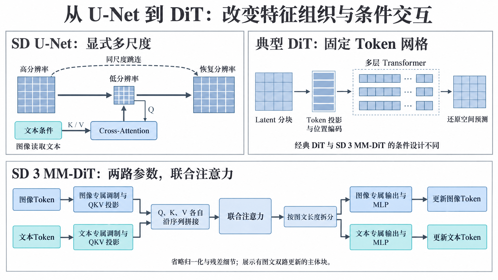

</div>

**采用DiT架构后，还需要承担哪些代价？**

图像尺寸增大时，Token数量仍会增加。若高、宽各翻倍，并保持VAE下采样率和分块尺寸不变，图像Token数会变为4倍，全局注意力的图像两两交互项约为16倍。分辨率并没有与Attention成本解耦。

FlashAttention、SDPA和序列并行可以改善显存、数据搬运或设备分工，但不能直接把密集全局注意力变成线性复杂度；具体收益还要结合实现和硬件测量。是否采用更大的分块、更高压缩率或稀疏交互，也需要同时检查文字、小目标与局部细节。


<h2 id="q-049d">面试问题：SD Backbone中为什么设计GroupNorm+SiLU+残差连接的组合？(进阶)</h2>

**难度评分：⭐⭐⭐⭐ (4/5)  |  考察频率：⭐⭐⭐ (3/5)**

SD U-Net 中的每一个 ResBlock 都是「GroupNorm → SiLU → Conv → GroupNorm → SiLU → Conv → 残差加法 + timestep / 文本调制」。这套组合不是任意选择，而是扩散模型训练稳定性的「最小刚需配方」。

### 1、 为什么是 GroupNorm 而不是 BatchNorm

**BatchNorm 依赖 batch 内统计**，扩散模型训练时同一 batch 内不同样本对应**不同的时间步 $t$**，统计分布差异巨大；BN 会把高噪样本与低噪样本混在一起做归一化，引入严重的统计偏置。BN 在小 batch / 推理 batch=1 时表现差；扩散模型推理常常 batch=1（CFG 时 batch=2），BN 不友好。

**GroupNorm 只在通道维做分组归一化，与 batch 无关**，对任意 batch size 表现一致；与 timestep / 噪声水平也解耦。

工业中也有人使用 **AdaGN / AdaLN-Zero**（让 timestep 调制 GroupNorm 的 scale / bias），是DiT、SD 3 的常见做法。

### 2、 为什么是 SiLU 而不是 ReLU

ReLU 在负区间梯度恒为 0，深层网络训练易出现「dead ReLU」；**SiLU（Swish）= $x \cdot \sigma(x)$**：在负区间有非零梯度，平滑可导，与扩散模型「连续噪声水平」的特性更匹配；DDPM 原论文消融显示 SiLU 比 ReLU、GELU 都更稳定；SD系列沿用至今。

### 3、 残差连接的双重价值

**梯度传播**：扩散网络往往很深（SDXL U-Net 有数十个 ResBlock），残差连接保证梯度能直通到深层；

**保留高频信号**：去噪过程要求网络能处理「输入 ≈ 输出」的极端情况（高 SNR 时几乎是恒等映射），残差连接提供了这种「恒等近似」的捷径。


<h1 id="q-050">4.介绍一下Stable Diffusion中Text Encoder的架构、原理和作用</h1>

<h2 id="q-051">面试问题：Text Encoder和VLM条件编码器在扩散模型中起什么作用？</h2>

**难度评分：⭐⭐⭐⭐ (4/5)  |  考察频率：⭐⭐⭐⭐⭐ (5/5)**

**Text Encoder负责把文本信息组织成生成模型能够使用的语义特征；VLM条件编码器进一步把参考图像与文本信息放在一起理解与处理。** 它们提供图像和文本条件，扩散Backbone则在这些条件约束下逐步更新图像Latent特征。

例如，Prompt是“一个红色杯子放在蓝色书本的左侧”。编码器需要表达杯子、书本、颜色及左右关系；扩散Backbone需要把这些信息落实到图像中的具体区域。

### 1、文本怎样变成生成条件？

以SD 1.x为例，Prompt先经过Tokenizer，再由CLIP Text Encoder产生上下文特征。忽略批次维度，可以写成：

```math
C=E_{\mathrm{text}}\bigl(\mathrm{Tokenizer}(p)\bigr),
\qquad
\hat{\varepsilon}=\varepsilon_\theta(z_t,t,C)
```

其中， $p$ 是Prompt； $E_{\mathrm{text}}$ 是文本编码器； $C$ 是文本条件序列； $z_t$ 是当前时间步的带噪图像Latent； $\varepsilon_\theta$ 是U-Net，输出噪声预测。一般来说，文本通常只需在采样开始前编码一次，得到的条件会被后续多个去噪步骤反复使用。

### 2、SD 1.x的CLIP Text Encoder内部经历了什么？

SD 1.x使用CLIP ViT-L/14了的Text Encoder部分，实际流程如下：

1. **第一步，分词并整理序列长度。** Tokenizer把Prompt转换为Token ID，加入起止标记，并按配置补齐或截断到77个位置。Token是分词器的基本单位，与汉字数、英文单词数没有固定换算关系。
2. **第二步，把Token ID变成带位置信息的向量。** 每个ID查表得到768维Token Embedding，再加上对应位置的可学习Position Embedding。这样，相同词语出现在不同位置时，模型能够区分其上下文位置。
3. **第三步，经过12层Transformer建立上下文联系。** 每层采用两次残差更新：先对输入进行LayerNorm和因果自注意力，再进行LayerNorm和MLP。因果掩码使每个位置只能读取自身及前面的文字；Q、K、V使用线性投影，MLP的顺序是Linear → QuickGELU → Linear，隐藏维度由768扩展到3072，再映射回768。
4. **第四步，输出序列特征。** 最终LayerNorm之后得到 $`C\in\mathbb{R}^{77\times768}`$，77包含起止标记及补齐位置。原始SD 1.x实现使用这份`last_hidden_state`作为U-Net的文本条件，并在基础训练中冻结CLIP参数。

下图展示了SD 1.x从Prompt到文本条件的计算流程：

<div align="center">

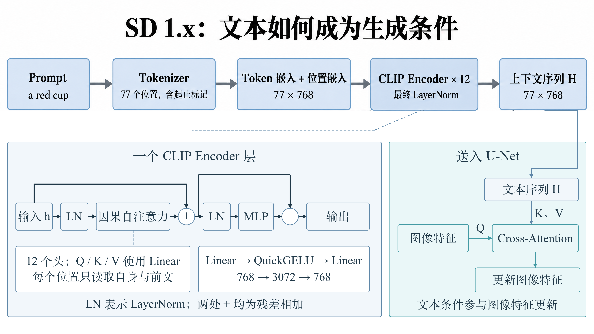

</div>

### 3、VLM条件编码器增加了什么能力？

图像编辑的要求往往依赖原图。“把左边那个人的外套改成蓝色”，既包含文字指令，也包含必须结合画面才能理解的指代。VLM可以同时处理图像与文本，输出融合视觉语境的条件特征。

以Qwen-Image-Edit为例，参考图像同时进入Qwen2.5-VL与VAE Encoder。前一路与编辑指令共同提供视觉语义条件，帮助模型理解修改对象和任务意图；后一路保留图像的外观与空间信息，以Latent条件参与生成；两路信息共同支持编辑。

还要区分两种使用方式：一种直接提取VLM隐藏特征作为生成条件；另一种让VLM先把输入提示词进行扩写，再交给生成模型自己的Text Encoder。


<h2 id="q-053a">面试问题：CLIP Text Encoder的Tokens长度限制对长 Prompt的实际影响是什么？工程上如何突破？</h2>

**难度评分：⭐⭐⭐⭐ (4/5)  |  考察频率：⭐⭐⭐⭐⭐ (5/5)**

**理解长Prompt，先区分两个长度：CLIP一次能够编码多少个位置，以及生成主干最终接收了多长的条件序列。** SD 1.x、SD 2.x和SDXL采用的相应CLIP/OpenCLIP Text Encoder，常见上下文长度都是77个位置。通常扣除起止标记后，一次可容纳75个正文Token。

**如果输入的Token超过长度之后，哪些信息会丢失？**

在直接采用截断的实现中，超出预算的正文Token不会进入文本编码器。假如结尾才写“杯子左边放一把勺子”，这段要求被截掉后，模型就无法从文本条件中读取它。

**那有什么办法可以缓解这个问题呢？我们以很多开源项目对SD 1.x的常见Prompt Chunking处理为例，看看是如何解决的**。长文本先拆成每块最多75个正文Token，再分别加入起止标记并补齐到77个位置。每块通过同一个CLIP编码器独立计算，最后把输出沿序列维度拼接。

若有 $K$ 个文本块，忽略批次维度，则：

```math
H^{(k)}=E_{\mathrm{CLIP}}(T^{(k)}),
\qquad
H^{(k)}\in\mathbb{R}^{77\times d}
```

```math
C=\mathrm{Concat}_{\mathrm{seq}}
\bigl(H^{(1)},H^{(2)},\ldots,H^{(K)}\bigr)
\in\mathbb{R}^{77K\times d}
```

其中， $T^{(k)}$ 是补齐后的第 $k$ 块Token序列， $d$ 是文本特征维度，SD 1.x中为768。

例如，100个正文Token可以简化为75与25两块。第二块加入起止标记并补齐后，同样占77个位置；两块最终形成 $154\times768$ 的条件序列。

下图以100个正文Token为例，对比截断与分块编码的效果：

<div align="center">

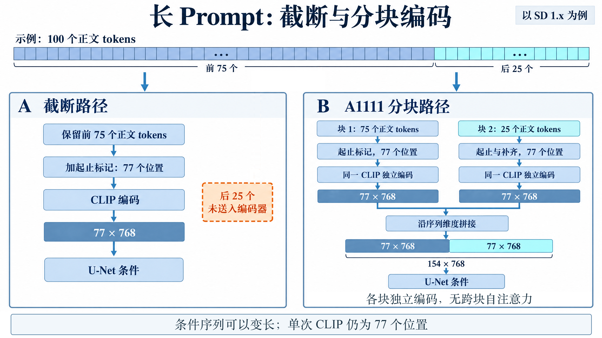

</div>

**分块增加了能够送入生成主干的条件数量，但每个块仍独立理解自己的上下文。** 不同块重新使用各自的CLIP位置编号，编码阶段没有跨块的文本自注意力。第一块中的“红色杯子”与第二块中的“它左边的书”之间的指代，需要后续生成网络尝试整合，不能等同于文本编码器已经联合读懂整段话。

U-Net的交叉注意力在计算形式上可以接收更长的Key、Value序列，但条件越长，相关计算与存储开销通常越大，也会偏离原来的训练长度分布。具体后端还可能存在形状或长度限制。因此，分块是一种实用的兼容方案，效果需要验证，不能据此宣称模型获得了无限上下文。

因此在实际使用时，**我们优先长Prompts的整理语义，再处理长度**。优先把主体、属性和关系放在同一个紧凑语句中。例如，“红色杯子在蓝色书本左侧”比把“红色”“杯子”“左侧”“蓝色书本”散放在数段风格词之间更容易检查。关键要求应尽量落在保留下来的有效范围内；使用分块时，尽量保持一个关系描述的完整性。

**另外一种解决方案是换用更长上下文的文本编码器**。原生采用T5或其他长上下文编码器的生成模型，可以让较长的描述在一次编码中建立联系，减少独立分块带来的语义断裂。

例如，SD 3、FLUX.1都引入了T5-XXL作为核心Text Encoder，最长支持512token，能容纳长prompt的细节。

对于原本使用CLIP的底模，更换为T5或VLM还涉及特征空间和条件接口的重新适配，通常需要相应训练。只修改最大长度或换一个编码器，无法自动获得长文本理解能力。


<h2 id="q-053b">面试问题：Prompt中的权重语法（(word:1.2)、[word]等）的实现原理是什么？(进阶)</h2>

**难度评分：⭐⭐⭐⭐ (4/5)  |  考察频率：⭐⭐⭐⭐ (4/5)**

**Prompt权重语法是生成框架对输入文本的一层约定。** 框架先识别需要强调或减弱的片段，再按自己的实现调整相应条件特征。CLIP、T5并不天然把`(word:1.2)`解释为“增加20%的权重”；如果AIGC图像创作框架没有实现这套解析规则，括号、冒号和数字就可能只是普通文本。

因此，讲解权重时应说明具体框架。下面以AUTOMATIC1111 WebUI的常见解析规则及其`Original`强调模式为例，其他框架的归一化、分块和多编码器处理方式可能不同。

### 1、括号与显式数值怎样表示权重？

权重首先作用于文本片段，再映射到该片段对应的Token。A1111解析器的典型规则如下。

<div align="center">

| 写法 | 解析含义 | 对应权重 |
|---|---|---|
| `word` | 普通文本 | 1.0 |
| `(word)` | 一层圆括号提高权重 | 1.1 |
| `((word))` | 嵌套圆括号的倍率相乘 | 1.21 |
| `[word]` | 一层方括号降低权重 | 1/1.1，约0.909 |
| `(word:1.5)` | 显式指定权重 | 1.5 |
| `(word:0.7)` | 显式指定较低权重 | 0.7 |
| `\(word\)` | 将括号作为普通字符保留 | 1.0 |

</div>

`[word:1.5]`不应写成“把word的权重除以1.5”。它不属于上述显式降低语法，而且方括号与冒号还可能参与Prompt调度解析。需要明确降低某个片段时，使用`(word:0.7)`这类实现已支持的写法更清楚。

### 2、这些权重在哪里进入计算？

以`a (red cup:1.2) on a table`为例，A1111的常见处理路径可以拆成四步。

1. **解析文本片段。** 得到`a `、`red cup`、` on a table`，对应权重为1.0、1.2、1.0；控制语法本身被解析掉。
2. **分词并对齐权重。** 片段转换为Token ID，同一片段对应的多个Token继承该片段权重。长文本还会按分块规则整理。
3. **进行CLIP编码。** Token先经过Embedding及Transformer，得到已经包含上下文信息的特征序列 $H$。
4. **处理编码后的特征。** 根据每个Token的权重缩放其输出向量，`Original`模式再执行整体均值比率归一化，随后把结果交给生成主干。

下图展示了提示词权重的处理流程：

<div align="center">

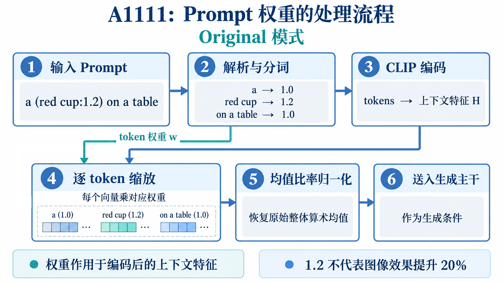

</div>

设 $H\in\mathbb{R}^{B\times M\times d}$ 是当前调用处理的文本特征张量，$B$ 是批次大小， $M$ 是序列长度， $d$ 是特征维度； $w_{b,i}$ 是第 $b$ 个样本、第 $i$ 个Token的权重。逐Token缩放为：

```math
\widetilde{H}_{b,i,:}=w_{b,i}H_{b,i,:}
```

这里的冒号表示该Token的全部特征维度一起乘以同一个系数。`Original`模式随后计算当前张量全部元素的算术均值，并在分母非零时进行：

```math
H^{\mathrm{out}}
=\widetilde{H}\,
\frac{\mathrm{mean}(H)}{\mathrm{mean}(\widetilde{H})}
```

这个比例使处理后张量的整体算术均值恢复到处理前的水平。它是具体实现中的经验处理，与LayerNorm或“围绕均值做插值”不同，也不意味着每个Token都归一化到零均值、单位方差。A1111还提供`No norm`等模式，其中`No norm`只执行逐Token缩放。

### 3、为什么权重提高20%，画面不会简单变化20%？

加权后的特征还要经过条件投影、注意力、非线性变换以及多步采样。不同概念会共同影响构图、颜色和纹理，所以权重与最终画面之间没有线性对应关系。`(red cup:1.2)`既不表示杯子面积扩大20%，也不保证红色饱和度提高20%。

另外，上下文信息已经在文本编码过程中传播。某个Token的向量携带的信息可能出现在其他位置的特征中，把它的权重设为0，也不能保证完全删除相应概念。权重适合做有限的影响调整；复杂的数量、空间关系和属性绑定，还需要更清楚的描述或额外控制条件。


<h2 id="q-054">面试问题：如何优化Prompt和生成图像不对齐的问题？</h2>

**难度评分：⭐⭐⭐⭐ (4/5)  |  考察频率：⭐⭐⭐⭐⭐ (5/5)**

Prompt与图像不对齐，首先要说明究竟是哪一项要求没有满足。比如对于“一个红色杯子放在蓝色书本左侧”这个提示词，至少可以分别检查：杯子与书是否都出现、数量是否正确、颜色是否绑定到对应物体、左右关系是否成立。

**排查时先确认文本信息是否进入模型，再判断模型能否把信息落实到图像。** 文字被截断、颜色绑定错误、模型不认识某个概念，以及图中文字写错，发生的位置和解决办法都不同。

### 1、先检查实际送入模型的条件

检查Prompt的Token数量、截断提示、分块结果及权重语法是否被支持。界面中看到的文字，可能与最终编码的内容不同。正面提示要求“红色杯子”，负面提示又包含`red`，也可能形成互相牵制的条件。

同时确认底模、Tokenizer、Text Encoder及相关配置是否配套。不同模型使用不同的条件空间；`clip_skip`等设置改变了读取哪一层特征，也应与模型和训练习惯匹配。正常的子词拆分本身并不是错误，不能仅因为一个词被分成多个Token，就认定分词导致了对齐失败。

做对比实验时，先固定底模、种子、分辨率、采样器和其他参数，一次只调整一个因素。这样可以看清修改的影响；选出有希望的方案后，再使用多个种子复测，避免把一次偶然成功当作稳定能力。

下图展示了图文不对齐的排查与处理流程：

<div align="center">

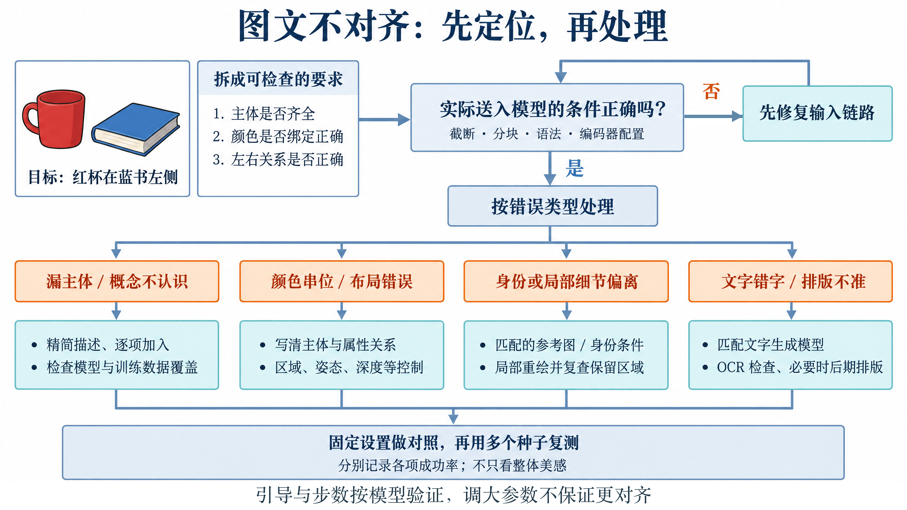

</div>

### 2、按错误类型选择处理方法

可以从最短、最容易验收的Prompt开始：先生成“红色杯子”，再增加“蓝色书本”，最后加入“杯子在书本左侧”。如果前两步稳定、加入关系之后频繁失败，问题更可能出在组合与关系表达上；这时继续堆叠画质词，通常没有针对性。

常见情况可以按下表处理。表中的方法是定位问题之后的选择，并不保证单独使用就能解决全部约束。

<div align="center">

| 可观察的问题 | 优先检查什么 | 有针对性的处理 |
|---|---|---|
| 漏主体、主体被替换 | 相关描述是否进入条件；模型是否覆盖该概念 | 精简无关修饰，逐个验证主体；必要时使用匹配的模型、参考条件或概念微调 |
| 颜色、材质或动作绑定错对象 | 每个属性是否有明确主语；多主体是否相互干扰 | 用完整短句写清主体与属性，减少歧义；复杂场景采用区域条件或分步编辑 |
| 左右关系、姿态、透视不稳定 | 文字是否足以明确空间要求 | 用布局、姿态、边缘或深度等条件补充空间信息；选用与任务及底模兼容的控制模型 |
| 人物身份、商品外观偏离参考 | 参考路径是否具有任务所需的保持能力 | 使用相应的身份或外观条件；分别检查脸部、服装、标识等关键区域。通用风格参考不等于身份约束 |
| 图中文字错字、漏字或排版混乱 | 模型的文字能力、目标文字大小及版式是否匹配 | 使用具有相应文字生成能力的模型，明确文本内容与布局；配合OCR复查，严格排版任务可采用后期排版 |
| 主体正确，但局部细节或编辑保留区出错 | 局部生成能力、掩码范围、重绘强度及解码效果 | 对问题区域局部重绘，并复查周边衔接与保留区域；避免为修一个细节反复重做整图 |

</div>

额外控制也可能互相冲突。Prompt要求侧面人物，姿态图却约束为正面，模型就需要在不一致的要求之间取舍。应先统一语义与条件图，再调整控制强度，而不是把每一路权重都提高。

### 4、反复出现的失败，怎样从训练侧改进？

如果某类关系在多组Prompt、多个种子下持续失败，就需要考虑数据与模型能力。训练数据应让主体、属性、数量和空间关系有准确的对应：两个人物的衣服颜色要分别写清，图中文字要与实际内容一致，编辑样本还应明确修改要求及应保留的区域。更多修饰词无法替代准确标注，单纯扩大数据量也不能消除系统性的错配。

训练与微调要覆盖实际任务，例如补充组合关系样本、概念样本或编辑数据，并验证条件接口能否承载所需信息。通过条件丢弃训练无条件分支，可以支持经典CFG；这不等于已经学会复杂关系。偏好对齐也要依据正确的评判标准，否则可能只提高整体美感，仍然保留数量或文字错误。


<h1 id="q-056">5.介绍一下Stable Diffusion XL的原理和创新点</h1>

<h2 id="q-058">面试问题：Stable Diffusion XL的VAE部分有哪些创新？详细分析改进意图</h2>

**难度评分：⭐⭐⭐⭐ (4/5)  |  考察频率：⭐⭐⭐⭐ (4/5)**

SDXL对VAE的改进，主要是在原有KL-f8架构上重新训练编码器和解码器，采用更大的训练batch，并使用EMA权重平均，提高图像经过潜空间表示后的重建质量。 网络仍采用8倍空间下采样和4通道Latent，卷积、残差块和自注意力等基本结构延续了SD 1.x的设计。

### 1、 结构沿用 KL-f8，升级训练策略

KL-f8中的“KL”表示训练使用KL散度正则，“f8”表示图像的高、宽分别压缩为原来的八分之一。对于尺寸能被8整除的输入，图像和潜变量的形状为：

$$
x\in\mathbb R^{B\times3\times H\times W},
\qquad
z_{\mathrm{raw}}\in
\mathbb R^{B\times4\times(H/8)\times(W/8)}
$$

例如，一张1024×1024图像对应的Latent为4×128×128。编码器并非直接输出一张确定的特征图，而是先预测近似后验的均值与对数方差，再从该分布中采样：

$$
q_\phi(z_{\mathrm{raw}}\mid x)=
\mathcal N\!\left(
\mu_\phi(x),
\mathrm{diag}\!\left(\sigma_\phi^2(x)\right)
\right)
$$

$$
z_{\mathrm{raw}}=
\mu_\phi(x)+\sigma_\phi(x)\odot\eta,
\qquad
\eta\sim\mathcal N(0,I)
$$

其中， $\phi$ 是编码器参数， $\odot$ 表示逐元素相乘， $\eta$ 是VAE后验采样使用的随机变量，需要与扩散训练另外加入的噪声区分。均值和对数方差各占4个通道，因此后验参数张量有8个通道，最终采样得到的Latent仍为4通道。需要确定性编码时，也可以按具体流程使用后验均值。

根据官方配置，编码器包含四个分辨率阶段，通道宽度为[128, 256, 512, 512]。前三个阶段之后执行下采样，最后一个阶段保持分辨率，形成：

$$
H\times W
\longrightarrow
\frac H2\times\frac W2
\longrightarrow
\frac H4\times\frac W4
\longrightarrow
\frac H8\times\frac W8
$$

残差块负责提取和变换局部特征，瓶颈处的自注意力让不同空间位置交换信息。编码器后接一个1×1卷积，组织高斯后验参数；解码器前也有一个1×1卷积处理潜变量。解码器通过四个阶段、三次上采样恢复像素网格。VAE中的注意力主要处理图像特征之间的关系。下图是SDXL VAE完整结构示意图：

<div align="center">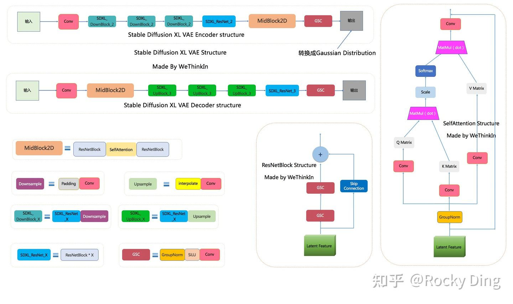</div>

**真正的改进重点在训练**。SDXL从头训练VAE，使用更大的batch size（256），较大的batch使一次更新能够汇总更多图像的重建信号，在其他条件相近时，有助于降低梯度估计的随机波动。并引入EMA（Exponential Moving Average）权重平均，以提高重建质量和鲁棒性。EMA在训练时维护一份平滑后的参数：

$$
\theta_{\mathrm{EMA}}
\leftarrow
\rho\theta_{\mathrm{EMA}}+(1-\rho)\theta,
\qquad 0<\rho<1
$$

其中 $\theta$ 是当前训练参数， $\rho$ 控制历史权重的保留程度。这样可以减小短期参数波动对最终权重的影响。采用EMA权重推理时，只需加载这份权重，不需要同时运行多个VAE。

### 2、 重新训练改变Latent分布，缩放系数同步调整

SDXL VAE重新训练后，Latent分布发生变化。为了让送入U-Net的Latent标准差接近1，缩放系数从SD 1.x的 `0.18215` 调整为SDXL的 `0.13025`。这意味着 SDXL VAE与SD 1.x VAE不能直接互换：如果忽略缩放系数或跨版本替换VAE，常见结果是偏色、噪声或细节崩溃。

记VAE产生的原始潜变量为 $z_{\mathrm{raw}}$ ，送入扩散模型的潜变量为 $z$ ，SDXL的对应关系为：

$$
z=s\,z_{\mathrm{raw}},
\qquad s=0.13025
$$

采样完成后，解码前需要执行逆变换：

$$
z_{\mathrm{raw}}=\frac z{s}
$$

编码得到的潜变量在进入扩散过程前乘以该系数，采样完成后则先除回去，再交给VAE解码。纯文生图从潜空间噪声开始，不需要先编码一张图，但最终解码仍要执行对应的逆缩放。

同时，在SDXL生态中，切换不同的SDXL VAE微调版本，通常只改变细节与颜色表现，不会大幅改变构图，可把它理解为对成像风格的后处理调节。


<h2 id="q-059">面试问题：Stable Diffusion XL的Backbone部分有哪些创新？详细分析改进意图</h2>

**难度评分：⭐⭐⭐⭐⭐ (5/5)  |  考察频率：⭐⭐⭐⭐⭐ (5/5)**

SDXL Base沿用了卷积U-Net的多尺度结构，主要调整了Transformer的分布和深度，并扩大了文本条件接口。**它在空间尺寸最大的特征图上保留卷积与残差计算，把更多Transformer计算放到较小的特征图上**。这样既保留了U-Net逐级提取、融合空间特征的能力，也增加了图像各部分之间、图像与文本之间反复交互的容量。

这些调整使SDXL Base的U-Net达到约2.6B参数，约为SD 1.x/2.x中860M～865M的三倍，能够稳定支持1024×1024及以上分辨率生成。下图是SDXL Base的网络架构图：

<div align="center">

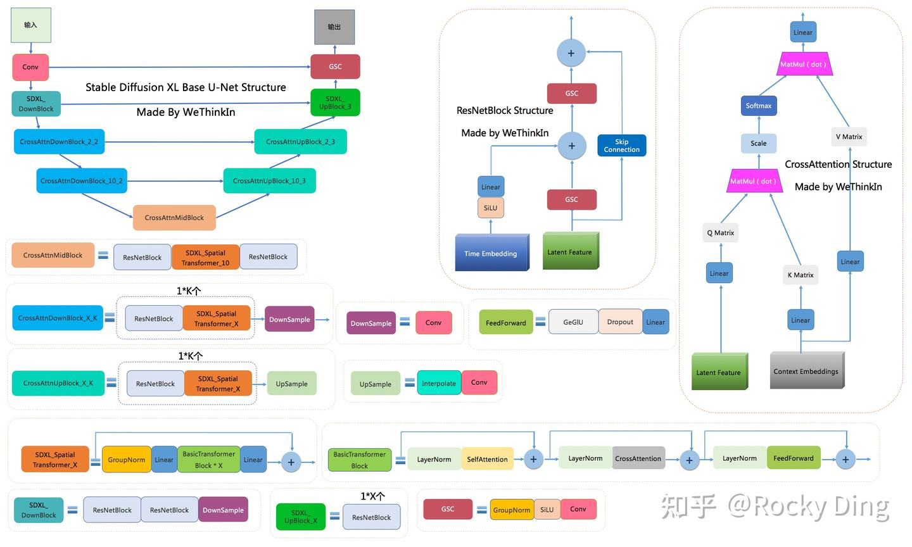

</div>

### 1、 从四 stage 调整为三 stage，减少一次下采样/上采样

SD 1.x的U-Net具有四个空间尺度，包含三次下采样。SDXL Base保留三个尺度，只进行两次下采样，再通过两次上采样返回输入潜变量的空间尺寸。

对于128×128的潜变量输入，空间尺寸的变化为：

$$
128\times128
\rightarrow64\times64
\rightarrow32\times32
\rightarrow64\times64
\rightarrow128\times128
$$

三个尺度的主要配置如下表所示。表中的通道数指各尺度残差块的输出宽度，不包含跳跃连接拼接后暂时增加的输入通道。

<div align="center">

| 潜空间特征尺度 | 主要通道数 | 下行路径的模块 | 单个Spatial Transformer的内部深度 |
|---|---|---|---|
| 128×128 | 320 | 卷积残差块，不放置Spatial Transformer | 不启用 |
| 64×64 | 640 | 卷积残差块与Spatial Transformer交替 | 2个BasicTransformerBlock |
| 32×32 | 1280 | 卷积残差块与Spatial Transformer交替 | 10个BasicTransformer Block |

</div>

其中Spatial Transformer_X由GroupNorm + Linear + X 个 BasicTransformer Block + Linear构成，并保留残差连接。

每个BasicTransformer Block由LayerNorm + Self-Attention + Cross-Attention + FeedForward组成，FeedForward采用GEGLU + Dropout + Linear。

**SDXL Base U-Net的设计思路是在较小特征图上加深Transformer，控制全局交互的开销**。论文用[0,2,10]概括SDXL在三个尺度上的Transformer配置。这里的0表示该尺度不放置Spatial Transformer；2和10表示相应模块内部连续堆叠的BasicTransformerBlock数量。

例如，64×64下行阶段包含两组“残差块＋Spatial Transformer”，每个Spatial Transformer内部有2个BasicTransformerBlock；32×32下行阶段同样包含两组，但每个内部有10个。瓶颈和上行路径还会继续使用对应深度的Transformer。


### 2、 BasicTransformer Block成为SDXL Base U-Net的核心模块

在SDXL Base U-Net中，Spatial Transformer通过自注意力、交叉注意力和前馈网络逐步更新图像特征。

Spatial Transformer用于把二维特征图接入Transformer计算。SDXL中的一条典型路径是：GroupNorm → 展平空间维度 → 线性投影 → 多个BasicTransformerBlock → 输出线性投影 → 还原二维形状 → 与模块输入相加。

每个BasicTransformerBlock内部依次执行三步，并在每一步前进行LayerNorm、在结果后加上残差：

$$
X_1=X+\mathrm{SelfAttn}(\mathrm{LN}_1(X)),
X_2=X_1+\mathrm{CrossAttn}(\mathrm{LN}_2(X_1),C),
X_3=X_2+\mathrm{FFN}(\mathrm{LN}_3(X_2))
$$

其中，X是当前图像特征序列，C是文本条件序列，三个LayerNorm具有各自的参数。

自注意力负责图像位置之间的信息交换。 例如，模型在处理人物面部、身体和背景时，需要让这些区域的表示相互联系，而不能完全独立决定各自的内容。

交叉注意力把文本信息引入图像特征。 图像特征产生Q，文本条件产生K和V，使不同图像位置能够读取与自身相关的提示词信息。

前馈网络继续加工每个位置的通道特征。 它采用GEGLU门控：一次输入投影产生两组中间特征，一组经GELU激活后与另一组逐元素相乘，再由输出投影映射回原维度。

这些基本单元在SD 1.x中已经实现。SDXL的主要改进是它们在不同尺度上的分布、内部深度以及条件输入规模。

**同时SDXL Base U-Net还扩大了文本条件接口，让增加的主干容量能够利用更丰富的语义信息。**

SDXL将CLIP-L与OpenCLIP-bigG的序列特征沿特征维拼接，形成2048维的文本上下文。U-Net的Cross-Attention以这一表示为输入，再通过自己的K/V投影映射到当前注意力层使用的维度。

相比SD 1.x的768维、SD 2.x的1024维文本上下文，SDXL扩大了条件接口。这既增加了可供U-Net使用的文本信息，也使相关K/V投影的输入矩阵变大。更深的Transformer与更宽的Cross-Attention上下文，共同构成了Backbone参数增长的重要来源。

除了逐Token文本条件，U-Net还接收OpenCLIP-bigG的全局文本向量，以及原始尺寸、裁剪位置、目标尺寸的编码。它们组成2816维附加条件，经MLP映射后，与扩散时间步嵌入相加，再进入残差块的条件分支。这块内容具体在下个问题中进行讲解。


<h2 id="q-060">面试问题：Stable Diffusion XL的Text Encoder部分有哪些创新？详细分析改进意图</h2>

**难度评分：⭐⭐⭐⭐ (4/5)  |  考察频率：⭐⭐⭐⭐ (4/5)**

SDXL在文本条件上的主要改进，是同时使用CLIP-L与OpenCLIP-bigG两套预训练文本编码器，并把它们的输出组织成两条注入U-Net的路径：一条保留逐Token的文本特征，通过Cross-Attention注入U-Net中；另一条使用整句文本的汇总表示（全局Pooled Embedding），与时间步、尺寸和裁剪条件一起影响U-Net的特征计算。

这样，模型既能保留提示词中不同位置的细节信息，也能通过全局条件获得整句话的语义概括。这套设计在 SD 3、FLUX 中也得到延续，是新一代生成模型文本注入的重要范式。

CLIP-L与OpenCLIP-bigG两路都先对提示词进行分词，将Token ID转换为词嵌入，再加上位置嵌入，经过多层Transformer得到文本特征。它们的基本结构相近，但深度、宽度和预训练权重不同，具体如下表所示：

<div align="center">

| 比较项 | CLIP-L文本编码器 | OpenCLIP-bigG文本编码器 |
|---|---|---|
| Transformer层数 | 12层 | 32层 |
| 隐藏特征维度 | 768 | 1280 |
| 自注意力头数 | 12 | 20 |
| 前馈网络中间维度 | 3072 | 5120 |
| 前馈网络激活函数 | QuickGELU | GELU |
| 原生最大序列长度 | 77 Token，包含起止标记 | 77 Token，包含起止标记 |
| SDXL使用的序列特征 | 倒数第二层的逐Token表示 | 倒数第二层的逐Token表示 |
| SDXL使用的全局文本条件 | 不采用这一路的pooled输出 | 采用经过文本投影的pooled输出 |

</div>

更深、更宽的OpenCLIP-bigG提供了额外的表示容量，而保留CLIP-L使U-Net能够同时利用另一套预训练文本特征。两路表示拼接后，U-Net在训练中学习如何组合这些信息。

标准流程中，同一条提示词分别进入两套编码器。忽略batch维度，两路取出的序列特征为：

$$
H_L\in\mathbb{R}^{77\times768},
\qquad
H_G\in\mathbb{R}^{77\times1280}
$$

这里的77是序列位置数，768和1280是每个位置的特征维度。SDXL取两套编码器的倒数第二层隐藏状态：对于12层CLIP-L，对应第11个Transformer块的输出；对于32层OpenCLIP-bigG，对应第31个块的输出。

两者沿最后一个维度拼接：

$$
C=\mathrm{Concat}_{\mathrm{feat}}(H_L,H_G)
\in\mathbb{R}^{77\times2048}
$$

拼接后仍然只有77个位置，但每个位置同时携带两套编码器的表示。增加的是每个位置可用的特征维度，文本序列没有因此变成154个Token。 原生单段输入还需为起止标记保留位置，通常最多容纳75个正文Token。

**接着再从OpenCLIP-bigG提取整句表示，增加全局条件路径。**

序列条件保留了多个文本位置；全局条件则将整句话组织为一个1280维向量。SDXL只采用OpenCLIP-bigG这一分支的pooled文本表示。

这一表示的提取过程需要与前面的倒数第二层序列特征区分开：
1. 完成OpenCLIP-bigG最后一个Transformer块的计算。
2. 对最后一层输出进行最终LayerNorm。
3. 选取文本结束标记EOT所在位置的特征。
4. 经过文本投影层，得到1280维全局向量。

这一过程可以写为：

$$
p=\mathrm{Proj}_{\mathrm{text}}
\left(
\mathrm{LN}\left(H_G^{\mathrm{last}}\right)_{\mathrm{EOT}}
\right)
\in\mathbb{R}^{1280}
$$

CLIP文本Transformer使用因果自注意力，位于句尾的EOT能够读取前面的文本信息；它又在图文对比预训练中承担整句表示的作用，因此可以用来概括文本语义。这里的pooling是选取特定位置并进行投影，不是对所有Token求平均。

值得注意的是，**SDXL将全局文本向量与图像尺寸、裁剪位置等条件结合，再送入U-Net。这使模型在判断当前噪声程度时，还能同时获得整句语义和图像尺度方面的信息**。

在SDXL Base中，尺寸与裁剪条件包含六个标量：

$$
m=(H_{\mathrm{orig}},W_{\mathrm{orig}},
c_y,c_x,H_{\mathrm{target}},W_{\mathrm{target}})
$$

它们依次表示原始高度和宽度、裁剪起点的纵横坐标，以及目标高度和宽度。六个标量各自经过256维正弦位置编码，合起来得到1536维特征，再与1280维全局文本向量拼接：

$$
a=\mathrm{Concat}\left(p,\mathrm{Embed}(m)\right)
\in\mathbb{R}^{1280+6\times256}
=\mathbb{R}^{2816}
$$

这个2816维向量经过额外的MLP映射到1280维，再与同为1280维的扩散时间步嵌入相加，形成U-Net使用的综合条件：

$$
e=e_t+\mathrm{MLP}_{\mathrm{add}}(a)
$$

其中， $e_t$ 表示当前去噪时间步的嵌入。综合条件随后进入U-Net的残差块，作用于图像特征的计算。

因此，总的来说，SDXL的两条文本条件路径分别是：
- 序列路径：两路逐Token特征 → 沿特征维度拼接 → Cross-Attention的K/V投影 → 注入U-Net。
- 全局路径：bigG的整句向量 → 与尺寸、裁剪嵌入拼接 → 额外MLP → 与时间步嵌入相加 → 注入U-Net残差模块。


<h2 id="q-061">面试问题：Stable Diffusion XL中使用的训练方法有哪些创新点？</h2>

**难度评分：⭐⭐⭐⭐ (4/5)  |  考察频率：⭐⭐⭐⭐⭐ (5/5)**

SDXL的训练改进围绕几个实际问题展开：训练图像的原始清晰度不同，统一缩放容易混入模糊特征；裁剪会改变构图，但普通训练没有告诉模型哪些内容经过了裁剪；固定正方形训练又限制了模型对横图、竖图的适应能力。

SDXL通过尺寸与裁剪条件化、多宽高比训练和分阶段提高分辨率，处理这些数据与生成要求之间的差异；同时采用Offset Noise，调整训练噪声对整体明暗变化的扰动方式。

这些方法主要改变数据组织、条件输入和加噪过程。

### 1、分阶段提高训练分辨率，并进行多分辨率训练

SDXL先在较小图像上预训练，再继续提高分辨率，最后加入多宽高比训练。Base的具体训练路线如下：

<div align="center">

| 训练阶段 | 图像尺寸 | 论文明确给出的安排 |
|---|---|---|
| 第一阶段 | 256×256 | 预训练600,000次参数更新，batch size为2048，同时使用尺寸和裁剪条件 |
| 第二阶段 | 512×512 | 在前一阶段基础上继续训练200,000次参数更新 |
| 第三阶段 | 多种宽高比，像素面积接近1024×1024 | 进行多宽高比训练，并结合强度为0.05的Offset Noise；该节未列出这一阶段的总更新步数 |

</div>

较小分辨率下，每张图像需要处理的潜空间位置更少，有利于在前期扩大训练覆盖。继续提高分辨率后，模型再适应更细的纹理、局部结构与更大的空间网格。

同时，**在SDXL训练过程只能够，还按宽高比分桶进行多分辨率训练，让训练画幅更接近实际生成需求**。

真实图像既有横向风景，也有纵向人像。若统一裁成正方形，就会改变这些图像原有的空间组织。SDXL在最终阶段将不同宽高比的数据分配到相应分辨率桶，具体的训练尺寸包括1024×1024、768×1344、1344×768等，使每个桶的像素面积尽量接近1024×1024，高度和宽度取64的整数倍。

同一个batch使用同一桶的尺寸，便于直接堆叠张量；不同训练步可以切换到不同桶。图像通常仍需按比例缩放并进行有限裁剪，分桶的作用是减少与目标画幅不匹配造成的裁剪。

多宽高比训练与裁剪条件可以共同使用：
- 多宽高比训练让模型接触不同画幅。
- 裁剪条件继续记录该画幅内实际发生的裁剪偏移。
- 像素面积接近有助于控制不同batch之间的计算规模，但不保证显存占用与吞吐完全相同。

### 2、 设计micro-conditioning（original_size / crop_top_left / target_size）信息

micro-conditioning是SDXL论文中最有工程价值的创新点之一，它把图像在数据预处理阶段被「裁剪、缩放、填充」过的信息**显式告诉模型**，从而修复了SD 1.x时代普遍存在的「人物头部缺失、构图不全、低分辨率训练数据被错误利用」等问题。

三个条件的具体含义如下表所示：

<div align="center">

| 条件 | 含义 | 训练时的取值 |
| --- | --- | --- |
| `original_size` | 图像在 resize 到训练分辨率前的**原始分辨率** | 数据集真实原始尺寸 | 
| `crop_top_left` | 缩放后图像中，裁剪窗口的上、左偏移，顺序为纵坐标、横坐标 $(c_y, c_x)$ | 真实裁剪偏移 | 
| `target_size` | 裁剪后的训练尺寸，即当前分辨率桶的高度和宽度 | 训练分辨率 |

</div>

例如，一张高800、宽1200像素的图像，要制成1024×1024训练样本，可以先按比例缩放到1024×1536，再从横向偏移256的位置裁取1024×1024区域。对应条件是：

>original_size         = (800, 1200)
>
>crops_coords_top_left = (0, 256)
>
>target_size           = (1024, 1024)

注入U-Net的方式主要是将 `original_size`、`crop_top_left`、`target_size` 拆成六个标量，分别经过先经过与timestep相同的sinusoidal embedding后进行拼接，再与 OpenCLIP-bigG的Pooled Embedding一起经过add embedding MLP，最终和timestep embedding融合作为U-Net的全局调制信号。具体流程如下图所示：

<div align="center">

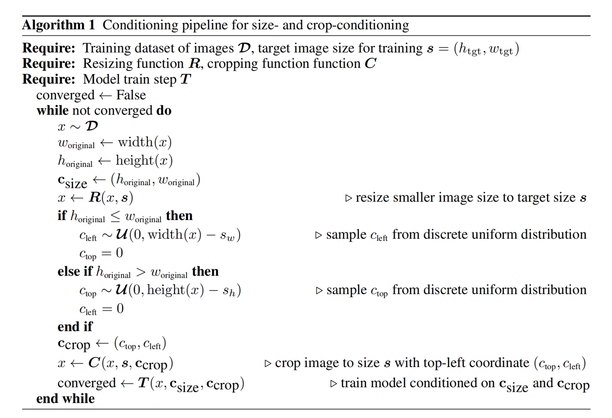

</div>

### 3、 Offset Noise加强对空间平均值的扰动，改善整体明暗范围的学习

SDXL在高分辨率图像上训练时，普通的逐像素独立高斯噪声主要覆盖局部高频变化，无法充分改变整张图像的亮度、色调等低频统计。模型因此容易学习到“中等亮度、低对比度”的生成分布，在纯色背景、极亮或极暗场景中表现受限。

offset Noise的做法是在标准噪声之外，为每个样本和每个Latent特征通道额外采样一个空间上共享的偏移噪声，并广播到整个 $H\times W$ 特征图。

```math
\epsilon' = \epsilon + \lambda\,\epsilon_{\mathrm{offset}},\qquad
\epsilon\sim\mathcal{N}(0,I),\quad
\epsilon_{\mathrm{offset}}\sim\mathcal{N}(0,I_{B\times C\times1\times1})
```

其中 $\lambda$ 是 offset Noise 的强度，默认为 $λ=0.05$ ，这相当于直接增加对通道空间平均值，也就是零频分量的扰动，让模型在训练中更多接触整体偏移的去噪任务。它有助于改善较暗、较亮等全局外观的表达。训练时使用 $\epsilon'$ 构造带噪 Latent特征，推理时仍使用普通噪声；模型由此学会覆盖更宽的低频范围，生成纯黑、纯白、低照度和高对比度画面时更稳定。

Offset Noise加噪流程如下图所示：

<div align="center">

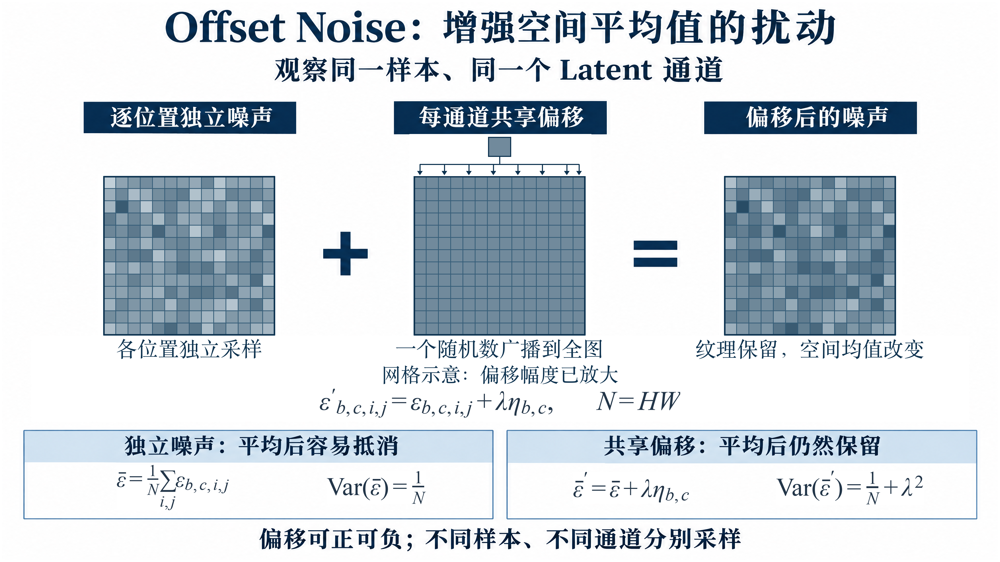

</div>


<h2 id="q-065">面试问题：什么是SDXL Refiner？</h2>

**难度评分：⭐⭐⭐⭐ (4/5)  |  考察频率：⭐⭐⭐⭐ (4/5)**

SDXL Refiner是一套专门处理低噪声阶段的潜空间扩散模型，用于进一步改善SDXL Base生成结果中的局部结构、材质和细节。它有独立的U-Net权重，与Base使用配套的同一套VAE潜空间。SDXL Refiner U-Net每次预测噪声，由采样器据此更新潜变量，精修完成后再由VAE Decoder还原为像素图像。具体流程如下图所示：

<div align="center">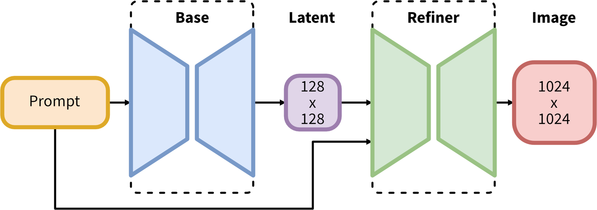</div>

SDXL Base能够独立完成从噪声到图像的生成，加入SDXL Refiner这个阶段是可选的。SDXL Base先生成结构稳定的Latent特征；SDXL Refiner接收SDXL Base生成的Latent特征，在较低噪声区间继续去噪，重点补足纹理、背景和人脸等高频细节。这个过程本质上是在Latent空间的img2img，而不是重新从文本开始生成。

SDXL Refiner在模型架构上和SDXL Base大同小异，主要区别如下表所示：

<div align="center">

| 比较项 | SDXL Base | SDXL Refiner |
|---|---|---|
| U-Net 参数量 | 约 2.6B | 约 2.26B |
| 文本编码器 | CLIP ViT-L＋OpenCLIP ViT-bigG | 仅 OpenCLIP ViT-bigG |
| Cross-Attention 文本特征维度 | 2048 | 1280 |
| U-Net 各分辨率阶段通道数 | 320、640、1280 | 384、768、1536、1536 |

</div>

**SDXL Base + Refiner的组合使用方式主要有两种。**

**第一种用法是在同一条采样轨迹中交接潜变量**。这种用法按噪声区间分配工作：Base先处理高噪声部分，在尚未完全去噪时停止；Refiner接收中间潜变量，继续完成低噪声部分。整体数据流为：初始噪声 → Base 去噪 → 中间带噪 Latent → Refiner 继续去噪 → 最终 Latent → VAE 解码 → RGB 图像。

交接时不需要先解码成图片，也不需要再对这个中间 Latent 额外加一次噪声；它已经处在下一阶段所需的噪声状态。常见设置下，可以近似理解为Base处理前约80%的去噪工作、Refiner 处理后约20%的精细化工作。

**第二种用法是完成初次生成后，再通过SDEdit精修**。这种用法是让Base完整去噪，得到最终潜变量，再向它加入适量噪声，由Refiner重新去噪，也就是常见的图生图精修任务。整体数据流为：Base 完整生成 → 对最终 Latent 重新加噪 → Refiner 低噪声去噪 → VAE 解码。

这一流程可以直接使用 Base 的最终 Latent，无需先解码再编码。如果只有 RGB 图像，则先使用 SDXL 配套的 VAE Encoder 将它转为潜变量，再执行加噪和去噪。

下图展示了SDXL Refiner精修的效果示意图：

<div align="center">

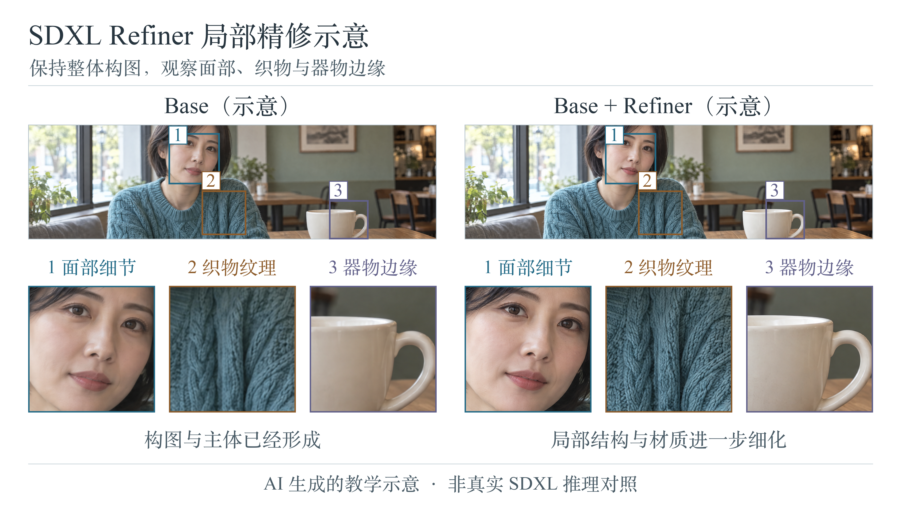

</div>


<h1 id="q-066">6.介绍一下Stable Diffusion 3的原理和创新点</h1>

<h2 id="q-067">面试问题：SD 3 的 VAE 部分有哪些创新？详细分析改进意图</h2>

**难度评分：⭐⭐⭐⭐ (4/5)  |  考察频率：⭐⭐⭐⭐⭐ (5/5)**

**VAE（变分自编码器，Variational Auto-Encoder）在 Stable Diffusion 3（SD 3）中依旧是不可或缺的组成部分**。SD 3对VAE最重要的改动，是在保持8倍空间下采样的基础上，将Latent特征通道数从4增加到16，提高图像经过压缩与解码后的重建质量。忽略batch维度，以通道在前的张量顺序表示：

$$
x\in\mathbb R^{3\times H\times W}
\quad\longrightarrow\quad
z_{\mathrm{raw}}\in\mathbb R^{16\times(H/8)\times(W/8)}.
$$

例如，一张1024×1024图像，在SDXL中对应4×128×128的潜变量，在SD 3中则对应 16×128×128。空间网格没有变大，同一位置能够使用的特征维度增加了。编码器可以据此形成更充分的表示，减轻纹理、边缘和细小结构在压缩过程中的损失。

SD 3论文中比较了4、8、16通道自编码器，三者的空间下采样倍数均为 8，如下图所示：

<div align="center">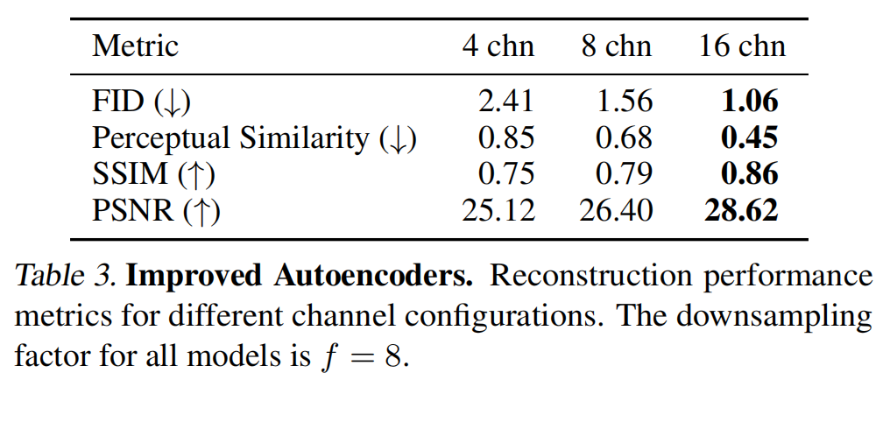</div>

我们可以看到，当设置通道数为16时，VAE模型的整体性能（FID指标降低、Perceptual Similarity指标降低、SSIM指标提升、PSNR指标提升）比设置通道数为4时有较大的提升，所以SD 3确定使用了16通道的VAE模型。

在SD 3中，VAE模型依旧是将像素级图像编码成Latent特征，不过由于SD 3的扩散模型部分全部由Transformer架构组成，所以还需要将Latent特征转换成Patches特征，再送入扩散模型部分进行处理。

SD 3 VAE将2×2的潜空间区域映射为一个图像Token，通道数从4增至16时，每个patch 包含的标量数从16增至64；同样的空间网格仍产生相同数量的图像Token。

$$
N_{\mathrm{image}}=
\frac{H}{16}\frac{W}{16},
\qquad
D_{\mathrm{patch}}
=
2\times2\times c_z.
$$

其中， $c_z$ 是潜变量通道数， $D_{\mathrm{patch}}$ 是投影前每个patch的特征维度。

例如，1024×1024图像对应128×128的潜空间网格，划分为2×2 patch后得到64×64＝4096个图像Token。


### 1、 SD 3 VAE架构

下面给出SD 3 VAE的完整结构图，用于直观理解编码、扩散前的Latent特征的编码与解码重建的流程：

<div align="center">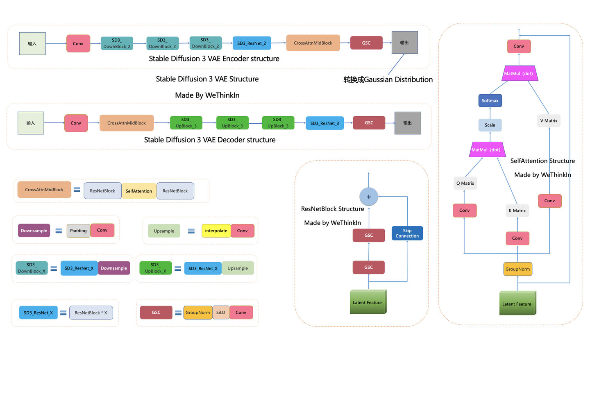</div>

从完整结构看，SD 3 VAE模型包含三个基础组件：

1. **GSC 组件**：GroupNorm + SiLU + Conv。
2. **Downsample 组件**：Padding + Conv。
3. **Upsample 组件**：Interpolate + Conv。

同时，SD 3 VAE 还包含两个核心组件：ResNetBlock 模块和 Self-Attention 模块。VAE Encoder 部分包含三个 DownBlock 模块、一个 ResNetBlock 模块以及一个 MidBlock 模块，将输入图像压缩到 Latent 空间并转换为 Gaussian Distribution；VAE Decoder 部分则执行相反的过程，输入 Latent 特征并重建为像素级图像，包含三个 UpBlock 模块、一个 ResNetBlock 模块以及一个 MidBlock 模块。

输入卷积先把RGB图像转换为特征图。 随后，特征经过四个分辨率阶段，通道宽度依次为 128、256、512、512。每个阶段包含两个残差块，前三个阶段结束后各执行一次2倍下采样，空间尺寸依次变为原来的1/2、1/4、1/8。最后一个阶段在最低分辨率上继续变换特征。

瓶颈模块进一步组织压缩后的空间信息。 它的顺序是“残差块 → 自注意力 → 残差块”。自注意力的Q、K、V都来自当前图像特征，让不同空间位置交换信息；这里不接收文本特征，因此不应标成文本交叉注意力模块。

输出端预测潜变量的分布参数。 归一化、SiLU激活和输出卷积得到32通道张量，其中 16通道表示均值，另外16通道表示对数方差。从这个对角高斯后验中采样，才得到最终的 16 通道潜变量：

$$
z_{\mathrm{raw}}=
\mu_\phi(x)
+
\exp\!\left(\frac12\ell_\phi(x)\right)\odot\eta,
\qquad
\eta\sim\mathcal N(0,I).
$$

其中 $\phi$ 是编码器参数。 $\mu_\phi(x)$ 是均值。 $\ell_\phi(x)$ 是对数方差，因此 $\exp(\ell_\phi(x)/2)$ 对应标准差。 $\odot$ 表示逐元素相乘。 $\eta$ 是 VAE 后验采样使用的高斯随机变量，与生成主干训练时另外加入的噪声不同。32 通道对应分布参数，16 通道对应采样结果，二者不能混为一谈。

解码器接收16通道潜变量，先通过输入卷积和瓶颈模块，再经过四个阶段、三次上采样恢复图像尺寸，最后输出RGB图像。

### 2、 通过固定的缩放和平移，维持潜变量与噪声的数值关系。

潜变量由VAE学习得到，其均值与幅度未必与标准高斯噪声一致。SD 3论文中说明，模型根据训练数据子集上统计的全局均值和标准差，对潜变量进行归一化。

官方SD 3参考实现使用下面的变换，将原始潜变量 $z_{\mathrm{raw}}$ 转换为Bcakbone主干使用的 $z$ ：

$$
z=s\left(z_{\mathrm{raw}}-b\right),
\qquad
s=1.5305,
\qquad
b=0.0609.
$$

其中平移量 $b$ 调整整体数值中心，缩放量 $s$ 调整整体幅度。接着在SD 3 Backbone采样完成后，必须先执行逆变换，再调用 VAE Decoder：

$$
z_{\mathrm{raw}}
=
\frac{z}{1.5305}+0.0609.
$$


<h2 id="q-067a">面试问题：SD 3的Backbone部分有哪些创新？详细分析改进意图</h2>

**难度评分：⭐⭐⭐⭐⭐ (5/5)  |  考察频率：⭐⭐⭐⭐⭐ (5/5)**

SD 3的生成Backbone主干采用MM-DiT（Multimodal Diffusion Transformer）。它为文本和图像保留各自的特征变换参数，再通过联合注意力建立联系。这项设计兼顾了两个需求：不同模态能够按照自身特点处理信息，图像生成过程又能持续读取具体的文本内容。

围绕这条主线，SD 3沿用DiT的Latent分块、Transformer堆叠和条件调制，并结合位置网格适配、QK归一化方案和模型规模扩展，支持更高分辨率的生成。下面我们一起来学习SD 3 Backbne架构的设计思路，以及它们解决的问题。

**SD 3设计的MM_DiT架构，是基于原始DiT架构针对AIGC图像创作领域的一次改进，两者区别如下图所示：**

<div align="center">

| 维度 | 原始 DiT | MM-DiT |
| --- | --- | --- |
| **输入序列** | 仅图像 token | **图像 token + 文本 token 拼接成统一序列** |
| **文本注入方式** | AdaLN-Zero 全局调制 | **Self-Attention 内文本与图像 token 双向交互** |
| **权重共享** | 单套 Transformer 权重 | **图像与文本各自一套独立 Linear / FFN 权重**，但共享 Attention |
| **跨模态交互粒度** | 全局 | **Token 级、双向** |
| **文字渲染能力** | 弱 | **强** |
| **长 prompt 利用** | 有限 | 显著增强 |

</div>

从实现结构看，SD 3的MM-DiT主要包含以下核心模块：

1. **MM-DiT Block**：SD 3 medium 使用 24 个 MM-DiT Block 构成 Backbone 主体。每个 Block 包含两个 AdaLayerNormZero 层、一个 MM-DiT Attention 层、两个 LayerNorm 层和两个 FeedForward 层。
2. **MM-DiT Attention**：用于让图像特征和文本特征在同等级别上进行 Attention 交互。
3. **FeedForward**：由 GELU、Dropout 和 Linear 组成。

MM-DiT处理的是VAE潜空间中的带噪特征。设目标图像尺寸为 $H\times W$ ，省略批次维，带噪Latent特征为：

$$
z_t\in\mathbb{R}^{\frac H8\times\frac W8\times16}
$$

Backbone将Latent划分为不重叠的2×2Patch。每个Patch包含 $2\times2\times16=64$ 个标量，通过可学习投影映射到隐藏维度 $D$ 。图像Token数量因此为：

$$
N_{\mathrm{img}}=
\frac H{16}\cdot\frac W{16}.
$$

例如，1024×1024图像对应128×128×16的Latent；经过2×2分块后，得到64×64，即4096个图像Token。对于论文中的24层、约2B主干配置，每个Token再由64维映射到1536维。

通常可以使用卷积核为2、步长为2的卷积完成Patch Embedding。这等价于把每个不重叠Patch展平后，应用同一个线性投影。网格尺寸虽然变小，但每个Token汇集了一个Patch的内容，不能仅凭使用步长卷积就断言它丢掉了某些位置的信息。

下图是SD 3 MM-DiT整体架构的示意图：

<div align="center">

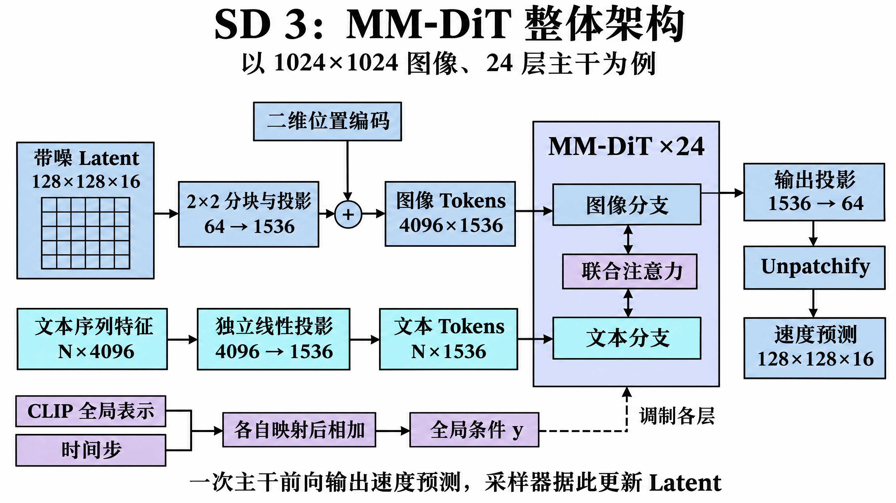

</div>

在一个典型MM-DiT块中，文本和图像分别使用各自的条件调制、QKV投影、注意力输出投影与前馈网络。两路参数可以学习不同的特征变换，不要求文本表示和图像表示始终采用同一种处理方式。下图展示了典型MM-DiT块的计算流程：

<div align="center">

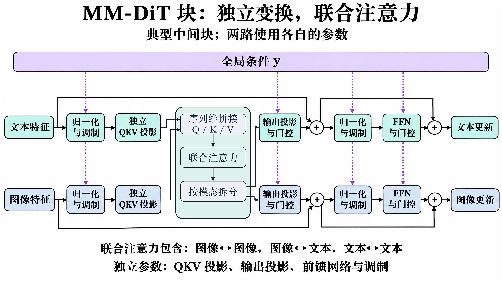

</div>

设图像分支得到 $Q_x,K_x,V_x$ ，文本分支得到 $Q_c,K_c,V_c$ 。以图像在前、文本在后的排列为例，沿序列维拼接：

$$
Q=\begin{bmatrix}
Q_x\\
Q_c
\end{bmatrix},
\qquad
K=
\begin{bmatrix}
K_x\\
K_c
\end{bmatrix},
\qquad
V=
\begin{bmatrix}
V_x\\
V_c
\end{bmatrix}.
$$

接着进行联合注意力计算。对单个注意力头，可写成：

$$
A=\mathrm{softmax}
\left(
\frac{QK^\top}{\sqrt{d_h}}
\right)V
$$

其中 $d_h$ 为每个注意力头的特征维度；启用QK-Norm时，上式中的Q、K指归一化后实际参与计算的张量。矩阵乘积可以分解为四部分：

$$
QK^\top=
\begin{bmatrix}
Q_xK_x^\top & Q_xK_c^\top\\
Q_cK_x^\top & Q_cK_c^\top
\end{bmatrix}
$$

行对应发起查询的Token，列对应被读取的Token。因此，这四部分分别表达：
- 图像Token读取其他图像Token；
- 图像Token读取文本Token；
- 文本Token读取图像Token；
- 文本Token读取其他文本Token。
图文双向交互与图像内部交互同时存在于一次联合注意力中。

注意力计算完成后，输出按图像和文本序列长度拆开，分别经过各自的输出投影与残差更新，再进入各自的归一化、条件调制和前馈网络。因此，联合注意力表示两路共同参与一次信息交互，不代表两路共享QKV、MLP或全部Transformer参数。

前馈网络对每个Token分别进行非线性变换。论文采用的典型设置先将特征宽度从 $D$ 扩展到 $4D$ ，经GELU激活后再映射回 $D$ 。注意力负责在不同Token之间交换信息，前馈网络进一步加工每个位置已经汇集的特征，两者承担不同作用。

Token级注意力让网络访问具体文本信息，全局条件则控制当前这次特征变换应如何进行。SD 3将两路CLIP的pooled表示拼成2048维向量，经过映射后，与时间步编码经过映射得到的向量相加：

$$
y=f_{\mathrm{text}}(c_{\mathrm{pooled}})
+
f_{\mathrm{time}}(t).
$$

这里两路映射的输出维度与主干隐藏维度一致，并非把原始pooled向量与任意维度的时间嵌入直接相加。各个块再通过自己的可学习映射，从 $y$ 生成调制参数。我们以一个残差模块子层为例，其过程可以概括为：

$$
\widetilde H
=
(1+\gamma(y))\odot\mathrm{LN}(H)+\beta(y),
$$

$$
H'=
H+g(y)\odot F(\widetilde H).
$$

其中， $H$ 是输入特征，LN为LayerNorm， $F$ 表示该子层的变换， $\odot$ 表示逐元素相乘。缩放项 $\gamma$ 调节特征幅度，平移项 $\beta$ 调整特征偏置，门控项 $g$ 控制新结果写入残差的幅度。这些系数由当前文本与时间步共同决定，并沿Token维广播。

图像和文本分支、注意力与前馈子层分别使用各自的调制参数。网络由此可以在不同噪声阶段，对同一提示词采用不同的特征处理方式，而不必用一组固定变换应对整个生成过程。**这一设计延续了DiT的自适应归一化与门控残差思路**。一个残差子层中的条件调制流程如下图所示：

<div align="center">

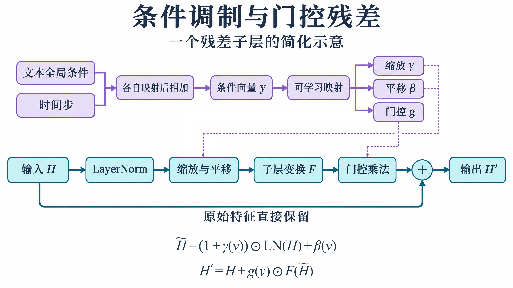

</div>

将图像展平为Token序列后，还需要告诉网络各个Patch位于哪里。**SD 3为图像Token加入二维正弦余弦位置编码，让特征同时携带内容信息和二维坐标信息：**

$$
X_{\mathrm{in}}=
\mathrm{PatchEmbed}(z_t)+P_{\mathrm{2D}}.
$$

这是加性位置编码。当训练从低分辨率扩展到高分辨率和不同长宽比时，图像Token网格的高、宽都会改变。如果简单把所有图像的位置压缩到同一个正方形范围，可能无法准确保留不同形状之间的空间尺度关系。

SD 3结合位置网格的缩放与扩展，为目标训练分辨率和长宽比范围构建坐标，再按当前图像的Token网格取中心区域。这些操作用于让位置表示与实际图像网格相匹配，支持多长宽比训练和推理。具体如下图所示：

<div align="center">

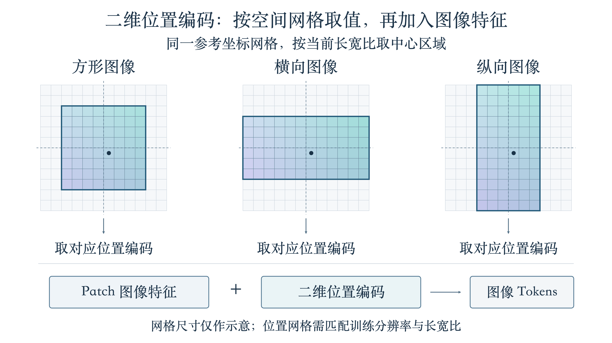

</div>

高分辨率训练会增加Token数量，也会改变网络面对的特征分布。**SD 3论文观察到，混合精度训练可能出现注意力logit持续增大、注意力分布过度尖锐，进而训练不稳定的问题**。

**论文采用的QK-Norm方案是在注意力点积之前，对文本和图像两路的Q、K分别施加带可学习缩放的RMSNorm**。对某个注意力头中的向量 $q$ ，可以概括为：

$$
\widehat q=
\omega_q\odot
\frac{q}
{\sqrt{\frac{1}{d_h}\sum_{j=1}^{d_h}q_j^2+\delta}}.
$$

其中 $\omega_q$ 是可学习缩放向量， $\delta$ 是用于数值稳定的小常数；K也有对应的归一化与缩放。RMSNorm控制向量的均方根尺度，并保留可学习调节能力，它与将向量缩放为单位长度的L2归一化不同。

这样可以缓解Q、K幅度增长造成的注意力logit失控，使混合精度训练更容易保持稳定。QK-Norm的训练稳定性对照实验如下图所示：

<div align="center">

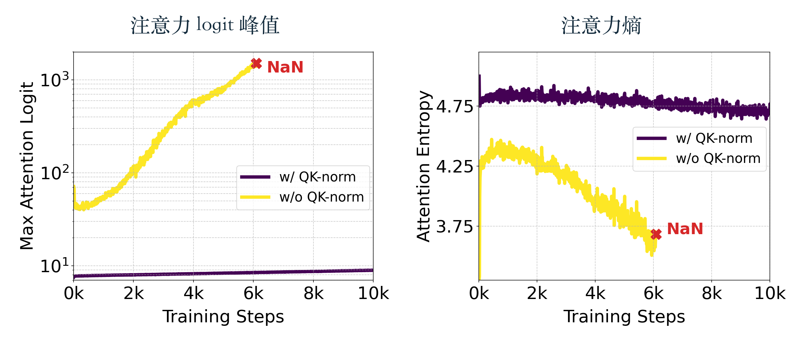

</div>

上图中左侧图显示注意力logit峰值，右侧图显示注意力熵；两者均对约2B、24层模型的最后5个块取平均。黄色曲线未启用QK-Norm，约6k步时出现NaN；紫色曲线启用了QK-Norm，让训练更加稳定与高效。


<h2 id="q-067c">面试问题：SD 3的Text Encoder部分有哪些创新？详细分析改进意图</h2>

**难度评分：⭐⭐⭐⭐ (4/5)  |  考察频率：⭐⭐⭐⭐⭐ (5/5)**

SD 3在SDXL双CLIP文本编码器的基础上，引入了T5-v1.1-XXL的Text Encoder，为图像生成补充更丰富的语言条件。同时把文本条件分成两条路径送入生成主干：一条保留Token级的上下文信息，参与文本与图像的联合注意力；另一条提取整段提示词的全局表示，与时间步共同调制网络。三个文本编码器具体如下：

1. CLIP ViT-L（参数量约124M）
2. OpenCLIP ViT-bigG（参数量约695M）
3. T5-XXL Encoder（参数量约4.76B）

与SD模型的结合其实不是T5-XXL与AI绘画领域第一次结缘，早在2022年谷歌发布Imagen时，就使用了T5-XXL Encoder作为Imagen模型的Text Encoder，**并证明了预训练好的纯文本大模型能够给AI绘画大模型提供更优良的文本特征**。接着OpenAI发布的DALL-E 3也采用了T5-XXL Encoder来提取文本（Prompts）的特征信息，足以说明T5-XXL Encoder模型在AI绘画领域已经久经考验。

下面我们详细讲解三个文本编码器的作用，省略批次维度，其中 $L_{\mathrm{T5}}$ 为T5序列的实际配置长度，如下表所示：

<div align="center">

| 文本编码器 | Token级特征 | 全局条件 | 在SD 3中的用途 |
|---|---|---|---|
| CLIP-L Text Encoder | 倒数第二层， $77\times768$ | 768维pooled向量 | 同时参与Token条件与全局调制条件的构造 |
| OpenCLIP-bigG Text Encoder | 倒数第二层，$77\times1280$ | 1280维pooled向量 | 与CLIP-L的对应特征拼接，保留互补的文本表示 |
| T5-v1.1-XXL Text Encoder | 最终序列输出， $L_{\mathrm{T5}}\times4096$ | 此路径不使用T5 pooled向量 | 提供额外的上下文序列，供MM-DiT联合建模 |

</div>

总的来说，**SD 3一共需要提取输入文本的全局语义和文本细粒度两个层面的信息特征**。

**全局条件表达的是整段提示词要描述怎样的内容**。两路CLIP分别输出768维和1280维的pooled表示，沿特征维拼接为2048维向量：

$$
c_{\mathrm{global}}=
\mathrm{Concat}_{\mathrm{feat}}(p_L,p_G)
\in\mathbb{R}^{2048}.
$$

这里的pooled表示是编码器给出的整段文本表示，不能简单理解为所有Token向量的算术平均。该向量经MLP映射后，与时间步经过正弦编码和MLP映射得到的向量相加，构成全局条件：

$$
y=\mathrm{MLP}_{\mathrm{text}}(c_{\mathrm{global}})
+
\mathrm{MLP}_{\mathrm{time}}(\mathrm{SinEmbed}(t)).
$$

MM-DiT利用 $y$ 生成各模块所需的调制参数，使特征变换同时受到文本内容和当前噪声阶段的影响。

**Token条件表示的是提示词各部分的上下文表示**。它让图像Token能够通过注意力访问具体的文本信息。SD 3的序列条件融合包含两次方向不同的拼接。

先取两路CLIP的倒数第二层特征，沿特征维拼接：

$$
H_{\mathrm{CLIP}}=
\mathrm{Concat}_{\mathrm{feat}}(H_L,H_G)
\in\mathbb{R}^{77\times2048}.
$$

这一步保留77个序列位置，把每个位置的特征宽度从各自的768维、1280维合并为2048维。它没有将序列长度变成154。

接着，沿特征维补零，把CLIP特征扩展为77×4096，与T5输出的特征宽度一致。补零只解决张量形状的兼容问题，不会增加文本语义，也不会让CLIP多读一段提示词。

最后，将两类特征沿Token序列维拼接：

$$
H_{\mathrm{text}}=
\mathrm{Concat}_{\mathrm{seq}}
\left(
\mathrm{Pad}_{\mathrm{feat}}(H_{\mathrm{CLIP}}),
H_{\mathrm{T5}}
\right)
\in\mathbb{R}^{(77+L_{\mathrm{T5}})\times4096}.
$$

沿序列维拼接时，两部分需要具有相同的特征宽度，Token数量可以不同。SD 3中将T5长度也设为77，因此得到154×4096的文本条件。

完成融合后，文本特征经线性层映射到MM-DiT的隐藏维度，与图像Token进入联合建模。文本和图像分别使用各自的变换参数，在注意力计算时交换信息。这样，图像特征可以读取文本条件，文本分支的中间表示也能结合当前图像状态继续更新。

SD 3 Text Encoder的注入总体流程如下图所示：

<div align="center">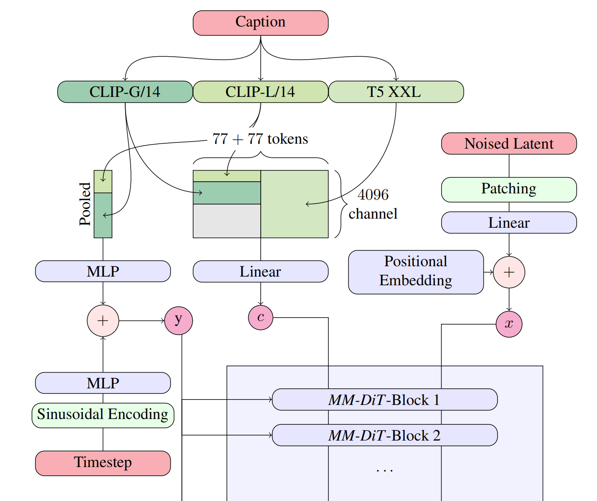</div>

虽然 CLIP ViT-L、OpenCLIP ViT-bigG 与 T5-XXL Encoder 的组合带来了文字渲染和文本一致性增益，但也存在上下文长度上的约束：CLIP ViT-L 和 OpenCLIP ViT-bigG 默认只能编码 77 tokens，这使原本能够处理 512 tokens 的 T5-XXL 在 SD 3 中也受限于 77 tokens。作为对比，DALL-E 3 只使用 T5-XXL 作为 Text Encoder，可以输入 512 tokens，从而更充分地发挥其长上下文能力。


<h2 id="q-069">面试问题：训练Stable Diffusion 3过程中官方使用了哪些训练技巧？</h2>

**难度评分：⭐⭐⭐⭐⭐ (5/5)  |  考察频率：⭐⭐⭐⭐ (4/5)**

SD 3的训练方法可以沿着一条完整流程理解：先清洗图文数据、补充图像描述并预计算冻结编码器的特征，再训练MM-DiT预测潜空间中的速度场；训练从较低分辨率起步，随后适配高分辨率和不同长宽比，最后通过偏好优化改善生成结果。

### 1、 使用Rectified Flow：直接学习潜变量与噪声之间的变化速度

SD 3采用Rectified Flow训练Backbone主干。设 $x_0$ 是图像经过VAE编码并按模型约定变换后的干净潜变量， $c$ 是文本条件， $\varepsilon\sim\mathcal N(0,I)$ 是同形状的高斯噪声。采用 $t=0$ 对应数据、 $t=1$ 对应噪声的约定，训练样本由线性插值得到：

$$
z_t=(1-t)x_0+t\varepsilon,
\qquad
\frac{dz_t}{dt}=\varepsilon-x_0
$$

模型读取带噪潜变量、时间步和文本条件，预测这条路径的变化速度。损失函数则比较预测值与已知速度目标之间的差异：

$$
\mathcal L_{\mathrm{RF}}(\theta)=
\mathbb E_{(x_0,c)\sim p_{\mathrm{data}},\;t\sim\pi(t),\;\varepsilon\sim\mathcal N(0,I)}
\left[
\left\|v_\theta(z_t,t,c)-(\varepsilon-x_0)\right\|_2^2
\right]
$$

其中， $\pi(t)$ 是训练时间步的采样分布。一次训练只需抽取图文样本、噪声和一个时间步，构造带噪潜变量后计算预测误差，不必先运行完整的多步图像生成。混合分辨率训练中，如果时间步分布随分辨率变化，还需要为 $\pi$ 加上相应条件。

推理时，采样器从噪声出发，沿模型预测的速度场从 $t=1$ 向 $t=0$ 更新潜变量。训练样本采用直线插值，为学习较易数值求解的生成路径提供了目标，更稳定高效的进行训练。

### 2、 Logit-Normal时间步采样：让中间噪声阶段获得更多训练机会

同一张训练图像在不同噪声强度下，对模型提出的去噪要求不同。低噪声时，输入已经保留较多图像结构；高噪声时，模型需要更多依靠文本条件和学到的图像分布；在两者混合的中间阶段，模型需要判断哪些变化来自内容、哪些来自噪声。

SD 3据此比较了均匀采样、Logit-Normal、Mode Sampling等方法。其中，**位置参数为0、尺度参数为1的Logit-Normal在多个评测设置中表现较稳定。它会让模型更频繁地训练中间时间段，改变训练损失在不同噪声阶段上的权重**。

采样过程只需两步：

$$
u\sim\mathcal N(\mu,\sigma^2),
\qquad
t=\mathrm{sigmoid}(u)=\frac{1}{1+e^{-u}}
$$

先采样正态变量，再通过Sigmoid将它映射到 $(0,1)$ 。这里的 $\mu$ 和 $\sigma$ 描述的是变换前的正态分布，不能直接当成时间步 $t$ 的均值与标准差。
- 当 $\mu=0,\sigma=1$ 时，时间步分布关于0.5对称，相比均匀采样更集中于中间区域。当 $\mu$ 和 $\sigma$ 变化时，会产生不一样的采样效果：
- 增大 $\mu$ 会使采样偏向高噪声端；减小 $\mu$ 会使采样偏向低噪声端。
- 增大 $\sigma$ 会扩大Logit空间中的分散程度，也可能增加接近两端的采样，因此不宜一概理解成“更宽的单峰”。

这种调整改变了训练样本在时间维度上的分配，保留了原来的线性插值路径与速度监督目标。下图展示了固定 $\sigma=1$，只改变 $\mu$，展示采样重心如何移动变化：

<div align="center">


</div>


### 3、 时间步偏移：让高分辨率训练接触足够强的噪声

从低分辨率转向高分辨率时，相同的 $t$ 未必对应相同的学习难度。图像中的相邻位置通常存在相关性，独立噪声却可以通过平均被部分抵消。因此，即使每个位置的加噪强度相同，高分辨率图像的部分低频结构仍可能更容易辨认。

SD 3论文用常量图像解释这一点：如果所有像素的真实值相同，用更多带噪像素的平均值估计它，误差会减小。若像素数由 $N_0$ 增加到 $N_1$ ，保持该理想模型中的估计不确定性，可以得到时间步映射：

$$
t'=S_\alpha(t)=\frac{\alpha t}{1+(\alpha-1)t},
\qquad
\alpha=\sqrt{\frac{N_1}{N_0}}
$$

当 $\alpha>1$ 时，区间内部的时间步被移向更高噪声端，0和1两个端点仍保持不变。这让高分辨率训练接触更多强噪声样本。

下图展示了不同 $\alpha$ 取值下，时间步偏移的效果：

<div align="center">

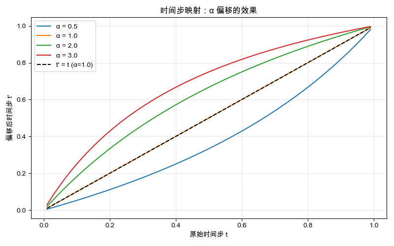

</div>

真实图像及其Latent不满足常量图像的全部假设，最终偏移量仍需通过实验选择。由 $256^2$ 增加到 $1024^2$ 时，上述理想化关系得到 $\alpha=4$ ；论文在后续1024×1024实验中实际采用的是 $\alpha=3$ ，并将其用于训练时间步和推理采样网格。

该偏移也可以写成Logit空间中的平移：

$$
\mathrm{logit}(t')=\mathrm{logit}(t)+\log\alpha
$$

因此，原本服从Logit-Normal分布的时间步，偏移后仍服从这一分布，位置参数增加 $\log\alpha$ ，尺度参数保持不变。以 $\mu_0=0$ 为基准时，偏移后的参数才可以直接写成 $\mu=\log\alpha$ 。

由插值系数定义的Log-SNR为：

$$
\lambda(t)=2\log\frac{1-t}{t},
\qquad
\lambda(t')=\lambda(t)-2\log\alpha
$$

训练时，偏移改变随机时间步的出现频率；推理时，偏移改变数值积分节点的位置。实际实现应确认偏移已经施加在哪一步，避免先调整Logit-Normal的位置参数，又重复施加相同的分式偏移。

下图展示了SD 3中Logit-Normal采样偏移前后的分布示意：

<div align="center">

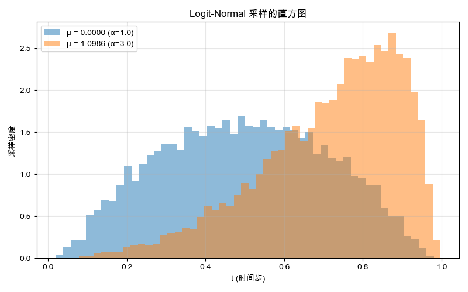

</div>

### 4、 数据清洗与重标注：补足图文监督中缺失的信息

模型能否遵循复杂Prompt，与训练时是否见过准确的图文对应关系密切相关。例如，一张图片中有红杯和蓝盘，但Caption标签只描述“桌上的物品”，模型就难以从这条样本中明确学到颜色归属和物体位置。

SD 3首先进行数据筛选，包括内容过滤、美学质量筛选，以及近重复图像去重。其中，去重使用SSCD提取图像特征，再通过聚类和相似度检查识别重复样本。这可以减少少量重复内容反复主导训练，也有助于降低模型复现训练图片的风险。

在文本标注上，SD 3借鉴DALL-E 3使用合成Caption的思路，用CogVLM根据图像生成补充描述。需要补充的是主体、背景、构图、属性和可见文字等信息，更准确描述图像内容。

原始Caption与合成Caption按50/50混合，主要是为了兼顾描述完整性与概念覆盖。 CogVLM的知识并不完备，生成描述时可能遗漏某些原始标签包含的概念。保留原始Caption，可以减少训练数据完全依赖同一个标注模型所带来的概念损失。

**具体流程可以概括为：清洗图像及原始标签 → 用CogVLM生成合成描述 → 保留两类Caption → 按50/50比例组织训练条件。**

论文用两个深度为15的MM-DiT模型进行对照，均训练250k步。在这一设置下，混合Caption使GenEval总体得分从43.27%提高到49.78%，颜色归属、位置关系和数量等项目获得改善；颜色识别和单物体项目则略有下降。因此，这组结果支持在这种标注策略下，整体图文对齐能力有所改善。具体对比效果如下所示：

<div align="center">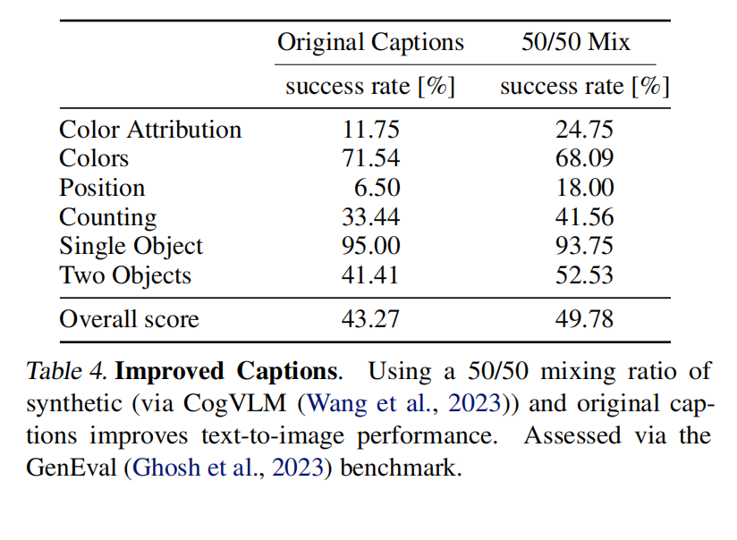</div>

### 5、 预计算冻结编码器特征：减少训练循环中的重复工作

在训练资源优化层面，官方还分析了冻结模块的特征预计算与缓存策略。

SD 3与之前的版本相比，整体的参数量级大幅增加，这无疑也增加了训练成本，所以官方的技术报告中也**对SD 3训练时冻结（frozen）部分进行了分析**，主要评估了VAE、CLIP-L、CLIP-G以及T5-XXL的显存占用（Mem）、推理耗时（FP）、存储成本（Storage）、训练成本（Delta），如下图所示，T5-XXL的整体成本是最大的：

<div align="center">

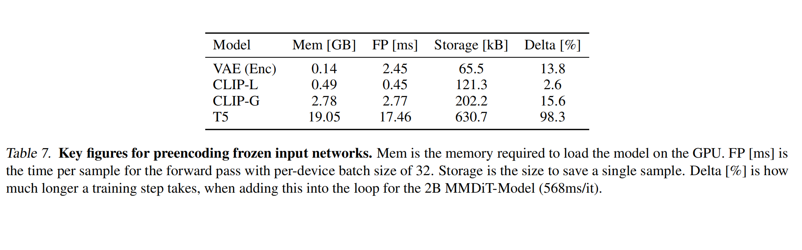

</div>

**为了减少训练过程中SD 3所需显存和特征处理耗时，SD 3设计了图像特征和文本特征的预计算策略**：由于VAE、CLIP-L、CLIP-G、T5-XXL都是预训练好且在SD 3微调过程中权重被冻结的结构，所以**在训练前可以将整个数据集预计算一次图像的Latent特征和文本的Text Embeddings，并将这些特征缓存下来**，这样在整个SD 3的训练过程中就无需再次计算。同时上述冻结的模型参数也无需加载到显卡中，可以节省约20GB的显存占用。

但是根据机器学习领域经典的“没有免费的午餐”定理，**预计算策略虽然为我们大幅减少了SD 3的训练成本，但是也存在其他方面的代价**。第一点是训练数据不能在训练过程中做数据增强了，所有的数据增强操作都要在训练前预处理好。若希望每轮重新裁剪图像、改变颜色，或重写Caption，就需要重新生成对应特征。第二点是预处理好的图像特征和文本特征需要一定的存储空间。

### 6、 独立丢弃文本条件：支持CFG与编码器组合

SD 3在训练时随机将文本编码器的输出置零，使同一个MM-DiT既接触完整文本条件，也接触部分条件缺失和全部条件缺失的样本。这为推理时的Classifier-Free Guidance提供了基础。

三个编码器的条件分别独立丢弃。若希望三路同时缺失的概率约为10%，每路的丢弃概率可由下式理解：

$$
p^3\approx0.1,
\qquad
p\approx\sqrt[3]{0.1}\approx0.464
$$

这里丢弃的是编码器输出的条件特征。只有三路条件都缺失时，才对应完整的无文本条件情形；只缺失一路或两路时，模型仍能利用剩余的文本信息。

推理时，在相同的带噪潜变量和时间步下，分别得到条件预测与无条件预测，再按引导强度组合：

$$
v_{\mathrm{cfg}}(z_t,t,c)=
v_\theta(z_t,t,\varnothing)
+w\left[
v_\theta(z_t,t,c)-v_\theta(z_t,t,\varnothing)
\right]
$$

其中， $w$ 是CFG scale， $\varnothing$ 表示无文本条件。通常增大引导强度会加强文本条件的影响，但过强引导可能损害自然度与多样性。

独立丢弃还让模型适应不同编码器子集。论文测试了推理时保留两路CLIP、用零向量替代T5特征的情况：普通Prompt下仍有较好的可用性，复杂描述和较长文字渲染对T5的依赖更明显。**这是一种质量与资源之间的取舍**。


<h2 id="q-075">面试问题：Stable Diffusion 3.5有哪些改进点？</h2>

**难度评分：⭐⭐⭐⭐ (4/5)  |  考察频率：⭐⭐⭐⭐⭐ (5/5)**

Stable Diffusion 3.5延续了SD 3的潜空间生成与多模态Transformer路线，围绕图像质量、训练稳定性、多分辨率生成和推理速度做了进一步改进。主要包含Stable Diffusion 3.5 Large、Stable Diffusion 3.5 Large Turbo和Stable Diffusion 3.5 Medium三个主要版本，具体如下表所示：

1. **Stable Diffusion 3.5 Large**：参数量约8B，重点提升图像生成质量和提示词遵循能力，能够生成约百万像素级的高质量图像。
2. **Stable Diffusion 3.5 Large Turbo**：Large的蒸馏版本，只需约4步即可生成高质量图像，适合需要快速批量生成的场景。
3. **Stable Diffusion 3.5 Medium**：参数量约2.5B，使用新的MM-DiT-X架构与训练方法，在消费级硬件上的可用性、生成质量和定制成本之间取得平衡，可覆盖约0.25M到2M像素范围的多种分辨率。

<div align="center">

| 模型版本 | Backbone参数量 | 主要变化与定位 |
|---|---:|---|
| SD 3.5 Large | 约 8.1B | 基于MMDiT架构，重点提升图像质量与复杂提示词理解遵循能力，能够生成约 1MP（百万像素级） 高质量图像 |
| SD 3.5 Large Turbo | 约 8.1B | 从Large蒸馏得到，只需约4步即可生成高质量图像，适合需要快速批量生成的场景 |
| SD 3.5 Medium | 约 2.5B | 设计MMDiT-X架构，增加图像自注意力分支并改进多分辨率训练，覆盖约 0.25MP—2MP 的多种分辨率生成范围 |

</div>

这里的 MP 表示总像素数。例如，1024×1024约为1MP，2048×2048约为4.2MP。

SD 3.5 Medium的Backbne设计了MMDiT-X架构，在联合注意力之外，增加图像自注意力。具体示意图如下图所示：

<div align="center">

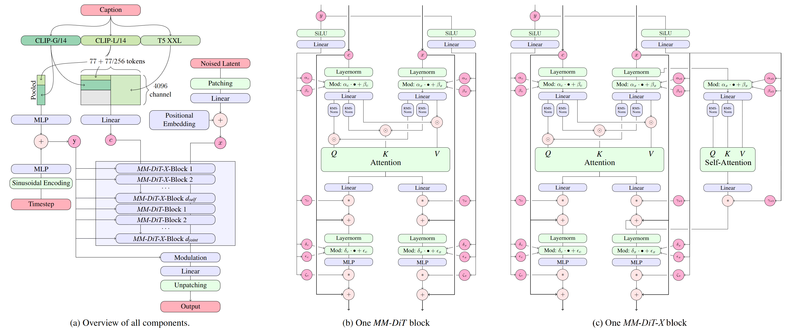

</div>

原MMDiT为文本和图像保留各自的投影、调制和前馈网络，再把两种模态的Q、K、V沿序列维度拼接，进行联合注意力计算。图像Token因而可以读取文本条件，也可以读取其他图像位置的信息。

SD 3.5 Medium在此基础上，为前部的部分Transformer块增加一条图像自注意力分支。这条分支位于前 13 个块，即从零开始编号的 0—12 层。

一个MMDiT-X块可以按下面的过程理解：
1. 文本和图像特征分别经过归一化、条件调制与投影，参与原有的图文联合注意力。
2. 同一份块输入中的图像特征，经过另一套调制与QKV投影，进入新增的图像自注意力；该分支当前层的Q、K、V只来自图像Token。
3. 联合注意力输出中的图像部分，与新增图像分支的输出，分别经过输出投影和门控后，加回图像残差流。
4. 更新后的图像特征继续进入前馈网络；文本分支通过联合注意力及自己的前馈网络更新。

省略时间步等全局条件，并把各分支的输出投影包含在函数中，图像侧的注意力更新可以概括为：

$$
X'=X
+
g_{\mathrm{joint}}\odot J_X(X,C)
+
g_{\mathrm{image}}\odot S_X(X).
$$

这里， $X$ 是图像隐藏特征， $C$ 是文本隐藏特征， $J_X$ 表示联合注意力产生的图像侧输出， $S_X$ 表示图像自注意力输出，两个 $g$ 是各自的残差门控系数， $\odot$ 表示逐元素相乘。

新增分支的作用，是为图像内部的空间关系提供额外的建模能力，同时保留图文之间的信息交流。原有联合注意力本身已经能够建模图像位置之间的联系，MMDiT-X为这种联系增加专门的计算分支，有助于在不同分辨率下维持画面结构与整体协调性。

**同时SD 3.5 Medium还通过渐进式多分辨率训练和位置编码裁剪，适配不同分辨率生成能力。**

分辨率变化会改变图像Token的数量和空间关系。只把输出尺寸设大，并不能保证模型在新尺寸下仍能维持主体比例、完整构图和细节协调。SD 3.5 Medium的公开训练说明给出了逐步提高训练尺度的过程：**256 → 512 → 768 → 1024 → 1440，最后阶段加入混合尺度训练**。

这使模型先在较低计算成本下学习图像结构，再逐渐适应更细的空间网格，并在后期共同学习不同尺寸下的生成任务。上述训练策略支撑了SD 3.5 Medium约0.25MP—2MP的生成范围。

---

<h1 id="ch-flux-01">第二章 FLUX系列核心高频考点</h1>

<h1 id="q-flux-001">1.介绍一下FLUX.1的原理，与Stable Diffusion 3相比有哪些创新点？</h1>

<h2 id="q-flux-014">面试问题：FLUX.1的VAE部分有哪些创新？详细分析改进意图</h2>

**难度评分：⭐⭐⭐⭐ (4/5)  |  考察频率：⭐⭐⭐⭐⭐ (5/5)**

**FLUX.1 VAE继承了SD 3 VAE模型架构，并使用同样的高、宽各缩小8倍的下采样空间压缩方式，使用16通道Latent承载图像信息，并通过独立训练改善压缩后的重建效果**。在Latent特征进入后续的FLUX.1 Backbone前，FLUX.1 VAE还对Latent特征进行Pack操作，将Latent特征通道数提高到64（16 -> 64）。

**可以说，FLUX.1系列的扩散模型部分输入通道数为64，是SD 3的四倍**。这也代表FLUX.1要学习拟合的内容比起SD 3增加了4倍，所以FLUX.1 Backbone大幅增加参数量级来提升模型容量（model capacity）。

FLUX.1 VAE的Latent特征Patch化方法是通过Pack操作将 $2\times2$ 像素块直接在通道维度上堆叠。这种做法保留了每个像素块的原始分辨率，只是将它们从空间维度移动到了通道维度。**与之相对应的，SD 3使用下采样卷积来实现Latent特征Patch化，但这种方式会通过卷积减少空间分辨率，从而损失一定的特征信息**。

Rocky再举一个形象的例子来解释SD 3和FLUX.1的Patch化方法的不同：

1. **SD 3（下采样卷积）**：想象我们有一个大蛋糕，SD 3的方法就像用一个方形模具，从蛋糕上切出一个 $2\times2$ 的小方块。在这个过程中，我们提取了蛋糕的部分信息，但是由于进行了压缩，Patch块的大小变小了，信息会有所丢失。
2. **FLUX.1（通道堆叠）**：FLUX.1 的方法更像是直接把蛋糕的 $2\times2$ 块堆叠起来，不进行任何压缩或者切割。我们仍然保留了蛋糕的所有部分，但是它们不再分布在平面上，而是被一层层堆叠起来，像是三明治的层次。这样一来，蛋糕块的大小没有改变，只是它们的空间位置被重新组织了。

我们设Latent空间尺寸为 $h\times w$ ，并省略Batch维度，则这一操作可以写成：

$$
P:\mathbb{R}^{16\times h\times w}
\longrightarrow
\mathbb{R}^{\left(\frac{hw}{4}\right)\times64}
$$

每个Token包含4个空间位置的特征，每个位置有16个通道，因此Pack操作后的特征维度为：

$$
d_{\mathrm{token}}=2\times2\times16=64
$$

与此同时，Token数量变为空间位置数的四分之一：

$$
L=\frac{hw}{4}
$$

Pack操作前后的元素总数完全相同：

$$
16hw=64\times\frac{hw}{4}
$$

Pack操作只改变元素的排列方式，不增加新的图像信息，也不引入可学习参数。我们举具体例子来说，一张 $1024\times1024$ 图像经过VAE编码后，得到 $16\times128\times128$ 的Latent；Pack操作之后得到4096个Token，每个Token为64维：

$$
16\times128\times128
\;\xrightarrow{\;2\times2\ \mathrm{Pack}\;}
4096\times64
$$

相对于把每个Latent空间位置单独作为一个Token，Pack操作减少了序列长度，从而降低后续注意力计算的序列开销。

总的来说，**相比SD 3，FLUX.1将 $2\times2$ 特征Patch化操作应用于Backbone部分之前**。这也表明FLUX.1系列模型认可了SD 3做出的贡献，并在其基础上进行了继承与优化。

**与SD 3相比，FLUX.1 VAE并不是直接沿用SD 3的VAE，而是基于相同结构进行了重新训练，所以两者的模型参数权重并不相同，对编码后的Latent特征做平移和缩放的参数也不相同**。因为VAE输出的原始Latent具有自身的均值和尺度，而Backbone模型需要在它与标准高斯噪声之间建立训练路径。为此，FLUX.1对原始Latent进行固定的仿射变换：

$$
z=s\left(z_{\mathrm{raw}}-b\right)
$$

其中 $s=0.3611$ , $b=0.1159$。 $b$ 用于调整整体数值中心， $s$ 用于调整整体尺度。解码前需要执行逆变换：

$$
z_{\mathrm{raw}}=\frac{z}{s}+b
$$

与之对应的，SD 3的平移系数为0.0609，缩放系数为1.5305，因此编码后的处理为：

$$
z_{\mathrm{SD3}}
=
1.5305\left(z_{\mathrm{raw}}-0.0609\right)
$$

平移和缩放操作能将Latent特征分布的均值和方差归一化到0和1，和扩散过程加的高斯噪声在同一范围内，更加严谨和合理。


<h2 id="q-flux-015">面试问题：FLUX.1的Backbone部分有哪些创新？详细分析改进意图</h2>

**难度评分：⭐⭐⭐⭐⭐ (5/5)  |  考察频率：⭐⭐⭐⭐⭐ (5/5)**

**FLUX.1的Backbone采用双流（MM-DiT）与单流（Single-DiT）结合的Transformer架构，在模态专属处理、图文联合建模和计算效率之间进行协调**。在前段双流模块中，保留文本与图像各自的变换参数，同时让两种模态通过联合注意力交换信息；后段单流模块将图文特征合并为一条序列，在每层内使用统一的参数继续建模。

直观地理解，FLUX.1先使用双流模块实现两个模态的信息融合，然后再接单流模块加深模型深度，在增强模型整体学习能力的同时，还可以节省一部分参数。**FLUX.1 Backbone中包含19个双流模块和38层单流模块，整体参数量约12B**。

下图是FLUX.1 Backbone完整结构图：

<div align="center">

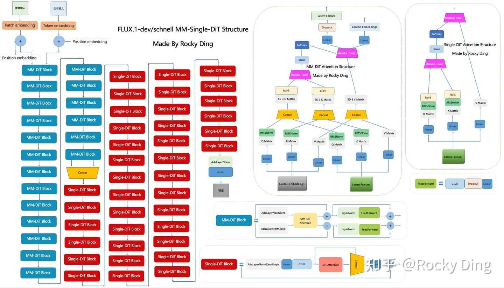

</div>

MM-Single-DiT架构的核心组件包括：
1. **MM-DiT Block**：由两个AdaLayerNormZero层、一个MM-DiT Attention Structure模块、两个LayerNorm层和两个FeedForward层组成。
2. **Single-DiT Block**：由一个AdaLayerNormZero层、一个Single-DiT Attention Structure（DiT Attention）模块、两个Linear层和一个GELU激活函数组成。
3. **MM-DiT Attention Structure**：FLUX.1的MM-DiT Block中的核心组件，和SD 3一样，将文本信息和图像信息以同等重要的级别进行Attention计算。
4. **Single-DiT Attention Structure**：FLUX.1的Single-DiT Block中的核心组件，将文本信息和图像信息的特征融合后，进行经典的DiT Attention计算。
5. **FeedForward**：由GELU激活函数、Dropout层和Linear层组成。

### 1、 FLUX.1 Backbone输入侧特点

在输入侧，FLUX.1 Backbone接收当前时间步的带噪图像Latent，以及文本编码器提供的两类语言特征。

图像Latent经过 $2\times2$ pack处理后，每个Token具有64维特征，再通过线性投影映射到3072维。T5-XXL输出的文本序列特征原本为4096维，同样通过独立投影映射到3072维。这样，文本与图像Token就具有相同的隐藏维度，可以参与后续的联合注意力计算。

CLIP输出的768维池化特征则走另一条路径：它被映射为全局条件向量，与时间步条件共同控制各个Transformer块的特征变换。

下图展示了图像Token、文本Token与全局条件在FLUX.1 Backbone输入侧的处理流程：

<div align="center">

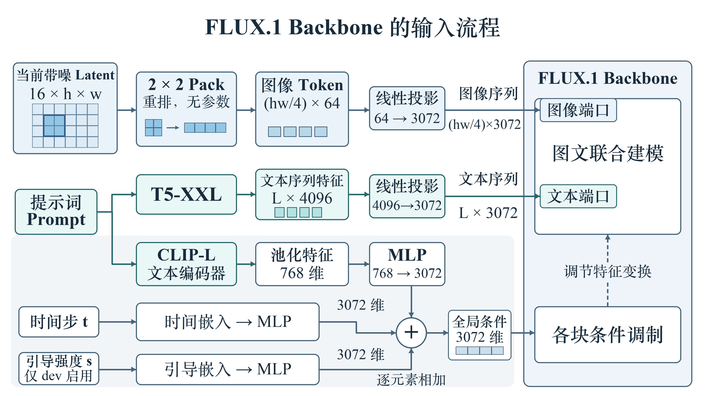

</div>

如上图所示，同一提示词分别经过T5-XXL和CLIP-L文本编码器，形成文本序列特征与池化特征。图像序列和T5文本序列分别进入图文联合建模；CLIP池化特征经MLP映射后，与时间步条件逐元素相加，构成各块使用的全局调制条件。FLUX.1-dev还会加入引导强度嵌入，FLUX.1-schnell不启用这一分支。上图中的 $h$、$w$ 表示Latent的空间尺寸，$L$ 表示文本Token数量；Batch维度、分词过程和RoPE位置编码支路在图中省略。

### 2、 双流模块和单流模块讲解

文本Token与图像Token具有不同的来源和统计特性。双流块为它们分别设置归一化、条件调制、QKV投影、注意力输出投影和MLP，使每种模态都能够使用适合自身特征的变换。

不过，两路特征并没有各自独立计算完整的注意力。得到文本和图像的Q、K、V后，模型会沿序列维度分别拼接：

$$
Q=\begin{bmatrix}
Q_{\mathrm{text}}\\
Q_{\mathrm{image}}
\end{bmatrix},
\qquad
K=
\begin{bmatrix}
K_{\mathrm{text}}\\
K_{\mathrm{image}}
\end{bmatrix},
\qquad
V=
\begin{bmatrix}
V_{\mathrm{text}}\\
V_{\mathrm{image}}
\end{bmatrix}
$$

Q、K还会经过归一化与RoPE处理，随后进行联合注意力计算。计算结果再按原来的序列长度拆回文本部分和图像部分，分别进入各自的输出投影、残差更新和MLP。

因此，双流中的“双”，主要指两套模态专属的特征变换参数；图文之间的信息交换在这一阶段就已经发生。 图像Token可以读取文本中的主体、属性和关系，文本Token也可以结合当前图像状态更新自身表示。

这种设计延续了多模态DiT的基本思路：保留不同模态的表达差异，同时让它们在注意力中建立联系。

<div align="center">

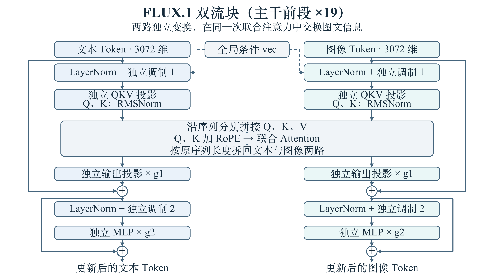

</div>

上图展示了FLUX.1双流块内部流程。文本与图像分别进行特征变换，Q、K、V沿序列维拼接后参与同一次联合注意力，再按原序列长度拆分。两路中的 $g_1$、 $g_2$ 分别代表各自的门控参数，由全局条件通过模态专属调制器生成；第二条残差连接使用第一次更新后的状态。实线表示特征与残差路径，虚线表示条件输入，图中省略了条件到第二组调制和门控的连线。

经过19个双流块后，FLUX.1 Backbone将文本与图像的隐藏特征沿序列维度拼接：

$$
H=\mathrm{Concat}_{\mathrm{seq}}
\left(H_{\mathrm{text}},H_{\mathrm{image}}\right)
$$

随后，整条序列进入38个单流块。在每个单流块内部，文本与图像Token使用同一套投影、调制和MLP参数；不同单流块之间仍然各自拥有独立参数。

这样，网络后段可以继续对图文关系进行联合建模，同时减少持续维护两套模态专属变换所需的参数开销。

**单流模块的另一个特点是Attention与MLP共享同一份归一化、调制后的输入，并行展开计算，构建并行注意力机制**。它的流程是：
1. 对输入进行LayerNorm和条件调制。
2. 使用一次较大的线性投影，同时生成Q、K、V与MLP分支的中间特征。
3. 注意力分支计算Token之间的交互，MLP分支对各Token的中间特征进行GELU激活。
4. 拼接两路结果，通过统一的输出投影映射回隐藏维度。
5. 使用条件生成的门控系数控制残差更新。

FLUX.1单流块中的并行注意力与MLP流程如下图所示：

<div align="center">

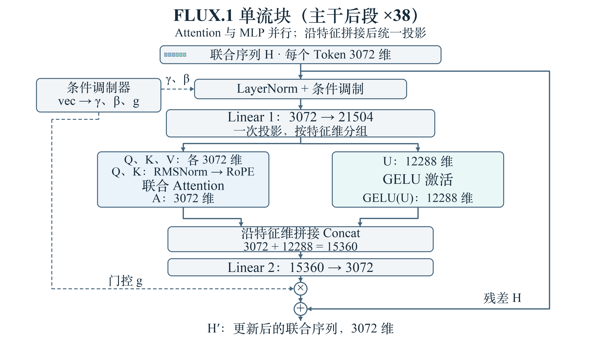

</div>

上图中展示了FLUX.1单流块内部流程。Linear 1一次生成Q、K、V与MLP中间特征；Attention输出3072维，MLP分支输出12288维，沿特征维拼接后由Linear 2映射回3072维，再经过门控与原输入相加。图中维度均指单个Token的特征宽度，QK-Norm与RoPE只作用于Q、K。层内图文使用同一套参数，不同单流块之间参数独立；单块输出仍保留全部图文Token。实线表示特征与残差路径，虚线表示条件输入。

设调制后的输入为 $\widetilde H$，这一过程可以概括为：

$$
[Q,K,V,U]=\mathrm{Linear}_1(\widetilde H)
$$

其中， $U$ 是MLP分支的中间特征。记完成QK归一化、RoPE和注意力计算后的结果为 $A$，则输出为：

$$
H'=H+
g\odot
\mathrm{Linear}_2
\left(
\mathrm{Concat}_{\mathrm{feat}}
\left(A,\mathrm{GELU}(U)\right)
\right)
$$

这里， $\mathrm{Concat}_{\mathrm{feat}}$ 表示沿特征维度拼接， $g$ 是残差门控系数， $\odot$ 表示逐元素相乘。

并行结构保留了Attention的跨Token交互和MLP的逐Token非线性变换，让两个分支共同读取归一化、调制后的输入。两个分支的结果先沿特征维拼接，再通过统一的输出投影完成融合；Add发生在门控后的更新量与原输入之间。这样的组织减少了Attention与MLP顺序执行的依赖，并便于合并线性投影，实际加速幅度还取决于算子实现和硬件配置。

### 3、 QK-Norm和三维RoPE位置编码

我们先来讲QK-Norm的作用。在注意力计算中，Q、K的幅度会直接影响点积大小。FLUX.1对每个注意力头的Q、K应用RMSNorm，再进行位置旋转和注意力计算。这有助于控制注意力分数的数值范围，降低大模型计算中的不稳定因素。

**QK-Norm与RoPE承担不同职责：前者调整Q、K的幅度，后者根据位置旋转Q、K的特征。**

与SD 3使用加性二维位置嵌入的方式不同，了大模型领域中常用的旋转式位置编码（Rotary Positional Embedding，RoPE），RoPE是直接作用在Attention机制上的相对位置编码方式，将位置信息引入注意力内部。其基本形式为：

$$
\widetilde q_a=R(\mathbf p_a)q_a,
\qquad
\widetilde k_b=R(\mathbf p_b)k_b
$$

其中， $\mathbf p_a$ ， $\mathbf p_b$ 是两个Token的位置坐标。对于按坐标轴构造的旋转矩阵，有：

$$
\widetilde q_a^{\mathsf T}\widetilde k_b
=
q_a^{\mathsf T}
R(\mathbf p_b-\mathbf p_a)
k_b
$$

因此，注意力点积可以直接包含两个Token的相对位置关系。它既可以作用于相邻Token，也可以作用于相距较远的Token。

FLUX.1采用三个坐标分量。在基础文生图流程中，图像Token的位置可以写成：

$$
\mathbf p_{\mathrm{image}}=(0,r,c)
$$

这里的 $r$ 和 $c$ 是pack处理后Token网格中的行、列坐标。第一维在单图生成中固定为0，与控制噪声程度的采样时间步不同。

官方配置为三个坐标轴分别分配16、56、56个特征维度：

$$
16+56+56=128
$$

128是每个注意力头的Q、K维度。 前16维使用第一轴坐标构造旋转，中间56维使用行坐标，最后56维使用列坐标。这些旋转作用于Q、K，并不构成一个额外加到3072维Token特征上的位置向量。

在FLUX.1中，具体操作是将文本的位置编号设为 $(0,0,0)$ ，图像的位置编号设为 $(0,i,j)$ ，之后用标准旋转式位置编码对三个维度的编号编码，再把三组编码拼接起来。

假设位于 $(i,j)$ 的图像像素位置编号是 $(0,i,j)$ ，经过特征编码，位置编号会转换成 $[16,56,56]$ 维度的矩阵，表示第一个维度使用长度16的位置编码，后两维使用长度56的位置编码。再经RoPE函数计算得到旋转式位置编码后，三组结果拼接到一起，最终形成128维的位置编码。编码前16个通道是第一维位置编号的位置编码，中间56个通道知道垂直位置信息，最后56个通道知道水平位置信息。

从原理上来讲，Transformer架构中只包含注意力和全连接两种经典计算方式，这两种计算本身都和位置信息无关。为了让Transformer知道图像像素间的空间对应关系，就需要给Transformer中的Token注入额外的位置信息。

经典的正弦编码方式虽然能表示一定的相对位置信息，但经过注意力机制后，其中的相对位置信息几乎会丢失。旋转位置编码使用二维向量来表示每个Token的二维位置编码，经过注意力机制计算后，结果里恰好会出现相对位置关系，从而让注意力计算过程也能感知Token间的相对位置。

RoPE使用旋转变换，使每个位置的Token保留了相邻位置的相对关系。相比传统的绝对位置编码，RoPE更注重局部关系建模。这种增强的局部敏感性有助于AIGC图像创作大模型捕获图像局部区域之间的细节关联，从而提升模型的生成质量和泛化性能。


<h2 id="q-flux-016">面试问题：FLUX.1的Text Encoder部分有哪些创新？详细分析改进意图</h2>

**难度评分：⭐⭐⭐⭐ (4/5)  |  考察频率：⭐⭐⭐⭐ (4/5)**

**FLUX.1在SD 3的基础上对Text Encoder部分进行了精简优化，只使用CLIP ViT-L和T5-XXL Encoder两个Text Encoder模型，并没有使用OpenCLIP ViT-bigG模型**。两者读取提示词后，分别向FLUX.1 Backbone提供不同形式的语言条件：CLIP ViT-L的Pooled Text Embeddings特征与Time Embedding相加，同时T5-XXL则将提取的Text Embedding特征送入Bcakbone的双流模块中，**即CLIP把整段提示词表示为一个全局向量，T5保留逐Token的上下文特征**。

我们想要理解这套设计逻辑，可以从FLXU.1需要解决的两个问题入手：一方面，模型需要知道整张图大致要表现什么；另一方面，它还需要在生成过程中反复读取具体的对象、属性和关系。FLUX.1通过全局条件与文本序列两条路径，将这些信息交给FLUX.1 Backbone使用。

**在CLIP部分，CLIP提供全局文本条件**。提示词经过CLIP得到一个768维全局文本特征向量。在进入FLUX.1 Backbone后，这个768维向量会先经过MLP映射到3072维，再与时间步条件相加；dev版本还会加入引导强度对应的条件嵌入。合成后的向量用于产生Transformer块中的调制参数，使Backbone的特征变换同时受到文本语义与当前噪声阶段的影响。

**在T5-XXL部分，T5保留逐Token的语义信息，为图文交互提供更细致的条件**。提示词经过T5为每个Token（最大序列长度为512）输出一个4096维特征。T5输出的序列特征进入Backbone前，还要经过线性投影，将每个Token的4096维特征转换为3072维。这样，它们就能与同样处于3072维隐藏空间的图像Token参与后续图文交互。

那么，两路文本条件如何共同影响一张图像呢？

以提示词“木桌上有一只红色杯子，杯子位于蓝色书本左侧，柔和的窗边光照”为例，同一段文本会分别进入CLIP和T5-XXL。CLIP产生一个全局向量，经过映射后参与Backbone的条件调制；T5产生一组上下文特征，通过联合注意力参与图像Token的更新。前者以汇总表示影响Backbone的整体特征变换，后者让Backbone保留对具体文本描述的访问。

在采样开始前，文本编码器通常已经完成特征提取。随后每个采样步骤都会将这些文本特征与当前带噪图像一起送入生成Backbone。Backbone内部会不断更新图文隐藏状态，但不需要在每个采样步骤重新运行一次CLIP和T5。

总的来说，**FLUX.1比SD 3更依赖T5-XXL提取的文本特征信息**。SD 3中CLIP Encoder的特征仍有较大的作用，比如SD 3可以去掉T5-XXL，只使用CLIP Encoder提取文本特征信息来生成图像。


<h2 id="q-flux-002">面试问题：FLUX.1在训练和推理过程中使用了哪些优化技巧？</h2>

**难度评分：⭐⭐⭐⭐ (4/5)  |  考察频率：⭐⭐⭐⭐ (4/5)**

FLUX.1与SD 3一样采用了Rectified Flow的生成建模方式，其优化涉及模型训练和实际推理两个环节。

### 1、 多分辨率与多长宽比适配训练

FLUX.1系列模型能够灵活生成多种图像分辨率和长宽比，适应 $0.1\sim2.0\text{MP}$ （Megapixels，百万像素）的图像生成任务。总的来说，图像像素数量越多、分辨率越高，细节表现越丰富，具体如下图所示：

<div align="center">

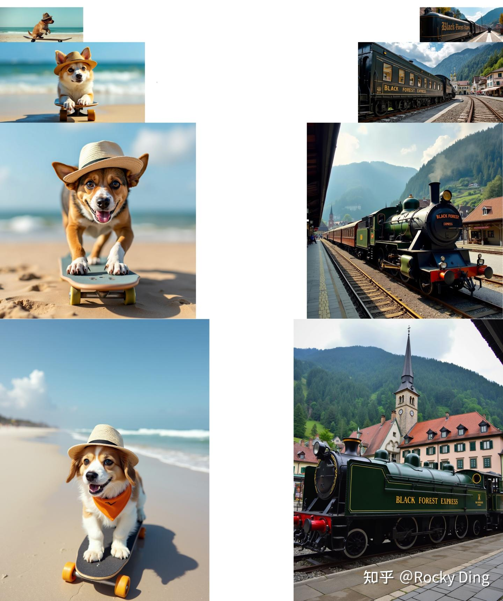

</div>

FLUX.1能够适配各种分辨率的图像生成，主要得益于**多尺度训练 + RoPE位置编码 + 动态Time Shift**的组合策略。三者分别解决训练数据尺度覆盖、Token空间关系建模和不同序列长度下噪声调度的问题，共同提升了模型对不同分辨率与长宽比的泛化能力。目前FLUX.1并没有公开给出完整的分桶规则、分辨率阶段或采样比例。

### 2、 动态Time Shift：根据图像Token数量调整推理时间表

FLUX.1模型完成训练后，还需要选择在哪些时间点调用Backbone进行采样。FLUX.1采用动态Time Shift，处理的就是这一推理问题。

沿用 $t=1$ 对应噪声、 $t=0$ 对应真实图像的约定，采样器从1向0推进。代码先建立均匀时间网格，再根据当前图像的Token数量计算偏移量，将时间节点重新分配到生成过程的不同阶段。

在公开默认路径中，映射取 $\sigma=1$ ，可以写成：

$$
t'=
\frac{e^{\mu}t}
{1+(e^{\mu}-1)t}
$$
其中，$\mu$是Logit空间的偏移量。若用$\alpha$表示分式映射中的乘性系数，则：

$$
\alpha=e^\mu
$$

这里调整的是时间坐标，不会改变初始高斯噪声的均值。根据图像Token数量 $L$ ，通过两个校准点构造线性函数：

$$
\mu(L)
=
0.5+
\frac{1.15-0.5}{4096-256}(L-256)
$$

FLUX.1的VAE进行8倍空间下采样，随后将潜变量中的$2\times2$区域pack处理为一个Token。在图像高宽已经按16的倍数对齐时，有：

$$
L=
\frac{H}{16}\frac{W}{16}
=
\frac{HW}{256}
$$

这里的 $L$ 只统计图像Token，不包含文本Token。例如：

|图像尺寸|	图像Token数量 $L$ |偏移量 $\mu$ |	$\alpha=e^\mu$ |
| --- | --- | --- | --- |
| $256\times256$	|256	|0.50	|约1.65|
| $512\times512$	|1024	|0.63	|约1.88|
| $1024\times1024$	|4096	|1.15	|约3.16|


以 $1024\times1024$ 为例， $\mu=1.15$ 时，原时间网格中的 $t=0.5$ 会映射到约 $t'=0.76$ 。中间节点整体向高噪声端移动，而起点、终点和总采样步数保持不变。这相当于重新安排有限次数的模型计算，让它们覆盖不同的噪声阶段。

下图中展示了这一映射，以及Token数量与偏移量的关系。左图展示不同 $\mu$ 下的时间坐标映射，右图展示Token数量与 $\mu$ 的线性关系。图中的0.5和1.15是两个校准点对应的数值，代码没有把线性函数截断在两者之间，因此它们不是所有输入下固定的参数上下限。

<div align="center">

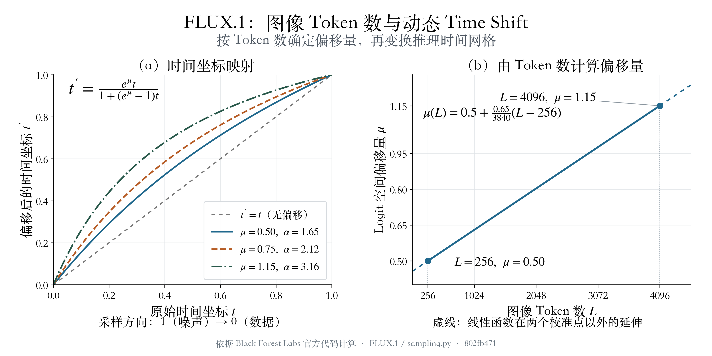

</div>

此外， $1024\times1024$ 与 $512\times2048$ 具有相同的图像Token数量，在这段代码中会得到相同的偏移量。这说明动态Time Shift关注的是序列规模，长宽比变化带来的空间布局仍需要依靠模型的空间建模和训练覆盖。


<h1 id="q-flux-017">2.FLUX.1有哪些主流的变体模型？介绍一下它们的核心原理</h1>

<h2 id="q-flux-005">面试问题：介绍一下FLUX.1 Lite与FLUX.1的异同</h2>

**难度评分：⭐⭐⭐ (3/5)  |  考察频率：⭐⭐⭐ (3/5)**

FLUX.1作为开源AIGC图像创作大模型，其Backbone DiT部分参数量达到12B，与之对应的是推理成本也较大。因此，Freepik团队在FLUX.1-dev的基础上开源了一个更小的蒸馏模型FLUX.1 Lite-8B-alpha，**DiT部分的参数量从12B减少到8B，推理所需显存减少约7GB，同时生成图像的速度提升约23%**。

虽然参数量从12B降低到8B，但整体图像生成质量并未明显降低。使用同样的提示词，FLUX.1 Lite可以得到和FLUX.1-dev质量接近的生成图像，具体效果对比如下图所示：

<div align="center">

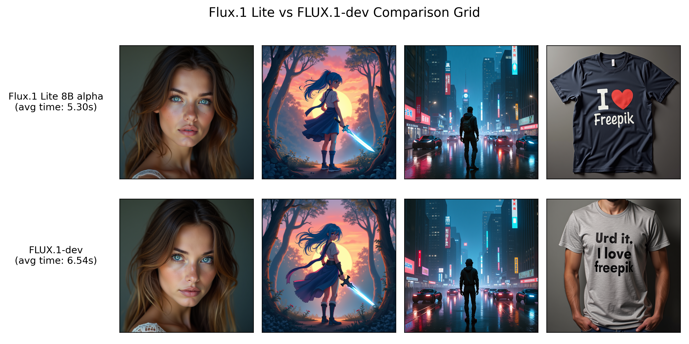

</div>

**FLUX.1 Lite的核心做法是减少FLUX.1-dev中MM-DiT Blocks的数量**。FLUX.1-dev一共包含19个MM-DiT Blocks，而FLUX.1 Lite只保留8个，去掉第4至15层共11个MM-DiT Blocks。这本质上是使用模型轻量化领域中的经典技术模型剪枝来压缩网络，再使用FLUX.1-dev作为教师模型进行蒸馏训练。

Freepik团队通过固定提示词，分析不同MM-DiT Blocks和Single-DiT Blocks对整个生图结果的贡献，如下图所示。具体方法是计算每个Block输入和输出之间的MSE（Mean Squared Error）：如果MSE很小，说明Latent特征经过该Block后并没有发生太多变化，这一层对最终图像的边际贡献相对有限。

<div align="center">

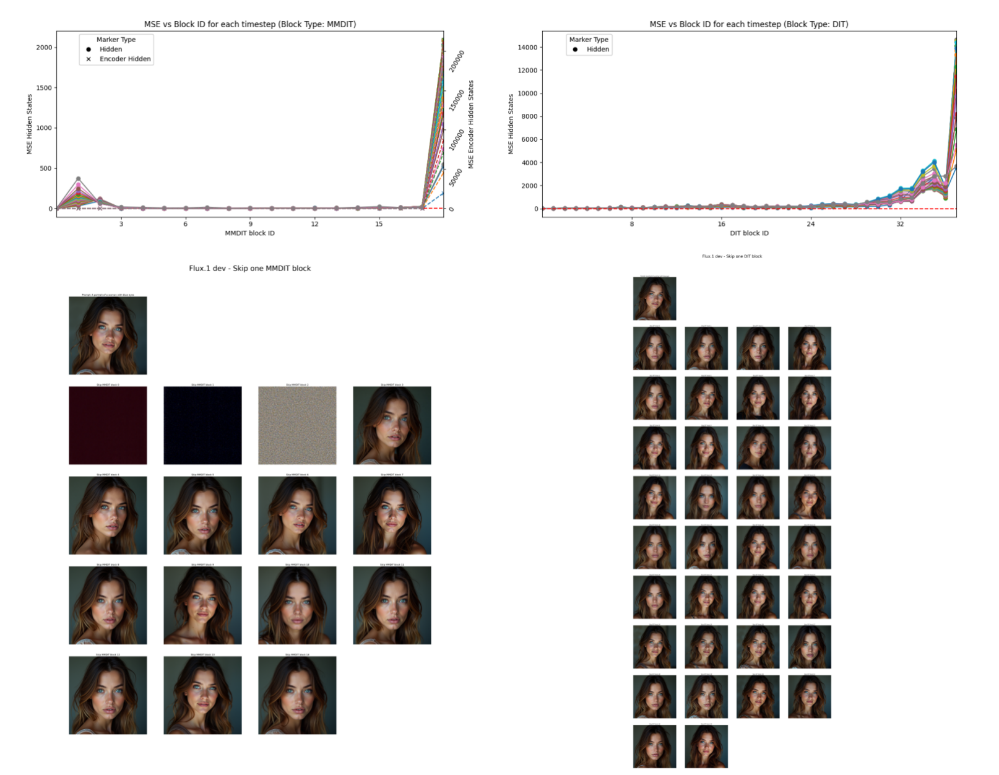

</div>

实验结果表明，FLUX.1前部和后部MM-DiT Block的输入输出变化较大，中间部分MM-DiT Block的变化较小；后部Single-DiT Block的变化较大，而前面大部分Single-DiT Block的变化较小。**这说明去掉一部分中间Block，并不会给最终生成质量带来明显改变**。

Freepik团队最终选择去掉第4至15层MM-DiT Blocks，一个重要原因是MM-DiT Blocks的参数规模比Single-DiT Blocks更大，对MM-DiT部分进行剪枝可以获得更高的显存与速度收益。

<h2 id="q-flux-006">面试问题：介绍一下FLUX.1 Kontext的原理，有哪些创新点？</h2>

**难度评分：⭐⭐⭐⭐⭐ (5/5)  |  考察频率：⭐⭐⭐⭐⭐ (5/5)**

FLUX.1 Kontext一共有三个版本：FLUX.1 Kontext [max]、FLUX.1 Kontext [pro]和FLUX.1 Kontext [dev]。其中FLUX.1 Kontext [max]是性能最强的版本；FLUX.1 Kontext [pro]使用潜在对抗性扩散蒸馏（Latent Adversarial Diffusion Distillation，LADD）训练，能够在提升图像生成质量的同时显著减少采样步数，从而提高生成速度，更适合实时应用。上述两个模型同时支持文生图和图像编辑，但没有开源，可以通过官方API使用。

**FLUX.1 Kontext [dev]是开源版本，只支持纯图像编辑，不支持文生图，下图展示了FLUX.1 Kontext图像编辑效果**。它可以与FLUX.1 [dev]配合使用，从而实现文生图和图像编辑的完整流程。

<div align="center">

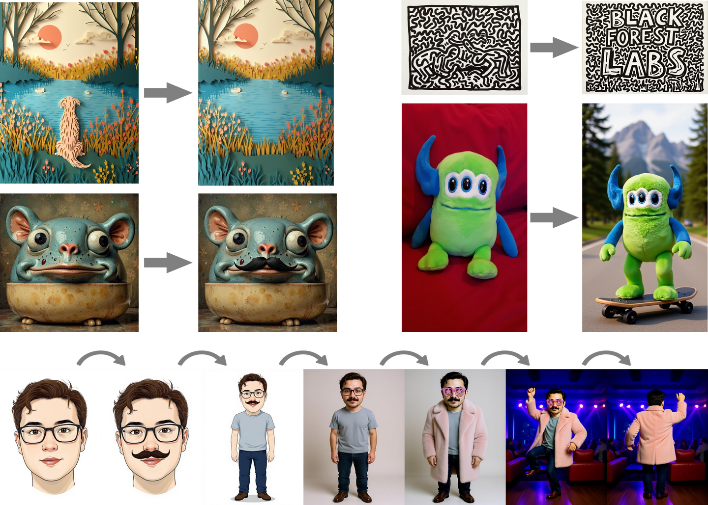

</div>

FLUX.1 Kontext的整体架构基于FLUX.1的DiT（Diffusion Transformer）扩展，通过引入参考图像作为条件输入实现多模态生成能力，**其核心创新在于构建双路径多模态特征处理机制**。下图是FLUX.1 Kontext整体架构和推理流程示意图：

<div align="center">

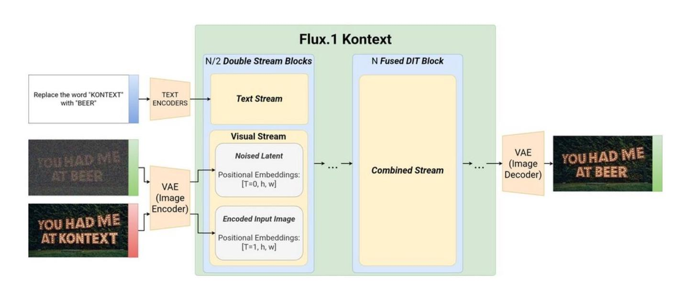

</div>

**双模态编码解决的是如何将参考图像输入模型的问题**。FLUX.1 Kontext首先使用冻结的VAE Encoder将参考图像编码为Latent特征，同时为目标图像构造带噪Latent。暂时省略Batch维度，并采用“空间尺寸 × 通道数”的记法，两者可以表示为：

$$
z_t\in\mathbb{R}^{h_t\times w_t\times C},
\qquad
z_{\mathrm{ref}}\in\mathbb{R}^{h_r\times w_r\times C}
$$

其中， $h_t,w_t$ 表示目标Latent的空间尺寸， $h_r,w_r$ 表示参考图Latent的空间尺寸， $C$ 是Latent通道数，在FLUX.1中为16。推理开始时， $z_t$ 是随机高斯噪声，随着采样推进，它逐步变成包含目标图像内容的Latent，因此使用 $z_t$ 可以描述整个生成过程。

VAE输出的二维Latent特征还需要经过pack处理，才能成为Transformer处理的Token序列。FLUX.1将相邻的 $2\times2$ 个空间位置合并成一个Token，并将这些位置的通道特征展开到同一个向量中。这样，Token数量变为空间位置数的四分之一，每个Token的特征维度则由16变为64。设打包操作为 $P$，则：

$$
X_t=P(z_t)\in\mathbb{R}^{L_t\times d},
\qquad
X_{\mathrm{ref}}=P(z_{\mathrm{ref}})
\in\mathbb{R}^{L_{\mathrm{ref}}\times d}
$$

在Latent的空间尺寸可以被2整除时：

$$
L_t=\frac{h_tw_t}{4},
\qquad
L_{\mathrm{ref}}=\frac{h_rw_r}{4},
\qquad
d=4C=64
$$

这里， $L_t$ 和 $L_{\mathrm{ref}}$ 分别是目标图像与参考图像的Token数量， $d$ 是每个打包Token的特征维度。随后，两组Token沿序列维度拼接：

$$
X_{\mathrm{concat}}
=
\mathrm{Concat}_{\mathrm{seq}}
\left(X_t,X_{\mathrm{ref}}\right)
\in
\mathbb{R}^{(L_t+L_{\mathrm{ref}})\times d}
$$

序列拼接增加的是Token数量，每个Token的特征维度保持不变。 例如，当目标图像与参考图像均为 $1024\times1024$ 时，两路对应的Latent尺寸均为 $128\times128\times16$；经过 $2\times2$ 打包，各自形成 $4096\times64$ 的Token序列，拼接后得到 $8192\times64$ 的序列。这里的64维是输入投影之前的特征维度，后续还会通过模型的输入投影映射到Transformer的隐藏维度。

拼接后的目标Token与参考Token共同进入模型的视觉流，通过注意力交互利用参考图中的人物、物体、构图和风格等信息。这样做简单直接，让模型自己学习区分哪部分是生成目标、哪部分是参考条件，同时支持不同的输入与输出分辨率和宽高比，也可以从结构上扩展到多个参考图像 $y_1,y_2,\ldots,y_N$ 。

**FLUX.1 Kontext实验发现，序列拼接（Sequence Concatenation）的效果优于通道级拼接（Channel-wise Concatenation）**。两者在结构上的主要区别是：序列拼接允许目标与参考的序列长度不同，而直接进行通道拼接通常要求两组特征具有相同的空间尺寸或序列长度，并明确位置之间的对应关系。论文没有进一步证明这一结构差异就是性能差异的唯一原因。

**完成序列拼接后，模型还需要知道每个Token属于目标图还是参考图，以及它在各自图像中的空间位置信息**。FLUX.1 Kontext沿用FLUX.1的三维旋转位置编码（3D RoPE），为视觉Token设置“图像编号、行坐标、列坐标”三个位置分量。这样，目标图像与参考图像虽然被放入同一条序列，仍然保留各自的二维空间结构，并通过不同的图像编号加以区分。

为了避免与采样时间步 $t$ 混淆，这里用 $m$ 表示图像编号，用 $r,c$ 表示Token在各自图像网格中的行、列坐标：

$$
\mathbf{p}=(m,r,c)
$$

目标图像与参考图像的坐标分别设置为：

$$
\mathbf{p}_{\mathrm{target}}=(0,r,c),
\qquad
\mathbf{p}_{\mathrm{ref},i}=(i,r,c),
\qquad i=1,\ldots,N
$$

其中， $m=0$ 表示目标图像， $m=i$ 表示第 $i$ 张参考图像； $r,c$ 是经过Latent打包之后的Token网格坐标。例如，目标图中第12行、第20列的Token可以标记为 $(0,12,20)$ ，第一张参考图相同局部坐标处的Token则标记为 $(1,12,20)$ 。两者的行、列坐标相同，但图像编号不同，因此不会获得完全相同的位置旋转。

Kontext论文中将第一维称为“虚拟时间步”（Virtual Time Step）。**这里的“时间”承担图像来源标记的作用，与控制噪声程度的采样时间步不是同一个概念**。 在整个采样过程中，目标图的编号始终为0，参考图的编号也保持固定；变化的是目标Latent的内容和当前噪声时间步。训练时，目标分支使用由真实目标图像构造的带噪Latent；推理时，目标分支从高斯噪声出发逐步更新，两种情况下都使用同样的位置坐标规则。

RoPE通过旋转注意力中的Query和Key，将位置关系引入Token之间的相关性计算。 对某个坐标轴上的位置 $p$，以及Query或Key中的一对特征，其基本旋转操作可以写成：

$$
\begin{bmatrix}
\widetilde{x}_{2j}\\
\widetilde{x}_{2j+1}
\end{bmatrix}
=
\begin{bmatrix}
\cos(p\omega_j)&-\sin(p\omega_j)\\
\sin(p\omega_j)&\cos(p\omega_j)
\end{bmatrix}
\begin{bmatrix}
x_{2j}\\
x_{2j+1}
\end{bmatrix}
$$

这里， $p$ 可以取图像编号、行坐标或列坐标； $\omega_j$ 是第 $j$ 对特征使用的旋转频率； $x_{2j},x_{2j+1}$ 是Query或Key中的两个特征分量。位置决定旋转角度，不同特征对使用不同频率，从而共同表达位置关系。

理论上，FLUX.1 Kontext的结构可以支持任意数量的参考图像，但官方实际训练聚焦输入一张参考图像，因此标准推理流程也只输入一张参考图。如果先将多张图片拼成一张参考图再输入模型，模型接收到的仍然是一张复合图像：其中所有参考Token共用同一个图像编号，来源差异只能通过复合图内部的布局和内容体现，也能实现多图像参考效果。

接下来我们再看看FLUX.1 Kontext如何对学习目标进行建模。FLUX.1 Kontext是原生AIGC图像生成编辑大模型，因此需要对图像生成与图像编辑进行统一建模：

```math
p_\theta(x\mid y,c)
```

**它表示“在给定参考图像 $y$ 和文字提示词 $c$ 的条件下，生成目标图像 $x$ 的概率”**。其中 $x$ 是模型要生成的目标图像（Target Image）。 $y$ 是参考图像（Context Image），可以为空；当 $y\neq\varnothing$ 时执行图像内容编辑，当 $y=\varnothing$ 时执行纯文本到图像生成。 $c$ 是自然语言提示词，例如“把背景变成雪山”。

通过条件分布 $p_\theta(x\mid y,c)$ 建模，同一模型可以处理图像生成和图像编辑两类任务。这种混合训练策略正在成为AIGC图像生成编辑大模型的重要训练基石：高质量、高分辨率的T2I数据可以提升高分辨率编辑中的细节还原和复杂场景处理能力，同时保留模型原生的文本生成图像能力，增强模型面对多样化编辑需求时的泛化性。

文本提示词 $c$ 是描述参考图像与目标图像变化关系的桥梁。官方筛选整理了数百万个 $(x,y,c)$ 三元关系对，并将FLUX.1作为预训练模型开始微调优化。

上述联合训练继续采用Rectified Flow：对目标图像的Latent加噪，让模型结合参考图与编辑指令预测目标的速度；参考图提供条件信息，训练监督作用于目标图像部分。它的核心扩展是把参考视觉上下文接入生成过程，并用成对数据教会模型哪些内容需要修改、哪些需要保留。


<h2 id="q-flux-008">面试问题：介绍一下FLUX.1 Krea的原理，有哪些创新点？</h2>

**难度评分：⭐⭐⭐⭐ (4/5)  |  考察频率：⭐⭐⭐⭐ (4/5)**

FLUX.1 Krea由Black Forest Labs和Krea AI联合研发并开源。Black Forest Labs向Krea AI提供了FLUX.1-dev模型的完整预训练权重`flux-dev-raw`，作为后训练的基座大模型。

作为一个输出分布多样、可塑性强的预训练基座大模型，`flux-dev-raw`生成的图像质量还没有达到顶尖AIGC图像创作大模型的水准，但它具备成为理想后训练基座的三项优势：

1. `flux-dev-raw`蕴含丰富的通用知识，已经掌握常见物体、动物、人物、拍摄视角和媒介等视觉概念。
2. 它已经具备较强的基础生成能力，能够生成结构连贯的图像、完成基本构图并进行文字渲染。
3. 最重要的是，它尚未“定型”，没有固化的“AI审美定式”，能够生成从粗糙到精美的多样化图像。

下图是flux-dev-raw的图像生成效果：

<div align="center">

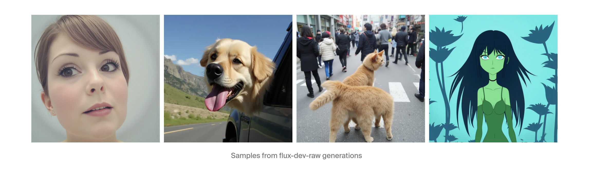

</div>

经过微调训练后，FLUX.1 Krea [dev]展现出较高的审美水平和图像质量，特别是在照片级写实场景中表现突出，整体具备以下特性：

1. **聚焦美学摄影**：擅长生成具有较强美学感的摄影风格图像，缓解常见的“AI感”，提升真实感和图像质量。
2. **提示词理解能力较强**：具备较好的提示词跟随能力，可以处理复杂的内容描述。
3. **采用引导蒸馏技术**：在生成图像时计算效率更高，速度更快。
4. **兼容开源生态**：兼容FLUX.1 [dev]架构及其对应的开源生态系统。

下图是FLUX.1 Krea dev图像生成效果：

<div align="center">


</div>

与大多数AIGC图像创作大模型不同，**FLUX.1 Krea融入了鲜明的主观审美取向和“美学偏好”（Opinionated），专注于呈现独特审美：减少“AI痕迹”和过曝高光，保留自然细腻的细节**。其训练目标是生成更真实、更多样的图像，并避免图像生成中常见的过度饱和和蜡质纹理。

从GAN时代生成猫狗花卉的早期阶段至今，图像生成技术已经取得很大进步。当今AIGC图像创作大模型不仅能生成结构准确的人脸、肢体与手掌，还能理解精确数量关系、渲染复杂字体排版，完成“宇航员骑马”这类复杂场景。

然而，AIGC大模型生成的图像通常具有一种容易被识别的“味道”：过度模糊的背景、蜡质般的皮肤纹理、乏味单调的构图等，这些问题共同构成了所谓的“AI感”，如下图所示：

<div align="center">

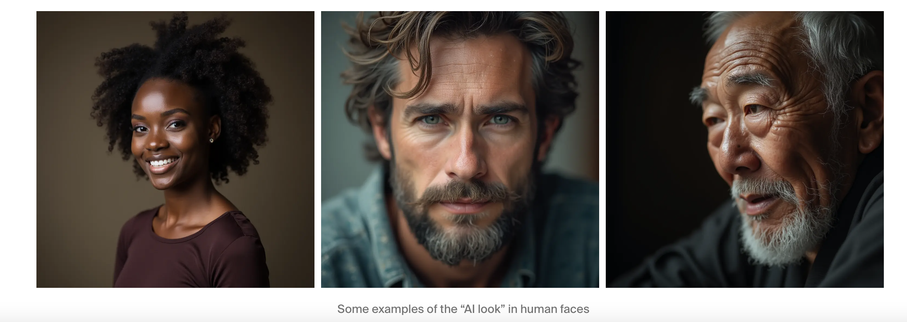

</div>

业界长期过度关注模型的生成能力，并通过基准测试衡量空间关系、属性绑定、物体计数、文字渲染等能力。研究界在推进生成模型发展方面取得了显著成果，但在追逐技术能力和基准优化的过程中，早期图像模型的原生质感、风格多样性和创作灵性反而容易被边缘化。要在提升模型能力的同时避免滑向“AI感”，需要精细的数据策划，以及对模型输出进行充分校准与微调。

训练一个AIGC图像生成模型主要分为预训练和后训练两个阶段。模型绝大部分美学特质是在后训练阶段学习的，但模型能力和风格多样性的上限首先由预训练基座决定。

**预训练阶段的重点是“模式覆盖”（Mode Coverage）和“世界理解”（World Understanding）。** 模型需要充分吸收视觉世界中的各类风格、物体场景、地域风貌与人物形象，目标是最大化生成多样性。

预训练模型甚至应该接触“劣质”数据，只要这些不良特征能够被条件机制准确描述。除了让模型知道“何为优秀”，也需要让模型理解“何为糟粕”。当前很多图像生成工作流会使用“手指畸形、面部扭曲、画面模糊、色彩过饱和”等负面提示词；如果模型从未见过这些不良特征，负面条件就无法有效引导模型避开对应的数据分布区域。

**后训练阶段的核心任务，是转移并剔除数据分布中的不良成分。** 预训练模型可以生成多样图像、理解广泛概念，但由于尚未形成明确的美学偏向，往往难以稳定输出高质量图像。此时需要主动利用“模式坍缩”（Mode Collapse）：通过后训练让模型持续偏向期望的优质数据分布区间，而不是平均保留所有类型的输出。

FLUX.1 Krea模型中的监督微调（SFT）和RLHF后训练是其摆脱“AI感”，生成具有照片级真实感和独特美学图像的关键步骤。下图是FLUX.1 Krea的SFT与RLHF后训练效果：

<div align="center">

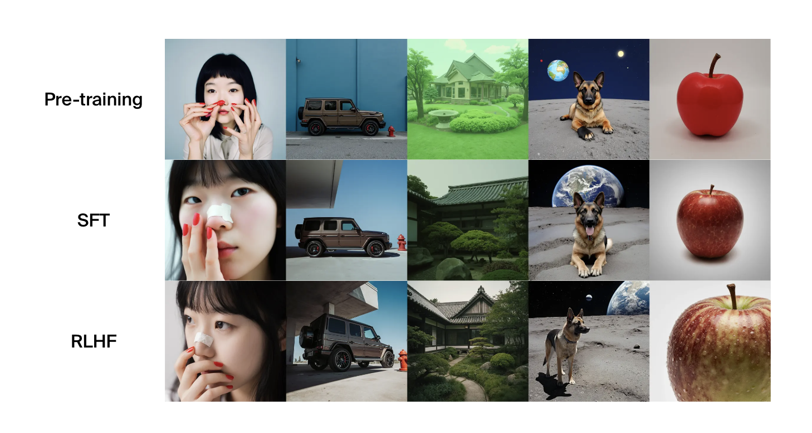

</div>

FLUX.1 Krea的SFT流程核心是使用精选数据，基于通用的基础大模型训练一个具有特定审美品味的模型。

1.  **起点：优质的“原始”基础模型**。SFT并非从零开始，它需要一个知识渊博的“胚子”。FLUX.1 Krea 使用的是Black Forest Labs提供的 **`flux-dev-raw`基础模型**。同时进行了大规模的预训练，其特点是已经具备了大量的“世界知识”（能理解各种物体、风格和概念），但尚未经过过度微调调优，保留了原始生成分布的多样性，可塑性非常强。

2.  **核心：精心策划的训练数据**。数据是SFT的灵魂，FLUX.1 Krea 严格遵循 **“质量重于数量”** 的原则。其训练数据主要包括**高质量图像-文本对**，团队手工挑选了符合其审美标准的高质量图像数据集。**合成样本**，在SFT阶段还加入了来自 **Krea自身模型的高质量合成样本**，这有助于稳定模型在迭代过程中的性能。整个SFT阶段使用的数据量可能远少于预训练，但凭借极高的数据质量，足以让模型领会到期望的美学风格。

经过SFT阶段后，FLUX.1 Krea大模型发生了根本性的转变：
  - **确立美学基础**：从能“画出”东西，转变为能画出“好看”的东西，初步建立起对自然光影、真实质感和协调构图的偏好。
  - **提升图像质量**：生成的图像在清晰度、结构准确性和细节丰富度上显著提升。
  - **保留多样性**：由于基础模型的“原始”性和数据的质量，模型在确立风格的同时，并未丧失生成的多样性。

SFT解决了“好看”的问题，而RLHF则进一步解决“更符合人类偏好”的问题。SFT可以被看作是**RLHF的必要准备**，它先让模型具备稳定的高质量输出能力，然后RLHF再通过人类偏好数据对这个能力进行精细校准和微调，使作品的风格更鲜明、更符合特定的艺术标准。

为了让你更清晰地理解SFT在整个过程中的承上启下作用，下表对比了这三个核心阶段：

在RLHF阶段，官方应用了一种偏好优化技术的变体，称为TPO（Tuned Preference Optimization），以进一步提升FLUX.1 Krea模型的美学质量和风格化水平。官方使用了高质量的内部偏好数据，这些数据经过严格筛选以确保质量。同时在微调过程中还会进行多轮偏好优化，进一步优化FLUX.1 Krea模型生成图像的风格与质量。

在探索各种后训练技术的过程中，Krea官方发现了一些关键要点：

1. **质量比数量重要的多**：我们只需要非常少量的数据（不到100万）就能进行有效的后训练。虽然更大的数据集规模有助于模型的稳定性和减少偏差，但数据的质量才是最为重要的，使用小规模、精心挑选的数据集进行训练，依然可以达到极佳的模型整体效果。使用的偏好标签是由标注人员精心收集的，这些标注人员非常清楚当前模型的局限性、需要改进的领域、优点和缺点。同时确保图像数据集内容足够多样，以获得聚焦且有代表性的标注结果。
2. **采取主观明确的训练方法**：目前有许多开源的偏好数据集，被用于评估测试偏好微调技术。这些数据集对于测试各种技术确实非常有用。然而，如果直接在现有数据集上进行训练，往往会导致一些意想不到的负面影响，例如模型生成的图像会偏向对称、简单的构图；会有模糊和过度柔和的纹理；会出现色彩风格趋于单一的情况；会回归到”AI感”等。

Krea官方认为，在”全局”用户偏好上微调训练的模型在审美质量上并非最优。对于像文本渲染、解剖结构、物体结构和提示词遵循度这样有客观事实依据的目标，数据的多样性和规模确实是很有帮助的。然而，对于像美学质量这样主观的目标，将不同的审美品味混合在一起几乎是相互抵触的。

例如，一个用户喜欢高端时尚摄影，另一个用户钟情于极简主义绘画。如果分别获得聚焦、明确的偏好标注，模型很容易对齐并擅长相应风格；但把两种分布合并后，得到的往往是一个边缘化的“中庸”偏好分布，最终模型难以让任何一方满意。

这个问题可以通过设计提示词部分缓解，但不是一个充分的解决方案。很多用户最终需要配合LoRA才能获得所需的风格化水平。用户通常希望模型具备合理的默认输出，而不是每次都需要堆叠大量修饰词才能获得具有审美水准的图像。

受此直觉启发，Krea以主观明确的方式收集偏好数据，使其符合团队自身的审美品味和清晰艺术方向。对于美学这种主观目标，将模型有意识地“过拟合”到一种特定风格，往往效果更好、实现也更直接。

最后通过RLHF阶段，FLUX.1 Krea实现了：

*   **鲜明的艺术风格**：模型输出的图像具有高度可识别的、一致的“Krea风格”，而不是模糊的“大众脸”。
*   **卓越的美学质量**：在团队定义的审美标准下，图像的光影、构图、色彩和质感都达到了极高水平。
*   **强大的鲁棒性**：即使面对具有挑战性的提示词，模型也能稳定地输出符合其美学标准的图像，而不是崩溃或产生“AI感”十足的图片。
*   **用户友好性**：用户无需编写冗长复杂的提示词来“对抗”模型的中庸审美，简单的提示也能得到具有高级美学感的默认输出。


<h1 id="q-flux-013">3.介绍一下FLUX.2的原理和创新点</h1>

<h2 id="q-flux-022">面试问题：FLUX.2的VAE部分有哪些创新？详细分析改进意图</h2>

**难度评分：⭐⭐⭐⭐ (4/5)  |  考察频率：⭐⭐⭐⭐ (4/5)**

**FLUX.2对VAE的改进，同时考虑了图像重建质量、Latent空间可学习性以及生成过程计算成本**。

### 1、保留8倍空间下采样，用32通道承载更丰富的图像信息

FLUX.2的编码器仍通过卷积、残差块和注意力处理图像，高、宽各缩小8倍。**主要优化是将Latent通道数从FLUX.1的16增加到32**，让每个空间位置能够保存更多特征。

对于一张高为 $H$、宽为 $W$ 的RGB图像，我们忽略Batch维度，其核心的Encoder与Pack过程如下所示：

```math
x\in\mathbb{R}^{3\times H\times W}
\xrightarrow{\mathrm{Encoder}}
z_{\mathrm{enc}}\in\mathbb{R}^{32\times H/8\times W/8}
\xrightarrow{\mathrm{Pack}_{2\times2}}
z_{\mathrm{pack}}\in\mathbb{R}^{128\times H/16\times W/16}
```

**这里的Pack操作把相邻 $2\times2$ 个Latent位置移到通道维度**。它只是重排数据，不丢弃空间信息。32个通道因此变成128个通道，展平后的图像Token数量为：

```math
N_{\mathrm{img}}=\frac{H}{16}\times\frac{W}{16}=\frac{HW}{256}
```

我们以 $1024\times1024$ 图像为例，编码器先产生 $32\times128\times128$ 的Latent特征，再Pack为 $128\times64\times64$，对应4096个图像Token。FLUX.1在相同分辨率下也是4096个Token，但每个Token只有64维。

FLUX.2与FLUX.1相比，在VAE部分的优化可以归纳为下表：

<div align="center">

| 对比项 | FLUX.1 VAE | FLUX.2 VAE | 对后续生成的影响 |
|---|---|---|---|
| 高、宽的下采样倍率 | 各8倍 | 各8倍 | 相同分辨率下，两者编码器输出的Latent空间网格大小相同 |
| 编码后的Latent通道数 | 16 | 32 | FLUX.2每个空间位置有更大的表示容量，以换取更好的细节保留能力。 |
| $2\times2$ 打包后的Token维度 | 64 | 128 | 后续的FLUX.2的Backobne能够处理更多特征信息 |
| $1024\times1024$ 图像的Token数 | 4096 | 4096 | 两者Token数量不变 |
| Latent归一化 | 固定的平移与缩放系数 | 打包后按通道使用保存的均值、方差 | 对不同通道的数值尺度分别校准 |

</div>

### 2、让Latent既能还原图像，也适合生成模型学习

普通VAE训练首先关心“压缩之后还能不能还原”。但对生成系统来说，还存在第二个问题：从随机噪声出发，DiT是否容易学会这些Latent的分布？

可以从三个维度判断一个潜空间：

- **重建质量**：将真实图像编码后再解码，主体、边缘、文字和纹理是否保留下来。
- **可学习性**：在这个潜空间中训练生成模型，给定训练条件与预算，是否容易得到质量较高的生成结果。
- **表示大小与计算成本**：Latent有多少空间位置、多少通道，打包后形成多长的Token序列。

FLUX.2重新训练了潜空间，并引入语义正则化，使表示在保留图像细节的同时具有更适合生成学习的结构。直观地说，相同对象、相近形状和相关语义在特征空间里有更有规律的组织，后续的FLUX.2 Backbone就更容易学习它们之间的联系。

在训练过程中，FLUX.2 VAE借鉴了REPA和REPA-E研究方向，但公开报告没有给出详细的复现内容与过程。

### 3、Pack操作后按通道归一化，稳定生成模型面对的数据尺度

FLUX.2在 $2\times2$ Pack操作之后，对128个通道分别进行归一化。使用不带可学习仿射参数的BatchNorm，并在编码、解码时使用保存的运行统计量，具体流程如下所示。对第 $j$ 个通道，可以写成：

```math
z_j=\frac{z_{\mathrm{pack},j}-\mu_j}{\sqrt{\sigma_j^2+\varepsilon}},
\qquad
z_{\mathrm{pack},j}=z_j\sqrt{\sigma_j^2+\varepsilon}+\mu_j
```

其中， $\mu_j$ 和 $\sigma_j^2$ 是保存的通道均值与方差， $\varepsilon$ 是数值稳定项。编码时先归一化，再将结果交给FLUX.2 Backbone；解码时先恢复原尺度，再逆向Pack并交给Decoder进行处理。

这样做的作用是让不同Latent通道与高斯噪声处于更协调的数值尺度，避免某些通道只因幅值较大就主导训练。推理时使用固定统计量，也意味着单张图像的归一化结果不依赖当前Batch里还放了哪些图片。官方推理编码还直接取编码器输出的均值部分，不再从后验分布随机采样。

### 4、用重建指标和生成指标分别验证改进

下面是FLUX.2技术报告中的Latent空间对比图。横轴是基于相应表示训练生成模型后得到的gFID，纵轴是重建图像的LPIPS，两者均越低越好。

<div align="center">

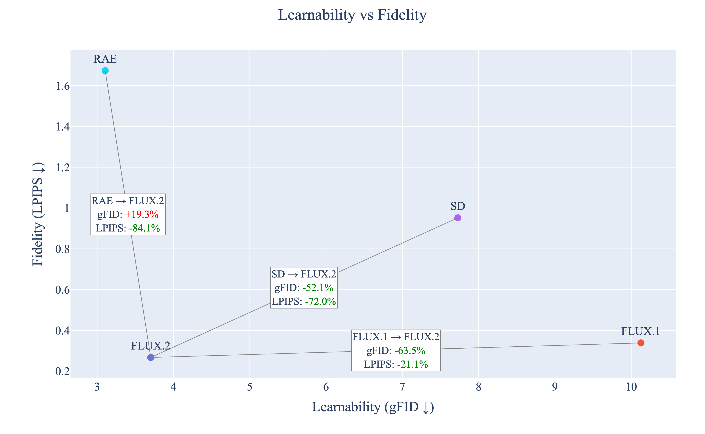

</div>

报告在ImageNet验证集上的重建结果中，FLUX.1到FLUX.2的LPIPS由0.3380降至0.2668，SSIM由0.8893升至0.9038，PSNR由31.1312升至31.4632,不过RAE在图中仍有更低的gFID。


<h2 id="q-flux-020">面试问题：FLUX.2的Backbone部分有哪些创新？详细分析改进意图</h2>

**难度评分：⭐⭐⭐⭐⭐ (5/5)  |  考察频率：⭐⭐⭐⭐ (4/5)**

**FLUX.2 [dev]的Backbone继续使用双流块与单流块组合的Rectified Flow Transformer架构，总参数量32B**。它将更大的模型容量、共享调制、SwiGLU，以及多参考图条件构建在同一条生成链路，支持文生图、单图编辑与多图参考生成，具体生成效果如下所示：

<div align="center">


</div>

### 1、扩展模型容量，同时调整双流与单流的比例

与FLUX.1相比，FLUX.2的Bcakbone主要配置如下表所示：

<div align="center">

| 配置 | FLUX.1 [dev] | FLUX.2 [dev] | 改变的含义 |
|---|---|---|---|
| Transformer参数量 | 约12B | 约32B | 增加生成网络的表示与拟合容量 |
| 隐藏维度 | 3072 | 6144 | 每个Token在主干中具有更宽的特征表示 |
| 注意力头数 | 24 | 48 | 两者每个头仍为128维 |
| 双流块数量 | 19 | 8 | 减少使用两套模态专属块参数的层数 |
| 单流块数量 | 38 | 48 | 将更多网络层用于合流后的Token建模 |
| 前馈网络激活 | GELU | SwiGLU | 引入特征门控，改变前馈分支的表达方式 |
| 时间与引导调制 | 各块分别生成调制参数 | 在同类块间共享调制结果 | 降低重复的条件投影开销 |

</div>

双流块中的文本与图像各自使用投影、归一化和前馈网络，但它们的Q、K、V会参与联合注意力，因此在双流阶段就已经能够交换信息。进入单流阶段后，两种Token拼接为一条序列，共享单流块的计算参数。这种调整把更多容量放在合流后的建模阶段，同时减少模态专属块的数量。

一次主干前向的计算顺序是：**文本和图像特征分别投影到6144维 → 8个双流块 → Token序列合并 → 48个单流块 → 输出图像Token的128维速度预测**。采样器只用目标图像对应的预测更新带噪Latent，完成多步更新后再调用VAE解码。具体流程如下图所示：

<div align="center">

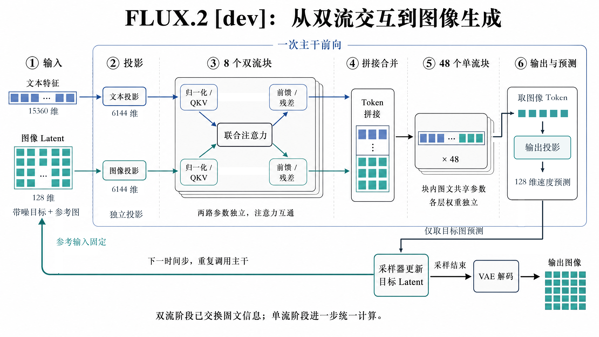

</div>

### 2、共享调制，让多层网络使用同一组当前时间条件

生成网络需要知道当前噪声时间步，也需要知道用户指定的引导强度。FLUX.2将这些标量编码为条件向量，再生成归一化的平移、缩放和残差门控参数。

**调制的作用，是让同一套网络根据当前生成条件，动态调整特征的处理方式**。同一张图在高噪声和低噪声阶段具有不同的恢复难度，用户选择的引导强度也可能不同。FLUX.2将时间步与引导强度编码后，生成 $\gamma$、 $\beta$ 和 $g$，分别控制特征进入子层时，各通道的幅度和偏移；以及子层完成计算后，各通道向主干写回的更新幅度。

一个子层的调制过程可以概括为：

```math
\widetilde{H}=(1+\gamma)\odot\mathrm{LN}(H)+\beta,
\qquad
H'=H+g\odot F(\widetilde{H})
```

其中， $H$ 是Token特征， $\odot$ 表示逐元素相乘，也叫Hadamard积。$\gamma$ 调整特征尺度， $\beta$ 调整偏移， $g$ 控制当前子层的残差更新强度；三者都由时间与引导条件生成。双流块中，注意力和前馈子层各有对应的调制参数组。

FLUX.1在各个块中分别设置调制网络。FLUX.2则在主干外部计算（Global Modulation）三类调制结果：一类供所有双流块的图像分支使用，一类供所有双流块的文本分支使用，另一类供所有单流块使用。这样，同一次前向不必在每一层重复生成一套高维条件投影。

### 3、保留并行Attention-MLP结构，使用SwiGLU与无偏置投影

FLUX.2的单流块从同一份归一化、调制后的特征出发，同时计算注意力分支与前馈分支。一个融合输入投影产生Q、K、V以及前馈网络所需的两组特征 $A,B$；注意力结果与前馈结果拼接后，再经过融合输出投影和残差门控。

前馈分支采用的SwiGLU形式为：

```math
\mathrm{SwiGLU}(A,B)=\mathrm{SiLU}(A)\odot B
```

可以把它理解为一组特征产生门控，决定另一组特征有多少信息通过。它比只对单路特征做GELU变换增加了显式的乘性调节。

下图是FLUX.2中单流Transformer的流程图：

<div align="center">

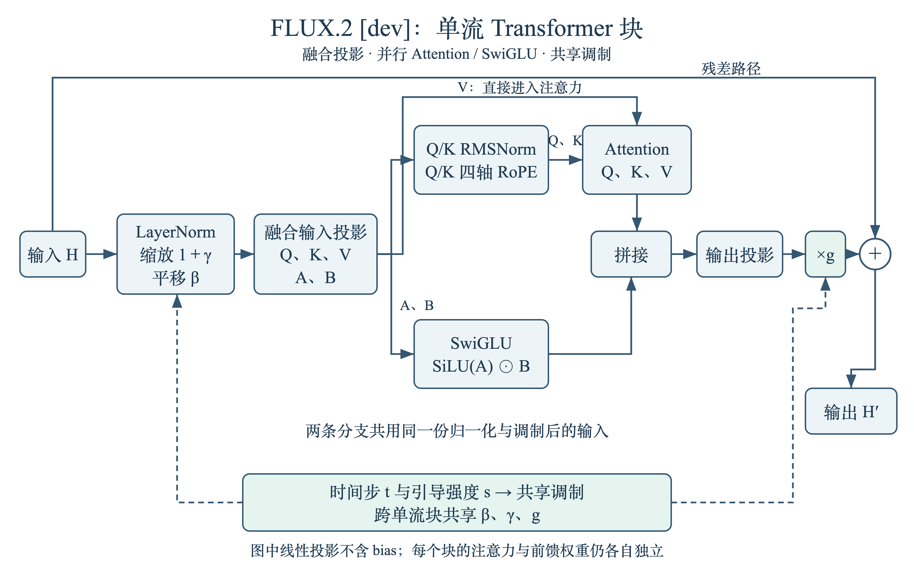

</div>

我们知道FLUX.1的单流块已经同时融合了QKV与MLP输入投影，也融合了注意力与MLP输出投影。**FLUX.2沿用这一并行结构，进一步采用SwiGLU、共享调制和无偏置线性层**。无偏置投影减少了部分参数与操作，条件相关的平移仍可以由调制中的 $\beta$ 提供。

### 4、用四轴RoPE组织文本、目标图像和多张参考图

FLUX.2的参考图通过VAE编码为图像Token，并与目标图像的带噪Token一起进入图像流。多张参考图可能具有相同的二维位置，因此模型还需要知道“这个位置属于哪张图”。

官方实现为Token设置四轴位置ID，记为 `(t, h, w, l)`，具体如下表所示：

<div align="center">

| Token来源 | 四轴位置ID | 位置编码要区分的信息 |
|---|---|---|
| 目标图像 | `(0, h, w, 0)` | 当前目标图中的二维位置 |
| 第 $j$ 张参考图， $j\geq1$ | `(10j, h, w, 0)` | 参考图身份及其内部的二维位置 |
| 第 $l$ 个文本Token | `(0, 0, 0, l)` | 文本序列中的位置 |

</div>

每个注意力头有128维，FLUX.2将其分成四组32维，分别应用这四个坐标的旋转位置编码。与FLUX.1将文本位置ID全部设为零相比，新增的文本轴使生成Transformer能够直接使用文本Token之间的位置关系。

在FLUX.2推理过程中，文本、目标图和参考图通过联合注意力交互。参考图的输入Latent在各采样步保持固定，但块内的参考图隐藏特征仍可与其他Token交互；每一步只取目标图像对应的输出进行采样更新。文生图对应参考集合为空，单图编辑和多图参考生成则加入一个或多个参考条件。

多图条件也有计算代价。联合注意力的总长度包含文本、目标图和全部参考图Token，参考图越多、分辨率越高，计算与显存压力通常越大。

<h2 id="q-flux-019">面试问题：FLUX.2的Text Encoder部分有哪些创新？详细分析改进意图</h2>

**难度评分：⭐⭐⭐⭐ (4/5)  |  考察频率：⭐⭐⭐⭐ (4/5)**

**FLUX.2 [dev]用一个具有视觉语言（VLM）训练背景的24B参数量的Mistral模型提取文本条件，替代FLUX.1的CLIP与T5-XXL组合，更强的编码器能够提供更丰富的语义信息**。此外，[klein]的4B与9B版本分别使用Qwen3 4B与8B作为文本编码器。

FLUX.1使用CLIP的池化向量提供全局语义，并将T5-XXL的序列特征送入图文注意力。FLUX.2 [dev]则替换为 **Mistral-Small-3.2-24B-Instruct-2506**。这个模型具备语言指令理解与视觉知识背景，适合表示对象属性、数量、相对位置及编辑意图。

FLUX.2没有只取最后一层输出，而是提取 `hidden_states[10]`、`hidden_states[20]` 和 `hidden_states[30]`，沿特征维度拼接：

```math
C=\mathrm{Concat}_{\mathrm{feature}}
\left(H^{(10)},H^{(20)},H^{(30)}\right)
\in\mathbb{R}^{B\times L\times15360}
```

其中， $B$ 是Batch大小， $L$ 是文本序列长度；每层特征宽度为5120，拼接后为15360。随后通过线性投影，将其映射到FLUX.2 Backbone的6144维Latent空间。**三层特征沿通道拼接，不会把一段512个Token的文本变成1536个Token**。

官方代码还支持可选的Prompt Upsampling（Prompt扩写）。该环节先生成一段更完整的文字描述（原始指令，必要时附参考图 → 新的文字描述），再提取文本条件，可以在处理复杂指令时补充关系、布局和视觉细节。

Prompt扩写能提供信息，也可能擅自增加用户没有要求的内容。当涉及精确文字、数量或保留区域时，我们应核对扩写结果，确保Prompt是符合我们需求的。

---
