# 目录

## 第一章 Stable Diffusion 系列核心高频考点

[1.介绍一下Stable Diffusion的原理](#q-028)
  - [面试问题：Stable Diffusion相比经典Latent Diffusion model的核心优化是什么？](#q-029)
  - [面试问题：介绍一下Stable Diffusion核心架构与训练/推理过程](#q-039)
  - [面试问题：Stable Diffusion中的图生图原理是什么？denoising strength起到什么作用？](#q-040a)
  - [面试问题：介绍一下Stable Diffusion中Inpaint和Outpaint的原理](#q-040)
  - [面试问题：介绍一下针对Stable Diffusion的模型融合技术(进阶)](#q-033)

[2.介绍一下Stable Diffusion中VAE的架构、原理和作用](#q-041)
  - [面试问题：Stable Diffusion中的VAE和原生VAE生成模型的区别是什么？](#q-044)
  - [面试问题：从SD 1.x → SDXL → SD 3 → FLUX.1，VAE在通道数、下采样率、训练目标上的演进路线是怎样的？](#q-044a)
  - [面试问题：VAE编码后为什么要乘以scale_factor？SD各版本的 scale_factor是如何确定的？](#q-044b)
  - [面试问题：VAE的Latent空间为什么会影响图像生成质量和训练效率？](#q-044e)

[3.介绍一下Stable Diffusion中Backbone的架构、原理和作用](#q-045)
  - [面试问题：介绍一下Stable Diffusion中自注意力机制和交叉注意力机制的原理](#q-047)
  - [面试问题：为什么使用U-Net作为Stable Diffusion模型的核心Backbone？](#q-049)
  - [面试问题：U-Net与DiT在Backbone设计哲学上的本质差异是什么？SD系列从U-Net演进到DiT的根本原因是什么？](#q-049b)
  - [面试问题：SD Backbone中为什么设计GroupNorm+SiLU+残差连接的组合？](#q-049d)

[4.介绍一下Stable Diffusion中Text Encoder的架构、原理和作用](#q-050)
  - [面试问题：Text Encoder和VLM条件编码器在扩散模型中起什么作用？](#q-051)
  - [面试问题：CLIP Text Encoder的Tokens长度限制对长 Prompt的实际影响是什么？工程上如何突破？](#q-053a)
  - [面试问题：Prompt中的权重语法（(word:1.2)、[word]等）的实现原理是什么？](#q-053b)
  - [面试问题：从 SD 1.x → SDXL → SD 3 → FLUX.1，文本编码器与文本条件注入机制如何演进？这些变化如何影响提示词遵循与生成效果？](#q-053d)
  - [面试问题：如何优化Prompt和生成图像不对齐的问题？](#q-054)

[5.介绍一下Stable Diffusion XL的原理和创新点](#q-056)
  - [面试问题：Stable Diffusion XL的VAE部分有哪些创新？详细分析改进意图](#q-058)
  - [面试问题：Stable Diffusion XL的Backbone部分有哪些创新？详细分析改进意图](#q-059)
  - [面试问题：Stable Diffusion XL的Text Encoder部分有哪些创新？详细分析改进意图](#q-060)
  - [面试问题：Stable Diffusion XL中使用的训练方法有哪些创新点？](#q-061)
  - [面试问题：什么是SDXL Refiner？](#q-065)

[6.介绍一下Stable Diffusion 3的原理和创新点](#q-066)
  - [面试问题：SD 3的VAE部分有哪些创新？详细分析改进意图](#q-067)
  - [面试问题：SD 3的Backbone部分有哪些创新？详细分析改进意图](#q-067a)
  - [面试问题：SD 3的Text Encoder部分有哪些创新？详细分析改进意图](#q-067c)
  - [面试问题：训练Stable Diffusion 3过程中官方使用了哪些训练技巧？](#q-069)
  - [面试问题：Stable Diffusion 3.5有哪些改进点？](#q-075)


## 第二章 FLUX系列核心高频考点

[1.介绍一下FLUX.1的原理，与Stable Diffusion 3相比有哪些创新点？](#q-flux-001)
  - [面试问题：FLUX.1的VAE部分有哪些创新？详细分析改进意图](#q-flux-014)
  - [面试问题：FLUX.1的Backbone部分有哪些创新？详细分析改进意图](#q-flux-015)
  - [面试问题：FLUX.1的Text Encoder部分有哪些创新？详细分析改进意图](#q-flux-016)
  - [面试问题：FLUX.1在训练和推理过程中使用了哪些优化技巧？](#q-flux-002)

[2.FLUX.1有哪些主流的变体模型？介绍一下它们的核心原理](#q-flux-017)
  - [面试问题：介绍一下FLUX.1 Lite与FLUX.1的异同](#q-flux-005)
  - [面试问题：介绍一下FLUX.1 Kontext的原理，有哪些创新点？](#q-flux-006)
  - [面试问题：介绍一下FLUX.1 Krea的原理，有哪些创新点？](#q-flux-008)

[3.介绍一下FLUX.2的原理和创新点](#q-flux-013)
  - [面试问题：FLUX.2的VAE部分有哪些创新？详细分析改进意图](#q-flux-022)
  - [面试问题：FLUX.2的Backbone部分有哪些创新？详细分析改进意图](#q-flux-020)
  - [面试问题：FLUX.2的Text Encoder部分有哪些创新？详细分析改进意图](#q-flux-019)

---

<h1 id="ch-02">第一章 Stable Diffusion 系列核心高频考点</h1>

<h1 id="q-028">1.介绍一下Stable Diffusion的原理</h1>

<h2 id="q-029">面试问题：Stable Diffusion相比经典Latent Diffusion model的核心优化是什么？</h2>

**难度评分：⭐⭐⭐ (3/5)  |  考察频率：⭐⭐⭐⭐⭐ (5/5)**

Rocky认为我们可以这样理解，Latent Diffusion Models（LDM）是“在潜空间做扩散”的**通用扩散算法模型框架**，而Stable Diffusion是在此框架基础上，通过一系列工程技术优化后在开源社区大规模落地应用的**AIGC图像创作大模型**。

**从技术架构本质来看，Stable Diffusion本身也归属于Latent Diffusion架构体系**。Stable Diffusion整体流程如下图所示。

<div align="center">


</div>

具体来讲，若把Stable Diffusion与Latent Diffusion原论文中的文生图基准模型相比，核心差异主要体现以下维度：

1.  **训练数据集的迭代升级**：通用Latent Diffusion论文中的实验主要基于较小规模的LAION-400M图文数据集完成训练；Stable Diffusion则使用了规模更大的LAION-2B-en及LAION-5B中的不同子集系列图文数据集，并配合数据清洗、低分辨率过滤、美学评分等筛选策略来提升训练样本质量。整体的**数据规模、数据质量和工程策略都更完善**。

2.  **文本编码器的方案优化**：通用Latent Diffusion中的文本条件编码方案相对简单，是一个随机初始化的Transformer模型，在Latent Diffusion训练过程中一同训练；Stable Diffusion则采用预训练CLIP文本编码器作为文本特征提取模块。相较于从零开始训练文本编码器，在大规模图文配对数据上完成预训练的文本编码器通常具备更强的文本语义理解和图文对齐能力。

3.  **训练分辨率策略的优化**：通用Latent Diffusion更偏研究验证性质，只是在 $256\times256$ 分辨率上训练；Stable Diffusion采用分阶段训练和高分辨率微调等工程策略，先在 $256\times256$ 分辨率上预训练，然后再在 $512\times 512$分辨率上进行微调训练，满足高分辨率生成的质量要求。

4.  **架构持续迭代升级**：通用Latent Diffusion只是一个实验性模型架构；而Stable Diffusion作为商业化模型，其架构的持续迭代（如SDXL、SD3、FLUX.1、FLUX.2等），不断突破AIGC图像创作领域的效果上限。

总的来说，Stable Diffusion可以理解为Latent Diffusion的一次工程优化与扩展：更强的文本编码器、更大规模的数据、更系统的数据筛选和更面向实际场景的训练策略，共同提升了模型生成质量和可用性。


<h2 id="q-039">面试问题：介绍一下Stable Diffusion核心架构与训练/推理过程</h2>

**难度评分：⭐⭐⭐⭐ (4/5)  |  考察频率：⭐⭐⭐⭐⭐ (5/5)**

Stable Diffusion采用潜空间扩散架构。以SD 1.x为例，模型由由VAE、CLIP文本编码器、U-Net，以及负责噪声调度和采样更新的算法组件共同构成。VAE负责图像与潜变量之间的转换，CLIP文本编码器提供语义条件，U-Net预测当前Latent中的噪声，采样器依据这一预测更新Latent。经过多步更新后，VAE Decoder再把最终结果还原为RGB图像。在扩散模型训练阶段，VAE和文本编码器保持冻结，主要更新U-Net参数。下图是SD 1.x的整体架构示意图：

<div align="center">

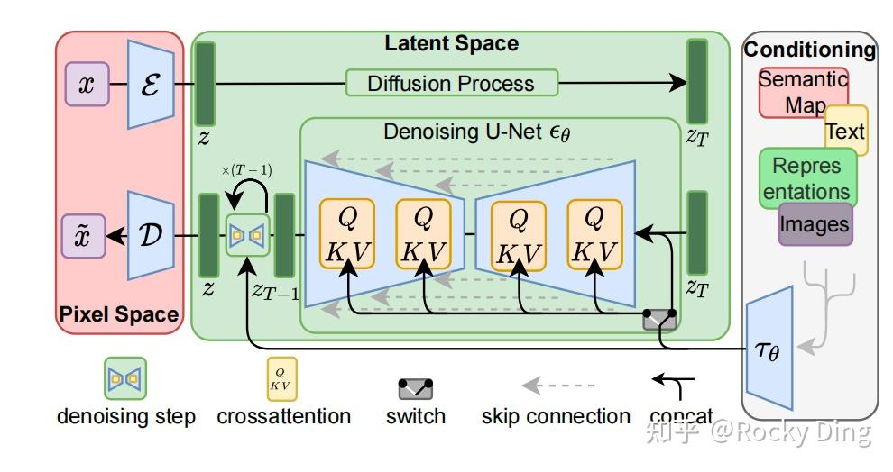

</div>

下面我们以SD 1.x模型为例，说明核心网络结构、训练过程和推理过程。对于一张512×512的图像，SD 1.x通常使用如下表示：

<div align="center">

| 模块 | 输入与输出 | 在系统中的作用 |
|---|---|---|
| VAE Encoder | RGB图像 → 四通道Latent特征，例如3×512×512 → 4×64×64 | 把图像转换为保留空间结构的紧凑表示，供U-Net扩散模型使用。在Latent空间进行扩散过程可以大大减少模型的计算量 |
| CLIP Text Encoder | 文本Prompt → 编码为文本Token特征，标准配置下为77×768，省略batch维度 | 为U-Net提供主体、属性、关系和风格等语义条件 |
| U-Net | 带噪Latent、时间步、文本特征 → 与输入Latent同形状的噪声预测 | 是Stable Diffusion的Backbone，学习不同噪声水平下，图像潜变量与文本条件之间的统计关系 |
| 噪声调度与采样器 | 训练时常使用DDPM噪声调度；推理时依据模型预测可以选择DDIM、Euler、DPM++、UniPC等采样方法更新Latent特征 | 组织噪声水平、采样时间步和数值更新规则 |
| VAE Decoder | 去噪完成的Latent特征 → RGB图像 | 将生成的潜变量解码为最终图像 |

</div>

<div align="center">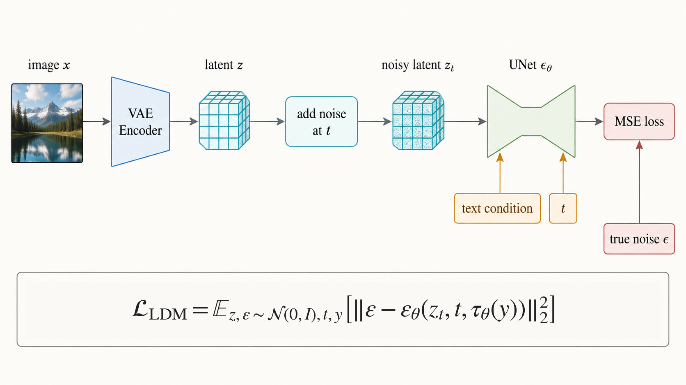</div>

Stable Diffusion的训练与推理都围绕同一个核心目标展开：**在低维Latent隐空间中学习如何加噪和去噪，并用文本条件控制去噪方向**。训练阶段让U-Net网络学会预测不同噪声强度下的噪声；推理阶段再把这个能力反过来使用，从随机高斯噪声或加噪后的参考图出发，逐步还原图像的Latent隐空间。

### 1. Stable Diffusion的训练过程

Stable Diffusion的完整训练逻辑可以概括为：

1. 从数据集中随机选择一组图像—文本样本；
2. 使用VAE Encoder将图像压缩为Latent Feature；
3. 从噪声时间步中随机采样一个timestep $t$，并向Latent Feature加入该强度的高斯噪声；
4. 使用CLIP Text Encoder将文本标签编码为Text Embeddings；
5. 把Noisy Latent、timestep对应的Time Embedding和Text Embeddings输入 U-Net；
6. U-Net通过Cross-Attention持续注入Text Embeddings，并预测本次实际加入的噪声；
7. 计算预测噪声和真实噪声之间的MSE损失，反向传播并更新U-Net参数。

<div align="center">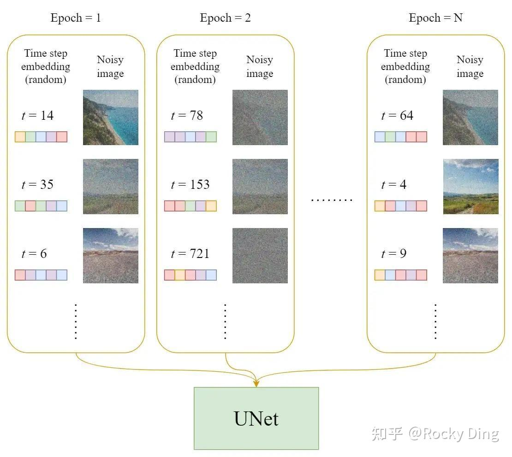</div>

每个样本只随机训练一个timestep，并不意味着模型只学习某一个去噪阶段。随着Epoch不断迭代，同一图像会对应不同的噪声强度；在整个数据集和训练周期上，模型最终覆盖从接近原图到接近纯噪声的完整噪声分布。Time Embedding则让同一个U-Net知道当前位于哪一个去噪阶段，从而根据噪声强度来预测噪声。

### 2. Stable Diffusion的推理过程

Stable Diffusion的推理过程主要分文生图与图生图，两者主要区别只在于初始Latent Feature的来源：

- **文生图（txt2img）**：从随机高斯噪声开始；
- **图生图（img2img）**：先用VAE Encoder把输入图像压缩成Latent Feature，再根据denoising strength加入一定量的噪声。

随后二者都会进入相同的反向去噪链路：
1. CLIP Text Encoder将Prompt编码为Text Embeddings；
2. U-Net在每个timestep预测噪声，Scheduler根据当前采样算法和时间步更新 Latent Feature；
3. 经过多次迭代后，Latent Feature中的噪声逐渐减少，图像语义信息和文本语义信息逐渐增加；
4. 最后由VAE Decoder将去噪后的Latent Feature重建为像素级图像。

<div align="center">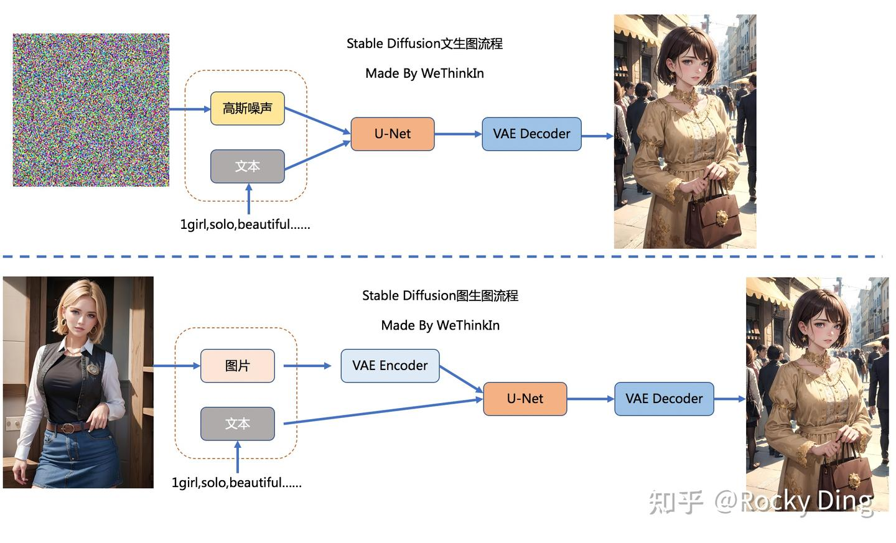</div>


<h2 id="q-040a">面试问题：Stable Diffusion中的图生图原理是什么？denoising strength起到什么作用？</h2>

**难度评分：⭐⭐⭐ (3/5)  |  考察频率：⭐⭐⭐⭐⭐ (5/5)**

图生图（img2img）是Stable Diffusion最常用的二次创作能力，本质是**在前向扩散链上选一个中间时刻 $t^*$ 作为起点，从这个加噪后的Latent开始反向去噪**，而不是从纯高斯噪声 $\mathcal{N}(0, I)$ 开始。

<div align="center">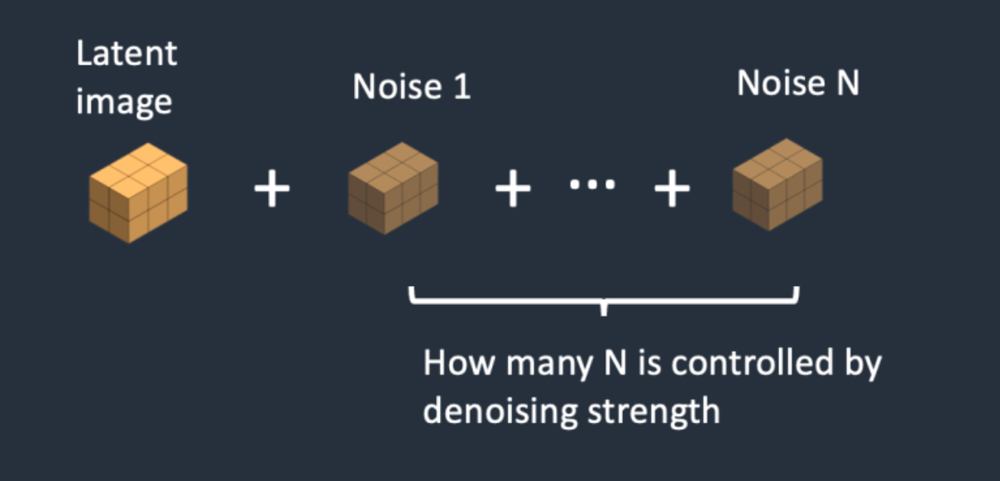</div>

### 1. 完整流程

1. **VAE 编码**：把输入参考图编码为 latent $z_0$ 。
2. **加噪到中间步**：根据 denoising strength $s \in [0, 1]$ 计算起始时间步 $t^* = \lfloor s \cdot T \rfloor$ ，然后对 $z_0$ 一步加噪：

```math
z_{t^*} = \sqrt{\bar\alpha_{t^*}}\,z_0 + \sqrt{1 - \bar\alpha_{t^*}}\,\epsilon,\quad \epsilon\sim\mathcal{N}(0,I)
```

3. **从 $t^*$ 反向去噪**：以 $z_{t^*}$ 为起点、文本条件为引导，跑剩余的 $\lceil s \cdot \text{steps} \rceil$ 个采样步。
4. **VAE 解码**：把最终 Latent 解码回像素。

### 2. denoising strength 的作用与直觉

- $s = 0$：不加噪，模型基本「拷贝」原图。
- $s$ 较小（0.2 ~ 0.4）：保留原图大结构与构图，仅做「细节修饰、风格轻调」。常用于细节增强、轻微风格转绘、局部替换的边界融合。
- $s$ 中等（0.5 ~ 0.7）：原图作为「构图与色调骨架」，模型在此基础上做较强重绘。常用于风格迁移、人物动作迁移、参考构图二创。
- $s$ 较大（0.8 ~ 0.95）：仅保留原图的极低频信息（大体明暗、轮廓），生成结果与原图差异显著。
- $s = 1$：等价于文生图（从纯高斯噪声开始）。

denoising strength同时控制「起始 $t^*$ 」和「实际跑的步数」，因此设置的越小推理越快。


<h2 id="q-040">面试问题：介绍一下Stable Diffusion中Inpaint和Outpaint的原理</h2>

**难度评分：⭐⭐⭐ (3/5)  |  考察频率：⭐⭐⭐⭐ (4/5)**

- **Inpaint（局部修复）** 指对图像中指定区域进行内容修复或替换的技术。用户可通过遮罩（Mask）标记需修改的区域，并输入文本提示（如“修改物体”或“删除物体”），模型将根据上下文生成与周围环境协调的新内容。典型应用包括移除水印、修复破损图像或替换特定对象。
- **Outpaint（边界扩展）** 则用于扩展图像边界，生成超出原图范围的合理内容。例如，将一幅风景画的左右两侧延伸，生成连贯的山脉或天空。其核心挑战在于保持扩展区域与原始图像在风格、光照和语义上的一致性。

两者目标不同：Inpaint聚焦于“内部修正”，而Outpaint致力于“外部延展”，共同拓展了生成式AI在图像编辑中的灵活性。

### Inpaint和Outpaint的完整处理链路

Inpaint 整体上仍然是 img2img，但增加了 Mask 作为空间约束。输入图像先经 VAE Encoder 得到 Latent Feature，Mask 也根据倍率同步缩放；在每一个去噪步骤中，只更新 Mask 指定的区域，Mask 之外则持续回填对应时间步的原图 Latent，使未编辑区域尽量保持不变。

<div align="center">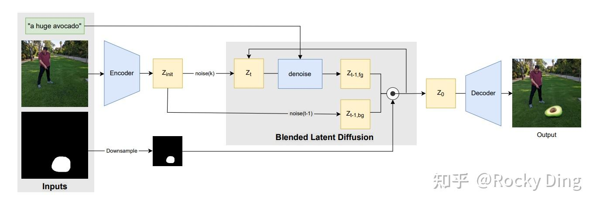</div>

普通 SD Pipeline 可以在采样过程中用 Mask 做混合；专门训练的 Inpainting 模型则会把 noisy latent、masked image latent 和 mask 在通道维拼接后送入 U-Net。以 SD 1.x 为例，三者通常分别为 4、4、1 个通道，合计 9 个输入通道，因此它比仅在采样器外部混合 Mask 更能理解缺失区域与周围上下文。

Outpaint 可以看作 Mask 位于原图边界之外的 Inpaint：先扩展画布，把新增区域标为需要生成的 Mask，再通过相同的条件去噪补全内容。它的关键不是单独的生成公式，而是让扩展区域在透视、光照、纹理和语义上延续原图。


<h2 id="q-033">面试问题：介绍一下针对Stable Diffusion的模型融合技术(进阶)</h2>

**难度评分：⭐⭐⭐⭐ (4/5)  |  考察频率：⭐⭐⭐⭐ (4/5)**

Stable Diffusion的模型融合主要通过 **Merge Block Weight（块权重融合）** 这种精细化的模型参数整合技术实现，通过分层处理U-Net/Transformer内部不同功能模块层的权重，实现多个Stable Diffusion模型特点优势的定向组合。

### 1. 核心原理：分层权重插值

模型融合的目标是合并多个训练好的Stable Diffusion模型（如风格模型+主体模型），生成兼具各方优势的新模型。Merge Block Weight的核心创新在于**分块处理U-Net/Transformer结构**，而非整体融合：

**1. U-Net结构解构**

Stable Diffusion的U-Net包含多个功能模块：

- **ResBlock**：负责基础特征提取与残差连接
- **Spatial Transformer（Cross-Attention）**：融合文本与图像语义
- **DownSample/UpSample**：控制特征图分辨率变换

**2. 分块独立融合**

对每个模块的权重独立计算插值，公式为：

```math
W_{\text{merged}}^{(i)} = \alpha \cdot W_A^{(i)} + (1 - \alpha) \cdot W_B^{(i)}
```

其中 $W_A^{(i)}$ 和 $W_B^{(i)}$ 是待融合模型在模块 $i$ 的权重， $\alpha$ 为该模块的融合系数（0~1）。

### 2. 技术实现流程

**1. 权重归一化（关键预处理）**

- 目的：解决不同模型参数分布差异导致的融合冲突
- 方法：对每个模型的权重进行LayerNorm或Min-Max缩放，使其处于相近数值范围

**2. 插值算法选择**

<div align="center">

| **算法** | 适用场景 | 优势 | 缺点 |
|----------|----------|------|------|
| **线性插值（LERP）** | 简单融合、硬件资源有限 | 计算效率高 | 可能丢失非线性特征 |
| **球面线性插值（SLERP）** | 高质量风格融合（如艺术风格） | 保持权重向量方向一致性，避免特征坍缩 | 计算复杂度高 |

</div>

**3. 分层系数配置**

不同模块需设置差异化融合系数，例如：

- **ResBlock**： $\alpha=0.5$ （平衡底层特征）
- **Spatial Transformer**： $\alpha=0.8$ （侧重模型A的文本控制力）
- **UpSample层**： $\alpha=0.3$ （侧重模型B的细节生成能力）

### 3. Stable Diffusion进行模型融合的主流技巧

我们在进行几个Stable Diffusion的融合时，可以调整U-Net架构中每一层模型的融合权重，从而能够进行模型融合的进阶整合。我们以Stable Diffusion 1.5为例，在MBW插件中，将U-Net分层了25个可调层，开源社区将其分为:
1. IN区：有12层
2. M区：有1层
3. OUT区：有12层

IN区影响下采样过程对特征的提取，层数从00到11，感受野越来越大，影响的程度越来越大。IN区块负责平面构成的相关工作（构图元素以及生成图像背景），特别是6-11层，总的来说层数越高影响效果越明显，更改层数越多影响效果越明显。比如：各个物体的大小、位置以及基本轮廓。其中在画面中占比越小的物体受到越浅层的参数控制，占比大的物体受到更深层的参数控制。浅层权重越高，小物体的表现效果就越向该模型靠拢；深层权重越高，较大物体的表现效果就越向该模型靠拢。

OUT区影响上采样过程对特征进行还原，层数从00到11，感受野越来越小，影响的程度越来越小。OUT区块负责色彩构成和画风的相关工作，主要是0-4层起核心作用，同时如果是人物图像，2-7层可以控制脸部的微调。

在IN区中编号越高，对平面构成的影响就越偏向大体。在OUT区中，编号越高，对细化过程的影响就越局域化，对上色过程的影响就越大体化。比如：基本色调，色彩丰富或单一，皮肤质感，光影，线条。深层参数负责大区域的色彩，比如基本色调、色彩丰富度与光影；浅层参数负责细节的色彩，比如线条是否清晰，通过浅层可以调整手指；深层与浅层之间的中层则负责区域的色彩，区域内色彩的不同变化程度可以体现出不同的皮肤质感和区域光影效果。

同时如果IN层和OUT层只改变其中的某一层，几乎不会产生影响效果。

M区：影响最大的一层，甚至比IN11层的影响更大，起到了类似IN层的作用，可以看作IN12层，但也只能起到一层的作用，不如IN层中多层叠加后的影响大。该层越大，构图越向该模型靠拢。


<h1 id="q-041">2.介绍一下Stable Diffusion中VAE的架构、原理和作用</h1>

<h2 id="q-044">面试问题：Stable Diffusion中的VAE和原生VAE生成模型的区别是什么？</h2>

**难度评分：⭐⭐⭐⭐ (4/5)  |  考察频率：⭐⭐⭐⭐⭐ (5/5)**

传统深度学习时代的VAE是单独作为生成模型；而在AIGC时代，VAE只是作为特征编码器，提供特征给Diffusion用于图像的生成。Stable Diffusion中的VAE是连接像素空间与Latent隐空间的桥梁，核心职责是**图像压缩与图像重建**：Encoder部分把图像压缩成低维空间特征供扩散模型学习，Decoder部分再把去噪后的Latent隐空间还原为像素级图像。

本质上来看，两者的核心作用已经发生改变。

**传统VAE生成模型：**

- **完整的生成系统**：从噪声直接生成数据
- **核心机制**：变分推断 + 重参数化技巧
- **目标**：学习数据分布，实现无条件生成
- **挑战**：生成质量与多样性的平衡

**Stable Diffusiuon中的VAE：**

- **功能组件**：数据压缩器和重建器
- **核心作用**：将图像压缩到潜在空间，降低计算成本
- **目标**：高保真度重建，为扩散过程提供高效空间
- **优势**：专注重建质量，与扩散模型协同工作

同时传统深度学习时代的VAE的重构损失只使用了平方误差，而Stable Diffusion中的VAE使用了平方误差 + Perceptual损失 + 对抗损失。在正则项方面，传统深度学习时代的VAE使用了完整的KL散度项，而Stable Diffusion中的VAE使用了弱化的KL散度项。同时传统深度学习时代的VAE将图像压缩成单个向量，而Stable Diffusion中的VAE则将图像压缩成一个 $N \times M$ 的特征矩阵。

SD 1.x 的 VAE Encoder 由卷积、DownBlock、ResNetBlock、MidBlock 和 Self-Attention 等模块组成，将输入图像转换为 Gaussian Latent Distribution；Decoder 使用对称的 UpBlock、ResNetBlock 与 MidBlock 将 Latent 重建为像素图。具体架构如下图所示。下采样率 $f=8$、Latent 通道数 $c=4$ 是压缩效率与重建质量之间的折中： $f$ 太小会让扩散主干承担过高计算成本， $f$ 太大又会丢失过多细节。

<div align="center">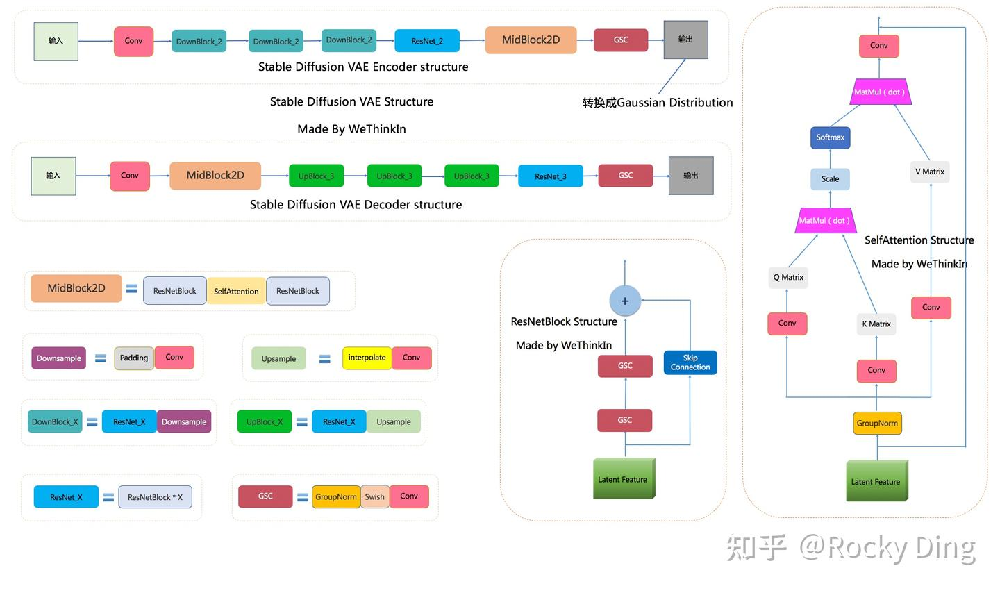</div>

训练时并不只使用像素误差，而是组合多种目标：

- **L1/重建损失**约束像素级整体一致性；
- **感知损失（LPIPS）** 比较预训练视觉网络不同层的特征，使重建图在高层语义上接近原图；
- **PatchGAN 对抗损失**关注局部 Patch 的真实性，用于增强纹理和清晰度；
- **弱 KL 正则**约束 Latent 不要偏离正态分布过远，但使用较小权重以避免牺牲重建质量。

这也解释了为什么 Stable Diffusion VAE 与传统“单独承担生成任务”的 VAE 不同：它不需要独自学习从标准正态分布生成所有图像内容，而是为 Diffusion 提供一个信息密度高、空间结构仍然完整、又足够低维的工作空间。

原始 SD VAE 在压缩和重建时仍然存在信息损失，尤其容易影响小尺寸人脸、文字、细线条和高频纹理。工程上切换微调后的 VAE，通常会改变生成图像的颜色、对比度和局部细节，但不会像切换 U-Net 那样大幅改变主体构图；这说明 VAE 决定的是成像与重建上限，而 U-Net 决定主要生成分布。下图是Stable Diffusion VAE在不同图像吃存在的重建效果：

<div align="center">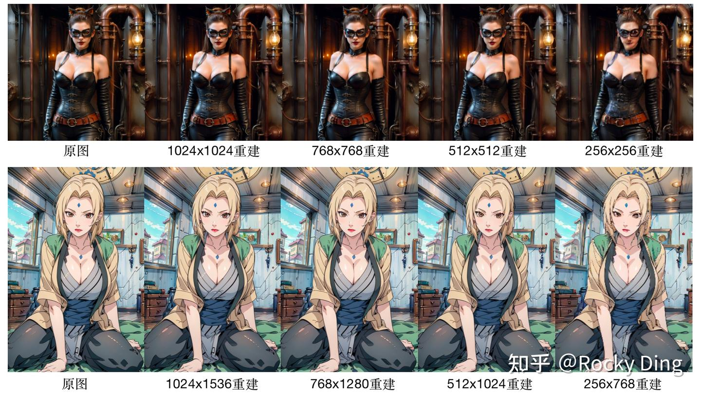</div>


<h2 id="q-044a">面试问题：从SD 1.x → SDXL → SD 3 → FLUX.1，VAE在通道数、下采样率、训练目标上的演进路线是怎样的？</h2>

**难度评分：⭐⭐⭐⭐ (4/5)  |  考察频率：⭐⭐⭐⭐ (4/5)**

VAE是连接「像素世界」与「扩散世界」的桥梁，是SD系列代际跃迁中持续被升级的核心组件。整体演进可以概括为三条主线：**通道数从 4 → 16、下采样率稳定在 8x、训练目标从「像素重建」走向「感知 + 对抗 + 多尺度」**。

### 1. 主流 SD 系列 VAE 演进对比

<div align="center">

| 版本 | 输入分辨率 | 下采样率 | 通道数 $d$ | 主要损失 | 关键改进 |
| --- | --- | --- | --- | --- | --- |
| **SD 1.x VAE** | 任意 | 8x | 4 | L1 + LPIPS + KL + PatchGAN | 基线 KL-f8 VAE |
| **SD 2.x VAE** | 任意 | 8x | 4 | 同上 | 重训权重，与 SD 1.x 不通用 |
| **SDXL VAE** | 任意 | 8x | 4 | L1 + LPIPS + KL + PatchGAN，重训数据更多 | 重建细节明显提升 |
| **SD 3 VAE** | 任意 | 8x | **16** | L1 + LPIPS + KL + Adversarial（更新版判别器） | **通道数翻 4 倍**，显著提升小物体（人脸、文字）重建质量 |
| **FLUX.1 VAE** | 任意 | 8x | 16 | 同 SD 3 思路，配合 mean shift / scaling | 与 SD 3 类似的高通道路线；与 MM-DiT 联合优化 |

</div>

### 2. 演进背后的三条主线

1. **通道数升级（4 → 16）**：4 通道 latent 在 64×64（对应 512×512 像素）上信息密度有限，对人眼、文字、手指、纹理等细粒度区域容易出现「重建塌缩」。SD 3 论文通过消融实验明确证明 16 通道 VAE 的 PSNR / SSIM / LPIPS 都显著优于 4 通道，这是 SD3、FLUX 高质量生成的底层支撑。
2. **下采样率稳定在 8x**：保留这个压缩率是为了在「计算量降低 64 倍」与「重建上限不至于过低」之间取平衡；继续提高（16x、32x）会让重建质量崩塌。
3. **训练目标的丰富化**：从单纯像素 L1，演化到「L1 + LPIPS + KL + 对抗」这一**多目标组合**——L1 提供像素一致性、LPIPS 提供感知质量、KL 约束 latent 分布近高斯（便于扩散）、对抗损失抑制模糊和棋盘效应。

### 3. 为什么 SD 3 选择「通道数翻倍」而不是「下采样率减半」

- 下采样率减半（8x → 4x）会让 latent token 数量 4 倍化，所有扩散计算成本随之 4 倍化（attention 是 16 倍化），代价过大；
- 通道数翻倍只增加每个 token 的 channel 维度，扩散网络的整体计算量增长可控，且能直接提升重建上限。


<h2 id="q-044b">面试问题：VAE编码后为什么要乘以scale_factor？SD各版本的 scale_factor是如何确定的？</h2>

**难度评分：⭐⭐⭐ (3/5)  |  考察频率：⭐⭐⭐⭐ (4/5)**

`scale_factor` 是把VAE Encoder输出的Latent Feature喂给扩散模型之前，要乘以的一个标量常数；推理时VAE Decoder之前再除回去。它的核心作用是：**让Latent Feature的统计分布近似单位方差的标准正态**，从而与扩散模型的噪声schedule相匹配。

**从 VAE 输出到扩散输入的「分布对齐」**。VAE Encoder 训练时**并没有显式约束输出 Latent 的方差恰好为 1**。当扩散模型以这个 Latent 作为输入做 $x_t = \sqrt{\bar\alpha_t}x_0 + \sqrt{1-\bar\alpha_t}\epsilon$ 加噪时，`scale_factor` 的作用是把 Latent 的标准差缩放到接近1，让噪声调度公式背后的「数据分布近似 $\mathcal{N}(0, I)$」假设近似成立。

**1. scale factor 的作用**

- **统计对齐**：扩散模型默认假设输入分布近似 $\mathcal{N}(0, I)$（前向加噪、反向去噪都基于这个假设）。VAE Encoder训练时只优化重建质量，并未约束输出Latent的方差恰好为1；如果不缩放，latent的方差可能远大于或远小于1，导致：
  - 加噪过程把信号「淹没」过快或过慢；
  - 同一noise schedule下信噪比错位，CFG/采样器表现劣化。
- **数值稳定**：把Latent拉回 $\mathcal{O}(1)$ 量级有利于fp16/bf16的数值范围。
- **与已发布权重耦合**：scale factor和扩散网络是**一体训练**的，所以推理时必须用与训练完全一致的常数，否则结果会整体偏色或塌缩。

**2. 为什么不同版本 scale factor 不同**

`scale_factor` 不是手工调出的「魔法数字」，而是按 **「在训练数据集上让 latent 的标准差近似 1」** 这个原则**统计估计**出来的：把VAE跑在大批训练图上，估出 Latent的std，取倒数即为scale factor。

<div align="center">

| 版本 | VAE 通道数 | scale_factor | 备注 |
| --- | --- | --- | --- |
| SD 1.x / 2.x | 4 | **0.18215** | 在 LAION 子集上估计的 latent std≈5.49 的倒数 |
| SDXL | 4 | **0.13025** | SDXL 重新训练了 VAE，latent 分布发生变化 |
| SD 3 / FLUX | 16 | 由 `scaling_factor` + `shift_factor` 联合定义 | 16 通道 VAE 同时引入 mean shift，latent 先减 shift 再乘 scale |

</div>

各版本 scale_factor 的统计估计方式：

```python
with torch.no_grad():
    latents = vae.encode(big_batch_of_images).latent_dist.sample()
    # 估计单标量 std
    sigma = latents.std()
scale_factor = 1.0 / sigma
# SD 3 / FLUX 的 16 通道 VAE 还需估计 mean 做 shift
shift_factor = latents.mean()
```


### 3. 跨版本切换时的注意事项

- 切换 VAE 必须**同步切换 scale_factor**；不切会出现整体偏色 / 饱和度异常，严重时直接塌缩。
- SD 3 / FLUX 的 Latent 公式为 `z = (raw_latent - shift_factor) * scaling_factor`，再喂给扩散网络；解码时反操作。漏掉 shift 是迁移代码时的高频踩坑点。
- 自定义 pipeline 时优先读取 `vae.config.scaling_factor` 与 `vae.config.shift_factor`，避免硬编码导致后续模型升级时 bug。

总的来说，scale_factor 是「VAE 实际输出方差」的倒数，目的是让 Latent 分布近似 $\mathcal{N}(0, I)$，与扩散模型的噪声调度匹配；它和扩散网络是绑定的一对常量，跨版本切换 VAE 必须同步更新；SD 3 / FLUX 还引入了 shift_factor，是 16 通道 VAE 的额外 mean 校正。

<h2 id="q-044e">面试问题：VAE的Latent空间为什么会影响图像生成质量和训练效率？</h2>

**难度评分：⭐⭐⭐⭐⭐ (5/5)  |  考察频率：⭐⭐⭐⭐ (4/5)**

VAE和其Latent空间决定了图像从像素空间进入生成模型训练空间的方式。它们不是 Stable Diffusion pipeline 里的辅助模块，**而是现代高分辨率图像生成模型的底层信息瓶颈**。

先用 VAE 或图像 Tokenizer 把图像压缩到 Latent 空间，再由 U-Net / DiT模型学习 Latent 分布，最后再解码回像素图。这样做能显著降低计算成本，但也带来一个关键代价：**被 VAE 压缩丢掉的信息，后面的扩散主干很难稳定恢复。**

它对模型质量和效率的影响主要体现在四个方面：

1. **训练效率。** 压缩率越高，latent token 越少，U-Net / DiT 的计算量越低。对于 DiT 来说，token 数会直接影响 Attention 成本，所以紧凑 VAE、高压缩 latent 路线，本质上是在降低训练和推理成本。

2. **细节上限。** 如果 VAE 不能重建小字、笔画、边缘、纹理和细线结构，生成主干即使理解了 prompt，最终解码也会糊。面向富文本场景优化的 VAE，核心就是解决“语义知道了，但细节还原不出来”的问题。

3. **编辑保真。** 图像编辑要求保留原图身份、结构、背景和未编辑区域。VAE 重建质量不足时，即使编辑指令很简单，也可能出现人脸漂移、商品变形、背景纹理改变等问题。

4. **高分辨率支持。** 分辨率越高，latent token 越多。VAE 的压缩率、通道数、latent 尺度、scale_factor、shift_factor 和 tiling 策略，会共同决定模型能否稳定支持 2K、4K 甚至更大尺寸输出。


<h1 id="q-045">3.介绍一下Stable Diffusion中Backbone的架构、原理和作用</h1>

<h2 id="q-047">面试问题：介绍一下Stable Diffusion中自注意力机制和交叉注意力机制的原理</h2>

**难度评分：⭐⭐⭐⭐ (4/5)  |  考察频率：⭐⭐⭐⭐⭐ (5/5)**

### 1. 自注意力机制与交叉注意力机制的核心区别

Cross-Attention和Self-Attention都属于Transformer框架下主流的Attention机制，计算过程一致，区别在于输入的差别，通过下图可以看出，Cross-Attention的两个embedding的sequence length和embedding_dim都不一样，故具备更好的扩展性，能够融合两个不同的维度向量，进行信息的计算交互。而Self-Attention的输入仅为一个。

<div align="center">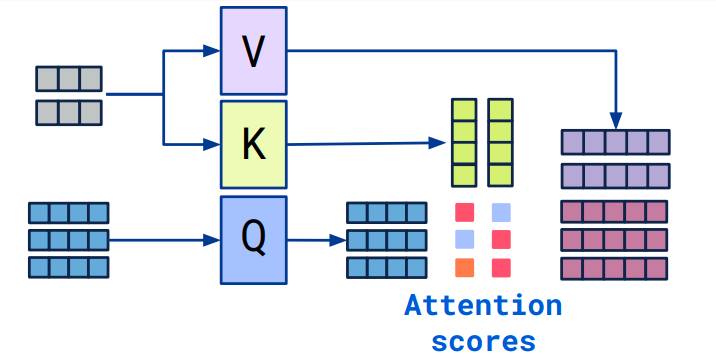</div>

在Stable Diffusion U-Net中，Self-Attention和Cross-Attention并不是孤立模块，而是被组织进Spatial Transformer中：图像特征先经GroupNorm与投影变成图像token，随后依次执行Self-Attention、Cross-Attention和FeedForward，并通过残差连接写回卷积特征。Self-Attention负责建立不同图像位置之间的全局联系，Cross-Attention则负责把Prompt对应的文本语义写入这些图像位置。

### 2. Stable Diffusion是如何在U-Net内部把文本与图像两种模态的语义对齐的？

Cross-Attention可以用于将图像与文本之间的关联建立，在stable diffusion中的U-Net部分使用Cross-Attention将文本prompt和图像信息融合交互，控制U-Net把噪声矩阵的某一块与文本里的特定信息相对应。

在每一个交叉注意力层中，空间位置对应的图像 Latent token 会根据当前图像特征查询文本 token：描述主体、属性、风格和空间关系的文本特征被写回相应图像位置。这个过程会在多次 U-Net 去噪步骤和多个尺度上重复，因此文本不是只在输入端控制一次，而是持续参与从噪声到图像 latent 的逐步重建。

<div align="center">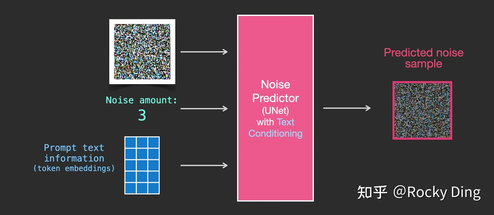</div>

### 3. Stable Diffusion中Cross-Attention的Q / K / V分别是什么？

在Stable Diffusion的Cross-Attention中：

- **Q（Query）来自图像latent feature**：U-Net当前层的二维特征先展平为空间 token，再经过线性投影得到Q；
- **K（Key）和 V（Value）来自文本Prompt的Text Embedding**：CLIP Text Encoder输出的文本token分别投影为K和V；
- 注意力权重由 $QK^\top$ 计算，表示每一个图像位置应该关注哪些文本 token；再用该权重对 V 加权求和，把相关文本语义写回图像特征。

图像隐变量作为Q，是因为Stable Diffusion的直接优化对象是图像Latent：模型需要针对“当前图像位置缺少什么语义信息”向文本进行查询。文本作为 K/V，则相当于一个稳定的条件记忆库，用于提供主体、属性、关系和风格信息。如果反过来让文本作为 Q，得到的输出会以文本 token 为主，不能直接与 U-Net 的空间特征逐位置融合。

### 4. 为什么 SD U-Net 中 Self-Attention 与 Cross-Attention 主要放在中、低分辨率层？高分辨率层为何以卷积为主？

SD U-Net 是「卷积 + 注意力」的混合架构，注意力的放置位置不是随便选的，而是**在显存 / 计算成本与语义建模能力之间的精妙折中**。

**1. 注意力的计算复杂度是分辨率的二次方**

对于空间形状为 $H \times W$ 的特征图，自注意力的复杂度是：

```math
\mathcal{O}\bigl((HW)^2 \cdot d\bigr)
```

在 SD 1.5（latent 64×64，VAE 8x 下采样）中，U-Net 的各下采样层分辨率依次为 $64 \to 32 \to 16 \to 8$。如果在 64×64 层就放 Self-Attention，序列长度是 4096，attention 矩阵需要 $4096^2 \approx 1.6\text{M}$ 个元素；而 16×16 层的序列长度只有 256，attention 矩阵只需 $\sim 65\text{K}$ 个元素，**计算量差 256 倍**。

**2. 中、低分辨率更适合做语义对齐**

- **高分辨率层（64×64、32×32）感受野小、语义弱**，主要承担「纹理、边缘」这类局部信息，用卷积已经足够；
- **中、低分辨率层（16×16、8×8）感受野大、语义强**，每个 token 已经聚合了较大的图像区域，正适合与文本 token 做 cross-attention 进行「语义对齐」；
- 高 / 低分辨率的注意力放置规律也符合人类视觉的「先局部纹理后整体语义」直觉。

**3. SD 1.x / 2.x / SDXL / SD 3 在 attention 放置上的差异**

- **SD 1.x / 2.x**：U-Net 的 32×32、16×16、8×8 三个分辨率层都有 Self-Attention + Cross-Attention block，64×64 层只有卷积。
- **SDXL**：把更多的 Transformer Block 集中到中分辨率（U-Net 中部更深的 attention stack），16×16 / 8×8 层 attention 数量从 SD 1.5 的 1 个增加到多个，主要为了提升大模型容量与高分辨率细节质量。
- **SD 3 / FLUX（MM-DiT）**：彻底放弃多尺度 U-Net，改为单尺度 patchify + 全局 attention；本质上把整张图压成一个 token 序列做 Transformer，分辨率与 attention 解耦，但需要更大算力。


<h2 id="q-049">面试问题：为什么使用U-Net作为Stable Diffusion模型的核心Backbone？</h2>

**难度评分：⭐⭐⭐ (3/5)  |  考察频率：⭐⭐⭐⭐⭐ (5/5)**

### 1. U-Net的结构具有以下特点

- **整体结构**：U-Net由多个大层组成。在每个大层中，特征首先通过下采样变为更小尺寸的特征，然后通过上采样恢复到原来的尺寸，形成一个U形的结构。
- **特征通道变化**：在下采样过程中，特征图的尺寸减半，但通道数翻倍；上采样过程则相反。
- **信息保留机制**：为了防止在下采样过程中丢失信息，UNet的每个大层在下采样前的输出会被拼接到相应的大层上采样时的输入上，这类似于ResNet中的"shortcut"。

<div align="center">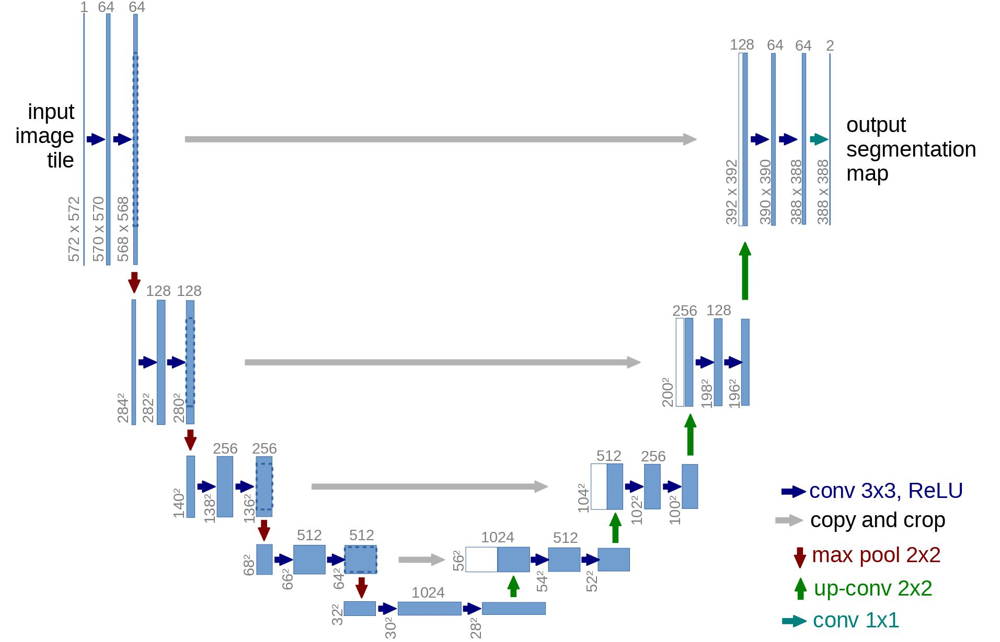</div>

U-Net具有编码器部分和解码器部分，均由ResNet块组成。编码器将图像表示压缩为较低分辨率图像表示，并且解码器将较低分辨率图像表示解码回据称噪声较小的原始较高分辨率图像表示。更具体地说，U-Net 输出预测噪声残差，该噪声残差可用于计算预测的去噪图像表示。为了防止U-Net在下采样时丢失重要信息，通常在编码器的下采样ResNet和解码器的上采样ResNet之间添加快捷连接。

Stable Diffusion的U-Net能够通过交叉注意力层在文本嵌入上调节其输出。交叉注意力层被添加到U-Net的编码器和解码器部分，通常位于ResNet块之间。

<div align="center">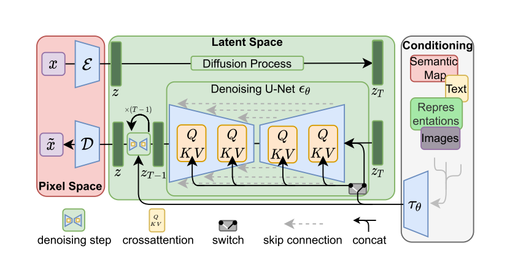</div>

### 2. Stable Diffusion U-Net相比经典U-Net增加了什么？

Stable Diffusion沿用了经典U-Net的Encoder、Decoder、多尺度特征和Skip Connection，但为扩散生成增加了三类关键组件：

1. **ResNetBlock + Time Embedding**：每个去噪阶段的噪声强度不同，Time Embedding 会告诉共享 U-Net 当前处于哪个 timestep，使网络能在早期优先恢复轮廓和低频结构，在后期补充纹理与高频细节。
2. **Spatial Transformer**：由 Self-Attention、Cross-Attention 和 FeedForward 组成。Self-Attention 建模图像内部的长程关系，Cross-Attention 将 Text Embeddings 作为条件注入图像特征。
3. **CrossAttnDownBlock / CrossAttnUpBlock / CrossAttnMidBlock**：把卷积 ResNetBlock 与 Spatial Transformer 组合在不同分辨率层中，使多尺度视觉建模与文本条件控制能够同时进行。

<div align="center">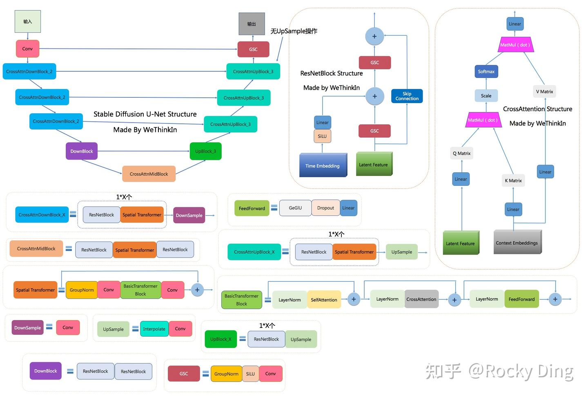</div>

U-Net 适合 Stable Diffusion 的根本原因，是它同时满足了扩散去噪的三类需求：**多尺度结构用于先轮廓后细节，Skip Connection 保留高频空间信息，Time Embedding 与 Cross-Attention 分别注入噪声阶段和文本条件。**


<h2 id="q-049b">面试问题：U-Net与DiT在Backbone设计哲学上的本质差异是什么？SD系列从U-Net演进到DiT的根本原因是什么？</h2>

**难度评分：⭐⭐⭐⭐⭐ (5/5)  |  考察频率：⭐⭐⭐⭐⭐ (5/5)**

从SDXL到SD 3/FLUX的最重要跃迁之一就是Backbone从U-Net切换到DiT/MM-DiT。这不只是「换Backbone模型架构」，而是**整个生成范式的演进**：从「卷积归纳偏置 + 局部 attention」走向「无归纳偏置 + 全局 token Transformer」。

### 1. 设计哲学对比

<div align="center">

| 维度 | U-Net | DiT / MM-DiT |
| --- | --- | --- |
| **基本算子** | 卷积为主 + 局部 attention | 纯 Transformer，全局 attention |
| **多尺度建模** | 显式多尺度（下采样 + skip-connection） | 单一尺度（patchify 后所有 token 一起处理） |
| **归纳偏置** | 强（卷积平移等变 + 局部性） | 弱（仅有位置编码） |
| **Scaling 能力** | 有限，加深加宽收益递减 | 强，深度 / 宽度 / 数据规模都能持续提升 |
| **多模态融合** | Cross-Attention 注入文本 | Token 拼接，文本与图像在统一序列里联合 self-attention |
| **算力成本** | 中分辨率有 attention，高分辨率纯卷积，整体节省 | 全局 attention，对长序列敏感 |
| **训练数据需求** | 中等 | 大（弱归纳偏置需要更多数据） |
| **实现成熟度** | 极高（diffusers / xFormers / TensorRT 全支持） | 上升期（FlashAttention、SDPA 已成熟） |

</div>

### 2. SD 系列从 U-Net 演进到 DiT 的根本原因

1. **Scaling Law 驱动**：Transformer 在 NLP、ViT、视频生成上反复证明「越大越好」；U-Net 在 SDXL 这一规模（≈2.6B）已经接近边际收益拐点，继续加宽 / 加深收益不显著。DiT 论文首次系统性地证明 Transformer 在扩散模型上同样有清晰的 Scaling Law。
2. **多模态联合建模**：MM-DiT 让文本与图像 token 在同一序列里做 self-attention，对**长 prompt、强语义、文字渲染**都更友好；U-Net 的 Cross-Attention 只能让图像 query 文本，缺乏「文本反向 query 图像」的双向信息流。
3. **统一架构、便于跨任务复用**：DiT 与视频生成（DiT for Video / Sora-类）、3D / 多模态生成（W.A.L.T、MMDiT）共用一套 Transformer 范式，更容易被复用与扩展。
4. **去除卷积的硬约束**：卷积假设平移等变性，但生成模型未必需要严格平移等变（不同分辨率、不同长宽比都要支持）；纯 Transformer + 位置编码反而更灵活。

### 3. 代价与权衡

- DiT / MM-DiT 推理算力随分辨率快速上升，需要 FlashAttention、SDPA、序列并行等系统优化；
- 弱归纳偏置带来更高的数据需求，SD 3 / FLUX 都使用了远比 SDXL 更大的训练数据；
- 工程生态（蒸馏、ControlNet、LoRA 适配器）需要为新架构重新搭建。


<h2 id="q-049d">面试问题：SD Backbone中为什么设计GroupNorm+SiLU+残差连接的组合？</h2>

**难度评分：⭐⭐⭐⭐ (4/5)  |  考察频率：⭐⭐⭐ (3/5)**

SD U-Net 中的每一个 ResBlock 都是「GroupNorm → SiLU → Conv → GroupNorm → SiLU → Conv → 残差加法 + timestep / 文本调制」。这套组合不是任意选择，而是扩散模型训练稳定性的「最小刚需配方」。

### 1. 为什么是 GroupNorm 而不是 BatchNorm

- **BatchNorm 依赖 batch 内统计**，扩散模型训练时同一 batch 内不同样本对应**不同的时间步 $t$**，统计分布差异巨大；BN 会把高噪样本与低噪样本混在一起做归一化，引入严重的统计偏置。BN 在小 batch / 推理 batch=1 时表现差；扩散模型推理常常 batch=1（CFG 时 batch=2），BN 不友好。
- **GroupNorm 只在通道维做分组归一化，与 batch 无关**，对任意 batch size 表现一致；与 timestep / 噪声水平也解耦。
- 工业中也有人使用 **AdaGN / AdaLN-Zero**（让 timestep 调制 GroupNorm 的 scale / bias），是DiT、SD 3 的常见做法。

### 2. 为什么是 SiLU 而不是 ReLU

- ReLU 在负区间梯度恒为 0，深层网络训练易出现「dead ReLU」；
- **SiLU（Swish）= $x \cdot \sigma(x)$**：在负区间有非零梯度，平滑可导，与扩散模型「连续噪声水平」的特性更匹配；
- DDPM 原论文消融显示 SiLU 比 ReLU、GELU 都更稳定；SD系列沿用至今。

### 3. 残差连接的双重价值

- **梯度传播**：扩散网络往往很深（SDXL U-Net 有数十个 ResBlock），残差连接保证梯度能直通到深层；
- **保留高频信号**：去噪过程要求网络能处理「输入 ≈ 输出」的极端情况（高 SNR 时几乎是恒等映射），残差连接提供了这种「恒等近似」的捷径。


<h1 id="q-050">4.介绍一下Stable Diffusion中Text Encoder的架构、原理和作用</h1>

<h2 id="q-051">面试问题：Text Encoder和VLM条件编码器在扩散模型中起什么作用？</h2>

**难度评分：⭐⭐⭐⭐ (4/5)  |  考察频率：⭐⭐⭐⭐⭐ (5/5)**

### 1. Text Encoder 和 VLM 条件编码器在扩散模型中的作用

Text Encoder/VLM条件编码器决定模型如何理解用户输入。早期Stable Diffusion主要依赖 CLIP 文本编码器，把 prompt 编码成可供 U-Net cross-attention 使用的文本特征；Imagen、DALL-E 3、SD 3、FLUX 则用更强的 T5 / LLM 级文本编码器，会显著提升复杂 prompt following；Qwen-Image、Qwen-Image-Edit 进一步把 VLM 作为语义入口，用于理解图像、文字、布局和编辑意图。

它们的作用可以拆成四层：

1. **把 prompt 转成语义条件。** 文本编码器负责把自然语言 prompt 映射成条件向量或 token 序列，再通过 cross-attention、AdaLN、joint attention、MMDiT 等机制注入生成主干。没有稳定的文本条件，扩散模型只能学无条件图像分布。

2. **理解长 prompt 和复杂关系。** CLIP 擅长短文本图文对齐，但对长描述、多对象关系、空间逻辑、段落级排版和复杂否定约束较弱。T5、LLM 和 VLM 可以补足这部分能力，这也是 SD 3、FLUX、Qwen-Image 这类模型强化文本/多模态编码器的重要原因。

3. **支持图像编辑和多模态输入。** 图像编辑不仅要理解“把什么改成什么”，还要理解源图里已有的主体、身份、结构和布局。Qwen-Image-Edit 这类路线通常会同时利用 VAE Encoder 保留外观结构、利用 VLM 条件编码器理解图像语义，从而让模型既知道“要改什么”，也知道“原图长什么样”。

4. **支持文字渲染、排版和知识图像。** 海报、菜单、PPT、流程图、信息图、地图和公式图不只是“画出类似图案”，还要求文字内容、布局层级和逻辑关系正确。强文本编码器/VLM 能把文字、OCR、版式和对象关系以更高密度送入生成主干，是富文本图像生成能力提升的关键。

### 2. Stable Diffusion 模型进行文本编码的全过程

Stable Diffusion 1.x 使用 CLIP ViT-L/14 的 Text Encoder。完整编码过程可以拆成以下步骤：

1. **Tokenization**：Tokenizer 先把 Prompt 切分为 token 序列，并加入起止标记；不足固定长度时 padding，超过长度时截断或由上层框架进行分块。
2. **Token Embedding + Position Embedding**：每个 token 被映射为向量，并加入位置信息，使相同词语位于不同位置时仍能被区分。
3. **Transformer 编码**：特征依次经过多层 CLIP Encoder Layer，每层包含 Self-Attention、MLP、LayerNorm 和残差连接，在文本序列内部建立上下文关系。
4. **输出 Text Embeddings**：以 SD 1.x 为例，最终得到 $77\times768$ 的序列特征，作为 U-Net Cross-Attention 的 Context Embeddings。CLIP 在基础 SD 训练中通常冻结，主要更新 U-Net 参数。

<div align="center">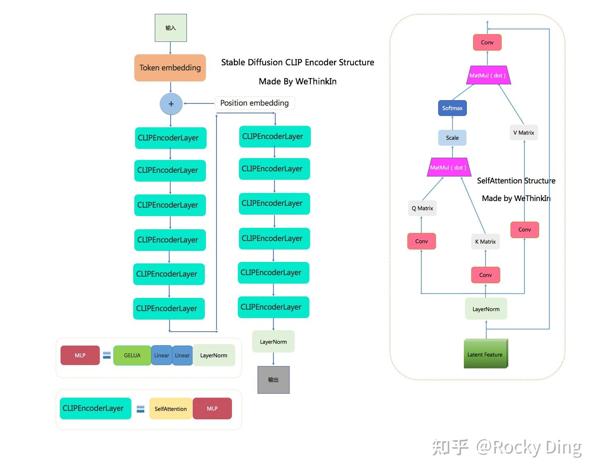</div>

CLIP Text Encoder模型将输入的文本Prompt进行编码，转换成Text Embeddings（文本的语义信息），由于预训练后CLIP模型输入配对的图片和标签文本，Text Encoder和Image Encoder可以输出相似的embedding向量，所以这里的Text Embeddings可以近似表示所要生成图像的image embedding。


<h2 id="q-053a">面试问题：CLIP Text Encoder的Tokens长度限制对长 Prompt的实际影响是什么？工程上如何突破？</h2>

**难度评分：⭐⭐⭐⭐ (4/5)  |  考察频率：⭐⭐⭐⭐⭐ (5/5)**

CLIP Text Encoder 的位置编码上限是 77 tokens（包含起止符 `<|startoftext|>`、`<|endoftext|>`），这是 SD 1.x / 2.x / SDXL 的硬约束，也是「用户写了一段长 prompt 但模型只收到前面几句」的根因。

### 1. 77 tokens 限制的实际影响

- **直接截断**：超过 77 token 的 prompt 默认被截断，后半段完全丢失，模型生成的图像与用户预期不符；
- **CLIP token ≠ 单词数**：CLIP 的 BPE 分词使一个英文单词常占 1-2 token，中文单字常占 2-3 token，**77 token 实际只够 30-50 个英文单词或 25-30 个中文字**；
- **写复杂场景受限**：多角色、多物体、多风格描述无法在 77 token 内充分表达；
- **对 SD 3 / FLUX 仍然部分受影响**：SD 3 同时使用了 CLIP-L、CLIP-G（77 token）+ T5-XXL（最大 512 token），但 CLIP 部分仍受 77 token 限制，T5 才是长上下文的承载者。

### 2. 三类主流的工程突破方案

**(1) Prompt Chunking**

- 把长 prompt 按 75 个有效 token 分块（每块再加起止符变 77）；
- 每块独立过 CLIP Text Encoder 得到 77×768 / 77×1280 的 embedding；
- 在 token 维上拼接（concat）成 $(77 \cdot N) \times d$；
- U-Net 的 cross-attention 直接接受任意长度的文本序列（attention 对序列长度本来就没限制）。
- 优势：实现简单、无需训练；劣势：跨块语义关联较弱，且 CLIP 没在长序列上训练过，超过几块后效果会衰退。

**(2) Prompt Weighting（权重语法）**

- 通过 `(word:1.3)` / `[word]` 等语法对特定 token 的 embedding 做缩放或插值；
- 不增加 token 数，而是在有限长度下「加重重要部分」。
- 见 [面试问题：Prompt 中的权重语法](#q-053b) 详细解析。

**(3) 切换到 T5 / 长上下文 LLM 编码器**

- **T5-XXL**：DALL-E 3、Imagen、SD 3、FLUX.1 都引入了 T5-XXL 作为补充 Text Encoder，最长支持 512 token，能容纳长 prompt 的细节；
- **未来趋势**：FLUX.2、Stable Diffusion 3.5 Large 等已实验性引入更长上下文 LLM 作为编码器。


<h2 id="q-053b">面试问题：Prompt中的权重语法（(word:1.2)、[word]等）的实现原理是什么？</h2>

**难度评分：⭐⭐⭐⭐ (4/5)  |  考察频率：⭐⭐⭐⭐ (4/5)**

「权重语法」是开源社区在 SD 1.x 时代发明的Prompt应用经验准则，用于在不增加 token 数的前提下放大某段文本的影响力。它的实现并不在模型权重里，而在 **「prompt → embedding」这一步的 embedding 处理层**。

### 1. 主流权重语法

<div align="center">

| 语法 | 含义 | 默认权重 |
| --- | --- | --- |
| `(word)` | 提升权重 | ×1.1 |
| `((word))` | 嵌套提升 | ×1.21 |
| `[word]` | 降低权重 | ×0.91 |
| `(word:1.5)` | 显式权重 | ×1.5 |
| `[word:1.5]` | 显式降低 | ÷1.5 |

</div>

### 2. 实现原理：在 token embedding 上做缩放或插值

核心做法遵循以下三步：

1. **解析权重**：把 `(word:1.5)` 解析为 `(token_ids, weight)` 元组列表；
2. **取出该段 token 的 embedding**：用 CLIP 的 token embedding 表得到原始 embedding；
3. **均值偏移法加权处理**：`emb = mean + weight * (emb - mean)`，保持整个 prompt 的全局均值不变，避免单段权重过大导致全局偏色；

**SD 3 / FLUX 上，权重语法仍然在 CLIP 编码部分有效，但 T5 部分通常不响应**。T5 没有内置 emphasis 概念，依靠语言本身（如「very bright」）表达强度更稳定。


<h2 id="q-053d">面试问题：从 SD 1.x → SDXL → SD 3 → FLUX.1，文本编码器与文本条件注入机制如何演进？这些变化如何影响提示词遵循与生成效果？</h2>

**难度评分：⭐⭐⭐⭐ (4/5)  |  考察频率：⭐⭐⭐ (3/5)**

### 1. 先看全貌：从单一 CLIP 条件，到语言表征与图文交互协同升级

<div align="center">

| 模型阶段 | 文本编码器组合 | 文本条件如何进入生成主干 | 这一阶段的关键变化 |
| --- | --- | --- | --- |
| SD 1.x | CLIP-L | 768 维 Token 特征作为 U-Net Cross-Attention 的条件 | 借用已有的图文对齐能力，让文本能够控制潜空间生成 |
| SD 2.x | OpenCLIP-H | 1024 维 Token 特征，仍通过 U-Net Cross-Attention 注入 | 更换预训练文本表征，条件注入的基本范式延续 |
| SDXL | CLIP-L + OpenCLIP-bigG | 两路序列特征拼成 2048 维；bigG 的 Pooled 特征另走全局条件路径 | 融合两种文本表征，同时提供序列条件与全局条件 |
| SD 3 | CLIP-L + OpenCLIP-bigG + T5-XXL Encoder | CLIP/T5 序列特征进入 MMDiT；两路 CLIP Pooled 特征形成全局条件 | 引入语言预训练表征，并让文本与图像 Token 在主干中联合交互 |
| FLUX.1 dev/schnell | CLIP-L + T5-XXL Encoder | CLIP 提供 768 维全局向量；T5 提供 4096 维序列特征，进入双流与单流 Transformer | 简化文本输入组合，保留全局调制与序列交互两条路径 |

</div>

### 2. SD 1.x → SD 2.x：先解决“文字如何成为生成条件”

SD 1.x 使用预训练、冻结的 CLIP 文本编码器，把提示词变成一串上下文相关的 Token 特征。U-Net 中的 Cross-Attention 以图像特征为 Query，以文本特征为 Key/Value，让不同图像位置从提示词中读取相关信息。例如，生成帽子的区域可以关注“红色”和“帽子”等词对应的特征。

CLIP 的预训练目标是拉近匹配图文、推远不匹配图文，因此能够提供与视觉概念关联的语义表征。不过，这种训练主要在整张图与整段文字的层面做匹配，**并不直接要求逐项检查数量、左右关系和属性归属**。其 Token 特征包含上下文信息，但不能据此保证模型分清“猫戴红帽、狗戴蓝帽”和颜色对调后的场景。

SD 2.x 换用 OpenCLIP-H，文本特征宽度由 768 变为 1024，仍沿用 U-Net 读取文本条件的基本方式。

同一组风格词在 SD 1.x 和 SD 2.x 上可能产生不同响应，因为文本表征与生成网络学习到的映射都变了。与此同时，图文数据、过滤方式、训练分辨率及部分版本的预测目标也发生了变化。因此，人物、画风或构图差异只能先视为**整套模型的差异**；没有控制变量实验，就不能断言主要由文本编码器引起。

### 3. SDXL：把两种文本表征结合起来，并增加全局条件

SDXL 同时使用 CLIP-L 与 OpenCLIP-bigG，将两者倒数第二层的 Token 特征按特征维度拼接。忽略批次维度，默认形状为：

```text
CLIP-L 序列：  77 × 768
bigG 序列：    77 × 1280
拼接后：       77 × 2048 → U-Net Cross-Attention

bigG Pooled：  1280 维   → 与尺寸、裁剪等条件一起参与全局调制
```

这里的 77 是包含特殊 Token 在内的序列槽位数，不是 77 个汉字或单词。两个编码器沿特征维度拼接，也不会把文本长度变成 154。

这套设计给每个文本位置提供了更丰富的表示，还增加了一条整句语义的全局控制路径。可以理解为：生成网络既能逐项读取提示词，也能接收整段描述的总体信息。但“序列负责细节、Pooled 负责全局”描述的是输入形式与注入位置，不代表模型内部存在严格的语义分工。

SDXL 在高分辨率画面与整体质量上的提升，还来自更大的 U-Net、训练策略、尺寸与裁剪条件等设计。双 CLIP 为条件表达增加了容量，却没有独立解决复杂关系和准确文字生成。保留 CLIP-L 也不意味着 SD 1.x 的 LoRA 可以直接复用；SDXL 的网络结构和条件接口已经改变，不能把双编码器的设计目的简单解释为“兼容旧 Prompt”。

### 4. SD 3：引入 T5，同时增强生成主干对文本的利用能力

SD 3 保留两个 CLIP，并加入 T5-XXL 的 Encoder。T5 通过文本片段恢复等语言预训练任务学习上下文关系，可以补充 CLIP 图文对比预训练获得的表征。这里使用的是 T5 编码器的隐藏特征，不需要调用解码器生成一段回答，也不能把 T5 的语言能力直接等同于最终图像的准确性。

**真正需要一起理解的是“T5 提供文本表征”和“MMDiT 使用文本表征”这两步。** SD 1.x/SDXL 的典型 Cross-Attention 从图像侧查询文本条件；SD 3 的 MMDiT 为文本和图像保留各自的处理参数，再把两类 Token 放到联合注意力中交互，让主干中的文本表示与图像表示能够相互影响。外部文本编码器可以保持冻结，主干内部仍然可以更新文本特征。

其文本条件融合有两条路径：

- **序列路径**：两个 CLIP 的 Token 特征先按特征维度拼成 2048 维，补零到与 T5 相同的 4096 维，再与 T5 特征沿 Token 序列维度拼接，送入主干。
- **全局路径**：两个 CLIP 的 Pooled 向量拼成 2048 维，经过投影后与时间步条件共同调制主干。

### 5. FLUX.1：从三编码器回到两编码器，重点在条件分工与交互

FLUX.1 使用 CLIP-L 与 T5-XXL，不再引入 OpenCLIP-bigG，也不把 CLIP 的 Token 序列拼到 T5 序列上：

- **CLIP-L 的 Pooled 输出**提供整段提示词的全局向量，经映射后与时间步等条件结合，参与网络调制。
- **T5-XXL 的 Token 输出**保留逐位置的上下文特征，投影后与图像 Token 进入 Transformer 主干。

主干先通过双流模块分别处理图像与文本，并在注意力计算时进行联合交互；随后将两类 Token 合并交给单流模块继续处理。由此，文本条件能够在生成计算中持续参与图像内容的更新。

相比 SD 3，FLUX.1 减少了编码器数量，但仍保留全局条件与序列条件，并配合不同的主干、训练与蒸馏方案。这说明不能用编码器数量给模型能力排序，也不能仅凭架构差异断言某一组合必然更优。dev 与 schnell 的文本编码器组合相同，生成表现和推理步数仍会受到各自训练、蒸馏方案的影响。

### 6. 如何判断这些演进究竟带来了什么改善？

回到“猫、狗、帽子与招牌”的例子，应把生成效果拆成不同问题：

1. **主体与属性**：猫和狗是否都出现？红帽是否属于猫、蓝帽是否属于狗？这需要文本表征、图文数据和区域对齐共同支持。
2. **关系与数量**：左右位置是否正确，是否多画或漏画主体？更强的语言表征和图文交互有助于建模这些要求，但不提供逻辑正确性的保证。
3. **文字渲染**：招牌是否准确写出 HELLO？编码器需要保留文字信息，生成网络和图像解码器还要把字形落实到像素；能写英文短词不能自动推出能准确写中文长句。
4. **画面质量**：主体清晰度、光影、纹理与美感如何？它们还取决于数据分布、主干容量、VAE、分辨率与采样设置，不能由文本编码器独立解释。


<h2 id="q-054">面试问题：如何优化Prompt和生成图像不对齐的问题？</h2>

**难度评分：⭐⭐⭐⭐ (4/5)  |  考察频率：⭐⭐⭐⭐⭐ (5/5)**

Prompt与生成图像不对齐，不能只靠“继续堆 Prompt”解决。应先判断问题发生在 **文本编码、训练数据、条件注入、采样引导还是模型能力边界**，再选择对应手段。

### 1. 先判断不对齐发生在哪一层

1. **文本编码层**：Prompt 超过 CLIP 的有效长度而被截断，关键词被 BPE 拆分，或 SD 1.x/2.x 使用不同 Text Encoder 导致同一词语落在不同语义空间。
2. **数据与模型层**：训练集中缺少某个概念、人物关系或构图组合，或者 Caption 本身噪声很大，模型就没有形成稳定的“词语—视觉模式”映射。
3. **Cross-Attention 层**：多个主体、属性和空间关系同时出现时，Text Embeddings 可能在不同图像区域发生语义串扰，出现属性绑定错误或 concept bleeding。
4. **CFG 与采样层**：guidance scale 太低时文本约束不足，太高时又可能过饱和、构图僵化并偏离数据流形；采样步数过少也可能尚未完成语义与细节收敛。

### 2. 对应的工程处理方法

- **压缩并前置关键信息**：把主体、动作、空间关系和关键属性放在 Prompt 前部，删除重复风格词；长 Prompt 可使用 chunking，但跨块语义关系通常不如短而密的 Prompt 稳定。
- **调整关键词权重与顺序**：使用 `(word:weight)` 强化关键 token，但避免极端权重；复杂场景可以拆成多次生成、区域提示或分层编辑，而不是让一个 Prompt 同时承担所有约束。
- **合理设置 CFG 和采样步数**：SD 1.x 常从 CFG 7～8.5、20～50 步作为起点，再根据模型和采样器调整；更高 CFG 不等于更高质量。
- **增加结构条件**：当 Prompt 无法稳定描述姿态、边缘、深度、布局或身份时，使用 ControlNet、IP-Adapter、区域控制、参考图或 Inpainting，把纯语义约束转成空间或视觉条件。
- **选择匹配的底模与 Text Encoder**：写实、二次元、文字渲染、长文本和多角色关系对应不同模型能力边界；换模型往往比继续修 Prompt 更有效。
- **训练侧提升对齐**：使用更准确、更密集的 Caption，清理水印和错配数据；训练时通过条件丢弃学习 CFG，并用 CLIP score、人工偏好与组合关系测试同时评估，不只观察 FID。


<h1 id="q-056">5.介绍一下Stable Diffusion XL的原理和创新点</h1>

<h2 id="q-058">面试问题：Stable Diffusion XL的VAE部分有哪些创新？详细分析改进意图</h2>

**难度评分：⭐⭐⭐⭐ (4/5)  |  考察频率：⭐⭐⭐⭐ (4/5)**

SDXL仍然是Latent Diffusion Model，VAE负责把输入图像压缩为Latent，以及把去噪后的Latent解码回像素图像；文生图时不需要 Encoder，只使用 Decoder 完成重建。VAE 同时决定了高频细节、小物体特征和整体色彩的上限，因此不能把它当作扩散主干之外的“普通编解码器”。下图是SDXL的整体流程图：

<div align="center">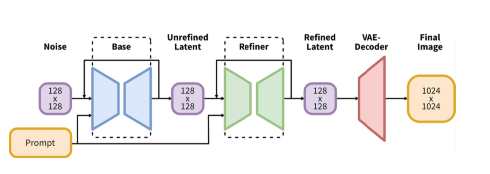</div>

### 1. 结构沿用 KL-f8，但训练配方升级

SDXL使用与Stable Diffusion 1.5相同的KL-f8 VAE结构：Encoder将图像映射到Gaussian Latent分布，Decoder将Latent重建为像素图；Encoder与Decoder内部由GSC（GroupNorm + SiLU + Conv）、Downsample（Padding + Conv）、Upsample（Interpolate + Conv）、ResNetBlock 和 Self-Attention 等组件组成。

Encoder 包含三个 DownBlock、一个 ResNetBlock 和一个 MidBlock，Decoder 对称地包含三个 UpBlock、一个 ResNetBlock 和一个 MidBlock。

真正的改进重点在训练：SDXL从头训练VAE，使用更大的batch size（256，相比上个系列的9）并引入EMA（Exponential Moving Average）权重平均，以提高重建质量和鲁棒性；损失仍以感知损失（perceptual loss）与 L1 回归损失为主，兼顾视觉相似度与像素级稳定性。下图是SDXL VAE结构图：

<div align="center"></div>

### 2. 重新训练改变 Latent 分布，缩放系数同步调整

SD 2.x 主要是在 SD 1.x VAE 基础上微调 Decoder、保持 Encoder 权重不变，因此两者的 Latent 分布兼容；SDXL VAE 则重新训练，Latent 分布发生变化。为了让送入 U-Net 的 Latent 标准差接近 1，缩放系数从 SD 1.x/2.x 的 `0.18215` 调整为 SDXL 的 `0.13025`。这意味着 SDXL VAE 与旧版 VAE 不能直接互换：如果忽略缩放系数或跨版本替换 VAE，常见结果是偏色、噪声或细节崩溃。

切换不同的 SDXL VAE 微调版本，通常只改变细节与颜色表现，不会大幅改变构图，可把它理解为对成像风格的后处理调节。


<h2 id="q-059">面试问题：Stable Diffusion XL的Backbone部分有哪些创新？详细分析改进意图</h2>

**难度评分：⭐⭐⭐⭐⭐ (5/5)  |  考察频率：⭐⭐⭐⭐⭐ (5/5)**

SDXL Base 的 Backbone 仍是 U-Net，但参数量扩展到约 2.6B，约为 SD 1.x/2.x 的三倍，目标是稳定支持 1024×1024 及以上分辨率。它的关键不是简单“加深加宽”，**而是重新分配 Spatial Transformer 与下采样层的位置，把高成本的全局建模集中到更小的 feature map 上**。下图是SDXL Base的网络架构图：

<div align="center">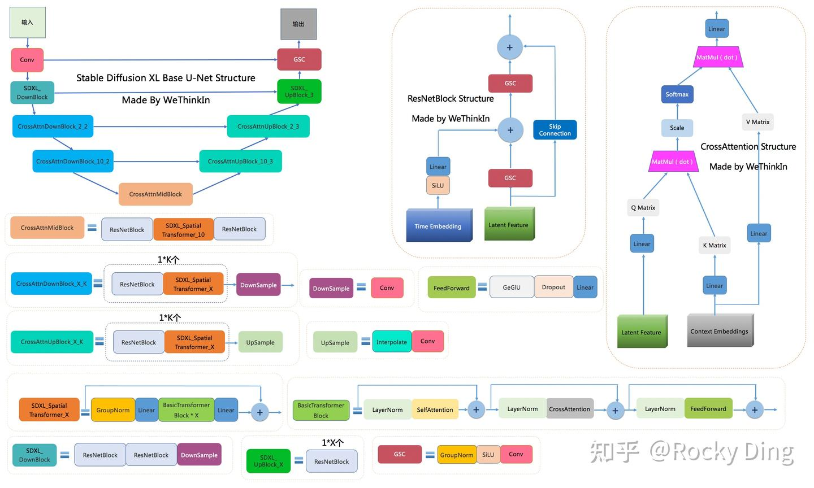</div>

### 1. 从四 stage 调整为三 stage，减少一次下采样/上采样

SD 1.x/2.x 的 U-Net 通常采用四 stage（可概括为 `[1,1,1,1]`），并进行三次下采样与上采样；SDXL 调整为三 stage（`[0,2,10]`），只做两次下采样与上采样。

Encoder 由两个 `CrossAttnDownBlock` 和一个 `SDXL_DownBlock` 组成，Decoder 由两个 `CrossAttnUpBlock` 和一个 `SDXL_UpBlock` 组成，中间通过 Skip Connection 传递和融合多尺度信息。

第一个 stage 不再放置 Spatial Transformer，可以显著减少高分辨率 feature map 上的显存和二次复杂度；第二、第三 stage 的空间尺寸更小，却堆叠更多 Spatial Transformer（分别为 2 个和 10 个），从而在可控成本下提升全局语义建模能力。**这种“高分辨率层少做 attention、低分辨率层集中堆 attention”的设计，使 SDXL 在扩大容量后推理耗时只比旧版增加约 20%～30%。**

### 2. BasicTransformer Block 成为 U-Net 的容量核心

SDXL 新增的 `SDXL_Spatial Transformer_X` 由 `GroupNorm + Linear + X 个 BasicTransformer Block + Linear` 构成，并保留残差连接。每个 BasicTransformer Block 由 `LayerNorm + Self-Attention + Cross-Attention + FeedForward` 组成，FeedForward 采用 GEGLU + Dropout + Linear。Self-Attention 建模 latent 内部的全局关系，Cross-Attention 将文本条件注入图像特征，循环残差结构保证网络可以加深并保持梯度稳定。

Cross-Attention 中，latent feature 作为 Q，两个 Text Encoder 的序列特征作为 K/V。由于 latent 是 `[B,C,H,W]` 四维张量，执行 attention 前先变换为 `[B,H×W,C]`，完成后再变回 `[B,C,H,W]`；Linear 投影负责对齐不同 feature 的通道维度。

总的来说，SDXL U-Net 的创新可概括为“减少一次尺度变换、把 attention 从最大 feature map 移到中低分辨率层、用更深的 Spatial Transformer 扩容”。它同时提高了全局语义与高分辨率细节能力，并控制了 attention 的计算成本。

<h2 id="q-060">面试问题：Stable Diffusion XL的Text Encoder部分有哪些创新？详细分析改进意图</h2>

**难度评分：⭐⭐⭐⭐ (4/5)  |  考察频率：⭐⭐⭐⭐ (4/5)**

SDXL 把 SD 1.x 的「单一 CLIP-L」升级为「**CLIP-L + OpenCLIP-bigG 双编码器 + Pooled Embedding 全局注入**」，这套设计在 SD 3、FLUX 中也得到延续，是新一代生成模型文本注入的重要范式。理解 SDXL 的 Text Encoder，关键是区分细粒度 token 条件和全局 pooled 条件两条路径。

<div align="center">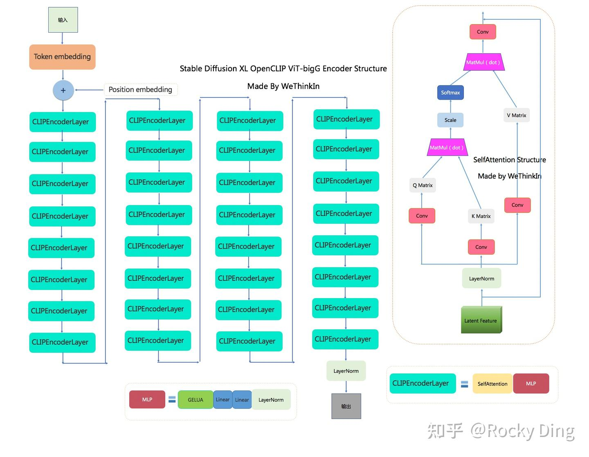</div>

OpenCLIP ViT-bigG 由 32 个 CLIP Encoder 组成，特征维度更大、网络更深；OpenAI CLIP ViT-L/14 由 12 个 CLIP Encoder 组成，保留了 SD 1.x 生态熟悉的文本表征空间。两者的基本 Encoder 单元相同，但容量和训练语料不同，组合后可以同时覆盖生态兼容性与更强的语义表达。

<div align="center">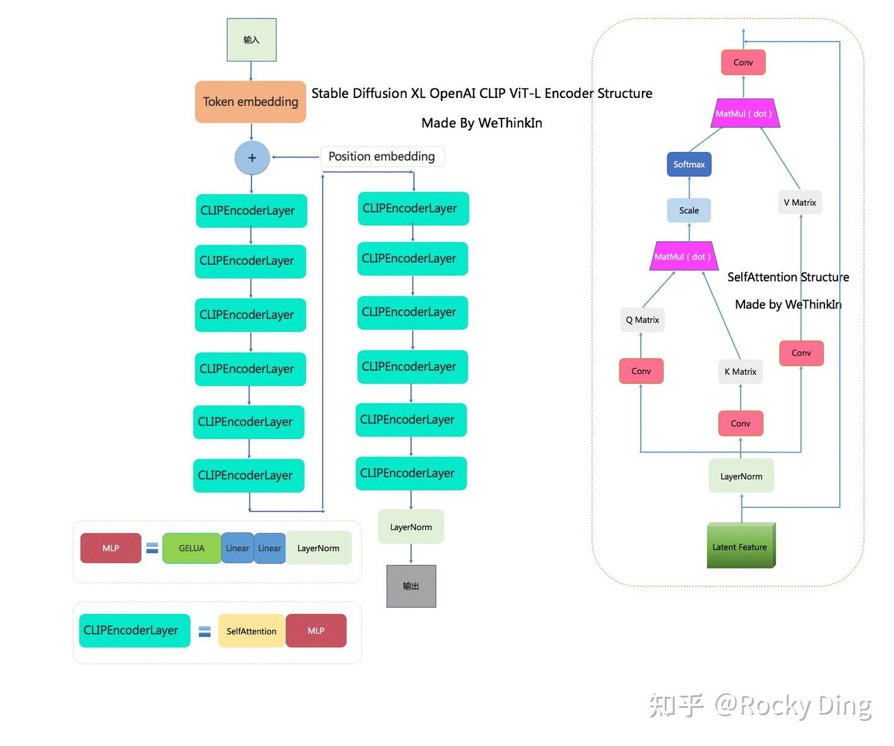</div>

### 1. 双 Text Encoder 的特征提取与注入链路

```text
输入 Prompt
   │
   ├──► CLIP-L Text Encoder ─► 倒数第二层 hidden state，shape = (77, 768)
   │
   └──► OpenCLIP-bigG Text Encoder ─► 倒数第二层 hidden state，shape = (77, 1280)
                                      └─► Pooled Embedding，shape = (1280,)

细粒度路径：
   concat([CLIP-L 序列, OpenCLIP-bigG 序列], dim=-1) → shape = (77, 2048)
   → 作为 U-Net Cross-Attention 的 K / V

全局路径：
   OpenCLIP-bigG Pooled → shape = (1280,)
   concat([Pooled Embedding, micro-conditioning time IDs], dim=-1)
   → 经 add embedding MLP → 与 timestep embedding 融合 → 作为全局调制信号
```

### 2. 双编码器的设计意图

- **CLIP-L 兼容旧生态**：保留 SD 1.x 时代用户熟悉的 Prompt 行为；
- **OpenCLIP-bigG 提供更强语义**：参数量 695M，远大于 ViT-L 的 124M，对长 Prompt、复杂语义、多概念组合的理解更强；
- **OpenCLIP-bigG 的 Pooled Embedding 提供全局风格**：Cross-Attention 偏向局部对齐，Pooled Embedding 提供整体风格与主题约束，二者互补；
- **细粒度 + 全局双通路**：为后续 SD 3、FLUX 的多模态条件注入提供了可复用的设计基础。

### 3. 工程实现中的常见注意事项

1. **全局 Pooled Embedding 只取第二个编码器**：SDXL 使用 OpenCLIP-bigG 的 pooled output 作为全局文本条件，并不是把两个编码器的 pooled output 拼接；它对应 [EOT]（End of Text）token 位置的聚合表示，而不是 [CLS]；
2. **两个编码器的 padding 策略要一致**：都需要 padding 到 77 tokens，并保持 attention mask 一致；
3. **micro-conditioning 的融合顺序不能错**：`original_size`、`crop_top_left`、`target_size` 六个标量先分别做 sinusoidal embedding，再与 OpenCLIP-bigG 的 pooled embedding 拼接，经 add embedding MLP 后与 timestep embedding 融合；
4. **CFG 的 unconditional 分支要分别准备**：两个编码器都要对空 Prompt 编码，拼接两路 uncond 序列特征，同时保留 OpenCLIP-bigG 对应的 uncond pooled embedding；


<h2 id="q-061">面试问题：Stable Diffusion XL中使用的训练方法有哪些创新点？</h2>

**难度评分：⭐⭐⭐⭐ (4/5)  |  考察频率：⭐⭐⭐⭐⭐ (5/5)**

SDXL 的训练优化不是单个技巧，而是把数据预处理事实、噪声分布和条件注入共同纳入训练目标。下面先介绍 micro-conditioning，再说明 offset Noise 如何补足高分辨率扩散中的低频噪声覆盖。

### 1. SDXL 的 micro-conditioning（original_size / crop_top_left / target_size）是什么？为什么是 SDXL 工程化层面最关键的创新之一？

micro-conditioning 是 SDXL 论文中最有工程价值的「不起眼小创新」，它把图像在数据预处理阶段被「裁剪、缩放、填充」过的事实**显式告诉模型**，从而修复了 SD 1.5 时代普遍存在的「人物头部缺失、构图不全、低分辨率训练数据被错误利用」等问题。

**三个条件的具体含义**

<div align="center">

| 条件 | 含义 | 训练时的取值 | 推理时建议 |
| --- | --- | --- | --- |
| `original_size` | 图像在 resize 到训练分辨率前的**原始分辨率** | 数据集真实原始尺寸 | 想让模型按高分辨率风格生成时设大值（如 1024×1024 或更大） |
| `crop_top_left` | 训练时为对齐分辨率所做的中心裁剪偏移量 $`(c_y, c_x)`$ | 真实裁剪偏移 | 通常设 (0, 0) 表示「无裁剪、构图完整」 |
| `target_size` | 模型最终要生成的目标分辨率 | 训练分辨率 | 与 `original_size` 一致或按需求设定 |

</div>

注入方式：将 `original_size`、`crop_top_left`、`target_size` 拆成六个标量，分别经过 sinusoidal embedding 后拼接，再与 OpenCLIP-bigG 的 Pooled Embedding 一起经过 add embedding MLP，最终和 timestep embedding 融合作为 U-Net 的全局调制信号。

**为什么是 SDXL 工程化层面最关键的创新**

1. **修复「数据浪费」问题**：SD 1.x 训练时小于训练分辨率的样本会被丢弃，损失约 39% 的训练数据；SDXL 把 `original_size` 作为条件，让模型「知道这是低分辨率原图」，所有数据都能用，扩大了训练集规模与多样性；
2. **修复「裁剪导致内容缺失」问题**：SD 1.x 中心裁剪会让人物头部 / 物体边缘被切掉，模型学到「人物没有头是合理的」；SDXL 通过 `crop_top_left` 显式标注裁剪偏移，模型在推理时设 (0, 0) 就能生成完整构图；
3. **解锁「分辨率风格控制」**：推理时把 `original_size` 设为高值（如 4096×4096）能让模型按「高清原图风格」生成；设低值则生成颗粒感更强的「低分辨率风格」；
4. **零额外训练成本**：仅在 conditioning 部分加几个 MLP，参数量增量可忽略，但收益巨大。

### 2. 训练 Stable Diffusion XL 时为什么要使用 offset Noise？

SDXL 在高分辨率图像上训练时，普通的逐像素独立高斯噪声主要覆盖局部高频变化，无法充分改变整张图像的亮度、色调等低频统计。模型因此容易学习到“中等亮度、低对比度”的生成分布，在纯色背景、极亮或极暗场景中表现受限。

offset Noise 的做法是在标准噪声之外，为每个样本和每个 latent 通道额外采样一个空间上共享的偏移噪声，并广播到整个 $`H\times W`$ 特征图：

<div align="center">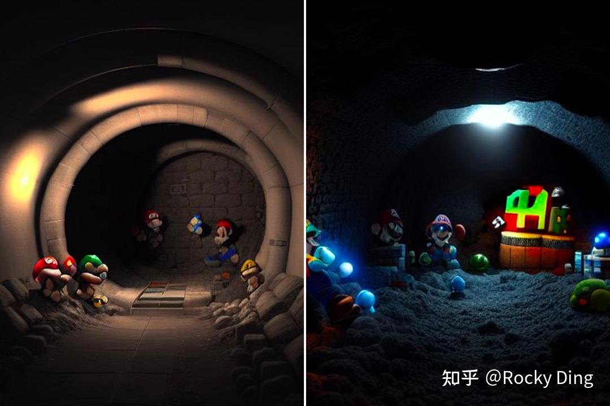</div>

```math
\epsilon' = \epsilon + \lambda\,\epsilon_{\mathrm{offset}},\qquad
\epsilon\sim\mathcal{N}(0,I),\quad
\epsilon_{\mathrm{offset}}\sim\mathcal{N}(0,I_{B\times C\times1\times1})
```

其中 $\lambda$ 是 offset Noise 的强度，`epsilon_offset` 在空间维度上保持一致，因此会整体推动某个通道的亮度或色彩，而不是只改变局部纹理。训练时使用 $`\epsilon'`$ 构造带噪 latent，推理时仍使用普通噪声；模型由此学会覆盖更宽的低频范围，生成纯黑、纯白、低照度和高对比度画面时更稳定。

工程上需要注意三点：第一，offset Noise 是训练分布的改变，微调 SDXL 时应与基础模型的噪声配置保持一致，不能只在推理端临时添加；第二，$`\lambda`$ 过大可能造成颜色漂移、细节不稳定，通常从较小值开始调参；第三，它解决的是低频动态范围问题，不能替代 micro-conditioning，前者改变噪声覆盖，后者告诉模型图像尺寸和裁剪事实。

### 3. SDXL 的多尺度训练与 Ratio Bucketing 如何协同？

仅把训练分辨率固定为 1024×1024，会让不同长宽比的样本被强行裁剪；只依赖随机裁剪，又会损失主体边缘信息。SDXL 在尺寸/裁剪条件化的基础上引入多尺度微调，并采用 Ratio Bucketing：先按纵横比将样本分桶，使每个 bucket 的像素数尽量接近 1024×1024，相邻 bucket 的高度或宽度通常相差约 64 像素；每个 step 从同一个 bucket 采样一个 batch，再在 step 之间切换 bucket。

<div align="center">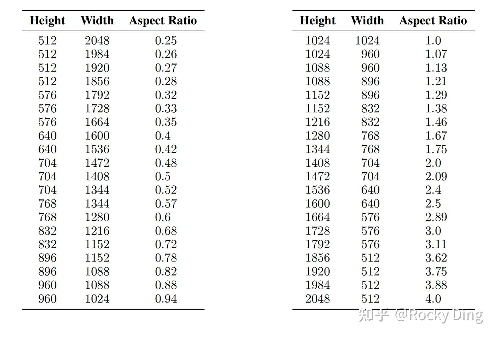</div>

这样做有三层意图：第一，减少不必要的裁剪，保留主体完整性；第二，让模型在训练阶段看到多种宽高比，避免只会生成正方形；第三，通过 bucket 内像素数近似恒定控制显存与吞吐。Aspect Ratio 也可以作为额外条件注入 U-Net，使网络区分不同尺度下的构图先验。官方推荐的默认生成尺寸仍是 1024×1024，但同一模型可以自然覆盖多种宽高比。

### 4. 尺寸、裁剪、宽高比与 pooled text embedding 如何注入 U-Net？

SDXL 的条件化并不只是一组 `time_ids`：`original_size`、`crop_top_left`、`target_size` 三组图像条件（共六个标量）以及 Aspect Ratio 都先经过与 timestep 相同的傅里叶/sinusoidal 编码；OpenCLIP-bigG 的 pooled text embedding 则提供全局语义。它们拼接后形成条件向量，再经过两个 Linear 层映射到与 time embedding 相同的维度，最后与 time embedding 相加，作为 U-Net 各层的全局调制信号。

<div align="center">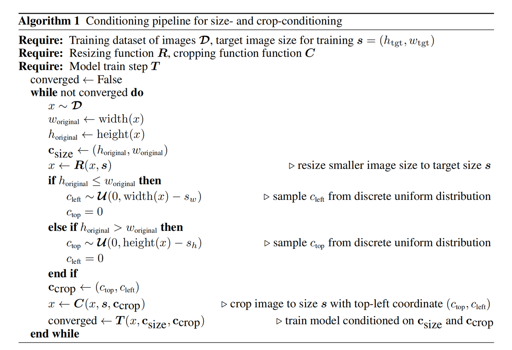</div>

这种设计把数据预处理事实、生成尺寸先验和文本整体语义放进同一条条件通路：训练时记录真实的原始长宽与裁剪左上角坐标，推理时通常设置 `crop_top_left=(0,0)` 以请求完整构图，再通过 `original_size/target_size` 控制目标尺寸风格。自定义训练脚本必须保证这些字段的顺序、单位和 CFG 的 unconditional 分支一致，否则会出现构图偏移或条件错位。

### 5. SDXL 的训练目标与策略

在上述条件注入之外，SDXL 仍采用 1000 步 DDPM noise scheduler 与 ε-prediction 目标。公开文章对训练配方的整理显示，模型先在 256×256 和 512×512 阶段分别进行约 600,000 步与 200,000 步预训练（batch size=2048），再在 1024×1024 为中心的多尺度桶上微调；这一安排先扩大数据覆盖，再让模型适应目标分辨率。带噪 latent 可写为

```math
\mathbf{x}_t=\sqrt{\bar{\alpha}_t}\mathbf{x}_0+\sqrt{1-\bar{\alpha}_t}\boldsymbol{\epsilon},\qquad
\mathcal{L}_{\mathrm{SDXL}}=\mathbb{E}\left[\left\|\boldsymbol{\epsilon}-\boldsymbol{\epsilon}_\theta(\mathbf{x}_t,t,\mathbf{c})\right\|_2^2\right]
```

其中 `c` 同时包含 token-level text conditioning 与 pooled/micro-conditioning。完整训练路线可以概括为：先在 256×256、512×512 阶段用尺寸和裁剪条件化扩大数据利用率，再在 1024×1024 像素规模附近进行多尺度分桶微调，最后通过 offset Noise 拓展亮度与色彩动态范围。几项技巧分别解决数据覆盖、构图完整性、宽高比泛化和低频色彩受限问题，组合起来才构成 SDXL 的工程化优势。


<h2 id="q-065">面试问题：什么是SDXL Refiner？</h2>

**难度评分：⭐⭐⭐⭐ (4/5)  |  考察频率：⭐⭐⭐⭐ (4/5)**

SDXL Refiner是图像精细化模型，作为SDXL生态系统的第二阶段，专门负责提升图像细节质量。它采用了"专家集成"的设计理念：Base模型生成基础结构，Refiner模型优化细节表现。具体流程如下图所示：

<div align="center">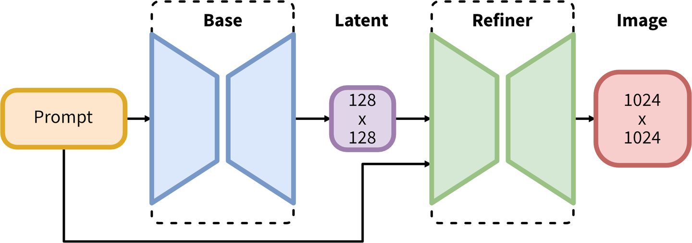</div>

Base 负责文生图、图生图和 inpainting，先生成结构稳定的 latent；Refiner 接收 Base latent，在较低噪声区间继续去噪，重点补足纹理、背景和人脸等高频细节。这个过程本质上是 latent 空间的 img2img，而不是重新从文本开始生成。

### 核心工作原理

<div align="center">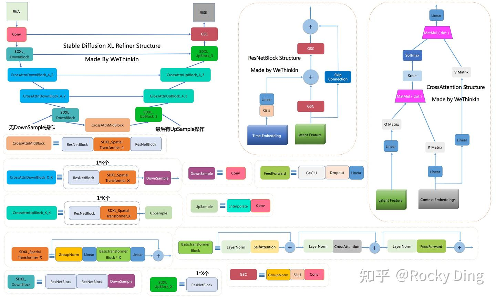</div>

**两种使用方式**

1. **标准流程**：Base模型完成80%去噪 → Refiner完成剩余20%精细化
2. **SDEdit流程**：Base生成完整图像 → Refiner使用img2img技术优化

标准工作流通常让 Base 完成前约 80% 的去噪，再把剩余约 20% 的低噪声步骤交给 Refiner；也可以先由 Base 完整出图，再通过 img2img 给 latent 添加少量噪声后交给 Refiner。Refiner 只在前 200 个 timesteps（低噪声水平）上训练，因此不适合从纯噪声独立采样。

### 技术特点

- **双文本编码器**：OpenCLIP-ViT/G + CLIP-ViT/L，提供更好的语义理解
- **专门优化**：针对低噪声水平的去噪过程进行特殊训练
- **参数规模**：6.06B参数，专注于细节增强

在结构上，Refiner 与 Base 共用同一个 VAE，但只使用 OpenCLIP ViT-bigG Text Encoder，并同样提取倒数第二层序列特征和 pooled text embedding；其 U-Net 的通道数与 attention 堆叠深度针对低噪声精修做了调整，参数规模略小于 Base。

### 性能提升

根据官方评测，SDXL Base + Refiner的组合相比之前版本：

- 用户偏好度达到91%（远超SD 1.5/2.1）

- 细节清晰度提升约20-30%

- 整体图像质量显著改善

<div align="center">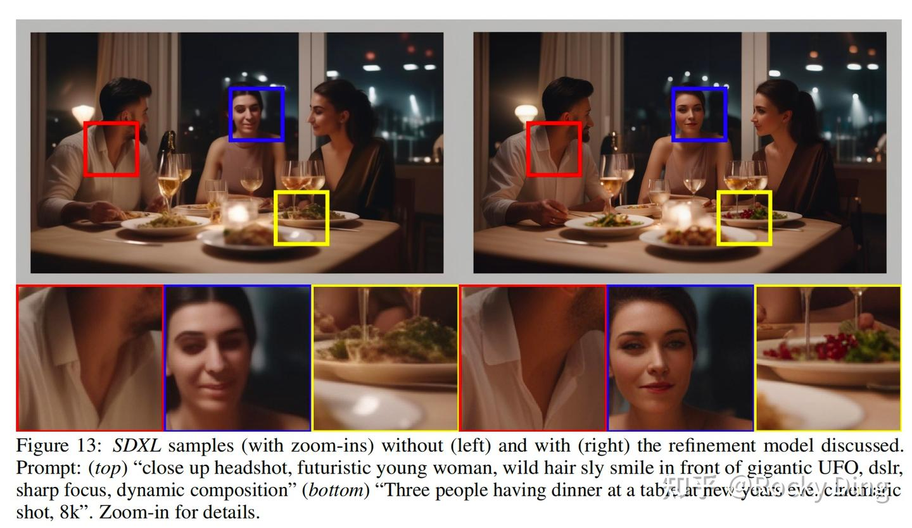</div>

由于 Refiner 主要学习低噪声细节迁移，它也可以作为 Stable Diffusion、Midjourney、DALL·E、GAN 或其他 VAE/扩散模型的级联后处理组件；工程上可按延迟预算选择“Base-only”或“Base + Refiner”，并不要求所有场景都启用第二阶段。


<h1 id="q-066">6.介绍一下Stable Diffusion 3的原理和创新点</h1>

<h2 id="q-067">面试问题：SD 3 的 VAE 部分有哪些创新？详细分析改进意图</h2>

**难度评分：⭐⭐⭐⭐ (4/5)  |  考察频率：⭐⭐⭐⭐⭐ (5/5)**

### Stable Diffusion 3 整体架构初识

Stable Diffusion 3 是 Stability AI 发布的文生图大模型。相比此前的 Stable Diffusion 系列，它在多主题提示词的控制一致性（multi-subject prompts）、文字渲染能力（spelling abilities）以及整体图像质量（image quality）三个维度都有明显提升。

SD 3 依旧是一个 End-to-End 模型，最大的架构亮点是扩散 Backbone 使用全新的 MM-DiT（Multimodal Diffusion Transformer）；训练目标则采用优化设计的Flow Matching，使训练过程更加高效稳定，并支持更快的采样生成。

以开源的 Stable Diffusion 3 Medium 为例，FP16 权重约 15.8GB，其中 MM-DiT 约 4.17GB、参数量约 2B；VAE 约 168MB、参数量约 80M；CLIP ViT-L 约 246MB、参数量约 124M；OpenCLIP ViT-bigG 约 1.39GB、参数量约 695M；T5-XXL 在 FP16 下约 9.79GB、参数量约 4.7B，在 FP8 下约 4.89GB。

从技术演进的角度看，Stable Diffusion 3的价值类似于传统深度学习时代的 YOLOv4：它把多模态表示、生成骨干和训练工程放在同一个系统中协同优化，因而具有较强的学习与借鉴价值。

### Stable Diffusion 3 VAE部分的创新

**VAE（变分自编码器，Variational Auto-Encoder）在 Stable Diffusion 3（SD 3）中依旧是不可或缺的组成部分**。从更长周期看，它仍会在 AIGC 工作流中持续承担压缩与重建职责。

到目前为止，在AI绘画领域中关于VAE模型我们可以明确的得出以下经验：

1. VAE作为Stable Diffusion 3的组成部分在AI绘画领域持续繁荣，是VAE模型在AIGC时代中最合适的位置。
2. VAE在AI绘画领域的主要作用，不再是生成能力，而是辅助SD 3等AI绘画大模型的**压缩和重建能力**。
3. **VAE的编码和解码功能，在以SD 3为核心的AI绘画工作流中有很强的兼容性、灵活性与扩展性**，也为Stable Diffusion系列模型增添了几分优雅。

和之前的系列一样，在SD 3中，VAE模型依旧是将像素级图像编码成Latent特征，不过由于SD 3的扩散模型部分全部由Transformer架构组成，所以还需要将Latent特征转换成Patches特征，再送入扩散模型部分进行处理。

之前SD系列中使用的VAE模型是将一个 $H \times W \times 3$ 的图像编码为 $\frac{H}{8} \times \frac{W}{8} \times d$ 的Latent特征，在8倍下采样的同时设置 $d=4$ （通道数），这种情况存在一定的压缩损失，产生的直接影响是对Latent特征重建时容易产生小物体畸变（比如人眼崩溃、文字畸变等）。

所以SD 3模型通过提升 $d$ 来增强VAE的重建能力，提高重建后的图像质量。下图是SD 3技术报告中对不同 $d$ 的对比实验：

<div align="center">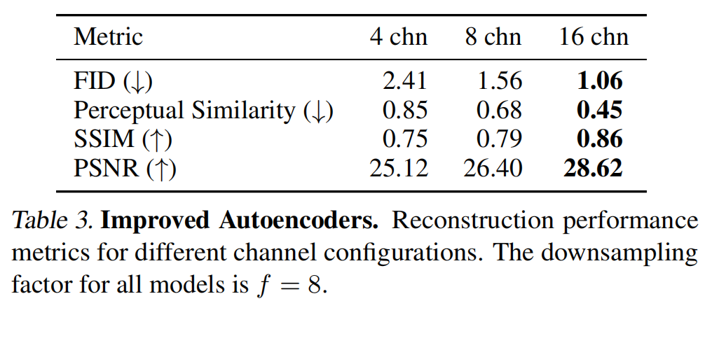</div>

我们可以看到，当设置 $d=16$ 时，VAE模型的整体性能（FID指标降低、Perceptual Similarity指标降低、SSIM指标提升、PSNR指标提升）比 $d=4$ 时有较大的提升，所以SD 3确定使用了 $d=16$ （16通道）的VAE模型。

与此同时，随着VAE的通道数增加到16，扩散模型部分（U-Net或DiT）的通道数也需要跟着修改（修改扩散模型与VAE Encoder衔接的第一层和与VAE Decoder衔接的最后一层的通道数），虽然不会对整体参数量带来大的影响，但是会增加任务整体的训练难度。**因为当通道数从4增加到16，SD 3要学习拟合的内容也增加了4倍**，我们需要增加整体参数量级来提升**模型容量（model capacity）**。下图是SD 3论文中模型通道数与模型容量的对比实验结果：

<div align="center">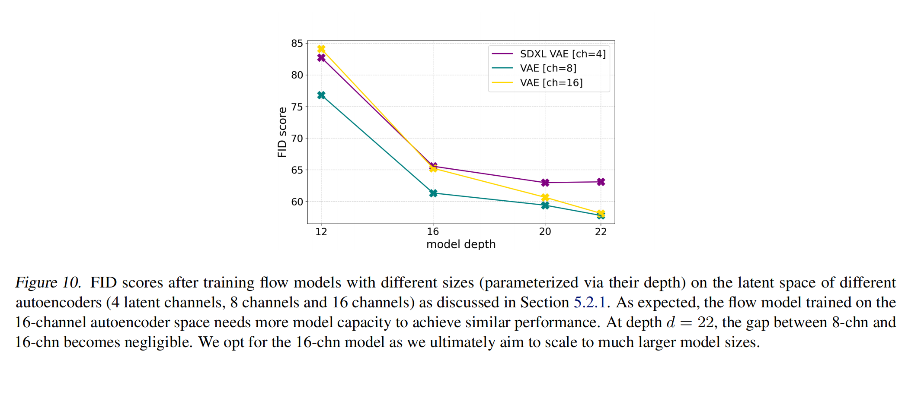</div>

当模型参数量小时，16通道VAE的重建效果并没有比4通道VAE的要更好，当模型参数量逐步增加后，16通道VAE的重建性能优势开始展现出来，**当模型的深度（depth）增加到22时，16通道的VAE的性能明显优于4通道的VAE**。

不过上图中展示了 8 通道 VAE 在 FID 指标上与 16 通道 VAE 接近。生成模型不能只用单一指标评价整体效果，FID 也只是图像质量的间接指标，无法充分反映细节差异。从重建效果看，16 通道 VAE 仍然具有更强的细节保真能力；当模型参数量级增大后，这一优势也转化为更高的整体性能上限和更大的优化空间。

下面给出 Stable Diffusion 3 VAE 的完整结构图，用于直观理解编码、扩散前的 latent 表示与解码重建之间的关系：

<div align="center">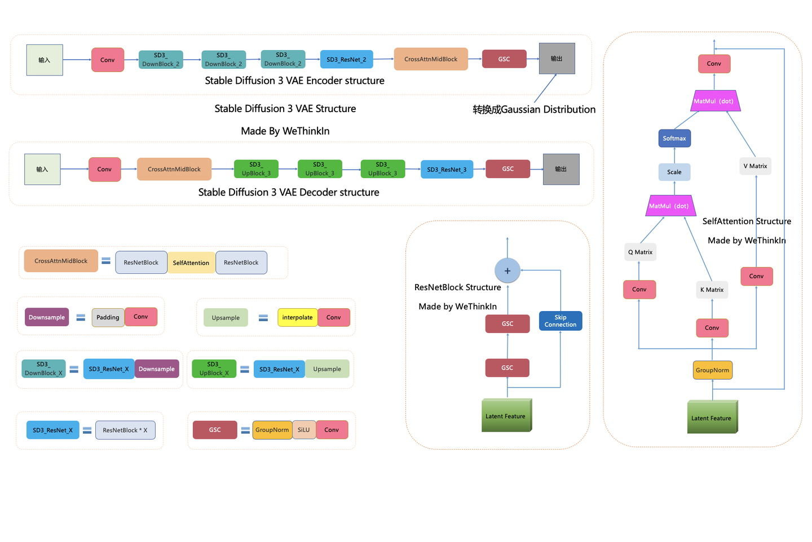</div>

### VAE 结构组成与高分辨率重建表现

从完整结构看，SD 3 VAE 模型包含三个基础组件：

1. **GSC 组件**：GroupNorm + SiLU + Conv。
2. **Downsample 组件**：Padding + Conv。
3. **Upsample 组件**：Interpolate + Conv。

同时，SD 3 VAE 还包含两个核心组件：ResNetBlock 模块和 Self-Attention 模块。VAE Encoder 部分包含三个 DownBlock 模块、一个 ResNetBlock 模块以及一个 MidBlock 模块，将输入图像压缩到 Latent 空间并转换为 Gaussian Distribution；VAE Decoder 部分则执行相反的过程，输入 Latent 特征并重建为像素级图像，包含三个 UpBlock 模块、一个 ResNetBlock 模块以及一个 MidBlock 模块。

在高分辨率场景下，SD 3 VAE 的重建优势更加明显。以 1024×1024 和 2048×2048 分辨率图像为例，SDXL VAE 在 2048×2048 图像上会出现较明显的内容和文字信息损失，而 SD 3 VAE 能够更好地完成高分辨率图像的压缩与重建。


<h2 id="q-067a">面试问题：SD 3的Backbone部分有哪些创新？详细分析改进意图</h2>

**难度评分：⭐⭐⭐⭐⭐ (5/5)  |  考察频率：⭐⭐⭐⭐⭐ (5/5)**

DiT（Diffusion Transformer）是把扩散模型的 Backbone 从 U-Net 换成 Transformer 的奠基工作；MM-DiT（Multimodal DiT）则是 DiT 在「文本-图像联合建模」上的关键升级，是 SD 3、FLUX.1 共同的 Backbone 架构基石。

### 1. 原始 DiT 的核心结构

- 输入只有图像 Latent Token；
- 文本条件通过 **AdaLN-Zero**（Adaptive LayerNorm 调制 scale / shift）注入到 Transformer 的每一个 block；
- 文本条件被压缩成一个 pooled embedding 后经 MLP 给出 scale / shift；
- 文本与图像之间**不存在 token 级 attention 交互**，文本只能通过「全局调制」影响图像。

这种范式在「类别条件生成」上效果好（如 ImageNet class-conditional），但**对长 prompt、复杂语义、文字渲染不够友好**——文本的细粒度信息在 pooling 中被丢失。

### 2. MM-DiT 的核心改进

<div align="center">

| 维度 | 原始 DiT | MM-DiT |
| --- | --- | --- |
| **输入序列** | 仅图像 token | **图像 token + 文本 token 拼接成统一序列** |
| **文本注入方式** | AdaLN-Zero 全局调制 | **Self-Attention 内文本与图像 token 双向交互** |
| **权重共享** | 单套 Transformer 权重 | **图像与文本各自一套独立 Linear / FFN 权重**，但共享 Attention |
| **跨模态交互粒度** | 全局 | **Token 级、双向** |
| **文字渲染能力** | 弱 | **强**（双向 attention 让模型知道每个文字 token 应该出现在哪个图像 token） |
| **长 prompt 利用** | 有限 | 显著增强 |

</div>

### 3. 关键技术细节

- **双权重单注意力（Dual-Stream → Single Attention）**：图像和文本 token 各自先经过自己的 Linear / FFN（参数不共享），再在 Self-Attention 中拼接序列做联合注意力，输出后再分回各自分支；这种「两路独立、共用 attention」是 MM-DiT 的标志性设计；
- **QK-Norm**：对 Q、K 做 L2 norm，缓解高分辨率训练时 attention logits 爆炸 / NaN 的问题；
- **AdaLN-Zero 仍然保留**：用于注入 timestep + Pooled Text Embedding 作为全局调制；
- **Token 拼接顺序**：通常 `[text_tokens, image_tokens]`，attention mask 全开；
- **位置编码**：图像走 2D RoPE / 2D positional embedding；文本走 1D positional embedding；统一序列内坐标各自独立。

### 4. 为什么 SD 3 选择 MM-DiT 而非 DiT

1. **文字渲染需求**：DALL-E 3、Imagen 已经证明强文本对齐与文字渲染需要文本与图像 token 级交互；DiT 的全局调制做不到；
2. **多文本编码器组合**：SD 3 用了 CLIP-L、OpenCLIP-bigG、T5-XXL 三个编码器，文本 token 数量远大于一个 pooled vector，必须有 token 级注入通道；
3. **多模态扩展性**：未来扩展到「文本 + 参考图 + 深度 + 姿态」多条件生成，MM-DiT 的拼接式注入可以无缝扩展为更多模态序列；
4. **保留 DiT 的 Scaling Law**：MM-DiT 仍然是纯 Transformer，沿用 DiT 的良好 scaling 性质。

### MM-DiT Block 组成、位置编码与 Scaling 能力

从实现结构看，SD 3 的 MM-DiT 主要包含以下核心模块：

1. **MM-DiT Block**：SD 3 medium 使用 24 个 MM-DiT Block 构成 Backbone 主体。每个 Block 包含两个 AdaLayerNormZero 层、一个 MM-DiT Attention 层、两个 LayerNorm 层和两个 FeedForward 层。
2. **MM-DiT Attention**：用于让图像特征和文本特征在同等级别上进行 Attention 交互。
3. **FeedForward**：由 GELU、Dropout 和 Linear 组成。

和原生 DiT 一样，MM-DiT 会先在 Latent 空间中将图像 Latent 特征转换成 Patches 特征，Patch Size 为 $2\times2$，再将 Patch Embedding 与 Positional Embedding 相加后输入 Transformer 主架构。SD 3 使用固定的二维 Sine-Cosine Positional Embedding，本质上通过正弦和余弦函数根据 Patch 的二维位置（行和列）生成固定位置编码，使 Transformer 能够感知图像的空间布局。

与此同时，MM-DiT 会将文本特征中的 CLIP Pooled Embedding（全局语义信息）直接与 Timestep Embedding 相加，并通过 AdaLayerNormZero 将融合后的 Conditioning 特征注入每一个 Transformer Block。这样既保留了全局条件控制，又通过文本 Token 与图像 Token 的联合 Attention 建立细粒度对齐。

SD 3 论文还将 MM-DiT 与引入 Cross-Attention 的 CrossDiT、U-Net 和 Transformer 混合的 UViT 进行对比。实验表明，MM-DiT 的性能明显优于其他架构。其参数规模主要由模型深度决定：论文中的中间特征维度设置为 $64\cdot d$，深度为 24 时参数量约为 2B，深度为 38 时参数量约为 8B。按照论文中的规模设定，深度从 24 增加到 38 时，参数量近似按立方关系增长，即 $2\mathrm{B}\times(38/24)^3\approx8\mathrm{B}$，这也解释了不同 SD 3 版本之间的容量跨度。

这说明基于 Transformer 的 SD 3 具备较好的 Scaling 能力。当模型参数量持续增加时，验证损失呈现平滑下降趋势，并且与 T2I-CompBench、GenEval 和人类视觉偏好等指标具有较强相关性。不过，参数规模扩大后，学习率等超参数也需要更细致地调整，否则大模型训练可能出现发散。整体而言，SD 3 的实验仍未观察到明显的性能饱和，Scaling Law 仍然是其持续提升的重要工程基础。

<h2 id="q-067c">面试问题：SD 3的Text Encoder部分有哪些创新？详细分析改进意图</h2>

**难度评分：⭐⭐⭐⭐ (4/5)  |  考察频率：⭐⭐⭐⭐⭐ (5/5)**

### Stable Diffusion 3的Text Encoder部分的创新

Stable Diffusion 3 的 Text Encoder 设计，是其文字渲染和 Prompt Following 能力提升的关键。理解这一部分时，可以沿着“编码器分工—特征融合—条件注入—工程取舍”四个环节展开。

Stable Diffusion 3的文字渲染能力很强，同时遵循文本Prompts的图像生成一致性也非常好，**这些能力主要得益于SD 3采用了三个Text Encoder模型**，它们分别是：

1. CLIP ViT-L（参数量约124M）
2. OpenCLIP ViT-bigG（参数量约695M）
3. T5-XXL Encoder（参数量约4.76B）

在SD系列模型的版本迭代中，Text Encoder部分一直在优化增强。一开始SD 1.x系列的Text Encoder部分使用了CLIP ViT-L，在SD 2.x系列中换成了OpenCLIP ViT-H，到了SDXL则使用CLIP ViT-L + OpenCLIP ViT-bigG的组合作为Text Encoder。有了之前的优化经验，SD 3更进一步增加Text Encoder的数量，加入了一个参数量更大的T5-XXL Encoder模型。

与SD模型的结合其实不是T5-XXL与AI绘画领域第一次结缘，早在2022年谷歌发布Imagen时，就使用了T5-XXL Encoder作为Imagen模型的Text Encoder，**并证明了预训练好的纯文本大模型能够给AI绘画大模型提供更优良的文本特征**。接着OpenAI发布的DALL-E 3也采用了T5-XXL Encoder来提取文本（Prompts）的特征信息，足以说明T5-XXL Encoder模型在AI绘画领域已经久经考验。

**SD 3 加入 T5-XXL Encoder，是其文本理解能力和文字渲染能力提升的关键设计**。它说明预训练语言模型中的长程语义建模能力，可以迁移到图像生成的条件建模环节。

总的来说，**SD 3一共需要提取输入文本的全局语义和文本细粒度两个层面的信息特征**。

首先需要**提取CLIP ViT-L和OpenCLIP ViT-bigG的Pooled Text Embeddings，它们代表了输入文本的全局语义特征**，维度大小分别是768和1280，两个embeddings拼接（concat操作）得到2048的embeddings，然后经过一个MLP网络并和Timestep Embeddings相加（add操作）。

接着我们需要**提取输入文本的细粒度特征**。这里首先分别提取CLIP ViT-L和OpenCLIP ViT-bigG的倒数第二层的特征，拼接在一起得到77x2048维度的CLIP Text Embeddings；再从T5-XXL Encoder中提取最后一层的T5 Text Embeddings特征，维度大小是77x4096（这里也限制token长度为77）。紧接着对CLIP Text Embeddings使用zero-padding得到和T5 Text Embeddings相同维度的编码特征。最后，将padding后的CLIP Text Embeddings和T5 Text Embeddings在token维度上拼接在一起，得到154x4096维度的混合Text Embeddings。这个混合Text Embeddings将通过一个linear层映射到与图像Latent的Patch Embeddings特征相同的维度大小，最终和Patch Embeddings拼接在一起送入MM-DiT中。具体流程如下图所示：

<div align="center">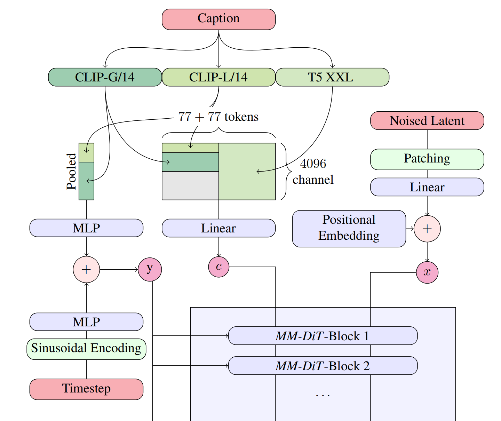</div>

虽然 CLIP ViT-L、OpenCLIP ViT-bigG 与 T5-XXL Encoder 的组合带来了文字渲染和文本一致性增益，但也存在上下文长度上的约束：CLIP ViT-L 和 OpenCLIP ViT-bigG 默认只能编码 77 tokens，这使原本能够处理 512 tokens 的 T5-XXL 在 SD 3 中也受限于 77 tokens。作为对比，DALL-E 3 只使用 T5-XXL 作为 Text Encoder，可以输入 512 tokens，从而更充分地发挥其长上下文能力。

### 三个 Text Encoder 的结构与工程取舍

从模型结构看，SD 3 的三个 Text Encoder 都是已经预训练好的语言模型。CLIP ViT-L 只包含 Transformer 结构，由 12 个 CLIPEncoderLayer 模块组成；每个 CLIPEncoderLayer 包含一个 Self-Attention 层和一个 MLP 层。OpenCLIP ViT-bigG 同样只包含 Transformer 结构，由 32 个 CLIPEncoderLayer 模块组成，每个模块也包含 Self-Attention 层和 MLP 层。T5-XXL 则由 24 个 T5-XXL Block 模块组成，每个 Block 包含 T5LayerFF 层和 T5Self-Attention 层，与 CLIP 系列的网络结构存在明显差异。

由于三个 Text Encoder 的参数在 SD 3 训练过程中被冻结，训练时可以对它们的特征分别进行独立 Dropout，再送入 MM-DiT 辅助训练。这样既能实现 Classifier-Free Guidance，也使 SD 3 在推理时可以灵活组合三个 Text Encoder。按照当前章节中的训练设置，三个编码器分别以 46.3% 的概率独立 Dropout；当三个编码器都被置空时，模型同时学习无条件分支。

T5-XXL 的参数量最大，因此在 2080Ti 等显存有限的 GPU 上部署 SD 3 时，可以只加载 CLIP ViT-L 与 OpenCLIP ViT-bigG，并将 T5-XXL 特征设置为 zero。这样整体图像质量通常不会明显下降，但文本理解和文字渲染能力会下降，尤其是文字渲染效果更依赖 T5-XXL。若希望进一步降低显存占用，可以使用 FP8 精度的 T5-XXL 替代 FP16，通常能够节省约 6GB 显存，同时只损失少量生成精度；这仍然优于完全移除 T5-XXL 的方案。

<h2 id="q-069">面试问题：训练Stable Diffusion 3过程中官方使用了哪些训练技巧？</h2>

**难度评分：⭐⭐⭐⭐⭐ (5/5)  |  考察频率：⭐⭐⭐⭐ (4/5)**

Stable Diffusion 3的训练优化围绕几个相互关联的问题展开：如何定义生成目标，如何分配不同噪声阶段的训练样本，以及如何让数据、模型容量和训练资源相互匹配。先理解Rectified Flow、Logit-Normal采样和分辨率相关的时间步偏移，再看后面的Caption、特征缓存与稳定性优化，就能把这些方法放进同一条训练链路。

### Rectified Flow训练目标与损失函数

**SD 3采用Rectified Flow，将图像生成建模为潜空间中的速度场学习。** Rectified Flow来自更早的[生成建模研究](https://arxiv.org/abs/2209.03003)，SD 3的贡献是结合文本到图像任务，系统比较训练目标、时间步分布和高分辨率适配方法；FLUX.1也采用了这一生成范式。

设 $`x_0`$ 是目标图像经过VAE编码、缩放后的干净潜变量， $c$ 是文本条件， $`\varepsilon\sim\mathcal{N}(0,I)`$ 是与潜变量同形状的标准高斯噪声。这里讨论的是Latent空间中的计算，后面再由VAE将生成结果解码成像素图像。

采用 $t=0$ 对应数据、 $t=1$ 对应噪声的约定，训练路径为：

```math
z_t=(1-t)x_0+t\varepsilon,
\qquad
\frac{d z_t}{dt}=\varepsilon-x_0
```

模型读取带噪潜变量、时间步和文本条件，预测这条路径上的变化速度。将噪声采样也显式写入期望后，基本训练损失为：

```math
\mathcal{L}_{\mathrm{RF}}(\theta)=
\mathbb{E}_{(x_0,c)\sim p_{\mathrm{data}},\;t\sim\pi(t),\;\varepsilon\sim\mathcal{N}(0,I)}
\left[
\left\|v_\theta(z_t,t,c)-(\varepsilon-x_0)\right\|_2^2
\right]
```

其中， $`v_\theta`$ 是模型预测的速度场， $\pi(t)$ 是训练时间步的概率密度。每次训练只需抽取目标图、文本、噪声和一个时间步，构造 $`z_t`$ 并计算损失，不必先运行完整的多步生成过程。

为了看清这个期望包含哪些随机量，也可以将它写成积分形式。记 $`p_{\mathrm{G}}`$ 为标准高斯噪声密度，则：

```math
\mathcal{L}_{\mathrm{RF}}(\theta)=
\int_0^1\int_{x_0,c}\int_{\varepsilon}
\pi(t)\,p_{\mathrm{data}}(x_0,c)\,p_{\mathrm{G}}(\varepsilon)
\left\|v_\theta((1-t)x_0+t\varepsilon,t,c)-(\varepsilon-x_0)\right\|_2^2
\,d\varepsilon\,d(x_0,c)\,dt
```

这里的 $`d(x_0,c)`$ 统一表示对图文数据分布求和或积分；实际训练使用小批量样本估计。这个写法暂按固定分辨率下的时间步分布展开。混合分辨率训练时，如果采样策略依赖样本分辨率， $\pi(t)$ 还应带上对应条件。

推理时从高斯噪声出发，沿学到的速度场从 $t=1$ 积分到 $t=0$。例如，Euler更新为：

```math
z_{t_{k+1}}=z_{t_k}+(t_{k+1}-t_k)v_\theta(z_{t_k},t_k,c),
\qquad t_{k+1}\lt t_k
```

时间递减，因此步长为负，更新方向与训练目标 $`\varepsilon-x_0`$ 相互配合。最终潜变量再经VAE解码得到图像。

**训练样本对之间采用直线插值，并不保证模型的生成轨迹也是严格直线。** 不同数据与噪声的配对可能在同一区域产生不同速度，平方误差下的最优预测对应给定当前位置、时间和条件后的平均速度。实际生成质量还受到模型拟合、时间步覆盖和数值求解误差影响，不能由直线插值直接推出“一步即可生成”。这里的速度预测也应与DDPM使用的 $v$-prediction目标区分：后者通常写成 $`v=\alpha_t\varepsilon-\sigma_t x_0`$，系数由另一套噪声调度决定。

### Logit-Normal时间步采样：调整不同噪声阶段的训练频率

确定路径和速度目标之后，还要决定每次训练抽取哪个时间步。均匀采样让相同长度的时间区间获得相同概率；非均匀采样则改变模型接触各个噪声阶段的频率。若不额外做重要性权重补偿，这也会改变期望损失在时间维度上的权重。

[SD 3论文第3.1节及Table 1](https://arxiv.org/html/2403.03206v1#S3.SS1)比较了Logit-Normal、带重尾的Mode Sampling等策略，其中位置参数为0、尺度参数为1的Logit-Normal在多个评测设置中表现稳定。**这里的优化重点是训练预算如何分配，线性插值路径和速度监督目标本身仍然保留。**

Logit-Normal的构造分成两步：先从正态分布采样，再通过Sigmoid把实数映射到 $(0,1)$：

```math
U\sim\mathcal{N}(\mu,\sigma^2),
\qquad
t=\mathrm{sigmoid}(U)=\frac{1}{1+e^{-U}}
```

它的逆变换是：

```math
\mathrm{logit}(t)=\log\frac{t}{1-t}
```

<div align="center">

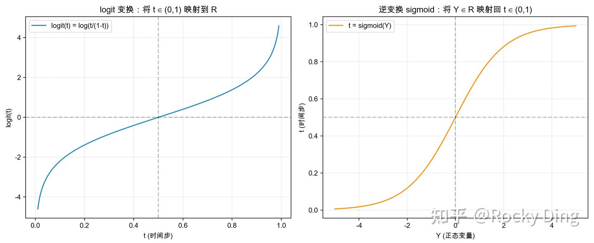

</div>

图：Logit与Sigmoid的数学关系示意，用于说明SD 3中Logit-Normal采样如何将正态变量映射为时间步。

沿用上面的参数记号，时间步的概率密度为：

```math
\pi_{\mathrm{LN}}(t;\mu,\sigma)=
\frac{1}{\sigma\sqrt{2\pi}\,t(1-t)}
\exp\left[-\frac{(\mathrm{logit}(t)-\mu)^2}{2\sigma^2}\right],
\qquad 0\lt t\lt1,\quad\sigma>0
```

SD 3原论文将这两个参数记作 $m,s$。这里使用 $\mu,\sigma$，分别表示Logit空间中正态分布的均值与标准差。**它们描述的是变换前的正态变量**： $\mu$ 并非时间步 $t$ 的均值或众数，而时间步的中位数为 $\mathrm{sigmoid}(\mu)$。通过中位数可以判断采样偏向哪一端。

- $\mu=0$、 $\sigma=1$：分布关于 $t=0.5$ 对称，相比均匀采样更集中在中间时间段。
- $\mu>0$：中位数向1移动，采样偏向高噪声阶段。
- $`\mu\lt0`$：中位数向0移动，采样偏向低噪声阶段。
- 调整 $\sigma$：较小时，时间步集中在 $\mathrm{sigmoid}(\mu)$ 附近；较大时，分布在Logit空间中更分散，映射后可能增加两端附近的采样，不能始终理解为一个更宽的单峰。

下面的图固定 $\sigma=1$，只改变 $\mu$，展示采样重心如何向高噪声端移动：

<div align="center">

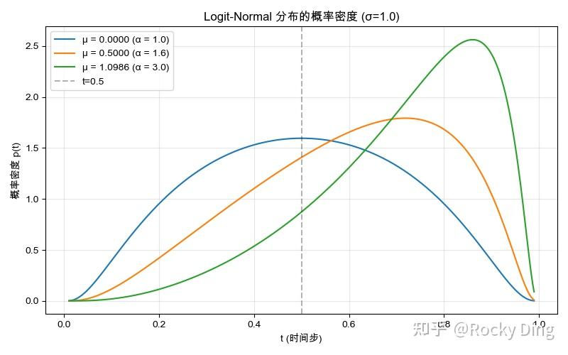

</div>

图：依据Logit-Normal密度函数绘制的参数示意。图中 $\alpha=e^\mu$ 表示相对于 $\mu=0$ 基准的偏移因子，其等价关系见下文。

工程上直接采样正态变量即可，不需要对密度函数做数值反演：

```python
import torch


def sample_t(shape, mu=0.0, sigma=1.0, device=None):
    u = mu + sigma * torch.randn(shape, device=device)
    return torch.sigmoid(u)
```

这个函数解释采样原理，不代表SD 3完整训练代码。分辨率适配还需要在此基础上考虑时间步偏移。

### Timestep Schedule Shifting：适配不同分辨率的信噪比

在更高分辨率上，相同噪声系数不一定产生相同程度的信号破坏。相邻位置包含相关信息，而独立噪声可以通过局部或全局平均被部分抵消。因此，高分辨率图像的低频结构在相同 $t$ 下可能更容易辨认，需要重新安排噪声尺度与采样位置。

[SD 3论文第5.3.2节、式23](https://arxiv.org/html/2403.03206v1#S5.SS3.SSS2.Px3)用一个常量图像例子解释这一现象。设图像有 $N$ 个像素，所有像素的真实值均为 $q$，则：

```math
z_{t,i}=(1-t)q+t\varepsilon_i,
\qquad \varepsilon_i\sim\mathcal{N}(0,1)
```

其中各像素的噪声相互独立。如果已知原图是常量，可以通过观测均值估计它：

```math
\widehat q=\frac{1}{N(1-t)}\sum_{i=1}^{N}z_{t,i},
\qquad
\mathrm{Std}(\widehat q-q)=\frac{t}{(1-t)\sqrt N}
```

像素数越多，平均操作越能抵消独立噪声，估计的不确定性越小。若从 $`N_0`$ 个像素增加到 $`N_1`$ 个像素，并希望维持这个例子中的不确定性，就得到：

```math
t'=S_\alpha(t)=\frac{\alpha t}{1+(\alpha-1)t},
\qquad
\alpha=\sqrt{\frac{N_1}{N_0}}
```

当 $\alpha>1$ 时，区间内部的 $t'>t$，时间步被移向更高噪声端； $\alpha=1$ 时保持不变； $`0\lt\alpha\lt1`$ 时移向较低噪声端。映射保留0和1两个端点，改变的是中间时间位置。

<div align="center">

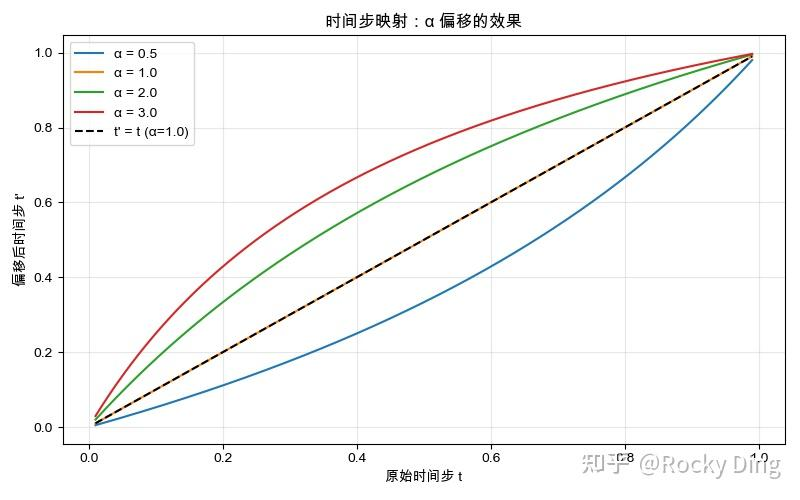

</div>

图：SD 3式23对应的分式映射，展示不同偏移因子如何改变时间坐标。

这个常量图像推导提供了选择偏移方向的依据，真实图像及其Latent并不满足全部假设，所以最终系数仍需实验确定。从 $256^2$ 到 $1024^2$，上述理想化换算得到 $\alpha=4$；SD 3实际评测了多个偏移量，并在后续 $1024\times1024$ 的训练与采样实验中采用 $\alpha=3$。这一实验选择不能直接外推为其他模型或分辨率的固定推荐值。

**训练端与推理端使用偏移，作用位置不同。** 训练端对随机采样的 $t$ 做变换，改变各噪声阶段出现的频率；推理端对有限个积分节点做变换，改变数值求解网格。SD 3在上述实验中两端都采用3，但这不构成“训练与推理的偏移必须相同”的普遍定理，推理调度仍应结合模型、采样步数和质量验证选择。

### Log-SNR与Logit-Normal偏移之间是什么关系？

对Rectified Flow的线性插值，记 $`a_t=1-t`$、 $`b_t=t`$。由这两个系数定义的名义对数信噪比为：

```math
\lambda(t)=\log\frac{a_t^2}{b_t^2}
=2\log\frac{1-t}{t}
=-2\,\mathrm{logit}(t)
```

这里的Log-SNR由噪声调度系数定义，真实特征在不同通道和空间频率上的有效信噪比还与其统计特性有关。随着 $t$ 从0增大到1，信号系数减小、噪声系数增大， $\lambda(t)$ 单调下降。

<div align="center">

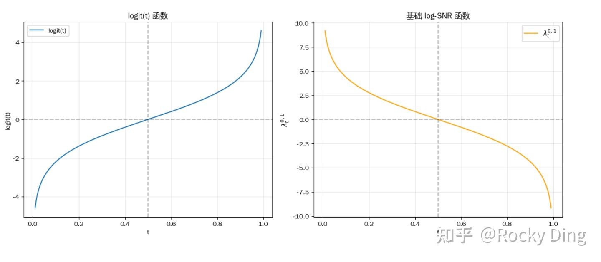

</div>

图：标准线性插值路径中的Logit与名义Log-SNR曲线，展示二者相差负二倍的关系。

将分式偏移 $`t'=S_\alpha(t)`$ 代入，可以得到：

```math
\mathrm{logit}(t')=\mathrm{logit}(t)+\log\alpha,
\qquad
\lambda(t')=\lambda(t)-2\log\alpha
```

于是，如果原始时间步满足 $`\mathrm{logit}(t)\sim\mathcal{N}(\mu_0,\sigma^2)`$，偏移后就有：

```math
\mathrm{logit}(t')\sim
\mathcal{N}(\mu_0+\log\alpha,\sigma^2)
```

**分式时间偏移会改变Logit-Normal的位置参数，保留它的尺度参数。** 新的位置参数比原来增加 $\log\alpha$；只有原始位置参数 $`\mu_0=0`$ 时，才能直接写成 $\mu=\log\alpha$。例如基准为 $\mu=0,\sigma=1$ 时， $\alpha=3$ 对应新位置参数 $\log3\approx1.0986$，这解释了下面两组采样分布的差别。

<div align="center">

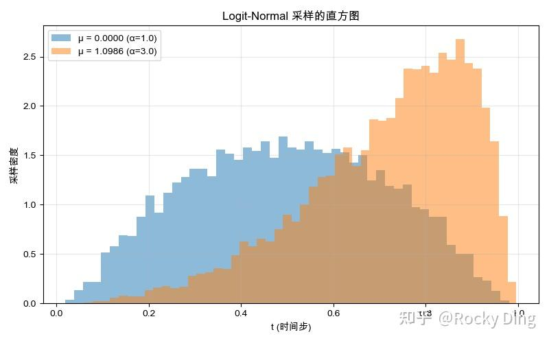

</div>

图：基准分布与 $\alpha=3$ 偏移分布的采样直方图示意，用于解释时间步概率的变化。

还可以将Logit空间的平移推广到同时缩放。为避免与前面分布参数混淆，将变换系数记作 $s>0$ 和 $b$：

```math
t'=\mathrm{sigmoid}\left(s\,\mathrm{logit}(t)+b\right)
=\frac{e^b}{e^b+(1/t-1)^s},
\qquad
\lambda(t')=s\lambda(t)-2b
```

这是由Logit变换直接得到的数学关系。当 $s=1$、 $b=\log\alpha$ 时，退化为SD 3使用的分式偏移；如果基准 $\mathrm{logit}(t)$ 服从标准正态分布，则变换后服从均值为 $b$、标准差为 $s$ 的正态分布。

因此，Logit-Normal回答“随机时间步从什么分布采样”，Timestep Shift回答“已有时间坐标如何变换”。它们可以按上述关系组合，但不能无条件视为同一件事：对均匀时间步做分式偏移，通常不会得到Logit-Normal分布。实际实现中，也不应在已经使用 $\mu=\log\alpha$ 采样后，又无意间重复施加同一个偏移。

训练目标和噪声阶段的分配确定后，还需要让图文数据提供足够准确的监督；下面的数据标签工程解决的正是这一问题。

### Stable Diffusion 3 中数据标签工程的具体流程是什么样的？

除了训练目标与噪声调度，训练数据的 Caption 质量也直接决定模型的文本理解和 Prompt Following 能力。

**目前AI绘画大模型存在一个很大的问题是模型的文本理解能力不强**，主要是指AI绘画大模型生成的图像和输入文本Prompt的一致性不高。举个例子，如果说输入的文本Prompt非常精细复杂，那么生成的图像内容可能会缺失这些精细的信息，导致图像与文本的内容不一致。这也是AI绘画大模型Prompt Following能力的体现。

产生这个问题归根结底还是由训练数据集本身所造成的，**更本质说就是图像Caption标注太过粗糙**。

SD 3借鉴了DALL-E 3的数据标注方法，使用**多模态大模型CogVLM**来对训练数据集中的图像生成高质量的Caption标签。

**目前来说，DALL-E 3的数据标注方法已经成为AI绘画领域的主流标注方法，很多先进的AI绘画大模型都使用了这套标签精细化的方法**。

这套数据标签精细化方法的主要流程如下：

1. 首先整理数据集和对应的原始标签。
2. 接着使用CogVLM多模态大模型对原始标签进行优化扩写，获得长Caption标签。
3. 在SD 3的训练中使用50%的长Caption标签+50%的原始标签混合训练的方式，提升SD 3模型的整体性能，同时标签的混合使用也是对模型进行正则的一种方式。

这套方法的本质，是先用图像 Captioner 将粗糙的网页 Alt Text 或数据集自带标签扩写为能够描述主体、背景、位置、数量和文字细节的 Caption，再把精细标签用于训练。DALL-E 3 先训练基于 CoCa 架构的 Image Captioner；CoCa 在 CLIP 对比损失之外增加 Multimodal Text Encoder，并同时使用 Captioning 交叉熵损失，因此可以生成更细致的图像描述。

在 Captioner 预训练完成后，DALL-E 3 又分别使用短 Caption 数据和长 Caption 数据进行微调，得到生成短 Caption（Short Synthetic Captions，SSC）和长 Caption（Descriptive Synthetic Captions，DSC）的模型。实验表明，合成长 Caption 对 Prompt Following 能力提升更明显；同时在合成 Caption 中混入原始 Caption，可以避免模型过拟合到某一种固定措辞范式，是一种有效的正则化手段。

SD 3 沿用了 DALL-E 3 的数据标注思路，只是将 Image Captioner 从 CoCa 替换为 CogVLM，并采用 50% 原始 Caption + 50% 合成长 Caption 的配方。这个比例在提升文本一致性的同时，保留了原始数据分布，避免模型只适应过度规整的长描述。

具体效果如下所示：

<div align="center">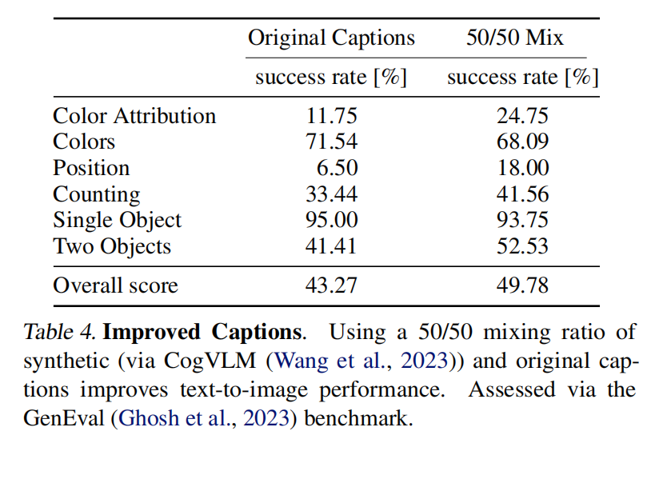</div>


### Stable Diffusion 3的图像特征和文本特征在训练前缓存策略有哪些优缺点？

在训练资源优化层面，官方还分析了冻结模块的特征预计算与缓存策略。

SD 3与之前的版本相比，整体的参数量级大幅增加，这无疑也增加了训练成本，所以官方的技术报告中也**对SD 3训练时冻结（frozen）部分进行了分析**，主要评估了VAE、CLIP-L、CLIP-G以及T5-XXL的显存占用（Mem）、推理耗时（FP）、存储成本（Storage）、训练成本（Delta），如下图所示，T5-XXL的整体成本是最大的：

<div align="center">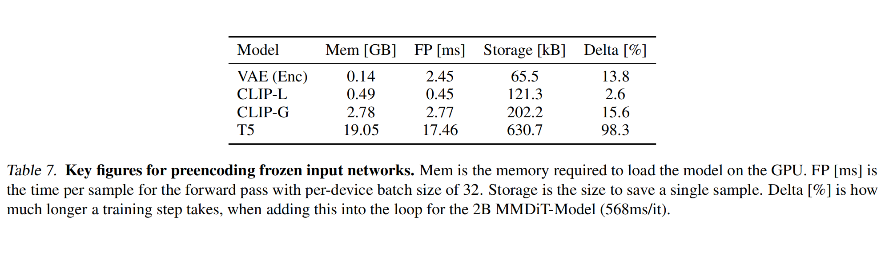</div>

**为了减少训练过程中SD 3所需显存和特征处理耗时，SD 3设计了图像特征和文本特征的预计算策略**：由于VAE、CLIP-L、CLIP-G、T5-XXL都是预训练好且在SD 3微调过程中权重被冻结的结构，所以**在训练前可以将整个数据集预计算一次图像的Latent特征和文本的Text Embeddings，并将这些特征缓存下来**，这样在整个SD 3的训练过程中就无需再次计算。同时上述冻结的模型参数也无需加载到显卡中，可以节省约20GB的显存占用。

但是根据机器学习领域经典的“没有免费的午餐”定理，**预计算策略虽然为我们大幅减少了SD 3的训练成本，但是也存在其他方面的代价**。第一点是训练数据不能在训练过程中做数据增强了，所有的数据增强操作都要在训练前预处理好。第二点是预处理好的图像特征和文本特征需要一定的存储空间。第三点是训练时加载这些预处理好的特征需要一定的时间。

整体上看，**其实SD 3的预计算策略是一个空间换时间的技术**。

### Classifier-Free Guidance 如何参与 SD 3 训练

Classifier-Free Guidance（CFG）从 SD 1.x 到 SD 3、FLUX.1 都是文本条件生成的重要训练技术。它通过在训练时以一定概率将条件标签置空，让同一个模型同时学习条件分支与无条件分支，从而避免额外训练一个显式分类器。

SD 3 的三个 Text Encoder 分别以 46.3% 的概率独立 Dropout。三个编码器同时被置空的概率约为 $(46.3\%)^3\approx9.9\%$，模型因此可以在同一套参数中学习有条件和无条件的生成路径。独立 Dropout 还让推理阶段可以灵活组合三个 Text Encoder：显存有限时可以不加载 T5-XXL，只使用两个 CLIP；但如果需要高质量文字渲染，仍然应该保留 T5-XXL，因为去掉它对文字生成能力的影响最明显。

从机制上看，训练时被置空的文本条件相当于无条件分支，保留文本条件的样本则对应有条件分支；推理时再用两次前向结果做线性外推：

```math
v_{\mathrm{cfg}}=v_{\mathrm{uncond}}+s\left(v_{\mathrm{cond}}-v_{\mathrm{uncond}}\right)
```

其中 $s$ 是 guidance scale。这样不需要额外训练一个显式分类器，就能在采样阶段调节文本条件的引导强度；三个编码器独立 Dropout 则进一步让模型学会不同编码器子集的组合，而不是只能依赖完整的三编码器输入。

### DPO 偏好微调

DPO（Direct Preference Optimization）最初应用于 NLP 领域，后来也用于 AI 绘画模型的偏好微调。与 SDXL 使用的 RLHF 相比，DPO 不需要单独训练 Reward Model，而是直接基于成对的人类偏好数据设计损失函数，使模型倾向于生成更符合偏好的图像。它省去了强化学习中的试错过程，训练过程更稳定，也更适合拥有大量图像偏好数据的场景。

SD 3 的官方实验没有直接微调整个网络，而是在 2B 和 8B 模型上引入 Rank=128 的 LoRA 权重，分别进行约 4000 次和 2000 次迭代的偏好微调。微调后图像生成质量有所提升，尤其是文字渲染能力更强。换句话说，DPO 在这里不仅是一种优化算法，也是一种利用偏好数据校正生成分布的训练思想。

### QK-Normalization 稳定高分辨率训练

随着 SD 3 参数量增大，官方发现在高分辨率混合精度训练时，Attention 层的 attention-logit（Q 和 K 的矩阵乘）可能变得不稳定，导致梯度出现 NaN。为提升训练稳定性，SD 3 在 MM-DiT 的 Self-Attention 层使用 RMSNorm 对 Q-Embeddings 和 K-Embeddings 进行归一化，这就是技术报告中的 QK-Normalization。

RMSNorm 不再计算均值和方差，而是基于参数激活值的均方根进行归一化。对输入向量 $x$，其核心计算可以写成：

```math
\mathrm{RMS}(x)=\sqrt{\frac{1}{d}\sum_{i=1}^{d}x_i^2},\qquad \hat{x}=\frac{x}{\mathrm{RMS}(x)},\qquad y=\gamma\hat{x}+\beta
```

它的优势在于计算量相对较小、不依赖 Batch Size，并能在小批量或单样本训练中缓解梯度爆炸和梯度消失问题。

### 多尺度位置编码

SD 3 先在 256×256 分辨率数据上预训练，再围绕 1024×1024 进行多尺寸微调，因此 MM-DiT 的位置编码必须支持多尺度，否则在 256×256 上学习到的位置编码无法直接适配其他分辨率。SD 3 借鉴 ViT 的二维 Frequency Embeddings，将两个一维 Frequency Embeddings 拼接，并在此基础上进行插值与扩展。

假设目标分辨率的像素量为 $S^2$，SD 3 还使用 bucketed sampling，使数据集中各尺寸图像满足 $H\times W\approx S^2$，例如 2048×2048、1024×4096 和 4096×1024。由于 VAE 进行 8 倍下采样、Patch Size=2 又带来 2 倍下采样，输入 MM-DiT 的 Patch 网格相当于进行了 16 倍下采样，因此位置编码需要同时适配不同的 $h\times w$ 网格。工程上可以先将 256×256 的位置编码插值到目标正方形网格，再扩展到最大宽高，最后对具体尺寸进行 Center Crop。

### 基于 DiT 的 Scaling 能力

相比 U-Net，Transformer Backbone 的重要优势是具备稳定的 Scaling 能力：增加模型参数量、训练数据量和计算资源，通常可以持续提升生成能力与泛化性能。SD 3 论文设置了深度为 15、18、21、30、38 的多种 MM-DiT 规模，其中深度 38 对应约 8B 参数模型。

实验显示，MM-DiT 参数量持续增加时，模型性能稳步提升，验证损失平滑下降，并与 T2I-CompBench、GenEval 和人类视觉偏好等指标保持较强相关性。不过，大模型训练也需要更细致的超参数管理：例如深度为 38 的模型训练到约 $3\times10^5$ 步时需要调整学习率以避免发散。当前参数规模下尚未出现明显的性能饱和，说明 Scaling Law 仍是 SD 3 及后续 DiT 图像模型的重要增长路径。


<h2 id="q-075">面试问题：Stable Diffusion 3.5有哪些改进点？</h2>

**难度评分：⭐⭐⭐⭐ (4/5)  |  考察频率：⭐⭐⭐⭐⭐ (5/5)**

Stable Diffusion 3.5 是 Stable Diffusion 3 的升级版本，包含 Stable Diffusion 3.5 Large、Stable Diffusion 3.5 Large Turbo 和 Stable Diffusion 3.5 Medium 三个主要版本：

1. **Stable Diffusion 3.5 Large**：参数量约 8B，重点提升图像生成质量和提示词遵循能力，能够生成约百万像素级的高质量图像。
2. **Stable Diffusion 3.5 Large Turbo**：Large 的蒸馏版本，只需约 4 步即可生成高质量图像，适合需要快速批量生成的场景。
3. **Stable Diffusion 3.5 Medium**：参数量约 2.5B，使用新的 MM-DiT-X 架构与训练方法，在消费级硬件上的可用性、生成质量和定制成本之间取得平衡，可覆盖约 0.25M 到 2M 像素范围的多种分辨率。

### SD 3.5 的架构改进

1、**引入 Query-Key 归一化（QK normalization）**：在训练大型 Transformer 模型时，QK 归一化已成为标准实践。SD3.5 也采用了这一技术，以增强模型训练的稳定性并简化后续的微调和开发。

**2、双注意力层设计**：在 MMDiT 结构中，文本和图像两个模态通常共享同一个注意力层。然而，SD3.5 采用了两个独立的注意力层，以更好地处理多模态信息（MMDiT-X）。

<div align="center">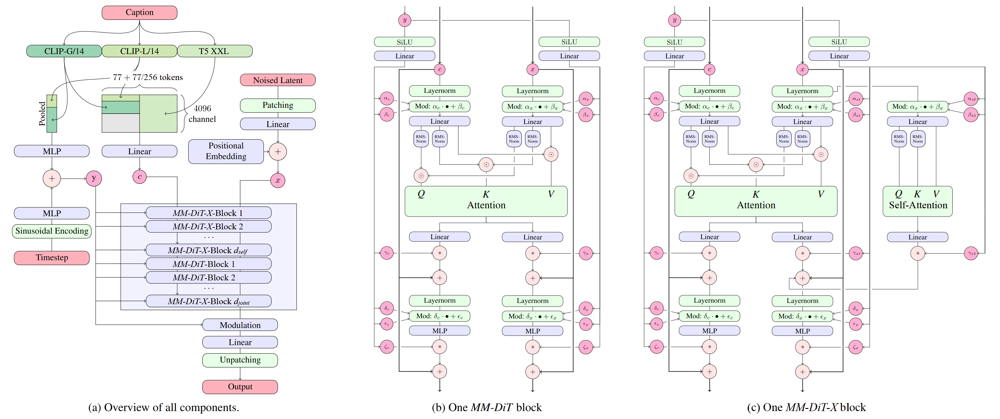</div>


---

<h1 id="ch-flux-01">第二章 FLUX系列核心高频考点</h1>

<h1 id="q-flux-001">1.介绍一下FLUX.1的原理，与Stable Diffusion 3相比有哪些创新点？</h1>

<h2 id="q-flux-014">面试问题：FLUX.1的VAE部分有哪些创新？详细分析改进意图</h2>

**难度评分：⭐⭐⭐⭐ (4/5)  |  考察频率：⭐⭐⭐⭐⭐ (5/5)**

**FLUX.1 VAE继承了SD 3 VAE模型架构，并使用同样的高、宽各缩小8倍的下采样空间压缩方式，使用16通道Latent承载图像信息，并通过独立训练改善压缩后的重建效果**。在Latent特征进入后续的FLUX.1 Backbone前，FLUX.1 VAE还对Latent特征进行Pack操作，将Latent特征通道数提高到64（16 -> 64）。

**可以说，FLUX.1系列的扩散模型部分输入通道数为64，是SD 3的四倍**。这也代表FLUX.1要学习拟合的内容比起SD 3增加了4倍，所以FLUX.1 Backbone大幅增加参数量级来提升模型容量（model capacity）。

FLUX.1 VAE的Latent特征Patch化方法是通过Pack操作将 $2\times2$ 像素块直接在通道维度上堆叠。这种做法保留了每个像素块的原始分辨率，只是将它们从空间维度移动到了通道维度。**与之相对应的，SD 3使用下采样卷积来实现Latent特征Patch化，但这种方式会通过卷积减少空间分辨率，从而损失一定的特征信息**。

Rocky再举一个形象的例子来解释SD 3和FLUX.1的Patch化方法的不同：

1. **SD 3（下采样卷积）**：想象我们有一个大蛋糕，SD 3的方法就像用一个方形模具，从蛋糕上切出一个 $2\times2$ 的小方块。在这个过程中，我们提取了蛋糕的部分信息，但是由于进行了压缩，Patch块的大小变小了，信息会有所丢失。
2. **FLUX.1（通道堆叠）**：FLUX.1 的方法更像是直接把蛋糕的 $2\times2$ 块堆叠起来，不进行任何压缩或者切割。我们仍然保留了蛋糕的所有部分，但是它们不再分布在平面上，而是被一层层堆叠起来，像是三明治的层次。这样一来，蛋糕块的大小没有改变，只是它们的空间位置被重新组织了。

我们设Latent空间尺寸为 $h\times w$ ，并省略Batch维度，则这一操作可以写成：

$$
P:\mathbb{R}^{16\times h\times w}
\longrightarrow
\mathbb{R}^{\left(\frac{hw}{4}\right)\times64}
$$

每个Token包含4个空间位置的特征，每个位置有16个通道，因此Pack操作后的特征维度为：

$$
d_{\mathrm{token}}=2\times2\times16=64
$$

与此同时，Token数量变为空间位置数的四分之一：

$$
L=\frac{hw}{4}
$$

Pack操作前后的元素总数完全相同：

$$
16hw=64\times\frac{hw}{4}
$$

Pack操作只改变元素的排列方式，不增加新的图像信息，也不引入可学习参数。我们举具体例子来说，一张 $1024\times1024$ 图像经过VAE编码后，得到 $16\times128\times128$ 的Latent；Pack操作之后得到4096个Token，每个Token为64维：

$$
16\times128\times128
\;\xrightarrow{\;2\times2\ \mathrm{Pack}\;}
4096\times64
$$

相对于把每个Latent空间位置单独作为一个Token，Pack操作减少了序列长度，从而降低后续注意力计算的序列开销。

总的来说，**相比SD 3，FLUX.1将 $2\times2$ 特征Patch化操作应用于Backbone部分之前**。这也表明FLUX.1系列模型认可了SD 3做出的贡献，并在其基础上进行了继承与优化。

**与SD 3相比，FLUX.1 VAE并不是直接沿用SD 3的VAE，而是基于相同结构进行了重新训练，所以两者的模型参数权重并不相同，对编码后的Latent特征做平移和缩放的参数也不相同**。因为VAE输出的原始Latent具有自身的均值和尺度，而Backbone模型需要在它与标准高斯噪声之间建立训练路径。为此，FLUX.1对原始Latent进行固定的仿射变换：

$$
z=s\left(z_{\mathrm{raw}}-b\right)
$$

其中 $s=0.3611$ , $b=0.1159$。 $b$ 用于调整整体数值中心， $s$ 用于调整整体尺度。解码前需要执行逆变换：

$$
z_{\mathrm{raw}}=\frac{z}{s}+b
$$

与之对应的，SD 3的平移系数为0.0609，缩放系数为1.5305，因此编码后的处理为：

$$
z_{\mathrm{SD3}}
=
1.5305\left(z_{\mathrm{raw}}-0.0609\right)
$$

平移和缩放操作能将Latent特征分布的均值和方差归一化到0和1，和扩散过程加的高斯噪声在同一范围内，更加严谨和合理。


<h2 id="q-flux-015">面试问题：FLUX.1的Backbone部分有哪些创新？详细分析改进意图</h2>

**难度评分：⭐⭐⭐⭐⭐ (5/5)  |  考察频率：⭐⭐⭐⭐⭐ (5/5)**

**FLUX.1的Backbone采用双流（MM-DiT）与单流（Single-DiT）结合的Transformer架构，在模态专属处理、图文联合建模和计算效率之间进行协调**。在前段双流模块中，保留文本与图像各自的变换参数，同时让两种模态通过联合注意力交换信息；后段单流模块将图文特征合并为一条序列，在每层内使用统一的参数继续建模。

直观地理解，FLUX.1先使用双流模块实现两个模态的信息融合，然后再接单流模块加深模型深度，在增强模型整体学习能力的同时，还可以节省一部分参数。**FLUX.1 Backbone中包含19个双流模块和38层单流模块，整体参数量约12B**。

下图是FLUX.1 Backbone完整结构图：

<div align="center">

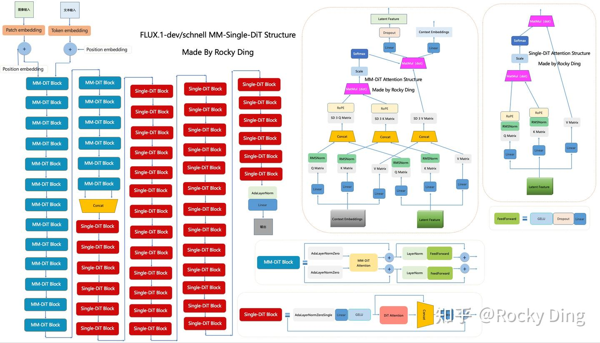

</div>

MM-Single-DiT架构的核心组件包括：
1. **MM-DiT Block**：由两个AdaLayerNormZero层、一个MM-DiT Attention Structure模块、两个LayerNorm层和两个FeedForward层组成。
2. **Single-DiT Block**：由一个AdaLayerNormZero层、一个Single-DiT Attention Structure（DiT Attention）模块、两个Linear层和一个GELU激活函数组成。
3. **MM-DiT Attention Structure**：FLUX.1的MM-DiT Block中的核心组件，和SD 3一样，将文本信息和图像信息以同等重要的级别进行Attention计算。
4. **Single-DiT Attention Structure**：FLUX.1的Single-DiT Block中的核心组件，将文本信息和图像信息的特征融合后，进行经典的DiT Attention计算。
5. **FeedForward**：由GELU激活函数、Dropout层和Linear层组成。

### 1、 FLUX.1 Backbone输入侧特点

在输入侧，FLUX.1 Backbone接收当前时间步的带噪图像Latent，以及文本编码器提供的两类语言特征。

图像Latent经过 $2\times2$ pack处理后，每个Token具有64维特征，再通过线性投影映射到3072维。T5-XXL输出的文本序列特征原本为4096维，同样通过独立投影映射到3072维。这样，文本与图像Token就具有相同的隐藏维度，可以参与后续的联合注意力计算。

CLIP输出的768维池化特征则走另一条路径：它被映射为全局条件向量，与时间步条件共同控制各个Transformer块的特征变换。

下图展示了图像Token、文本Token与全局条件在FLUX.1 Backbone输入侧的处理流程：

<div align="center">

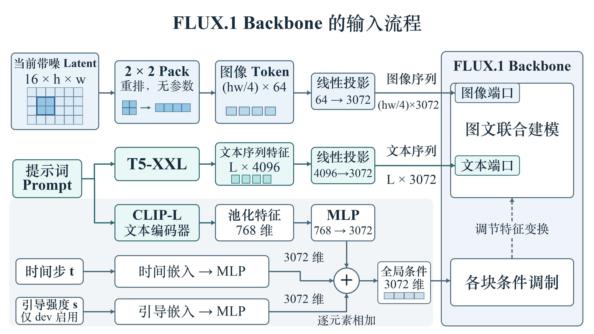

</div>

如上图所示，同一提示词分别经过T5-XXL和CLIP-L文本编码器，形成文本序列特征与池化特征。图像序列和T5文本序列分别进入图文联合建模；CLIP池化特征经MLP映射后，与时间步条件逐元素相加，构成各块使用的全局调制条件。FLUX.1-dev还会加入引导强度嵌入，FLUX.1-schnell不启用这一分支。上图中的 $h$、$w$ 表示Latent的空间尺寸，$L$ 表示文本Token数量；Batch维度、分词过程和RoPE位置编码支路在图中省略。

### 2、 双流模块和单流模块讲解

文本Token与图像Token具有不同的来源和统计特性。双流块为它们分别设置归一化、条件调制、QKV投影、注意力输出投影和MLP，使每种模态都能够使用适合自身特征的变换。

不过，两路特征并没有各自独立计算完整的注意力。得到文本和图像的Q、K、V后，模型会沿序列维度分别拼接：

$$
Q=\begin{bmatrix}
Q_{\mathrm{text}}\\
Q_{\mathrm{image}}
\end{bmatrix},
\qquad
K=
\begin{bmatrix}
K_{\mathrm{text}}\\
K_{\mathrm{image}}
\end{bmatrix},
\qquad
V=
\begin{bmatrix}
V_{\mathrm{text}}\\
V_{\mathrm{image}}
\end{bmatrix}
$$

Q、K还会经过归一化与RoPE处理，随后进行联合注意力计算。计算结果再按原来的序列长度拆回文本部分和图像部分，分别进入各自的输出投影、残差更新和MLP。

因此，双流中的“双”，主要指两套模态专属的特征变换参数；图文之间的信息交换在这一阶段就已经发生。 图像Token可以读取文本中的主体、属性和关系，文本Token也可以结合当前图像状态更新自身表示。

这种设计延续了多模态DiT的基本思路：保留不同模态的表达差异，同时让它们在注意力中建立联系。

<div align="center">

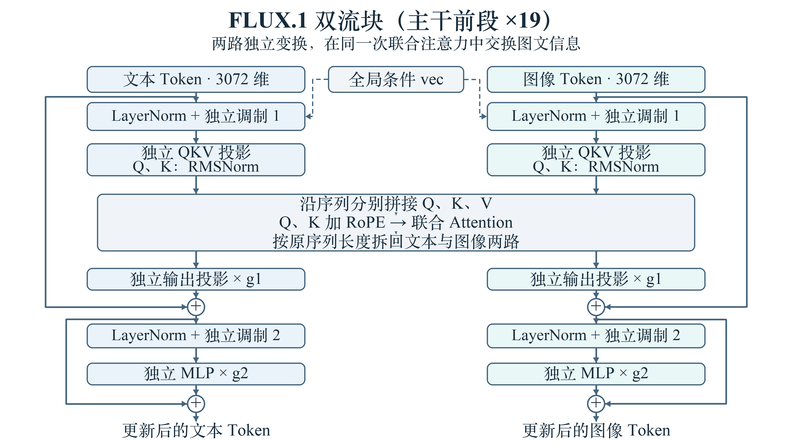

</div>

上图展示了FLUX.1双流块内部流程。文本与图像分别进行特征变换，Q、K、V沿序列维拼接后参与同一次联合注意力，再按原序列长度拆分。两路中的 $g_1$、 $g_2$ 分别代表各自的门控参数，由全局条件通过模态专属调制器生成；第二条残差连接使用第一次更新后的状态。实线表示特征与残差路径，虚线表示条件输入，图中省略了条件到第二组调制和门控的连线。

经过19个双流块后，FLUX.1 Backbone将文本与图像的隐藏特征沿序列维度拼接：

$$
H=\mathrm{Concat}_{\mathrm{seq}}
\left(H_{\mathrm{text}},H_{\mathrm{image}}\right)
$$

随后，整条序列进入38个单流块。在每个单流块内部，文本与图像Token使用同一套投影、调制和MLP参数；不同单流块之间仍然各自拥有独立参数。

这样，网络后段可以继续对图文关系进行联合建模，同时减少持续维护两套模态专属变换所需的参数开销。

**单流模块的另一个特点是Attention与MLP共享同一份归一化、调制后的输入，并行展开计算，构建并行注意力机制**。它的流程是：
1. 对输入进行LayerNorm和条件调制。
2. 使用一次较大的线性投影，同时生成Q、K、V与MLP分支的中间特征。
3. 注意力分支计算Token之间的交互，MLP分支对各Token的中间特征进行GELU激活。
4. 拼接两路结果，通过统一的输出投影映射回隐藏维度。
5. 使用条件生成的门控系数控制残差更新。

FLUX.1单流块中的并行注意力与MLP流程如下图所示：

<div align="center">

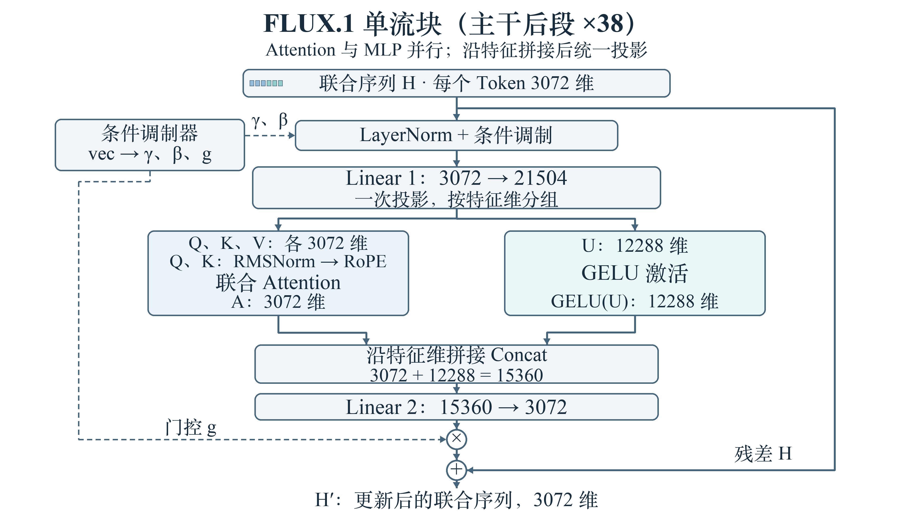

</div>

上图中展示了FLUX.1单流块内部流程。Linear 1一次生成Q、K、V与MLP中间特征；Attention输出3072维，MLP分支输出12288维，沿特征维拼接后由Linear 2映射回3072维，再经过门控与原输入相加。图中维度均指单个Token的特征宽度，QK-Norm与RoPE只作用于Q、K。层内图文使用同一套参数，不同单流块之间参数独立；单块输出仍保留全部图文Token。实线表示特征与残差路径，虚线表示条件输入。

设调制后的输入为 $\widetilde H$，这一过程可以概括为：

$$
[Q,K,V,U]=\mathrm{Linear}_1(\widetilde H)
$$

其中， $U$ 是MLP分支的中间特征。记完成QK归一化、RoPE和注意力计算后的结果为 $A$，则输出为：

$$
H'=H+
g\odot
\mathrm{Linear}_2
\left(
\mathrm{Concat}_{\mathrm{feat}}
\left(A,\mathrm{GELU}(U)\right)
\right)
$$

这里， $\mathrm{Concat}_{\mathrm{feat}}$ 表示沿特征维度拼接， $g$ 是残差门控系数， $\odot$ 表示逐元素相乘。

并行结构保留了Attention的跨Token交互和MLP的逐Token非线性变换，让两个分支共同读取归一化、调制后的输入。两个分支的结果先沿特征维拼接，再通过统一的输出投影完成融合；Add发生在门控后的更新量与原输入之间。这样的组织减少了Attention与MLP顺序执行的依赖，并便于合并线性投影，实际加速幅度还取决于算子实现和硬件配置。

### 3、 QK-Norm和三维RoPE位置编码

我们先来讲QK-Norm的作用。在注意力计算中，Q、K的幅度会直接影响点积大小。FLUX.1对每个注意力头的Q、K应用RMSNorm，再进行位置旋转和注意力计算。这有助于控制注意力分数的数值范围，降低大模型计算中的不稳定因素。

**QK-Norm与RoPE承担不同职责：前者调整Q、K的幅度，后者根据位置旋转Q、K的特征。**

与SD 3使用加性二维位置嵌入的方式不同，了大模型领域中常用的旋转式位置编码（Rotary Positional Embedding，RoPE），RoPE是直接作用在Attention机制上的相对位置编码方式，将位置信息引入注意力内部。其基本形式为：

$$
\widetilde q_a=R(\mathbf p_a)q_a,
\qquad
\widetilde k_b=R(\mathbf p_b)k_b
$$

其中， $\mathbf p_a$ ， $\mathbf p_b$ 是两个Token的位置坐标。对于按坐标轴构造的旋转矩阵，有：

$$
\widetilde q_a^{\mathsf T}\widetilde k_b
=
q_a^{\mathsf T}
R(\mathbf p_b-\mathbf p_a)
k_b
$$

因此，注意力点积可以直接包含两个Token的相对位置关系。它既可以作用于相邻Token，也可以作用于相距较远的Token。

FLUX.1采用三个坐标分量。在基础文生图流程中，图像Token的位置可以写成：

$$
\mathbf p_{\mathrm{image}}=(0,r,c)
$$

这里的 $r$ 和 $c$ 是pack处理后Token网格中的行、列坐标。第一维在单图生成中固定为0，与控制噪声程度的采样时间步不同。

官方配置为三个坐标轴分别分配16、56、56个特征维度：

$$
16+56+56=128
$$

128是每个注意力头的Q、K维度。 前16维使用第一轴坐标构造旋转，中间56维使用行坐标，最后56维使用列坐标。这些旋转作用于Q、K，并不构成一个额外加到3072维Token特征上的位置向量。

在FLUX.1中，具体操作是将文本的位置编号设为 $(0,0,0)$ ，图像的位置编号设为 $(0,i,j)$ ，之后用标准旋转式位置编码对三个维度的编号编码，再把三组编码拼接起来。

假设位于 $(i,j)$ 的图像像素位置编号是 $(0,i,j)$ ，经过特征编码，位置编号会转换成 $[16,56,56]$ 维度的矩阵，表示第一个维度使用长度16的位置编码，后两维使用长度56的位置编码。再经RoPE函数计算得到旋转式位置编码后，三组结果拼接到一起，最终形成128维的位置编码。编码前16个通道是第一维位置编号的位置编码，中间56个通道知道垂直位置信息，最后56个通道知道水平位置信息。

从原理上来讲，Transformer架构中只包含注意力和全连接两种经典计算方式，这两种计算本身都和位置信息无关。为了让Transformer知道图像像素间的空间对应关系，就需要给Transformer中的Token注入额外的位置信息。

经典的正弦编码方式虽然能表示一定的相对位置信息，但经过注意力机制后，其中的相对位置信息几乎会丢失。旋转位置编码使用二维向量来表示每个Token的二维位置编码，经过注意力机制计算后，结果里恰好会出现相对位置关系，从而让注意力计算过程也能感知Token间的相对位置。

RoPE使用旋转变换，使每个位置的Token保留了相邻位置的相对关系。相比传统的绝对位置编码，RoPE更注重局部关系建模。这种增强的局部敏感性有助于AIGC图像创作大模型捕获图像局部区域之间的细节关联，从而提升模型的生成质量和泛化性能。


<h2 id="q-flux-016">面试问题：FLUX.1的Text Encoder部分有哪些创新？详细分析改进意图</h2>

**难度评分：⭐⭐⭐⭐ (4/5)  |  考察频率：⭐⭐⭐⭐ (4/5)**

**FLUX.1在SD 3的基础上对Text Encoder部分进行了精简优化，只使用CLIP ViT-L和T5-XXL Encoder两个Text Encoder模型，并没有使用OpenCLIP ViT-bigG模型**。两者读取提示词后，分别向FLUX.1 Backbone提供不同形式的语言条件：CLIP ViT-L的Pooled Text Embeddings特征与Time Embedding相加，同时T5-XXL则将提取的Text Embedding特征送入Bcakbone的双流模块中，**即CLIP把整段提示词表示为一个全局向量，T5保留逐Token的上下文特征**。

我们想要理解这套设计逻辑，可以从FLXU.1需要解决的两个问题入手：一方面，模型需要知道整张图大致要表现什么；另一方面，它还需要在生成过程中反复读取具体的对象、属性和关系。FLUX.1通过全局条件与文本序列两条路径，将这些信息交给FLUX.1 Backbone使用。

**在CLIP部分，CLIP提供全局文本条件**。提示词经过CLIP得到一个768维全局文本特征向量。在进入FLUX.1 Backbone后，这个768维向量会先经过MLP映射到3072维，再与时间步条件相加；dev版本还会加入引导强度对应的条件嵌入。合成后的向量用于产生Transformer块中的调制参数，使Backbone的特征变换同时受到文本语义与当前噪声阶段的影响。

**在T5-XXL部分，T5保留逐Token的语义信息，为图文交互提供更细致的条件**。提示词经过T5为每个Token（最大序列长度为512）输出一个4096维特征。T5输出的序列特征进入Backbone前，还要经过线性投影，将每个Token的4096维特征转换为3072维。这样，它们就能与同样处于3072维隐藏空间的图像Token参与后续图文交互。

那么，两路文本条件如何共同影响一张图像呢？

以提示词“木桌上有一只红色杯子，杯子位于蓝色书本左侧，柔和的窗边光照”为例，同一段文本会分别进入CLIP和T5-XXL。CLIP产生一个全局向量，经过映射后参与Backbone的条件调制；T5产生一组上下文特征，通过联合注意力参与图像Token的更新。前者以汇总表示影响Backbone的整体特征变换，后者让Backbone保留对具体文本描述的访问。

在采样开始前，文本编码器通常已经完成特征提取。随后每个采样步骤都会将这些文本特征与当前带噪图像一起送入生成Backbone。Backbone内部会不断更新图文隐藏状态，但不需要在每个采样步骤重新运行一次CLIP和T5。

总的来说，**FLUX.1比SD 3更依赖T5-XXL提取的文本特征信息**。SD 3中CLIP Encoder的特征仍有较大的作用，比如SD 3可以去掉T5-XXL，只使用CLIP Encoder提取文本特征信息来生成图像。


<h2 id="q-flux-002">面试问题：FLUX.1在训练和推理过程中使用了哪些优化技巧？</h2>

**难度评分：⭐⭐⭐⭐ (4/5)  |  考察频率：⭐⭐⭐⭐ (4/5)**

FLUX.1与SD 3一样采用了Rectified Flow的生成建模方式，其优化涉及模型训练和实际推理两个环节。

### 1、 多分辨率与多长宽比适配训练

FLUX.1系列模型能够灵活生成多种图像分辨率和长宽比，适应 $0.1\sim2.0\text{MP}$ （Megapixels，百万像素）的图像生成任务。总的来说，图像像素数量越多、分辨率越高，细节表现越丰富，具体如下图所示：

<div align="center">

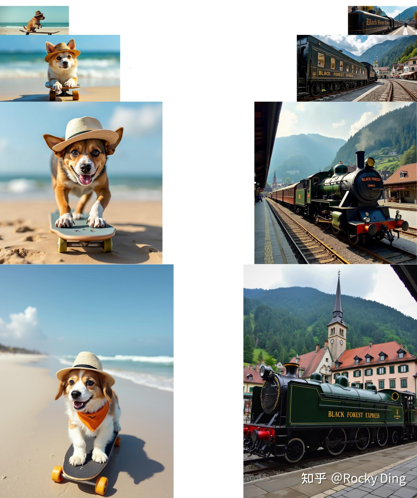

</div>

FLUX.1能够适配各种分辨率的图像生成，主要得益于**多尺度训练 + RoPE位置编码 + 动态Time Shift**的组合策略。三者分别解决训练数据尺度覆盖、Token空间关系建模和不同序列长度下噪声调度的问题，共同提升了模型对不同分辨率与长宽比的泛化能力。目前FLUX.1并没有公开给出完整的分桶规则、分辨率阶段或采样比例。

### 2、 动态Time Shift：根据图像Token数量调整推理时间表

FLUX.1模型完成训练后，还需要选择在哪些时间点调用Backbone进行采样。FLUX.1采用动态Time Shift，处理的就是这一推理问题。

沿用 $t=1$ 对应噪声、 $t=0$ 对应真实图像的约定，采样器从1向0推进。代码先建立均匀时间网格，再根据当前图像的Token数量计算偏移量，将时间节点重新分配到生成过程的不同阶段。

在公开默认路径中，映射取 $\sigma=1$ ，可以写成：

$$
t'=
\frac{e^{\mu}t}
{1+(e^{\mu}-1)t}
$$
其中，$\mu$是Logit空间的偏移量。若用$\alpha$表示分式映射中的乘性系数，则：

$$
\alpha=e^\mu
$$

这里调整的是时间坐标，不会改变初始高斯噪声的均值。根据图像Token数量 $L$ ，通过两个校准点构造线性函数：

$$
\mu(L)
=
0.5+
\frac{1.15-0.5}{4096-256}(L-256)
$$

FLUX.1的VAE进行8倍空间下采样，随后将潜变量中的$2\times2$区域pack处理为一个Token。在图像高宽已经按16的倍数对齐时，有：

$$
L=
\frac{H}{16}\frac{W}{16}
=
\frac{HW}{256}
$$

这里的 $L$ 只统计图像Token，不包含文本Token。例如：

|图像尺寸|	图像Token数量 $L$ |偏移量 $\mu$ |	$\alpha=e^\mu$ |
| --- | --- | --- | --- |
| $256\times256$	|256	|0.50	|约1.65|
| $512\times512$	|1024	|0.63	|约1.88|
| $1024\times1024$	|4096	|1.15	|约3.16|


以 $1024\times1024$ 为例， $\mu=1.15$ 时，原时间网格中的 $t=0.5$ 会映射到约 $t'=0.76$ 。中间节点整体向高噪声端移动，而起点、终点和总采样步数保持不变。这相当于重新安排有限次数的模型计算，让它们覆盖不同的噪声阶段。

下图中展示了这一映射，以及Token数量与偏移量的关系。左图展示不同 $\mu$ 下的时间坐标映射，右图展示Token数量与 $\mu$ 的线性关系。图中的0.5和1.15是两个校准点对应的数值，代码没有把线性函数截断在两者之间，因此它们不是所有输入下固定的参数上下限。

<div align="center">

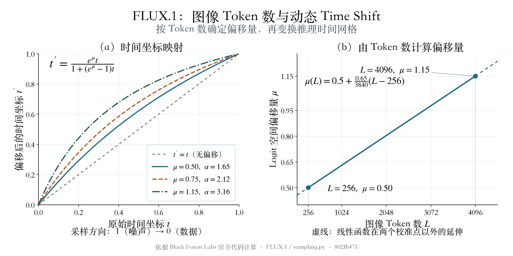

</div>

此外， $1024\times1024$ 与 $512\times2048$ 具有相同的图像Token数量，在这段代码中会得到相同的偏移量。这说明动态Time Shift关注的是序列规模，长宽比变化带来的空间布局仍需要依靠模型的空间建模和训练覆盖。


<h1 id="q-flux-017">2.FLUX.1有哪些主流的变体模型？介绍一下它们的核心原理</h1>

<h2 id="q-flux-005">面试问题：介绍一下FLUX.1 Lite与FLUX.1的异同</h2>

**难度评分：⭐⭐⭐ (3/5)  |  考察频率：⭐⭐⭐ (3/5)**

FLUX.1作为开源AIGC图像创作大模型，其Backbone DiT部分参数量达到12B，与之对应的是推理成本也较大。因此，Freepik团队在FLUX.1-dev的基础上开源了一个更小的蒸馏模型FLUX.1 Lite-8B-alpha，**DiT部分的参数量从12B减少到8B，推理所需显存减少约7GB，同时生成图像的速度提升约23%**。

虽然参数量从12B降低到8B，但整体图像生成质量并未明显降低。使用同样的提示词，FLUX.1 Lite可以得到和FLUX.1-dev质量接近的生成图像，具体效果对比如下图所示：

<div align="center">

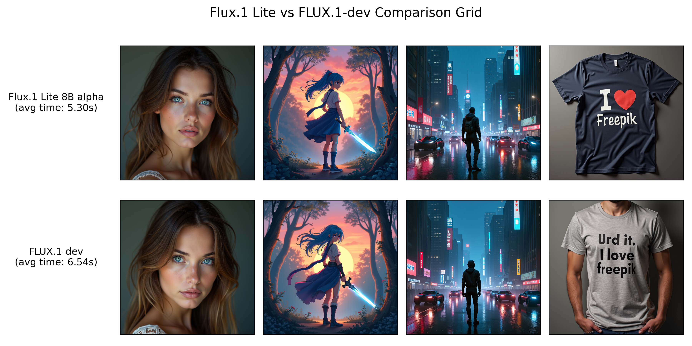

</div>

**FLUX.1 Lite的核心做法是减少FLUX.1-dev中MM-DiT Blocks的数量**。FLUX.1-dev一共包含19个MM-DiT Blocks，而FLUX.1 Lite只保留8个，去掉第4至15层共11个MM-DiT Blocks。这本质上是使用模型轻量化领域中的经典技术模型剪枝来压缩网络，再使用FLUX.1-dev作为教师模型进行蒸馏训练。

Freepik团队通过固定提示词，分析不同MM-DiT Blocks和Single-DiT Blocks对整个生图结果的贡献，如下图所示。具体方法是计算每个Block输入和输出之间的MSE（Mean Squared Error）：如果MSE很小，说明Latent特征经过该Block后并没有发生太多变化，这一层对最终图像的边际贡献相对有限。

<div align="center">

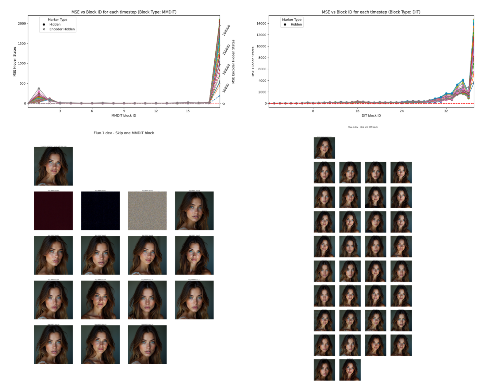

</div>

实验结果表明，FLUX.1前部和后部MM-DiT Block的输入输出变化较大，中间部分MM-DiT Block的变化较小；后部Single-DiT Block的变化较大，而前面大部分Single-DiT Block的变化较小。**这说明去掉一部分中间Block，并不会给最终生成质量带来明显改变**。

Freepik团队最终选择去掉第4至15层MM-DiT Blocks，一个重要原因是MM-DiT Blocks的参数规模比Single-DiT Blocks更大，对MM-DiT部分进行剪枝可以获得更高的显存与速度收益。

<h2 id="q-flux-006">面试问题：介绍一下FLUX.1 Kontext的原理，有哪些创新点？</h2>

**难度评分：⭐⭐⭐⭐⭐ (5/5)  |  考察频率：⭐⭐⭐⭐⭐ (5/5)**

FLUX.1 Kontext一共有三个版本：FLUX.1 Kontext [max]、FLUX.1 Kontext [pro]和FLUX.1 Kontext [dev]。其中FLUX.1 Kontext [max]是性能最强的版本；FLUX.1 Kontext [pro]使用潜在对抗性扩散蒸馏（Latent Adversarial Diffusion Distillation，LADD）训练，能够在提升图像生成质量的同时显著减少采样步数，从而提高生成速度，更适合实时应用。上述两个模型同时支持文生图和图像编辑，但没有开源，可以通过官方API使用。

**FLUX.1 Kontext [dev]是开源版本，只支持纯图像编辑，不支持文生图，下图展示了FLUX.1 Kontext图像编辑效果**。它可以与FLUX.1 [dev]配合使用，从而实现文生图和图像编辑的完整流程。

<div align="center">

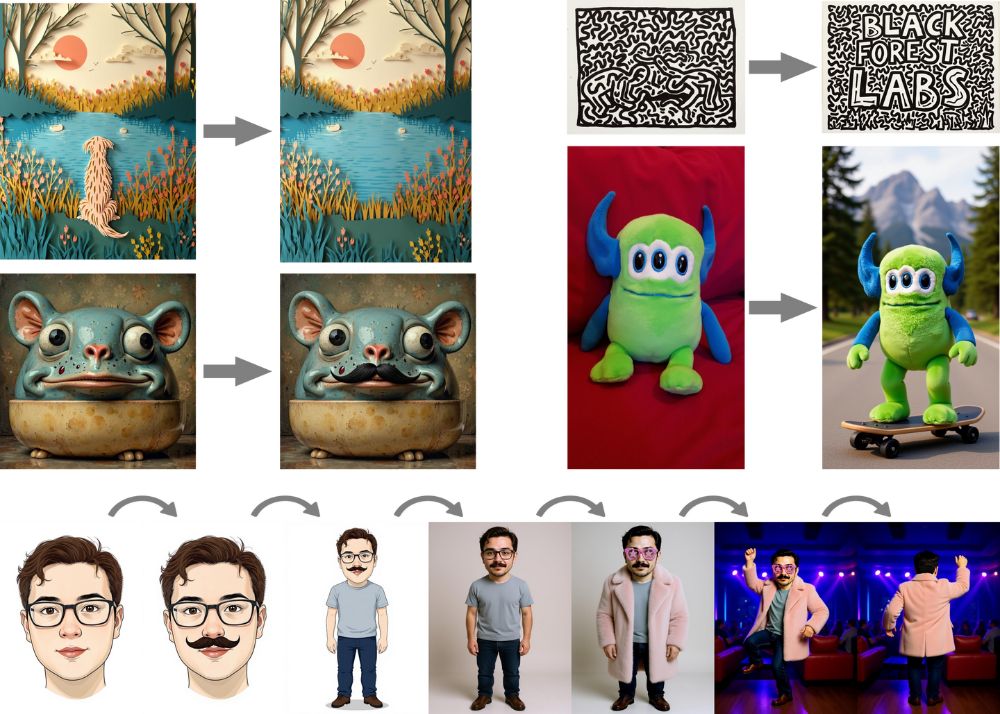

</div>

FLUX.1 Kontext的整体架构基于FLUX.1的DiT（Diffusion Transformer）扩展，通过引入参考图像作为条件输入实现多模态生成能力，**其核心创新在于构建双路径多模态特征处理机制**。下图是FLUX.1 Kontext整体架构和推理流程示意图：

<div align="center">

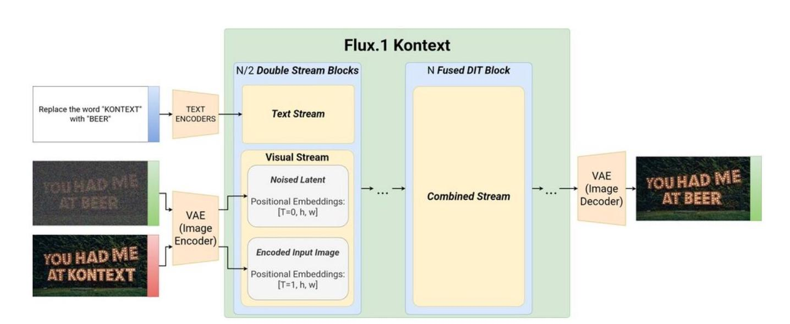

</div>

**双模态编码解决的是如何将参考图像输入模型的问题**。FLUX.1 Kontext首先使用冻结的VAE Encoder将参考图像编码为Latent特征，同时为目标图像构造带噪Latent。暂时省略Batch维度，并采用“空间尺寸 × 通道数”的记法，两者可以表示为：

$$
z_t\in\mathbb{R}^{h_t\times w_t\times C},
\qquad
z_{\mathrm{ref}}\in\mathbb{R}^{h_r\times w_r\times C}
$$

其中， $h_t,w_t$ 表示目标Latent的空间尺寸， $h_r,w_r$ 表示参考图Latent的空间尺寸， $C$ 是Latent通道数，在FLUX.1中为16。推理开始时， $z_t$ 是随机高斯噪声，随着采样推进，它逐步变成包含目标图像内容的Latent，因此使用 $z_t$ 可以描述整个生成过程。

VAE输出的二维Latent特征还需要经过pack处理，才能成为Transformer处理的Token序列。FLUX.1将相邻的 $2\times2$ 个空间位置合并成一个Token，并将这些位置的通道特征展开到同一个向量中。这样，Token数量变为空间位置数的四分之一，每个Token的特征维度则由16变为64。设打包操作为 $P$，则：

$$
X_t=P(z_t)\in\mathbb{R}^{L_t\times d},
\qquad
X_{\mathrm{ref}}=P(z_{\mathrm{ref}})
\in\mathbb{R}^{L_{\mathrm{ref}}\times d}
$$

在Latent的空间尺寸可以被2整除时：

$$
L_t=\frac{h_tw_t}{4},
\qquad
L_{\mathrm{ref}}=\frac{h_rw_r}{4},
\qquad
d=4C=64
$$

这里， $L_t$ 和 $L_{\mathrm{ref}}$ 分别是目标图像与参考图像的Token数量， $d$ 是每个打包Token的特征维度。随后，两组Token沿序列维度拼接：

$$
X_{\mathrm{concat}}
=
\mathrm{Concat}_{\mathrm{seq}}
\left(X_t,X_{\mathrm{ref}}\right)
\in
\mathbb{R}^{(L_t+L_{\mathrm{ref}})\times d}
$$

序列拼接增加的是Token数量，每个Token的特征维度保持不变。 例如，当目标图像与参考图像均为 $1024\times1024$ 时，两路对应的Latent尺寸均为 $128\times128\times16$；经过 $2\times2$ 打包，各自形成 $4096\times64$ 的Token序列，拼接后得到 $8192\times64$ 的序列。这里的64维是输入投影之前的特征维度，后续还会通过模型的输入投影映射到Transformer的隐藏维度。

拼接后的目标Token与参考Token共同进入模型的视觉流，通过注意力交互利用参考图中的人物、物体、构图和风格等信息。这样做简单直接，让模型自己学习区分哪部分是生成目标、哪部分是参考条件，同时支持不同的输入与输出分辨率和宽高比，也可以从结构上扩展到多个参考图像 $y_1,y_2,\ldots,y_N$ 。

**FLUX.1 Kontext实验发现，序列拼接（Sequence Concatenation）的效果优于通道级拼接（Channel-wise Concatenation）**。两者在结构上的主要区别是：序列拼接允许目标与参考的序列长度不同，而直接进行通道拼接通常要求两组特征具有相同的空间尺寸或序列长度，并明确位置之间的对应关系。论文没有进一步证明这一结构差异就是性能差异的唯一原因。

**完成序列拼接后，模型还需要知道每个Token属于目标图还是参考图，以及它在各自图像中的空间位置信息**。FLUX.1 Kontext沿用FLUX.1的三维旋转位置编码（3D RoPE），为视觉Token设置“图像编号、行坐标、列坐标”三个位置分量。这样，目标图像与参考图像虽然被放入同一条序列，仍然保留各自的二维空间结构，并通过不同的图像编号加以区分。

为了避免与采样时间步 $t$ 混淆，这里用 $m$ 表示图像编号，用 $r,c$ 表示Token在各自图像网格中的行、列坐标：

$$
\mathbf{p}=(m,r,c)
$$

目标图像与参考图像的坐标分别设置为：

$$
\mathbf{p}_{\mathrm{target}}=(0,r,c),
\qquad
\mathbf{p}_{\mathrm{ref},i}=(i,r,c),
\qquad i=1,\ldots,N
$$

其中， $m=0$ 表示目标图像， $m=i$ 表示第 $i$ 张参考图像； $r,c$ 是经过Latent打包之后的Token网格坐标。例如，目标图中第12行、第20列的Token可以标记为 $(0,12,20)$ ，第一张参考图相同局部坐标处的Token则标记为 $(1,12,20)$ 。两者的行、列坐标相同，但图像编号不同，因此不会获得完全相同的位置旋转。

Kontext论文中将第一维称为“虚拟时间步”（Virtual Time Step）。**这里的“时间”承担图像来源标记的作用，与控制噪声程度的采样时间步不是同一个概念**。 在整个采样过程中，目标图的编号始终为0，参考图的编号也保持固定；变化的是目标Latent的内容和当前噪声时间步。训练时，目标分支使用由真实目标图像构造的带噪Latent；推理时，目标分支从高斯噪声出发逐步更新，两种情况下都使用同样的位置坐标规则。

RoPE通过旋转注意力中的Query和Key，将位置关系引入Token之间的相关性计算。 对某个坐标轴上的位置 $p$，以及Query或Key中的一对特征，其基本旋转操作可以写成：

$$
\begin{bmatrix}
\widetilde{x}_{2j}\\
\widetilde{x}_{2j+1}
\end{bmatrix}
=
\begin{bmatrix}
\cos(p\omega_j)&-\sin(p\omega_j)\\
\sin(p\omega_j)&\cos(p\omega_j)
\end{bmatrix}
\begin{bmatrix}
x_{2j}\\
x_{2j+1}
\end{bmatrix}
$$

这里， $p$ 可以取图像编号、行坐标或列坐标； $\omega_j$ 是第 $j$ 对特征使用的旋转频率； $x_{2j},x_{2j+1}$ 是Query或Key中的两个特征分量。位置决定旋转角度，不同特征对使用不同频率，从而共同表达位置关系。

理论上，FLUX.1 Kontext的结构可以支持任意数量的参考图像，但官方实际训练聚焦输入一张参考图像，因此标准推理流程也只输入一张参考图。如果先将多张图片拼成一张参考图再输入模型，模型接收到的仍然是一张复合图像：其中所有参考Token共用同一个图像编号，来源差异只能通过复合图内部的布局和内容体现，也能实现多图像参考效果。

接下来我们再看看FLUX.1 Kontext如何对学习目标进行建模。FLUX.1 Kontext是原生AIGC图像生成编辑大模型，因此需要对图像生成与图像编辑进行统一建模：

```math
p_\theta(x\mid y,c)
```

**它表示“在给定参考图像 $y$ 和文字提示词 $c$ 的条件下，生成目标图像 $x$ 的概率”**。其中 $x$ 是模型要生成的目标图像（Target Image）。 $y$ 是参考图像（Context Image），可以为空；当 $y\neq\varnothing$ 时执行图像内容编辑，当 $y=\varnothing$ 时执行纯文本到图像生成。 $c$ 是自然语言提示词，例如“把背景变成雪山”。

通过条件分布 $p_\theta(x\mid y,c)$ 建模，同一模型可以处理图像生成和图像编辑两类任务。这种混合训练策略正在成为AIGC图像生成编辑大模型的重要训练基石：高质量、高分辨率的T2I数据可以提升高分辨率编辑中的细节还原和复杂场景处理能力，同时保留模型原生的文本生成图像能力，增强模型面对多样化编辑需求时的泛化性。

文本提示词 $c$ 是描述参考图像与目标图像变化关系的桥梁。官方筛选整理了数百万个 $(x,y,c)$ 三元关系对，并将FLUX.1作为预训练模型开始微调优化。

上述联合训练继续采用Rectified Flow：对目标图像的Latent加噪，让模型结合参考图与编辑指令预测目标的速度；参考图提供条件信息，训练监督作用于目标图像部分。它的核心扩展是把参考视觉上下文接入生成过程，并用成对数据教会模型哪些内容需要修改、哪些需要保留。


<h2 id="q-flux-008">面试问题：介绍一下FLUX.1 Krea的原理，有哪些创新点？</h2>

**难度评分：⭐⭐⭐⭐ (4/5)  |  考察频率：⭐⭐⭐⭐ (4/5)**

FLUX.1 Krea由Black Forest Labs和Krea AI联合研发并开源。Black Forest Labs向Krea AI提供了FLUX.1-dev模型的完整预训练权重`flux-dev-raw`，作为后训练的基座大模型。

作为一个输出分布多样、可塑性强的预训练基座大模型，`flux-dev-raw`生成的图像质量还没有达到顶尖AIGC图像创作大模型的水准，但它具备成为理想后训练基座的三项优势：

1. `flux-dev-raw`蕴含丰富的通用知识，已经掌握常见物体、动物、人物、拍摄视角和媒介等视觉概念。
2. 它已经具备较强的基础生成能力，能够生成结构连贯的图像、完成基本构图并进行文字渲染。
3. 最重要的是，它尚未“定型”，没有固化的“AI审美定式”，能够生成从粗糙到精美的多样化图像。

下图是flux-dev-raw的图像生成效果：

<div align="center">

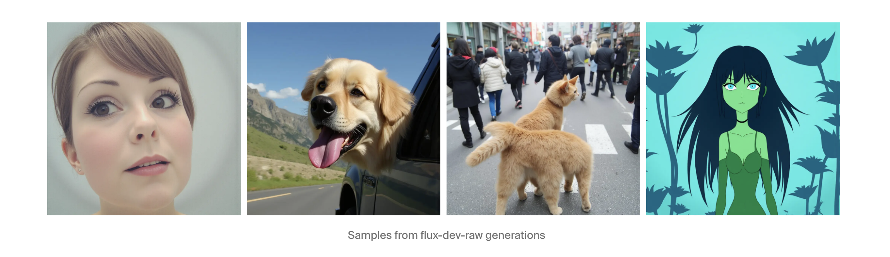

</div>

经过微调训练后，FLUX.1 Krea [dev]展现出较高的审美水平和图像质量，特别是在照片级写实场景中表现突出，整体具备以下特性：

1. **聚焦美学摄影**：擅长生成具有较强美学感的摄影风格图像，缓解常见的“AI感”，提升真实感和图像质量。
2. **提示词理解能力较强**：具备较好的提示词跟随能力，可以处理复杂的内容描述。
3. **采用引导蒸馏技术**：在生成图像时计算效率更高，速度更快。
4. **兼容开源生态**：兼容FLUX.1 [dev]架构及其对应的开源生态系统。

下图是FLUX.1 Krea dev图像生成效果：

<div align="center">


</div>

与大多数AIGC图像创作大模型不同，**FLUX.1 Krea融入了鲜明的主观审美取向和“美学偏好”（Opinionated），专注于呈现独特审美：减少“AI痕迹”和过曝高光，保留自然细腻的细节**。其训练目标是生成更真实、更多样的图像，并避免图像生成中常见的过度饱和和蜡质纹理。

从GAN时代生成猫狗花卉的早期阶段至今，图像生成技术已经取得很大进步。当今AIGC图像创作大模型不仅能生成结构准确的人脸、肢体与手掌，还能理解精确数量关系、渲染复杂字体排版，完成“宇航员骑马”这类复杂场景。

然而，AIGC大模型生成的图像通常具有一种容易被识别的“味道”：过度模糊的背景、蜡质般的皮肤纹理、乏味单调的构图等，这些问题共同构成了所谓的“AI感”，如下图所示：

<div align="center">

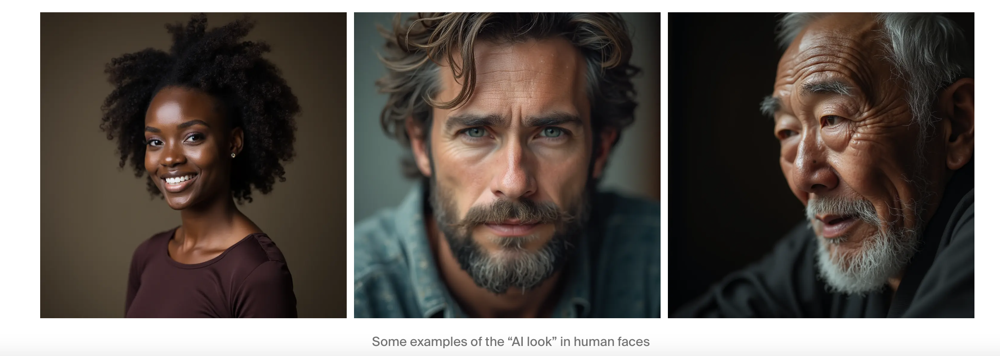

</div>

业界长期过度关注模型的生成能力，并通过基准测试衡量空间关系、属性绑定、物体计数、文字渲染等能力。研究界在推进生成模型发展方面取得了显著成果，但在追逐技术能力和基准优化的过程中，早期图像模型的原生质感、风格多样性和创作灵性反而容易被边缘化。要在提升模型能力的同时避免滑向“AI感”，需要精细的数据策划，以及对模型输出进行充分校准与微调。

训练一个AIGC图像生成模型主要分为预训练和后训练两个阶段。模型绝大部分美学特质是在后训练阶段学习的，但模型能力和风格多样性的上限首先由预训练基座决定。

**预训练阶段的重点是“模式覆盖”（Mode Coverage）和“世界理解”（World Understanding）。** 模型需要充分吸收视觉世界中的各类风格、物体场景、地域风貌与人物形象，目标是最大化生成多样性。

预训练模型甚至应该接触“劣质”数据，只要这些不良特征能够被条件机制准确描述。除了让模型知道“何为优秀”，也需要让模型理解“何为糟粕”。当前很多图像生成工作流会使用“手指畸形、面部扭曲、画面模糊、色彩过饱和”等负面提示词；如果模型从未见过这些不良特征，负面条件就无法有效引导模型避开对应的数据分布区域。

**后训练阶段的核心任务，是转移并剔除数据分布中的不良成分。** 预训练模型可以生成多样图像、理解广泛概念，但由于尚未形成明确的美学偏向，往往难以稳定输出高质量图像。此时需要主动利用“模式坍缩”（Mode Collapse）：通过后训练让模型持续偏向期望的优质数据分布区间，而不是平均保留所有类型的输出。

FLUX.1 Krea模型中的监督微调（SFT）和RLHF后训练是其摆脱“AI感”，生成具有照片级真实感和独特美学图像的关键步骤。下图是FLUX.1 Krea的SFT与RLHF后训练效果：

<div align="center">

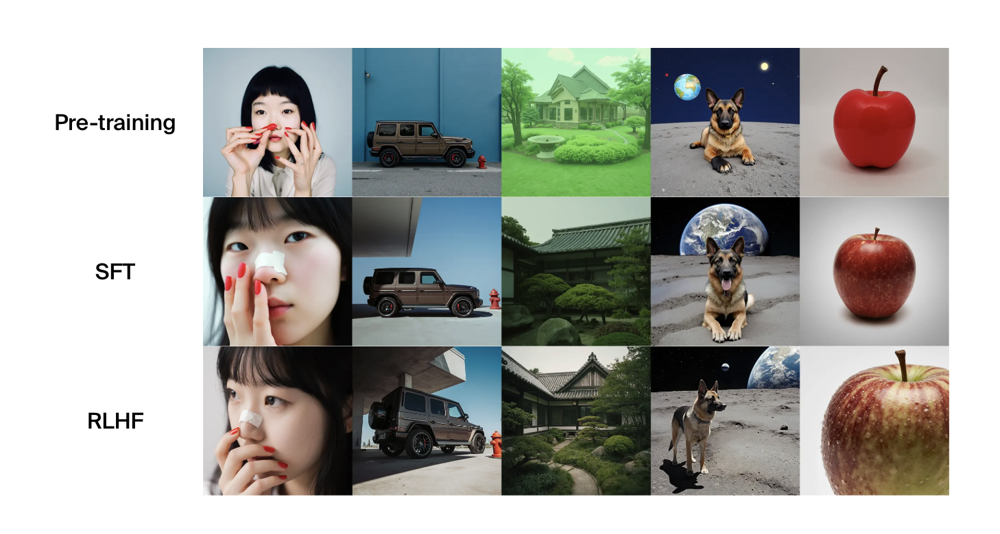

</div>

FLUX.1 Krea的SFT流程核心是使用精选数据，基于通用的基础大模型训练一个具有特定审美品味的模型。

1.  **起点：优质的“原始”基础模型**。SFT并非从零开始，它需要一个知识渊博的“胚子”。FLUX.1 Krea 使用的是Black Forest Labs提供的 **`flux-dev-raw`基础模型**。同时进行了大规模的预训练，其特点是已经具备了大量的“世界知识”（能理解各种物体、风格和概念），但尚未经过过度微调调优，保留了原始生成分布的多样性，可塑性非常强。

2.  **核心：精心策划的训练数据**。数据是SFT的灵魂，FLUX.1 Krea 严格遵循 **“质量重于数量”** 的原则。其训练数据主要包括**高质量图像-文本对**，团队手工挑选了符合其审美标准的高质量图像数据集。**合成样本**，在SFT阶段还加入了来自 **Krea自身模型的高质量合成样本**，这有助于稳定模型在迭代过程中的性能。整个SFT阶段使用的数据量可能远少于预训练，但凭借极高的数据质量，足以让模型领会到期望的美学风格。

经过SFT阶段后，FLUX.1 Krea大模型发生了根本性的转变：
  - **确立美学基础**：从能“画出”东西，转变为能画出“好看”的东西，初步建立起对自然光影、真实质感和协调构图的偏好。
  - **提升图像质量**：生成的图像在清晰度、结构准确性和细节丰富度上显著提升。
  - **保留多样性**：由于基础模型的“原始”性和数据的质量，模型在确立风格的同时，并未丧失生成的多样性。

SFT解决了“好看”的问题，而RLHF则进一步解决“更符合人类偏好”的问题。SFT可以被看作是**RLHF的必要准备**，它先让模型具备稳定的高质量输出能力，然后RLHF再通过人类偏好数据对这个能力进行精细校准和微调，使作品的风格更鲜明、更符合特定的艺术标准。

为了让你更清晰地理解SFT在整个过程中的承上启下作用，下表对比了这三个核心阶段：

在RLHF阶段，官方应用了一种偏好优化技术的变体，称为TPO（Tuned Preference Optimization），以进一步提升FLUX.1 Krea模型的美学质量和风格化水平。官方使用了高质量的内部偏好数据，这些数据经过严格筛选以确保质量。同时在微调过程中还会进行多轮偏好优化，进一步优化FLUX.1 Krea模型生成图像的风格与质量。

在探索各种后训练技术的过程中，Krea官方发现了一些关键要点：

1. **质量比数量重要的多**：我们只需要非常少量的数据（不到100万）就能进行有效的后训练。虽然更大的数据集规模有助于模型的稳定性和减少偏差，但数据的质量才是最为重要的，使用小规模、精心挑选的数据集进行训练，依然可以达到极佳的模型整体效果。使用的偏好标签是由标注人员精心收集的，这些标注人员非常清楚当前模型的局限性、需要改进的领域、优点和缺点。同时确保图像数据集内容足够多样，以获得聚焦且有代表性的标注结果。
2. **采取主观明确的训练方法**：目前有许多开源的偏好数据集，被用于评估测试偏好微调技术。这些数据集对于测试各种技术确实非常有用。然而，如果直接在现有数据集上进行训练，往往会导致一些意想不到的负面影响，例如模型生成的图像会偏向对称、简单的构图；会有模糊和过度柔和的纹理；会出现色彩风格趋于单一的情况；会回归到”AI感”等。

Krea官方认为，在”全局”用户偏好上微调训练的模型在审美质量上并非最优。对于像文本渲染、解剖结构、物体结构和提示词遵循度这样有客观事实依据的目标，数据的多样性和规模确实是很有帮助的。然而，对于像美学质量这样主观的目标，将不同的审美品味混合在一起几乎是相互抵触的。

例如，一个用户喜欢高端时尚摄影，另一个用户钟情于极简主义绘画。如果分别获得聚焦、明确的偏好标注，模型很容易对齐并擅长相应风格；但把两种分布合并后，得到的往往是一个边缘化的“中庸”偏好分布，最终模型难以让任何一方满意。

这个问题可以通过设计提示词部分缓解，但不是一个充分的解决方案。很多用户最终需要配合LoRA才能获得所需的风格化水平。用户通常希望模型具备合理的默认输出，而不是每次都需要堆叠大量修饰词才能获得具有审美水准的图像。

受此直觉启发，Krea以主观明确的方式收集偏好数据，使其符合团队自身的审美品味和清晰艺术方向。对于美学这种主观目标，将模型有意识地“过拟合”到一种特定风格，往往效果更好、实现也更直接。

最后通过RLHF阶段，FLUX.1 Krea实现了：

*   **鲜明的艺术风格**：模型输出的图像具有高度可识别的、一致的“Krea风格”，而不是模糊的“大众脸”。
*   **卓越的美学质量**：在团队定义的审美标准下，图像的光影、构图、色彩和质感都达到了极高水平。
*   **强大的鲁棒性**：即使面对具有挑战性的提示词，模型也能稳定地输出符合其美学标准的图像，而不是崩溃或产生“AI感”十足的图片。
*   **用户友好性**：用户无需编写冗长复杂的提示词来“对抗”模型的中庸审美，简单的提示也能得到具有高级美学感的默认输出。


<h1 id="q-flux-013">3.介绍一下FLUX.2的原理和创新点</h1>

<h2 id="q-flux-022">面试问题：FLUX.2的VAE部分有哪些创新？详细分析改进意图</h2>

**难度评分：⭐⭐⭐⭐ (4/5)  |  考察频率：⭐⭐⭐⭐ (4/5)**

**FLUX.2对VAE的改进，同时考虑了图像重建质量、Latent空间可学习性以及生成过程计算成本**。

### 1、保留8倍空间下采样，用32通道承载更丰富的图像信息

FLUX.2的编码器仍通过卷积、残差块和注意力处理图像，高、宽各缩小8倍。**主要优化是将Latent通道数从FLUX.1的16增加到32**，让每个空间位置能够保存更多特征。

对于一张高为 $H$、宽为 $W$ 的RGB图像，我们忽略Batch维度，其核心的Encoder与Pack过程如下所示：

```math
x\in\mathbb{R}^{3\times H\times W}
\xrightarrow{\mathrm{Encoder}}
z_{\mathrm{enc}}\in\mathbb{R}^{32\times H/8\times W/8}
\xrightarrow{\mathrm{Pack}_{2\times2}}
z_{\mathrm{pack}}\in\mathbb{R}^{128\times H/16\times W/16}
```

**这里的Pack操作把相邻 $2\times2$ 个Latent位置移到通道维度**。它只是重排数据，不丢弃空间信息。32个通道因此变成128个通道，展平后的图像Token数量为：

```math
N_{\mathrm{img}}=\frac{H}{16}\times\frac{W}{16}=\frac{HW}{256}
```

我们以 $1024\times1024$ 图像为例，编码器先产生 $32\times128\times128$ 的Latent特征，再Pack为 $128\times64\times64$，对应4096个图像Token。FLUX.1在相同分辨率下也是4096个Token，但每个Token只有64维。

FLUX.2与FLUX.1相比，在VAE部分的优化可以归纳为下表：

<div align="center">

| 对比项 | FLUX.1 VAE | FLUX.2 VAE | 对后续生成的影响 |
|---|---|---|---|
| 高、宽的下采样倍率 | 各8倍 | 各8倍 | 相同分辨率下，两者编码器输出的Latent空间网格大小相同 |
| 编码后的Latent通道数 | 16 | 32 | FLUX.2每个空间位置有更大的表示容量，以换取更好的细节保留能力。 |
| $2\times2$ 打包后的Token维度 | 64 | 128 | 后续的FLUX.2的Backobne能够处理更多特征信息 |
| $1024\times1024$ 图像的Token数 | 4096 | 4096 | 两者Token数量不变 |
| Latent归一化 | 固定的平移与缩放系数 | 打包后按通道使用保存的均值、方差 | 对不同通道的数值尺度分别校准 |

</div>

### 2、让Latent既能还原图像，也适合生成模型学习

普通VAE训练首先关心“压缩之后还能不能还原”。但对生成系统来说，还存在第二个问题：从随机噪声出发，DiT是否容易学会这些Latent的分布？

可以从三个维度判断一个潜空间：

- **重建质量**：将真实图像编码后再解码，主体、边缘、文字和纹理是否保留下来。
- **可学习性**：在这个潜空间中训练生成模型，给定训练条件与预算，是否容易得到质量较高的生成结果。
- **表示大小与计算成本**：Latent有多少空间位置、多少通道，打包后形成多长的Token序列。

FLUX.2重新训练了潜空间，并引入语义正则化，使表示在保留图像细节的同时具有更适合生成学习的结构。直观地说，相同对象、相近形状和相关语义在特征空间里有更有规律的组织，后续的FLUX.2 Backbone就更容易学习它们之间的联系。

在训练过程中，FLUX.2 VAE借鉴了REPA和REPA-E研究方向，但公开报告没有给出详细的复现内容与过程。

### 3、Pack操作后按通道归一化，稳定生成模型面对的数据尺度

FLUX.2在 $2\times2$ Pack操作之后，对128个通道分别进行归一化。使用不带可学习仿射参数的BatchNorm，并在编码、解码时使用保存的运行统计量，具体流程如下所示。对第 $j$ 个通道，可以写成：

```math
z_j=\frac{z_{\mathrm{pack},j}-\mu_j}{\sqrt{\sigma_j^2+\varepsilon}},
\qquad
z_{\mathrm{pack},j}=z_j\sqrt{\sigma_j^2+\varepsilon}+\mu_j
```

其中， $\mu_j$ 和 $\sigma_j^2$ 是保存的通道均值与方差， $\varepsilon$ 是数值稳定项。编码时先归一化，再将结果交给FLUX.2 Backbone；解码时先恢复原尺度，再逆向Pack并交给Decoder进行处理。

这样做的作用是让不同Latent通道与高斯噪声处于更协调的数值尺度，避免某些通道只因幅值较大就主导训练。推理时使用固定统计量，也意味着单张图像的归一化结果不依赖当前Batch里还放了哪些图片。官方推理编码还直接取编码器输出的均值部分，不再从后验分布随机采样。

### 4、用重建指标和生成指标分别验证改进

下面是FLUX.2技术报告中的Latent空间对比图。横轴是基于相应表示训练生成模型后得到的gFID，纵轴是重建图像的LPIPS，两者均越低越好。

<div align="center">

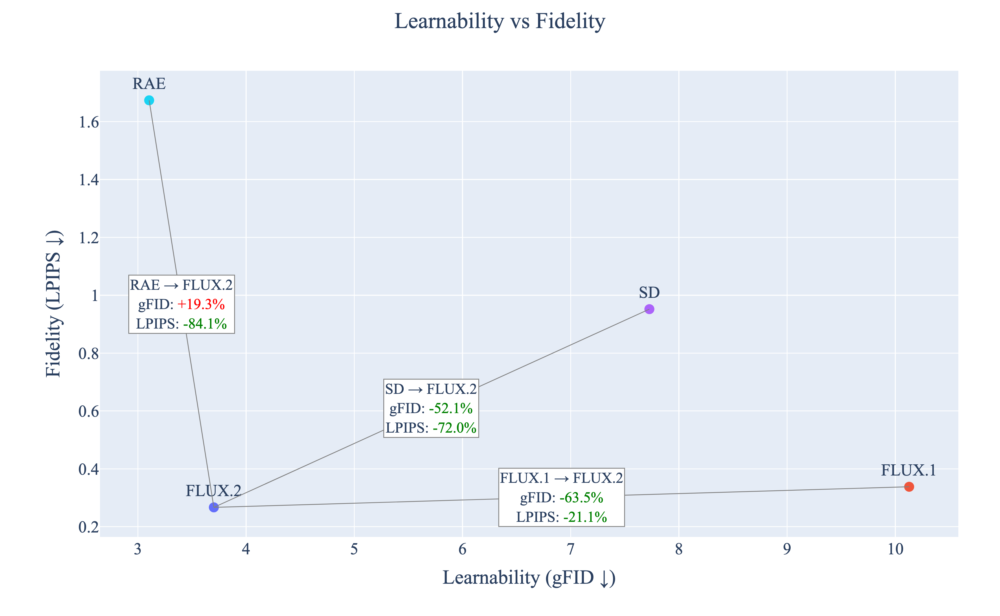

</div>

报告在ImageNet验证集上的重建结果中，FLUX.1到FLUX.2的LPIPS由0.3380降至0.2668，SSIM由0.8893升至0.9038，PSNR由31.1312升至31.4632,不过RAE在图中仍有更低的gFID。


<h2 id="q-flux-020">面试问题：FLUX.2的Backbone部分有哪些创新？详细分析改进意图</h2>

**难度评分：⭐⭐⭐⭐⭐ (5/5)  |  考察频率：⭐⭐⭐⭐ (4/5)**

**FLUX.2 [dev]的Backbone继续使用双流块与单流块组合的Rectified Flow Transformer架构，总参数量32B**。它将更大的模型容量、共享调制、SwiGLU，以及多参考图条件构建在同一条生成链路，支持文生图、单图编辑与多图参考生成，具体生成效果如下所示：

<div align="center">


</div>

### 1、扩展模型容量，同时调整双流与单流的比例

与FLUX.1相比，FLUX.2的Bcakbone主要配置如下表所示：

<div align="center">

| 配置 | FLUX.1 [dev] | FLUX.2 [dev] | 改变的含义 |
|---|---|---|---|
| Transformer参数量 | 约12B | 约32B | 增加生成网络的表示与拟合容量 |
| 隐藏维度 | 3072 | 6144 | 每个Token在主干中具有更宽的特征表示 |
| 注意力头数 | 24 | 48 | 两者每个头仍为128维 |
| 双流块数量 | 19 | 8 | 减少使用两套模态专属块参数的层数 |
| 单流块数量 | 38 | 48 | 将更多网络层用于合流后的Token建模 |
| 前馈网络激活 | GELU | SwiGLU | 引入特征门控，改变前馈分支的表达方式 |
| 时间与引导调制 | 各块分别生成调制参数 | 在同类块间共享调制结果 | 降低重复的条件投影开销 |

</div>

双流块中的文本与图像各自使用投影、归一化和前馈网络，但它们的Q、K、V会参与联合注意力，因此在双流阶段就已经能够交换信息。进入单流阶段后，两种Token拼接为一条序列，共享单流块的计算参数。这种调整把更多容量放在合流后的建模阶段，同时减少模态专属块的数量。

一次主干前向的计算顺序是：**文本和图像特征分别投影到6144维 → 8个双流块 → Token序列合并 → 48个单流块 → 输出图像Token的128维速度预测**。采样器只用目标图像对应的预测更新带噪Latent，完成多步更新后再调用VAE解码。具体流程如下图所示：

<div align="center">


</div>

### 2、共享调制，让多层网络使用同一组当前时间条件

生成网络需要知道当前噪声时间步，也需要知道用户指定的引导强度。FLUX.2将这些标量编码为条件向量，再生成归一化的平移、缩放和残差门控参数。

**调制的作用，是让同一套网络根据当前生成条件，动态调整特征的处理方式**。同一张图在高噪声和低噪声阶段具有不同的恢复难度，用户选择的引导强度也可能不同。FLUX.2将时间步与引导强度编码后，生成 $\gamma$、 $\beta$ 和 $g$，分别控制特征进入子层时，各通道的幅度和偏移；以及子层完成计算后，各通道向主干写回的更新幅度。

一个子层的调制过程可以概括为：

```math
\widetilde{H}=(1+\gamma)\odot\mathrm{LN}(H)+\beta,
\qquad
H'=H+g\odot F(\widetilde{H})
```

其中， $H$ 是Token特征， $\odot$ 表示逐元素相乘，也叫Hadamard积。$\gamma$ 调整特征尺度， $\beta$ 调整偏移， $g$ 控制当前子层的残差更新强度；三者都由时间与引导条件生成。双流块中，注意力和前馈子层各有对应的调制参数组。

FLUX.1在各个块中分别设置调制网络。FLUX.2则在主干外部计算（Global Modulation）三类调制结果：一类供所有双流块的图像分支使用，一类供所有双流块的文本分支使用，另一类供所有单流块使用。这样，同一次前向不必在每一层重复生成一套高维条件投影。

### 3、保留并行Attention-MLP结构，使用SwiGLU与无偏置投影

FLUX.2的单流块从同一份归一化、调制后的特征出发，同时计算注意力分支与前馈分支。一个融合输入投影产生Q、K、V以及前馈网络所需的两组特征 $A,B$；注意力结果与前馈结果拼接后，再经过融合输出投影和残差门控。

前馈分支采用的SwiGLU形式为：

```math
\mathrm{SwiGLU}(A,B)=\mathrm{SiLU}(A)\odot B
```

可以把它理解为一组特征产生门控，决定另一组特征有多少信息通过。它比只对单路特征做GELU变换增加了显式的乘性调节。

下图是FLUX.2中单流Transformer的流程图：

<div align="center">


</div>

我们知道FLUX.1的单流块已经同时融合了QKV与MLP输入投影，也融合了注意力与MLP输出投影。**FLUX.2沿用这一并行结构，进一步采用SwiGLU、共享调制和无偏置线性层**。无偏置投影减少了部分参数与操作，条件相关的平移仍可以由调制中的 $\beta$ 提供。

### 4、用四轴RoPE组织文本、目标图像和多张参考图

FLUX.2的参考图通过VAE编码为图像Token，并与目标图像的带噪Token一起进入图像流。多张参考图可能具有相同的二维位置，因此模型还需要知道“这个位置属于哪张图”。

官方实现为Token设置四轴位置ID，记为 `(t, h, w, l)`，具体如下表所示：

<div align="center">

| Token来源 | 四轴位置ID | 位置编码要区分的信息 |
|---|---|---|
| 目标图像 | `(0, h, w, 0)` | 当前目标图中的二维位置 |
| 第 $j$ 张参考图， $j\geq1$ | `(10j, h, w, 0)` | 参考图身份及其内部的二维位置 |
| 第 $l$ 个文本Token | `(0, 0, 0, l)` | 文本序列中的位置 |

</div>

每个注意力头有128维，FLUX.2将其分成四组32维，分别应用这四个坐标的旋转位置编码。与FLUX.1将文本位置ID全部设为零相比，新增的文本轴使生成Transformer能够直接使用文本Token之间的位置关系。

在FLUX.2推理过程中，文本、目标图和参考图通过联合注意力交互。参考图的输入Latent在各采样步保持固定，但块内的参考图隐藏特征仍可与其他Token交互；每一步只取目标图像对应的输出进行采样更新。文生图对应参考集合为空，单图编辑和多图参考生成则加入一个或多个参考条件。

多图条件也有计算代价。联合注意力的总长度包含文本、目标图和全部参考图Token，参考图越多、分辨率越高，计算与显存压力通常越大。

<h2 id="q-flux-019">面试问题：FLUX.2的Text Encoder部分有哪些创新？详细分析改进意图</h2>

**难度评分：⭐⭐⭐⭐ (4/5)  |  考察频率：⭐⭐⭐⭐ (4/5)**

**FLUX.2 [dev]用一个具有视觉语言（VLM）训练背景的24B参数量的Mistral模型提取文本条件，替代FLUX.1的CLIP与T5-XXL组合，更强的编码器能够提供更丰富的语义信息**。此外，[klein]的4B与9B版本分别使用Qwen3 4B与8B作为文本编码器。

FLUX.1使用CLIP的池化向量提供全局语义，并将T5-XXL的序列特征送入图文注意力。FLUX.2 [dev]则替换为 **Mistral-Small-3.2-24B-Instruct-2506**。这个模型具备语言指令理解与视觉知识背景，适合表示对象属性、数量、相对位置及编辑意图。

FLUX.2没有只取最后一层输出，而是提取 `hidden_states[10]`、`hidden_states[20]` 和 `hidden_states[30]`，沿特征维度拼接：

```math
C=\mathrm{Concat}_{\mathrm{feature}}
\left(H^{(10)},H^{(20)},H^{(30)}\right)
\in\mathbb{R}^{B\times L\times15360}
```

其中， $B$ 是Batch大小， $L$ 是文本序列长度；每层特征宽度为5120，拼接后为15360。随后通过线性投影，将其映射到FLUX.2 Backbone的6144维Latent空间。**三层特征沿通道拼接，不会把一段512个Token的文本变成1536个Token**。

官方代码还支持可选的Prompt Upsampling（Prompt扩写）。该环节先生成一段更完整的文字描述（原始指令，必要时附参考图 → 新的文字描述），再提取文本条件，可以在处理复杂指令时补充关系、布局和视觉细节。

Prompt扩写能提供信息，也可能擅自增加用户没有要求的内容。当涉及精确文字、数量或保留区域时，我们应核对扩写结果，确保Prompt是符合我们需求的。

---
