# 目录

[1.介绍一下AIGC图像创作领域中LoRA的技术原理和主流应用场景](#q-001)
  - [面试问题：LoRA的核心数学原理是什么？为什么LoRA能够有效适配扩散模型？](#q-002)
  - [面试问题：LoRA通常注入扩散模型中U-Net、DiT和Text Encoder的哪些位置？](#q-003)
  - [面试问题：LoRA在AIGC图像创作领域有哪些主流应用场景？](#q-004)

[2.在AIGC图像创作领域中，LoRA模型有哪些特性与优势？](#q-005)
  - [面试问题：LoRA与全参数微调相比，训练和推理成本有什么差异？](#q-006)
  - [面试问题：如何评价一个人物、风格或概念LoRA的整体质量？](#q-007)
  - [面试问题：如何调节LoRA权重？多个LoRA同时加载时如何正确组合？](#q-008)
  - [面试问题：多LoRA推理中的Merge、Switch和Composite策略有什么区别？(进阶)](#q-009)
  - [面试问题：LoRA的离线融合和差分提取哪些特点？(进阶)](#q-010)

[3.在AIGC图像创作领域中，LoRA模型的微调训练流程包含哪些核心环节？](#q-011)
  - [面试问题：介绍一下LoRA从任务定义到部署验证的完整训练流程](#q-012)
  - [面试问题：LoRA训练数据、Caption标签和多分辨率训练应该如何构造和设计？](#q-013)
  - [面试问题：Rank、Alpha、学习率、训练步数和训练目标模块等关键参数应该如何设置？](#q-014)
  - [面试问题：如何判断LoRA欠拟合、过拟合、概念泄漏和底模型绑定？](#q-015)
  - [面试问题：LoRA训练中有哪些显存与稳定性优化手段？(进阶)](#q-016)

[4.在AIGC图像创作领域中，LoRA有哪些主流变体？介绍一下它们的核心原理](#q-017)
  - [面试问题：LoCon和LoHa在原生LoRA上分别做了哪些优化？](#q-018)
  - [面试问题：DoRA、B-LoRA等方法有哪些创新点？(进阶)](#q-019)
  - [面试问题：LCM-LoRA与人物/风格LoRA有什么本质区别？](#q-020)
  - [面试问题：如何构建差异化LoRA？差异化LoRA的数学本质是什么？](#q-022)

[5.介绍一下AIGC图像创作领域中MoE-LoRA的核心原理](#q-024)

[6.介绍一下主流PEFT技术在AIGC图像创作领域的应用（进阶）](#q-027)
  - [面试问题：PEFT的核心技术路线有哪些？LoRA属于哪个细分类别？](#q-028)
  - [面试问题：Textual Inversion的原理、优势与局限是什么？](#q-029)
  - [面试问题：DreamBooth和DreamBooth LoRA的原理是什么？](#q-030)

---

<h1 id="q-001">1.介绍一下AIGC图像创作领域中LoRA的技术原理和主流应用场景</h1>

<h2 id="q-002">面试问题：LoRA的核心数学原理是什么？为什么LoRA能够有效适配扩散模型？</h2>

**难度评分：⭐⭐⭐⭐ (4/5)  |  考察频率：⭐⭐⭐⭐⭐ (5/5)**

**LoRA（Low-Rank Adaptation，低秩适配）是一种参数高效微调方法**。它保留预训练大模型的原有权重，在需要适配的层中增加可训练的低秩分支，通过少量参数学习任务所需的权重变化。在图像创作领域中，这种变化可以用于适配人物身份、画风、材质或产品外观等需求。

**LoRA技术本质上是对特征矩阵进行低秩分解的一种近似数值分解**，可以大幅降低特征矩阵的参数量，但是会伴随着一定的有损压缩。

在AIGC图像创作领域，我们可以使用Stable Diffusion/FLUX + LoRA的组合微调训练方式，**只训练参数量很小的LoRA模型，就能在一些AIGC细分领域任务中取得不错的效果**。

LoRA模型的训练逻辑是首先冻结SD/FLUX模型的权重，然后在SD模型的U-Net架构或FLUX系列的Transformer架构中注入LoRA权重，主要作用于注意力投影层部分，并只对这部分的参数进行微调训练。下图是LoRA与SD模型的注意力投影层部分结合示意图：

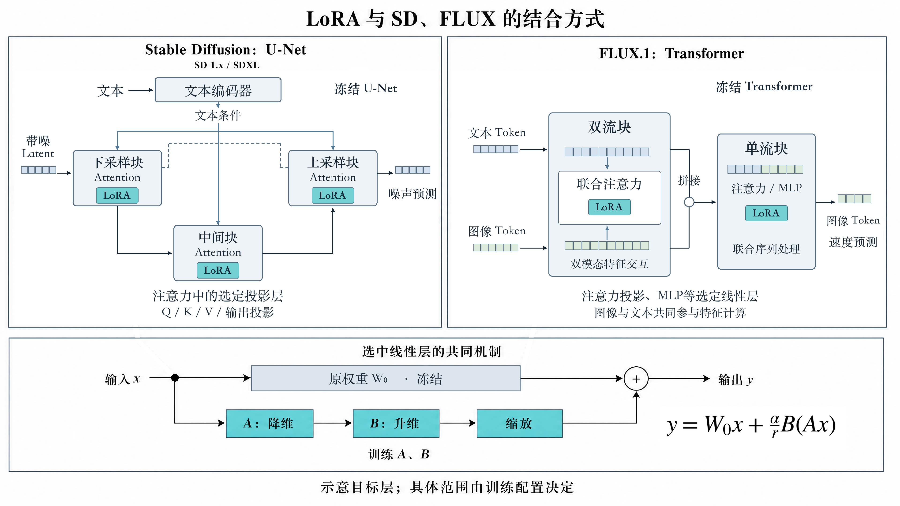

我们以噪声预测模型为例，LoRA模型的训练损失函数为：

$$
\mathcal{L}_{\mathrm{LoRA}} =
\mathbb{E}
\left[
\left\|
\epsilon-
\epsilon_{\theta_0,\phi}(z_t,t,c)
\right\|_2^2
\right], z_t=a_tz_0+\sigma_t\epsilon
$$

其中， $z_0$ 是训练图像的潜变量， $c$ 是文本条件， $\theta_0$ 是冻结的底模参数， $\phi$ 表示各目标层中的LoRA参数； $a_t$ 和 $\sigma_t$ 分别控制信号与噪声强度。

也就是说，对于SD/FLUX模型预训练层的权重为 $W_0\in\mathbb{R}^{d_{out}\times d_{in}}$ 。全参数微调直接优化 $W_0$ ，而LoRA冻结 $W_0$ ，只学习增量 $\Delta W$ ：

$$
W'=W_0+s\Delta W=W_0+\frac{\alpha}{r}BA
$$

其中 $\Delta W = BA$ 通过低秩分解由两个低秩矩阵的乘积组成。 $A\in\mathbb{R}^{r\times d_{in}}$ 、 $B\in\mathbb{R}^{d_{out}\times r}$ ， $r\ll\min(d_{in},d_{out})$ ，**$r$ 就是 $\Delta W$ 这个参数矩阵的秩（Rank，lora_dim）**。 $\alpha$ 是缩放系数， $s=\alpha/r$ 。原矩阵若包含 $d_{out}\times d_{in}$ 个可训练参数，那么LoRA只需要训练 $r(d_{in}+d_{out})$ 个参数。

一般来说，尽管SD/FLUX模型的参数数量很大，但每个细分任务对应的本征维度（Intrinsic Dimension）并不大，**所以我们设置较小的 $r$ 值就能获得一个参数数量远小于SD/FLUX模型的LoRA模型，并在一些细分任务中获得较好的效果**。

例如，某线性层的权重形状为 $1024\times 1024$，全量更新需要 $1,048,576$ 个参数；当 $r=8$ 时，两块低秩矩阵的参数量只有：

$$
8\times1024+1024\times8=16,384
$$

**可训练参数直接缩小约64倍**。

<div align="center">


</div>

上图是LoRA模型训练的示意图。通常来说，对于矩阵 $A$ ，我们使用随机高斯分布初始化，并对矩阵 $B$ 使用全0初始化，使得在训练初始状态下 $BA=0$ 。这样能够保证在训练初始阶段时，SD/FLUX模型的预训练权重完全生效。零初始化的升维矩阵仍然可以接收到非零梯度；它的作用是避免随机适配器在一开始污染底模输出。

到这里可能有读者会问，矩阵 $B$ 既然全是0，为什么还能有效训练？

我们设 $G=\partial\mathcal{L}/\partial W_{\mathrm{eff}}$ ，则低秩参数的梯度为：

$$
\frac{\partial\mathcal{L}}{\partial B}=sGA^\mathsf{T},
\qquad
\frac{\partial\mathcal{L}}{\partial A}=sB^\mathsf{T}G
$$

当初始 $B=0$ 、 $A\neq0$ 时，新增分支输出为0，初始模型输出与底模一致。 $B$ 通常能够获得非零梯度，因此可以开始学习。 $A$ 在首次反向传播中的这一梯度为0； $B$ 更新后， $A$ 通常也能获得非零梯度。如果 $A、B$ 都初始化为0，两者通过该分支获得的梯度都会为0，学习无法正常启动。

在具体训练时，扩散模型根据带噪图像、时间步和文本条件预测噪声。预测误差经过网络反向传播，但优化器只更新开放训练的LoRA参数。随着训练进行，低秩分支逐步改变模型处理这些条件和视觉特征的方式，使其去噪结果更符合训练任务中的主体、风格或材质特征。

同时，经过预训练的AIGC大模型已经具备“通用知识”，已经学到了语言、图像等领域的通用底层规律（比如语义理解、视觉特征提取）。很多AIGC细分领域的目标需求本质上并不是“重新学习所有知识”，而是**在通用知识的基础上，注入任务特定的信息**（比如让SD/FLUX生成特定风格的图像）。**这些“任务特定信息”往往只需要对原始参数做很小的调整，且这种调整可以被低秩矩阵近似表示**。


<h2 id="q-003">面试问题：LoRA通常注入扩散模型中U-Net、DiT和Text Encoder的哪些位置？</h2>

**难度评分：⭐⭐⭐⭐ (4/5)  |  考察频率：⭐⭐⭐⭐⭐ (5/5)**

LoRA通常接在模型内部已有的参数层上。对于线性层，它保留原有权重，在旁边增加可训练的低秩分支，两路输出相加。选择注入位置时，需要依次确定模型组件、网络深度和块内的目标层：同样是训练注意力LoRA，只覆盖部分Cross-Attention，与覆盖整个主干的注意力投影，参数范围和适配能力都有明显差别。

在经典Stable Diffusion系列的U-Net中，LoRA通常注入Attention模块的 $W_q$、 $W_k$ 、 $W_v$ 和输出投影 $W_o$ ，除了Cross-Attention和Self-Attention，也可以覆盖前馈网络层和部分卷积层。只训练Cross-Attention或者Self-Attention成本较低、语义绑定较强；扩大到前馈网络层和卷积层后，模型对局部纹理、空间结构与风格的表达能力通常更强，但训练参数太多也可能会导致过拟合。

下图是LoRA在U-Net、DiT和Text Encoder架构中的常见注入位置：

<div align="center">


</div>

在SD 3的MMDiT中，图像与文本分别经过各自的特征变换，再通过联合注意力交换信息。LoRA可以接在图像侧和文本侧的注意力投影中，也可以扩展到前馈层。FLUX系列同时包含双流DiT块与单流DiT块。双流块分别处理图像、文本特征并进行交互，单流块则处理合并后的序列，LoRA可以在这些模块中进行接入。

文本编码器将提示词转换为生成主干使用的条件特征。对其中的注意力投影或前馈层训练LoRA，会改变文本条件的表示方式，强化提示词与新概念之间的语义绑定。但也更容易让概念依赖特定词形，或者破坏原有文本空间。人物、风格或概念LoRA并不必然需要训练文本编码器。当底模已经能够表达相关提示词时，冻结文本编码器、只训练生成主干即可。

下表汇总了LoRA接入不同模型组件的差异与特点：

<div align="center">

| 模型组件 | 常见LoRA注入位置 | 主要改变的计算 |
|---|---|---|
| 交叉注意力 | Q、K、V与输出投影 | 图像特征如何匹配、读取和整合文本条件 |
| 自注意力 | Q、K、V与输出投影 | 图像不同位置之间的特征交互 |
| 前馈与卷积模块 | 前馈线性层、实现支持的卷积层 | 通道变换与局部空间特征处理 |
| 外部文本编码器 | CLIP、T5中实现支持的注意力与前馈投影 | 输入生成主干之前的文本条件表示 | 

</div>


<h2 id="q-004">面试问题：LoRA在AIGC图像创作领域有哪些主流应用场景？</h2>

**难度评分：⭐⭐⭐ (3/5)  |  考察频率：⭐⭐⭐⭐⭐ (5/5)**

LoRA在图像创作中的常见应用场景，是将需要反复使用的主体特征、视觉风格或任务能力，适配到已有AIGC图像创作大模型中。主要可以分为主体个性化、风格与概念适配、垂直领域适配和专项任务适配四类。

这些类别按主要训练目标划分，同一个LoRA可能同时学到主体、风格和领域特征。例如，用某个品牌的产品广告图训练LoRA，模型可能同时记住产品外观、布光和背景。**训练前需要先明确：哪些特征应该保留，哪些因素应该允许变化。**

我们以一组产品海报为例，产品LoRA可以帮助维持产品外观，风格LoRA可以统一视觉表达，布局或结构条件约束产品的位置与轮廓，文字与Logo则根据精度要求单独排版或合成。多个LoRA组合时，还需要检查外观与风格是否互相干扰。

### 1、主体个性化：人物、角色、宠物与产品

主体LoRA学习的是某个具体对象的可辨识外观，常见用途包括AI写真、角色立绘、宠物插画和商品场景图等任务。以人物写真为例，创作者希望脸部特征保持一致，同时能够改变服装、背景、光照和镜头。主体LoRA结合AIGC图像创作大模型，使其在不同提示条件下仍能表现出目标人物的特征。

这类应用需要处理好主体与环境的关系。如果训练照片总是同一套衣服、同一个背景，模型可能把这些内容一起当作主体特征。对于真人写真，服装通常需要能够替换；对于具有固定造型的IP角色，服饰和配件又可能属于必须保留的身份标志。因此，是否保留某个特征，要由实际创作任务决定。

产品LoRA同样可以用于外观复用，例如让同一款鞋、香水瓶或家具出现在不同展示场景中，但产品往往还有更严格的细节要求。**LoRA能够学习外观特征，并不保证Logo、文字、接口数量和细小结构逐项准确。** 对这些内容要求较高时，可以结合参考图、结构控制、局部编辑，或保留原始产品素材再生成周围环境。

主体保持与空间控制也需要分别考虑。人物LoRA可以帮助生成结果保持身份特征，指定姿态则通常还需要骨架等条件；服装LoRA可以学习某类服饰外观，虚拟试衣还要处理人体结构、衣物变形、遮挡和原人物保留，不能仅靠服装LoRA完成整条链路。

### 2、风格与概念适配：复用画风、材质和光照表现

风格LoRA常用于系列插画、游戏美术、品牌视觉和摄影创作等任务，学习对象包括线条、笔触、配色、明暗关系及构图倾向。例如，一套绘本需要同时绘制人物、动物和建筑，创作者可以使用同一风格LoRA，使不同内容保持相近的视觉风格表达。

**风格是否能够脱离训练素材中的具体主体，是这类应用的重要判断依据。** 如果更换提示词后仍然反复生成训练集中的人物或背景，说明内容与风格发生了较强绑定，就需要优化训练数据和训练参数，进行优化改进。

除了完整画风，也可以适配更具体的视觉概念，如刺绣纹理、陶瓷质感、金属表面或某类摄影布光等，供不同主体复用。动作、镜头和构图概念也可以通过LoRA学习，但它们主要改变相关表现出现的倾向。

### 3、垂直领域适配：学习一类创作任务的共同规律

领域LoRA面向一类图像中反复出现的对象和表现方式。商品摄影可能具有稳定的拍摄角度、布光和展示习惯；游戏道具图可能要求统一的视角、轮廓表达与背景处理；建筑效果图则涉及特定的空间、材质和摄影表达。训练希望提高模型生成这类内容的稳定性，覆盖领域内的多个对象与场景。

它与主体、风格适配存在交集，但关注范围不同。训练某一款椅子的外观，主要属于主体个性化；让多种家具都采用统一的商业摄影方式，则可能同时涉及风格与领域适配。领域数据需要保留足够的对象和场景变化，否则模型容易将某个固定模板当作整个领域的规律。

领域适配还应区分视觉表现与专业规则。建筑图看起来合理，并不代表满足建筑规范；工业设计概念图具有可信的材质和结构外观，也不代表可以直接制造。LoRA可以帮助生成候选方案，规则检查与工程验证仍需由相应工具和专业流程完成。

### 4、专项任务适配：少步生成与特定编辑能力

LoRA也可以承载专门训练得到的生成能力。[LCM-LoRA](https://arxiv.org/abs/2311.05556)通过一致性蒸馏，将适合少步生成的参数变化保存为LoRA权重，适用于快速预览和交互创作。这类适配器需要与兼容底模、调度器和采样设置配合使用。


<h1 id="q-005">2.在AIGC图像创作领域中，LoRA模型有哪些特性与优势？</h1>

<h2 id="q-006">面试问题：LoRA与全参数微调相比，训练和推理成本有什么差异？</h2>

**难度评分：⭐⭐⭐⭐ (4/5)  |  考察频率：⭐⭐⭐⭐⭐ (5/5)**

我们**在使用LoRA技术后，会给SD/FLUX等AIGC图像创作大模型的微调训练和前向推理的成本带来哪些变化呢？**

### 1、 微调训练阶段

对于一个形状为 $d_{\mathrm{out}}\times d_{\mathrm{in}}$ 的线性层，全参数微调需要更新整个权重矩阵；LoRA保留原权重 $W_0$ ，只训练两个较小的矩阵 $A$ 和 $B$ ：

$$
W=W_0+\frac{\alpha}{r}BA
$$

其中， $A\in\mathbb{R}^{r\times d_{\mathrm{in}}}$ ， $B\in\mathbb{R}^{d_{\mathrm{out}}\times r}$ 。两种方式的可训练参数量分别为：

$$
N_{\mathrm{full}}=d_{\mathrm{out}}d_{\mathrm{in}},
\qquad
N_{\mathrm{LoRA}}=r(d_{\mathrm{in}}+d_{\mathrm{out}})
$$ 

**例如，一个 $1024\times1024$ 的线性层包含1,048,576个权重参数；当Rank为8时，LoRA的两个矩阵合计只有16,384个参数，是原来的1/64。**

训练显存可以粗略拆成模型权重、参数梯度、优化器状态、激活与临时工作区几部分。

**同时通过LoRA技术进行训练，还能降低训练显存**。训练显存可以粗略拆成模型权重、参数梯度、优化器状态、激活与临时工作区几部分。通过LoRA技术进行训练时，冻结的底模权重不再需要对应的参数梯度和优化器状态，但底模权重本身仍然需要完成前向计算，参与反向传播计算，并计算必要的中间特征。

以线性层为例，全参数微调的反向传播通常需要计算权重梯度，并在必要时计算输入梯度。LoRA训练可以省去冻结权重的梯度计算，但仍要计算低秩分支的梯度，以及继续向前传递所需的输入梯度。

除此之外，**因为LoRA模型是在SD/FLUX模型的全参梯度基础上增加了“残差”梯度，整体上计算量会比SD/FLUX模型的全参微调略大**。

训练数据方面，LoRA只需要20-30张的小规模训练数据，即可学习获得较好的训练效果。在其他超参数一致的情况下，与SD/FLUX系列模型全参训练相比，**LoRA模型训练速度更快**。因为训练过程中只更新LoRA模型对应的参数，无需对SD/FLUX模型权重进行更新；同时由于更新的参数量大幅减少，所以数据传输的通信时间也减少了。

### 2、 前向推理阶段

微调训练完成后，在推理阶段需要将LoRA权重加载到底模上，目前常用的加载方式有“动态加载”和“权重融合”两种：

  - **动态加载**：前向计算同时执行底模原层与LoRA分支，保留随时切换和调权能力，但会增加少量计算、显存管理的开销。
  - **权重融合**：预先计算 $W'=W_0+sBA$ 并写回底模权重，层结构与原模型一致，理论上不增加该层推理计算；代价是无法对这个LoRA再进行权重调整和卸载。

下图中生动展示了“动态加载”和“权重融合”两种加载方式：

<div align="center">


</div>

我们先来看“动态加载”方式，在推理过程中需要同时计算原层与LoRA。

对输入特征 $x$ ，前向计算为：

$$
y=W_0x+sB(Ax),
\qquad s=\frac{\alpha}{r}
$$

相较于原层的 $W_0x$ ，这里多了低秩分支的两次矩阵乘法、缩放和相加。由于Rank通常远小于原层维度，新增计算量往往不大。

这种方式便于切换LoRA模型，调整LoRA作用强度。代价是每次经过目标层时，都需要执行相应分支。对于需要反复调用生成主干的扩散采样，这部分开销也会随网络调用次数累积。

而提前“权重融合”的方式，推理过程中可以使用普通权重计算。对于可合并的标准LoRA，可以预先计算：

$$
W_{\mathrm{fused}}=W_0+sBA
$$

之后直接执行：

$$
y=W_{\mathrm{fused}}x
$$

在相同精度和推理实现下，融合后的目标层与原层形状一致，不再需要独立计算A、B分支。**总体参数量、显存占用、推理耗时都是不变的，整个推理成本是没有增加**。


<h2 id="q-007">面试问题：如何评价一个人物、风格或概念LoRA的整体质量？</h2>

**难度评分：⭐⭐⭐ (3/5)  |  考察频率：⭐⭐⭐⭐⭐ (5/5)**

评价一个LoRA的整体效果，需要判断它能否在约定的使用范围内，稳定保留目标特征，同时完成不同的创作要求。

我们以人物LoRA为例，训练照片大多是室内正面照，生成相似的室内正面照只能说明模型具备一定的还原能力。进一步要求人物换上指定服装、出现在新的环境中，或者改变表情和拍摄角度，才能观察它是否学到了可以重复调用的人物特征。风格和概念LoRA也需要经过类似的检验：目标特征应该能够进入新的内容，而不总是连带复现训练图片里的主体和背景。

因此，整体评价工作可以按照“确定目标—选择指标—组织对照—汇总结果”的顺序展开。

**我们先明确目标特征和允许变化的内容**。不同类型的LoRA，评价重点并不相同。开始测试之前，应先区分哪些特征必须保持，哪些属性需要响应提示词变化，具体如下表所示：

<div align="center">

| LoRA类型 | 需要保持的目标特征 | 应重点检验的变化能力 |
|---|---|---|
| **人物LoRA** | 人物身份及具有辨识度的面部特征；对于特定角色，还可能包括预先约定的标志性外观 | 在身份成立的前提下，改变表情、姿态、镜头、服装、背景和光照 |
| **风格LoRA** | 配色、线条、笔触、材质表现、明暗组织等视觉表达方式 | 将同一风格应用到人物、动物、建筑、静物等不同内容，检查是否夹带训练图中的固定主体 |
| **概念LoRA** | 事先定义的概念属性，例如特定材质的纹理与透光感，或某类结构的关键形态 | 将概念应用到不同对象、视角和场景，检查关键属性是否仍然成立，以及无关内容是否受到影响 |

</div>

接着，我们可以从五个维度判断LoRA的整体质量。

1. **特征保真**：即LoRA模型是否准确学到了需要保持的内容。人物LoRA可以结合人脸识别特征相似度与人工核验。常见做法是对参考照片和生成图中的人脸进行检测、对齐，再通过同一人脸识别模型提取特征，计算余弦相似度。它比较的是特征向量的接近程度，可以辅助判断身份是否一致。风格LoRA则需要结合参考图，从配色、线条、笔触和材质表现等方面进行人工评价，并观察这些特点能否在不同内容上保持一致。整图相似度容易同时受到主体和构图影响，不能直接当作纯粹的风格分数。
2. **提示词可控**：保持目标特征的同时，能否执行新的创作要求。在进行评估时，应将提示词拆成可以检查的要求。例如，“指定人物穿着白色衬衫，在户外呈现侧面视角”，至少包含身份、服装、场景和视角四项要求。人物很像，但仍穿着训练照片中的黑色外套，说明提示词无法控制服装的特征。可以先采用单一属性变化，例如只改变服装或背景；再增加多项组合要求。这样更容易观察模型在不同提示词指令下的效果。
3. **场景泛化**：目标特征能否在训练中没有出现过的分布中稳定生成。人物LoRA可以测试未见过的服装、姿态和环境组合；风格LoRA可以测试训练集中较少出现的主体类别；材质类概念LoRA则可以改变承载材质的对象、光照和观察角度。例如，某个陶瓷质感LoRA的训练图主要是杯子。将它应用于花瓶、雕塑或灯具，可以检验它是否学到了材质表现，还是主要记住了杯子的外形。
4. **图像质量**：评价图像生成的整体质量。需要检查人物结构、局部纹理、边缘衔接、光照关系，以及任务要求中的文字和其他细节。LoRA提高目标特征强度的同时，也可能引入过度锐化、重复纹理、色彩偏移或局部畸变。
5. **使用稳定性**：LoRA效果是否依赖极窄的参数和环境。在推荐权重附近测试若干档位，观察目标特征、提示词响应与画质如何变化。如果只有某个很窄的权重区间能够正常生成，或者稍微调整设置就频繁失效，实际使用中就需要更精细的配置和筛选。


<h2 id="q-008">面试问题：如何调节LoRA权重？多个LoRA同时加载时如何正确组合？</h2>

**难度评分：⭐⭐⭐⭐ (4/5)  |  考察频率：⭐⭐⭐⭐⭐ (5/5)**

LoRA权重控制的是LoRA模型对底模型参数施加多大的改动。调节时，需要同时观察目标特征、提示词响应和画面质量；多个LoRA一起使用时，还需要检查这些改动能否在同一次生成中相互配合。

我们可以先从单个LoRA的计算方式开始学习理解，对于标准LoRA，一个线性层的有效权重可以写成：

$$
W'=W_0+\lambda\Delta W,
\qquad
\Delta W=\frac{\alpha}{r}BA
$$

其中， $W_0$ 是底模型原有权重， $A$ 和 $B$ 是LoRA训练得到的低秩矩阵， $r$ 是秩， $\alpha/r$ 是标准LoRA使用的缩放因子。推理时调节的 $\lambda$ ，进一步控制整个参数增量的作用强度。

不同的推理权重控制LoRA的作用强度：
- $\lambda=0$ ：关闭这一部分 LoRA 增量的作用。
- $0<\lambda<1$ ：相对默认强度减弱该增量。增加 $\lambda$ 通常会增强目标特征，但并不保证线性改善。
- $\lambda=1$ ：按当前加载实现使用默认强度，不代表图像质量达到最优。
- $\lambda>1$ ：进一步放大增量，可能强化目标特征，也可能带来结构变形、颜色偏移或提示词响应下降。

下图也生动展示了不同LoRA权重变化对图像生成效果影响：

<div align="center">


</div>

<div align="center">

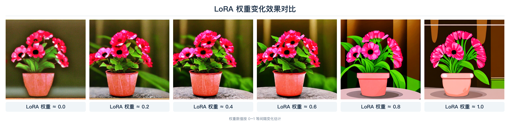

</div>

对于同时作用于某个目标层的多个标准 LoRA，基本组合方式为：

$$
W'=W_0+ \sum_{i=1}^{N}\lambda_i\Delta W_i,
\qquad
\Delta W_i=\frac{\alpha_i}{r_i}B_iA_i
$$

每个LoRA保留自己对应的A、B参数矩阵，先形成参数增量，再按各自权重相加。

我们以人物LoRA和风格LoRA为例：

$$
W'=W_0+0.8\Delta W_{\mathrm{person}} + 0.3\Delta W_{\mathrm{style}}
$$

这个式子表示按指定系数叠加两个参数增量，它既不要求 0.8 + 0.3 = 1，也不保证人物效果一定比风格效果更强。

**不能将不同 LoRA 的 A 矩阵直接平均、B 矩阵也直接平均，再把两者相乘，作为上述加权和的替代**.这样会产生 $B_1A_2$ 、 $B_2A_1$ 等交叉项，破坏各个适配器原本训练得到的配对关系。不同LoRA的Rank也不必相同，只要各自的 $B_iA_i$ 对应同一个目标层，具有相同的输出维度和输入维度，这些完整增量在数学上就可以相加。


<h2 id="q-009">面试问题：多LoRA推理中的Merge、Switch和Composite策略有什么区别？(进阶)</h2>

**难度评分：⭐⭐⭐⭐ (4/5)  |  考察频率：⭐⭐⭐⭐ (4/5)**

多个LoRA共同参与图像创作时，除了设置各自的权重，还需要决定它们如何进入组合。

例如，一次创作同时使用人物、服装和背景 LoRA。我们可以让三个适配器在每一步共同生效，也可以让它们按顺序轮流参与，还可以让它们分别对当前画面状态给出预测，再汇总这些预测。Merge、Switch 和 Composite 的区别，就在于组合发生的位置和每一步的计算方式。

下表展示了三种组合方式的异同，表中 $K$ 为参与组合的LoRA数量：

<div align="center">

| 策略 | 组合发生在哪里 | 每个采样步怎样计算 | 主要代价与局限 |
|---|---|---|---|
| **Merge** | 模型参数空间 | 多个LoRA增量共同作用，完成一组主干预测 | 实现直接；适配器之间的影响会同时进入网络，可能出现特征干扰 |
| **Switch** | 采样过程的时间顺序 | 当前启用一个LoRA，按设定间隔循环切换 | 每步保持一组主干预测；结果对切换间隔、顺序和总步数敏感 |
| **Composite** | 主干预测结果空间 | 每个LoRA分别完成预测，汇总后更新一次潜变量 | 通常需要约 $K$ 组预测；预测平均仍可能削弱相互矛盾的特征 |

</div>

下图通俗易懂的展示了Merge、Switch和Composite策略的核心思想：

<div align="center">

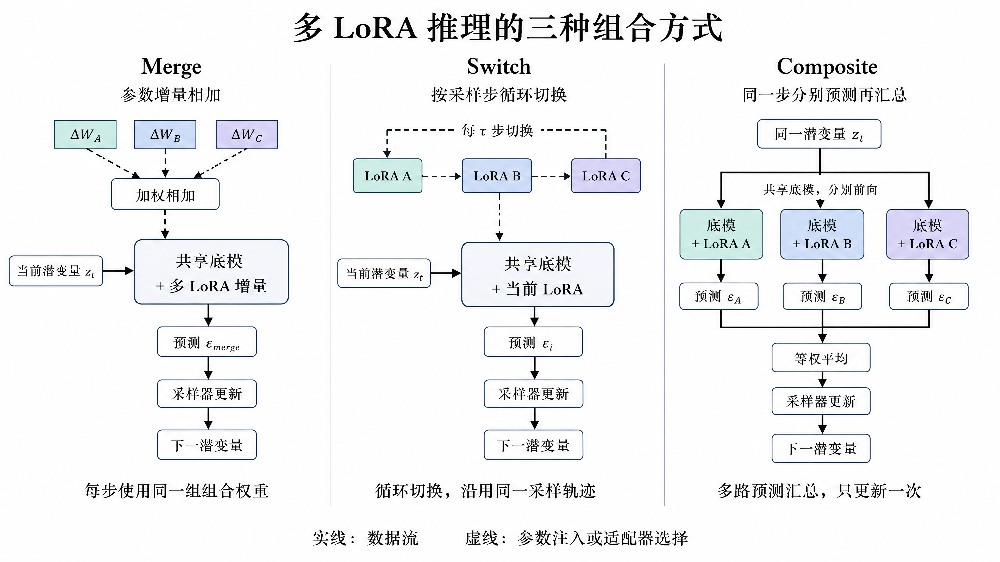

</div>

### 1、 Merge：让多个LoRA在同一次主干预测中共同生效

Merge沿用上一问介绍的参数增量相加方式。对于一个目标层：

$$
W'=W_0+\sum_{i=1}^{K}\lambda_i\Delta W_i
$$

其中， $\Delta W_i$ 是第 $i$ 个 LoRA 对该层提供的完整参数增量，已经包含相应的低秩矩阵乘积与缩放； $\lambda_i$ 控制其推理强度。

生成开始前确定这些系数，之后每个采样步都使用相同的组合关系。人物、服装和背景LoRA会在同一次网络计算中共同影响当前潜变量的预测结果。

这种方式容易部署。可以保留多个LoRA，在前向计算时累加各自的分支输出；对于支持融合的标准LoRA，也可以提前将增量写入模型权重。两者对应相同的基本组合思路，是否提前融合属于实现选择。

Merge的主要问题来自多个参数增量共同进入网络后的相互影响。一个服装LoRA如果同时学到了训练人物的脸型或姿态，可能在引入服装特征时改变人物LoRA希望保持的身份。即使两个LoRA单独使用都正常，也不能直接推导出组合后仍然正常。

这种影响没有固定方向：兼容的增量可以有效配合，不兼容的增量则可能造成主体特征减弱、局部结构异常或背景偏移。判断依据应当是组合后的结果，而不是适配器数量本身。

### 2、 Switch：在同一条采样轨迹中循环切换LoRA

Switch每次只启用一个参与组合的LoRA，经过若干采样步后切换到下一个，并在整个生成过程中重复这个循环。

假设有A、B、C三个LoRA，每个连续运行两步，启用顺序就是：

$$
A,\ A,\ B,\ B,\ C,\ C,\ A,\ A,\ldots
$$

设采样步编号为 $n$ ，LoRA数量为 $K$ ，每次连续启用的步数为 $\tau$ ，则当前适配器编号可以写成：

$$
i_n=\left\lfloor
\frac{(n-1)\bmod(K\tau)}{\tau}
\right\rfloor+1
$$

该步目标层的有效权重为：

$$
W'_n=W_0+\lambda_{i_n}\Delta W_{i_n}
$$

这里的 $n$ 表示执行到第几个采样步，实际噪声时间步由采样器给出，二者需要区分。

**Switch保留同一份不断更新的潜变量**。A完成若干步以后，B会接着处理A留下的结果；切换到C时，C处理的又是前两者共同影响后的状态。每个适配器都可能在后续循环中再次参与生成。

因此，Switch减少了同一次前向中的多LoRA参数叠加，但不同适配器仍会通过采样轨迹相互影响。后启用的适配器可能补充已有特征，也可能改变前面形成的主体和构图。

切换设置需要结合采样过程选择：
- 间隔过短，预测方向频繁改变，可能影响生成稳定性；
- 间隔过长，在有限采样步数内，一些适配器可能参与不足；
- 起始顺序不同，早期形成的布局和主体状态可能不同，后续结果也会受到影响。

论文中的实验发现，在其测试设置下，每五步切换一次、优先启用人物LoRA表现较好。这个结果可以作为实验参考，但不能直接推广到其他底模和步数配置。特别是在四步、八步等少步生成中，需要重新设计切换间隔，确保各个适配器有机会参与。

### 3、 Composite：让各个LoRA预测同一个状态，再汇总更新

Composite在每个采样步都使用全部LoRA，但分别计算它们的预测。

设当前潜变量为 $z_t$。人物、服装和背景三个分支都读取同一个 $z_t$ 、同一个时间步以及相同的文本条件。各分支分别启用对应的 LoRA，得到预测结果，再将这些结果汇总，交给采样器完成一次更新。

以论文使用的噪声预测与CFG形式为例，第 $i$ 个适配器对应的引导预测为：

```math
g_i(z_t,t,c)=\epsilon_{\theta_i'}(z_t,t,\varnothing)
+s\left[\epsilon_{\theta_i'}(z_t,t,c)-\epsilon_{\theta_i'}(z_t,t,\varnothing)\right]
```

其中：
- $\theta_i'$ 表示底模启用第 $i$ 个 LoRA 后的有效参数；
- $c$ 是文本条件， $\varnothing$ 表示无条件分支；
- $s$ 是 CFG 强度。

采用等权组合时：

$$
\bar g(z_t,t,c)=\frac{1}{K}\sum_{i=1}^{K}g_i(z_t,t,c)
$$

采样器使用 $\bar g$ 更新当前潜变量，然后进入下一个时间步。

这里最容易误解的是计算顺序。**各分支必须从同一个当前状态出发，全部预测完成后再更新状态**。如果人物分支先修改潜变量，服装分支再读取修改后的结果，就已经改变了Composite的基本计算方式。

另一个重要区别是，每个分支的预测都需要底模型参与。LoRA 提供的是模型参数增量，不能脱离底模独立输出完整的去噪预测。实现时可以共享基础权重、逐个启用适配器，并不要求在显存中复制 $K$ 份完整模型。

Composite 保留了各个适配器独立参与网络计算的过程，能够减少多适配器在同一次前向中直接混合参数带来的部分问题。但这些分支最终仍需共同决定一次更新方向：
- 如果它们给出的预测能够配合，组合可能改善元素呈现；
- 如果它们对相同区域提出不同要求，平均结果可能削弱某个特征；
- 如果某个适配器本身存在概念绑定，Composite 也不会自动将绑定关系消除。
所以，预测平均的作用需要根据任务验证，不能直接等同于消除误差或完整保留全部特征。


<h2 id="q-010">面试问题：LoRA的离线融合和差分提取哪些特点？(进阶)</h2>

**难度评分：⭐⭐⭐⭐ (4/5)  |  考察频率：⭐⭐⭐⭐ (4/5)**

Rocky在本问答中向大家通俗易懂的讲解LoRA模型的融合和提取方式，**这主要是为了获得全新的特定效果的LoRA模型**。

**在2022年AIGC时代元年，Stable Diffusion + LoRA的模型融合方法在开源社区一度火爆非凡**。很多开源社区的AI绘画爱好者和AI绘画设计师对Stable Diffusion每一层的权重融合方式都进行了详细的实验与测试，**总结了很多广为流传的实验经验，比如SD的哪几层控制主体、哪几层控制颜色、哪几层控制风格、哪几层控制手型等**。

一晃多年过去了，SD系列也连续发布了SD 2.x、SDXL、SD 3等大模型，同时FLUX.1、FLUX.1 Kontext、FLUX.2也相继发布，**虽然我们不能将SD 1.x 的分层融合经验生搬硬套到最新的模型上，开源社区也没有更多精力对每一款AI绘画大模型进行如此详细的消融实验与测试**，但是SD 1.x 的分层融合经验还是给我们提供了很多灵感与认识AIGC大模型的不同视角，**以及会让我们想起AIGC元年大家的热情与兴奋，不知不觉也让我们哑然失笑**。

到目前为止，LoRA模型的主流融合方式一共有以下两种：

1. LoRA+LoRA的全融合/分层融合来获得新LoRA模型。
2. SD/FLUX模型与LoRA的全融合/分层融合来获得新LoRA模型。

除了LoRA模型的融合，**我们还能通过提取的方式**，在SD和FLUX系列模型中提取LoRA模型：

1. 两个SD/FLUX模型进行差分提取新LoRA模型。
2. 两个LoRA差分提取新LoRA模型。

同一底模、同一架构、同一参数命名和相近训练链路下，LoRA A与LoRA B可以做加权和或差分：

$$
\Delta W_{new}=\beta\Delta W_A+(1-\beta)\Delta W_B
$$

如果要把一个完整权重差 $W_1-W_0$ 提取成Rank为 $r$ 的LoRA，可以对差分矩阵做截断SVD：

$$
W_1-W_0\approx U_r\Sigma_rV_r^\top=B A
$$

下图为LoRA权重融合与差分提取流程示意图：

<div align="center">


</div>


<h1 id="q-011">3.在AIGC图像创作领域中，LoRA模型的微调训练流程包含哪些核心环节？</h1>

<h2 id="q-012">面试问题：介绍一下LoRA从任务定义到部署验证的完整训练流程</h2>

**难度评分：⭐⭐⭐⭐ (4/5)  |  考察频率：⭐⭐⭐⭐⭐ (5/5)**

一次完整的LoRA训练闭环至少包含任务定义、底模型选择、数据准备、训练参数配置、训练执行与监控、离线评测和部署验证七个环节。

1. **定义任务**：我们首先确定LoRA的学习目标。要判断学习目标是人物、风格还是抽象概念，明确学习目标对于整个LoRA训练流程至关重要。
2. **底模型选型**：底模决定了LoRA可以利用哪些已有表征和生成能力。选型时，应先用代表性提示词进行基础测试，观察模型（SD/SDXL/SD 3/FLUX系列模型）在不加载LoRA时的表现。**当我们在训练LoRA模型时，需要根据任务场景选择合适的预训练底模型，比如二次元、卡通、真人、风格、概念、国风、科幻、设计、游戏、摄影、风景、建筑、服装、动物、3D、2.5D等。** 如果一时无法找到合适的底模型，可以使用官方的SD 1.5、SD 2.1、SD XL、SD 3、FLUX系列做为底模型，其泛化性能较好。
3. **构建训练数据**：数据准备需要围绕第一步确定的目标展开。人物数据应保持身份一致，并适当覆盖不同表情、姿态、服装和光照；风格数据需要有不同内容主体，避免模型把某个固定角色当成风格。Caption标签应准确描述图像内容，并与推理时希望控制的属性保持一致。例如，希望人物LoRA能够换装，就需要在数据变化和标注中体现服装信息。
4. **训练参数配置**：训练配置首先要明确哪些参数可以更新。标准LoRA通常冻结底模型原有权重，在选定模块中加入可训练的低秩参数。是否训练文本编码器中的LoRA，需要结合任务和工具支持情况决定，不能默认所有模型都采用相同配置。同时Rank、Alpha、学习率、有效 Batch Size、训练步数和分辨率，应作为相互关联的设置一起考虑。可以从已有可靠配置开始建立基线，再根据验证结果调整，不必一开始同时尝试大量参数组合。
5. **训练执行与监控**：一次训练更新流程包括：读取样本 → 编码图像与条件 → 构造带噪输入 → 主干预测 → 计算损失 → 反向传播 → 更新LoRA参数。训练过程中，Loss主要用于观察优化是否正常，但图像生成质量还需要通过实际生成结果判断。我们可以定期使用固定提示词与种子生成验证图，观察目标特征、可控性和画质怎样随训练推进而变化。
6. **离线评测**：训练结束后，应将多个checkpoint权重放到相同条件下比较，选择合适的checkpoint权重与推理配置。评价时，重点观察任务定义中的要求是否同时成立。例如，人物身份保持良好，但换装或换背景失败，仍然不能满足原先约定的使用需求。具体指标和检查方法可以参考前文LoRA整体质量的相关问答内容。
7. **部署验证**：将训练好的LoRA模型部署到生产环境，可以选择动态加载或者提前融合两种方式，并验证图像生成效果。

下图展示了LoRA训练不是一次性的线性流水线。部署验证时如果暴露了身份漂移、特征过拟合或兼容性等问题，需要重新进行优化训练，形成可持续迭代的工程闭环：

<div align="center">

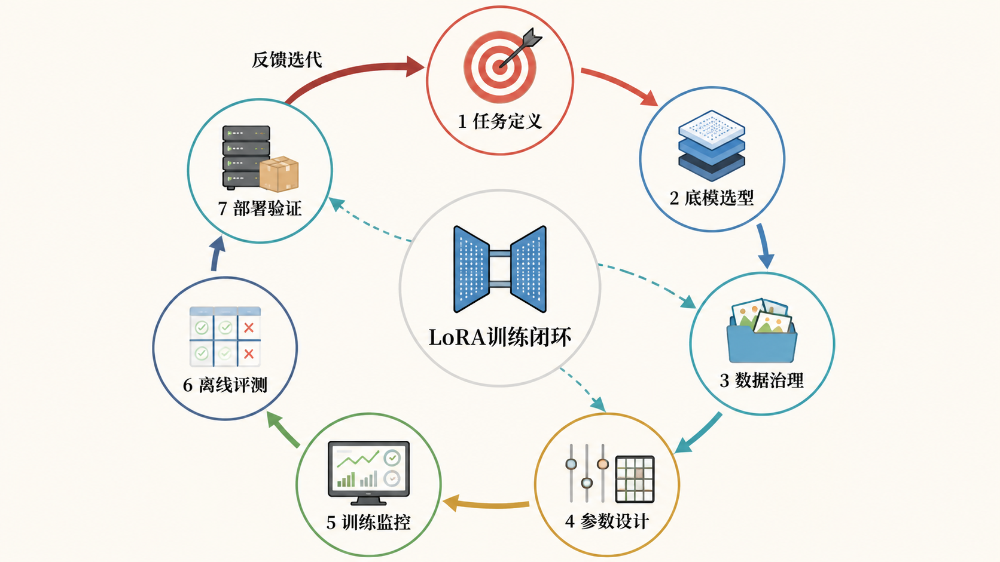

</div>


<h2 id="q-013">面试问题：LoRA训练数据、Caption标签和多分辨率训练应该如何构造和设计？</h2>

**难度评分：⭐⭐⭐⭐ (4/5)  |  考察频率：⭐⭐⭐⭐⭐ (5/5)**

**Rocky认为，LoRA训练只需要小规模数据，这让数据工程显得尤其重要，每一张图片数据和对应标签对LoRA的训练效果都有很大的影响**。

### 1、 LoRA训练数据构造

我们先来看看LoRA训练数据的构造逻辑。在准备数据前，需要先理解清楚任务定义。不同类型的LoRA，数据中应该保持和变化的内容并不相同，如下表所示：

<div align="center">

| LoRA类型 | 需要稳定保持的特征 | 训练数据中应该覆盖的变化 |
|---|---|---|
| 人物LoRA | 身份、面部结构、发型、标志性外观 | 姿态、表情、服装、背景、光照、镜头和构图 |
| 风格LoRA | 配色、线条、笔触、材质、明暗组织 | 人物、动物、建筑、静物等不同内容主体 |
| 概念或材质LoRA | 概念本身的视觉属性 | 不同承载对象、尺度、角度和环境 |

</div>

同时我们还需要对训练数据进行清洗，以下样本通常需要删除或单独处理：

- 严重模糊、过度压缩或主体已经无法辨认的图片；
- 水印、错误文字、异常生成结果和明显的拼接痕迹；
- 人物身份错误、产品型号混杂或关键结构被遮挡的图片；
- 同一张图片经过轻微缩放、调色或裁剪后形成的近重复图片；
- 裁剪后已经无法表达原始Caption内容的图片。

### 2、 LoRA训练数据Caption标签构造

Caption的作用，是告诉模型哪些属性应该与文本建立联系。它不是越短越好，也不是写得越详细越好，而是要与任务目标保持一致。例如训练特定人物时，如果所有样本都穿黑衣但Caption从不描述黑衣，模型更容易把服装特征与人物身份ID绑定；若每个微小细节都写入Caption，有限训练信号又会被过度拆散。

一个比较实用的Caption标签可以包含四层信息：
1. 触发词或概念标识，用于绑定人物、产品、风格或特殊概念；
2. 需要稳定保留的主体属性；
3. 希望推理时能够修改的属性；
4. 当前图片中的场景、构图、光照、视角和背景。

例如，人物LoRA可以使用类似下面的结构：<person_token>, portrait of a person, short black hair, wearing a blue jacket, side view, studio light, gray background。

其中，<person_token>用于绑定人物概念；服装、视角、光照和背景则描述当前图片中的可变化条件。实际使用时应根据数据集和底模的词表选择稳定、不会与常见语义冲突的触发词。

### 3、 LoRA的训练数据分辨率和长宽比分桶策略

训练分辨率（training resolution）也会对LoRA训练效果产生较大的影响，训练分辨率决定了模型能够看到的空间细节尺度。如果显卡的显存允许，尽量选择大分辨率进行训练。**在较低的分辨率（比如512）下，如果人物的脸部、发饰、服装纹理或产品Logo在训练图中占据的像素很少，低分辨率可能会使这些特征难以学习。**。

当我们**使用大分辨率（比如768、1024等）训练时，LoRA模型能够学习到数据集中的精细特征和细节信息，图片的生成质感、美感以及精细度都会大大增强**。

同时如果基于**单一图像分辨率**（比如1:1）进行训练，就会导致当我们想要**生成不同尺寸分辨率的图像**（比如1:2、3:4、4:3、9:16、16:9等）时，非常容易生成结构崩坏的图像内容。

如下图所示，**为了让所有的数据满足特定的训练分辨率，会进行中心裁剪和随机裁剪等操作，这就导致图像中人物的重要特征缺失：**

<div align="center">

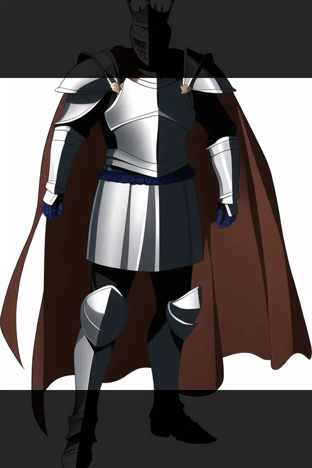

</div>

这上面这种情况下，我们训练的LoRA模型在生成骑士图像的时候，就会出现缺失的骑士特征。

与此同时，**裁剪后的图像还会导致图像内容与标签内容的不匹配**，比如原本描述图像的标签中含有“皇冠”，但是显然裁剪后的图像中已经不包含皇冠的内容了。

为了解决上述问题，长宽比分桶（Aspect Ratio Bucketing）训练策略孕育而生。**长宽比分桶训练策略的本质是多分辨率训练**，是在LoRA模型的训练过程中采用多分辨率而不是单一分辨率，多分辨率训练技术在传统深度学习时代的目标检测、图像分割、图像分类等领域非常有效，在AIGC时代终于有了新的内涵，在AIGC图像创作领域重新繁荣。

那么具体是如何使用长宽比分桶训练策略的呢？**主要通过数据分桶+多分辨率训练两者结合来实现。我们设计多个存储桶（Bucket），每个存储桶代表不同的分辨率（比如512x512、768x768、1024x1024等），并将数据存入对应的桶中。在LoRA训练时，随机选择一个桶，从中采样Batch大小的数据用于多分辨率训练。**

下面Rocky详细介绍一下完整的流程。

我们先对训练数据进行分桶，**这里包含存储桶设计和数据存储两个部分**。

首先我们需要设置存储桶（Bucket）的数量和每个存储桶代表的分辨率。我们定义最大的整体图像像素为1024x1024，最大的单边分辨率为1024。

这时我们以64像素为标准，设置长度为1024不变，宽度以1024为起点，根据数据集中的最小宽度设计存储桶（假设为512），具体流程如下所示：

```python
设置长度为 1024，设置宽度为 1024
设置桶数量为 0
当宽度大于数据集最小宽度 512 时:
    宽度 = 宽度 - 64 （ 960 ）
    那么 （ 960 ， 1024 ）作为一个存储桶的分辨率
    以此类推设计出长度不变，宽度持续自适应的存储桶
```

按照上面的流程，我们可以获得如下的存储桶：

```python
bucket 0 (512, 1024)
bucket 1 (576, 1024)
bucket 2 (640, 1024)
bucket 3 (704, 1024)
bucket 4 (768, 1024)
bucket 5 (832, 1024)
bucket 6 (896, 1024)
bucket 7 (960, 1024)
```

接着我们再以64像素为标准，设置宽度为1024不变，长度以1024为起点，根据数据集中的最小长度设计存储桶（假设为512），按照上面相同的规则，设计对应的存储桶：

```python
bucket 8 (1024, 512)
bucket 9 (1024, 576)
bucket 10 (1024, 640)
bucket 11 (1024, 704)
bucket 12 (1024, 768)
bucket 13 (1024, 832)
bucket 14 (1024, 896)
bucket 15 (1024, 960)
```

最后我们再将1024x1024分辨率作为一个存储桶添加到分桶列表中，从而获得完整的分桶列表：

```python
bucket 0 (512, 1024)
bucket 1 (576, 1024)
bucket 2 (640, 1024)
bucket 3 (704, 1024)
bucket 4 (768, 1024)
bucket 5 (832, 1024)
bucket 6 (896, 1024)
bucket 7 (960, 1024)
bucket 8 (1024, 512)
bucket 9 (1024, 576)
bucket 10 (1024, 640)
bucket 11 (1024, 704)
bucket 12 (1024, 768)
bucket 13 (1024, 832)
bucket 14 (1024, 896)
bucket 15 (1024, 960)
bucket 16 (1024, 1024)
```

完成了分桶的数量与分辨率设计，**我们接下来要做的是将数据集中的图片存储到对应的存储桶中。**

那么，具体是如何将不同分辨率的图片放入对应的桶中呢？

我们首先计算存储桶分辨率的长宽比，对于数据集中的每个图像，我们也计算其长宽比。这时我们将长宽比最接近的数据与存储桶进行匹配，并将图像存入对应的存储桶中，下面的计算过程代表寻找与数据长宽比最接近的存储桶：

```math
\mathrm{image\_bucket}
=
\arg\min_{b\in\mathcal{B}}
\left|\mathrm{bucket\_aspects}(b)-\mathrm{image\_aspect}\right|
```

**如果图像的长宽比与最匹配的存储桶的长宽比差异依然非常大，则从数据集中删除该图像。所以我们最好在数据分桶前将数据进行精细化筛选，增加数据的利用率。**

当 `image_aspect` 与 `bucket_aspects` 完全一致时，可以直接将图片放入对应的存储桶中；当 `image_aspect` 与 `bucket_aspects` 不一致时，需要对图片进行中心裁剪，获得与存储桶一致的长宽比，再放入存储桶中。中心裁剪的过程如下图所示：

<div align="center">

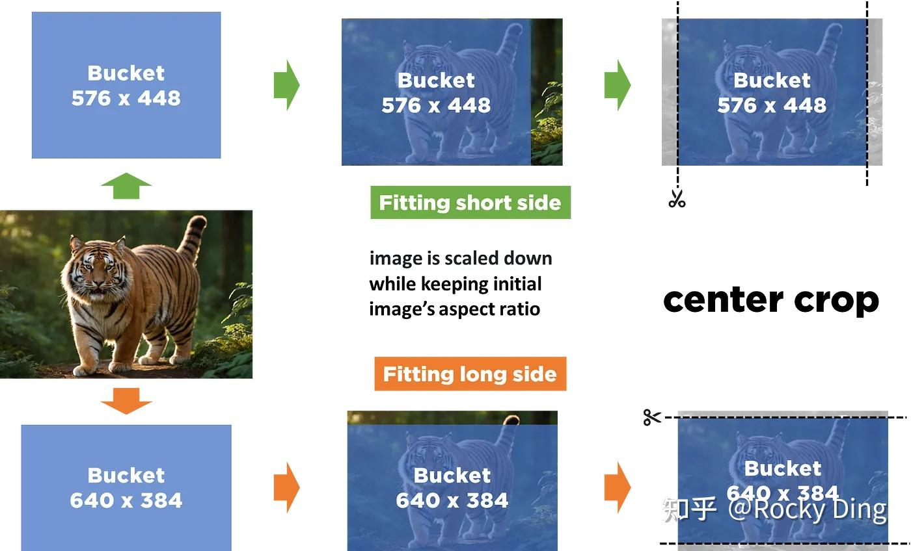

</div>


总的来说，对于图像 $I$ 的宽高比 $a_I$ 和候选Bucket的宽高比 $a_k$，可以选择最接近的Bucket：

$$
k^{*}=\arg\min_{k}\left|a_k-a_I\right|
$$

随后只进行有限缩放和裁剪，并在同一Batch内使用相同空间尺寸。下图展示了长宽比分桶用于LoRA训练的示意图：

<div align="center">


</div>

在完成数据的分桶存储后，接下来Rocky再讲解一下在训练过程中如何基于存储桶实现多分辨率训练过程。

在LoRA模型的训练过程中，我们需要从刚才设计的16个存储桶中**随机采样一个存储桶**，并且**确保每次能够提供一个完整的Batch数据**。当遇到选择的存储桶中数据数量不够Batch大小的情况，需要进行**特定的数据补充策略**。

为了解决上述的问题，**我们需要维护一个公共桶（remaining bucket）**，其他存储桶中的数据量不足Batch大小时，将剩余的数据全部放到这个公共桶中。在每次迭代的时候，如果是从常规存储桶中取出数据，则训练分辨率调整成存储桶对应的分辨率。如果是从公共桶中取出，则训练分辨率调整成设计分桶时的基础分辨率，也就是1024x1024。

同时**我们将所有的存储桶根据桶中数据量进行权重设置，具体的权重计算方式为这个存储桶的数据量除以所有剩余存储桶的数据量总和**。如果不通过权重来选择存储存储桶，数据量小的存储桶会在训练过程的早期就被用完，而数据量最大的存储桶会在训练结束时仍然存在，**这就会导致存储桶在整个训练周期中采样不均衡问题**。通过按数据量加权选择桶可以避免这种情况。


<h2 id="q-014">面试问题：Rank、Alpha、学习率、训练步数和训练目标模块等关键参数应该如何设置？</h2>

**难度评分：⭐⭐⭐⭐ (4/5)  |  考察频率：⭐⭐⭐⭐⭐ (5/5)**

总的来说，在LoRA训练过程中不存在适用于所有任务的固定参数表。Rank、Alpha、学习率、训练步数和目标模块等共同决定了LoRA模型的效果，所以我们必须根据实际情况，进行联合调节。

<div align="center">

| 参数 | 本质作用 | 过小的常见表现 | 过大的常见表现 |
|---|---|---|---|
| Rank $r$ | 增量子空间容量 | 欠拟合、细节不足 | 文件变大、过拟合风险上升 |
| Alpha $\alpha$ | 训练增量缩放 | 更新弱或收敛慢 | 更新过强、对学习率更敏感 |
| 学习率 | 单步更新幅度 | 学习慢、预算内不收敛 | 震荡、失真、遗忘底模能力 |
| 训练步数 | 数据被优化的总次数 | 概念不稳定 | 构图记忆、背景泄漏 |
| 目标模块 | 额外特征注入位置 | 表达能力不足 | 副作用和存储成本增加 |

</div>

接下来，Rocky对每个关键参数的作用与原理都展开讲讲。

**Rank（network_dimension）是LoRA模型的特征维度参数，也就是LoRA进行低秩分解中的秩**。

Rank决定的是低秩增量的容量上限。 对于形状为 $d_{\mathrm{out}}\times d_{\mathrm{in}}$ 的权重矩阵，LoRA使用两个矩阵构造增量：

$$
A\in\mathbb{R}^{r\times d_{\mathrm{in}}},
\qquad
B\in\mathbb{R}^{d_{\mathrm{out}}\times r},
\qquad
\Delta W=BA
$$

其中， $\Delta W$ 的秩最多为 $r$ 。提高Rank可以让增量表达更多变化，但这些额外容量能否转化为有效能力，还取决于数据、训练范围和优化过程。

例如，训练一个底模已经比较熟悉的视觉风格，较低Rank可能就能完成适配；如果需要同时学习多个主体、较复杂的产品结构或较大的领域差异，可能需要更高容量。

实际操作中，可以从对应底模已有的可靠配置开始。例如，将8、16、32作为一轮小范围对照的候选值；如果目标特征仍然不足，再测试更高Rank。这些数字用于组织实验，不构成任务分类标准。判断是否需要增大Rank，至少应先确认：
- 数据确实提供了需要学习的特征；
- LoRA已经注入合适的目标模块；
- 学习率和训练预算足以支持当前配置学习；
- 较高Rank在验证中带来了持续收益。

如果增加Rank只让训练图片复现得更像，却让换背景、换姿态或组合提示词的能力下降，就需要重新检查数据与训练配置。

**同时，Alpha要结合Rank理解，不能当成独立的“细节强度”旋钮。**

在标准LoRA中，加入适配器后的线性层可以写成：

$$
y=W_0x+sB(Ax),
\qquad
s=\frac{\alpha}{r}
$$

这里， $W_0$ 是冻结的底模权重， $A$ 和 $B$ 是可训练参数， $s$ 是LoRA分支的缩放系数。

对于固定的 $A$ 和 $B$ ，提高Alpha会放大LoRA分支的输出。但在重新训练时， $A$ 和 $B$ 本身也会发生变化，因此不能进一步推导出“Alpha越大，细节越多”或“Alpha越大，效果越好”。

理解Alpha时，可以先看几个简单组合：

<div align="center">

| Rank	| Alpha| 	标准LoRA的缩放系数| 
|---|---|---|
| 16| 	16| 	1| 
| 16| 	8| 	0.5| 
| 32| 	16| 	0.5| 
| 32| 	32| 	1| 

</div>

这个表说明，只改变Rank而保持Alpha不变，会同时改变容量与显式缩放系数。

例如，从 Rank=16、Alpha=16 改成 Rank=32、Alpha=16，增量容量提高了，但缩放系数从1降到了0.5。如果训练结果发生变化，就不能把原因全部归结为Rank。

做Rank对照时，可以先保持明确、一致的缩放规则，例如使用 Alpha=Rank，使标准LoRA的显式缩放系数保持为1。这样有助于减少一个干扰因素，但不意味着不同Rank的初始化统计和优化过程完全相同。缩放系数为1，也不代表LoRA分支与底模分支的输出幅度相同。

Alpha=Rank/2同样可以作为一种配置选择，但需要验证。Alpha的核心作用是缩放增量分支，不应把它解释成专门防止浮点下溢的参数。

训练时的Alpha与推理时调节的LoRA权重也应分开理解。Alpha参与训练过程中的分支缩放；推理权重通常是在加载训练结果后，进一步调整该LoRA的影响程度。

在学习率方面，其与底模型架构、训练目标模块、优化器、Batch Size和数据量共同确定。学习率控制参数更新的幅度，学习率过低时，模型可能在预算用完之前仍未学到目标特征；过高时，则可能出现训练不稳定，或者目标特征迅速增强，同时带来颜色、纹理和构图的异常变化。

**根据开源生态的经验，在我们训练SD/SDXL LoRA时，将学习率设置为1e-4就够了。**

比较稳妥的做法，是围绕一个可靠起点做少量对照。例如，在其余配置不变时，测试 5e-5、1e-4 和 2e-4，观察相同训练预算下的验证结果。

若开放Text Encoder训练，通常比DiT、U-Net等扩散模型Backbone更敏感，一般使用更低学习率或更短训练阶段。Rank增大后也不一定要同步增大学习率；更高容量本身已经提高拟合能力。

同时我们还可以**针对LoRA架构中的A矩阵和B矩阵使用不同学习率**。

$$A矩阵的学习率  = B矩阵的学习率 \times ratio$$ 

这样可以达到加速收敛，训练速度提升 1.5-2倍；并且Loss下降更快，提升整体训练效果。

关于训练步数，可以由重复次数、Epoch和Batch Size推导：

$$
\text{steps per epoch}=\left\lceil\frac{N\times R}{B\times G}\right\rceil
$$

其中 $N$ 是图片数， $R$ 是重复次数， $B$ 是单设备Batch Size， $G$ 是梯度累积步数；多卡训练还要计入设备数。

**考虑到我们训练LoRA模型时一般数据量级不会太大（1-300张为主），所以我们可以设置Batch Size为2-6即可。**

**通常来说，我们在训练LoRA模型时，epoch的设置能够保证数据集中的每张图片训练100步即可。**

总的来说，一个稳妥的调参顺序是：先固定优质数据和底模型，用小到中等Rank建立基线；再调学习率与训练轮数等；最后才扩大目标模块或Rank。如果第一轮就同时改变所有参数，最终即使效果变好，也无法知道收益来自哪里。

<h2 id="q-015">面试问题：如何判断LoRA欠拟合、过拟合、概念泄漏和底模型绑定？</h2>

**难度评分：⭐⭐⭐⭐ (4/5)  |  考察频率：⭐⭐⭐⭐⭐ (5/5)**

LoRA模型训练时的训练Loss只能说明当前噪声预测目标在训练样本上是否下降，不能直接说明LoRA是否可用。训练Loss可以帮助判断优化过程是否正常，但最终仍要通过生成结果验证。

- **欠拟合**：欠拟合的主要表现，是在任务范围内，LoRA仍然难以稳定表达需要学习的特征。人物LoRA可能只生成年龄、发型相近的人，却缺少目标人物的辨识度；风格LoRA可能只有轻微色调变化，没有学到线条、笔触和明暗组织。
- **过拟合**：过拟合通常表现为模型越来越擅长复现训练集中的组合，却越来越难以按照新提示改变其中的非目标内容。例如，训练后期的人物面部更接近参考照片，但总是回到同一套服装、同一块背景或同一个拍摄角度；风格LoRA在训练过的主体上表现很好，换成新的内容时却容易回到训练集中的固定形象。
- **概念泄漏**：主要指目标概念与非目标属性发生了不希望出现的绑定，也可以理解为概念纠缠。常见情况包括调用某个人物身份时，总是同时出现训练照片中的黑色外套；使用某种绘画风格时，总是生成训练集里反复出现的猫；调用某个产品时，总是带出训练数据中的展示台和固定背景。概念泄漏经常与数据共现有关。如果训练集中一个人物始终穿同一件衣服，模型缺少区分身份与服装的证据。为每张图补写服装Caption可能有帮助，但不能保证消除这种绑定；训练数据中的服装变化同样重要。
- **底模型绑定**：在训练底模型上表现好，换同架构其他底模型便出现明显的能力退化，原因可能是LoRA强依赖底模已有的特征表示和生成能力。

面对问题时也要按因果顺序修复：先检查数据和标注，再检查底模与目标模块，最后调整Rank、学习率和步数等。根据实际生成反馈与问题特征，进行迭代训练和优化。

<h2 id="q-016">面试问题：LoRA训练中有哪些显存与稳定性优化手段？(进阶)</h2>

**难度评分：⭐⭐⭐⭐ (4/5)  |  考察频率：⭐⭐⭐⭐ (4/5)**

LoRA技术本身已经节省了大量的训练显存，但是在消费级显卡、高分辨率Latent、多个Text Encoder训练等场景可能成为瓶颈。常见优化方式如下：

1. **混合精度**：如果算力资源非常有限，我们在训练LoRA模型时可以尝试开启FP8精度训练。FP8比FP16能够再节省约30%显存，适用于在消费级24GB显卡上跑更大的batch size，同时精度损失极小。
2. **高效Attention**：通过Flash Attention、PyTorch SDPA、xFormers等外部工具可减少Attention中间张量的显存占用。
3. **梯度累积（gradient_checkpointing）**：**开启梯度累积能够减少显存占用**，从而能够设置更大的Batch Size，但是会减慢训练速度。开启梯度累积后，逐步更新模型权重而不是在训练期间一次更新所有模型权重（用多个Micro-Batch近似更大有效Batch）。
4. **低比特优化器**：8-bit AdamW等可降低优化器状态显存，但需要验证数值稳定性和平台支持。
5. **缓存VAE或文本特征**：在数据增强与文本编码器冻结条件满足时，可预计算latent或文本嵌入；若训练过程需要随机裁剪、动态Caption或训练Text Encoder，则缓存策略会受限。

下图是梯度累积与激活检查点机制对比图：

<div align="center">


</div>

学习率Warmup、梯度裁剪、EMA式监控、定期Checkpoint保存和训练阶段性验证测试用于提升训练稳定性。调度器不是越复杂越好；小数据LoRA中，常数加Warmup、余弦衰减都可以成立，关键是让总训练预算、初始学习率和验证曲线匹配。

**Rocky认为，LoRA训练工程上的核心判断是：显存优化不能以破坏数据随机性、训练目标或可复现性为代价。先确认瓶颈来自参数、激活、Attention还是数据管道，再选择手段。**

<h1 id="q-017">4.在AIGC图像创作领域中，LoRA有哪些主流变体？介绍一下它们的核心原理</h1>

<h2 id="q-018">面试问题：LoCon和LoHa在原生LoRA上分别做了哪些优化？</h2>

**难度评分：⭐⭐⭐⭐ (4/5)  |  考察频率：⭐⭐⭐⭐ (4/5)**

**LoCon（LoRA for Convolution Network）和LoHa (LoRA with Hadamard Product)是基于原生LoRA的主流变体模型**，LoCon将低秩适配扩展到更多卷积层，使模型能够调整这些层中的特征计算过程；LoHa则改变增量权重的构造方式，用两组低秩矩阵乘积的Hadamard积，提高小参数预算下可达到的矩阵秩上限。

我们先来看看LoCon模型的原理。

LoCon模型是LoRA技术在卷积层中的扩展与适配，核心是将低秩分解思想从Transformer的线性层（如 Attention 的 QKV 变换、全连接层）迁移到卷积层，实现卷积模型的参数高效微调。理论上能够实现更细粒度的生成内容的控制。

对于卷积核，原始权重的空间维度为 $W\in\mathbb{R}^{C_{out}\times C_{in}\times k\times k}$，这里的 $C_{\mathrm{in}}$ 和 $C_{\mathrm{out}}$ 分别是输入、输出通道数， $K$ 是方形卷积核的边长。

我们可以在原卷积旁边增加一条低秩分支：

$$A
\in
\mathbb{R}^{r\times C_{\mathrm{in}}\times K\times K},
\qquad
B
\in
\mathbb{R}^{C_{\mathrm{out}}\times r\times1\times1}
$$

这条分支先使用 $K\times K$ 卷积，将输入通道映射到 $r$ 个中间通道；再通过 $1×1$ 卷积，将中间表示映射到原来的输出通道数。我们令：

```math
Z=\mathrm{Conv}_{K\times K}(X;A)
```

```math
\Delta Y=\mathrm{Conv}_{1\times1}(Z;B)
```

最终输出为：

```math
Y=\mathrm{Conv}(X;W_0)+\frac{\alpha}{r}\Delta Y
```

其中， $r$ 是卷积适配分支的Rank， $\alpha/r$ 是这里采用的标准LoRA缩放系数。

原卷积路径始终保留，LoCon训练的是额外的修正。 两个小卷积之间通常不增加非线性激活，使这条分支能够对应一个同形状的卷积权重增量。

下面展示LoCon的两条计算路径，以及低秩分支与原卷积输出的相加位置：

<div align="center">

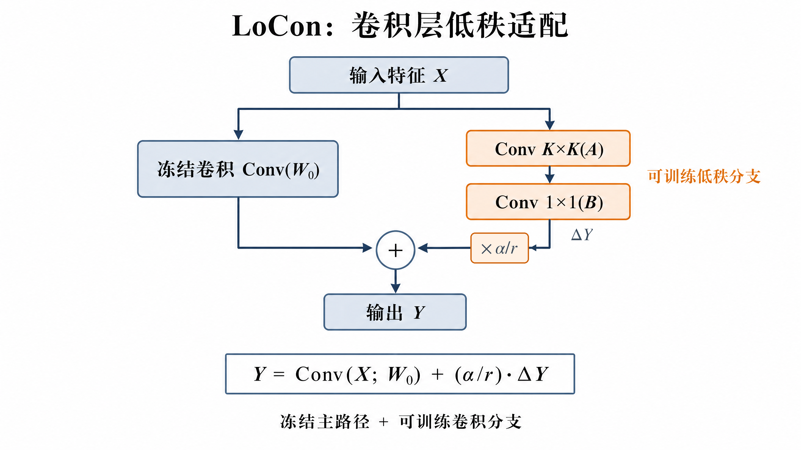

</div>

从作用上看，卷积适配允许模型调整邻域特征提取和通道组合。在SD、SDXL的U-Net中，这为改变潜空间中的局部结构和纹理提供了更多可训练位置。

使用LoCon技术后，卷积层部分的参数量和计算量是如何变化的呢？

对于前述两层卷积结构，忽略偏置，原卷积的参数量为：

$$
P_0=C_{\mathrm{out}}C_{\mathrm{in}}K^2
$$

LoCon分支的可训练参数量为：

$$
P_{\mathrm{adapter}}=rC_{\mathrm{in}}K^2+rC_{\mathrm{out}}
$$

例如，取 $C_{\mathrm{in}}=C_{\mathrm{out}}=320$ 、 $K=3$ 、 $r=16$ ，则：

$$
P_0=921600,
\qquad
P_{\mathrm{adapter}}=51200
$$

**LoCon分支的可训练参数约为原卷积参数量的5.56%**。训练时可以省去原卷积权重对应的梯度和优化器状态，不过原权重仍然存在并参与计算。

前向计算也要采用同样的区分。设输出特征图尺寸为 $H_{\mathrm{out}}\times W_{\mathrm{out}}$ ，以乘加次数MACs计，原卷积计算量约为：

$$
M_0=C_{\mathrm{out}}C_{\mathrm{in}}K^2
H_{\mathrm{out}}W_{\mathrm{out}}
$$

直接执行两层适配分支时，额外计算量约为：

$$
M_{\mathrm{adapter}}=\left(rC_{\mathrm{in}}K^2+rC_{\mathrm{out}}\right)
H_{\mathrm{out}}W_{\mathrm{out}}
$$

因此，未融合的双路径前向计算约为：

$$
M_{\mathrm{total}}
\approx
M_0+M_{\mathrm{adapter}}
$$

这里忽略了缩放与逐元素相加的较小开销。若将一次乘法和一次加法分别计为一个FLOP，对应的FLOPs通常约为MACs的两倍。

这只是前向算术量的估算，不能直接推导总训练时间。反向传播、权重重构方式、显存访问和算子实现都会影响实际速度。

训练完成后，如果采用可合并的固定增量形式，可以先重构卷积增量，再写入原卷积：

$$
W_{\mathrm{merged}}=W_0+\Delta W
$$

融合后仍然执行原尺寸的卷积，可以消除独立适配分支的推理开销，但原卷积本身并没有因此变小。

上面讲到的LoCon主要是对LoRA进行工程应用层面的改造优化（将LoRA的应用扩展到SD/FLUX系列模型的卷积层），接下来我们要讲的**LoHa模型主要是针对LoRA的低秩矩阵分解理论层面进行优化**。

LoHa是在LoRA的基础上，使用了哈达玛积（Hadamard Product）代替原生LoRA中的矩阵点乘，将秩的维度扩展到 $R^{2}$，让LoHa理论上在相同的参数配置下能学习到更多的数据分布信息。

读者朋友可能对哈达玛积不太熟悉，Don't Worry。我们先来了解一下什么是哈达玛积：**哈达玛积（Hadamard Product），又称逐元素乘积（element-wise product），是线性代数中的一种矩阵运算。它与标准矩阵乘法不同，哈达玛积是对两个相同大小的矩阵的对应元素进行乘积运算。**

给定两个相同大小的矩阵 $A$ 和 $B$ ，它们的哈达玛积 $C$ 定义如下：

$$C = A \circ B$$

其中 $C$ 的每个元素 $c_{ij}$ 计算为：

$$c_{ij} = a_{ij} \times b_{ij}$$

例如，假设有以下两个矩阵 $A$ 和 $B$：

$$A = \begin{bmatrix}
1 & 2 \\
3 & 4
\end{bmatrix}, \quad
B = \begin{bmatrix}
5 & 6 \\
7 & 8
\end{bmatrix}$$

它们的哈达玛积 $C$ 为：


$$C = A \circ B = \begin{bmatrix}
1 \times 5 & 2 \times 6 \\
3 \times 7 & 4 \times 8
\end{bmatrix}
= \begin{bmatrix}
5 & 12 \\
21 & 32
\end{bmatrix}$$

秩的维度小于2R从上面的公式中可以看到，**哈达玛积通过对两个矩阵的逐元素乘积，能够有效地对矩阵进行特征组合、权重计算和信息传播，增强AI模型的表达能力和计算效率**。

在LoHa模型中，应用了哈达玛积后，低秩分解后的形式就转变成如下所示的公式：

$$
\Delta W = (X_1 Y_1^T) \odot (X_2 Y_2^T)
$$

对应的增量权重构造过程如下图所示：

<div align="center">

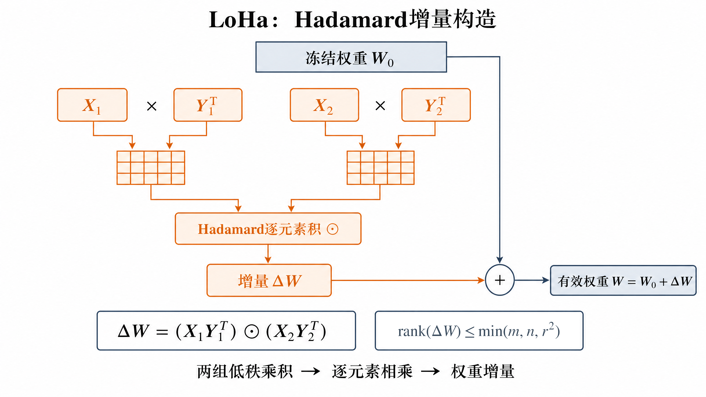

</div>

其中需要满足条件：

$$
rank(\Delta W) \leq R^2
$$

可以看到LoHa将秩的维度扩展到 $R^2$，**解决了原生LoRA受到低秩的限制**。这个思路不仅仅能够用在AIGC图像创作领域，在AIGC其他领域中都可以借鉴与迁移。

可能有读者会问，为什么LoHa的秩上限可以达到r²？

标准LoRA的增量为 $BA$ 。当两个因子的内部维度为 $r$ 时：

```math
\mathrm{rank}(\Delta W_{\mathrm{LoRA}})\leq\min(m,n,r)
```

LoHa先构造两个秩不超过 $r$ 的矩阵，再进行Hadamard积。根据Hadamard积的秩性质：

```math
\mathrm{rank}(P\odot Q)\leq\mathrm{rank}(P)\mathrm{rank}(Q)
```

因此：

```math
\mathrm{rank}(\Delta W_{\mathrm{LoHa}})\leq\min(m,n,r^2)
```

可以这样理解：每个低秩乘积都能展开为 $r$ 个秩一成分之和。两组结果逐元素相乘后，会出现最多 $r\times r$ 组配对项，每个配对项仍可以写成一个秩一矩阵，因此得到 $r^2$ 的上限。

但比较时还要计算参数量。标准LoRA只有一组因子，LoHa有两组：

$$
P_{\mathrm{LoRA}}=r(m+n),
\qquad
P_{\mathrm{LoHa}}=2r(m+n)
$$

相同内部Rank下，LoHa的基础矩阵因子参数量是LoRA的两倍。

若比较相同参数预算，则应将LoHa内部Rank为 $r$ 的配置，与LoRA Rank为 $r$ 的配置对照表如下所示：

<div align="center">

|配置	|可训练因子参数量	|增量矩阵的秩上限|
|---|---|---|
|LoRA，Rank为 $r$|	$r(m+n)$|	$\min(m,n,r)$|
|LoHa，两组内部Rank均为 $r$	| $2r(m+n)$ |	$\min(m,n,r^2)$ |

</div>

例如，对一个 $1024\times1024$ 的权重矩阵：
- Rank=16的LoRA包含32,768个因子参数，增量秩上限为16；
- 两组内部Rank均为8的LoHa也包含32,768个因子参数，增量秩上限为64。

这个例子说明，在合适的维度和Rank范围内，LoHa可以在相同参数量下构造秩上限更高的增量。


<h2 id="q-019">面试问题：DoRA、B-LoRA等方法有哪些创新点？(进阶)</h2>

**难度评分：⭐⭐⭐⭐ (4/5)  |  考察频率：⭐⭐⭐ (3/5)**

DoRA与B-LoRA都建立在LoRA之上，但改进的环节不同。**DoRA研究如何用少量可训练参数，更灵活地调整预训练权重；B-LoRA研究如何利用扩散模型不同位置的表示特征，让参考图的内容与风格分别参与生成。**

前者改变权重更新的表达方式，后者改变LoRA的训练位置和组合方式。理解这两个方法，可以帮助我们进一步判断：一个LoRA的效果受到限制，究竟需要调整参数化方式，还是需要重新设计信息写入和复用的位置。

### 1、DoRA：分别学习权重的幅值与方向

原生LoRA将一个线性层的有效权重写成：

```math
W_{\mathrm{LoRA}}=W_0+sBA,
\qquad
s=\frac{\alpha}{r}
```

其中， $W_0$ 是冻结的预训练权重， $A$ 、 $B$ 是可训练的低秩矩阵， $r$ 是Rank， $\alpha$ 用于控制低秩增量的缩放。

从权重向量的角度看，加入 $sBA$ 之后，向量的方向和长度都可能发生变化。DoRA进一步将这两种变化分别参数化：**用LoRA调整方向，用一组额外的幅值参数调整长度，再通过同一个任务损失共同优化。**

沿用论文按列分解的记号，设：

```math
W_0\in\mathbb{R}^{d\times k},
\qquad
B\in\mathbb{R}^{d\times r},
\qquad
A\in\mathbb{R}^{r\times k}
```

其中， $d$ 、 $k$ 分别表示权重矩阵的行数和列数， $r$ 通常远小于这两个维度。先构造经过低秩更新、尚未归一化的方向矩阵：

```math
V=V_0+sBA,
\qquad
V_0=W_0
```

再对每一列进行归一化，并乘上对应的可训练幅值：

```math
W_{\mathrm{DoRA},:,j}
=m_j\frac{V_{:,j}}{\left\Vert V_{:,j}\right\Vert_2},
\qquad
j=1,\ldots,k
```

这里， $V_{:,j}$ 表示矩阵 $V$ 的第 $j$ 列； $\left\Vert V_{:,j}\right\Vert_2$ 是这一列的长度；二者相除得到单位方向； $m_j$ 则是与该列对应的幅值参数。所有 $m_j$ 共同组成幅值向量 $m$ 。因此， $V_0$ 本身并不是已经归一化的方向矩阵，它的初始值就是预训练权重。

例如，一个权重向量为 $(3,4)$ ，长度为5，单位方向为 $(0.6,0.8)$ 。保持单位方向不变，将幅值调整为10，得到的权重就是 $(6,8)$ 。DoRA在高维权重上采用相同的分解思路，同时允许低秩分支改变向量方向。

**训练开始时，DoRA保持底模原有的计算结果。** 它将幅值初始化为预训练权重各列的范数：

```math
m_j^{(0)}=\left\Vert W_{0,:,j}\right\Vert_2
```

低秩矩阵沿用常见的LoRA初始化方式： $A$ 随机初始化， $B$ 初始化为零。此时低秩增量为零，归一化后的方向再乘回原始幅值，便恢复为 $W_0$ 。

训练过程中， $W_0$ 保持冻结，更新的是 $A$ 、 $B$ 和 $m$ 。接入扩散模型时，模型仍然根据底座采用的去噪或速度预测目标计算损失，梯度经过有效权重传到这些可训练参数。**DoRA主要改变参数如何参与优化，不要求额外设计人物身份、风格或内容分离损失。**

论文还对训练开销做了一项处理：将归一化分母从梯度计算图中分离，也就是对范数执行 `detach`。前向计算时，分母仍会随着当前权重重新计算；反向传播时，则不再经过分母计算梯度。这样可以减少相关的反向计算和显存开销，并不意味着方向参数停止训练。

需要明确，**这里的“幅值”和“方向”都是权重空间中的数学概念。** 幅值参数 $m$ 不等于推理时的LoRA强度，也不能直接解释为画风强度；方向变化同样不能直接解释为人物身份或结构变化。

<div align="center">

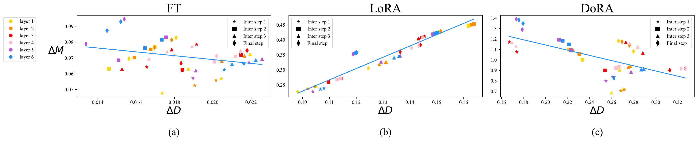

</div>

上图来自论文对VL-BART的分析。横轴表示相对预训练权重的方向差异，纵轴表示幅值差异；不同颜色对应不同层，不同点形对应不同训练检查点。在这组实验中，LoRA的幅值变化与方向变化更容易呈现正相关，而DoRA呈现出更接近全参数微调的更新模式。三个子图的坐标轴范围不同，读图时应关注各自的变化关系，不能直接通过散点的视觉距离比较更新量。

从训练和部署角度，还需要把握三点：

- **参数增加有限，但训练并非没有额外开销。** 对上述 $d\times k$ 的线性权重，普通LoRA的参数量为 $r(d+k)$ ，DoRA额外增加 $k$ 个幅值参数，并引入归一化相关计算。因此，在相同Rank和注入位置下，DoRA的适配参数并不会更少；只有实际能够用更低Rank达到质量要求时，才可能进一步缩小文件。
- **推理前可以合并完整的有效权重。** 合并时需要计算包含幅值缩放和方向归一化的 $`W_{\mathrm{DoRA}}`$ 。合并完成后，线性层可以按原有形式执行；仅把 $BA$ 加回底模会遗漏DoRA的关键计算。采用动态加载时，实际开销还取决于框架实现。
- **效果比较需要允许合理调参。** 官方仓库仍将扩散模型上的DoRA训练描述为实验性能力，并提示它与LoRA可能具有不同的收敛速度和合适的学习率。应在相同底模、数据和目标模块下建立对照，再在可比训练预算内分别调参。

DoRA适合回答的工程问题是：在现有LoRA方案和参数预算下，改变幅值与方向的学习方式，能否改善生成质量。是否能降低Rank、缩小文件或提高细节表现，都应由验证结果决定。

### 2、B-LoRA：利用特定注入位置，分别复用参考图的内容与风格

图像定制经常遇到内容与风格绑定的问题。例如，我们希望保留参考图中的主体形状，同时更换材质、配色和笔触；或者希望提取一张插画的视觉风格，用来生成其他对象。

普通单图LoRA可能同时学到主体、背景、颜色和表现手法。后续改变Prompt时，这些信息仍然一起起作用，导致主体难以换风格，或者风格迁移时混入参考图中的对象。

B-LoRA从SDXL的层级结构入手，研究不同位置对图像内容与外观的影响，并据此选择LoRA的注入位置。

**首先，通过逐块改变文本条件，寻找对不同视觉属性更敏感的位置。**

论文从SDXL中选取六个中间Transformer块，编号为1至6。实验时，仅向其中一个块输入修改后的Prompt，其余块继续使用原Prompt，再观察生成对象和颜色发生了怎样的变化。

结果显示，第2、4块对对象内容的影响较明显，第5块对颜色的影响较明显。这里使用颜色作为分析风格的代理属性，因为作者发现CLIP更适合衡量颜色变化；这一步提供了选层依据，完整的风格迁移能力还需要通过后续训练与生成实验验证。

随后，论文比较了不同块组合的训练效果，最终选择第4、5块。对应到官方实现，位置如下：

<div align="center">

| 论文中的编号 | 官方实现中的模块路径 | 在B-LoRA中的主要用途 |
|---|---|---|
| 第4块 | `unet.up_blocks.0.attentions.0` | 学习并复用参考图的主体内容 |
| 第5块 | `unet.up_blocks.0.attentions.1` | 学习并复用参考图的风格特征 |

</div>

这些编号属于论文的分析范围，不能直接理解为任意实现中从头数起的第4、5层，也不能直接套用于其他扩散模型。实际实现会在这些模块内的注意力投影，如Query、Key、Value和输出投影中加入LoRA。训练对象是新增的低秩参数，预训练权重保持冻结。

<div align="center">

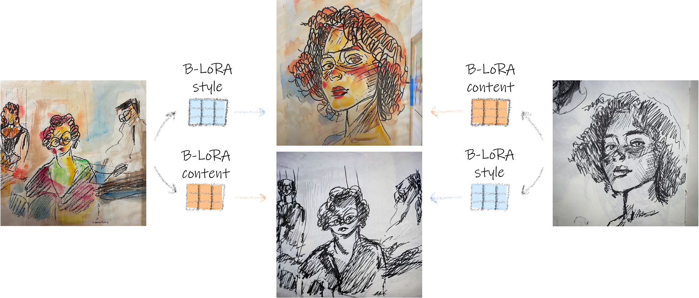

</div>

**接着，针对同一张参考图，联合训练两个位置的LoRA。**

对于一张输入图像 $I$ ，训练流程可以分为四步：

1. 对图像进行预处理，通过冻结的VAE得到图像潜变量 $z_0$ 。
2. 使用通用Prompt，例如论文中的 `A [v]`，通过冻结的文本编码器得到文本条件 $c_v$ 。
3. 随机采样扩散时间步 $t$ 和噪声 $\epsilon$ ，构造带噪潜变量 $z_t$ ，送入同时包含两组LoRA的SDXL。
4. 计算去噪损失，通过一次反向传播，同时更新第4、5块中的LoRA参数。

若分别用 $\theta_4$ 、 $\theta_5$ 表示两组可训练的低秩参数，以SDXL的噪声预测目标为例，可以写成：

```math
z_t=a_tz_0+b_t\epsilon,
\qquad
\epsilon\sim\mathcal{N}(0,I)
```

```math
\mathcal{L}_{\mathrm{B\text{-}LoRA}}
=\mathbb{E}_{t,\epsilon}
\left[
\left\Vert
\epsilon-
\hat{\epsilon}_{W_0;\theta_4,\theta_5}
\left(z_t,t,c_v\right)
\right\Vert_2^2
\right]
```

其中， $a_t$ 、 $b_t$ 由扩散噪声日程确定， $W_0$ 表示冻结的底模参数， $\hat{\epsilon}$ 表示模型预测的噪声；高斯分布中的 $I$ 表示单位协方差矩阵。为便于说明，这里省略了SDXL的尺寸等附加条件。

两个位置的LoRA共同参与一次噪声预测，接受同一个损失的优化。训练数据没有分别提供“内容图”和“风格图”作为监督，方法也没有额外加入强制内容与风格分开的损失。**论文发现，通过特定位置的联合训练，两组增量会呈现出偏内容和偏风格的分工，因此称为隐式内容—风格分离。**

通用Prompt的作用，是减少训练文本对内容或风格的明确指定，让模型更多依靠这些位置的表示特征形成分工。`[v]`在这里用作参考概念的标识；不能仅凭这种写法，就将其理解为另行训练了一个Textual Inversion词向量。

原论文使用SDXL 1.0，冻结底模和文本编码器，设置Rank为64、学习率为 $5\times10^{-5}$ ，每张图优化1000步，在单张A100上的报告耗时约为10分钟。这些是论文的实验配置，用于说明方法确实需要针对参考图进行训练，并非免训练参考图控制。

**最后，按创作需求提取和组合训练得到的增量。**

设内容参考图为 $I_c$ ，风格参考图为 $I_s$ 。分别对两张图执行上述联合训练，会得到：

```math
I_c\longrightarrow
\left\{\Delta W_c^4,\,\Delta W_c^5\right\}
```

```math
I_s\longrightarrow
\left\{\Delta W_s^4,\,\Delta W_s^5\right\}
```

这里， $\Delta W$ 统称相应块内各个LoRA带来的权重增量。下标 $c/s$ 区分参考图来源，上标 $4/5$ 区分注入位置。因此， $`\Delta W_c^5`$ 表示从内容参考图中学到的第5块增量，也可以用于复用这张图的风格。下图展示了B-LoRA支持参考图驱动的风格迁移、文本控制的风格化和一致风格生成：

<div align="center">

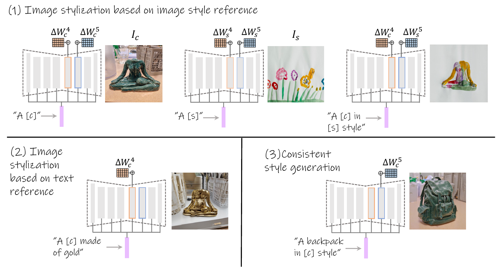

</div>

训练之后，可以形成三种使用方式：

- **参考图驱动的风格迁移。** 从内容图中提取 $\Delta W_c^4$ ，从风格图中提取 $\Delta W_s^5$ ，分别加载到对应位置，让主体内容与视觉风格来自不同参考图。
- **文本控制的风格化。** 只加载内容图的 $\Delta W_c^4$ ，再用Prompt描述新的材质、配色或表现手法。这样可以减少原参考图风格对新指令的限制。
- **一致风格生成。** 只加载选定参考图的第5块增量，再通过不同Prompt生成其他主体，使同一种视觉风格能够在多个对象之间复用。

B-LoRA的用途也有边界。首先，它对第4、5块的选择建立在SDXL的分析和实验之上，更换为SD 1.5、SD3或FLUX后，需要重新验证适合的注入位置。其次，内容与风格本身并不总能完全分开：某些对象的颜色就是其身份特征，改变风格时可能连带改变识别线索。单张图中的背景和道具也可能被一起学入，复杂场景下尤其需要检查内容泄漏。

因此，B-LoRA更适合用来组织和复用图像内容、风格信息。它提供的是近似的内容保持与风格迁移能力；精确人脸身份、人体姿态和局部像素保持，还需要相应的控制方法和验证流程。


<h2 id="q-020">面试问题：LCM-LoRA与人物/风格LoRA有什么本质区别？</h2>

**难度评分：⭐⭐⭐⭐ (4/5)  |  考察频率：⭐⭐⭐⭐ (4/5)**

**人物/风格LoRA学习的是“生成内容的特征”，LCM-LoRA学习的是“用几步、沿什么轨迹能够加速生成”。** 前者把人物身份、服装、画笔质感或构图偏好写入模型的参数增量，属于语义或视觉能力适配；后者把原本需要几十次网络调用的扩散求解过程蒸馏成少步一致性映射，属于采样器/推理行为适配。两者都叫LoRA，是因为最终都可以表示成低秩矩阵，但训练目标、推理依赖和失败模式完全不同，具体对比如下图所示：

<div align="center">

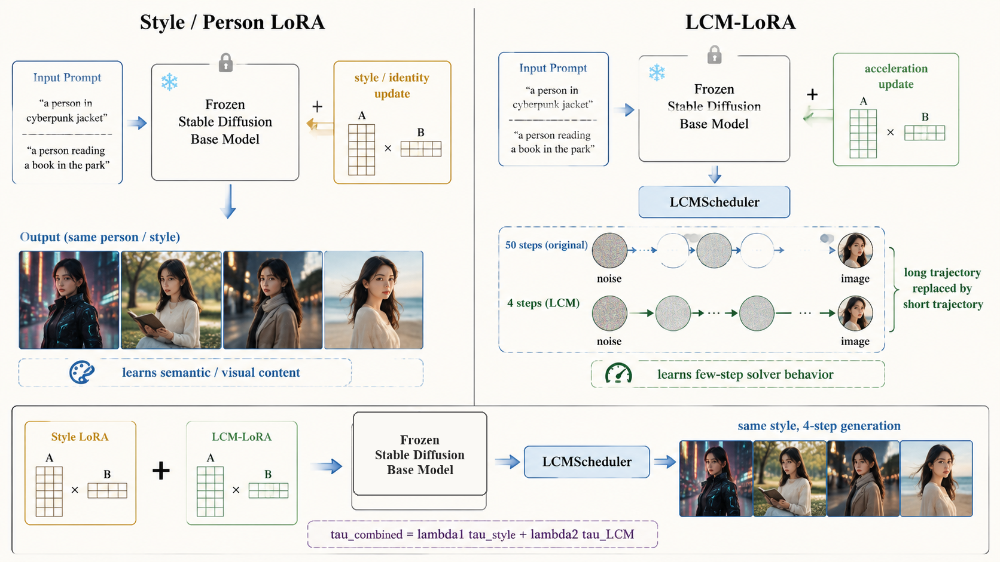

</div>

### 1、 先分清两种“增量”：语义增量与求解器增量

人物LoRA可以从十几张或几十张同一人物图片中学习脸部比例、发型、服装和身份特征；风格LoRA则从画作或设计稿中学习色彩、笔触、线条和构图习惯。它们通常通过提示词触发，例如输入 `a portrait of <token>` 或指定画风，目标是让模型在原有生成能力上增加一块稳定的视觉分布。换句话说，**没有人物或风格LoRA时，模型不知道你要复现哪一套视觉特征；加载后，模型知道“画面应该长什么样”。**

LCM-LoRA不负责记住某个新人物，也不负责把照片变成水彩。它是在已有扩散模型上做一致性蒸馏，学习如何把一个较高噪声状态直接映射到同一条概率流常微分方程（PF-ODE）轨迹上的低噪声状态。**没有风格LoRA时，LCM-LoRA仍然只负责加速底模；没有LCM-LoRA时，人物/风格LoRA仍然可以用普通DPM-Solver++或Euler等采样器生成，只是需要更多步数。**

下表中展示了两类LoRA的具体差异：

| 对比维度 | 人物/风格LoRA | LCM-LoRA |
|---|---|---|
| 主要回答 | 画谁、画成什么视觉风格 | 如何更快完成去噪生成 |
| 学习对象 | 数据集对应的语义、身份、纹理或风格分布 | 教师扩散模型的少步求解行为与一致性映射 |
| 是否需要触发词 | 经常需要，用于激活特定概念 | 通常不需要新的概念词，关键是匹配调度器和步数 |
| 推理依赖 | 底模、提示词、LoRA权重、普通采样器 | 兼容底模、LCM-LoRA权重、`LCMScheduler`、少步配置 |
| 常见失败 | 身份漂移、画风泄漏、过拟合、提示词绑定 | 细节损失、构图不稳、步数/CFG不匹配、底模不兼容 |

### 2、 LCM到底蒸馏了什么：把多步扩散变成少步一致性映射

普通扩散模型在推理时从噪声 $z_T$ 开始，经过很多个时间步逐渐得到 $z_0$。每一步都要调用一次去噪网络，采样步数越多，通常越容易保住细节，但延迟和显存访问也随之增加。LCM把带有Classifier-Free Guidance的反向扩散过程看作一个增强的PF-ODE，并训练一个学生网络，使不同噪声时间点的状态经过少量跳步后落到相同的解轨迹附近。

在简化记号下，LCM的一致性蒸馏目标可以写成：

```math
\mathcal{L}_{\mathrm{LCM}}=\mathbb{E}\left[d\left(f_{\theta}\left(z_{t_{n+k}},c,t_{n+k}\right),\mathrm{sg}\left(f_{\theta^-}\left(\hat{z}_{t_n},c,t_n\right)\right)\right)\right]
```

其中， $f_{\theta}$ 是正在训练的学生网络， $f_{\theta^-}$ 是使用指数移动平均（EMA）更新的目标网络， $`\hat{z}_{t_n}`$ 由教师扩散模型或ODE求解器从较高噪声时间点 $`t_{n+k}`$ 推进到较低噪声时间点 $t_n$， $d(\cdot,\cdot)$ 衡量两个预测结果的一致性， $\mathrm{sg}(\cdot)$ 表示停止梯度。训练的重点不是让学生记住训练图片，而是让它在多个时间点给出彼此一致的终点预测。

LCM-LoRA进一步把学生网络的可训练部分限制在低秩矩阵上。对某个被注入的权重矩阵 $W_0$，其更新形式为：

```math
W=W_0+\Delta W_{\mathrm{LCM}},\qquad \Delta W_{\mathrm{LCM}}=B_{\mathrm{LCM}}A_{\mathrm{LCM}}
```

底模参数 $W_0$保持冻结，只训练 $A_{\mathrm{LCM}}$ 和 $B_{\mathrm{LCM}}$。因此，LCM-LoRA不是重新训练一个“快速版人物模型”，而是用较小的加速向量逼近教师模型的少步去噪行为。LCM-LoRA技术报告在SD 1.5、SSD-1B和SDXL上进行蒸馏。

### 3、 LCM-LoRA和人物/风格LoRA叠加使用

人物/风格LoRA通常记为 $\Delta W_{\mathrm{style}}$，LCM-LoRA记为 $\Delta W_{\mathrm{LCM}}$。在目标模块和底模兼容时，组合后的权重可以近似写为：

```math
W_{\mathrm{combined}}=W_0+\lambda_s\Delta W_{\mathrm{style}}+\lambda_l\Delta W_{\mathrm{LCM}}
```

LCM-LoRA论文把人物或画风适配器称为“style vector”，把LCM-LoRA称为“acceleration vector”，并给出等价的参数组合形式：

```math
\tau_{\mathrm{combined}}=\lambda_1\tau_{\mathrm{style}}+\lambda_2\tau_{\mathrm{LCM}}
```

这里的线性组合不是说两个LoRA在所有情况下都能简单相加，而是说它们在同一个底模、相同注入位置和兼容参数化下可以共同作用。论文在SDXL与PaperCut风格LoRA上展示了这一点：组合后不再额外训练，就可以在LCM多步采样器下用少量步数生成保持该画风的图像。

从AIGC创作流程看，组合关系可以这样理解：

1. **底模提供通用能力**：理解文本、构造主体、组织空间关系。
2. **人物/风格LoRA改变内容分布**：让人物更像目标身份，或让画面具有特定笔触、色彩和材质。
3. **LCM-LoRA改变求解路径**：把从噪声到图像的过程压缩成4到8步附近的少步推理。
4. **LCMScheduler负责配合执行**：采样调度不能继续沿用普通扩散模型的默认配置，否则加速增量与时间步定义不匹配。

因此，LCM-LoRA不是“更强的风格LoRA”，而是可以叠加在风格LoRA旁边的推理加速器。它不会凭空增加人物身份或画风容量，也不能修复训练数据不干净、触发词设计错误或底模与LoRA不匹配等问题。

在Stable Diffusion工作流中，通常按以下顺序做验证：

1. **先锁定兼容底模**：确认LCM-LoRA与SD 1.5、SDXL等模型家族和目标网络结构匹配，不要把SDXL的适配器直接套到FLUX或SD3上。
2. **替换采样调度器**：在Diffusers中使用 `LCMScheduler.from_config(pipe.scheduler.config)`，再加载对应的LCM-LoRA权重。
3. **再加载人物/风格LoRA**：保持目标模块、Rank和权重格式兼容，从较低权重开始测试，观察身份保持、风格强度和构图稳定性。
4. **从4到8步做质量-延迟曲线**：分别与普通采样器的20到30步结果对比，不要只比较单张“看起来不错”的图片。至少记录首图延迟、批量吞吐、显存峰值、细节保持和提示词遵循度。
5. **单独调采样参数**：LCM的最优步数、Guidance和LoRA权重不是普通DPM-Solver++配置的简单复制。论文实验使用特定的蒸馏Guidance和LCM多步采样器，工程部署仍需按底模、分辨率和任务重新校准。

LCM-LoRA更适合头像批量生成、风格化海报、多租户图片服务和交互式预览等延迟敏感场景；如果任务是极高分辨率精修、复杂文字排版、严格姿态控制或需要保留极细微纹理，应先确认少步采样是否带来不可接受的质量下降。对于ControlNet、Inpainting或多LoRA组合，也要把控制强度、调度器和步数一起做消融，而不是只替换一个权重文件。


<h2 id="q-022">面试问题：如何构建差异化LoRA？差异化LoRA的数学本质是什么？</h2>

**难度评分：⭐⭐⭐⭐ (4/5)  |  考察频率：⭐⭐⭐ (3/5)**

**Rocky认为，差异化LoRA模型可以说是一种巧妙优雅的LoRA训练思想。**

差异化LoRA模型，也常被称为差分或残差LoRA，最早在AIGC开源社区被提出，展现了开源社区的集体智慧。这种LoRA模型的特殊性源自于其训练思想，**旨在让LoRA模型学习两类图像之间的差异**。因此，在LoRA、LoCon、LoHa等架构以及SD、FLUX等不同的AIGC大模型上都能运用这个训练思想，训练对应配套的差异化LoRA模型。

**训练得到的差异化LoRA模型一般用于优化生成图像的整体质量（Low-Level功能），比如美颜美白、美肤、祛痘、磨皮、精修、细节增强、质感加强、光影增强等。**

那么，差异化LoRA模型是如何训练的呢？首先我们需要构建两张内容相似的图像：图A和图B。如下图所示，左图AI感更强，右图真实质感更强，整体更自然。

<div align="center">

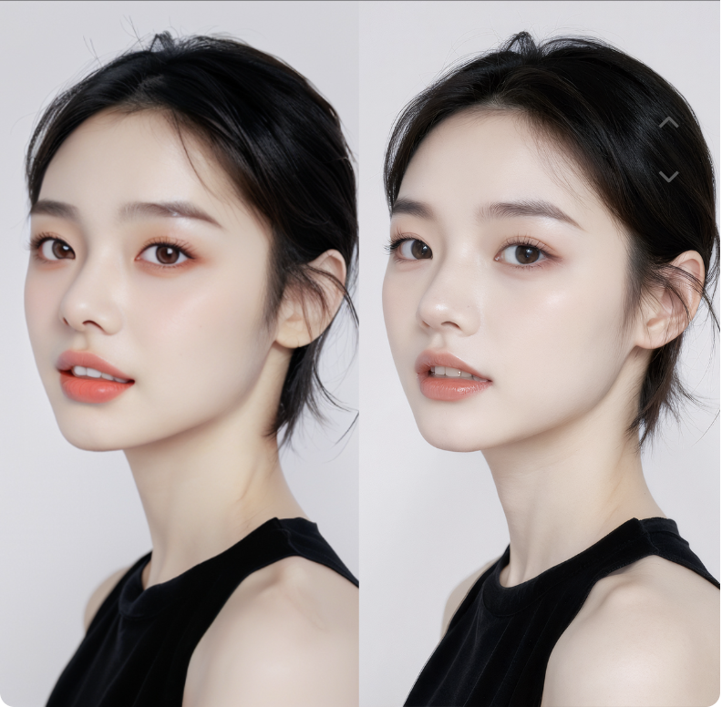

</div>

差异化LoRA的核心目标是提取两个模型状态或两类视觉分布之间的差异方向。例如希望学习“普通质感 -> 更精修质感”的增量，可以分别得到与状态A、状态B对应的LoRA模型权重，再构造：

$$
\Delta W_{diff}=\Delta W_B-\Delta W_A
$$

推理时将 $\lambda\Delta W_{\mathrm{diff}}$ 加到底模型上，相当于沿参数空间中估计的A到B方向移动。它不是一种独立网络架构，而是一种基于LoRA的适配器代数和训练思想，可以与原生LoRA、LoCon等结合应用。

差异化LoRA的直观构建流程是：使用同一底模、同一目标模块、同一Rank和相同训练配置，分别在A组与B组数据上训练LoRA；随后将两个LoRA对齐并相减。

在差异化LoRA的训练中，我们分两步进行训练：

1. 以图A为训练数据，由于训练数据仅有一张图，过拟合训练得到LoRA A。
2. 以图B为训练数据，由于训练数据同样仅有一张图，再次过拟合训练得到LoRA B。

接着我们将两个训练好的LoRA B和LoRA A做差：LoRA B - LoRA A，就最终得到了差异化LoRA C模型。

一张训练数据可以保证LoRA模型能够过拟合到训练数据上，但稳定性不足。为了提高稳定性，我们可以用多个图像对（image pairs）进行训练，从而得到效果更稳定的残差/差异化LoRA模型。

到此为止，我们已经了解了差异化LoRA模型的训练过程。我们可以举一反三，比如使用丑陋的和漂亮的图像对，训练提升图像美感的LoRA；或者使用细节少的和细节丰富的图像对，训练增加图像细节的LoRA。

这种方法适合探索美肤、锐度、材质、光照、色调和特定视觉属性的可控方向，**一般来说，使用差异化LoRA模型时不需要提示词，对生成图像的构图几乎没有影响，可以说是一种“万金油”的LoRA模型系列**。


<h1 id="q-024">5.介绍一下AIGC图像创作领域中MoE-LoRA的核心原理</h1>

**难度评分：⭐⭐⭐⭐⭐ (5/5)  |  考察频率：⭐⭐⭐ (3/5)**

MoE-LoRA可以理解为“多个LoRA模型加上一个输入相关的路由器”。它保留底模的通用生成能力，再准备多个低秩增量，让不同输入可以使用不同的适配方向。

假设我们要搭建一个商业人像生成系统，它既要保持人物身份，又要更换服装、控制妆容、切换国风或赛博朋克画风，还要适配证件照、电商海报和社交头像等不同场景。普通做法通常有两种：要么为每种需求分别训练和切换LoRA，要么把人物、服装、画风、光影等多个LoRA同时加载。

第一种做法容易让模型资产越来越多，工作流越来越复杂；第二种做法则容易出现多个LoRA同时修改相同网络层的问题。例如人物LoRA想保留真实五官，二次元风格LoRA想重新塑造脸部比例，服装LoRA又在影响身体轮廓，最终可能出现“人物不像、服装不准、画风也不稳定”的结果。

**MoE-LoRA本质上解决的，就是多个创作能力应该如何分工、又应该在什么时候参与生成的问题。**

可以把它理解成一个AIGC创作团队：底模型负责通用的绘画能力，多个LoRA专家分别擅长人物身份、服装材质、画面风格、光影质感或产品结构，Router则像任务调度者，根据当前的Prompt、图像特征和去噪阶段，选择最适合的少数专家参与生成。

同时在这里我们需要先区分两个概念：**参数高效**和**计算高效**。

相对于全参数微调，MoE-LoRA仍然只训练LoRA分支和路由器，底模主体通常保持冻结，因此属于参数高效微调。相对于单个LoRA，它增加了多个专家分支，训练参数总量通常会变大。只有在每次输入只激活少数专家，并且路由和调度开销得到控制时，才可能获得稀疏计算收益。

### 1、为什么单个LoRA会遇到条件容量限制？

我们已经知道，标准LoRA为一个底模层增加一个低秩更新：

$$
\Delta W=\frac{\alpha}{r}BA
$$

所有训练样本都通过同一个增量分支。这样的结构适合学习一个相对集中的人物、风格或概念，但当训练目标同时包含多种差异较大的条件时，一个固定的低秩子空间可能不够用。

例如，一个LoRA同时需要响应多种风格、多个主体和不同的生产任务。如果只提高一个LoRA的Rank，虽然可以增加表达容量，但也会带来更大的文件、更多的训练参数和更强的不同能力相互干扰风险。

MoE-LoRA的思路是把一个单个LoRA扩展为多个LoRA专家：

```math
\Delta W_1,\Delta W_2,\ldots,\Delta W_E
```

这些专家共同构成更大的适配空间，但每次输入只使用其中的一部分。这样可以把“总共能够表达多少种适配方向”和“当前输入实际调用多少适配器”分开。

### 2、MoE-LoRA的基本计算过程是什么？

设当前层的输入特征为 $h$ ，文本、参考图像等条件为 $c$ ，扩散时间步为 $t$ ，当前网络层或模块编号为 $l$ 。将这些信息整理为路由输入的过程，可以写成：

```math
u=R_{\mathrm{in}}(h,c,t,l)
```

其中 $R_{\mathrm{in}}$ 表示“路由输入构造函数”， $u$ 表示构造出来的“路由特征向量”。 $R_{\mathrm{in}}$ 的作用，是把可用信息整理成路由网络能够处理的表示。例如，可以先对条件特征进行池化，再与当前隐藏特征拼接，最后投影到统一维度。 $R_{\mathrm{in}}$ 不一定是一个独立的神经网络，也可以只是选取、池化或拼接操作.

将路由特征 $u$ 输入可训练的路由打分网络：

```math
s=R_{\phi}(u)
```

其中， $R_{\phi}$ 表示路由打分网络， $\phi$ 表示该网络的可学习参数。 它的输出是一个长度为 $E$ 的分数向量：

$$
s=\begin{bmatrix}
s_1 & s_2 & \cdots & s_E
\end{bmatrix}^{\top}
$$

$s_i$ 是分配给第 $i$ 个专家的分数。分数越高，表示路由网络越倾向于让这个专家处理当前输入，但它还不是归一化后的门控权重。

根据分数向量 $s$ ，取出分数最高的 $k$ 个专家：

```math
\mathcal{I}=\mathrm{TopK}(s,k)
```

例如， $\mathcal I=\{1,3\}$ 表示本次输入选择专家1和专家3。其余专家不执行该输入对应的LoRA增量计算。

接着，我们对选中的专家重新归一化门控权重：

```math
g_i
=
\frac{\exp(s_i)}
{\sum_{j\in\mathcal{I}}\exp(s_j)},
\qquad
i\in\mathcal{I}
```

其中， $g_i$ 就是第 $i$ 个专家的归一化门控权重。第 $i$ 个LoRA专家的增量可以写成：

```math
\Delta W_i
=
\frac{\alpha_i}{r_i}B_iA_i
```

最终，这一层的输出为：

```math
h_{\mathrm{out}}
=
W_0h
+
\sum_{i\in\mathcal{I}}
g_i\Delta W_i h
```

其中， $W_0h$ 是冻结底模的原始输出，后面的加权和是当前输入选择的LoRA专家增量。

因此，MoE-LoRA的核心并不是把多个LoRA固定相加，而是让被选中的专家起作用：

```math
\Delta W(x)
=
\sum_{i\in\mathcal{I}(x)}
g_i(x)\Delta W_i
```

同一个底模在不同输入下，可以使用不同的LoRA专家组合。

### 3、Router可以按照什么粒度进行路由？

Router的粒度决定了系统的控制精细度和工程复杂度。

**样本级路由**是最简单的方式。一张图片或一个训练样本选择同一组专家，所有空间位置共享路由结果。它调度简单，生成过程相对稳定，但难以处理一张图中同时存在的多种局部条件。

**Token级或空间位置级路由**允许不同文本Token或图像Latent Token选择不同专家。这样可以细化控制，但会增加Token分发、设备通信和局部一致性维护的成本。

**时间步路由**根据扩散采样的时间步选择专家。不同专家可能在不同去噪阶段产生作用，例如某些专家更多影响全局结构，另一些专家更多影响纹理和风格。但“结构专家”“纹理专家”不是由路由机制自动保证的，需要通过数据、监督或消融实验验证。

**层级路由**根据当前网络层选择专家，使不同深度的特征使用不同适配器。这种方式可以利用浅层空间信息与深层语义信息的差异，但实现和调试更加复杂。

在图像生成中，Router如果每个去噪时间步都重新选择专家，可能出现相邻时间步路由频繁变化的问题。主体身份、服装纹理和风格可能因此前后不一致。下图展示了MoE-LoRA在一个网络层中的经典前向结构：

<div align="center">


</div>

### 4、MoE-LoRA如何训练Router和专家LoRA？

一次训练迭代大致经历以下过程：

1. 从训练图像和对应Caption标签构造为训练样本；
2. 将当前Latent特征、文本或图像条件、时间步等信息送入Router；
3. Router输出专家分数，选择Top-k专家；
4. 将被选中的Token或样本分发给对应的LoRA专家；
5. 计算各专家的低秩增量，并按照门控权重合并；
6. 与冻结底模的原始路径相加，得到当前层输出；
7. 计算生成损失，并根据需要加入负载均衡或路由监督损失；
8. 更新专家LoRA参数和Router参数。

训练目标可以写成：

```math
\mathcal{L}_{\mathrm{total}}
=
\mathcal{L}_{\mathrm{gen}}
+
\lambda_{\mathrm{bal}}\mathcal{L}_{\mathrm{balance}}
+
\lambda_{\mathrm{route}}\mathcal{L}_{\mathrm{route}}
```

其中 $`\mathcal{L}_{\mathrm{gen}}`$ 是底模对应的生成损失，可以是噪声预测、v-prediction或Flow Matching目标； $`\mathcal{L}_{\mathrm{balance}}`$ 用于避免所有输入都集中到少数专家； $`\mathcal{L}_{\mathrm{route}}`$ 是可选的路由监督项，只有在有任务标签或专家目标时才使用。

设一个批次有 $T$ 个被路由单位， $E$ 个专家，令：

```math
f_i
=
\frac{1}{T}
\sum_{t=1}^{T}
\mathbf{1}\left(i\in\mathcal{I}_t\right)
```

其中 $f_i$ 表示专家 $i$ 实际接收到的Token或样本比例。再设 $p_i$ 表示Router对专家 $i$ 的平均概率，一个常见的简化负载均衡目标为：

```math
\mathcal{L}_{\mathrm{balance}}
=
E\sum_{i=1}^{E}f_i p_i
```

不同MoE实现会对概率、Top-k掩码和归一化方式进行不同处理，所以这只是说明负载均衡思想的公式，不是所有MoE-LoRA必须采用的唯一形式。

如果训练数据有明确任务标签，例如某些样本属于某种风格或某类生产任务，可以额外约束Router。但如果没有可靠标签，不能直接假设专家1、专家2分别对应某个固定语义。专家可能按照数据来源、主体类型、背景分布或其他统计特征形成分工。

### 5、Expert Capacity如何限制Token分配？

如果某个专家收到过多Token，计算和显存会突然增加，其他专家则处于空闲状态。因此，稀疏MoE通常会为每个专家设置容量上限。

设 $T$ 是批次中的路由单位数， $k$ 是每个单位激活的专家数， $E$ 是专家数量， $c$ 是容量因子，则单个专家容量可以近似写成：

```math
C
\approx
\left\lceil
\frac{cTk}{E}
\right\rceil
```

有些实现把 $T$ 定义为已经展开后的分配次数，因此公式中是否显式出现 $k$ ，要以具体实现为准。

容量因子过小，容易造成Token溢出；容量因子过大，则会浪费显存和设备间通信。溢出的Token可以由第二候选专家处理、沿共享底模路径继续计算、使用Padding，或者在某些实现中被丢弃。图像生成中如果直接丢弃空间Token，可能表现为局部细节缺失，因此需要同时统计溢出比例和输出质量。

Top-k选择本身通常是按照门控分数确定的。训练阶段可以加入路由噪声、路由Dropout或其他随机扰动，帮助Router探索更多专家，但“第二个专家按权重随机选择”不是所有Top-2实现都具有的固定规则。

### 6、 MoE-LoRA训练注意事项

同时，**稠密模型和稀疏模型在过拟合的表现上存在显著差异**。MoE稀疏模型更易于出现过拟合现象，因此在构建MoE-LoRA模型时，我们可以尝试使用更强的内部正则化策略，比如使用更高比例的dropout。具体来说，**我们可以为大模型中的稠密层设定一个较低的dropout率，而为稀疏层设置一个更高的dropout率，以此来优化模型整体性能**。并且像MoE-LoRA这样的稀疏模型往往更适合使用较小的Batch-Size和较高的学习率，这样可以获得更好的训练效果。

所以训练MoE-LoRA时，不仅要看最终图片质量，还要检查每个专家到底学到了什么、Router是否长期偏爱某些专家、不同Prompt是否触发合理的专家组合，以及多人像、多风格和跨场景生成是否稳定。Dropout、负载均衡损失、专家容量、路由噪声和Top-$k$都只是帮助形成合理分工的工程手段，具体配置必须由数据规模、专家数量、路由粒度和底模架构共同决定。


<h1 id="q-027">6.介绍一下主流PEFT技术在AIGC图像创作领域的应用（进阶）</h1>

<h2 id="q-028">面试问题：PEFT的核心技术路线有哪些？LoRA属于哪个细分类别？</h2>

**难度评分：⭐⭐⭐⭐ (4/5)  |  考察频率：⭐⭐⭐⭐⭐ (5/5)**

**PEFT（Parameter-Efficient Fine-Tuning，参数高效微调）是“冻结大部分预训练参数，只训练少量任务参数”这类微调训练方法的总称**。它的核心目标是降低每个任务的训练、存储和交付成本，同时尽量保留底模能力。它让大模型应用的门槛和成本显著降低，具体线路类别如下表所示：

<div align="center">

| 路线 | 训练对象 | 代表方法 | 主要特点 |
|---|---|---|---|
| 重参数化 | 权重更新的低维表示 | LoRA、LoHa、LoKr、DoRA | 易插拔、易融合、生态成熟 |
| 添加模块 | 新增Adapter或控制分支 | Adapter、ControlNet类分支 | 容量强，但结构和推理开销更明显 |
| 表示优化 | Token或Embedding | Textual Inversion | 文件极小，表达上限受文本空间约束 |
| 参数选择 | 偏置、归一化或部分层 | BitFit、Selective Fine-tuning | 实现直接，但能力依赖选层 |
| 提示优化 | 可学习Prompt/Prefix | Soft Prompt、Prefix类方法 | 适合条件注入，依赖架构接口 |

</div>

**LoRA处于重参数化路线**：它不直接解冻原权重，而是给权重更新增加低秩坐标。DreamBooth则主要是一种个性化训练目标与数据正则策略，既可以采用全参数微调，也可以用LoRA承载更新，所以“DreamBooth”和“LoRA”不是同一层面的互斥概念。

在AIGC图像创作中，选择PEFT方法要看外部知识注入的方式与位置：新词语义可以写入Embedding；人物、风格和领域能力可以写入去噪主干的LoRA；强结构控制可能需要独立Adapter或ControlNet；生成行为变化则可能通过蒸馏LoRA或其他模块承载。

<h2 id="q-029">面试问题：Textual Inversion的原理、优势与局限是什么？</h2>

**难度评分：⭐⭐⭐⭐ (4/5)  |  考察频率：⭐⭐⭐⭐ (4/5)**

**Textual Inversion冻结文本编码器和扩散模型，只学习一个或少量新的Token Embedding，让占位符 $S_*$ 在文本空间中表示新的视觉概念**。下图是Textual Inversion原理示意图：

<div align="center">

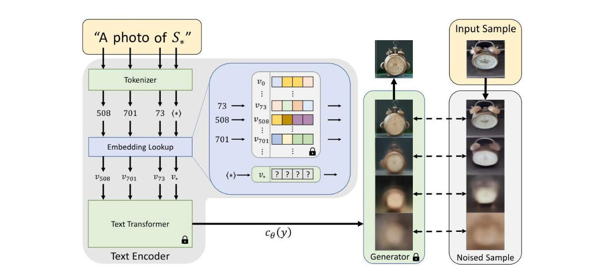

</div>

设可学习向量为 $v$，训练图片集合为 $\mathcal{D}$，其目标仍可使用扩散模型的噪声预测损失：

```math
v^{*}=\arg\min_{v}\mathbb{E}_{x,t,\epsilon}
\left[\left\|\epsilon-\epsilon_{\theta}\left(z_t,t,c(S_{*};v)\right)\right\|_2^2\right]
```

其中底模参数 $\theta$ 固定，只有占位符对应的 $v$ 被更新。训练完成后，可以在Prompt中把 $S_*$ 与其他自然语言组合。

总的来说，Textual Inversion 的实现流程具体过程包括以下几个步骤：

1. **收集输入图像**。用户提供3-5张代表某个新概念的图片，例如特定的雕塑、玩具或独特的艺术风格。这些图像作为大模型的学习基础。

2. **创建新概念词**。为了表示这个新概念，方法会引入一个全新的词汇（在论文中通常标记为S*）。例如，如果我们想要教会模型一个特定的雕塑，我们可以引入一个词如“雕塑X”。

3. **优化词嵌入**。与重新训练整个大模型不同，文本反演只优化这个新概念词在文本嵌入空间中的位置。具体优化过程包括最小化两个方面的差异，一是模型使用包含新概念词的文本提示生成的图像；二是用户提供的实际参考图像。通过优化，这个新概念词的嵌入向量最终能准确表示新的视觉概念。

4. **集成应用** 一旦新概念词优化完成，就可以和已有的自然语言提示结合使用，让模型生成包含这个个性化元素的新图像。例如，你可以输入“一个戴着‘雕塑X’风格帽子的女孩”，模型就能生成符合你定制需求的图片。

它的优势是参数和文件极小、训练成本低、不会直接改写去噪主干；局限是表达能力受文本嵌入空间约束。复杂人物身份、精细产品结构或与底模先验差异较大的概念，往往难以只靠少量Embedding完整承载。它还可能对初始化Token和Prompt模板敏感。

因此，**Textual Inversion更像“为底模已有的视觉知识找到一个新语言入口”，而LoRA则能修改底模生成映射本身**。前者适合轻量语义绑定，后者适合更强的特征与行为适配。

<h2 id="q-030">面试问题：DreamBooth和DreamBooth LoRA的原理是什么？</h2>

**难度评分：⭐⭐⭐⭐ (4/5)  |  考察频率：⭐⭐⭐⭐⭐ (5/5)**

**DreamBooth是一种少样本主体个性化方法**。它用“稀有标识符 + 类别词”绑定目标主体，例如“[V] dog”，并在实例图像上微调生成大模型，使大模型既记住特定主体，又能在新场景中响应自然语言。

只训练实例图容易让模型把整个“dog”类别限定到目标对象，造成语言漂移和过拟合。DreamBooth因此引入类别先验保持损失，将实例重建与类别图像正则结合：

$$
\mathcal{L}=\mathcal{L}_{instance}+\lambda_{prior}\mathcal{L}_{prior}
$$

类别图像通常由原模型基于类别Prompt生成，用来约束模型继续保留该类别的多样性。Prior Preservation不是简单加入“负样本”，而是在生成目标上维持类别先验。下图是DreamBooth原理示意图：

<div align="center">

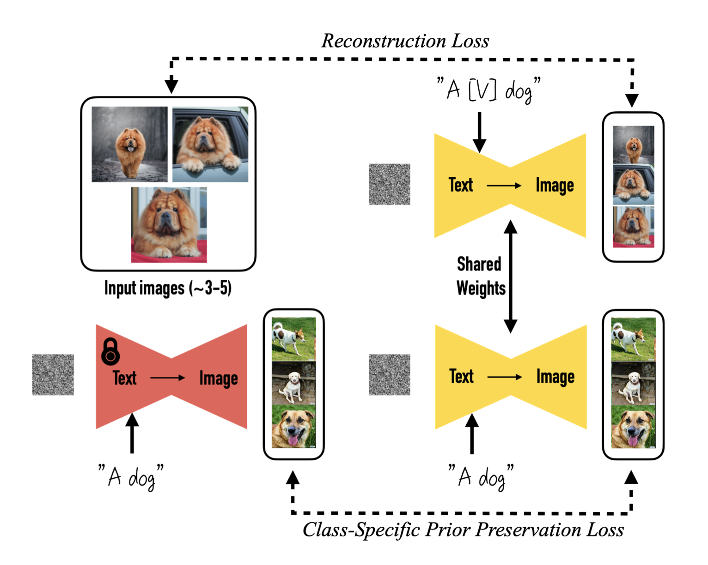

</div>

总的来说，DreamBooth技术在微调训练过程中，主要涉及以下几个关键步骤：

1. **选择目标实体**：在开始训练之前，首先需要明确要生成的目标实体或主题。这通常是一组代表性强、特征明显的图像，可以是人物、宠物、艺术品等。例如，如果目标是生成特定人物的图像，那么这些参考图像应该从不同角度捕捉该人物。

2. **训练数据准备**：收集与目标实体相关的图像。这些图像不需要非常多，但应该从多个角度展示目标实体，以便模型能够学习到尽可能多的细节。此外，还需要收集一些通用图像作为负样本，帮助模型理解哪些特征是独特的，哪些是普遍存在的。

3. **数据标注**：为了帮助大模型更好地识别和学习特定的目标实体，DreamBooth技术使用特定的描述词[V]来标注当前训练任务的数据。这些标注将与目标实体的图像一起输入模型，以此强调这些图像中包含的特定特征。

4. **模型微调**：使用这些特定的训练样本，对Stable Diffusion/FLUX模型或者LoRA模型进行微调训练，并在微调训练过程中增加class-specific prior preservation loss来进行正则化。

5. **验证测试**：微调完成后，使用不同于训练时的文本提示词（但是包含特定的描述词[V]），验证模型是否能够根据新的文本提示词生成带有目标实体特征的图像。这一步骤是检验微调效果的重要环节。

6. **调整和迭代**：基于生成的图像进行评估，如果生成结果未达到预期，可能需要调整微调策略，如调整学习率、增加训练图像数量或进一步优化特殊标签的使用。

**原始DreamBooth可以微调U-Net，并可选择微调文本编码器；DreamBooth LoRA则保留DreamBooth的数据组织、标识符和先验保持目标，但用LoRA参数化U-Net或Text Encoder的更新**。前者更新容量更高、单任务权重更大；后者更省显存与存储，也更适合社区分发和多任务切换。

DreamBooth LoRA不是把两个独立模型简单相加，而是“**DreamBooth训练范式 + LoRA参数化方式**”。

---
