# 目录

## 第一章 ControlNet模型技术基础

[1.介绍一下ControlNet的技术原理与模型架构](#q-001)
  - [面试问题：介绍一下ControlNet的整体模型架构和最小单元](#q-002)
  - [面试问题：ControlNet是如何处理条件图，并在AIGC图像创作大模型中起作用的？](#q-003)
  - [面试问题：ControlNet中的Zero Convolution初始权重为什么是0？Zero Convolution为什么有效？](#q-007)
  - [面试问题：ControlNet中Balanced、My prompt is more important、ControlNet is more important三种模式有什么区别？](#q-008)

[2.介绍一下ControlNet主流控制条件的原理与功能](#q-009)
  - [面试问题：ControlNet有多少种控制条件？介绍一下各控制条件的原理与功能](#q-010)
  - [面试问题：多个ControlNet如何组合使用？多条件控制时如何处理冲突？](#q-019)
  - [面试问题：ControlNet有哪些主流的AIGC应用案例？](#q-020)

[3.ControlNet是如何训练的？训练ControlNet模型的流程中有哪些关键参数？](#q-011)
  - [面试问题：介绍一下ControlNet的训练过程](#q-012)
  - [面试问题：如何设计一个新的ControlNet控制条件？训练数据集应该怎么构建？](#q-017)
  - [面试问题：介绍一下ControlNet的训练目标，有哪些关键的训练参数？](#q-013)

[4.ControlNet有哪些主流改进版本？](#q-015)
  - [面试问题：ControlNet 1.1与ControlNet相比，有哪些改进？](#q-016)
  - [面试问题：介绍一下ControlNet-Union的原理和架构](#q-018)

## 第二章 其他主流AIGC可控生成技术基础

[1.介绍一下个体微调式人像一致性技术的原理和多阶段生成流程，都有哪些经典算法？(进阶)](#q-027)
  - [面试问题：个体微调式人像一致性的核心原理和多阶段工作流是什么？(进阶)](#q-028)
  - [面试问题：介绍一下FaceChain的AI写真生成链路和技术原理](#q-029)
  - [面试问题：介绍一下EasyPhoto的AI写真生成链路和技术原理](#q-030)
  - [面试问题：个体微调式人像一致性技术中，有哪些关键的人脸处理算法？](#q-031)

[2.介绍一下免用户训练的人像一致性特征注入技术的原理，都有哪些经典算法？(进阶)](#q-021)
  - [面试问题：免用户训练人像一致性的本质原理和跨周期价值是什么？](#q-022)
  - [面试问题：PuLID系列如何通过身份编码与对比对齐兼顾身份保持和文本可编辑性？](#q-023)
  - [面试问题：InstantID如何通过人脸识别特征和关键点控制实现零样本身份保持？](#q-024)
  - [面试问题：EcomID这类电商人像一致性方案补齐了什么工程能力？](#q-025)

[3.介绍一下参考图特征注入与图层化编辑的核心原理，都有哪些经典算法？(进阶)](#q-032)
  - [面试问题：IP-Adapter如何将参考图特征注入扩散模型，并兼顾文本控制？](#q-033)
  - [面试问题：LayerDiffuse如何生成带透明通道的图像，并实现多图层协同生成？](#q-034)

[4.介绍一下特定生产任务如扩散超分修复、文字渲染和虚拟试衣等可控生成技术架构与原理(进阶)](#q-035)
  - [面试问题：SUPIR这类扩散超分修复技术的核心原理是什么？](#q-036)
  - [面试问题：AnyText这类文字渲染技术为什么能提升图像中文字的可控性？](#q-037)
  - [面试问题：IDM-VTON这类虚拟试衣技术如何同时保持人物、服装和结构一致？](#q-038)

---

# 第一章 ControlNet模型技术基础

<h1 id="q-001">1.介绍一下ControlNet的技术原理与模型架构</h1>

<h2 id="q-002">面试问题：介绍一下ControlNet的整体模型架构和最小单元</h2>

**难度评分：⭐⭐⭐⭐ (4/5)  |  考察频率：⭐⭐⭐⭐⭐ (5/5)**

文本Prompt擅长描述语义，但很难稳定约束姿态、边缘、深度、构图、局部区域和物体关系。ControlNet解决的正是这个问题：**在不破坏底座生成能力的前提下，为扩散模型增加一个额外的可训练、可插拔、可组合的条件控制模块。**

ControlNet是一种“辅助式”的神经网络模型结构，通过在Stable Diffusion/FLUX模型中添加辅助模块，从而引入“额外条件”来控制AIGC图像的创作过程。

ControlNet作为AIGC可控生成技术的“绝对领袖”，具备在AIGC时代作为跨周期技术工具的能力。其跟随开源生态中主流大模型Stable Diffusion 1.5 -> Stable Diffusion XL -> Stable Diffusion 3 -> FLUX.1 -> FLUX.1 Kontext -> FLUX.2的发展，也持续的完善其算法思想和模型架构。同时ControlNet很多的优化思想也被原生图像生成&图像编辑大模型所借鉴，ControlNet展现出了顽强的技术生命力。

如果从生成建模角度看，加入ControlNet后的扩散模型可以理解为一种“双条件扩散模型”：原来的文本条件负责“生成什么”，ControlNet提供的外部结构条件负责“按照什么形状、姿态、空间关系和局部约束生成”。让模型在去噪过程中同时理解文本语义和视觉结构信息。下图是ControlNet模型核心架构：

<div align="center">

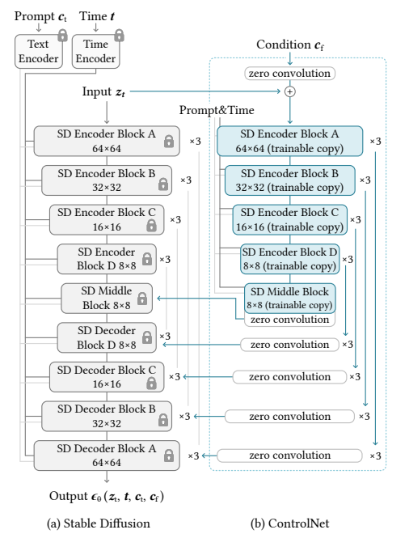

</div>

从模型结构看，ControlNet的核心特点如下所示：

1. **冻结原始扩散模型，保留底座能力**。Stable Diffusion、SDXL、FLUX或其他扩散底座已经从大规模图文数据中学到了丰富的视觉先验。如果直接微调整扩散模型，模型很容易在小规模控制数据上过拟合，并且破坏原模型的泛化能力。ControlNet选择保留原始扩散模型参数，让底座能力成为稳定基线。
2. **复制一条可训练分支，学习条件控制**。我们以经典Stable Diffusion ControlNet为例，其通常会复制U-Net的Encoder和Middle Block等关键结构作为可训练分支，让它接收边缘图、姿态图、深度图、分割图等条件图，从这些条件中学习“应该如何影响去噪特征”。到了SDXL、FLUX这类新模型底座上，复制对象和注入位置会随架构变化，但“冻结底座 + 训练控制分支”的思想依旧延续。
3. **用Zero Convolution安全注入控制残差**。控制分支不会一开始就强行干预底模，而是通过零初始化的1x1卷积输出残差。训练初期残差为0，模型等价于原始扩散模型；随着训练推进，控制残差逐渐学会在合适层级影响生成。
4. **多层特征融合，而不是只在输入端拼接条件。** 以Stable Diffusion ControlNet为例，ControlNet并不是简单把条件图和噪声Latent拼在一起，而是在U-Net不同分辨率层级注入控制特征。低层更偏边缘与纹理，高层更偏结构与语义，这也是它能控制复杂画面的关键。

我们进一步拆到最小单元，ControlNet的最小运行模块可以理解为“冻结主干 + 可训练副本 + 零初始化残差连接”，如下图所示：

<div align="center">


</div>

我们可以看到，原始扩散模型的网络块被复制成两条路径：冻结网络块保持冻结，可训练副本接收条件输入并学习控制残差，最后通过零卷积把残差加回主干特征。

更本质的说，ControlNet的最小单元体现的是一种经典系统设计思想，**不要改坏一个已经很强的系统，而是在旁边接一条可控、可学习、可回退的增量路径。** 这就是它比“直接把条件图拼到输入里”更稳定的原因。它学习的不是重新画图的全部能力，而是学习“外部条件应该怎样变成去噪过程中的控制残差”。


<h2 id="q-003">面试问题：ControlNet是如何处理条件图，并在AIGC图像创作大模型中起作用的？</h2>

**难度评分：⭐⭐⭐⭐ (4/5)  |  考察频率：⭐⭐⭐⭐⭐ (5/5)**

在以Stable Diffusion和FLUX.1为核心的AIGC图像创作过程中，想要ControlNet起作用，首先我们需要输入一张参考图，通过预处理器 (Preprocessor)对输入参考图按一定的模式进行预处理，通常是使用传统的计算机视觉算法（如边缘检测、人体姿态估计、深度估计等）来从输入参考图中提取出纯粹的控制信息，也就是我们常说的条件图像(Conditioning Image)。

这里要先区分两个概念：**预处理器不是ControlNet本体，ControlNet模型也不是预处理器**。预处理器负责把人类能看懂的参考图转成边缘、深度、姿态、分割、线稿等条件图；ControlNet负责学习这些条件图在扩散去噪过程中应该如何影响中间特征。如果用户已经有手工绘制或其他模型生成好的条件图，也可以跳过预处理器，直接把条件图输入ControlNet。具体流程如下图所示：

<div align="center">

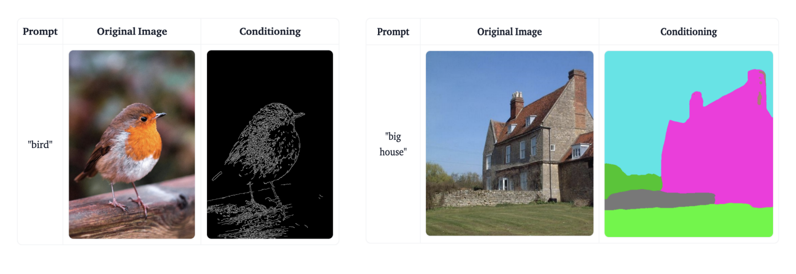

</div>

真正进入ControlNet后，条件图会通过一个轻量卷积编码网络转换为与U-Net/Transformer特征尺度匹配的条件特征。这里有一个容易被忽略的点：Stable Diffusion工作在Latent空间，512x512像素图通常会被VAE压缩到64x64 Latent特征；ControlNet也必须把条件图对齐到扩散特征所在的空间尺度，否则条件无法稳定参与去噪。

**ControlNet处理条件图的本质，是把人类可理解的结构信号转换成扩散模型可使用的多尺度特征残差。预处理器负责提取条件，条件编码器负责对齐尺度，ControlNet分支负责学习这些条件应该在去噪过程的哪些层级发挥作用。** 条件图质量决定控制上限，ControlNet训练质量决定模型到底会不会用这个条件。完整的ControlNet模型推理流程具体如下图所示：

<div align="center">

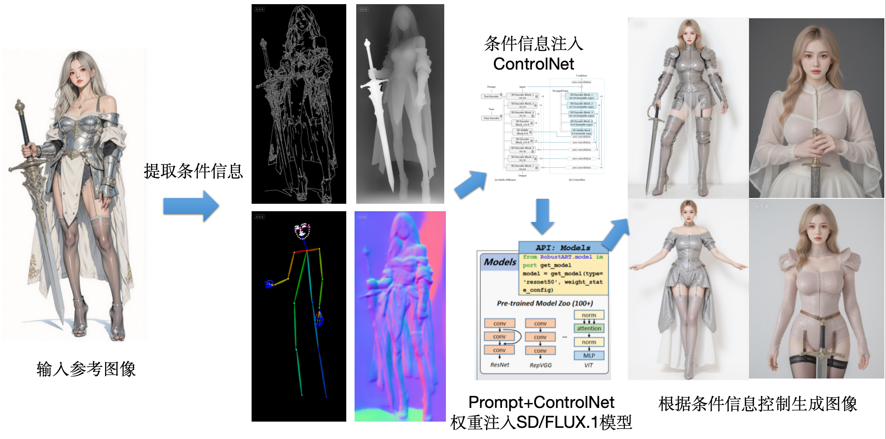

</div>

总的来说，Rocky认为ControlNet做的就是这样一件事：它为扩散模型（如 Stable Diffusion/FLUX等）提供一种额外的“约束”条件，引导AIGC大模型按照我们期望的构图、姿态或结构来生成图像，减少图像生成的随机性。**从跨周期角度看，这个思想会一直存在**：无论AIGC图像创作大模型如何优化升级，生产级商业化落地都绕不开结构控制、参考控制和局部控制等功能辅助。


<h2 id="q-007">面试问题：ControlNet中的Zero Convolution初始权重为什么是0？Zero Convolution为什么有效？</h2>

**难度评分：⭐⭐⭐⭐ (4/5)  |  考察频率：⭐⭐⭐⭐⭐ (5/5)**

Zero Convolution是ControlNet结构中一个特殊的模块，因为它看起来反直觉：如果卷积权重初始化为0，会不会导致梯度也为0，最终什么都学不到？

**答案是不会**。我们假设一个简化的一维线性层为：

```math
y = wx + b
```

它的梯度是：

```math
\frac{\partial y}{\partial w}=x,\quad \frac{\partial y}{\partial x}=w,\quad \frac{\partial y}{\partial b}=1
```

当初始化时 $w=0$ 且 $x \neq 0$，可以得到：

```math
\frac{\partial y}{\partial w}\neq 0,\quad \frac{\partial y}{\partial x}=0,\quad \frac{\partial y}{\partial b}\neq 0
```

也就是说，当构建零卷积并进行第一步反向传播时，权重 $w$ 仍然可以被更新；一旦 $w$ 从0变成非零，后续输入方向的梯度也会逐渐打开。所以Zero Convolution不是让网络永远静默，而是让它在训练初期“安全静默”，等到学到有效控制残差后再逐步介入。具体流程如下图所示：

<div align="center">


</div>

它的工程价值可以概括为三点：

1. **初始等价于原模型。** 未训练ControlNet时，控制分支输出为0，基座模型的原生效果不会被破坏。
2. **避免随机噪声污染。** 如果新增分支随机初始化，一开始就会往扩散模型中注入随机噪声，训练会更不稳定。
3. **让控制能力从数据中学习。** 控制能力从数据和损失函数约束下逐渐学习得到。

<h2 id="q-008">面试问题：ControlNet中Balanced、My prompt is more important、ControlNet is more important三种模式有什么区别？</h2>

**难度评分：⭐⭐⭐⭐ (4/5)  |  考察频率：⭐⭐⭐⭐⭐ (5/5)**

Balanced、My prompt is more important、ControlNet is more important这三种模式本质上是在调节在ControlNet控制过程中，“文本语义”和“结构条件”谁拥有更高控制权。**ControlNet不是替代Prompt，而是和Prompt一起构成控制系统，我们需要根据不同情况进行调控**。下表中包含了三种模式的特点介绍：

<div align="center">

| 模式 | 控制倾向 | 适合场景 | 风险 |
|---|---|---|---|
| Balanced | Prompt和ControlNet相对均衡 | 大多数普通生图、姿态控制、构图参考 | 两边都不极端，复杂冲突时可能不够坚定 |
| My prompt is more important | 更尊重文本语义信息 | 希望保留Prompt指定风格、主体、服装、表情 | 条件图约束可能变弱，结构跟随不够严格 |
| ControlNet is more important | 更尊重条件控制信息 | 精准姿态、建筑线稿、产品结构、固定构图 | Prompt可编辑空间变小，生成可能显得拘谨 |

</div>

实际使用时还要结合任务类型判断：扩图、局部重绘、精准姿态、建筑线稿、产品轮廓这类任务通常更需要结构条件强一些；风格迁移、主体替换、创意海报这类任务则要给Prompt留出更大语义空间。

<h1 id="q-009">2.介绍一下ControlNet主流控制条件的原理与功能</h1>

<h2 id="q-010">面试问题：ControlNet有多少种控制条件？介绍一下各控制条件的原理与功能</h2>

**难度评分：⭐⭐⭐⭐ (4/5)  |  考察频率：⭐⭐⭐⭐⭐ (5/5)**

ControlNet的条件类型很多，我们可以按“控制信息层级”来进行归纳，来体现可控生成的底层逻辑。比如低层几何控制、中层空间结构控制、高层语义区域控制、风格纹理控制、局部编辑控制。具体分类可以如下表所示：

<div align="center">

| 控制类别 | 典型模型/预处理器 | 控制对象 | 核心价值 |
|---|---|---|---|
| 边缘与线条 | Canny、MLSD、Scribble、SoftEdge、Lineart | 轮廓、线稿、直线结构 | 把构图和物体轮廓固定下来 |
| 几何与3D | Depth、Normal | 深度层次、表面朝向 | 保持空间关系、透视和立体感 |
| 姿态与关键点 | OpenPose、DW-Pose、Face Keypoints | 人体动作、手部、脸部关键点 | 解决人物动作和多人构图难控问题 |
| 语义与区域 | Segmentation、Mask、Inpaint | 天空、人物、衣服、背景等区域 | 支持像素级区域编辑和局部重绘 |
| 纹理与风格 | Shuffle、Reference、Tile | 色彩、纹理、局部细节 | 让参考图的风格或细节参与生成 |
| 参考图与图像提示 | Reference-only、Revision、IP-Adapter | 图像语义、风格、内容参考 | 把参考图从“人类灵感”变成模型可读条件 |

</div>

下图中也选取了几个常用的ControlNet控制条件进行展示：

<div align="center">


</div>

在实际应用场景中，当我们需要进行边缘与线条控制，**轮廓必须严格对齐时，我们优先使用Canny、Lineart、Scribble、SoftEdge、MLSD等控制**。Canny适合清晰边缘；MLSD适合建筑、室内、产品这类直线结构；Scribble适合粗糙草图；SoftEdge比Canny更柔和，适合自然物体；Lineart更适合动漫线稿和艺术作品。

当我们需要进行几何与3D控制，**空间和三维关系在场景中非常重要时，我们优先使用Depth或Normal等控制**。Depth控制前景、中景、背景的距离层次；Normal控制表面朝向和局部几何细节。它们比边缘更接近空间理解，适合室内设计、建筑渲染、产品展示和复杂场景重绘。

当我们需要进行**姿态、关键点与语义区域控制，人物动作、手势和表情要稳定时，我们优先用OpenPose、DW-Pose、人脸关键点、语义分割和Mask处理等控制**，本质上是在把人类关注的高层结构显式化。比如人物姿态、手部动作、面部关键点、天空/衣服/道路/人物区域等。这类控制条件非常接近实际生产需求：电商要固定模特姿态，短剧海报要固定多人站位，AI写真要固定脸部结构，设计图要固定区域布局。

当我们需要进行**风格、纹理和局部细节控制时，我们优先使用Tile、Shuffle、Reference-only、Revision或IP-Adapter等控制**，这类能力不控制明确结构，而是控制颜色分布、纹理密度和局部细节。Tile在超分和局部重绘里很重要，因为它可以在不完全改变原图大结构的情况下补充高频细节。


<h2 id="q-019">面试问题：多个ControlNet如何组合使用？多条件控制时如何处理冲突？</h2>

**难度评分：⭐⭐⭐⭐ (4/5)  |  考察频率：⭐⭐⭐⭐ (4/5)**

单个ControlNet已经能够在扩散模型中引入一种外部条件，多个ControlNet（Multi ControlNet）同时使用，可以让多个外部条件共同作用于同一次AIGC图像创作过程。真实应用场景里很少只有一种控制需求：AI写真可能既要固定人物姿态，又要保持脸部结构，还要参考某种风格；室内设计可能既要遵守深度透视，又要保留墙线和家具区域；电商商品图可能既要保持商品轮廓，又要重绘背景和局部材质。下图是多个ControlNet组合的示意图：

<div align="center">


</div>

我们举例一些在现实场景中的常见多ControlNet组合应用，具体如下表所示：

<div align="center">

| 组合方式 | 控制目标 | 典型场景 |
|---|---|---|
| OpenPose + Depth | 人物姿态 + 空间结构 | 人像、多人海报、短剧分镜 |
| Canny/Lineart + Tile | 轮廓保持 + 细节重建 | 动漫上色、产品超分、老图修复 |
| Segmentation + Inpaint | 区域布局 + 局部编辑 | 换背景、换衣服、广告图编辑 |
| Depth + IP-Adapter/Reference | 空间结构 + 参考风格 | 室内设计、风格迁移、场景重绘 |
| OpenPose + Face Keypoints | 身体动作 + 面部结构 | AI写真、数字人海报 |

</div>

多个ControlNet增加了可用的控制信息，也增加了条件之间相互干扰的可能。**组合是否有效，首先取决于这些条件能否共同互补作用在同一个目标中**。一张要求人物站立的姿态图，与一张保留人物坐姿的深度图，即使分别控制得很好，放在一起也未必能得到合理结果。

以经典Multi-ControlNet实现为例，各分支在对应层输出控制残差，分别缩放后再相加，注入同一个生成主干。这个融合过程没有自动判断“哪张条件图正确、哪个需求更重要”的仲裁机制。相互矛盾的信号可能使某个条件被忽略，也可能导致结构折中、重复轮廓或局部畸变；即使条件并不矛盾，过强的重复控制也会影响画质和可编辑空间。

多条件组合可能产生哪些冲突？下表中汇总的一些常见的冲突现象：

<div align="center">

| 冲突类型 | 典型情况 | 可能出现的结果 |
|---|---|---|
| **几何与布局矛盾** | OpenPose要求抬手，Depth或Canny仍保留放下的手臂；分割图中的人物区域也没有为新姿态留出空间 | 姿态执行不完整、肢体变形、轮廓重影，或某一路控制基本失效 |
| **坐标与预处理不一致** | 条件图使用了不同的裁剪、缩放或翻转；骨架、边缘和深度中的同一人物没有对齐 | 主体错位、边缘拉扯、重复对象；即使控制图来自同一原图，也可能发生 |
| **文本语义与视觉条件矛盾** | Prompt要求侧脸，条件图固定正脸；要求移除椅子，边缘图和分割图却继续保留椅子 | 指令执行不足，或生成结果勉强同时满足两类要求，产生不自然结构 |
| **参考内容与编辑目标冲突** | 希望更换材质或姿态，却用强Tile控制保留原图外观；风格参考同时带入了不需要的人物、物体或构图 | 旧内容残留、修改幅度不足、参考图中的无关元素进入结果 |
| **重复约束与控制过强** | Canny、Lineart和SoftEdge同时强化相近轮廓，或多个分支都在整个采样过程中保持较高权重 | 线条过硬、纹理生硬、颜色失真，模型缺少补全自然细节的空间 |

</div>

当我们发现多ControlNet功能冲突已经产生时，我们需要如何定位并解决冲突。

处理顺序应当是：**先修正不一致的条件，再确定任务优先级，最后调整权重、作用时段和区域。** 如果多个条件信息的控制表达的是互斥的，仅靠反复调参通常只能让模型在这些控制条件之间妥协。

一般来说，**第一步，我们检查条件信息是否正确**。将各条件信息叠加到同一画布上，检查主体位置、尺度、姿态、透视和遮挡是否对应。

然后**第二步，根据任务确定主条件和辅助条件**。例如，产品图要求外轮廓不能变，可以将轮廓作为主条件，把色彩、风格参考作为辅助；但任务如果是改变人物姿态，新姿态才是主条件，旧照片中的人体深度与边缘就需要修改或放松。所谓“硬结构优先”，应当指当前任务中必须保持的结构，不能把所有已有结构都设为最高优先级。

接着**第三步，先验证单条件，再逐个加入辅助控制**。我们固定Prompt、随机种子、采样器、步数和尺寸，先验证主条件能够独立完成基本目标，再一次加入一个辅助分支，逐步消除不同控制信息的硬冲突。

再进行**第四步，分别调整权重，并删除没有贡献的重复条件**。我们通常先降低与主目标冲突的辅助分支权重，而不是同时提高所有控制强度。Canny与Lineart已经表达相近轮廓时，可以先保留效果更稳定的一种。不同分支的输出幅度和控制方式并不完全相同，相同权重不代表相同影响力。应观察结构跟随、指令执行和画质三个方面，而不是只看条件图是否被复制得更像。

我们还可以额外进行**第五步，调整介入时段，减少全过程的重复干预**。在支持的框架中，可以为每一路设置Control Start／End，或使用`control_guidance_start`、`control_guidance_end`一类参数控制其作用的采样区间。对于不少扩散模型，采样前段对构图影响较大，可以尝试让主结构条件较早参与，让辅助条件缩短作用区间。

最后我们按需进行**第六步，必要时按区域或阶段拆分控制。** 人物姿态与背景空间分别承担不同要求时，可以在工作流支持的情况下，使用明确的控制mask或区域权重限制其作用范围。

具体来说，当我们使用OpenPose＋Depth＋Canny将一张坐姿人像改成站姿时，新骨架与旧图的人体深度、轮廓可能同时冲突。可以先用OpenPose验证站姿是否合理，再更新其他条件图中的人物区域，或借助支持区域控制的工作流，仅保留背景中仍然有效的空间约束。主体结构确认后，再使用新结果做细节修复。这样每一路条件都有明确职责，也更容易找到真正影响结果的环节。


<h2 id="q-020">面试问题：ControlNet有哪些主流的AIGC应用案例？</h2>

**难度评分：⭐⭐⭐ (3/5)  |  考察频率：⭐⭐⭐⭐ (4/5)**

ControlNet适合处理带有明确视觉约束的创作任务：商品换了背景，外形仍要保持；室内换了装修风格，门窗位置不能随意移动；人物换了服装，动作还要符合指定姿态。这些要求很难只靠文字描述准确传达，可以先转成边缘、深度、姿态或分割图，再通过ControlNet参与生成。不同应用的区别，主要在于哪些信息需要保留、哪些内容允许改变，一些详细例子如下表中所示：

<div align="center">

| 应用场景 | 具体创作需求 | ControlNet如何参与流程 | 结果检查与使用边界 |
|---|---|---|---|
| **AI写真与人物姿态设计** | 按指定动作、朝向和站位生成写真、角色图或分镜 | 从参考动作提取姿态关键点，检查并修正骨架，再通过姿态ControlNet约束人物生成；需要保持身份时，另行加入身份参考能力 | 检查关节连接、手脚位置和遮挡关系；姿态符合要求与身份一致需要分别验证 |
| **电商商品场景图** | 为商品更换背景、搭建展示场景，同时尽量保持商品外形 | 根据任务使用轮廓或深度条件约束商品与场景关系，配合蒙版限定编辑区域；需要准确保留商品时，保留原始商品图层，再处理背景、接触阴影和边缘衔接 | 检查轮廓、比例、Logo、文字和材质；边缘或深度控制不能保证商品细节原样保留 |
| **室内设计与建筑效果图** | 在已有房间或建筑结构上探索不同材质、家具配置和装修风格 | 从实拍图或三维灰模提取深度、直线或法线条件，约束空间层次与主要结构，再由文本描述材质和风格；调整布局时同步更新条件图 | 检查门窗位置、墙体连接、透视和遮挡；效果图仍需与实际尺寸及设计要求核对 |
| **动漫线稿上色与草图细化** | 将已有线稿、分镜草图转成完整画面，保留主要轮廓和动作 | 根据输入完整程度选择Lineart、Scribble或SoftEdge条件，再结合色彩描述或配色参考生成结果 | 检查轮廓偏移、线条粘连和色块越界；线稿提供形状信息，角色配色和跨图一致性需要额外约束 |
| **海报与视觉设计** | 控制主体位置、前后层次和留白，便于后续排版 | 用分割图或布局草图表达区域安排，必要时加入深度条件，再通过局部编辑调整元素；准确文字和Logo可在排版阶段加入 | 检查主体占位、留白和视觉层级；分割控制不能保证字号、字距及像素级版式准确 |
| **图像修复与高清细化** | 修补局部缺损、改善模糊区域，或在放大后补充纹理 | 用蒙版指定修复范围，在支持的工作流中结合Inpaint控制；用Tile条件配合图生图或分块重绘，依据局部图像内容生成细节 | 检查身份变化、纹理伪造、分块接缝及重复结构；视觉上更清晰不代表恢复了真实细节 |
| **视频转绘与动画分镜辅助** | 跟随原视频动作进行画风转换，或按动作序列生成分镜 | 提取连续帧的姿态、深度或线稿，校正检测抖动，再将这些条件交给支持相应控制的生成流程；连续视频还需要时序一致性处理 | 检查动作跟随、身份漂移、纹理闪烁和遮挡变化；逐帧结构约束不能独立解决时间连续性 |

</div>


<h1 id="q-011">3.ControlNet是如何训练的？训练ControlNet模型的流程中有哪些关键参数？</h1>

<h2 id="q-012">面试问题：介绍一下ControlNet的训练过程</h2>

**难度评分：⭐⭐⭐⭐ (4/5)  |  考察频率：⭐⭐⭐⭐ (4/5)**

训练ControlNet模型需要将其加载在Stable Diffusion/FLUX等扩散模型中，ControlNet训练的目标，是让AIGC图像创作大模型学会利用边缘、姿态、深度等额外条件。Stable Diffusion/FLUX等底座大模型已经具备图像生成能力，控制分支需要学习的是：面对当前的带噪图像，应该提供哪些特征，才能让生成结果更符合给定的结构要求。

**我们以基于Stable Diffusion的经典ControlNet为例**，整个训练过程通常冻结VAE、文本编码器和原有U-Net参数，只更新新增的控制分支、条件编码模块及零卷积连接层。

经典ControlNet从U-Net的编码器和中间块复制对应权重，构建可训练分支，同时增加处理条件图的编码模块，以及连接底座的零卷积层。

这样初始化之后，控制分支已经具有一定的图像特征处理能力，不必从随机参数开始学习全部视觉知识。新增输出连接采用零初始化，使控制残差在训练开始时为零；在相同输入和运行设置下，接入尚未训练的控制分支不会立即改变底座的预测。零卷积随后会在训练误差的作用下更新，控制分支逐步参与生成。

ControlNet的训练数据通常由三部分组成：

1. **目标图像**：也就是模型最终应该生成的Ground Truth图像。
2. **条件图像**：从目标图像或配对参考图中提取的边缘、姿态、深度、分割等控制条件。
3. **描述目标内容的Caption标签**：对目标图像的Caption或Prompt，用于保留文本语义控制能力。

例如，训练姿态ControlNet时，可以从人物照片提取骨架，将照片作为目标图像、骨架作为控制条件，再配上人物、服装和场景的文本描述Caption标签。模型通过这些样本学习骨架与人物图像之间的对应关系。

条件图像与目标图像需要保持空间对齐。裁剪、缩放或翻转目标图像时，应同步处理条件图像，避免骨架位于画面左侧，而目标人物已经被翻转到右侧的情况。具体如下图所示：

<div align="center">


</div>

有了上述的训练数据，我们可以开始进行ControlNet模型训练。ControlNet具体的一次训练迭代过程，如下图所示：

<div align="center">


</div>
 
如上图所示，目标图像先经过冻结的VAE编码器，转换为干净潜变量 $z_0$ ，随后为每个样本随机选择时间步 $t$ ，采样高斯噪声 $\epsilon$ ，按照噪声调度规则构造带噪潜变量 $z_t$ 。与此同时，Caption标签经过文本编码器形成文本特征，条件图像进入ControlNet的条件编码模块。经典训练流程通常对目标潜变量加噪，条件图像则作为已知约束保留下来，不随目标潜变量一起执行同样的加噪过程。

接着，可训练控制分支接收带噪潜变量、时间步、文本特征和条件图特征，在多个尺度上提取控制信息。各层特征经过零卷积等输出连接，形成与底座大模型相应特征尺寸匹配的控制残差。

这些残差被注入冻结U-Net的对应位置，与原有生成特征共同参与后续计算。最终的噪声预测由加入控制信息后的完整扩散模型网络给出。

因此，ControlNet分支通常输出的是供扩散模型使用的中间特征。它通过改变扩散模型内部的特征表示，影响当前时间步的预测结果。模型预测噪声后，就可以计算预测值与真实噪声值之间的均方误差。

得到损失后，梯度沿着“最终预测—底座大模型中的相关计算—可训练控制残差—可训练控制分支”这条路径反向传播。优化器只更新被设置为可训练的控制模块，冻结的底座大模型参数保持不变。

上述流程以经典Stable Diffusion ControlNet为例。迁移到其他底座大模型时，需要根据实际底座大模型架构，同步调整控制分支结构、训练方式以及预测目标等。


<h2 id="q-017">面试问题：如何设计一个新的ControlNet控制条件？训练数据集应该怎么构建？</h2>

**难度评分：⭐⭐⭐⭐ (4/5)  |  考察频率：⭐⭐⭐⭐ (4/5)**

设计新的ControlNet控制条件，并训练一个新的ControlNet模型最关键的是**控制条件设计**。首先我们要把控制任务的要求充分理解，用户希望通过这个条件对哪些内容进行控制生成，又希望哪些内容继续由文本或模型决定如何生成。

例如，姿态控制需要指定人物动作，但通常仍希望自由改变服装、场景和画风；商品轮廓控制需要保留外形，却不一定要求保留原图的背景。条件表示应围绕这些要求取舍信息。表达过少，模型无法准确理解约束；带入过多无关内容，又容易限制后续编辑。

**因此，我们首先需要确认现有控制方式还缺少什么能力。**

在构建新数据集之前，可以先用现有的边缘、姿态、深度或分割控制做一轮验证。如果现有条件已经能表达需求，问题主要出在提取质量、参数设置或底座能力上，优先修正这些环节通常更有效。

当任务需要的信息确实无法被现有条件充分表达时，再考虑设计新的表示。例如，普通语义分割图能够标记“人物”区域，却未必能够区分多个人物各自的身份编号；商品的外轮廓也不能完整表达内部部件的位置关系。这时，需要先定义新增信息，再决定怎样将其输入控制分支。

**接着，我们再确定条件的表示方式和解释规则。**

条件图像需要有明确、稳定的含义。以关键点为例，要确定每个点对应哪个部位、点之间怎样连接、左右侧如何区分，以及遮挡或检测失败时怎样处理。深度图像需要统一近远方向和数值归一化，分割图像需要统一类别编码，法线图像则需要统一坐标系和通道含义，这些规则应在数据生成、训练和推理三个阶段保持一致。

**然后，我们开始构建条件与目标对应的数据对。**

训练样本通常仍由目标图像、条件图像和Caption标签组成。目标图像提供希望模型学会生成的内容，条件图像表达需要遵守的结构，Caption标签补充主体、材质、风格、环境等语义信息。

配对数据主要可以通过几种方式获得：
- 从真实图像自动提取：使用边缘检测、姿态估计、深度估计或分割模型生成条件，适合批量构建数据。
- 人工标注或人工修正：适合特殊部件、专业布局、遮挡关键点等自动模型处理不稳定的任务。
- 通过三维渲染或程序化方式生成：同时获得图像与深度、法线、分割等条件，便于控制样本分布，但需要关注合成图像与真实使用场景的差异。
- 使用已有的配对资源：例如线稿与成稿、布局与设计图。

每个样本都要有可靠的对应关系，但不要求一个条件只能对应一张图。对于姿态、草图或布局等条件，多种外观都可能符合相同约束，这种变化也是模型需要学习的生成空间。裁剪、缩放、旋转和翻转时，目标图与条件图必须使用一致的空间变换。

数据清洗时，除了检查目标图是否模糊、重复，还要检查条件本身：是否漏掉主体、关键点是否连错、深度是否异常、类别是否误标。可以先用自动规则筛选，再对不同任务类别、姿态和质量区间分层抽查，避免只看少量正常样本。

**同时，Caption标签应准确描述图像，同时给条件之外的变化提供语义依据。**

以人物姿态任务为例，骨架主要表达动作与空间位置，Caption标签可以描述人物、服装、环境、光照和风格。描述应与实际图像一致，不应加入图中不存在的属性，也不应只堆叠“高清、精美”等泛化词。

条件图与Caption标签之间可以存在信息重叠，不需要刻意删除Caption标签中的所有动作描述。更需要关注的是，两种输入是否共同描述同一张目标图，以及数据是否提供了足够丰富的属性组合。

如果某种动作总与同一种服装共同出现，模型就可能把二者绑定。因此，数据应尽量覆盖相近动作下的不同服装、不同背景，以及相近外观下的不同姿态，让模型有机会学到哪些属性由条件约束、哪些属性可以随文本变化。

最后，我们举一个人脸关键点ControlNet的例子：如果目标是让AIGC图像创作大模型更稳定地在生成过程中，保持人物脸部结构，就可以用人脸检测/关键点模型从原图中提取关键点热图或骨架图，作为条件图像。再用Caption标签描述人物、服装、场景、光照和风格。ControlNet模型训练完成后，用户就可以用人脸关键点控制面部结构，再用Prompt改变风格、妆容、服装和场景。


<h2 id="q-013">面试问题：介绍一下ControlNet的训练目标，有哪些关键的训练参数？</h2>

**难度评分：⭐⭐⭐⭐ (4/5)  |  考察频率：⭐⭐⭐⭐ (4/5)**

**ControlNet通常沿用底座大模型的预测目标**。在保留底座大模型原有生成能力的基础上，训练ControlNet控制分支，让边缘、姿态、深度等条件能够帮助底座大模型完成当前时间步的预测。**我们以冻结Stable Diffusion底座、只训练ControlNet的方案为例，可以把ControlNet的训练目标写成：**

```math
\mathcal{L}=\mathbb{E}_{z_0,t,\epsilon,c,y}\left[\left\|\epsilon-\epsilon_\theta(z_t,t,y,c)\right\|_2^2\right]
```

其中 $z_0$ 是目标图像经过VAE编码后的干净潜变量， $z_t$ 是加噪后的Latent特征， $t$ 是时间步， $y$ 是文本条件， $c$ 是控制条件， $\epsilon_\theta$ 是加上ControlNet后的完整噪声预测网络。

**ControlNet一般来说不需要设计全新的损失函数，因为它的学习目标不是重新定义生成任务，而是让原有去噪任务在额外条件下完成得更稳定**。真正影响训练效果的，往往是目标图像质量、条件图像质量、Caption标签质量、关键参数设计等。

下表展示了ControlNet训练时的关键训练参数：

<div align="center">

| 训练设置 | 核心作用 | 选择与调整时需要注意什么 |
|---|---|---|
| **可训练范围** | 决定哪些模块可以改变 | 经典方案冻结VAE、文本编码器和生成主干，训练控制模块；若解冻部分底座，就改变了优化范围，需要重新评估学习率、显存与原有能力保持 |
| **学习率与学习率调度** | 控制每次更新的幅度及其随训练进程的变化 | 学习率过大可能造成损失震荡或生成质量退化，过小则进展缓慢；warmup与衰减是否适用，应结合初始化、优化器和训练时长判断 |
| **有效batch size与梯度累积** | 决定一次参数更新汇总多少样本的梯度 | 增大有效batch有助于降低梯度估计的随机波动，但在相同样本处理量下也会减少更新次数；调整时需同时记录学习率、更新步数和样本量 |
| **训练步数与数据重复次数** | 决定模型接受多少次更新、重复学习多少数据 | 训练更久可能改善控制，也可能加重过拟合；应根据独立验证结果选择checkpoint权重，不能只取训练损失最低的版本 |
| **训练分辨率与长宽比分桶** | 决定训练时可见的细节、空间尺度和形状分布 | 高分辨率更有利于保留小结构，但会增加计算与显存；多尺寸训练需匹配底座支持方式，并保证图像与条件同步变换 |
| **文本置空与条件扰动（条件dropout）策略** | 改变训练中可获得的条件信息 | 置空文本、扰动条件和丢弃控制图分别对应不同问题；是否启用以及比例大小，应由实际输入场景和对照实验决定 |
| **优化器、权重衰减与梯度裁剪** | 影响参数更新方式、正则化和数值稳定性 | 可以从成熟训练实现的配置起步；梯度裁剪可限制异常大的更新，但无法修复错误配对、目标不匹配等根本问题 |

</div>

**在测试验证ControlNet的训练效果时**，我们可以固定一组条件信息、Prompt、随机种子和推理设置，对不同的ContrlNet训练checkpoint权重进行比较，重点检查：
  - 结构是否跟随：改变姿态、轮廓或布局后，生成结果是否出现相应变化。
  - 文本是否仍能发挥作用：保持结构条件不变，改变与之相容的服装、材质或场景描述，结果是否响应。
  - 图像质量是否退化：控制变强的同时，是否出现重复边缘、纹理生硬、颜色异常或局部畸变。
  - 能力是否能泛化：换用未参与训练的人物、场景、构图或实际条件输入后，效果是否仍然稳定。


<h1 id="q-015">4.ControlNet有哪些主流改进版本？</h1>

<h2 id="q-016">面试问题：ControlNet 1.1与ControlNet相比，有哪些改进？</h2>

**难度评分：⭐⭐⭐ (3/5)  |  考察频率：⭐⭐⭐⭐ (4/5)**

**ControlNet 1.1延续了初代ControlNet的核心网络架构，它的主要优化集中在训练数据、条件预处理和任务覆盖度上。ControlNet 1.1修正原有控制模型的鲁棒性问题，使模型适应更多实际的复杂输入，并增加线稿、局部重绘、细节重绘和指令编辑等新的ControlNet模型能力**。

最首要的是，ControlNet 1.1修复了会直接影响生成结果的训练数据问题。

初代ControlNet部分模型的训练数据中，存在灰度人像重复过多、图像模糊或压缩伪影明显、图像与文本错误配对等问题。重复数据会改变模型实际看到的样本分布，错误Caption标签会干扰文本与图像的对应关系，低质量目标图像也会影响生成质量。

ControlNet 1.1对这些问题进行了修正，并对多种已有ControlNet模型继续训练。因此，即使网络结构保持不变，新版本模型仍然可以获得更合理的生成分布和控制表现。不同控制类型的改进，主要体现在下表中：

<div align="center">

| 控制类型 | ControlNet 1.1的具体改进 | 改进作用 |
|---|---|---|
| **Canny、MLSD与Scribble** | Canny使用随机阈值生成训练条件；MLSD补充直线结构丰富的图像；Scribble通过形态学变换覆盖更粗、更细的笔画 | 用户提供的边缘密度、直线数量和涂鸦粗细并不固定，训练需要覆盖这些实际变化 |
| **Depth** | 混合MiDaS、LeReS、Zoe等深度来源，并使用不同的预处理分辨率 | 不同估计器输出的深度图在边界、尺度和局部细节上存在差异，混合训练有助于减少对某一种预处理输出的依赖 |
| **Normal** | 使用专门的法线估计器，替代初代从深度图近似构造法线的处理方式 | 让条件更合理地表达表面朝向，也为接入编码协议匹配的三维渲染法线提供基础 |
| **SoftEdge** | 使用HED、PiDiNet及其safe处理版本训练；safe处理将连续边缘响应量化为较少的等级 | 减少软边缘图中夹带的灰度外观信息，让模型更关注边界，而不是依赖这些信息还原原图 |
| **Segmentation** | 在ADE20K基础上增加COCO分割协议支持 | 扩大模型能够理解的类别编码和条件来源，但输入仍需符合支持的协议 |
| **OpenPose** | 改善关键点提取实现，并支持身体、手部、面部及其不同组合 | 同时改善条件准确性与控制粒度，使人物动作控制不再局限于身体骨架 |

</div>

总的来说，**这些改进的共同点，是让训练条件更接近用户真正会提供的输入**。

例如，同一张照片经过不同深度估计器处理，可能得到不同的物体边界和远近层次。模型如果只见过某一种固定输出，就容易把预处理器的特点当成深度条件本身。Depth 1.1通过混合来源与分辨率，扩大了训练覆盖。

接着，**ControlNet 1.1扩展新增了面向更多具体编辑任务的模型**。

Lineart与Anime Lineart补充了更专门的线稿控制能力。线稿通常比普通边缘图更接近创作者希望保留的轮廓和结构，适合上色、材质变化与画风转换。

Inpaint用于局部重绘，其训练条件包含随机Mask和基于光流的遮挡Mask。前者覆盖一般缺损区域，后者提供与运动遮挡相关的缺失形态，使训练不局限于简单规则形状。它可以参与遮挡修复，但这类数据本身并不等于完整的视频时序一致性机制。

Tile主要服务于依据已有图像进行细节生成与重绘。它既能够替换模糊或不合适的细节，也能利用局部内容约束生成。例如，全局Prompt描述人物，但当前分块只有树叶时，模型应继续生成合理的树叶纹理，减少将人物重复画进每个分块的情况。

此外，Shuffle和IP2P探索了不同的图像编辑方式：Shuffle通过图像内容重排训练，为内容重组和外观参考提供条件；IP2P使用指令编辑数据，并混合指令式与描述式文本进行训练。


<h2 id="q-018">面试问题：介绍一下ControlNet-Union的原理和架构</h2>

**难度评分：⭐⭐⭐⭐ (4/5)  |  考察频率：⭐⭐⭐ (3/5)**

ControlNet-Union解决的是多个ControlNet模型共同使用带来的一个现实问题：如果每一种控制条件都训练一个独立ControlNet，模型数量会越来越多，组合应用成本越来越高，多条件融合的复杂度也会越来越高。**ControlNet-Union希望用一套共享的控制网络处理多种条件，并允许多个条件共同参与生成。例如，人物姿态由骨架指定，场景空间由深度约束，局部轮廓再由线稿补充**。下图是ControlNet-Union模型（图中别称为ControlNet++）的结构示意图：

<div align="center">

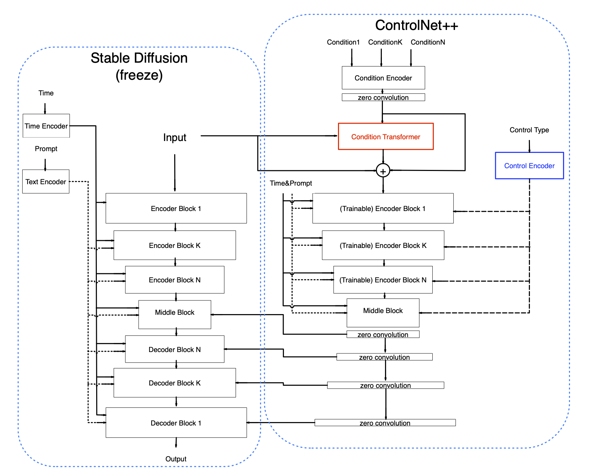

</div>

上图中左侧是冻结的SDXL生成主干，负责在文本和时间步条件下完成去噪预测；右侧是可训练的ControlNet-Union控制网络，负责读取外部条件，形成可以注入主干的控制残差。图中的Input为当前时间步的带噪潜变量特征。ControlNet-Union控制网络除了接收条件图，也需要知道当前正在处理什么样的带噪状态。图中的Output对应去噪网络的预测结果，完成多步采样并经过VAE解码后，才得到最终图像。

**ControlNet-Union设计了共享的Condition Encoder（条件编码器）**，负责读取条件图像。姿态、深度、线稿等条件的含义不同，但都可以表示为空间对齐的图像或特征图。Union让不同条件经过同一套条件编码器，转换到可以共同处理的特征空间。**共享的是编码器参数，各条件图像仍然分别进行编码，并不是先把几张图叠成一张RGB图再输入**。这样可以保留每一路输入的信息，也便于后续融合模块判断它们之间的关系。为了让一套条件编码器能够处理更多条件，ControlNet-Union保留了卷积与激活层构成的基本结构，同时增加部分卷积层的通道数，提高共享条件编码器的表示能力。

**接着ControlNet-Union设计了Control Encoder（控制编码器）**，负责告诉网络当前有哪些控制任务。**这里的控制类型标识可以理解成“条件路由标签”**。如果没有类型标识，一个统一模型很容易把边缘、深度、姿态、分割这些信号混在一起；有了类型标识之后，模型不仅看到条件图像本身，也知道“这张条件图像代表什么控制含义”。ControlNet-Union中每种条件会有自己的类型标识，例如OpenPose、Depth、Line、Normal、Segmentation等。多条件同时输入时，类型标识也会组合起来，让网络知道当前输入到底是什么控制信号。具体如下表所示：

<div align="center">

| 类型编号 | 控制类别 | 典型输入 |
|---|---|---|
| 0 | 姿态 | OpenPose骨架 |
| 1 | 深度 | Depth |
| 2 | 粗线条 | Scribble、HED、SoftEdge等 |
| 3 | 细线条 | Canny、MLSD、Lineart、Anime Lineart等 |
| 4 | 法线 | Normal |
| 5 | 分割 | Segmentation |

</div>

只使用姿态时，类型向量可以表示为 $[1, 0, 0, 0, 0, 0]$ ；同时使用姿态和深度时，则表示为 $[1, 1, 0, 0, 0, 0]$ 。多个位置可以同时激活，用来表达本次启用的条件组合。

**Control Encoder将上述这些向量转换为嵌入特征（Embeddings）**，并映射到与时间步嵌入相同的维度，两者相加后共同影响控制网络的后续计算。这样，共享网络既知道当前噪声阶段，也知道当前需要处理哪些控制任务。

此外，各路条件特征经过空间平均池化后，还会加入对应的可学习类型嵌入，再送入Condition Transformer。这里的类型嵌入用于区分每个概要向量来自姿态、深度还是其他条件；前面的Control Encoder则将整组控制类型编码后加入时间步嵌入，为后续共享控制主干提供任务信息。Condition Transformer与后续偏置预测、特征相加操作共同构成条件融合部分，其作用是根据输入特征调整并汇总各路条件。

**最后是由Condition Transformer、通道偏置预测和特征相加共同构成的条件融合模块。** 下面按Xinsir SDXL ControlNet-Union的设计说明解释其数据流，公开实现中的注意力张量布局问题在后面的例子中单独说明。

Condition Transformer先分别取得各条件图像的空间特征，同时提取当前带噪潜变量的特征。随后，对这些特征做空间平均池化，将每一路输入概括为一个向量；条件向量加入类型嵌入后，与潜变量的概要向量一起进入可训练Transformer架构。

可训练Transformer对这些概要向量进行处理，再为每一路条件预测一个通道偏置。偏置被广播到空间维度，加回对应的原始条件特征，最后将各路修正后的特征与潜变量特征相加。我们在忽略具体实现中的缩放等细节的情况下，这个过程可以概括为：

```math
\widetilde H_t
=
H_t+\sum_{i=1}^{K}\left(F_i+b_i\right)
```

其中， $H_t$ 是当前带噪潜变量经过输入层后的特征， $F_i$ 是第 $i$ 路条件的空间特征， $b_i$ 是融合模块预测的通道偏置，并在空间位置上广播。

这意味着，Transformer主要通过各路输入的概要信息调整条件特征，原始的姿态位置、深度分布和线稿边界仍由 $F_i$ 保留。

接着，融合后的特征进入同一个深层控制网络，与时间步、文本及控制类型信息共同参与计算。控制网络在多个尺度上输出特征，再通过零初始化连接映射为控制残差，注入冻结的SDXL U-Net中。

因此，ControlNet-Union保留了经典ControlNet利用残差影响生成的方式，变化主要发生在外部条件如何编码、如何标记类型，以及如何在共享控制网络之前进行融合。

**接下来，Rocky举一个详细的例子，让大家更加清晰的理解ControlNet-Union的整个流程。**

假设我们希望生成一张“人物抬起右手站在室内”的图像：姿态图指定身体和手臂的位置，深度图提供人物与房间的空间关系，Prompt补充服装、材质和光照。

**第一步，我们先编码两张条件图，保留各自的空间信息。**

设姿态图为 $c_{\mathrm{pose}}$ ，深度图为 $c_{\mathrm{depth}}$ ，共享条件编码器为 $E$ 。两张图分别经过同一个编码器，得到：

```math
\begin{aligned}
F_{\mathrm{pose}} &= E(c_{\mathrm{pose}}),\\
F_{\mathrm{depth}} &= E(c_{\mathrm{depth}}),\\
H_t &= \mathrm{Conv}_{\mathrm{in}}(z_t).
\end{aligned}
```

这里的 $z_t$ 是当前带噪潜变量， $H_t$ 是它经过输入卷积后的特征。在输入尺寸与预处理正确匹配时，两路条件特征与 $H_t$ 都具有 $B\times C\times H\times W$ 的形状。$B$ 是batch size，$C$ 是通道数，$H,W$ 是特征图的空间尺寸。

此时，姿态中的关节位置和深度中的空间层次仍保留在特征图中。共享编码器意味着复用同一套参数，并不意味着先把骨架和深度像素混成一张图。

**第二步，我们用整组类型编码说明当前启用的控制任务。**

姿态与深度对应基础版本的第0、1类，因此类型向量为 $m=[1,1,0,0,0,0]$ 。Control Encoder将其映射为与时间步嵌入 $e_t$ 同维度的向量：

```math
e_{\mathrm{ctrl}}=\mathrm{ControlEncoder}(m),
\qquad
e=e_t+e_{\mathrm{ctrl}}.
```

上式只展示类型与时间信息的组合，省略了SDXL中的其他附加条件。这个向量会参与后续共享控制主干的计算，说明“本次同时启用了姿态和深度”。它不包含每个关节或物体边界的具体位置，这些内容仍由条件特征图提供。

**第三步，我们提取各路概要向量，并分别加入类型嵌入。**

空间平均池化GAP对每个通道的所有位置取平均，将一张空间特征图概括成一个向量。忽略batch维后，可以写成：

```math
\mathrm{GAP}(F)_j
=\frac{1}{HW}\sum_{h=1}^{H}\sum_{w=1}^{W}F_{j,h,w},
\qquad j=1,\ldots,C.
```

随后，姿态概要加入可学习的姿态类型向量，深度概要加入可学习的深度类型向量；当前潜变量也形成自己的概要：

```math
\begin{aligned}
u_{\mathrm{pose}} &= \mathrm{GAP}(F_{\mathrm{pose}})+a_{\mathrm{pose}},\\
u_{\mathrm{depth}} &= \mathrm{GAP}(F_{\mathrm{depth}})+a_{\mathrm{depth}},\\
u_z &= \mathrm{GAP}(H_t).
\end{aligned}
```

$a_{\mathrm{pose}}$ 和 $a_{\mathrm{depth}}$ 是可训练的类型嵌入。类型编号由输入配置指定，对应向量通过训练更新，使融合模块能够区分每路概要的来源。**第二步描述整组任务，第三步标明每一路特征的类型**。原始空间特征同时保留在旁路中，后面还会使用。

**第四步，将三个概要向量作为序列，交给Condition Transformer处理。**

把姿态、深度和潜变量概要沿序列维拼接，得到：

```math
\begin{aligned}
U &= \mathrm{Stack}\left(u_{\mathrm{pose}},u_{\mathrm{depth}},u_z\right)
\in\mathbb{R}^{B\times3\times C},\\
O &= \mathrm{Transformer}(U).
\end{aligned}
```

按设计，自注意力应沿这三个概要向量所在的序列维交换信息，随后由前馈网络进一步变换特征。例如，姿态概要可以结合深度与当前潜变量的概要，形成用于修正姿态特征的表示。原始方案采用一层Transformer，特征维度为320，注意力头数为8。

这里输入的是概要向量，空间细节已在池化时汇总。因此，这个小模块本身不能逐像素检查“手腕位置是否与深度边界一致”。详细空间关系还需要后续控制主干结合原始条件特征处理。

**第五步，预测通道偏置，并加回各路空间特征。**

取Transformer输出中对应姿态、深度的两个向量，通过共享线性投影 $P$ 得到偏置：

```math
\begin{aligned}
b_{\mathrm{pose}} &= P(o_{\mathrm{pose}}),\\
b_{\mathrm{depth}} &= P(o_{\mathrm{depth}}),\\
\widetilde F_i[:,j,h,w] &= F_i[:,j,h,w]+b_i[:,j],
\quad i\in\{\mathrm{pose},\mathrm{depth}\}.
\end{aligned}
```

偏置先扩展为 $B\times C\times1\times1$ ，再广播到所有空间位置。也就是说，同一个样本、同一个通道的各个位置加上同一个数，不同通道则可以得到不同的修正量。

例如，假设某个通道的四个位置为 $[0.2,0.5,0.1,0.4]$ ，该通道偏置为 $-0.1$ ，相加后得到 $[0.1,0.4,0.0,0.3]$ 。这个简单例子展示的是通道整体偏移，偏置并没有为四个位置分别生成不同数值。

**第六步，汇总条件特征，经过共享主干生成控制残差。**

在本例中，融合公式具体展开为：

```math
\widetilde H_t
=H_t
+\left(F_{\mathrm{pose}}+b_{\mathrm{pose}}\right)
+\left(F_{\mathrm{depth}}+b_{\mathrm{depth}}\right).
```

式中的偏置都按前述方式广播。 $\widetilde H_t$ 随后进入共享控制主干，结合文本、时间步及整组控制类型信息，在多个尺度上产生特征，再通过零初始化连接输出控制残差。这些残差注入冻结的SDXL U-Net，影响当前时间步的预测。采样器利用预测更新潜变量，并在后续时间步继续调用网络；采样结束后，由VAE解码得到最终图像。

因此，原始空间特征负责保留姿态和深度的位置关系，概要分支用于计算通道层面的修正，共享控制主干再把融合结果转换成生成网络可用的残差。若两张条件图本身互相矛盾，类型嵌入和偏置相加都不能保证模型自动找到正确的业务优先级。

下图也生动展示了上述例子的完整流程：

<div align="center">

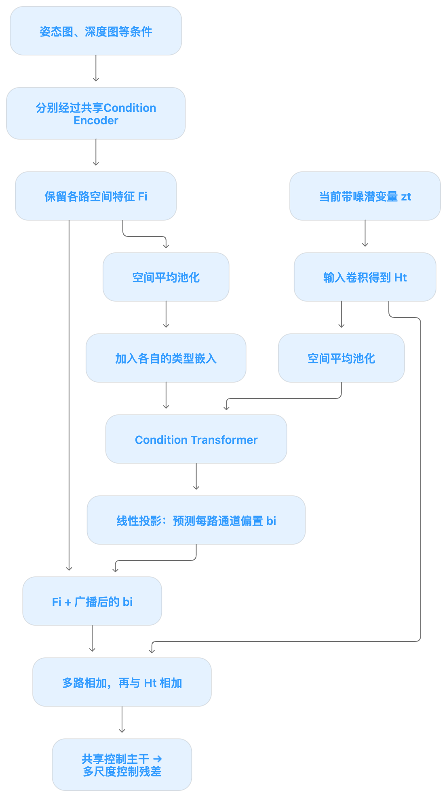

</div>

总的来说，ControlNet-Union与多个独立ControlNet组合的区别，我们可以归纳为下表进行理解：

<div align="center">

| 比较维度 | 多个独立ControlNet组合 | ControlNet-Union |
|---|---|---|
| 参数组织 | 不同条件通常对应不同控制模型 | 多种条件共享一套主要控制参数 |
| 多条件计算 | 每路条件分别通过深层控制分支 | 条件分别编码、融合后，共用深层控制主干 |
| 融合位置 | 通常将各分支输出的对应层残差加权相加 | 在Condition Transformer模块中融合，再产生共享分支的多尺度残差 |

</div>

---

# 第二章 其他主流AIGC可控生成技术基础

<h1 id="q-027">1.介绍一下个体微调式人像一致性技术的原理和多阶段生成流程，都有哪些经典算法？(进阶)</h1>

<h2 id="q-028">面试问题：个体微调式人像一致性的核心原理和多阶段工作流是什么？(进阶)</h2>

**难度评分：⭐⭐⭐ (3/5)  |  考察频率：⭐⭐⭐ (3/5)**

个体微调式人像一致性技术，先利用一个人的照片调整生成模型中的少量参数，再将这组个性化参数用于不同场景的人像生成。早期FaceChain和EasyPhoto都采用过这条路线：用户先完成身份训练，随后可以反复生成不同服装、姿态和背景的写真。

### 1、 LoRA模型学习身份ID特征

预训练扩散模型已经掌握了人脸结构、光照和成像规律。个人训练在这个基础上，让模型逐步适配某个人的面部比例、五官形态和外观特征。以LoRA为例，一个被适配的权重矩阵可以写为：

```math
W_{\mathrm{user}}=W_0+\Delta W_{\mathrm{id}},\qquad
\Delta W_{\mathrm{id}}=\frac{\alpha}{r}BA
```

其中， $W_0$ 是冻结的预训练权重， $A$ 、 $B$ 是需要学习的低秩矩阵， $r$ 是秩， $\alpha$ 控制增量缩放。训练时，用用户照片及其文本条件构造扩散去噪任务，更新这些增量参数。推理时加载相同的增量，模型就更容易生成接近该用户外观的人物。

**个人LoRA中的身份信息分布在一组参数增量中。** 它与人脸识别网络输出的身份Embedding不同，也没有天然保证只学习身份。假如所有训练照都穿同一件衣服、使用同一种滤镜，模型可能将这些共同出现的因素一起记住。选择清晰且身份可靠的照片，同时保留适度的角度、光照和服装变化，有助于减少这种绑定。

### 2、 模板控制和局部修复

个人LoRA提供人物外观倾向，却不会自动决定画面中的站位、姿态和编辑范围。推理时仍需用Prompt描述场景，用模板或ControlNet约束结构，用Mask指定需要重绘的区域。对于脸部与模板衔接不自然的位置，再根据问题选择局部重绘、颜色协调或人脸融合。

下面将身份准备与后续生成分开，展示各环节如何衔接。下图中的修复环节按需执行，生成结果还要分别检查身份、结构与画面质量。

<div align="center">


</div>

上图中最重要的分工是：训练决定模型怎样表达这个人，生成条件决定这个人怎样出现在画面中，评估决定当前结果是否满足要求。某张图脸部相似度较高，也可能存在姿态错误、肤色不协调或服装变形，不能只凭一个相似度分数交付。

输入修复同样需要判断。低清照片经过生成式修复后可能更清晰，却也可能改变眼形、嘴角或痣的位置。因此应先筛选可用素材，再决定是否修复；处理后的照片需要与原图核对，不能将美肤和超分视为必经步骤。

### 3、 个体微调式人像一致性技术适合的应用场景

当同一用户需要反复生成多套内容时，个人训练的成本可以由后续多次使用分摊；对一次性头像生成，等待训练的代价则可能更明显。个人LoRA还依赖训练底座和网络接口，换用结构差异较大的模型时，通常需要重新适配。

Rocky认为，这类系统值得长期掌握的能力，是把身份学习、结构控制和质量评估分开设计。身份训练不足，就检查样本和拟合情况；姿态偏离，就检查结构条件；边缘不自然，就处理Mask与融合。明确问题出在哪个环节，才能减少无目的地增加训练步数或重复采样。

<h2 id="q-029">面试问题：介绍一下FaceChain的AI写真生成链路和技术原理</h2>

**难度评分：⭐⭐⭐ (3/5)  |  考察频率：⭐⭐⭐ (3/5)**

FaceChain是一套身份ID保持人像生成工具链。它的早期方案通过用户照片训练身份LoRA，再结合风格LoRA、生成模型和人脸处理模块输出写真；后续FaceChain-FACT将用户身份改为推理时输入的条件，省去了每个用户单独训练的过程。本题将先介绍早期训练式方案解释写真链路，再讲解FACT改变了什么。

### 1、 训练阶段：把用户照片整理成可学习的身份样本

早期FaceChain先判断照片中人脸方向，再结合人脸检测与关键点进行旋转校正、裁剪。这里主要规范人脸在图像中的位置和朝向，无法凭二维变换恢复侧脸中被遮挡的五官。

接着，人体解析和人像处理模块减少背景干扰，并整理训练区域。属性识别模型提供年龄、性别等属性信息，文本标注模型补充图像描述，再通过标签处理形成训练条件。**标签的作用是让外观特征与语言条件建立对应关系，也为后续改变服装、背景和风格保留表达入口。** 标签中的误识别、与人物无关的描述同样可能影响训练，需要清洗。

处理后的图文样本用于微调Stable Diffusion系列模型中的LoRA参数。底座大模型提供通用人像生成能力，用户身份ID通过去噪训练逐渐进入权重增量。训练中可以保存中间权重并生成验证图，观察相似度和可编辑性，选择适合的checkpoint权重，进行验证与LoRA集成能力。

### 2、 推理阶段：身份LoRA与风格LoRA配合生成

FaceChain将用户身份与写真风格分别准备。身份LoRA针对用户训练，风格LoRA提前训练，可由多个用户复用。在同一兼容底座上，两类权重增量的组合可以概括为：

```math
W'=W_0+\lambda_{\mathrm{id}}\Delta W_{\mathrm{id}}
       +\lambda_{\mathrm{style}}\Delta W_{\mathrm{style}}
```

这表示两个增量共同改变扩散生成网络的计算，并不意味着身份与风格已经完全解耦。风格权重过强可能改变脸部特征，身份权重过强也可能把训练照中的妆容、光照带入结果，需要在验证图中共同调整完善。

下面这张图展示早期训练式FaceChain的完整流程。上半部分从照片与标签得到用户身份LoRA；下半部分组合身份和风格权重，再通过人脸融合与相似度排序筛选结果。

<div align="center">

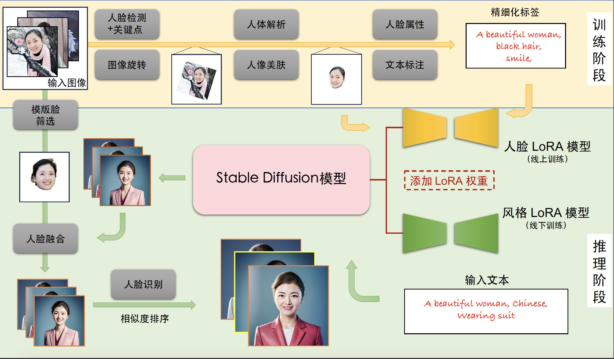

</div>

按上图中的顺序，基础模型先根据Prompt和两类LoRA生成候选写真。系统从用户照片中选择质量较好的参考脸，用人脸融合改善局部相似度，再通过人脸识别特征比较生成脸与参考脸，输出排名靠前的结果。这里的参考脸选择、人脸融合和识别排序各有用途：前者决定融合依据，中间步骤修改图像，最后一步只负责评价与筛选。

对于需要固定姿态或保留模板背景的任务，FaceChain还可使用姿态控制、局部重绘等路径。它们属于可选生成方式，不应把所有模块都解释为每次文生图必经的步骤。

### 3、 FACT怎样将身份训练改为通用条件注入

FaceChain-FACT是FaceChain的独立分支技术，全称为Face Adapter with Decoupled Training。它提前在多人物数据上训练通用身份适配器，用户使用时只提供参考人脸。这里省去的是用户侧个体微调过程，通用适配器本身仍经过预训练。

FACT关注两类干扰：人脸条件可能影响整张图的背景和风格；参考脸中的表情、姿态等非身份因素也可能被一并固定。它通过以下设计减少这些问题：

1. **顺序插入Face Adapter。** 在原有Stable Diffusion块中加入独立的身份适配步骤，使身份特征能够作用于图像特征，而不是与文本条件完全挤在同一路处理中。
2. **约束身份增量的作用区域。** Face Adapting Incremental Regularization（FAIR）利用人脸区域约束适配器带来的特征增量，减少身份注入对非人脸区域的干扰。
3. **使用身份特征与同人异图训练。** 基于TransFace提取人脸特征并进行投影；训练时使用同一身份的不同照片作为条件与目标，降低对某一张参考照片的表情、姿态和光照的依赖。

两代路线的区别可以归纳为下表。下表中比较的是身份接入方式，不代表某一条路线在所有场景下都具有更高相似度。

<div align="center">

| 对比维度 | 早期训练式FaceChain | FaceChain-FACT |
|---|---|---|
| 用户准备 | 上传照片，完成个人身份训练 | 提供参考人脸，直接调用已训练适配器 |
| 身份载体 | 用户专属LoRA参数增量 | 由参考图计算的身份条件 |
| 训练重点 | 在少量用户样本上适配个体外观 | 在多人物数据上学习身份映射与条件解耦 |
| 使用成本 | 首次使用有训练等待，后续可复用 | 省去个体训练，推理仍需身份编码与注入 |
| 需要检查的问题 | 过拟合、样本质量、身份与风格权重冲突 | 参考图质量、身份保留、编辑时的条件干扰 |

</div>

早期路线适合解释个体参数怎样被训练和复用，FACT则展示如何让同一套适配器服务不同用户。实际选型需要结合身份质量要求、首次等待时间和后续复用次数，而不能只凭是否需要个人训练判断优劣。


<h2 id="q-030">面试问题：介绍一下EasyPhoto的AI写真生成链路和技术原理</h2>

**难度评分：⭐⭐⭐ (3/5)  |  考察频率：⭐⭐⭐ (3/5)**

EasyPhoto围绕模板人像生成组织了一套个人LoRA训练与局部重建流程。模板给出姿态、服装、背景和光照，个人LoRA提供用户外观，人脸融合与ControlNet帮助身份进入模板，两次扩散重建再逐步改善脸部及周围区域的衔接。

理解这条链路，需要先区分三类图像：**用户原始照片、LoRA验证生成的人脸图、目标模板图。** 前两类都与身份有关，但在融合和结构控制中的用途不同，不能统一称为同一张“参考正脸”。

### 1、 训练流程：筛选素材、训练LoRA与选择验证结果

EasyPhoto先检测用户照片中的人脸，进行裁剪，并提取人脸识别Embedding。从多张照片的身份特征中建立参考，可以筛除明显偏离主体的样本；选择用于融合的照片时，还会考虑人脸倾斜等因素。这样的排序依赖输入本身大体属于同一人，不能代替对混入他人照片的检查。

随后，显著性分割、面部区域处理和可选人像增强减少背景干扰，形成训练图像。增强应服从身份保留：皮肤更平滑、图像更锐利，并不一定意味着更适合训练。对重要五官结构，应与原始照片核对。

官方基础训练流程使用固定标签即可进行个人LoRA训练；自动Caption可以作为数据处理方式，但并非EasyPhoto必经步骤。训练过程中保存中间权重，利用验证生成结果与用户照片的人脸相似度选择或集成LoRA，避免仅凭最后一个checkpoint判断效果。

下面的训练图将样本筛选、图像处理、标签与LoRA验证连接起来。下图中保留的验证人脸图还会参与后续推理，因此训练阶段的输出不只有一个权重文件。

<div align="center">

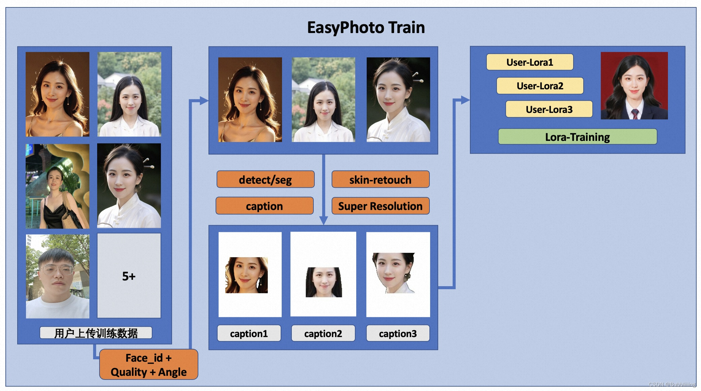

</div>

为了看清这些输出的用途，可以将训练阶段整理为下表。这里将原始参考照片与验证生成图分别列出，避免推理时混用。

<div align="center">

| 处理环节 | 主要输入 | 保留的结果 | 后续用途 |
|---|---|---|---|
| 样本筛选与裁剪 | 用户原始照片、人脸检测与识别结果 | 身份可靠、区域清楚的训练图 | 减少错误身份和无关背景进入训练 |
| 融合参考图选择 | 用户照片、身份相似度与角度等信息 | 质量合适的用户原始照片 | 为推理中的人脸融合提供参考 |
| 区域整理与标签准备 | 裁剪图、分割结果、训练标签 | 图文训练样本 | 用于个人LoRA去噪训练 |
| LoRA训练与验证 | 训练样本、固定验证设置 | 中间权重、验证生成图及其评分 | 选择或集成合适的LoRA |
| 验证人脸选择 | LoRA验证生成结果 | 用于推理的face_id图 | 经裁剪、仿射贴合后提供结构参考 |

</div>

同一用户会留下权重、原始融合参考和验证生成图等不同资产。它们分别提供参数化外观、真实人脸依据和模型能够表达的人脸结构，后续需要在模板坐标系中协调使用。

### 2、 第一次扩散推理：让用户身份ID进入模板

推理时先检测模板中的人脸，得到局部重绘Mask。系统将用户原始参考脸与模板进行人脸融合，得到一张在局部外观上更接近用户的融合图。同时，将验证阶段选出的face_id图裁剪并仿射贴合到模板位置，得到另一张结构参考图。

这两张图承担不同任务：**融合图为初始重建提供局部外观及颜色依据，仿射贴合图为人脸姿态与关键点控制提供参考。** 官方流程从融合图提取Canny和颜色条件，从贴合图提取OpenPose相关条件，再结合个人LoRA与Mask完成第一次扩散重建。

仿射变换只能调整二维位置、尺度和旋转，模板与参考脸的姿态差异过大时，仍可能出现结构不匹配。ControlNet也只是约束生成，不能保证不合理的参考几何自动变得正确。

### 3、 第二次扩散推理：细化边缘与局部衔接

第一次重建之后，五官可能已接近用户，但脸部轮廓、头发、耳朵、脖子与衣领仍可能衔接不自然。EasyPhoto再次进行人脸融合，并结合个人LoRA进行第二次扩散细化；官方流程还使用更高的处理分辨率改善局部细节。颜色迁移用于减轻生成区域与模板之间的色彩差异。

两次重建的条件来源和主要处理范围，可以沿下面的推理图阅读。下图中两次人脸融合与两次扩散相互配合，末端的美肤和超分则属于按需要启用的后处理。

<div align="center">

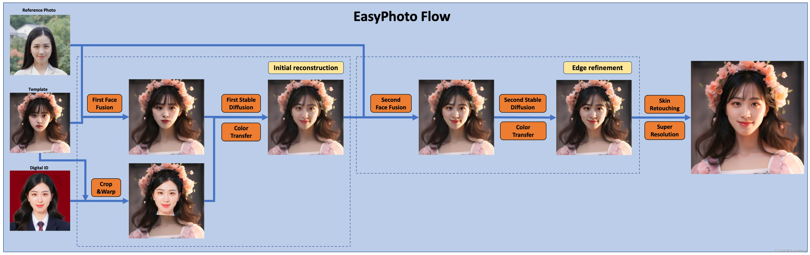

</div>

下表中按实际生成顺序整理各环节，便于定位某种问题应该在哪里调整：

<div align="center">

| 推理环节 | 条件来自哪里 | 主要作用 | 需要检查的结果 |
|---|---|---|---|
| 模板定位与Mask准备 | 模板人脸检测、局部区域处理 | 确定重绘范围 | 额头、脸颊、脖子等边界是否合理 |
| 第一次融合与结构准备 | 用户原始参考脸、验证face_id图、模板 | 分别建立融合图与仿射贴合图 | 参考身份可靠，脸部几何能与模板匹配 |
| 第一次扩散重建 | 个人LoRA、融合图的边缘与颜色、贴合图的姿态条件 | 让用户身份进入模板 | 五官相似度、朝向、颜色与整体结构 |
| 第二次融合与扩散细化 | 首次结果、用户参考、局部Mask | 改善脸部和周围区域的衔接 | 发丝、耳朵、轮廓、衣领是否自然 |
| 后处理与结果评估 | 生成结果、用户照片、原始模板 | 按需增强，并检查身份和画面质量 | 是否过度磨皮、改变身份或破坏模板 |

</div>

两次扩散也带来额外耗时和重复改写的可能。若第一次结果已经满足要求，应依据具体流程配置决定后续细化强度；若身份仍有问题，则先检查LoRA和参考图，不能期待超分或美肤补足身份建模的不足。


<h2 id="q-031">面试问题：个体微调式人像一致性技术中，有哪些关键的人脸处理算法？</h2>

**难度评分：⭐⭐⭐ (3/5)  |  考察频率：⭐⭐⭐ (3/5)**

人脸处理算法为身份训练和写真生成提供可计算的条件：检测给出位置，对齐规范坐标，识别产生身份向量，解析提供区域Mask，修复与融合则直接修改像素。**先区分每个模块输出什么，才能判断它能解决哪类问题。**

下表按这些输出组织常见算法。列出的模型是对应任务的代表，并不表示FaceChain、EasyPhoto的每个版本都使用同一套组件。

<div align="center">

| 算法模块 | 代表方法 | 输出与核心原理 | 使用边界 |
|---|---|---|---|
| 人脸检测 | RetinaFace、DamoFD | 预测人脸框；部分模型同时预测关键点 | 小脸、遮挡或极端侧脸可能漏检，框的位置会影响后续裁剪 |
| 人脸对齐 | 五点关键点相似变换 | 将双眼、鼻尖、嘴角映射到参考坐标 | 主要规范平移、尺度和面内旋转，不能还原被遮挡的五官 |
| 身份特征提取 | 使用ArcFace、CurricularFace等方法训练的识别网络 | 提取定长Embedding，通过向量距离衡量身份接近程度 | 相似度受姿态、年龄、妆容和图像质量影响 |
| 人像与面部解析 | U²-Net、M2FP及面部解析模型 | 分离人物或进一步划分脸部、头发、服装等区域 | 粗粒度人像Mask通常仍保留服装，细发丝和透明区域较难处理 |
| 人脸质量评估 | FQA及清晰度、遮挡、角度等评估 | 为样本选择提供质量分或过滤条件 | 高质量与高身份相似度是两个不同判断 |
| 人脸修复 | GPEN、CodeFormer | 利用生成先验估计清晰的人脸细节 | 清晰度提高可能伴随五官改变，应核对身份 |
| 人脸融合 | FaceChain、EasyPhoto中的人脸融合组件 | 将参考身份与目标脸部区域结合 | 光照、姿态和边界不匹配时可能留下融合痕迹 |

</div>

检测、对齐和识别通常先后衔接，但各自的目标不同。对齐后的照片更适合识别网络提取稳定特征；用于LoRA训练的图像还需要考虑裁剪范围与姿态多样性，不宜为了统一坐标而抹去所有外观变化。

### 1、 身份ID向量怎样用于筛选与排序

ArcFace和CurricularFace首先描述人脸识别中的训练方法或损失设计。实际运行时，由采用这些方法训练的网络提取身份Embedding。设两张人脸图为 $x_1$ 、 $x_2$ ，识别网络为 $f$ ，常用余弦相似度为：

```math
s(x_1,x_2)=\frac{f(x_1)^{\top}f(x_2)}{\lVert f(x_1)\rVert_2\lVert f(x_2)\rVert_2}
```

训练前，可以比较各照片与可靠参考图或主体特征中心的距离，排查混入的其他身份。生成后，可以比较候选脸与多张用户参考脸，筛选身份较稳定的结果。使用多参考图能减少单一表情、角度对比较结果的影响，但仍需先确认参考集属于同一身份。

**相似度分数不能直接理解为“是同一个人的概率”。** 不同识别网络、裁剪方法和图像分布会改变分数范围，阈值需要在实际样本上校准。低清正脸与清晰侧脸也可能呈现不同的评分偏差，因此还要独立检查清晰度、遮挡和姿态。

### 2、 分割、修复和融合为什么需要分别处理

分割决定哪些区域保留或参与计算。若只获得整个人物Mask，服装和发型仍在其中；若目标是降低服装对身份训练的干扰，可以结合更细的区域解析、裁剪或损失区域设计。使用Mask也要说清作用位置：它可以改变训练图背景、参与损失加权，或者在推理中指定重绘区域，这三种方式并不等价。

人脸修复根据先验补充缺失细节。模糊严重时，同一输入可能对应多种合理的清晰人脸，修复模型选择的结果未必是原人物的真实细节。对于训练数据，应优先保留可靠的原始信息；需要增强时，再检查眼形、鼻翼、嘴角等辨识区域。

人脸融合则利用参考身份调整目标图中的人脸。它能改善局部相似度，但可能使肤色、光照、表情与场景脱节，所以常与局部重绘和颜色处理配合。融合结果依然需要评价，不能将该步骤视为身份质量的保证。

这些基础模块最终要与LoRA、ControlNet和Inpaint衔接。前者提供检测、身份和区域等信息，后者在生成模型中使用这些信息。定位问题时，应沿输出逐级检查：脸是否检对、参考身份是否可靠、Mask是否合适、生成条件是否冲突，最后再判断是否需要重新训练。


<h1 id="q-021">2.介绍一下免用户训练的人像一致性特征注入技术的原理，都有哪些经典算法？(进阶)</h1>

<h2 id="q-022">面试问题：免用户训练人像一致性的本质原理和跨周期价值是什么？</h2>

**难度评分：⭐⭐⭐⭐ (4/5)  |  考察频率：⭐⭐⭐⭐⭐ (5/5)**

免用户训练的人像一致性方法，将参考人像转成生成条件，用户使用时无需为自己的身份ID重新优化模型。PuLID、InstantID、PhotoMaker和IP-Adapter FaceID都属于这一方向。**省去的是针对每个用户的个体ID微调，通用身份编码与适配模块仍需要提前训练。**

这条路线将两个阶段分开。开发者先使用包含不同人物的训练数据，让模型学习“参考人像与目标人物之间应保持哪些特征”；用户使用时，再将新人物的照片送入已训练的编码与映射模块，计算身份条件。模型参数不需要随用户更换而重新学习。

身份条件的来源并不只有一种。人脸识别网络强调不同身份之间的可区分性，适合提供相对稳定的面部特征；通用视觉编码器能补充纹理、表情、发型等外观信息，但也可能携带光照和背景。部分方法组合两类特征，部分方法直接把参考人物的视觉表示与文本条件融合。

接下来，还需要将这些特征转换成生成主干能够使用的条件。常见接口包括文本Embedding融合、独立的图像Cross-Attention，以及带空间条件的控制分支。**身份编码决定提供什么信息，注入接口决定这些信息怎样影响去噪，训练约束则决定模型是否愿意正确使用它们。**

下图以常见的身份条件注入路径展示两阶段分工。上方的参数来自发布前训练，用户提供的人像则在推理时被编码成条件；图中的检测、对齐与注入位置需随具体方法调整。

<div align="center">


</div>

用户参考图中的信息经过编码后，会在多个去噪步骤中影响生成结果。它并非只在开始时指定一个人物类别，也不等同于在生成完成后替换人脸。

比较这些方法时，应同时观察特征来源、注入位置和空间控制。下表选择几条具有代表性的路线，帮助理解各方法的分工。

<div align="center">

| 方法 | 参考信息怎样编码 | 主要注入方式 | 需要关注的特点 |
|---|---|---|---|
| IP-Adapter FaceID系列 | 以人脸识别Embedding为基础，部分版本结合视觉特征 | 图像条件映射与独立Cross-Attention | 强调身份条件接口；不同变体的特征组合与配套权重不同 |
| PhotoMaker V1 | 用视觉编码器提取参考人物特征，与类别文本Embedding融合 | 堆叠式身份Embedding进入文本条件序列 | 支持多参考图，不宜套用“全部依靠独立人脸识别分支”的解释 |
| PuLID | 结合人脸识别特征与多层视觉特征 | SDXL版使用独立身份Cross-Attention | 通过对比对齐训练减少身份条件对文本与布局的干扰 |
| InstantID | 人脸识别Embedding与五点关键点分别编码 | Image Adapter与IdentityNet共同注入 | 将身份约束与较弱的脸部空间条件结合 |
| EcomID | 复用PuLID身份分支，并引入人脸Embedding与关键点控制 | 冻结身份分支，训练领域IdentityNet | 用电商人像数据适配身份与空间控制的组合 |

</div>

上表中的路线并不互斥，同一个系统可以同时使用身份特征、视觉细节和空间条件。PhotoMaker V2等后续版本也会调整身份编码与训练方式，因此比较时需要注明版本，不能只凭方法名称判断内部结构。

这类方法省去了用户首次使用前的个人训练等待，适合即时生成和交互式修改。但新增的人脸编码器、图像编码器、注意力模块或IdentityNet仍有计算开销，单张图像的推理未必比加载个人LoRA更快。

身份条件也可能与文本产生冲突。参考照片中的光照、发型和姿态被编码进去后，强身份权重可能压制用户的修改要求。评价时，应在更换背景、朝向、表情和风格的条件下同时检查相似度与可编辑性，而不能只测试与参考照片接近的正脸肖像。

从长期使用看，条件注入让同一套模型能够服务不同身份，也便于替换参考图、组合姿态条件。但权重仍依赖底座架构与接口，从U-Net迁移到DiT通常需要重新设计或训练适配器。可复用的是“外部身份表示参与生成”的思路，具体检查点并不会因此自动兼容所有模型。


<h2 id="q-023">面试问题：PuLID系列如何通过身份编码与对比对齐兼顾身份保持和文本可编辑性？</h2>

**难度评分：⭐⭐⭐⭐ (4/5)  |  考察频率：⭐⭐⭐⭐ (4/5)**

PuLID（Pure and Lightning ID Customization）希望在生成指定人物时，尽量保留底座原有的文本控制、构图和风格表现。它关注一个常见现象：身份越像，背景和造型却越容易被参考照片带走。为减少这种干扰，PuLID在身份编码之外，引入带身份与不带身份的对比生成路径，让适配器在训练时学习控制自己的影响范围。

### 1、 身份编码：识别特征与视觉细节互相补充

SDXL版PuLID同时使用人脸识别网络与视觉编码器。识别特征强调面部身份，视觉特征补充外观与局部细节。原论文将识别向量与视觉编码器的全局特征拼接，经MLP映射为5个全局Token；再将多层视觉特征映射为另外5个局部Token。公开实现使用EVA-CLIP等组件，但方法的训练思想并不限定于这一种视觉编码器。

这些身份Token进入独立的图像Cross-Attention。U-Net当前特征提供Query，身份Token提供独立的Key和Value：

```math
H_{\mathrm{id}}=
\mathrm{Softmax}\left(\frac{QK_{\mathrm{id}}^{\top}}{\sqrt d}\right)V_{\mathrm{id}}
```

图像位置通过Query选择需要的身份信息，再将身份分支输出与原文本分支结合。独立的接口便于调节身份强度，但它本身不能保证身份与光照、风格等因素完全解耦，仍需训练目标约束。

### 2、 对比对齐：让身份条件尽量保留原模型的生成行为

常规身份训练往往从目标图中裁出参考脸，再要求模型重建同一张图。此时参考脸的姿态、光照和背景信息与目标一致，网络容易利用所有可用线索完成重建。到了推理时，用户要求换姿态或换风格，训练中习惯依赖的线索就可能与Prompt冲突。

PuLID增加Lightning T2I分支，使用相同Prompt与初始噪声构造两条路径：一条保留纯文本生成，另一条加入身份条件。两条路径都完成少步去噪，再比较对应特征。下面的图展示这一训练组织方式，上半部分是常规扩散训练，下半部分是用于对齐与身份监督的生成分支。

<div align="center">

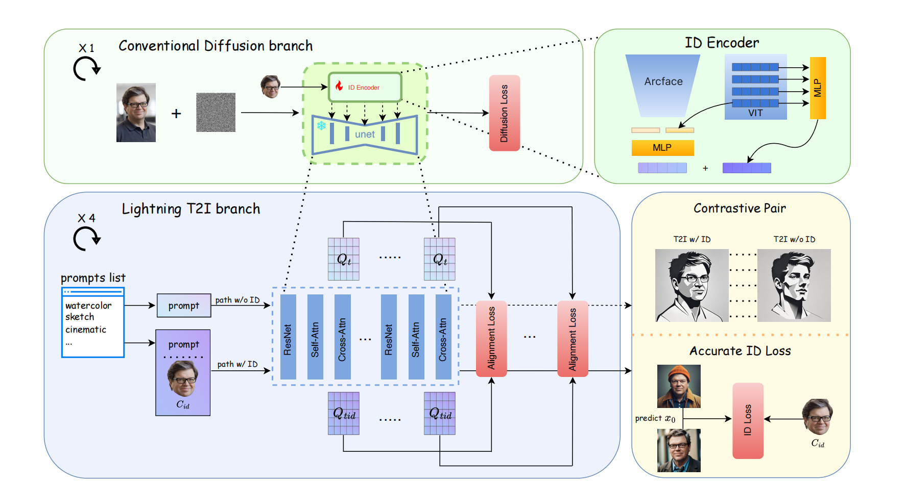

</div>

上图中的两条对比路径用于训练适配器，用户推理时不需要额外生成一张无身份的对照图。Lightning在这里使完整生成过程更容易参与训练，并不意味着PuLID只能搭配某一种加速采样器。

对齐损失包含两部分。**语义对齐**比较文本特征对两条路径图像特征的注意力响应，减少身份加入后对场景与风格语义的干扰；**布局对齐**约束两条路径对应特征的差异，尽量保留空间组织。布局约束过强也会妨碍人物身份改变，因此需要较小权重，不能要求所有特征完全相同。

### 3、 身份损失：在更可靠的生成图上比较人物特征

若直接从高噪声时间步做一次干净图像预测，结果可能还不足以让人脸识别网络可靠工作。Lightning分支经过少量完整去噪后，能够提供更接近真实图像的结果，再计算身份损失：

```math
\mathcal L_{\mathrm{id}}
=1-\mathrm{CosSim}\bigl(f(x_{\mathrm{ref}}),f(\hat x_0)\bigr)
```

其中， $f$ 是冻结的人脸识别网络， $x_{\mathrm{ref}}$ 为参考脸， $\hat x_0$ 为完整生成结果。该损失鼓励生成脸保留参考身份；对齐损失则限制这种身份调整对原有生成行为的干扰。

整体训练目标为：

```math
\mathcal L=\mathcal L_{\mathrm{diff}}
+\lambda_{\mathrm{sem}}\mathcal L_{\mathrm{align\text{-}sem}}
+\lambda_{\mathrm{layout}}\mathcal L_{\mathrm{align\text{-}layout}}
+\lambda_{\mathrm{id}}\mathcal L_{\mathrm{id}}
```

SDXL版主要训练新增身份映射模块和身份注意力中的Key/Value投影，其余预训练模块保持冻结。扩散损失负责基本条件生成，两个对齐项约束生成行为，身份损失直接约束人物相似度。

### 4、 推理中的正交处理与版本差异

公开SDXL实现还提供正交处理，用于调节身份注意力输出与原注意力输出之间的重叠。若以 $v_{\mathrm{id}}$ 和 $v_{\mathrm{txt}}$ 表示相应特征方向，其直觉可写为：

```math
v_{\mathrm{id}}^{\perp}
=v_{\mathrm{id}}-
\frac{\langle v_{\mathrm{id}},v_{\mathrm{txt}}\rangle}
{\lVert v_{\mathrm{txt}}\rVert_2^2}v_{\mathrm{txt}}
```

这里投影的是注意力输出特征，不能理解为直接将ArcFace向量与文本Embedding进行投影。官方包含直接相加、去除投影分量，以及结合注意力权重调整投影分量的不同模式。上述公式只说明投影直觉，具体运算维度和权重应以对应实现为准。

特征空间中的正交也不能保证语义完全独立。身份权重、注入阶段和处理模式需要结合Prompt与参考图验证，不能简单认为某个参数越大就一定越像、越小就一定越听文本。

PuLID迁移到底座结构不同的FLUX时，身份映射和注入位置也相应变化。下表将论文模型与后续版本分开，避免将SDXL结构图套用到整个系列。

<div align="center">

| 版本路线 | 身份映射与注入接口 | 阅读时应区分的内容 |
|---|---|---|
| PuLID SDXL论文模型 | MLP身份映射，U-Net中的独立身份Cross-Attention | 对比对齐与身份监督是核心训练设计 |
| PuLID SDXL后续版本 | 延续SDXL身份适配路线，调整模型训练与使用配置 | 具体能力和控制选项依赖检查点及实现版本 |
| PuLID-FLUX | 身份编码器由MLP结构调整为Transformer结构，在若干DiT块之间插入额外Cross-Attention | 需要对应FLUX权重，不能直接加载SDXL适配器 |

</div>

PuLID提供了一个可复用的训练视角：在增强条件能力时，同时观察原模型的行为被改变了多少。这个问题适用于身份，也适用于风格、商品和其他参考条件的注入。


<h2 id="q-024">面试问题：InstantID如何通过人脸识别特征和关键点控制实现零样本身份保持？</h2>

**难度评分：⭐⭐⭐⭐ (4/5)  |  考察频率：⭐⭐⭐⭐ (4/5)**

InstantID将人脸身份与较弱的空间信息一起送入扩散模型，用户提供一张参考人脸即可生成新场景中的同一人物，无需先训练个人LoRA。身份特征帮助模型表达“像谁”，五点关键点提供脸在画面中的位置、尺度与粗略朝向。

### 1、 一份身份ID信息怎样进入两条生成路径

首先，人脸检测与对齐模块定位参考脸，再由人脸识别网络提取Embedding。与通用CLIP图像特征相比，这种表示更关注人脸身份，但仍可能包含年龄、性别和表情等耦合信息。

随后，身份信息进入两个模块。**Image Adapter**将识别特征映射到条件空间，通过独立图像Cross-Attention参与U-Net计算；**IdentityNet**同时接收关键点图和身份条件，再以多尺度残差影响U-Net。因此，IdentityNet既承担空间约束，也参与身份保持，不能仅把它理解为一个脸部定位器。

下图展示这两个模块如何与冻结的文生图主干配合。中文框选分别标明参考特征准备、图像注意力适配和IdentityNet；火焰表示可训练模块，雪花表示冻结模块。

<div align="center">

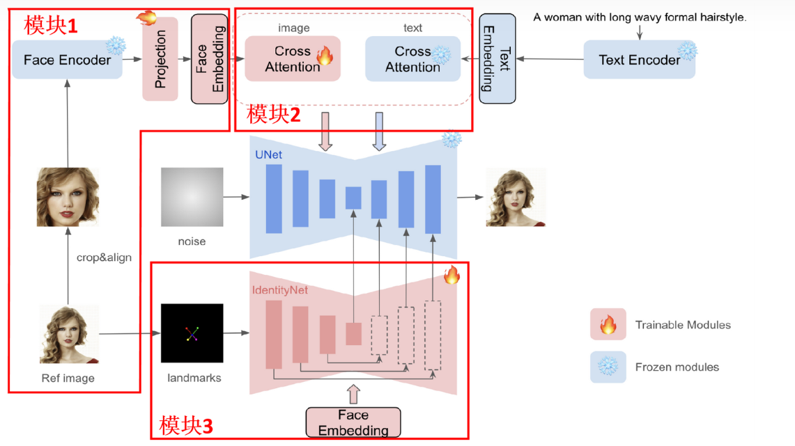

</div>

上图中身份条件分别进入图像注意力和IdentityNet，而文本继续通过原有文本编码与注意力路径参与生成。这样的设计允许分别调节两类新增条件的强度，但两者都可能影响最终身份和画面结构。

### 2、 IdentityNet为什么使用五点关键点

IdentityNet沿用ControlNet式控制分支的基本结构，并做了两个关键调整：空间条件使用左右眼、鼻尖和左右嘴角共五个关键点；分支内部Cross-Attention使用身份条件，不使用文本Prompt作为该分支的注意力条件。

五点关键点保留较粗的面部几何，减少密集面部轮廓对表情和造型的过度限定。它们能够影响位置、尺度和朝向，但不足以精确指定完整表情，也不能替代全身姿态条件。关键点本身还带有相对距离，来自另一人的关键点也可能影响生成脸的几何比例。

实际使用中可以将身份参考图与关键点参考图分开：从前者提取身份特征，从后者提取目标布局。例如保持同一身份，改用另一张图的脸部位置与朝向。此时需要检查关键点与目标构图是否相容，以及新的几何条件是否削弱身份相似度。

### 3、 InstantID的训练与推理流程

训练时冻结预训练扩散主干，更新Image Adapter与IdentityNet，利用人物图像、文本、识别特征和关键点构成条件去噪任务。可以将目标概括为：

```math
\mathcal L=\mathbb E\left[
\left\lVert\epsilon-epsilon_{\theta,\phi}
(z_t,t,c_{\mathrm{text}},c_{\mathrm{id}},c_{\mathrm{kps}})
\right\rVert_2^2\right]
```

其中， $\theta$ 表示冻结主干， $\phi$ 表示新增模块， $c_{\mathrm{id}}$ 和 $c_{\mathrm{kps}}$ 分别表示身份与关键点条件。

推理时，用户只需计算参考条件并执行扩散采样。Image Adapter权重与IdentityNet控制强度可分别调整：前者改变图像身份分支的贡献，后者改变带身份与空间信息的残差控制。调节时宜固定种子，分别观察脸部相似度、关键点符合程度和文本编辑效果。

参考脸检测失败、遮挡严重或姿态极端时，身份编码本身就可能不可靠。官方基础示例通常选择最大的参考人脸，这也不等于模型已经解决多人身份与空间位置的一一绑定。身份保持、表情合理性和多人物绑定应分别验收。


<h2 id="q-025">面试问题：EcomID这类电商人像一致性方案补齐了什么工程能力？</h2>

**难度评分：⭐⭐⭐ (3/5)  |  考察频率：⭐⭐⭐ (3/5)**

EcomID是面向SDXL的人像身份定制扩展。它复用PuLID的身份编码与注意力组件，再加入类似InstantID的IdentityNet，通过电商人像数据训练空间控制。其目标是在保留人物身份时，尽量遵循背景与场景描述，并允许通过关键点调整人脸位置、尺度和朝向。

### 1、 复用身份ID分支，再训练空间控制

PuLID身份分支已经经过对比对齐训练，具备减少身份条件干扰文本生成的能力。EcomID保留这部分参数，并在自身训练阶段将其冻结，将主要更新集中在IdentityNet。

IdentityNet同时使用两类输入：关键点图提供空间布局，人脸Embedding通过Cross-Attention提供身份条件。分支输出的多尺度特征再注入SDXL。下面的官方结构图用绿色标明复用的PuLID模块，并明确标出了冻结与可训练部分。

<div align="center">

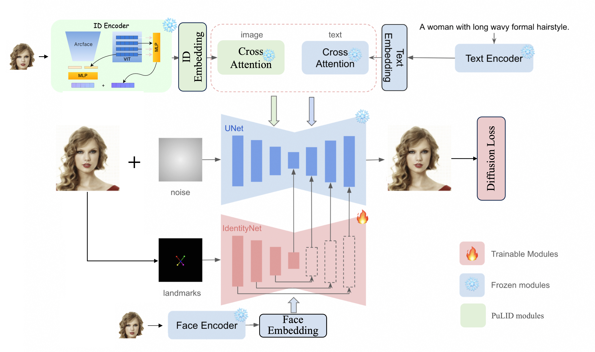

</div>

上面这张图体现了“继承已有能力”与“新增训练”的区别。EcomID复用的是已经经过对齐训练的身份分支，不能据此推断它在训练IdentityNet时又重新优化了PuLID的全部对齐损失。新增分支学习的是，怎样在当前身份条件与底座能力下利用关键点生成目标人像。

### 2、 领域训练数据构建

官方模型卡报告使用约200万张淘宝人像图像训练，筛选条件包括人脸占比超过3%、分辨率超过800、美学分数高于5.5。这些是该项目的配置，分辨率具体口径与美学评分器等细节未在该段完整说明，不能直接作为所有人像训练集的通用阈值。

领域数据为模型提供了电商画面中常见的人脸尺度、构图和视觉表现。它可以改善对目标数据分布的适应，却不会自动赋予模型服装细节保持或商品像素复现能力。关键点仍只约束较粗的面部布局，商品区域需要另设控制与评估。

下表按能力来源整理EcomID的分工，其中区分了已有模块的能力与新增训练的作用。

<div align="center">

| 能力 | 主要来源 | 需要验证的结果 |
|---|---|---|
| 身份保持 | 复用的PuLID身份编码与图像注意力，IdentityNet中的身份条件 | 更换场景、风格或朝向后是否仍接近参考人物 |
| 面部空间控制 | 关键点条件与领域训练后的IdentityNet | 人脸位置、大小、朝向是否符合目标布局 |
| 文本与背景表达 | 预训练底座、已有PuLID对齐能力及新增控制分支的配合 | 身份增强是否带走背景、配饰或Prompt要求 |
| 电商画面适应 | 目标领域的人像数据 | 在实际业务构图和人群分布中是否稳定 |

</div>

EcomID展示了通用身份模块与领域空间控制组合的路径。它适合嵌入电商人像工作流，但服装保持、商品区域保护、局部重绘和结果排序仍需根据任务搭建。尤其是“模特像同一个人”与“穿的是同一件商品”属于两项不同的要求，后者还需要专门的服装条件建模。


<h1 id="q-032">3.介绍一下参考图特征注入与图层化编辑的核心原理，都有哪些经典算法？(进阶)</h1>

<h2 id="q-033">面试问题：IP-Adapter如何将参考图特征注入扩散模型，并兼顾文本控制？</h2>

**难度评分：⭐⭐⭐⭐ (4/5)  |  考察频率：⭐⭐⭐⭐⭐ (5/5)**

IP-Adapter为扩散模型增加一条图像条件通道。用户用文本描述希望改变的内容，再提供参考图表达主体外观、色彩或视觉风格。图像经过编码后直接参与去噪，能够补充语言难以完整描述的视觉信息。

### 1、 解耦Cross-Attention怎样让两类条件共同起作用

IP-Adapter先使用冻结的CLIP图像编码器提取参考图特征，再用可训练的投影网络将其转换为图像Token。原始基础版本使用全局图像Embedding，映射为4个Token，然后在U-Net的Cross-Attention层加入独立图像分支。

下图展示原论文的结构。蓝色模块沿用预训练模型，新增的图像投影和图像注意力模块负责将参考条件接入原有生成过程。

<div align="center">

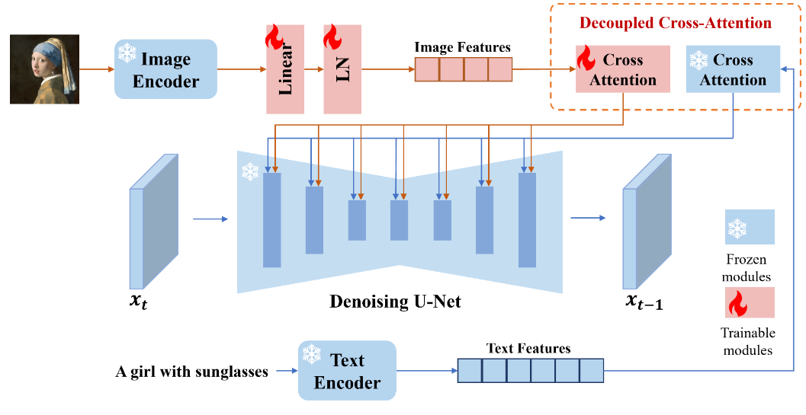

</div>

上图中的两路注意力共享来自U-Net图像特征的Query，但分别使用文本与图像Token生成Key、Value，并各自计算注意力分布：

```math
H_{\mathrm{text}}=
\mathrm{Softmax}\left(\frac{QK_t^{\top}}{\sqrt d}\right)V_t,
\qquad
H_{\mathrm{image}}=
\mathrm{Softmax}\left(\frac{QK_i^{\top}}{\sqrt d}\right)V_i
```

```math
H_{\mathrm{out}}=H_{\mathrm{text}}+\lambda H_{\mathrm{image}}
```

Query表示当前生成特征需要查询什么，文本与图像分支分别返回相关信息。由于两路单独归一化，它们无需在同一份Softmax分布中竞争全部注意力权重；系数 $\lambda$ 则调节图像分支对结果的贡献。

**这种解耦提供了独立控制接口，并不保证语义因素完全分离。** 参考图中的背景、姿态和服装也可能被编码。增强图像权重后，可能同时增强这些附带内容，因此仍需根据任务选择参考图，并检查文本修改是否有效。

### 2、 只训练少量新增参数

训练时，图像编码器与原有文生图网络保持冻结，主要更新图像投影模块和新增注意力分支中的Key/Value投影。通过条件去噪训练，模型逐渐学会从参考特征中读取有用信息。原论文在相应SD 1.5配置下报告约22M可训练参数。

冻结底座有助于复用原有文本生成能力，也便于在同一底座派生的兼容模型之间使用适配器。但SD 1.5、SDXL与DiT模型的层结构、维度和注入接口不同，需要对应适配器权重，不能仅凭名称相同就直接通用。

### 3、 IP-Adapter基础版、Plus与FaceID讲解

基础版的全局特征适合表达整体外观和语义，但会丢失部分局部信息。IP-Adapter Plus进一步利用视觉编码器倒数第二层的网格特征，通过带可学习Query的映射网络提取更细的图像Token，以保留更多局部内容。

FaceID系列则围绕人物身份调整特征来源，使用人脸识别Embedding，部分变体再与视觉特征结合。它与基础版的侧重点不同：参考一张人像的整体色彩、构图，与要求跨场景生成同一身份，需要不同的表示和训练。

IP-Adapter还经常与ControlNet、LoRA同时使用。下表从控制来源与作用方式区分三者，ControlNet一栏以经典U-Net实现为例。

<div align="center">

| 技术 | 控制信息来自哪里 | 如何进入生成过程 | 更适合表达什么 |
|---|---|---|---|
| ControlNet | 边缘、深度、姿态等空间条件图 | 经典版本由控制分支产生多尺度残差，注入U-Net | 对应位置的结构、姿态和布局 |
| IP-Adapter | 参考图的视觉特征 | 通过独立图像Cross-Attention影响去噪特征 | 主体外观、视觉风格与内容参考 |
| LoRA | 专门训练得到的低秩参数 | 改变主干或其他适配位置的权重计算 | 可复用的风格、主体或任务适配 |

</div>

例如，参考图可以提供配色和材质，姿态条件约束人体动作，LoRA补充特定画风。但这些信息仍可能相互冲突，结构图无法保证参考商品细节完全不变，图像注意力也不能替代像素级几何控制。IP-Adapter的价值在于把视觉参考变成一个可复用的条件接口，让文本、参考图和结构条件能够分工参与生成。


<h2 id="q-034">面试问题：LayerDiffuse如何生成带透明通道的图像，并实现多图层协同生成？</h2>

**难度评分：⭐⭐⭐ (3/5)  |  考察频率：⭐⭐⭐ (3/5)**

LayerDiffuse让预训练隐空间扩散模型生成带透明通道的图像，并进一步联合生成能够相互配合的前景与背景。它面向的是透明素材和分层生成：输出可以作为独立图层继续编辑，而不必总是从一张已经合成的RGB图开始抠图。

### 1、 对Alpha通道进行专门建模

设前景颜色为 $F$ ，背景为 $B$ ，透明度为 $\alpha$ ，常见Alpha合成写为：

```math
I=\alpha F+(1-\alpha)B
```

$\alpha=1$ 表示前景完全遮挡背景， $\alpha=0$ 表示该位置完全透明，中间值用于半透明和柔和边缘。毛发、玻璃等区域需要连续透明度，不能只依靠二值分割Mask表达。

Stable Diffusion的VAE与扩散网络原本围绕RGB图像训练。直接扩展通道、改变隐空间表示，会影响预训练分布与已有权重的配合。此外，完全透明像素的RGB并没有唯一可见答案，随意填色可能在边缘留下伪影。LayerDiffuse因此先规范透明区域颜色，再学习怎样将透明信息嵌入原有latent。

### 2、 使用Latent Transparency保存颜色与透明度

LayerDiffuse训练透明度编码器，根据颜色与Alpha预测一个Latent偏移。论文先填补全透明区域中未定义的颜色，再以颜色与Alpha逐像素相乘得到供原VAE编码的RGB图像 $I$ 。设颜色与透明度分别为 $C$ 、 $\alpha$ ，可写为：

```math
x=E_{\mathrm{SD}}(I),\qquad
\delta=E_{\mathrm{tr}}(C,\alpha),\qquad
x_a=x+\delta
```

原VAE编码器保持冻结，新增编码器学习在其latent上加入透明信息。偏移受到重建约束：经过原VAE解码后，图像仍应保留合理的RGB内容，以免明显偏离预训练模型熟悉的表示分布。

解码时使用两步配合。原VAE先得到RGB重建图，专用透明度解码器再结合RGB重建与调整后的Latent恢复颜色和Alpha：

```math
\hat I=D_{\mathrm{SD}}(x_a),\qquad
(\hat C,\hat\alpha)=D_{\mathrm{tr}}(\hat I,x_a)
```

专用解码器同时使用两个输入，因此不能把它理解成只从普通RGB图中预测一张抠图Mask。训练中还使用颜色与Alpha重建损失，以及改善局部质量的判别器损失。
下图将透明表示的学习与生成时的解码分开。上半部分从RGBA学习Latent偏移，下半部分从生成Latent恢复透明素材，再与背景合成。

<div align="center">


</div>

上图中的普通VAE解码与透明度解码各有分工。前者提供预训练的RGB重建能力，后者利用Latent中附带的透明信息恢复RGBA。生成结果能否正确合成，需要同时检查颜色和Alpha，不能只看棋盘格背景上的预览效果。

### 3、 从透明素材生成扩展到多图层生成

透明Latent解决了颜色与透明度怎样共同表示的问题，接下来还要让扩散模型学会生成这种表示，并进一步学习不同图层之间的配合关系。LayerDiffuse分两步完成这件事：先训练能够生成透明素材的基础模型，再引入前景、背景两路生成及其信息交互。

**第一步先让基础扩散模型学会生成透明素材。**

训练时，透明图像先经过前述编码过程，得到包含透明信息的Latent；随后随机采样时间步并加入噪声，由扩散网络结合文本条件预测所加的噪声，以预测误差作为训练损失。推理时则从随机噪声出发，逐步去噪得到透明Latent，再通过前述解码流程还原颜色与Alpha。

这一阶段沿用了扩散模型的噪声预测训练方式，变化在于训练样本所使用的Latent已经携带透明信息，基础扩散网络的权重全部参与微调。前文所说的“冻结原有VAE”，指的是保留原VAE编解码器的参数；新增透明度编解码模块和扩散网络有各自的训练任务，需要分别看待。

下图中将基础透明生成与多图层生成的训练结构放在一起。火焰表示可训练参数，雪花表示冻结参数，读图时可以先比较两部分的参数更新范围，再看前景与背景之间的连接。

<div align="center">

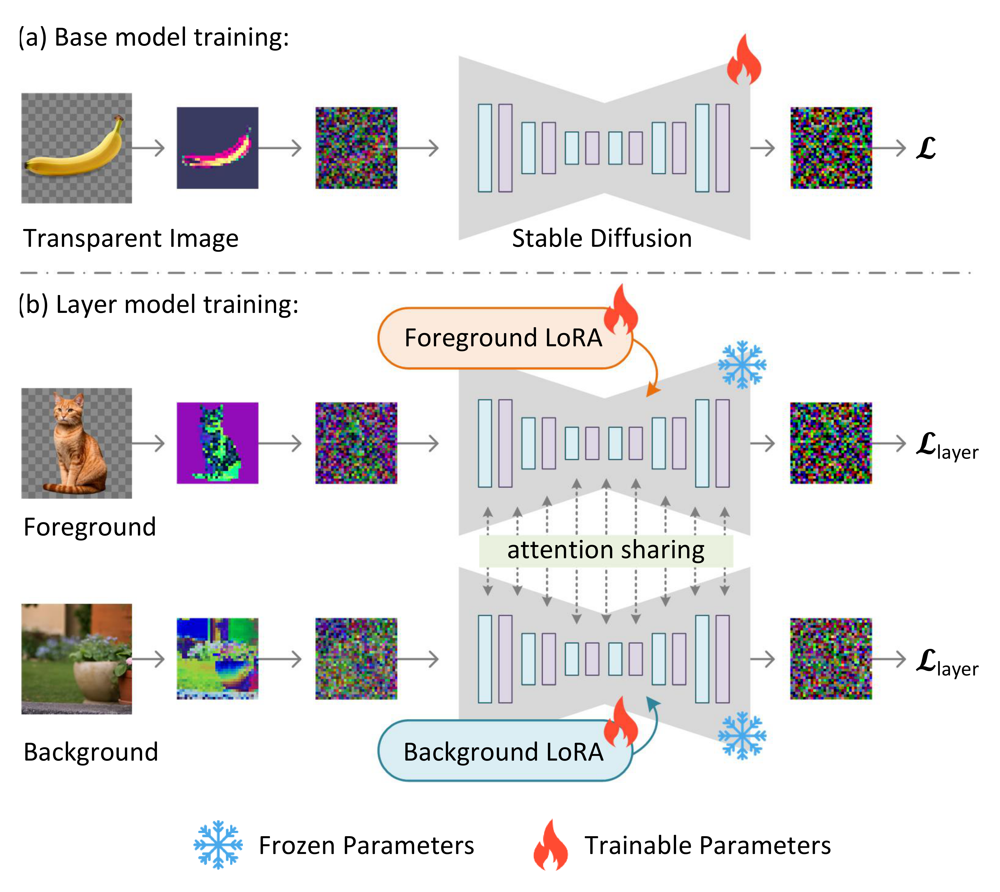

</div>

**第二步再让前景与背景在去噪过程中相互参考。**

上图中，前景和背景分别维护自己的带噪Latent，并使用同一套冻结的基础扩散模型权重，分别加载前景LoRA和背景LoRA。两个LoRA学习各自图层的生成特征，注意力共享则负责交换两路信息。

这里的“共享”有具体的计算含义：在扩散网络的注意力层中，将两路特征产生的Query、Key、Value分别沿Token维度拼接，再共同计算注意力。省略多头等实现细节，可以写为：

```math
\begin{aligned}
Q&=[Q_f;Q_b],\qquad K=[K_f;K_b],\qquad V=[V_f;V_b],\\
[H_f;H_b]&=\mathrm{Softmax}\left(\frac{QK^{\mathsf T}}{\sqrt d}\right)V
\end{aligned}
```

其中， $f$ 和 $b$ 分别表示前景、背景，分号表示沿Token维度拼接， $d$ 为单个注意力头的Key维度；输出再按两路Token的位置拆回各自的特征。这样，前景的某个位置既能参考前景内部信息，也能读取背景特征；背景同样可以参考前景。两层由此获得协调主体位置、场景内容和光照关系的机会。

训练监督仍然来自噪声预测。把论文中拼接噪声的损失展开，可以理解为两路预测误差之和：

```math
\mathcal{L}_{\mathrm{layer}}
=\mathbb{E}\left[
\left\|\epsilon_f-\hat\epsilon_f\right\|_2^2
+\left\|\epsilon_b-\hat\epsilon_b\right\|_2^2
\right]
```

$\epsilon_f$ 、 $\epsilon_b$ 是分别加入两层的噪声，带帽符号是模型预测。由于两路已经通过注意力交换信息，每一路的预测都会受到另一层内容的影响。**层间协调来自成对训练数据与联合去噪结构；这项损失本身仍是噪声预测误差。** 推理时，两层在每个采样时间步交换特征、分别更新Latent，最后得到可单独保存和合成的图层。

**固定一层时，让另一层围绕它生成。**

联合生成会同时更新前景与背景。若已有一层需要保留，论文还训练了相应的条件生成变体：

- **固定前景生成背景：** 已知前景以不加噪的干净Latent作为条件，保持不变；背景从噪声开始去噪，并通过共享注意力参考前景内容。
- **固定背景生成前景：** 背景以干净Latent作为条件，模型生成与其配合的透明前景，供后续叠加。

这两种模式需要在训练时采用对应的条件设置，使模型学会“一路已知、一路待生成”的任务。若要继续增加图层，可以将已有图层合成为一张背景条件图，再生成下一层透明前景，逐层重复。这是论文第4.3节展示的多图层扩展方式。

**两类训练数据分别支持透明生成与层间配合。**

透明图像数据集提供“文本—透明图像”样本，供透明表示学习和基础生成训练使用。论文从约2万张具有商业使用许可的透明PNG起步，反复进行“训练、生成、人工筛选、补充数据”，再通过自动筛选扩展到约100万样本，并使用LLaVA补充描述。筛选时还会移除完全不透明或完全不可见的样本，避免模型学到丢失透明度或输出空图的退化结果。

多图层数据集则提供“文本—前景层—背景层”样本。前景和背景需要属于同一场景，论文使用如下流程构建约100万组配对数据。

<div align="center">

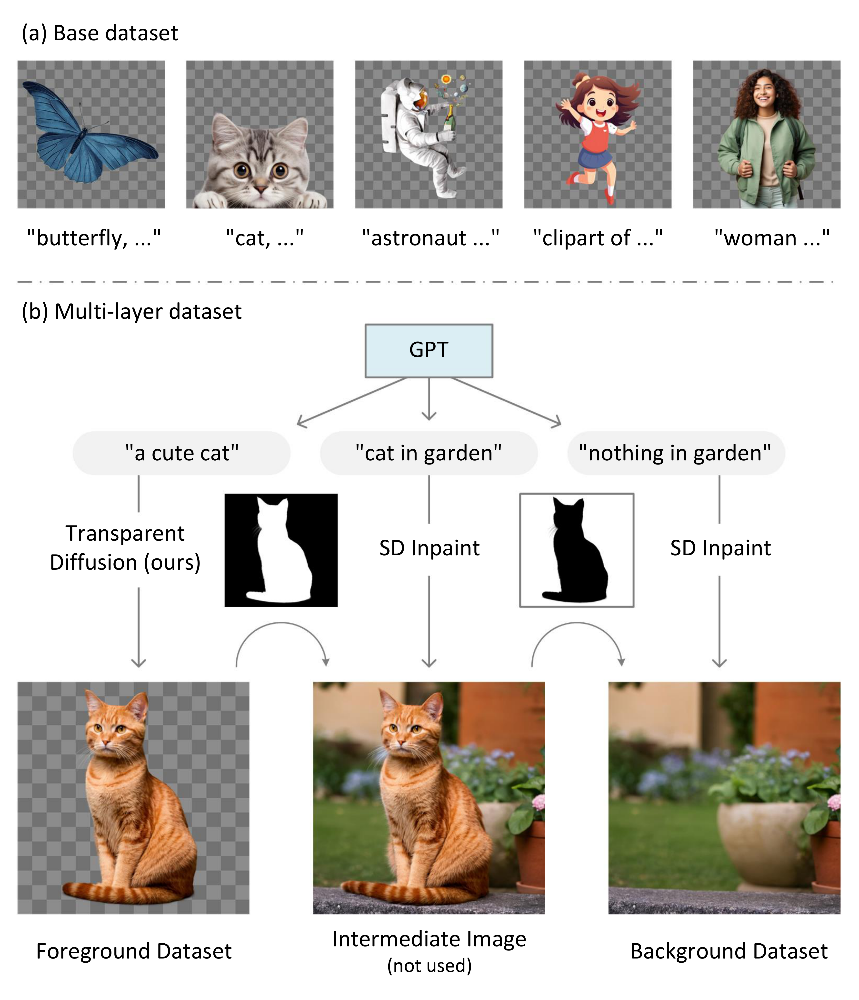

</div>

顺着上图中(b)部分的箭头，可以把数据构建过程拆成四步：

1. **先写出相互对应的三段描述。** 语言模型分别描述前景主体、完整场景和不含主体的背景。图中的例子是“一只猫”“花园里的猫”和“不含猫的花园”，为后续各阶段提供一致的语义条件。
2. **生成透明前景。** 将前景描述送入已经训练好的透明生成模型，得到带Alpha的前景素材。这张素材会作为最终的前景训练样本保留。
3. **围绕前景补出完整场景。** 依据Alpha，将未被前景完全覆盖的区域交给SDXL Inpaint，并使用完整场景描述生成周围环境，得到主体与场景共同出现的中间图像。
4. **移除主体，补齐背景。** 调整并反转相关遮罩，结合背景描述再次进行Inpainting，填补原先由主体占据的区域，得到不含该主体的背景层。论文还对遮罩做了腐蚀处理，以调整重绘边界。

图中标为“Intermediate Image (not used)”的中间图像用于串联上述制作过程，最终前景、背景配对数据不把它作为独立图层。这样的构建方式让背景围绕指定前景逐步形成，为模型提供层间关系的训练信号；合成数据中的边缘残留、透视和光照错误，也会影响最终学到的配合质量。

从实际输出和编辑方式看，透明与多图层生成带来的变化可以归纳如下表所示。这里的“图层”指能够继续合成的像素素材。

<div align="center">

| 对比维度 | 普通RGB图像生成 | LayerDiffuse透明与多图层生成 |
|---|---|---|
| 主要输出 | 一张主体与背景已经融合的RGB图 | 带Alpha的透明素材，或能够分别保存的前景、背景层 |
| 背景替换 | 通常先分割、抠图，再合成或重绘 | 可保留透明前景，更换背景，或用对应条件模型生成匹配背景 |
| 层间关系 | 关系体现在最终合成图中，没有单独的图层表示 | 通过共享注意力与成对训练，让前景、背景在生成过程中相互参考 |
| 编辑方式 | 主要修改合成图中的像素区域 | 可分别调整图层的位置、颜色和透明度，再检查合成效果 |
| 能力边界 | 输出本身不保留Alpha和独立图层 | 生成的是像素图层，不自动还原源文件中的对象结构或完整编辑历史 |

</div>

LayerDiffuse把一部分合成关系提前放进了生成过程，让后续编辑能够直接操作前景与背景。不过，给定一张已有图片，仍然无法唯一反推出被遮挡的背景和原始前景颜色；生成可组合图层也不等于恢复原始PSD或Figma文档。实际交付还要检查Alpha保存方式、预乘与非预乘格式是否匹配，以及毛发边缘、半透明区域、阴影和反射是否自然。单独一层看起来合理，并不保证叠加到任意背景后都能成立。


<h1 id="q-035">4.介绍一下特定生产任务如扩散超分修复、文字渲染和虚拟试衣等可控生成技术架构与原理(进阶)</h1>

<h2 id="q-036">面试问题：SUPIR这类扩散超分修复技术的核心原理是什么？</h2>

**难度评分：⭐⭐⭐⭐ (4/5)  |  考察频率：⭐⭐⭐ (3/5)**

SUPIR（Scaling-UP Image Restoration）利用SDXL的生成先验修复真实退化图像。输入可能同时存在低分辨率、模糊、噪声和压缩伪影；当细节已经丢失时，模型只能结合现有观测与先验估计合理内容。SUPIR因此既要发挥生成模型的纹理补全能力，也要限制它偏离原图的程度。

下面的工作流从低质图像开始：退化鲁棒编码提供图像条件，初步重建后的图像用于生成内容描述，控制分支与恢复引导再共同约束SDXL采样。

<div align="center">

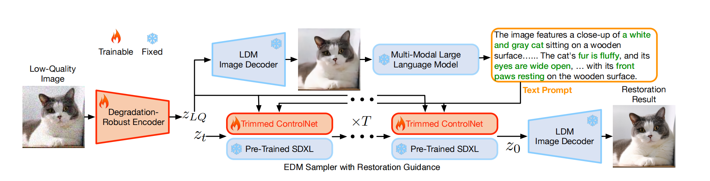

</div>

上图中低质图像同时影响空间条件与语义条件，采样器则决定各步怎样使用生成预测。三者作用不同：内容描述帮助识别“可能是什么”，控制分支保持可观察结构，恢复引导调节生成自由度。

### 1、 退化鲁棒编码：减少伪影被当成内容

SDXL原始VAE编码器主要面向较干净的图像。低质图中的JPEG块、噪声和模糊可能进入latent，被后续网络当成需要保留的图像内容。SUPIR从预训练编码器出发微调退化鲁棒编码器 $E_{\mathrm{dr}}$ ，固定解码器 $D$ ，对低质图与对应高质图的解码结果施加接近约束：

```math
\mathcal L_E=
\left\lVert D\bigl(E_{\mathrm{dr}}(x_{\mathrm{LQ}})\bigr)
-D\bigl(E_{\mathrm{dr}}(x_{\mathrm{GT}})\bigr)\right\rVert_2^2
```

其中， $x_{\mathrm{LQ}}$ 是退化图， $x_{\mathrm{GT}}$ 是对应高质量图像。该阶段先获得较可信的内容表示，为后面的扩散修复提供条件，不要求编码器独自补全所有高频细节。

### 2、 控制分支与ZeroSFT：把低质图的结构送入SDXL

SUPIR保留冻结生成底座、训练额外控制分支的思路，但为控制训练成本，对SDXL编码侧可训练副本中的部分Transformer块进行裁剪。这样既利用预训练初始化，也保留足够的特征提取能力。

低质图条件经过控制分支后，通过ZeroSFT连接到主干。ZeroSFT结合零初始化连接、Spatial Feature Transform与Group Normalization，根据条件特征学习空间相关的缩放和偏移。可以把其中的空间调制直觉写成 $h'=\gamma(c)\odot h+\beta(c)$ ：不同位置根据低质图条件调整特征强度与偏移；这只表示SFT的基本作用，完整ZeroSFT还包括归一化与其他连接。

零初始化连接使新增分支在训练开始时尽量少扰动预训练网络，空间调制则增强低质条件对局部生成的影响。

### 3、 数据与文字条件：让生成先验适应图像修复

SUPIR使用约2000万张高质量图像及描述，还加入约7万张人脸图像和10万张负质量样本。训练时从高质量图像合成退化输入，让控制分支学习由低质观测约束高质量生成，退化模型参考Real-ESRGAN的设置。

推理中，LLaVA读取经过退化鲁棒编码与固定解码得到的初步处理图像，生成内容描述。文字条件可帮助模型判断模糊区域的语义，也允许用户修正自动描述。若描述错误，同样可能引导模型补出错误物体，因此文字应与低质图中仍可确认的信息相符。

**负质量样本的作用，是让模型学到负向质量词对应的视觉模式。** SUPIR在训练中加入与低质量描述配对的图像，使模型能够区分清晰纹理与模糊、过平滑等表现；推理时再通过正负条件预测的差异进行引导。只有负向Prompt、没有相应训练基础，不能保证模型准确理解这些质量方向。

### 4、 恢复引导：按噪声水平调节对原图的约束

控制分支之外，SUPIR还修改EDM采样，在每步将去噪预测向低质Latent拉近。设当前干净latent预测为 $\hat z_0$ ，低质图编码为 $z_{\mathrm{LQ}}$ ，引导后的预测可概括为：

```math
\tilde z_0=\hat z_0+k_t\bigl(z_{\mathrm{LQ}}-\hat z_0\bigr),
\qquad
k_t=\left(\frac{\sigma_t}{\sigma_{\mathrm{max}}}\right)^{\tau_r}
```

其中， $\sigma_t$ 表示当前噪声尺度， $\tau_r$ 控制引导权重的衰减。噪声较大时更强调原图的低频结构，噪声减小时逐渐释放纹理生成空间。这一混合修正的是去噪预测，采样器随后还要据此计算更新方向。

省略EDM中的随机扰动，用一阶更新说明后半段计算，可写为：

```math
d_t=\frac{z_t-\tilde z_0}{\sigma_t},\qquad
z_{\mathrm{next}}=z_t+
(\sigma_{\mathrm{next}}-\sigma_t)d_t
```

SUPIR的结果需要分别评价感知质量与原图忠实度。有配对真值时可以使用PSNR、SSIM、LPIPS；没有真值时，可以结合无参考质量评价与内容检查。人脸、Logo和文字还需要身份或OCR核验。更自然的毛发、更清晰的纹理说明生成结果更可信，却不能证明这些细节就是原图中已经丢失的真实内容。


<h2 id="q-037">面试问题：AnyText这类文字渲染技术为什么能提升图像中文字的可控性？</h2>

**难度评分：⭐⭐⭐⭐ (4/5)  |  考察频率：⭐⭐⭐ (3/5)**

图像中的文字渲染同时具有视觉外观与符号内容。招牌需要融入材质、透视和光照，还必须按指定顺序写对字符。普通扩散训练中的少量笔画错误，对整张图像的损失影响可能很小，却会直接改变文字含义。AnyText因此增加显式字形、位置条件与OCR特征监督，让模型更直接地学习文字生成。

### 1、 三类空间条件的约束原理

AnyText首先准备字形图、位置图和遮蔽图像。它们共同构成辅助空间条件，作用如下表所示。

<div align="center">

| 条件 | 怎样构建 | 在生成中的作用 |
|---|---|---|
| Glyph字形图 $l_g$ | 将指定文字按目标区域渲染到同一张图中 | 提供字符笔画与粗略排列依据 |
| Position位置图 $l_p$ | 标记各行文字应出现的区域 | 约束位置、大小和区域形状 |
| Masked Image $l_m$ | 遮蔽待生成区域，保留可作为条件的原图内容 | 支持从零生成和局部文字编辑两种任务 |

</div>

三类条件要配合使用。字形提供笔画依据，位置图进一步表达文字区域；编辑任务还需要原图上下文，才能使新文字与已有材质、背景衔接。从零生成时图像被全部遮蔽，编辑时只遮蔽目标文字区域，模型通过同一套条件接口处理不同任务。

### 2、 Auxiliary Latent Module：将空间条件转换成特征图

Glyph Block与Position Block用卷积下采样字形、位置条件，VAE编码遮蔽图像。三路特征对齐到扩散latent的空间尺寸后，通过融合层得到辅助特征：

```math
z_a=f\bigl(G(l_g)+P(l_p)+E(l_m)\bigr)
```

$z_a$ 与当前带噪Latent结合后进入可训练的TextControlNet，冻结的U-Net仍接收原带噪Latent。文字控制分支由此学习利用字形与布局影响生成，同时保留底座已有的场景生成能力。

### 3、 Text Embedding Module：把一行文字编码为可读取的条件

空间字形图之外，AnyText还会将每行待写文字单独渲染为规范的字形图 $e_g$ 。这与前面的 $l_g$ 不同： $l_g$ 包含文字在画面中的布局， $e_g$ 则将单行文字居中排列，便于识别网络提取字符特征。

Prompt中引号包围的待渲染文字被替换为特殊占位符。PP-OCRv3识别网络读取单行字形图，提取最后全连接层之前的特征；可训练线性层将其映射到文本Embedding维度，再替换占位符向量，与普通Caption Token一起进入CLIP Text Encoder。

这条路径让文字内容以视觉字符特征参与注意力计算，降低对语言分词和文本编码器字符覆盖能力的依赖。普通Caption提供场景语义，OCR特征提供待写字符的表示，不能把OCR特征本身等同于对整段文字含义的理解。

### 4、 Text Perceptual Loss：让训练关注笔画是否正确

AnyText同时优化文本控制扩散损失与文字感知损失。前者学习条件去噪，后者从当前预测估计干净图像、解码到像素空间，再按位置条件裁剪文字区域，与真实图中的对应区域比较OCR特征。

下面的框架图将空间条件、文字Embedding与损失分支放在同一条链路中。阅读时可以先沿蓝色空间条件和绿色文字条件观察前向计算，再看右下角橙色的文字监督路径。

<div align="center">

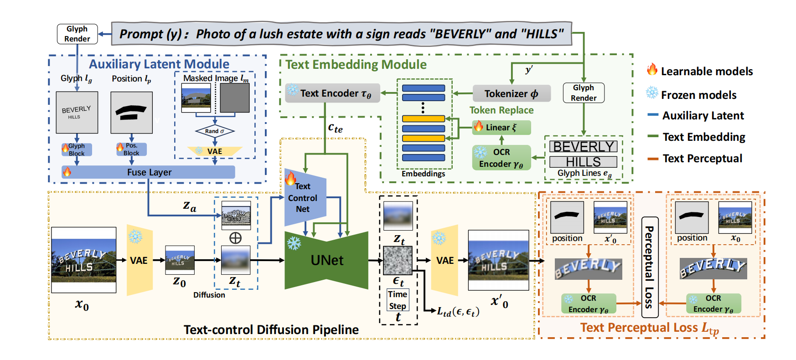

</div>

上图中OCR网络有两项用途：从规范字形提取输入条件，以及在训练时比较生成文字与真实文字的特征。后者属于训练监督，推理时不需要执行这条损失计算路径；产品中的OCR验收则是可以另行增加的检查步骤。

整体目标写为：

```math
\mathcal L=\mathcal L_{\mathrm{td}}+\lambda\mathcal L_{\mathrm{tp}}
```

设 $C_p$ 表示对第 $p$ 个文字区域进行裁剪、变换和规范化， $\phi$ 为OCR特征提取器，文字感知项可概括为：

```math
\mathcal L_{\mathrm{tp}}
=\sum_p\frac{w(t)}{h_pw_p}
\left\lVert
\phi\bigl(C_p(\hat x_0)\bigr)-\phi\bigl(C_p(x_0)\bigr)
\right\rVert_F^2
```

这里的比较关注字符相关特征，减少背景、颜色与字体差异对监督的干扰。高噪声阶段的 $\hat x_0$ 更不可靠，因此需要时间步权重 $w(t)$ ；论文使用 $\bar\alpha_t$ 调节监督强度。模型并未直接对离散OCR识别结果求梯度，而是在可微的特征空间中比较。

训练还采用逐步增加任务的方式：先学习文字生成，再加入文字编辑，最后启用文字感知损失。这使模型先建立条件生成能力，再强化字符细节。AnyWord-3M数据集为这些任务提供图像、文字区域、转写内容与描述等训练信息。

### 5、 文字渲染效果的评价

AnyText使用Sentence Accuracy统计整行文字完全匹配的比例，使用Normalized Edit Distance衡量字符接近程度；论文中的NED按相似度形式报告，数值越高越好。训练使用PP-OCRv3特征，评测则使用另一套OCR系统，减少由同一识别器带来的评价偏差。FID另外评价图像分布质量，不能替代逐字检查。

对于要求逐字准确、固定字体和严格版式的内容，还可以采用生成场景后进行确定性文字排版的方式。文字融合是否自然、字符是否正确、字体是否符合要求，应当分别验证。


<h2 id="q-038">面试问题：IDM-VTON这类虚拟试衣技术如何同时保持人物、服装和结构一致？</h2>

**难度评分：⭐⭐⭐⭐ (4/5)  |  考察频率：⭐⭐⭐ (3/5)**

IDM-VTON以人物图和服装图为条件，生成这个人穿上指定服装后的图像。任务同时包含几类约束：人物身份与姿态要稳定，服装的版型、图案和细节要有依据，新的褶皱、遮挡与光照又要符合人物所在场景。因此，模型分别编码人物结构、服装高层语义和服装局部细节。

### 1、 TryonNet：把试衣组织成有结构条件的局部重绘

TryonNet以SDXL Inpainting U-Net为基础。输入沿通道方向拼接四部分：当前带噪latent、试衣Mask、遮蔽原服装区域后的人物latent，以及DensePose图像的latent。对应通道数为：

```math
4+1+4+4=13
```

这里的“遮蔽人物图”仅指将待换服装区域遮住，保留脸、头发、背景等可见上下文。Mask告诉网络需要处理的范围，DensePose提供身体表面的姿态与对应关系，带噪latent则承载当前要生成的图像状态。官方训练扩展输入卷积时，保留原Inpainting模型的前9通道权重，并将新增4通道对应的权重初始化为0。

这些条件帮助网络保留人物，但Mask本身不保证区域外像素严格不变。需要完全保持某些区域时，还要在输出阶段结合原图回贴或边界融合，并检查接缝质量。

### 2、 两路服装条件：整体语义与局部细节进行互补

服装图首先经过冻结的CLIP视觉编码器，提取高层外观特征，再由IP-Adapter投影与图像Cross-Attention送入TryonNet。这条路径能够表达颜色、类别和大致款式，但对细小Logo、复杂花纹和重复纹理的保留仍有限。

为补充细节，IDM-VTON使用并行的预训练U-Net作为GarmentNet，从服装latent中提取不同层次的视觉特征。GarmentNet在训练中保持冻结，其对应特征与TryonNet特征拼接，经过Self-Attention交互后，只保留TryonNet对应部分的输出继续去噪。

下表按输入、计算位置与训练状态整理核心组件。两条服装路径共同服务于同一件商品，但提供的信息粒度不同。

<div align="center">

| 组件 | 输入与作用位置 | 主要职责 | 训练状态 |
|---|---|---|---|
| TryonNet | 带噪latent、Mask、遮蔽人物latent、DensePose latent | 在人物结构与上下文约束下生成试衣结果 | 微调 |
| CLIP视觉编码器与IP-Adapter | 服装视觉特征进入Cross-Attention | 提供服装整体语义与外观 | 视觉编码器冻结，适配模块更新 |
| GarmentNet | 服装latent经过并行U-Net，对应特征进入Self-Attention | 提供图案、纹理和边缘等细节依据 | 冻结 |
| 服装文本描述 | 分别组织为人物与服装的Prompt | 补充领口、袖型、材质和款式信息 | 作为条件使用，文本编码器冻结 |

</div>

从上表中可以看出，模型并未要求单个服装Embedding保留全部细节。高层视觉语义、细粒度U-Net特征和文字描述分别提供依据，再由TryonNet学习如何将它们映射到人体姿态上。这些约束可以改善服装保持，但仍不构成Logo、文字或纹理逐像素不变的保证。

下面的框架图进一步展示特征的进入顺序。左侧是人物与服装的条件路径，右侧将服装细节的Self-Attention交互和高层语义的Cross-Attention分开。

<div align="center">

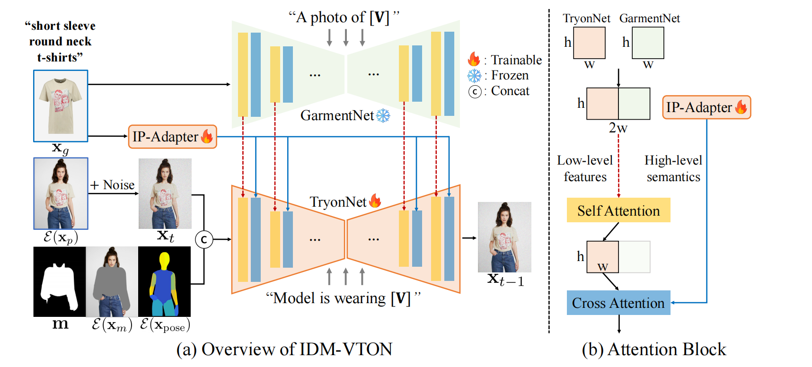

</div>

上图中右侧拼接后的特征同时包含人物侧与服装侧的信息，注意力计算使人物侧能够读取服装细节。随后截取人物侧输出，保持TryonNet后续计算的空间规模；服装侧在这里承担参考条件的作用，不作为第二张试衣结果继续输出。

### 3、 配对训练与单对样本定制

训练需要人物穿着对应服装的配对数据。对人物图中的原服装区域进行遮蔽，将服装图、人物结构与描述作为条件，以原穿衣图作为目标进行扩散去噪学习。模型由此学习在不同人体姿态下组织同一服装的外观。

详细Caption也参与这个过程。例如，对服装使用“A photo of [服装描述]”，对人物使用“Model is wearing [服装描述]”，使两路条件围绕同一款式建立语义对应。描述可补充袖长、领口和材质，但不能替代服装图中的具体图案。

面对训练分布之外的商品，论文还提供单对样本定制：**用于微调的人物必须确实穿着这件对应服装。** 若只有这张穿衣人物图，可以分割其服装、置白背景构造服装参考，再形成重建训练对。任意人物照片与任意商品图是推理条件，不能直接当作具有真实目标的配对监督。

定制时只更新TryonNet上采样块中的Attention层，使模型更好地适配该服装的图案与细节。论文使用少量微调步数，并在同一服装的其他人物图上评价结果。该阶段需要额外计算成本，与直接运行已训练模型的普通推理应当分开说明。

### 4、 人物、商品与穿着关系分别验收评估

有对应真值时，可以用SSIM、LPIPS评价重建差异；CLIP图像相似度提供语义比较，FID反映样本集合的分布质量。对于没有目标穿衣真值的实际输入，还要分别检查：人物脸部与背景是否漂移，服装颜色、领口、Logo和图案是否保留，手臂遮挡、袖口、褶皱和身体连接是否合理。

论文指出，落入重绘Mask的纹身、痣等人物属性可能丢失。复杂Logo、细字和极端姿态也可能失真，因此需要按任务选择Mask与检查方式。二维试衣图只表达视觉穿着效果，不提供真实尺寸、合身程度或布料物理仿真的结论。

---
