# 目录

[1.AIGC图像创作领域的主流技术发展趋势是什么样的？](#q-001)
  - [面试问题：AIGC图像创作领域的技术发展趋势是什么样的？](#q-002)
  - [面试问题：AIGC图像创作大模型的主流架构范式有哪些？](#q-003)
  - [面试问题：AIGC图像创作领域主要涵盖哪些典型任务？(进阶)](#q-004)
  - [面试问题：AIGC图像创作大模型的效果应该如何评估？](#q-006)

[2.Google在AIGC图像创作领域有哪些核心成果和跨周期价值？](#q-007)
  - [面试问题：Google在AIGC图像创作领域形成了怎样的技术演进主线？](#q-008)
  - [面试问题：Imagen系列模型有什么跨周期技术价值？](#q-009)
  - [面试问题：Nano Banana系列有哪些优秀特点？](#q-010)

[3.OpenAI在AIGC图像创作领域有哪些核心成果和跨周期价值？](#q-011)
  - [面试问题：OpenAI在AIGC图像创作领域形成了怎样的技术演进主线？](#q-012)
  - [面试问题：DALL-E系列模型有什么跨周期技术价值？](#q-013)
  - [面试问题：GPT-4o图像生成系统和GPT-Image系列有哪些优秀特点？](#q-014)

[4.介绍一下Seedream系列的技术原理和模型架构](#q-015)
  - [面试问题：Seedream 2.0模型的核心原理和关键创新点是什么？](#q-016)
  - [面试问题：Seedream 3.0模型的核心原理和关键创新点是什么？](#q-017)
  - [面试问题：Seedream 4.0模型的核心原理和关键创新点是什么？](#q-018)
  - [面试问题：SeedEdit系列模型解决了什么问题？(进阶)](#q-019)


[5.其他主流AIGC图像创作大模型有哪些核心特点和跨周期价值？](#q-020)
  - [面试问题：Midjourney系列模型有哪些优秀特点？](#q-022)
  - [面试问题：HiDream-I1的技术原理和模型架构是什么？](#q-023)
  - [面试问题：GLM-Image的创新点有哪些？](#q-024)
  - [面试问题：Qwen-Image系列的创新点有哪些？](#q-025)
  - [面试问题：Z-Image系列的创新点有哪些？](#q-026)

---

<h1 id="q-001">1.AIGC图像创作领域的主流技术发展趋势是什么样的？</h1>

<h2 id="q-002">面试问题：AIGC图像创作领域的技术发展趋势是什么样的？</h2>

**难度评分：⭐⭐⭐⭐ (4/5)  |  考察频率：⭐⭐⭐⭐⭐ (5/5)**

Rocky认为，2026年是AIGC图像创作领域的“中场时刻”。AIGC图像创作正在进入更重视可控性与交付效率的阶段。在基础生成能力逐渐普及后，用户开始要求AIGC图像创作大模型能够准确理解参考图、只修改指定内容、在连续创作中保持主体与文字一致，并减少反复尝试的次数。部分过去依赖插件和单点辅助技术的能力正在被更通用的基础大模型吸收，能够经受考验留下的则是继续繁荣的跨周期技术。

Rocky认为，AIGC图像创作领域的技术发展趋势可以从四个能力发展方向理解，如下表所示：

<div align="center">

| 发展方向 | 核心代表能力 | 典型模型/方法 | 主要挑战 |
|---|---|---|---|
| L1：基础图像生成 | 根据文本描述生成主体、场景和视觉细节，首先解决画面能否成形、是否自然的问题 | DDPM、Stable Diffusion、SDXL等 | 不可控性强，空间关系、数量、身份和布局容易错 |
| L2：显式条件控制 | 在文本之外加入姿态、边缘、深度、布局或参考特征，把部分要求表达成更明确的输入，减少仅靠文字描述带来的不确定性。控制能力可以来自额外模块，也可以整合进基础模型 | Stable Diffusion/FLUX技术生态 + LoRA + ControlNet/Adapter等控制技术 | 属性绑定、空间精度、局部控制等仍不稳定 |
| L3：上下文生成与编辑 | 利用源图、参考图、此前的创作结果和相关指令，在理解已有内容的基础上继续生成或修改。重点是同时处理“需要改变什么”和“必须保留什么”。 | FLUX.1 Kontext/FLUX.2、GPT Image-2/2.5、Nano Banana pro/2、Seedream 5.0等 | 需要在多轮漂移、身份保持、未编辑区域保真、长上下文一致性方向持续优化 |
| L4：智能体式创作 | 围绕创作目标自主规划步骤、调用检索、生成、编辑和检查工具，再根据结果和测试评估反馈决定继续修改、调整方案或结束任务，形成多步创作闭环。| Lovart、即梦AI、JarvisArt/JarvisEvo等 | 评估反馈可靠性、工具调用正确性、多步一致性、停止条件与成本延迟 |

</div>

因此，未来AIGC图像创作除了“更高质量、更高审美”这些基础维度，还要从**外观生成**走向**智能视觉生成**：模型需要理解结构、记住上下文、遵守物理规则、调用外部工具、验证自身结果，并服务于真实的AIGC图像创作领域各方向的应用场景，如下图所示：

<div align="center">

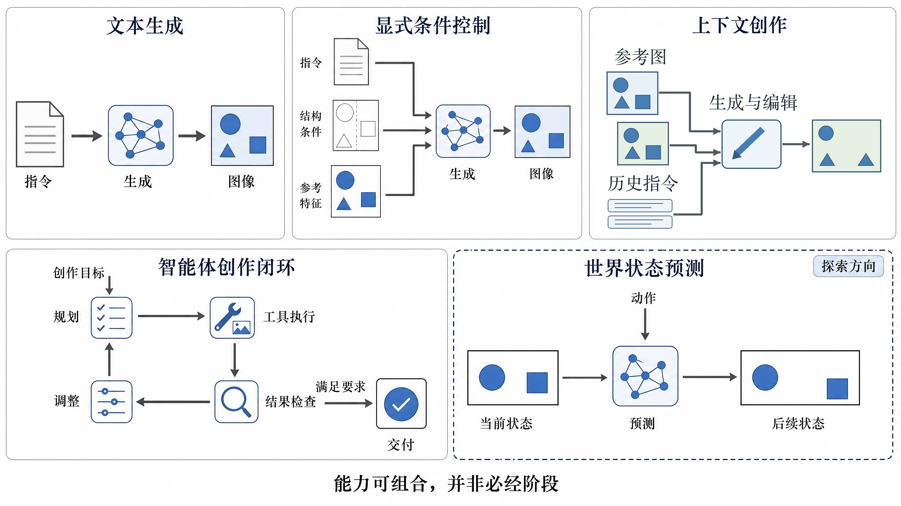

</div>

早期的AIGC图像生成大模型在文字渲染、身份保持、参考图控制、精细编辑、虚拟试装等复杂任务上，往往还需要额外的控制模块、辅助技术和人工编辑等额外流程。现在**前沿AIGC图像创作大模型正在把更多生成、编辑与参考条件控制能力纳入同一基础底座中，使其能够结合指令、源图和参考图完成更复杂和完整的视觉创作任务**。

这种趋势可以概括为**生成与编辑的统一建模**。它的驱动力主要来自三个方面：

1. **共享视觉知识，减少相近能力的重复学习**。生成一个杯子和修改杯子的颜色，都需要理解形状、材质、光照和语义。共享模型底座，可以复用这些基础能力；图像编辑再进一步学习目标定位、局部修改和内容保持。因此，统一建模的价值在于复用视觉知识，同时学习不同任务各自的约束。

2. **增强联合处理时的修改目标与保持要求**。一次参考图编辑往往同时包含多项要求：换衣服，但保留人物身份、姿态、背景和光照。让模型共同利用源图、参考图与指令，有利于在生成过程中协调这些要求，减少多阶段处理中条件丢失和误差传递。

3. **让数据与工程投入服务于多个任务**。当生成、编辑和参考控制共享底座模型时，数据处理、偏好对齐、推理优化和评估体系可以部分复用。比如一次关于文字能力改进的数据与工程，有机会同时帮助海报生成、文字替换和信息图制作等相关人物。

因此，通用AIGC图像创作大模型的重要发展方向是将文生图、图生图、文字渲染、局部编辑、多图融合和多轮创作等能力逐步统一到一个基础大模型中。


<h2 id="q-003">面试问题：AIGC图像创作大模型的主流架构范式有哪些？</h2>

**难度评分：⭐⭐⭐⭐ (4/5)  |  考察频率：⭐⭐⭐⭐⭐ (5/5)**

AIGC图像创作大模型存在多条并行发展的架构路线，具体如下表所示：

<div align="center">

| 架构范式 | 核心思想 | 代表模型 |
|---|---|---|
| 经典扩散去噪 | 训练时给图像或Latent特征加入噪声，让模型学习如何去噪；生成时从随机噪声出发，根据文本等条件反复更新去噪，逐步得到图像。潜空间模型还需要将最终表示解码成像素。| DDPM、Stable Diffusion、SDXL等 | 
| 多阶段/级联生成 | 将生成拆成多个相互衔接的阶段，典型做法是先生成低分辨率图像、确定主体与布局，再通过超分模型和生成模型逐级提高分辨率并补充细节。| 初代Imagen、DALL-E 2、GLIDE等 |
| Flow Matching / Rectified Flow生成范式 | 在噪声与真实图像表示之间构造训练路径，让模型学习不同中间状态下的变化方向与速度；生成时从噪声出发，沿预测方向逐步推进，最终得到图像。| FLUX系列、Stable Diffusion 3、Seedream系列、Qwen-Image系列等 |
| 自回归视觉生成（AR） | 将图像编码为视觉token或多尺度表示，再根据已经生成的内容预测后续token或下一个尺度，最后解码成图像。按尺度推进的模式，则先生成较粗的视觉表示，再根据已有尺度预测更精细的表示。| DALL-E 1、Parti、LlamaGen、VAR、Emu3、Janus-Pro等 |
| 掩码 token / 离散扩散 | 先给出一个尚未完成的视觉token集合，再逐轮补全或更新。以掩码生成为例，模型从大量被遮住的位置开始，结合文本条件和已知token，同时预测多个缺失位置；随后保留较可信的预测，对其余位置继续补全或重新预测，最终将完整token集合解码成图像。离散扩散则先定义token如何被随机破坏，再学习反向恢复过程。| MaskGIT、Muse等 | 
| AR + Diffusion/离散扩散组合架构 | 核心是根据不同信息的特点，组合使用不同的生成机制。一种做法是让文本按自回归方式逐个生成，让图像表示通过扩散或Flow逐步生成，并在模型中交换上下文信息；另一种做法是先生成视觉语义或粗粒度表示，再交给图像生成模块补全细节。| GLM-Image、Transfusion、Show-o、JanusFlow等 |

</div>

各个主流架构范式的流程如下图所示：

<div align="center">

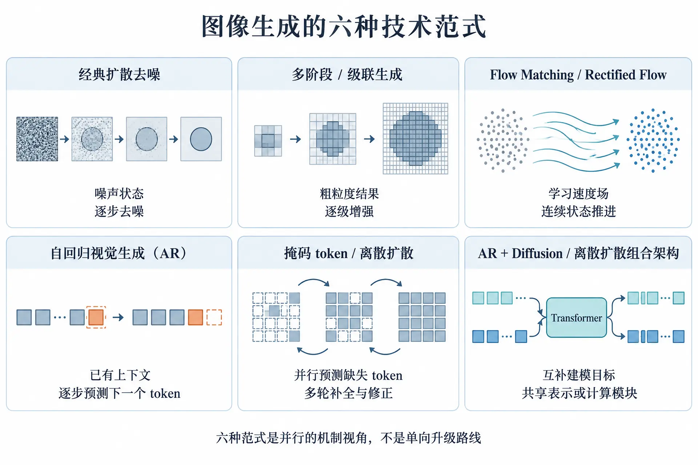

</div>

总的来说，**2022-2024年主线是扩散模型规模化和开源生态爆发；2024-2026年之后技术主线逐渐转向Flow Matching、DiT、自回归视觉token、AR+扩散混合架构，以及理解-生成-编辑统一的原生多模态大模型。**

<h2 id="q-004">面试问题：AIGC图像创作领域主要涵盖哪些典型任务？(进阶)</h2>

**难度评分：⭐⭐⭐ (3/5)  |  考察频率：⭐⭐⭐⭐ (4/5)**

AIGC图像创作领域涵盖了多种细粒度任务，如下表所示：

<div align="center">

| 任务类别 | 典型任务 | 核心目标与任务边界 |
|---|---|---|
| **图像生成与条件控制** | 文生图、图像引导生成、参考图生成、布局或结构条件生成 | 根据文本描述及参考条件构建目标图像。文本可以说明主体与场景，参考图可以提供身份、风格或外观信息，布局、深度、姿态等条件可以进一步限制结构。 |
| **多图组合与场景合成** | 多主体组合、主体与背景合成、多参考图融合 | 将多个来源中的有效信息组织到同一画面中，协调主体比例、空间位置、遮挡、透视与光照。重点是让不同内容形成合理场景，并保留需要保持的主体特征。 |
| **内容增删与区域编辑** | 对象添加、删除、替换、局部重绘、背景替换、扩图 | 按指令修改指定内容或区域，并保持不应改变的部分。删除对象需要补全背景，局部重绘需要衔接边界，扩图需要将原有结构与环境延续到画布之外。 |
| **外观、风格与光影变换** | 颜色调整、材质替换、重新打光、风格迁移 | 调整画面的视觉表现，同时按任务要求保持主体身份、主要结构和布局。风格、材质与光照的改变可能影响整张图像，不能简单等同于局部像素替换。 |
| **结构、姿态与视角变换** | 姿态调整、表情修改、形状与比例调整、视角变化 | 改变主体的几何形态或观察方式，同时保持身份与空间关系合理。视角变化可能涉及不可见区域的推断；生成结果具有视觉合理性，不代表完成了准确的三维重建。 |
| **文字渲染与视觉版式创作** | 指定文字渲染、文字替换、字体外观生成、海报与信息图排版 | 将目标文字准确地绘制到画面中，并协调字号、位置、层级和图文关系。页面视觉稿与可编辑文档、交互界面属于不同交付物；知识图像还需要独立检查事实与逻辑。 |
| **图像恢复与质量增强** | 超分辨率、去噪、去模糊、压缩伪影修复、细节增强 | 改善低质量图像的清晰度与可用性，同时尽量保留原有内容。生成式增强可能引入推测性细节，视觉更清晰并不必然意味着信息更真实。 |
| **主体一致性与多轮创作** | 人物身份保持、角色与商品一致性、多主体一致性、连续编辑 | 在更换姿态、背景、风格或连续修改时，保持需要保留的身份与关键属性，并维护仍然有效的历史要求。这是一组贯穿生成、合成和编辑任务的约束能力。 |
| **垂直应用与组合工作流** | 虚拟试装、商品展示、营销物料、电商内容生产 | 将多种基础任务组合为可交付流程。例如虚拟试装需要协调人物、服装、姿态、遮挡与光照；商品内容生产还可能涉及场景合成、文字排版和质量增强。具体流程可由一个模型或多个工具共同完成。 |

</div>


<h2 id="q-006">面试问题：AIGC图像创作大模型的效果应该如何评估？</h2>

**难度评分：⭐⭐⭐ (3/5)  |  考察频率：⭐⭐⭐⭐ (4/5)**

在图像生成领域的早期发展阶段，模型效果评估往往偏重“画面是否自然、清晰、美观”。随着技术持续的发展迭代，AIGC图像创作大模型能够开始处理复杂指令、文字渲染、局部编辑、多图融合和多轮创作等更加丰富的任务场景，单一审美分数已经无法代表大模型的实际能力。

更合理的评估方式，是按照不同任务目标构建合适的自动指标和人工评测进行综合判断，具体如下表所示：

<div align="center">

| 评估维度 | 关注问题 | 典型指标与评测方法 |
|---|---|---|
| 感知质量与审美偏好 | 图像是否自然、清晰、少伪影，是否符合目标任务的视觉要求 | 使用FID比较生成图像与真实参考图像的特征分布。使用人工成对比较策略，让评审者在相同任务的两个结果中选择更好的一个，统计胜率。使用Aesthetic Score对生成图像进行审美评分。|
| 多样性与分布覆盖 | 同一条件下能否产生多种合格结果，能否覆盖不同构图、风格和内容 | 使用同条件多次采样策略，固定提示词、改变随机种子，检查合格结果之间有多少有效变化。使用生成分布Precision/Recall指标，根据生成图像与真实图像分别检查“生成结果有多少接近真实分布”和“真实分布有多少被生成结果覆盖”。|
| 指令与条件遵循 | 文本、参考图、mask和布局等要求是否被共同满足 | 使用约束满足率策略，先把指令拆成可以单独检查的要求，再逐项判断。 例如主体、颜色、位置和保留区域各算一项，分别统计逐项通过比例，以及所有要求同时通过的图像比例。使用CLIPScore指标，用图文编码器计算提示词与图像的特征相似度，得分越高通常表示整体语义越相关。使用基于评分规则的VLM评判与人工校准，对图像中的复杂关系需逐项检查。 |
| 主体、属性与关系正确性 | 主体是否齐全，数量、颜色、属性归属和空间关系是否正确 | 使用GenEval指标，将指令中的对象、数量、颜色和位置等要求转成结构化检查，通过检测器及规则判断生成结果是否满足条件，再统计各类任务的通过率。构建视觉问答评测策略，把要求转成具体问题，如“红色物体是否在蓝色物体左侧”，由VLM模型作答，再与预期答案比较。检测器与问答模型也会犯错，因此还需要人工抽检。 |
| 文字渲染与版式 | 图中文字是否完整、准确、可读，位置与阅读顺序是否合理 | 使用OCR字符错误率CER策略，先用OCR读出图中文字，再与目标文本比较。构建整段文字完全匹配率策略，统计目标文字全部正确的样本比例，可以避免平均字符分数掩盖关键错字。同时人工对文字内容、文字框位置、阅读顺序、遮挡、OCR识别有误等情况进行核验。 |
| 编辑成功与非编辑区域保真 | 要修改的内容是否改对，不应修改的区域是否保持 | 构建编辑目标满足率策略，按编辑指令检查目标变化是否完成。对需要保持且位置对齐的区域，可使用SSIM比较局部亮度、对比度与结构，分数越高通常越接近原图；也可使用LPIPS比较深度视觉特征差异，分数越低通常表示感知变化越小。 |
| 参考主体与跨图一致性 | 人物、商品及多个主体在换姿态、换背景后，是否保持身份和关键特征 | 使用主体特征相似度指标，先定位或裁剪主体，再用DINO等视觉编码器提取特征，比较参考图与生成图的相似程度。使用人脸身份相似度指标，对适用的人脸任务，使用ArcFace等识别模型比较身份特征。最后人工后验，结合服装、标志、配件和商品结构等关键属性检查，避免把“看起来相似”直接判为“同一主体”。 |
| 多轮编辑与历史约束保持 | 连续修改后，是否能够保留先前要求，是否会发生累计漂移 | 构建多轮编辑链测试，预先设计一组连续指令，每轮既检查本轮修改，也复查仍然有效的历史要求。分别统计当前轮成功率、历史约束保持率和最终全部要求满足率。例如换背景后再改服装，需要检查服装是否改对、背景是否仍符合上一轮要求，以及人物身份是否保持。 |

</div>

**Rocky认为，评估AIGC图像创作大模型，首先要明确任务的验收标准，再分别检查画面质量、条件满足、内容保持与交付效率等维度**。自动指标帮助定位问题，人工评测校准判断，实际应用场景验证结果能否稳定交付。


<h1 id="q-007">2.Google在AIGC图像创作领域有哪些核心成果和跨周期价值？</h1>

<h2 id="q-008">面试问题：Google在AIGC图像创作领域形成了怎样的技术演进主线？</h2>

**难度评分：⭐⭐⭐⭐ (4/5)  |  考察频率：⭐⭐⭐ (3/5)**

Rocky认为，Google在AIGC图像创作领域的演进，可以从两层理解：**能力上，从高质量文生图扩展到可控编辑、多图组合和多轮创作；技术上，扩散生成、自回归视觉生成、掩码建模与原生多模态系统长期并行探索**。

接下来我们从这两个层面详细讲解Google在AIGC图像创作领域的技术演进发展。

**第一，Imagen系列强化了语言理解与图像生成的协同**。初代Imagen将强文本编码器与级联扩散结合，展示了语言表示对图文对齐和生成质量的重要作用。随后Imagen 2、Imagen 3和Imagen 4持续推进画质、文字、指令遵循和产品可用性。其中，Imagen 3公开确认为潜空间扩散模型；其他版本的具体结构存在闭源暂未公开的情况。

**第二，Parti和Muse探索了不同的视觉生成机制**。Parti将文生图建模为文本到离散图像token序列的自回归生成问题；Muse通过预测被掩码的视觉token，并行补全和迭代修正图像。二者说明，图像生成可以从序列预测和掩码建模中获得不同的能力与效率选择，与Imagen形成互补的研究布局。

**第三，可控编辑逐渐成为独立的重要能力**。Imagen Editor等工作将文本指令、源图像和编辑区域结合，关注目标区域是否正确变化、非编辑内容是否保持。Muse也展示了局部重绘、扩图等编辑能力。这说明Google对图像创作的探索，早已从“生成一张新图像”扩展到“围绕已有图像进行可控编辑”。

**第四，Gemini将图像生成进一步融入多模态上下文**。Gemini 2.0 Flash的原生图像创作已经支持图文交错生成和对话式编辑；后续Nano Banana、Nano Banana Pro与Nano Banana 2进一步强化参考图利用、主体一致性、文字渲染、知识结合和创作控制。其意义在于让图像创作能够利用连续的指令和视觉上下文，而不再局限于一次文本到图像的调用。

因此，如下图所示，Google的技术演进应理解为多种生成机制并行探索，图像生成与编辑持续融合，语言理解、视觉上下文和知识推理逐步融入原生创作过程。

<div align="center">

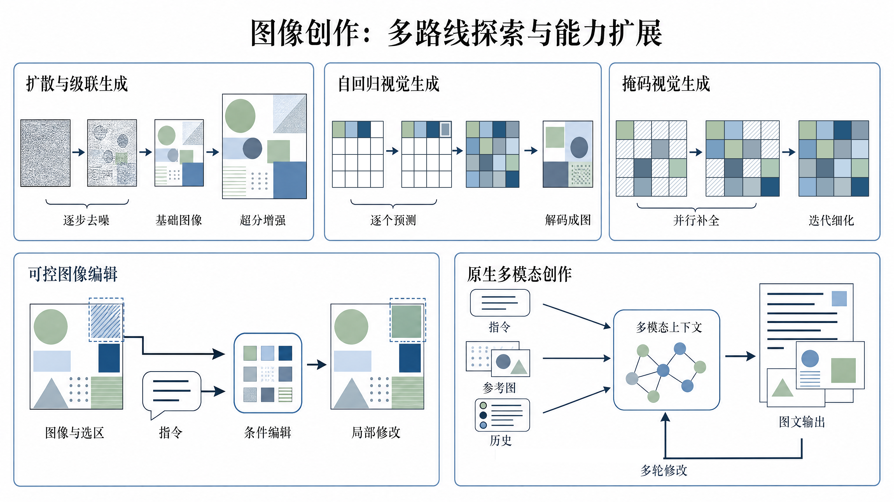

</div>

从技术路线上看，还可以如下表这样严谨区分：

<div align="center">

| 技术路线 | 代表模型 / 系统 | 技术边界 | 核心贡献 |
|---|---|---|---|
| 专用图像生成 | **Imagen（初代）** | 使用冻结的T5-XXL文本编码器，将低分辨率文生图扩散模型与超分扩散模型级联，逐级生成高分辨率图像 | 展示强语言表示对图文对齐的重要作用，并通过“基础生成 + 超分增强”兼顾整体内容与细节 |
| 专用图像生成 | **Imagen 2 / Imagen 3** | Imagen 2官方明确属于扩散模型；Imagen 3技术报告明确采用潜空间扩散 | 持续提升画质、指令遵循和文字等能力，进一步完善数据治理、评测与产品化 |
| 专用图像生成 | **Imagen 4** | 官方重点介绍文生图能力、文字表现、质量与效率定位 | 在Gemini原生图像能力发展的同时，继续推进专用文生图路线，强化细节、文字拼写与排版 |
| 自回归视觉生成 | **Parti** | 使用ViT-VQGAN将图像表示为离散token，通过编码器—解码器模型自回归生成图像token序列 | 将文生图视为序列到序列建模，探索扩大模型规模对复杂描述、组合场景与知识表达的帮助 |
| 掩码视觉生成 | **Muse** | 在离散视觉token空间中，根据文本条件预测被掩码的token，通过并行解码和多轮迭代完成生成 | 探索视觉生成的并行解码方式，并利用掩码建模支持局部重绘、扩图及无显式mask的编辑 |
| 文本引导的可控编辑 | **Imagen Editor** | 在Imagen基础上针对文本引导的局部重绘进行微调，利用编辑mask与原始图像条件约束生成 | 将“按指令修改”与“保留输入图像内容”结合，并通过EditBench系统评估局部编辑能力 |
| 原生多模态生成与编辑 | **Gemini 2.0 Flash原生图像能力** | 官方公开支持多模态输入与原生图像输出，但并没有公开模型架构 | 建立图文交错输出与对话式图像编辑的重要产品节点，使生成过程能够利用连续的语言和视觉上下文 |
| 原生多模态生成与编辑 | **Nano Banana(Gemini 2.5 Flash Image)** | 属于Gemini原生图像生成与编辑路线；没有公开模型架构 | 推进自然语言编辑、主体保持和多图组合等能力的实用化 |
| 原生多模态生成与编辑 | **Nano Banana Pro(Gemini 3 Pro Image)** | 官方强调基于Gemini 3 Pro的推理与世界知识能力；搜索等外部信息接入属于系统能力，没有公开模型架构 | 强化知识相关视觉表达、文字渲染、多图组合和精细编辑控制，服务于更复杂的创作任务 |
| 原生多模态生成与编辑 | **Nano Banana 2(Gemini 3.1 Flash Image)** | 官方将其定位于Flash图像路线，结合知识、推理、文字和主体一致性能力；没有公开模型架构 | 强调生成与编辑的响应效率，与Pro路线形成互补 |

</div>


<h2 id="q-009">面试问题：Imagen系列模型有什么跨周期技术价值？</h2>

**难度评分：⭐⭐⭐⭐ (4/5)  |  考察频率：⭐⭐⭐ (3/5)**

**Imagen系列的跨周期技术价值主要蕴含在条件理解、分阶段生成、采样稳定性、数据质量与评测反馈等维度中**。

初代Imagen由一个冻结的T5-XXL文本编码器、一个生成64 × 64图像的像素空间扩散模型，以及两个分别生成256 × 256和1024 × 1024图像的超分扩散模型组成。**三个扩散模型都接收文本条件，两个超分模型还接收上一级的低分辨率图像。** 因此，后续阶段既要增强图像细节，也要继续遵循文本约束，并非普通的插值放大。

下图中文本表征分别为基础生成与两级超分提供条件，图像则沿64 × 64 → 256 × 256 → 1024 × 1024逐级生成：

<div align="center">

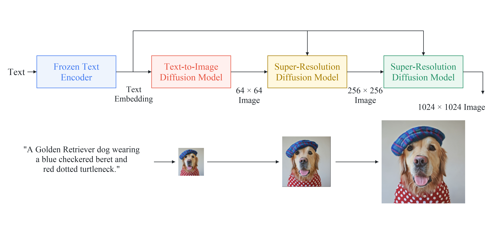

</div>

Imagen 3在图文对齐、高分辨率生成和数据治理等目标上延续了系列方向，但具体实现已有变化。下表中详细展示了Imagen 3相比初代Imagen的优化和跨周期技术思想：

<div align="center">

| 可复用的技术思想 | 初代Imagen的代表做法 | Imagen 3的公开延续或变化 |
|---|---|---|
| 增强条件表征与语义监督 | 使用冻结的T5-XXL文本编码器，并通过实验研究文本编码器规模的影响 | 使用原始描述与Gemini生成的合成描述，增强训练文本的细节与多样性；所使用的文本编码器未公布 |
| 按尺度分解生成任务 | 在像素空间进行64 × 64基础生成后，通过两个文本条件超分扩散模型逐级生成至1024 × 1024 | 采用潜空间扩散，默认配置生成1024 × 1024图像，并可接2×、4×或8×超分 |
| 提高训练数据的有效性 | 使用大规模图文数据，并进行一定的数据过滤 | 多阶段过滤、去重与相似样本降权、AI生成图像移除，以及原始与合成描述配对 |
| 用分维度评测指导迭代 | 提出DrawBench，结合人工评价检查复杂语义能力 | 分开评估整体偏好、图文对齐、视觉吸引力、细粒度对齐和数量推理，并结合自动指标 |

</div>

在初代Imagen的实验设置中，扩大冻结文本编码器参数量，比单纯扩大图像扩散模型参数量更能改善图文对齐与生成质量。这说明，在纯文本语料上获得的语言表征可以帮助图像生成；冻结编码器还可以避免生成模型训练时对它进行参数更新，并在条件允许时预先计算文本表征。

Imagen 3的数据工程补充了另一种思路：每张训练图像同时配有原始caption与合成caption，后者由多个Gemini模型使用不同指令生成，以改善描述质量和语言多样性。原始描述只有“几个积木”时，额外补充颜色、数量与相对位置，可以提供更具体的监督；但描述越长并不必然越好，错误细节也会污染训练。

在初代Imagen中，增大CFG强度有助于增强文本约束，但也可能让预测像素超出训练数据范围，造成过饱和与不自然的结果。Imagen提出的**动态阈值（dynamic thresholding）**根据每一步预测图像的像素绝对值分布确定阈值，再对预测值裁剪和缩放，缓解强引导下的失真。


<h2 id="q-010">面试问题：Nano Banana系列有哪些优秀特点？</h2>

**难度评分：⭐⭐⭐ (3/5)  |  考察频率：⭐⭐⭐ (3/5)**

**Nano Banana系列是Google基于Gemini研发的原生多模态图像生成与编辑模型系列，其核心特点是将文本指令、源图像、参考图和对话上下文共同用于继续创作过程中。** 

初代Nano Banana重点推进自然语言编辑、多图融合和主体保持；Nano Banana Pro进一步强调知识推理、文字渲染与精细控制；Nano Banana 2则在Flash路线上结合较强创作能力与快速响应。

**相较于以专用文生图能力见长的Imagen路线，Nano Banana系列更突出多模态输入与对话式编辑体验**。Nano Banana系列中的三个版本的核心基础知识如下表所示：

<div align="center">

| 系列名称 | 官方对应模型 | 主要定位 | 代表性特点 |
|---|---|---|---|
| **Nano Banana** | Gemini 2.5 Flash Image | 自然语言生成、编辑与快速创作 | 通过语言完成定向修改，利用多张输入图像进行融合，并强化人物、物体外观的一致性 |
| **Nano Banana Pro** | Gemini 3 Pro Image | 复杂构图、知识相关视觉内容与精细创作 | 更强调推理与世界知识、文字渲染、多图组合，以及视角、光照和局部区域等创作控制 |
| **Nano Banana 2** | Gemini 3.1 Flash Image | 在Flash路线上结合较强图像能力与快速迭代 | 将知识结合、文字渲染、主体一致性和创作控制等能力带入更注重响应效率的工作流，并强调图像搜索增强 |

</div>

其中Google将Pro定位用于更强调高保真与事实准确性的任务，将Nano Banana 2定位于快速生成、指令遵循和图像搜索增强。

从创作过程看，这个系列的主要特点可以归纳为以下五类，如下表所示：

<div align="center">

| 核心特点 | 主要能力与版本侧重 | 简短例子 |
|---|---|---|
| **自然语言生成与编辑** | 将文本指令与输入图像结合，支持生成、添加、删除、替换和风格调整；初代已重点展示定向编辑，后续版本继续增强控制能力 | 保留主体，将背景改为夜景，再调整光照 |
| **多图参考与主体一致性** | 综合不同参考图中的人物、物体、风格与构图信息，尽量保持主体外观；Pro和Nano Banana 2进一步强调复杂组合与一致性 | 将人物参考图与服装、场景参考图组合成新画面 |
| **文字渲染与内容润色** | Pro和Nano Banana 2更强调可读文字、多语言表达，以及图内文字的翻译和替换 | 将海报文案换成另一种语言，并尽量延续原有视觉风格 |
| **知识结合与搜索增强** | 利用多模态理解与世界知识组织视觉内容；在支持的入口中结合搜索信息，Nano Banana 2进一步强调图像搜索增强 | 根据给定资料生成说明图，或参考检索到的视觉信息描绘特定对象 |
| **多轮创作与输出控制** | 在连续指令中迭代画面，调整视角、焦点、光照、色彩和长宽比；Pro与Nano Banana 2提供更丰富的高分辨率输出选择 | 先确定构图，再修改文案和光照，最后适配横版与竖版 |

</div>

我们需要注意的是，**对话上下文与长期记忆的区别**。多轮编辑依赖模型提供的文本、图像和历史交互。模型能利用这些上下文承接修改，不代表它会在不同会话中永久记住主体；连续编辑仍可能积累身份、构图和细节漂移。同时**模型知识与实时检索**也有差异。模型已有知识是训练过程中固定的，而搜索增强则是实时搜索外部信息并作为模型的参考。

下图从左到右并列展示Nano Banana、Nano Banana Pro和Nano Banana 2的代表性生成效果，分别呈现人物一致性与风格化创作、文字排版与知识相关创作、信息图与文字渲染：

<div align="center">

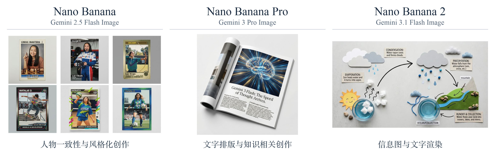

</div>


<h1 id="q-011">3.OpenAI在AIGC图像创作领域有哪些核心成果和跨周期价值？</h1>

<h2 id="q-012">面试问题：OpenAI在AIGC图像创作领域形成了怎样的技术演进主线？</h2>

**难度评分：⭐⭐⭐⭐ (4/5)  |  考察频率：⭐⭐⭐⭐ (4/5)**

Rocky认为，OpenAI在AIGC图像创作领域形成的是五条相互衔接的演进主线：**视觉表示与序列建模、语义空间与图像解码、描述质量与指令遵循、原生多模态对话创作，以及专用图像模型。** 但除了DALL-E 1和DALL-E 2提供了较完整的开源方案外；DALL-E 3、GPT-4o 和 GPT Image这些闭源系统则更多体现了数据工程、交互策略与产品逻辑的变化，我们无法知道更多技术细节。

下表是OpenAI在AIGC图像创作领域技术演进路径的具体汇总：

<div align="center">

| 技术路线 | 模型 / 系统 | 技术边界 | 跨周期价值 |
|---|---|---|---|
| 离散视觉token与自回归生成 | **DALL-E 1** | 使用dVAE将图像表示为离散 token，Transformer对文本token和图像token序列进行自回归建模 | 证明视觉内容可以进入统一的序列建模框架 |
| 语义表征与扩散解码 | **DALL-E 2 / unCLIP** | 由CLIP图文表征、prior表征的预测模型和diffusion decoder组成，将文本意图映射到图像语义表征，再由扩散解码器渲染图像，并支持图像条件生成方向 | 将“理解用户想要什么”和“如何生成像素”拆成可组合模块 |
| 描述质量与指令遵循 | **DALL-E 3** | 官方重点讨论高质量caption、训练数据重描述和复杂prompt遵循；完整模型架构没有公开 | 说明数据描述质量与语言意图展开本身就是模型能力的一部分 |
| 原生多模态对话创作 | **GPT-4o图像生成** | OpenAI将图像生成整合到GPT-4o的多模态交互中；底层图像生成模型没有公开，文本、输入图像、生成结果和历史对话可以共同参与创作与编辑 | 图像生成从单次调用转向连续交互和修改闭环 |
| 专用图像模型 | **GPT Image系列** | OpenAI当前主力图像生成与编辑模型系列 | 将研究能力转化为可监控、可调用、可迭代的视觉基础设施 |

</div>

如下图所示，OpenAI在图像创作领域的技术路线探索汇总：

<div align="center">

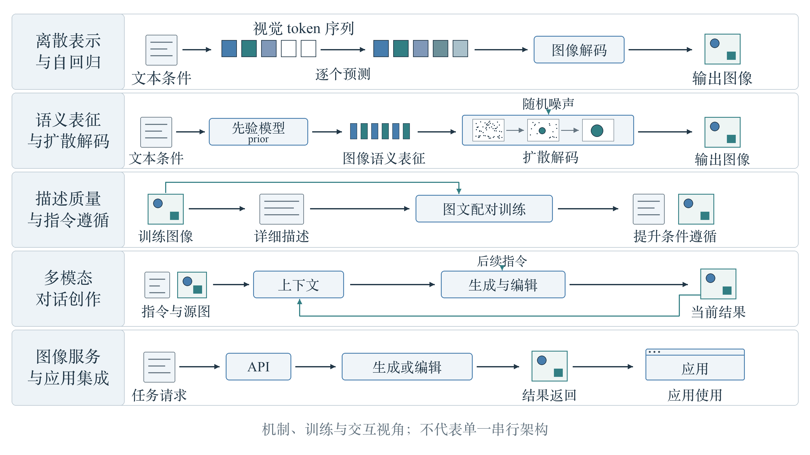

</div>


<h2 id="q-013">面试问题：DALL-E系列模型有什么跨周期技术价值？</h2>

**难度评分：⭐⭐⭐⭐ (4/5)  |  考察频率：⭐⭐⭐⭐ (4/5)**

Rocky认为，理解DALL-E系列模型的跨周期价值，可以从三个持续影响AIGC图像创作大模型的核心问题出发：**图像如何表示，语义如何参与生成，训练描述标签如何提供有效监督。** 三代模型分别在这些问题上给出了有代表性的跨周期答案。

### 1、 DALL-E 1：用离散视觉表示，把图像生成接入大规模序列建模

图像直接以像素形式参与序列建模，序列很长，计算开销也大。DALL-E 1采用两阶段训练：先训练dVAE，把一张256×256的图像压缩成32×32的离散视觉token网格；随后固定这套视觉编解码器，将文本token与1024个图像token拼接起来，训练自回归Transformer学习它们的联合分布。生成时，模型以文本为条件逐步预测图像token，再由解码器重建图像。

这套设计把两个问题分开处理：视觉编解码器负责压缩和重建图像，Transformer负责学习文本条件下视觉token的组合规律。高维像素因此被转换成了可以进行序列预测的离散表示。文本和图像使用不同的编码方式，但可以进入同一个序列建模框架。

图像离散化并非始于DALL-E 1，VQ-VAE等更早的工作已经探索过这条路线。DALL-E 1的代表性贡献在于，**把离散视觉表示、文本条件和大规模自回归训练结合起来，展示了通用文生图任务在数据与模型规模扩大后的潜力。** 后续模型即使同样采用离散视觉token，也可能使用自回归预测、掩码预测等不同的生成方式。

这项工作留下了一个至今仍有用的跨周期技术判断：**视觉特征的高效表示本身就是生成能力的一部分。** 压缩过强，会损失细节；token太多，会增加训练和推理成本。表示阶段已经丢失的信息，后续生成模型很难保证准确恢复。

### 2、 DALL-E 2：让语义表征与图像解码分工，复用图文对齐能力

CLIP能够把文本和图像映射到相互对齐的表征空间，但文本向量与图像向量本身并不相同。DALL-E 2的unCLIP路线中加入了prior模块，它的作用是根据文本条件，预测可能对应的CLIP图像表征；随后，扩散解码器以这个图像表征为条件生成图像。

核心流程可以概括为：**文本条件 → prior预测CLIP图像表征 → 扩散解码器生成图像。**

这里的prior模块是一个需要训练的条件生成模型，学习给定文本可能对应的图像表征。论文分别研究了自回归prior和扩散prior，并报告了扩散prior的计算效率优势。

下图展示了CLIP图文对齐与unCLIP生成流程之间的关系：

<div align="center">

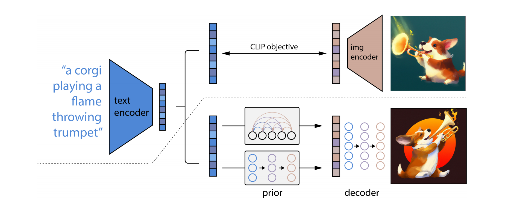

</div>

上图中虚线上方表示CLIP的对比学习过程，虚线下方表示文生图流程；prior区域的两个分支是两种可选实现，不是必须依次通过的两个阶段。

**DALL-E 2的长期启发，是将已有的表征能力转化为生成条件。** 不过，CLIP图像表征并不是原图的无损压缩，它没有完整保存每个像素的位置和所有局部属性。因此，语义相近不等于布局准确，更不等于编辑后主体身份与未编辑区域都能严格保持。条件生成系统的控制精度，取决于条件表示究竟保留了哪些信息；精确布局或局部编辑往往还需要更直接的空间约束。

### 3、 DALL-E 3：用更准确的图像描述，补足指令遵循所需的训练监督

很多文生图开源数据集的数据工程细粒度不够，比如一张训练图像可能有多个主体、不同属性和明确的空间关系，但原始标签描述只提到了其中一个主体。模型虽然看到了整张图，却缺少足够明确的文字条件，去学习这些细节应该与哪些表达对应。这会影响推理时的指令遵循：用户明明写出了详细Prompts，但模型却未必在训练中学习到同样细致、准确的图文对应监督知识。

DALL-E 3的重要工作，是通过构建图像标签描述生成模型，为训练图像生成更详细的合成标签caption，并将这些描述用于文生图训练。它补足了原始图文数据中容易缺失的主体属性、动作与关系信息，让模型有机会学到更细致的条件对应。

下图对比了同一图像的原始网页文本（Alt Text）、简短合成描述（SSC）和详细合成描述（DSC）：

<div align="center">

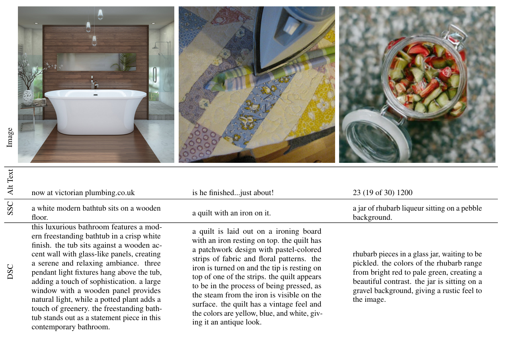

</div>

**标签Caption是否高效取决于描述是否准确覆盖图像中的关键条件。** 单纯拉长caption并不能保证训练效果；如果描述模型伪造了图中不存在的对象，或者写错位置和数量，增加的文本反而会成为错误监督。重描述数据仍然需要质量检查，尤其要关注对象遗漏、属性绑定错误、关系错误和幻觉。

DALL-E 3留给模型训练一个实用工程建议：**遇到复杂指令遵循不足，除了检查模型容量和训练方法，也要回到数据，确认数据标签是否足够完整与高质量。** 这一判断适用于不同的生成架构，具有持续的工程价值。


<h2 id="q-014">面试问题：GPT-4o图像生成系统和GPT-Image系列有哪些优秀特点？</h2>

**难度评分：⭐⭐⭐⭐ (4/5)  |  考察频率：⭐⭐⭐⭐ (4/5)**

在AIGC图像创作领域，随着技术的不断发展，一次图像创作不单单是一次图像生成，还包含了大量的二次编辑：保留主体，修改局部内容，换背景同时一些图像细节保留等。**GPT-4o图像生成系统把这些能力放进同一个多模态对话中连续处理；GPT Image 系列则把生成和编辑功能进一步构建为统一的图像大模型能力。** 

OpenAI介绍GPT-4o图像生成能力重点在原生多模态交互、复杂指令遵循、文字渲染和连续编辑体验上；**OpenAI公开过GPT-4o图像生成是基于自回归建模方向**，但具体模型架构、参数规模和训练细节并没有公开。因此，我们主要讨论的是可观察到的产品能力，GPT-4o生成效果图如下图所示：

<div align="center">

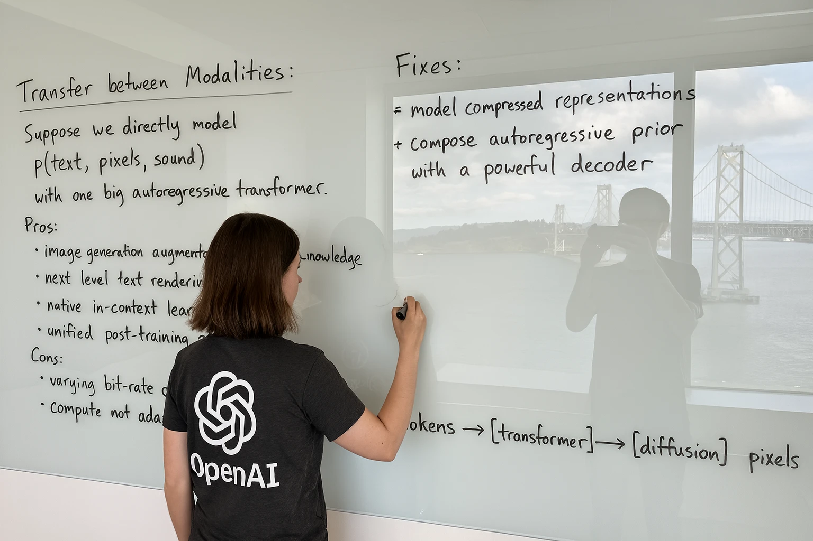

</div>

GPT-4o图像生成系统的了跨周期价值，可以总结为以下四点：

1. **把创作上下文放在一起处理。** 文本要求、用户上传的源图或参考图、此前的生成结果和聊天历史，可以共同参与下一次生成。图像创作因此从一次性的 `prompt-to-image`，变成围绕上下文不断推进的 `conversation-to-image`。
2. **把复杂指令转化为可执行的视觉约束。** 多主体、属性绑定、相对位置、材质、风格和画面文字经常同时出现在一个创作要求里。GPT-4o先理解这些约束之间的关系，再把它们传递给图像生成过程。
3. **把生成和修改构建成连续操作。** 用户可以在已有结果上要求换背景、改比例、替换局部文案或保留主体特征等，而不必每次从头开始创作图像。
4. **让文字和知识参与视觉表达。** 图中文字、表格、流程关系和信息层级成为生成目标的一部分，多模态模型的语言理解和世界知识可以帮助组织这些内容。

GPT-4o图像生成系统降低了AIGC图像创作的学习门槛：用户不必先理解采样器、CFG等各种复杂参数就可以通过对话表达创作需求。

GPT-4o图像生成首先展示了多模态对话中的创作体验，GPT Image 1则将相关生成与编辑能力开放为开发者可以直接调用的模型。随后的GPT Image版本则继续改进指令遵循、编辑保真、文字渲染和生成效率。下图是GPT Image模型的生成效果图：

<div align="center">


</div>

| GPT Image版本 | 版本特点 |
|---|---|
| **GPT Image 1** | 支持图像生成、编辑、文字表达和复杂指令 |
| **GPT Image 1.5** | 加强编辑保真、指令遵循、较密集和较小文字的渲染，并改善速度 | 
| **GPT Image 2** | 强调高质量生成与编辑、灵活尺寸和高保真图像输入 |
| **GPT Image 2.5 Flare** | 当前官方定位偏向速度与日常高质量生成，并支持编辑 |
| **GPT Image 2.5 Sunburst** | 当前官方定位偏向更精细的生成与编辑控制 |


<h1 id="q-015">4.介绍一下Seedream系列的技术原理和模型架构</h1>

<h2 id="q-016">面试问题：Seedream 2.0模型的核心原理和关键创新点是什么？</h2>

**难度评分：⭐⭐⭐⭐ (4/5)  |  考察频率：⭐⭐⭐ (4/5)**

Seedream 2.0是面向中英双语场景的扩散文生图大模型，其核心架构包括自研VAE、MMDiT、双语LLM文本编码器、Glyph-Aligned ByT5和Scaled RoPE，具体如下图所示，这个架构也奠定了Seedream系列模型的核心架构基础。

<div align="center">

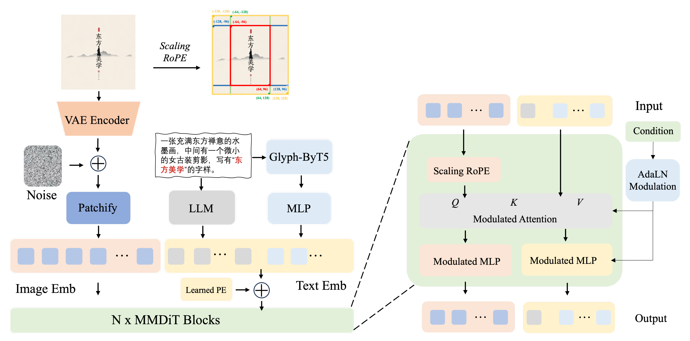

</div>

从生成过程看，提示词先被编码成文本条件，MMDiT在这些条件的引导下逐步更新噪声潜变量，VAE再将生成的潜变量还原为像素图像。Scaled RoPE负责主干内部的空间位置表达，Refiner则在基础结果之后继续提升分辨率与细节质量。其中真对文字渲染部分，使用双语LLM与Glyph-Aligned ByT5提供互补的文本条件，对具体字形、字符顺序与排版等能力进行增强。

接下来，Rocky带着大家逐一讲解Seedream 2.0中核心模块的原理。

### 1、 双语LLM和Glyph-Aligned ByT5的作用

**Seedream 2.0使用自研的decoder-only LLM作为双语文本编码器**，将提示词转换为特征序列。它既要理解整体场景，也要保留主体、颜色、位置、风格等细粒度要求。对于中文创作，还需要识别中文特有的文化元素、审美表达和专业词汇，减少模型在理解条件时产生的偏差。

**Glyph-Aligned ByT5则让模型关注具体字符，同时保留整体语义**。文字渲染比一般的语义理解更精细，两段文字即使意思接近，只要其中一个字不同，最终需要画出的笔画就可能完全不同。Glyph-Aligned ByT5通过字形对齐，为模型补充更细粒度的字符与字形特征。

Seedream 2.0发现仅使用ByT5编码待渲染文字，尤其是较长文本时，仍可能出现字符重复和布局紊乱。因此，待渲染内容同时由LLM和ByT5编码，**整体流程是ByT5特征先经过MLP映射，再与LLM特征拼接，作为完整的文本条件输入DiT**。

两者的配合可以让LLM帮助模型理解文字的整体含义及其在画面中的要求，ByT5补充具体字符的细节。字体、颜色、大小和位置等外观信息，则通过描述文本表达，由LLM编码。

### 2、 MMDiT与Scaled RoPE的作用

**MMDiT与Scaled RoPE的组合则可以在融合图文条件的同时处理空间位置**。图像潜变量被切分为图像token，与文本token共同进入MMDiT的Transformer block，通过联合注意力交换信息。这样，某个视觉区域在生成时，就能利用与其相关的主体、属性和布局描述。

考虑到图像与文本的表示性质不同，两类token在交互后仍使用各自的MLP进行变换。模型还通过自适应层归一化调制计算，并使用QK-Norm改善训练稳定性。采样过程中，MMDiT根据当前潜变量状态和文本条件预测更新所需的信息，采样器据此反复更新潜变量，逐步形成图像结构与细节。

与此同时，模型还需要知道每个图像token位于什么位置。**Seedream 2.0为图像token使用二维RoPE，并根据图像分辨率缩放旋转位置编码，使不同分辨率下中心区域的patch具有相近的位置编号**。Scaled RoPE解决的是画布尺寸变化时，空间位置如何保持相对一致的问题。它有助于模型向未训练过的分辨率和长宽比泛化。

### 3、 Refiner提高分辨率并完善局部细节

**最后的Refiner通过专门训练，提高分辨率并完善局部细节**。Seedream 2.0的基础模型生成512分辨率尺度的结果，再由Refiner提升到1024尺度。Refiner建立在基础模型之上，经过专门训练，除了提高分辨率，还用于完善人脸等局部结构、丰富纹理表现。Refiner的效果具体如下图所示：

<div align="center">

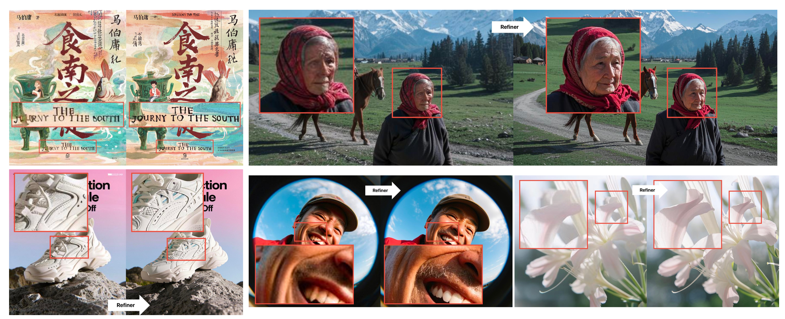

</div>

### 4、 训练数据标注工程

我们再来学习一下Seedream 2.0的数据工程，Seedream 2.0构建了Seeedream系列的数据工程基座，后续版本大多沿用和在此基础上扩展数据工程策略。

如果一张图像包含人物、背景和文字，caption标签却只写“一个人在街上”，训练时就缺少对人物属性、对象关系和具体文字的明确监督。反过来，描述过长但加入了图中不存在的内容，同样会破坏图文对应关系。因此，标注需要兼顾信息覆盖与准确性。

Seedream 2.0将caption分为通用描述与专项描述，如下表所示：

<div align="center">

| 标注类型 | 主要标签内容 | 对模型学习的作用 |
|---|---|---|
| 中英文短描述 | 主要主体、场景和核心内容 | 建立简洁语言与画面主要内容之间的对应关系 |
| 中英文长描述 | 主体属性、背景细节、空间关系等更丰富的信息 | 为复杂指令提供更细致的视觉监督 |
| 艺术描述 | 风格、色彩、构图、光照等 | 将审美要求转化为模型能够学习的具体条件 |
| 画面文字描述 | 图中实际出现的文字及其视觉表现 | 帮助模型同时学习文字内容与呈现方式 |
| 超现实描述 | 不符合日常经验的组合、形态和场景关系 | 保留创意画面的特殊关系，减少标注时的误解 |

</div>

中英文描述让模型接触两种语言的表达方式，长短描述覆盖不同详细程度的条件，专项描述则补足普通caption标签容易遗漏的信息。下图是Seedream 2.0的训练数据标注效果图：

<div align="center">

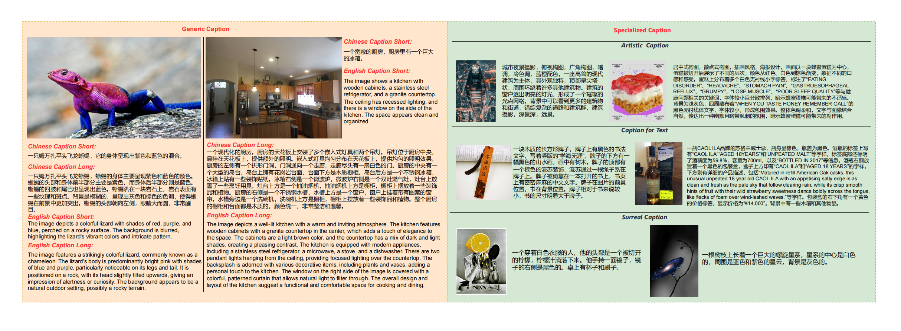

</div>

在数据标注策略的基础上，Seedream 2.0构建了一套完整的文字渲染数据预处理流程。图像经过低质量数据过滤筛选、OCR检测、水印裁切、再次OCR检测及低质量文字框过滤，再利用提取文字进行重描述，构建训练图文对数据。训练数据处理流程具体如下图所示：

<div align="center">

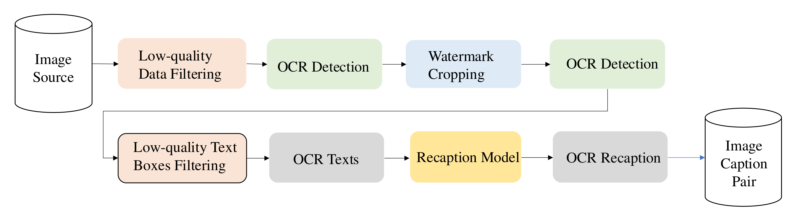

</div>

OCR与重描述模型各有职责。OCR提供图中实际出现了哪些文字的依据；重描述模型进一步组织这些信息，将文字内容与画面描述结合起来。结合论文对文字渲染条件的说明，字体、颜色、大小和位置等特征也通过描述文本表达，为后续生成提供监督。


<h2 id="q-017">面试问题：Seedream 3.0模型的核心原理和关键创新点是什么？</h2>

**难度评分：⭐⭐⭐⭐⭐ (5/5)  |  考察频率：⭐⭐⭐ (4/5)**

Seedream 3.0延续Seedream 2.0的MMDiT主干，并扩大了参数规模。同时优化的重点放在了训练目标、数据采样、分辨率适配和偏好对齐。

### 1、 训练目标优化和混合分辨率训练

**Seedream 3.0的训练目标设计为当前主流的Flow Matching范式**，MMDiT接收当前潜变量、时间步和文本条件，预测当前状态对应的变化方向与幅度，也就是速度场。

同时**Seedream 3.0开始进行混合分辨率训练**，让模型学会在不同大小和比例的分辨率上生成高质量图像。

如果训练图像始终采用同一尺寸，面对不同的分辨率图像生成需求，其泛化性会受限。Seedream 3.0利用Transformer能够处理可变长度token序列的特点，在各个训练阶段打包不同长宽比、不同分辨率的图像。**模型先在平均约 $256 \times 256$ 的像素面积尺度上预训练，再使用 $512 \times 512$ 至 $2048 \times 2048$ 尺度的图像继续训练。这种训练策略使模型能够先在较低计算成本下学习基础图文对应关系，再逐步适应高分辨率中的纹理、小字和局部结构**。与此同时，模型增加了尺寸嵌入（size embedding），将目标分辨率作为额外条件，使生成主干明确感知当前画布的尺寸。后训练阶段还进行分辨率均衡采样，让不同分辨率的数据都有足够的训练机会。**完成这些训练后，Seedream 3.0能够直接生成最高2K图像，因此不再继承Seedream2.0的Refiner阶段**。下图是Seedream 3.0原生高分辨率生成示例：

<div align="center">


</div>

### 2、 Cross-modality RoPE机制的作用

**Seedream 3.0设计了Cross-modality RoPE机制**，让图文位置关系在同一套注意力中进行计算。Seedream 2.0为图像token使用二维RoPE，为文本token使用可学习的位置嵌入。Seedream 3.0进一步将二维RoPE扩展到文本侧，使图像与文本都通过二维位置编码参与注意力计算。具体做法是将长度为 $L$ 的文本序列视为形状为 $[1,L]$ 的二维序列，也就是一行、L列，再将文本token的列位置编号连续安排在对应图像token之后。这样，模型处理图像内部、文本内部及图文之间的关系时，都可以利用这套位置表示。

位置编码影响注意力中query与key的匹配方式，使模型在比较token内容的同时，也能利用位置关系。Cross-modality RoPE改进的是图文交互的表示基础，具体的语义关系和文字排版仍需要通过训练获得。

### 3、 REPA机制的作用

**Seedream 3.0还引入了REPA机制**。REPA为生成主干提供一份已有的视觉表征参考。

生成模型不仅需要预测正确的更新方向，还需要在内部形成有用的视觉表示。如果完全依赖生成损失，模型需要在学习生成的同时，逐步建立对物体结构和视觉语义的表征能力。REPA为这一过程增加了辅助监督。训练时，预训练视觉编码器DINOv2-L提取真实图像的视觉特征；MMDiT处理对应的带噪潜变量。通过比较两者的特征，模型学习让自己的中间表示与已有视觉特征对齐。

Seedream 3.0使用余弦距离计算表征对齐损失，并将其加入训练目标：

$$\mathcal{L}=\mathcal{L}_{\mathrm{FM}}+0.5\,\mathcal{L}_{\mathrm{REPA}}
$$

这两个损失的分工很清楚，Flow Matching监督潜变量如何变化，REPA约束模型内部怎样表示图像内容。其中DINOv2-L在这里提供训练过程的监督，常规生成时无需额外运行它。**论文中实验表明，加入REPA还能够加快大规模文生图训练的收敛**。

### 4、 设计分辨率感知时间步采样

针对不同分辨率的生成场景，Seedream 3.0还采用了**分辨率感知时间步采样**。根据训练分辨率平移时间步分布，在高分辨率训练中增加低信噪比区域的采样概率，使训练信号随空间尺度调整。一次训练通常不会完整执行从噪声到图像的所有生成步骤，而是抽取一个时间步，构造对应的带噪状态，再计算训练损失。因此，时间步采样分布决定了模型在不同噪声程度上获得多少训练机会。

高分辨率图像具有更多空间信息与冗余，同一名义时间步下的学习难度，未必与低分辨率相同。Seedream 3.0先从logit-normal分布中采样，再根据分辨率进行时间步偏移；在更高分辨率训练中，提高低信噪比区域的采样概率。这意味着让模型更经常接触靠近噪声端、图像信息较弱的状态。在这些状态下，可直接利用的视觉线索更少，模型需要更多依赖文本条件和学到的视觉规律组织画面。

分辨率感知时间步采样在训练和推理的场景的具体实现也不一样。训练时，根据当前训练数据集的平均分辨率确定时间步分布的偏移。推理时，根据目标分辨率和长宽比计算偏移因子。

### 5、 偏好对齐后训练过程

预训练建立基础生成能力，后训练继续改善风格、布局和人类偏好。Seedream 3.0延续CT、SFT和RLHF等环节，并在提示词处理侧使用PE。CT和SFT使用专门训练的caption模型，对风格、构图、布局等内容进行标注，使视觉要求能够与文字条件形成更明确的对应。奖励模型从CLIP体系升级为VLM体系，将评价要求组织成问题，利用“Yes”回答token的归一化概率构造奖励，并探索从1B到超过20B参数规模的奖励模型。论文中发现，奖励模型规模扩大与奖励建模效果改善相关。下图是Seedream 3.0训练阶段效果对比，依次展示Pretrain、CT、SFT、RLHF和PE阶段的综合变化：

<div align="center">

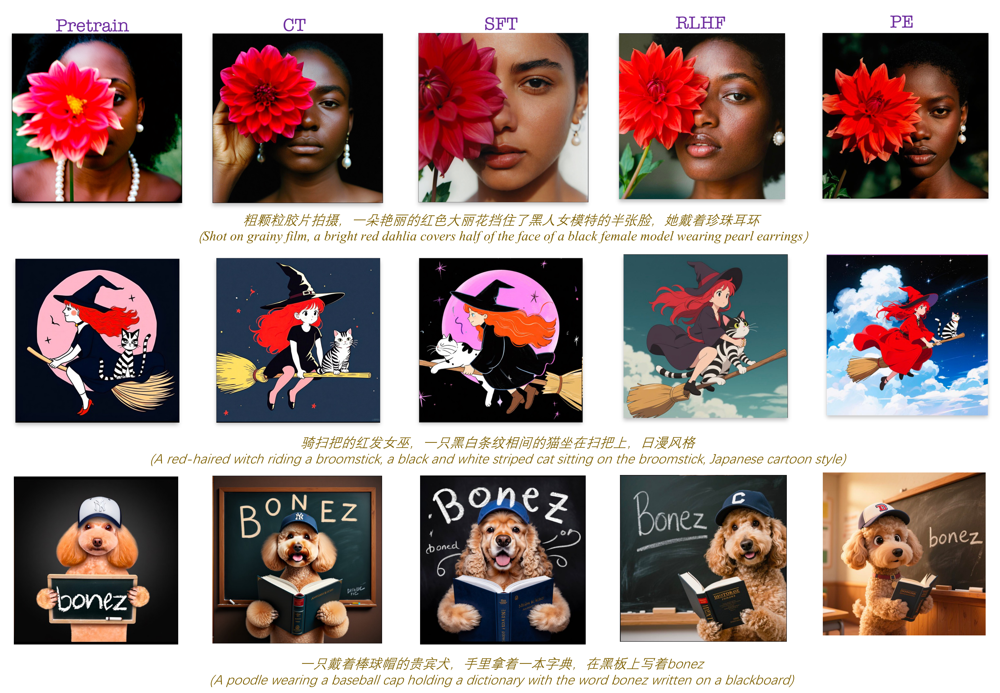

</div>


<h2 id="q-018">面试问题：Seedream 4.0模型的核心原理和关键创新点是什么？</h2>

**难度评分：⭐⭐⭐⭐⭐ (5/5)  |  考察频率：⭐⭐⭐ (4/5)**

Seedream 4.0把文生图、单图编辑、多图参考和多图输出纳入同一套多模态生成系统中。相较于Seedream 3.0主要强化高分辨率文生图，Seedream 4.0进一步处理用户提供的图像、编辑要求以及多张图之间的关系：哪些内容来自参考图，哪些属性需要修改，最终应该生成怎样的图像内容，都需要在生成过程中得到协调。

Seedream 4.0优化的重点放在了**VLM/PE整理创作意图和任务条件，DiT利用语言与视觉条件生成目标潜变量，VAE负责像素与潜变量之间的转换**。多任务训练让这些环节适应不同输入输出形式，加速方法再分别降低条件处理和图像生成的成本。Seedream 4.0的条件处理、潜空间生成与图像解码的分工具体如下图所示：

<div align="center">

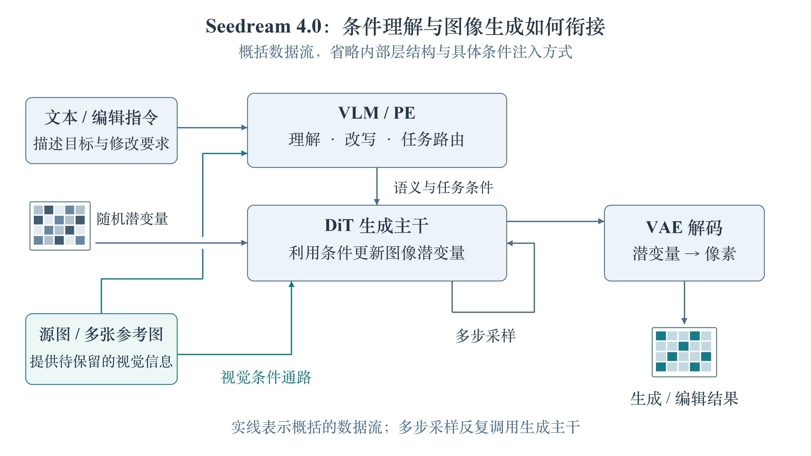

</div>

### 1、 VLM/PE：把用户输入整理成生成主干能够利用的条件

面对纯文本输入，AIGC图像创作系统需要理解主体、风格、布局等要求；面对图像编辑，还需要识别原图内容，并判断哪些部分应该改变、哪些部分需要保留；面对多张参考图，则需要结合指令理解各张图在创作中的作用。输入形式变多后，提示词处理也需要具备图像理解能力。

Seedream 4.0基于Seed1.5-VL训练VLM，承担Prompt Engineering任务。它接收文本、单张参考图或多张图像，执行任务路由、提示词改写、参考图描述与目标图像描述，并估计合适的长宽比。这些输出进一步作为DiT的输入条件。

PE还会根据任务复杂度动态调整思考预算。简单请求可以较快形成条件，涉及多张图关系或复杂指令时，则分配更多理解与规划计算。这样，条件准备的开销可以随请求难度调整。自适应长宽比也属于这一过程：先根据内容与构图需求确定画布比例，再进入后续生成，用户仍可以指定尺寸。

VLM生成的描述主要承载语义和任务要求。源图中的身份、纹理、局部结构等视觉信息还需要作为图像条件参与生成，不能用一句caption完整替代。

### 2、 高压缩VAE与高效DiT：控制高分辨率生成的计算量

高分辨率图像包含更多语义特征与像素，如果直接让生成主干反复处理这些像素，计算和显存开销都会增加。通常来说，都先由VAE将图像转换为更紧凑的连续潜变量，再由DiT处理这些视觉表示，Seedream 4.0也不例外。不过Seedream 4.0提高了VAE的压缩能力，以减少进入生成主干的图像token数量。

token数量下降后，生成主干需要处理的序列变短，注意力和其他逐token计算的负担随之减轻。Seedream 4.0同时改进DiT的计算效率，使模型在扩大容量的情况下仍能降低训练和推理开销。这两部分共同为原生高分辨率生成提供计算基础。

同样压缩也需要付出信息损失的代码，比如如果小字、细纹理和局部结构在压缩过程中损失过多，后续图像重建就会受到影响。因此，高压缩VAE的价值要同时看token减少量和重建质量，Seedream 4.0论文中没有公开具体压缩倍率和潜变量通道数。

同时，Seedream 4.0进一步增加了高分辨率生成能力。模型先在平均约 $`512\times512`$ 的像素面积尺度、多种长宽比数据上训练，再扩展到 $`1024\times1024`$ 至 $`4096\times4096`$ 的分辨率尺度。它在训练中实际学习高分辨率的布局与细节，使其具备原生1K—4K高分辨率的图像生成能力，具体如下图所示：

<div align="center">

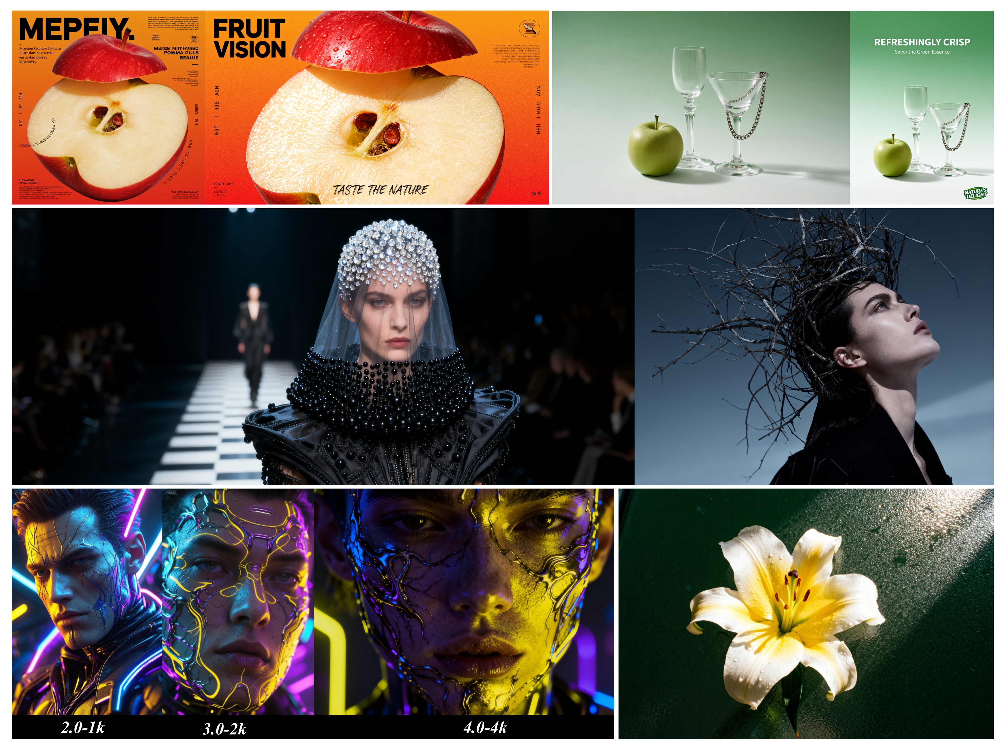

</div>

### 3、 视觉条件与causal diffusion：让参考图的信息参与目标图生成

Seedream 4.0模型能够原生支持处理图像生成和图像编辑。图像编辑的生成结果需要与输入图像保持相应联系。如果用户只要求改变背景，人物身份和姿态通常仍应保留；如果要求改变风格，画面结构与局部纹理的保留程度又会不同。生成主干需要同时处理修改要求与视觉保持要求。

Seedream 4.0在DiT框架中设计引入causal diffusion，**让目标生成过程读取参考图的视觉信息，并通过有方向的信息依赖组织条件与目标之间的交互。** 文本条件说明修改意图，视觉条件提供具体对象、结构和外观，两者共同约束目标生成。

多图参考进一步增加了条件组织的难度。不同参考图可能提供人物、物体、材质或风格，模型需要结合指令选择相应特征，并协调它们在目标画面中的尺度与关系。仅把多张图描述成一段文字，会丢失大量外观信息；仅保留视觉特征，又不足以判断用户希望怎样组合。下图是Seedream 4.0进行多图参考与组合的生成效果：

<div align="center">

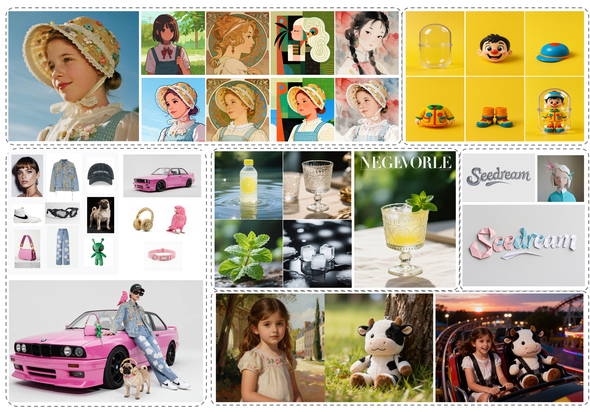

</div>

### 4、 联合后训练策略

Seedream 4.0联合后训练文生图、单图编辑、多图参考与输出等任务，通过CT、SFT和RLHF逐步改善多模态生成能力。

编辑训练样本通常包含参考图、目标图和编辑指令，并为参考图与目标图分别生成caption。指令说明需要执行的变化，两张图提供变化前后的视觉对应，caption补充主体、属性与场景描述。团队设计了三种详略程度不同的caption作为数据增强，并鼓励用一致的术语描述前后图中的共同内容。

这种标注方式的作用可以从监督一致性来理解：同一对象在前后描述中保持稳定命名，模型更容易分清哪些内容延续、哪些属性改变；不同详细程度的caption则让模型接触多种条件表达。报告没有给出三种caption的完整固定模板，不宜自行补写成确定类别。

在阶段分工上，CT重点增强图像编辑的指令跟随，SFT进一步改善参考图与编辑结果的一致性，RLHF继续对齐人类偏好。文生图数据与编辑数据共同参与，使主干同时学习从语言生成图像和利用参考图执行修改。最终效果由架构、数据和训练目标共同决定，增加一个图像输入接口并不足以获得可靠编辑能力。

### 5、 多图输出：一组画面还需要共同的人物与风格约束

多图参考解决的是输入如何组合，多图输出解决的是多个结果之间如何保持联系。一次请求生成数张图时，系统除了满足每张图的局部要求，还需要协调人物身份、整体风格和内容安排。

Seedream 4.0通过多模态理解、全局规划与上下文一致性支持这一类任务。用户可以围绕给定角色生成连续画面，也可以生成视觉风格一致的一组图像。PE对请求的理解与规划、生成主干对条件的利用，以及相应的多任务训练共同参与这一过程。

论文公开了多图输出能力与示例，但没有完整说明底层采用同时联合采样、按序生成，还是其他调度方式。因此，我们不能断言它们一定共享同一个噪声张量、使用某种固定自回归顺序，或单次DiT前向就能输出全部图像。Seedream 4.0的多图输出效果如下图所示：

<div align="center">

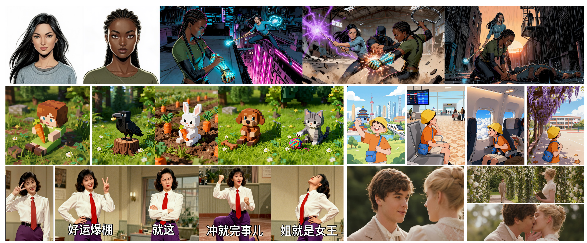

</div>


<h2 id="q-019">面试问题：SeedEdit系列模型解决了什么问题？(进阶)</h2>

**难度评分：⭐⭐⭐⭐ (4/5)  |  考察频率：⭐⭐⭐ (3/5)**

SeedEdit系列主要解决**自然语言编辑中的修改准确性与原图保持问题**。用户要求“把人物的外套改成蓝色”，通常意味着只改变衣服颜色，同时保留人物身份、姿态、背景和光照；如果要求“把人物改成全身站姿”，模型又必须重新生成姿态和部分画面。编辑范围随指令变化，模型需要判断哪些信息应该延续、哪些内容需要重新生成。

这也解释了编辑为什么比单纯文生图多了一层约束。完全复原输入图，虽然一致性很高，却没有执行修改；根据新提示词重新生成，可能满足文字要求，却失去原图中的具体人物与细节。**SeedEdit通过图像条件、成对数据和对齐训练，让生成模型同时学习修改内容与保留内容。**

SeedEdit能够处理的任务既包括保持大部分画面的小范围修改，也包括重新组织姿态和构图的较大变化，具体如下表所示：

<div align="center">

| 核心功能 | 典型修改 | 主要保持要求 |
|---|---|---|
| **对象增删与属性编辑** | 增加或移除物体，调整颜色、材质、发型和服装 | 尽量保持无关对象、背景和合理的光照关系 |
| **人物与主体一致性编辑** | 换装、换背景、调整表情或外观属性 | 保留指令要求延续的人脸身份或特定主体特征 |
| **姿态、视角与构图调整** | 改变姿态、移动对象、调整景别或补成全身画面 | 允许必要的几何与遮挡变化，同时维持主体和场景联系 |
| **中英文文字编辑** | 替换单词、汉字或局部字符 | 兼顾文字内容准确性，以及字体、材质和周围画面的协调 |
| **风格与场景转换** | 插画转写实、改变环境或整体视觉风格 | 根据任务保留主体语义、构图或身份，而非要求纹理全部不变 |
| **连续编辑** | 在一次结果上继续调整颜色、对象或布局 | 尽量保留前几轮已经确认的内容，关注多轮修改中的误差积累 |

</div>

下图是SeedEdit 3.0人物保持文字编辑与场景转换示例：

<div align="center">


</div>

### 1、 从早期SeedEdit到3.0：逐步增强真实图像编辑能力

理解SeedEdit系列，可以沿着“建立编辑能力—补齐真实图像数据—加强身份保持与高分辨率细节”这条线展开，具体如下表中所示：

<div align="center">

| 阶段 | 主要改进 | 解决的具体问题 |
|---|---|---|
| **早期SeedEdit / 1.0** | 构造成对编辑数据，引入共享参数的因果扩散分支，再通过多轮数据生成与微调对齐 | 把已有文生图能力转化为带原图约束的编辑能力，早期重点是继续修改生成图像 |
| **1.5、1.6阶段** | 3.0报告将1.5概括为扩充数据来源，将1.6概括为进一步引入数据融合与奖励建模 | 缓解合成图像与真实照片之间的分布差异，改善修改效果与内容保持之间的取舍 |
| **SeedEdit 3.0** | 将上一代Seedream 2.0生成底座升级为Seedream 3.0，并结合多粒度元信息、联合损失和推理加速 | 强化真实图像中的身份、物体细节、中英文文字与复杂指令编辑 |

</div>

早期论文分别在SDXL和内部DiT文生图模型上验证了方法，说明其基本思路并不绑定某一个生成底座。SeedEdit 3.0沿用编辑框架，利用Seedream 3.0约1024尺度的原生生成能力省去上一代独立Refiner阶段，并改善高分辨率下的人脸和物体细节。底座升级提供更好的生成基础，精确编辑仍然依赖后续的条件设计和训练。

### 2、 迭代对齐：从能够重新生成，走向能够准确修改

高质量编辑数据通常需要同时包含输入图像、编辑指令和目标图像。自然图像容易收集，但要获得“只改了指定内容、其他信息又保持合理”的成对样本，成本就高得多。早期SeedEdit从已有文生图模型出发，先生成编辑前后的候选图像对，再逐步筛选出适合学习编辑关系的样本。

它的训练流程可以分成四步：

1. **构造候选图像对。** 根据编辑前后的文本描述，结合不同重生成方法与采样参数，覆盖对象增删、属性变化、风格变化和几何变化等任务。较多的随机性能够扩大覆盖范围，也会带来额外的内容变化。
2. **筛选并训练初始编辑模型。** 选择指令与变化较一致、原图信息保持较好的样本，训练能够同时接收图像和文字条件的扩散模型。
3. **用当前编辑模型继续生成数据。** 模型已有一定编辑能力后，再用它构建新的图像对，并重新标注、筛选，获得下一轮微调数据。
4. **重复微调和评估。** 多轮迭代逐渐提高编辑成功率，直到评估指标不再改善。筛选是其中的关键环节，直接把全部生成结果回灌训练会连同错误一起学习。

下图是SeedEdit从图像重生成到编辑的迭代对齐流程：

<div align="center">

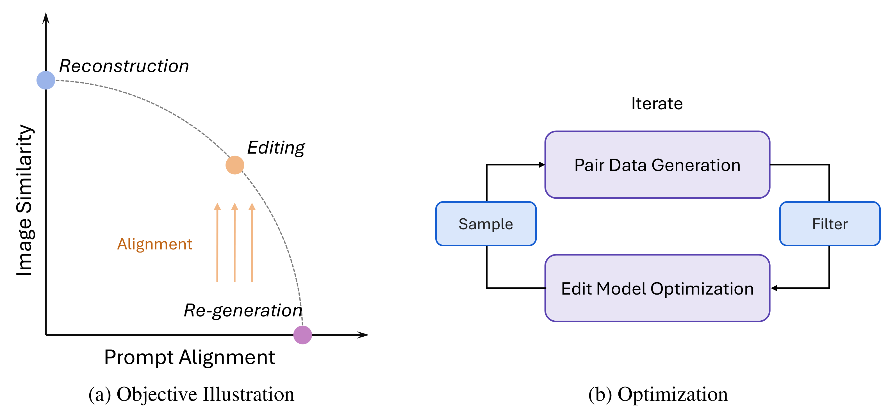

</div>

这条路线让编辑训练不必完全依赖人工成对标注。不过，合成数据会继承生成模型的风格和偏差。早期论文也将真实场景图像作为分布外测试，并指出其编辑质量仍有不足；这正是后续版本增加真实图像数据和专门约束的重要原因。

### 3、 因果扩散：让目标图读取输入图的中间特征

SeedEdit通过共享参数的两个扩散分支处理输入图与待生成图。一条分支从输入图中提取与生成网络匹配的视觉特征，另一条分支处理带噪目标图，并根据指令逐步生成编辑结果。二者在注意力层交换信息，目标图分支可以读取输入图分支的中间特征。

这种设计的考虑很直接：输入图不仅包含“一个人”“一把椅子”这样的语义，还包含面部特征、衣服纹理、物体轮廓和空间关系。把这些信息压缩为一段描述，会丢失大量细节。复用扩散模型处理输入图，可以在生成网络熟悉的特征空间中提供视觉依据，减少理解特征与生成特征之间的适配负担。

下图是SeedEdit共享参数的因果扩散图像条件架构，左侧展示U-Net实现，右侧展示MM-DiT实现；每种实现中的输入图与目标图分支共享参数，虚线箭头表示输入图特征向目标生成路径传递：

<div align="center">

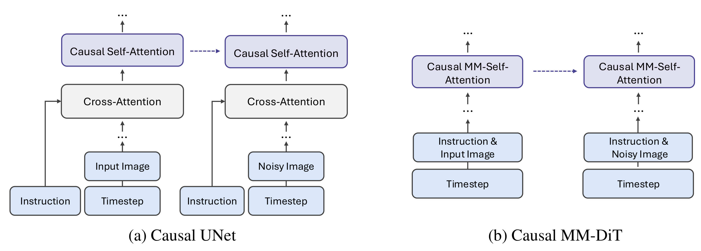

</div>

**这里的“因果”指注意力的信息依赖方向。** 输入图作为已知条件，目标生成读取其特征；这项结构设计不等于物理因果推理，也不能据此将模型归类为逐像素自回归生成。原图所示的两个分支是共享权重的计算路径，不能把它们当作两个独立训练的大模型。

共享结构还有一个训练上的便利：去掉输入图分支，就能够回到原有文生图路径，因此可以在编辑训练中混合文生图数据。注意力交互也没有要求输入、输出只能保持相同像素位置，能够为姿态调整和几何变化提供条件基础；具体编辑效果仍由数据与优化共同决定。

### 4、 SeedEdit 3.0架构：语义理解、视觉保持与编辑条件各有分工

SeedEdit 3.0架构展示VLM、因果扩散网络和元信息连接模块之间的关系，如下图所示：

<div align="center">

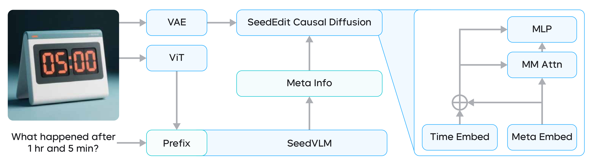

</div>

**第一条是VAE与因果扩散组成的视觉路径。** VAE将输入图转换为潜变量，因果扩散网络再提取、利用其中的细粒度信息，帮助目标生成保留人物身份、对象轮廓与局部纹理。VAE负责像素与潜空间之间的转换，输入图分支继续提供生成所需的中间特征，二者不能混为同一个编码步骤。

**第二条是ViT与SeedVLM组成的语义路径。** ViT把输入图转换为视觉表示，与用户指令共同交给VLM处理。VLM结合图像上下文理解修改意图，例如判断“把它换成木质”中的“它”指向哪个对象，以及哪些属性应该随材质变化。语义信息决定修改方向，原图细节仍需要视觉路径提供。

**连接模块把编辑意图进一步转成生成条件。** 3.0引入任务标签和编辑属性标签，并为其设置独立的embedding。图中的Meta Embed与Time Embed参与主干计算：时间条件说明当前噪声阶段，元信息则帮助模型区分任务性质与保持要求。这使“局部编辑”“保持人脸”“保持结构”等信息能够作为明确条件参与生成。

完整流程可以理解为：输入图与指令进入系统，语义路径整理编辑要求，视觉路径提供原图特征；生成分支在采样器控制下多次更新目标潜变量，最后由VAE解码成图像。Figure 5着重展示条件注入，没有完整画出目标噪声、采样循环和最终解码，不能把它看成一次前向就完成编辑的全部流程。

### 5、 多粒度元信息与联合训练：让“应该保留什么”成为可学习的条件

SeedEdit 3.0的数据来自文生图模型合成、专用编辑工作流、传统图像操作以及视频帧等渠道。不同来源能补充不同能力：专用工作流提供真实图像编辑样本，裁剪、光照和模糊等传统操作提供较准确的变化关系，视频帧补充姿态和场景变化。

但这些数据的修改范围并不一致。同样要求“换到巴黎”，一个样本可能只改变背景，另一个样本却同时改变人物姿态、服装和光线。如果直接混合训练，模型很难知道用户期望哪一种结果。SeedEdit 3.0为此引入三类元信息，如下表所示：

<div align="center">

| 元信息 | 如何构建 | 解决的问题 |
|---|---|---|
| **任务标签（Task Label）** | 区分不同来源、不同编辑性质的数据，为标准指令编辑设置相应标签 | 减少不同数据中修改范围不一致造成的监督冲突 |
| **重新描述（Re-captioning）** | 先分析图像对的相同点与差异，再生成准确的描述或编辑指令 | 修正合成图像中未被指令描述的变化，以及视频帧缺少逐帧编辑说明的问题 |
| **编辑标签（Edit Tags）** | 标注局部编辑、人脸保持、结构保持、风格保持等属性 | 向模型说明当前任务需要重点保持哪些信息 |

</div>

这些标签是任务和属性条件，不应理解为精确的像素mask。局部编辑标签可以帮助模型学习修改范围，但无法单独保证非编辑区域逐像素不变。

训练先混合收集到的图像对，建立较广的任务覆盖，再用经过模型和人工筛选的高质量、高分辨率数据微调。模型同时适配不同长宽比，并与高质量文生图数据联合训练，以维持底座的画质和通用生成能力。

下图为SeedEdit 3.0多源数据元信息与联合损失训练流程：

<div align="center">

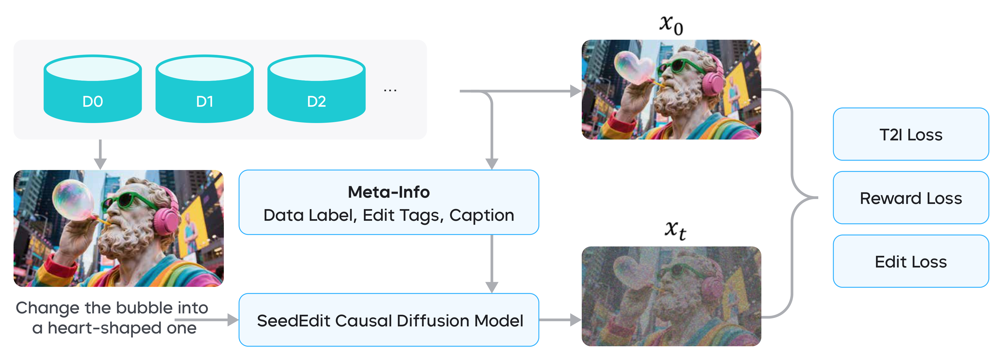

</div>

在优化目标上，3.0以Rectified Flow损失学习目标图像的生成方向，同时用专门的奖励模型关注人脸身份、结构细节和审美等属性。为了说明二者的分工，可以将联合目标概括为：

```math
\mathcal{L}_{\mathrm{edit}}
=\mathbb{E}\!\left[
\left\|v_\theta(z_t,t\mid z_{\mathrm{src}},c)
-(\epsilon-z_{\mathrm{tgt}})\right\|_2^2
+\sum_i\lambda_i\,g_i(c,t)\,
\ell_i\!\left(I_{\mathrm{src}},\hat I_{\mathrm{tgt}}\right)
\right].
```

这里， $z_{\mathrm{src}}$ 和 $z_{\mathrm{tgt}}$ 分别表示源图与目标图的潜变量， $c$ 包含指令和元信息。采用 $z_t=(1-t)z_{\mathrm{tgt}}+t\epsilon$ 的加噪约定时，速度目标为 $\epsilon-z_{\mathrm{tgt}}$ ，推理从高噪声端向低噪声端积分。第一项约束生成方向；第二项将奖励统一写成越小越好的辅助损失 $\ell_i$ ， $g_i(c,t)$ 表示它在当前指令和时间步下是否适用。这个写法用于解释论文联合目标，没有假定额外的可训练门控网络。

例如，只换背景时应当约束人物身份；要求更换人物时，同样的身份保持约束就可能阻碍任务完成。较高噪声阶段的预测图像还不够可靠时，细节奖励也未必适用。因此，**奖励要同时服从编辑意图和当前可评估的图像状态**。报告采用多个专家奖励模型处理这些细节要求，并未公开所有奖励的完整形式和权重。


<h1 id="q-020">5.其他主流AIGC图像创作大模型有哪些核心特点和跨周期价值？</h1>

<h2 id="q-022">面试问题：Midjourney系列模型有哪些优秀特点？</h2>

**难度评分：⭐⭐⭐ (3/5)  |  考察频率：⭐⭐⭐⭐ (4/5)**

Midjourney擅长把一个尚不具体的视觉创作想法，高效生成可供挑选的图像。生成图像中的构图、色彩、材质和风格往往已经有较完整的表达，用户再通过参考图、个人审美设置和编辑工具继续调整。**它的优势主要是高效形成视觉方向，复用风格与主体，批量探索方案，再把选中的图像编辑调整到用户满意的效果**。对创作者而言，先用草图选方向，再固定风格与参考主体，最后处理局部细节，是一条可以实际执行的工作流。

从版本演进看，Midjourney V6加强长提示词理解，Midjourney V7改善图像细节并引入Draft Mode和Omni Reference，Midjourney V8.1进一步提升生成效率并支持原生2K输出。2026年7月24日发布的Midjourney V8.2重点改善审美、图像质量和个性化；随后开放的Midjourney V8 Edit Model又扩展了指令编辑与多图参考能力。Midjourney系列从未公开模型架构和底层技术信息，我们主要从产品行为解释它的特点。

### 1、 审美表达完整，风格强度也能控制

Midjourney在创意插画、概念设计和氛围图等场景中，能够较快给出构图、光影与色彩相互协调的方案。这种默认风格有助于用户寻找视觉方向，但完成具体任务还要检查对象数量、属性、文字和布局是否符合要求。画面精致与指令准确需要分别评价。

其中`--stylize`（简写`--s`）参数用于调节风格化程度：较低的值倾向于更贴近文字描述，较高的值给模型更多艺术发挥空间。例如，要求“儿童画的一只猫”时，过高的风格化可能生成一张精致的立体猫图，却偏离了儿童画的朴素笔触。参数的价值在于帮助用户选择这种取舍，具体如下图所示，展示同一主题在不同`--s`参数下的表达差异：

<div align="center">

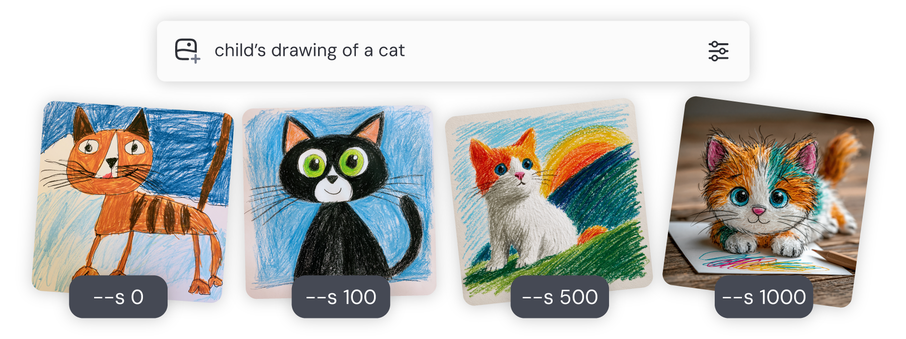

</div>

### 2、 参考控制覆盖风格、主体与多图组合

参考图（Image Prompt）的作用取决于使用方式。Image Prompt可以影响内容、构图与色彩；风格参考通过`--sref`参数复用媒介、笔触、配色与光照等视觉风格；主体参考则侧重把人物或物体特征带入新的画面。

下图为Midjourney V7生成效果示例，人物、狗和建筑的内容不同，但配色、笔触和造型语言相近，说明风格可以跨主题复用：

<div align="center">

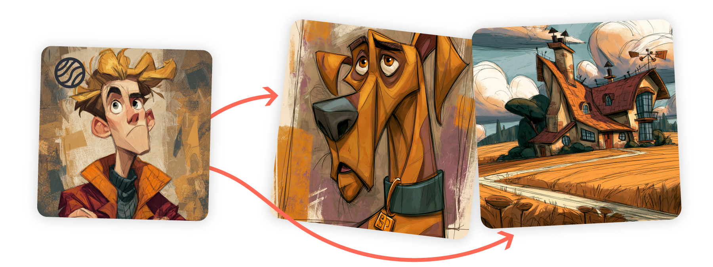

</div>

需要注意的是Midjourney不同版本的参数使用方式不同。Midjourney V7使用`--oref`和`--ow`参数控制单张参考图的影响；Midjourney V8.1/V8.2则使用Edit Model，支持最多四张参考图。

### 3、 个人偏好与设计风格可以积累和复用

Midjourney有Personalization模型来通过用户选择或喜欢的图片建立审美偏好，使同一提示词更接近个人习惯；同时Moodboards模式则允许用户组织一组参考图，为某个项目指定风格方向。前者适合表达长期偏好，后者适合区分不同项目：同一位设计师可以为儿童绘本、品牌海报和科幻概念图建立不同的视觉参考集合。

### 4、 先批量探索，再投入高质量生成

图像创作早期往往还没有确定构图与风格，快速看到多个方向的初步效果对后续的深入创作很有帮助。Midjourney的Draft Mode将这一阶段单独做成产品功能，让用户先筛选候选，再对选中的方向继续生成。

不同版本的Draft行为不同：Midjourney V7一次生成四张草图；Midjourney V8.1/V8.2的网页Draft一次提供24张512×512低分辨率候选，这降低了创作方向尝试的成本。下图展示同一主题的批量探索：

<div align="center">

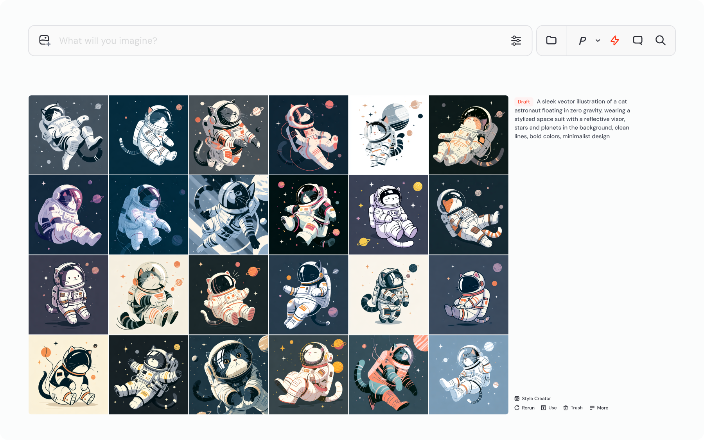

</div>

### 5、 指令编辑与选区编辑让生成图像能够持续优化

Midjourney V8 Edit Model支持按文字指令修改已有图像、结合多张参考图生成新构图，以及进行局部重绘和扩图。它承接了此前独立的Omni Reference、Character Reference和Retexture的相关用途，使参考创作与图像修改更容易衔接。

下图展示了原指令要求银色骑士骑上火焰马并手持花剑。三张参考图分别提供不同元素，文字指令规定它们在目标画面中的关系：

<div align="center">


</div>

在实际操作过程中，我们还需要区分两种编辑逻辑：整图指令编辑适合改变风格、视角或整体内容；选区编辑则通过明确修改范围，减少其他区域被改动的机会。定向选区编辑只改变选中的像素，有利于连续修改时保留原图质量。


<h2 id="q-023">面试问题：HiDream-I1的技术原理和模型架构是什么？</h2>

**难度评分：⭐⭐⭐⭐ (4/5)  |  考察频率：⭐⭐⭐ (3/5)**

HiDream-I1聚焦于构建“高效扩散Transformer基础大模型”，它的核心价值包含了**Latent Flow Matching + Sparse Diffusion Transformer + 动态MoE + 多文本编码器**。

从模型范式看，HiDream-I1基于FLUX、Stable Diffusion 3、Seedream 3.0这类**潜空间扩散/Flow Matching DiT路线**。它的构建目标很直接：**在保持开源图像生成模型高画质、高语义理解和强prompt following的同时，把图像生成大模型推理成本和部署门槛降下来**。

HiDream-I1的核心架构可以拆成五个核心模块。

首先是**HiDream-I1基于潜空间生成，用VAE把图像压到Latent空间。** 和经典潜空间扩散大模型一样，HiDream-I1不直接在像素空间生成图像，而是先通过VAE把图像压缩成更低维的Latent表示，再在Latent空间进行去噪/流匹配生成，最后由VAE解码回图像。这也是现代高分辨率图像生成模型的主流工程选择，因为它能显著降低序列长度和计算成本。

接着是**生成目标，HiDream-I1采用Latent Flow Matching框架。** 不是基于传统DDPM式多步噪声预测。Flow Matching可以把生成过程理解为学习从噪声分布到真实数据分布的连续速度场，通常更适合与Transformer、大规模训练和少步采样结合。

然后是**HiDream-I1主干网络，一个17B Sparse Diffusion Transformer。** HiDream-I1的Full版本约17B参数，同时它不是全部参数都密集参与计算的普通DiT，而是在Diffusion Transformer中引入稀疏计算。Sparse DiT解决的本质问题是**AIGC图像创作大模型参数量持续增加，Attention计算、显存占用和推理延迟会迅速成为瓶颈；稀疏计算让模型容量可以继续扩展，但单次前向不必为所有参数和所有token支付完整成本。** 这也是HiDream-I1区别于普通密集DiT的关键。

还有关键的**动态MoE（dynamic Mixture-of-Experts），让“模型容量”和“实际计算量”解耦。** 动态MoE让不同prompt、不同语义模式、不同视觉风格、不同生成阶段可以路由到不同专家。MoE的核心价值在于模型可以拥有更大的总参数容量，但每次前向只激活部分专家，从而减少计算量。动态MoE则允许模型根据输入选择更合适的专家路径，在质量、速度、显存和部署成本之间取得更细的平衡。总的来说，**稀疏激活是大图像模型规模化的重要方向。** 稠密模型参数越大，推理越贵；MoE和稀疏计算让模型可以“容量更大、计算更省”，这对开源模型尤其重要。

最后是**混合文本编码，用强文本理解支撑prompt following。** HiDream-I1使用Hybrid Text Encoding，把不同类型的文本编码能力结合起来，既需要CLIP/T5类编码器提供图文对齐和语义表示，也需要更强语言模型能力帮助理解长prompt、复杂属性、风格描述和对象关系。Hybrid Text Encoding体现的是图像模型向多模态语言理解借力的趋势。

下图是HiDream-I1模型的详细架构图：

<div align="center">

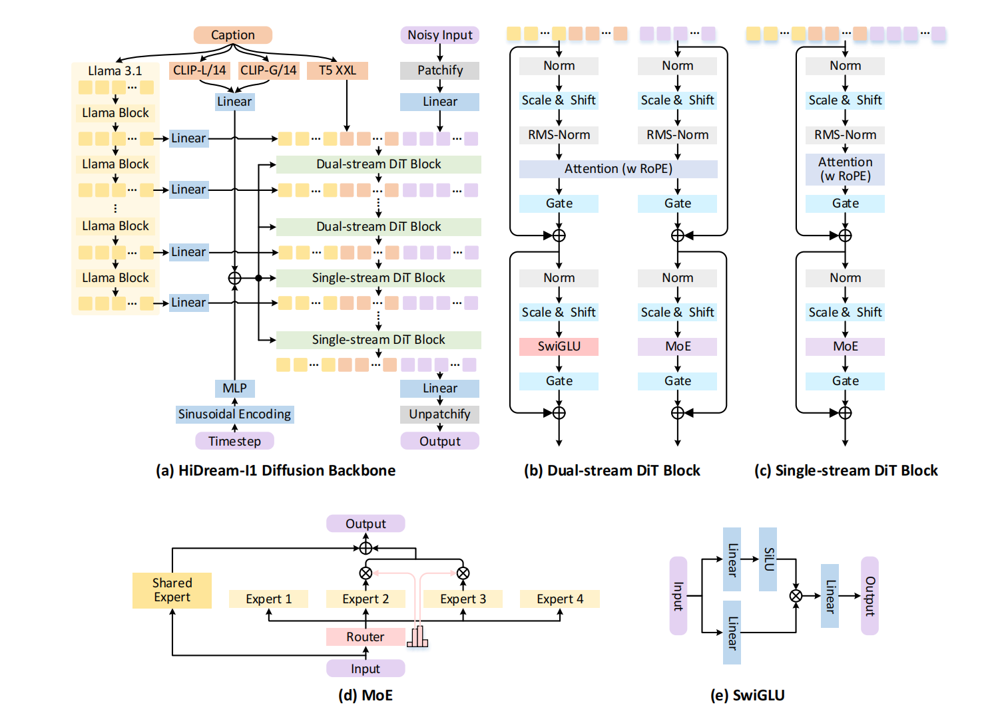

</div>

总的来说，**HiDream-I1代表开源AIGC图像创作大模型中“高效Sparse DiT + Flow Matching”的路线。它的核心创新是在Flow DiT框架内，用稀疏Transformer、动态MoE和混合文本编码，把大模型的生成质量、语义理解、推理速度和部署成本进行平衡。**

<h2 id="q-024">面试问题：GLM-Image的创新点有哪些？</h2>

**难度评分：⭐⭐⭐⭐⭐ (5/5)  |  考察频率：⭐⭐⭐ (3/5)**

GLM-Image代表的是一条非常值得重视的混合架构（hybrid architecture）路线：**先让自回归生成器（autoregressive）做语义规划，让扩散解码器（diffusion decoder）再做高保真视觉渲染。** 它不是纯扩散模型，也不是传统自回归像素/token生成模型，而是把“语言模型式的语义理解能力”和“扩散模型式的细节生成能力”拆开，各自处理最擅长的部分。**GLM-Image不仅支持文生图，也支持图生图、图像编辑、风格迁移、身份保持和多主体一致性等任务**。

GLM-Image混合架构整体约16B参数，其中9B的自回归生成器负责生成视觉语义token，7B的扩散解码器负责Latent空间的图像解码。它在一般图像质量上能够对齐主流Latent diffusion模型，并在**文本渲染、知识密集型图像生成、复杂信息表达和图像编辑**上更有优势。下图展示了GLM-Image模型的核心架构：

<div align="center">

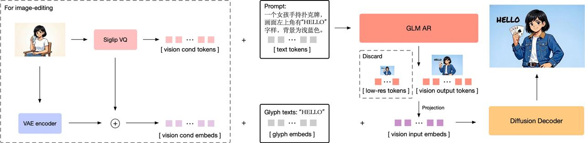

</div>

从上图中可以看到，**9B自回归生成器先生成“语义蓝图”**。GLM-Image的AR模块基于GLM-4-9B类语言模型初始化，并扩展词表以支持视觉token。它不是直接生成像素级别图像，而是先把prompt中的对象、布局、文字、知识关系、空间关系压缩成一组视觉语义token。其生成过程会先形成约256个紧凑编码，再扩展到1K-4Ktoken，对应1K-2K级高分辨率输出。可以说，**AR部分负责低频语义、全局结构和复杂指令规划。**

接着**7B扩散解码器再渲染“视觉细节”**。扩散解码器基于single-stream DiT，在Latent空间中把AR生成的语义token还原成高保真图像。它重点负责纹理、光影、材质、边缘、笔画、局部细节和真实感。这样设计的好处是，扩散模块不需要从零开始理解复杂prompt，而是更多承担“把语义蓝图渲染成视觉结果”的工作。

其中关键的中间层是**语义token，用来来桥接AR和扩散解码器**。GLM-Image不是简单把文本embedding塞给扩散模型，而是让AR模块先生成更结构化的视觉语义token。这些token既保留语言模型对复杂语义、知识和布局的理解，又能作为扩散解码器的条件输入。它解决的是纯扩散模型常见的问题：画面细节很好，但复杂文字、知识逻辑、对象关系和空间结构容易对不准。

同时GLM-Image还配备**Glyph Encoder强化文本渲染**。GLM-Image的扩散解码器配备Glyph Encoder文本模块，用于提升图像中文字的准确渲染。文本渲染一直以来是AIGC图像创作领域的难点，因为中文、英文、多行小字、海报排版、信息图、公式/标注等内容都要求模型同时理解语义和字形。

训练和优化层面，GLM-Image采用了**模块解耦式后训练策略**。GLM-Image使用基于GRPO的解耦细粒度模块化反馈策略，分别增强语义理解和视觉细节质量。**AR模块偏语义奖励**，自回归模块更适合用低频反馈优化，比如审美、语义对齐、指令遵循、对象关系、文字内容和知识正确性。它决定“图里应该有什么、各元素应该怎么组织”。**扩散解码器偏细节奖励**，解码器更适合用高频反馈优化，比如纹理真实感、局部细节、笔画可读性、文字准确率、边缘质量和视觉保真。它决定“语义蓝图最终画得是否细、是否真、文字是否清楚”。


<h2 id="q-025">面试问题：Qwen-Image系列的创新点有哪些？</h2>

**难度评分：⭐⭐⭐⭐⭐ (5/5)  |  考察频率：⭐⭐⭐⭐ (4/5)**

Qwen-Image系列**用强多模态语言模型做语义理解，用MMDiT架构 + Flow Matching范式做高质量生成，用专门VAE和数据工程解决文字渲染，使用MSRoPE位置编码，能够进行文生图和图像编辑任务**。

从系列演进看，Qwen-Image系列迭代版本稳步推进能力突破：

1. **初代Qwen-Image：20B MMDiT基础大模型，Qwen2.5-VL提供语意理解，重点突破复杂文本渲染**。Qwen-Image核心能力是建立通用文生图能力，重点改善中英文复杂文字渲染，特别是中文文字渲染需要同时处理字形、笔画、排版、语义和上下文。
2. **Qwen-Image-Edit：在生成模型上构建精准编辑能力**。编辑版把输入图像同时送入Qwen2.5-VL和VAE Encoder，Qwen2.5-VL提供语义理解，VAE Encoder提供外观和结构重建信息。这样模型既知道“要改什么”，也知道“原图长什么样”，从而兼顾语义编辑和视觉保真。
3. **Qwen-Image-2.0：统一文生图、编辑和多图条件，改善长指令、多语言文字和高分辨率生成**。Qwen-Image-2.0进一步走向统一架构，用Qwen3-VL作为条件编码器，模型核心Backbone为MMDiT，引入16倍空间下采样、64通道的VAE，强调1K-token指令、专业排版、原生2K分辨率、多语言文字渲染，以及生成和编辑一体化。
4. **Qwen-Image-2.1：以更紧凑的主干兼顾统一创作、参考图控制、透明图像与推理效率**。Backbone为32层、约7B单流DiT，配合Qwen3-VL 8B与RGBA VAE；采用分块因果注意力和前缀KV缓存，Turbo版本提供8步生成与编辑。

下图是初代Qwen-Image模型架构示意图：

<div align="center">

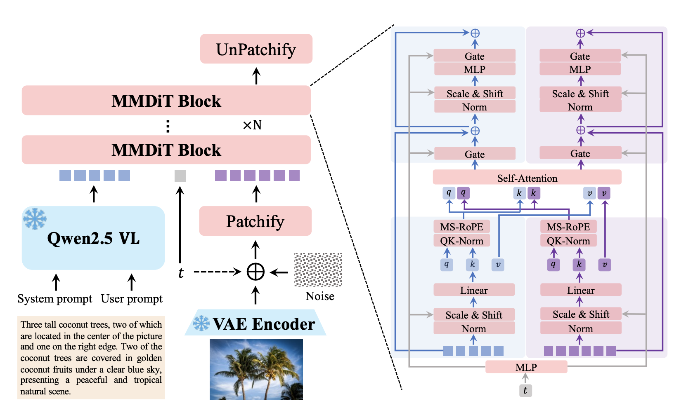

</div>

<div align="center">

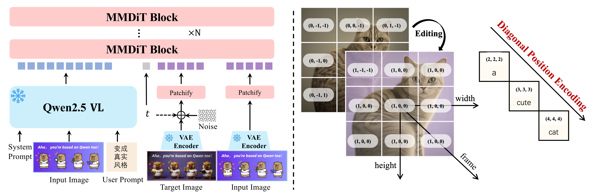

图：来源于[初代技术报告](https://arxiv.org/abs/2508.02324) Figure 14。Input Image分别进入Qwen2.5-VL和VAE，提供语义与外观条件；Target Image是训练目标，编码后与噪声混合，推理时无需预先提供。右侧增加frame位置维度，以区分参考图与目标图。

</div>

Qwen-Image系列的核心创新，我们可以从五个层面理解：

### 1、 强多模态语言模型作为条件编码器

Qwen-Image不再只用普通CLIP文本编码器理解prompt，而是借助Qwen2.5-VL/Qwen3-VL这类强多模态模型提供更强的文本、图像、文档和空间语义理解。这样模型更适合处理长prompt、多对象关系、图文混排、复杂指令和编辑意图。

### 2、 MMDiT架构 + Flow Matching范式作为生成主干

Qwen-Image使用MMDiT类架构处理文本和图像Latent之间的跨模态交互，并用Flow Matching范式训练来提升图像生成的质量。相比传统U-Net扩散模型，MMDiT架构更适合大模型化、长条件建模、多模态token交互和高分辨率生成。

### 3、 专门优化VAE，解决细文字和纹理重建

AIGC图像创作大模型的文字渲染能力也高度依赖VAE模块。文字渲染对图像重建质量非常敏感。一般纹理稍有变化，画面仍然可能自然；汉字少一个笔画、相邻笔画发生粘连，就可能变成错字。因此，文字渲染不仅取决于模型是否理解提示词，也取决于潜变量能否被准确还原为像素。

通用VAE在压缩图像时容易丢失小字、笔画、细线和纹理，导致生成模型即使“理解了文字”，最终解码时也会糊掉。初代Qwen-Image沿用Wan-2.1-VAE架构，采用共享编码器，并为图像和视频配置各自的解码器。在图像侧，训练冻结编码器，专门微调图像解码器。数据包含PDF、演示文稿、海报等真实富文本图像，以及中英文合成段落。

冻结编码器可以保持已有潜空间表示，微调解码器则改善潜变量到笔画、细线和局部纹理的还原。论文中使用重建损失与感知损失，并动态调整二者权重，兼顾像素细节和视觉结构。Qwen-Image-VAE-2.0又进一步强调高压缩率下的通用图像和text-rich场景重建能力。

### 4、 MSRoPE解决文本-图像联合位置编码

在实际生成过程中，复杂海报、菜单、PPT和信息图不只是“生成一些文字”，而是要把文字放在正确区域、保持多行排版、避免遮挡主体，并让文本内容和图像空间对齐。同时文字具有一维先后顺序，图像具有二维空间位置。两者进入同一个注意力模块后，需要一套能够共同计算的位置表示。

Qwen-Image的MSRoPE以图像中心为位置原点，再让文本token在两个空间维度上使用相同的位置编号，把文本序列位置和图像空间位置更自然地映射到同一建模框架中，提升文本、对象和布局之间的空间对齐。下图的示意图中，文本坐标因此沿图像网格的对角线向外延伸。这样既保留图像侧适应分辨率变化的空间表示，也保留文本侧类似一维RoPE的顺序关系。

<div align="center">

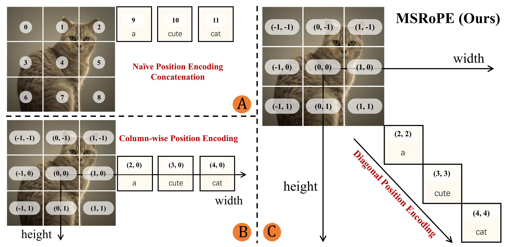

</div>

图中沿对角线排列的是位置编码坐标，不是生成图像中文字的排版要求。最终文字放在哪里、采用什么布局，仍然需要结合提示条件和训练数据学习。编辑时，模型还会增加frame维度，区分参考图与目标图中空间位置相同的token。


### 5、 数据工程策略

Qwen-Image强调了大规模数据收集、过滤、标注、合成和平衡，并采用从非文本到文本渲染、从简单文本到复杂文本、再到段落级描述的渐进式训练策略。Qwen-Image使用三种互补的文字合成方式：

<div align="center">

| 数据类型 | 如何构建 | 主要补充什么能力 |
|---|---|---|
| **纯文字渲染** | 将段落绘制到简单背景上，调整字号、字距与布局，过滤无法正确渲染的字符 | 提供清晰的字形与字符对应监督 |
| **场景组合渲染** | 将文字放到纸张、木牌等载体中，再与背景组合并生成描述 | 学习文字如何融入材质、光照和场景 |
| **复杂模板渲染** | 用程序替换演示文稿、界面等模板中的内容，同时保留对齐和排版规则 | 学习多行文字、长段落及复杂布局 |

</div>

标注同样需要严格对应图片。Caption既描述对象属性与空间关系，也逐字记录可见文字，用引号标识，避免翻译和改写。否则，模型可能看到的是一种字形，接收到的监督却是另一段文字。

训练再逐步增加含文字图像、复杂版面与长文本，同时提高分辨率、调整质量筛选和类别分布。这样可以把原文“从简单到复杂”的概括，展开成读者能够理解的数据与训练流程。

下图是Qwen-Image文字渲染的三类合成数据构建流程：

<div align="center">

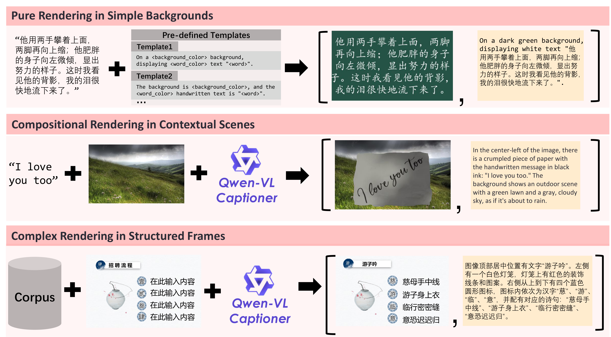

</div>


<h2 id="q-026">面试问题：Z-Image系列的创新点有哪些？</h2>

**难度评分：⭐⭐⭐⭐ (4/5)  |  考察频率：⭐⭐⭐ (3/5)**

**Z-Image代表的是“高效、轻量、生成编辑一体”的扩散Transformer路线**。 它的核心架构使用了紧凑的6B级Single-Stream DiT、FLUX VAE、统一生成编辑训练（Omni-pretraining）、可扩展数据构造（Z-Captioner）和Turbo蒸馏，把高质量图像生成能力压到更低成本、更易部署的开源生态里。

Z-Image系列可以分成四个代表版本，如下表所示：

| 版本 | 核心定位 |
|---|---|
| **Z-Image-Omni-Base** | 完成统一预训练的生成、编辑底座模型，面向后续不同版本的训练开发 |
| **Z-Image** | 经过SFT的非蒸馏文生图模型，支持 CFG、负向提示等控制，官方建议约 28—50 步，也适合作为微调起点 |
| **Z-Image-Turbo** | 经过少步蒸馏与偏好优化的快速文生图模型，面向高效文生图场景 |
| **Z-Image-Edit** | 沿编辑方向继续训练和SFT的模型，强化指令修改与视觉保持 |

Z-Image系列通用共享的模型架构如下所示，其中展示了文生图和Z-Image-Edit两种输入配置：

<div align="center">

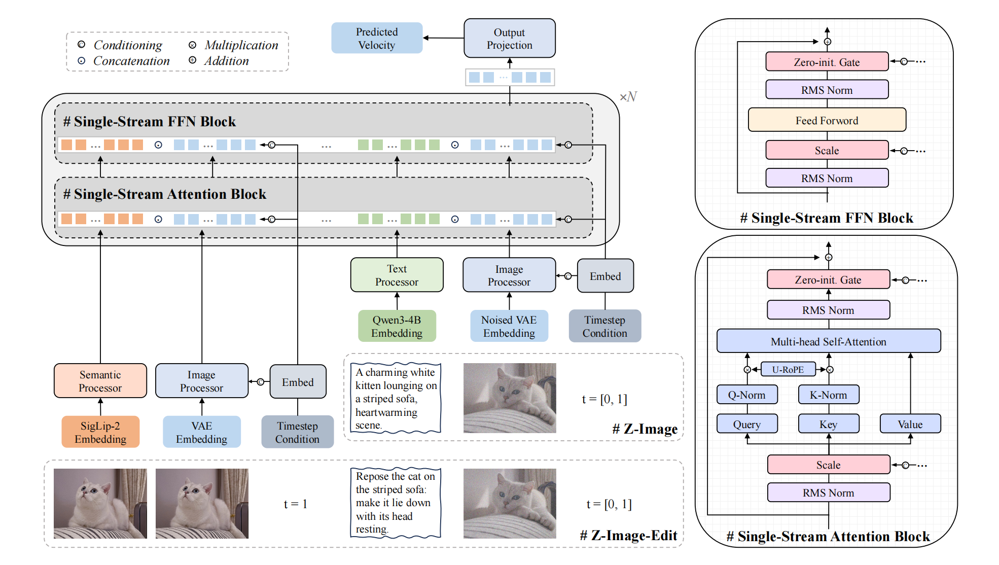

</div>

### 1、 复用FLUX VAE

论文明确采用FLUX VAE，以公开Z-Image-Turbo配置为例，VAE在高度和宽度方向各下采样8倍，潜变量包含16个通道，随后再以 $2\times2$ 的Latent patch构造图像token。对一张 $1024\times1024$ 图像，VAE得到 $128\times128$ 的空间网格，patch划分后约为 $64\times64=4096$ 个目标图像token，另加文本等条件token。这是根据公开配置计算的示例。

### 2、 S3-DiT（Single-Stream DiT）：先适配不同模态，再共享主干参数

文本特征、语义特征和VAE潜变量来自不同编码器，直接混合并不意味着它们已经处于相同的表示空间。Z-Image先让各类输入经过轻量的模态专用处理器，每个处理器包含两个Transformer block，完成初步适配；随后把token沿序列维度拼接，交给统一的注意力与前馈网络处理。

“单流”描述的是后续主干的计算方式：不同模态共享大部分注意力和FFN参数，通过联合注意力交换信息。文本token表达创作要求，参考图token提供视觉线索，目标图token表示当前待更新的状态。每一层都能结合这些信息，逐步改善目标表示。相比双流DiT把文本和图像分别建模再融合，这种设计提高了跨模态参数复用程度。

Z-Image模型架构示意图的右侧模块图进一步展示了稳定训练的安排：QK-Norm约束注意力计算的数值尺度，Sandwich-Norm在注意力和FFN前后进行归一化，条件映射得到的scale与gate调节特征更新。条件投影采用共享降维与分层升维的低秩结构，以减少参数开销。这些设计与共享主干一起支持较高的参数效率。

### 3、 U-RoPE：同时表达空间位置、文本顺序与图像来源

将文本和多张图像的token放在一起之后，模型需要知道：文字的先后顺序是什么，图像区域位于哪里，当前token来自参考图还是目标图。Z-Image使用三维Unified RoPE组织这些位置关系。图像token沿两个空间维度展开，文本token沿第三个位置维度递增。编辑时，参考图与目标图采用对齐的空间坐标，同时在第三个维度上相隔一个单位。这样的安排既保留空间对应关系，又让模型能够区分图像来源。

第三个维度是位置编码的组织方式，与表示噪声程度的时间条件属于不同概念。它为视觉对应提供基础，具体哪些区域需要修改、哪些细节应当保留，仍然依靠训练数据学习。

这一机制为参考图和目标图的空间对应提供表示基础，实际编辑范围与保持效果还需要通过数据学习，不能由位置编码直接保证。

### 4、 Omni-pretraining让生成和编辑提前建立共同基础

Z-Image先在低分辨率上进行文生图预训练，学习基本概念、图文关系和构图；随后进入Omni-pretraining，将不同分辨率与长宽比、文生图与图生图任务、多层次双语描述放进同一训练体系。

对于图像对，训练可以使用目标图描述，也可以使用两张图之间的差异描述。前一种监督让模型学习“参考这张图，生成符合目标描述的结果”；后一种监督让模型学习“根据指令改变参考图中的内容”。两类任务共同训练，使模型在后续专门优化之前，就已经能够利用语言条件与参考图。

统一预训练完成后，各版本再进入不同的训练分支。文生图侧通过SFT改善画质与指令遵循，Turbo方向进一步进行少步蒸馏；编辑侧通过继续训练和SFT强化修改能力。

### 5、 Z-Captioner把图像内容和编辑变化转化为更准确的监督

单图标注既要描述主体、属性和布局，也要准确记录画面中的文字。Z-Captioner先识别文字，再组织图像描述，并保留文字原本的语言，减少漏字、误译给训练带来的干扰。同时，它生成长、中、短描述、标签和模拟用户提示词，让模型接触不同详细程度的表达。

想要训练好编辑能力，最需要的是高质量“源图-目标图-编辑指令”三元组数据。编辑指令的构建主要分为三步：先分别描述源图和目标图，再结合两张图及其描述分析差异，最后把差异整理为编辑指令。这样得到的监督不仅说明目标图有什么，还说明原图发生了什么变化。

指令与实际变化是否一致，直接影响编辑训练的质量。如果图片只改变了衣服颜色，指令却同时要求改变姿态，模型就会接收到相互冲突的监督。因此，规模化标注之后仍然需要质量筛选。

下图展示了Z-Captioner构建文生图描述与图像编辑指令的流程：

<div align="center">

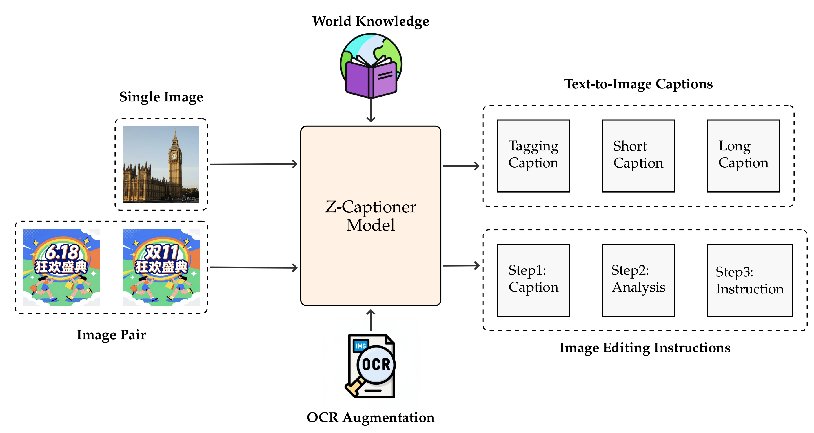

</div>

### 6、 Turbo通过蒸馏减少主干调用，再用偏好优化维持输出质量

多步生成模型可以通过多次更新逐渐完善图像。少步模型需要在更少的更新中完成类似的变化，因此必须重新训练其生成过程。

Z-Image-Turbo采用Decoupled DMD，将蒸馏中的两种作用分开优化：CFG Augmentation推动学生模型形成少步生成能力，Distribution Matching约束生成分布、稳定训练。两者采用分别设计的重新加噪安排，以缓解标准DMD中出现的细节损失和色偏。

在此基础上，DMDR把强化学习与分布匹配结合起来。奖励信号推动模型改善语义一致性与审美，分布匹配提供约束，降低模型过度迎合奖励、生成不自然图像的风险。这些训练共同支撑Turbo的8 NFE生成能力。

NFE表示模型函数评估量，与调用接口中的steps字段需要结合实现理解。例如，官方Turbo示例将num_inference_steps设为9，并注明实际对应8次DiT前向计算。下图是Z-Image不同少步蒸馏策略的效果对比：

<div align="center">

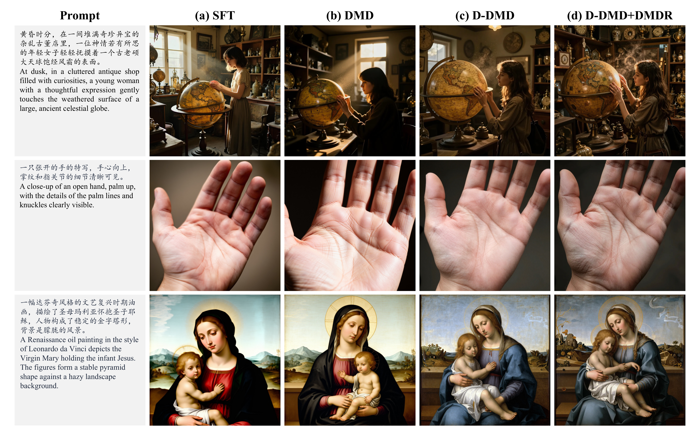

</div>

训练流程上，Z-Image**先学基础视觉-语义对齐，再学统一生成编辑**。Pretraining阶段让模型获得基础图像生成能力；Omni-pretraining阶段再引入任意分辨率、T2I/I2I联合训练和多级别双语标注，使模型具备更强的生成编辑统一能力。同时要保证**编辑训练要保持T2I和I2I平衡**。如果编辑数据比例过高，模型可能牺牲原本文生图能力；如果T2I数据过高，模型又学不好局部编辑。因此Z-Image-Edit的训练关键不是简单堆编辑数据，而是控制数据比例、任务平衡和真实用户分布。接着使用**Prompt Enhancer补足真实指令缺口**。用户真实prompt往往含糊、短、不完整，Prompt Enhancer可以补充歧义消解、世界知识和细节描述。Qwen3-4B文本编码器负责把输入文字转成特征，Prompt Enhancer负责在主干之外理解、补充和组织用户请求。模型在SFT阶段适配增强后的prompt分布，可以提高真实使用中的指令遵循和结果稳定性。

下图是Z-Image系列通用的训练流程：

<div align="center">

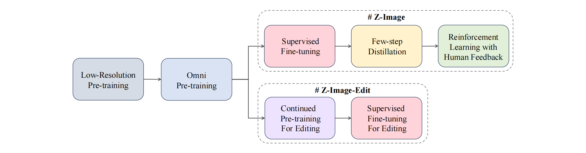

</div>
