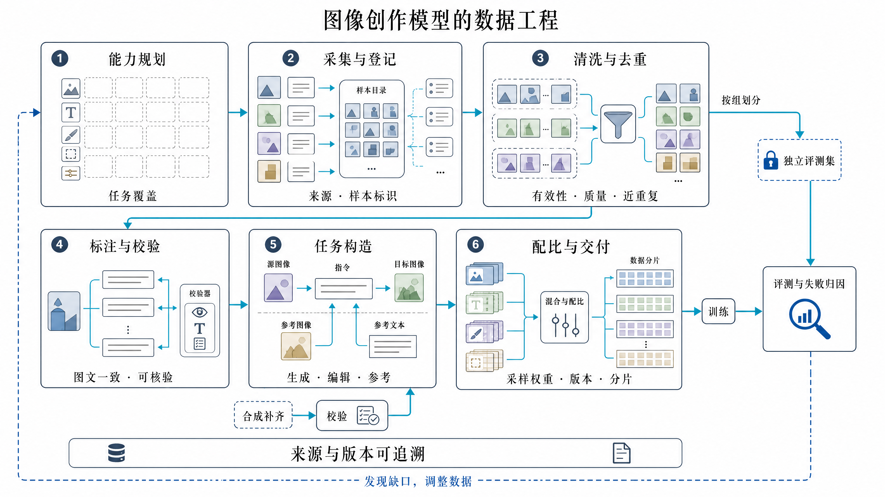
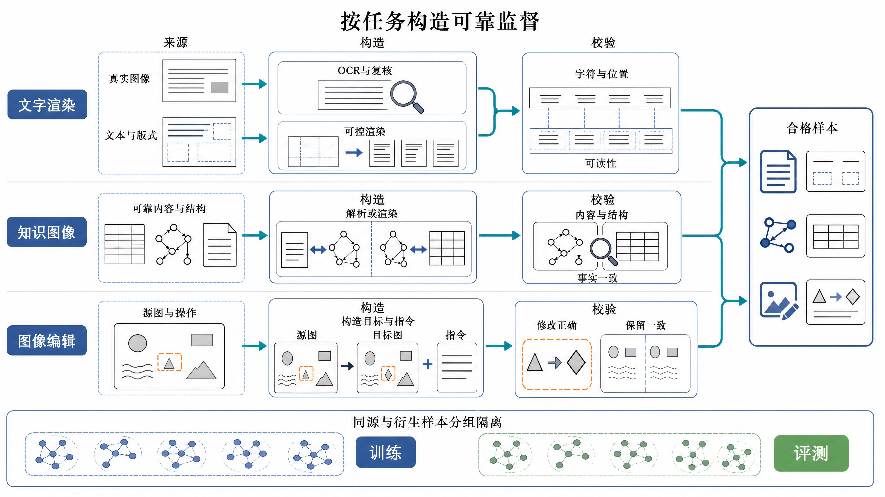
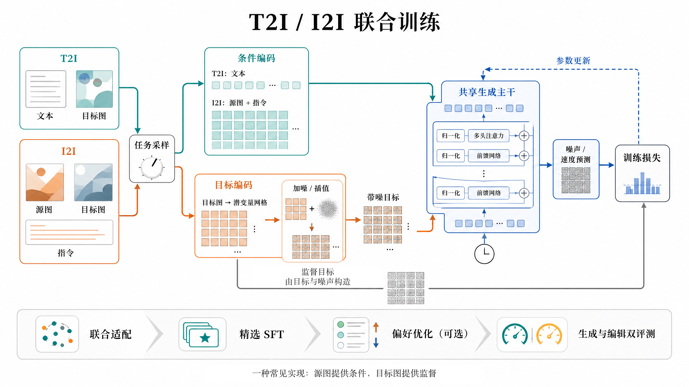
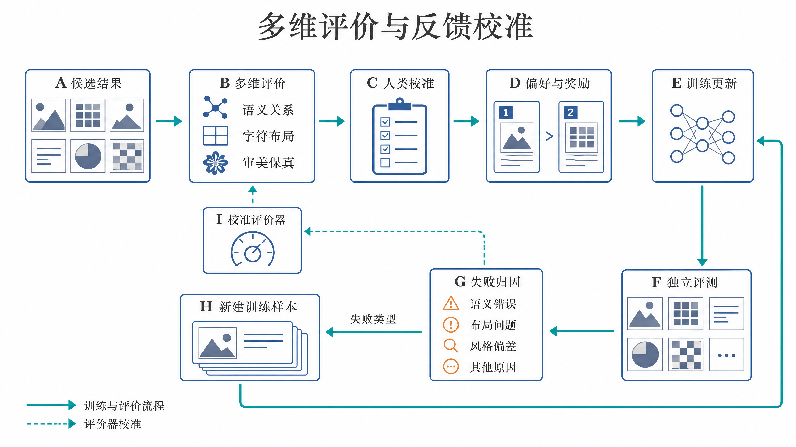
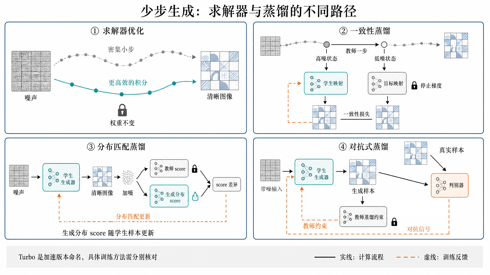
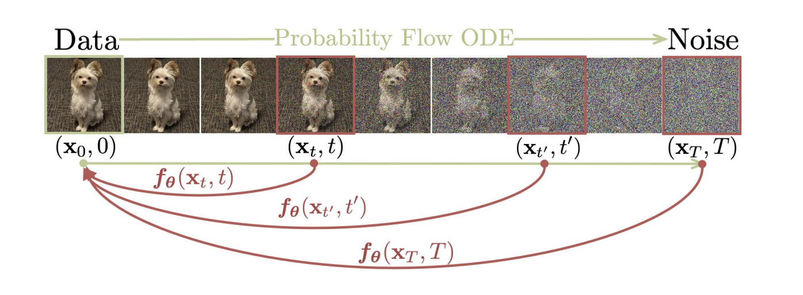
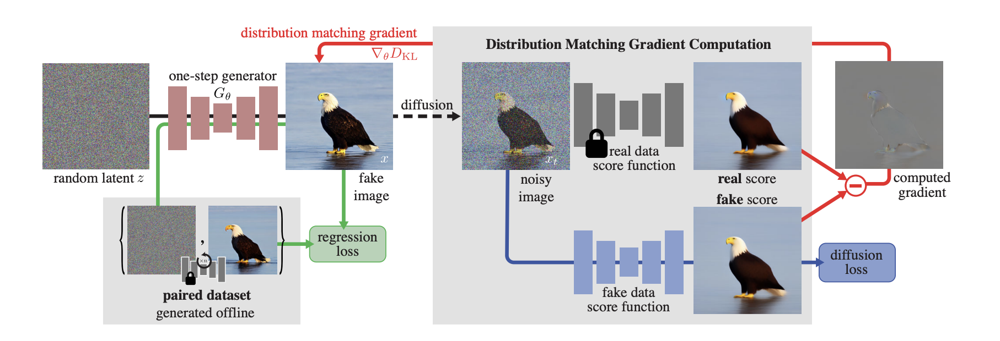
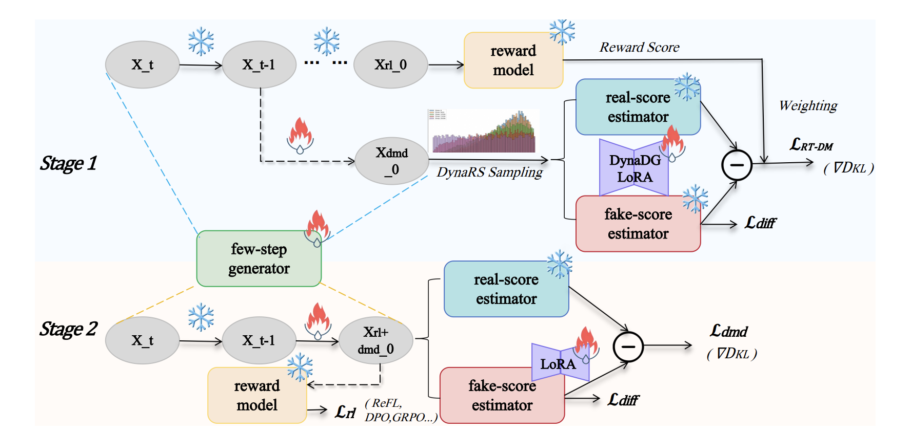
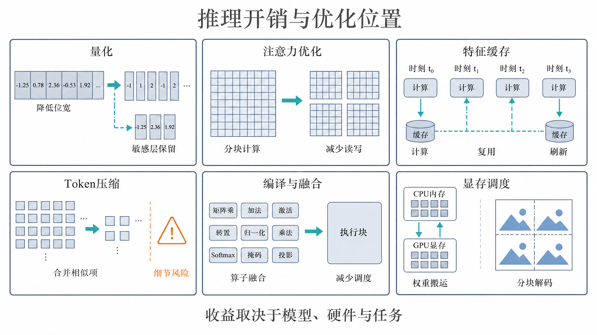
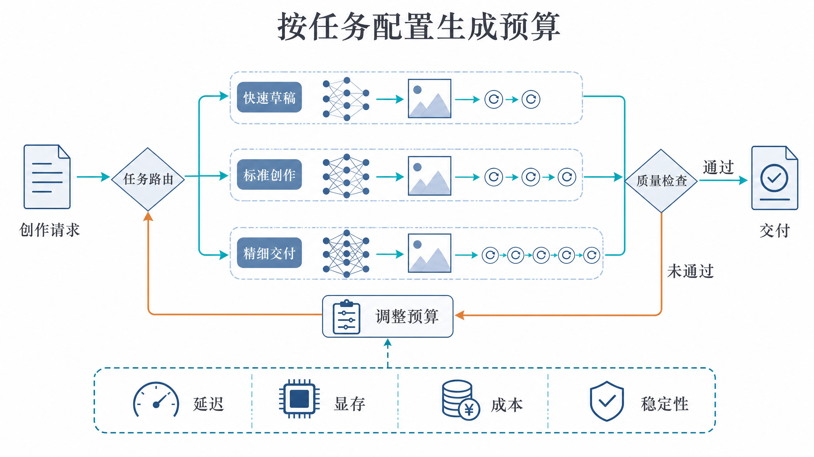

# 目录

[1.AIGC图像创作大模型的完整训练与性能优化流程通常包含哪些阶段？](#q-001)

[2.介绍一下AIGC图像创作大模型的主流数据工程和标注体系](#q-004)
  - [面试问题：AIGC图像创作大模型的数据工程通常包含哪些关键环节？](#q-005)
  - [面试问题：为什么高质量Caption、VLM重标注和合成数据会显著影响Prompt Following？](#q-006)
  - [面试问题：文字渲染、知识图像和编辑数据应该如何构建？](#q-007)

[3.AIGC图像创作大模型的微调训练流程有哪些核心环节？](#q-013)
  - [面试问题：AIGC图像创作大模型如何进行T2I/I2I联合训练？](#q-016)
  - [面试问题：AIGC图像创作大模型如何进行偏好对齐？](#q-015)
  - [面试问题：AIGC图像创作大模型有哪些主流微调训练和后训练方法？](#q-014)

[4.AIGC图像创作大模型如何做性能优化和推理加速？(进阶)](#q-017)
  - [面试问题：AIGC图像创作大模型进行采样加速的主流方法有哪些？](#q-018)
  - [面试问题：AIGC图像创作大模型的主流推理加速方法有哪些？](#q-019)
  - [面试问题：AIGC图像创作领域实际部署中如何平衡图像质量、生成速度、显存占用和成本？](#q-020)

---

<h1 id="q-001">1.AIGC图像创作大模型的完整训练与性能优化流程通常包含哪些阶段？</h1>

**难度评分：⭐⭐⭐ (3/5)  |  考察频率：⭐⭐⭐⭐⭐ (5/5)**

在2026年AIGC时代的“中场时刻”到来后，AIGC图像创作大模型的训练流程已经不能再被简化成“收集一批图文对数据，然后训练一个扩散模型”。

Rocky认为，我们真正要学习的是一个AIGC图像领域的跨周期通用训练范式：**AIGC图像创作大模型的训练，完整流程可以按任务定义、数据工程、表示与架构、基础预训练、能力扩展与对齐、加速压缩、部署反馈七个阶段理解。**

这七个阶段的具体内容如下表所示：

<div align="center">

| 阶段 | 核心任务 | 本质目标 |
|---|---|---|
| 1. 任务定义与能力边界设计 | 明确大模型要支持文生图、图生图、图像编辑、文字渲染、多图参考生成、知识图像生成、特征一致性生成、风格控制生成、实时生成中的哪些功能 | 先定义“要训练什么能力”，否则训练将缺少目标 |
| 2. 数据资产建设 | 收集图文对、图像对、编辑图像对、OCR图像、富文本图像、知识图像、专业设计图和多语言数据等 | 决定大模型能学习哪些数据分布，以及最终能覆盖哪些AIGC图像创作场景 |
| 3. 数据清洗与质量筛选 | 做去重、去水印、低质过滤、审美筛选、安全过滤、分辨率过滤和分布平衡等 | 获得高质量基础训练集，降低噪声样本污染，避免大模型过拟合重复数据或被低质数据带偏 |
| 4. 语义标注与多模态重标注 | 用Caption模型、VLM、OCR、布局分析和人工校验生成高密度标注 | 详细Caption、OCR文本、空间关系描述、风格标签、编辑差异描述，把“图像里有什么”转化为大模型可以学习的文本监督信息标签 |
| 5. 表示层准备与对齐 | 训练或选择VAE/Tokenizer/Text Encoder/VLM条件编码器，并校准Latent空间和文本条件格式 | 建好图像从像素进入Latent空间、文本从自然语言进入条件空间的桥梁 |
| 6. 基础预训练 | 在大规模高质量图文数据上训练文生图基础大模型，学习通用生成能力 | 获得基础T2I、I2I生成能力、通用审美质量、基本prompt following能力等通用生成能力，先让大模型成为高价值的核心基础底座 |
| 7. 持续训练与多任务能力扩展 | 加入高分辨率、文字渲染、图像编辑、多图参考、局部控制、知识图像和专业场景等数据进行继续训练 | 从“通用图像生成”走向“复杂图像创作任务可用”，补齐基础预训练中缺失的编辑能力、富文本能力、多图一致性、专业图生成等创作生成能力 |
| 8. SFT、偏好对齐与安全对齐 | 用精选高质量样本、人类偏好、奖励模型、VLM-as-a-Judge、DPO/GRPO/RLHF/RLAIF做后训练 | 让大模型的生成内容更符合人类审美、指令意图、编辑保真和安全要求 |
| 9. 性能优化与反馈闭环 | 做蒸馏、量化、缓存、编译、并行推理、线上评测和bad case反馈优化等 | 构建低成本、低延迟、可稳定交付的产品能力 |

</div>

总的来说，Rocky认为**AIGC图像创作大模型的竞争，早已不是单点模型架构的竞争，而是谁能更系统地把数据、表示、生成、对齐、评测、部署和反馈完整串联构建成一个训练闭环。**


<h1 id="q-004">2.介绍一下AIGC图像创作大模型的主流数据工程和标注体系</h1>

<h2 id="q-005">面试问题：AIGC图像创作大模型的数据工程通常包含哪些关键环节？</h2>

**难度评分：⭐⭐⭐ (3/5)  |  考察频率：⭐⭐⭐⭐⭐ (5/5)**

Rocky认为，AIGC图像创作大模型的数据工程，本质上是在回答**希望模型学会什么，现有数据能提供哪些可靠监督，以及有限的训练预算应该优先花在哪些样本上**这三个核心问题。文生图需要图像与描述对应；图像编辑还需要交代修改目标和保留范围；文字渲染则需要准确的字符内容及其视觉呈现。任务不同，对数据的要求也会变化，架构决定大模型的表达能力，数据工程决定这种表达能力会被训练到何种上限。

一张画质很好的图片，可能没有可用的描述；一组看起来合理的编辑对，也可能在修改主体的同时改变了背景。这样的样本即使数量很多，也未必能教会模型我们需要的能力。数据工程要把原始素材整理为可校验、可追溯、能够稳定进入训练的监督训练数据，让AIGC图像创作大模型真正学习到有价值的数据分布。

从工程实现来看，可以把AIGC图像创作大模型的数据工程分成八个相互衔接的环节：

<div align="center">

| 数据工程环节 | 核心任务 | 解决的本质问题 |
|---|---|---|
| 能力驱动的数据规划 | 按文生图、编辑、文字渲染、知识图像、多图参考、专业设计等能力倒推数据需求 | 避免“有多少数据训多少能力”的被动训练，比如按多模态创作任务扩展数据，或围绕生成+编辑统一构建数据等 |
| 多源数据采集 | 收集自然图像、艺术图像、设计图、电商图、UI、海报、PPT、教材图、图表、公式、编辑对、多图参考数据 | 扩展模型的世界知识覆盖和多任务覆盖 |
| 质量过滤与安全过滤 | 过滤坏文件、低分辨率、模糊图、压缩伪影、水印、NSFW、错误方向、低信息量样本 | 降低噪声样本对模型分布的污染 |
| 去重与分布平衡 | 结合视觉相似度、语义相似度和低层视觉特征去重，并控制类别、风格、语言、场景比例 | 避免大模型记忆重复样本，同时减少高频风格挤压长尾能力 |
| 标注生成与一致性校验 | 结合原始文本、VLM、OCR 和结构化标注，核对主体、文字、关系及布局 | 把“图像里有什么”转成大模型可学习的监督标签 |
| 任务型数据构造 | 构造I2I、inpainting、outpainting、局部编辑、多图参考、身份保持、文字编辑数据 | 让大模型不只会从零生成，还会理解真实创作任务 |
| 合成数据与长尾补齐 | 用OCR、LaTeX、版式工具、渲染工具或规则策略生成公式、图表、海报、富文本和长尾编辑数据 | 补足真实数据中稀缺但产品高频需要的能力 |
| 多阶段反馈闭环 | 从低分辨率到高分辨率，从T2I到T2I+编辑，从通用数据到偏好数据，再用评测和bad case回流修正分布 | 让数据分布随大模型能力阶段动态演进 |

</div>

Rocky认为从上述内容中能够提炼出两类具备跨周期价值的数据工程方法：

第一类是**通用型数据工程方法**，几乎所有大模型都会长期使用。比如数据清洗、去重、分布平衡、质量筛选、caption重写、多阶段训练数据调度。

第二类是**代表性数据工程方法**，针对特殊场景，构建特殊的数据工程策略。

在教育、办公、科研、营销和专业设计场景，**Seedream 4.0设计了知识型视觉数据管线，将训练数据从“自然图像覆盖”走向“知识结构覆盖”。** Seedream 4.0发现，单纯依赖自然图像和常规图文对，会让模型在知识密集型内容上覆盖不足。因此它把知识数据拆成自然数据和合成数据两路。自然数据从教材、论文、小说等PDF中抽取高质量图表，再用质量分类器过滤模糊、杂乱、噪声样本，并用难度分类器划分easy/medium/hard，过难样本在预训练中降采样。合成数据则利用OCR结果和LaTeX源码生成不同结构、符号密度和分辨率的公式图像。**这个方法的本质是让模型系统性见过公式、图表、流程、教材图这类有信息结构的视觉对象**。

**Qwen-Image则构建了分类型caption体系，从“一张图一句描述”走向“按任务组织监督数据与标签”。** Qwen-Image系列把caption分成General Caption、Text Caption、Knowledge Caption和Structured Caption。General Caption负责主体、场景、风格、空间关系等通用描述；Text Caption面向PPT、海报、漫画、教育材料等文本密集图像，强调OCR文本、版式、符号和语义关系；Knowledge Caption补充图像相关背景知识，让模型不只看见表面内容，还能学习图像背后的概念；Structured Caption用于流程图、关系图、复杂图示，显式建模实体、属性、层级和拓扑关系。**这个体系的核心价值是不同图像需要不同标注语言。自然照片、海报、公式图、流程图不能都用同一种caption模板，否则模型会学到“浅层图文对齐”，但学不到复杂结构和专业语义**。

Z-Image则强调用Z-Captioner生成双语、多粒度的合成caption，包括长/中/短描述、标签和模拟用户prompt，并在图生图任务中随机使用目标图caption或成对差异caption，对应参考生成和多任务编辑。**它的关键不是单纯生成更长caption，而是让同一张图在不同训练阶段以不同粒度被使用：短caption适合泛化，长caption适合细节对齐，tag适合概念覆盖，差异caption适合编辑指令学习**。对于编辑任务来说，真正有价值的是把二者之间的变化抽象成可学习的自然语言指令，例如保留什么、修改什么、修改到什么程度。再结合数据基础设施中的高质量过滤、概念平衡、长尾重采样和任务比例控制。

总的来说，AIGC图像创作大模型的数据工程是在通用型数据工程方法和特定场景的数据工程策略灵活组合应用的，下图生动展示了数据工程的核心链路：

<div align="center">



</div>


<h2 id="q-006">面试问题：为什么高质量Caption、VLM重标注和合成数据会显著影响Prompt Following？</h2>

**难度评分：⭐⭐⭐⭐ (4/5)  |  考察频率：⭐⭐⭐⭐⭐ (5/5)**

Prompt Following即指令遵循，本质上关注的是生成结果能否满足用户明确提出的要求：主体有没有漏，数量是否正确，属性有没有对应到正确对象，空间关系和文字内容是否符合指令。对于编辑任务，还要看该改的地方是否改到、不该改的内容是否被保留。

**早期网页图文对数据最大的问题是弱监督标注整体上太弱：** 比如一张海报只写“poster”或“beautiful design”，模型无法学到标题在什么位置、正文是什么、字体风格如何、主体和背景是什么关系、左上角和右下角分别有什么元素。这种情况下一张图片中的大部分信息都被浪费掉了。

高质量Caption、VLM重标注和合成数据，本质上是在提升训练标签的语义密度。我们可以从六个层面理解：

1. **准确的描述，让视觉细节拥有对应的标签信息。** 普通caption更像关键词罗列，只告诉模型“这是什么”；高质量caption会描述主体、属性、数量、位置、动作、风格、光照、构图和关系。**目前“更好的caption带来更好的prompt following”已经成为AIGC图像生成领域的长期共识**。
2. **不同粒度的描述，让训练条件接近真实用户表达。** 比如把caption拆成General captions、Text captions、Knowledge captions、Structured captions。不同图片需要不同标注方式，比如自然图像需要主体和风格，海报/PPT需要文字和版式，知识图像需要背景知识和逻辑关，复杂场景需要实体、属性和关系结构。
3. **VLM扩大标注规模，进行多模态语义对齐。** VLM可以识别对象数量、材质、位置、文字、布局、图表结构和局部细节，并把这些信息转成更细的训练文本。
4. **编辑数据的意图清晰描述。** 图像编辑任务不是描述一张图，而是描述两张图之间发生了什么改变。高质量编辑数据需要源图caption、目标图caption、差异描述、编辑指令等。
5. **合成数据补充难以从真实数据中获得的长尾分布。** 真实数据里高质量公式、长文本海报、多语言菜单、复杂流程图、精确局部编辑样本往往不够多。合成数据的价值是用可控方式补足长尾能力，比如一个典型例子是用OCR输出和LaTeX源码生成多结构、多符号密度、多分辨率公式图像。
6. **评测和反馈持续迭代训练数据。** MagicBench、DreamEval、OCR评测、编辑一致性评测和用户bad case反馈等，都会反过来告诉数据团队下一轮应该补充什么样的数据。


<h2 id="q-007">面试问题：文字渲染、知识图像和编辑数据应该如何构建？</h2>

**难度评分：⭐⭐⭐⭐ (4/5)  |  考察频率：⭐⭐⭐⭐ (4/5)**

Rocky认为，文字渲染、知识图像和编辑数据是AIGC图像生成从“生成”走向“生成编辑”的关键分水岭。因为这三类任务不只考验审美，还考验精确性、结构性和可控性。

这三类数据加上多图参考数据，都是AIGC图像创作大模型“从生成走向生成编辑”不可获取的，各自的具体内容如下表所示：

<div align="center">

| 数据类型 | 核心标注 | 模型最容易出错的地方 |
|---|---|---|
| 文字渲染数据 | OCR文本、字符级内容、字体、字号、颜色、位置、行列、语言、版式层级 | 错字、漏字、糊字、大小写错误、中文笔画错、文字和背景不协调 |
| 知识图像数据 | 图表类型、坐标/数值、公式LaTeX、流程关系、教材语义、图文对应关系 | 图表看起来像但逻辑错，公式结构错，流程关系错，知识表达不可信 |
| 编辑数据 | 源图、目标图、编辑指令、mask或区域、差异描述、未编辑区域约束、身份/风格保持要求 | 改一处坏全局，主体身份漂移，背景被误改，文字编辑不稳定 |
| 多图参考数据 | 每张参考图提供的身份、风格、姿态、物体、尺度、材质、空间关系 | 多图混淆、对象绑定错误、尺度错乱、风格过拟合 |

</div>

在具体构建数据时，我们需要抓住五个原则：

1. **文字渲染：真实图像提取与可控渲染互相补充。** 只给模型一张带文本的图片是不够的。它需要知道文本内容是什么、文字在哪个区域、每行怎么排、字体大小和颜色是什么、文字和背景是什么关系。对于中文尤其如此，因为中文字符的笔画结构复杂，少一笔、多一笔都会影响可读性。
2. **知识图像：先建立可信内容，再核对视觉表达。** 教材图、公式图、统计图、流程图、科普图、PPT和地图等知识图像，各自构建的正确性依据不同。比如统计图需要核对源数据、单位、坐标范围和图例；公式需要保存可靠表达及必要上下文；流程图需要明确节点含义、连接方向和分支关系。
3. **编辑数据：把请求修改和实际变化一一对齐。** 高质量编辑数据至少需要`源图 + 编辑指令 + 目标图`，更好的数据还要有mask、差异描述、源图caption、目标图caption、未编辑区域约束和身份保持说明等内容。
4. **合成数据要服务长尾能力，而不是替代真实分布。** 合成数据最适合补充真实世界难以大规模获得的样本：多语言长文本、公式、复杂图表、特定版式、局部编辑、文字替换、身份保持、极端构图等。它的优势是可控，风险是分布过于规则。因此更合理的做法是用合成数据补齐能力空洞，用真实数据校准视觉自然度，再用评测和人工偏好控制比例。
5. **数据要和评测闭环绑定。** 文字数据可以检查字符错误、文本区域和可读性；知识图像需要核对数值、单位、公式及关系结构；编辑任务则同时检查指令执行和保留内容。先定位原因，再决定修正标签、替换样本还是补充数据。

总的来说，文字渲染、知识图像与编辑数据的来源、构造和校验机制可以如下图所示：

<div align="center">



</div>

<h1 id="q-013">3.AIGC图像创作大模型的微调训练流程有哪些核心环节？</h1>

<h2 id="q-016">面试问题：AIGC图像创作大模型如何进行T2I/I2I联合训练？</h2>

**难度评分：⭐⭐⭐⭐ (4/5)  |  考察频率：⭐⭐⭐⭐ (4/5)**

**T2I/I2I联合训练，是让同一个AIGC图像创作大模型在不同条件下学习生成目标图：T2I根据文本生成图像，I2I根据源图或参考图以及文本要求生成图像。** 两类任务共同更新共享参数，既复用模型已有的视觉知识，也让模型学会利用图像条件完成修改、保持和组合。

例如，用户要求把人物的衣服改成红色，模型需要读取原图中的人物、衣服和光照关系，完成颜色修改，同时保留不应变化的身份、纹理与背景。仅仅生成一张“穿红衣服的人像”并不足以完成这次编辑；直接复制原图、忽略指令同样不合格。**联合训练需要同时维护基础生成能力、修改执行能力和内容保持能力**。

同时T2I数据提供广泛的主体、风格、构图和视觉关系，I2I数据提供这些内容在具体条件下如何变化的监督。两者结合，能够让同一个大模型利用已有视觉知识完成生成和编辑，也有机会减少分别训练、维护多套模型的投入。

### 1、T2I/I2I联合训练的原理

从建模角度看，两类任务都在学习给定条件后目标图像的分布，只是条件的信息量与含义不同：

```math
\begin{aligned}
\mathrm{T2I}:&\quad p_\theta(x_{\mathrm{tgt}}\mid c_{\mathrm{text}}),\\
\mathrm{I2I}:&\quad p_\theta(x_{\mathrm{tgt}}\mid x_{\mathrm{src}},c_{\mathrm{edit}},r).
\end{aligned}
```

其中， $x_{\mathrm{tgt}}$ 是目标图， $x_{\mathrm{src}}$ 是源图， $c_{\mathrm{text}}$ 是生成描述， $c_{\mathrm{edit}}$ 是编辑指令， $r$ 表示可选的参考图、mask、布局等附加条件。这里的I2I主要讨论可学习的图像条件生成与指令编辑，不能直接等同于推理界面中通过denoising strength控制变化幅度的img2img操作。

**两类任务统一的是生成目标与共享参数，不要求所有输入都采用完全相同的编码方式。** 在U-Net架构中，图像条件可以通过通道拼接或额外条件分支注入；在DiT等Transformer架构中，可以将文本、源图和带噪目标编码成不同序列，通过联合注意力或交叉注意力建立联系。采用哪种方式，都需要让模型区分源图条件与目标生成位置，避免混淆图像身份、空间位置和噪声状态。

训练数据至少需要明确下面两种对应关系，如下表所示：

<div align="center">

| 任务 | 条件输入 | 目标监督 | 数据要求 |
|---|---|---|---|
| T2I | 描述目标内容的文本 | 与文本对应的目标图 | 文本准确覆盖主体、属性、关系及需要生成的文字 |
| I2I编辑 | 源图与编辑指令 | 完成修改后的目标图 | 修改与指令一致，未要求改变的内容得到合理保留 |
| 多图条件生成 | 多张参考图及各自的角色说明 | 满足组合要求的目标图 | 身份、风格、物体等条件绑定清楚，避免参考关系冲突 |

</div>

多图条件生成是I2I的扩展。mask、差异描述、区域标注和编辑历史可以帮助训练，但不是每条样本都必须具备；部分标注也可以只用于数据筛选和评估，而不作为模型的必需输入。

### 2、T2I/I2I联合训练流程

以潜空间扩散模型为例，我们可以将一次联合训练迭代可以拆成六步：

1. **按任务采样。** 先按设定概率选择T2I或I2I，再抽取相应样本。一个batch可以混合两类任务，也可以交替使用不同任务的batch；关键在于它们持续在同一个基础大模型上更新训练。
2. **编码条件。** T2I编码文本，I2I同时编码指令与源图，必要时加入参考图或区域条件。T2I分支不提供源图，或按架构约定使用空条件表示。
3. **编码目标图。** 用VAE等编码器将目标图转成潜变量。对于基础大模型，通常先固定VAE，训练生成backbone及所需条件模块；是否更新文本编码器，需要结合数据规模和适配目标确定。
4. **构造带噪目标。** 采样时间步和随机噪声，对目标潜变量执行前向加噪或路径插值。
5. **预测并计算损失。** 在基础大模型中输入带噪目标、时间步和条件，输出当前参数化要求的噪声或速度预测，再与对应监督目标比较。
6. **反向传播与分任务检查。** 按任务权重汇总损失，更新可训练参数，并分别记录T2I与I2I的表现。整体损失下降并不保证两类能力都在提高，仍需使用固定的独立评测集检查。

具体T2I/I2I联合训练流程如下图所示：

<div align="center">



</div>

其中图示采用一种常见训练方式，不限定所有模型必须使用相同的条件编码与注意力结构。

### 3、T2I/T2I联合训练损失函数

**T2I与I2I通常可以共用一套损失函数，主要区别在于条件与数据分布。** 下面分别用扩散噪声预测和线性路径Flow Matching进行说明。

**扩散模型的噪声预测损失。** 记目标图编码后的潜变量为 $z_{\mathrm{tgt}}$ ，采样标准高斯噪声 $\epsilon$ ，得到：

```math
z_t=\alpha_t z_{\mathrm{tgt}}+\sigma_t\epsilon,
\qquad \epsilon\sim\mathcal N(0,I).
```

其中， $\alpha_t$ 和 $\sigma_t$ 由噪声调度决定。模型根据条件 $c$ 预测加入目标潜变量的噪声，对任务 $k$ 的损失可写为：

```math
\mathcal L_k^{\mathrm{diff}}
=\mathbb E_{(c,z_{\mathrm{tgt}})\sim\mathcal D_k,\,t,\epsilon}
\left[
w(t)\left\|\epsilon_\theta(z_t,t,c)-\epsilon\right\|_2^2
\right],
\qquad k\in\{\mathrm{T2I},\mathrm{I2I}\}.
```

$\mathcal D_k$ 是对应任务的数据集， $w(t)$ 是时间步权重。T2I中的 $c$ 主要来自文本，I2I中的 $c$ 还包含源图和其他参考条件。若模型采用数据预测或其他速度参数化，监督目标需要相应改变，不能直接沿用噪声标签。

**Flow Matching的速度预测损失。** 为避免时间方向混淆，这里明确约定 $t=0$ 为噪声端，$t=1$ 为目标图端。采用线性插值路径时：

```math
z_t=(1-t)\epsilon+t z_{\mathrm{tgt}},
\qquad u=z_{\mathrm{tgt}}-\epsilon.
```

对应的监督损失为：

```math
\mathcal L_k^{\mathrm{FM}}
=\mathbb E_{(c,z_{\mathrm{tgt}})\sim\mathcal D_k,\,t,\epsilon}
\left[
w(t)\left\|v_\theta(z_t,t,c)
-(z_{\mathrm{tgt}}-\epsilon)\right\|_2^2
\right].
```

这里监督的是噪声到目标潜变量的路径速度，**不是源图到目标图的像素差**。源图通过条件分支影响预测，使模型在生成目标时知道哪些内容应当保持、哪些内容需要改变。

**联合损失与任务配比。** 选择模型实际采用的生成损失后，两类任务可以组合为：

```math
\mathcal L_{\mathrm{joint}}
=p_{\mathrm{T2I}}\lambda_{\mathrm{T2I}}\mathcal L_{\mathrm{T2I}}
+p_{\mathrm{I2I}}\lambda_{\mathrm{I2I}}\mathcal L_{\mathrm{I2I}},
\qquad p_{\mathrm{T2I}}+p_{\mathrm{I2I}}=1.
```

$p_k$ 表示任务采样概率，$\lambda_k$ 表示额外的损失权重。如果已经按 $p_k$ 抽样，训练时对抽到的样本乘 $\lambda_k$ 即可，其期望就是上式；不能再机械地乘一次采样概率。反过来，如果每次分别计算两类任务的平均损失，再显式加权，就应按所定义的联合目标组合。

采样概率和损失权重都会影响各任务的有效贡献。增加I2I采样比例后，又大幅提高I2I损失权重，可能让编辑任务占据过多训练预算。高分辨率和多图样本的计算成本也不同，比较配比时应说明统计单位，并明确损失是按样本、目标token还是像素归一化。

**内容保持是否必须单独写一个损失？** 不一定。只要编辑目标图正确保留了应保留内容，基础生成损失已经包含这部分监督。对于小范围修改，背景占据大量位置，模型却可能倾向于复制输入、忽略小区域变化，因此可以按需对编辑区和保留区分别加权。

例如，对目标潜空间中位置 $i$ 定义预测误差 $e_i$ ，用 $m_i\in\{0,1\}$ 标记需要编辑的位置，可采用以下可选的区域加权方式：

```math
\mathcal L_{\mathrm{region}}
=\lambda_{\mathrm{edit}}
\frac{\sum_i m_i\|e_i\|_2^2}{\sum_i m_i+\delta}
+\lambda_{\mathrm{keep}}
\frac{\sum_i(1-m_i)\|e_i\|_2^2}{\sum_i(1-m_i)+\delta}.
```

这里 $e_i$ 可以是噪声预测或速度预测误差， $\delta>0$ 用于避免分母为零。这是对I2I生成误差的一种区域重加权，可替换普通的位置平均，并非所有模型都使用的额外必选损失。mask需要与目标潜空间位置对齐；边界、阴影和反射等实际受影响区域也应纳入修改范围。

### 4、拆分训练阶段，可以先建立通用生成能力，再进行联合训练

从已有T2I模型扩展编辑能力时，一条常见训练路线是：

```text
已有T2I基础模型
→ 扩展图像条件接口
→ 混合T2I与I2I数据进行继续训练
→ 使用精选、任务配比合理的数据进行SFT
→ 按需进行偏好优化
→ 持续检查生成、编辑与多轮使用效果
```

**继续训练主要扩展条件使用能力和任务覆盖。** 模型需要从成对数据中学习源图与目标图的关系，同时通过T2I数据回放维护基础生成能力。编辑数据量较小、来源较窄时，过度集中于编辑分布可能导致开放生成能力下降；这是一项需要监测的风险，而非所有I2I训练都会出现的必然结果。

**SFT主要提高监督质量与任务完成的稳定性。** 筛选标准应同时包含指令正确性、目标图质量和内容保持，不能只选视觉上漂亮的结果。局部编辑、全局编辑、文字编辑、身份保持与多图参考的占比，应结合产品需求和独立评测调整。所谓任务平衡，不等于每类样本数量完全相同。


<h2 id="q-015">面试问题：AIGC图像创作大模型如何进行偏好对齐？</h2>

**难度评分：⭐⭐⭐⭐⭐ (5/5)  |  考察频率：⭐⭐⭐ (3/5)**

**AIGC图像创作大模型的偏好对齐，是在已有生成能力上，利用人类或评估系统提供的比较与奖励信号，调整模型的输出分布，使其更稳定地满足用户的创作要求。**

例如，同一条海报指令Prompt生成的两张图，一张构图漂亮却漏掉文字，另一张文字完整但排版拥挤；一次人物编辑也可能出现“修改执行了，但身份ID变了”的结果。想要优化提升这些场景中的图像创作效果，我们可以进行图像偏好对齐训练，图像偏好对齐需要同时处理任务正确性、内容保持和审美选择。

### 1、图像偏好对齐原理

记完整输入条件为 $c$ ，其中可以包含文本、源图、参考图、mask等信息，最终生成图像为 $x$ 。一个常见的概念目标是：提高期望奖励，同时限制模型过度偏离已有能力分布。

```math
\max_\theta\;
\mathbb E_{c,\,x\sim p_\theta(\cdot\mid c)}[R(c,x)]
-\beta\,\mathbb E_c\left[
D_{\mathrm{KL}}\!\left(p_\theta(\cdot\mid c)\Vert p_{\mathrm{ref}}(\cdot\mid c)\right)
\right].
```

其中 $R$ 表示奖励， $p_{\mathrm{ref}}$ 是参考生成分布， $\beta$ 控制偏离参考分布的代价。上述这是理解偏好对齐的统一视角，不代表所有图像模型都直接计算最终图像分布的KL。扩散/Flow模型往往通过偏好损失、采样轨迹上的约束、监督数据回放或其他正则实现相应控制。

### 2、先建立偏好标准，再组织数据与奖励

可靠的训练样本应保留完整条件、候选图和评价依据。对于成对偏好，样本写成 $(c,x^+,x^-)$ ，分别表示同一条件下更优和较差的结果。编辑任务中的条件必须包括相同的源图、参考图和修改指令，否则两张图的比较无法反映模型对同一任务的处理差异。

我们可以对每个奖励维度构建评价指标，并明确对应的指责，具体如下表所示：

<div align="center">

| 评价维度 | 需要判断的内容 | 主要评价方式 | 训练时需要防止的问题 |
|---|---|---|---|
| 指令与语义 | 主体、属性、数量、动作和空间关系是否符合要求 | VLM分项检查、人类抽检、适用的检测工具 | 画面好看却漏主体、错关系 |
| 文字与布局 | 字符是否正确、是否漏字，位置和排版是否合理 | OCR、字符串规则、VLM与人工复核 | 为提高OCR分数而破坏设计，艺术字被误判 |
| 审美与真实感 | 构图、色彩、光影、纹理及风格是否合适 | 人类偏好、经校准的审美或奖励模型 | 所有输出被推向同一种风格或过度锐化、饱和 |
| 编辑执行与保留 | 要求的修改是否完成，其他内容是否合理保持 | 源图—结果联合评审、区域与特征相似度 | 直接复制源图获得高相似度，却没有执行修改 |
| 多参考一致性 | 身份、物体、风格等是否绑定到正确参考图 | VLM、专用特征指标、人类复核 | 多张参考图的角色混淆，主体发生漂移 |
| 安全与使用约束 | 输出是否满足明确的内容与使用要求 | 分类器、规则、人类审核 | 将自动分数当作完整的合规或版权判断 |
| 实际用户选择 | 哪些结果被选中、保留或用于后续创作 | 配对比较、交互反馈与经过控制的实验 | 将曝光、排序和操作习惯误当作图像质量偏好 |

</div>

**任务正确性和审美偏好需要分别记录。** 对必须准确的文字、指定主体或编辑要求，可以先筛掉明显不合格的结果，再在可接受候选之间比较审美；也可以采用带约束的多目标优化。不能让审美高分轻易抵消任务未完成。

使用多个奖励时，我们可以采用如下简化表达：

```math
R(c,x)=\sum_{j=1}^{M}a_j\,\widetilde R_j(c,x),
\qquad a_j\geq0.
```

其中 $\widetilde R_j$ 表示经过尺度校准的各项奖励，训练中应持续查看各子项，避免总分上升掩盖文字准确率或身份保持下降。

### 3、主流方法之一：筛选后SFT与奖励加权训练

我们可以先让当前base模型生成候选，再按任务完成度和偏好筛选，将合格结果作为新的监督样本进行SFT。它属于偏好驱动的数据选择，不需要把整个生成过程建模为强化学习。

流程通常是：收集真实任务条件，生成多个候选；用规则、VLM与人工筛选；保留高质量且有足够多样性的样本；重新编码目标图并随机加噪；使用原有生成损失继续训练，同时回放必要的基础数据。

```math
\mathcal L_{\mathrm{weighted}}
=\mathbb E_{(c,x,w)\sim\mathcal D_{\mathrm{selected}},\,t,\epsilon}
\left[w(c,x)\,\ell_{\mathrm{gen}}(\theta;c,x,t,\epsilon)\right].
```

其中 $\ell_{\mathrm{gen}}$ 是模型原本采用的去噪或Flow Matching损失； $w(c,x)$ 是非负、经过控制的样本权重。

这种方法实现简单、训练相对稳定，但主要学习“选中的结果长什么样”，没有充分利用较差候选提供的对比信息。如果反复只选择同一类高分风格，也会缩窄生成分布，产生过拟合风险。因此筛选标准需要同时关注质量、任务覆盖与多样性。

### 4、主流方法之二：DPO与扩散偏好优化

**DPO把同条件下的优劣比较直接转成训练目标，推动Base模型相对于参考模型提高优选结果的相对概率。** 经典目标函数可以写成：

```math
\mathcal L_{\mathrm{DPO}}
=-\mathbb E_{(c,x^+,x^-)\sim\mathcal D_{\mathrm{pref}}}
\log\sigma\!\left(
\beta\left[
\log\frac{p_\theta(x^+\mid c)}{p_{\mathrm{ref}}(x^+\mid c)}
-\log\frac{p_\theta(x^-\mid c)}{p_{\mathrm{ref}}(x^-\mid c)}
\right]\right).
```

其中 $\sigma$ 是sigmoid函数，参考模型通常由对齐开始时的Base模型冻结得到。该损失比较的是优选与拒选的相对变化，不要求每个优选样本的绝对概率都单调增加。

对扩散模型，最终图像的精确对数似然通常不能像语言模型的token概率那样直接读取。[Diffusion-DPO](https://arxiv.org/abs/2311.12908)利用扩散模型的变分形式构造可训练的去噪偏好目标。为说明其方向，可以把一种简化的损失差形式写成：

```math
\begin{aligned}
\Delta^+&=\ell_\theta(x^+,c,t,\epsilon)-\ell_{\mathrm{ref}}(x^+,c,t,\epsilon),\\
\Delta^-&=\ell_\theta(x^-,c,t,\epsilon)-\ell_{\mathrm{ref}}(x^-,c,t,\epsilon),\\
\mathcal L_{\mathrm{pair}}
&=-\mathbb E\log\sigma\!\left[-\gamma_t(\Delta^+-\Delta^-)\right].
\end{aligned}
```

这里 $\ell$ 表示与相应推导匹配的去噪误差， $\gamma_t>0$ 概括时间权重和尺度。若优选样本相对参考模型的误差下降更多，括号内的偏好logit就会增大。这个表达用于解释更新方向，不意味着任意噪声损失或Flow Matching误差都可以不经推导替换精确似然。具体实现还需确定预测参数化、时间采样与权重。

一次离线训练的核心流程是：

1. 固定输入条件收集候选并形成可信的偏好对。候选可以来自已有模型，不要求每步重新生成。
2. 初始化可训练模型和冻结参考模型，保持条件编码与噪声参数化兼容。
3. 为偏好对采样时间步并构造带噪目标；配对使用相同时间步及耦合噪声是常见的降方差做法。
4. 分别计算训练模型与参考模型在两张图上的误差，形成偏好损失，梯度只更新训练模型。
5. 在独立条件上评估胜率、任务正确性和多样性；若出现新的失败模式，再补充偏好数据。

DPO适合已有可靠偏好对、希望降低在线生成开销的场景。其主要限制是数据覆盖：模型越偏离采集候选时的分布，旧偏好对越可能遗漏当前错误。偏好标注本身不可靠时，直接优化也会放大误差。

### 5、主流方法之三：奖励模型与在线策略优化

当需要让当前Base模型持续探索新候选，并根据反馈改进时，可以采用DDPO、PPO式更新或适用于Flow模型的GRPO等在线方法。奖励可以来自已训练的模型，也可以来自OCR、规则或外部评审；策略梯度方法不要求奖励函数对图像可微。

**先说明奖励模型如何学习。** 根据偏好对，可用Bradley–Terry形式拟合“哪张更好”的概率：

```math
P_\phi(x^+\succ x^-\mid c)
=\sigma\!\left(R_\phi(c,x^+)-R_\phi(c,x^-)\right),
\qquad
\mathcal L_{\mathrm{RM}}
=-\mathbb E\log P_\phi(x^+\succ x^-\mid c).
```

这一步更新奖励模型参数 $\phi$ ，不更新图像生成模型。模型学到的首先是偏好排序，其分数不自动具有跨任务的绝对质量刻度。生成模型优化期间，通常固定一个奖励模型版本，以便区分策略变化与评价标准变化；后续可在独立数据和人工校准后更新奖励模型。

**再将生成过程转成可优化的随机轨迹。** 令 $s_t$ 包含当前带噪状态、时间与输入条件， $a_t$ 表示下一状态。随机采样器定义转移概率 $\pi_\theta(a_t\mid s_t)$ ，最终图像的奖励用于指导轨迹上的更新。DDPO就是将扩散去噪过程视为多步决策过程来优化。

以组相对优势为例，对相同条件采样 $G$ 个结果，记奖励为 $R_i$ ：

```math
A_i=\frac{R_i-\bar R}{s_R+\delta},
\qquad
\bar R=\frac{1}{G}\sum_{j=1}^{G}R_j.
```

$`s_R`$ 是组内奖励标准差，$`\delta>0`$ 防止数值除零。奖励完全相同的组不提供相对排序信息，不应仅靠很小的分母放大评分噪声。终局奖励设置中，可以将这个组内优势用于该候选的多个采样转移。

定义当前策略与采样旧策略在同一转移上的概率比：

```math
r_{i,t}(\theta)
=\frac{\pi_\theta(a_{i,t}\mid s_{i,t})}
{\pi_{\mathrm{old}}(a_{i,t}\mid s_{i,t})}.
```

一种带裁剪和参考约束的教学形式为：

```math
\mathcal L_{\mathrm{policy}}
=-\mathbb E_{i,t}\left[
\min\!\left(r_{i,t}A_i,
\mathrm{clip}(r_{i,t},1-\varepsilon,1+\varepsilon)A_i\right)
\right]
+\lambda_{\mathrm{KL}}\mathcal K(\pi_\theta,\pi_{\mathrm{ref}}).
```

其中 $\varepsilon$ 是裁剪范围， $\mathcal K$ 表示与具体采样过程匹配的参考策略约束。旧策略负责记录本批轨迹从哪里采样，参考策略负责约束模型偏离基线的程度，二者不应混淆。GRPO通过组内比较估计优势，通常不需要另训练价值网络；其具体目标及正则形式仍取决于实现。

完整流程是：保存采样旧策略，在线生成候选及轨迹；对最终图像评分；计算优势和转移概率比；进行受控的参数更新；随后刷新采样策略、生成新候选，并独立检查奖励与质量是否同步改善。训练期间不能长期使用过时轨迹进行无限轮更新。

**Flow模型还必须处理确定性采样与策略概率之间的关系。** 初始噪声具有随机性，并不意味着确定性ODE的每一步转移都能直接套用上述非退化随机策略概率比。[Flow-GRPO](https://arxiv.org/abs/2505.05470)通过ODE到SDE的转换构造可用于在线优化的随机生成过程。扩散模型如果使用确定性采样，同样需要核对方法的概率假设。

在线优化能跟随当前模型发现新的失败模式，也能使用不可微的任务奖励；代价是候选采样、轨迹保存与评分开销更高，而且模型会主动利用奖励的漏洞。训练奖励上涨必须配合未参与训练的评估器和人类盲评验证。

### 7、图像偏好对齐工程整体策略

在实际场景中，图像偏好对齐的整体链路可以围绕下面的流程展开：

```text
明确任务要求与偏好维度
→ 固定基础模型、数据划分和评价标准
→ 在完整条件下生成候选
→ 人类、VLM与工具形成经过校准的反馈
→ 构造偏好对、筛选样本或奖励信号
→ 选择适配模型与预算的优化方法
→ 独立评测任务正确性、审美、保真与多样性
→ 分析失败样本，更新数据与评价标准
```

具体图示如下图所示：

<div align="center">



</div>


Rocky认为，图像偏好对齐最关键的判断，是**训练信号、用户要求和独立评估是否指向同一个目标**。奖励分数只是中间指标。只有当模型在未见条件下更准确地执行指令、更稳定地保留内容，同时没有明显牺牲多样性，偏好优化才真正转化为创作能力。


<h2 id="q-014">面试问题：AIGC图像创作大模型有哪些主流微调训练和后训练方法？</h2>

**难度评分：⭐⭐⭐⭐ (4/5)  |  考察频率：⭐⭐⭐⭐⭐ (5/5)**

在预训练AIGC图像创作基础大模型上继续提升能力，Continued Training（CT）与精选SFT是两种常见的监督训练方式。**CT侧重补充基础大模型尚未充分学到的数据分布与任务能力，精选SFT侧重用可靠的条件—目标样本提高生成质量和任务完成的稳定性。** 两者通常沿用基础大模型的生成分布与能力，区别主要体现在数据组织、学习重点与训练资源上。

例如，模型缺乏某类专业图像的结构知识，仅用少量精美样本反复微调，未必能补齐概念覆盖；模型已经理解该领域，却经常出现文字遗漏、局部瑕疵或指令执行不完整，则需要更严格的监督样本来纠正这些行为。前一种情况更适合先扩充领域数据进行CT，后一种情况可以优先评估精选SFT。

### 1、CT与精选SFT的核心区别

CT与精选SFT的核心区别如下表所示：

<div align="center">

| 比较维度 | Continued Training（CT） | 精选SFT |
|---|---|---|
| 主要目标 | 扩展或适应领域、语言、分辨率与任务分布 | 提高画质、条件遵循和任务完成的稳定性 |
| 数据重点 | 覆盖需要新增的概念、变化与任务组合，同时控制噪声 | 条件准确、目标可靠，并保留必要的难例和长尾覆盖 |
| 样本要求 | 数据规模与覆盖面要支撑能力扩展，质量仍需达到基本门槛 | 每个样本都应提供可信的示范，不能只按美观程度筛选 |
| 常见训练安排 | 分阶段引入新分布，按需混合通用数据 | 在精选分布上精调，控制重复暴露与能力收缩 |
| 损失函数 | 通常延续基础生成目标，可加入数据回放项 | 通常仍使用生成目标，可采用样本加权或分层采样 |
| 验收重点 | 新能力是否提高，原有能力是否明显退化 | 独立任务成功率、画质、细节与泛化是否改善 |

</div>

### 2、训练损失：同一生成目标上的数据分布调整

以潜空间扩散或Flow Matching模型为例，记条件为 $c$ ，目标图潜变量为 $z$，随机噪声为 $\epsilon$ 。通过加噪或插值形成状态 $z_t$，模型预测对应监督量 $y_t$ 。基础生成损失可概括为：

```math
\mathcal L_{\mathrm{gen}}(\theta;\mathcal D)
=\mathbb E_{(c,z)\sim\mathcal D,\,t,\epsilon}
\left[w(t)\left\|f_\theta(z_t,t,c)-y_t\right\|_2^2\right].
```

其中 $w(t)$ 是时间步权重。噪声预测模型以加入的噪声为监督，即  $y_t=\epsilon$ 。对于从噪声端走向数据端的线性Flow Matching路径， $z_t=(1-t)\epsilon+tz$ ，监督速度为 $y_t=z-\epsilon$ 。这一概括适用于上述扩散/Flow设置，自回归视觉token模型应采用对应的token预测目标。

**CT的变化主要来自新增数据与回放数据的组合。** 一个简单的混合目标为：

```math
\mathcal L_{\mathrm{CT}}
=\rho\,\mathcal L_{\mathrm{gen}}(\theta;\mathcal D_{\mathrm{new}})
+(1-\rho)\,\mathcal L_{\mathrm{gen}}(\theta;\mathcal D_{\mathrm{replay}}),
\qquad 0\leq\rho\leq1.
```

其中 $\rho$ 控制新增分布的训练贡献。可以分别计算两类平均损失后显式加权，也可以按这个比例抽样；若已按比例抽样，不应再机械地乘一次相同比例。该式是可选的回放方案，并不意味着所有CT都必须使用固定的两类数据。

**精选SFT主要改变监督数据的质量与采样分布。** 若引入非负样本权重，可以写成：

```math
\mathcal L_{\mathrm{SFT}}
=\mathbb E_{(c,z)\sim\mathcal D_{\mathrm{curated}},\,t,\epsilon}
\left[a(c,z)\,w(t)
\left\|f_\theta(z_t,t,c)-y_t\right\|_2^2\right],
\qquad a(c,z)\geq0.
```

普通精选SFT可以直接令 $a(c,z)=1$ ，高质量数据并不要求额外设计一种损失。若同时使用分层过采样与样本权重，应核对有效贡献，避免重复放大少数任务；权重的尺度也应受控，防止无意改变整体梯度幅度。

这几项损失中的误差还需要明确归一化口径。不同分辨率、目标token数量和任务规模可能不同，按位置求和与按样本求平均会产生不同的训练偏向。验证损失也应按可比的任务与噪声设置统计，不能把数据更难造成的数值变化直接解释为模型退化。

**CT和SFT都没有通过这类监督损失直接优化人类审美分数。** 它们从目标图及条件对应中学习质量规律。如果同条件下存在多个各有优劣的候选，需要显式利用比较信息，则应采用前一题介绍的偏好对齐方法。

### 3、两个训练方法衔接

当任务同时存在覆盖不足和质量不稳时，可以采用下面的路线：

```text
基础模型与固定评测基线
→ 构建覆盖能力缺口的新增数据
→ CT适应新分布，按需回放通用数据
→ 在新增能力与基础能力之间选择合适检查点
→ 筛选可靠示范，补齐难例与长尾覆盖
→ 精选SFT提高质量与任务完成的稳定性
→ 独立验证后交付，按需进入偏好优化
```

这是一种常见组织方式，不是必须执行的固定流水线。已有模型的能力覆盖足够时，可以直接进行精选SFT；新数据本身高度可靠时，CT与SFT也可能连续推进而没有明显分界。


<h1 id="q-017">4.AIGC图像创作大模型如何做性能优化和推理加速？(进阶)</h1>

<h2 id="q-018">面试问题：AIGC图像创作大模型进行采样加速的主流方法有哪些？</h2>

**难度评分：⭐⭐⭐⭐⭐ (5/5)  |  考察频率：⭐⭐⭐⭐ (4/5)**

扩散和Flow模型通常需要多次调用生成主干，将噪声逐步变成符合条件的图像。**采样加速的核心，是在满足任务质量要求的前提下，减少完成生成所需的模型评估次数。** 可以改进现有模型的数值求解过程，也可以通过训练，让模型学会以更大的步长或更少的步骤完成生成。

本题主要讨论扩散与Flow模型。采样步数与模型评估次数NFE（Number of Function Evaluations）不总是相同：Heun等方法的一个更新步可能需要多次评估，常规CFG还会计算有条件与无条件分支。因此比较方法时，应同时说明时间步数、NFE统计口径和引导设置，不能仅用界面上的steps判断加速幅度。

### 1、主流路线：改进积分、压缩轨迹或匹配生成分布

<div align="center">

| 路线 | 核心原理 | 是否需要额外训练 | 主要监督或约束 |
|---|---|---|---|
| 求解器与时间调度优化 | 更有效地利用已有向量场预测，减少数值积分开销 | 通常不需要 | 没有额外训练损失，依靠求解器与调度设计 |
| 渐进式／轨迹蒸馏 | 用学生的一次更新近似教师的多次更新 | 需要 | 教师轨迹端点或等价预测目标 |
| 一致性蒸馏 | 同一轨迹上的不同状态映射到相同近干净端点 | 需要 | 端点预测一致性与边界条件 |
| Reflow等路径改造 | 用模型生成的端点耦合重新学习较易积分的传输路径 | 需要 | 重构路径上的速度回归 |
| 分布匹配蒸馏 | 让少步学生的生成分布接近目标分布 | 需要 | 目标与学生分布的score差异 |
| 对抗式蒸馏 | 联合教师约束与对抗信号改善少步结果 | 需要 | 教师蒸馏损失与对抗损失 |

</div>

这些路线可以组合，并非严格互斥。“少步”描述推理目标，“Turbo”通常是加速版本的命名，都不能直接作为一种确定的训练算法。例如SDXL-Turbo使用ADD，不能仅凭Turbo后缀推断其采用DMD。

下图概括其中四种机制：

<div align="center">



</div>

### 2、求解器与调度优化：保持权重，减少积分所需的评估

以ODE采样为例，模型提供状态随时间变化的向量场。记条件为 $c$ ，采样状态为 $z(t)$，可写为：

```math
\frac{\mathrm dz}{\mathrm dt}=v_\theta(z,t,c),
\qquad
z(t+h)=z(t)+\int_t^{t+h}v_\theta(z(s),s,c)\,\mathrm ds.
```

Euler用一次当前状态的预测近似这段积分；Heun通过预测与校正利用更多局部信息；DPM-Solver类方法利用扩散ODE的结构构造高效积分，UniPC等方法通过预测—校正与历史信息提高求解效率。扩散模型的噪声或数据预测需要按对应参数化转换到求解器使用的形式，不能直接当成任意速度场使用。

**求解器决定怎样更新状态，时间或噪声调度决定在哪里评估模型。** Karras风格的sigma序列属于后者。相同的节点数量，放在不同噪声区间可能产生不同误差；高阶方法也可能在强引导、很少步数或不适配的模型上表现不佳。

实际流程是：确认模型预测类型和推荐采样设置，选择兼容求解器，构造时间网格，从初始噪声逐步更新，再比较不同NFE下的质量。它既可以改善相同预算下的结果，也可以减少达到某个质量水平所需的评估次数。

这条路线通常不更新权重，因此没有新增训练损失。其边界是原模型在大步长下的近似误差：将常规多步模型直接设为一步，不等价于得到专门训练的一步生成器。也不能假设换成更高阶求解器就必然减少总计算，应比较实际NFE。

### 3、渐进式蒸馏：让学生一步覆盖教师多步

**轨迹蒸馏直接学习教师的采样更新。** 经典渐进式蒸馏将教师的两步确定性更新压缩为学生的一步，再将训练后的学生作为下一轮教师，逐阶段降低采样步数。

设 $\Phi_\phi$ 为冻结教师的一步更新， $\Psi_\theta$ 为学生的一步更新。沿采样方向取三个时间点 $t_a,t_b,t_c$，一种端点回归的概念表达为：

```math
\hat z_{t_c}
=\Phi_\phi\!\left(\Phi_\phi(z_{t_a},t_a,t_b,c),t_b,t_c,c\right),
\qquad
\mathcal L_{\mathrm{traj}}
=\mathbb E\left[
w\left\|\Psi_\theta(z_{t_a},t_a,t_c,c)
-\mathrm{sg}(\hat z_{t_c})\right\|_2^2
\right].
```

其中 $\mathrm{sg}$ 表示停止梯度。实际实现可以将教师端点转换成学生参数化下的等价监督目标，不一定直接在状态空间计算这个误差。

核心流程包括：固定教师及时间网格，构造起始带噪状态；教师执行多步得到目标；学生以较大跨度预测；更新学生并检查质量；阶段收敛后替换教师、减少网格节点，再继续蒸馏。具体是否每次减半以及训练多少阶段，由蒸馏方案决定。

这条路线的优点是监督明确，容易解释学生在学习哪段更新。限制在于教师采样与多阶段训练成本，以及误差随压缩阶段传递。若教师包含特定CFG或条件设置，学生的训练与推理设置也需匹配，不能任意更换后仍假定蒸馏关系成立。

### 4、Consistency Distillation：学习轨迹端点的一致映射

**经典一致性模型学习从不同噪声状态到同一近干净端点的映射。** 与“学生一步模仿教师两步”的局部压缩不同，它要求同一概率流ODE轨迹上不同时间点的端点预测相互一致。

训练中需要区分三个角色：冻结扩散教师用于推进轨迹；在线学生接受梯度；目标网络提供稳定的端点预测。经典Consistency Distillation使用学生参数的EMA更新目标网络，因此目标网络与冻结扩散教师不是同一个角色。

一次迭代先采样数据、噪声与相邻时间点，构造较高噪声状态；再用教师和求解器推进到较低噪声状态；随后将两者分别输入在线学生与目标网络，对齐其端点输出。若 $t_h>t_l$ 表示较高与较低噪声时刻，可以写成：

```math
\hat z_{t_l}=\mathrm{ODEStep}_\phi(z_{t_h},t_h\!\to t_l,c),
\qquad
\mathcal L_{\mathrm{CD}}
=\mathbb E\left[
\lambda(t_h,t_l)\,
d\!\left(f_\theta(z_{t_h},t_h,c),
\mathrm{sg}[f_{\bar\theta}(\hat z_{t_l},t_l,c)]\right)
\right].
```

其中 $d$ 为选定距离， $\bar\theta$ 为目标网络参数。梯度更新在线学生，目标网络按指定策略更新。还需要最小噪声端的边界条件 $f_\theta(z_{t_{\min}},t_{\min},c)=z_{t_{\min}}$ ，将映射锚定到近干净状态；仅要求输出彼此一致，不足以定义正确的生成结果。Consistency Distillation流程如下图所示：

<div align="center">



</div>

推理时保留学生，从噪声直接预测端点；少步一致性采样可以按专门日程再加噪、再映射，以改善结果。训练教师和EMA目标网络无需同时部署。潜空间一致性模型将这一思路用于图像潜表示，但仍需匹配条件、引导和时间设置。另有不依赖已有扩散教师的Consistency Training，不能与蒸馏训练混为一谈。

### 5、Reflow：通过重新耦合端点改善采样路径

Flow模型的低步数表现与向量场及轨迹形状有关。**Reflow利用已有模型产生的噪声—输出对应关系，重新学习连接这些端点的流，以改善有限步数的积分近似。** 它不同于直接换一个推理求解器，也不同于对任意图像对做插值就必然得到直线采样路径。

流程是：固定已有流模型，为条件 $c$ 采样初始噪声 $z_0$ ；通过教师积分得到 $z_1$ ，保存端点配对；从端点间的插值状态采样，用端点差作为速度监督重新训练模型；最后用较少步数评估新流，必要时再进行下一轮重新配对。

约定时间从噪声端0走向图像端1，线性路径的回归目标为：

```math
z_t=(1-t)z_0+tz_1,
\qquad
\mathcal L_{\mathrm{reflow}}
=\mathbb E_{(z_0,z_1,c)\sim\mathcal D_{\mathrm{coupled}},\,t}
\left[\left\|v_\theta(z_t,t,c)-(z_1-z_0)\right\|_2^2\right].
```

关键在于 $\mathcal D_{\mathrm{coupled}}$ 中端点的对应关系来自已有传输，而不是独立随机配对。其目的是使学习到的流更适合低步数积分；具体效果依赖模型、端点质量与训练近似。更直的路径不自动等于一步采样完全无损，基础Flow Matching也不等于已经完成Reflow或一步蒸馏。

### 6、DMD与DMD2：用分布匹配训练少步学生

**Distribution Matching Distillation（DMD）侧重学生输出分布与目标分布的接近程度。** 学生不必对每个随机种子逐步复刻教师轨迹，而是通过分布层面的信号学习生成合理结果。

其核心包含三个模块：少步生成器、冻结的目标分布score网络，以及持续学习学生分布的fake-score网络。这里的score指对数密度对输入的梯度，不是审美或奖励评分。

训练时，先由学生生成图像或潜表示，再随机加噪到某一水平；两个score网络分别估计该位置的目标分布梯度与学生分布梯度；二者差异提供生成器的分布匹配更新方向。fake-score则以学生样本的去噪损失单独更新，使其跟随不断变化的生成分布。更新fake-score时通常对生成样本停止梯度，避免混淆两类优化。

概念上，分布匹配可以写成不同噪声水平下的散度目标：

```math
\mathcal L_{\mathrm{DM}}
=\mathbb E_{c,t}\left[
w(t)D_{\mathrm{KL}}\!\left(
p_{\theta,t}(\cdot\mid c)\Vert p_{\mathrm{target},t}(\cdot\mid c)
\right)\right].
```

实现中通常不显式计算高维图像分布的完整密度，而是利用score差异构造梯度估计；具体符号、权重和预测转换需要与推导一致。原始DMD还使用预先生成的噪声—教师图像配对，通过回归项稳定训练，可概括为：

```math
\mathcal L_{\mathrm{DMD}}
=\mathcal L_{\mathrm{DM}}+\lambda_{\mathrm{reg}}\mathcal L_{\mathrm{reg}}.
```

这里的 $\mathcal L_{\mathrm{reg}}$ 指配对回归约束，不是所有DMD后续变体都保留的必选项。下图是DMD蒸馏技术流程示意图：

<div align="center">



</div>

DMD2进一步去除这项配对回归依赖，通过双时间尺度更新等设计使fake-score更好地跟上生成器，并引入真实数据与对抗信号。其多步版本还处理训练状态与学生实际滚动采样状态之间的差异。因此，不能将DMD2的改进反写成原始DMD从一开始就没有配对监督。

部署时主要保留少步生成器，score网络属于训练开销。学生可以与教师具有相近参数量，加速首先来自调用次数减少。输出分布匹配也不保证所有任务能力都保持，仍需检查文字、复杂关系、编辑条件与多样性。

### 7、对抗式蒸馏与奖励辅助：改善少步输出质量

**对抗式蒸馏用教师信号保留生成能力，用判别器信号改善少步结果的真实感与细节。** SDXL-Turbo采用的ADD（Adversarial Diffusion Distillation）属于这一方向，不应归为DMD的别名。

训练流程包括：构造带噪输入，由学生预测图像；用真实样本与生成样本训练判别器；同时由冻结扩散教师提供蒸馏约束；交替更新判别器与学生。更新学生时，判别器参数可以冻结，但应保留通过其输入传回学生的梯度。训练判别器时则应隔离对生成器的不必要更新。

学生目标可概括为：

```math
\mathcal L_G
=\lambda_{\mathrm{distill}}\mathcal L_{\mathrm{teacher}}
+\lambda_{\mathrm{adv}}\mathcal L_{\mathrm{adv},G}.
```

这只是监督组成，不是ADD全部实现细节。教师目标、判别特征和对抗损失形式需要按具体方法确定。仅用像素回归可能过度平滑，仅靠对抗信号又可能损害条件遵循或训练稳定性，两类信号共同约束学生。推理时不需要判别器，使用该学生支持的采样步数与引导设置即可。

**DMDR则把奖励信号与分布匹配结合，用于进一步改善少步学生的质量取舍。** 它的意义是使减少步数的训练同时关注输出是否符合偏好；奖励本身不会自动减少采样次数。

按DMDR论文的两阶段框架，初期用奖励加权的分布匹配帮助学生建立能力；后期在奖励驱动的优化中保留DMD约束，降低模型只追高分而偏离合理图像分布的风险。联合目标可以概括为 $`\mathcal L_{\mathrm{joint}}=\mathcal L_{\mathrm{align}}+\lambda_{\mathrm{DM}}\mathcal L_{\mathrm{DM}}`$ ，其中对齐项的形式取决于采用的奖励或偏好方法，不能一律理解为直接对奖励求导。其具体优化机制见[偏好对齐](#q-015)。下图为DMDR蒸馏技术示意图：

<div align="center">



</div>

图中展示奖励加权蒸馏与联合优化。不同论文版本的动态引导标记有所调整，当前v5使用DynaDG；这里沿用已有示意图，不将图中早期标记当作不同算法。分布约束有助于缓解reward hacking，但仍需要独立评价，不能保证消除奖励漏洞。


<h2 id="q-019">面试问题：AIGC图像创作大模型的主流推理加速方法有哪些？</h2>

**难度评分：⭐⭐⭐⭐ (4/5)  |  考察频率：⭐⭐⭐⭐ (4/5)**

在采样算法确定后，AIGC图像创作大模型仍有大量推理开销可以优化：矩阵计算使用了多少精度，注意力是否反复读写大矩阵，相邻采样状态是否重复计算相似特征，运行时是否频繁启动小算子，以及模型权重能否稳定驻留显存。**推理加速需要先定位这些开销，再选择改变数值表示、计算组织或复用方式的技术。**

### 1、主流推理加速方法

当前AIGC图像创作大模型的主流推理加速方法如下表所示：

<div align="center">

| 方向 | 代表方法 | 主要减少的开销 | 是否通常需要训练 | 关键边界 |
|---|---|---|---|---|
| 数值精度 | FP16/BF16、FP8/INT8/INT4、SVDQuant | 权重与激活带宽、适配硬件上的矩阵计算 | 混合精度通常不需要；PTQ校准与QAT不同 | 存储更小不等于实际延迟更低 |
| 注意力执行 | SDPA、xFormers、FlashAttention、SageAttention | 注意力中间结果读写、部分低精度运算 | 通常不需要 | 精确重排与量化近似应分开理解 |
| 跨步特征复用 | DeepCache、TeaCache等 | 相邻采样状态之间的重复网络计算 | 代表性方法通常不需要 | 需要刷新策略和误差控制，不能任意跨请求复用 |
| 序列压缩 | Token Merging等 | 注意力与MLP处理的token数量 | 推理时合并通常不需要 | 小字、边界和位置关系可能被破坏 |
| 执行图与算子 | torch.compile、TensorRT、算子融合、CUDA Graph | Python调度、kernel启动、中间张量搬运 | 编译本身不需要 | 形状变化、图断裂及重编译影响收益 |
| 显存与数据驻留 | VAE tiling、切片、offload、预取 | 峰值显存与不必要的数据搬运 | 通常不需要 | 有些方法以延迟换显存，并非无条件加速 |

</div>

推理加速六类方法的机制如下图所示：

<div align="center">



</div>

需要区分两种“效果不变”：算子重排可以保持数学运算定义，但浮点计算顺序变化仍可能造成数值差异；量化、缓存与token合并则引入了额外近似，必须验证输出质量。多数推理优化直接作用于已训练模型，验收依据是数值误差、任务质量和实际耗时；只有涉及参数校准或重新训练时，才有相应的优化目标。

### 2、混合精度与量化：减少数值表示和矩阵运算成本

**混合精度通过为不同运算选择合适的浮点格式，降低存储、带宽和计算开销。** BF16具有较宽的指数范围，FP16具有不同的精度与动态范围取舍；具体稳定性还取决于累加精度、归一化、softmax及模型权重分布。VAE、归一化和部分投影等模块是否需要保留较高精度，应通过检查确定，不能一概而论。

量化进一步将权重或激活映射到较低位宽。以仿射整数伪量化为例：

```math
\hat W=s\left[
\mathrm{clip}\!\left(\mathrm{round}(W/s)+z_0,q_{\min},q_{\max}\right)-z_0
\right].
```

其中 $s$ 为尺度， $z_0$ 为零点， $q_{\min},q_{\max}$ 为整数范围；实际内核存储整数编码并执行相应计算。该式不直接描述FP8等浮点量化。逐张量、逐通道或逐组尺度在误差、元数据开销与kernel支持上也有不同取舍。

**实施流程**通常是：先选择权重量化还是权重与激活共同量化；准备覆盖实际输入的校准样本；分析异常值与敏感模块；确定尺度、分组和保留精度；转换权重并使用匹配的低位宽kernel；最后在完整采样轨迹上检查质量与耗时。

扩散与Flow模型的激活分布会随时间步、引导强度、分辨率和条件改变。只用一个时间点或少量简单提示词校准，可能低估其他状态的量化误差。误差在迭代中也可能累积或改变后续状态分布，但并非每一步都必然放大。

**训练损失方面，应区分PTQ与QAT。** PTQ（训练后量化）可以只通过统计选择尺度，也可以优化局部重构误差；后一种方案可写为：

```math
\min_\eta\;
\mathbb E_{h\sim\mathcal D_{\mathrm{cal}}}
\left\|F_{\mathrm{fp}}(h)-F_{\mathrm{q}}(h;\eta)\right\|_2^2.
```

其中 $h$ 是校准集中的模块输入，$\eta$ 可以表示尺度、舍入参数等允许调整的量。这是局部校准目标，不意味着已经重新训练生成模型；也不是所有PTQ方法都必须使用。

QAT（量化感知训练）则在训练前向中模拟量化，并通过直通估计等近似处理不可导的舍入。可以沿用基础生成损失，也可以按需增加全精度教师输出约束：

```math
\mathcal L_{\mathrm{QAT}}
=\mathcal L_{\mathrm{gen}}(\theta_{\mathrm{fq}})
+\lambda\,\mathbb E_{z_t,t,c}
\left\|f_{\mathrm{q}}(z_t,t,c)
-\mathrm{sg}[f_{\mathrm{fp}}(z_t,t,c)]\right\|_2^2.
```

其中， $\theta_{\mathrm{fq}}$ 表示前向使用伪量化的模型参数， $z_t$ 、 $t$ 、 $c$ 分别为带噪潜变量、时间状态与生成条件， $\mathrm{sg}$ 表示停止梯度。这里是可选组合示例， $\lambda$ 可以为0；生成标签必须匹配模型的噪声或速度参数化。QAT付出了额外训练成本，也需要适配实际量化kernel，训练中的伪量化本身不会让部署自动提速。

SVDQuant是图像扩散模型低位宽量化的代表性路线：将难以低精度表示的显著成分交给高精度低秩分支，让剩余部分进入低位宽路径，并通过Nunchaku等执行引擎减少分支带来的额外读写。低秩补偿若单独调用、反复搬运激活，可能抵消量化收益。因此**位宽、误差处理与kernel实现需要一起评估**，不能由“4-bit权重”直接推出固定加速倍数。

### 3、注意力优化：减少中间矩阵读写，明确是否引入近似

标准注意力可以写成：

```math
\mathrm{Attention}(Q,K,V)
=\mathrm{softmax}\!\left(\frac{QK^\top}{\sqrt d}+M\right)V.
```

其中 $M$ 为可选mask。常规实现可能显式生成较大的注意力分数与概率矩阵，导致显存读写和峰值开销。FlashAttention通过分块计算和在线softmax，在较小的片上存储中组织计算，减少这些中间矩阵在显存中的往返。

**FlashAttention主要改变计算组织，不改变稠密注意力的数学定义，也不把其算术复杂度自动降为线性。** 浮点顺序和后端差异仍可能带来微小数值变化。PyTorch SDPA是接口及后端调度入口，具体运行哪个kernel取决于设备、数据类型、张量形状与mask；调用SDPA不等于一定使用某个FlashAttention实现。

SageAttention等路线进一步利用低精度注意力计算。具体位宽与算子组织依版本而异，它与仅重排精确注意力的路线不同，需要检查量化误差。不能笼统地说所有高效注意力都“不改变模型结果”。

**实施流程**是：确认模型是否使用支持的注意力结构，接入兼容后端，检查mask、位置编码和数值范围，验证输出误差，再分析完整模型中的收益。注意力仅占部分耗时时，注意力kernel显著提速也不代表整张图等比例提速。

这些替换通常无需重新训练，也没有新增训练损失；是否可用主要靠后端兼容、数值检查与任务回归验证。某些后端已经避免了完整注意力矩阵，再额外开启注意力切片未必有益，甚至可能增加调度开销。

### 4、缓存与特征复用：保留采样更新，减少重复网络计算

相邻采样状态通常存在一定相关性。缓存方法利用这一点，在部分步骤重新计算特征，在其他步骤复用历史特征或近似残差。**它通常保留采样时间网格，却让部分步骤少执行网络计算；这与通过蒸馏缩短生成链路是不同机制。**

DeepCache利用U-Net的层级与跳连结构，在刷新步计算并保存高层特征，后续步骤更新必要的浅层计算并复用缓存。DiT类缓存需要根据Transformer层或残差的变化重新设计，不能直接照搬U-Net路径。TeaCache等方法利用较低成本的变化信号辅助决定是否刷新，但代理信号是否可靠需要在目标模型上验证。

**实施流程**是：选择缓存位置和保存内容，明确刷新条件；在首次或指定步骤计算完整特征；随后用固定间隔或自适应阈值决定复用；在变化较快或关键阶段及时刷新；最后检查整个生成序列的误差，而非只比较一次缓存输出。

可以用下面的表达理解缓存近似，但它不是通用训练损失：

```math
h_t=F(z_t,t,c),\qquad
\hat h_t=h_{t_k},\qquad
e_t=\|h_t-\hat h_t\|,
```

其中 $t_k$ 表示最近一次刷新状态。完整计算 $h_t$ 再决定是否缓存通常失去省算意义，因此运行时方法往往使用代理量、预设日程或额外拟合的预测器控制误差。只有确实训练预测器或校准阈值时，才需要说明对应拟合目标；代表性的直接缓存方法不要求生成模型重新训练。

缓存还必须区分两类内容：条件固定时，文本嵌入等真正不变的结果可以精确复用；带噪图像特征随时间变化，复用属于近似。后者不能当成自回归语言模型中的普通KV Cache无限追加。更换prompt、源图、LoRA、模型权重、分辨率或引导设置后，应按缓存依赖关系失效重建，不能只按“都是同一张图”判断可复用性。

### 5、Token压缩：减少后续模块处理的序列长度

**Token Merging通过合并相似视觉token，降低注意力和MLP的实际工作量。** 典型流程是：在选定层计算token相似度，确定匹配关系，对被合并token进行加权聚合，在较短序列上执行昂贵模块，再按映射恢复后续所需的布局。

与FlashAttention仅优化读写不同，token合并改变了参与计算的信息表示，因此属于近似。恢复原序列长度也不意味着找回了所有被合并的局部差异。高分辨率图像中的重复纹理可能具有冗余，但小字、边界、手部以及空间位置关系往往对细节更敏感。

实施时需要限制合并比例、选择适合的层与时间阶段，并保护重要token。图像、文本和控制token的角色不同，不应无差别合并；位置编码、mask与多图边界也必须保持一致。比例过小收益有限，比例过大则可能损伤结构与条件遵循。

推理时的启发式合并通常没有训练损失。若训练专门的压缩模块，可以使用任务生成损失或教师特征重构约束，但这是额外方案，不应写成所有Token Merging的标准步骤。

更换高压缩率VAE或潜变量Tokenizer属于更深层的表示改造，会影响生成主干看到的潜空间分布和空间尺度，往往需要配套训练或适配。它与现有模型上的即插即用token合并应分开讨论，不能仅替换编码器就默认获得无损加速。

### 6、编译、融合与CUDA Graph：减少运行时执行开销

当模型包含大量小算子、临时张量和重复调用时，Python调度、kernel启动与显存往返也可能占据可观时间。编译工具通过捕获和优化执行图、融合算子及选择执行计划来减少这些开销。

**torch.compile**可以编译兼容的PyTorch计算区域，但动态控制流、自定义操作或不受支持的路径可能造成图断裂；输入形状、分支或状态变化也可能触发重新编译。**TensorRT**通过构建执行引擎、选择kernel和形状配置优化计算，仍需检查算子覆盖及精度设置。**CUDA Graph**主要记录并重放一组GPU操作以降低CPU启动开销，本身不等于算子融合或量化。

实施顺序通常是：先在正确的普通执行版本上建立基线，选择反复调用且结构稳定的生成主干；处理图断裂与形状约束；编译或构建引擎；预热后测量；最后验证不同输入形状与条件路径是否仍被正确覆盖。

这类优化通常没有训练损失，也不更新模型权重。若构建引擎时同时启用量化，则量化校准应作为独立环节记录。首次编译或引擎构建耗时与预热后的推理耗时应分开统计，不能通过排除重编译成本来描述动态场景下并不存在的稳定收益。


<h2 id="q-020">面试问题：AIGC图像创作领域实际部署中如何平衡图像质量、生成速度、显存占用和成本？</h2> 

**难度评分：⭐⭐⭐⭐ (4/5)  |  考察频率：⭐⭐⭐⭐⭐ (5/5)**

部署AIGC图像创作大模型，首先要明确实际任务要求：是交付给用户一张可以继续修改的草稿，还是交付文字准确、主体一致、达到指定分辨率的成品图像？不同用户、不同任务、不同付费层级，应该给不同的解决方。**部署方案应当先满足任务的交付要求，再比较达到这些要求所需的总成本。**

下表是根据不同应用场景，可以采取构建的AIGC图像创作大模型部署方案：

<div align="center">

| 场景 | 推荐策略 | 关注重点 |
|---|---|---|
| 快速草稿 | Turbo/少步采样、低分辨率、轻量VAE预览 | 先让用户看到方向 |
| 标准创作 | Dev/Fast模型、10-20步、bf16/fp16、SDPA/xFormers | 质量、速度和成本平衡 |
| 专业出图 | Full/Pro模型、高分辨率、更多采样步、高质量VAE | 细节、文字、结构和可交付性 |
| 图像编辑 | 源图/条件缓存、局部mask、未编辑区域约束 | 保真、身份一致和局部可控 |
| 批量生产 | 批处理、队列调度、量化、编译优化、缓存 | 吞吐、单图成本和稳定性 |
| 端侧/私有化 | 小模型、蒸馏、量化、动态显存、紧凑VAE | 低显存、低成本和可部署性 |

</div>

<div align="center">



</div>

如上图所示，**训练优化决定模型上限，推理优化决定产品的商业可用程度，系统调度决定产品能不能规模化**。 只有把质量、速度、显存、成本和稳定性放在一起综合评估和决策，才是真正理解AIGC图像生成部署的核心本质。

---
