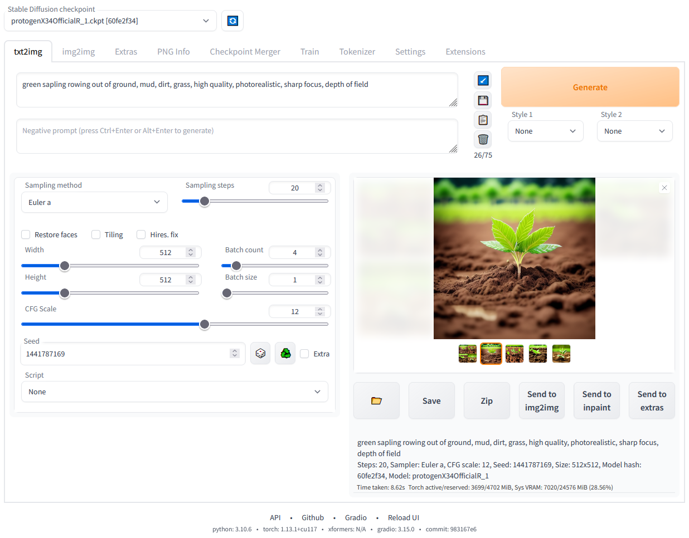
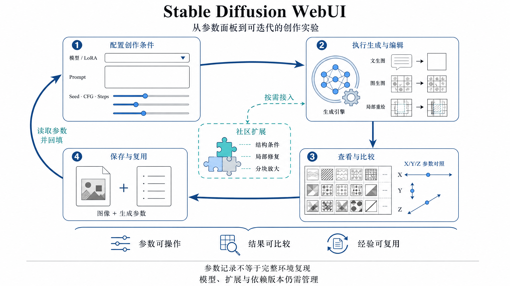
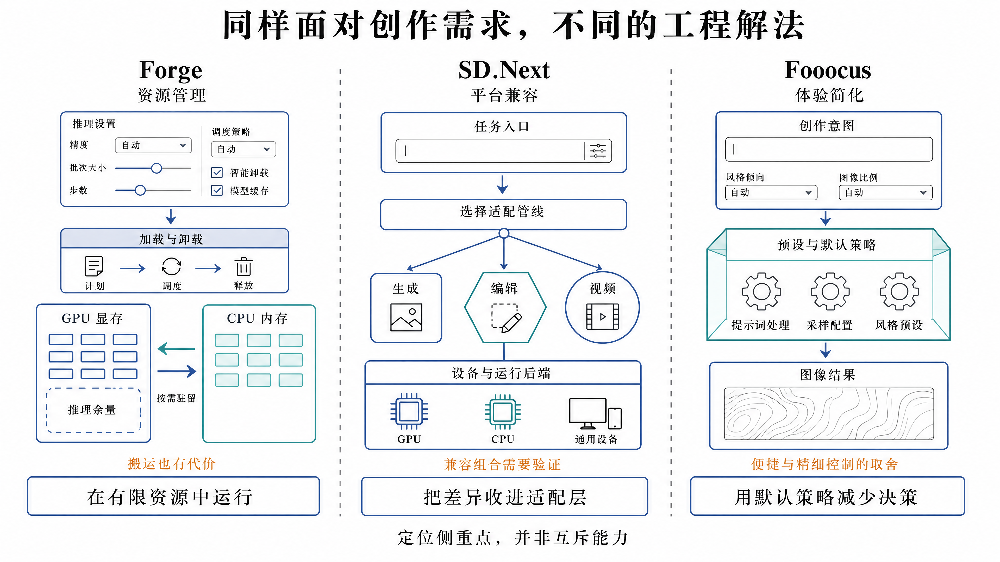
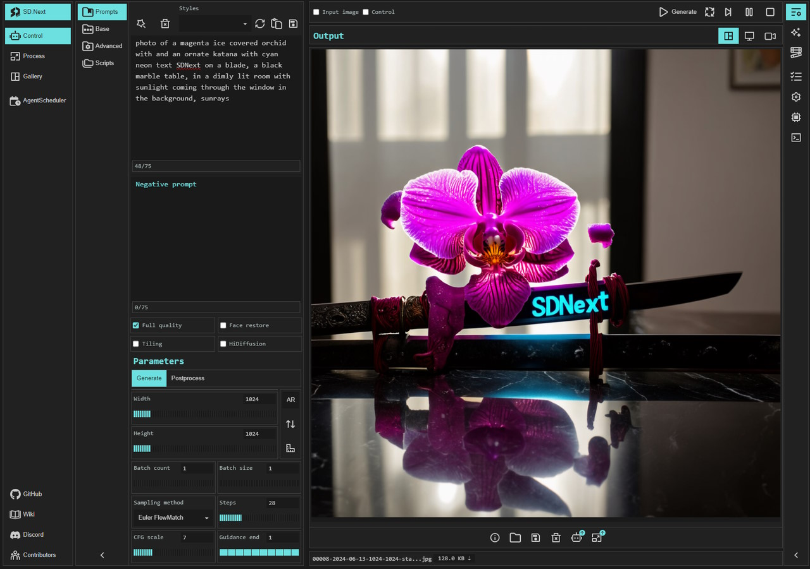
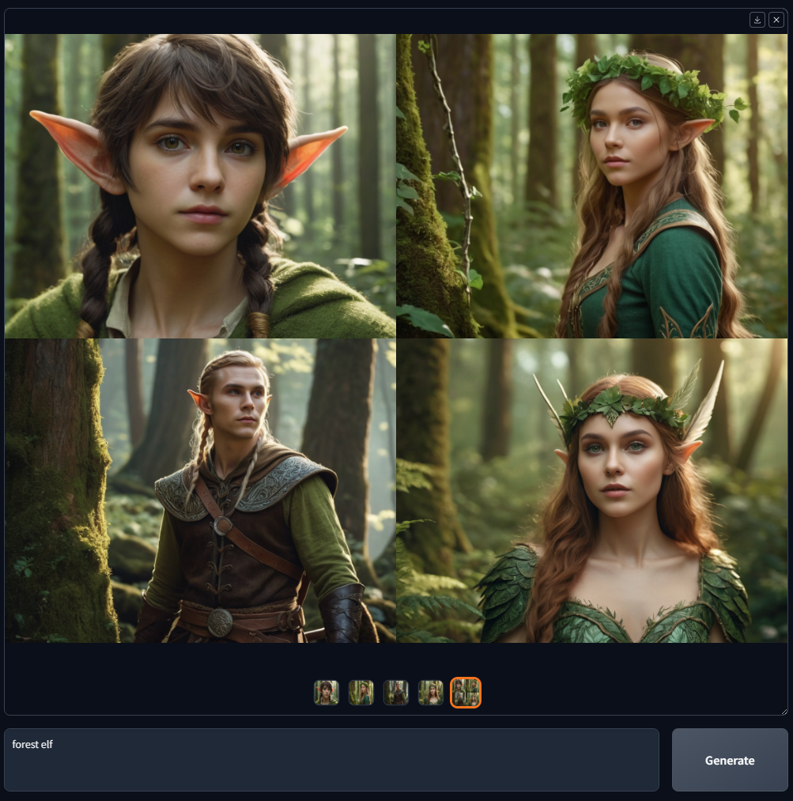
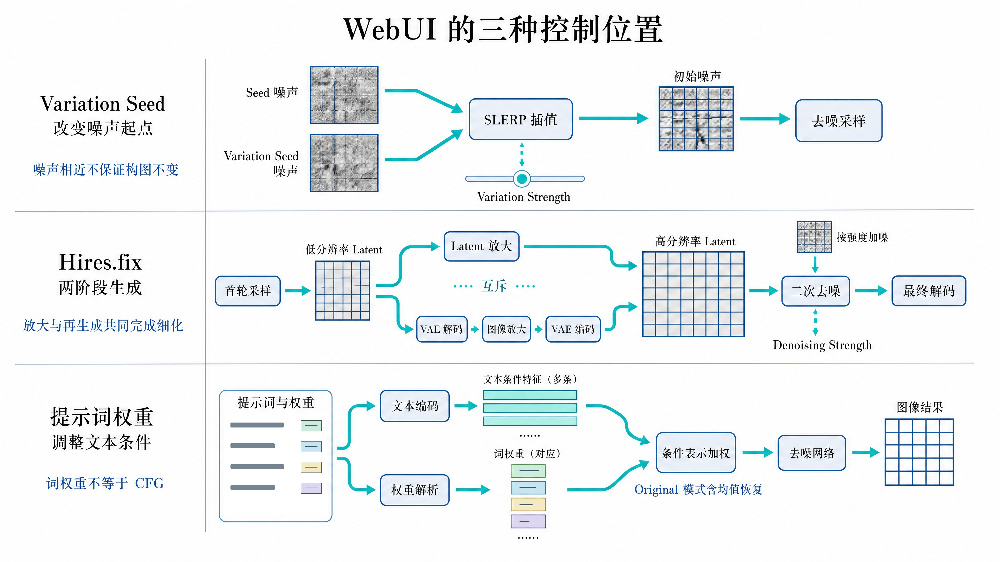
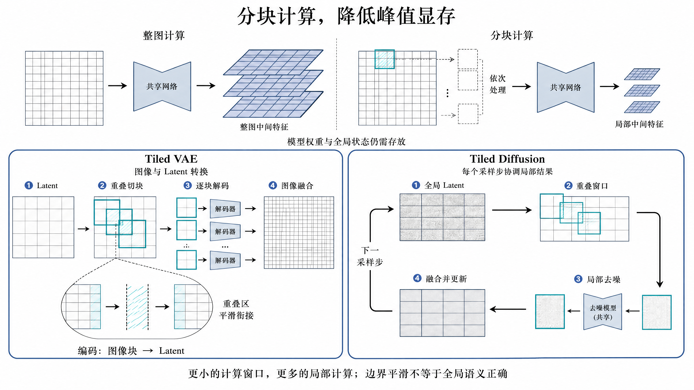
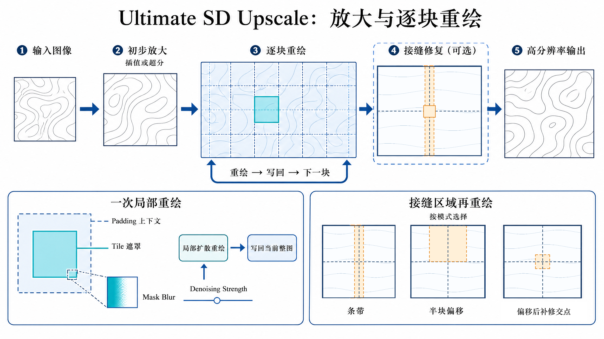
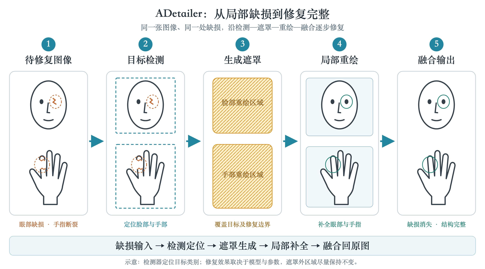

# 目录

[1.主流的AIGC图像创作框架有哪些？应该如何选型？](#q-001)
  - [面试问题：目前主流的AIGC图像创作框架有哪些？](#q-002)
  - [面试问题：在AIGC图像创作框架中，从Prompt到图像的创作过程通常经历哪些环节？](#q-003)

[2.ComfyUI为什么会成为AIGC图像创作领域的最主流框架？](#q-004)
  - [面试问题：介绍一下ComfyUI的节点图和工作流架构原理](#q-005)
  - [面试问题：ComfyUI为什么适合复杂AIGC图像工作流和商业化场景？](#q-006)
  - [面试问题：ComfyUI的动态显存（Dynamic VRAM）机制是什么？（进阶）](#q-006b)

[3.介绍一下Diffusers框架的原理](#q-012)
  - [面试问题：Diffusers框架的核心设计思想是什么？](#q-013)
  - [面试问题：除Pipeline外，Diffusers中还有哪些核心组件？](#q-014)

[4.Stable Diffusion WebUI、SD.Next和Fooocus分别适合什么场景？](#q-008)
  - [面试问题：Stable Diffusion WebUI的核心功能和长期价值是什么？](#q-009)
  - [面试问题：Stable Diffusion WebUI Forge、SD.Next和Fooocus有哪些跨周期价值？](#q-010)
  - [面试问题：Variation Seed、Hires.fix和提示词权重控制如何在WebUI中发挥作用？(进阶)](#q-011)

[5.介绍一下AIGC图像创作框架中常用插件扩展能力的底层原理(进阶)](#q-016)
  - [面试问题：Tiled VAE和Tiled Diffusion为什么能降低大分辨率生成的显存压力？](#q-018)
  - [面试问题：Ultimate SD Upscale的工作原理是什么？](#q-017)
  - [面试问题：ADetailer为什么能自动修复脸部、手部等局部细节？](#q-019)
  - [面试问题：AIGC图像创作中，结构、参考图、风格角色和局部区域分别有哪些经典控制方法与工具？](#q-020)

---

<h1 id="q-001">1.主流的AIGC图像创作框架有哪些？应该如何选型？</h1>

<h2 id="q-002">面试问题：目前主流的AIGC图像创作框架有哪些？</h2>

**难度评分：⭐⭐⭐ (3/5)  |  考察频率：⭐⭐⭐⭐⭐ (5/5)**

**Rocky认为，学习理解不同的AIGC图像创作框架，首先要知道他们的共同点，然后再学习它们分别适合在哪种场景中应用**。不同AIGC图像创作框架的交互方式不同，使用门槛、扩展方式和维护成本也会随之变化。根据不同框架不同的侧重点，当前主流框架可以分成如下表所示的五类：

<div align="center">

| 框架类型 | 代表框架 | 核心价值 | 适合场景 |
|---|---|---|---|
| 可视化工作流框架 | ComfyUI | 用节点图把扩散模型、采样器、VAE、ControlNet、LoRA、后处理等模块连接成可复现工作流 | 杂生成与编辑工作流、影视/电商/设计等商业化场景Pipeline、批量自动化等 |
| 参数面板式创作框架 | Stable Diffusion WebUI（AUTOMATIC1111） | 以Gradio界面承载txt2img、img2img、inpaint、插件接入和作画参数等功能 | 新手入门、快速出图、参数快速实验等 |
| WebUI增强分支 | Stable Diffusion WebUI Forge、SD.Next等 | 在WebUI范式上强化资源管理、推理效率、多模型支持、实验特性等扩展功能 | 低显存、本地部署、多模型实验测试等 |
| 低门槛产品化工具 | Fooocus等 | 尽量隐藏采样器、CFG、ControlNet等复杂参数，让用户像使用产品一样生成图像 | 非技术用户、快速创意验证、轻量设计等 |
| 代码级Python研发库 | Diffusers | 用代码统一管理Pipeline、Scheduler、模型组件、训练脚本和推理优化等模块 | 算法研发、模型评测、自定义推理、API服务、应用后端集成 |

</div>

Rocky认为，不同AIGC图像创作框架各有特点，如下图所示。我们只有逐步提炼出来的每个框架背后的精华**构建技术思想**，才能在实际应用场景中，根据不同的情形选用不同的框架，并基于此进行举一反三的优化构建。

<div align="center">


</div>

**ComfyUI的价值在于把AIGC图像创作流程显式表达出来。** 当生成任务包含参考图控制、局部修改、放大和后处理时，节点图能展示中间结果从哪里来、由哪些条件影响、下一步交给谁处理。流程保存下来以后，我们可以围绕同一份工作流定位问题、替换模块和复用经验。

**Stable Diffusion WebUI的价值在于把常见操作集中到可调试的面板。** 用户可以围绕同一张图调整采样步数、CFG、重绘强度及扩展参数，也可以利用参数记录和对比脚本观察变化。越接近固定输入、固定步骤，面板越直接的创作任务，越适合在Stable Diffusion WebUI上快速构建。

**Diffusers的价值在于把生成能力纳入代码工程。** 其中的Pipeline代码库为常见创作任务提供各个模块的代码组件和接口，方便AI开发者进一步进行研究与开发。

**Fooocus的价值在于用预设来减少用户决策。** 提示词处理、风格配置和默认采样策略上吸收了一部分调参经验，让用户把注意力放到创作意图和结果筛选上。它说明了产品体验可以通过减少必要操作来改善。

总的来说，**AIGC图像生成框架间的竞争，聚焦于哪个框架能承载更复杂的模型生态、更稳定的复杂工作流构建、更低成本的推理部署和更高效率的创作生产线”。**


<h2 id="q-003">面试问题：在AIGC图像创作框架中，从Prompt到图像的创作过程通常经历哪些环节？</h2>

**难度评分：⭐⭐⭐⭐ (4/5)  |  考察频率：⭐⭐⭐⭐⭐ (5/5)**

虽然不同AIGC图像创作框架有不同的特点，但是每个AIGC图像创作框架在进行图像创作过程中，都会经过通用的核心推理链路：

```text
→ 配置Base模型、编码器、VAE、LoRA、ControlNet、GAN等组件
→ 用户输入Prompt/参考图/控制图
→ Prompt解析与增强
→ 文本编码器/VLM条件编码
→ 扩散模型权重与Adapter模型权重加载
→ 初始噪声/Latent初始化
→ ControlNe/LoRA/IP-Adapter等条件注入
→ Scheduler/KSampler等调度器多步去噪
→ VAE Decode解码成像素图
→ GAN超分、局部修复、图像编辑等后处理
```

<div align="center">


</div>

如上图所示，**采样循环是这条链路的计算中心。** 我们可以把这条链路拆成七个关键环节：

<div align="center">

| 环节 | AIGC图像创作框架要完成的工作 |
|---|---|
| **任务配置与组件准备** | 确定文生图、图生图或图像编辑任务，准备配套模型、编码器、VAE和可选适配组件 |
| **输入整理与条件准备** | 处理Prompt、参考图、控制图和mask；完成分词、特征编码及所需控制条件的预处理 |
| **初始状态构造** | 文生图创建随机噪声；典型图生图对原图编码并按设定加噪；图像编辑按实现准备mask及相关图像信息 |
| **条件引导的迭代采样** | 模型读取当前Latent特征、时间步及条件，计算预测；应用适用的guidance，再由采样算法更新状态，直至结束 |
| **解码与图像转换** | 将最终Latent特征交给VAE解码，完成像素范围、格式等转换 |
| **可选增强与再次编辑** | 按需要超分、检测局部缺陷、构造mask、局部修复/编辑和细节增强等；不同流程可能回到Latent特征或再次采样 | 
| **结果检查与复现记录** | 对生成结果进行检查和评估，保存图像、参数、模型信息与工作流 |

</div>

掌握理解上述的AIGC图像创作框架通用链路，最终是为了更有效地构建AIGC图像创作解决方案。再面对不同的实际问题，我们能够快速定位优化模块，进行优化。比如结构控制没有按预期生效，可以检查控制图、适配组件及其生效配置；图生图偏离原图过多，可以检查初始加噪与采样区间；显存不足则需要判断发生在模型计算还是VAE解码阶段。**先定位问题所属环节，再修改对应配置，通常比同时调整多个参数更容易得到可解释、可复用的结果。**


<h1 id="q-004">2.ComfyUI为什么会成为AIGC图像创作领域的最主流框架？</h1>

<h2 id="q-005">面试问题：介绍一下ComfyUI的节点图和工作流架构原理</h2>

**难度评分：⭐⭐⭐ (3/5)  |  考察频率：⭐⭐⭐⭐⭐ (5/5)**

ComfyUI的核心本质是一个**以创作画布为中心的节点图工作流引擎**。它把图像创作过程拆成一系列可连接、可复用、可保存的节点，例如加载模型、编码prompt、采样、解码、加载LoRA、应用ControlNet、超分、图像后处理编辑、保存图像等。

**这里的“创作画布”不是一个简单的UI概念，而是ComfyUI在主流框架中激烈竞争并脱颖而出的底层设计思想**。Stable Diffusion WebUI更像一个参数面板：用户在固定表单里填写prompt、seed、steps、CFG、采样器和插件参数，然后等待生成结果。

ComfyUI则更像一张可以无限展开的视觉工程画布：Base模型、文本条件、图像条件、局部mask、ControlNet、IP-Adapter、LoRA、采样器、VAE、超分、局部修复等模块，都可以被放在同一张画布上，并通过连线显式表达它们之间的因果关系。

**Rocky认为，创作画布的跨周期价值，是把AIGC图像创作从“调参数”升级为“搭系统”**。在早期AIGC图像创作阶段，用户关心的是如何用一个prompt生成一张优质的图像；但到了多模型、多参考图、多ControlNet、多LoRA、多区域编辑的AIGC图像创作生态繁荣阶段，真正重要的已经不是某个单独参数，而是整条创作链路如何被组织、复现、调试和复用，ComfyUI的画布思想正好完美承载了这种复杂性。

下图是ComfyUI的经典工作流示意图：

<div align="center">


</div>

ComfyUI的节点图有四个设计关键点：

1. **节点是功能单元。** 每个节点只做一件相对清晰的事，例如加载模型、编码文本、采样、解码、保存。它让复杂生成流程从“黑盒按钮”变成“可拆解流程”。
2. **连线是数据依赖。** 节点之间传递的不是抽象概念，而是具体数据类型，例如 `MODEL`、`CLIP`、`VAE`、`CONDITIONING`、`LATENT`、`IMAGE`、`MASK`。这使得用户可以明确知道信息如何流动。
3. **画布是创作过程的空间化表达。** 在ComfyUI里，用户可以在画布上组织一个视觉生产系统。哪一个模块是正向prompt，哪一个模块是负向prompt，哪一个模块是参考图条件，哪一个模块是局部mask，哪一步做Latent upscale，哪一步做VAE decode等，都会被空间化地呈现出来。**这让复杂图像创作更加直观与形象**。
4. **工作流是可复现资产。** ComfyUI可以保存/加载JSON工作流，也可以从生成图片中恢复工作流元数据。这个设计很适合工程场景和团队协作。

<div align="center">


</div>

**如上图所示，Rocky认为，ComfyUI值得掌握的设计思想，是把模型能力组织成有明确接口、可组合、可检查的流程。** 也顺应了**AIGC图像创作逐渐向复杂组合工作流发展的趋势**。Stable Diffusion WebUI把常见操作集中在任务面板，Diffusers通过Pipeline与代码组件组织调用，Fooocus通过预设减少配置负担，ComfyUI则把节点之间的数据依赖与信息传递过程直接呈现给用户。

这也是ComfyUI能够在众多AIGC图像创作框架中形成差异化的原因：把AIGC图像创作抽象成一张可编排、可扩展、可复现的视觉工作流画布。**当AIGC图像创作进入复杂工作流时代，创作画布就不再是交互形式，而是生产力基础设施。**


<h2 id="q-006">面试问题：ComfyUI为什么适合复杂AIGC图像工作流和商业化场景？</h2>

**难度评分：⭐⭐⭐⭐ (4/5)  |  考察频率：⭐⭐⭐⭐⭐ (5/5)**

在实际AIGC图像商业化场景中，AIGC算法解决方案往往是高度复杂的，包括复杂前处理、多模型组合、多条件控制、多LoRA/ControlNet/辅助模型依赖、复杂后处理以及多级联推理阶段组合等过程。

ComfyUI之所以适合复杂AIGC图像创作工作流，本质上是因为它解决了AIGC图像商业化场景中的四个痛点：**流程不可见、参数不可复现、局部修改要全量重跑、复杂模型组合难以管理**。我们可以从五个角度理解它的价值：

1. **流程透明可观察。** 参考图预处理、条件注入、扩散生成、局部修改和图像编辑等可以分别呈现，并在合适的位置查看中间结果。如果最终图像出现结构偏差或局部细节问题，团队更容易缩小排查范围。例如，先确认控制图是否正确，再检查控制强度和生成环节，避免同时修改多个参数。
2. **工作流可固化，复现能力强。** 一个复杂工作流可以保存成JSON，也可以保存为元数据。之后面对同类任务，可以更换素材和任务参数，复用主要处理结构。工作流文件应与模型版本、自定义节点版本、输入素材和运行配置一起管理。
3. **有效缓存减少重复计算，局部重算效率高。** 当输入与依赖没有发生相关变化、缓存仍然有效时，一些节点结果可以复用。比如只改prompt，理论上模型加载节点、VAE加载节点、部分预处理节点不需要重新执行。对大模型、多ControlNet、多LoRA场景来说，这种增量执行能显著提升迭代效率。
4. **模块可组合，复杂任务落地能力强。** 多LoRA、多ControlNet、多Adapter、多图参考、区域prompt、mask编辑、超分、图像编辑等复杂模块链路在面板式工具里容易混乱，在节点图里更容易管理。
5. **执行接口便于自动化，可作为后端服务基石。** ComfyUI不仅是GUI，也可以通过API和队列系统接入自动化生产流程。ComfyUI提供任务提交、队列和历史等接口，很多研发团队会基于ComfyUI进行二次开发，并作为视觉工作流后端服务，而不是只本地AIGC图像创作工具。

下图展示了ComfyUI复杂工作流的清晰流程：

<div align="center">


</div>


<h2 id="q-006b">面试问题：ComfyUI的动态显存（Dynamic VRAM）机制是什么？（进阶）</h2>

**难度评分：⭐⭐⭐⭐⭐ (5/5)  |  考察频率：⭐⭐⭐⭐ (4/5)**

一个真实AIGC图像创作工作流可能先运行文本编码器，再执行多轮去噪，最后进行VAE解码和局部修复等。这些模型参与计算的时间不同，扩散模型内部的权重也会按执行顺序被访问。如果让所有权重一直占据显存，会挤压不同阶段的有效计算资源；如果每次都重新在GPU和CPU之间搬运权重，又会增加工作流的低效等待时间。

**ComfyUI的Dynamic VRAM围绕权重工作流进行调度：让当前需要的权重进入物理显存，在空间允许时保留可复用结果，在压力升高时回收可释放的驻留权重。** 它调整的是权重的存储位置与生命周期。实际收益取决于工作流大小、访问顺序、缓存命中以及数据搬运成本。

Dynamic VRAM的核心思想是：**把显存管理从“静态预估占用”改造成“按需物理化、按压力淘汰、按计算路径调度”的动态权重工作流管理。**

可以把它理解成ComfyUI为PyTorch模型权重引入了一层更细粒度的内存调度系统：

```text
模型文件/权重切片
→ mmap或文件切片引用
→ VBAR虚拟显存地址空间
→ 计算真正访问某层权重时触发fault
→ 有显存则物理加载并复用
→ 显存紧张则释放低优先级权重
→ 极端情况下只为当前算子创建临时GPU张量
```

这里最关键的是VBAR。VBAR可以理解为一块为模型权重准备的**GPU虚拟地址空间**。创建VBAR时，并不等于把全部模型权重都真实塞进物理VRAM；它更像先把“这些权重未来可能住在哪里”安排好。只有当某一层真正参与计算，系统才通过类似 `fault` 的机制把对应权重物理化到GPU显存里。

从执行机制看，Dynamic VRAM核心逻辑大致可以分成六步：

1. **模型加载阶段不急于深拷贝全部权重。** ComfyUI对safetensors加载路径做了更贴近动态显存的处理。权重可以先以mmap或文件切片引用的方式存在，框架记录每个tensor对应的文件偏移、大小和几何信息，而不是一上来就把所有权重完整复制成常驻PyTorch张量。
2. **模型准备阶段建立VBAR和动态pin状态。** 在本地ComfyUI代码里，`ModelPatcherDynamic`会为非CPU加载设备维护 `dynamic_vbars` 和 `dynamic_pins`。模型被准备为Dynamic VRAM加载时，权重不再全部强制加载到GPU，而是优先进入“可按需加载”的状态。
3. **算子执行前触发权重物理化。** 进入具体Linear、Conv或Attention相关模块时，ComfyUI会检查模块是否有 `_v` 这类VBAR分配信息。执行前通过 `vbar_fault` 判断这段权重是否已经驻留。如果已经驻留，就直接使用；如果没有驻留，就从文件切片、pinned host buffer或缓存路径把当前算子需要的权重加载到合适的位置。
4. **显存够用时缓存权重，显存紧张时动态释放。** 如果GPU显存足够，当前层权重会被保留在VRAM里，后续重复访问可以更快。如果显存压力上升，ComfyUI可以从VBAR里释放一部分低优先级权重，而不是让整条工作流直接OOM。当前活跃模型、最近访问的VBAR和即将参与计算的权重会拥有更高优先级。
5. **加载失败时走临时张量兜底。** 如果某段权重无法长期驻留在VBAR里，Dynamic VRAM并不必然崩溃。它可以只为当前层创建临时GPU张量，把本次计算需要的权重拷进去，用完后释放或复用。这意味着显存压力从“全模型必须同时住进VRAM”变成“当前计算窗口需要什么就加载什么”。
6. **预取与异步offload降低等待时间。** ComfyUI还引入了动态VBAR预取和异步offload能力，让快NVMe、pinned memory和GPU stream之间的配合更灵活。

下图是ComfyUI动态显存的逻辑示意图：

<div align="center">


</div>

所以，Dynamic VRAM真正改变的不是某个单点参数，而是模型权重的生命周期，与传统显存管理策略相比的优势如下表所示：

<div align="center">

| 对比维度 | 传统显存管理 | Dynamic VRAM |
|---|---|---|
| 权重加载方式 | 尽量提前加载或按估算搬运 | 按计算访问路径动态物理化 |
| 显存判断方式 | 依赖模型大小和经验预估 | 运行时根据真实压力调度 |
| OOM处理 | 预估失败时容易直接崩溃 | 优先释放、降级到临时张量或按需重载 |
| 系统内存占用 | 容易堆积CPU副本或触发分页 | 更强调文件切片、缓存和可释放内存 |
| 复杂工作流适配 | 模型越多越难预估 | 更适合多模型、多LoRA、多阶段工作流 |
| 开发者心智负担 | 需要手动猜低显存策略 | 更接近自动化资源调度 |

</div>


<h1 id="q-012">3.介绍一下Diffusers框架的原理</h1>

<h2 id="q-013">面试问题：Diffusers框架的核心设计思想是什么？</h2>

**难度评分：⭐⭐⭐⭐ (4/5)  |  考察频率：⭐⭐⭐⭐⭐ (5/5)**

Diffusers是Hugging Face生态中用于扩散/生成模型推理、训练和部署的重要Python库。


Diffusers的核心设计是抽象一个 `DiffusionPipeline`。它把图像创作所需的多个组件封装成一个可调用对象，使用者可以先通过Pipeline运行一个完整任务，再按需要替换兼容组件、检查中间过程或修改实现：

```python
from diffusers import DiffusionPipeline
import torch

pipe = DiffusionPipeline.from_pretrained(
    "本地路径/stable-diffusion-xl-base-1.0",
    torch_dtype=torch.float16,
).to("cuda")

image = pipe(
    prompt="cinematic photo of a futuristic city at sunset",
    num_inference_steps=30,
).images[0]
```

Rocky认为，这种设计可以从四个方面理解：

1. **统一不同模型的加载和调用方式。** Stable Diffusion系列、FLUX系列、Z-Image、GLM-Image、video diffusion等模型架构不同，但都可以被封装成pipeline形式。与此同时，一致的接口并不意味着所有模型支持相同参数。切换模型时，仍要核对对应的pipeline类、条件输入与输出格式。
2. **分离组件职责，组件可灵活替换。** Scheduler策略、VAE、U-Net/DiT、Text Encoder、LoRA、ControlNet、Adapter、GAN等都可以组合或替换，方便研究和工程实验。
3. **贴近生产部署。** Diffusers强调代码可读性与可修改性，支持offload、量化、torch.compile、xFormers/SDPA等推理优化策略，也能和Transformers、Accelerate、PEFT等其他主流库生态打通。
4. **兼顾训练和推理。** 它不仅能进行模型推理，还提供训练脚本、LoRA微调、DreamBooth、Textual Inversion、ControlNet训练等工程入口。

下图是Diffusers的核心流程链路：

<div align="center">


</div>


<h2 id="q-014">面试问题：除Pipeline外，Diffusers中还有哪些核心组件？</h2>

**难度评分：⭐⭐⭐⭐ (4/5)  |  考察频率：⭐⭐⭐⭐ (4/5)**

上个问答中，我们已经知道Pipeline负责把Diffusers框架下的生成过程组织起来。以此为基础，我们还需要理解六大类不同的核心模块：输入处理、条件编码、生成预测、采样更新、图像表示转换，以及额外条件和权重适配，各模块具体内容如下表所示：

<div align="center">

| 组件类别 | 典型对象 | 主要输入与输出 |
|---|---|---|
| 输入与输出处理 | Tokenizer、Image Processor | 文本到token ID；图像/掩码到规范张量；输出张量到图像格式 |
| 条件编码 | Text Encoder、Image Encoder | token或参考图到条件特征 |
| 生成主干 | U-Net、Transformer/DiT类模型 | 当前样本、时间步与条件到模型预测 |
| 采样更新 | Scheduler | 模型预测、当前样本和时间信息到下一采样状态 |
| 图像表示转换 | VAE等自编码器 | 图像与潜变量之间的编码/解码 | 
| 条件扩展与权重适配 | LoRA、ControlNet、Adapter等 | 适配参数、结构条件或参考特征影响模型计算 |

</div>

以常见潜空间文生图为例，我们可以把Diffusers框架下一次推理流程概括为：

```text
Pipeline接收prompt和参数
→ 准备初始Latent，并设置采样时间步
→ Tokenizer/Text Encoder得到文本条件
→ 在每个采样步中：
→     当前Latent、时间步与条件 → 生成模型预测
→     当前Latent、模型预测与时间信息 → Scheduler更新状态
→ 迭代结束后，VAE把Latent解码成图像
→ 后处理/输出并返回结果
```

下图也生动展示了整个流程：

<div align="center">


</div>


<h1 id="q-008">4.Stable Diffusion WebUI、SD.Next和Fooocus分别适合什么场景？</h1>

<h2 id="q-009">面试问题：Stable Diffusion WebUI的核心功能和长期价值是什么？</h2>

**难度评分：⭐⭐⭐ (3/5)  |  考察频率：⭐⭐⭐⭐⭐ (5/5)**

Stable Diffusion WebUI是Stable Diffusion生态里非常重要的参数面板式创作框架之一。它基于Gradio实现，把txt2img、img2img、inpainting、outpainting、upscale、prompt权重、X/Y/Z Plot、Textual Inversion、LoRA、ControlNet等多维能力在创作面板上直接展示，具体页面如下图所示：

<div align="center">



</div>

**它曾经是很多人学习应用Stable Diffusion的第一选择，但今天再看SD WebUI，它已经不是“领先的主流AIGC图像创作框架”，而是一个已经完成历史使命、被ComfyUI取代、同时仍然有跨周期价值的AIGC创作框架样本**。

我们需要知道，**WebUI不是因为功能太少而衰落，而是因为它的“参数面板范式”跟不上复杂AIGC工作流的架构升级需求。** 从生态势能看，WebUI的主战场已经被ComfyUI系统性取代。

WebUI的核心功能可以概括为四类，如下表所示：

<div align="center">

| 能力 | 典型功能 |
|---|---|
| 生成与编辑 | txt2img、img2img、局部重绘、扩图等生成功能 | 
| 参数与资源配置 | Checkpoint、VAE、LoRA、Embedding等模型资源配置，以及Prompt、Seed、CFG、Steps、Sampler等参数配置 |
| 分辨率与细节处理 | Hires.fix、Extras超分等 | 
| 对照与复用 | X/Y/Z Plot、PNG Info、生成参数保存和可复用回填 |
</div>

Stable Diffusion WebUI的创作迭代机制如下图所示：

<div align="center">



</div>

同时它的局限也非常明显：

1. **复杂流程被折叠在多个Tab和插件参数里。** 当任务只是“生成一张图像”时，SD WebUI足够高效；但当任务变成角色一致性、局部重绘、多ControlNet、多LoRA组合、分阶段超分、批量生产等高度复杂任务时，复杂流程无法在参数页面上直接体现，隐式状态的流程不容易组合、构建和优化。多个页面和扩展共同影响结果时，执行顺序、条件依赖和隐藏设置不容易一眼看清；扩展之间还可能存在兼容性、参数覆盖和资源竞争问题
2. **参数面板擅长调试，不擅长表达因果链路。** SD WebUI能告诉用户“这里有一个Hires.fix开关、这里有一个ControlNet参数”，但很难像ComfyUI那样把prompt编码、ControlNet注入、Latent upscale、VAE decode、局部修复和保存节点展开成一条清晰的工作流程。
3. **插件生态强，但系统边界容易变脆弱。** WebUI的插件生态曾经极大降低创作门槛，可插件越多，版本兼容、参数冲突、显存占用、批处理稳定性和工作流复现问题就越明显。随着AIGC图像创作大模型不断更新迭代，参数面板式架构很难继续承载越发复杂和商业化的AIGC工作流链路。

因此，WebUI被ComfyUI打败，本质上是**创作范式从参数面板走向创作画布，从手工调参走向工作流编排，从单次出图走向可复现生产链路**趋势变革。ComfyUI赢在它把AIGC图像生成过程显式组织成节点图，让复杂任务可以被保存、复用、分享、调试和工程化。

Rocky认为，**Stable Diffusion WebUI的历史价值，是把扩散模型变成普通创作者可用的参数化AIGC工具；它被ComfyUI取代的原因，是参数面板无法承载复杂工作流的可视化、可复现和生产化需求。工具会过时，但它沉淀下来的参数抽象、插件生态和低入门门槛，仍然值得我们长期学习。**


<h2 id="q-010">面试问题：Stable Diffusion WebUI Forge、SD.Next和Fooocus有哪些跨周期价值？</h2>

**难度评分：⭐⭐⭐ (3/5)  |  考察频率：⭐⭐⭐⭐ (4/5)**

Forge、SD.Next和Fooocus这三种AIGC图像创作框架，本质上是SD WebUI范式衰落之后分化出的三条支线：**Forge保留SD WebUI参数面板，同时对其工程底座进行效率优化；SD.Next在SD WebUI基础上扩展成多模型兼容的创作平台；Fooocus反过来隐藏复杂参数，把SD WebUI能力产品化成低门槛的创作工具。**

Rocky认为，当ComfyUI已经赢得复杂AIGC图像工作流的主战场后，这三个SD WebUI系框架还留下了**资源效率、多领域兼容、体验抽象**这些值得学习的跨周期经验，具体如下表所示：

<div align="center">

| 工具 | 核心定位 | 核心特点 |
|---|---|---|
| Stable Diffusion WebUI Forge | SD WebUI增强框架 | 在SD WebUI之上优化资源管理、推理速度、新模型适配和实验特性 |
| SD.Next | 多领域兼容的SD WebUI | 把WebUI扩展成支持图像、视频、多模态等综合处理流程平台 |
| Fooocus | 低门槛图像生成产品 | 隐藏复杂参数，自动处理采样、提示词增强和质量策略，让用户专注prompt与图像 |

</div>

<div align="center">



</div>

**首先我们看Forge的跨周期价值，它是把“参数面板框架”往“运行性能增强”方向优化。**

原始SD WebUI的短板是资源管理、新模型适配、低显存运行和复杂扩展兼容。Forge的意义是在这个旧范式上强化底层：显存管理、模型加载、offload、量化模型、FLUX等新模型扩展兼容。**Forge这一思路的长期价值，是在保留用户操作习惯的同时更新底层资源调度**。

当然的，Forge也有局限。它依然没有真正跳出参数面板式交互，复杂流程的可视化表达仍然不如ComfyUI。

**接着我们再看SD.Next的跨周期价值，它是把“单一Stable Diffusion模型”往“多模型兼容平台”方向扩展。** 下图是SD.Next界面示意图：

<div align="center">



</div>

SD.Next的重点是把图像、视频、多模态等处理等能力放在一个更综合的WebUI平台里，并强调多模型、多平台、性能、灵活性和用户体验。

**这条路线的长期价值在于“兼容性优化”**。模型生态不会永远停在某一个AIGC大模型系列上，框架层迟早要面对不同模型结构、不同推理后端、不同硬件、不同任务形态之间的路由与切换。**一个AIGC图像创作框架如果只绑定一个大模型系列，很容易随模型迭代而过时。**

**最后我们再看看Fooocus的跨周期价值，它是把“各种参数”往“低参数简化体验”方向推进。**  下图是Fooocus页面示意图：

<div align="center">



</div>

Fooocus最有意思的地方，是它几乎反着SD WebUI的特点进行构建。SD WebUI把尽可能多的参数暴露给用户，Fooocus则尽量减少手动调参，让用户把注意力放在提示词和图像结果上。它借鉴了Midjourney式体验：默认策略替用户处理采样、提示词增强、图像质量和部分编辑流程。

**这条路线的长期价值在于“创作体验简化”**。当底层大模型越来越强，普通用户并不一定需要看到Sampler、Steps、CFG、Denoising Strength、Scheduler、VAE、Clip Skip等所有复杂参数。真正好的产品，会把专家调参经验沉淀为默认策略，把大模型能力包装成稳定体验，**这与后来的主流AIGC创作平台逻辑暗合**。

Rocky认为，这三者体现了AIGC图像创作框架演进的一个规律：**SD WebUI主线虽然输给了ComfyUI，但其分支Forge留下的是运行性能增强经验，SD.Next留下的是多模型生态兼容经验，Fooocus留下的是产品化体验经验。**

总的来说，**如果要理解SD WebUI系工具的历史价值，可以研究Forge、SD.Next和Fooocus如何分别处理资源效率、模型兼容和体验简化。**


<h2 id="q-011">面试问题：Variation Seed、Hires.fix和提示词权重控制如何在WebUI中发挥作用？(进阶)</h2>

**难度评分：⭐⭐⭐⭐ (4/5)  |  考察频率：⭐⭐⭐⭐ (4/5)**

WebUI里的这三个功能控制着生成过程的不同位置：**Variation Seed改变初始噪声，Hires.fix组织不同分辨率下的两次生成，提示词权重调整文本条件表示。** 

### 1、 Variation Seed：在噪声空间探索变体

Seed决定初始噪声，Variation Seed则引入第二个噪声源，ariation Strength则决定它们的插值程度：

$$
N_{\text{final}}=(1-\alpha)N_{\text{original}}+\alpha N_{\text{variation}}
$$

当 $\alpha$ 较小时，图像保留原始构图，只改变局部纹理、光影或细节；当 $\alpha$ 较大时，生成结果会逐渐接近新Seed。总的来说，Variation Seed适合做“保留方向、探索变体”的功能。

### 2、 Hires.fix：解决超高分辨率生成不稳定的问题

早期Stable Diffusion在低分辨率训练较多，直接生成高分辨率容易出现多头、多肢体、结构重复。Hires.fix把一次高分辨率创作拆成两个阶段：

```text
低分辨率先生成稳定构图
→ 使用超分算法或Latent Upscale算法放大中间结果
→ 在较低denoising strength下进行二次img2img细化
```

它的本质是先让模型在熟悉分辨率里确定全局结构，再在高分辨率里补细节。

### 3、 提示词权重：影响文本条件在交叉注意力中的强度 

我们已经知道，Stable Diffusion这类文生图模型是先把提示词编码成文本token embedding，再在去噪过程中通过Cross-Attention注入。可以把它简单理解为：

$$
\text{Attention}(Q,K,V)=\text{softmax}\left(\frac{QK^T}{\sqrt{d}}\right)V
$$

其中 $Q$ 来自当前图像Latent特征，$K$ 和 $V$ 来自文本条件。WebUI里的提示词权重，例如 `(word:1.3)`、`(word)`、`[word]`，本质上是在提高或降低某些文本token对注意力分布的影响，让模型在去噪时更偏向某个主体、风格、材质、构图或局部属性。

基于上面的内容，我们再将权重和对应的Text Embeddings相乘，再乘上一个正则化系数，将对应的Embeddings向量进行缩放（scale），代表着这个提示词的增强和减弱。下面Rocky通过详细的流程注解，方便大家直观的理解WebUI的提示词权重生效逻辑：

```python
# 输入提示词
Prompt = (woman)

# 通过prompt_parser.py脚本解析成Text（文本）和Weight（权重）两个独立的部分
parsed: [['woman', 1.1]]

# 将Text（文本）输入Tokenizer模块转换成tokens
tokenized: [[2308]]

# 将tokens输入Text Encoder模型编码成Text Embeddings
z_original = tensor([[ 0.5410,  1.2411, -0.4761,  ..., -0.3535, -1.1046, -1.7921]])
original_mean = z_original.mean()

# 将Text Embeddings与对应的Weight（权重）相乘
z_new = tensor([[ 0.5951,  1.3652, -0.5237,  ..., -0.3888, -1.2150, -1.9714]])
new_mean = z_new.mean()

# 计算正则化系数
r = (original_mean / new_mean)

# 最终的Text Embeddings
z = z_new * r
z = tensor([[ 0.5943,  1.3634, -0.5230,  ..., -0.3883, -1.2134, -1.9688]])
```

但提示词权重不是“越高越好”。权重过低，模型可能忽略关键词；权重过高，注意力会过度集中，容易出现画面僵硬、局部过饱和、主体变形、风格压倒内容等问题。

总的来说，**Variation Seed修改的是噪声起点，Hires.fix是分辨率生成策略，提示词权重调的是文本条件在注意力机制中的竞争强度，三者生动演绎如下图所示。只有深入理解这三者，才算真正理解SD WebUI背后跨周期的高价值知识。**

<div align="center">



</div>

<h1 id="q-016">5.介绍一下AIGC图像创作框架中常用插件扩展能力的底层原理(进阶)</h1>

<h2 id="q-018">面试问题：Tiled VAE和Tiled Diffusion为什么能降低大分辨率生成的显存压力？</h2>

**难度评分：⭐⭐⭐⭐ (4/5)  |  考察频率：⭐⭐⭐⭐⭐ (5/5)**

Tiled VAE和Tiled Diffusion都利用了一个朴素但长期有效的工程思想：**大分辨率整体推理生成消耗资源较大，就进行分块让网络每次只处理一个窗口或少量窗口，从而减少资源消耗。**

两者的具体区别如下表所示：

<div align="center">

| 方法 | 切分对象 | 主要目标 |
|---|---|---|
| Tiled VAE | VAE Encode/Decode阶段的图像或Latent特征 | 降低大图编码/解码显存消耗 |
| Tiled Diffusion | 扩散采样阶段的Latent特征 | 在低显存下生成/重绘大分辨图像 |

</div>

**我们先看Tiled VAE的核心功能**。编码时，将输入图像切成重叠窗口，分别转换为局部Latent特征；解码时，切分对象则是Latent特征，局部结果经过VAE Decoder转换成图像块，再按位置融合。这样，高分辨率特征的计算就被拆到多次前向推理中完成。一般来说，Tiled VAE分两种模式，分别是VAE tiling按空间切块和VAE slicing沿batch分开处理不同样本。

使用Tiled VAE后，卷积边缘的上下文、跨空间归一化统计，以及模型中的注意力范围，都可能与整图计算不同。我们可以进行重叠融合来缓解边缘痕迹，或者汇总/估计GroupNorm统计来减轻颜色偏移，需要根据实际情况进行选择性处理。

**我们再来看Tiled Diffusion的核心功能**。它在扩散采样阶段进行分块操作，比Tiled VAE更深一层。每个采样步都要从当前全局Latent特征中裁出多个重叠窗口，让同一个去噪模型分别处理，再把局部结果按坐标融合回全局状态，进入下一采样步。每一步的局部计算都从共同状态出发，因此相邻窗口可以在重叠区域形成约束。

我们可以把Tiled Diffusion理解成一种“共享画布上的多路局部去噪”：

1. **先有一个全局Latent特征画布。** 这张画布维护最终要生成的Latent特征。
2. **从全局画布裁出多个重叠窗口。** 每个窗口对应一个局部视野，可以有自己的prompt、mask、区域约束或结构条件，也可以共享同一个全局prompt。
3. **每个窗口调用同一个扩散模型预测噪声。** 模型只处理小分辨率patch，所以显存压力下降。这些patch都来自同一个全局Latent特征。
4. **把局部预测写回全局画布。** 对于重叠区域，不是简单覆盖，而是做加权平均或融合，相当于让多个局部扩散路径对同一片区域“投票”。
5. **重复上述2-4过程直到采样结束。** 因为每一步都在共享画布上融合，tile之间会逐渐形成一致的边界、纹理和语义。

Tiled VAE和Tiled Diffusion具体效果如下图所示：

<div align="center">



</div>

下图是Tiled Diffusion生成高分辨率图像的例子：

<div align="center">


</div>

Rocky认为，Tiled类插件的跨周期价值是它体现了一种长期有效的工程范式：**当大模型能力强于硬件承载能力时，不一定要立刻更换更大的算力资源，也可以把问题拆成局部计算、共享状态和全局融合来进行解决。**


<h2 id="q-017">面试问题：Ultimate SD Upscale的工作原理是什么？</h2>

**难度评分：⭐⭐⭐ (3/5)  |  考察频率：⭐⭐⭐⭐ (4/5)**

Ultimate SD Upscale面向的是已有图像的高分辨率细化任务。它先把图像放大到目标尺寸，再让扩散模型分区域补充细节，并通过遮罩过渡和可选的接缝重绘减轻块间痕迹。**这套流程把整张大图的处理任务拆成多次局部生成，使有限显存也能承担较大画布上的细化工作。**

它的核心流程可以概括为：

```text
输入图像
→ 先用ESRGAN、4x-UltraSharp、R-ESRGAN等超分模型先对图像初步放大
→ 在当前整图上选择一个Tile区域并生成遮罩
→ 每个Tile用img2img低强度重绘补细节
→ 对重叠区域做mask blur、padding和融合
→ 必要时做接缝修复
→ 输出高分辨率图像
```

具体的多阶段工程链路，如下图所示：

<div align="center">



</div>

我们可以看到，Ultimate SD Upscale先把初步尺寸放大问题交给超分模型，再把细节补充问题交给局部扩散重绘，最后用padding、mask blur和seams fix这类融合策略处理Tile边界过渡问题。

Ultimate SD Upscale里有下面几个参数最容易决定成败，如下表所示：

<div align="center">

| 关键参数 | 控制对象 | 调得太低的问题 | 调得太高的问题 |
|---|---|---|---|
| Tile尺寸 | 单次重绘区域大小 | 上下文不足、局部细节碎 | 显存压力上升 |
| Denoising Strength | 每个Tile被重绘的幅度 | 可能保留缺陷 | 人物身份、文字和纹理可能被改写 |
| Padding | 为遮罩区域补充周边裁剪上下文 | 太少不利于边缘判断 | 增大可能增加处理开销，也会改变局部内容的尺度分配 |
| Mask Blur | 控制遮罩边界的软过渡 | 太窄容易显出边界 | 过宽可能使有效修改区域与过渡范围不符合预期 |

</div>

总的来说，**Ultimate SD Upscale不是单纯超分，而是“超分 + 切块 + 低强度重绘 + 接缝融合”的组合工程链路。它用时间换显存，用局部重绘换细节，用融合策略换全局连续性。它的跨周期价值在于提醒我们：AIGC工程里很多看似简单的图像增强，真正落地时都不是单一模型能力，而是将多个模块构建成稳定工作流。**


<h2 id="q-019">面试问题：ADetailer为什么能自动修复脸部、手部等局部细节？</h2>

**难度评分：⭐⭐⭐ (3/5)  |  考察频率：⭐⭐⭐⭐ (4/5)**

ADetailer的本质是一个**自动检测 + 自动遮罩 + 自动局部重绘**插件，**把原本需要人工完成的局部修图流程自动化了。**

Rocky认为，ADetailer最有价值的地方，是它体现了一种AIGC后处理范式：**先用检测模型找到容易出错的小区域，再把这些区域变成mask，最后用inpainting把局部重新生成一遍。** 基础大模型负责生成完整图片，ADetailer则负责进行局部修复与完善。

完整流程通常是：

```text
输入待处理图像
→ 按目标类别检测或分割
→ 按置信度、范围与数量筛选
→ 生成遮罩，对mask做扩张、腐蚀、偏移、合并等预处理
→ 仅遮罩区域模式下：裁剪目标及周边上下文，调整至处理尺寸
→ 使用图像、遮罩和提示词进行局部扩散重绘
→ 映射回原坐标，按软遮罩融合
→ 按配置继续处理其他遮罩或下一组设置
```

如果画成流程图，ADetailer就是一个典型的“检测定位 -> 遮罩生成 -> 局部重绘 -> 融合输出”链路，如下图所示：

<div align="center">



</div>

ADetailer常用YOLOv8、YOLO World、MediaPipe Face等检测模型先定位脸、手、人体等易出错区域，再把检测框转成mask，最后只在局部做inpainting重绘，而不是推翻整张图重新生成。

**同时局部区域获得更多像素预算**。全身人像里脸和手可能只占很小区域，基础大模型在整图生成时没有足够像素预算去精修。ADetailer把脸、手、人体等区域检测出来，再局部放大重绘，相当于给这些细节重新分配一次分辨率和注意力。

ADetailer里有几个参数会直接影响结果，如下表所示：

<div align="center">

| 环节 | 关键参数 | 作用与取舍 |
|---|---|---|
| 目标选择 | 检测模型、支持的类别、置信度阈值 | 决定找什么和保留哪些检测结果 |
| 范围筛选 | 面积比例、Top-k、排序 | 减少背景目标和多余处理；小目标也可能被误排除；所核对比例筛选以bbox面积计算 |
| 修改范围 | 遮罩偏移、膨胀/腐蚀、合并 | 决定哪些像素区域参与修改；合并相距较远的对象会扩大共同裁剪范围 |
| 局部视野 | 仅遮罩区域模式、Padding、处理宽高 | 平衡周边上下文与目标在处理画布中的占比；Padding不等于扩大修改遮罩 |
| 再生成幅度 | Denoising Strength、局部提示词 | 平衡结构保留和局部重建；高强度可能改写身份，提示词冲突可能改变风格 |
| 边缘过渡 | Mask Blur | 缓和回贴边界 |

</div>

但ADetailer也不是万能的。检测失败、mask过小、denoise过高、局部提示词和全图冲突，都会导致修复区域不自然。尤其在人脸一致性、手部结构、文字和复杂姿态上，它更像“自动化补救流程”，不是基础大模型能力上限的根本替代。

总的来说，**ADetailer解决的不是基础大模型的根本能力上限，而是把“检测局部缺陷、生成遮罩、局部重绘、融合输出”自动化。它特别适合脸、手、人体这类小区域细节修复，是AIGC图像工作流里典型的局部后处理增强模块。**


<h2 id="q-020">面试问题：AIGC图像创作中，结构、参考图、风格角色和局部区域分别有哪些经典控制方法与工具？</h2>

**难度评分：⭐⭐⭐⭐ (4/5)  |  考察频率：⭐⭐⭐⭐⭐ (5/5)**

在不同的AIGC图像创作框架中，在面对复杂的AIGC算法解决方案任务时，单靠一个核心大模型可能还不能完成全部的功能。我们还需要借助各种不同功能的Adapter技术工具与插件来实现各种细分领域的定制化功能。比如，**基础大模型负责生成能力，Prompt负责语义方向，Adapter类插件负责把结构条件、参考特征、个性化适配和局部编辑四类常用能力注入生成过程。** Adapter类插件具体分类如下表所示：

<div align="center">

| Adapter控制能力 | 经典插件/模块 | 典型输入信号 | 补齐的核心能力 | 底层作用 |
|---|---|---|---|---|
| 结构控制 | ControlNet、T2I-Adapter等 | 姿态图、边缘图、深度图、线稿、法线、tile图 | 控制构图、姿态、边缘、透视和空间结构 | 在去噪网络中注入额外结构条件，让图像不只听Prompt，还服从几何约束 |
| 通用参考与身份保持 | IP-Adapter、Reference Only、InstantID、PuLID、PhotoMaker等 | 参考图、头像、身份特征、图像embedding | 控制人物身份、参考风格、构图相似性和图像语义迁移 | 把图像特征注入Cross-Attention或相关条件层，让大模型“看图作画” |
| 风格与角色个性化 | LoRA、LyCORIS、Textual Inversion、DreamBooth模型等 | 小规模微调权重、embedding、角色/风格样本 | 学习特定角色、服装、画风、产品概念或品牌视觉 | 用低成本参数增量或embedding改写基础大模型的表达偏好 |
| 局部选择与区域控制 | Segment Anything、ADetailer、Inpaint Anything、Regional Prompter等 | 点击、框选、mask、检测框、区域prompt | 选择局部、隔离对象、区域重绘、多主体分区控制 | 通过分割、检测和区域条件，把全图生成拆成可编辑的局部任务 |

</div>

**Rocky认为，Adapter类插件的核心价值，就是把这些自然语言难以稳定表达的功能要求，转成大模型更容易理解注入的结构图、图像embedding、增量权重、mask或区域条件。** 具体来说：

1. **结构控制解决“画面骨架不听话”的问题。** ControlNet、T2I-Adapter这类工具的价值，是把OpenPose、Canny、Depth、Lineart、Tile等结构图特征注入生成过程。让大模型在去噪时受到额外结构约束。
2. **参考图控制解决“只靠文字描述不够像”的问题。** IP-Adapter、InstantID、PuLID、PhotoMaker等技术工具，本质上是在Prompt之外加入图像条件。它们可以让模型参考人物身份、脸部特征、画面风格、产品外观或构图关系。跨周期看，参考图控制会越来越重要，因为真实创作往往不是从零生成，而是围绕已有角色、品牌、商品、场景做一致性扩展。
3. **风格/角色注入解决“通用大模型缺少特定概念”的问题。** LoRA、LyCORIS、Textual Inversion、DreamBooth等技术代表的是低成本个性化。基础大模型学到的是通用分布，但创作者常常需要某个角色、某类服装、某种品牌视觉、某个画风或某个产品概念。
4. **局部选择与编辑解决“全图生成不可控”的问题。** Segment Anything、ADetailer、Inpaint Anything、Regional Prompter这类工具，把大图拆成可选择、可遮罩、可区域控制的局部任务。SAM负责快速分割，ADetailer负责检测后局部修复，Regional Prompter负责区域语义分配。它们让AIGC图像创作从“一次性抽卡”走向“可选择、可修改、可迭代”的编辑流程。

上述各种Adapter类插件也解释了为什么ComfyUI会比SD WebUI更适合复杂插件编排：ControlNet、IP-Adapter、LoRA、SAM、Inpaint、Upscale这些能力在参数面板里容易变成一堆隐式开关，但在节点图里可以显式呈现为条件路径、图像路径、mask路径和后处理路径。

同时，**Rocky认为插件不是越多越好，这些插件如果使用不当，也会带来风险**。比如结构控制过强会让画面僵硬，参考图控制过强会牺牲创意空间，LoRA叠太多会风格污染或角色冲突，mask边缘处理不好会出现融合痕迹。真正成熟的工作流，不是把所有Adapter都打开，而是在创作目标、模型能力和硬件资源之间做取舍。
