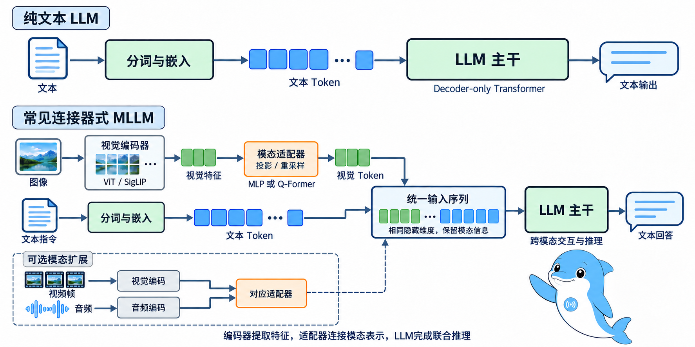
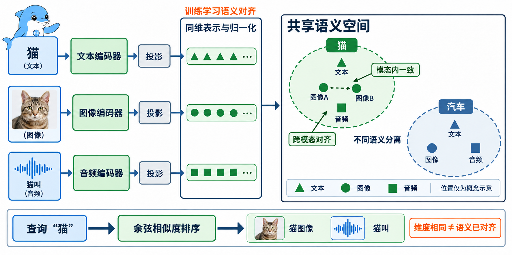
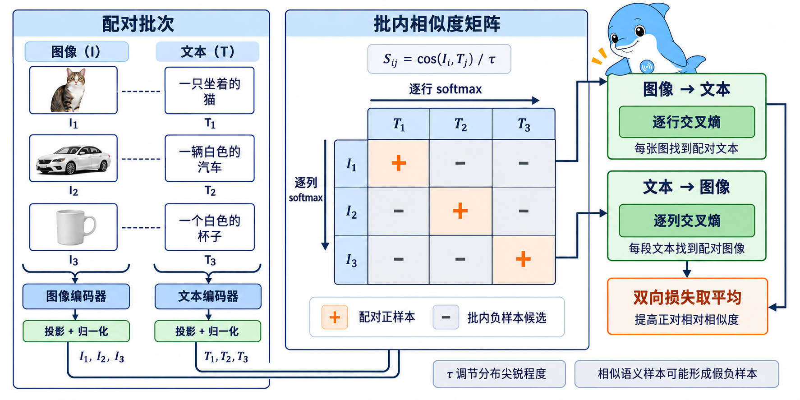
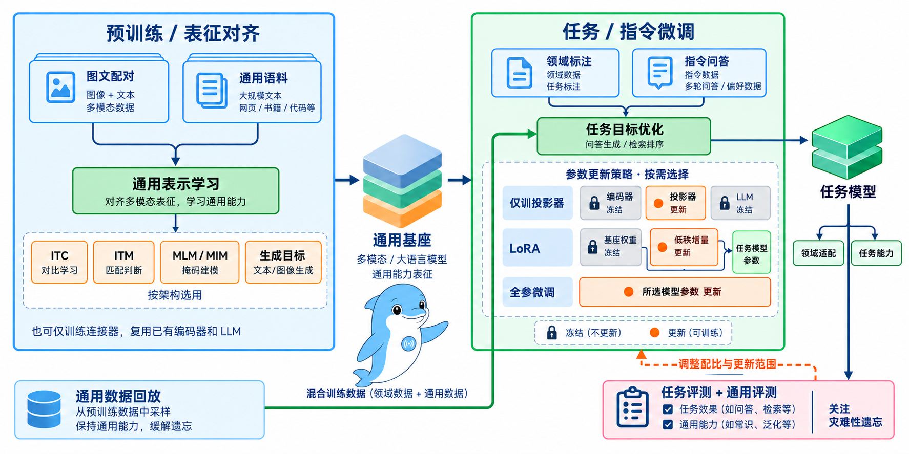
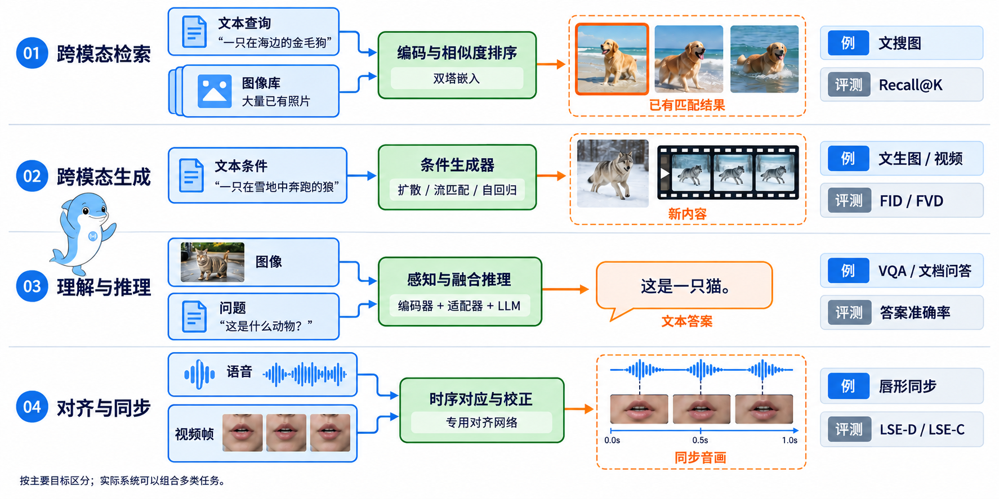

## 5.1 AI 多模态理论基础高频考点

> 本章是多模态部分的开篇，先把后文反复用到的基础概念讲清楚。内容依次包括 MLLM 与 LLM 在架构、数据和能力边界上的差异，多模态词嵌入与统一向量空间，预训练与微调各自的目标、方法和权衡，以及多模态任务按输入输出关系的分类。后续章节讨论编码器、投影器、生成器等核心组件时，会直接用到这些概念。

> **时效说明**：本章事实核对截至 2026 年 10 月。文中模型版本、参数规模和评测分数以所引文献的发布版本为准。闭源产品的服务状态变化较快，本章只引用其官方公开的技术信息，不描述产品当前是否在线。

---

### [5.1.1 多模态与语言大模型的区别](#q511)
- [5.1.1.1 面试问题：多模态大模型与 LLM 在架构上有哪些关键差异？](#q5111)
- [5.1.1.2 面试问题：多模态模型的训练数据与 LLM 有什么本质不同？](#q5112)
- [5.1.1.3 面试问题：多模态模型与 LLM 在应用能力边界上有何差异？](#q5113)

### [5.1.2 多模态词嵌入的定义](#q512)
- [5.1.2.1 面试问题：多模态词嵌入相比传统词嵌入的本质区别是什么？](#q5121)
- [5.1.2.2 面试问题：多模态词嵌入需要满足哪些核心条件？如何形式化描述？](#q5122)

### [5.1.3 多模态中预训练和微调的区别](#q513)
- [5.1.3.1 面试问题：多模态预训练阶段的核心目标与训练任务是什么？](#q5131)
- [5.1.3.2 面试问题：多模态微调阶段的核心目标与常用方法是什么？](#q5132)
- [5.1.3.3 面试问题：预训练与微调在通用性、成本、能力保持上有何关键权衡？](#q5133)

### [5.1.4 多模态解决的代表性任务](#q514)
- [5.1.4.1 面试问题：多模态任务可以如何整体分类？分类依据是什么？](#q5141)
- [5.1.4.2 面试问题：四类代表性任务各自的典型落地场景与技术特征是什么？](#q5142)

### [附录 术语表](#q51g)

### [参考文献](#q51r)

---

### 5.1.1 多模态与语言大模型的区别

#### 5.1.1.1 面试问题：多模态大模型与 LLM 在架构上有哪些关键差异？

**难度评分：⭐⭐ (2/5)  |  考察频率：⭐⭐⭐⭐ (4/5)**

多模态大模型（Multimodal Large Language Model，MLLM）在语言大模型（LLM）的基础上增加了视觉、听觉等感知能力，主流 MLLM 的主干仍然是 LLM。LLM 的输入与输出均为文本，DeepSeek-V4-Pro（2026）属于这一类，整体是一个 Decoder-only Transformer，输入输出都是 token 序列[1]。MLLM 还能接收图像、音频和视频，LLaVA、Qwen-VL 和 BLIP-2 接收图像后，可以针对图像内容生成文本回答[2-4]。两者在架构上的差异集中在三处，整体结构如图 1-1 所示：

1. **输入端增加了模态编码器和投影器。** LLM 只有分词与嵌入层和 Transformer 主干，MLLM 在主干之前增加了两类组件：

    （1）**模态编码器**：把非文本输入编码成特征序列。CLIP 的 ViT-L/14 在 224×224 输入下把一张图像编码成 256 个 1024 维的视觉 token，在 336×336 输入下为 576 个[5,6]；Whisper 编码器把 30 秒的音频窗口编码成 1500 帧语音表示[7]。
    （2）**投影器（Projector）**：把编码器的输出变换到 LLM 的嵌入空间。LLaVA-1.5 用的是两层 GELU-MLP，把 CLIP-ViT-L 的 1024 维输出投到 Vicuna-7B（基于 LLaMA 2）的 4096 维隐藏空间[6]。投影器的分类与结构见第 2 章 [5.2.6.1](2_AI多模态核心组件高频考点.md#q5-2-6-1)。

2. **视觉信息进入 LLM 的方式有两种。** 第一种是把视觉 token 与文本 token 拼接成一条输入序列，由 LLM 原有的自注意力统一处理，LLaVA 和 Qwen-VL 采用这种方式[2,3]。第二种是在冻结的语言模型层之间插入新的交叉注意力层，查询来自文本，键和值来自视觉特征，Flamingo 和 Llama 3 的视觉扩展采用这种方式[8,9]。拼接方式不改动 LLM 的结构，代价是视觉 token 占用上下文长度；交叉注意力方式不占用输入序列，但需要新增并训练额外的层。

3. **视觉 token 需要合适的位置编码。** 拼接进序列的视觉 token 来自二维图像或带时间维的视频，沿用文本的一维位置编号只能体现 token 的先后顺序，不能直接表达空间和时间结构。Qwen2-VL 提出的多模态旋转位置编码（Multimodal RoPE，M-RoPE）把旋转位置编码分解为时间、高度、宽度三个分量，统一描述文本、图像和视频中的位置[10]，细节见第 4 章 [5.4.3.1](4_AI多模态主流模型核心技术高频考点.md#q5-4-3-1)。

输出端两者通常相同。多数 MLLM 只在文本词表上预测下一个 token，生成图像或语音需要另接解码器，或采用把理解与生成放进同一个模型的统一多模态路线（见第 5 章 [5.5.1.2](5_AI多模态原生模型高频考点.md#q5512)）。

训练时，LLaVA 在第一阶段冻结 LLM、只训练投影器，第二阶段解冻 LLM，与投影器一起训练，视觉编码器始终冻结[2]；LLaVA-1.5 沿用这套两阶段流程[6]。多数 MLLM 采用"编码器 → 投影器 → LLM"三段式结构，各项差异的对照如表 1-1 所示。

图 1-1 多模态输入扩展示意图

表 1-1 LLM 与 MLLM 架构对照

| 维度 | LLM | MLLM |
|---|---|---|
| 输入模态 | 仅文本 | 文本 + 图像 + 视频 + 音频 |
| 输出模态 | 文本 | 文本（部分支持图/音/视频生成） |
| 主干结构 | Decoder-only Transformer | 模态编码器 + 投影器 + LLM 主干 |
| 关键新增模块 | 无 | 视觉编码器（CLIP-ViT、SigLIP）+ 音频编码器（Whisper、Mimi）+ 投影器（MLP、Q-Former、Pixel Shuffle） |
| 视觉信息注入方式 | 无 | 拼接进输入序列（LLaVA、Qwen-VL）或插入交叉注意力层（Flamingo） |
| 位置编码 | 一维位置编码 | 一维位置编码，或 M-RoPE 等多维方案 |
| 代表模型 | DeepSeek-V4-Pro | Qwen3-VL-235B-A22B-Thinking、InternVL3.5-241B-A28B、Gemini 系列、LLaVA |

表 1-1 中代表模型的结构与模态信息分别取自各自的技术报告和官方发布[1,2,11-13]。

> **面试速答**：MLLM 以 LLM 为主干，架构差异集中在三处。一是输入端多了模态编码器和投影器，把非文本输入变成 LLM 嵌入空间里的 token；二是视觉信息或拼接进输入序列，或经交叉注意力层注入；三是视觉 token 需要 M-RoPE 这类能表达空间和时间的位置编码。

---

#### 5.1.1.2 面试问题：多模态模型的训练数据与 LLM 有什么本质不同？

**难度评分：⭐⭐⭐ (3/5)  |  考察频率：⭐⭐⭐⭐ (4/5)**

两者最根本的差别在监督信号。LLM 的每个文本 token 既是输入也是预测目标，MLLM 的图像、音频等输入只作为条件，损失只计算在文本 token 上。监督信号的差别又带来数据形态和数据配比两方面的差异，三者依次说明如下：

1. **监督信号不同。** LLM 的预训练目标是下一个 token 预测（next-token prediction），文本本身就是标签。MLLM 只预测文本，Qwen-VL 第一阶段的训练目标是最小化文本 token 的交叉熵[3]，LLaVA 指令微调时只用回答部分的 token 计算损失[2]。图像本身不提供监督信号，模型能从图像中学到什么，取决于配对文本描述了什么，因此配对文本的质量直接影响对齐质量。ShareGPT4V 用 GPT-4V 生成的详细描述替换简短描述来改进模型，出发点就在这里[14]。

2. **数据形态不同。** LLM 预训练用书籍、网页、论文等纯文本语料，规模一般在万亿 token 量级，LLaMA 2 用了 2 万亿 token[15]，常见的数据来源有 Common Crawl、C4、RedPajama 等。MLLM 的数据以跨模态配对为主，常见的有以下四类：

    （1）**图文对**：LAION-5B 约 58 亿组，CC12M 1200 万组，大多是网页图片与其替代文本（alt-text），规模大，噪声也多[16,17]。LAION-COCO 的 6 亿条描述由 BLIP 生成、再经 CLIP 排序挑选，属于合成描述[18]。
    （2）**图文交错数据**：保留网页中图片与正文的原始排列，一个样本里有多张图像和多段文字。MMC4 包含约 1.01 亿篇文档和 5.71 亿张图像[19]，OBELICS 包含 1.41 亿个网页、3.53 亿张图像和 1150 亿个文本 token[20]。
    （3）**视频-字幕对**：WebVid-10M 等[21]。
    （4）**指令微调数据**：LLaVA-Instruct-150K 由纯文本 GPT-4 根据图像的描述和检测框生成[2]，ShareGPT4V、ALLaVA-4V 则由 GPT-4V 直接看图生成[14,22]，这类数据的规模从十几万条到百万条量级不等。

3. **数据配比不同。** 多模态训练一般会按一定比例混入纯文本数据，防止 LLM 基座的语言能力在多模态训练中退化。这个比例没有统一标准，各模型差别很大。MM1 预训练阶段的纯文本占 10%[23]；DeepSeek-VL 的联合预训练中，语言数据与多模态数据之比约为 7:3[24]；Qwen-VL 在多任务预训练阶段放了 780 万条纯文本数据，约占该阶段 7680 万条数据的一成[3]；LLaVA-1.5 在指令微调阶段混入了 4 万条纯文本的 ShareGPT 对话[6]。即便如此，2024 年的一项研究测得 LLaVA-1.5-13B 的 MT-Bench 分数仍从 Vicuna-v1.5-13B 的 6.57 降到了 5.99（该文表 4）[25]。

> **面试速答**：最根本的差别在监督信号，LLM 的每个 token 都是标签，MLLM 的图像只作条件，损失只算在文本 token 上。数据形态上，MLLM 依赖图文对、图文交错、视频字幕和指令数据；数据配比上，还要混入一定比例的纯文本防止语言能力退化，比例因模型而异。

---

#### 5.1.1.3 面试问题：多模态模型与 LLM 在应用能力边界上有何差异？

**难度评分：⭐⭐ (2/5)  |  考察频率：⭐⭐⭐ (3/5)**

LLM 处理输入与输出均为文本的语言任务，MLLM 能处理需要整合多种模态信息的任务。MLLM 的任务覆盖面更广，但在纯文本任务和部分单项视觉任务上，不一定比 LLM 或专用模型强。两者的能力边界按任务类型分别如下：

1. **LLM 做语言任务。** 文本生成、写代码、摘要、翻译、对话都属于这一类，代表模型是 DeepSeek-V4-Pro。这些任务的输入和输出都是文本序列。

2. **MLLM 把能力扩展到了跨模态场景**，落地较多的有以下几类：

    （1）**视觉定位**：根据文字描述在图像中给出目标的边界框，Qwen-VL 通过图像、描述与边界框三元组的训练获得了这一能力[3]。
    （2）**医学影像辅助诊断**：把 CT、MRI 图像和病历文本放在一起生成诊断建议，例如 Med-PaLM M[26]。
    （3）**短视频内容合规审核**：同时理解画面、配文和语音，判断视频是否违规。
    （4）**文档与图表理解**：解析财报表格、流程图、发票等结构复杂的文档，InternVL3.5 和 Qwen3-VL 的技术报告都给出了文档与图表基准的结果[11,12]。

**两个常见误解**

1. **"MLLM 一定比 LLM 强"。** 在纯文本任务上，经过多模态训练的模型可能弱于自己的语言基座。[5.1.1.2](#q5112) 提到的 LLaVA-1.5-13B 是一个例子，它的 MT-Bench 分数低于 Vicuna-v1.5-13B。该研究把这种下降归因于视觉指令微调对语言模型参数的改动，并用多模态偏好对齐加以缓解[25]。这种退化并非必然，它与数据配比和训练流程有关，第 5 章 [5.5.3.2](5_AI多模态原生模型高频考点.md#q5532) 讨论了联合训练如何保持纯文本能力。

2. **"MLLM 能替代所有视觉专家模型"。** 在目标检测、细粒度分类这类单项任务上，通用 MLLM 一般不如专用模型。文档解析领域的专用方案本身已经转向小参数的视觉语言模型：PaddleOCR-VL 的核心模型约 0.9B 参数，报告在页面级文档解析和元素级识别上取得最好结果[27]；MinerU2.5 为 1.2B 参数，报告在多个文档解析基准上超过通用模型和领域专用模型[28]。通用 MLLM 的长处在综合推理，任务需要同时看懂图像、理解问题、再结合常识作答时，专用模型难以替代它。

> **面试速答**：LLM 处理输入与输出均为文本的语言任务，MLLM 能做视觉定位、医学影像辅助诊断、文档理解等需要整合多种模态的任务。MLLM 在纯文本任务上可能弱于自己的语言基座，在检测和细粒度分类上一般不如专用模型。它的长处在综合推理。

---

### 5.1.2 多模态词嵌入的定义

#### 5.1.2.1 面试问题：多模态词嵌入相比传统词嵌入的本质区别是什么？

**难度评分：⭐⭐⭐ (3/5)  |  考察频率：⭐⭐⭐⭐ (4/5)**

传统词嵌入只在文本这一种模态内表示语义，多模态词嵌入把文本、图像、音频等不同模态映射到同一个向量空间，使不同模态的内容可以直接计算相似度。

传统词嵌入有两类。Word2Vec（2013）、GloVe 给每个词分配一个固定向量，常见维度为 300[29,30]；BERT 输出的是上下文相关的向量，同一个词在不同句子里向量不同，BERT-base 的维度为 768[31]。两类词嵌入都满足语义相近的词向量接近，例如"猫"与"猫咪"的向量接近，与"汽车"的向量相距较远。传统词嵌入与多模态词嵌入的本质区别体现在两点：

1. **传统词嵌入只在单一模态内部有效。** 文本、图像、音频的嵌入分别位于各自的向量空间，相互之间无法直接比较，也就无法计算文本"猫"与一张猫的照片的相似度。

2. **多模态词嵌入（也称跨模态嵌入）把文本、图像、音频等不同类型的信息映射到同一个向量空间。** 和传统词嵌入相比，它在两个方向上做了扩展：

    （1）**输入的模态变多**：除了文本，图像、音频等模态也能转换为同一空间里的向量。
    （2）**"语义相近"的范围扩大**：语义相近则向量接近，这条原则不变，"语义相近"从同义词扩展到了不同模态里的同一个概念。一段猫叫的音频、一张猫的照片和文本"猫"，三者的向量应聚在同一区域，并远离与"汽车"相关的向量，如图 1-2 所示。

代表工作是 CLIP。在它之前，DeViSE（2013）、VSE++ 等已经做过图文联合嵌入，但训练数据规模小，泛化能力有限[32,33]。CLIP 在 4 亿图文对上训练，在大规模数据上验证了统一向量空间的可行性，并用它做零样本图像分类[5]。分类时不需要任何标注数据做微调，只需计算图像向量与一组候选文本向量的相似度。ImageBind 进一步把音频、深度、热成像和惯性测量数据接入同一个空间，而且只需要各模态与图像的配对数据，不需要所有模态两两配对[34]。

**两种含义的区分。** 在多模态大模型中，"嵌入"还有第二种含义。CLIP 式的联合嵌入为每张图像输出一个全局向量，目的是与文本向量直接比较，主要服务于检索和零样本分类。MLLM 中的视觉 token 则是投影器输出的一串向量，位于 LLM 的输入嵌入空间，与文本 token 一起组成语言模型的输入序列。LLaVA 把第一阶段描述为让视觉特征与 LLM 的词嵌入对齐[2]，但它的训练目标只要求语言模型能据此生成正确的文本，并不要求视觉 token 接近某个具体词的向量。投影器如何完成这一变换，见第 2 章 [5.2.5.1](2_AI多模态核心组件高频考点.md#q5-2-5-1)。

图 1-2 跨模态嵌入空间示意图

> **面试速答**：传统词嵌入只在单一模态内有效，多模态词嵌入把文本、图像、音频映射到同一个向量空间，文本"猫"和猫的照片因此可以直接比较。CLIP 在 4 亿图文对上验证了这种统一空间。MLLM 里的视觉 token 是另一种含义，它们位于 LLM 输入嵌入空间，只要求能被语言模型解读。

---

#### 5.1.2.2 面试问题：多模态词嵌入需要满足哪些核心条件？如何形式化描述？

**难度评分：⭐⭐⭐⭐ (4/5)  |  考察频率：⭐⭐⭐⭐ (4/5)**

统一向量空间要同时满足两个条件：

1. **模态内一致性**：同一模态中语义相近的内容，向量也要接近，例如两张从不同角度拍摄的猫的照片。这一条与传统词嵌入的要求相同。

2. **跨模态对齐性**：不同模态中语义一致的内容，向量也要接近，例如文本"猫"、猫的照片和猫叫的音频要聚在一起，并远离与"汽车"相关的向量。传统词嵌入没有这项要求，它是多模态词嵌入特有的。

形式化地写，文本编码器 $`f_t(\cdot)`$ 和图像编码器 $`f_v(\cdot)`$ 分别把文本 $`t`$ 和图像 $`v`$ 映射到同一个 $`d`$ 维空间，输出向量经 L2 归一化后用余弦相似度 $`\text{sim}(\cdot,\cdot)`$ 比较[5]。对匹配的图文对 $`\langle t, v \rangle`$ 和不匹配的 $`\langle t, v' \rangle`$，要求满足：

$$\text{sim}(f_t(t), f_v(v)) > \text{sim}(f_t(t), f_v(v'))$$

对比学习损失直接优化这一不等式，拉近匹配对，推远不匹配对。CLIP 在一个批次内让 $`N`$ 个图文对互为负样本，计算 $`N\times N`$ 的相似度矩阵，再用交叉熵拟合对角线上的匹配对[5]，过程如图 1-3 所示。这一目标称为跨模态对比学习（Image-Text Contrastive，ITC），对称 InfoNCE 损失写作：

$$\mathcal{L}_{\text{ITC}} = -\frac{1}{2N}\sum_{i=1}^{N}\left[\log\frac{e^{\text{sim}(t_i,v_i)/\tau}}{\sum_{j=1}^{N}e^{\text{sim}(t_i,v_j)/\tau}}+\log\frac{e^{\text{sim}(t_i,v_i)/\tau}}{\sum_{j=1}^{N}e^{\text{sim}(t_j,v_i)/\tau}}\right]$$

$`\tau`$ 是温度系数，CLIP 把它设成可学习参数，初始值相当于 0.07；$`N`$ 是一个批次里的样本数，CLIP 取 32768[5]。方括号里的两项对应两个检索方向，第一项固定文本 $`t_i`$、在批内所有图像里找匹配，第二项固定图像 $`v_i`$、在批内所有文本里找匹配。两个方向都计入损失，文搜图和图搜文才能同时对齐。

图 1-3 对比学习示意图

**对齐与均匀性。** Wang 和 Isola 证明，对比损失在负样本数量足够大时渐近地优化两个性质：一是对齐（alignment），即正样本对的嵌入相互接近；二是均匀性（uniformity），即全部嵌入在单位超球面上尽量均匀分布[35]。对齐对应上式中拉近匹配对的部分，均匀性对应推远不匹配对的部分，由 InfoNCE 分母中的负样本提供。

**缺少某一项时的后果。** 只有模态内一致性、没有跨模态对齐时，例如把 Word2Vec 与单独训练的 ResNet 组合，两个空间无法比较，跨模态检索无从实现。只有对齐、没有均匀性约束时，把所有输入映射到同一个点就能让正样本对完全重合，嵌入空间随之塌缩，相似度失去区分能力，对比损失依靠负样本避免这种塌缩[35]。CLIP 只优化跨模态的对称对比损失，模态内一致性没有单独的训练目标，是在大规模对比训练中间接形成的[5]；后续研究还发现，CLIP 的图像嵌入和文本嵌入在共享空间里分处两个区域，即模态鸿沟（modality gap）[36]。

很多下游任务建立在多模态词嵌入之上。跨模态检索直接比较嵌入向量的相似度，多模态理解在对齐后的嵌入上做语义交互，跨模态生成同样依赖它，Stable Diffusion 用文本编码器的嵌入作为生成条件[37]。

> **面试速答**：统一向量空间要同时满足模态内一致性和跨模态对齐性。形式化地说，匹配图文对的余弦相似度应高于不匹配对，CLIP 用对称 InfoNCE 损失实现这一点。按 Wang 和 Isola 的分析，对比损失同时优化对齐和均匀性，负样本防止嵌入塌缩；缺少跨模态对齐则无法做跨模态检索。

---

### 5.1.3 多模态中预训练和微调的区别

#### 5.1.3.1 面试问题：多模态预训练阶段的核心目标与训练任务是什么？

**难度评分：⭐⭐⭐⭐ (4/5)  |  考察频率：⭐⭐⭐⭐⭐ (5/5)**

多模态大模型预训练的目标是建立跨模态对齐，让语言模型能以视觉输入为条件生成正确的文本。以 Flamingo（2022）和 LLaVA（2023）为代表的多模态大模型，在图像描述、图文交错等数据上做下一个 token 预测，损失只计在文本 token 上[2,8]。对比学习、图文匹配和掩码建模这些早期图文预训练的代理任务，如今主要用于视觉编码器自身的预训练。

多模态大模型的预训练通常分为两个阶段，各阶段训练的模块和使用的数据不同：

1. **对齐预训练。** 冻结语言模型，用图像描述数据训练连接视觉与语言的模块，使视觉特征能被语言模型解读。LLaVA 的第一阶段冻结视觉编码器和 LLM，只训练投影器，论文称之为特征对齐预训练[2]；Qwen-VL 的第一阶段同样冻结 LLM，但同时训练视觉编码器和投影器[3]。

2. **大规模多模态预训练。** 解冻语言模型，在更大、更多样的数据上联合训练。Qwen-VL 的第二阶段把输入分辨率从 224×224 提高到 448×448，解冻全部参数，训练数据覆盖图像描述、视觉问答、视觉定位、文字识别和纯文本[3]。MM1 的预训练混合了图像描述、图文交错和纯文本数据，作者报告，取得最好的少样本结果离不开这种混合[23]。Flamingo 在图文交错数据上训练，使模型能接收任意交错的图文序列并具备少样本上下文学习能力[8]，MMC4 和 OBELICS 是公开的大规模交错语料[19,20]。

两个阶段的训练目标相同，都是以视觉输入为条件的自回归语言建模，损失写作：

$$\mathcal{L}_{\text{AR}} = -\sum_{i\in\mathcal{T}}\log p_\theta\left(x_i \mid \mathbf{H}_v,\, x_{<i}\right)$$

其中 $`\mathbf{H}_v`$ 是投影器输出的视觉 token 序列，$`x_i`$ 是文本序列的第 $`i`$ 个 token，$`x_{<i}`$ 是它之前的文本，$`\mathcal{T}`$ 是参与计算损失的文本位置集合，$`p_\theta`$ 是模型给出的条件概率。视觉 token 不在 $`\mathcal{T}`$ 中，不产生损失；在指令数据上，$`\mathcal{T}`$ 只包含回答部分，LLaVA 的式 (3) 就是这种写法[2]。这一损失只约束语言模型能否根据视觉输入生成正确的文本，跨模态对齐是在优化它的过程中间接建立的。

**视觉编码器预训练中的三类代理任务**

多模态大模型使用的视觉编码器多数先经过图文对比预训练，例如 LLaVA-1.5 采用的 CLIP-ViT-L/14[5,6]。早期图文预训练常用三类代理任务，代表模型有 CLIP、BLIP 和 BEiT-3，三类任务分别是：

1. **跨模态对比学习（ITC）**：即 [5.1.2.2](#q5122) 中的对称 InfoNCE 损失，拉近匹配的图文对、推远不匹配的图文对，代表模型有 CLIP、ALIGN[5,38]。

2. **图文匹配（ITM，Image-Text Matching）**：把图文对送入融合编码器，判断两者是否匹配，是一个二分类任务。ALBEF、BLIP 在 ITC 之外加入 ITM，用来学习更细粒度的跨模态交互，ITM 的负样本取批内 ITC 相似度高、实际不匹配的难负样本[39,40]。

3. **掩码建模（MLM / MIM）**：随机遮住文本中的部分 token 或图像中的部分 patch，让模型预测被遮住的内容，以此学习模态内的语义表示。BEiT-3、FLAVA 等模型用了这类任务[41,42]。

**预训练的成本与参与者。** 预训练需要更新编码器、投影器和语言模型的全部或大部分参数，训练周期通常为数周到数月（经验量级）。完整从零训练并公开技术报告的多模态基座，集中在具备大规模算力的团队。

**常见追问。**

1. 为什么损失只算在文本 token 上，不让模型预测视觉 token？视觉 token 是投影器输出的连续向量，不在 LLM 的词表中，无法用词表上的交叉熵监督。要让模型生成图像内容，需要离散的视觉分词器或扩散解码头，这属于统一理解与生成的路线，见第 5 章 [5.5.2.1](5_AI多模态原生模型高频考点.md#q5521)。

2. 视觉编码器已经做过对比预训练，为什么多模态预训练还要训练它？Qwen-VL 在第一阶段就训练视觉编码器，第二阶段把输入分辨率提到 448×448 并解冻全部参数[3]。本书认为，对比目标只约束全局表示，文字识别、视觉定位等细粒度能力需要编码器在生成式目标下继续适配。

3. 图文交错数据相比图文对多带来了什么？交错数据让模型学会处理多图、图文穿插的输入，Flamingo 由此获得少样本上下文学习能力[8]；OBELICS 的作者也指出，在交错文档上训练的模型在多项多模态基准上优于只用图文对训练的模型[20]。

> **面试速答**：预训练的目标是跨模态对齐。主流做法是先冻结语言模型训练投影器，再解冻全部参数，在图像描述、图文交错、文字识别与定位和纯文本数据上做 next-token prediction，损失只算在文本 token 上。对比学习、图文匹配和掩码建模主要用于视觉编码器自身的预训练。

---

#### 5.1.3.2 面试问题：多模态微调阶段的核心目标与常用方法是什么？

**难度评分：⭐⭐⭐ (3/5)  |  考察频率：⭐⭐⭐⭐⭐ (5/5)**

微调把通用基座适配到具体任务或领域，并让模型的回答符合指令格式和人类偏好。领域适配的例子有用医学影像与报告的配对数据适配医疗场景，用电商平台自有的商品图文对适配商品识别。多模态大模型的微调通常包括监督指令微调、偏好对齐和强化学习，参数更新方式则按算力和领域差异，在参数高效微调、仅训投影器和全参数微调之间选择。

按训练目标，多模态大模型的微调分为三类：

1. **监督指令微调（Supervised Fine-Tuning，SFT）**：把视觉问答、图像描述、文档问答、视觉定位等任务统一写成"指令-回答"格式，优化回答部分的 next-token 损失，即 [5.1.3.1](#q5131) 损失中 $`\mathcal{T}`$ 只包含回答 token 的情形。代表数据集有 VQAv2、GQA、COCO Captions、DocVQA、ChartQA，LLaVA-1.5 的指令微调使用了约 66.5 万条这类混合数据[6]。

2. **偏好对齐**：用同一输入下较好与较差的成对回答训练模型，不单独训练奖励模型、直接优化偏好的方法以 DPO 为代表[43]。多模态场景常用偏好对齐降低幻觉，即模型输出与图像内容不符的描述。RLHF-V 收集人工对幻觉片段的逐段修正，用稠密 DPO 训练，仅用 1400 条标注数据就把基座模型的幻觉率降低了 34.8%[44]。

3. **强化学习**：以可验证的答案或奖励模型给出的分数作为奖励优化模型，主要用于提升推理能力。GRPO 用同一问题多次采样的组内奖励估计基线，省去了单独的价值模型[45]；InternVL3.5 在指令微调之后采用先离线、后在线的级联强化学习[12]。第 4 章 [5.4.11.1](4_AI多模态主流模型核心技术高频考点.md#q5-4-11-1) 和 [5.4.12.1](4_AI多模态主流模型核心技术高频考点.md#q5-4-12-1) 分别讨论 SFT 与 DPO 的组合以及级联强化学习。

跨模态检索模型（CLIP 类双塔）的微调目标与此不同，仍优化对比损失或排序损失（triplet loss），常见于电商搜索。

参数更新方式主要有三类，计算开销依次增大：

1. **参数高效微调（PEFT）**：LoRA、Adapter、Prefix-Tuning 等方法只更新不到 1% 的参数[46]，其中 LoRA 使用最广。2023~2024 年又出现了几种改进：DoRA 把权重分解为幅值和方向分别更新，进一步缩小和全参数微调的差距[47]；LoftQ 把低比特量化和 LoRA 放在一起初始化[48]；PiSSA 用主奇异值和主奇异向量初始化低秩矩阵，收敛更快[49]。

2. **冻结基座，仅训投影器**：LLM 基座和视觉编码器都冻结，只训练投影器，参数量在百万到千万量级。以 LLaVA-1.5-7B 的两层 MLP 为例，两个权重矩阵分别为 1024×4096 和 4096×4096，合计约 2100 万参数[6]。LLaVA-1.0 的第一阶段采用这种训练方式，论文称之为特征对齐预训练[2]，第 3 章 [5.3.11.1](3_AI多模态基石模型核心技术高频考点.md#q5-3-11-1) 按同一口径把它归入对齐阶段。这种做法适用于算力受限或只需小幅领域迁移的场景。

3. **全参数微调**：医疗、金融等与预训练数据分布差异大的场景，会对 LLM 基座做全参数更新，同时混入通用数据缓解灾难性遗忘（见 [5.1.3.3](#q5133)）。

微调的训练周期通常为数小时到数天，单卡或单机 8 卡 A100/H100 即可完成（经验量级）；作为参照，LLaVA-1.5-13B 的完整训练在单台 8 卡 A100 上约一天完成[6]。较低的训练成本使开源社区能够基于 LLaVA、Qwen-VL 构建大量领域变体。

**常见追问。**

1. SFT 之后为什么还要做偏好对齐？SFT 让模型模仿参考回答，并不直接惩罚与图像不符的描述。偏好对齐用成对回答显式区分好坏，RLHF-V 用 1400 条修正反馈把幻觉率降低了 34.8%[44]。

2. LoRA 能避免灾难性遗忘吗？只能减轻。Biderman 等人在代码和数学领域的语言模型实验中发现，LoRA 对目标领域以外能力的保持优于全参数微调，但在目标领域上的提升明显小于全参数微调[50]。

3. 指令微调时要不要解冻视觉编码器？LLaVA 在两个阶段都冻结视觉编码器[2]，Qwen-VL 在指令微调阶段同样冻结视觉编码器[3]。本书认为，只有目标图像的分布与预训练数据差异很大时（如医学影像），才值得解冻编码器或对它做 LoRA 微调。

> **面试速答**：微调把通用基座适配到具体任务，并让回答符合指令和人类偏好，通常包括监督指令微调、偏好对齐和强化学习。参数更新方式按算力和领域差异选择，LoRA 等参数高效微调最常用，也可只训投影器，分布差异大的场景才做全参数微调并混入通用数据。

---

#### 5.1.3.3 面试问题：预训练与微调在通用性、成本、能力保持上有何关键权衡？

**难度评分：⭐⭐⭐⭐ (4/5)  |  考察频率：⭐⭐⭐⭐ (4/5)**

预训练与微调的权衡体现在通用性、成本和能力保持三个方面：

1. **通用性与专用性。** 预训练出来的模型通用能力强，LLaVA-1.5、Qwen-VL、InternVL 等基座在 MMBench、MME、ScienceQA 这些通用榜单上表现比较均衡，但直接用于医疗影像、工业质检这类垂直领域，往往达不到上线部署的要求。微调后的模型在目标任务上会明显变好，通用能力则可能下降。

2. **成本。** 预训练需要千卡级 GPU 集群训练数周到数月，微调通常在单机上训练数小时到数天（均为经验量级）；作为参照，LLaVA-1.5-13B 的完整训练在单台 8 卡 A100 上约一天完成[6]。成本差异决定了产业分工，基座模型由少数具备大规模算力的团队训练，下游应用团队以微调为主。

3. **能力保持。** 微调阶段需要重点防范灾难性遗忘（catastrophic forgetting），即模型在专用任务上训练之后，通用任务的表现明显下降。例如在医疗影像上做全参数微调之后，模型描述自然图像的能力可能随之退化。

**缓解灾难性遗忘的常见做法**

1. **混入通用数据**：在微调数据里掺入一定比例的通用指令数据（如 LLaVA-Instruct[2]），保持模型的基础能力，比例按任务和遗忘程度经验调节。

2. **用 LoRA 保留基座权重**：LoRA 只训练低秩增量，基座的原始权重保持不变[46]。语言模型上的对比实验显示，LoRA 对目标领域以外能力的保持优于全参数微调，代价是目标领域上的提升较小[50]。

3. **选择性冻结**：冻结视觉编码器，语言模型只微调投影器和最后若干层，其余层保持预训练权重，尽量多保留预训练学到的知识。

**选择策略。** 如表 1-2 所示，下游任务与预训练数据分布接近时（如通用视觉问答、图像描述），优先用 LoRA 加少量领域数据；分布差异大的医疗、工业场景需要全参数微调，并且必须混入通用数据；只做轻量的领域迁移时，只训投影器即可。

表 1-2 预训练与微调对照

| 维度 | 预训练 | 微调 |
|---|---|---|
| 核心目标 | 跨模态对齐 + 通用语义建模 | 适配特定下游任务/领域 |
| 数据规模 | 数十亿~百亿级配对数据（LAION-5B、DataComp-1B） | 数千~百万条任务数据（VQAv2、DocVQA、领域私有数据） |
| 数据来源 | 互联网弱标注爬取 + 合成 caption（蒸馏） | 人工标注 + 蒸馏 + 领域专家标注 |
| 训练参数量 | 编码器 + 投影器 + LLM 基座全量或大规模更新 | PEFT < 1%（LoRA/DoRA）/ 仅投影器（百万到千万级）/ 全参微调 |
| 训练周期 | 数周~数月 | 数小时~数天 |
| 算力需求 | 千卡 A100/H100/H200 集群 | 单卡或 8 卡 A100/H100 |
| 主要风险 | 数据配比失衡导致能力失衡、训练崩溃 | 灾难性遗忘 |
| 产业角色 | 头部团队（OpenAI、Google、Anthropic、阿里、上海 AI Lab、智谱） | 应用厂商、开源社区、垂直行业团队 |

表 1-2 中数据规模的例子取自 LAION-5B 与 DataComp 的论文[16,51]；训练周期和算力需求是经验量级，不对应某个具体模型。

多模态大模型先预训练、再微调的整体流程如图 1-4 所示。

图 1-4 预训练与微调流程示意图

> **面试速答**：预训练换来通用性，微调换来目标任务上的效果，代价是通用能力可能下降。预训练需要千卡集群训练数周以上，微调通常单机数小时到数天，因此基座由少数团队训练，应用团队以微调为主。缓解灾难性遗忘常用混入通用数据、LoRA 和选择性冻结。

---

### 5.1.4 多模态解决的代表性任务

#### 5.1.4.1 面试问题：多模态任务可以如何整体分类？分类依据是什么？

**难度评分：⭐⭐ (2/5)  |  考察频率：⭐⭐⭐ (3/5)**

本书按输入输出模态之间的关系给多模态任务分类，即输入是什么模态、输出是什么模态、两者之间是检索、生成、理解还是对齐。按这个标准可以分成四类，各类的流程如图 1-5 所示，分别是：

1. **跨模态检索（Cross-modal Retrieval）**：输入一种模态，在另一种模态的已有数据中找出匹配的结果，典型如文搜图、图搜文。

2. **跨模态生成（Cross-modal Generation）**：以文本等模态为条件，生成图像、视频、音频等非文本模态的新内容，典型如文生图、文生视频、语音合成（TTS）。

3. **多模态理解与推理（Multimodal Understanding & Reasoning）**：接收图像、音频、视频等非文本模态（常附带文本指令），输出文本形式的理解或推理结果，典型如视觉问答（VQA）、图像描述、文档问答和语音识别（ASR）。

4. **跨模态对齐与同步（Cross-modal Alignment & Synchronization）**：在时间或空间上建立不同模态元素之间的对应关系，典型如唇形同步、视觉定位和语音-文本强制对齐。

**分类依据。** 按输入输出关系分类，有两个工程上的原因：

1. **技术路线差异大**：检索任务依靠对比学习得到的嵌入空间（CLIP 系）[5]；生成任务依靠扩散模型、流匹配（Flow Matching）或自回归解码器（Stable Diffusion、Wan 系）[37,52]；理解推理任务依靠"编码器 + 投影器 + LLM"三段式 MLLM（LLaVA 系）[2]；对齐同步任务依靠专门的对齐网络（Wav2Lip 等）[53]。类别确定后，技术选型的范围也随之确定。

2. **评测基准不同**：检索看 R@1、R@5，生成看 FID、CLIP-Score 和 MOS，理解推理看 VQA 准确率、MMBench 和语音识别的 WER，对齐看唇形同步的 LSE-D 或视觉定位的 IoU。类别分清后，评测方案也随之确定。四类任务的技术路线与评测指标对照如表 1-3 所示。

**与学术分类的对应。** Baltrušaitis 等人的综述把多模态机器学习的技术挑战归纳为表示、翻译、对齐、融合和协同学习五类[54]。本书的四类任务与其大致对应，跨模态检索依赖协调表示，跨模态生成对应翻译，多模态理解与推理对应融合，跨模态对齐与同步对应对齐。

**分类的边界。** 实际系统常常同时覆盖多类任务，统一多模态模型把理解与生成放进同一个网络（见 [5.1.4.2](#q5142)），数字人系统同时包含语音合成和唇形同步。按图文、视频、音频这样的模态组合分类也可行，但同一类中会混入技术路线完全不同的任务，边界不如按输入输出关系清楚。

图 1-5 多模态任务分类示意图

表 1-3 四类多模态任务对照

| 任务类型 | 输入→输出关系 | 主流技术路线 | 评测指标 | 代表落地场景 |
|---|---|---|---|---|
| 跨模态检索 | 一种模态 → 另一种模态中已有的匹配结果 | 双塔编码器 + 对比学习 | R@1 / R@5 / R@10 | 拍照搜商品、图片搜索、安防视频检索 |
| 跨模态生成 | 文本等条件 → 图像、视频、音频等新内容 | 扩散 / 流匹配 / 自回归 / 声码器 | FID / FVD / CLIP-Score / MOS | 文生图、文生视频、语音合成、数字人 |
| 多模态理解与推理 | 非文本模态（可附文本指令）→ 文本 | 三段式 MLLM（编码器 + 投影器 + LLM） | VQA 准确率 / MMBench / MMMU / DocVQA / WER | VQA、图像描述、语音识别、文档理解、GUI Agent |
| 跨模态对齐与同步 | 两种模态 → 元素间的时间或空间对应 | 专用对齐网络；图像视觉定位也由 MLLM 完成 | LSE-D / IoU | 音画同步、视觉定位、字幕时间轴对齐 |

> **面试速答**：按输入输出模态之间的关系分成四类，即跨模态检索、跨模态生成、多模态理解与推理、跨模态对齐与同步。这样分是因为四类的技术路线和评测基准各不相同，类别确定后，技术选型和评测方案也随之确定。按模态组合来分，同一类里会混着技术路线完全不同的任务。

---

#### 5.1.4.2 面试问题：四类代表性任务各自的典型落地场景与技术特征是什么？

**难度评分：⭐⭐⭐ (3/5)  |  考察频率：⭐⭐⭐⭐ (4/5)**

四类代表性任务各自的落地场景与技术特征如下：

1. **跨模态检索。** 最常见的是图文检索。电商的"拍照搜商品"是以图搜商品，淘宝图搜、京东拍照购都属于这一类；搜索引擎的图片搜索是以文搜图。视频检索的典型场景在安防，输入一段文字描述，在监控视频中定位目标片段。检索系统依赖统一嵌入空间，常用 CLIP 及其改进版本，如面向中文的 Chinese-CLIP[55] 和在更大规模上训练的 EVA-CLIP[56]。推理时只需计算向量相似度，候选库的向量可以离线算好，延迟低，便于大规模部署。检索是产业里落地较早的多模态任务。

2. **跨模态生成。** 这是 AIGC 领域研究最集中的方向之一，主要任务和代表作如下：

    （1）**文本生成图像**：根据一段文字描述生成对应的图片，风格、构图和画面内容都由文字控制。代表作 FLUX.2（2025）[57]。
    （2）**文本生成视频**：根据文字描述生成一段画面连贯的视频，新一代模型还能同步生成对白和音效。代表作 Veo 3.1（2025）[58]。
    （3）**语音合成（TTS）**：把文字转换成自然的语音，给几秒参考音频还能模仿指定的音色。代表作 CosyVoice，它先用语言模型由文本生成语音 token，再用条件流匹配模型把 token 还原为语音[59]。
    （4）**语音驱动数字人**：输入一张人像照片和一段语音，生成这个人开口说话的视频，口型和表情跟随语音变化。代表作 EchoMimic[60]。

    图像和视频生成以扩散模型和流匹配为主。这类任务的训练成本高于检索类任务，评测也更多依赖分布距离指标（如 FID）和人工主观打分（如 MOS）。

3. **多模态理解与推理。** 典型任务是视觉问答（VQA），输入一张图和一个相关问题，比如"图中的猫戴了帽子吗？"，模型给出答案。主要任务和落地场景有以下几类：

    （1）**图像描述**：用文字说明图中有什么、正在发生什么。代表作 Qwen3-VL[11]。
    （2）**语音识别（ASR）**：把一段语音转写成文字。代表作 Whisper[7]。
    （3）**短视频内容合规审核**：综合画面、配文、语音判断内容是否违规。
    （4）**医疗辅助诊断**：结合 CT 影像和病历文本做辅助诊断，例如 Med-PaLM M、RadFM[26,61]。
    （5）**文档理解**：解析财报、发票、合同等结构复杂的文档，InternVL3.5、Qwen3-VL 的技术报告都给出了 DocVQA、ChartQA 等文档与图表基准的结果[11,12]。
    （6）**GUI Agent**：看懂界面后操控浏览器和桌面应用，Qwen3-VL 和 InternVL3.5 的技术报告都报告了这种能力[11,12]。

    视觉理解与推理的主流结构是三段式 MLLM（编码器 + 投影器 + LLM），开源的 LLaVA、Qwen-VL、InternVL 系列[2,3,62]和闭源的 Gemini 系列[13]主攻的都是这类任务。2024 年起，这个方向开始向统一多模态模型（Unified Multimodal Model，UMM）发展，把理解和生成放进同一个模型，早期代表有 Chameleon（2024）[63]，后续有 Janus-Pro（2025）和 InternVL-U（2026）[64,65]。

4. **跨模态对齐与同步。** 代表任务有以下三类：

    （1）**音画对齐（唇形同步）**：让视频里人物的唇形和语音对上，代表有 Wav2Lip、SadTalker[53,66]，常用于视频配音、数字人直播和外语配音自动化。
    （2）**视觉定位**：把文本描述对应到图像中的区域或视频中的时间片段。图像上的指代表达定位以 RefCOCO 系列为常用基准[67]，视频上的时刻定位根据文字描述找出视频中对应的时间片段[68]。
    （3）**语音-文本强制对齐**：给出转写文本中每个词在音频里的起止时间，用于生成字幕时间轴。WhisperX 在 Whisper 转写结果上用音素模型做强制对齐，得到词级时间戳[69]。

    这类任务常常是其他多模态任务的中间环节，视频生成里的音画同步就是一例。唇形同步和强制对齐一般用专用模型，因为专用模型对时序的控制更精确；图像上的视觉定位已经由 Qwen-VL 等多模态大模型直接支持[3]。图像风格迁移（如 Gatys 等在 2015 年提出的神经风格迁移[70]）的输入和输出都是图像，属于单模态内的转换，不归入这一类；用文字描述目标风格来生成图像的任务，归入跨模态生成。

> **面试速答**：检索用于拍照搜商品和安防视频检索，依靠 CLIP 类统一嵌入空间，延迟低、易部署。生成覆盖文生图、文生视频、语音合成和数字人，以扩散和流匹配为主。理解推理覆盖 VQA、图像描述、语音识别和文档理解，基于三段式 MLLM。对齐同步包括唇形同步、视觉定位和强制对齐。

---

### 附录 术语表

**缩写**

1. **ViT**：Vision Transformer，把图像切成固定大小的 patch，每个 patch 线性投影成一个 token，再送进 Transformer 编码。CLIP-ViT-L 指 CLIP 里的 ViT-Large 视觉编码器。（[5.1.1.1](#q5111)）

2. **MLP / GELU**：MLP 是 Multi-Layer Perceptron，多层感知机；GELU 是 Gaussian Error Linear Unit，一种平滑的激活函数。LLaVA-1.5 的投影器是两层线性层中间夹一个 GELU。（[5.1.1.1](#q5111)）

3. **RoPE**：Rotary Position Embedding，旋转位置编码。把位置信息编码为对查询向量和键向量的旋转，使注意力分数只依赖 token 之间的相对位置。（[5.1.1.1](#q5111)）

4. **SigLIP**：Sigmoid Loss for Language Image Pre-training，Google 提出的 CLIP 改进版，把批内 softmax 对比损失换成逐对的 sigmoid 二分类损失，常用作视觉编码器。（[5.1.1.1](#q5111)）

5. **Q-Former**：Querying Transformer，BLIP-2 提出的投影器，用一组可学习的查询向量通过交叉注意力从视觉特征里提取固定数量的 token。（[5.1.1.1](#q5111)）

6. **C4**：Colossal Clean Crawled Corpus，从 Common Crawl 网页数据清洗出的英文语料，常用于 LLM 预训练。（[5.1.1.2](#q5112)）

7. **LAION / CC12M**：LAION 是德国非营利组织 Large-scale Artificial Intelligence Open Network，发布了 LAION-5B 等开放图文数据集；CC12M 是 Conceptual 12M，Google 发布的图文对数据集。（[5.1.1.2](#q5112)）

8. **MT-Bench**：Multi-Turn Benchmark，多轮对话评测集，用 GPT-4 当裁判给回答打 1 到 10 分，常用来看模型的对话和指令遵循能力。（[5.1.1.2](#q5112)）

9. **CT / MRI**：CT 是 Computed Tomography，计算机断层扫描；MRI 是 Magnetic Resonance Imaging，磁共振成像。两者都是常见的医学影像。（[5.1.1.3](#q5113)）

10. **OCR**：Optical Character Recognition，光学字符识别，把图片里的文字识别成文本。（[5.1.1.3](#q5113)）

11. **BERT**：Bidirectional Encoder Representations from Transformers，Google 在 2018 年提出的双向 Transformer 编码器。（[5.1.2.1](#q5121)）

12. **GloVe**：Global Vectors for Word Representation，斯坦福在 2014 年提出，基于全局词共现统计训练词向量。（[5.1.2.1](#q5121)）

13. **DeViSE / VSE++**：DeViSE 是 Deep Visual-Semantic Embedding，把图像特征映射到词向量空间做零样本识别；VSE++ 是视觉语义嵌入（Visual-Semantic Embedding）的改进版，在三元组损失里重点使用最难的负样本。（[5.1.2.1](#q5121)）

14. **ResNet**：Residual Network，残差网络，用跨层残差连接训练很深的卷积网络，是常见的图像骨干网络。（[5.1.2.2](#q5122)）

15. **InfoNCE**：Information Noise-Contrastive Estimation，信息噪声对比估计。把一个正样本与若干负样本放在一起做 softmax 分类的对比损失，CLIP 使用它的对称形式。（[5.1.2.2](#q5122)）

16. **SD**：Stable Diffusion，在压缩后的潜空间里做扩散的文生图模型。（[5.1.2.2](#q5122)）

17. **MLM / MIM**：Masked Language Modeling 与 Masked Image Modeling，掩码语言建模与掩码图像建模。（[5.1.3.1](#q5131)）

18. **DPO**：Direct Preference Optimization，直接偏好优化。不训练单独的奖励模型，直接用成对偏好数据优化策略模型。（[5.1.3.2](#q5132)）

19. **GRPO**：Group Relative Policy Optimization，组相对策略优化，DeepSeekMath 提出的 PPO 变体。（[5.1.3.2](#q5132)）

20. **PEFT / LoRA**：PEFT 是 Parameter-Efficient Fine-Tuning，参数高效微调；LoRA 是 Low-Rank Adaptation，低秩适配，冻结原权重，只训练低秩增量矩阵。（[5.1.3.2](#q5132)）

21. **TTS / ASR**：TTS 是 Text-to-Speech，语音合成；ASR 是 Automatic Speech Recognition，自动语音识别。（[5.1.4.1](#q5141)）

22. **R@K**：Recall@K，检索时正确结果出现在前 K 个返回结果里的查询比例，常用 R@1、R@5。（[5.1.4.1](#q5141)）

23. **FID / FVD**：FID 是 Fréchet Inception Distance，用 Inception 网络提取特征，比较生成图像和真实图像的分布距离，越低越好；FVD 是 Fréchet Video Distance，用于视频。（[5.1.4.1](#q5141)）

24. **CLIP-Score**：用 CLIP 计算生成图像和文本描述的相似度，衡量图文是否一致。（[5.1.4.1](#q5141)）

25. **MOS**：Mean Opinion Score，平均意见分，由人工给语音质量打 1 到 5 分。（[5.1.4.1](#q5141)）

26. **WER**：Word Error Rate，词错误率，转写结果相对参考文本的替换、删除和插入错误数占参考词数的比例，越低越好。（[5.1.4.1](#q5141)）

27. **LSE-D**：Lip Sync Error Distance，唇形同步误差距离，用 SyncNet 计算唇部画面和语音特征的距离，越低说明口型越准。（[5.1.4.1](#q5141)）

28. **IoU**：Intersection over Union，交并比，预测区域与真实区域的交集面积除以并集面积。（[5.1.4.1](#q5141)）

29. **MMMU**：Massive Multi-discipline Multimodal Understanding，考大学水平多学科图文题的评测基准。（[5.1.4.1](#q5141)）

30. **AIGC**：AI-Generated Content，人工智能生成内容。（[5.1.4.2](#q5142)）

**重要概念**

1. **模态（Modality）**：信息的表现形式，如文本、图像、音频、视频。多模态指同时处理两种及以上的模态。（[5.1.1.1](#q5111)）

2. **Token**：模型处理的基本单元。文本 token 一般是子词，视觉 token 对应图像里一个 patch 或一块区域编码后的向量。（[5.1.1.1](#q5111)）

3. **Decoder-only Transformer**：只用 Transformer 解码器堆叠的结构，靠因果注意力按顺序预测下一个 token，是当前 LLM 的主流结构。（[5.1.1.1](#q5111)）

4. **交叉注意力（Cross-Attention）**：查询来自一个序列、键和值来自另一个序列的注意力，用来让一个模态的表示读取另一个模态的信息。（[5.1.1.1](#q5111)）

5. **指令微调（Instruction Tuning）**：用"指令加回答"格式的数据训练，让模型学会按用户要求作答。（[5.1.1.2](#q5112)）

6. **温度系数（$`\tau`$）**：对比损失里缩放相似度的参数，越小，相似度分布越尖锐。（[5.1.2.2](#q5122)）

7. **Patch**：图像切成的固定大小小块，ViT 里每个 patch 对应一个 token。（[5.1.3.1](#q5131)）

8. **弱标注**：来源粗糙、没有经过逐条人工校对的标注，如网页爬取的图片和替代文本。（[5.1.3.3](#q5133)）

9. **扩散模型**：训练时逐步给数据加噪，再让网络学会一步步去噪，推理时从纯噪声出发生成样本，是图像和视频生成的主流方法。（[5.1.4.1](#q5141)）

10. **流匹配（Flow Matching）**：学习一个把噪声分布变换到数据分布的速度场，推理时沿这条路径积分得到样本。（[5.1.4.1](#q5141)）

11. **自回归解码器**：按顺序一个接一个生成 token 的解码方式，LLM 就用它生成文本。（[5.1.4.1](#q5141)）

12. **双塔编码器**：图像和文本各用一个独立编码器，分别算出向量后再比相似度。CLIP 是这种结构，检索时可以提前算好候选库的向量。（[5.1.4.1](#q5141)）

13. **声码器（Vocoder）**：把梅尔频谱等声学特征还原成音频波形的模型，如 HiFi-GAN。（[5.1.4.1](#q5141)）

---

### 参考文献

[1] DeepSeek-AI. DeepSeek-V4: towards highly efficient million-token context intelligence[J/OL]. arXiv preprint arXiv:2606.19348, 2026. https://arxiv.org/abs/2606.19348

[2] LIU H, LI C, WU Q, et al. Visual instruction tuning[C]//Advances in Neural Information Processing Systems. 2023. arXiv:2304.08485. https://arxiv.org/abs/2304.08485

[3] BAI J, BAI S, YANG S, et al. Qwen-VL: a versatile vision-language model for understanding, localization, text reading, and beyond[J/OL]. arXiv preprint arXiv:2308.12966, 2023. https://arxiv.org/abs/2308.12966

[4] LI J, LI D, SAVARESE S, et al. BLIP-2: bootstrapping language-image pre-training with frozen image encoders and large language models[C]//International Conference on Machine Learning. 2023. arXiv:2301.12597. https://arxiv.org/abs/2301.12597

[5] RADFORD A, KIM J W, HALLACY C, et al. Learning transferable visual models from natural language supervision[C]//International Conference on Machine Learning. 2021. arXiv:2103.00020. https://arxiv.org/abs/2103.00020

[6] LIU H, LI C, LI Y, et al. Improved baselines with visual instruction tuning[C]//IEEE/CVF Conference on Computer Vision and Pattern Recognition. 2024. arXiv:2310.03744. https://arxiv.org/abs/2310.03744

[7] RADFORD A, KIM J W, XU T, et al. Robust speech recognition via large-scale weak supervision[C]//International Conference on Machine Learning. 2023. arXiv:2212.04356. https://arxiv.org/abs/2212.04356

[8] ALAYRAC J B, DONAHUE J, LUC P, et al. Flamingo: a visual language model for few-shot learning[C]//Advances in Neural Information Processing Systems. 2022. arXiv:2204.14198. https://arxiv.org/abs/2204.14198

[9] GRATTAFIORI A, DUBEY A, JAUHRI A, et al. The Llama 3 herd of models[J/OL]. arXiv preprint arXiv:2407.21783, 2024. https://arxiv.org/abs/2407.21783

[10] WANG P, BAI S, TAN S, et al. Qwen2-VL: enhancing vision-language model's perception of the world at any resolution[J/OL]. arXiv preprint arXiv:2409.12191, 2024. https://arxiv.org/abs/2409.12191

[11] BAI S, CAI Y, CHEN R, et al. Qwen3-VL technical report[J/OL]. arXiv preprint arXiv:2511.21631, 2025. https://arxiv.org/abs/2511.21631

[12] WANG W, GAO Z, GU L, et al. InternVL3.5: advancing open-source multimodal models in versatility, reasoning, and efficiency[J/OL]. arXiv preprint arXiv:2508.18265, 2025. https://arxiv.org/abs/2508.18265

[13] Google. Gemini 3.5: frontier intelligence with action[EB/OL]. (2026-05-19)[2026-10-11]. https://blog.google/innovation-and-ai/models-and-research/gemini-models/gemini-3-5/

[14] CHEN L, LI J, DONG X, et al. ShareGPT4V: improving large multi-modal models with better captions[C]//European Conference on Computer Vision. 2024. arXiv:2311.12793. https://arxiv.org/abs/2311.12793

[15] TOUVRON H, MARTIN L, STONE K, et al. Llama 2: open foundation and fine-tuned chat models[J/OL]. arXiv preprint arXiv:2307.09288, 2023. https://arxiv.org/abs/2307.09288

[16] SCHUHMANN C, BEAUMONT R, VENCU R, et al. LAION-5B: an open large-scale dataset for training next generation image-text models[C]//Advances in Neural Information Processing Systems Datasets and Benchmarks Track. 2022. arXiv:2210.08402. https://arxiv.org/abs/2210.08402

[17] CHANGPINYO S, SHARMA P, DING N, et al. Conceptual 12M: pushing web-scale image-text pre-training to recognize long-tail visual concepts[C]//IEEE/CVF Conference on Computer Vision and Pattern Recognition. 2021. arXiv:2102.08981. https://arxiv.org/abs/2102.08981

[18] SCHUHMANN C, KÖPF A, VENCU R, et al. LAION COCO: 600M synthetic captions from Laion2B-en[EB/OL]. (2022-09-15)[2026-10-11]. https://laion.ai/blog/laion-coco/

[19] ZHU W, HESSEL J, AWADALLA A, et al. Multimodal C4: an open, billion-scale corpus of images interleaved with text[C]//Advances in Neural Information Processing Systems Datasets and Benchmarks Track. 2023. arXiv:2304.06939. https://arxiv.org/abs/2304.06939

[20] LAURENÇON H, SAULNIER L, TRONCHON L, et al. OBELICS: an open web-scale filtered dataset of interleaved image-text documents[J/OL]. arXiv preprint arXiv:2306.16527, 2023. https://arxiv.org/abs/2306.16527

[21] BAIN M, NAGRANI A, VAROL G, et al. Frozen in time: a joint video and image encoder for end-to-end retrieval[C]//IEEE/CVF International Conference on Computer Vision. 2021. arXiv:2104.00650. https://arxiv.org/abs/2104.00650

[22] CHEN G H, CHEN S, ZHANG R, et al. ALLaVA: harnessing GPT4V-Synthesized data for lite vision-language models[J/OL]. arXiv preprint arXiv:2402.11684, 2024. https://arxiv.org/abs/2402.11684

[23] MCKINZIE B, GAN Z, FAUCONNIER J P, et al. MM1: methods, analysis & insights from multimodal LLM pre-training[C]//European Conference on Computer Vision. 2024. arXiv:2403.09611. https://arxiv.org/abs/2403.09611

[24] LU H, LIU W, ZHANG B, et al. DeepSeek-VL: towards real-world vision-language understanding[J/OL]. arXiv preprint arXiv:2403.05525, 2024. https://arxiv.org/abs/2403.05525

[25] LI S, LIN R, PEI S. Multi-modal preference alignment remedies degradation of visual instruction tuning on language models[C]//Annual Meeting of the Association for Computational Linguistics. 2024. arXiv:2402.10884. https://arxiv.org/abs/2402.10884

[26] TU T, AZIZI S, DRIESS D, et al. Towards generalist biomedical AI[J/OL]. arXiv preprint arXiv:2307.14334, 2023. https://arxiv.org/abs/2307.14334

[27] CUI C, SUN T, LIANG S, et al. PaddleOCR-VL: boosting multilingual document parsing via a 0.9B ultra-compact vision-language model[J/OL]. arXiv preprint arXiv:2510.14528, 2025. https://arxiv.org/abs/2510.14528

[28] NIU J, LIU Z, GU Z, et al. MinerU2.5: a decoupled vision-language model for efficient high-resolution document parsing[J/OL]. arXiv preprint arXiv:2509.22186, 2025. https://arxiv.org/abs/2509.22186

[29] MIKOLOV T, CHEN K, CORRADO G, et al. Efficient estimation of word representations in vector space[J/OL]. arXiv preprint arXiv:1301.3781, 2013. https://arxiv.org/abs/1301.3781

[30] PENNINGTON J, SOCHER R, MANNING C D. GloVe: global vectors for word representation[C]//Conference on Empirical Methods in Natural Language Processing. 2014: 1532-1543. https://aclanthology.org/D14-1162/

[31] DEVLIN J, CHANG M W, LEE K, et al. BERT: pre-training of deep bidirectional transformers for language understanding[C]//Conference of the North American Chapter of the Association for Computational Linguistics. 2019. arXiv:1810.04805. https://arxiv.org/abs/1810.04805

[32] FROME A, CORRADO G S, SHLENS J, et al. DeViSE: a deep visual-semantic embedding model[C]//Advances in Neural Information Processing Systems. 2013. https://papers.nips.cc/paper_files/paper/2013/hash/7cce53cf90577442771720a370c3c723-Abstract.html

[33] FAGHRI F, FLEET D J, KIROS J R, et al. VSE++: improving visual-semantic embeddings with hard negatives[J/OL]. arXiv preprint arXiv:1707.05612, 2017. https://arxiv.org/abs/1707.05612

[34] GIRDHAR R, EL-NOUBY A, LIU Z, et al. ImageBind: one embedding space to bind them all[C]//IEEE/CVF Conference on Computer Vision and Pattern Recognition. 2023. arXiv:2305.05665. https://arxiv.org/abs/2305.05665

[35] WANG T, ISOLA P. Understanding contrastive representation learning through alignment and uniformity on the hypersphere[C]//International Conference on Machine Learning. 2020. arXiv:2005.10242. https://arxiv.org/abs/2005.10242

[36] LIANG W, ZHANG Y, KWON Y, et al. Mind the gap: understanding the modality gap in multi-modal contrastive representation learning[C]//Advances in Neural Information Processing Systems. 2022. arXiv:2203.02053. https://arxiv.org/abs/2203.02053

[37] ROMBACH R, BLATTMANN A, LORENZ D, et al. High-Resolution image synthesis with latent diffusion models[C]//IEEE/CVF Conference on Computer Vision and Pattern Recognition. 2022. arXiv:2112.10752. https://arxiv.org/abs/2112.10752

[38] JIA C, YANG Y, XIA Y, et al. Scaling up visual and vision-language representation learning with noisy text supervision[C]//International Conference on Machine Learning. 2021. arXiv:2102.05918. https://arxiv.org/abs/2102.05918

[39] LI J, SELVARAJU R R, GOTMARE A D, et al. Align before fuse: vision and language representation learning with momentum distillation[C]//Advances in Neural Information Processing Systems. 2021. arXiv:2107.07651. https://arxiv.org/abs/2107.07651

[40] LI J, LI D, XIONG C, et al. BLIP: bootstrapping language-image pre-training for unified vision-language understanding and generation[C]//International Conference on Machine Learning. 2022. arXiv:2201.12086. https://arxiv.org/abs/2201.12086

[41] WANG W, BAO H, DONG L, et al. Image as a foreign language: BEiT pretraining for all vision and vision-language tasks[J/OL]. arXiv preprint arXiv:2208.10442, 2022. https://arxiv.org/abs/2208.10442

[42] SINGH A, HU R, GOSWAMI V, et al. FLAVA: a foundational language and vision alignment model[J/OL]. arXiv preprint arXiv:2112.04482, 2021. https://arxiv.org/abs/2112.04482

[43] RAFAILOV R, SHARMA A, MITCHELL E, et al. Direct preference optimization: your language model is secretly a reward model[C]//Advances in Neural Information Processing Systems. 2023. arXiv:2305.18290. https://arxiv.org/abs/2305.18290

[44] YU T, YAO Y, ZHANG H, et al. RLHF-V: towards trustworthy MLLMs via behavior alignment from fine-grained correctional human feedback[C]//IEEE/CVF Conference on Computer Vision and Pattern Recognition. 2024. arXiv:2312.00849. https://arxiv.org/abs/2312.00849

[45] SHAO Z, WANG P, ZHU Q, et al. DeepSeekMath: pushing the limits of mathematical reasoning in open language models[J/OL]. arXiv preprint arXiv:2402.03300, 2024. https://arxiv.org/abs/2402.03300

[46] HU E J, SHEN Y, WALLIS P, et al. LoRA: low-rank adaptation of large language models[C]//International Conference on Learning Representations. 2022. arXiv:2106.09685. https://arxiv.org/abs/2106.09685

[47] LIU S Y, WANG C Y, YIN H, et al. DoRA: weight-decomposed low-rank adaptation[C]//International Conference on Machine Learning. 2024. arXiv:2402.09353. https://arxiv.org/abs/2402.09353

[48] LI Y, YU Y, LIANG C, et al. LoftQ: LoRA-Fine-Tuning-Aware quantization for large language models[C]//International Conference on Learning Representations. 2024. arXiv:2310.08659. https://arxiv.org/abs/2310.08659

[49] MENG F, WANG Z, ZHANG M. PiSSA: principal singular values and singular vectors adaptation of large language models[C]//Advances in Neural Information Processing Systems. 2024. arXiv:2404.02948. https://arxiv.org/abs/2404.02948

[50] BIDERMAN D, PORTES J, GONZALEZ ORTIZ J J, et al. LoRA learns less and forgets less[J]. Transactions on Machine Learning Research, 2024. arXiv:2405.09673. https://arxiv.org/abs/2405.09673

[51] GADRE S Y, ILHARCO G, FANG A, et al. DataComp: in search of the next generation of multimodal datasets[C]//Advances in Neural Information Processing Systems Datasets and Benchmarks Track. 2023. arXiv:2304.14108. https://arxiv.org/abs/2304.14108

[52] Wan Team. Wan: open and advanced large-scale video generative models[J/OL]. arXiv preprint arXiv:2503.20314, 2025. https://arxiv.org/abs/2503.20314

[53] PRAJWAL K R, MUKHOPADHYAY R, NAMBOODIRI V, et al. A lip sync expert is all you need for speech to lip generation in the wild[J/OL]. arXiv preprint arXiv:2008.10010, 2020. https://arxiv.org/abs/2008.10010

[54] BALTRUŠAITIS T, AHUJA C, MORENCY L P. Multimodal machine learning: a survey and taxonomy[J]. IEEE Transactions on Pattern Analysis and Machine Intelligence, 2019, 41(2): 423-443. arXiv:1705.09406. https://arxiv.org/abs/1705.09406

[55] YANG A, PAN J, LIN J, et al. Chinese CLIP: contrastive vision-language pretraining in Chinese[J/OL]. arXiv preprint arXiv:2211.01335, 2022. https://arxiv.org/abs/2211.01335

[56] SUN Q, FANG Y, WU L, et al. EVA-CLIP: improved training techniques for CLIP at scale[J/OL]. arXiv preprint arXiv:2303.15389, 2023. https://arxiv.org/abs/2303.15389

[57] Black Forest Labs. FLUX.2: frontier visual intelligence[EB/OL]. (2025-11-25)[2026-10-11]. https://bfl.ai/blog/flux-2

[58] Google. Introducing Veo 3.1 and new creative capabilities in the Gemini API[EB/OL]. (2025-10-15)[2026-10-11]. https://developers.googleblog.com/en/introducing-veo-3-1-and-new-creative-capabilities-in-the-gemini-api/

[59] DU Z, CHEN Q, ZHANG S, et al. CosyVoice: a scalable multilingual zero-shot text-to-speech synthesizer based on supervised semantic tokens[J/OL]. arXiv preprint arXiv:2407.05407, 2024. https://arxiv.org/abs/2407.05407

[60] CHEN Z, CAO J, CHEN Z, et al. EchoMimic: lifelike audio-driven portrait animations through editable landmark conditions[J/OL]. arXiv preprint arXiv:2407.08136, 2024. https://arxiv.org/abs/2407.08136

[61] WU C, ZHANG X, ZHANG Y, et al. Towards generalist foundation model for radiology by leveraging web-scale 2D&3D medical data[J/OL]. arXiv preprint arXiv:2308.02463, 2023. https://arxiv.org/abs/2308.02463

[62] CHEN Z, WU J, WANG W, et al. InternVL: scaling up vision foundation models and aligning for generic visual-linguistic tasks[J/OL]. arXiv preprint arXiv:2312.14238, 2023. https://arxiv.org/abs/2312.14238

[63] Chameleon Team. Chameleon: mixed-modal early-fusion foundation models[J/OL]. arXiv preprint arXiv:2405.09818, 2024. https://arxiv.org/abs/2405.09818

[64] CHEN X, WU Z, LIU X, et al. Janus-Pro: unified multimodal understanding and generation with data and model scaling[J/OL]. arXiv preprint arXiv:2501.17811, 2025. https://arxiv.org/abs/2501.17811

[65] TIAN C, YANG D, CHEN G, et al. InternVL-U: democratizing unified multimodal models for understanding, reasoning, generation and editing[J/OL]. arXiv preprint arXiv:2603.09877, 2026. https://arxiv.org/abs/2603.09877

[66] ZHANG W, CUN X, WANG X, et al. SadTalker: learning realistic 3D motion coefficients for stylized audio-driven single image talking face animation[J/OL]. arXiv preprint arXiv:2211.12194, 2022. https://arxiv.org/abs/2211.12194

[67] YU L, POIRSON P, YANG S, et al. Modeling context in referring expressions[C]//European Conference on Computer Vision. 2016. arXiv:1608.00272. https://arxiv.org/abs/1608.00272

[68] HENDRICKS L A, WANG O, SHECHTMAN E, et al. Localizing moments in video with natural language[C]//IEEE International Conference on Computer Vision. 2017. arXiv:1708.01641. https://arxiv.org/abs/1708.01641

[69] BAIN M, HUH J, HAN T, et al. WhisperX: time-accurate speech transcription of long-form audio[C]//Interspeech. 2023. arXiv:2303.00747. https://arxiv.org/abs/2303.00747

[70] GATYS L A, ECKER A S, BETHGE M. A neural algorithm of artistic style[J/OL]. arXiv preprint arXiv:1508.06576, 2015. https://arxiv.org/abs/1508.06576
