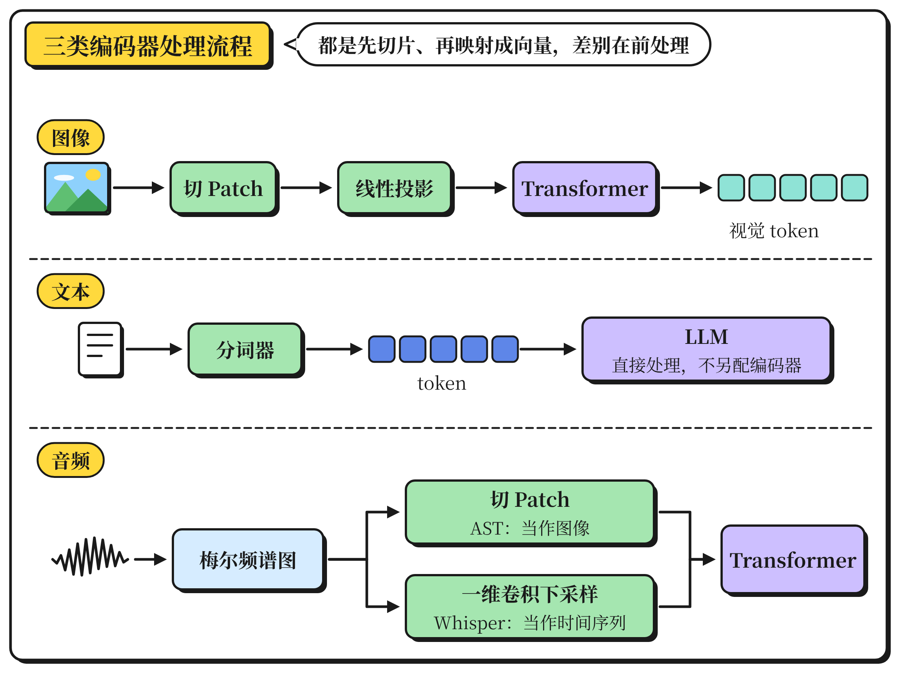
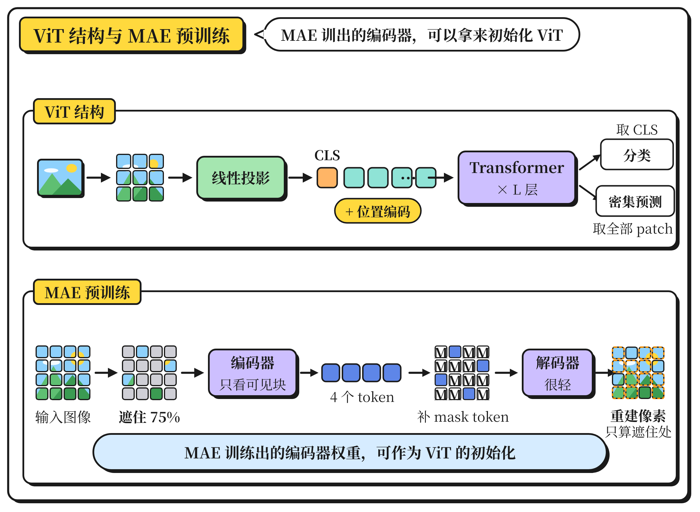
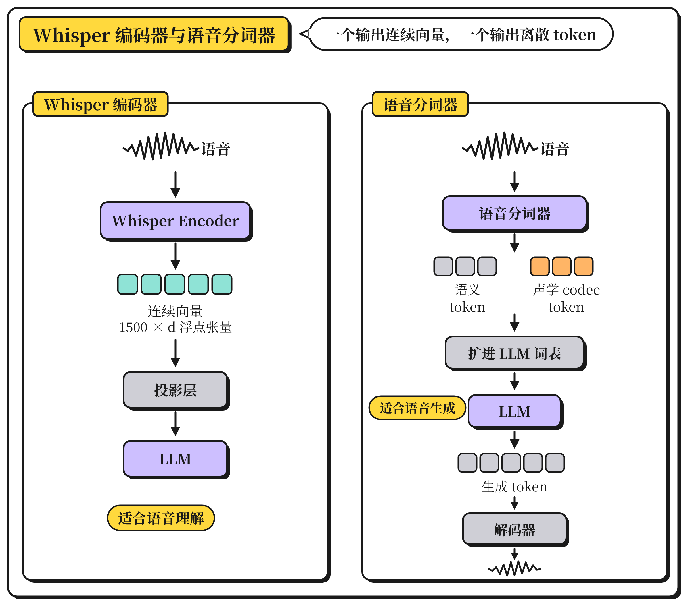
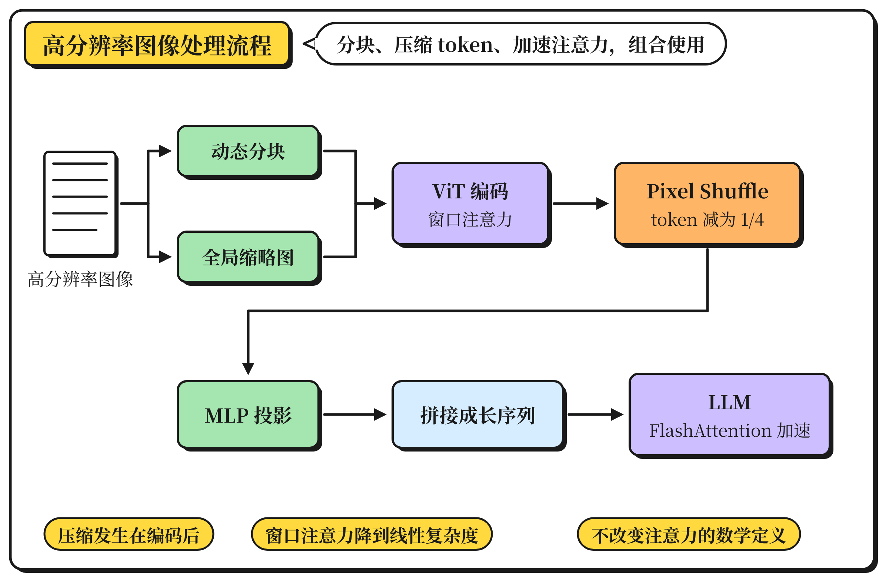
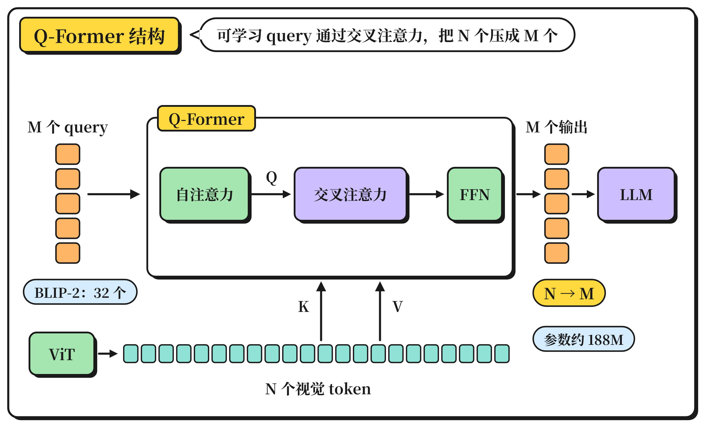
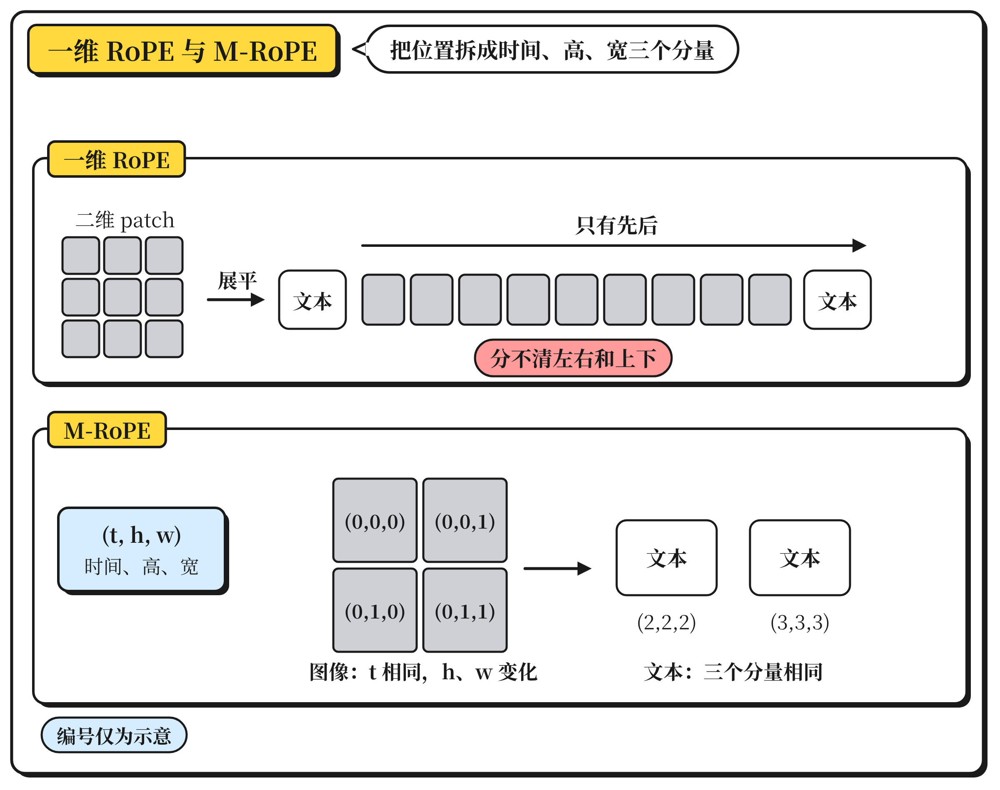
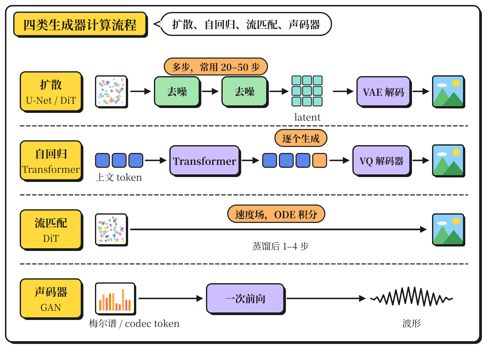
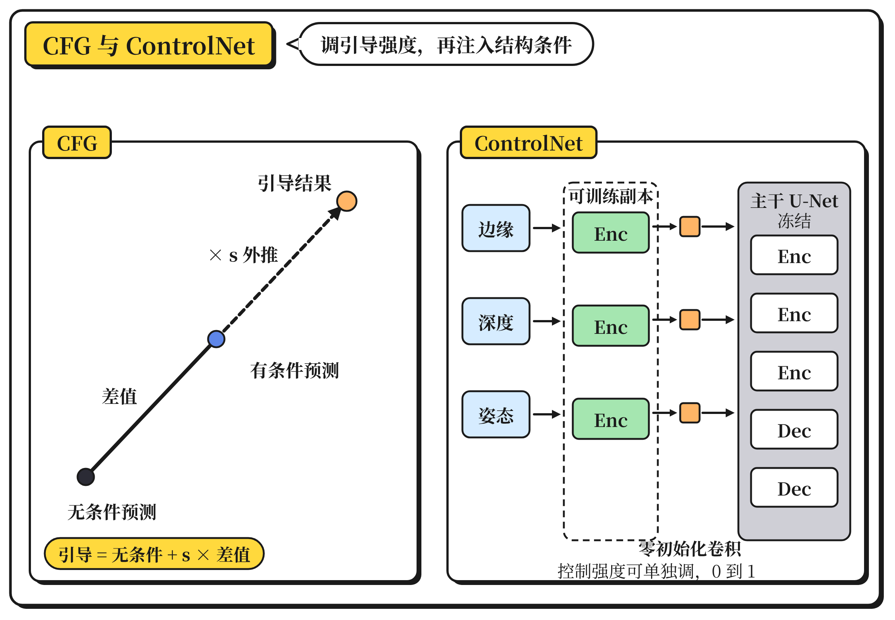

## 5.2 AI 多模态核心组件高频考点

> 本章拆开多模态大模型的三类主要组件：编码器、投影器和生成器。先讲编码器怎样把图像、语音变成向量序列，再讲投影器怎样把这些向量接进 LLM，最后讲扩散、自回归、流匹配和声码器几类生成器怎样把模型输出还原成图像、视频和语音。后面讲基石模型和主流模型时，会直接用这三类组件拆解架构。

---

### [5.2.1 多模态模型中使用编码器的主要作用，以及它在不同模态中的职责](#q5-2-1)
- [5.2.1.1 面试问题：编码器在多模态模型中的核心作用是什么？为什么不可或缺？](#q5-2-1-1)
- [5.2.1.2 面试问题：视觉、文本、音频三类编码器的处理流程有何差异？](#q5-2-1-2)
- [5.2.1.3 面试问题：编码器的输出能否直接送入 LLM？为什么需要后续模块？](#q5-2-1-3)

### [5.2.2 视觉表示编码器 ViT 和 MAE，包括结构特点、预训练方式](#q5-2-2)
- [5.2.2.1 面试问题：ViT 的网络结构与工作流程是什么？](#q5-2-2-1)
- [5.2.2.2 面试问题：ViT 原始的有监督预训练方式有何局限？](#q5-2-2-2)
- [5.2.2.3 面试问题：MAE 的预训练策略与关键设计是什么？为什么遮蔽率高达 75%？](#q5-2-2-3)
- [5.2.2.4 面试问题：ViT 与 MAE 在主流多模态模型中如何被使用？](#q5-2-2-4)

### [5.2.3 音频表示编码器 Whisper 和语音分词器，说明模型结构、预训练目标](#q5-2-3)
- [5.2.3.1 面试问题：Whisper 编码器的模型结构与训练目标是什么？](#q5-2-3-1)
- [5.2.3.2 面试问题：语音分词器是什么？与 Whisper 编码器有何区别？](#q5-2-3-2)
- [5.2.3.3 面试问题：在多模态模型中如何选型？Whisper 与语音分词器各自适合什么场景？](#q5-2-3-3)

### [5.2.4 多模态模型在处理高分辨率视觉输入时常用的策略](#q5-2-4)
- [5.2.4.1 面试问题：高分辨率视觉输入为何对 ViT 构成挑战？](#q5-2-4-1)
- [5.2.4.2 面试问题：动态分块方案如何工作？有何优缺点？](#q5-2-4-2)
- [5.2.4.3 面试问题：多尺度编码与自适应分辨率分别解决什么问题？](#q5-2-4-3)
- [5.2.4.4 面试问题：Token 压缩与稀疏注意力如何缓解长序列压力？](#q5-2-4-4)

### [5.2.5 多模态模型中“投影器”的核心作用与设计目标](#q5-2-5)
- [5.2.5.1 面试问题：为什么多模态模型必须引入投影器？它解决了什么问题？](#q5-2-5-1)
- [5.2.5.2 面试问题：投影器的输入输出形式是什么？设计目标有哪些？](#q5-2-5-2)

### [5.2.6 多模态中常见的输入投影器有哪些类型？基本结构如何？](#q5-2-6)
- [5.2.6.1 面试问题：主流输入投影器的分类维度与代表方案有哪些？](#q5-2-6-1)
- [5.2.6.2 面试问题：四类投影器的基本结构与计算流程对比](#q5-2-6-2)

### [5.2.7 四类主流投影器各自的设计动机、优势与适用场景是什么？](#q5-2-7)
- [5.2.7.1 面试问题：Linear Projection（线性投影）的优点与适用场景](#q5-2-7-1)
- [5.2.7.2 面试问题：MLP 投影器相比线性投影有何优势？](#q5-2-7-2)
- [5.2.7.3 面试问题：Cross-Attention 式投影器（Q-Former）的核心思想是什么？](#q5-2-7-3)
- [5.2.7.4 面试问题：Conv Mapper 适合的模态与场景有哪些？](#q5-2-7-4)

### [5.2.8 在输入投影器中加入位置编码与模态类型编码，分别起到什么作用？](#q5-2-8)
- [5.2.8.1 面试问题：投影器中加入位置编码（Position Embedding）的作用是什么？](#q5-2-8-1)
- [5.2.8.2 面试问题：加入模态类型编码（Modality Type Embedding）的作用是什么？](#q5-2-8-2)

### [5.2.9 多模态生成器在整体架构中的作用与设计目标](#q5-2-9)
- [5.2.9.1 面试问题：多模态生成器的角色分工是什么？](#q5-2-9-1)
- [5.2.9.2 面试问题：生成器需要满足哪些核心设计目标？](#q5-2-9-2)

### [5.2.10 主流模态生成器有哪些类型？基本结构如何？](#q5-2-10)
- [5.2.10.1 面试问题：主流生成器的分类维度与代表方案有哪些？](#q5-2-10-1)
- [5.2.10.2 面试问题：各类生成器的基本结构与计算流程对比](#q5-2-10-2)

### [5.2.11 主流生成器各自的设计动机、优势与适用场景是什么？](#q5-2-11)
- [5.2.11.1 面试问题：扩散模型生成器（DDPM/LDM/SD3/FLUX）的核心机制与适用场景](#q5-2-11-1)
- [5.2.11.2 面试问题：自回归生成器（Chameleon/Emu3/Janus-Pro）的核心机制与适用场景](#q5-2-11-2)
- [5.2.11.3 面试问题：流匹配生成器（Flow Matching/Rectified Flow）的核心机制与优势](#q5-2-11-3)
- [5.2.11.4 面试问题：Vocoder 类生成器（HiFi-GAN/EnCodec/VALL-E）的核心机制与适用场景](#q5-2-11-4)

### [5.2.12 模态生成器训练与推理的关键工程权衡](#q5-2-12)
- [5.2.12.1 面试问题：条件控制与内容创造的权衡如何处理？](#q5-2-12-1)
- [5.2.12.2 面试问题：训练与推理阶段如何缓解模态鸿沟问题？](#q5-2-12-2)
- [5.2.12.3 面试问题：主流采样策略与推理加速方法有哪些？](#q5-2-12-3)

### [附录 术语表](#q52g)

### [参考文献](#q52r)

---

### 5.2.1 多模态模型中使用编码器的主要作用，以及它在不同模态中的职责

#### 5.2.1.1 面试问题：编码器在多模态模型中的核心作用是什么？为什么不可或缺？

**难度评分：⭐⭐ (2/5)  |  考察频率：⭐⭐⭐⭐ (4/5)**

编码器把图像、音频、视频这些原始信号转成模型能处理的向量序列，是非文本模态进入 LLM 的入口。它不可或缺，原因有两点。

**1、原始信号无法直接输入 LLM**

图像是像素矩阵，音频是波形，视频是连续的帧序列，而 LLM 的输入端只接收嵌入向量。原始信号既不是 token，也不在 LLM 的表示空间里，必须先转换成向量序列。

**2、非文本模态没有现成的词表可查**

文本先由分词器切成 token，再查嵌入表变成向量；图像、音频没有离散的词表，只能先由编码器把原始信号转成语义向量，才能接进 LLM。

缺少编码器，非文本模态就无法进入模型。编码器只负责把信号变成向量，这些向量与 LLM 嵌入空间之间的维度和语义差距，还要由后面的投影器处理。

> **面试速答**：编码器把图像像素、音频波形、视频帧这些原始信号转成模型能处理的向量序列。LLM 只接收嵌入向量，文本可以查嵌入表，图像和音频没有现成的词表，必须先经编码器转成语义向量，所以缺了编码器，非文本模态就进不了模型。

---

#### 5.2.1.2 面试问题：视觉、文本、音频三类编码器的处理流程有何差异？

**难度评分：⭐⭐ (2/5)  |  考察频率：⭐⭐⭐⭐ (4/5)**

三类编码器的主干基本都是 Transformer，差别主要在前处理，也就是怎样把连续信号切成片段并映射成向量。三类编码器的处理流程依次如下。

**1、视觉编码器把图像切成 patch**

视觉编码器处理图像和视频帧，主流方案是 ViT（Vision Transformer）。ViT 把图像切成固定大小的 patch，ViT-B/16 用 16×16，CLIP 常用的 ViT-L/14 用 14×14，每个 patch 经线性投影变成一个 token，再送进 Transformer 编码[1,2]。输出是一组视觉 token，每个 token 对应图像里的一块区域。视频要先抽帧，每帧单独经过 ViT，再把各帧的 token 拼接起来。ViT 的结构见 [5.2.2.1](#q5-2-2-1) ：*ViT 的网络结构与工作流程是什么？*

**2、文本由分词器切成 token**

文本经分词器（Tokenizer）切成 token 序列，再由 Transformer 编码。多模态大模型里，文本一般直接交给 LLM 基座处理，不另配文本编码器。

**3、音频先转成梅尔频谱图**

音频编码器处理语音和其他声音，常见做法是先把波形转成梅尔频谱图（Mel Spectrogram），得到"频率×时间"的二维特征，后续处理有两种：

（1）当作图像：AST（Audio Spectrogram Transformer）把频谱图当作图像切 patch[3]。

（2）当作时间序列：Whisper 沿时间轴用一维卷积下采样，再送进 Transformer[4]。

代表模型有 Whisper 编码器，以及专为语音大模型训练的语音分词器，如 SpeechTokenizer、Mimi[5,6]。

三类编码器的思路一致，都是先把连续信号切成片段、映射成向量，再用 Transformer 建模片段之间的长距离依赖，区别只在切分方式，如图 2-1 所示。

图 2-1 三类编码器处理流程示意图

> **面试速答**：三类编码器的主干基本都是 Transformer，差别在前处理。视觉编码器以 ViT 为主，把图像切成 patch 再线性投影成 token；文本由分词器切成 token，多模态模型里一般直接交给 LLM 处理；音频先转成梅尔频谱图，再按图像切 patch，或沿时间轴卷积下采样。

---

#### 5.2.1.3 面试问题：编码器的输出能否直接送入 LLM？为什么需要后续模块？

**难度评分：⭐⭐⭐ (3/5)  |  考察频率：⭐⭐⭐ (3/5)**

编码器的输出不能直接送入 LLM，原因有两个，因此编码器和 LLM 之间需要加入投影器（Projector）。

**1、维度不匹配**

视觉编码器 CLIP-ViT-L 的输出是 1024 维，LLaMA-7B 的隐藏维度是 4096[2,7]，两者拼不成一条序列。

**2、语义空间不一致**

视觉编码器在图文对比学习任务上预训练，输出分布在视觉特征空间；LLM 的 token 嵌入分布在它自己的语言空间。两者都是向量，坐标系却不同，不经对齐直接送进去，LLM 无法把它们当成有意义的输入。投影器如何解决这两个问题见 [5.2.5.1](#q5-2-5-1) ：*为什么多模态模型必须引入投影器？它解决了什么问题？*

投影器负责维度变换和空间对齐，常见实现有单层线性投影（LLaVA-1.0）、两层 MLP（LLaVA-1.5）和 Q-Former（BLIP-2）[8-10]。编码器负责把原始信号变成语义向量，跨模态对齐交由投影器完成，两者各司其职。

> **面试速答**：不能直接送。一是维度不匹配，CLIP-ViT-L 输出 1024 维，LLaMA-7B 的隐藏维度是 4096；二是语义空间不一致，视觉特征和 LLM 的词嵌入不在同一个坐标系。所以中间要加投影器做维度变换和空间对齐，常见的有线性投影、两层 MLP 和 Q-Former。

---

### 5.2.2 视觉表示编码器 ViT 和 MAE，包括结构特点、预训练方式

#### 5.2.2.1 面试问题：ViT 的网络结构与工作流程是什么？

**难度评分：⭐⭐ (2/5)  |  考察频率：⭐⭐⭐⭐⭐ (5/5)**

ViT（Vision Transformer）用 Transformer 代替 CNN 做视觉特征提取。它几乎没有加入视觉专用的结构，直接把 NLP 里的标准 Transformer Encoder 用到了图像上[1]。以 ViT-B/16 为例，工作流程分三步。

**1、把图像切成 patch 并线性投影成 token**

输入一张 224×224 的图像，切成 196 个 16×16 的 patch，每个 patch 经线性投影变成一个 768 维向量，相当于 NLP 里的一个 token。

**2、加入位置编码和 [CLS] token 后送入 Transformer Encoder**

patch token 加上位置编码（Position Embedding），再在序列开头拼接一个可学习的 [CLS] token，一起送进 Transformer Encoder。原始 ViT 使用可学习的一维绝对位置编码[1]。位置编码在多模态模型中的作用见 [5.2.8.1](#q5-2-8-1) ：*投影器中加入位置编码（Position Embedding）的作用是什么？*

**3、按任务读取不同位置的输出**

分类任务取 [CLS] token 的输出，检测、分割等密集预测任务取全部 patch token 的输出。

ViT 去掉了卷积、池化这些人工设计的归纳偏置，完全依靠自注意力建模 patch 之间的全局关系。这让它很容易随模型和数据规模扩展，代价是对训练数据量依赖很强。

> **面试速答**：ViT 把图像切成 patch，每个 patch 线性投影成 token，加上位置编码和 [CLS] token 后送进标准 Transformer Encoder。分类取 [CLS] 输出，密集预测取全部 patch 输出。它几乎不带视觉归纳偏置，扩展性好，但很依赖数据量。

---

#### 5.2.2.2 面试问题：ViT 原始的有监督预训练方式有何局限？

**难度评分：⭐⭐⭐ (3/5)  |  考察频率：⭐⭐⭐⭐ (4/5)**

ViT 原论文用有监督图像分类做预训练，沿用的是 CNN 时代的做法。放到 Transformer 上，它的局限是需要海量标注数据，下面从现象和原因两方面说明。

**1、需要海量标注数据才能超过 CNN**

原论文在 JFT-300M（约 3 亿张带标签的图片）上预训练后，ViT 才超过同级别的 CNN；只用 ImageNet 这种规模的数据训练时，ViT 比同等规模的 ResNet 低几个百分点[1]。

**2、根源在于缺少卷积的归纳偏置**

卷积天然假设局部相关和平移不变，在小数据上也能学到可用的视觉特征；ViT 没有这些先验，只能从数据里自己学，需要的样本量就大得多。

这个局限推动了后来的自监督预训练方法，如 MAE、DINO[11,12]。它们不依赖人工标注，可以用成本更低的无标注图片训练 ViT。

> **面试速答**：ViT 原论文用有监督分类预训练，要在 JFT-300M 这种约 3 亿张标注图片的数据上训练才能超过 CNN，只用 ImageNet 时比同规模 ResNet 差。原因是它没有卷积的局部相关、平移不变先验，只能从大量数据里学。这推动了 MAE、DINO 等自监督方法。

---

#### 5.2.2.3 面试问题：MAE 的预训练策略与关键设计是什么？为什么遮蔽率高达 75%？

**难度评分：⭐⭐⭐⭐ (4/5)  |  考察频率：⭐⭐⭐⭐⭐ (5/5)**

MAE（Masked Autoencoder）用自监督的掩码重建预训练 ViT，不需要标注。它随机遮住 75% 的 patch，只把剩下 25% 的可见 patch 送进编码器，再用一个轻量解码器重建被遮住 patch 的像素[11]。它有两个关键设计。

**1、遮蔽率 75%，远高于 BERT 的 15%**

图像的信息冗余比文本高得多，一张猫的照片遮掉四分之三，剩下的部分往往仍能看出是猫。若遮蔽率只有 15%，模型依靠相邻像素插值即可完成重建，学不到语义。遮蔽率提高以后，模型必须理解整张图的内容才能补全[11,13]。

**2、编码器只处理可见的 25% patch**

被遮住的 patch 到解码阶段才以 mask token 的形式加入。编码器的输入长度只有原来的四分之一，解码器又很轻（默认 8 层、512 维，每个 token 的 FLOPs 约为 ViT-L 的 9%）。MAE 论文报告整体预训练 FLOPs 减少约 3.3 倍，ViT-L 的实测墙钟时间缩短约 2.8 倍，换用更小的解码器或更大的编码器可达到 3.5 至 4.1 倍[11]。

两个设计相互配合：高遮蔽率让重建任务足够难，迫使模型学习语义；编码器只看可见 patch，又把高遮蔽率转化为计算量的节省。

> **面试速答**：MAE 随机遮住 75% 的 patch，编码器只处理可见的 25%，再由轻量解码器补上 mask token 重建像素。遮蔽率这么高，是因为图像冗余大，遮得少靠邻近像素插值就能补全，学不到语义。编码器输入变短、解码器又轻，预训练 FLOPs 约减少到三分之一。

---

#### 5.2.2.4 面试问题：ViT 与 MAE 在主流多模态模型中如何被使用？

**难度评分：⭐⭐ (2/5)  |  考察频率：⭐⭐⭐ (3/5)**

ViT 和 MAE 不在同一个层面。ViT 是模型架构，MAE 是预训练方法，MAE 以 ViT 为骨干进行训练，两者可以组合，如图 2-2 所示。多模态模型里，ViT 通常是视觉编码器的骨干，权重来自不同的预训练方法，典型例子有三类。

图 2-2 ViT 结构与 MAE 预训练示意图

**1、LLaVA 系列使用 CLIP 预训练的 ViT**

LLaVA 用 CLIP 预训练的 ViT-L/14 做视觉编码器[8]，CLIP 的图文对比训练让视觉特征自带语义，接入 LLM 时更容易对齐。

**2、InternVL 系列使用自研的 InternViT**

InternVL 用自研的 InternViT[14]，架构同样是 ViT，训练数据和策略针对多模态对齐做了调整。

**3、BLIP-2 与 MiniGPT-4 使用 EVA-CLIP**

BLIP-2 和 MiniGPT-4 用 EVA-CLIP 的 ViT-g/14[10,15]。EVA 先用掩码图像建模预训练，遮住部分 patch 去重建 CLIP 特征，EVA-CLIP 再从它初始化做图文对比训练，把自监督表示和跨模态对齐结合了起来[16,17]。

三类做法说明，ViT 决定视觉编码器的结构，CLIP、MAE 这类方法决定怎样训练它，多模态模型里两者配合使用。

> **面试速答**：ViT 是模型架构，MAE 是预训练方法，两者可以组合。多模态模型里 ViT 通常做视觉编码器的骨干，LLaVA 用 CLIP 预训练的 ViT，InternVL 用自研的 InternViT，BLIP-2 用的 EVA-CLIP 先做掩码图像建模、再做图文对比训练。

---

### 5.2.3 音频表示编码器 Whisper 和语音分词器，说明模型结构、预训练目标

#### 5.2.3.1 面试问题：Whisper 编码器的模型结构与训练目标是什么？

**难度评分：⭐⭐⭐ (3/5)  |  考察频率：⭐⭐⭐⭐ (4/5)**

Whisper 是 OpenAI 在 2022 年发布的语音识别模型[4]。它的编码器是语音多模态大模型常用的音频前端，Qwen-Audio 用 Whisper-large-v2 初始化音频编码器[18]，Qwen2-Audio 换成了 Whisper-large-v3[19]，SALMONN 把 Whisper 编码器和音频事件编码器 BEATs 一起使用[20]。下面从模型结构和训练目标两方面说明。

**1、模型结构：Encoder-Decoder Transformer**

Whisper 是标准的 Encoder-Decoder Transformer，编码器负责把语音转成隐表示。音频先重采样到 16kHz，按 30 秒切窗，转成对数梅尔频谱图（Log-Mel Spectrogram），形状是 (80, 3000)[4]，large-v3 把梅尔频带数改成了 128[21]。接着两层一维卷积做下采样并升到模型隐藏维度，得到长度 1500 的序列，再送进 Transformer Encoder（large 系列 32 层），输出 1500 个语音表示向量[4]。

**2、训练目标：大规模弱监督的多任务学习**

最初的版本用了 68 万小时从网上收集的带转写语音[4]，large-v3 扩展到 100 万小时弱标注数据加 400 万小时由 large-v2 生成的伪标注数据[21]。一个模型同时学习多语种语音识别（ASR）、译成英文的语音翻译、语种识别、有无语音检测和时间戳预测，依靠在解码器输入端放置不同的任务 token 切换任务[4]。训练目标是把语音转成文字，所以编码器输出的表示偏语义，容易与文本对齐。

正因为编码器的表示偏语义，Whisper 适合作为 LLM 的音频输入前端。多模态模型一般只取 Whisper 的编码器，去掉原生解码器，再用投影器把编码器输出接到 LLM 的嵌入空间。

> **面试速答**：Whisper 是 Encoder-Decoder Transformer，音频按 30 秒切窗转成对数梅尔频谱，经两层一维卷积下采样成 1500 帧再编码。它用大规模弱监督数据做识别、翻译等多任务训练，表示偏语义。多模态模型常只取编码器接投影器。

---

#### 5.2.3.2 面试问题：语音分词器是什么？与 Whisper 编码器有何区别？

**难度评分：⭐⭐⭐⭐ (4/5)  |  考察频率：⭐⭐⭐⭐ (4/5)**

语音分词器（Speech Tokenizer）把连续的语音波形转成离散 token 序列，让语音可以像文本一样由自回归 LLM 建模和生成。下面分两点回答：语音分词器的分类，以及它与 Whisper 编码器的区别。

**1、语音分词器分为语义 token 与声学 codec token 两类**

两类 token 保留的信息不同：

（1）语义 token：对 HuBERT 特征做 k-means 聚类[22]，或者像 CosyVoice 那样在 ASR 编码器里插入量化层、用识别任务监督训练[23]，主要保留"说了什么"。

（2）声学 codec token：SoundStream、EnCodec、Mimi 这类神经音频编解码器，用残差向量量化（RVQ）加重建损失训练[6,24,25]，要求能从 token 还原出波形，音色、韵律、环境声都尽量保留。

SpeechTokenizer 和 Mimi 把两类合在一起。SpeechTokenizer 让 RVQ 第一层蒸馏 HuBERT 的语义信息，后面几层补充声学细节[5]；Mimi 用一个单独的语义码本蒸馏 WavLM，与声学 RVQ 并行[6]。

**2、与 Whisper 编码器的区别在输出形式、训练目标和适用任务**

两者的整体对比如图 2-3 所示。

图 2-3 Whisper 编码器与语音分词器对比示意图

差别主要在三处：

（1）输出形式：Whisper 编码器输出连续向量（1500×d 的浮点张量），要经过投影器才能接进 LLM；语音分词器输出离散的整数 token，可以直接扩进 LLM 词表，与文本 token 共用同一套自回归生成机制。

（2）训练目标：Whisper 是语音到文本的弱监督训练，表示偏语义；codec 类分词器以重建波形为目标，声学信息保留得更完整。

（3）适用任务：Whisper 编码器适合语音理解，把语音变成语义向量交给 LLM 做 ASR、语音问答；语音分词器是端到端语音生成的基础，LLM 只能直接生成离散 token，生成后再由对应的解码器还原成波形。Moshi 的输入和输出都用 Mimi[6]，SpeechGPT 用 mHuBERT 离散单元[26]，走的都是这条路线。

两者的根本差别在于表示是连续还是离散：连续表示便于理解，离散表示便于生成，这决定了它们在多模态模型中的分工。

> **面试速答**：语音分词器把语音波形转成离散 token，分语义 token 和声学 codec token 两类。和 Whisper 编码器比，它输出离散整数，能直接扩进 LLM 词表，训练以重建波形为主，声学信息更全。它适合端到端语音生成，Whisper 适合语音理解。

---

#### 5.2.3.3 面试问题：在多模态模型中如何选型？Whisper 与语音分词器各自适合什么场景？

**难度评分：⭐⭐⭐ (3/5)  |  考察频率：⭐⭐⭐ (3/5)**

两者的分工取决于模型是否需要直接输出语音，实践中也常常一起使用。选型可以按三种情况考虑。

**1、只做语音理解时用 Whisper 编码器**

适用的场景有以下几类：

（1）语音理解：ASR、语音翻译、语音问答、会议纪要，输入是语音，输出是文本。

（2）语音指令对话：用户说话提问，模型用文本回答，需要语音时再外接 TTS，Qwen-Audio、SALMONN 都属于这一类[18,20]。

（3）快速接入现有 LLM：Whisper 编码器输出连续向量，像视觉编码器一样加一个投影器就能接上，不需要扩充 LLM 词表，改造成本最低。

**2、需要直接生成语音时用语音分词器**

适用的场景有以下几类：

（1）端到端语音生成：模型直接生成语音，不经过外接 TTS，例如 Moshi、SpeechGPT[6,26]。

（2）保留音色和情感：codec token 里有音色、韵律信息，生成时能保持说话人特征和情绪起伏。

（3）低延迟语音交互：端到端方案省掉了"ASR→LLM→TTS"串联带来的延迟，更适合全双工实时对话。

两者在表示形式上的区别见 [5.2.3.2](#q5-2-3-2) ：*语音分词器是什么？与 Whisper 编码器有何区别？*

**3、端到端语音模型常把两者组合使用**

不少端到端语音模型在输入端用连续的音频编码器理解语音，在输出端用离散语音 token 生成语音。2025 年 3 月发布的 Qwen2.5-Omni 是典型例子，音频编码器由 Whisper-large-v3 初始化，负责发声的 Talker 模块输出离散语音 token，再经 DiT 和 BigVGAN 还原成波形[27]。之后的 Qwen3-Omni（2025）、Qwen3.5-Omni（2026）把 Whisper 换成了从头训练的 AuT 音频编码器，输出端改成多码本 codec token 加因果卷积网络还原波形，输入连续、输出离散的分工没有变[28,29]。

选型的依据归结为一点：输出端是否需要语音。上面讨论的都是语音，环境音、音效、音乐这类非语音音频的理解通常用 CLAP、AudioCLIP 等对比学习模型，属于另一条技术路线。

> **面试速答**：看模型要不要直接输出语音。只做语音理解、语音指令对话，或想低成本接入现有 LLM，用 Whisper 编码器加投影器；要端到端生成语音、保留音色情感、做低延迟全双工对话，用语音分词器。很多端到端模型输入用连续编码器，输出用离散语音 token。

---

### 5.2.4 多模态模型在处理高分辨率视觉输入时常用的策略

#### 5.2.4.1 面试问题：高分辨率视觉输入为何对 ViT 构成挑战？

**难度评分：⭐⭐⭐ (3/5)  |  考察频率：⭐⭐⭐⭐ (4/5)**

高分辨率输入对 ViT 的挑战来自两方面：一是 token 数随分辨率快速增长，全局自注意力的开销随之二次增长；二是许多任务恰恰离不开高分辨率，不能靠简单下采样回避。

**1、自注意力的计算量随 token 数二次增长**

ViT 的自注意力要在每两个 token 之间算一次点积，计算量随 token 数二次增长。224×224 的图像按 16×16 切，只有 196 个 token；换成 4K 图像（3840×2160），同样的切法是 240×135=32400 个 token。对 32400 个 token 做全局自注意力时，显存占用和计算量会超出常规训练配置的承受范围。

**2、关键任务不能靠下采样减少 token**

OCR、医学影像和文档理解都需要保留较高的输入分辨率：

（1）OCR：识别小字需要足够的像素，下采样后字符笔画会模糊，难以辨认。

（2）医学影像：CT、病理图像里的关键病灶可能只占几十个像素，细节丢失后就失去诊断价值。

（3）文档理解：表格、图表里密集排列的数字和文字，分辨率不够就无法正确解析。

两方面合在一起，构成了高分辨率处理的基本矛盾：分辨率必须保留，计算量又必须控制。动态分块、多尺度编码、自适应分辨率和 token 压缩，都是在这对矛盾之间寻找平衡。

> **面试速答**：ViT 的自注意力计算量随 token 数二次增长，4K 图像按 16×16 切有 32400 个 token（224×224 图像只有 196 个），做全局自注意力时显存占用和计算量会超出常规训练配置的承受范围。OCR、医学影像和文档理解不能靠简单下采样减少 token，下采样后字符笔画会模糊，难以辨认。

---

#### 5.2.4.2 面试问题：动态分块方案如何工作？有何优缺点？

**难度评分：⭐⭐⭐ (3/5)  |  考察频率：⭐⭐⭐⭐⭐ (5/5)**

动态分块（Dynamic Tiling）是目前最常用的高分辨率方案。高分辨率图像被切成多个小块，每块单独经过 ViT，再把各块的输出拼成一条长 token 序列送进 LLM。下面依次说明它的工作方式、优势和不足。

**1、按原图长宽比分块并保留缩略图**

InternVL-1.5 采用了动态分块。它按原图长宽比把图像切成若干 448×448 的块，训练时 1 到 12 块，测试时最多扩展到 40 块，每块单独编码后拼接，另外保留一张缩略图提供全局信息[30]。到 InternVL3.5，这套做法仍在沿用[31]。

**2、优势在复用权重、易于并行、token 数可控**

动态分块的优势有三点：

（1）复用预训练权重：编码器不用改动，预训练好的 ViT 权重直接复用，迁移成本低。

（2）方便并行：各块独立编码，可以并行处理。

（3）token 数可控：设定分块数上限，就能控制单图的总 token 数。

**3、不足在块间无交互、序列变长**

动态分块的不足有两点：

（1）块之间没有信息交互：每块只看到自己，一张跨两个块的长表格可能因为缺少上下文而解析错误。

（2）token 序列变长：分块多了，拼接后的序列可能有几千个 token，压力转到 LLM 端。ViT 端的二次方问题缓解了，LLM 端的 KV Cache 和推理延迟却增加了。

Token 压缩如何缓解这一问题见 [5.2.4.4](#q5-2-4-4) ：*Token 压缩与稀疏注意力如何缓解长序列压力？*

动态分块把 ViT 端的计算压力转移到了 LLM 端，单独使用并不能根本解决长序列问题，因此常与 token 压缩、稀疏注意力配合使用。

> **面试速答**：动态分块按原图长宽比把高分辨率图像切成多个块，每块单独过 ViT 后拼接，再加一张缩略图补全局信息，InternVL-1.5 是代表。优点是复用 ViT 权重、易并行、token 数可控；缺点是块之间没有交互，拼接后序列变长，压力转到 LLM 端。

---

#### 5.2.4.3 面试问题：多尺度编码与自适应分辨率分别解决什么问题？

**难度评分：⭐⭐⭐⭐ (4/5)  |  考察频率：⭐⭐⭐⭐ (4/5)**

多尺度编码和自适应分辨率常被混为一谈，解决的问题并不相同：前者解决全局语义与局部细节难以兼顾，后者解决固定尺寸缩放带来的浪费和变形。

**1、多尺度编码兼顾全局语义与局部细节**

同一张图用不同分辨率分别编码，低分辨率分支提供全局语义，高分辨率分支保留局部细节（例如桌面那本书封面上的文字），再把两路特征融合。思路来自计算机视觉里的特征金字塔网络（FPN）[32]。多模态模型里的例子是 DeepSeek-VL，它用 384×384 输入的 SigLIP-L 提取语义特征，再用 1024×1024 输入的 SAM-B 提取高分辨率细节，两路特征合并后送进 LLM[33]。

**2、自适应分辨率避免固定尺寸带来的浪费和变形**

自适应分辨率按图像原本的大小和长宽比编码，token 数随图像大小变化，小图少、大图多。Qwen2-VL 提出的原生动态分辨率（Naive Dynamic Resolution）属于这一思路，图像只调整到 patch 尺寸的整数倍，在可配置的最小、最大像素范围内保持原始长宽比，避免强制缩放造成的变形[34]。Qwen2.5-VL、Qwen3-VL 都沿用了这套做法[35,36]。

多尺度处理的是同一张图的多种粒度，自适应分辨率处理的是不同图的不同尺寸，两者针对的维度不同，可以叠加使用。

> **面试速答**：多尺度编码解决全局语义和局部细节难兼顾的问题，同一张图用高低两种分辨率编码再融合，例如 DeepSeek-VL 的 SigLIP 加 SAM。自适应分辨率解决固定尺寸带来的浪费和变形，按原图尺寸编码，token 数随图大小变，Qwen2-VL 提出后一直沿用。两者可以叠加。

---

#### 5.2.4.4 面试问题：Token 压缩与稀疏注意力如何缓解长序列压力？

**难度评分：⭐⭐⭐⭐ (4/5)  |  考察频率：⭐⭐⭐⭐ (4/5)**

前面几种策略在输入端控制计算量，本题讲的手段在编码和推理过程中降低开销，按作用层次分为三类：token 压缩减少序列长度，注意力范围优化降低每个 token 的计算范围，实现层优化不改变任何数学定义，只减少显存读写和访存开销。

**1、Token 压缩减少进入 LLM 的 token 数量**

常见做法有三种：

（1）池化与 Pixel Shuffle：把相邻的 patch token 合并。InternVL-1.5 在分块编码之后用 Pixel Shuffle 把每块的 token 数压到原来的四分之一[30]；Qwen2.5-VL、Qwen3-VL 用两层 MLP 把相邻 2×2 个特征合成一个 token[35,36]。

（2）可学习 query 聚合：用一组可学习的 query token，通过交叉注意力从视觉特征里提取信息。BLIP-2 的 Q-Former 采用这种做法，把 ViT 输出的 257 个视觉 token 压成 32 个 query token 再送进 LLM[10]。

（3）推理期剪枝与合并：不改动训练，只在推理时丢掉或合并冗余 token。FastV 发现视觉 token 的注意力在 LLM 前两层之后高度集中，从第 2 层起剪掉大部分视觉 token，在 LLaVA-1.5-13B 上把 FLOPs 降低约 45%，精度基本不变[37]；ToMe 在 ViT 内部按 key 的相似度逐步合并相似的 token，ViT-L @ 512 的吞吐提高到 2 倍，精度只降 0.2 至 0.3 个百分点[38]。这类方法与训练期的压缩方案互补，适合对已有模型直接加速。

**2、注意力范围优化降低每个 token 的计算范围**

这类方法不减少 token 数：

（1）窗口注意力：只在局部窗口内计算自注意力。Swin Transformer 用窗口注意力把计算量从随图像尺寸二次增长降到线性增长，再用移位窗口（shifted window）让相邻窗口交换信息[39]。Qwen2.5-VL 的视觉编码器也在大部分层改用窗口注意力，32 层里只保留 4 层全局注意力[35]。

（2）稀疏注意力：每个 token 只与选定的部分 token 计算注意力，选择方式可以固定，也可以按注意力分数动态决定，FastV 的视觉 token 剪枝属于动态稀疏的一种工程实现[37]。

**3、实现层优化不改变注意力的数学定义**

这类方法既不减少 token 数，也不改变计算范围：

（1）FlashAttention：依靠分块计算和减少显存读写，把注意力在 GPU 上的访存开销降下来，输出与标准注意力逐位一致[40]，长序列场景基本都会开启。

（2）KV Cache 与批处理：自回归生成时缓存历史 token 的键和值，避免每步重复计算；连续批处理让不同长度的请求共享一次前向。这两项是 LLM 推理框架的通用优化，拼接进 LLM 的视觉 token 同样受益。

三类手段作用在不同层次，实际项目通常组合使用。InternVL 系列先动态分块，再对每块做 Pixel Shuffle 压缩，LLM 端用 FlashAttention 加速长序列推理，如图 2-4 所示。

图 2-4 高分辨率图像处理流程示意图

> **面试速答**：Token 压缩减少序列长度，常用 Pixel Shuffle 合并相邻 token、Q-Former 压成固定数量，或用 FastV、ToMe 在推理时剪枝合并。窗口注意力属于注意力范围优化，把复杂度降到线性。FlashAttention 只改实现，不改变注意力的数学定义。几种手段常组合使用。

---

### 5.2.5 多模态模型中“投影器”的核心作用与设计目标

#### 5.2.5.1 面试问题：为什么多模态模型必须引入投影器？它解决了什么问题？

**难度评分：⭐⭐ (2/5)  |  考察频率：⭐⭐⭐⭐ (4/5)**

编码器的输出不能直接送进 LLM。投影器（Projector，也称对齐模块、连接器或适配器）接在两者之间，负责把编码器输出变成 LLM 能用的输入，它要解决两个问题。

**1、维度不匹配**

视觉编码器 CLIP-ViT-L 输出 1024 维，LLaMA-7B 的隐藏维度是 4096[2,7]，维度不同就拼不成统一序列。投影器最基本的工作是做维度变换，把编码器输出投到 LLM 的隐藏维度。

**2、语义空间不对齐**

CLIP 的视觉编码器在图文对比任务上训练，输出落在视觉特征空间；LLM 的 token 嵌入落在它自己的语言空间。同样表示"猫"，CLIP 输出的视觉向量和 LLaMA 里"cat"这个 token 的嵌入并不会自然落在一起。投影器要在训练中学到一个变换，让 LLM 能把视觉 token 当作有意义的输入来处理。投影器的结构类型见 [5.2.6.1](#q5-2-6-1) ：*主流输入投影器的分类维度与代表方案有哪些？*

维度变换是投影器的基本功能，语义对齐才是它真正要学的内容。前者靠一次矩阵乘法即可完成，后者需要在对齐数据上训练，这也是不同投影器结构之间差别的来源。

> **面试速答**：因为编码器输出和 LLM 输入之间有两道坎。一是维度不匹配，CLIP-ViT-L 输出 1024 维，LLaMA-7B 要 4096 维；二是语义空间不对齐，视觉向量和词嵌入不在同一区域。投影器负责维度变换，并在训练中学到一个变换，让 LLM 能把视觉 token 当作有意义的输入。

---

#### 5.2.5.2 面试问题：投影器的输入输出形式是什么？设计目标有哪些？

**难度评分：⭐⭐⭐ (3/5)  |  考察频率：⭐⭐⭐ (3/5)**

投影器的输入是编码器输出的向量序列，输出是和 LLM token 嵌入同维度的向量序列，可以直接拼进 LLM 的输入序列。设计目标有对齐、信息保真、计算可控和易训练四个，下面先说明输入输出形式，再分别说明四个目标。

**1、输入输出形式**

输入形状为 `(N, d_enc)`，N 是 token 数，`d_enc` 是编码器隐藏维度；输出形状为 `(M, d_llm)`。N 和 M 的关系取决于结构：线性投影和 MLP 保持 N=M，Q-Former、Pixel Shuffle 会把 N 压成更小的 M。

**2、设计目标**

投影器的四个设计目标分别是：

（1）对齐：输出向量要落进 LLM 能理解的语义空间，让 LLM 把多模态 token 和文本 token 放在一起处理，这是投影器最主要的目标。

（2）信息保真：投影过程中尽量少丢原始模态的信息，避免编码器提取的细节在这一步被抹平。

（3）计算可控：投影器自身要轻，还要能控制输出 token 数。高分辨率图像、长音频等场景里，token 压缩能力直接决定 LLM 端的推理成本。

（4）易训练：对齐预训练阶段通常冻结编码器和 LLM，只训练投影器，跨模态对齐完全依赖这一模块，因此结构需要容易优化、容易收敛。

四个目标之间有取舍。Q-Former 表达力强，但参数多、难训练；线性投影训练稳定，表达力有限。后面各题中各类方案的差别，基本都是在这几个目标之间做的取舍。

> **面试速答**：投影器输入 (N, d_enc) 的编码器输出，输出和 LLM 嵌入同维度的 (M, d_llm) 序列。线性投影和 MLP 保持 N=M，Q-Former、Pixel Shuffle 会压成更小的 M。设计目标有对齐、信息保真、计算可控、易训练四个，各方案在其间取舍。

---

### 5.2.6 多模态中常见的输入投影器有哪些类型？基本结构如何？

#### 5.2.6.1 面试问题：主流输入投影器的分类维度与代表方案有哪些？

**难度评分：⭐⭐⭐ (3/5)  |  考察频率：⭐⭐⭐⭐ (4/5)**

按结构，主流投影器可以分成四类：线性投影、MLP 投影器、交叉注意力投影器和卷积投影器。前两类逐 token 变换，后两类会压缩 token 数量。

**1、线性投影**

线性投影（Linear Projection）是最简单的形态，一层全连接完成维度变换。代表是 LLaVA-1.0，CLIP-ViT 输出的视觉 token 经一层 Linear 直接接到 Vicuna 的词嵌入空间[8]。

**2、MLP 投影器**

MLP 投影器在线性投影的基础上加入非线性激活，通常是两层。LLaVA-1.5、LLaVA-1.6 用两层 GELU-MLP[9,41]，InternVL 系列也用 MLP 投影器[30]，这是目前最常用的轻量投影器。

**3、交叉注意力投影器**

交叉注意力投影器也称 Resampler 或 Q-Former，用一组可学习的 query token，通过交叉注意力从视觉特征里提取信息，主要特点是会压缩 token 数量。代表有 BLIP-2 的 Q-Former 和 Flamingo 的 Perceiver Resampler[10,42]，MiniGPT-4 直接沿用了 BLIP-2 训练好的 Q-Former，只多训练一层线性投影[15]。

**4、卷积投影器**

卷积投影器（Conv Mapper）用卷积或 Pixel Shuffle 做空间下采样和维度变换。代表有 MobileVLM 的 LDP（Lightweight Downsample Projector）[43]和 InternVL-1.5 的 Pixel Shuffle 加 MLP[30]。四类投影器的结构对比见 [5.2.6.2](#q5-2-6-2) ：*四类投影器的基本结构与计算流程对比*

此外还有一些混合方案。Honeybee 的 C-Abstractor 先用若干 ResNet 块提取局部特征，经自适应平均池化压到指定的 token 数，再接若干 ResNet 块[44]；Qwen-VL 用单层交叉注意力模块，把视觉特征压成 256 个 query token[45]。它们都可以看作上面四类的工程变体。

> **面试速答**：按结构分四类。线性投影只有一层全连接，代表是 LLaVA-1.0；MLP 投影器加了非线性，LLaVA-1.5 和 InternVL 都用；交叉注意力投影器用 query 压缩 token，代表是 Q-Former；卷积投影器做空间下采样，代表是 MobileVLM 的 LDP。

---

#### 5.2.6.2 面试问题：四类投影器的基本结构与计算流程对比

**难度评分：⭐⭐⭐ (3/5)  |  考察频率：⭐⭐⭐⭐ (4/5)**

四类投影器在结构复杂度、参数量、是否压缩 token、训练难度上差别明显。下面以 CLIP-ViT-L（1024 维）接 LLaMA-7B（4096 维）为例，逐类说明结构与计算流程。

**1、线性投影：单层矩阵乘法**

结构最简单，单层 `Linear(d_enc → d_llm)`。输入 N 个视觉 token，输出还是 N 个。参数量约 `d_enc × d_llm` = 1024×4096 ≈ 4.2M，是四类里最轻的。计算只有一次矩阵乘法，没有非线性。

**2、MLP 投影器：两层线性层夹一个激活函数**

结构是 `Linear → GELU → Linear`，第一层 `d_enc → d_hidden`，第二层 `d_hidden → d_llm`，token 数同样是 N 进 N 出。LLaVA-1.5 取 `d_hidden = d_llm`[9]，参数量约 1024×4096 + 4096×4096 ≈ 21M，是线性投影的 5 倍左右。计算是两次矩阵乘法加一次激活。

**3、交叉注意力投影器：用 query 压缩 token 的轻量 Transformer**

结构最复杂，主体是一个轻量 Transformer，维护 M 个可学习的 query token（M 远小于 N，BLIP-2 的 Q-Former 用 32 个），每层做 query 之间的自注意力、query 对视觉 token 的交叉注意力和 FFN。输入 N 个视觉 token，输出压缩后的 M 个。参数量从几千万到几亿不等，Q-Former 约 188M[10]，训练也最复杂。

**4、卷积投影器：空间下采样加 MLP**

结构是卷积层（或 Pixel Shuffle）加投影器。以 Pixel Shuffle 为例，把 `(H, W, d_enc)` 的特征图做空间重排，变成 `(H/s, W/s, d_enc×s²)`，再用 MLP 投到 `d_llm`。token 数从 N 压到 N/s²，s 是下采样率，常取 2，token 数变成原来的四分之一。参数量和 MLP 同一量级，同时带空间下采样。

结构越复杂，压缩能力和表达能力越强，训练难度也越高。四类投影器的关键属性对照如表 2-1 所示。

表 2-1 四类投影器关键属性对照

| 属性 | Linear | MLP | Cross-Attention | Conv |
|---|---|---|---|---|
| 结构复杂度 | 极低 | 低 | 高 | 中 |
| 参数量 | ~4M | ~21M | 数千万~数亿 | 与 MLP 同一量级 |
| 是否压缩 token | 否（N→N） | 否（N→N） | 是（N→M, M<<N） | 是（N→N/s²） |
| 是否引入空间感知 | 否 | 否 | 否 | 是 |
| 训练难度 | 低 | 低 | 高 | 中 |
| 代表模型 | LLaVA-1.0 | LLaVA-1.5、InternVL | BLIP-2、Flamingo | MobileVLM、InternVL-1.5 |

表 2-1 中线性投影和 MLP 的参数量按 CLIP-ViT-L 接 LLaMA-7B 的维度估算，Q-Former 的参数量取自 BLIP-2 论文[10]。

> **面试速答**：线性投影是单层 Linear，N 进 N 出，约 4.2M 参数。MLP 是两层 Linear 夹 GELU，约 21M。交叉注意力投影器用 M 个 query 把 N 个 token 压成 M 个，Q-Former 约 188M，最难训。卷积投影器把 token 压到 N/s²，并带空间感知。

---

### 5.2.7 四类主流投影器各自的设计动机、优势与适用场景是什么？

#### 5.2.7.1 面试问题：Linear Projection（线性投影）的优点与适用场景

**难度评分：⭐⭐ (2/5)  |  考察频率：⭐⭐⭐⭐ (4/5)**

线性投影只有一层全连接，优点是参数少、训练稳、便于分析，适合编码器已与文本对齐、token 数不多的场景。下面从优点、适用场景和局限三方面说明。

**1、优点集中在参数少、训练稳和便于分析**

线性投影的优点有三点：

（1）参数少，训练成本低：只有一层全连接，约 4M 参数，相对 LLM 基座可以忽略。在冻结编码器和 LLM、只训投影器的对齐预训练阶段，用线性投影开销很小，工程门槛低。

（2）训练稳定，收敛快：没有非线性，也没有可学习 query，基本不会出现不收敛或 loss 震荡。

（3）便于分析：线性变换可以直接分析权重矩阵，观察视觉空间被怎样映射到语言空间。

**2、适用于编码器已对齐、token 数不多的场景**

线性投影适用的场景有四类：

（1）编码器已和文本对齐过：比如 CLIP-ViT-L 接 LLaMA-7B，CLIP 特征本来是和文本对比训练出来的，单层线性投影就能用。

（2）token 数本来就不多：视觉端不会输出上千个 token，不需要在投影器里压缩。

（3）快速验证：换新数据集、新任务做初步实验时，用线性投影搭建流程最快。

（4）资源受限：投影器的参数量也要严格控制时可以考虑。

**3、语义差距大或需要压缩 token 时不够用**

编码器和 LLM 之间语义差距大（如非 CLIP 系的视觉编码器、音频、视频），或者需要压缩 token 时，线性投影的表达力就不够了，要换成 MLP 或交叉注意力方案。LLaVA 从 1.0 升级到 1.5 时把线性投影换成了两层 MLP，论文的解释是提高投影器的表示能力可以提升多模态能力[9]。MLP 的改进见 [5.2.7.2](#q5-2-7-2) ：*MLP 投影器相比线性投影有何优势？*

线性投影的取舍很清楚：用表达力换取训练成本和稳定性。编码器与文本已经对齐时，这笔交换通常划算；语义差距大时则不划算。

> **面试速答**：线性投影参数少、训练稳、便于分析，约 4M 参数，对齐预训练开销很小。适合编码器已经和文本对齐过、token 数不多、快速验证或资源很紧的场景。语义差距大或需要压缩 token 时就不够用了，LLaVA-1.5 因此换成了两层 MLP。

---

#### 5.2.7.2 面试问题：MLP 投影器相比线性投影有何优势？

**难度评分：⭐⭐⭐ (3/5)  |  考察频率：⭐⭐⭐⭐⭐ (5/5)**

MLP 比线性投影多了非线性，表达能力更强，代价只是参数稍多。它的优势体现在三方面。

**1、映射能力更强**

两层 MLP 加 GELU 可以拟合非线性的特征变换，而视觉特征空间到 LLM 嵌入空间的映射未必是线性的。需要注意，MLP 和线性投影一样是逐 token 变换，每个视觉 token 单独映射，看不到上下文，结合上下文理解图像内容是 LLM 的工作。

**2、对语义差距更大的编码器更稳**

编码器不是 CLIP 那样图文对齐过的模型时，比如纯视觉自监督的 DINO-ViT、MAE-ViT，输出和 LLM 文本空间差得更远，非线性映射的作用更明显。

**3、有消融实验支持**

LLaVA-1.5 论文做了逐项消融，在加入 VQAv2 数据和格式提示之后，再把线性投影换成两层 MLP，MME 从 1323.8 提到 1355.2，GQA 从 46.8 到 47.3，MM-Vet 从 26.3 到 27.8[9]。提升不大但各项一致，代价只是多了约 17M 参数。此后 LLaVA-1.6、InternVL、Qwen2.5-VL 等开源模型都用 MLP 做投影器[30,35,41]。

MLP 的代价很小。参数量约为线性投影的 5 倍（CLIP-L 接 LLaMA-7B 时约 21M），相对 LLM 仍然很轻；多了非线性后，理论上训练难一点，实际上两层 MLP 很稳定，收敛和线性投影没有明显差别，LLaVA-1.5 换成 MLP 后只把预训练阶段的学习率减半[9]。因此在大多数图文多模态模型里，两层 GELU-MLP 是性价比最高的投影器，表达力比线性投影强，训练成本比交叉注意力低得多，没有特殊约束时可以作为默认选择。

> **面试速答**：MLP 多了非线性，能拟合非线性的特征变换，对 DINO、MAE 这类没和文本对齐过的编码器也更稳。LLaVA-1.5 的消融里，只换 MLP 一步，MME、GQA、MM-Vet 都有小幅一致的提升，参数只多约 17M。注意它和线性投影一样逐 token 变换，看不到上下文。

---

#### 5.2.7.3 面试问题：Cross-Attention 式投影器（Q-Former）的核心思想是什么？

**难度评分：⭐⭐⭐⭐ (4/5)  |  考察频率：⭐⭐⭐⭐⭐ (5/5)**

交叉注意力投影器的代表是 BLIP-2 的 Q-Former 和 Flamingo 的 Perceiver Resampler[10,42]。它们的核心思想是用一组可学习的 query token，通过交叉注意力主动从视觉特征里挑选信息，输出的 token 数由 query 数量决定，与视觉 token 有多少无关。Q-Former 的结构如图 2-5 所示，下面从结构、特点和代价三方面说明。

图 2-5 Q-Former 结构示意图

**1、结构：可学习 query 经交叉注意力读取视觉特征**

Q-Former 维护 M 个可学习的 query 向量（BLIP-2 是 32 个），每层先做 query 之间的自注意力，再做 query 对视觉 token 的交叉注意力（query 作 Q，视觉 token 作 K 和 V），最后经过 FFN。视觉端输入 N 个 token（可以上百甚至上千），输出始终是 M 个 query 对应的向量，实现 N→M 的压缩[10]。

**2、特点：压缩 token、有选择地提取、可独立预训练**

Q-Former 有三个特点：

（1）压缩 token：线性投影和 MLP 逐 token 变换，N 个进 N 个出；Q-Former 能把上千个视觉 token 压到几十个，LLM 端的序列长度和推理成本都会降下来，视频、高分辨率图像等长序列场景受益最大。

（2）有选择地提取：平均池化也能压缩 token，但它对所有区域一视同仁；Q-Former 的 query 在训练目标引导下学会关注更有用的视觉信息。

（3）可以先独立预训练：BLIP-2 分两阶段训练。第一阶段冻结图像编码器，用图文对比、图文匹配、图文生成三个任务单独训练 Q-Former；第二阶段接上冻结的 LLM 做生成式训练。第一阶段训练好的 Q-Former 可以接不同的 LLM，BLIP-2 就分别接了 OPT 和 FlanT5[10]。

**3、代价：参数量大、训练难、压缩会丢信息**

Q-Former 的代价有三点：

（1）参数量大：Q-Former 约 188M 参数[10]，训练成本远高于 MLP。

（2）训练难度高：query 数量、初始化方式和训练目标都要仔细调节。

（3）会丢信息：从 N 压到 M 必然丢掉部分细节，对 OCR、密集场景识别等需要保留全部细节的任务不友好。InternVL、Qwen2.5-VL 等新一代开源模型改用 MLP，再配合 Pixel Shuffle 或相邻 token 合并来压缩[30,35]。

Q-Former 用参数量和细节损失换取强压缩能力，适合视频理解、超高分辨率图像等需要严格控制 LLM 输入长度的长序列场景；对细节要求高的任务，新一代模型更倾向于 MLP 加局部压缩的组合。

> **面试速答**：用一组可学习的 query，通过交叉注意力从视觉特征里挑信息，输出 token 数由 query 数决定，BLIP-2 用 32 个 query。它能大幅压缩 token、有选择地提取，还能先独立预训练再接不同 LLM。代价是约 188M 参数、难训练，压缩会丢细节，对 OCR 不友好。

---

#### 5.2.7.4 面试问题：Conv Mapper 适合的模态与场景有哪些？

**难度评分：⭐⭐⭐ (3/5)  |  考察频率：⭐⭐⭐ (3/5)**

卷积投影器的长处是保留空间局部关系，同时能按需做空间下采样。代表有 MobileVLM 的 LDP 和 InternVL-1.5 的 Pixel Shuffle 投影器[30,43]。下面依次说明它适合的模态、适合的场景和局限。

**1、适合空间结构强的模态**

卷积投影器适合的模态主要是空间结构强的图像和视频帧。卷积自带局部连接和平移不变的归纳偏置，擅长建模相邻区域之间的关系。音频如果转成了梅尔频谱图（时间×频率的二维结构），也能用卷积投影器。纯文本或已经高度抽象、没有空间结构的语义向量，用卷积没有明显好处。

**2、适合高分辨率视觉、端侧部署和文档理解**

卷积投影器适合的场景有三类：

（1）高分辨率视觉：在映射阶段直接做 2 倍或 4 倍下采样，视觉 token 数变成原来的 1/4 或 1/16。InternVL-1.5 用 2×2 的 Pixel Shuffle，把每块的 token 数从 1024 压到 256[30]。

（2）端侧部署：MobileVLM 的 LDP 用深度可分离卷积，参数不到 20M，把视觉 token 从 576 个压到 144 个，运行速度比视觉编码器快约 81 倍[43]。

（3）OCR 与文档理解：交叉注意力是全局压缩，卷积是局部下采样，更能保留文字、表格的相对位置，不容易打乱二维版面。

卷积投影器与其他 token 压缩手段的关系见 [5.2.4.4](#q5-2-4-4) ：*Token 压缩与稀疏注意力如何缓解长序列压力？*

**3、局限在于只看局部且依赖输入结构**

卷积投影器的局限有两点：

（1）灵活性不如交叉注意力：卷积核只看局部，做不了远距离的信息挑选。

（2）对输入有要求：输入必须具备空间或时频结构，压平成一维的语义向量不适用。

由于这些局限，卷积投影器很少单独使用，一般和 MLP 组合：先用卷积或 Pixel Shuffle 做空间下采样，再用 MLP 做维度对齐和语义投影，同时满足压缩和对齐两个目标。

> **面试速答**：卷积投影器适合图像、视频帧和梅尔频谱这类有空间或时频结构的输入。它能在映射阶段做下采样，适合高分辨率视觉、端侧部署和 OCR 文档理解，InternVL-1.5 的 Pixel Shuffle 把每块 1024 个 token 压到 256。局限是只看局部，一般和 MLP 组合使用。

---

### 5.2.8 在输入投影器中加入位置编码与模态类型编码，分别起到什么作用？

#### 5.2.8.1 面试问题：投影器中加入位置编码（Position Embedding）的作用是什么？

**难度评分：⭐⭐⭐⭐ (4/5)  |  考察频率：⭐⭐⭐ (3/5)**

ViT 和 LLM 各有自己的位置编码，但视觉 token 拼进 LLM 的一维序列后，一维位置编码只能表示先后，分不清左右上下。在投影器里或投影器之后补充位置信息，就是把二维空间信息带进 LLM。下面先说明问题的来源，再说明两种解决方法。

**1、问题出在跨模态拼接之后**

原始 ViT 和 CLIP 的 ViT 给每个 patch 加的是可学习的一维绝对位置编码，按光栅顺序编号；ViT 论文附录 D.4 的消融显示，换成显式的二维位置编码没有明显收益，学到的一维编码本身已经反映出图像的行列结构[1,46]。从 Qwen2-VL 开始，Qwen 系列的视觉编码器去掉了绝对位置编码，改用 2D-RoPE 显式编码行列坐标[34]。LLM 用的是一维序列位置编码（如 RoPE），只区分先后顺序。视觉 token 经投影器投进 LLM 空间后，会和文本 token 拼成一条一维序列，LLM 的一维位置编码只能告诉模型"视觉 token A 排第 10 位、B 排第 11 位"，分不清 A 在 B 的左边还是上方。ViT 特征里虽然已经混入了位置信息，LLM 这一层却没有显式的二维坐标。

**2、在交叉注意力压缩时补充二维位置信息**

Qwen-VL 用一个单层交叉注意力模块和 256 个可学习 query 压缩视觉特征。论文在交叉注意力的 query-key 对中加入二维绝对位置编码，用来减少压缩过程中位置细节的损失[45]。

**3、重新设计多模态位置编码**

Qwen2-VL 提出的 M-RoPE（Multimodal RoPE）把旋转位置编码拆成时间、高度、宽度三个分量，视觉 token 用高、宽分量编码空间位置，视频再加上时间分量；文本 token 三个分量取相同的值，退化成普通的一维 RoPE[34]，如图 2-6 所示。这样 LLM 既知道时间顺序，也知道空间布局。

图 2-6 一维 RoPE 与 M-RoPE 对比示意图

位置信息决定了模型能否做空间推理。缺少空间位置信息时，"图中左上角的物体是什么""红框在蓝框的哪一侧"等需要空间推理的问题更容易答错。

> **面试速答**：视觉 token 拼进 LLM 的一维序列后，一维位置编码只能表示先后，分不清左右上下。补位置编码就是把二维空间信息带进 LLM，做法有两种，一是像 Qwen-VL 那样在交叉注意力压缩时加入二维绝对位置编码，二是像 Qwen2-VL 的 M-RoPE 那样把位置拆成时间、高、宽三个分量。

---

#### 5.2.8.2 面试问题：加入模态类型编码（Modality Type Embedding）的作用是什么？

**难度评分：⭐⭐⭐ (3/5)  |  考察频率：⭐⭐⭐ (3/5)**

模态类型编码（也叫 Segment Embedding、Modality Token）的作用是让模型知道序列里每个 token 来自哪种模态。下面先说明模型为什么需要区分模态，再说明两种实现方式。

**1、模型仍需在三个环节区分模态**

经过投影器对齐，视觉 token 和文本 token 在向量空间里已经比较接近，这本来就是对齐要达到的效果。但模型在一些环节仍要区分两者，主要有三个方面：

（1）损失计算：文本 token 参与 LLM 的语言建模损失，视觉 token 一般不参与。

（2）计算路径：不同模态可能走不同的计算路径，例如 Flamingo 在冻结的 LLM 层之间插入门控交叉注意力层，让文本 token 去查询视觉特征[42]。

（3）内容边界：多模态指令微调中，模型要分清哪部分是用户问题、哪部分是图像内容。

**2、实现方式有可学习嵌入和特殊标记两种**

两种实现方式分别是：

（1）可学习的模态类型嵌入：给每种模态分配一个可学习向量，加到该模态所有 token 上。ViLT 就给文本 token 和图像 patch token 分别加了模态类型嵌入，做法来自 BERT 的 segment embedding[13,47]。

（2）特殊标记包裹：用 `...</img>`、`<audio>...</audio>` 这类特殊 token 包住对应模态的内容，让 LLM 自己学会模态边界。Qwen-VL 用 `` 和 `</img>` 包住图像特征[45]，LLaVA 用 `<image>` 占位符标出图像插入的位置[8]，InternVL 也用 ``、`</img>` 加图像上下文 token[48]。这种方式不额外加嵌入向量，模态信息体现在序列结构里。

位置编码回答 token 在哪，模态类型编码回答 token 属于哪种模态，两者互不干扰，常常一起使用。当前主流的多模态大模型大多用特殊标记就够了；需要对不同模态做差异化处理时，才会显式加入模态类型嵌入。

> **面试速答**：模态类型编码让模型知道每个 token 来自哪种模态，用于区分哪些 token 算语言建模损失、走哪条计算路径、问题和图像的边界在哪。实现上可以像 ViLT 那样加可学习的模态嵌入，也可以像 Qwen-VL、LLaVA 那样用特殊标记包裹，目前主流用后者。

---

### 5.2.9 多模态生成器在整体架构中的作用与设计目标

#### 5.2.9.1 面试问题：多模态生成器的角色分工是什么？

**难度评分：⭐⭐⭐ (3/5)  |  考察频率：⭐⭐⭐⭐ (4/5)**

多模态生成器在 MLLM 架构的输出端，负责把 LLM 的高层语义、隐状态或离散 token 变成具体模态的信号。任务不同，它承担的角色也不同，大致有三种。

**1、模态解码器：确定性地还原信号**

模态解码器（Decoder）是最基础的角色，把抽象表示还原成目标模态的原始信号。例如 Stable Diffusion 用 VAE 解码器把 64×64 的 latent 还原成 512×512 的图像[49]，HiFi-GAN 把梅尔谱还原成语音波形[50]，EnCodec 解码器把离散 token 还原成音频[25]。此时生成器基本是确定性的转换，看重保真度和速度，不负责创造内容。

**2、内容创造者：按条件生成新内容**

内容创造者（Creator）出现在文生图、文生视频、TTS 等任务里，生成器要从噪声或初始状态出发，按条件生成全新的内容。例如 FLUX.2 从纯噪声出发迭代去噪生成图像[51]，Veo 3.1 根据文字生成视频[52]，VALL-E 只用 3 秒参考录音就能克隆陌生说话人的音色[53]。这时同样的条件应当能生成多种合理且不同的结果，多样性和保真度同样重要。

**3、条件控制响应器：遵循多种外部条件**

条件控制响应器（Controller-aware Generator）要同时响应多种条件，包括文本提示、参考图、姿态骨架、深度图、风格图、人脸 ID 图等。例如 SDXL 配合 ControlNet 按线稿或深度图生成室内设计[54,55]，IP-Adapter 把参考图的风格融进新图[56]，InstantID、PuLID 在多张图里保持同一张脸[57,58]。这里可控性比多样性更重要。条件控制的具体手段见 [5.2.12.1](#q5-2-12-1) ：*条件控制与内容创造的权衡如何处理？*

三种角色的侧重不同：解码器看重保真和速度，创造者看重多样性，条件控制响应器看重可控性。同一个生成器在不同任务中可能承担不同角色，设计时要先明确它在当前任务中扮演哪一种。

> **面试速答**：生成器在 MLLM 的输出端，把 LLM 的语义或 token 变成具体模态的信号，大致有三种角色。模态解码器做确定性还原，看重保真和速度；内容创造者从噪声生成新内容，看重多样性；条件控制响应器要遵循参考图、姿态、深度等条件，可控性优先。

---

#### 5.2.9.2 面试问题：生成器需要满足哪些核心设计目标？

**难度评分：⭐⭐⭐ (3/5)  |  考察频率：⭐⭐⭐ (3/5)**

生成器的设计目标比编码器复杂，因为它的输出直接给用户看：生成结果的模糊、失真或断续会直接反映在用户看到和听到的内容里，编码器的内部表示则不直接暴露给用户。常见的设计目标有五个。

**1、保真度**

保真度（Fidelity）要求生成结果的分布接近真实数据。图像常用 FID（Fréchet Inception Distance，越低越好），文图一致性用 CLIP-Score，视频用 FVD，语音用 MOS 和 WER。

**2、可控性**

可控性（Controllability）要求严格遵循输入条件，包括文本、姿态骨架、参考图、风格图。CFG、ControlNet、IP-Adapter 都是为此设计的。具体手段见 [5.2.12.1](#q5-2-12-1) ：*条件控制与内容创造的权衡如何处理？*

**3、多样性**

多样性（Diversity）要求同一条件下的结果有合理变化，避免模式坍缩（mode collapse），即同一个提示词总输出几乎相同的图。多样性和可控性此消彼长。

**4、推理效率**

推理效率（Latency）包括生成步数、单步延迟和显存占用。SDXL 常规采样要 20 到 50 步，SDXL Turbo 用对抗蒸馏把步数压到 1 到 4 步[59]。端侧场景对这一项最敏感。

**5、训练稳定性**

扩散模型训练相对稳定；HiFi-GAN 等基于 GAN 的声码器需要平衡重建损失和对抗损失，权重设置不当会导致训练发散。

这五个目标很难同时做到最好，设计生成器就是在它们之间取舍。SDXL Turbo 用 1 到 4 步推理换来了速度，输出分辨率也从 SDXL 的 1024×1024 降到了 512×512[54,59]，是一个典型例子。

> **面试速答**：常见有五个目标，保真度、可控性、多样性、推理效率和训练稳定性。生成器的输出直接给用户看，所以要求比编码器高。这几项很难同时做到最好，多样性和可控性此消彼长，SDXL Turbo 用少步推理换速度，输出分辨率也降到了 512×512。

---

### 5.2.10 主流模态生成器有哪些类型？基本结构如何？

#### 5.2.10.1 面试问题：主流生成器的分类维度与代表方案有哪些？

**难度评分：⭐⭐⭐ (3/5)  |  考察频率：⭐⭐⭐⭐ (4/5)**

生成器可以从两个维度分类，一是按建模方式（怎么生成），二是按目标模态（生成什么）。

**1、按建模方式分为四类**

四类建模方式分别是：

（1）扩散模型（Diffusion）：从噪声出发，经过多步迭代去噪得到数据。代表作 Stable Diffusion[49]。

（2）自回归生成（Autoregressive）：把目标模态离散成 token 序列，和文本 token 一起用 Transformer 做 next-token 预测。代表作 Emu3[60]。

（3）流匹配（Flow Matching / Rectified Flow）：学习一个把噪声连续变换成数据的速度场，推理时沿这个场求解常微分方程（ODE）。它和扩散模型关系很近，SD3、FLUX、Wan 这些扩散架构的模型用的都是流匹配训练目标[61-63]。代表作 FLUX.2[51]。

（4）声码器与神经音频编解码器（Vocoder / Codec）：把梅尔谱或离散声学 token 还原成波形，是语音生成链路的最后一步。代表作 HiFi-GAN[50]。

四类方式的结构对比见 [5.2.10.2](#q5-2-10-2) ：*各类生成器的基本结构与计算流程对比*

**2、按目标模态分为五类**

按目标模态，生成器分为图像、视频、语音、3D 资产和统一多模态五类，各类的主流范式与代表方案如表 2-2 所示。

表 2-2 生成器按目标模态分类

| 目标模态 | 主流范式 | 代表方案 |
|---|---|---|
| 图像 | 扩散/流匹配为主，自回归追赶 | FLUX.2、Qwen-Image、Z-Image、Emu3 |
| 视频 | 扩散/流匹配（DiT 架构） | Wan 2.1、HunyuanVideo、Veo 3.1、Seedance 2.5 |
| 语音（TTS） | 自回归语言模型 + codec/声码器，或非自回归扩散 | CosyVoice 3、OmniVoice |
| 3D 资产 | 多视图生成 + 重建、结构化 latent 生成 | TripoSR、InstantMesh、TRELLIS.2 |
| 统一多模态 | 统一 token 空间自回归，或自回归 + 扩散混合 | Chameleon、Emu3、Janus-Pro、Show-o、BLIP3-o |

表 2-2 中开源模型的范式取自各自的论文或技术报告[60,63-75]；FLUX.2、Veo 3.1、Seedance 2.5 的信息来自官方发布[51,52,76]，其中闭源模型没有公开结构细节，范式一列以开源模型为依据。

两个维度对照来看，图像和视频生成以扩散和流匹配为主，自回归在统一多模态模型里用得最多，TTS 的主流是自回归语言模型加 codec 或声码器，声码器专门负责语音链路的最后一步。

> **面试速答**：按建模方式分扩散、自回归、流匹配、声码器四类，代表作分别是 Stable Diffusion、Emu3、FLUX.2 和 HiFi-GAN。按目标模态分图像、视频、语音、3D 和统一多模态。图像视频以扩散和流匹配为主，统一多模态多用自回归，语音末端靠声码器。

---

#### 5.2.10.2 面试问题：各类生成器的基本结构与计算流程对比

**难度评分：⭐⭐⭐⭐ (4/5)  |  考察频率：⭐⭐⭐⭐ (4/5)**

四类生成器在网络结构、训练目标和推理步数上差别明显，计算流程如图 2-7 所示，下面逐类说明。

图 2-7 四类生成器计算流程示意图

**1、扩散模型：预测噪声并迭代去噪**

主体是一个去噪网络（U-Net 或基于 Transformer 的 DiT），训练时预测加进数据里的噪声 $`\epsilon`$，损失为：

$$\mathcal{L} = \mathbb{E}_{t, x_0, \epsilon}[\|\epsilon - \epsilon_\theta(x_t, t, c)\|^2]$$

推理时从纯噪声 $`x_T \sim \mathcal{N}(0, I)`$ 出发，用 DDIM、DPM-Solver 等采样器迭代去噪到 $`x_0`$，常用 20 到 50 步[77,78]。LDM（Latent Diffusion）是一项关键的工程优化，先用 VAE 把 512×512×3 的图像压成 64×64×4 的 latent，每边缩小到 1/8，像素数减少到 1/64，再在 latent 空间做扩散，计算量大幅下降[49]。

**2、自回归生成器：离散化后逐 token 预测**

自回归生成器复用 LLM 的 Transformer Decoder。关键前置步骤是把目标模态离散成 token，图像用 VQ-VAE、VQGAN 等量化器（码本常见 8192 到几万）[79,80]，语音用 SpeechTokenizer、EnCodec 等 codec[5,25]。生成时逐个 token 输出，再用对应的解码器（VQ 解码器或声码器）还原成原始信号。一张图的 token 数从几百到几千不等，Chameleon 把 512×512 的图像编码成 1024 个 token[72]，序列长度直接决定推理延迟。

**3、流匹配生成器：学习速度场并沿路径积分**

流匹配的思路和扩散相近，表述更直接，直接学习从噪声分布到数据分布的条件速度场 $`v_\theta(x_t, t)`$，损失为：

$$\mathcal{L} = \mathbb{E}_{t, x_0, x_1}[\|v_\theta(x_t, t) - (x_1 - x_0)\|^2]$$

推理时用 ODE 求解器从 $`x_0`$ 积分到 $`x_1`$。直线路径让采样步数比传统扩散少，SD3 官方示例默认 28 步[81]；再经过蒸馏，FLUX.1 [schnell] 用 1 到 4 步就能出图[82]。

**4、声码器：一次前向生成整段波形**

声码器的结构通常是转置卷积上采样加残差块（HiFi-GAN、BigVGAN）[50,83]，输入是中间表示（梅尔谱、codec token、自监督语音特征），输出是 16/24/48kHz 的波形。GAN 声码器用重建损失加多尺度判别器的对抗损失训练。它是非自回归的，一次前向就生成整段波形，是四类里最快的。

四类生成器的推理代价差别最大：扩散和流匹配取决于步数，自回归取决于 token 数，声码器只需一次前向。四类生成器的关键属性对照如表 2-3 所示。

表 2-3 四类生成器关键属性对照

| 属性 | 扩散 | 自回归 | 流匹配 | Vocoder |
|---|---|---|---|---|
| 网络结构 | U-Net / DiT | Transformer Decoder | DiT（同扩散） | 转置卷积 + GAN 判别器 |
| 训练目标 | 噪声预测 MSE | next-token CE | 速度场 MSE | 重建 + 对抗损失 |
| 典型推理步数 | 20-50（蒸馏后 1-8） | 等于 token 数（几百到几千） | 20-50（蒸馏后 1-4） | 1 |
| 输入 | 噪声 + 条件 | 上文 token + 条件 | 噪声 + 条件 | 中间表征 |
| 输出形式 | 连续值（latent / pixel） | 离散 token | 连续值（latent） | 连续波形 |
| 主战场 | 图像、视频 | 统一多模态、语音 token 生成 | 新一代图像/视频基座 | 语音末端 |
| 代表 | Stable Diffusion | Emu3 | FLUX.2 | HiFi-GAN |

> **面试速答**：扩散模型用 U-Net 或 DiT 预测噪声，常用 20 到 50 步。自回归生成器把模态离散成 token 逐个预测，步数等于 token 数。流匹配学习从噪声到数据的速度场，蒸馏后可到 1 到 4 步。声码器一次前向出波形，最快。

---

### 5.2.11 主流生成器各自的设计动机、优势与适用场景是什么？

#### 5.2.11.1 面试问题：扩散模型生成器（DDPM/LDM/SD3/FLUX）的核心机制与适用场景

**难度评分：⭐⭐⭐⭐ (4/5)  |  考察频率：⭐⭐⭐⭐⭐ (5/5)**

扩散模型是目前图像和视频生成的主流方法。训练时逐步给数据加噪直到变成纯噪声，同时训练一个网络学会逐步去噪；推理时从纯噪声出发，反复去噪得到新样本。下面从技术演进、优势和局限三方面说明。

**1、技术演进：从像素空间到潜空间，从 U-Net 到 DiT**

扩散模型的主要演进节点有：

（1）DDPM（2020）：打下基础，训练和采样都用 T=1000 步，采用固定的 $`\beta`$ 噪声调度[84]。质量好，推理慢。

（2）DDIM（2021）：把采样改成非马尔可夫过程，50 步左右就能接近 1000 步的质量[77]。

（3）LDM / Stable Diffusion（2022）：把扩散从像素空间移到 VAE 的 latent 空间（64×64×4），计算量大幅下降，消费级 GPU 即可完成文生图，扩散模型由此走向大规模应用[49]。

（4）DiT（2023）：用 Transformer 替换 U-Net，扩散模型开始表现出类似 LLM 的规模扩展规律[85]。DiT 把时间步和类别条件通过自适应层归一化（adaptive LayerNorm，adaLN）注入每个 Transformer 块，adaLN-Zero 进一步把每个残差分支的调制参数零初始化，使每个块在训练初期近似恒等映射；消融显示这种条件注入方式优于交叉注意力和拼接条件，前向计算量也最小[85]。SD3、Wan 都用 DiT 类架构[61,63]。

（5）SD3 / FLUX.1（2024）：改用 Rectified Flow 训练目标，采样步数进一步减少[61,62]。SD3 同时把单流 DiT 改成双流结构（MM-DiT）：文本 token 和图像 token 各用一套权重，只在注意力计算时拼接两条序列，使两种模态各在自己的表示空间里工作，又能互相读取信息；论文报告这一结构改善了文字渲染与提示词遵循[61]。

（6）SD3.5 / FLUX.2 / Qwen-Image（2025）：参数规模达到 8B 到 32B（SD3.5 Large 约 8B[86]，Qwen-Image 20B[64]，FLUX.2 [dev] 32B[51]），文字渲染、长提示词理解和多参考图一致性明显改善。

（7）Z-Image（2025）：阿里通义的 6B 模型，用单流 DiT（S3-DiT）把文本 token 和图像 latent 拼成一条序列统一处理，技术报告称效果可以比肩参数量大得多的开源模型，蒸馏版 Z-Image-Turbo 只需 8 次函数评估[65]。

流匹配训练目标的细节见 [5.2.11.3](#q5-2-11-3) ：*流匹配生成器（Flow Matching/Rectified Flow）的核心机制与优势*

**2、优势：训练稳定、质量上限高、控制工具多**

扩散模型的优势有四点：

（1）训练稳定：相比 GAN 的训练过程更稳定，是目前最容易训练到高质量的方法之一。

（2）质量上限高：目前主流的开源图像基座（FLUX、Qwen-Image、Z-Image）都走扩散或流匹配路线[62,64,65]。

（3）控制手段多：CFG、ControlNet、IP-Adapter、LoRA 微调等工具最完善。

（4）生态成熟：Hugging Face Diffusers、ComfyUI 等工具链覆盖完整工作流，社区分享的 LoRA 和 ControlNet 模型数量庞大。

条件控制的具体手段见 [5.2.12.1](#q5-2-12-1) ：*条件控制与内容创造的权衡如何处理？*

**3、局限：推理慢、难与文本 token 统一**

扩散模型的局限有两点：

（1）推理慢：常规采样要几十步，难以满足实时场景，需要 LCM、Turbo 等蒸馏方法加速[59,87]。

（2）难与文本 token 统一：扩散输出的是连续 latent，无法像自回归那样和文本 token 共用一个 LLM，做统一多模态模型要多一层设计。BLIP3-o 等自回归加扩散的混合方案就是为了解决这个问题[75]。

推理加速方法见 [5.2.12.3](#q5-2-12-3) ：*主流采样策略与推理加速方法有哪些？*

扩散模型以推理速度换取了训练稳定和生成质量，因此适合对质量要求高、延迟要求相对宽松的场景，包括高质量图像生成、视频生成、电商海报和漫画分镜等设计工作流，以及建筑设计、姿态生成等需要强结构控制的场景。代表作 FLUX.2。

> **面试速答**：扩散模型训练时逐步加噪、学习逐步去噪，推理时从纯噪声反复去噪生成样本。演进上 DDIM 减少步数，LDM 搬到潜空间降成本，DiT 换成 Transformer 便于扩展，SD3、FLUX 改用流匹配目标。它训练稳、质量高、控制工具多，短板是推理慢、难和文本 token 统一。

---

#### 5.2.11.2 面试问题：自回归生成器（Chameleon/Emu3/Janus-Pro）的核心机制与适用场景

**难度评分：⭐⭐⭐⭐ (4/5)  |  考察频率：⭐⭐⭐⭐⭐ (5/5)**

自回归生成器把图像、视频、语音离散成 token，和文本 token 放进同一个词表，由一个 Transformer Decoder 统一做 next-token 预测。2024 年 Chameleon、Emu3 相继发布[60,72]，这条路线重新受到关注；2025 年又出现了一批统一理解和生成的开源模型。下面从关键机制、代表工作、优势和局限四方面说明。

**1、关键机制：离散化、统一词表、统一损失**

自回归生成器依靠三个机制把多种模态统一到同一套框架里：

（1）先离散化：图像用 VQ-VAE、VQGAN、MoVQ 等量化器编码（码本从 8192 到几万）[79,80,88]，语音用 SpeechTokenizer、EnCodec、Mimi 量化成离散的语义 token 和声学 token[5,6,25]。

（2）统一词表：图像码直接并进文本词表。Chameleon 的词表共 65536 个 token，其中 8192 个是图像码，架构是标准的 Decoder-only Transformer[72]。

（3）统一损失：图像 token 和文本 token 一样，用交叉熵做 next-token 预测。

分词器本身也在演进，主要方向是去掉码本查找、提高压缩率。FSQ（Finite Scalar Quantization）把 VAE 的输出投影到少数几个维度（通常少于 10 维），每个维度量化到一组固定取值，隐式码本由各维取值的笛卡尔积给出，因此不需要学习码本，也没有 VQ 的承诺损失[89]；MAGVIT-v2 提出的 LFQ（Lookup-Free Quantization）只用符号函数逐维二值化，码本规模可以随维度指数增长，论文报告用它训练的语言模型在图像和视频生成基准上超过扩散模型[90]；TiTok 把图像编码成一条一维 token 序列，256×256 图像只需 32 个 token 即可重建并用于生成，不再保留二维网格的局部冗余[91]。

**2、代表工作**

自回归路线的代表工作有：

（1）Chameleon（Meta，2024）：7B/34B，早期融合的图文自回归模型，验证了这条路线可行。论文也承认它的图像分词器重建文字较多的图像效果差[72]。

（2）Emu3（智源，2024）：只用 next-token 预测训练，还能自回归生成视频。论文报告直接用原始提示词时 GenEval 为 0.54，和 SDXL 的 0.55 相当；用 GPT-4V 改写提示词后达到 0.66[60]。

（3）VAR（2024）：把逐 token 预测改成逐尺度预测（next-scale prediction），从粗到细逐级生成，速度比逐 token 快得多[92]，获 NeurIPS 2024 最佳论文[93]。

（4）Janus-Pro（DeepSeek，2025）：1B/7B，把理解和生成的视觉编码拆成两条路径，理解用 SigLIP 编码器，生成用 VQ 分词器，缓解两种任务对视觉表示要求不同带来的冲突[73]。

（5）混合路线：Show-o 在同一个 Transformer 里对文本做自回归、对图像做离散扩散[74]；BLIP3-o 让自回归模型输出条件，再用扩散 Transformer 生成 CLIP 图像特征[75]。它们已经不是纯自回归，目标同样是统一理解和生成。

**3、优势：架构与 LLM 统一**

自回归生成器的优势有四点：

（1）架构统一：训练和推理栈与 LLM 相同，FlashAttention、连续批处理、KV Cache 这些 LLM 工程优化都能直接使用。

（2）任意模态混合输入输出：图、文、音可以在多轮对话里自然交错。

（3）扩展规律可预测：模型规模、数据量和效果之间呈现和 LLM 类似的扩展规律。

（4）与文本对话共享上下文：生成的图像 token 和文本处在同一个上下文里，可以在一次对话中交替生成文本和图像。

**4、局限：延迟随 token 数增长，离散化有损**

自回归生成器的局限有三点：

（1）图像质量曾明显落后于扩散：2024 年以来 Emu3、VAR 等工作大幅缩小了差距[60,92]。

（2）推理延迟随 token 数线性增长：一张图上千个 token 要逐个生成，耗时明显高于少步扩散；VAR 的逐尺度预测和 Show-o 的混合范式都在缓解这个问题。

（3）离散化有损：VQ 码本量化会丢细节，不如连续 latent 精细，BLIP3-o 改为生成连续的 CLIP 特征就是针对这一点。

自回归生成器的核心价值在于架构统一，而代价集中在推理延迟和量化损失上。因此它适合需要理解和生成一体化的全模态对话助手、边对话边改图的创意场景，以及统一多模态模型研究。代表作 Janus-Pro[73]。

> **面试速答**：自回归生成器把图像、语音离散成 token 并进文本词表，统一做 next-token 预测，代表有 Chameleon、Emu3、Janus-Pro。优势是架构和 LLM 一致，能任意模态混合输入输出。短板是延迟随 token 数线性增长，量化会丢细节。

---

#### 5.2.11.3 面试问题：流匹配生成器（Flow Matching/Rectified Flow）的核心机制与优势

**难度评分：⭐⭐⭐⭐ (4/5)  |  考察频率：⭐⭐⭐⭐ (4/5)**

流匹配在 2022 年提出、2023 年发表于 ICLR[94]，2024 年起在大规模生成模型里普及。它可以看成扩散模型的另一种表述，目标相近，训练目标更直接，推理路径更短。下面从核心机制、相比扩散的优势和代表工作三方面说明。

**1、核心机制：直接学习从噪声到数据的速度场**

流匹配不再定义加噪和反向去噪过程，直接学习一个随时间变化的速度场 $`v_\theta(x_t, t)`$，描述从噪声分布 $`x_0 \sim \mathcal{N}(0, I)`$ 到数据分布 $`x_1 \sim p_{\text{data}}`$ 的连续变换。训练目标为：

$$\mathcal{L}_{\text{FM}} = \mathbb{E}_{t, x_0, x_1}\left[\|v_\theta(x_t, t) - (x_1 - x_0)\|^2\right]$$

其中 $`x_t = (1-t) x_0 + t x_1`$ 是两点之间的直线插值。推理时用欧拉法或 RK4 求解 ODE $`\frac{dx}{dt} = v_\theta(x_t, t)`$，从 $`x_0`$ 积分到 $`x_1`$[94]。Rectified Flow 是工业界最常用的形式，它让噪声和数据之间走直线，reflow 操作可以把路径进一步拉直，减少采样步数[95]。

**2、相比传统扩散的优势**

流匹配的优势有四点：

（1）采样步数更少：DDPM 要 1000 步，DDIM 约 50 步，DPM-Solver 约 20 步[77,78,84]；流匹配模型直接采样一般二三十步，SD3 官方示例默认 28 步[81]。压到 1 到 4 步仍然要靠蒸馏或 reflow，FLUX.1 [schnell] 是蒸馏得到的 4 步以内版本[82]。

（2）训练目标简单：只有一个 MSE 损失，不依赖复杂的噪声调度系数，代码更短。

（3）概念更清楚：直接学习速度场，不需要"加噪再去噪"两段叙述。

（4）工具能复用：在特定参数化下和扩散模型等价，CFG、ControlNet 等扩散生态的工具基本能直接迁移。

**3、代表工作**

流匹配路线的代表工作有：

（1）Flow Matching（Lipman 等，ICLR 2023）：理论奠基[94]。

（2）Rectified Flow（Liu 等，ICLR 2023）：提出 reflow 把路径拉直[95]。

（3）SD3（Stability AI，2024）：把 Rectified Flow 扩展到 8B 规模的文生图模型，并让训练时的时间步采样偏重轨迹中段[61]。

（4）FLUX.1（Black Forest Labs，2024）/ FLUX.2（2025）：同样基于流匹配，FLUX.2 [dev] 为 32B[51,62]。

（5）MeanFlow（2025）：何恺明团队提出，学习一段时间区间上的平均速度（流匹配学的是瞬时速度），不用蒸馏就能一步生成，ImageNet 256×256 一步生成的 FID 为 3.43[96]。

（6）CAFM（字节跳动 Seed，2026）：用学习到的判别器替换流匹配固定的 MSE 损失，主要用于对已有流匹配模型做后训练。在 ImageNet 256×256 上，SiT 的无引导 FID 从 8.26 降到 3.63，加引导后从 2.06 降到 1.53，论文明确说明它不是为少步生成设计的[97]。

流匹配用更直接的训练目标和更直的采样路径，换来了更少的采样步数，并保留了扩散生态的工具。因此新发布的开源文生图、文生视频基座大多采用流匹配目标，SD3、FLUX、Wan、Z-Image 都是[61-63,65]；对延迟敏感、需要少步采样的场景，流匹配模型也更容易蒸馏到几步。

> **面试速答**：流匹配直接学习从噪声到数据的速度场，Rectified Flow 让两者之间走直线，训练只要一个 MSE 损失。相比扩散，它采样步数更少，SD3 默认 28 步，蒸馏后可到 1 到 4 步，扩散生态的工具也能复用。SD3、FLUX、Wan、Z-Image 都用流匹配目标。

---

#### 5.2.11.4 面试问题：Vocoder 类生成器（HiFi-GAN/EnCodec/VALL-E）的核心机制与适用场景

**难度评分：⭐⭐⭐ (3/5)  |  考察频率：⭐⭐⭐ (3/5)**

声码器（Vocoder）是语音合成链路的最后一步，负责把中间表示还原成波形，语音的内容和韵律由前端的语义模型或自回归 token 生成器决定。标题里的 VALL-E 属于前端的 codec 语言模型，和 EnCodec 解码器配合使用，下面一并讨论，依次说明主流方案、代表工作和优势。

**1、主流方案有三类**

声码器的输入是中间表示，可以是梅尔谱（80 维×时间帧）、codec 离散 token 或 HuBERT 等自监督特征，输出是 16/24/48kHz 的浮点波形。主流方案有三类：

（1）GAN 声码器：以 HiFi-GAN、BigVGAN 为代表，转置卷积上采样加残差块。HiFi-GAN 用多周期判别器（MPD）和多尺度判别器（MSD）做对抗训练[50]，BigVGAN 把 MSD 换成了多分辨率判别器（MRD）[83]。一次前向生成整段波形，是最快的语音生成方案之一。

（2）神经音频编解码器：以 EnCodec、SoundStream、Mimi 为代表，基于残差向量量化（RVQ），编码器把音频压到很低的码率（EnCodec 的 24kHz 模型支持 1.5 到 24kbps）[25]，解码器从离散 token 还原波形。端到端语音模型常用神经 codec，Moshi 用的就是 Mimi[6]。

（3）codec 语言模型加解码器：以 VALL-E、CosyVoice 为代表，前端模型先生成离散语音 token，再由 codec 解码器或声码器还原波形。VALL-E 用自回归模型预测 EnCodec token，只需 3 秒参考音频就能零样本克隆音色[53]；CosyVoice 先生成监督训练得到的语义 token，再用流匹配模型生成梅尔谱，最后由 HiFi-GAN 输出波形[23]。

**2、代表工作**

这条链路上的代表工作有：

（1）HiFi-GAN（2020）：经典的梅尔谱到波形声码器，至今部署很广[50]。

（2）EnCodec（Meta，2022）：RVQ 神经音频编解码器，VALL-E、MusicGen 都用它做音频 token 化[25,53,98]。

（3）VALL-E（微软，2023）：把 TTS 当作 codec token 的语言建模问题来做，开启了 codec 语言模型路线[53]。

（4）CosyVoice（阿里，2024）：开源的多语种零样本 TTS，中文效果好[23]，2025 年发布了 CosyVoice 3[67]。

（5）Voxtral TTS（Mistral，2026 年 3 月）：4B 参数，自回归生成语义 token，再用流匹配生成声学 token，3 秒参考音频即可零样本克隆，支持 9 种语言[99]。

**3、优势：快、音质高、可克隆、可解耦**

这类方案的优势有四点：

（1）速度快：GAN 声码器非自回归，一次前向输出整段音频，远快于实时。

（2）音质高：好的声码器合成的语音，主观评分已经接近真人录音。

（3）零样本克隆：codec 语言模型只需几秒参考音频就能模仿音色。

（4）可解耦控制：解耦式 codec 可以把音色、韵律、内容分开调整，例如 DisCo-Speech（ACL 2026）[100]。

声码器负责语音链路的最后一步，几乎所有语音生成系统都离不开它。它用在所有 TTS 系统的末端、端到端语音对话模型的输出端、实时语音克隆和配音、多语种场景，以及有声书、广告等需要细调情感的语音定制。代表作 HiFi-GAN。

> **面试速答**：声码器是语音合成的最后一步，把梅尔谱、codec token 等中间表示还原成波形。主流有 GAN 声码器、神经音频编解码器，以及先生成语音 token 再解码的 codec 语言模型。GAN 声码器一次前向出整段波形，代表作 HiFi-GAN。

---

### 5.2.12 模态生成器训练与推理的关键工程权衡

#### 5.2.12.1 面试问题：条件控制与内容创造的权衡如何处理？

**难度评分：⭐⭐⭐⭐ (4/5)  |  考察频率：⭐⭐⭐⭐⭐ (5/5)**

条件控制（生成结果严格遵循输入）和内容创造（保留多样性）此消彼长，处理这一权衡要先理解两者为什么冲突，再选择合适的平衡机制，并按场景确定控制强度。

**1、冲突的来源：条件分布越尖锐，多样性越差**

条件分布 $`p(y|x)`$ 越尖锐，生成结果的熵越低，多样性越差。控制越强，模型越收敛到符合条件的窄分布；多样性越强，模型在条件之外保留的可能性越多。控制强度调到最大时，模型只能按条件复刻；控制强度为零时，输出又和条件无关。

**2、常用的平衡机制**

常用的平衡机制有四类，原理如图 2-8 所示：

（1）Classifier-Free Guidance（CFG）：扩散和流匹配模型的标配。训练时以一定概率（常见 10%）丢掉条件[101]，推理时按 $`\hat\epsilon = \epsilon_{\text{uncond}} + s \cdot (\epsilon_{\text{cond}} - \epsilon_{\text{uncond}})`$ 调节。SD 系列的 scale 按经验常用 1 到 12，s=1 相当于不加引导（多样性高、对齐差），7 到 8 最常用，12 以上容易过饱和、出现塑料感。FLUX.1 [dev] 做了引导蒸馏，只接收一个 guidance 参数（官方示例为 3.5）[102]，取值范围和 SD 不能直接对照。

（2）ControlNet（Zhang 等，2023）：复制一份 SD 主干的编码层作为可训练分支，通过零初始化卷积接回主干，注入边缘、深度、姿态等结构条件[55]。控制强度可以单独调节（control scale 从 0 到 1），建筑、产品、姿态生成场景用得最多。

（3）IP-Adapter（腾讯，2023）：用解耦的交叉注意力注入参考图特征，实现以图引导图[56]，常和 ControlNet 一起用。

（4）ReferenceNet / InstantID / PuLID（2023~2024）：专门解决人物 ID 一致性，让多张生成图保持同一张脸[57,58,103]。

图 2-8 CFG 与 ControlNet 示意图

**3、按场景确定控制强度**

不同场景对控制和多样性的需求不同，强约束场景用低 CFG 加全量 ControlNet，创作类场景则放开控制，常见取值如表 2-4 所示。这张表是 SD 系模型的经验范围，没有统一出处，具体数值要按模型和采样器调整。

表 2-4 不同场景的 CFG 经验取值

| 场景 | CFG scale | 额外控制 | 设计哲学 |
|---|---|---|---|
| OCR / 医学影像生成 | 1 至 3 | ControlNet 全量 | 强约束、低自由度 |
| 商品主图 / 海报 | 5 至 7 | IP-Adapter + ControlNet | 中等控制 + 风格引导 |
| 数字人 / 虚拟主播 | 5 至 7 | InstantID + ReferenceNet | ID 一致性 + 适度变化 |
| 艺术创作 | 7 至 12 | 仅文本提示 | 高自由度、追求惊艳 |
| 概念探索 / 头脑风暴 | 1 至 5 | 无 | 最大多样性 |

各机制分工不同，实际应用中常常叠加使用。电商、数字人等场景常把几种控制组合起来，ControlNet 负责结构，IP-Adapter 负责风格，InstantID 负责人脸，再用 CFG 调节整体的引导强度。

> **面试速答**：条件分布越尖锐，多样性越差，两者此消彼长。常用 CFG 调节引导强度，SD 系 scale 常用 7 到 8，太高会过饱和；ControlNet 注入边缘、深度、姿态等结构条件，IP-Adapter 注入参考图风格，InstantID 等保持人脸一致。实际按场景叠加几种控制。

---

#### 5.2.12.2 面试问题：训练与推理阶段如何缓解模态鸿沟问题？

**难度评分：⭐⭐⭐⭐ (4/5)  |  考察频率：⭐⭐⭐⭐ (4/5)**

模态鸿沟（modality gap）采用 Liang 等人（2022）的定义，指对比学习模型中两种模态的嵌入各自聚成一团，在共享空间里相互分离[104]。生成器的输出还受到另外两类误差的影响，即向量量化造成的细节损失，以及手指畸形、文字乱码等局部错误，这两类属于生成误差，不是模态鸿沟。下面先区分这三类问题，再分别说明训练阶段和推理阶段的缓解手段。

**1、模态鸿沟与两类生成误差**

三类问题的成因不同：

（1）模态鸿沟：即使经过 CLIP 对齐，图像嵌入和文本嵌入仍各自聚在共享空间中的一个区域，彼此分离。Liang 等人在 NeurIPS 2022 发表的《Mind the Gap》系统分析了 CLIP 等模型里的这种现象[104]。

（2）表示粒度造成的细节损失（生成误差）：文本是离散 token，图像和语音是连续信号。用码本把它们离散化会丢失细节，这是早期自回归图像生成质量不如扩散的重要原因。

（3）局部细节错误（生成误差）：模型学到了整体分布，局部细节却生成不准，早期 Stable Diffusion 常见的手指畸形和文字乱码属于这一类。

**2、训练阶段的缓解策略**

训练阶段主要从数据和表示空间入手：

（1）大规模配对预训练：CLIP 的 4 亿图文对[2]、LAION-5B 的 58 亿图文对[105]、DataComp-1B 等[106]，用对比学习把不同模态拉进同一个空间，这是跨模态生成的基础。

（2）统一 token 空间联合训练：Chameleon、Emu3 把图像和文本放进同一个 Transformer 一起训练[60,72]，让模型在表示层就学到统一空间。

（3）共享表示空间：ImageBind（Meta，2023）以图像为中心把 6 种模态绑定到同一空间，只用图像与其他各模态的配对数据训练，文本和音频之间也自动对齐了[107]。

（4）合成描述增强：用视觉语言模型给海量图片生成详细描述，弥补网页 alt-text 过于简略的问题。DALL·E 3（2023）用重新生成的详细描述训练[108]；SD3 用 CogVLM 生成合成描述，和原始描述各占一半，消融实验里 GenEval 总分从 43.27 提到 49.78[61]。

**3、推理阶段的工程手段**

推理阶段主要针对生成误差做补救：

（1）即插即用的适配器：IP-Adapter（参考图条件）、T2I-Adapter（结构条件）、LoRA（风格）[56,109,110]，不重训基座就能加入新条件。

（2）详细提示词和负向提示词：正向写"highly detailed, professional photography"强化质量，负向写"deformed hands, extra fingers, low quality"抑制常见缺陷，这是 SD 社区的常用做法。

（3）后处理修复：人脸用 GFPGAN 或 CodeFormer 修复，手部用 HandRefiner 局部重绘[111-113]，文字用 OCR 校对。很多商用 SD 工作流的最后一步都是后处理。

（4）多轮编辑修正：FLUX.2、Qwen-Image-2.1（2026）这类把生成和编辑放进同一个模型的方案[51,114]，可以对同一张图连续做多轮修改，一次没生成好的地方分几次修好。

两个阶段分工明确：训练阶段的手段主要缩小模态鸿沟、减少表示粒度带来的损失，推理阶段的手段主要修补局部细节错误。

> **面试速答**：模态鸿沟指对比学习模型中两种模态的嵌入各自成团、在共享空间里相互分离；离散化丢细节和局部细节错误属于生成误差。训练时靠大规模配对预训练、统一 token 空间联合训练、共享表示空间和合成详细描述缓解，推理时靠适配器、提示词、后处理修复和多轮编辑补救。

---

#### 5.2.12.3 面试问题：主流采样策略与推理加速方法有哪些？

**难度评分：⭐⭐⭐⭐ (4/5)  |  考察频率：⭐⭐⭐⭐ (4/5)**

扩散和流匹配生成器的推理延迟主要来自多步迭代。加速路线有四条，都是在步数和质量之间做取舍。

**1、改进采样器：模型不变，只换采样器**

采样器的演进如下：

（1）DDPM 原始采样：1000 步，是理论起点，实际部署用不了[84]。

（2）DDIM（2021）：跳步采样，50 步左右接近 DDPM 1000 步的质量[77]。

（3）DPM-Solver / DPM-Solver++（2022）：针对扩散 ODE 的高阶求解器，DPM-Solver 用 10 到 20 步就能出高质量样本[78]，DPM-Solver++ 在带引导的采样下约 15 到 20 步[115]，是 SD 社区的常用采样器。

（4）UniPC（2023）：统一的预测-校正框架，主要针对 10 步以内的少步采样[116]。

**2、蒸馏加速：重新训练一个少步的学生模型**

常见的蒸馏方法有：

（1）Progressive Distillation（Salimans 和 Ho，2022）：每轮蒸馏把步数减半，是少步蒸馏的早期代表[117]。

（2）LCM（2023）：基于一致性模型（Consistency Model）做潜空间一致性蒸馏，把几十步的教师模型蒸馏成 1 到 4 步的学生模型[87]。LCM-LoRA 是轻量版本，可以直接加载到 SD、SDXL 上[118]。

（3）SDXL Turbo（Stability AI，2023）：对抗扩散蒸馏（ADD），1 到 4 步生成 512×512 图像[59]。

（4）SDXL-Lightning（字节跳动，2024）：渐进式蒸馏加对抗损失，提供 1、2、4、8 步多个版本，其中 1 步版本是实验性质[119]。

（5）TDM（ICCV 2025）：把分布匹配和轨迹匹配结合起来，蒸馏时不需要训练数据。它用 500 次迭代、2 个 A800 GPU 小时就把 PixArt-α 蒸馏成 4 步生成器，用户偏好超过 50 步的教师模型；视频上把 CogVideoX-2B 蒸馏到 4 步，VBench 总分从 80.91 提到 81.65[120]。

**3、流匹配的少步采样：利用更直的路径减少步数**

流匹配路线的少步方法有：

（1）Rectified Flow：路径接近直线，少步采样误差更小，再配合 reflow 或蒸馏就能做到 1 到 4 步。FLUX.1 [schnell] 是 4 步以内的蒸馏版本[82]，FLUX.1 [dev] 一般用二三十步到 50 步[102]。

（2）InstaFlow（ICLR 2024）：对 SD 1.5 做文本条件 reflow 再蒸馏，得到一步生成模型，A100 上 0.09 秒出一张图，COCO 2014-30k 上 FID 为 13.1[121]。

（3）MeanFlow（2025）：原生一步生成，不需要蒸馏。

MeanFlow 的原理见 [5.2.11.3](#q5-2-11-3) ：*流匹配生成器（Flow Matching/Rectified Flow）的核心机制与优势*

**4、架构层面的加速：降低每一步的计算量**

架构层面的手段有：

（1）Latent Diffusion：扩散移到 64×64 的 latent 空间，单步计算量大幅下降，是最早也最有效的加速手段，SD 系列全部采用[49]。

（2）DiT 替换 U-Net：Transformer 结构更容易用上 FlashAttention 等 LLM 工程优化，也更便于扩展规模[85]。

（3）单流 DiT：Z-Image 的 S3-DiT 把文本和图像 token 放进同一条流、共享全部参数，比双流 MM-DiT 更省参数，6B 规模就做到了和更大模型相当的效果[65]。

四条路线可以组合使用，选择时按质量和速度的优先级取舍。质量优先可以选择 FLUX.2、Qwen-Image 等大模型，按官方推荐的步数采样；速度优先可以选 SDXL Turbo（1 步）、FLUX.1 [schnell]（4 步）或 Z-Image-Turbo（8 步）；已有 SDXL 工作流想加速，用 LCM-LoRA 或 SDXL-Lightning，加载到现有工作流即可使用；自研模型想低成本蒸馏，可以参考 TDM 等不需要训练数据的方法。常见方案的步数如表 2-5 所示。

表 2-5 常见加速方案步数对照

| 方案 | 步数 | 适用场景 |
|---|---:|---|
| SD 1.5 + DDIM | 50 | 历史基线 |
| SDXL + DPM-Solver++ | 20~30 | 常规商用 |
| SDXL-Lightning | 1/2/4/8 | 低延迟商用 |
| SDXL Turbo | 1~4 | 实时交互 |
| LCM-LoRA + SDXL | 4 | 已有 SDXL 工作流的加速插件 |
| FLUX.1 [schnell] | 1~4 | 高质量、低延迟 |
| FLUX.1 [dev] / SD3 | 28~50 | 质量优先 |
| Z-Image-Turbo | 8 | 高质量、低延迟 |

表 2-5 的步数取自各方法的论文或官方模型卡[59,65,81,82,102,118,119]；SD 1.5 + DDIM 的 50 步和 SDXL + DPM-Solver++ 的 20~30 步是社区常用取值。

> **面试速答**：加速路线有四条。换采样器，DDIM、DPM-Solver 把步数降到几十步以内；做蒸馏，LCM、SDXL Turbo、TDM 压到 1 到 4 步；用流匹配，路径更直，更容易少步采样，MeanFlow 能原生一步生成；改架构，潜空间扩散和 DiT 降低单步开销。

---

### 附录 术语表

**缩写**

1. **LLM**：Large Language Model，大语言模型。（[5.2.1.1](#q5-2-1-1)）

2. **CLIP**：Contrastive Language-Image Pre-training，OpenAI 在 2021 年提出的图文对比预训练模型，它的视觉编码器常被多模态模型直接拿来用。（[5.2.1.2](#q5-2-1-2)）

3. **MLP / GELU**：MLP 是 Multi-Layer Perceptron，多层感知机；GELU 是 Gaussian Error Linear Unit，一种平滑的激活函数。（[5.2.1.3](#q5-2-1-3)）

4. **BLIP-2**：Bootstrapping Language-Image Pre-training 的第二版，Salesforce 在 2023 年提出，用 Q-Former 连接冻结的图像编码器和冻结的 LLM。（[5.2.1.3](#q5-2-1-3)）

5. **CNN / NLP**：CNN 是 Convolutional Neural Network，卷积神经网络；NLP 是 Natural Language Processing，自然语言处理。（[5.2.2.1](#q5-2-2-1)）

6. **ResNet**：Residual Network，残差网络，用跨层残差连接训练很深的卷积网络，是常见的图像骨干网络。（[5.2.2.2](#q5-2-2-2)）

7. **DINO**：self-DIstillation with NO labels，Meta 在 2021 年提出的自监督视觉预训练方法，让学生网络去拟合教师网络对同一图像不同裁剪的输出。（[5.2.2.2](#q5-2-2-2)）

8. **BERT**：Bidirectional Encoder Representations from Transformers，Google 在 2018 年提出的双向 Transformer 编码器，用遮住部分 token 再预测的方式预训练。（[5.2.2.3](#q5-2-2-3)）

9. **ASR**：Automatic Speech Recognition，自动语音识别。（[5.2.3.1](#q5-2-3-1)）

10. **RVQ**：Residual Vector Quantization，残差向量量化。用多级码本依次量化，每一级只编码上一级没表示好的残差，级数越多还原越精细。（[5.2.3.2](#q5-2-3-2)）

11. **HuBERT / WavLM**：HuBERT 是 Hidden-Unit BERT，Meta 在 2021 年提出的自监督语音表示模型，通过预测聚类得到的隐藏单元来训练；WavLM 是微软在 2021 年提出的自监督语音模型，在 HuBERT 思路上加入了去噪训练。（[5.2.3.2](#q5-2-3-2)）

12. **TTS**：Text-to-Speech，文本转语音。（[5.2.3.3](#q5-2-3-3)）

13. **DiT**：Diffusion Transformer，用 Transformer 做去噪网络的扩散模型结构。（[5.2.3.3](#q5-2-3-3)）

14. **CLAP**：Contrastive Language-Audio Pretraining，音频和文本的对比预训练模型，思路与 CLIP 相同。（[5.2.3.3](#q5-2-3-3)）

15. **OCR / CT**：OCR 是 Optical Character Recognition，光学字符识别；CT 是 Computed Tomography，计算机断层扫描。（[5.2.4.1](#q5-2-4-1)）

16. **SigLIP / SAM**：SigLIP 是 Sigmoid Loss for Language Image Pre-training，Google 提出的 CLIP 改进版，把批内 softmax 对比损失换成逐对的 sigmoid 损失；SAM 是 Segment Anything Model，Meta 在 2023 年发布的通用分割模型，DeepSeek-VL 用它的 ViT-B 编码器提取高分辨率细节。（[5.2.4.3](#q5-2-4-3)）

17. **FFN**：Feed-Forward Network，前馈网络，Transformer 每层里注意力之后的两层全连接。（[5.2.6.2](#q5-2-6-2)）

18. **VQAv2 / GQA / MME / MM-Vet**：多模态评测基准。VQAv2 和 GQA 是视觉问答数据集，GQA 侧重组合推理；MME 用是非题分别考感知和认知能力；MM-Vet 用开放式问题综合考识别、OCR、知识、空间关系等能力，由 GPT-4 打分。（[5.2.7.2](#q5-2-7-2)）

19. **OPT / FlanT5**：OPT 是 Open Pre-trained Transformer，Meta 在 2022 年开源的语言模型系列；FlanT5 是 Google 用大规模指令数据微调过的 T5 模型。（[5.2.7.3](#q5-2-7-3)）

20. **RoPE**：Rotary Position Embedding，旋转位置编码，按 token 位置把查询和键向量旋转相应角度，让注意力分数只依赖相对位置。（[5.2.8.1](#q5-2-8-1)）

21. **ViLT**：Vision-and-Language Transformer，2021 年提出的图文模型，不用单独的视觉骨干，图像 patch 和文本 token 直接一起送进 Transformer。（[5.2.8.2](#q5-2-8-2)）

22. **MLLM**：Multimodal Large Language Model，多模态大语言模型，在 LLM 的基础上接入视觉、语音等模态。（[5.2.9.1](#q5-2-9-1)）

23. **VAE**：Variational Autoencoder，变分自编码器。在 Stable Diffusion 里负责把图像压到潜空间，再把生成的潜变量解码回图像。（[5.2.9.1](#q5-2-9-1)）

24. **SDXL**：Stable Diffusion XL，Stability AI 在 2023 年发布的 Stable Diffusion 升级版，原生分辨率 1024×1024。（[5.2.9.1](#q5-2-9-1)）

25. **FVD / MOS / WER**：FVD 是 Fréchet Video Distance，比较生成视频和真实视频的特征分布距离，越低越好；MOS 是 Mean Opinion Score，人工给语音打 1 到 5 分的平均分；WER 是 Word Error Rate，词错误率。（[5.2.9.2](#q5-2-9-2)）

26. **CLIP-Score**：用 CLIP 计算生成图像和文本描述的相似度，衡量图文是否一致。（[5.2.9.2](#q5-2-9-2)）

27. **GAN**：Generative Adversarial Network，生成对抗网络，生成器和判别器对抗训练。（[5.2.9.2](#q5-2-9-2)）

28. **U-Net**：一种编码器、解码器对称并带跳跃连接的卷积网络，早期扩散模型的去噪网络多用它。（[5.2.10.2](#q5-2-10-2)）

29. **DDPM / DDIM**：DDPM 是 Denoising Diffusion Probabilistic Models，去噪扩散概率模型；DDIM 是 Denoising Diffusion Implicit Models，去噪扩散隐式模型。（[5.2.10.2](#q5-2-10-2)）

30. **VQ-VAE / VQGAN**：VQ-VAE 是 Vector Quantized VAE，把图像编码成离散码本索引的自编码器；VQGAN 在它的基础上加入对抗损失和感知损失，重建更清晰。（[5.2.10.2](#q5-2-10-2)）

31. **MSE / CE**：MSE 是 Mean Squared Error，均方误差；CE 是 Cross-Entropy，交叉熵。（[5.2.10.2](#q5-2-10-2)）

32. **LoRA**：Low-Rank Adaptation，低秩适配，冻结原权重，只训练一对低秩矩阵作为增量，常用来给扩散模型加风格或角色。（[5.2.11.1](#q5-2-11-1)）

33. **SiT**：Scalable Interpolant Transformers，在 DiT 结构上改用插值框架（含流匹配）训练的类别条件图像生成模型，常用作 ImageNet 生成的基线。（[5.2.11.1](#q5-2-11-1)）

34. **GenEval**：一个文生图评测基准，用目标检测模型检查生成图里物体的数量、颜色、位置等是否符合提示词。（[5.2.11.2](#q5-2-11-2)）

35. **RK4**：四阶龙格-库塔法（Runge-Kutta），常用的 ODE 数值求解方法，每步做四次函数评估，比欧拉法精度高。（[5.2.11.3](#q5-2-11-3)）

36. **VBench**：一个视频生成评测基准，从画面质量、时序一致性、语义一致性等多个维度给视频打分。（[5.2.12.3](#q5-2-12-3)）

**重要概念**

1. **归纳偏置（Inductive Bias）**：模型结构里预先写进去的假设。卷积假设相邻像素相关、同一图案在哪里出现都一样，数据少时也能学好。（[5.2.2.1](#q5-2-2-1)）

2. **自监督学习**：不用人工标注，靠数据自身构造训练目标，如遮住一部分再预测，或让同一图像的不同视图表示一致。（[5.2.2.2](#q5-2-2-2)）

3. **蒸馏**：用一个已训练好的教师模型的输出或中间特征来监督学生模型，让学生学到教师的能力。（[5.2.3.2](#q5-2-3-2)）

4. **全双工**：通话双方可以同时说和听。语音对话模型做到全双工后，用户可以随时打断模型。（[5.2.3.3](#q5-2-3-3)）

5. **KV Cache**：自回归推理时缓存每个已生成 token 的键和值，避免每步重复计算，序列越长占用显存越多。（[5.2.4.2](#q5-2-4-2)）

6. **潜空间（latent）**：自编码器压缩出的低维表示空间。在潜空间里做扩散，计算量比在像素空间小得多。（[5.2.9.1](#q5-2-9-1)）

7. **一致性模型（Consistency Model）**：训练网络把扩散轨迹上任意一点直接映射回轨迹起点，从而可以一步或几步生成。（[5.2.12.3](#q5-2-12-3)）

---

### 参考文献

[1] DOSOVITSKIY A, BEYER L, KOLESNIKOV A, et al. An image is worth 16x16 words: transformers for image recognition at scale[C]//International Conference on Learning Representations. 2021. arXiv:2010.11929. https://arxiv.org/abs/2010.11929

[2] RADFORD A, KIM J W, HALLACY C, et al. Learning transferable visual models from natural language supervision[C]//International Conference on Machine Learning. 2021. arXiv:2103.00020. https://arxiv.org/abs/2103.00020

[3] GONG Y, CHUNG Y A, GLASS J. AST: audio spectrogram transformer[J/OL]. arXiv preprint arXiv:2104.01778, 2021. https://arxiv.org/abs/2104.01778

[4] RADFORD A, KIM J W, XU T, et al. Robust speech recognition via large-scale weak supervision[C]//International Conference on Machine Learning. 2023. arXiv:2212.04356. https://arxiv.org/abs/2212.04356

[5] ZHANG X, ZHANG D, LI S, et al. SpeechTokenizer: unified speech tokenizer for speech large language models[J/OL]. arXiv preprint arXiv:2308.16692, 2023. https://arxiv.org/abs/2308.16692

[6] DÉFOSSEZ A, MAZARÉ L, ORSINI M, et al. Moshi: a speech-text foundation model for real-time dialogue[J/OL]. arXiv preprint arXiv:2410.00037, 2024. https://arxiv.org/abs/2410.00037

[7] TOUVRON H, LAVRIL T, IZACARD G, et al. LLaMA: open and efficient foundation language models[J/OL]. arXiv preprint arXiv:2302.13971, 2023. https://arxiv.org/abs/2302.13971

[8] LIU H, LI C, WU Q, et al. Visual instruction tuning[C]//Advances in Neural Information Processing Systems. 2023. arXiv:2304.08485. https://arxiv.org/abs/2304.08485

[9] LIU H, LI C, LI Y, et al. Improved baselines with visual instruction tuning[C]//IEEE/CVF Conference on Computer Vision and Pattern Recognition. 2024. arXiv:2310.03744. https://arxiv.org/abs/2310.03744

[10] LI J, LI D, SAVARESE S, et al. BLIP-2: bootstrapping language-image pre-training with frozen image encoders and large language models[C]//International Conference on Machine Learning. 2023. arXiv:2301.12597. https://arxiv.org/abs/2301.12597

[11] HE K, CHEN X, XIE S, et al. Masked autoencoders are scalable vision learners[C]//IEEE/CVF Conference on Computer Vision and Pattern Recognition. 2022. arXiv:2111.06377. https://arxiv.org/abs/2111.06377

[12] CARON M, TOUVRON H, MISRA I, et al. Emerging properties in self-supervised vision transformers[C]//IEEE/CVF International Conference on Computer Vision. 2021. arXiv:2104.14294. https://arxiv.org/abs/2104.14294

[13] DEVLIN J, CHANG M W, LEE K, et al. BERT: pre-training of deep bidirectional transformers for language understanding[C]//Conference of the North American Chapter of the Association for Computational Linguistics. 2019. arXiv:1810.04805. https://arxiv.org/abs/1810.04805

[14] CHEN Z, WU J, WANG W, et al. InternVL: scaling up vision foundation models and aligning for generic visual-linguistic tasks[J/OL]. arXiv preprint arXiv:2312.14238, 2023. https://arxiv.org/abs/2312.14238

[15] ZHU D, CHEN J, SHEN X, et al. MiniGPT-4: enhancing vision-language understanding with advanced large language models[J/OL]. arXiv preprint arXiv:2304.10592, 2023. https://arxiv.org/abs/2304.10592

[16] FANG Y, WANG W, XIE B, et al. EVA: exploring the limits of masked visual representation learning at scale[C]//IEEE/CVF Conference on Computer Vision and Pattern Recognition. 2023. arXiv:2211.07636. https://arxiv.org/abs/2211.07636

[17] SUN Q, FANG Y, WU L, et al. EVA-CLIP: improved training techniques for CLIP at scale[J/OL]. arXiv preprint arXiv:2303.15389, 2023. https://arxiv.org/abs/2303.15389

[18] CHU Y, XU J, ZHOU X, et al. Qwen-Audio: advancing universal audio understanding via unified large-scale audio-language models[J/OL]. arXiv preprint arXiv:2311.07919, 2023. https://arxiv.org/abs/2311.07919

[19] CHU Y, XU J, YANG Q, et al. Qwen2-Audio technical report[J/OL]. arXiv preprint arXiv:2407.10759, 2024. https://arxiv.org/abs/2407.10759

[20] TANG C, YU W, SUN G, et al. SALMONN: towards generic hearing abilities for large language models[J/OL]. arXiv preprint arXiv:2310.13289, 2023. https://arxiv.org/abs/2310.13289

[21] OpenAI. openai/whisper-large-v3 model card[EB/OL]. [2026-10-11]. https://huggingface.co/openai/whisper-large-v3

[22] HSU W N, BOLTE B, TSAI Y H H, et al. HuBERT: self-supervised speech representation learning by masked prediction of hidden units[J/OL]. arXiv preprint arXiv:2106.07447, 2021. https://arxiv.org/abs/2106.07447

[23] DU Z, CHEN Q, ZHANG S, et al. CosyVoice: a scalable multilingual zero-shot text-to-speech synthesizer based on supervised semantic tokens[J/OL]. arXiv preprint arXiv:2407.05407, 2024. https://arxiv.org/abs/2407.05407

[24] ZEGHIDOUR N, LUEBS A, OMRAN A, et al. SoundStream: an end-to-end neural audio codec[J/OL]. arXiv preprint arXiv:2107.03312, 2021. https://arxiv.org/abs/2107.03312

[25] DÉFOSSEZ A, COPET J, SYNNAEVE G, et al. High fidelity neural audio compression[J/OL]. arXiv preprint arXiv:2210.13438, 2022. https://arxiv.org/abs/2210.13438

[26] ZHANG D, LI S, ZHANG X, et al. SpeechGPT: empowering large language models with intrinsic cross-modal conversational abilities[J/OL]. arXiv preprint arXiv:2305.11000, 2023. https://arxiv.org/abs/2305.11000

[27] XU J, GUO Z, HE J, et al. Qwen2.5-Omni technical report[J/OL]. arXiv preprint arXiv:2503.20215, 2025. https://arxiv.org/abs/2503.20215

[28] XU J, GUO Z, HU H, et al. Qwen3-Omni technical report[J/OL]. arXiv preprint arXiv:2509.17765, 2025. https://arxiv.org/abs/2509.17765

[29] Qwen Team. Qwen3.5-Omni technical report[J/OL]. arXiv preprint arXiv:2604.15804, 2026. https://arxiv.org/abs/2604.15804

[30] CHEN Z, WANG W, TIAN H, et al. How far are we to GPT-4V? closing the gap to commercial multimodal models with open-source suites[J/OL]. arXiv preprint arXiv:2404.16821, 2024. https://arxiv.org/abs/2404.16821

[31] WANG W, GAO Z, GU L, et al. InternVL3.5: advancing open-source multimodal models in versatility, reasoning, and efficiency[J/OL]. arXiv preprint arXiv:2508.18265, 2025. https://arxiv.org/abs/2508.18265

[32] LIN T Y, DOLLÁR P, GIRSHICK R, et al. Feature pyramid networks for object detection[C]//IEEE Conference on Computer Vision and Pattern Recognition. 2017. arXiv:1612.03144. https://arxiv.org/abs/1612.03144

[33] LU H, LIU W, ZHANG B, et al. DeepSeek-VL: towards real-world vision-language understanding[J/OL]. arXiv preprint arXiv:2403.05525, 2024. https://arxiv.org/abs/2403.05525

[34] WANG P, BAI S, TAN S, et al. Qwen2-VL: enhancing vision-language model's perception of the world at any resolution[J/OL]. arXiv preprint arXiv:2409.12191, 2024. https://arxiv.org/abs/2409.12191

[35] BAI S, CHEN K, LIU X, et al. Qwen2.5-VL technical report[J/OL]. arXiv preprint arXiv:2502.13923, 2025. https://arxiv.org/abs/2502.13923

[36] BAI S, CAI Y, CHEN R, et al. Qwen3-VL technical report[J/OL]. arXiv preprint arXiv:2511.21631, 2025. https://arxiv.org/abs/2511.21631

[37] CHEN L, ZHAO H, LIU T, et al. An image is worth 1/2 tokens after layer 2: plug-and-play inference acceleration for large vision-language models[C]//European Conference on Computer Vision. 2024. arXiv:2403.06764. https://arxiv.org/abs/2403.06764

[38] BOLYA D, FU C Y, DAI X, et al. Token merging: your ViT but faster[C]//International Conference on Learning Representations. 2023. arXiv:2210.09461. https://arxiv.org/abs/2210.09461

[39] LIU Z, LIN Y, CAO Y, et al. Swin transformer: hierarchical vision transformer using shifted windows[C]//IEEE/CVF International Conference on Computer Vision. 2021. arXiv:2103.14030. https://arxiv.org/abs/2103.14030

[40] DAO T, FU D Y, ERMON S, et al. FlashAttention: fast and memory-efficient exact attention with IO-Awareness[C]//Advances in Neural Information Processing Systems. 2022. arXiv:2205.14135. https://arxiv.org/abs/2205.14135

[41] LIU H, LI C, LI Y, et al. LLaVA-NeXT: improved reasoning, OCR, and world knowledge[EB/OL]. (2024-01-30)[2026-10-11]. https://llava-vl.github.io/blog/2024-01-30-llava-next/

[42] ALAYRAC J B, DONAHUE J, LUC P, et al. Flamingo: a visual language model for few-shot learning[C]//Advances in Neural Information Processing Systems. 2022. arXiv:2204.14198. https://arxiv.org/abs/2204.14198

[43] CHU X, QIAO L, LIN X, et al. MobileVLM: a fast, strong and open vision language assistant for mobile devices[J/OL]. arXiv preprint arXiv:2312.16886, 2023. https://arxiv.org/abs/2312.16886

[44] CHA J, KANG W, MUN J, et al. Honeybee: locality-enhanced projector for multimodal LLM[J/OL]. arXiv preprint arXiv:2312.06742, 2023. https://arxiv.org/abs/2312.06742

[45] BAI J, BAI S, YANG S, et al. Qwen-VL: a versatile vision-language model for understanding, localization, text reading, and beyond[J/OL]. arXiv preprint arXiv:2308.12966, 2023. https://arxiv.org/abs/2308.12966

[46] OpenAI. CLIP[CP/OL]. [2026-10-11]. https://github.com/openai/CLIP

[47] KIM W, SON B, KIM I. ViLT: vision-and-language transformer without convolution or region supervision[J/OL]. arXiv preprint arXiv:2102.03334, 2021. https://arxiv.org/abs/2102.03334

[48] OpenGVLab. InternVL[CP/OL]. [2026-10-11]. https://github.com/OpenGVLab/InternVL

[49] ROMBACH R, BLATTMANN A, LORENZ D, et al. High-Resolution image synthesis with latent diffusion models[C]//IEEE/CVF Conference on Computer Vision and Pattern Recognition. 2022. arXiv:2112.10752. https://arxiv.org/abs/2112.10752

[50] KONG J, KIM J, BAE J. HiFi-GAN: generative adversarial networks for efficient and high fidelity speech synthesis[C]//Advances in Neural Information Processing Systems. 2020. arXiv:2010.05646. https://arxiv.org/abs/2010.05646

[51] Black Forest Labs. FLUX.2: frontier visual intelligence[EB/OL]. (2025-11-25)[2026-10-11]. https://bfl.ai/blog/flux-2

[52] Google. Introducing Veo 3.1 and new creative capabilities in the Gemini API[EB/OL]. (2025-10-15)[2026-10-11]. https://developers.googleblog.com/en/introducing-veo-3-1-and-new-creative-capabilities-in-the-gemini-api/

[53] WANG C, CHEN S, WU Y, et al. Neural codec language models are zero-shot text to speech synthesizers[J/OL]. arXiv preprint arXiv:2301.02111, 2023. https://arxiv.org/abs/2301.02111

[54] PODELL D, ENGLISH Z, LACEY K, et al. SDXL: improving latent diffusion models for high-resolution image synthesis[J/OL]. arXiv preprint arXiv:2307.01952, 2023. https://arxiv.org/abs/2307.01952

[55] ZHANG L, RAO A, AGRAWALA M. Adding conditional control to text-to-image diffusion models[C]//IEEE/CVF International Conference on Computer Vision. 2023. arXiv:2302.05543. https://arxiv.org/abs/2302.05543

[56] YE H, ZHANG J, LIU S, et al. IP-Adapter: text compatible image prompt adapter for text-to-image diffusion models[J/OL]. arXiv preprint arXiv:2308.06721, 2023. https://arxiv.org/abs/2308.06721

[57] WANG Q, BAI X, WANG H, et al. InstantID: zero-shot identity-preserving generation in seconds[J/OL]. arXiv preprint arXiv:2401.07519, 2024. https://arxiv.org/abs/2401.07519

[58] GUO Z, WU Y, CHEN Z, et al. PuLID: pure and lightning ID customization via contrastive alignment[J/OL]. arXiv preprint arXiv:2404.16022, 2024. https://arxiv.org/abs/2404.16022

[59] SAUER A, LORENZ D, BLATTMANN A, et al. Adversarial diffusion distillation[J/OL]. arXiv preprint arXiv:2311.17042, 2023. https://arxiv.org/abs/2311.17042

[60] WANG X, ZHANG X, LUO Z, et al. Emu3: next-token prediction is all you need[J/OL]. arXiv preprint arXiv:2409.18869, 2024. https://arxiv.org/abs/2409.18869

[61] ESSER P, KULAL S, BLATTMANN A, et al. Scaling rectified flow transformers for high-resolution image synthesis[C]//International Conference on Machine Learning. 2024. arXiv:2403.03206. https://arxiv.org/abs/2403.03206

[62] Black Forest Labs. FLUX.1 Kontext: flow matching for in-context image generation and editing in latent space[J/OL]. arXiv preprint arXiv:2506.15742, 2025. https://arxiv.org/abs/2506.15742

[63] Wan Team. Wan: open and advanced large-scale video generative models[J/OL]. arXiv preprint arXiv:2503.20314, 2025. https://arxiv.org/abs/2503.20314

[64] WU C, LI J, ZHOU J, et al. Qwen-Image technical report[J/OL]. arXiv preprint arXiv:2508.02324, 2025. https://arxiv.org/abs/2508.02324

[65] Z-Image Team. Z-Image: an efficient image generation foundation model with single-stream diffusion transformer[J/OL]. arXiv preprint arXiv:2511.22699, 2025. https://arxiv.org/abs/2511.22699

[66] KONG W, TIAN Q, ZHANG Z, et al. HunyuanVideo: a systematic framework for large video generative models[J/OL]. arXiv preprint arXiv:2412.03603, 2024. https://arxiv.org/abs/2412.03603

[67] DU Z, GAO C, WANG Y, et al. CosyVoice 3: towards in-the-wild speech generation via scaling-up and post-training[J/OL]. arXiv preprint arXiv:2505.17589, 2025. https://arxiv.org/abs/2505.17589

[68] ZHU H, YE L, KANG W, et al. OmniVoice: towards omnilingual zero-shot text-to-speech with diffusion language models[J/OL]. arXiv preprint arXiv:2604.00688, 2026. https://arxiv.org/abs/2604.00688

[69] TOCHILKIN D, PANKRATZ D, LIU Z, et al. TripoSR: fast 3D object reconstruction from a single image[J/OL]. arXiv preprint arXiv:2403.02151, 2024. https://arxiv.org/abs/2403.02151

[70] XU J, CHENG W, GAO Y, et al. InstantMesh: efficient 3D mesh generation from a single image with sparse-view large reconstruction models[J/OL]. arXiv preprint arXiv:2404.07191, 2024. https://arxiv.org/abs/2404.07191

[71] XIANG J, CHEN X, XU S, et al. Native and compact structured latents for 3D generation[J/OL]. arXiv preprint arXiv:2512.14692, 2025. https://arxiv.org/abs/2512.14692

[72] Chameleon Team. Chameleon: mixed-modal early-fusion foundation models[J/OL]. arXiv preprint arXiv:2405.09818, 2024. https://arxiv.org/abs/2405.09818

[73] CHEN X, WU Z, LIU X, et al. Janus-Pro: unified multimodal understanding and generation with data and model scaling[J/OL]. arXiv preprint arXiv:2501.17811, 2025. https://arxiv.org/abs/2501.17811

[74] XIE J, MAO W, BAI Z, et al. Show-o: one single transformer to unify multimodal understanding and generation[J/OL]. arXiv preprint arXiv:2408.12528, 2024. https://arxiv.org/abs/2408.12528

[75] CHEN J, XU Z, PAN X, et al. BLIP3-o: a family of fully open unified multimodal models-architecture, training and dataset[J/OL]. arXiv preprint arXiv:2505.09568, 2025. https://arxiv.org/abs/2505.09568

[76] ByteDance Seed. One-take creation, flexible referencing: introducing Seedance 2.5[EB/OL]. (2026-07-31)[2026-10-11]. https://seed.bytedance.com/en/blog/one-take-creation-flexible-referencing-introducing-seedance-2-5

[77] SONG J, MENG C, ERMON S. Denoising diffusion implicit models[C]//International Conference on Learning Representations. 2021. arXiv:2010.02502. https://arxiv.org/abs/2010.02502

[78] LU C, ZHOU Y, BAO F, et al. DPM-Solver: a fast ODE solver for diffusion probabilistic model sampling in around 10 steps[C]//Advances in Neural Information Processing Systems. 2022. arXiv:2206.00927. https://arxiv.org/abs/2206.00927

[79] VAN DEN OORD A, VINYALS O, KAVUKCUOGLU K. Neural discrete representation learning[C]//Advances in Neural Information Processing Systems. 2017. arXiv:1711.00937. https://arxiv.org/abs/1711.00937

[80] ESSER P, ROMBACH R, OMMER B. Taming transformers for high-resolution image synthesis[C]//IEEE/CVF Conference on Computer Vision and Pattern Recognition. 2021. arXiv:2012.09841. https://arxiv.org/abs/2012.09841

[81] Stability AI. stabilityai/stable-diffusion-3-medium-diffusers model card[EB/OL]. [2026-10-11]. https://huggingface.co/stabilityai/stable-diffusion-3-medium-diffusers

[82] Black Forest Labs. black-forest-labs/FLUX.1-schnell model card[EB/OL]. [2026-10-11]. https://huggingface.co/black-forest-labs/FLUX.1-schnell

[83] LEE S G, PING W, GINSBURG B, et al. BigVGAN: a universal neural vocoder with large-scale training[J/OL]. arXiv preprint arXiv:2206.04658, 2022. https://arxiv.org/abs/2206.04658

[84] HO J, JAIN A, ABBEEL P. Denoising diffusion probabilistic models[C]//Advances in Neural Information Processing Systems. 2020. arXiv:2006.11239. https://arxiv.org/abs/2006.11239

[85] PEEBLES W, XIE S. Scalable diffusion models with transformers[C]//IEEE/CVF International Conference on Computer Vision. 2023. arXiv:2212.09748. https://arxiv.org/abs/2212.09748

[86] Stability AI. stabilityai/stable-diffusion-3.5-large model card[EB/OL]. [2026-10-11]. https://huggingface.co/stabilityai/stable-diffusion-3.5-large

[87] LUO S, TAN Y, HUANG L, et al. Latent consistency models: synthesizing high-resolution images with few-step inference[J/OL]. arXiv preprint arXiv:2310.04378, 2023. https://arxiv.org/abs/2310.04378

[88] ZHENG C, VUONG L T, CAI J, et al. MoVQ: modulating quantized vectors for high-fidelity image generation[J/OL]. arXiv preprint arXiv:2209.09002, 2022. https://arxiv.org/abs/2209.09002

[89] MENTZER F, MINNEN D, AGUSTSSON E, et al. Finite scalar quantization: VQ-VAE made simple[C]//International Conference on Learning Representations. 2024. arXiv:2309.15505. https://arxiv.org/abs/2309.15505

[90] YU L, LEZAMA J, GUNDAVARAPU N B, et al. Language model beats diffusion: tokenizer is key to visual generation[C]//International Conference on Learning Representations. 2024. arXiv:2310.05737. https://arxiv.org/abs/2310.05737

[91] YU Q, WEBER M, DENG X, et al. An image is worth 32 tokens for reconstruction and generation[C]//Advances in Neural Information Processing Systems. 2024. arXiv:2406.07550. https://arxiv.org/abs/2406.07550

[92] TIAN K, JIANG Y, YUAN Z, et al. Visual autoregressive modeling: scalable image generation via next-scale prediction[C]//Advances in Neural Information Processing Systems. 2024. arXiv:2404.02905. https://arxiv.org/abs/2404.02905

[93] NeurIPS. Announcing the NeurIPS 2024 best paper awards[EB/OL]. (2024-12-10)[2026-10-11]. https://blog.neurips.cc/2024/12/10/announcing-the-neurips-2024-best-paper-awards/

[94] LIPMAN Y, CHEN R T Q, BEN-HAMU H, et al. Flow matching for generative modeling[C]//International Conference on Learning Representations. 2023. arXiv:2210.02747. https://arxiv.org/abs/2210.02747

[95] LIU X, GONG C, LIU Q. Flow straight and fast: learning to generate and transfer data with rectified flow[C]//International Conference on Learning Representations. 2023. arXiv:2209.03003. https://arxiv.org/abs/2209.03003

[96] GENG Z, DENG M, BAI X, et al. Mean flows for one-step generative modeling[J/OL]. arXiv preprint arXiv:2505.13447, 2025. https://arxiv.org/abs/2505.13447

[97] LIN S, YANG C, LIN Z, et al. Continuous adversarial flow models[C]//European Conference on Computer Vision. 2026. arXiv:2604.11521. https://arxiv.org/abs/2604.11521

[98] COPET J, KREUK F, GAT I, et al. Simple and controllable music generation[J/OL]. arXiv preprint arXiv:2306.05284, 2023. https://arxiv.org/abs/2306.05284

[99] Mistral AI. Voxtral TTS[J/OL]. arXiv preprint arXiv:2603.25551, 2026. https://arxiv.org/abs/2603.25551

[100] LI T, GE W, WANG Z, et al. DisCo-Speech: controllable zero-shot speech generation with a disentangled speech codec[C]//Annual Meeting of the Association for Computational Linguistics. 2026. arXiv:2512.13251. https://arxiv.org/abs/2512.13251

[101] HO J, SALIMANS T. Classifier-Free diffusion guidance[J/OL]. arXiv preprint arXiv:2207.12598, 2022. https://arxiv.org/abs/2207.12598

[102] Black Forest Labs. black-forest-labs/FLUX.1-dev model card[EB/OL]. [2026-10-11]. https://huggingface.co/black-forest-labs/FLUX.1-dev

[103] HU L, GAO X, ZHANG P, et al. Animate anyone: consistent and controllable image-to-video synthesis for character animation[J/OL]. arXiv preprint arXiv:2311.17117, 2023. https://arxiv.org/abs/2311.17117

[104] LIANG W, ZHANG Y, KWON Y, et al. Mind the gap: understanding the modality gap in multi-modal contrastive representation learning[C]//Advances in Neural Information Processing Systems. 2022. arXiv:2203.02053. https://arxiv.org/abs/2203.02053

[105] SCHUHMANN C, BEAUMONT R, VENCU R, et al. LAION-5B: an open large-scale dataset for training next generation image-text models[C]//Advances in Neural Information Processing Systems Datasets and Benchmarks Track. 2022. arXiv:2210.08402. https://arxiv.org/abs/2210.08402

[106] GADRE S Y, ILHARCO G, FANG A, et al. DataComp: in search of the next generation of multimodal datasets[C]//Advances in Neural Information Processing Systems Datasets and Benchmarks Track. 2023. arXiv:2304.14108. https://arxiv.org/abs/2304.14108

[107] GIRDHAR R, EL-NOUBY A, LIU Z, et al. ImageBind: one embedding space to bind them all[C]//IEEE/CVF Conference on Computer Vision and Pattern Recognition. 2023. arXiv:2305.05665. https://arxiv.org/abs/2305.05665

[108] BETKER J, GOH G, JING L, et al. Improving image generation with better captions[R/OL]. OpenAI, 2023[2026-10-11]. https://cdn.openai.com/papers/dall-e-3.pdf

[109] MOU C, WANG X, XIE L, et al. T2I-Adapter: learning adapters to dig out more controllable ability for text-to-image diffusion models[J/OL]. arXiv preprint arXiv:2302.08453, 2023. https://arxiv.org/abs/2302.08453

[110] HU E J, SHEN Y, WALLIS P, et al. LoRA: low-rank adaptation of large language models[C]//International Conference on Learning Representations. 2022. arXiv:2106.09685. https://arxiv.org/abs/2106.09685

[111] WANG X, LI Y, ZHANG H, et al. Towards real-world blind face restoration with generative facial prior[J/OL]. arXiv preprint arXiv:2101.04061, 2021. https://arxiv.org/abs/2101.04061

[112] ZHOU S, CHAN K C K, LI C, et al. Towards robust blind face restoration with codebook lookup transformer[J/OL]. arXiv preprint arXiv:2206.11253, 2022. https://arxiv.org/abs/2206.11253

[113] LU W, XU Y, ZHANG J, et al. HandRefiner: refining malformed hands in generated images by diffusion-based conditional inpainting[J/OL]. arXiv preprint arXiv:2311.17957, 2023. https://arxiv.org/abs/2311.17957

[114] Qwen Team. Qwen-Image-2.1[CP/OL]. (2026-09-20)[2026-10-11]. https://github.com/QwenLM/Qwen-Image-2.1

[115] LU C, ZHOU Y, BAO F, et al. DPM-Solver++: fast solver for guided sampling of diffusion probabilistic models[J/OL]. arXiv preprint arXiv:2211.01095, 2022. https://arxiv.org/abs/2211.01095

[116] ZHAO W, BAI L, RAO Y, et al. UniPC: a unified predictor-corrector framework for fast sampling of diffusion models[C]//Advances in Neural Information Processing Systems. 2023. arXiv:2302.04867. https://arxiv.org/abs/2302.04867

[117] SALIMANS T, HO J. Progressive distillation for fast sampling of diffusion models[C]//International Conference on Learning Representations. 2022. arXiv:2202.00512. https://arxiv.org/abs/2202.00512

[118] LUO S, TAN Y, PATIL S, et al. LCM-LoRA: a universal stable-diffusion acceleration module[J/OL]. arXiv preprint arXiv:2311.05556, 2023. https://arxiv.org/abs/2311.05556

[119] LIN S, WANG A, YANG X. SDXL-Lightning: progressive adversarial diffusion distillation[J/OL]. arXiv preprint arXiv:2402.13929, 2024. https://arxiv.org/abs/2402.13929

[120] LUO Y, HU T, SUN J, et al. Learning few-step diffusion models by trajectory distribution matching[C]//IEEE/CVF International Conference on Computer Vision. 2025: 17719-17728. arXiv:2503.06674. https://arxiv.org/abs/2503.06674

[121] LIU X, ZHANG X, MA J, et al. InstaFlow: one step is enough for high-quality diffusion-based text-to-image generation[C]//International Conference on Learning Representations. 2024. arXiv:2309.06380. https://arxiv.org/abs/2309.06380
