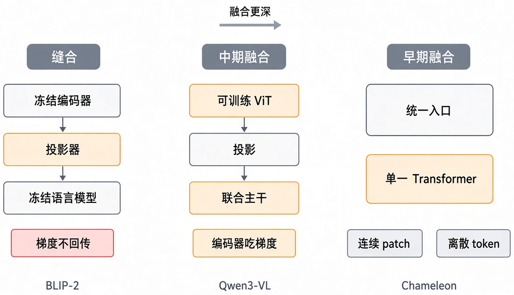
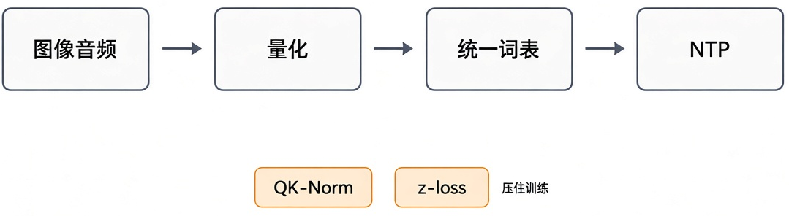
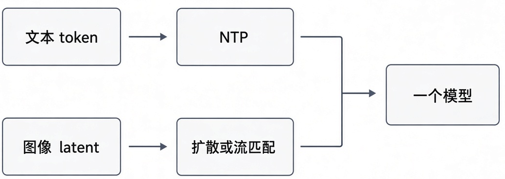
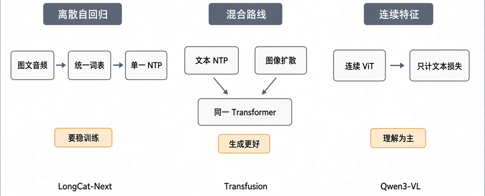
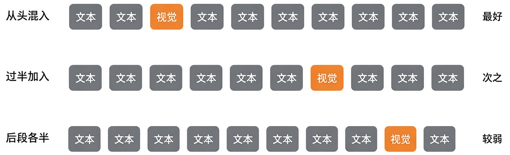
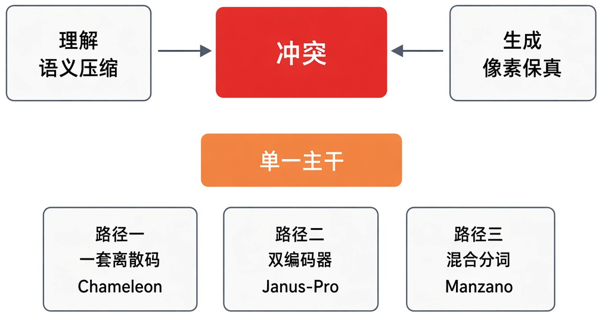
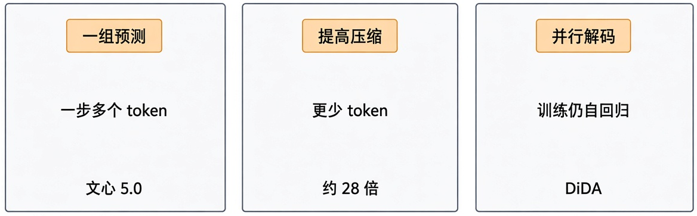
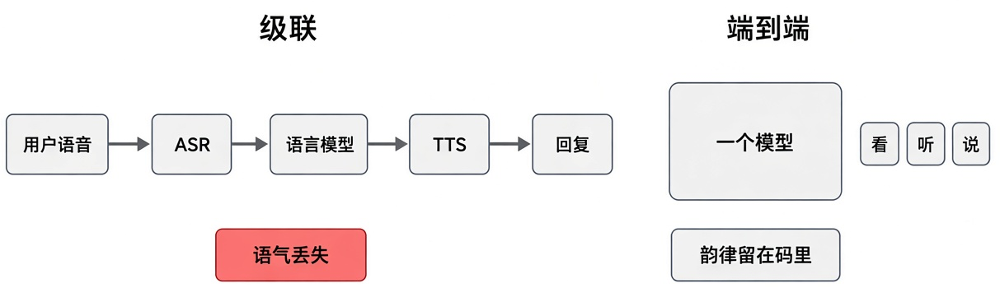
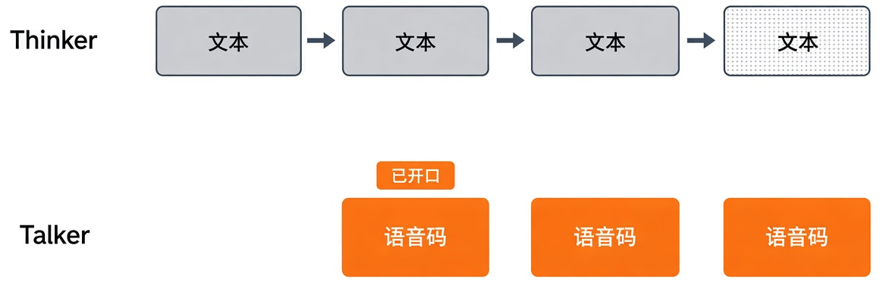
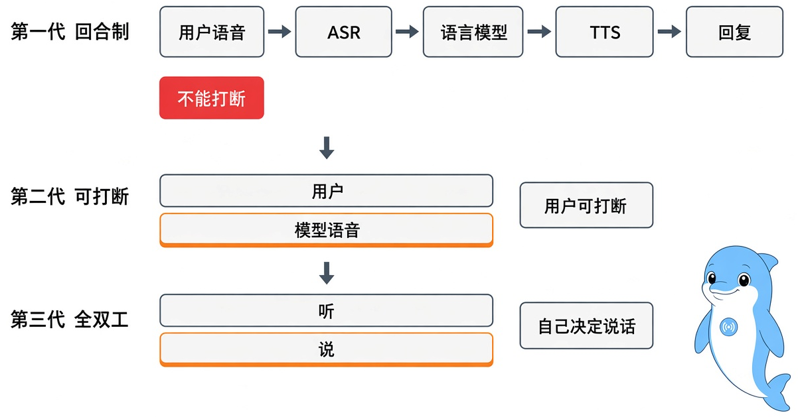

## 5.5 AI 多模态原生模型高频考点

> 本章讨论多模态能力是在预训练阶段与语言能力共同形成，还是在语言模型训练完成后通过外接视觉编码器补入。内容依次覆盖原生多模态的判别标准、三条主流技术路线的取舍、保持纯文本能力的数据课程、理解与生成在同一模型中的表征冲突，以及全模态实时交互从级联走向全双工的系统设计。第 6 章讨论下游应用时沿用本章的融合深度口径。

> **时效说明**：本章事实核对截至 2026 年 10 月。文中模型版本、参数规模和评测分数以所引文献的发布版本为准。闭源产品的服务状态变化较快，本章只引用其官方公开的技术信息，不描述产品当前是否在线。截至核对日期，GPT-4o 与 GPT-5 已于 2026 年 2 月 13 日从 ChatGPT 退役，GPT-4o 仍可通过 API 调用（[OpenAI 帮助中心](https://help.openai.com/en/articles/20001051-retiring-gpt-4o-and-other-chatgpt-models)）；OpenAI 自 2026 年 9 月起陆续发布 GPT-6 系列（[OpenAI](https://openai.com/index/gpt-6-for-everyone/)）。

---

### [5.5.1 什么是原生多模态大模型，它与外接视觉编码器的模块化路线有何区别](#q551)
- [5.5.1.1 面试问题：原生多模态大模型的定义与判别标准是什么？](#q5511)
- [5.5.1.2 面试问题：原生多模态、全模态（Omni）与统一理解生成有什么区别？](#q5512)
- [5.5.1.3 面试问题：模块化缝合路线有哪些局限？](#q5513)

### [5.5.2 原生多模态模型有哪些主流技术路线，各自怎么取舍](#q552)
- [5.5.2.1 面试问题：离散 token 统一自回归路线的基本思想是什么，工程上有哪些难题？](#q5521)
- [5.5.2.2 面试问题：自回归与扩散混合的路线为什么会出现，它调和了什么矛盾？](#q5522)
- [5.5.2.3 面试问题：保留连续视觉特征的预训练路线为什么成了理解任务的常见选择？](#q5523)
- [5.5.2.4 面试问题：几条技术路线如何横向对比与选型？](#q5524)

### [5.5.3 原生多模态预训练在数据与训练策略上有哪些设计](#q553)
- [5.5.3.1 面试问题：模态混合比例与注入时机如何影响模型能力？](#q5531)
- [5.5.3.2 面试问题：联合训练如何做到纯文本能力不退化？](#q5532)

### [5.5.4 理解与生成在同一个模型里统一，难点在哪里](#q554)
- [5.5.4.1 面试问题：为什么理解与生成对视觉表征的要求会冲突，有哪些调和方案？](#q5541)
- [5.5.4.2 面试问题：统一自回归生成图像为什么慢，有哪些加速思路？](#q5542)

### [5.5.5 全模态实时交互模型在系统设计上要解决哪些问题](#q555)
- [5.5.5.1 面试问题：端到端全模态与语音识别、大模型、语音合成的级联方案有什么区别？](#q5551)
- [5.5.5.2 面试问题：流式低时延语音生成有哪些机制？](#q5552)
- [5.5.5.3 面试问题：从可打断到全双工，交互形态怎样演进？](#q5553)

### [附录 术语表](#q55g)

### [参考文献](#q55r)

---

### 5.5.1 什么是原生多模态大模型，它与外接视觉编码器的模块化路线有何区别

#### 5.5.1.1 面试问题：原生多模态大模型的定义与判别标准是什么？

**难度评分：⭐⭐⭐ (3/5)  |  考察频率：⭐⭐⭐⭐⭐ (5/5)**

原生多模态（native multimodal）目前有两种口径。严格口径来自 Apple 的缩放律研究，要求从零开始在各模态上同时训练；工业技术报告多用宽口径，只要求多模态数据从预训练或继续预训练的第一步起参与。判断一个模型是否原生，需要先说明采用哪一种口径，再按训练起点、表征空间、主干结构、编码器依赖和文本能力来源五条标准逐项核对。

Apple 在 ICCV 2025 发表的 *Scaling Laws for Native Multimodal Models* 把原生多模态模型（Native Multimodal Model，NMM）定义为从零开始在所有模态上同时训练、既不用预训练语言模型也不用预训练视觉编码器初始化的模型，并为研究其缩放规律训练了 457 个架构和数据配比各不相同的模型[1]。按这一口径，多数自称原生的工业模型并不满足条件，因为它们的语言主干或视觉编码器来自已有的 checkpoint。

按融合深度，现有模型可以分为三档，如图 5-1 所示：

1. **缝合（late fusion，晚期融合）。** 视觉编码器保持冻结，第一阶段只训练投影器，损失只作用于文本 token。[5.3 节](3_AI多模态基石模型核心技术高频考点.md)介绍的 BLIP-2 全程冻结语言模型[2]，LLaVA 则在第二阶段指令微调时解冻语言模型，与投影器一起训练[3]。2026 年的综述 *Toward Native Multimodal Modeling: A Roadmap* 把这种由冻结组件组装而成的范式归为非原生[4]。

2. **中期融合（mid fusion）。** 模态编码器仍然保留，但多模态特征进入联合主干，编码器在预训练阶段接收任务损失的梯度。Qwen3-VL 和 InternVL3.5 是理解侧的代表[5,6]。两者的语言主干都由已有语言模型初始化，InternVL3.5 的语言部分来自 Qwen3 系列和 GPT-OSS[6]，因此不满足 Apple 的从零定义，但训练方式已经超出只训练投影器的范围。

3. **早期融合（early fusion）。** 各模态进入同一个 Transformer 主干，具体又分两种做法。Apple 论文中的早期融合模型把图像 patch 经线性层投影后与文本 token 一起送入 Transformer，图像不做离散化，模态专用参数基本只剩这一层线性投影[1]。Chameleon、美团 LongCat-Next 和百度文心 5.0（ERNIE 5.0）则把图像等模态离散化为编号并入共享词表，再用 next-token prediction 统一建模[7-9]。

三档之间的差别可以由前向计算与梯度路径给出形式化描述。缝合路线的前向计算与损失如下式所示：

$$
\mathbf{z}=\mathrm{sg}\bigl(\mathrm{ViT}(I)\bigr),\quad \mathbf{h}=W\mathbf{z},\quad \mathcal{L}=-\sum_t\log p_\theta(y_t\mid \mathbf{h},\,y_{\lt t})
$$

其中 $`\mathrm{sg}(\cdot)`$ 表示停止梯度，$`W`$ 为投影矩阵，$`y_t`$ 为第 $`t`$ 个文本 token。交叉熵只作用于文本 token，视觉编码器因此不接收梯度。中期融合去掉 $`\mathrm{sg}`$，视觉编码器与语言模型优化同一个语言建模损失。离散词表上的早期融合把各模态映射到同一张嵌入表，图像、文本和音频的编号在一条序列中交错排列，训练目标就是标准的下一个 token 预测（next-token prediction）：

$$
\mathcal{L}_{\mathrm{NTP}}=-\sum_{t=1}^{L}\log p_\theta(x_t\mid x_{\lt t})
$$

其中 $`L`$ 为序列长度，$`x_t`$ 可以是任一模态的编号。此时视觉不再只是条件前缀，理解与生成共享同一个似然。Apple 的连续 patch 早期融合不使用这张词表，图像位置也不参与词表 softmax。

同一篇综述还按输入输出形态把原生模型分为三类，这一维度与融合深度正交[4]：多模态输入、文本输出（Multi-to-Text，M2T），如 Qwen3-VL；多模态输入、单一非文本目标输出（Multi-to-Target，M2G），如视频生成模型 Wan2.2；理解与生成在同一网络中对称共存的多模态输入输出（Multi-to-Multi，M2M），如 BAGEL 和 Janus-Pro。定位一个新模型时，融合深度与输入输出形态需要同时给出。

可核对的判别标准有五条：

1. **训练起点。** 判断多模态数据是否从预训练第一步起参与。MiniMax-M3（2026）的官方模型卡写明，该模型总参数约 428B、激活约 23B、上下文 100 万 token，并从第一步起进行混合模态训练[10,11]。Kimi K2.5 则在 Kimi K2 纯文本 checkpoint 上用约 15T 视觉与文本混合 token 继续预训练[12]，按宽口径可称原生预训练，按严格口径属于联合继续预训练。

2. **表征空间。** 判断各模态是否进入同一词表或同一嵌入空间。Chameleon 把规模为 8192 的图像码本并入规模为 65536 的统一词表[7]，连续特征路线的视觉向量则不进入词表。

3. **主干结构。** 判断模型由单一 Transformer 共享注意力和损失，还是存在 Thinker-Talker、双专家这类结构分工。

4. **编码器依赖。** 判断模型完全不依赖外挂编码器，还是保留编码器并让它参与端到端联合训练。

5. **文本能力来源。** 判断语言能力与多模态能力是在同一次训练中形成，还是先完成语言建模、再补入视觉。

闭源模型的原生表述只能采信官方原文，开源模型同样需要核对技术报告。Gemini 技术报告称 Gemini 模型是 natively multimodal，即在文本、图像、音频和视频上联合训练[13]；OpenAI 在 2024 年发布 GPT-4o 时称其为在文本、视觉和音频上端到端训练的单一模型[14]。两家都没有公开训练配方，产品表述不足以判断模型是否从零训练。开源侧同样存在口径差异：Llama 4 官方博客写的是 native multimodality with early fusion，但其视觉编码器基于 MetaCLIP，并曾配合冻结的 Llama 模型单独训练[15]，因此它是早期融合式的输入序列加上一个单独训练过的编码器。

图 5-1 三档融合深度对比示意图

> **面试速答**：严格口径下，原生多模态模型从零开始在各模态上同时训练，不用预训练语言模型或视觉编码器初始化。工业报告多用宽口径，并按融合深度分三档：缝合冻结编码器，中期融合让编码器参与联合训练，早期融合又分连续 patch 输入和离散统一词表两种。

---

#### 5.5.1.2 面试问题：原生多模态、全模态（Omni）与统一理解生成有什么区别？

**难度评分：⭐⭐ (2/5)  |  考察频率：⭐⭐⭐⭐ (4/5)**

原生多模态、全模态（Omni）和统一理解生成经常出现在同一篇技术报告里，三者描述的是相互独立的三个维度，任何一个维度都不能推出另外两个：

1. **原生多模态描述融合深度。** 它关注多模态数据是在预训练早期就与语言联合优化，还是在语言模型训练完成后再接入，衡量的是训练过程的纵向统一程度。

2. **全模态描述模态覆盖范围。** 它关注模型除图文之外是否支持音频输入、语音输出和视频理解，衡量的是能力的横向覆盖。全模态模型不必从零训练：Qwen3-Omni 能听会说，但它的 Thinker-Talker 结构仍包含独立的视觉编码器和音频编码器，其中音频编码器 AuT 单独从零训练，视觉编码器沿用 Qwen3-VL 的编码器[16]，属于中期融合。

3. **统一理解生成描述任务是否对称。** 它关注同一个主干能否既理解图像又生成图像。OpenAI 的系统卡附录写明，4o 图像生成（2025）是嵌入 GPT-4o 架构内部的自回归模型[17]。字节 BAGEL 把理解和生成放在同一个模型中，激活参数 7B、总参数 14B，语言主干由 Qwen2.5 初始化[18]，因此不满足从零训练的条件。

下面四个边界例子可以把三个维度分开：

1. **从零训练的早期融合，覆盖的模态较少。** Chameleon 只覆盖图文两种模态，从零开始在交错的图文数据上端到端训练[7]。

2. **全模态，但编码器仍然保留。** 美团 LongCat-Flash-Omni 总参数 560B、激活 27B，支持实时音视频交互，感知与语音重建仍由单独的模块完成[19]。

3. **理解与生成共用一个 Transformer，但依赖预训练组件。** DeepSeek 的 Janus-Pro 为理解和生成分别使用两套视觉编码，语言侧和视觉侧都建立在预训练组件之上[20]。

4. **三个维度同时接近满足。** 文心 5.0 从零开始联合训练文本、图像、视频和音频，理解与生成共用一套自回归目标[9]。LongCat-Next 把文本、视觉和音频统一为离散 token，论文称其解码器主干按 LongCat-Flash-Lite 的 A3B 结构从零训练，总参数 68.5B、平均激活约 3B[8]。

分析具体模型时，首先要确定讨论的是哪一个维度。三个维度彼此独立，如图 5-2 所示，全模态与原生不能互相替代。

图 5-2 三个概念轴对照示意图

> **面试速答**：原生多模态描述训练与结构的统一程度，全模态描述覆盖哪些模态，统一理解生成描述同一主干能否既理解又生成，三者可以分别成立。Qwen3-Omni 能听会说，但仍是带编码器的 Thinker-Talker。文心 5.0 和 LongCat-Next 更接近从零训练，并把理解和生成放进同一套自回归目标。

---

#### 5.5.1.3 面试问题：模块化缝合路线有哪些局限？

**难度评分：⭐⭐⭐ (3/5)  |  考察频率：⭐⭐⭐⭐ (4/5)**

缝合路线以 CLIP 等对比学习预训练的视觉编码器为起点，BLIP-2、LLaVA 把视觉作为外部条件接到已经训练完成的语言模型上。以 LLaVA 为例，训练目标是给定图像和指令时回答文本的似然（LLaVA 论文式 (3)）[3]，即只建模条件分布 $`p(\text{text} \mid \text{image})`$，不建模图像本身的分布 $`p(\text{image})`$，因此模型不具备图像生成能力。联合分布可以分解为 $`p(\text{text}, \text{image})=p(\text{image})\,p(\text{text} \mid \text{image})`$，缝合路线只学习了其中的第二个因子。下面三条局限都与「视觉只作为外部条件」这一设定有关，如图 5-3 所示：

1. **冻结编码器构成信息瓶颈。** 记图像为 $`X_v`$，冻结编码器对应马尔可夫链 $`X_v\to\mathrm{enc}_{\mathrm{frozen}}(X_v)\to\mathrm{LLM}`$。由数据处理不等式，数据经过任意函数之后与下游变量的互信息不会增加，即 $`I(y;\mathrm{enc}(X_v))\le I(y;X_v)`$[21]；编码器参数又不再被下游损失更新，这个上界在接入语言模型之后无法再提高。CLIP 式对比预训练优化的是图像表征与 caption 的互信息，图像与 OCR 文本、图像与边界框之间的互信息并不在优化目标之内。编码器保留哪些信息、丢弃哪些信息，在投影器开始训练之前就已经确定。BLIP-2 两阶段改装与原生预训练的对照见 [5.4.9.1](4_AI多模态主流模型核心技术高频考点.md#q5-4-9-1)。

2. **对齐需要额外阶段，并可能造成语言能力退化。** 两个独立预训练的表征空间之间存在错位，而投影器的容量有限：LLaVA 使用线性投影，LLaVA-1.5 改用两层 MLP[3,22]。对齐因此需要专门的对齐阶段和对齐数据，LLaVA 在指令微调阶段还要解冻语言模型一起训练[3]，成本随之转移到下游。语言模型参数被多模态数据更新之后，纯文本能力可能下降：LLaVA-1.5-13B 的 MT-Bench 为 5.99，低于其语言基座 Vicuna-v1.5-13B 的 6.57[23]，[5.1.1.2](1_AI多模态理论基础高频考点.md#q5112) 也讨论过这个例子。InstructGPT 把 RLHF 之后公开 NLP 基准性能回退的现象称为对齐税（alignment tax）[24]；多模态对齐造成的纯文本退化与之形式相近、成因不同，本书称为语言能力退化。

3. **从零训练的对照中，晚期融合没有先天优势。** Apple 对 457 个从零训练模型的扫描讨论的是另一个问题[1]。该论文中的晚期融合是视觉编码器接到解码器上、两部分都从零训练，与使用冻结组件的 LLaVA 不同。在这一设定下，晚期融合相对早期融合没有先天优势：参数量较小时早期融合的损失更低、训练更省、部署更简单；计算最优时，晚期融合需要更高的参数量与数据量之比。论文同时承认，把分别预训练好的组件接起来具有很高的样本效率[1]。这组结果只说明从零训练时两种结构的差别，冻结式缝合的长处在于不必从零重训语言模型。

2025 年以后发布的旗舰模型多数在预训练阶段就放入多模态数据。Llama 4 采用早期融合的输入序列，官方博客写明整体数据混合超过 30T token，模型卡另写 Scout 约 40T、Maverick 约 22T，两处口径不同，本书并列给出[15,25]。MiniMax-M3 同样从第一步起进行混合模态训练[11]。缝合路线并没有消失，主要用于学术基线和较小规模的模型。

图 5-3 缝合路线三条局限示意图

> **面试速答**：缝合路线只建模看到图像后生成文本的条件分布，图像生成不在训练目标里。冻结编码器丢掉的文字、边界框和图表结构，后面的语言模型无法恢复；对齐还需要额外数据，并可能造成语言能力退化。Apple 的从零实验说明晚期融合没有先天优势，冻结式缝合的长处是复用已训好的大模型。

---

### 5.5.2 原生多模态模型有哪些主流技术路线，各自怎么取舍

#### 5.5.2.1 面试问题：离散 token 统一自回归路线的基本思想是什么，工程上有哪些难题？

**难度评分：⭐⭐⭐⭐ (4/5)  |  考察频率：⭐⭐⭐⭐ (4/5)**

离散 token 统一自回归路线把语言模型的做法推广到其他模态：既然 next-token prediction 足以刻画语言，就把图像和音频也离散化为 token，用同一个目标函数统一建模。这条路线在工程上的难题集中在三方面，即统一 softmax 带来的训练不稳定、模态混合调度和量化造成的信息损失。

视觉编码器先输出连续特征 $`\mathbf{z}_e\in\mathbb{R}^{d}`$，再对码本 $`\{e_k\}_{k=1}^{K}`$ 做最近邻量化：

$$
k^*=\arg\min_k\|\mathbf{z}_e-e_k\|_2,\quad \mathbf{z}_q=e_{k^*}
$$

其中 $`K`$ 为码本大小，$`e_k`$ 为第 $`k`$ 个码字，$`k^*`$ 即视觉 token。Chameleon（2024）的图像分词器把一张 $`512\times 512`$ 的图像编码为 1024 个编号（对应 $`32\times 32`$ 的特征图），码本大小 $`K=8192`$，这些编号并入规模为 65536 的 BPE 统一词表；7B 和 34B 两个规模的单一 Transformer 从零开始训练，理解和生成共用 $`\mathcal{L}_{\mathrm{NTP}}`$[7]。视觉分词器（Visual Tokenizer）通常另设重建项 $`\|\mathbf{z}_e-\mathbf{z}_q\|_2^2`$，码本用指数滑动平均或 straight-through 估计更新[26]，惯例是先训练好分词器，再训练 Transformer，细节见 [5.2.11.2](2_AI多模态核心组件高频考点.md#q5-2-11-2)。GenEval 是文生图的组合指令评测，总分在 0 到 1 之间。

智源 Emu3 只用 next-token prediction 训练，模型共 8.49B 参数，技术报告于 2024 年发布，2026 年 1 月 28 日以论文形式发表于 *Nature*[27,28]。Emu3 在原始提示词下的 GenEval 为 0.54，SDXL 为 0.55，使用 GPT-4V 改写提示词后 Emu3 达到 0.66[27]。这组数字说明纯 next-token prediction 的生成质量与当时的 SDXL 相当，并未全面超过扩散模型。

词表和损失统一之后，语言模型的三类基础设施可以直接沿用：

1. **训练配方。** 数据课程、学习率退火、监督微调和强化学习对齐都不必为视觉单独设计。

2. **推理栈。** KV cache、投机解码和量化部署都可以复用，视觉生成不需要单独维护一套扩散服务。

3. **跨模态上下文。** 理解与生成处在同一条序列中，按前一张图的风格继续生成这类依赖可以写进同一个似然。

工程上反复出现的难题有三类：

1. **统一 softmax 下的模态竞争。** Chameleon 论文 §2.3 报告，标准 LLaMA 架构在训练中后期因范数缓慢增长而出现复杂的发散[7]。作者把原因归结为多个熵差异显著的模态共享全部权重：每个模态都会通过略微增大范数与其他模态竞争，softmax 的平移不变性（$`\mathrm{softmax}(z)=\mathrm{softmax}(z+c)`$）使这种增长不受约束，训练初期影响不大，一旦超出 bf16 的有效表示范围就会发散；去掉图像生成的消融实验没有发散[7]。Chameleon 的稳定化措施后来成为这条路线的常用配置。QK-Norm（Query-Key Normalization）在注意力内部对 query 和 key 做层归一化，直接控制注意力 softmax 输入的范数[7,29]，不加 QK-Norm 的 Chameleon-7B 在约 20% 个训练 epoch 后发散。QK-Norm 不能解决输出层 softmax 的 logit 漂移，Chameleon 因此沿用 PaLM 的 z-loss，对配分函数加正则[7,30]：

$$
\mathcal{L}_z=\lambda\bigl(\log\sum_i e^{z_i}\bigr)^2,\qquad \lambda=10^{-5}
$$

其中 $`z_i`$ 为输出层第 $`i`$ 个词的 logit，$`\sum_i e^{z_i}`$ 即配分函数 $`Z`$，系数 $`\lambda=10^{-5}`$ 取自 Chameleon 论文。Chameleon-34B 还需要按 Swin Transformer 的方式调整块内归一化的位置，以限制前馈层输出范数的增长[7]。

2. **模态混合调度。** 某一模态在局部训练窗口内占比过高时，模型会学到对另一模态缺乏响应的先验，混合比例和采样课程因此需要单独设计，见 [5.5.3.1](#q5531)。

3. **离散化带来的信息损失。** 向量量化必然损失细节，Chameleon 论文也承认其分词器难以重建含大量文字的图像，这限制了模型在 OCR 类任务上的上限[7]。LongCat-Next（2026）的结果说明，离散路线的感知上限主要取决于分词器质量：它的 dNaViT 视觉分词器能在最高约 28 倍压缩率下对任意分辨率的图像做编码和解码，文本、视觉和音频共享参数、注意力和损失，论文把这套框架称为 DiNA（Discrete Native Autoregressive，离散原生自回归）[8]。在论文的对比表中，LongCat-Next 的 OmniDocBench 英文和中文得分为 0.152 和 0.226（越低越好），优于同表的 Qwen3-Omni-A3B 和 Qwen3-VL-A3B；MMStar 为 69.3，低于 Qwen3-VL-A3B 的 72.1[8]。离散模型在文档理解上可以超过同规模的连续模型，在通用视觉问答上并没有全面超过。离散统一自回归与两处稳定化如图 5-4 所示。

图 5-4 离散统一自回归示意图

> **面试速答**：离散统一自回归把图像和音频离散为 token 并入同一词表，用 next-token prediction 同时完成理解和生成。训练不稳定源于多模态共享权重时的范数竞争，常用 QK-Norm 和 z-loss 抑制。LongCat-Next 说明分词器足够好时，文档理解可以超过同规模的连续模型。

---

#### 5.5.2.2 面试问题：自回归与扩散混合的路线为什么会出现，它调和了什么矛盾？

**难度评分：⭐⭐⭐⭐ (4/5)  |  考察频率：⭐⭐⭐ (3/5)**

混合路线针对纯离散自回归在图像生成质量上的短板，让每种模态使用与其统计结构相匹配的损失：文本继续做 next-token prediction，图像在连续空间里做扩散或流匹配（Flow Matching），代价是放弃单一的 softmax 目标。

这条路线要调和的矛盾是，离散化会损害生成保真度，扩散目标又难以并入统一的序列似然。扩散在连续空间中建模 $`p(I)`$，生成质量较高，但去噪目标与 next-token prediction 不兼容；纯离散自回归在结构上最统一，但向量量化和逐 token 串行解码同时降低了生成质量和速度。

网络结构通常是一个 Transformer、两套注意力掩码和两个输出头。文本位置使用因果掩码，在词表上计算 next-token prediction；图像 patch 保持连续表征 $`\mathbf{x}\in\mathbb{R}^{N\times d}`$，损失取扩散或流匹配：

$$
\mathcal{L}_{\mathrm{diff}}=\mathbb{E}_{t,\boldsymbol{\epsilon}}\bigl[\|\boldsymbol{\epsilon}-\epsilon_\theta(\mathbf{x}_t,t,\mathbf{c})\|_2^2\bigr],\qquad \mathbf{x}_t=\alpha_t\mathbf{x}_0+\sigma_t\boldsymbol{\epsilon}
$$

其中 $`\mathbf{x}_0`$ 为干净的图像表征，$`\boldsymbol{\epsilon}\sim\mathcal{N}(0,I)`$ 为噪声，$`\alpha_t,\sigma_t`$ 为噪声调度系数，$`\mathbf{c}`$ 为条件。图像 token 之间通常允许双向注意力，以满足去噪对全局上下文的需求，文本保持因果约束；两类位置共享参数，只是掩码不同。总损失为 $`\mathcal{L}=\mathcal{L}_{\mathrm{NTP}}+\lambda\mathcal{L}_{\mathrm{diff}}`$，$`\lambda`$ 取值偏大时生成质量上升而语言能力下降，取值偏小时模型退化为以视觉为条件的语言模型。

Meta 的 Transfusion（2024）把这套双损失接入单一 Transformer，并与 Chameleon 式的全离散方案在受控计算量下比较[31]。在相同 FLOPs 下，Transfusion 的图像生成 FID（Fréchet Inception Distance，越低越好）约为离散方案的一半；图生文任务上，Transfusion 只用离散方案 21.8% 的 FLOPs 即可持平[31]。这两个数字来自相同计算量下的缩放曲线比较，是「按模态保留损失有收益」的常用证据。

2025 年的工程变体把分工做得更明确。字节 BAGEL 激活参数 7B、总参数 14B，采用 MoT（Mixture-of-Transformer-Experts，Transformer 专家混合）结构，理解专家与生成专家分工，并用 SigLIP2 视觉编码器提取语义、用 VAE 编码像素，语言主干由 Qwen2.5 初始化[18]。Apple 的 Manzano 提出混合视觉分词器：同一个视觉编码器接两路轻量适配器，连续适配器服务理解，离散适配器服务生成，自回归主干统一预测文本和图像 token，再由辅助的扩散解码器把图像 token 渲染为像素[32]。产品侧，OpenAI 于 2025 年 3 月发布 4o 图像生成并将其设为 ChatGPT 的默认图像生成器[33]，系统卡附录写明它是嵌入 GPT-4o 的自回归模型，此前的 DALL·E 则是扩散模型[17]。

混合路线的收益是生成质量可以接近专用扩散模型，代价是双损失、双路径带来的训练与推理复杂度，模型内部仍保留两套模态处理逻辑。文本与图像两路并列，如图 5-5 所示。

图 5-5 自回归与扩散双损失示意图

> **面试速答**：混合路线让文本继续做 next-token prediction，图像在连续空间里做扩散或流匹配，以弥补纯离散自回归的生成质量。Transfusion 在相同计算量下的 FID 约为全离散方案的一半。BAGEL、Manzano 是后来的工程变体，代价是损失、掩码和推理路径都变成两套。

---

#### 5.5.2.3 面试问题：保留连续视觉特征的预训练路线为什么成了理解任务的常见选择？

**难度评分：⭐⭐⭐ (3/5)  |  考察频率：⭐⭐⭐⭐⭐ (5/5)**

在多模态理解任务上，2025 至 2026 年的开源旗舰多数保留 ViT 类编码器输出的连续特征，并让编码器从预训练阶段起参与端到端优化。按 [5.5.1.1](#q5511) 的分档，这属于中期融合，代表模型是 Qwen3-VL 和 InternVL3.5[5,6]。连续特征没有量化误差，视觉位置也不参与词表 softmax，因此细粒度感知精度和纯文本能力都较容易保持。

视觉侧不做量化，编码器输出经投影后进入语言模型：

$$
\mathbf{H}_v=\mathrm{ViT}(I)\in\mathbb{R}^{N\times d_v},\quad \mathbf{H}_v'=W\mathbf{H}_v\in\mathbb{R}^{N\times d}
$$

其中 $`N`$ 为视觉 token 数，$`d_v`$ 和 $`d`$ 分别为视觉特征维度和语言模型隐藏维度。$`\mathbf{H}_v'`$ 作为条件前缀与文本嵌入拼接，自回归损失只作用于文本位置 $`\mathcal{T}_{\mathrm{text}}`$：

$$
\mathcal{L}=-\sum_{t\in\mathcal{T}_{\mathrm{text}}}\log p_\theta(y_t\mid \mathbf{H}_v',\,y_{\lt t})
$$

视觉位置不进入词表、不参与 softmax，因此不与文本竞争 logit 空间，语言分布受到的扰动较小。与缝合路线的关键差别在于这里的 ViT 不冻结，$`\partial\mathcal{L}/\partial\theta_{\mathrm{ViT}}`$ 从联合训练开始就存在。生成能力的缺失同样由结构决定：模型没有学习 $`p(\mathbf{H}_v\mid y)`$，需要图像生成时必须另接扩散头或离散码本。

连续特征在理解任务上有三方面优势：

1. **没有量化误差。** OCR、视觉定位、文档和图表解析这类细粒度任务受益最明显。Qwen3-VL 和 InternVL3.5 的文档理解都建立在连续特征之上，InternVL3.5 最大的版本是 InternVL3.5-241B-A28B，总参数约 240.7B[6]。

2. **能复用已有语言模型的训练管线。** InternVL3.5 的原生预训练阶段约使用 250B token，纯文本数据与多模态数据之比约为 1:2.5，最大序列长度 32K[6]。它的语言主干由 Qwen3 系列和 GPT-OSS 初始化，视觉编码器由 InternViT 初始化[6]，因此这一阶段属于联合继续预训练，论文仍称之为 native pre-training。

3. **纯文本能力更易保持。** 视觉位置不参与词表 softmax，不与文本 token 竞争输出分布，进一步的做法见 [5.5.3.2](#q5532)。

另外两个常被拿来对照的模型，结构并不相同。Llama 4 的输入序列采用早期融合，Scout 激活 17B、16 个专家、总参数 109B、上下文 10M，视觉编码器基于 MetaCLIP 且单独训练过[15]。Kimi K2.5 总参数 1.04T、激活 32B，视觉编码器 MoonViT 由 SigLIP-SO-400M 初始化，整个模型在 Kimi K2 纯文本 checkpoint 上继续混合训练[12]，也不属于从零训练的早期融合。

这条路线主要覆盖理解任务。按严格口径，它的原生程度取决于初始化来源；它与缝合路线的分界在于编码器是否参与联合训练、多模态数据是否进入预训练，详细对照见 [5.4.9.1](4_AI多模态主流模型核心技术高频考点.md#q5-4-9-1)。连续特征只对文本位置计算损失，如图 5-6 所示。

图 5-6 连续视觉特征示意图

> **面试速答**：理解任务上的常见做法是保留 ViT 的连续特征，只对文本位置计算损失，同时让编码器在预训练中接收梯度，代表是 Qwen3-VL 和 InternVL3.5。连续特征没有量化误差，也不参与词表 softmax，细粒度感知和语言能力都较易保持。模型本身不学习图像生成，且多数由已有语言模型初始化。

---

#### 5.5.2.4 面试问题：几条技术路线如何横向对比与选型？

**难度评分：⭐⭐⭐⭐ (4/5)  |  考察频率：⭐⭐⭐⭐ (4/5)**

三条路线没有绝对的优劣，差异由表征形式决定：表征形式选定之后，理解精度、生成能力和部署方式随之确定。全模态实时交互与三条路线正交，任何一条路线都可以向音视频交互扩展，放在 [5.5.5](#q555) 单独讨论。三条路线的对照如表 5-1 所示，结构差别如图 5-7 所示。

表 5-1 三条技术路线对照

| 属性 | 离散统一自回归 | 自回归加扩散 | 连续特征预训练 |
|---|---|---|---|
| 表征 | 各模态离散 token，共用词表 | 文本离散，图像连续，两套损失 | 文本离散，视觉连续，只对文本算损失 |
| 理解 | 取决于分词器，文档任务上可以接近专用模型 | 理解路径可以用连续或语义特征 | 没有量化误差，细粒度任务上通常更稳 |
| 生成 | 同一套自回归即可生成，质量受量化限制 | 主干里用扩散或流匹配，质量接近专用生成模型 | 不直接生成图像，需另接生成头 |
| 训练 | 多模态共享权重引起范数竞争，常用 QK-Norm 和 z-loss | 需要平衡两套损失的权重 | 沿用语言模型的训练配方 |
| 部署 | 复用语言模型推理栈，生成时延随 token 数上升 | 自回归和扩散两套推理 | 理解侧与语言模型推理栈一致 |
| 代表 | Chameleon、LongCat-Next、文心 5.0 | Transfusion、BAGEL、Manzano | Qwen3-VL、InternVL3.5；Llama 4 的输入是早期融合，编码器另训 |

选型按业务目标展开：

1. **理解优先。** 文档解析、GUI 操作和多模态推理选择连续特征路线。本书认为这条路线在性能、成本和工具链成熟度上综合条件最好，Qwen3-VL 和 InternVL3.5 是常用的参照模型。

2. **理解与生成合一，并希望只维护一套推理栈。** 这类需求选择离散统一自回归，收益是推理基础设施与语言模型完全相同，代价是需要自行解决分词器质量和训练稳定性。文心 5.0 是已发布的大规模样本：技术博客给出的总参数为 2.4 万亿，每个 token 激活的参数不到 3%；技术报告写明它从零训练，采用不按模态标签路由的超稀疏混合专家，并以统一的下一组 token 预测（Next-Group-of-Tokens Prediction）为目标[9,34]。

3. **生成质量优先。** 这类需求选择混合路线，以系统复杂度换取生成质量。

短期内三条路线会并行发展。2026 年的 Roadmap 综述把理解与生成在同一 Transformer 中共存视为原生多模态建模的目标形态[4]。文心 5.0 的下一组 token 预测按模态采用不同粒度：文本仍是 next-token prediction，并加入多 token 预测以提高吞吐；视觉采用下一帧与尺度预测；音频采用下一 codec 预测[9]。

图 5-7 三条技术路线对比示意图

> **面试速答**：三条路线的差别源于表征形式。离散统一自回归结构最整齐，但生成质量和训练稳定性受分词器与范数竞争限制；自回归加扩散保留图像的连续损失，生成更好，系统更复杂；连续特征最适合理解，代表是 Qwen3-VL 和 InternVL3.5。选型取决于业务侧重理解、统一推理栈还是生成质量。

---

### 5.5.3 原生多模态预训练在数据与训练策略上有哪些设计

#### 5.5.3.1 面试问题：模态混合比例与注入时机如何影响模型能力？

**难度评分：⭐⭐⭐⭐ (4/5)  |  考察频率：⭐⭐⭐⭐ (4/5)**

预训练阶段影响最大的可调因素之一是数据课程，即模态组成、混合比例和注入时机。混合比例在优化中对应梯度混合，每一步的有效更新可以写成：

$$
\Delta\theta \propto \alpha\,\nabla\mathcal{L}_{\mathrm{mm}}+(1-\alpha)\,\nabla\mathcal{L}_{\mathrm{text}}
$$

其中 $`\alpha`$ 为多模态数据所占比例，$`\mathcal{L}_{\mathrm{mm}}`$ 和 $`\mathcal{L}_{\mathrm{text}}`$ 分别为多模态数据和纯文本数据上的损失。$`\alpha`$ 过大时文本方向的梯度被淹没，$`\alpha`$ 过小时视觉梯度稀疏，对齐难以充分完成。需要区分的是，下文的「早期」指注入时机，与 [5.5.1.1](#q5511) 的早期融合结构无关。2025 至 2026 年有两组实验可以直接引用，其结论可归为四点：

1. **从零训练的原生模型遵循与语言模型相近的缩放律。** Apple 的扫描显示，早期融合模型的损失随计算量下降的规律为 $`L\propto C^{-0.049}`$，与 GPT-3 的 $`C^{-0.048}`$ 接近[1]。计算最优的参数量 $`N^*\propto C^{0.526}`$，数据量的指数约为 0.473，两者都接近计算量的平方根，与 Chinchilla 的结论一致[1,35]。数据构成会改变最优分配：交错图文数据从更大的模型中获益更多，图文对（caption）数据则从更多训练 token 中获益更多[1]。论文没有给出固定的最优混合配方，不同混合比例下的缩放趋势相近，具体配比需要按数据形态重新拟合。

2. **注入时机比后段集中注入更重要。** Kimi K2.5 在视觉与文本 token 总预算固定的条件下做了对照：从第一步起以 10%:90% 的视觉文本比例混合，效果优于先用纯文本训练 50% 的预算、再按 20%:80% 混合，也优于先用纯文本训练 80% 的预算、再按 50%:50% 混合[12]。论文同时发现视觉比例本身对最终多模态成绩的影响很小，较早注入且比例较低的方案效果更好；作者的解释是，从一开始联合优化可以避免后段领域迁移带来的冲击，文本能力曲线也更平稳[12]。本书认为，这与表征几何在训练早期即基本定型的观察一致：纯文本梯度先塑造表征空间，再引入视觉只能在已经固化的流形上做局部修正。

3. **配套的监督微调可以几乎不用视觉样本。** Kimi K2.5 的 Zero-Vision SFT 只用纯文本监督数据激活视觉推理和工具使用，图像操作通过 IPython 中的程序代理完成，例如用二值化和计数估计物体大小[12]。论文报告，在这一阶段加入人工设计的视觉轨迹反而损害泛化，作者认为原因是联合预训练已经建立了较强的视觉文本对齐[12]。由此看来，多模态对齐主要在预训练阶段完成，后训练更多是调用已经对齐的能力。

4. **混合专家的路由不按模态写死。** Apple 的扫描中，路由器取 $`\mathrm{softmax}(W\mathbf{h})`$，不把模态编号拼入 $`\mathbf{h}`$，这种不看模态标签的路由（modality-agnostic routing）稳定优于按模态指定专家的路由，模型在训练中会自行学出与模态相关的专家分工[1]。LongCat-Next 同样采用不看模态标签的混合专家，并观察到部分专家逐渐偏向视觉或音频等特定模态[8]；文心 5.0 的路由也只依据统一的 token 表示[9]。把模态先验写进路由器，等于预先固定了各模态可用的专家容量。

几组公开的课程可以作为工程参照，不应视为通用最优解。三组课程如下：

1. **InternVL3.5。** 论文称为原生预训练的阶段约使用 250B token，纯文本与多模态数据之比约为 1:2.5，序列长度 32K[6]。

2. **Emu3.5。** 两阶段合计约 13T token，第一阶段 10T token、最大序列长度 32768，第二阶段约 3T token，提高图像分辨率并改进数据质量[36]。模型从 Qwen3 初始化，采用离散 next-token prediction，按严格口径不属于从零训练[36]。

3. **分辨率课程。** 先用低分辨率学习对齐，再用高分辨率学习细节，Emu3.5 在第二阶段提高分辨率即属此类[36]；降低成本的动机与 [5.4.10.1](4_AI多模态主流模型核心技术高频考点.md#q5-4-10-1) 的渐进式缩放相同。

多模态能力需要在表征形成的早期参与塑造，训练末尾大剂量注入只是在已经固化的语言空间上修补。三种注入课程如图 5-8 所示。

图 5-8 视觉注入课程示意图

> **面试速答**：混合比例对应每一步中多模态梯度和文本梯度的权重。Apple 的从零实验说明参数量和数据量近似按计算量的平方根同步增长。Kimi K2.5 在视觉 token 总预算固定时，从第一步起按 10% 的视觉比例混合，效果优于先训纯文本、后段再提高视觉比例。混合专家的路由也不宜按模态写死。

---

#### 5.5.3.2 面试问题：联合训练如何做到纯文本能力不退化？

**难度评分：⭐⭐⭐⭐ (4/5)  |  考察频率：⭐⭐⭐⭐ (4/5)**

「加入视觉必然削弱文本能力」曾是常见判断，[5.1.1.2](1_AI多模态理论基础高频考点.md#q5112) 中 LLaVA-1.5 的 MT-Bench 下降就是缝合路线的例子。2026 年的证据表明退化并非必然，数据课程的形状比是否加入视觉更关键。

从机制上看，退化主要来自训练分布的突变。纯文本阶段收敛到 $`p_{\mathrm{text}}`$ 之后，如果把混合比 $`\alpha`$ 由 0 突然提高到 0.5，小批量内的 token 分布会发生跳变，优化轨迹偏离已经形成的文本区域，这与灾难性遗忘的典型过程一致。Kimi K2.5 的学习曲线也显示，从一开始混合的方案文本能力曲线更平稳，后段注入的方案则出现领域迁移带来的冲击[12]。全程保持较小且恒定的 $`\alpha`$，相当于在 $`p_{\mathrm{text}}`$ 附近持续施加少量多模态扰动，三种课程的对照见 [5.5.3.1](#q5531)。

Kimi K2.5 的文本侧证据需要对应到正确的训练阶段。约 15T 混合 token 的继续预训练建立的是视觉与文本的对齐；纯文本基准的提升出现在其后的视觉强化学习阶段，MMLU-Pro 从 84.7% 提高到 86.4%，GPQA-Diamond 从 84.3% 提高到 86.4%，LongBench v2 从 56.7% 提高到 58.9%[12]。SWE-bench Verified 的 76.8% 是最终模型的成绩，并非继续预训练前后的差值[12]。

工程上有三项做法反复出现：

1. **纯文本数据流全程保留。** 预训练全程保留纯文本数据，避免多模态数据独占某个训练阶段；Kimi K2.5 的早期混合方案中，纯文本始终占混合数据的 90%[12]。

2. **视觉从早期以低比例进入。** 采用 Kimi K2.5 的课程，可以避免后段大剂量多模态数据冲击已经收敛的语言分布。本书认为，分布突变比「视觉占用了模型容量」更能解释这类遗忘。

3. **稳定 logit。** z-loss 和 QK-Norm 抑制多模态共享权重引起的范数增长，在离散路线上几乎是必要组件，见 [5.5.2.1](#q5521)；连续路线的视觉位置不参与 softmax，压力较小，但同样可以沿用。

评估一家厂商的训练配方时，首先要看它是否公布多模态化前后的纯文本基准。Kimi K2.5 公布了视觉强化学习前后的 MMLU-Pro 和 GPQA-Diamond，两项都上升[12]；只报告多模态榜单、不报告纯文本对照的模型，外部无法判断其语言能力是否受损。

> **面试速答**：纯文本能力下降常常是因为视觉数据在训练后段突然占据很大比例，分布跳离了已经收敛的语言区域。Kimi K2.5 从第一步起按约 10% 的视觉比例混合并全程保留文本数据，其后的视觉强化学习还使 MMLU-Pro 从 84.7% 升到 86.4%，GPQA-Diamond 从 84.3% 升到 86.4%。

---

### 5.5.4 理解与生成在同一个模型里统一，难点在哪里

#### 5.5.4.1 面试问题：为什么理解与生成对视觉表征的要求会冲突，有哪些调和方案？

**难度评分：⭐⭐⭐⭐ (4/5)  |  考察频率：⭐⭐⭐⭐ (4/5)**

理解与生成对视觉表征的要求方向相反：理解要求把图像压缩为语义并丢弃无关细节，生成要求保留足以重建像素的信息，同一个视觉表征很难同时满足两者。现有的调和方案在表征层分工，同时尽量维持单一主干。

记视觉表征为 $`z`$、图像为 $`X_v`$。理解任务希望 $`z`$ 保留与语义标签 $`y_{\mathrm{sem}}`$ 的互信息，同时丢弃图像中与语义无关的部分：

$$
\max I(z;y_{\mathrm{sem}})\quad\text{并尽量}\quad\min I(z;X_v)
$$

CLIP 和对比学习沿这一方向优化，丢弃纹理等低层细节以换取可迁移的语义。生成任务希望 $`\max I(z;X_v)`$，即能够重建图像，对应 VAE 的重建项 $`-\log p(X_v\mid z)`$ 或扩散的去噪目标。同一个编码器难以同时充当信息瓶颈和充分统计量，早期统一模型中理解与生成相互牵制，两类模型因此长期分开训练。

理解要求把场景压缩为高层概念，生成要求保留毛发纹理、光照渐变等低层信息，用同一个 $`z`$ 同时服务两端，两端的性能都会下降。后来的做法改为在表征层分工，主干仍尽量只保留一个，三条调和路径如图 5-9 所示：

1. **把风险集中在分词器上。** 这条路径用一套语义足够完整的离散表征同时支持理解与生成。Chameleon 是早期代表[7]，LongCat-Next 的 dNaViT 在最高约 28 倍压缩下同时支撑文档级理解和图像生成[8]。智源 Emu3.5 同样采用离散词表，总词表 282926，其中文本 token 151854 个、视觉 token 131072 个，模型共 34.1B 参数，从 Qwen3 初始化[36]。这条路径结构最简洁，上限取决于分词器质量。

2. **两套编码，一个主干。** 这条路径承认两类任务需要不同的视觉编码，把冲突留在输入端。DeepSeek 的 Janus-Pro 使用两套视觉编码和一个 Transformer[20]：

$$
z_{\mathrm{und}}=E_{\mathrm{und}}(X_v),\qquad z_{\mathrm{gen}}=E_{\mathrm{gen}}(X_v)
$$

其中 $`E_{\mathrm{und}}`$ 和 $`E_{\mathrm{gen}}`$ 分别为理解编码器和生成编码器。理解时以 $`z_{\mathrm{und}}`$ 为条件做 next-token prediction，生成时对 $`z_{\mathrm{gen}}`$ 对应的码本做 next-token prediction，主干共享，冲突不进入注意力。Janus-Pro-7B 的 GenEval 为 0.80，高于 DALL·E 3 的 0.67[20]。字节 BAGEL 的 MoT 双专家加像素级、语义级两套视觉编码器，是同一思路的专家化版本。BAGEL 复制 Qwen2.5 的全部可训练参数作为生成专家，两个专家各有独立的注意力投影（QKV）、FFN 和归一化参数，文本与 ViT token 进入理解专家，VAE token 进入生成专家，所有 token 在每个 Transformer 块中对同一条序列做共享的自注意力[18,37]。论文消融中只复制 FFN 的方案是 MoE 变体，与 MoT 不同[18]。

3. **一个编码器，两路出口。** Manzano 让同一个视觉编码器接两路适配器，连续嵌入供理解使用，离散 token 供生成使用；自回归主干统一预测，扩散解码器负责最终的像素渲染[32]。与第二条路径相比，它少训练一个编码器，两路表征来自同一个编码器，语义空间天然一致。

图 5-9 理解与生成三条调和路径示意图

三条路径的共同点是不再用一个表征同时承担两类任务。OpenAI 在 2025 年 3 月把 4o 图像生成设为 ChatGPT 的默认图像生成器[33]，说明理解与生成同栈在当时已经达到产品可用的水平。

> **面试速答**：理解要把图像压缩为语义，生成要保留像素细节，同一个视觉表征很难兼顾。调和办法是在表征层分工、主干尽量只保留一个：LongCat-Next 用一套高质量离散码；Janus-Pro 用两套视觉编码，GenEval 为 0.80；BAGEL 用 MoT 双专家；Manzano 用一个编码器接两路适配器。

---

#### 5.5.4.2 面试问题：统一自回归生成图像为什么慢，有哪些加速思路？

**难度评分：⭐⭐⭐⭐ (4/5)  |  考察频率：⭐⭐⭐ (3/5)**

统一自回归把图像生成变成逐 token 串行解码，解码步数与单步计算量共同决定时延，分辨率越高劣势越明显。加速思路有一步预测一组 token、提高分词器压缩比、训练与推理解耦三条，彼此可以叠加。

设 patch 边长为 $`p`$，视觉 token 数 $`N=(H/p)\times(W/p)`$，$`H`$ 和 $`W`$ 为图像的高和宽。Chameleon 中 $`512\times 512`$ 的图像对应 $`N=1024`$[7]，每生成一个 token 需要一次完整前向，注意力复杂度为 $`O(L^2)`$，$`L`$ 随已生成长度增加。分辨率边长加倍时 $`N`$ 变为 4 倍，墙钟时间的增长不低于 4 倍，KV cache 也同步变长。扩散每一步对整幅图像并行计算，步数与分辨率的关系弱得多，因此高分辨率下自回归更不利。采样与蒸馏加速见 [5.2.12.3](2_AI多模态核心组件高频考点.md#q5-2-12-3)。

三条加速思路如图 5-10 所示：

1. **一步预测一组 token。** 每步输出 $`k`$ 个 token，串行步数从 $`N`$ 降到约 $`N/k`$。文心 5.0 的下一组 token 预测是这一方向的工业实现，各模态的分组方式不同：文本用多 token 预测提高吞吐，视觉用下一帧与尺度预测，音频用下一 codec 预测[9]。

2. **减少需要生成的 token 数。** 这条思路在分词器层面提高压缩比。LongCat-Next 的 dNaViT 最高约 28 倍压缩[8]，$`N`$ 下降之后，训练和推理同时受益。

3. **训练与推理解耦。** 训练仍使用 $`\prod_t p(x_t\mid x_{\lt t})`$，保证似然可分解；推理改为离散扩散，在远少于 $`N`$ 的步数内并行更新整张 token 图。Emu3.5 用 DiDA（Discrete Diffusion Adaptation，离散扩散适配）把逐 token 解码改为双向并行预测，论文报告单张图像推理约加速 20 倍且性能不下降[36]。这说明自回归训练与并行解码可以分开；Emu3.5 从 Qwen3 初始化，这一结果说明的是解码方式的作用，与是否从零训练无关。

串行解码是离散自回归当前的主要代价，可以通过分组预测、提高压缩比和并行解码逐步缓解。

图 5-10 自回归图像生成加速示意图

> **面试速答**：自回归生成图像慢，是因为一张图要串行生成上千个 token，分辨率越高，步数和 KV cache 增长越快。加速有三条：文心 5.0 按模态做下一组 token 预测；LongCat-Next 把分词器压缩比提高到最高约 28 倍；Emu3.5 训练仍用自回归，推理改用离散扩散并行解码，单图约加速 20 倍。

---

### 5.5.5 全模态实时交互模型在系统设计上要解决哪些问题

#### 5.5.5.1 面试问题：端到端全模态与语音识别、大模型、语音合成的级联方案有什么区别？

**难度评分：⭐⭐⭐ (3/5)  |  考察频率：⭐⭐⭐⭐ (4/5)**

级联方案由语音识别（ASR）、大语言模型和语音合成（TTS）三段串联，信息在转写时损失，时延逐段相加；端到端方案直接在语音上建模，保留副语言信息，并能边生成边发声。OpenAI 在 2024 年发布 GPT-4o 时，用单一的端到端模型取代了此前由三个模型串联而成的 ChatGPT 语音模式[14]，两类方案的体验差异由此变得明显。

级联对应三段映射的串联：

$$
\mathrm{audio}\xrightarrow{\mathrm{ASR}}\mathrm{text}\xrightarrow{\mathrm{LLM}}\mathrm{text}\xrightarrow{\mathrm{TTS}}\mathrm{audio}
$$

由数据处理不等式，$`I(\mathrm{reply};\mathrm{audio})\le I(\mathrm{reply};\mathrm{ASR}(\mathrm{audio}))`$[21]，回复可利用的副语言信息以 ASR 文本保留的信息量为上界。两类方案的差别可以从三个方面说明：

1. **信息。** 语音转为文本时，说话人特征和环境声随之丢失，同一句话的不同语气在文本中无法区分；OpenAI 在介绍 GPT-4o 时也指出，此前的级联语音模式无法直接感知语气、多个说话人和背景噪声[14]。端到端模型直接拟合 $`p(\mathrm{audio}_{\mathrm{out}},\mathrm{text}\mid\mathrm{audio}_{\mathrm{in}},X_v)`$，其中 $`X_v`$ 为可选的视觉输入。Qwen3-Omni 的 Talker 自回归地预测多码本的离散语音 codec[16]，韵律保留在 codec 中，不依赖语音合成在事后补充。

2. **时延。** 级联时延是三段之和，$`T_{\mathrm{cas}}=T_{\mathrm{ASR}}+T_{\mathrm{LLM}}+T_{\mathrm{TTS}}`$，而且每一段往往要等上一段输出相对完整；GPT-4o 之前的 ChatGPT 语音模式平均时延为 2.8 秒（GPT-3.5）和 5.4 秒（GPT-4）[14]。端到端流式方案的各阶段相互重叠，语言模型尚未生成完毕即可开始发声，OpenAI 报告 GPT-4o 对音频输入的响应平均 320 ms、最快 232 ms[14]。

3. **节奏。** 级联系统中的接话、沉默和被打断后的收尾依赖语音活动检测（Voice Activity Detection，VAD）等规则模块；端到端模型可以从真实对话中学习这些节奏，见 [5.5.5.3](#q5553)。

级联方案仍然常见。它的成本较低，模块可以分别升级，输出内容也更容易管控，客服和外呼等场景仍在采用。旗舰交互产品则更多转向端到端，如阿里的 Qwen-Omni 系列[16]和字节 Seed 于 2026 年 8 月发布并接入豆包视频通话的 SeedRealtime[38]。这与缝合和原生的关系类似：用规则把模块串起来的系统，难以获得跨越模块边界的能力。级联与端到端的对照如图 5-11 所示。

图 5-11 级联与端到端对照示意图

> **面试速答**：级联方案由语音识别、语言模型和语音合成三段串联，回复可利用的副语言信息以转写文本为上界，时延逐段相加。端到端方案直接在语音上建模，韵律保留在离散语音 codec 中，并能边生成边发声。级联成本低、便于替换模块和管控内容，在客服等场景仍然常见。

---

#### 5.5.5.2 面试问题：流式低时延语音生成有哪些机制？

**难度评分：⭐⭐⭐⭐ (4/5)  |  考察频率：⭐⭐⭐⭐ (4/5)**

交互体验的关键指标是首包时延，即用户说完到听到第一声回应的间隔。端到端只打通了信息通路，降低首包时延还需要四项机制：理解与发声的流式衔接、分块输入、音视频时间对齐和多码本快速出声。Qwen2.5-Omni 和 Qwen3-Omni 的技术报告披露较完整[16,39]，下面以它们为例说明：

1. **理解与发声分工，流式衔接。** Thinker-Talker 是该系列的标志性结构。Thinker 是多模态语言模型，输出隐藏状态 $`\mathbf{h}_t`$ 和可选的文本 token；Talker 是规模较小的 codec 语言模型，把 $`\mathbf{h}_t`$ 映射为语音码。Thinker 计算第 $`t`$ 步时，Talker 已经在合成前面的帧。这一分工在 Qwen2.5-Omni 的 7B 稠密模型上确立[39]，Qwen3-Omni 改为 30B-A3B 的混合专家模型；技术报告写明，冷启动条件下的理论端到端首包时延为 234 ms，模型支持 119 种语言的文本交互、19 种语言的语音理解和 10 种语言的语音生成[16]。

2. **输入分块进入。** 音频和视频按块进入 Thinker，模型不必等整段输入结束才开始理解，聆听的等待因此分摊到说话过程中[39]。

3. **音视频在时间轴上对齐。** 音频与视频帧如果不对齐，口型和声音会错位。Qwen3-Omni 的 TM-RoPE（Time-aligned Multimodal RoPE，时间对齐的多模态旋转位置编码）在 M-RoPE 的时间、高度、宽度三个分量上加入绝对时间信息，三个分量交错分配 24、20、20 个旋转角[16]。文本的三个分量使用相同的位置编号，退化为一维 RoPE；音频带绝对时间编码，每个时间编号对应 80 ms；图像的时间编号保持常数，行列位置决定高度和宽度编号[16]。这是 [5.4.3.1](4_AI多模态主流模型核心技术高频考点.md#q5-4-3-1) 中 M-RoPE 在实时流中的延伸。

4. **多码本快速出声。** Talker 每步生成一帧 codec 的首层码本，再由轻量的多 token 预测（MTP）模块输出该帧其余的残差码本；Qwen3-Omni 用轻量的因果卷积网络代替计算量较大的分块扩散来合成波形，从第一帧 codec 起即可流式发声，不必等待完整句子[16]。

大参数模型同时满足实时性，依靠的是另一层系统设计。LongCat-Flash-Omni 总参数 560B、平均激活 27B，主干采用带零计算专家的捷径连接混合专家（ScMoE），按 token 动态激活 18.6B~31.3B 参数，音视频特征按块交错进入主干[19]。模型规模与响应速度可以借助稀疏计算同时满足。Thinker 与 Talker 的流式衔接如图 5-12 所示。

图 5-12 Thinker-Talker 流式衔接示意图

> **面试速答**：流式语音要降低的是首包时延。Qwen-Omni 由 Thinker 负责多模态理解，Talker 把隐藏状态映射为语音码，两者流式衔接；音视频按块输入，并用 TM-RoPE 在时间轴上对齐。Talker 生成首帧 codec 即可合成波形，Qwen3-Omni 报告的理论首包时延为 234 ms。

---

#### 5.5.5.3 面试问题：从可打断到全双工，交互形态怎样演进？

**难度评分：⭐⭐⭐ (3/5)  |  考察频率：⭐⭐⭐ (3/5)**

语音交互形态大致经历了回合制、可打断的流式交互和全双工三代，每一代解决上一代在体验上最明显的缺陷。首包时延降到数百毫秒之后，竞争重点转向话轮管理。三代形态如图 5-13 所示，分别是：

1. **回合制。** 回合制是级联方案的产物，一方说完，另一方才开始处理和回复，任何一方都不能中途插话，形态接近半双工对讲。

2. **可打断的流式交互。** 以 GPT-4o 为代表的端到端语音模型流式输出语音，用户可以随时打断，模型随即停止并处理新的输入。这一形态解决了无法插话的问题，但模型仍是被动的响应者，不会主动决定何时开口。

3. **全双工。** 模型与用户在听和说两个通道上同时保持活跃，由模型决定接话、附和、保持沉默或忽略无关的插话。字节 Seed 于 2026 年 8 月发布的 SeedRealtime 是这一形态的代表，官方称它用统一架构原生融合音频、视频与文本，在连续的多模态信息流上同时看、听、说，发布时即接入豆包视频通话；官方的端到端人工评测显示，相比级联模型，它的音视频对话节奏问题减少一半[38]。开源侧，LongCat-Flash-Omni 以 560B 总参数、27B 激活支撑实时音视频交互，设计见 [5.5.5.2](#q5552)。

首包时延进入数百毫秒之后，继续压缩的收益迅速下降，竞争焦点转向话轮转换（turn-taking），即何时开口、附和、抢话，以及在噪声中判断一句话是否在对自己说。形式上，模型需要学习条件策略 $`p(a_t\mid x_{\le t})`$，其中 $`x_{\le t}`$ 是截至时刻 $`t`$ 的音视频输入，$`a_t`$ 取听、说、附和或让出话轮之一。语音活动检测只回答当前帧是否有人声，工程上常用的 VAD 是在帧级声学特征上训练的语音与非语音分类器，如 Silero VAD[40]。传统半双工系统依赖独立的 VAD 切分语音[41]，再结合静音时长判断是否接话，无法处理重叠说话和附和。话轮预测需要专门的模型，例如 VAP（Voice Activity Projection）从对话音频中预测双方未来一段时间的语音活动[42]。SeedRealtime 的发布说明写明，轮次判断不再交给外部 VAD 规则，改由模型基于多模态信息持续决策[38]。

训练数据也需要随之改变。干净的单人指令录音不足以学习话轮行为，语料需要包含重叠、抢话和环境噪声；沉默多久算冷场、停顿多久算让出话轮，都是可以从真实对话数据中估计的分布。

图 5-13 语音交互形态演进示意图

> **面试速答**：语音交互先是回合制，一方说完另一方才回应；流式模型允许用户随时打断，但模型仍被动响应；全双工模型同时保持听和说，自行决定接话、附和、沉默或忽略旁人，SeedRealtime 是代表。时延降到数百毫秒后，差别主要在话轮管理，传统 VAD 只能判断有无人声，处理不了重叠说话。

---

### 附录 术语表

**缩写**

1. **OmniDocBench**：文档解析评测，覆盖论文、财报、表格和公式等版面，常用编辑距离一类指标，分数越低越好。（[5.5.2.1](#q5521)）

2. **MMStar**：多模态综合理解评测，题目经过筛选，用来减少只凭文本就能答对的泄漏。（[5.5.2.1](#q5521)）

3. **MMLU-Pro**：Massive Multitask Language Understanding Pro，比 MMLU 更难的多学科纯文本选择题。（[5.5.3.2](#q5532)）

4. **GPQA-Diamond**：Graduate-Level Google-Proof Q&A 的 Diamond 子集，博士水平的科学问答，题目设计成不容易靠检索直接找到答案。（[5.5.3.2](#q5532)）

5. **SWE-bench Verified**：Software Engineering Benchmark 的人工核验子集，题目来自真实 GitHub issue，考察模型提交的补丁能否通过测试。（[5.5.3.2](#q5532)）

**重要概念**

1. **straight-through**：量化这一步本身不可导。straight-through 估计在前向传播中使用离散编号，在反向传播中把梯度原样传过量化步骤，常与指数滑动平均一起用于训练视觉分词器。（[5.5.2.1](#q5521)）

### 参考文献

[1] SHUKOR M, FINI E, TURRISI DA COSTA V G, et al. Scaling laws for native multimodal models[C]//Proceedings of the IEEE/CVF International Conference on Computer Vision (ICCV). 2025. arXiv:2504.07951. https://arxiv.org/abs/2504.07951

[2] LI J, LI D, SAVARESE S, et al. BLIP-2: bootstrapping language-image pre-training with frozen image encoders and large language models[C]//International Conference on Machine Learning (ICML). 2023. arXiv:2301.12597. https://arxiv.org/abs/2301.12597

[3] LIU H, LI C, WU Q, et al. Visual instruction tuning[C]//Advances in Neural Information Processing Systems 36 (NeurIPS 2023). 2023. arXiv:2304.08485. https://arxiv.org/abs/2304.08485

[4] AN S, LU J, DONG J, et al. Toward native multimodal modeling: a roadmap[J/OL]. arXiv preprint arXiv:2605.25343, 2026. https://arxiv.org/abs/2605.25343

[5] BAI S, CAI Y, CHEN R, et al. Qwen3-VL technical report[J/OL]. arXiv preprint arXiv:2511.21631, 2025. https://arxiv.org/abs/2511.21631

[6] WANG W, GAO Z, GU L, et al. InternVL3.5: advancing open-source multimodal models in versatility, reasoning, and efficiency[J/OL]. arXiv preprint arXiv:2508.18265, 2025. https://arxiv.org/abs/2508.18265

[7] Chameleon Team. Chameleon: mixed-modal early-fusion foundation models[J/OL]. arXiv preprint arXiv:2405.09818, 2024. https://arxiv.org/abs/2405.09818

[8] Meituan LongCat Team. LongCat-Next: lexicalizing modalities as discrete tokens[J/OL]. arXiv preprint arXiv:2603.27538, 2026. https://arxiv.org/abs/2603.27538

[9] WANG H, WU H, WU T, et al. ERNIE 5.0 technical report[J/OL]. arXiv preprint arXiv:2602.04705, 2026. https://arxiv.org/abs/2602.04705

[10] MiniMax. MiniMax-M3 model card[EB/OL]. [2026-10-11]. https://huggingface.co/MiniMaxAI/MiniMax-M3

[11] MiniMax. MiniMax M3: frontier coding, 1M context, native multimodality: all in one model[EB/OL]. (2026-06-01)[2026-10-11]. https://www.minimax.io/blog/minimax-m3

[12] Kimi Team. Kimi K2.5: visual agentic intelligence[J/OL]. arXiv preprint arXiv:2602.02276, 2026. https://arxiv.org/abs/2602.02276

[13] Gemini Team. Gemini: a family of highly capable multimodal models[J/OL]. arXiv preprint arXiv:2312.11805, 2023. https://arxiv.org/abs/2312.11805

[14] OpenAI. Hello GPT-4o[EB/OL]. (2024-05-13)[2026-10-11]. https://openai.com/index/hello-gpt-4o/

[15] Meta AI. The Llama 4 herd: the beginning of a new era of natively multimodal AI innovation[EB/OL]. (2025-04-05)[2026-10-11]. https://ai.meta.com/blog/llama-4-multimodal-intelligence/

[16] XU J, GUO Z, HU H, et al. Qwen3-Omni technical report[J/OL]. arXiv preprint arXiv:2509.17765, 2025. https://arxiv.org/abs/2509.17765

[17] OpenAI. Addendum to GPT-4o system card: native image generation[EB/OL]. (2025-03-25)[2026-10-11]. https://cdn.openai.com/11998be9-5319-4302-bfbf-1167e093f1fb/Native_Image_Generation_System_Card.pdf

[18] DENG C, ZHU D, LI K, et al. Emerging properties in unified multimodal pretraining[J/OL]. arXiv preprint arXiv:2505.14683, 2025. https://arxiv.org/abs/2505.14683

[19] Meituan LongCat Team. LongCat-Flash-Omni technical report[J/OL]. arXiv preprint arXiv:2511.00279, 2025. https://arxiv.org/abs/2511.00279

[20] CHEN X, WU Z, LIU X, et al. Janus-Pro: unified multimodal understanding and generation with data and model scaling[J/OL]. arXiv preprint arXiv:2501.17811, 2025. https://arxiv.org/abs/2501.17811

[21] COVER T M, THOMAS J A. Elements of information theory[M]. 2nd ed. Hoboken: Wiley-Interscience, 2006.

[22] LIU H, LI C, LI Y, et al. Improved baselines with visual instruction tuning[C]//Proceedings of the IEEE/CVF Conference on Computer Vision and Pattern Recognition (CVPR). 2024. arXiv:2310.03744. https://arxiv.org/abs/2310.03744

[23] LI S, LIN R, PEI S. Multi-modal preference alignment remedies degradation of visual instruction tuning on language models[C]//Proceedings of the 62nd Annual Meeting of the Association for Computational Linguistics (Volume 1: Long Papers). 2024: 14188-14200. arXiv:2402.10884. https://arxiv.org/abs/2402.10884

[24] OUYANG L, WU J, JIANG X, et al. Training language models to follow instructions with human feedback[C]//Advances in Neural Information Processing Systems 35 (NeurIPS 2022). 2022. arXiv:2203.02155. https://arxiv.org/abs/2203.02155

[25] Meta. Llama 4 model card[EB/OL]. [2026-10-11]. https://github.com/meta-llama/llama-models/blob/main/models/llama4/MODEL_CARD.md

[26] VAN DEN OORD A, VINYALS O, KAVUKCUOGLU K. Neural discrete representation learning[C]//Advances in Neural Information Processing Systems 30 (NIPS 2017). 2017. arXiv:1711.00937. https://arxiv.org/abs/1711.00937

[27] WANG X, ZHANG X, LUO Z, et al. Emu3: next-token prediction is all you need[J/OL]. arXiv preprint arXiv:2409.18869, 2024. https://arxiv.org/abs/2409.18869

[28] WANG X, CUI Y, WANG J, et al. Multimodal learning with next-token prediction for large multimodal models[J/OL]. Nature, 2026. DOI: 10.1038/s41586-025-10041-x. https://www.nature.com/articles/s41586-025-10041-x

[29] DEHGHANI M, DJOLONGA J, MUSTAFA B, et al. Scaling vision transformers to 22 billion parameters[J/OL]. arXiv preprint arXiv:2302.05442, 2023. https://arxiv.org/abs/2302.05442

[30] CHOWDHERY A, NARANG S, DEVLIN J, et al. PaLM: scaling language modeling with pathways[J/OL]. arXiv preprint arXiv:2204.02311, 2022. https://arxiv.org/abs/2204.02311

[31] ZHOU C, YU L, BABU A, et al. Transfusion: predict the next token and diffuse images with one multi-modal model[J/OL]. arXiv preprint arXiv:2408.11039, 2024. https://arxiv.org/abs/2408.11039

[32] LI Y, QIAN R, PAN B, et al. MANZANO: a simple and scalable unified multimodal model with a hybrid vision tokenizer[J/OL]. arXiv preprint arXiv:2509.16197, 2025. https://arxiv.org/abs/2509.16197

[33] OpenAI. Introducing 4o image generation[EB/OL]. (2025-03-25)[2026-10-11]. https://openai.com/index/introducing-4o-image-generation/

[34] Baidu ERNIE Team. ERNIE 5.0: a 2.4 trillion-parameter unified multimodal foundation model[EB/OL]. (2026-02-06)[2026-10-11]. https://ernie.baidu.com/blog/posts/ernie5.0/

[35] HOFFMANN J, BORGEAUD S, MENSCH A, et al. Training compute-optimal large language models[C]//Advances in Neural Information Processing Systems 35 (NeurIPS 2022). 2022. arXiv:2203.15556. https://arxiv.org/abs/2203.15556

[36] CUI Y, CHEN H, DENG H, et al. Emu3.5: native multimodal models are world learners[J/OL]. arXiv preprint arXiv:2510.26583, 2025. https://arxiv.org/abs/2510.26583

[37] LIANG W, YU L, LUO L, et al. Mixture-of-Transformers: a sparse and scalable architecture for multi-modal foundation models[J]. Transactions on Machine Learning Research, 2025. arXiv:2411.04996. https://arxiv.org/abs/2411.04996

[38] 字节跳动 Seed. SeedRealtime 音视频全双工大模型发布：走向全模态自然交互[EB/OL]. (2026-08-05)[2026-10-11]. https://seed.bytedance.com/zh/blog/seedrealtime-audio-visual-full-duplex-llm-released-toward-omni-modal-natural-interaction

[39] XU J, GUO Z, HE J, et al. Qwen2.5-Omni technical report[J/OL]. arXiv preprint arXiv:2503.20215, 2025. https://arxiv.org/abs/2503.20215

[40] Silero Team. Silero VAD: pre-trained enterprise-grade voice activity detector[CP/OL]. [2026-10-11]. https://github.com/snakers4/silero-vad

[41] 字节跳动 Seed. Seed 全双工语音大模型发布：懂倾听、抗干扰，走向更自然的交互[EB/OL]. (2026-04-09)[2026-10-11]. https://seed.bytedance.com/zh/blog/introducing-seed-full-duplex-speech-llm-attentive-listening-robust-interference-suppression-enabling-more-natural-interaction

[42] EKSTEDT E, SKANTZE G. Voice activity projection: self-supervised learning of turn-taking events[J/OL]. arXiv preprint arXiv:2205.09812, 2022. https://arxiv.org/abs/2205.09812
