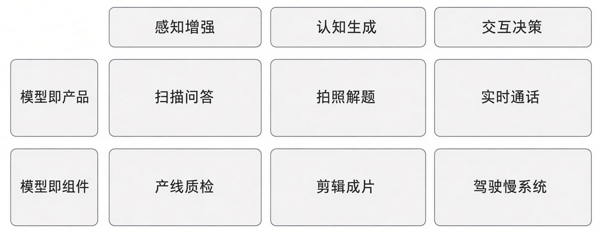
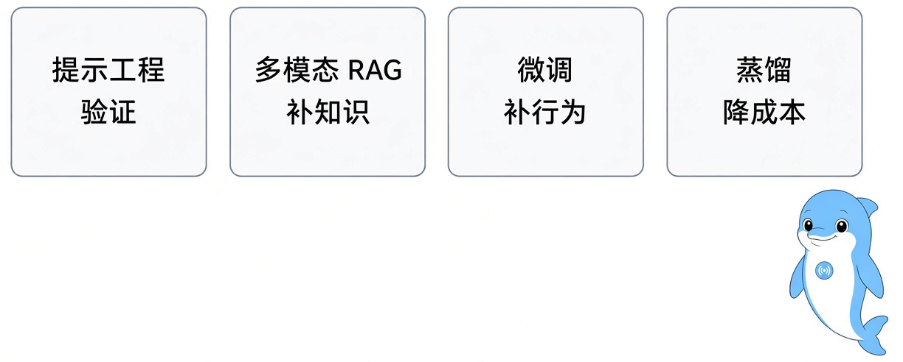
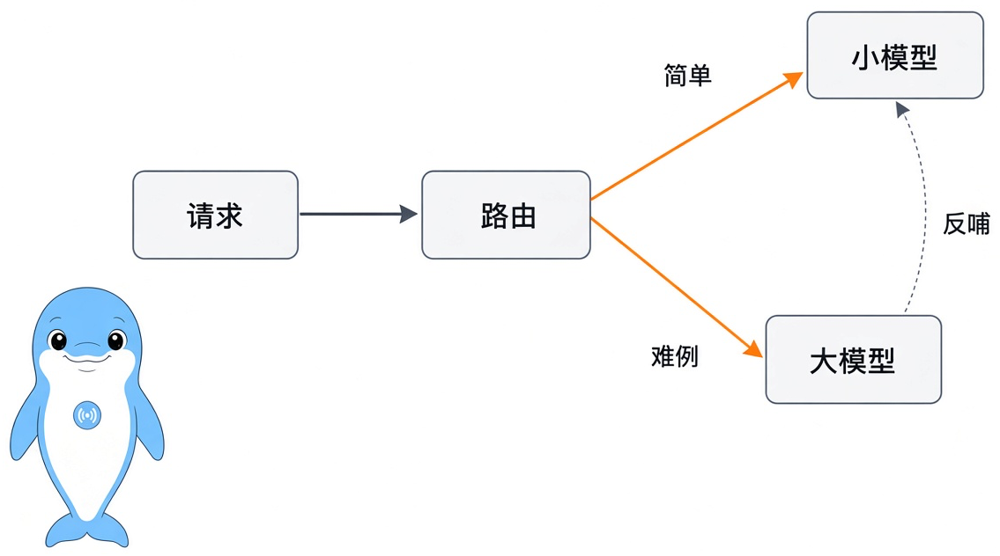
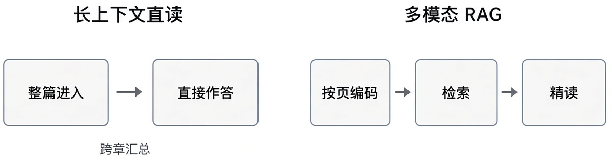
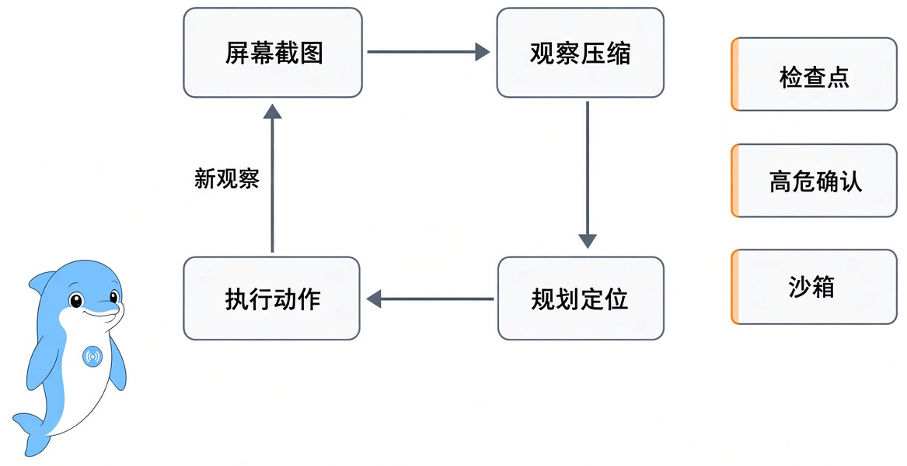
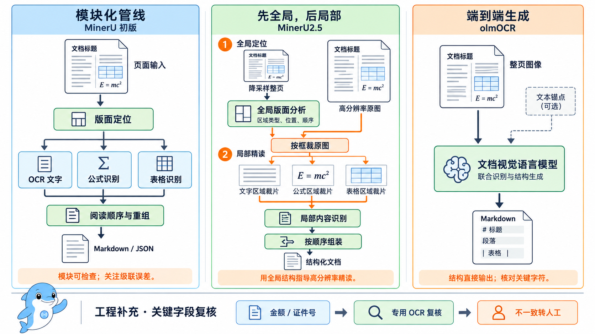
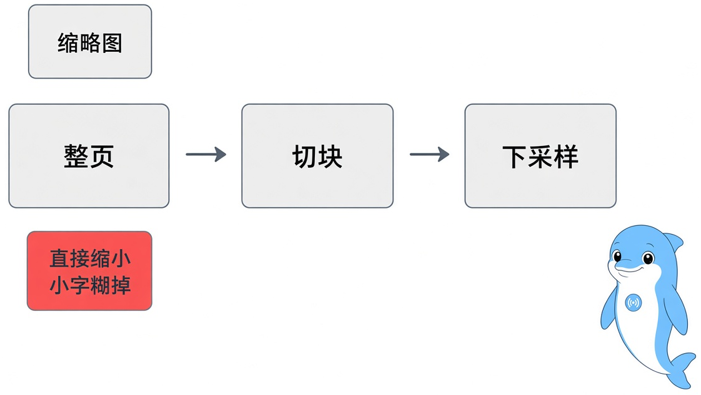
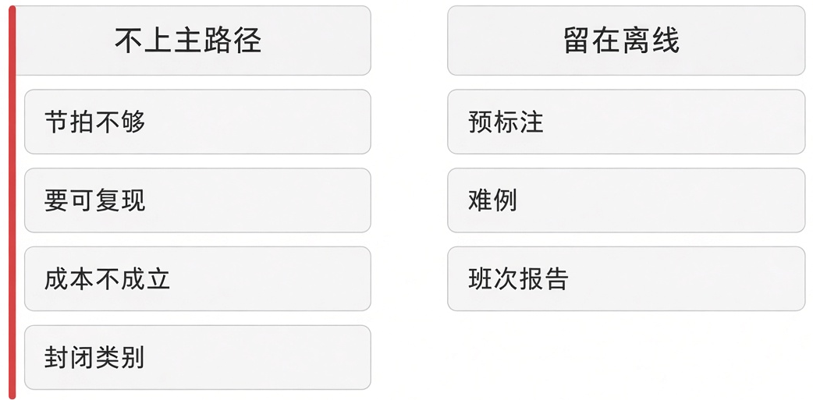
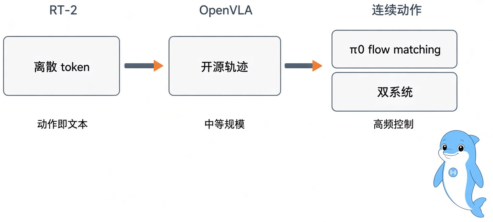

## 5.6 AI 多模态下游应用高频考点

> 本章位于全书后段。前面各章讨论了组件、基石模型、主流模型和原生多模态，本章转向这些能力如何变成可交付的应用。内容依次覆盖下游应用的定位框架与四条落地路径，产品选型、评测与大小模型协同，理解类和交互生成类产品的方案拆解，多模态 Agent 与 GUI Agent，文档智能，工业质检的能力边界，以及具身智能与自动驾驶如何进入物理世界。

> **时效说明**：本章事实核对截至 2026 年 10 月。文中模型版本、参数规模和评测分数以所引文献的发布版本为准，产品功能以所引发布说明的日期为准。闭源产品的服务状态变化较快，本章只引用其官方公开的技术信息，不描述产品当前是否在线。截至核对日期，ChatGPT 的默认模型族为 GPT-6，GPT-4o 与 GPT-5 已于 2026 年 2 月 13 日从 ChatGPT 退役（[OpenAI 帮助中心](https://help.openai.com/en/articles/20001051-retiring-gpt-4o-and-other-chatgpt-models)，[OpenAI](https://openai.com/index/gpt-6-for-everyone/)）。

---

### [5.6.1 多模态大模型的下游应用版图与落地路径应如何选型](#q561)
- [5.6.1.1 面试问题：多模态下游应用可以按什么框架分类与定位？](#q5611)
- [5.6.1.2 面试问题：提示工程、多模态 RAG、微调与蒸馏四条落地路径如何选型？](#q5612)
- [5.6.1.3 面试问题：下游落地中的幻觉问题如何系统性治理？](#q5613)

### [5.6.2 从产品角度出发，多模态模型能力如何转化为可交付的产品](#q562)
- [5.6.2.1 面试问题：如何从产品需求反推模型选型与部署形态？](#q5621)
- [5.6.2.2 面试问题：多模态产品的评测体系与数据飞轮应如何设计？](#q5622)
- [5.6.2.3 面试问题：大小模型协同的工程架构是怎样设计的？](#q5623)

### [5.6.3 如何拆解代表性产品中理解类功能背后的多模态方案](#q563)
- [5.6.3.1 面试问题：豆包「拍照解题」功能背后应用了哪些多模态方案？](#q5631)
- [5.6.3.2 面试问题：Kimi「长 PDF 解析问答」应该用长上下文直读还是多模态 RAG？](#q5632)
- [5.6.3.3 面试问题：以图搜图与拍照购物为什么采用检索式而非生成式方案？](#q5633)

### [5.6.4 如何拆解代表性产品中交互与生成类功能背后的多模态方案](#q564)
- [5.6.4.1 面试问题：豆包「实时语音视频通话」功能背后应用了哪些多模态方案？](#q5641)
- [5.6.4.2 面试问题：剪映「智能成片」类功能如何编排理解与生成模型？](#q5642)

### [5.6.5 多模态 Agent 的通用架构是什么？GUI Agent 的技术主线考察哪些要点](#q565)
- [5.6.5.1 面试问题：多模态 Agent 的通用架构包含哪些模块？视觉输入扮演什么角色？](#q5651)
- [5.6.5.2 面试问题：GUI Agent 如何实现界面理解与精确定位？](#q5652)
- [5.6.5.3 面试问题：Agent 的评测基准与多步可靠性问题如何应对？](#q5653)

### [5.6.6 OCR 与文档智能方向，多模态大模型如何重塑传统技术管线](#q566)
- [5.6.6.1 面试问题：MLLM 端到端方案与传统 OCR 管线如何对比与融合？](#q5661)
- [5.6.6.2 面试问题：高分辨率文档解析的技术难点有哪些？](#q5662)
- [5.6.6.3 面试问题：文档结构化信息抽取有哪些工程实践要点？](#q5663)

### [5.6.7 在工业质检等传统 CV 任务中，多模态大模型的能力边界在哪里](#q567)
- [5.6.7.1 面试问题：少样本与零样本缺陷检测有哪些基于多模态大模型的方案？](#q5671)
- [5.6.7.2 面试问题：什么场景下不应该使用多模态大模型？](#q5672)

### [5.6.8 具身智能与自动驾驶如何把多模态大模型带进物理世界](#q568)
- [5.6.8.1 面试问题：VLA 模型的架构谱系是怎样演进的？动作表示之争的本质是什么？](#q5681)
- [5.6.8.2 面试问题：具身智能与自动驾驶落地面临哪些共性问题？](#q5682)

### [附录 术语表](#q56g)

### [参考文献](#q56r)

---

### 5.6.1 多模态大模型的下游应用版图与落地路径应如何选型

#### 5.6.1.1 面试问题：多模态下游应用可以按什么框架分类与定位？

**难度评分：⭐⭐ (2/5)  |  考察频率：⭐⭐⭐⭐ (4/5)**

下游应用可以从任务性质和产品位置两个维度定位，再据此选型，如图 6-1 所示。两个维度的划分依据如下：

**任务性质**

这一维度看模型交付的是什么，常见的有三种：

（1）感知增强。模型充当更强的感知器，替代或增强传统 CV 管线，输出仍是结构化的感知结果，OCR、文档解析、工业质检和开放词汇检测都属于这一类。

（2）认知与生成。模型完成理解和推理之后再产出内容，拍照解题、长文档问答、图文创作和视频剪辑都属于这一类。

（3）交互与决策。模型的输出是动作，GUI Agent、具身操作和自动驾驶都属于这一类；错误会直接作用于真实环境，因此这一类对可靠性的要求最高。

**产品位置**

这一维度看模型在产品中所占的比重，常见的有两种：

（1）模型即产品。豆包、ChatGPT 属于这一类，用户直接面对模型，模型的能力边界就是产品的能力边界，对话体验和安全约束都需要稳定。

（2）模型即组件。拍立淘中的重排模块、剪映中的高光检测属于这一类，模型只是管线中的一环，要求单点效果好、延迟低、成本低。

两个维度交叉之后，选型方向随之明确。工业质检属于「感知增强 × 模型即组件」，合理方案是零样本检测模型加产线专用小模型；把大型对话模型直接放上产线，延迟和成本都无法满足节拍要求。本章后续各节沿这张版图逐格展开。

图 6-1 下游应用两维定位示意图

> **面试速答**：下游应用可以按任务性质和产品位置两个维度定位。任务性质分感知增强、认知与生成、交互与决策，对应输出结构化结果、内容或动作；产品位置分模型即产品和模型即组件。两个维度交叉之后再决定用端到端大模型还是专用小模型，避免把对话模型直接放上产线。

---

#### 5.6.1.2 面试问题：提示工程、多模态 RAG、微调与蒸馏四条落地路径如何选型？

**难度评分：⭐⭐⭐ (3/5)  |  考察频率：⭐⭐⭐⭐⭐ (5/5)**

提示工程、多模态检索增强生成、微调和蒸馏分别对应四种缺口，即可行性、知识、行为和成本，如图 6-2 所示。数据量和迭代周期的经验对照如表 6-1 所示。各条路径弥补的缺口及其代价逐条说明如下：

1. **提示工程。** 提示工程是验证阶段的默认起点，不需要训练，几小时即可迭代一版，配合少量示例和输出模板就能检验可行性。它无法注入成规模的领域知识，提示越长每次调用越贵，对格式的约束也只是软约束。

2. **多模态 RAG。** RAG（Retrieval-Augmented Generation，检索增强生成）弥补的是知识缺口。纯文本 RAG 处理图文文档时要先 OCR 再分块，版面和图表信息在转换中丢失。ColPali 改为按页做视觉检索：它在 PaliGemma-3B 之上加一层投影，把每个文本 token 和图像 patch 的输出映射为 128 维向量，检索时采用后期交互（late interaction）的 MaxSim 打分[1]，即 query 的每个向量在页面所有 patch 向量中取最大内积，再对 query 侧求和：

$$
s(q,d)=\sum_{i\in q}\max_{j\in d}\mathbf{E}_{q_i}^{\top}\mathbf{E}_{d_j}
$$

其中 $`\mathbf{E}_{q_i}`$ 为 query 的第 $`i`$ 个向量，$`\mathbf{E}_{d_j}`$ 为页面的第 $`j`$ 个 patch 向量。图表、印章和手写批注保留在页面图像里，不需要先做 OCR；手册改版时只需替换索引中的页面，不必为新知识重新训练。提示工程同样不需要重新训练，但装不下整个文档库。

3. **微调。** 微调弥补的是行为缺口。模型不认识领域术语、输出必须严格符合下游的 JSON Schema、话术需要统一，这三种信号都指向微调。LoRA（Low-Rank Adaptation，低秩适配）冻结原权重 $`W_0`$，只训练低秩增量[2]：

$$
W' = W_0 + \Delta W = W_0 + BA,\qquad B\in\mathbb{R}^{d\times r},\ A\in\mathbb{R}^{r\times k},\ r\ll\min(d,k)
$$

其中 $`r`$ 为秩，可训练参数因此从 $`dk`$ 降到 $`r(d+k)`$，LoRA 论文的实验显示很小的秩往往已经足够[2]。全参数微调需要更多数据和算力，业务侧更常用 LoRA。

4. **蒸馏。** 蒸馏弥补的是成本缺口。任务固定、流量增大之后，用大模型批量生成带推理链的标注，再训练一个专用小模型。Hinton 等人提出的蒸馏目标是硬标签交叉熵与教师软分布 KL 散度的加权[3]：

$$
\mathcal{L}_{\text{distill}} = \alpha\,\mathcal{L}_{\text{CE}}\bigl(y,\,p_s\bigr) + (1-\alpha)\,\tau^{2}\,\mathrm{KL}\bigl(p_t^{\tau}\,\Vert\,p_s^{\tau}\bigr)
$$

其中温度 $`\tau`$ 使教师分布 $`p_t`$ 更平滑，学生 $`p_s`$ 因此能学到类别之间的相对关系，$`\alpha`$ 为两项损失的权重。蒸馏的代价是模型失去通用性，任务边界一旦变化就要重新蒸馏。

表 6-1 四条落地路径对照

| 路径 | 数据需求 | 一次性成本 | 迭代速度 | 适用阶段 |
| --- | --- | --- | --- | --- |
| 提示工程 | 数条示例 | 无 | 小时级 | 可行性验证 |
| 多模态 RAG | 文档库本身 | 建索引 | 天级 | 知识密集、频繁更新 |
| 微调（LoRA/SFT） | 数千至数万条 | 训练卡时 | 周级 | 行为定制、格式约束 |
| 蒸馏小模型 | 数万条教师标注 | 训练+验证 | 周至月级 | 高流量、任务固化 |

表 6-1 中的数据量和周期是业务侧的经验量级，用于比较各条路径，并非来自某篇论文的测量。

图 6-2 四条落地路径示意图

> **面试速答**：提示工程用于验证可行性，不训练、迭代快，但补不进成规模的知识。多模态 RAG 补知识，ColPali 按页做视觉检索，文档改版只需更新索引。微调补行为，LoRA 只训练低秩增量。蒸馏在任务固定、流量增大后用大模型的标注训练小模型，降低推理成本。

---

#### 5.6.1.3 面试问题：下游落地中的幻觉问题如何系统性治理？

**难度评分：⭐⭐⭐ (3/5)  |  考察频率：⭐⭐⭐⭐⭐ (5/5)**

多模态落地中的幻觉需要先区分类型，再按输入、解码和系统三层治理，如图 6-3 所示。多模态场景中常见的幻觉有三类：

1. **对象幻觉。** 模型描述图中不存在的物体。POPE（Polling-based Object Probing Evaluation）用「图中是否有 X」这类是非题专门评测对象幻觉[4]。

2. **细粒度抄写幻觉。** 在 OCR 场景中，模型把模糊的数字、日期补全成通顺但错误的值，金融票据中这类错误会直接进入账目。

3. **定位幻觉。** 文字答案正确，但给出的边界框或页码错误，点击溯源类功能因此失效。

治理同样分为三层：

1. **输入。** 分辨率不足是抄写幻觉的首要诱因。动态分块见 [5.2.4.2](2_AI多模态核心组件高频考点.md#q5-2-4-2)，token 预算要按业务中最小的字号来预留，压缩方法见 [5.4.2.1](4_AI多模态主流模型核心技术高频考点.md#q5-4-2-1)。

2. **解码。** JSON Schema 约束解码只保证结构合法。系统还应要求模型同时给出证据位置（边界框或页码），核对时只需查看一处，不必重读整页。

3. **系统。** 金额、身份证号等关键字段用专用 OCR 或规则再校验一遍，两条通道结果不一致时转人工。低置信输出可以拒答，前提是置信度本身可信。期望校准误差（Expected Calibration Error，ECE）把样本按置信度分桶，逐桶比较平均置信度与实际准确率[5]：

$$
\mathrm{ECE}=\sum_{b=1}^{B}\frac{|S_b|}{N}\,\Bigl|\,\mathrm{acc}(S_b)-\mathrm{conf}(S_b)\,\Bigr|
$$

其中 $`B`$ 为桶数，$`S_b`$ 为第 $`b`$ 个桶的样本集合，$`N`$ 为样本总数。ECE 越大说明模型越过度自信，此时应先做温度缩放一类的校准[5]，再按阈值分流。医疗报告和资金结算类应用不能让模型直接输出结果而不经校验。

图 6-3 幻觉治理三层示意图

> **面试速答**：多模态幻觉分三类：对象幻觉可用 POPE 的是非题评测，抄写幻觉会改错数字，定位幻觉会给错边界框或页码。治理上，输入侧保证分辨率，解码侧约束格式并要求给出证据位置，系统侧对关键字段二次校验。按置信度拒答之前，要先用 ECE 检查校准。

---

### 5.6.2 从产品角度出发，多模态模型能力如何转化为可交付的产品

#### 5.6.2.1 面试问题：如何从产品需求反推模型选型与部署形态？

**难度评分：⭐⭐⭐ (3/5)  |  考察频率：⭐⭐⭐⭐ (4/5)**

部署形态由延迟、成本和合规三项约束共同决定，选型应从这三项约束出发反推模型规格。常见的部署形态有三种，各自对这三项约束的取舍不同：

1. **云端 API。** 云端 API 迭代快、无需自行运维，适合验证期和流量波动大的场景；代价是数据需要出域，金融、医疗和政务客户常因此直接排除这一方案。

2. **私有化部署。** 私有化部署满足等保和行业合规要求，模型规格受客户的 GPU 预算限制，通常借助 AWQ、GPTQ 一类 INT4 权重量化把模型放进现有显存[6,7]。

3. **端侧部署。** 端侧部署让数据不出设备，可以离线使用，调用也不再按次产生云端费用；但设备上只能运行小模型，并依赖 NPU 的低比特算力，能力上限明显。

延迟预算同时决定模型规格和交互设计。拍照解题这类异步任务允许用户等待数秒，实时语音则要对齐人类对话的话轮节奏。Stivers 等人 2009 年测量了 10 种语言中是非问句的应答时间，各语言的众数都落在 0 到 200 ms 之间，全样本的平均偏移约为 208 ms[8]。这是人类对话的测量分布，产品的超时阈值需要按自身的交互另行设定。同一个模型从异步交互改为实时交互时，可用的系统架构会随之改变。

成本按单次调用费用乘以日调用量，再对照毛利率，倒推可以承受的模型规格。免费、高频的功能如果全量使用最大的模型，推理费用会最先超出预算，下一问讨论如何用大小模型协同降低这部分费用。

> **面试速答**：选型先看三项约束：数据能否出域、用户能等多久、单次调用乘以流量后还剩多少毛利。云端 API 迭代快，私有化部署满足合规，端侧部署换来离线和隐私，但只能运行小模型。异步任务可以等待数秒，实时语音要对齐约一两百毫秒的话轮间隔，两者的架构不同。

---

#### 5.6.2.2 面试问题：多模态产品的评测体系与数据飞轮应如何设计？

**难度评分：⭐⭐⭐ (3/5)  |  考察频率：⭐⭐⭐⭐ (4/5)**

多模态产品的评测分为离线基准、上线前人评和线上指标三层，每层回答不同的问题；数据飞轮则把线上出现的错误沉淀为回归集。三层评测的做法分别是：

1. **离线基准。** MMMU、OCRBench、DocVQA 等公开榜单只做门槛筛查[9,10]，决定能否发布的是业务评测集，它从真实流量中分层抽样，由人工标注金标准，并覆盖长尾难例。公开测试题可能已经进入训练语料，榜单涨分与业务表现脱节的情况很常见。

2. **上线前人评。** 人评按正确性、有用性和安全性打分，标注一致性用 Cohen's Kappa 衡量，即 $`\kappa=(p_o-p_e)/(1-p_e)`$，其中 $`p_o`$ 为观测一致率，$`p_e`$ 为随机标注时的期望一致率。Landis 与 Koch 把 0.41 至 0.60 称为中等一致（moderate），把 0.61 至 0.80 称为高度一致（substantial）[11]。$`\kappa`$ 仍处于中等一致时，应先修订标注规范；主观维度需要多人背靠背标注。

3. **线上指标。** A/B 实验看任务完成率、点踩率、追问率和留存，线上指标是最终依据。离线指标上升而线上指标下降，多半是因为评测集的分布已经偏离真实流量。

数据飞轮由四步构成：线上负反馈回流，按分辨率不足、知识缺失或幻觉等原因聚类，定向补充数据或修改管线，再把同类错误写入回归集。每次模型更新都要全量通过回归集，避免修复一处问题时引入新的问题。回归集记录的是该产品真实出过的错误。

> **面试速答**：评测分三层：公开榜单只做门槛，业务评测集决定能否发布；上线前人评要用 Kappa 检查标注一致性，处于中等一致时先修订规范；线上完成率、点踩率和留存是最终依据。负反馈要聚类归因、补充数据并写入回归集，每次发布都全量回归。

---

#### 5.6.2.3 面试问题：大小模型协同的工程架构是怎样设计的？

**难度评分：⭐⭐⭐⭐ (4/5)  |  考察频率：⭐⭐⭐ (3/5)**

全部请求都由大模型处理时，推理成本难以承受，成熟产品因此采用分层路由：小模型处理常规请求，大模型处理难例，再通过蒸馏把能力迁移给小模型，如图 6-4 所示。

路由器放在最前面，用规则、小分类器或小型 MLLM 的自评估计请求难度。清晰印刷体、常见商品这类简单请求交给专用小模型或缓存，模糊手写、多步推理和多轮追问升级到大模型。设路由到小模型的请求比例为 $`\rho`$，单次请求的期望成本为 $`\mathbb{E}[C]=C_{\text{router}}+\rho\,C_{\text{small}}+(1-\rho)\,C_{\text{large}}`$，三项分别为路由、小模型和大模型的单次成本。节省的倍数取决于分流比例和两类模型的单价，应以线上实测计算。路由错误有两种代价，简单请求走大模型浪费算力，困难请求走小模型直接答错，因此路由器本身也要用线上数据持续校准。

大模型对小模型有三重反哺：

1. **蒸馏教师。** 大模型批量生成带推理链的标注，使 [5.6.1.2](#q5612) 的蒸馏路径持续运转。

2. **预标注。** 回流数据先由大模型标注一版，再由人工修正，标注工作量随之下降，下降幅度需要按各自的抽检结果计算。

3. **影子模式。** 新的小模型上线前，大模型在旁路对同一批流量给出参考答案，从而在不影响用户的情况下估计小模型的真实精度。

同一输入在大小模型之间的答案如果长期不一致，用户会感到效果时好时坏。因此路由边界需要保持稳定，小模型每一轮蒸馏都以当前的大模型为教师，避免两套能力逐渐偏离。

图 6-4 大小模型路由示意图

> **面试速答**：全部请求都走大模型时成本难以承受，因此在前端加路由：简单请求交给小模型，难例升级到大模型。期望成本由分流比例和两类模型的单价决定，节省倍数应以线上实测计算。大模型同时充当蒸馏教师、预标注员和影子对照，路由边界要稳定。

---

### 5.6.3 如何拆解代表性产品中理解类功能背后的多模态方案

#### 5.6.3.1 面试问题：豆包「拍照解题」功能背后应用了哪些多模态方案？

**难度评分：⭐⭐⭐ (3/5)  |  考察频率：⭐⭐⭐⭐ (4/5)**

公开资料没有披露豆包拍照解题功能的模块清单。按这类功能的共同需求，方案可以拆成输入处理、识别、推理和数据回流四段：

1. **输入处理。** 手机实拍图像的比例任意，常有倾斜和阴影，需要先做畸变矫正，一页多题时逐题裁剪。进入模型之前按动态分块处理高分辨率输入，原理见 [5.2.4.2](2_AI多模态核心组件高频考点.md#q5-2-4-2)。手写小字和上下标对分辨率最敏感，分块过粗时，指数和分式结构在视觉端就已丢失。

2. **识别。** 印刷体、手写体和公式常混排在同一页上，传统的检测加识别管线难以处理二维公式结构。GOT-OCR2.0 约 580M 参数，能把整页读成文字、公式或表格[12]；通用理解可以使用 Qwen3-VL 这类通用 MLLM[13]，规格和成本另行评估。语义先验能纠正模糊笔迹，也会把看不清的数字补错，即 [5.6.1.3](#q5613) 中的抄写幻觉。

3. **推理。** 解题过程用链式思维（Chain-of-Thought，CoT）分步写出。大模型的算术并不可靠，成熟做法是由模型给出解法，数值计算交给代码执行或符号计算工具，这是 [5.6.5.1](#q5651) 中工具调用的一个实例。

4. **数据回流。** 输出按步骤呈现并标注知识点，用户点击「答案有误」和错题本中的行为会成为困难样本的来源；晚自习时段的流量高峰由 [5.6.2.3](#q5623) 的路由机制消化。

> **面试速答**：公开资料没有披露豆包拍照解题的内部方案，这类功能可以拆成四段：先矫正、裁题，再用动态分块保留小字；识别可用 GOT-OCR2.0 或通用 MLLM；解题步骤由模型写出，数值交给代码或符号工具计算；用户纠错回流为困难样本。

---

#### 5.6.3.2 面试问题：Kimi「长 PDF 解析问答」应该用长上下文直读还是多模态 RAG？

**难度评分：⭐⭐⭐⭐ (4/5)  |  考察频率：⭐⭐⭐⭐ (4/5)**

长 PDF 问答需要按文档规模和问题类型在长上下文直读与多模态 RAG 之间路由，短文档直读，长文档和文档库走检索，全局问题先分段摘要再汇总。Kimi 于 2024 年 3 月宣布 200 万字上下文版本开启内测[14]，这一数字对应当时的内测版本。两条路线及其混合方案的对照如图 6-5 所示：

1. **长上下文直读。** 整篇文档放进上下文，跨章节推理和全局汇总的效果最好，也不存在召回遗漏。代价有三项：百页 PDF 经视觉 token 化后，预填充的延迟和费用随长度上升；超长序列存在 lost in the middle 现象，中部信息的利用率低于首尾[15]；几千份合同组成的文档库无法放进任何上下文窗口。

2. **多模态 RAG。** ColPali 把每一页编码为多向量，MaxSim 公式见 [5.6.1.2](#q5612)。这种逐 token 匹配比单向量双塔更容易命中页面中的一小块图表，页面向量还可以离线预计算[1]。召回 top-k 页之后交给 MLLM 精读，费用与文档库的总页数解耦，版面信息也得以保留。代价是两跳结构带来召回损失，问题表述与原文措辞差别较大时，相关页面可能进不了上下文。

3. **混合。** 短文档直读，长文档和文档库走检索，全局问题先分段摘要再汇总。路由时考察三个变量：单篇还是整库，定位型问题还是全局型问题，静态文档还是每日更新的文档。

在答案旁标注页码和出处，既是交互设计，也是幻觉治理手段。检索式架构天然带有出处，直读架构则需要额外训练模型输出引用，这是很多产品最终采用混合架构的一个原因。

图 6-5 长文档直读与检索示意图

> **面试速答**：直读适合单篇文档中的跨章节和全局问题，但中部信息利用率低，文档库也放不进窗口。多模态 RAG 按页检索再精读，费用与库的规模解耦，代价是召回损失。产品通常按文档长度和问题类型混合路由，并在答案旁标注页码。

---

#### 5.6.3.3 面试问题：以图搜图与拍照购物为什么采用检索式而非生成式方案？

**难度评分：⭐⭐⭐ (3/5)  |  考察频率：⭐⭐⭐ (3/5)**

以图搜图的主链路是双塔嵌入加近似最近邻检索。生成式模型无法建索引，无法对十亿级候选逐一打分，输出也不稳定，因此只适合放在链路两端。拍立淘是拍照购物的产品代表，公开资料没有披露其线上编码器的具体模型。下面依次说明主链路的构成、生成式模型不适合承担召回主链路的原因，以及生成式模型在链路两端的位置：

1. **主链路。** 商品库离线编码为向量，线上的 query 图像经过同一编码器，以余弦相似度 $`s=\cos(\mathbf{v}_q,\mathbf{v}_d)`$ 在近似最近邻索引中召回，其中 $`\mathbf{v}_q`$ 和 $`\mathbf{v}_d`$ 分别为 query 和商品的嵌入向量。CLIP 是这类双塔模型的代表[16]，索引常用 HNSW 和 IVF-PQ[17]。十亿级商品库能够在较短延迟内返回结果，依靠的是向量可以预先计算，具体延迟随库规模和硬件变化。

2. **生成式模型不适合承担召回主链路，原因有三：**

    （1）无法建索引。生成式模型的相似度判断发生在一次前向推理之中，无法转化为可离线存储的向量，每次查询都要对候选重新运行模型。

    （2）费用和延迟过高。候选规模一大，逐个生成的成本远高于一次近似最近邻查询，具体差距需要按库的规模计算。

    （3）结果不稳定。检索要求同一个 query 得到同一批结果，采样式生成无法保证这一点。

3. **生成式模型的位置。** 前端用它做 query 理解，区分用户拍的是鞋还是鞋上的标志，抽取颜色和款式并改写检索条件；后端对召回的一小批候选做属性比对，并生成推荐理由；入库时还可以用 MLLM 为商品图打结构化标签，提高召回质量。Qwen3-VL 这类模型可以承担上述理解任务，但不承担十亿级的在线打分。

> **面试速答**：以图搜图的主链路是双塔嵌入加近似最近邻检索，CLIP 是代表，商品向量可以离线计算。生成式模型无法建索引，不能对十亿级商品逐个打分，采样结果也不稳定，因此适合放在两端：前端理解 query，后端解释一小批候选。

---

### 5.6.4 如何拆解代表性产品中交互与生成类功能背后的多模态方案

#### 5.6.4.1 面试问题：豆包「实时语音视频通话」功能背后应用了哪些多模态方案？

**难度评分：⭐⭐⭐⭐ (4/5)  |  考察频率：⭐⭐⭐⭐ (4/5)**

字节 Seed 公开了豆包实时通话背后的两个模型：2026 年 4 月发布的 Seeduplex 是用于语音通话的原生全双工端到端语音模型，2026 年 8 月发布的 SeedRealtime 是用于视频通话的音视频全双工模型[18,19]。公开资料没有披露 SeedRealtime 的抽帧策略和视觉 token 预算，下面分别讨论已公开的部分和视频通话的共性约束：

1. **级联还是端到端。** 级联方案由语音识别、大模型和语音合成三段相接，时延逐段相加，语气和背景声在转写时丢失，差别见 [5.5.5.1](5_AI多模态原生模型高频考点.md#q5551)。Seed 的发布说明写明，Seeduplex 之前豆包使用的是半双工的端到端语音模型[18]。相比这一半双工框架，Seeduplex 的判停 MOS 提高 8%，对话流畅度 MOS 提高 12%，判停延迟降低约 250 ms，复杂场景下的抢话比例相对下降 40%[18]。Qwen3-Omni 的 Thinker-Talker 是另一条公开结构，首包时延的机制见 [5.5.5.2](5_AI多模态原生模型高频考点.md#q5552)，相关数字只适用于 Qwen3-Omni。

2. **视频预算。** SeedRealtime 的发布说明称，它用统一架构原生融合音频、视频与文本，在连续的多模态信息流上实时交互；官方的端到端人工评测显示，相比级联模型，它的音视频对话节奏问题减少一半[19]。视频通话的共性约束是画面不能逐帧以全分辨率送入模型，常见做法是低频抽帧，在画面发生较大变化或用户要求查看某处时再提高采样频率，时序采样见 [5.4.7.1](4_AI多模态主流模型核心技术高频考点.md#q5-4-7-1)。

3. **交互形态。** 从回合制到可打断、再到全双工的演进见 [5.5.5.3](5_AI多模态原生模型高频考点.md#q5553)。可打断需要处理回声，并判断用户是否开口；Seeduplex 和 SeedRealtime 都把判停与抗干扰交给模型本身，不再依赖独立的 VAD 规则[18,19]。人类对话的话轮间隔测量见 [5.6.2.1](#q5621)，那组约 200 ms 的数字描述的是人类对话，并非豆包的首包指标。

> **面试速答**：豆包实时通话的公开方案有两个：Seeduplex 是语音通话的原生全双工端到端模型，相比此前的半双工框架，判停 MOS 提高 8%、流畅度 MOS 提高 12%；SeedRealtime 把音频、视频和文本融合进同一模型。视频抽帧策略没有公开，共性约束是低频采样、按需提频。

---

#### 5.6.4.2 面试问题：剪映「智能成片」类功能如何编排理解与生成模型？

**难度评分：⭐⭐⭐ (3/5)  |  考察频率：⭐⭐⭐ (3/5)**

智能成片属于模型即组件，由理解、决策和生成三段中的多个模型与算法编排而成。公开资料没有给出剪映的完整模型清单，下面按三段拆解这类功能的共同结构：

1. **理解。** 镜头边界检测先把素材切分为镜头（shot），视频理解模型为每个片段生成带时间戳的描述，包括人物、动作、场景和情绪，时间对齐见 [5.4.8.1](4_AI多模态主流模型核心技术高频考点.md#q5-4-8-1)。高光打分综合画质、人脸表情、动作幅度和音频能量，得出片段的可用度排序。

2. **决策。** 模板确定叙事结构和目标时长，再从高光片段池中选段、排序。配乐确定之后做节拍对齐，把剪辑点吸附到音乐节拍上；这一步由算法完成，对成片节奏的影响很大。

3. **生成。** 语音识别生成字幕，语言模型润色标题和文案，按情绪推荐配乐，需要旁白时再接语音合成。补充转场和空镜时可以接入视频生成模型，例如字节 2026 年 7 月发布的 Seedance 2.5，它延续 Seedance 2.0 的音视频联合生成架构，单次可生成 30 秒视频[20]；公开资料没有披露剪映内部使用的具体模型。

> **面试速答**：智能成片由多个组件编排而成，剪映的内部模型清单没有公开。理解段切分镜头、生成带时间戳的描述并给片段打高光分；决策段按模板选段，并把剪辑点对齐音乐节拍；生成段补字幕、文案、配乐和旁白，转场和空镜可以接视频生成模型。

---

### 5.6.5 多模态 Agent 的通用架构是什么？GUI Agent 的技术主线考察哪些要点

#### 5.6.5.1 面试问题：多模态 Agent 的通用架构包含哪些模块？视觉输入扮演什么角色？

**难度评分：⭐⭐⭐ (3/5)  |  考察频率：⭐⭐⭐⭐⭐ (5/5)**

多模态 Agent 与普通对话应用的分界是闭环：模型的输出会改变环境状态，环境的新状态又成为模型的输入。通用架构由规划、工具调用、记忆和反思四个模块构成，视觉输入在其中承担任务输入、环境观察和工具返回三种角色。四个模块的职责分别是：

1. **规划。** 规划模块把目标拆成可执行的步骤。ReAct 让推理与行动交替进行[21]，plan-and-execute 先生成完整计划再逐步执行，失败时重新规划。

2. **工具调用。** 模型以 function calling 的形式调用外部能力，多模态场景中的工具包括检测分割、OCR、搜索和代码执行；模型决定调用哪个工具、传入什么参数，工具负责确定性地执行。

3. **记忆。** 短期记忆依靠上下文窗口维护任务状态，长期记忆外置到向量库，跨会话保留用户偏好和历史结论。

4. **反思。** 模型对照截图和工具返回值自检，失败时回溯重试，避免沿着错误的状态继续执行。

视觉输入的三种角色分别是：任务输入，例如用户发来一张报错截图；环境观察，GUI Agent 每一步都通过屏幕截图感知当前状态；工具返回，代码执行画出的图表需要模型自己读懂，再决定下一步。第二种角色会持续产生高分辨率截图，很快占满上下文，因此需要压缩观察，只保留变化区域，对历史观察降采样或改写为摘要。这可以看作 [5.2.4.4](2_AI多模态核心组件高频考点.md#q5-2-4-4) 的视觉 token 压缩在时间维度上的延伸。

> **面试速答**：多模态 Agent 是闭环系统，模型输出会改变环境，新状态再成为输入。通用架构包括规划、工具调用、记忆和反思四个模块。视觉输入有三种角色：用户的任务输入、每一步的屏幕观察和工具返回的图像。屏幕观察会不断累积，需要压缩历史，只保留变化部分。

---

#### 5.6.5.2 面试问题：GUI Agent 如何实现界面理解与精确定位？

**难度评分：⭐⭐⭐⭐ (4/5)  |  考察频率：⭐⭐⭐⭐ (4/5)**

GUI Agent 对定位的要求比通用检测更高：检测框偏几个像素通常仍可接受，点击一个几十像素见方的图标时偏出图标即为失败。高分辨率截图中的小图标对视觉分辨率和 token 预算的要求也比自然图像更高。坐标采用归一化、千分制还是绝对像素，见 [5.4.6.1](4_AI多模态主流模型核心技术高频考点.md#q5-4-6-1)。界面理解有结构化辅助和纯视觉两条路线：

1. **结构化辅助。** 这条路线读取操作系统提供的控件树（accessibility tree）或网页 DOM，获得控件列表。Set-of-Mark 在截图上叠加带编号的标记框，把预测坐标改为选择编号[22]。这条路线在工程上稳定，但依赖系统接口，遇到 canvas 渲染和游戏界面时拿不到控件树，路线随之失效。

2. **纯视觉。** 这条路线只使用截图。CogAgent（CVPR 2024）有 18B 参数，高分辨率分支支持 $`1120\times 1120`$ 的输入，说明只依靠截图也能完成 GUI 任务[23]。OS-Atlas 开源了跨平台的 GUI 定位语料，包含超过 1300 万个界面元素[24]。UI-TARS 只以截图为输入，把感知、定位和动作生成统一进一个端到端模型[25]。能拿到控件树时结构化路线仍然更稳，纯视觉路线覆盖拿不到控件树的界面。

动作空间需要覆盖点击、输入、滚动、长按和组合键，桌面端与移动端的动作并不相同。训练数据是截图与动作组成的轨迹，来源包括人工录制、规则合成以及模型自主探索后筛选，标注成本高于普通图文对。

> **面试速答**：GUI 点击偏出图标即为失败，定位要求比通用检测高。一条路线读取控件树或 DOM，或用 Set-of-Mark 把坐标改为编号，但 canvas 和游戏界面会失效；另一条只看截图，CogAgent 用高分辨率分支证明可行，OS-Atlas 补充定位数据，UI-TARS 把感知和动作放进一个模型。

---

#### 5.6.5.3 面试问题：Agent 的评测基准与多步可靠性问题如何应对？

**难度评分：⭐⭐⭐ (3/5)  |  考察频率：⭐⭐⭐ (3/5)**

Agent 评测要在可执行环境中运行任务并检查终态；多步任务的成功率随步数连乘下降，工程上需要用检查点、高危确认和沙箱让错误可以回退且不直接生效。感知、决策、执行的闭环和这三项机制如图 6-6 所示：

1. **可执行基准。** OSWorld（2024）包含 369 个真实电脑任务，在虚拟机中执行，用脚本检查终态，环境支持 Ubuntu、Windows 和 macOS；论文另有 43 个 Windows 任务用于分析[26]。在原始协议下，人类成功率为 72.36%，当时最好的模型为 12.24%，失分主要来自 GUI 定位和操作知识[26]。后来的榜单、步数上限和 OSWorld-Verified 都修改过评测协议，不同版本的成功率不能直接比较，上文 72.36% 与 12.24% 的差距是 2024 年原始协议下的结果。AndroidWorld 在 20 个真实安卓应用上构建了 116 个程序化任务，任务参数随机生成，以避免模型记住测试题[27]；WebArena 则面向自托管网站上的任务[28]。

2. **多步衰减。** 没有回滚机制时，任务成功要求每一步都成功，端到端成功率随步数连乘下降：

$$
P_{\text{task}}=\prod_{t=1}^{n}p_t\approx p^{\,n}
$$

其中 $`p_t`$ 为第 $`t`$ 步的成功率，$`n`$ 为步数。若单步成功率 $`p=0.95`$、任务需要 $`n=20`$ 步，则 $`0.95^{20}\approx 0.36`$，这是一个算术示例，并非某个产品的实测值。$`p`$ 提高到 0.99 时，同样 20 步的成功率约回升到 0.82。另一个方向是把高频操作序列封装为单个工具，以缩短 $`n`$。

3. **可靠性机制。** 工程上常用三项机制：

    （1）检查点。关键节点保存状态，失败时回到最近的检查点，不必从头开始。

    （2）高危确认。删除、支付、发送类操作设置二次确认，必要时直接拒绝执行。

    （3）沙箱。操作先在隔离环境中跑通，再作用于真实环境，这与幻觉治理中「模型输出不直接生效」的原则一致。

图 6-6 GUI Agent 感知决策执行闭环示意图

> **面试速答**：Agent 评测要在环境中执行任务并检查终态。OSWorld 2024 年原始协议下的 369 个任务上，人类成功率为 72.36%，当时最好的模型为 12.24%，后来的协议已经改变。没有回滚时成功率随步数连乘，0.95 的 20 次方约为 0.36，工程上用检查点、高危确认和沙箱应对。

---

### 5.6.6 OCR 与文档智能方向，多模态大模型如何重塑传统技术管线

#### 5.6.6.1 面试问题：MLLM 端到端方案与传统 OCR 管线如何对比与融合？

**难度评分：⭐⭐⭐ (3/5)  |  考察频率：⭐⭐⭐⭐⭐ (5/5)**

传统 OCR 管线分段优化检测、识别和版面分析，速度快且错误可以定位；MLLM 端到端方案一次读完整页，复杂版面上更稳，但会把看不清的数字补错。实际系统多采用两者融合的形态，如图 6-7 所示。三条路线的特点分别是：

1. **传统管线。** 文本检测、行识别、版面与阅读顺序分别优化，检测有 DBNet 一类方法，识别从 CRNN 发展到 SVTR。它的优点是速度快，错误可以定位到具体环节再修复；缺点是级联误差会累积，多栏混排、表格嵌图、印章覆盖文字等复杂版面的结构还原一直是难点。

2. **端到端。** 端到端模型一次前向读完整页，输入整页图像，直接输出 Markdown、LaTeX 或 HTML 表格。GOT-OCR2.0 是约 580M 参数的专用模型[12]，Qwen3-VL 是通用 MLLM 的代表[13]。这类模型对复杂版面更稳，语义先验能纠正模糊字符，还可以直接接着做文档问答；但同样的先验会把看不清的数字补成通顺的错误值，即 [5.6.1.3](#q5613) 中的抄写幻觉，字符级精度也缺少传统管线那种按框可查的保证。单页成本高于传统管线，具体差距取决于批量和硬件。

3. **融合。** 公开的融合形态至少有三种，另有一种工程上的双通道做法。MinerU 初版是由版面检测、公式检测与识别、表格识别和专用 OCR 组成的流水线[29]。MinerU2.5 采用由粗到细的两阶段解析，先在降采样的整页上分析版面，再按版面结果从原图裁取原分辨率区域做内容识别[30]。olmOCR 走端到端路线，用微调后的 Qwen2-VL-7B 把页面图像直接转写为线性化的纯文本[31]。工程上的双通道做法是在端到端输出之外，用专用 OCR 复核金额、证件号等关键字段，两条通道结果不一致时转人工。选型上，自由格式的文档问答用端到端方案，高精度的结构化录入用融合方案或双通道复核，海量的简单版面仍由传统管线处理。

图 6-7 文档解析路线对照示意图

> **面试速答**：传统 OCR 分段完成检测、识别和版面分析，速度快、错误易定位，但复杂版面会累积误差。端到端模型一次读整页，GOT-OCR2.0 和 Qwen3-VL 是两种规格，抗复杂版面，但可能把数字识别错。融合形态中，MinerU 初版是专用模型流水线，MinerU2.5 先看版面再裁原图，olmOCR 直接转写全文。

---

#### 5.6.6.2 面试问题：高分辨率文档解析的技术难点有哪些？

**难度评分：⭐⭐⭐⭐ (4/5)  |  考察频率：⭐⭐⭐⭐ (4/5)**

高分辨率文档解析的难点源于分辨率差距：A4 扫描页的像素数远超视觉编码器的原生输入，token 预算与信息保真之间需要权衡；表格、公式、图表和阅读顺序又各有专门的难点。

A4 纸的尺寸为 210 mm × 297 mm，按 300 dpi 扫描时，$`210/25.4\times 300\approx 2480`$，$`297/25.4\times 300\approx 3508`$，即约 $`2480\times 3508`$ 像素。主流视觉编码器的原生输入往往只有几百像素见方，这一差距是文档解析一系列难点的起点。

token 数量与信息保真度相互制约，如图 6-8 所示。直接把页面缩放到编码器的原生分辨率，正文小字的笔画会模糊到难以辨认。InternVL-1.5 的动态分块（见 [5.4.2.1](4_AI多模态主流模型核心技术高频考点.md#q5-4-2-1)）在块数不超过上限 $`n_{\max}`$ 的全部网格 $`(i,j)`$ 中，选出长宽比 $`i/j`$ 最接近原图长宽比 $`W/H`$ 的一个，把原图缩放到 $`448i\times 448j`$，再切成 $`i\times j`$ 个 $`448\times 448`$ 的块[32]。$`n_{\max}`$ 在训练时为 12（对应 35 种预设长宽比），测试时最多为 40[32]。每块经 ViT 得到 1024 个 patch，再做 2×2 下采样压到 256 个 token；块数大于 1 时另加一张 $`448\times 448`$ 的全局缩略图[32]。视觉 token 数按下式计算：

$$
(i^*,j^*)=\mathop{\arg\min}_{(i,j):\ ij\le n_{\max}}\left|\frac{W}{H}-\frac{i}{j}\right|,\qquad
N_{\text{tokens}}=\bigl(i^*j^*+\mathbf{1}[\,i^*j^*\gt 1\,]\bigr)\times 256
$$

其中 $`W`$ 和 $`H`$ 为原图的宽和高，$`\mathbf{1}[\cdot]`$ 为指示函数。长宽比相同的网格（如 1×1 与 2×2）之间，官方代码优先选择放大后面积不超过原图两倍的那个[33]。代入上面的 A4，原图长宽比 $`2480/3508\approx 0.707`$。按测试上限 $`n_{\max}=40`$，最接近的网格是 5 列 × 7 行（$`5/7\approx 0.714`$），原图缩放到 $`2240\times 3136`$，切出 35 个内容块，加缩略图共 36 块，约 $`36\times 256=9216`$ 个视觉 token。按训练上限 $`n_{\max}=12`$，最接近的网格只有 2 列 × 3 行（$`2/3\approx 0.667`$），页面缩放到 $`896\times 1344`$，共 7 块、1792 个视觉 token，宽度方向只保留原扫描约 36% 的像素。以上是 InternVL-1.5 的分块规则，Qwen2-VL 起的 Qwen 系列按原生动态分辨率切 patch 再做 2×2 合并，计法不同[34]。合同脚注和海报大标题需要的分辨率不同，文档产品因此通常提供精读和速读两种分辨率档位。

结构化元素各自有专门的难点：

1. **表格。** 合并单元格、跨页续表和无线框表格的结构还原困难，输出为 HTML 或 Markdown 时，行列对应关系容易错位。

2. **公式。** 公式需要把二维结构转写为 LaTeX，上下标和分式嵌套对分辨率最敏感。

3. **图表。** 模型需要从柱状图、折线图中读出数值，ChartQA 专门评测这类图表问答[35]。公开榜单没有给出各类元素错误率的总排名。

4. **阅读顺序。** 多栏和图文绕排的阅读顺序一旦串错，后续 RAG 的分块也会随之出错。

评测上，通用能力看 OCRBench 和 DocVQA[9,10]，表格和公式看专项评测集。印章遮挡、复印噪声和手写批注不在公开基准的覆盖范围内，上线前仍需自建业务评测集。

图 6-8 高分辨率文档分块示意图

> **面试速答**：A4 按 300 dpi 扫描约为 2480×3508 像素，远超编码器几百像素的原生输入。InternVL-1.5 在块数上限内选长宽比最接近的网格，测试上限 40 块时 A4 切成 5×7 块，加缩略图约 9216 个视觉 token。表格、公式、图表和阅读顺序各有难点，印章和手写要靠自建评测集覆盖。

---

#### 5.6.6.3 面试问题：文档结构化信息抽取有哪些工程实践要点？

**难度评分：⭐⭐⭐ (3/5)  |  考察频率：⭐⭐⭐⭐ (4/5)**

文档结构化抽取要分别保证格式正确和内容正确。约束解码只解决格式问题，内容正确需要字段校验、置信度路由和版面锚定配合；人审比例由置信度阈值决定，而阈值有效的前提是置信度经过校准。工程实践有四项：

1. **约束解码。** 用 JSON Schema 或语法约束解码，保证字段名、类型和枚举值符合规范。约束解码只保证输出合法，不保证内容正确，金额错一位的输出仍然是合法的 JSON。

2. **字段校验。** 利用字段自身的结构做互验，例如身份证号的校验位、金额的数字与大写是否一致、开票日期不晚于当天、单价乘以数量是否接近总价，规则命中即拦截。本书的工程经验是，这一层拦下的错误常常多于单纯换用更大的模型。

3. **置信度路由。** 生成式模型通常没有现成的字段级置信度，可以用多次采样的一致程度作为代理。对同一字段采样 $`K`$ 次，众数答案的出现频率为：

$$
\hat{p}(y)=\frac{1}{K}\sum_{k=1}^{K}\mathbf{1}\bigl[y^{(k)}=y\bigr]
$$

其中 $`y^{(k)}`$ 为第 $`k`$ 次采样的结果，$`\mathbf{1}[\cdot]`$ 为指示函数。低于阈值的字段转人工核验，高置信字段抽检，人审比例由阈值和流量共同决定。

4. **版面锚定。** 模型在输出字段值的同时给出来源边界框，人审界面高亮原图中的对应位置，核验一个字段从翻找整页变为查看一个框，坐标预测见 [5.4.6.1](4_AI多模态主流模型核心技术高频考点.md#q5-4-6-1)。

> **面试速答**：约束解码只保证 JSON 合法，金额错一位的输出仍然合法。身份证校验位、大小写金额和单价乘数量等规则用来拦截内容错误；字段置信度可以用多次采样的一致频率代理，低置信字段转人工；输出同时给出来源框，人审就不必翻找整页。

---

### 5.6.7 在工业质检等传统 CV 任务中，多模态大模型的能力边界在哪里

#### 5.6.7.1 面试问题：少样本与零样本缺陷检测有哪些基于多模态大模型的方案？

**难度评分：⭐⭐⭐⭐ (4/5)  |  考察频率：⭐⭐⭐ (3/5)**

新产线冷启动时，正常样本很多，缺陷样本很少甚至没有，监督检测器无法训练。可用的多模态方案有三类，即用语言描述代替缺陷标注的零样本检测、借助少量正常样本并支持对话的 MLLM，以及开放词汇检测加分割的组合，其原理和适用范围分别是：

1. **零样本。** 这类方法用语言描述代替缺陷标注。CLIP 的二类提示可以写成一个异常分数：

$$
a(x)=\frac{\exp\bigl(\cos(f(x),t_{+})/\tau\bigr)}{\exp\bigl(\cos(f(x),t_{+})/\tau\bigr)+\exp\bigl(\cos(f(x),t_{-})/\tau\bigr)}
$$

其中 $`t_{+}`$ 为异常描述的文本特征，$`t_{-}`$ 为正常描述的文本特征，$`f(x)`$ 为图像或窗口特征，$`\tau`$ 为温度系数。上式只是二类提示下的 CLIP 分数，WinCLIP 在此基础上组合了状态词与提示模板，并聚合窗口、patch 和整图三级特征[36]。论文报告，WinCLIP 在 MVTec-AD 上零样本的图像级 AUROC 为 91.8%，像素级 AUROC 为 85.1%[36]。模型没有见过该产线的缺陷图像，依靠的是对比学习预训练得到的图文对齐，见 [5.3 节](3_AI多模态基石模型核心技术高频考点.md)。

2. **少样本与可对话。** AnomalyGPT（AAAI 2024）用模拟的异常数据训练，不依赖真实缺陷标注；论文报告，模型在 VisA 上训练后迁移到 MVTec-AD，只给一张正常样本时，图像级 AUC 为 94.1%，像素级 AUC 为 95.3%[37]。它可以直接判断有无异常、指出异常位置，并进行多轮对话。

3. **开放词汇检测加分割。** 由 Grounding DINO 根据文本描述输出检测框，再由 SAM 把框细化为掩码[38,39]，无需为「表面划痕」这类新目标单独训练检测器。这类组合适合冷启动和巡检，不适合作为产线节拍上的在线检测器。

> **面试速答**：没有缺陷样本时可以用语言描述做零样本检测，WinCLIP 在 CLIP 二类提示上聚合多尺度窗口，MVTec-AD 的图像级 AUROC 为 91.8%。AnomalyGPT 用模拟异常训练，一张正常样本即可迁移并指出位置。Grounding DINO 加 SAM 适合新类别冷启动，不承担产线节拍。

---

#### 5.6.7.2 面试问题：什么场景下不应该使用多模态大模型？

**难度评分：⭐⭐⭐ (3/5)  |  考察频率：⭐⭐⭐⭐ (4/5)**

有四类场景不应把 MLLM 放在在线主路径上，如图 6-9 所示；在这些场景中，大模型更适合放在离线环节：

1. **节拍不满足。** 产线节拍往往短于大模型一次前向推理的时间，在线节拍仍由专用检测器承担。

2. **需要可复现。** 质检和医疗要求相同输入得到相同输出，结果可以审计。生成式采样难以满足这一要求，把温度调到 0 也只能减少波动。

3. **单件成本过高。** 日均百万件的检测任务，单件推理成本乘以件数会最先超出预算，大模型的边际成本与这类高频、低单价的调用不匹配。

4. **类别封闭。** 缺陷类别固定为十几种且标注充足时，专用小模型负责把精度做高。大模型的长处在于开放语义和零样本泛化，在封闭类别上并没有天然的精度优势。

大模型不放在在线主路径，并不意味着在离线环节没有作用，常见的用途有三项：

1. **预标注。** 大模型先标注、人工再修正，提效原理与 [5.6.2.3](#q5623) 的预标注相同。

2. **难例分析。** 大模型对线上小模型的低置信样本做第二次判读并聚类，用来决定补充哪些数据。

3. **报告生成。** 大模型把一天的质检统计写成班次报告，这是纯语言任务，适合大模型承担。

图 6-9 在线不用大模型的判定示意图

> **面试速答**：产线节拍紧、要求同输入同输出、海量低单价调用、类别封闭且标注充足，这四类场景不宜把 MLLM 放在在线主路径上，在线节拍和可复现性由专用检测器保证。大模型适合放在离线环节，承担预标注、难例分析和班次报告，具体延迟差距以实测为准。

---

### 5.6.8 具身智能与自动驾驶如何把多模态大模型带进物理世界

#### 5.6.8.1 面试问题：VLA 模型的架构谱系是怎样演进的？动作表示之争的本质是什么？

**难度评分：⭐⭐⭐⭐⭐ (5/5)  |  考察频率：⭐⭐⭐⭐ (4/5)**

VLA（Vision-Language-Action，视觉-语言-动作）模型把看到的画面和语言指令映射为动作，其谱系可以分为离散动作、开源中等规模和连续动作三代，如图 6-10 所示。动作表示之争与 [5.5.2.4](5_AI多模态原生模型高频考点.md#q5524) 中离散 token 与连续表征的取舍属于同一类问题，离散动作复用语言模型的词表和训练目标，连续动作更适合高频控制。三代模型的代表工作分别是：

1. **离散动作。** RT-2 以 PaLI-X（最大 55B）和 PaLM-E 为底座[40]，动作沿用 RT-1 的离散化方式[41]：末端执行器的 6 自由度位移和夹爪开合共 7 个连续维度，各自均匀量化为 256 个 bin，加上一个终止指令，一步动作表示为 8 个整数[40]。PaLI-X 的词表中 1000 以内的整数各有独立的 token，动作可以直接复用这些 token，从而放入自回归框架[40]。RT-2 要证明的是网页规模的图文知识可以迁移到机器人操作，操作对象可以不在机器人训练集中。论文也指出，模型的计算开销较高，用于更高频的控制时，实时推理可能成为主要瓶颈[40]。

2. **开源中等规模。** OpenVLA 是 7B 模型，视觉侧融合 SigLIP 和 DINOv2 的特征，语言侧基于 Llama 2，训练数据是从 Open X-Embodiment 中整理出的约 97 万条真实机器人轨迹[42]。Open X-Embodiment 本身汇集了 60 个数据集、22 种机器人形态的超过 100 万条轨迹[43]，97 万条是 OpenVLA 的整理结果。论文报告，OpenVLA 在 29 个任务和多种机器人形态上的绝对成功率比 55B 的 RT-2-X 高 16.5 个百分点，参数量约为后者的七分之一[42]。这一数字是 29 个任务的平均差距，各项语义泛化能力需要分开看。这一代的动作仍是离散 token。

3. **连续动作。** $`\pi_0`$ 以约 3B 参数的 PaliGemma 为底座，另加约 300M 参数、从零初始化的动作专家，合计约 3.3B[44]。它的动作块长度 $`H=50`$，用条件流匹配（Flow Matching）一次生成整段连续动作，论文写明控制频率最高约 50 Hz，示例任务包括叠衣服；推理时从噪声积分到动作块，实验中使用 10 步 Euler 积分[44]。直线路径与训练目标为：

$$
a_{\tau}=(1-\tau)\,a_0+\tau\,a_1,\qquad
\mathcal{L}_{\mathrm{FM}}=\mathbb{E}\bigl\|v_{\theta}(a_{\tau},\tau\mid o)-(a_1-a_0)\bigr\|^{2}
$$

这里 $`a_0`$ 是噪声，$`a_1`$ 是真实动作块，$`o`$ 为观测，$`v_\theta`$ 为待学习的速度场，速度目标是动作减去噪声，与 $`\pi_0`$ 论文中的 $`A-\epsilon`$ 一致[44]。

双系统架构的共性是把语义推理与高频控制解耦，各家的控制频率不同。Figure 的 Helix 中，System 2 是 7B 参数的开源 VLM，运行频率 7~9 Hz，输出一个连续潜变量；System 1 约 80M 参数，以 200 Hz 输出连续动作[45]。GR00T N1 论文给出的数字不同：System 2 是 VLM，在 NVIDIA L40 上约以 10 Hz 运行；System 1 是用流匹配训练的扩散 Transformer，以 120 Hz 生成动作[46]。NVIDIA 于 2026 年 4 月公开的 GR00T N1.7 约 3B 参数，仓库写明其视觉语言骨干是 Qwen3-VL 架构的 Cosmos-Reason2-2B，动作头仍是流匹配扩散 Transformer[47]；N1 的频率数字只适用于 N1 论文中的配置。

离散动作复用语言模型的词表、自回归和训练目标，控制频率和量化精度受到限制；连续动作平滑，适合高频控制，但脱离了语言词表；双系统把语义留在视觉语言模型中，把控制交给连续策略。

图 6-10 VLA 架构谱系示意图

> **面试速答**：RT-2 把 7 个连续维度各量化为 256 个 bin，加终止指令共 8 个整数，放进自回归框架。OpenVLA 是 7B 模型，用约 97 万条轨迹训练，29 个任务上的绝对成功率比 55B 的 RT-2-X 高 16.5 个百分点。第三代把动作留在连续空间，$`\pi_0`$ 用流匹配，Helix 和 GR00T 采用双系统，频率各不相同。

---

#### 5.6.8.2 面试问题：具身智能与自动驾驶落地面临哪些共性问题？

**难度评分：⭐⭐⭐⭐ (4/5)  |  考察频率：⭐⭐⭐ (3/5)**

具身智能与自动驾驶的硬件不同，落地时面临相同的三类约束，分别是：

1. **数据。** 机器人动作数据无法从网页上直接获取，目前有四条路线并行。遥操作采集以 ALOHA 为代表，低成本的双臂硬件降低了单条轨迹的采集成本[48]；跨本体聚合以 Open X-Embodiment 为代表，汇集了 22 种机器人形态的超过 100 万条轨迹[43]；仿真加域随机化在 Isaac 一类平台上批量生成数据，并随机化物理参数和纹理，以缩小仿真与真机之间的差距；世界模型用于补充数据，NVIDIA Cosmos 是面向物理 AI 的世界基础模型平台[49]，DeepMind 的 Genie 是可交互的生成式环境模型[50]，两者的输入输出形式并不相同。自动驾驶中对应的做法是影子模式回传和场景库合成：真实数据量有上限，合成数据用来补充长尾。

2. **长尾。** 自动驾驶中的快系统以高频处理常规驾驶，慢系统用视觉语言模型处理少见场景，如异形车辆、临时交通手势和语义复杂的路牌。DriveVLM 把场景描述、场景分析和分层规划放进 VLM，DriveVLM-Dual 再与传统自动驾驶管线并行，论文写明已在量产车上完成部署验证[51]。理想汽车在 2025 年 3 月的 NVIDIA GTC 上介绍了 MindVLA，它同样是端到端模型与 VLM 结合的双系统架构[52]。Waymo 的 EMMA 以 Gemini 这类多模态大模型为基础，把规划轨迹、感知目标和道路图元素等输出都表示为自然语言文本[53]；论文同时写明了它的限制，即模型最多只处理 4 帧图像，无法融合激光雷达或毫米波雷达，计算开销也高于传统模型[53]。这种快慢分工与 Helix 的 System 1、System 2 属于同一种拆分方式，各家的频率和规格不同。

3. **安全。** VLM 的输出不直接驱动执行器，要先经过规则层校验碰撞、动力学可行性和限速，越界时拒绝执行并切换到保守策略。评测同样要区分开环与闭环：开环轨迹误差（如 L2 位移误差）容易被拟合优化，与闭环驾驶表现的相关性弱；闭环评测要在仿真中走完全程，再进行实车路测。EMMA 论文也指出，闭环评测需要逼真且计算昂贵的传感器仿真[53]。这与 [5.6.5.3](#q5653) 的终态判定是同一原则，物理世界中一次错误的代价更高。

> **面试速答**：具身智能和自动驾驶都缺乏动作数据，需要依靠遥操作、跨本体数据集、仿真和世界模型补充。长尾场景交给低频的视觉语言模型，常规驾驶交给高频策略，DriveVLM-Dual 在量产车上做过部署验证。VLM 的输出要先经过规则层，评测以闭环为准。

---

### 附录 术语表

**缩写**

1. **AWQ**：Activation-aware Weight Quantization，激活感知的权重量化。Lin 等人 2023 年提出，量化时按激活幅度决定哪些权重需要保留更高精度。（[5.6.2.1](#q5621)）

2. **GPTQ**：Accurate Post-Training Quantization for Generative Pre-trained Transformers，面向生成式预训练 Transformer 的训练后量化。Frantar 等人 2022 年提出，逐层最小化量化带来的输出误差。（[5.6.2.1](#q5621)）

3. **NPU**：Neural Processing Unit，神经网络处理器，手机和端侧设备上常见的推理芯片。（[5.6.2.1](#q5621)）

4. **HNSW**：Hierarchical Navigable Small World，分层可导航小世界图，Malkov 与 Yashunin 提出的近似最近邻索引。（[5.6.3.3](#q5633)）

5. **IVF-PQ**：Inverted File with Product Quantization，倒排文件加乘积量化，先用倒排索引缩小搜索范围，再用乘积量化压缩向量。（[5.6.3.3](#q5633)）

6. **DBNet**：Differentiable Binarization，可微二值化，Liao 等人 2020 年提出的实时场景文本检测方法。（[5.6.6.1](#q5661)）

7. **CRNN**：Convolutional Recurrent Neural Network，卷积循环网络，Shi、Bai 与 Yao 在 2016 年把它用于基于图像的序列文字识别。（[5.6.6.1](#q5661)）

8. **SVTR**：Scene Text Recognition with a Single Visual Model，单视觉模型的场景文字识别，Du 等人 2022 年提出。（[5.6.6.1](#q5661)）

9. **AUROC**：Area Under the ROC Curve，ROC 曲线下面积，ROC 即 Receiver Operating Characteristic。分数越高，正负样本越容易区分。（[5.6.7.1](#q5671)）

**重要概念**

1. **MVTec-AD**：MVTec Anomaly Detection，Bergmann 等人在 CVPR 2019 发布的工业异常检测基准，同时提供图像级和像素级标注。（[5.6.7.1](#q5671)）

### 参考文献

[1] FAYSSE M, SIBILLE H, WU T, et al. ColPali: efficient document retrieval with vision language models[C]//International Conference on Learning Representations (ICLR). 2025. arXiv:2407.01449. https://arxiv.org/abs/2407.01449

[2] HU E J, SHEN Y, WALLIS P, et al. LoRA: low-rank adaptation of large language models[J/OL]. arXiv preprint arXiv:2106.09685, 2021. https://arxiv.org/abs/2106.09685

[3] HINTON G, VINYALS O, DEAN J. Distilling the knowledge in a neural network[J/OL]. arXiv preprint arXiv:1503.02531, 2015. https://arxiv.org/abs/1503.02531

[4] LI Y, DU Y, ZHOU K, et al. Evaluating object hallucination in large vision-language models[C]//Proceedings of the 2023 Conference on Empirical Methods in Natural Language Processing (EMNLP). 2023. arXiv:2305.10355. https://arxiv.org/abs/2305.10355

[5] GUO C, PLEISS G, SUN Y, et al. On calibration of modern neural networks[C]//International Conference on Machine Learning (ICML). 2017. arXiv:1706.04599. https://arxiv.org/abs/1706.04599

[6] LIN J, TANG J, TANG H, et al. AWQ: activation-aware weight quantization for LLM compression and acceleration[C]//Proceedings of Machine Learning and Systems (MLSys). 2024. arXiv:2306.00978. https://arxiv.org/abs/2306.00978

[7] FRANTAR E, ASHKBOOS S, HOEFLER T, et al. GPTQ: accurate post-training quantization for generative pre-trained transformers[C]//International Conference on Learning Representations (ICLR). 2023. arXiv:2210.17323. https://arxiv.org/abs/2210.17323

[8] STIVERS T, ENFIELD N J, BROWN P, et al. Universals and cultural variation in turn-taking in conversation[J]. Proceedings of the National Academy of Sciences, 2009, 106(26): 10587-10592. DOI: 10.1073/pnas.0903616106

[9] LIU Y, LI Z, HUANG M, et al. OCRBench: on the hidden mystery of OCR in large multimodal models[J/OL]. arXiv preprint arXiv:2305.07895, 2023. https://arxiv.org/abs/2305.07895

[10] MATHEW M, KARATZAS D, JAWAHAR C V. DocVQA: a dataset for VQA on document images[C]//Proceedings of the IEEE/CVF Winter Conference on Applications of Computer Vision (WACV). 2021. arXiv:2007.00398. https://arxiv.org/abs/2007.00398

[11] LANDIS J R, KOCH G G. The measurement of observer agreement for categorical data[J]. Biometrics, 1977, 33(1): 159-174.

[12] WEI H, LIU C, CHEN J, et al. General OCR theory: towards OCR-2.0 via a unified end-to-end model[J/OL]. arXiv preprint arXiv:2409.01704, 2024. https://arxiv.org/abs/2409.01704

[13] BAI S, CAI Y, CHEN R, et al. Qwen3-VL technical report[J/OL]. arXiv preprint arXiv:2511.21631, 2025. https://arxiv.org/abs/2511.21631

[14] 衡宇. 月之暗面 Kimi 模型升级：200 万字窗口版可申请，新增「继续」功能[EB/OL]. 量子位, (2024-03-18)[2026-10-11]. https://www.qbitai.com/2024/03/128592.html

[15] LIU N F, LIN K, HEWITT J, et al. Lost in the middle: how language models use long contexts[J/OL]. arXiv preprint arXiv:2307.03172, 2023. https://arxiv.org/abs/2307.03172

[16] RADFORD A, KIM J W, HALLACY C, et al. Learning transferable visual models from natural language supervision[C]//International Conference on Machine Learning (ICML). 2021. arXiv:2103.00020. https://arxiv.org/abs/2103.00020

[17] MALKOV Y A, YASHUNIN D A. Efficient and robust approximate nearest neighbor search using hierarchical navigable small world graphs[J/OL]. arXiv preprint arXiv:1603.09320, 2016. https://arxiv.org/abs/1603.09320

[18] 字节跳动 Seed. Seed 全双工语音大模型发布：懂倾听、抗干扰，走向更自然的交互[EB/OL]. (2026-04-09)[2026-10-11]. https://seed.bytedance.com/zh/blog/introducing-seed-full-duplex-speech-llm-attentive-listening-robust-interference-suppression-enabling-more-natural-interaction

[19] 字节跳动 Seed. SeedRealtime 音视频全双工大模型发布：走向全模态自然交互[EB/OL]. (2026-08-05)[2026-10-11]. https://seed.bytedance.com/zh/blog/seedrealtime-audio-visual-full-duplex-llm-released-toward-omni-modal-natural-interaction

[20] 字节跳动 Seed. 一镜成片，随心参考｜Seedance 2.5 正式发布[EB/OL]. (2026-07-31)[2026-10-11]. https://seed.bytedance.com/zh/blog/one-take-creation-flexible-referencing-introducing-seedance-2-5

[21] YAO S, ZHAO J, YU D, et al. ReAct: synergizing reasoning and acting in language models[C]//International Conference on Learning Representations (ICLR). 2023. arXiv:2210.03629. https://arxiv.org/abs/2210.03629

[22] YANG J, ZHANG H, LI F, et al. Set-of-Mark prompting unleashes extraordinary visual grounding in GPT-4V[J/OL]. arXiv preprint arXiv:2310.11441, 2023. https://arxiv.org/abs/2310.11441

[23] HONG W, WANG W, LV Q, et al. CogAgent: a visual language model for GUI agents[C]//Proceedings of the IEEE/CVF Conference on Computer Vision and Pattern Recognition (CVPR). 2024. arXiv:2312.08914. https://arxiv.org/abs/2312.08914

[24] WU Z, WU Z, XU F, et al. OS-ATLAS: a foundation action model for generalist GUI agents[J/OL]. arXiv preprint arXiv:2410.23218, 2024. https://arxiv.org/abs/2410.23218

[25] QIN Y, YE Y, FANG J, et al. UI-TARS: pioneering automated GUI interaction with native agents[J/OL]. arXiv preprint arXiv:2501.12326, 2025. https://arxiv.org/abs/2501.12326

[26] XIE T, ZHANG D, CHEN J, et al. OSWorld: benchmarking multimodal agents for open-ended tasks in real computer environments[J/OL]. arXiv preprint arXiv:2404.07972, 2024. https://arxiv.org/abs/2404.07972

[27] RAWLES C, CLINCKEMAILLIE S, CHANG Y, et al. AndroidWorld: a dynamic benchmarking environment for autonomous agents[J/OL]. arXiv preprint arXiv:2405.14573, 2024. https://arxiv.org/abs/2405.14573

[28] ZHOU S, XU F F, ZHU H, et al. WebArena: a realistic web environment for building autonomous agents[J/OL]. arXiv preprint arXiv:2307.13854, 2023. https://arxiv.org/abs/2307.13854

[29] WANG B, XU C, ZHAO X, et al. MinerU: an open-source solution for precise document content extraction[J/OL]. arXiv preprint arXiv:2409.18839, 2024. https://arxiv.org/abs/2409.18839

[30] NIU J, LIU Z, GU Z, et al. MinerU2.5: a decoupled vision-language model for efficient high-resolution document parsing[J/OL]. arXiv preprint arXiv:2509.22186, 2025. https://arxiv.org/abs/2509.22186

[31] POZNANSKI J, RANGAPUR A, BORCHARDT J, et al. olmOCR: unlocking trillions of tokens in PDFs with vision language models[J/OL]. arXiv preprint arXiv:2502.18443, 2025. https://arxiv.org/abs/2502.18443

[32] CHEN Z, WANG W, TIAN H, et al. How far are we to GPT-4V? Closing the gap to commercial multimodal models with open-source suites[J/OL]. arXiv preprint arXiv:2404.16821, 2024. https://arxiv.org/abs/2404.16821

[33] OpenGVLab. InternVL[CP/OL]. [2026-10-11]. https://github.com/OpenGVLab/InternVL

[34] WANG P, BAI S, TAN S, et al. Qwen2-VL: enhancing vision-language model's perception of the world at any resolution[J/OL]. arXiv preprint arXiv:2409.12191, 2024. https://arxiv.org/abs/2409.12191

[35] MASRY A, LONG D X, TAN J Q, et al. ChartQA: a benchmark for question answering about charts with visual and logical reasoning[C]//Findings of the Association for Computational Linguistics: ACL 2022. 2022. arXiv:2203.10244. https://arxiv.org/abs/2203.10244

[36] JEONG J, ZOU Y, KIM T, et al. WinCLIP: zero-/few-shot anomaly classification and segmentation[C]//Proceedings of the IEEE/CVF Conference on Computer Vision and Pattern Recognition (CVPR). 2023. arXiv:2303.14814. https://arxiv.org/abs/2303.14814

[37] GU Z, ZHU B, ZHU G, et al. AnomalyGPT: detecting industrial anomalies using large vision-language models[C]//Proceedings of the AAAI Conference on Artificial Intelligence. 2024. arXiv:2308.15366. https://arxiv.org/abs/2308.15366

[38] LIU S, ZENG Z, REN T, et al. Grounding DINO: marrying DINO with grounded pre-training for open-set object detection[J/OL]. arXiv preprint arXiv:2303.05499, 2023. https://arxiv.org/abs/2303.05499

[39] KIRILLOV A, MINTUN E, RAVI N, et al. Segment anything[J/OL]. arXiv preprint arXiv:2304.02643, 2023. https://arxiv.org/abs/2304.02643

[40] BROHAN A, BROWN N, CARBAJAL J, et al. RT-2: vision-language-action models transfer web knowledge to robotic control[J/OL]. arXiv preprint arXiv:2307.15818, 2023. https://arxiv.org/abs/2307.15818

[41] BROHAN A, BROWN N, CARBAJAL J, et al. RT-1: robotics transformer for real-world control at scale[J/OL]. arXiv preprint arXiv:2212.06817, 2022. https://arxiv.org/abs/2212.06817

[42] KIM M J, PERTSCH K, KARAMCHETI S, et al. OpenVLA: an open-source vision-language-action model[J/OL]. arXiv preprint arXiv:2406.09246, 2024. https://arxiv.org/abs/2406.09246

[43] Open X-Embodiment Collaboration. Open X-Embodiment: robotic learning datasets and RT-X models[J/OL]. arXiv preprint arXiv:2310.08864, 2023. https://arxiv.org/abs/2310.08864

[44] BLACK K, BROWN N, DRIESS D, et al. π0: a vision-language-action flow model for general robot control[C]//Robotics: Science and Systems (RSS). 2025. arXiv:2410.24164. https://arxiv.org/abs/2410.24164

[45] Figure AI. Helix: a vision-language-action model for generalist humanoid control[EB/OL]. (2025-02-20)[2026-10-11]. https://www.figure.ai/news/helix

[46] NVIDIA. GR00T N1: an open foundation model for generalist humanoid robots[J/OL]. arXiv preprint arXiv:2503.14734, 2025. https://arxiv.org/abs/2503.14734

[47] NVIDIA. Isaac GR00T N1.7[CP/OL]. (2026-04-17)[2026-10-11]. https://github.com/NVIDIA/Isaac-GR00T

[48] ZHAO T Z, KUMAR V, LEVINE S, et al. Learning fine-grained bimanual manipulation with low-cost hardware[J/OL]. arXiv preprint arXiv:2304.13705, 2023. https://arxiv.org/abs/2304.13705

[49] NVIDIA. Cosmos world foundation model platform for physical AI[J/OL]. arXiv preprint arXiv:2501.03575, 2025. https://arxiv.org/abs/2501.03575

[50] BRUCE J, DENNIS M, EDWARDS A, et al. Genie: generative interactive environments[J/OL]. arXiv preprint arXiv:2402.15391, 2024. https://arxiv.org/abs/2402.15391

[51] TIAN X, GU J, LI B, et al. DriveVLM: the convergence of autonomous driving and large vision-language models[J/OL]. arXiv preprint arXiv:2402.12289, 2024. https://arxiv.org/abs/2402.12289

[52] Gasgoo. Li Auto unveils next-gen autonomous driving architecture MindVLA[EB/OL]. (2025-03-18)[2026-10-11]. https://autonews.gasgoo.com/articles/news/li-auto-unveils-next-gen-autonomous-driving-architecture-mindvla-70036319

[53] HWANG J J, XU R, LIN H, et al. EMMA: end-to-end multimodal model for autonomous driving[J/OL]. arXiv preprint arXiv:2410.23262, 2024. https://arxiv.org/abs/2410.23262
