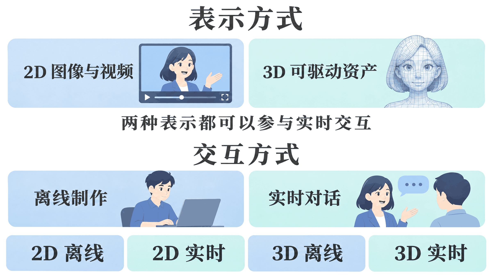

# 目录

[1. AIGC 时代数字人是什么？核心技术栈如何划分？](#q-001)
  - [面试问题：2D 数字人、3D 数字人、实时交互数字人有什么区别？](#q-002)
  - [面试问题：一个完整数字人产品链路通常包括哪些模块？](#q-003)
  - [面试问题：数字人生成为什么同时需要身份、动作、音频、表情和时序一致性？](#q-004)

[2. 2D 数字人生成有哪些主流方向？](#q-005)
  - [面试问题：人体驱动、音频驱动、换脸、虚拟换衣、视频写真分别解决什么问题？](#q-006)
  - [面试问题：如何把图像生成模型扩展到视频数字人？](#q-007)
  - [面试问题：Animate Anyone 类人体驱动方法的核心结构是什么？](#q-008)
  - [面试问题：ReferenceNet、Pose Encoder、ControlNet、Motion Module 各自起什么作用？](#q-009)
  - [面试问题：人体驱动生成中如何提升脸部 ID 相似度？](#q-010)

[3. 音频驱动数字人的核心难点是什么？](#q-011)
  - [面试问题：音频驱动说话人生成的一般 pipeline 是什么？](#q-012)
  - [面试问题：Wav2Vec、Whisper、HuBERT 等音频编码器在数字人里如何使用？](#q-013)
  - [面试问题：Hallo、Hallo2、Sonic、InfiniteTalk 的核心差异是什么？](#q-014)
  - [面试问题：为什么 Sonic 强调 Global Audio Perception？](#q-015)
  - [面试问题：长时长音频驱动视频如何避免漂移、闪烁和身份丢失？](#q-016)
  - [面试问题：多人音频驱动数字人为什么更难？](#q-017)

[4. ID 保持生成和换脸有什么本质区别？](#q-018)
  - [面试问题：IP-Adapter、InstantID、PuLID、PhotoMaker 的思路有什么区别？](#q-019)
  - [面试问题：如何实现高保真人脸身份注入？](#q-020)
  - [面试问题：换脸任务为什么常与 3DMM 人脸重建结合？](#q-021)
  - [面试问题：视频换脸如何保证时间一致性？](#q-022)
  - [面试问题：Copy-Paste 现象是什么？如何缓解？](#q-023)

[5. 虚拟换衣在数字人中解决什么问题？](#q-024)
  - [面试问题：图像换衣和视频换衣有什么区别？](#q-025)
  - [面试问题：Mask-based 和 Mask-free 虚拟换衣路线有什么差异？](#q-026)
  - [面试问题：虚拟换衣如何构造训练三元组数据？](#q-027)
  - [面试问题：如何解决衣服纹理模糊、头发遮挡和体型差异问题？](#q-028)
  - [面试问题：Wan-Animate 类统一角色动画/替换框架的核心思想是什么？](#q-029)

[6. 3D 数字人为什么仍然重要？](#q-030)
  - [面试问题：3DMM、FLAME、BFM 分别是什么？](#q-031)
  - [面试问题：SMPL、SMPL-X 的核心参数和区别是什么？](#q-032)
  - [面试问题：点云、Mesh、体素、SDF、NeRF、3D Gaussian Splatting 如何表示 3D 人体/人脸？](#q-033)
  - [面试问题：传统渲染管线和可微渲染有什么区别？](#q-034)
  - [面试问题：单目 RGB 重建 3D 人体/人脸时有哪些难点？](#q-035)

[7. 数字人项目如何从数据到部署落地？](#q-036)
  - [面试问题：数字人训练数据如何采集、清洗和标注？](#q-037)
  - [面试问题：音频驱动人脸数据如何预处理？](#q-038)
  - [面试问题：数字人质量如何评估？](#q-039)
  - [面试问题：实时交互数字人的低延迟链路如何设计？](#q-040)
  - [面试问题：Duix-Mobile 这类移动端实时数字人的工程价值是什么？](#q-041)
  - [面试问题：数字人安全、合规和反滥用需要注意什么？](#q-042)
  - [面试问题：全双工数字人如何处理倾听、插话与过期回复？](#q-043)
---

<h1 id="q-001">1. AIGC 时代数字人是什么？核心技术栈如何划分？</h1>

<h2 id="q-002">面试问题：2D 数字人、3D 数字人、实时交互数字人有什么区别？</h2>

**难度评分：⭐⭐ (2/5)  |  考察频率：⭐⭐⭐⭐⭐ (5/5)**

**2D、3D 描述人物怎样被表示；实时交互描述系统怎样响应用户。它们是两条分类轴。** 一个基于照片驱动的 2D 头像可以实时对话，一套完整的 3D 角色也可以用来离线制作广告。

2D 路线直接输出图像或视频，擅长复用真人素材，但换视角、长时间运动和局部编辑需要额外约束。3D 路线用网格、骨骼、材质或可驱动的辐射场表示人物，便于控制相机和动作；采集、绑定、头发与服装建模的成本也更高。三维表示能提供空间约束，仍需验证几何、变形和渲染是否正确。

图中四种组合都成立。选型先看交付物：要一段可发布视频、一套可编辑资产，还是一个能持续接话的交互入口，再确定生成和部署方式。

<h2 id="q-003">面试问题：一个完整数字人产品链路通常包括哪些模块？</h2>

**难度评分：⭐⭐⭐ (3/5)  |  考察频率：⭐⭐⭐⭐⭐ (5/5)**

完整链路要围绕交付物设计。离线制作通常经过“素材与授权确认 → 检测、跟踪和音画对齐 → 身份/动作/音频编码 → 视频生成 → 编码与质检”。超分和人脸修复属于可选后处理，必须检查它们是否改了身份或商品细节。

实时系统还需要三种能力：持续接收用户输入；在回复尚未完成时开始合成和播放；用户改变意图时取消过期输出。ASR、语言模型、TTS 和人物驱动可以组成模块化链路，也可以用原生语音模型合并部分环节。

**每个模块的接口都要带时间和状态。** 音频块应带起始时间与采样率，视频帧应带呈现时间戳，会话应带轮次标识。否则各模型单独运行正常，串起来仍可能播错轮次或口型错位。

<h2 id="q-004">面试问题：数字人生成为什么同时需要身份、动作、音频、表情和时序一致性？</h2>

**难度评分：⭐⭐⭐ (3/5)  |  考察频率：⭐⭐⭐⭐ (4/5)**

数字人需要同时回答“是谁、做什么、何时做”。身份是跨帧相对稳定的约束，口型和动作是随时间变化的约束，光照、遮挡和背景决定人物能否融入场景。

这些目标会互相牵制。例如，把参考脸权重调得过高，可能连闭嘴表情一起复制；强行平滑嘴部轨迹，可能压掉爆破音附近的快速变化；让动作严格跟随驱动人物，又可能把对方的肩宽和腿长带入结果。

工程上应分别测身份保持、驱动响应、音画同步和时间连续性，再检查联合失败案例。一个人物全程不动，确实可能有很低的帧间差异，却没有完成驱动任务。**稳定必须建立在该发生的变化已经发生的前提上。**

---

<h1 id="q-005">2. 2D 数字人生成有哪些主流方向？</h1>

<h2 id="q-006">面试问题：人体驱动、音频驱动、换脸、虚拟换衣、视频写真分别解决什么问题？</h2>

**难度评分：⭐⭐ (2/5)  |  考察频率：⭐⭐⭐⭐⭐ (5/5)**

这几类任务的区别在于：哪些信息由输入指定，哪些信息允许模型改变。

| 任务 | 主要输入 | 必须保留或响应的内容 |
|---|---|---|
| 人体驱动 | 参考人物、姿态或驱动视频 | 保留外观，响应目标动作 |
| 音频驱动 | 参考人物、语音 | 保留身份，协调口型与语音 |
| 换脸 | 源身份、目标画面 | 替换身份，保留目标表情、头姿与场景 |
| 虚拟换衣 | 人物、指定服装 | 保留人物，迁移服装形状与纹理 |
| 人物视频生成 | 身份参考、文本及其他条件 | 在新场景中保持角色身份 |

同一个视频模型可以承载多种任务，但评估标准不能混用。换衣中的“更漂亮”不能补偿商品花纹错误，换脸中的高身份相似度也不能补偿目标表情丢失。

<h2 id="q-007">面试问题：如何把图像生成模型扩展到视频数字人？</h2>

**难度评分：⭐⭐⭐ (3/5)  |  考察频率：⭐⭐⭐⭐ (4/5)**

把单帧生成扩展到视频，必须让当前帧的生成依赖时间上下文。逐帧独立生成只能靠后处理缓解闪烁；在图像主干中增加时间卷积或时间注意力，可以复用空间能力；直接使用视频预训练主干，则可以继承更丰富的运动先验。

视频 latent 常写成 $`Z\in\mathbb{R}^{B\times C\times T\times H\times W}`$。这里的 $`T`$ 是 latent 时间长度，若 VAE 做了时间压缩，它与输出帧数并不相等。

另外要分清三个概念：U-Net/DiT 是网络结构，扩散/Flow Matching 是训练与生成路径的选择，视频预训练描述数据和任务。它们可以组合，不能排成互相替代的三代模型。具体条件设计见[可控人体生成章节](./02_可控人体生成与角色动画高频考点.md#q-004)。

<h2 id="q-008">面试问题：Animate Anyone 类人体驱动方法的核心结构是什么？</h2>

**难度评分：⭐⭐⭐ (3/5)  |  考察频率：⭐⭐⭐⭐ (4/5)**

Animate Anyone 的代表性分工是：ReferenceNet 提供参考人物的多尺度外观特征，Pose Guider 提供姿态约束，去噪主干中的时间建模协调连续帧。[1]

这套结构值得理解的地方，在于把“外观来源”和“动作来源”分开。参考图中的衣服纹理需要被保留，参考图中的站姿却不能压过目标动作。普通全局图像向量擅长表达语义，保存细小纹理时往往需要更丰富的空间特征。

这些分支只有功能上的分工，并未获得数学上严格的解耦。训练配对、注入位置和条件强度仍决定模型会不会复制参考姿态。参考注意力的细节见[ReferenceNet 问答](./02_可控人体生成与角色动画高频考点.md#q-006)。

<h2 id="q-009">面试问题：ReferenceNet、Pose Encoder、ControlNet、Motion Module 各自起什么作用？</h2>

**难度评分：⭐⭐⭐ (3/5)  |  考察频率：⭐⭐⭐⭐ (4/5)**

可以按“提供什么约束”区分四个模块。ReferenceNet 提供外观，Pose Encoder 将骨架等结构条件转换为网络特征，ControlNet 通过额外可训练分支约束空间生成，Motion Module 在时间维交换信息。

Pose Encoder 不必采用完整 ControlNet；ReferenceNet 也不等同于人脸识别网络。前者保留衣服、头发等外观细节，后者更偏身份判别。时序模块可以协调帧间变化，却不能保证错误身份自动恢复。

接入方式可以是特征相加、注意力读取、token 拼接或条件调制。面试时应补充它接在哪一层、主干是否冻结、输入输出分辨率如何对齐。仅列模块名字，无法解释控制信号怎样影响最终画面。

<h2 id="q-010">面试问题：人体驱动生成中如何提升脸部 ID 相似度？</h2>

**难度评分：⭐⭐⭐ (3/5)  |  考察频率：⭐⭐⭐⭐ (4/5)**

先判断身份误差来自哪里：参考脸本身太小，检测裁剪不准，身份特征没有传入主干，还是大姿态超出了训练覆盖。全身画面中的脸只占少量像素，整体重建损失很容易忽略它。

可用独立人脸条件、面部区域加权、多视角同身份训练和身份相似度损失加强约束。身份损失通常比较对齐后人脸的归一化特征，但识别分数受姿态、遮挡和识别器训练分布影响，不能作为唯一标准。

局部修复适合补清晰度，不应承担恢复真实身份的全部责任。修复网络可能生成一张更清楚却更不像本人的脸。验收时应同时看身份相似度、表情响应和相邻帧稳定性。

---

<h1 id="q-011">3. 音频驱动数字人的核心难点是什么？</h1>

<h2 id="q-012">面试问题：音频驱动说话人生成的一般 pipeline 是什么？</h2>

**难度评分：⭐⭐⭐ (3/5)  |  考察频率：⭐⭐⭐⭐ (4/5)**

音频驱动的输入至少包括人物参考和音频。处理流程是：保留正确时间戳并完成预处理，提取视觉与音频条件，按视频时间读取相应音频上下文，生成或驱动人物，再用同一时间基准合成音视频。

离线模型可以读取完整语音，提前安排头动与表情；实时模型只能使用已到达音频以及明确约定的前瞻窗口。两者的输入条件不同，同一段音频上的离线效果不能直接说明流式效果。

降噪、人声分离、裁剪和超分都应按需求启用。过度降噪会改变辅音，逐帧重新裁剪会制造抖动，后处理改变帧率又可能破坏同步。具体对齐方式见[音频时间对齐](./03_音频驱动数字人与长视频生成高频考点.md#q-004)。

<h2 id="q-013">面试问题：Wav2Vec、Whisper、HuBERT 等音频编码器在数字人里如何使用？</h2>

**难度评分：⭐⭐⭐ (3/5)  |  考察频率：⭐⭐⭐⭐ (4/5)**

wav2vec 2.0 和 HuBERT 通过自监督学习语音表征，Whisper 以大规模语音识别训练获得多语种音频表示；Mel 频谱则直接保留较低层的时频结构。它们的训练目标和时间分辨率不同，不能仅按编码器大小选型。

口型依赖细粒度音素变化，头动和情绪还需要韵律及更长上下文。同一个编码器的不同层也可能偏向不同信息。应在相同数据和生成主干下比较局部同步、长句表现与实际延迟。

特别要区分采样率和特征帧率：16 kHz 表示每秒波形采样点数，不是每秒产生 16000 个音频 token。对齐必须依据卷积步长、窗口中心和 padding，而不能直接用波形采样率除以视频帧率。

<h2 id="q-014">面试问题：Hallo、Hallo2、Sonic、InfiniteTalk 的核心差异是什么？</h2>

**难度评分：⭐⭐⭐ (3/5)  |  考察频率：⭐⭐⭐ (3/5)**

这四类工作分别强调不同约束：Hallo 用分层音频条件协调嘴部、表情和头部运动；Hallo2 处理长时续接和高分辨率；Sonic 关注更长上下文中的音频与运动关系；InfiniteTalk 将音频驱动扩展到稀疏帧视频配音与持续分段生成。[2–5]

比较时先固定任务。替换一段已有视频的配音，需要保留原场景和动作；从单张照片生成表演，则允许更多运动自由度。二者不能只凭样片清晰度排序。

“无限长度”表示可以持续续接，不代表任意时长都没有漂移，也不等同于实时交互。各方法的控制结构和长视频边界见[音频驱动专题](./03_音频驱动数字人与长视频生成高频考点.md#q-005)。

<h2 id="q-015">面试问题：为什么 Sonic 强调 Global Audio Perception？</h2>

**难度评分：⭐⭐⭐ (3/5)  |  考察频率：⭐⭐⭐ (3/5)**

短音频窗口能帮助预测当前口型，却难以决定一句话中的强调、停顿和头动节奏。Sonic 通过上下文增强的音频学习和运动控制，让音频同时影响局部表达与更长时间的动态。[4]

“全局”应放在论文定义的上下文范围内理解，不能直接解释成每一帧都读取任意长度的整段录音。窗口越长，离线生成越容易安排动作；实时使用时，未来上下文会增加等待。

这也提示一个基本边界：音频无法唯一确定手势和视线。同一句话可以有多种自然表演。评估时既要检查同步，也要容许合理的动作多样性，不能把某条真实动作轨迹当成唯一正确答案。

<h2 id="q-016">面试问题：长时长音频驱动视频如何避免漂移、闪烁和身份丢失？</h2>

**难度评分：⭐⭐⭐⭐ (4/5)  |  考察频率：⭐⭐⭐⭐ (4/5)**

长视频的风险在于，上一段生成结果成为下一段条件后，细小错误会被反复继承。需要同时维护稳定的身份参考、足够的近期运动上下文，以及训练与推理相近的续接方式。

重叠窗口能够缓解接缝，却不能修复已漂移的脸型；原始参考能稳住外观，注入过强又可能冻结动作。训练时对历史条件做适度扰动，或让模型接触自身生成的历史，可以降低它对完美历史的依赖。

缓存、量化和多卡并行解决计算问题，不直接保证长期一致性。验收应按时长和片段位置分别统计身份、颜色、同步及接缝错误，具体机制见[长视频误差累积](./03_音频驱动数字人与长视频生成高频考点.md#q-029)。

<h2 id="q-017">面试问题：多人音频驱动数字人为什么更难？</h2>

**难度评分：⭐⭐⭐⭐ (4/5)  |  考察频率：⭐⭐⭐ (3/5)**

多人场景首先要建立“音轨—人物”对应关系，再生成轮流说话、倾听和共同动作。音频分离将混合声音拆成声源，说话人分段标注回答谁在何时说话，两者也不等同于把声音绑定到画面中某张脸。

模型可通过区域 mask、人物标签或带标签的注意力读取各自音轨。人物移动或遮挡后，系统还要维持身份跟踪；固定把左半画面绑定音轨 A，在人物交换位置后就会失效。

除同步之外，测试还应包含静默、交叠发言和位置交换，检查非说话者是否被错误驱动。MultiTalk 等方法的绑定机制见[多人音频专题](./03_音频驱动数字人与长视频生成高频考点.md#q-016)。

---

<h1 id="q-018">4. ID 保持生成和换脸有什么本质区别？</h1>

<h2 id="q-019">面试问题：IP-Adapter、InstantID、PuLID、PhotoMaker 的思路有什么区别？</h2>

**难度评分：⭐⭐ (2/5)  |  考察频率：⭐⭐⭐⭐ (4/5)**

IP-Adapter 用独立的图像注意力支路补充图像提示；InstantID 将人脸识别特征与面部关键点结合；PuLID 在身份注入之外约束原模型的非身份能力；PhotoMaker 聚合一个或多个身份参考的表示。[6]

四者的控制对象不同：通用图像提示可以携带构图和风格，人脸身份条件更希望舍去这些拍摄因素。多参考图能提供更多视角，也可能混入低质量图或错误身份，需要先筛选。

总览中抓住“提取什么信息、从哪里注入、怎样保留编辑能力”即可。训练损失和具体差异见[身份保持章节](./04_ID保持换脸与虚拟换衣高频考点.md#q-003)。

<h2 id="q-020">面试问题：如何实现高保真人脸身份注入？</h2>

**难度评分：⭐⭐⭐ (3/5)  |  考察频率：⭐⭐⭐⭐ (4/5)**

高保真人脸条件通常包含三层信息：识别特征约束身份，关键点或几何参数约束姿态与表情，局部图像特征补充细节。三者承担不同职责，不能都用一个强参考向量替代。

例如，目标是侧脸微笑时，可以保留源身份特征，同时从目标条件读取头姿和表情；参考图中的正脸闭嘴状态应被释放。区域注意力能减少身份条件扰动背景，却不自动完成身份与表情解耦。

训练数据必须包含同身份不同拍摄条件，并在测试中改变姿态、表情和光照。只用参考图自重建获得的高相似度，很难证明模型真正支持身份保持下的编辑。

<h2 id="q-021">面试问题：换脸任务为什么常与 3DMM 人脸重建结合？</h2>

**难度评分：⭐⭐⭐ (3/5)  |  考察频率：⭐⭐⭐⭐ (4/5)**

3DMM 将人脸形状拆成相对稳定的身份分量与可变的表情分量，再通过相机参数投影到目标画面。换脸时可结合源身份形状、目标表情与头姿，得到几何对齐依据。

它还能提供法线、深度、可见区域和人脸轮廓，帮助处理大角度转头和脸型差异。但单图拟合存在歧义，低维模型也难覆盖头发、牙齿、眼镜等细节。几何先验出错时，生成网络可能沿着错误条件继续合成。

因此应先检查拟合和投影，再检查身份注入与融合。参数定义及优化方法见[3DMM 问答](./05_3D数字人与可微渲染高频考点.md#q-006)。

<h2 id="q-022">面试问题：视频换脸如何保证时间一致性？</h2>

**难度评分：⭐⭐⭐ (3/5)  |  考察频率：⭐⭐⭐⭐ (4/5)**

先稳定跟踪与裁剪，再约束生成。检测框跳动、对齐坐标变化或遮挡 mask 抖动，会让稳定的生成器也输出闪烁视频。

模型层可以读取连续帧、共享身份条件，并在可靠的非遮挡区域加入光流对齐损失。边界融合也需要时序一致：每帧独立估计颜色、羽化半径或 mask，都可能制造新的闪烁。

平滑应避免伤害快速眨眼和辅音口型。判断改进是否有效，要在正常动作保持的前提下比较闪烁、身份变化和边界稳定性。视频换脸的细节见[专题问答](./04_ID保持换脸与虚拟换衣高频考点.md#q-013)。

<h2 id="q-023">面试问题：Copy-Paste 现象是什么？如何缓解？</h2>

**难度评分：⭐⭐⭐ (3/5)  |  考察频率：⭐⭐⭐⭐ (4/5)**

Copy-Paste 指输出过度继承参考图的姿态、表情或光照，无法完成指定变化。例如输入正脸照片，要求侧脸微笑，输出依然正脸闭嘴，即使识别分数很高，任务也失败了。

常见诱因是同图自重建过多、参考特征携带了非身份信息，以及身份约束压过了动作或文本条件。应增加同身份跨姿态配对、筛除重复画面，并分别评估身份保持和目标属性响应。

延迟注入、条件 dropout 与区域限制都是可尝试的策略，效果依赖训练方式，不能作为通用处方。更细的评估与配对训练见[Copy-Paste 专题](./04_ID保持换脸与虚拟换衣高频考点.md#q-009)。

---

<h1 id="q-024">5. 虚拟换衣在数字人中解决什么问题？</h1>

<h2 id="q-025">面试问题：图像换衣和视频换衣有什么区别？</h2>

**难度评分：⭐⭐ (2/5)  |  考察频率：⭐⭐⭐⭐ (4/5)**

视频换衣在单帧服装匹配之外，还要保持纹理随运动连续变化。衣服上的文字不能逐帧变形，手伸到衣服前面时遮挡关系不能翻转，裙摆与袖口也要随身体运动合理变化。

图像模型逐帧处理可以作为基线，但它没有天然的跨帧对应关系。视频模型、服装特征共享、可靠光流和局部轨迹约束能改善一致性。把帧间差异压到很小同样不够：静止的衣服贴图可能稳定，却不符合身体运动。

要将视觉试穿与实际尺码判断分开。漂亮的穿着效果图不能证明衣服合身，也不能替代衣长、胸围、面料弹性等测量信息。

<h2 id="q-026">面试问题：Mask-based 和 Mask-free 虚拟换衣路线有什么差异？</h2>

**难度评分：⭐⭐⭐ (3/5)  |  考察频率：⭐⭐⭐⭐ (4/5)**

Mask-based 方法显式指定需要修改的区域，控制边界较直接；Mask-free 方法在推理接口上不要求用户提供换衣 mask，由模型学习编辑范围。后者训练时仍可能依赖解析标注或带 mask 的教师模型。

二者的取舍主要在保留信息和消除旧衣之间。mask 太窄，旧袖子和领口会残留；太宽，手臂、头发和背景信息容易丢失；沿旧衣边界精确绘制，模型又可能把旧轮廓当成新衣形状。

因此“没有 mask”不等于没有分割依赖，“有 mask”也不等于严格保护了其他区域。应以换衣完整度、非编辑区域保持和新衣形状正确性共同判断。

<h2 id="q-027">面试问题：虚拟换衣如何构造训练三元组数据？</h2>

**难度评分：⭐⭐⭐ (3/5)  |  考察频率：⭐⭐⭐⭐ (4/5)**

典型监督数据包含人物条件、商品服装图和目标上身图。常见做法是从真实上身图去除衣服信息，构造服装无关的人物表示，再让模型依据商品图重建原上身图。

这通常并不意味着已经采集了同一个模特换衣前后的完整成对照片。训练中“移除再恢复原衣”的配对，推理时要泛化到真正的新衣服，二者有分布差异。

质量检查至少覆盖 SKU 对应、服装可见范围、遮挡、人物保留与去重。训练集和测试集应按人物、商品及原始拍摄片段合理划分，避免相邻帧或同一商品图泄漏造成虚高成绩。

<h2 id="q-028">面试问题：如何解决衣服纹理模糊、头发遮挡和体型差异问题？</h2>

**难度评分：⭐⭐⭐ (3/5)  |  考察频率：⭐⭐⭐⭐ (4/5)**

先分开处理细节不足、遮挡错误和几何不匹配。纹理模糊要检查商品原图是否清楚、局部特征是否被压缩、目标衣服在输出中是否只有少量像素；超分不能凭空恢复真实商标和字样。

遮挡没有固定的“背景、衣服、手、头发”全局层级。手可以在衣服前，也可以插入衣兜；长发会跨越肩膀。应使用局部可见性、深度和时序跟踪，保护需要保留的区域并处理新暴露区域。

体型差异可以借助 DensePose、参数化人体或姿态重定向减轻，但宽松服装并不贴合裸人体表。对服装轮廓和人体形状分开建模，比简单拉伸整张衣服图更可靠。

<h2 id="q-029">面试问题：Wan-Animate 类统一角色动画/替换框架的核心思想是什么？</h2>

**难度评分：⭐⭐⭐ (3/5)  |  考察频率：⭐⭐⭐ (3/5)**

Wan-Animate 将角色动画与角色替换放在统一框架下：动画任务按驱动动作生成参考角色，替换任务还需要保留目标视频环境并融入新角色。[7]

两种任务共享身份与运动控制，差异主要来自环境约束。替换时必须处理背景、遮挡和光照，动作重定向也要尊重人物与桌椅、地面等接触关系。改变骨架比例后，原先接触桌面的手可能悬空。

它适合用来理解视频底模上的多条件控制，但不能直接等同于商品级虚拟试穿。角色服装相似与指定 SKU 的纹理、版型准确，是不同验收要求。

---

<h1 id="q-030">6. 3D 数字人为什么仍然重要？</h1>

<h2 id="q-031">面试问题：3DMM、FLAME、BFM 分别是什么？</h2>

**难度评分：⭐⭐ (2/5)  |  考察频率：⭐⭐⭐⭐ (4/5)**

3DMM 是一类低维统计人脸模型，通常用平均形状加形变基表示身份，并可扩展表情和纹理空间。BFM 是这一方向的代表模型；FLAME 则更强调头部、下颌、眼球、脖子与表情的可动画结构。[8]

不要把 FLAME 当成带完整毛发和牙齿材质的成品头模。几何模型、纹理空间和渲染材质是独立资产，实际系统常把它们组合使用。

选型取决于任务：快速人脸拟合关注计算和参数稳定性；表情动画关注可驱动范围；高保真重建还要补充细节与可见性约束。具体参数和重建方法见[3D 人脸章节](./05_3D数字人与可微渲染高频考点.md#q-005)。

<h2 id="q-032">面试问题：SMPL、SMPL-X 的核心参数和区别是什么？</h2>

**难度评分：⭐⭐ (2/5)  |  考察频率：⭐⭐⭐⭐ (4/5)**

SMPL 根据体型和关节姿态输出固定拓扑的人体网格，经典版本有 6890 个顶点和 24 个关节，其中包含根关节。形状修正、姿态修正与线性混合蒙皮共同完成变形。[8]

SMPL-X 进一步联合身体、手部和面部表情，适合需要细致手势及表演控制的场景。但模型增加了表达能力，不代表输入视频里模糊或被遮挡的手指就能准确恢复。

两者主要表示人体表面，宽松衣物和头发需要额外表示。推理时还要明确坐标系、单位、相机、全局平移以及关节定义，避免参数正确却渲染错位。

<h2 id="q-033">面试问题：点云、Mesh、体素、SDF、NeRF、3D Gaussian Splatting 如何表示 3D 人体/人脸？</h2>

**难度评分：⭐⭐⭐ (3/5)  |  考察频率：⭐⭐⭐⭐ (4/5)**

先区分几何表示与观测数据。点云、网格和隐式曲面描述空间结构；RGB-D 和多视角图像主要是采集与监督形式。NeRF 与 3DGS 则描述供新视角渲染使用的辐射场。

网格适合骨骼绑定和引擎编辑；体素直观但稠密存储随分辨率立方增长；SDF 用连续距离函数定义表面；NeRF 沿射线累积密度与颜色；3DGS 将带外观参数的高斯投影并合成。[9]

静态辐射场不会自动成为可说话的数字人。还要增加驱动变量、规范空间对应或形变模型。完整选型和公式见[三维表示专题](./05_3D数字人与可微渲染高频考点.md#q-017)。

<h2 id="q-034">面试问题：传统渲染管线和可微渲染有什么区别？</h2>

**难度评分：⭐⭐⭐ (3/5)  |  考察频率：⭐⭐⭐⭐ (4/5)**

正向渲染由几何、材质、相机和光照得到图像；可微渲染还提供图像相对这些参数的梯度，使二维监督能够反向优化三维场景。

困难主要在可见性边界：顶点稍微移动，像素可能从背景切换成三角形，深度遮挡关系也可能改变。已经确定可见三角形内部的插值和着色通常可以求导，不能把整条传统管线都说成不可导。

软光栅化、边界梯度近似、可微体渲染等方法采用不同处理。梯度可用只解决“怎样优化”，并不保证单张照片足以唯一恢复真实几何；具体见[可微渲染专题](./05_3D数字人与可微渲染高频考点.md#q-025)。

<h2 id="q-035">面试问题：单目 RGB 重建 3D 人体/人脸时有哪些难点？</h2>

**难度评分：⭐⭐⭐ (3/5)  |  考察频率：⭐⭐⭐⭐ (4/5)**

单张 RGB 图像缺少深度与尺度约束。相似的二维轮廓可能来自不同体型、相机距离或肢体姿态；阴影也可能被误解释成凹凸，衣服轮廓被误解释成身体轮廓。

多帧能增加观测，但只有人物或相机提供了新的视角，隐藏区域才可能真正变得可见。重复同一正脸画面不能补齐后脑勺证据。

参数化先验、深度输入、多视角标定和物理约束能缩小解空间。生成模型可补出合理外观，却不等于恢复了真实背面。若交付物用于测量、试衣尺寸或接触仿真，应把这种不确定性纳入验收。

---

<h1 id="q-036">7. 数字人项目如何从数据到部署落地？</h1>

<h2 id="q-037">面试问题：数字人训练数据如何采集、清洗和标注？</h2>

**难度评分：⭐⭐⭐ (3/5)  |  考察频率：⭐⭐⭐⭐ (4/5)**

数据首先要服务目标任务：口播需要可信的音画同步和嘴部细节，全身动作需要姿态覆盖，身份编辑需要同身份跨角度与表情，实时交互还需要停顿、静默和被打断的样本。

处理时保留来源与授权信息，做解码检查、镜头切分、身份跟踪、质量筛选、时间对齐和去重。划分训练测试集时，应按人物、原始视频或拍摄场次隔离，不能随机打散相邻帧。

质量筛选也会改变分布。把侧脸、遮挡、快速动作全部过滤，可能让训练更顺利，却让模型一遇到真实交互就失败。应保留受控的困难样本，并分别统计它们的表现。

<h2 id="q-038">面试问题：音频驱动人脸数据如何预处理？</h2>

**难度评分：⭐⭐⭐ (3/5)  |  考察频率：⭐⭐⭐⭐ (4/5)**

预处理的目标是形成稳定的人脸轨迹和可信的音视频时间关系。先检查解码与时间戳，按镜头和身份分段，再跟踪人脸、稳定裁剪，并按音频编码器要求重采样。

同步估计可用 SyncNet 一类模型辅助，但偏移校正必须说明符号方向、置信度和适用范围。采集链路存在缓慢时钟漂移时，单个固定 offset 无法修复全片。

16 kHz、25 FPS 或 256×256 是部分方法的配置，不是数字人数据的统一标准。过严的 VAD 裁剪还会丢掉自然停顿与倾听状态。详细步骤见[音频预处理专题](./03_音频驱动数字人与长视频生成高频考点.md#q-020)。

<h2 id="q-039">面试问题：数字人质量如何评估？</h2>

**难度评分：⭐⭐⭐ (3/5)  |  考察频率：⭐⭐⭐⭐⭐ (5/5)**

评估应围绕任务完成情况拆开：身份是否正确、动作是否跟随、口型是否同步、画面是否自然、跨帧是否稳定，以及系统是否按时输出。

FID/FVD 比较样本分布，不能判断某个指定人物是否生成正确；LPIPS 需要合理配对；识别相似度无法单独证明表情自然。检测不到人脸的帧应计入失败率，不能删掉后只统计成功帧。

建议用固定的普通集、困难集和长时集，并保留“静默、转头、遮挡、快速手势、多人交换位置”等案例。实时产品还要记录首音频、首画面、音画偏移和打断停止延迟。**模型分数与完整交互体验需要分别验收。**

<h2 id="q-040">面试问题：实时交互数字人的低延迟链路如何设计？</h2>

**难度评分：⭐⭐⭐⭐ (4/5)  |  考察频率：⭐⭐⭐⭐⭐ (5/5)**

先拆解用户等待的来源：端点检测或轮次判断、模型排队、回复生成、语音合成、人物首块生成、编码传输和播放缓冲。各阶段可以重叠，不能把离线总耗时直接当成首响延迟。

优化应围绕关键路径进行。流式 ASR 提供早期文本，回复按可合成片段进入 TTS，人物驱动消费带时间戳的音频块，前端按播放时钟展示画面。减少分块会降低等待，但也可能增加断句错误、口型接缝和调度开销。

每个阶段都记录时间戳与轮次 ID，并在实际并发下看 P50、P95、P99。单卡跑到 30 FPS 只说明一定配置下的处理速度，不说明用户能在 33 毫秒内听到回复。

<h2 id="q-041">面试问题：Duix-Mobile 这类移动端实时数字人的工程价值是什么？</h2>

**难度评分：⭐⭐⭐ (3/5)  |  考察频率：⭐⭐⭐ (3/5)**

移动端数字人 SDK 的工程价值，是把人物驱动、资源管理、音频播放和渲染封装成可集成的客户端能力。ASR、语言模型和 TTS 可以在云端，也可以部分放在本地，具体取决于接口与设备能力。

以 Duix-Mobile 这类方案为例，选型应检查持续运行时的帧率、温升、内存峰值、离线能力、输入音频格式和资源授权。一次演示运行流畅，不代表低端机在十分钟会话中仍然稳定。

本地渲染能减少视频回传与部分网络等待，无法消除云端推理和上行网络延迟。与离线高保真视频相比，它的优势更体现在稳定交互和产品集成，而实际支持平台、许可和接口要按选定版本确认。

<h2 id="q-042">面试问题：数字人安全、合规和反滥用需要注意什么？</h2>

**难度评分：⭐⭐⭐ (3/5)  |  考察频率：⭐⭐⭐⭐ (4/5)**

数字人系统应把身份授权落实到数据与资产，而非只在页面上加一句提示。人物照片、声音、可用场景、有效期限和授权撤回状态，需要能对应到具体角色及生成任务。

对外输出应保留适用的生成标识与来源记录，敏感操作则由业务权限和确认流程约束。水印可能在裁剪、压缩或重拍后失效，检测器也会误判，因此二者不能代替授权校验。

删除机制还要覆盖原始素材、缓存、角色 embedding、专属模型及可撤回的派生资产。具体法律要求依地区和业务变化；技术方案应保留可追踪、可停用和可审计的能力。

<h2 id="q-043">面试问题：全双工数字人如何处理倾听、插话与过期回复？</h2>

**难度评分：⭐⭐⭐⭐ (4/5)  |  考察频率：⭐⭐⭐⭐ (4/5)**

全双工交互允许系统在播放回复时继续感知用户。它需要持续判断当前声音来自用户、回声还是旁人，并决定继续说、暂停、等待或切换轮次。

可以维护 `listening / thinking / speaking / interrupted` 等状态，但真实实现常让感知与播放并发运行。检测到有效打断后，需要沿链路取消当前生成，停止 TTS，清空尚未播放的音频和视频块，并拒收旧轮次迟到的结果。给每块内容带上 `turn_id`，比仅停止前端播放器更可靠。

视觉端还要从说话状态平滑回到倾听状态，嘴部随实际播放音频停止，不能继续消费已经取消的合成音轨。声学回声消除、轮次判断和取消传播分别解决不同问题。

验收至少包含短插话、长停顿、背景人声和网络迟到包。记录用户开始插话到声音停止、画面停止说话的时间，同时统计误打断与漏打断。流式生成提供连续输出，全双工状态管理决定这些输出是否还属于当前对话。[10]

---

## 参考资料

[1] Animate Anyone：<https://arxiv.org/abs/2311.17117>；<https://github.com/humanaigc/AnimateAnyone>。

[2] Hallo：<https://arxiv.org/abs/2406.08801>。

[3] Hallo2：<https://arxiv.org/abs/2410.07718>。

[4] Sonic：<https://github.com/jixiaozhong/Sonic>。

[5] InfiniteTalk：<https://arxiv.org/abs/2508.14033>；<https://github.com/MeiGen-AI/InfiniteTalk>。

[6] IP-Adapter：<https://arxiv.org/abs/2308.06721>；InstantID：<https://arxiv.org/abs/2401.07519>；PuLID：<https://arxiv.org/abs/2404.16022>；PhotoMaker：<https://github.com/TencentARC/PhotoMaker>。

[7] Wan2.2 / Wan-Animate：<https://github.com/Wan-Video/Wan2.2>。

[8] FLAME：<https://flame.is.tue.mpg.de/>；SMPL：<https://smpl.is.tue.mpg.de/>；SMPL-X：<https://smpl-x.is.tue.mpg.de/>。

[9] NeRF：<https://www.matthewtancik.com/nerf>；3DGS：<https://repo-sam.inria.fr/fungraph/3d-gaussian-splatting/>。

[10] OpenAvatarChat：<https://github.com/HumanAIGC-Engineering/OpenAvatarChat>；StreamEval：<https://arxiv.org/abs/2610.28402>。交互状态与取消传播为系统设计建议，不代表所有项目采用同一实现。
