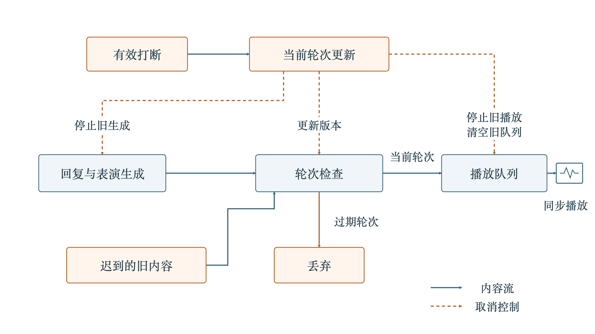

# 目录

[1. AIGC 时代数字人是什么？核心技术栈如何划分？](#q-001)
  - [面试问题：2D 数字人、3D 数字人、实时交互数字人有什么区别？](#q-002)
  - [面试问题：一个完整数字人产品链路通常包括哪些模块？](#q-003)
  - [面试问题：数字人生成为什么同时需要身份、动作、音频、表情和时序一致性？](#q-004)

[2. 2D 数字人生成有哪些主流方向？](#q-005)
  - [面试问题：人体驱动、音频驱动、换脸、虚拟换衣、视频写真分别解决什么问题？](#q-006)
  - [面试问题：如何把图像生成模型扩展到视频数字人？](#q-007)
  - [面试问题：Animate Anyone 类人体驱动方法的核心结构是什么？](#q-008)
  - [面试问题：ReferenceNet、Pose Encoder、ControlNet、Motion Module 各自起什么作用？](#q-009)
  - [面试问题：人体驱动生成中如何提升脸部 ID 相似度？](#q-010)

[3. 音频驱动数字人的核心难点是什么？](#q-011)
  - [面试问题：音频驱动说话人生成的一般 pipeline 是什么？](#q-012)
  - [面试问题：Wav2Vec、Whisper、HuBERT 等音频编码器在数字人里如何使用？](#q-013)
  - [面试问题：Hallo、Hallo2、Sonic、InfiniteTalk 的核心差异是什么？](#q-014)
  - [面试问题：为什么 Sonic 强调 Global Audio Perception？](#q-015)
  - [面试问题：长时长音频驱动视频如何避免漂移、闪烁和身份丢失？](#q-016)
  - [面试问题：多人音频驱动数字人为什么更难？](#q-017)

[4. ID 保持生成和换脸有什么本质区别？](#q-018)
  - [面试问题：IP-Adapter、InstantID、PuLID、PhotoMaker 的思路有什么区别？](#q-019)
  - [面试问题：如何实现高保真人脸身份注入？](#q-020)
  - [面试问题：换脸任务为什么常与 3DMM 人脸重建结合？](#q-021)
  - [面试问题：视频换脸如何保证时间一致性？](#q-022)
  - [面试问题：Copy-Paste 现象是什么？如何缓解？](#q-023)

[5. 虚拟换衣在数字人中解决什么问题？](#q-024)
  - [面试问题：图像换衣和视频换衣有什么区别？](#q-025)
  - [面试问题：Mask-based 和 Mask-free 虚拟换衣路线有什么差异？](#q-026)
  - [面试问题：虚拟换衣如何构造训练三元组数据？](#q-027)
  - [面试问题：如何解决衣服纹理模糊、头发遮挡和体型差异问题？](#q-028)
  - [面试问题：Wan-Animate 类统一角色动画/替换框架的核心思想是什么？](#q-029)

[6. 3D 数字人为什么仍然重要？](#q-030)
  - [面试问题：3DMM、FLAME、BFM 分别是什么？](#q-031)
  - [面试问题：SMPL、SMPL-X 的核心参数和区别是什么？](#q-032)
  - [面试问题：点云、Mesh、体素、SDF、NeRF、3D Gaussian Splatting 如何表示 3D 人体/人脸？](#q-033)
  - [面试问题：传统渲染管线和可微渲染有什么区别？](#q-034)
  - [面试问题：单目 RGB 重建 3D 人体/人脸时有哪些难点？](#q-035)

[7. 数字人项目如何从数据到部署落地？](#q-036)
  - [面试问题：数字人训练数据如何采集、清洗和标注？](#q-037)
  - [面试问题：音频驱动人脸数据如何预处理？](#q-038)
  - [面试问题：数字人质量如何评估？](#q-039)
  - [面试问题：实时交互数字人的低延迟链路如何设计？](#q-040)
  - [面试问题：Duix-Mobile 这类移动端实时数字人的工程价值是什么？](#q-041)
  - [面试问题：数字人安全、合规和反滥用需要注意什么？](#q-042)
  - [面试问题：全双工数字人如何处理倾听、插话与过期回复？](#q-043)
---

<h1 id="q-001">1. AIGC 时代数字人是什么？核心技术栈如何划分？</h1>

<h2 id="q-002">面试问题：2D 数字人、3D 数字人、实时交互数字人有什么区别？</h2>

**难度评分：⭐⭐ (2/5)  |  考察频率：⭐⭐⭐⭐⭐ (5/5)**

**2D、3D 描述人物怎样被表示；实时交互描述系统怎样响应用户。它们是两条独立的分类轴。** 基于照片生成的头像可以实时接话，带骨骼和材质的三维角色也可以用于离线制作电影。把“2D、3D、实时”列成三种互斥技术，会直接影响后面的选型判断。

### 1、先区分最终交付的是画面还是资产

2D 路线通常以参考图、视频、姿态或音频为条件，直接合成最终像素。例如输入一张人物照片和一段语音，输出口型同步的视频。它可以借助深度、3DMM 等几何条件，但只要交付物仍是画面，就不能据此认为已经获得一套可编辑的三维角色。改变相机或服装时，往往需要重新生成，还要重新检查身份和时间一致性。

3D 路线维护可从不同视角观察的空间表示，包括网格、骨骼、材质，也包括可驱动的 NeRF 或 3D Gaussian Avatar。动作改变的是角色状态，相机改变的是观察方式，渲染器把两者转成图像。一个绑定正确的网格角色抬手时，手臂的位置、遮挡和投影具有共同的几何依据；代价是建模、拟合、绑定及细节还原更复杂。辐射场能提供三维外观，也不一定具有游戏资产那样的材质编辑和碰撞能力。

### 2、再判断输出是否受交互时限约束

离线系统可以在拿到完整脚本和音频后统一安排表演，允许多次采样、筛选与修复。实时系统要持续接收输入，在信息尚不完整时开始输出，还要处理网络波动和用户插话。实时性的要求包含首响、持续播放、打断生效和长时间稳定运行，单次生成速度只是其中一项。

<div align="center">


</div>

图中四种组合都成立。比如，批量制作口播广告可优先考察 2D 离线生成；游戏中的虚拟角色往往需要 3D 资产与实时驱动；手机上的客服头像则可能使用轻量 2D 驱动或简化 3D 渲染。这里没有按技术名称排列的固定优劣顺序。

选型时可依次问三个问题：是否需要任意视角与资产编辑？是否需要连续交互？在目标设备和预算下，能否同时满足画质、控制精度与时限？如果只需要正面口播，重建完整三维人物可能增加不必要的成本；如果要求绕人物拍摄、手接触桌面、服装可更换，就要认真评估纯画面生成能否提供足够稳定的空间约束。

<h2 id="q-003">面试问题：一个完整数字人产品链路通常包括哪些模块？</h2>

**难度评分：⭐⭐⭐ (3/5)  |  考察频率：⭐⭐⭐⭐⭐ (5/5)**

**完整数字人系统要把“理解输入、决定回应、生成声音和表演、按时播放”接起来。** 一个能生成头像视频的模型，只覆盖了其中的视觉环节。产品是否可用，常常取决于这些模块之间的数据和状态是否一致。

### 1、离线制作链路怎样组织

以制作一段讲解视频为例，首先确认人物和声音素材的授权，清理参考图、录音或驱动视频；然后准备脚本与音频，提取人物身份、姿态、表情和语音特征；接着完成角色驱动或视频生成，最后做音画合成、编码与质量检查。换脸、换衣、超分和背景合成按交付要求加入，不能默认全部串在后面。

每增加一步，都要考虑对前面结果的影响。人脸修复可能改变五官，插帧可能改变口型过渡，裁剪可能丢掉手势，重新编码可能引入音视频起始偏移。因此，质检既要检查最终文件，也要能追溯问题来自哪个中间产物。

### 2、实时交互增加了哪些模块

模块化实时链路通常由音频采集与回声消除、ASR 与轮次判断、对话模型及业务工具、TTS、人物驱动、传输和客户端播放构成。原生语音模型可以合并部分环节，但检索、工具权限、取消请求和播放调度等职责仍然存在。

这些阶段应尽量流水执行：ASR 产生稳定的局部识别结果，对话模型开始规划回复，TTS 在获得可合成的片段后输出音频，人物模块消费音频块生成口型或视频。提前执行能减少等待，也带来撤销成本。例如用户说“帮我订明天……不，后天的会议室”，过早把“明天”提交给业务系统就会产生错误操作；视觉提前微笑的代价则通常较低。各环节可以采用不同的确认时机。

### 3、接口为什么比模块名单更重要

一个音频块至少要明确采样率、声道、起始时间和持续时长；视频帧要有呈现时间戳；生成结果要携带会话、轮次和任务标识。角色资产还需版本信息，避免服务端更新了身份特征，客户端却继续播放旧角色素材。

举例来说，TTS 已经生成 2 秒音频，但客户端只播放了前 0.7 秒。此时用户打断，人物嘴部应跟随“实际已经播放的音频”结束，不能继续播放剩余 1.3 秒对应的表演。仅通知语言模型停止生成，无法撤销已经进入音频队列和视频队列的数据。

工程验收应沿链路记录输入到达、模型开始、首块就绪、发送、解码、实际播放和取消生效的时间。模型、业务与播放三层分别可观察，才能分清是语义理解错了、生成慢了，还是播放器仍在消费旧轮次。这也是数字人从演示走到持续服务时最常见的工程分界。

<h2 id="q-004">面试问题：数字人生成为什么同时需要身份、动作、音频、表情和时序一致性？</h2>

**难度评分：⭐⭐⭐ (3/5)  |  考察频率：⭐⭐⭐⭐ (4/5)**

数字人需要同时满足“这个人是谁、正在做什么、动作在什么时间发生”。**身份约束提供跨帧稳定性，动作、音频和表情条件规定应当发生的变化，时序建模让这些变化连续展开。** 任何一项单独做强，都不能替代其余要求。

可以把条件生成写成：

```math
p_\theta(V\mid I_{\mathrm{ref}},P_{1:T},A,E_{1:T},C)
```

其中 $`V`$ 是输出视频，$`I_{\mathrm{ref}}`$ 是身份参考，$`P_{1:T}`$ 是姿态序列，$`A`$ 是音频，$`E_{1:T}`$ 是可选的表情条件，$`C`$ 表示文本、背景或相机等其他条件。这是任务的抽象写法，不要求每个模型都显式输入全部变量。它提醒我们：输出必须同时解释多种证据。

### 1、各类信息具有不同的变化速度

脸型、五官比例等身份信息相对稳定；头姿、表情和肢体动作持续变化；口型往往需要更细的时间分辨率；衣物褶皱与头发还受到运动和遮挡影响。一个跨帧共享的身份向量可以帮助稳定“是谁”，却难以独自表达嘴唇在几十毫秒内的开合。反过来，逐帧精准姿态也无法保证衣服纹理始终属于同一个角色。

以“人物转头说话并抬手”为例，系统需要保留其身份，同时允许侧脸轮廓发生投影变化；嘴部跟随语音，手臂跟随动作；手挡住脸时，还要按可见性处理人脸区域。若把每一帧都强行拉回参考照片，会得到身份分数较高、动作却僵硬的结果。

### 2、为什么目标之间会冲突

参考图中同时含有身份、姿态、表情和光照，模型没有天然获得只提取身份的能力。增强参考条件时，参考姿态也可能一起增强。时序平滑可以抑制随机闪烁，但过强的平滑会抹掉快速眨眼和爆破音附近的闭唇动作。驱动骨架准确表达了原演员动作，却可能带有原演员的肩宽和肢体比例，需要重定向到目标人物。

训练中常采用生成损失、身份约束、动作或同步约束及时间一致性约束。它们的数值尺度、有效区域和监督可靠性不同，不能简单认为某一损失权重越大越好。尤其是遮挡区域，错误的像素一致性监督可能逼迫模型保留本来应当消失的纹理。

### 3、怎样判断系统真的兼顾了这些要求

可以固定身份参考，只替换音频或动作，检查输出是否按预期响应；也可以固定动作，只替换身份，检查运动是否保持。再加入静默、转头、遮挡与快速运动，观察约束冲突时的行为。分别报告身份、动作、同步和时序结果，保留失败率与困难子集。

全程不动的人物可能具有很低的帧间差异，却没有完成驱动；复制参考脸也可能取得高身份相似度，却没有完成表情编辑。稳定的含义必须放在任务中理解：该变化的量要正确变化，该保持的量才应保持。

---

<h1 id="q-005">2. 2D 数字人生成有哪些主流方向？</h1>

<h2 id="q-006">面试问题：人体驱动、音频驱动、换脸、虚拟换衣、视频写真分别解决什么问题？</h2>

**难度评分：⭐⭐ (2/5)  |  考察频率：⭐⭐⭐⭐⭐ (5/5)**

这几类任务都能生成“人物视频”，但输入条件和允许修改的范围不同。**判断任务时，先确定谁提供身份、谁提供动作，以及哪些内容必须保留。** 同一套视频底模可以支持多种接口，任务定义仍然需要逐项明确。

<div align="center">

| 任务 | 典型输入 | 主要变化 | 主要保持项 |
|---|---|---|---|
| 人体驱动 | 参考人物、姿态序列或驱动视频 | 身体姿态、表演 | 角色外观、服装及身份 |
| 音频驱动 | 参考人物、语音 | 口型，以及允许生成的表情和动作 | 人物身份与场景约束 |
| 换脸 | 源身份、目标图像或视频 | 人脸身份相关外观 | 目标表情、头姿、光照和背景 |
| 虚拟换衣 | 人物、指定服装图 | 衣服形状和纹理、必要的遮挡区域 | 人物身份、姿态及非编辑区域 |
| 人物视频生成 | 身份参考、文本及可选动作条件 | 场景、镜头、动作和表演 | 指定的角色身份与叙事约束 |

</div>

表中的“保持”不是逐像素复制。人体抬手后，袖子会发生形变；换成无袖衣服后，原来被布料遮住的手臂需要重新生成。应保持的是任务规定的内容与属性，同时允许合理的几何和可见性变化。

### 1、用一个例子区分任务边界

如果输入小王的照片与舞蹈视频，要求小王完成舞者动作，这是人体驱动。若要求原视频只把演员的脸换成小王，保留原身体、服装和表演，则是换脸。若还把整个人物的体型、头发和衣服替换为小王的形象，任务已经扩大为角色替换，需要处理人物轮廓与背景补全。

输入商品衬衫要求小王穿上，属于虚拟换衣。模型需要忠实保留领型、花纹与商标，不能只生成一件风格相近的衬衫。输入“让小王穿白衬衫在海边散步”，则更接近人物视频生成，通常允许模型自行设计未被指定的服装细节。两者都能输出白衬衫，验收标准差别很大。

### 2、任务定义决定训练和评价

人体驱动需要检查关键点、接触关系和运动连续性；音频驱动要检查同步、静默状态及韵律；换脸要同时测源身份相似度与目标属性保持；换衣还要验证商品细节与非编辑区域。人物视频生成则需要把身份、文本响应和长时间叙事放在一起判断。

训练数据也不能随意互换。一个普通人物视频能够提供动作与外观的共同监督，却未必提供“同一人物穿另一件指定商品”的真实答案。跨身份换脸后的正确视频通常也没有天然 ground truth，需要同身份重建、识别监督、属性约束或合成配对等补足。

因此，项目开始时应写清输入、输出、允许变化和必须保持的内容，再选择模型。样片好看只能说明模型具有一定生成能力，不能自动证明它完成了特定编辑任务。

<h2 id="q-007">面试问题：如何把图像生成模型扩展到视频数字人？</h2>

**难度评分：⭐⭐⭐ (3/5)  |  考察频率：⭐⭐⭐⭐ (4/5)**

把图像模型扩展成视频数字人，核心是让模型学习跨帧对应和运动规律，同时持续接受身份与驱动条件。逐帧调用同一个图像模型，即使提示词和随机种子不变，也没有建立“这一帧的眼睛对应上一帧哪一处”的计算关系。

### 1、空间生成能力怎样复用

早期常见做法是在预训练图像 U-Net 中保留空间卷积和空间注意力，再加入时间卷积或时间注意力。空间层负责纹理和结构，时间层使不同帧的特征交换信息。训练可以先学单帧外观与姿态条件，再用视频片段学习时间变化，减少直接从零训练视频模型的成本。

另一条路线是使用已经完成视频预训练的主干。它具备一定运动、遮挡和镜头变化先验，再通过参考图、姿态、音频等条件适配数字人任务。预训练能力能降低学习难度，但通用视频模型并不天然保证具体人物身份、精准口型和服装纹理。

视频 latent 可写为：

```math
Z\in\mathbb{R}^{B\times C\times T_z\times H_z\times W_z}
```

$`T_z`$ 是 latent 的时间长度。如果 VAE 进行了时间压缩，它与输出帧数 $`T_v`$ 不同。例如某种编码器采用约 4 倍时间压缩，并特殊处理首帧时，可能出现 $`T_v=4(T_z-1)+1`$ 的长度关系；这是具体编码器的约定，不能把所有视频 VAE 都按 $`T_v/4`$ 对齐。

### 2、时间建模解决什么问题，又付出什么代价

在每个空间位置沿时间做注意力，可以协调局部特征变化，但快速运动中的同一物体会跨空间位置移动；空间与时间交替建模、全时空注意力或其他运动对应机制，可以提供更广的关联。对展平后的 $`N=T_zH_zW_z`$ 个 token 做普通全注意力，注意力计算随 $`N^2`$ 增长，因此长度、分辨率和显存彼此牵制。分窗、因果缓存与高效注意力都在改变这组取舍。

训练视频还需要真实的时间顺序、明确帧率和连续人物轨迹。打乱的图片集可以补外观覆盖，却不能单独教会模型惯性、接触和遮挡恢复。视频损失也要避免鼓励静止：连续帧看起来相似，不代表模型完成了给定动作。

### 3、数字人还需要补上条件与部署约束

身份特征可在所有帧共享，姿态和音频则按时间更新；同一角色转头时，要让几何改变而身份保持。长视频还需设计历史条件和分块续接。实时运行则要检查模型是否读取未来帧、音频编码器是否需要完整录音，以及生成一块内容之前必须等待多长上下文。

最后分清三个层面：U-Net、DiT 是网络结构；扩散、Flow Matching 描述训练目标和生成路径；图像或视频预训练描述数据与能力来源。它们可以组合，不能排列成互相替代的三代技术。条件具体怎样进入主干，可继续看[可控人体生成章节](./02_可控人体生成与角色动画高频考点.md#q-004)。

<h2 id="q-008">面试问题：Animate Anyone 类人体驱动方法的核心结构是什么？</h2>

**难度评分：⭐⭐⭐ (3/5)  |  考察频率：⭐⭐⭐⭐ (4/5)**

Animate Anyone 的任务是：给定一张角色参考图和一段姿态序列，生成保持角色外观、跟随目标动作的视频。[1] 它的结构把外观、姿态和时间关系交给不同分支处理，使模型能够复用图像生成能力，又不必把参考图的静态姿势完整复制到输出中。

### 1、三个主要部分怎样协作

**ReferenceNet 负责提供细致外观。** 参考图经过与去噪 U-Net 对应的网络，形成多尺度特征。去噪主干通过参考注意力读取这些特征，使人物衣服、头发和局部纹理能够在生成过程中被反复访问。一个全局图像向量适合表达“穿红色外套的人”，却不一定保留纽扣位置和局部花纹，多尺度空间特征可以提供更丰富的细节。

**Pose Guider 负责把动作变成空间条件。** 姿态图经过卷积编码，转换为与生成 latent 对齐的特征并注入主干。骨架告诉模型手脚应该去哪里，而参考图提供这些部位应当长什么样。二维骨架本身没有完整深度、表面朝向和布料形变，所以生成模型仍要根据先验补全。

**时间模块负责跨帧协调。** 它在连续帧之间传递特征，让外观与运动具有连续性。没有时间关系时，模型可能在每一帧都画出合理的人，却让发型、服装边缘和脸部细节不断变化。

### 2、训练时怎样获得监督

可从同一人物视频中取一帧作为参考，取另一帧或一个连续片段作为目标，从目标中提取姿态，再对目标 latent 加噪，让模型依据参考外观和目标姿态预测去噪方向。训练标签来自真实目标画面，因此能学习“同一个人做不同动作”的对应。

原方法采用分阶段训练思路：先建立参考外观与姿态控制的单帧能力，再学习时序模块。这样做的理由是，外观重建和运动连续性需要不同监督，分阶段能减少同时优化所有新模块的难度。具体冻结范围应按论文或实现版本确认，不能把社区复现的训练脚本直接当成所有 ReferenceNet 方法的统一配方。

### 3、它为什么仍会失败

功能分支不等于严格解耦。参考特征还携带姿态与光照，模型可能通过复制参考区域降低重建损失；骨架检测出错时，主干也可能忠实执行错误动作。参考图只露出正面，目标转身后背面的服装纹理缺乏真实证据，只能由模型推测。

此外，目标骨架如果来自体型差异明显的演员，需要先做比例处理，否则目标角色可能被拉长。手与桌面、脚与地面的接触关系，也不能只靠几个关节点保证。评估时应同时检查外观保持、姿态跟随、遮挡恢复和连续动作，并让参考与目标有足够大的姿态差异，防止自重建掩盖问题。

这类方法留下的通用思路是把外观来源和运动来源分别编码，再在生成主干中协调。换用视频 DiT 后，这种分工仍然有用，但具体注入形式可以由 U-Net 的参考注意力变成 token 交互或其他条件模块。[ReferenceNet 专题](./02_可控人体生成与角色动画高频考点.md#q-006)进一步解释注意力读取过程。

<h2 id="q-009">面试问题：ReferenceNet、Pose Encoder、ControlNet、Motion Module 各自起什么作用？</h2>

**难度评分：⭐⭐⭐ (3/5)  |  考察频率：⭐⭐⭐⭐ (4/5)**

这四个名字对应不同职责。ReferenceNet 提供参考外观，Pose Encoder 表达驱动结构，ControlNet 是空间控制的一类接入架构，Motion Module 负责时间信息交换。**先看输入信息和计算路径，再判断模块作用，才能避免把“姿态编码器”和“ControlNet”当成同义词。**

<div align="center">

| 模块 | 典型输入 | 主要输出或接入方式 | 不能单独保证的能力 |
|---|---|---|---|
| ReferenceNet | 人物参考图 | 多尺度外观特征，供主干注意力读取 | 身份与表情严格解耦 |
| Pose Encoder | 骨架、关键点热图等 | 与 latent 对齐的结构特征 | 精确纹理和完整三维接触 |
| ControlNet | 姿态、深度、边缘等条件图 | 多层条件残差注入生成主干 | 所有条件彼此无冲突 |
| Motion Module | 连续帧特征 | 时间卷积或时间注意力等更新 | 身份正确与长期无漂移 |

</div>

比如，一套人体驱动模型可以只用几层卷积编码姿态，再把输出加到 latent 特征上；这种 Pose Encoder 并不需要复制一套完整 ControlNet。反过来，ControlNet 也可以输入深度图或边缘图，控制对象不限于人体骨架。

### 1、不同接入方式为什么会影响控制能力

特征相加要求通道数和空间分辨率匹配，适合注入与位置对应的结构条件；交叉注意力允许每个生成位置读取参考 token，更适合从参考内容中选择相关外观；条件调制通过缩放、偏移或门控改变网络行为，通常更紧凑，但能保留多少局部细节取决于条件表示。token 拼接则让多种输入进入统一序列，需要明确位置编码和注意力范围。

经典 ControlNet 利用可训练分支产生残差，并通过零初始化连接层接入预训练主干，使训练开始时的额外影响为零。ReferenceNet 更侧重从一幅具体参考图提取可读取的外观。两者都能向主干补充信息，但学习目标和信息形态不同，不能因为都存在“旁路”就视为同一种模块。

### 2、用故障定位检验是否理解分工

角色衣服花纹变了，先检查参考图质量、外观特征分辨率和读取强度；胳膊位置错误，先检查姿态检测、坐标变换与结构条件；单帧都合理但连起来闪烁，检查时间模块、裁剪轨迹和共享条件；人物长时间逐渐换脸，则还要检查身份锚点与历史误差累积。一个故障可能涉及多条路径，但定位顺序应有依据。

增加所有条件的权重通常会放大冲突。参考图要求手放下，驱动骨架要求手举起时，需要由任务定义决定姿态优先，并通过训练配对、条件 dropout、注入层级或权重调节落实。解释架构时应回答：条件来自哪里、对齐到哪一层、哪些参数训练、推理缺少某个条件时怎样处理。这样才能从模块名字走到可实现的设计。

<h2 id="q-010">面试问题：人体驱动生成中如何提升脸部 ID 相似度？</h2>

**难度评分：⭐⭐⭐ (3/5)  |  考察频率：⭐⭐⭐⭐ (4/5)**

提升全身数字人的脸部身份相似度，要先判断误差发生在数据、条件传递还是生成过程。**脸部像素不足、身份条件弱、参考姿态泄漏和后处理改脸，可能得到相似的“看着不像”现象，处理方法却不同。**

### 1、先确认模型是否看到了足够的身份信息

全身图中的脸可能只有几十个像素宽。经过 VAE 下采样后，人脸只占很少的 latent 位置，整体像素或去噪损失更容易被背景和衣服主导。如果原图已经无法辨认眼角和鼻翼，单纯增加身份损失不能恢复从未输入的信息。可采用更清晰的人脸参考、独立人脸裁剪分支、较高训练分辨率，或兼顾全身和面部的多尺度训练。

裁剪也要稳定。人脸框忽大忽小、对齐点受遮挡跳动，会把尺度变化和身份变化混在一起。先在固定参考与简单动作下检查预处理，再进入大姿态测试，比直接调整生成器更容易定位原因。

### 2、身份条件和身份监督各解决什么

身份条件把参考信息输入模型，常见做法是用人脸识别特征表达身份，再结合局部视觉特征保留细节。身份监督则对生成结果提出约束，例如比较归一化识别特征：

```math
\mathcal{L}_{\mathrm{id}}
=1-\frac{f(I_{\mathrm{gen}})^\top f(I_{\mathrm{ref}})}
{\|f(I_{\mathrm{gen}})\|_2\,\|f(I_{\mathrm{ref}})\|_2}
```

$`f`$ 通常是冻结的人脸识别网络，输入应采用一致的裁剪与对齐。冻结识别器参数不意味着切断对生成图的梯度；训练时仍需让损失经过识别器回传到生成网络。对扩散模型施加这类图像损失，还要明确使用哪一步的干净图像估计、是否解码、以及高噪声估计是否可靠。

识别特征偏重可区分人物的属性，对发型、精细皮肤质感或表情不一定敏感，也会受到姿态和遮挡影响。因此还可加入面部区域重建、感知监督与同身份多视角训练，但这些监督应各有目标。

### 3、为什么加大身份权重可能适得其反

参考图可能是正脸闭嘴，目标动作却要求侧脸大笑。若模型只能通过复制参考脸提高识别得分，就会牺牲目标表情和头姿。训练应包含同身份、不同姿态和表情的配对，让模型看到“变了动作仍然是同一个人”的监督；测试则同时改变动作和光照，观察身份保持与编辑响应的关系。

对后处理要单独验收。人脸修复能提高局部清晰度，也可能把小脸修成另一个更符合先验的人，并在相邻帧采用不同细节。应比较修复前后的身份、表情和时序结果，不能只展示最清楚的一帧。

最后用正常、侧脸、遮挡和小脸几个子集报告结果，检测失败帧也要计入。只有身份更接近、目标动作仍执行、跨帧不跳脸，才能说明这次改进提高了数字人的实际可用性。

---

<h1 id="q-011">3. 音频驱动数字人的核心难点是什么？</h1>

<h2 id="q-012">面试问题：音频驱动说话人生成的一般 pipeline 是什么？</h2>

**难度评分：⭐⭐⭐ (3/5)  |  考察频率：⭐⭐⭐⭐ (4/5)**

音频驱动说话人生成，把人物外观和语音映射到随时间变化的面部或全身表演。输入至少包含人物参考与音频；输出既可以是视频像素，也可以先是口型、表情、头姿等控制参数，再由渲染器生成画面。两条路线都要解决身份、同步、运动自然度和持续输出问题。

### 1、从输入到画面的基本流程

**先建立可信的时间轴。** 解码音视频，保留时间戳，按编码器要求重采样音频，并稳定裁剪参考人脸或人物。参考图负责外观；如果输入的是待配音视频，还需要保留目标动作、镜头和场景约束。降噪、人声分离、镜头切分按任务启用，避免处理过程改变音频长度或破坏辅音。

**再提取不同层次的条件。** 视觉侧可提取人脸身份向量、局部外观特征或三维参数；音频侧可使用 Mel、wav2vec 2.0、HuBERT、Whisper 等表征。口型需要细粒度语音变化，表情与头动还需要韵律、语速和更长的上下文。

**随后按视频时间读取音频。** 第 $`t`$ 帧应读取其时间附近的音频特征，而不能简单把音频特征序列等长截断。条件进入视频生成器，或者进入一个音频到动作参数的网络。前者直接生成表演画面，表达自由度较高；后者先输出可解释参数，便于接入三维资产和渲染引擎，但受参数空间表达能力约束。

**最后合成与播放。** 输出帧和实际音频使用同一时间基准完成编码或流式传输，检查总时长、首帧偏移、掉帧和音画漂移。后处理若改变了帧数或时间戳，需要重新验证同步。

### 2、一个对齐例子

假设输出为 25 FPS，每帧间隔 40 毫秒；音频编码器产生约 50 Hz 的特征，每个特征间隔约 20 毫秒。第 10 个视频帧附近通常对应第 20 个音频特征附近，但还要考虑帧编号从哪里开始、编码器感受野中心、padding 和起始时间偏移。实际输入常取一个局部窗口，以表达发音前后的协同构音，而不是只拿一个特征。

这个窗口的未来部分会产生前瞻等待。例如需要未来 200 毫秒音频，流式系统至少要等这部分音频到达；即使后续网络瞬时执行，也不能消除这段等待。若音频编码器本身是双向的，还要检查它是否在上游使用了更多未来信息。

### 3、训练与使用时的关键区别

训练可从真人视频中同时获得目标画面和配套音频，利用重建或生成目标学习音画关系。音频并不唯一决定头动和手势，同一句话可以有多种合理表演，因此不能把每个动作都当成确定性回归标签。口型同步与动作多样性需要分开衡量。

离线系统知道完整语音，能够提前安排表演；流式系统只有已到达的输入与有限前瞻。选型时既要看画质，也要看其时间依赖是否符合部署条件。详细时间坐标与窗口处理见[音频时间对齐](./03_音频驱动数字人与长视频生成高频考点.md#q-004)。

<h2 id="q-013">面试问题：Wav2Vec、Whisper、HuBERT 等音频编码器在数字人里如何使用？</h2>

**难度评分：⭐⭐⭐ (3/5)  |  考察频率：⭐⭐⭐⭐ (4/5)**

这些编码器在数字人里主要提供随时间变化的语音特征，供模型推断口型、表情与运动。**它们通常不需要先把语音转成文字再驱动人物。** 直接使用音频隐藏状态，能够保留文字转写容易丢失的节奏、停顿和部分声学细节。

### 1、训练目标决定表征偏向

wav2vec 2.0 通过卷积提取局部特征，再进行上下文建模，其代表性自监督目标是在被遮挡位置区分正确的量化语音表示。HuBERT 利用聚类得到的离散目标进行遮挡预测，学习稳定的语音结构。Whisper 的编码器接收 log-Mel 特征，与解码器一起完成大规模多语种语音识别等任务，因此具有较强的语音与语言表征能力。这里讨论的是各方法的典型训练机制，具体检查点可能采用不同配置。

Mel 频谱没有上述预训练语义能力，却保留了明确的局部时频结构，计算简单，也适合低延迟系统。更强的语音识别能力不必然带来更好的口型：识别器希望忽略某些不影响文字内容的变化，人物表演却可能正需要这些韵律和发声差异。

同一编码器的不同层也可能保留不同信息。较浅层通常更接近局部声学结构，较深层受上下文和预训练目标影响更强，但不能把这种倾向当作每一层的固定分工。可通过层选择、加权融合或小型投影网络，把特征适配到生成主干需要的表示。

### 2、怎样接入视觉生成器

音频特征经投影后可作为交叉注意力的键和值，视觉 token 提供查询；也可以先预测口型或表情参数，再驱动几何模型。对于视频 latent，必须按实际时间对应聚合音频特征。VAE 若压缩了时间，多个视频帧可能共同对应一个 latent 时间位置，不能仍按原始帧数直接配对。

采样率和特征帧率要分清。16 kHz 表示每秒 16000 个波形采样点；若某个编码器的总步长为 320 个采样点，则相邻特征的时间间隔约为 $`320/16000=0.02`$ 秒，即约 50 Hz。序列的精确长度和时间中心还由卷积核、padding、窗口等决定。Whisper 使用的输入窗口与时间步长又有自己的约定，不能沿用另一编码器的索引公式。

### 3、选型不能只比较参数量

在相同训练数据和视觉主干下，至少比较口型同步、静默状态、快语速、多语种、情绪语音以及推理耗时。小模型若时间分辨率合适、上下文可流式获取，可能更符合实时场景；大模型若要求完整录音或较长块输入，会增加首响和前瞻等待。

还要警惕音频模型与任务分布不匹配：清晰英语语音上的结果，不能直接推到方言、歌唱或多人重叠语音。最终选择应落实到“哪个检查点、取哪些层、如何对齐、使用多长上下文”，而不只写一个编码器名称。

<h2 id="q-014">面试问题：Hallo、Hallo2、Sonic、InfiniteTalk 的核心差异是什么？</h2>

**难度评分：⭐⭐⭐ (3/5)  |  考察频率：⭐⭐⭐ (3/5)**

这四类工作分别聚焦表演控制、长时生成、音频上下文与视频配音，比较前应先固定任务和输入。[2–5] 从一张照片自由生成表演，与给已有视频重新配音，需要保留的信息不同，样片分辨率也不能直接代表控制能力。

<div align="center">

| 方法 | 主要问题 | 机制重点 | 阅读与使用时的边界 |
|---|---|---|---|
| Hallo | 音频怎样协调嘴部、表情与头部运动 | 分层音频驱动与人物区域相关控制 | 分层控制仍依赖训练数据，不能保证任意表演解耦 |
| Hallo2 | 长视频续接的外观漂移，以及高分辨率输出 | 扰动历史运动条件、时间一致的高分辨率增强，加入文本控制 | 基础生成与高分辨率增强是不同环节 |
| Sonic | 局部音频窗口不足以支持自然的整体运动 | 片内上下文增强、运动幅度控制、跨片段移窗融合 | “全局感知”不等于无限未来或天然因果流式 |
| InfiniteTalk | 配音时口型、表情和身体动作难以同时协调 | 稀疏参考帧、软条件训练、历史帧续接 | 允许部分原动作变化，长时可续接不等于低延迟交互 |

</div>

### 1、为什么这些改进分别有价值

Hallo 关注声音与不同表演部位的关系。嘴部对音素变化较敏感，表情和头动需要更宽的控制范围，把所有运动都交给同一个局部音频映射容易产生僵硬或失调。

Hallo2 处理的是续接时的误差继承。上一段生成画面既提供运动状态，也可能带入外观错误；训练时对历史运动帧进行 patch-drop 和噪声扰动，可以减轻模型对其外观细节的过度依赖。它的高分辨率部分还包含离散码与时序处理，不能简化成基础去噪网络直接在 4K 下生成全部视频。

Sonic 把音频上下文与运动幅度联系起来，同时通过不同去噪步的窗口移动，让原来处于片段边缘的帧获得跨边界上下文。它强调的是音频条件的使用范围和方式。

InfiniteTalk 则允许在稀疏参考帧约束下调整全身表演。若每帧都被原视频强约束，新语音所需的嘴部、表情和手势难以协调；若完全释放原视频，又可能丢失身份、标志动作与镜头轨迹。软条件与分段续接是在这两者之间建立可学习的平衡。

### 2、怎样进行公平比较

先统一参考图或目标视频、语音、输出分辨率、时长和后处理，再分别检查身份、同步、动作、接缝与总耗时。涉及实时场景，还要核对首块等待、前瞻长度与持续吞吐，不能用离线视频处理速度替代完整交互延迟。

这些方法适合作为四种问题的代表案例，不能按发布时间直接排列为“后一种全面替代前一种”。具体方法结构与适用条件见[音频驱动专题](./03_音频驱动数字人与长视频生成高频考点.md#q-005)。

<h2 id="q-015">面试问题：为什么 Sonic 强调 Global Audio Perception？</h2>

**难度评分：⭐⭐⭐ (3/5)  |  考察频率：⭐⭐⭐ (3/5)**

Sonic 强调 Global Audio Perception，是因为人物表演同时受短时发音和较长语音节奏影响。[4] 只看当前帧附近的音频，可以帮助嘴唇开合，却很难判断一句话在哪里强调、何时停顿、头动应怎样延续。把视觉帧平滑起来，也不能补出这些音频关系。

### 1、片内上下文怎样帮助表演

考虑“这件事，真的非常重要”这句话。局部窗口可以提供“重”字的发音线索；整段语音的重音、停顿和语速变化，还能支持表情增强与头部运动节奏。Sonic 的上下文增强音频学习在片段内部提取更长的时间关系，并通过音频与时间相关的交互影响视觉生成，使音频对动态的作用超出逐帧局部注入。

它又区分与语音较强相关的嘴部、表情变化，以及较弱相关的习惯性头动。运动控制器分别描述头部运动和表情运动幅度，训练时从画面轨迹与相对关键点变化构造运动量，推理时可利用音频和参考信息预测并调节幅度。控制幅度能改变表演强弱，但不能把它理解成精确指定每一帧的三维头姿。

### 2、跨片段怎样传播上下文

长音频通常超出单次处理窗口。若始终以相同边界切成若干独立片段，每个边界附近都缺少另一侧的共同建模，容易出现动作接缝。Sonic 的 time-aware position shift fusion 在不同去噪步移动窗口起点，让某一步位于边缘的帧，在后续步骤进入另一个窗口内部，从而通过多步处理交换跨片段信息。

关键是音频与视频索引一起移动，二者的相对对应不变。只平移视觉窗口、不移动音频条件，会直接造成同步错位。论文还采用循环填充处理序列边缘，这属于其离线长序列算法的具体约定，不能据此推导出首尾真实动作必须连续。

### 3、“全局”需要怎样理解

这里的全局感知由片内上下文和片间融合共同实现，并不意味着每个注意力层都一次读取任意长录音，也不意味着一个流式系统可以免费获得未来信息。若算法要在多个去噪步反复处理整段音频对应的窗口，它与只消费已到达输入的在线生成在调度条件上不同。

此外，音频只给出了动作的部分证据。同一句话可以点头、微笑，也可以保持相对平静；说话内容与手势的关系还受场景和个人习惯影响。因此，头动不应以逐帧复现某条真实轨迹作为唯一标准。应同时检查口型同步、动作幅度是否合理、变化是否与韵律协调，以及不同随机采样是否产生自然的多样表演。

Sonic 提供的可迁移认识是：扩大上下文必须落实到有效的时间交互；增加动作变化也要说明控制的量和证据。仅把音频向量做得更大，或者给模型加一个“全局”模块名，并不能自动解决自然表演问题。

<h2 id="q-016">面试问题：长时长音频驱动视频如何避免漂移、闪烁和身份丢失？</h2>

**难度评分：⭐⭐⭐⭐ (4/5)  |  考察频率：⭐⭐⭐⭐ (4/5)**

长视频的困难首先来自误差被当成下一段输入。上一段脸型略有变化，下一段以它为参考继续生成，轻微偏差就可能逐渐成为“新身份”。与此同时，分块边界、裁剪变化和光照估计还会带来闪烁，因此需要把长期漂移与局部接缝分开处理。

### 1、先明确续接依赖什么

一个概括性的分块模型可以写成：

```math
\hat V_k=G_\theta(I_{\mathrm{ref}},A_k,H_{k-1}),\qquad
H_k=U(H_{k-1},\hat V_k)
```

$`I_{\mathrm{ref}}`$ 是长期身份参考，$`A_k`$ 是当前音频条件，$`H_{k-1}`$ 是历史帧、latent 或缓存状态，$`U`$ 表示历史更新方式。历史既提供运动连续性，也包含模型自身的误差。只保存上一段，并不能保证人物一直忠于最初参考。

处理时应区分三类信息：原始参考稳定外观，近期历史衔接姿态和速度，音频及其他控制决定下一段动作。让历史承担所有身份信息容易漂移；过强依赖原图又可能把人物不断拉回原始姿态。各路信息的权重和范围需要通过训练及消融确定。

### 2、几种措施分别解决哪一部分

重叠窗口让相邻片段共享上下文，能改善边界处的位置和颜色跳变。若在重叠帧上做融合，应考虑运动与遮挡，直接平均两张错位的脸会产生重影。原始参考持续注入可以抑制外观偏离，但已经发生的动作变化不能被一并抹掉。

训练时对历史条件加噪、丢弃部分区域，或让模型接触自己生成的历史，可以缩小训练和推理的输入差异。训练只见过完美真实历史，部署却总读取带误差历史时，模型缺乏恢复经验。这类鲁棒训练仍需控制扰动强度，过度破坏历史会损伤连续性。

在系统层面，稳定跟踪、统一色彩空间、固定时间基准和镜头切换检测同样重要。缓存和量化能降低计算成本，但不会自动修复身份信息；缓存淘汰策略还可能改变模型可访问的历史。

### 3、怎样验收长期稳定性

用固定音频、身份和种子生成不同长度，分别统计前段、中段、末段和片段边界的身份、同步、颜色与运动误差。加入长停顿、快速转头、遮挡后重新露面等情况，观察模型是否能恢复。只展示最初几秒，无法证明分钟级稳定。

例如每 2 秒生成一块，10 分钟就有约 300 次续接。即使单次接缝很轻微，持续继承也可能改变人物；反过来，某一处突变也可能仅由裁剪跳动引起。按时间画出误差趋势、对齐中间状态，才能把两类问题分开。更深入的训练分布分析见[长视频误差累积](./03_音频驱动数字人与长视频生成高频考点.md#q-029)。

<h2 id="q-017">面试问题：多人音频驱动数字人为什么更难？</h2>

**难度评分：⭐⭐⭐⭐ (4/5)  |  考察频率：⭐⭐⭐ (3/5)**

多人音频驱动增加了一个单人任务没有的核心问题：**当前这段声音应该驱动哪一个视觉人物。** 即使每个单人生成器都能准确对口型，只要音轨绑定错了，整个场景仍然会出现两人同时开口、声音串脸或角色互换。

### 1、先分清三种不同工作

音频分离把混合录音拆成不同声源；说话人分段标注识别“谁在什么时候说话”；音画身份绑定把这些声音对应到画面中的具体人物。三者相互关联，却不能相互替代。仅知道某时刻是 speaker A 发言，还需要知道 A 对应哪张脸。

输入本来就有独立音轨时，可以显式指定对应关系；只有混合音轨时，则可能需要声音分离、说话人聚类与视听活跃说话人检测。人物被遮挡、转向背面或同时发言时，视觉证据可能不足，系统应保留不确定状态，不能每帧重新猜一遍身份。

### 2、生成模型怎样使用绑定信息

一种直接思路是为每个人物维护区域或 track ID，让该区域的视觉特征主要读取相应音频。也可以给人物 token 与音频 token 加入对应标签，通过注意力机制建立匹配。MultiTalk 等工作把这种绑定作为多人驱动的重要组成部分，具体实现见[多人音频专题](./03_音频驱动数字人与长视频生成高频考点.md#q-016)。

区域约束需要随人物运动更新。把画面左半部分永久绑定音轨 A，只在两个人不换位置时有效；一旦 A 走到右边或被 B 遮挡，固定位置规则就失效。track ID 应代表人物，而不是代表检测框的排序。场景中还存在共享动作、视线与身体接触，不能把每个人完全独立生成后简单拼贴。

### 3、倾听状态为什么也需要建模

不说话的人仍可能眨眼、点头、看向说话者或准备接话。音轨静默通常意味着不应持续做发音口型，却不等于整个人必须静止。若模型只见过单人口播，容易把所有人物都当成主说话者，或让非说话者完全冻结。

训练和评估应覆盖轮流发言、短回应、重叠发言、长时间倾听和人物位置交换。可以构造反事实测试：固定画面和音轨 A，只更换音轨 B，观察 A 的口型是否被不合理改变；再把 A 静音，检查对应人物是否停止发音，同时保留自然倾听动作。

多人指标不能只平均各张脸的同步分数。还应记录绑定错误、串音驱动、跟踪丢失与非说话者误开口的比例，并在遮挡和交叠发言中单独统计。这样才能区分“每个人画得不错”和“整个对话关系正确”这两种能力。

---

<h1 id="q-018">4. ID 保持生成和换脸有什么本质区别？</h1>

<h2 id="q-019">面试问题：IP-Adapter、InstantID、PuLID、PhotoMaker 的思路有什么区别？</h2>

**难度评分：⭐⭐ (2/5)  |  考察频率：⭐⭐⭐⭐ (4/5)**

四种方法都能利用参考图生成特定人物，但解决问题的切入点不同：IP-Adapter 提供通用图像提示接口，InstantID 强化人脸身份与结构控制，PuLID 关注身份注入后原模型能力的保持，PhotoMaker 利用可堆叠的身份表示聚合参考信息。[6] 比较时需要注明版本，尤其不能把原始 IP-Adapter 与后续 FaceID 变体混在一起。

### 1、输入提取了什么，怎样影响生成

原始 IP-Adapter 从图像编码器取得视觉特征，经投影后在独立于文本的交叉注意力分支中注入。文本和图像分别影响视觉特征，可以调节图像提示强度。通用视觉特征包含身份，也包含风格、构图、颜色和背景，因此用它保持某个人脸时，可能同时把参考照片的拍摄条件带进来。

InstantID 使用人脸识别表征强化“是谁”，并通过身份相关的结构控制分支利用面部关键点。身份向量和关键点承担不同任务：前者帮助识别人物，后者提供脸部位置与姿态依据。关键点来自哪张图很重要；若始终取参考图中的正脸关键点，生成侧脸时就会遇到额外约束。

PuLID 将身份特征接入预训练生成模型，同时通过训练中的对齐约束减少身份条件对原模型布局、风格及文本响应的干扰。它所面对的问题是，生成得“像本人”与保留底模的编辑能力必须同时成立。不同底模版本的适配细节不能直接互换，也不应把“保持非身份能力”解释成数学上完全不改变其他区域。

PhotoMaker 将参考人像信息与文本中的身份位置结合，构造 stacked ID embedding，支持一个或多个参考输入。多张参考可以覆盖角度和表情，使身份信息不必全部依赖单张照片。但参考数量增加并不保证质量提高：错误身份、重度滤镜、低清晰度和大量近重复图都会影响条件。

### 2、怎样在相同维度上比较

<div align="center">

| 维度 | 应观察什么 |
|---|---|
| 身份表征 | 通用视觉特征、人脸识别特征、局部细节是否组合 |
| 接入位置 | 独立注意力、结构控制分支、文本 token 融合等 |
| 编辑能力 | 更换姿态、表情、光照和场景后是否仍响应指令 |
| 使用成本 | 是否需要每人训练，参考图数量，底模与模块兼容性 |
| 失败模式 | 身份不稳、复制参考姿态、多人物串脸、背景被污染 |

</div>

“无需为每个用户微调”不等于整个方法未经训练。适配器和投影网络通常已经在大量数据上学习，用户只是直接使用这些已训练能力。同样，能够与某种 LoRA 共同运行，也不代表与所有风格或控制模块都无冲突。

实际测试可固定文本与随机种子，使用同一身份参考，分别要求正脸、侧脸、大笑和不同光照。观察身份相似度随编辑幅度的变化，比只挑一张最像的正面照片更能说明问题。具体训练机制见[身份保持章节](./04_ID保持换脸与虚拟换衣高频考点.md#q-003)。

<h2 id="q-020">面试问题：如何实现高保真人脸身份注入？</h2>

**难度评分：⭐⭐⭐ (3/5)  |  考察频率：⭐⭐⭐⭐ (4/5)**

高保真人脸身份注入需要把“稳定身份”和“当前表演”分开提供，同时保留足够的局部外观。单个强参考向量可以提高相似度，却也可能锁死表情；大量高分辨率参考特征能带回纹理，也可能复制参考图的姿态和光照。

### 1、先把条件分工定义清楚

身份识别特征主要描述人物可区分的五官关系；局部视觉特征补充眼睛、鼻翼、皮肤等细节；关键点、3DMM 参数或目标视频提供头姿和表情。前两者来自源身份，后一类通常来自目标控制。具体任务还要约定发型、胡须、年龄和妆容是否属于需保持的身份外观，避免数据与评价使用不同定义。

例如要让小王在目标视频中侧脸微笑，可以从小王照片提取身份，从目标帧读取头姿与表情，再让生成网络合成对应外观。源照片里的闭嘴状态不应被固定下来；目标演员的脸型也不能不加区分地全部保留。身份与属性的边界需要由训练数据、条件结构和评价共同确定。

### 2、条件如何进入主干

以交叉注意力为例，当前生成特征给出查询，身份 token 提供键和值：

```math
\Delta H_{\mathrm{id}}
=\mathrm{softmax}\left(\frac{(HW_Q)(C_{\mathrm{id}}W_K)^\top}{\sqrt d}\right)
(C_{\mathrm{id}}W_V)
```

$`H`$ 表示视觉特征，$`C_{\mathrm{id}}`$ 表示经过投影的身份条件，$`d`$ 是查询与键的通道维度。这个式子说明每个生成位置可以读取身份信息，至于读到多少、是否混入姿态，仍由表示与训练决定。多尺度注入能覆盖整体脸型与局部细节；区域门控可以减少身份条件影响背景，但过硬的边界又可能妨碍头部移动和自然融合。

身份相似度损失、局部重建和感知损失可以共同约束结果。识别损失回答是否像同一个人，局部重建回答细节是否匹配；后者只有在目标配对成立时才适合直接使用。把不同身份、不同姿态的图像强行做逐像素监督，会把合法变化当成错误。

### 3、数据怎样教会模型保持身份又允许变化

同身份不同角度、光照、表情的配对，让模型看到需要保持和需要变化的因素。若参考图永远等于目标图，复制参考即可取得很低损失，模型没有充分动机学习身份解耦。跨身份编辑通常没有天然真值视频，必须明确监督来自同身份重建、识别特征、属性保持还是经过验证的合成配对。

推理时可以调节身份注入权重、层级和时间步，但这些是针对已训练模型的控制手段。过强通常牺牲编辑自由度，过弱则容易换脸；不存在对所有人物都有效的固定数值。合理做法是用多姿态测试画出身份与编辑能力的取舍，并检查小脸、遮挡和多人物场景。只有同一个身份能在不同条件下成立，才说明模型学会了身份保持。

<h2 id="q-021">面试问题：换脸任务为什么常与 3DMM 人脸重建结合？</h2>

**难度评分：⭐⭐⭐ (3/5)  |  考察频率：⭐⭐⭐⭐ (4/5)**

换脸要把源人物的身份放进目标画面，同时保留目标的头姿和表情。3DMM 提供了一套可分离处理这些因素的低维几何坐标，使模型更容易回答“源脸在这个角度、这个表情下应该怎样投影”。它常作为对齐和结构先验，最终纹理仍可由生成网络完成。

### 1、身份形状和表情怎样组合

一个常见的线性人脸模型可写成：

```math
S(\alpha,\beta)=\bar S+B_{\mathrm{id}}\alpha+B_{\mathrm{exp}}\beta
```

$`\bar S`$ 是平均人脸，$`B_{\mathrm{id}}`$ 和 $`B_{\mathrm{exp}}`$ 分别是身份与表情形变基，$`\alpha`$、$`\beta`$ 是系数。换脸时可取源身份系数 $`\alpha_s`$ 和目标表情系数 $`\beta_t`$，再用目标旋转、平移和相机投影：

```math
u_j=\Pi_{K_t}\!\left(R_t v_j(\alpha_s,\beta_t)+t_t\right)
```

这里 $`v_j`$ 是形状 $`S`$ 中第 $`j`$ 个顶点的三维坐标，$`R_t`$ 是目标旋转矩阵，$`t_t`$ 是目标平移，$`u_j`$ 是该点的二维位置，$`\Pi_{K_t}`$ 表示目标相机投影。这是便于理解的模型化写法；实际系统可能使用 FLAME 等含关节和蒙皮的模型，参数不能跨模型直接拼接。

通过这种组合，源人物较宽的脸可以随目标转头产生对应的侧面轮廓，而目标张嘴和眨眼仍由目标表情控制。相比只用二维关键点，三维拟合还能提供法线、深度和大致可见性，帮助判断哪一侧脸被遮挡。

### 2、几何先验怎样参与生成

拟合结果可以用于稳定裁剪、构造关键点或深度条件、估计源到目标的变形，以及生成初步人脸渲染图。网络在这些结构条件下补充高频细节，并与目标背景、头发和光照协调。融合边界要考虑源脸型与目标轮廓差异，不能只把一个固定椭圆区域覆盖上去。

例如目标演员下颌较窄，源身份下颌较宽。如果完全保留目标轮廓，身份相似度可能下降；如果生硬扩大脸部，又可能覆盖头发或耳朵。几何帮助明确冲突在哪里，最终仍需要遮挡与上下文处理。

### 3、为什么拟合成功不等于换脸正确

单目拟合存在尺度、深度与相机歧义；身份基和表情基也只是近似分解，不保证完全独立。大侧脸、夸张表情、眼镜和遮挡会降低估计可靠性，低维模型往往不能完整覆盖牙齿、口腔、毛发与皮肤细节。不同模型对表情系数的语义和范围还可能不同。

因此应按顺序检查：关键点与轮廓是否贴合，投影和坐标系是否正确，表情迁移是否合理，再看身份纹理与边缘融合。如果几何拟合已经把张嘴误解释为下颌形状变化，继续增强身份注入很难修好。更完整的参数化与优化方法见[3DMM 问答](./05_3D数字人与可微渲染高频考点.md#q-006)。

<h2 id="q-022">面试问题：视频换脸如何保证时间一致性？</h2>

**难度评分：⭐⭐⭐ (3/5)  |  考察频率：⭐⭐⭐⭐ (4/5)**

视频换脸的时间一致性贯穿跟踪、生成和融合。逐帧输出都像源人物，只能说明单帧身份较稳定；脸部位置、肤色、遮挡和细节仍可能在播放时跳动。需要先排除输入坐标的抖动，再约束生成结果。

### 1、稳定跟踪与裁剪是前提

人脸检测框、关键点和 mask 每帧独立估计时可能发生跳变。把这些变化直接传入生成器，同一张脸会以不同尺度和位置出现，输出自然难以稳定。可用跟踪器维持身份，用稳健滤波处理检测噪声，同时保留真实的快速转头和表情变化。镜头切换时应重置相应状态，避免把两段不相干视频强行连续。

裁剪坐标还要与回贴原图的变换一致。许多“生成抖动”实际上来自正向裁剪和逆变换不匹配，或者不同帧使用了不同羽化边界。这些问题应先用不换脸的重建测试检查。

### 2、模型如何利用连续帧

视频模型可以联合读取相邻帧，共享源身份条件，通过时间注意力或其他对应机制生成稳定细节。训练时也可在可靠区域采用光流对齐约束，例如：

```math
\mathcal{L}_{\mathrm{temp}}
=\frac{\sum_x M_t(x)\left\|I_t(x)-\mathcal{W}(I_{t-1},F_{t\leftarrow t-1})(x)\right\|_1}
{\sum_x M_t(x)+\varepsilon}
```

$`\mathcal{W}`$ 把上一帧按光流对应采样到当前帧，$`M_t`$ 标出可见且匹配可信的区域，$`\varepsilon`$ 是防止分母为零的小正数。分母使损失不因有效区域大小变化而随意改变。光流方向、采样约定和遮挡判断必须一致；新露出的脸部区域没有上一帧对应，不能强迫它复制旧像素。

像素一致性还受到真实光照和表情变化影响，可采用特征级约束或不同区域权重。约束越强不一定越好，快速眨眼和闭唇动作也会产生合法的大变化。

### 3、融合与验收同样要考虑时间

每帧独立做颜色匹配，可能让肤色不断波动；独立生成 mask 会让发际线与下颌边缘闪烁。融合参数和遮挡关系需要时序一致，但应允许灯光变化、手遮脸等真实事件。检测不到脸时要有明确回退行为，避免偶尔跳回原演员的脸。

测试应包含静止近景、快速转头、手部遮挡、亮度变化和镜头切换，分别查看身份漂移、边界闪烁和目标表情保持。可以先固定预处理测试生成器，再固定生成器排查融合层，让各模块的贡献可分辨。专题中的[视频换脸问答](./04_ID保持换脸与虚拟换衣高频考点.md#q-013)进一步讨论训练与数据问题。

<h2 id="q-023">面试问题：Copy-Paste 现象是什么？如何缓解？</h2>

**难度评分：⭐⭐⭐ (3/5)  |  考察频率：⭐⭐⭐⭐ (4/5)**

Copy-Paste 指模型过度复制参考图中的姿态、表情或光照，无法完成要求的变化。比如参考是正脸闭嘴，指令要求侧脸大笑，结果仍接近原照片。此时人脸识别分数可能很高，但身份保持生成的任务没有完成。

### 1、为什么模型会学会复制

最常见的原因是监督给了它一条捷径。若训练中参考图就是目标图，复制参考脸能同时降低重建误差并提高身份相似度；模型没有必要学会跨姿态保持身份。即便来自同一段视频，如果参考与目标只是相邻近重复帧，也可能出现类似问题。

参考特征本身也混有非身份信息。局部图像特征携带清晰纹理，同时保留表情、视角与阴影。较强的参考注意力容易把这些属性一起带入生成结果。身份损失若压过文本或动作约束，也会鼓励模型选择最容易获得高识别分数的正脸，而非执行难度更高的侧脸表演。

### 2、怎样把监督改成“同一个人可以变化”

同身份跨姿态、跨表情和跨光照配对更有帮助：参考 A 提供身份，目标 B 提供另一种真实状态，让模型在保持身份的同时必须做出变化。数据清洗要剔除错误身份和大量重复画面，分布上保留足够的属性差异。WithAnyone 的研究把同身份多样配对与身份对比监督结合，正是在处理这类权衡；完整机制见[同身份配对问答](./04_ID保持换脸与虚拟换衣高频考点.md#q-026)。

架构上可以将识别特征与局部外观分开，把姿态和表情交给目标条件；训练中可使用条件 dropout、区域约束等减少模型对单路参考的依赖。推理时调整注入层级、权重或去噪阶段，也可能改善变化能力，但不能弥补数据中从未出现的解耦监督。

### 3、怎样避免用一个指标误判

评价至少同时检查身份与编辑响应。可固定参考，要求一组不同头姿、表情和光照，观察目标属性是否落实，再测身份相似度。将“复制原图”作为基线很有价值：如果一种方法只比它更清晰，却没有更好的属性变化，就没有证明可控生成能力。

还需检查两种相反失败：身份分数高但动作几乎不变，以及动作到位但已经换成另一个人。理想结果应在两者之间扩大可用范围，而非单独追求某个极值。相同噪声、相同文本、相同参考下比较不同条件权重，有助于揭示这种取舍。

Copy-Paste 的讨论不能泛化成“越不像参考越好”。用户可能就需要复现参考姿态；问题在于模型是否有能力在被要求时改变非身份属性，并在变化后仍保持同一个人。[Copy-Paste 专题](./04_ID保持换脸与虚拟换衣高频考点.md#q-009)给出更具体的诊断方法。

---

<h1 id="q-024">5. 虚拟换衣在数字人中解决什么问题？</h1>

<h2 id="q-025">面试问题：图像换衣和视频换衣有什么区别？</h2>

**难度评分：⭐⭐ (2/5)  |  考察频率：⭐⭐⭐⭐ (4/5)**

图像换衣解决某一时刻的人物与服装匹配，视频换衣还要维护服装表面随时间的对应关系。衣服上的文字、纽扣和花纹应随身体连续运动，手臂遮住衣服后再移开，露出的仍应是同一件商品。单帧质量与时间质量因此需要分别建模。

### 1、图像换衣已经包含哪些约束

典型输入是人物图与商品服装图，输出保留人物身份和姿态，同时生成指定服装上身后的形状、纹理及遮挡关系。商品平铺图与上身图之间有透视、拉伸、褶皱和可见范围变化，模型既要找到对应，又要合理生成商品图未直接呈现的区域。

任务也涉及非服装部分。长袖换成短袖后，需要生成原来被遮住的手臂；高领换成低领后，颈部与皮肤区域发生变化。不能只比较衣服区域是否好看，还要检查人物身体、头发和背景是否被无故改动。

### 2、为什么逐帧换衣不够

图像模型对每帧独立采样时，可能让第一帧的条纹向左偏、第二帧向右偏，单独看都像同一款衣服，播放时却不断爬动。身体转向侧面后，模型还可能重新猜测花纹和袖口，遮挡恢复时便失去连续身份。

视频方法可以让多帧共同读取商品特征，并利用时间注意力、光流或表面对应约束建立联系。但全图光流在遮挡、褶皱和大形变中容易出错，需要置信度与可见性控制。把纹理直接锁在图像坐标上也不正确：人物向右移动时，衣服花纹应该随衣物表面移动。

例如印有字母的 T 恤随人物抬手，字母可以因布料拉伸产生连续形变，却不应变成另一个单词；人物转身露出背面时，若商品只给了正面图，背面设计本身就存在未知。视频模型能生成合理背面，不代表恢复了该 SKU 的真实背面。

### 3、评价应如何扩展

图像侧检查商品纹理、版型、人物身份和非编辑区域；视频侧再检查运动对应、边界闪烁、遮挡恢复、长度漂移及镜头切换。长序列应分段统计，避免整体平均掩盖后半段商品细节丢失。真实动作也不能被平滑掉：完全静止的贴图可能具有较低帧差，却违背布料运动。

还要把视觉试穿与实际合身判断分开。二维效果图没有自动获得人物真实围度、服装版型尺寸、面料弹性和压力分布。电商展示可用图像或视频验证外观，尺码推荐和物理舒适度则需要额外测量与建模。视频看起来更加真实，并不会消除这些信息缺口。

<h2 id="q-026">面试问题：Mask-based 和 Mask-free 虚拟换衣路线有什么差异？</h2>

**难度评分：⭐⭐⭐ (3/5)  |  考察频率：⭐⭐⭐⭐ (4/5)**

Mask-based 方法显式提供需要编辑的区域，Mask-free 方法在推理接口上不要求用户给出换衣 mask，由模型学习判断范围。**两者的主要区别在于编辑边界怎样提供，不能据此推断训练时是否使用过分割或遮罩。** 一些 Mask-free 方法仍依赖解析标注、教师生成数据或带 mask 的训练过程。

### 1、为什么 mask 很有用，又会带来问题

设人物图为 $`I_p`$，二值 mask 为 $`M`$，其中 1 表示待编辑区域、0 表示保留区域，一种简化的人物条件可写为：

```math
I_{\mathrm{agnostic}}=(1-M)\odot I_p
```

实际人物表示通常还包含姿态、人体解析、手部和其他保留区域，不只是把像素置零。去除旧衣信息能防止模型直接复制原服装，同时保留新衣上身所需的人体和背景条件。

mask 太小，旧衣的袖口和领口可能残留；太大，脸、手、头发或背景会被抹掉，需要模型额外重建。若 mask 精确贴着旧衣轮廓，边界本身可能泄漏旧衣形状：把紧身短袖换成宽松外套时，模型容易仍沿原来的窄轮廓生成。

### 2、Mask-free 学习的是什么

模型接收原人物与目标服装，学习识别哪些区域应当替换、哪些区域需要保护。它把人工指定范围的工作移到了训练分布和模型能力中。推理更方便，尤其适合不同服装长度和形状，但编辑范围也更隐式，出错时可能重绘手臂、改变头发或遗漏旧衣。

“不输入 mask”还可能只描述某个接口层：系统内部仍可运行人物解析，或者预处理已经利用了分割。判断方法时应沿实际数据流确认，而不是只看用户界面是否提供画笔。相反，Mask-based 也不必由用户手画，mask 可以自动预测并供用户修正。

### 3、如何选择和验证

对可控生产流程，明确编辑区域有助于审查和局部修复；对开放式用户输入，Mask-free 可以降低交互成本，但要充分覆盖长短袖、宽松紧身、上下装和复杂遮挡。二者也能组合，例如自动预测范围，在不确定区域允许用户调整。

可以固定同一个人物与商品，测试几种合理的 mask 大小，观察商品形状和非编辑区域是否稳定；对 Mask-free 方法，则测试旧衣轮廓与新衣差异很大的情况。除了换衣效果，还要量化原衣残留、人物保持和错误编辑范围。若一件宽松外套总被生成成原来的紧身轮廓，问题可能来自条件泄漏，而不是商品特征不够清晰。

这道题的关键取舍是保留足够的人体证据，同时消除旧衣对新衣的错误约束。是否显式输入 mask，只是实现这一目标的一种接口和监督选择。

<h2 id="q-027">面试问题：虚拟换衣如何构造训练三元组数据？</h2>

**难度评分：⭐⭐⭐ (3/5)  |  考察频率：⭐⭐⭐⭐ (4/5)**

典型监督三元组包含人物条件、指定商品图和目标上身图。常见构造方式是从一张真实穿着图中移除衣服信息，得到服装无关的人物表示，再用对应商品图重建原穿着图。**它不要求天然采集到“同一个人换衣前、换衣后”的完整照片对。**

### 1、把三个元素写清楚

设 $`I_t`$ 是模特穿某件商品的真实图像，$`G`$ 是该商品的平铺或商品展示图，$`\mathcal A`$ 是去除原衣信息并保留人物条件的预处理，则训练样本可写成：

```math
\bigl(P=\mathcal A(I_t),\ G,\ I_t\bigr),\qquad
\hat I_t=F_\theta(P,G)
```

$`P`$ 可以组合保留区域、姿态、人体解析等。监督目标 $`I_t`$ 本来就存在，模型学习根据商品重建其上身效果。若人物条件仍保留了衣服纹理，模型可能忽略商品输入；若条件删得过多，又可能把人物身份与身体细节一起丢掉。

### 2、训练与真实换衣之间有什么差异

训练中移除并恢复的是同一件衣服，测试时输入的通常是另一件衣服。若预处理残留了原衣轮廓或遮挡关系，模型就容易沿原形状生成新纹理，而不能真正改变袖长和版型。因此需要检查商品输入是否被使用，并通过不同衣型、遮挡和体型样本提升泛化。

真正的换衣前后配对能够提供更直接的编辑监督，但采集成本高，还要控制姿态、相机和光照。非配对人物图、合成数据和教师模型也可扩大覆盖，但必须标明监督性质。伪标签中如果把商标画错，学生模型可能稳定地学习这个错误，不能把样本数量等同于有效数据量。

### 3、质量检查与划分怎样做

首先确认商品与上身图属于同一 SKU 或明确的同款，检查颜色、图案、扣子和领型。其次记录可见范围，侧面或手遮住的服装不能按完整正面纹理做监督。再检查人物解析、姿态与保留区域，尤其是头发覆盖肩部、手交叉在胸前和下摆叠在裤子上的情况。

训练测试划分应与想测的能力一致。按人物隔离测试身份泛化，按商品隔离测试新商品泛化，同时隔离二者则更严格；同一原始拍摄片段的相邻帧不能分到两边。近重复商品图和同一模特换背景的图也需要去重，避免识别到训练商品就能获得虚高成绩。

对于视频，还要保留连续片段、帧时间戳与商品身份，不能把随机抽帧当成已经具备时序监督。验收样本时最好同时看三元组：人物条件删掉了什么，商品提供了什么，目标要求恢复什么。这样能在训练前发现信息泄漏和不成立的配对。

<h2 id="q-028">面试问题：如何解决衣服纹理模糊、头发遮挡和体型差异问题？</h2>

**难度评分：⭐⭐⭐ (3/5)  |  考察频率：⭐⭐⭐⭐ (4/5)**

这三类问题分别涉及纹理信息、可见性和几何对应，应先定位再处理。把它们统一归为“生成质量不够”，往往会得到更清晰但更错误的图像。例如超分能强化字母边缘，却可能强化一段已经拼错的商标文字。

### 1、纹理模糊先查信息在哪里丢失

先看商品图是否清楚、目标画面中衣服占多少像素，以及视觉编码器是否把局部图案压缩成粗粒度语义。如果输入只保留“蓝白条纹衬衫”的全局特征，模型很难知道条纹的精确间距。可使用高分辨率局部特征、多尺度读取、服装区域加权监督和可靠的细节对应。

商品平铺图到人体表面之间还需要几何变形。显式 warp 可以提供对应，但在大形变和遮挡处可能拉坏图案；生成模型可补全不可见区域，又容易重新设计细节。实际方案常结合对应与生成，并对商标、文字、扣子等关键区域单独检查。后处理不能凭空恢复未被保留的真实商品信息。

### 2、头发和手部遮挡依赖局部关系

场景不存在固定的“背景、衣服、手、头发”全局排序。长发的一部分在肩前，一部分在肩后；手可以放在衣服表面，也可以插入口袋。应结合人物解析、深度或局部可见性判断，并保留对这些区域的高质量条件。

换衣还会改变可见性。高领换成低领会露出皮肤，宽松袖子可能覆盖原来可见的手臂。旧图中的 mask 只能描述旧衣下的遮挡，不能直接当成新衣的完整真值。视频中可以利用前后帧补充证据，但要区分暂时遮挡和从未被观察到的区域，避免错误传播。

### 3、体型和服装形状需要分开建模

姿态关键点提供关节位置，DensePose 提供与人体表面的对应，SMPL 等模型提供更完整的体型和姿态参数。这些表示能帮助把商品放到不同身体比例上，却主要描述人体，不能直接代表宽松外套、裙摆和蓬松袖子。

将衣服整体缩放到人物轮廓上，会同时拉伸商标、改变领口并破坏版型。更合理的处理是用人体确定支撑和运动，再让服装形状、局部变形及遮挡单独变化。需要物理可信的合身判断时，还要引入真实尺寸、服装裁片、材质和接触条件，单靠视觉生成无法给出充分证据。

排查顺序可以是：固定人物测试商品细节，固定商品测试不同姿态与体型，再加入头发和手部遮挡。每次只改变一类因素，才容易判断是条件分辨率不足、对应错误，还是编辑范围出了问题。最终验收应把商品保真、人物保持和遮挡合理性分开记录。

<h2 id="q-029">面试问题：Wan-Animate 类统一角色动画/替换框架的核心思想是什么？</h2>

**难度评分：⭐⭐⭐ (3/5)  |  考察频率：⭐⭐⭐ (3/5)**

Wan-Animate 将角色动画与角色替换放在统一的视频生成框架中。[7] 两者都需要把参考角色的外观与驱动视频的动作结合起来，区别在于目标场景的保留程度。理解这一点，比只记住“统一模型”更有用。

### 1、两种任务共享哪些条件

动画任务输入角色图和驱动视频，目标是让参考角色复现驱动者的身体动作与面部表演。公开推理流程将驱动视频处理为姿态视频和面部条件等输入，再与角色参考共同送入模型。身体结构与面部表演分开提供，有助于兼顾全身动作和细粒度表情。

姿态重定向尤其重要。驱动者的肩宽、腿长与参考角色不同，原样复制二维关节点可能把角色比例拉坏。预处理需要把动作关系转移到目标比例，并检查手脚端点和整体构图。面部条件也要避免把驱动者的身份外观泄漏到目标人物。

### 2、角色替换为什么更复杂

替换任务还提供背景与编辑范围等场景条件，要求新角色融入原视频。人物轮廓变化后，原来被遮住的背景可能需要补全；人物位于桌后时，桌面应继续遮挡身体；光源来自一侧时，新人物的亮暗也需要协调。公开流程中还包含面向替换场景的重光照相关选项，体现了环境一致性与角色动作是不同约束。

例如把高个演员换成矮个角色，即使二维姿态相似，手与桌面接触的位置、脚与地面的距离仍可能变化。若仅保持关节点相对布局，手可能悬空；若强行保持所有像素位置，身体比例又可能失真。这类接触冲突需要重定向、场景约束和生成模型共同处理，不能由一个背景 mask 自动解决。

### 3、统一框架的价值和边界

视频预训练主干提供人物运动与画面生成能力，不同任务通过参考、姿态、面部、背景和 mask 等条件改变可编辑范围。共享能力可以减少为每个任务独立训练完整模型的成本，也便于在一个流程中衔接动画与替换。但参数共享不意味着各任务的质量要求相同，仍需要分别验证身份、动作、环境和时间一致性。

这类角色替换也不能直接等同于商品级虚拟试穿。它可以保持角色服装的总体外观，但电商试穿还要求指定 SKU 的图案、版型、文字和非编辑区域满足更严格的标准。生成一件相似外套，与忠实展示某件商品，是不同任务。

部署时应以选定版本的预处理、模型权重与接口为准，避免把同系列其他模型的 LoRA 或配置直接混用。评价可固定驱动视频，依次改变人物比例、服装和场景遮挡，检查共享控制在这些变化下是否仍然有效。

---

<h1 id="q-030">6. 3D 数字人为什么仍然重要？</h1>

<h2 id="q-031">面试问题：3DMM、FLAME、BFM 分别是什么？</h2>

**难度评分：⭐⭐ (2/5)  |  考察频率：⭐⭐⭐⭐ (4/5)**

3DMM 是一类用低维参数表示三维人脸的统计模型，BFM 和 FLAME 是这一方向中不同设计取向的代表。它们把成千上万个顶点的变化压缩为少量可估计的参数，使人脸拟合、表情迁移和几何约束更容易实现。

### 1、3DMM 怎样把人脸降到低维

假设已经将一组人脸扫描对齐到共同拓扑，可以对形状变化建立统计基。一个典型模型写成：

```math
S=\bar S+B_s\alpha
```

$`S`$ 包含所有顶点坐标，$`\bar S`$ 是平均脸，$`B_s`$ 的每列是一种形状变化方向，$`\alpha`$ 控制它们的组合。还可以建立纹理空间，或加入表情形变基。这样，优化器不必自由移动每个顶点，而是在符合训练人脸分布的低维空间中寻找解。

这类先验降低了求解难度，也限制了表达范围。训练扫描中少见的脸型、极端表情和局部细节，可能无法用少量系数准确表示。参数化模型的结果应被理解为在某个统计空间中的近似，而不是所有真实人脸的完整描述。

### 2、BFM 与 FLAME 的侧重点

BFM，即 Basel Face Model，是统计人脸形状与纹理建模的代表。讨论它时要区分版本：早期模型主要围绕身份形状和纹理，后续版本或配套系统可结合表情模型，不能默认所有 BFM 文件都有相同的表情参数。

FLAME 更强调可动画的头部模型，将身份、表情和关节姿态结合起来，包含下颌、眼球和脖子等可驱动结构，并使用相应的姿态修正与蒙皮机制。[8] 这使它适合从人脸视频拟合表演，并为 Gaussian Avatar 等外观表示提供几何驱动基础。

两者都不等于完整的写实角色资产。头发、牙齿、舌头、精细皮肤和渲染材质通常需要额外建模；几何模型文件、纹理空间、渲染器及训练模型的许可也应分别确认。

### 3、在数字人系统里怎样使用

输入人脸图像或视频后，可以估计身份、表情、头姿和相机参数，再把网格投影回图像，用关键点、轮廓和光度等损失进行拟合。换脸时可组合源身份与目标表情；表情动画中可用音频预测动态参数；可驱动辐射场可以把高保真外观附着到参数化几何上。

例如连续视频中，身份参数应相对稳定，表情和头姿随帧变化。如果每帧独立估计所有参数，模型可能把一次微笑解释为脸型改变，产生抖动。共享身份、合理约束动态参数、检查相机和可见性，通常比无条件增加参数维度更重要。

选型要看需要的是快速拟合、可解释表情、完整头部运动，还是高保真资产。模型的维度、拓扑和参数语义各不相同，不能把一套系数直接传给另一套模型。具体拟合方法见[3D 人脸章节](./05_3D数字人与可微渲染高频考点.md#q-005)。

<h2 id="q-032">面试问题：SMPL、SMPL-X 的核心参数和区别是什么？</h2>

**难度评分：⭐⭐ (2/5)  |  考察频率：⭐⭐⭐⭐ (4/5)**

SMPL 根据体型和关节姿态生成固定拓扑的人体网格，SMPL-X 在这一基础上联合建模身体、手部与面部表情。[8] 它们的价值是把人体形变整理成可估计、可驱动的参数，而不需要为每一个动作重新建模。

### 1、SMPL 的参数怎样产生网格

SMPL 的经典模型具有 6890 个顶点、24 个关节，关节数包含根关节。常用实现以形状参数 $`\beta`$ 描述体型，以姿态参数 $`\theta`$ 描述关节旋转，并另设全局平移。常见形状配置使用 10 个系数，但这不是所有模型文件必须采用的唯一维度；经典轴角姿态含 24 组旋转，共 72 个数。

其计算可概括为：

```math
T(\beta,\theta)=\bar T+B_S(\beta)+B_P(\theta),\qquad
M(\beta,\theta)=W(T,J(\beta),\theta,\mathcal W)
```

$`B_S`$ 调整体型，$`B_P`$ 根据关节姿态补偿弯曲等非刚性形变，$`J(\beta)`$ 给出与体型相关的关节位置，$`W`$ 表示线性混合蒙皮，$`\mathcal W`$ 是顶点受各关节影响的权重。姿态修正与蒙皮分工不同：前者补局部形变，后者按照骨骼变换把表面带到目标姿态。

例如屈肘时，仅按骨骼变换做线性混合，关节附近可能出现体积损失，也难以表达真实软组织变化。统计学习到的姿态修正可以改善这种形变，但不保证所有极端动作都准确。

### 2、SMPL-X 多了什么

SMPL-X 将身体与更细致的手指、面部表情和下颌等控制结合，使全身手势与说话表演可以在同一模型中协调。它适合需要手语、近景手势、面部表演或人与物体交互的场景。代价是参数更多，对输入图像清晰度、遮挡处理和优化约束要求更高。

表达能力增加不等于观测信息增加。视频里手指只占几个模糊像素时，模型仍可能依靠先验猜测；被桌子遮住的手掌也不会因为采用 SMPL-X 就自动恢复真实姿态。评价应区分可见部位误差与遮挡部位的不确定性。

### 3、使用时最容易混淆的边界

两者主要描述人体表面，宽松衣服、头发和配饰需要额外几何或外观表示。把衣服轮廓直接拟合成人体体型，可能让身体参数偏大。二维骨架检测器的关节点也不一定与模型关节定义一致，需要建立映射，不能只因为名字都叫“肩”就直接相减。

还要统一坐标系、旋转表示、长度单位、相机模型和全局平移。有的接口把根旋转与其余关节姿态分开，有的允许手部 PCA 参数，有的直接输入关节旋转矩阵。参数长度相同不代表语义相同。一个简单的站立姿态和单关节旋转可用于检查接口，确认左右、轴方向和投影正确后，再处理复杂动作。

<h2 id="q-033">面试问题：点云、Mesh、体素、SDF、NeRF、3D Gaussian Splatting 如何表示 3D 人体/人脸？</h2>

**难度评分：⭐⭐⭐ (3/5)  |  考察频率：⭐⭐⭐⭐ (4/5)**

三维表示决定系统如何存储人物、如何变形和如何渲染。先区分几何、外观与观测：点云、网格、体素和 SDF 可描述空间结构；RGB-D、多视角照片是数据来源；NeRF、3D Gaussian Splatting 主要提供辐射场表示及相应渲染方式。[9] 一套数字人系统可以组合多种表示。

<div align="center">

| 表示 | 存储什么 | 在数字人中的用途 | 主要限制 |
|---|---|---|---|
| 点云 | 空间点，可带法线与颜色 | 扫描、几何重建、中间监督 | 缺少天然面连接，变形与表面渲染需额外处理 |
| Mesh | 顶点、面片、拓扑，可带 UV | 骨骼绑定、材质编辑、引擎资产 | 细碎毛发与复杂拓扑较难制作 |
| 体素 | 网格单元中的占据、密度或特征 | 空间计算、融合与卷积处理 | 稠密存储随分辨率立方增长 |
| SDF | 点到表面的有符号距离函数 | 连续表面、几何优化、表面提取 | 高频细节与动态对应需要设计 |
| NeRF | 空间密度和与视角相关的颜色 | 新视角合成、隐式外观建模 | 射线采样成本与编辑、驱动困难 |
| 3DGS | 高斯的位置、形状、透明度与外观 | 高效新视角渲染、高保真头像 | 静态高斯没有自动获得动画语义 |

</div>

### 1、表示不同，计算代价也不同

稠密体素边长从 256 增加到 512，格子数增加 8 倍。仅存一个 float32 标量，前者约需 64 MiB，后者约需 512 MiB，还未计入多通道特征和训练梯度。稀疏结构可以减轻这一负担，但需要维护索引与有效区域。

SDF 用 $`f(x)=0`$ 定义表面，距离符号区分内外，符号正负约定需明确。NeRF 则沿射线查询密度与颜色，通过体渲染累积得到像素；密度峰值不自动等于精确、封闭的物理表面。3DGS 将三维高斯投影成屏幕空间椭圆并做透明度合成，通常能高效渲染，但速度仍受高斯数量、投影覆盖和硬件影响。

### 2、静态人物怎样变成可驱动人物

任何静态表示都需要补上运动关系。网格常用骨骼、blendshape 和蒙皮；隐式表示可在规范空间建立身份，再用形变场映射到当前姿态；Gaussian Avatar 可以把高斯绑定到可驱动网格，或用网络预测随表情变化的高斯属性。

这时必须维护“当前表面与规范表面如何对应”。如果每帧独立重建一批高斯，画面可能清楚，却很难保证同一个高斯持续对应同一处皮肤，也不便于稳定编辑。几何驱动、外观表示和渲染器因此是三个相互配合的部分。

选型应回到交付要求：游戏资产重视拓扑、材质、碰撞和编辑；视频会议头像重视外观与低延迟驱动；尺寸测量重视几何准确性。新视角看起来真实，不能自动证明网格可用或尺寸正确。各表示的完整公式见[三维表示专题](./05_3D数字人与可微渲染高频考点.md#q-017)。

<h2 id="q-034">面试问题：传统渲染管线和可微渲染有什么区别？</h2>

**难度评分：⭐⭐⭐ (3/5)  |  考察频率：⭐⭐⭐⭐ (4/5)**

正向渲染根据几何、材质、相机和光照生成图像；可微渲染进一步提供图像对这些场景参数的梯度，使二维图像误差能够反向调整三维场景。它主要服务于逆向图形学：从观察结果估计生成这些结果的参数。

### 1、从渲染到反向优化

把渲染器记作 $`I=R(\theta)`$，$`\theta`$ 包含顶点、材质、光照和相机等参数。给定观测图像 $`I^*`$，可以优化：

```math
\min_\theta\ \mathcal L(R(\theta),I^*)+\lambda\Omega(\theta),\qquad
\frac{\partial\mathcal L}{\partial\theta}
=\frac{\partial\mathcal L}{\partial I}\frac{\partial R}{\partial\theta}
```

$`\Omega`$ 表示几何平滑、统计先验或其他正则，$`\lambda`$ 控制其强度；右侧展示图像损失的链式求导，总目标还要加上正则项梯度。图像误差告诉优化器哪里不匹配，渲染梯度告诉它改变哪个场景参数可能降低误差。例如人脸轮廓偏窄，轮廓损失可以通过投影与渲染反传到形状参数。

### 2、困难主要在哪里

当可见三角形固定时，顶点投影、重心插值和许多着色运算可以求导。困难主要发生在可见性和离散采样：一个顶点轻微移动，某个像素可能从背景变成前景；两片表面深度顺序改变，也可能突然切换颜色。传统硬光栅化的这些边界不能直接提供处处平滑的梯度。

软光栅化用连续权重近似覆盖或可见性，让边界附近也能得到优化信号；其他方法采用边界梯度近似或可微的体渲染。NeRF 的透射率与密度累积提供连续求导路径，3DGS 则对投影和透明度合成等计算求导。不同方法有不同近似和数值代价，不能把可微渲染看成一个统一且无误差的开关。

### 3、梯度可用为什么仍可能重建错误

一张暗脸可以由较深的材质颜色解释，也可以由较弱光照解释；窄轮廓可能来自真实脸型，也可能来自头部旋转。可微渲染让这些解释都能被优化，却不能凭空决定哪个是真实的。必须增加多视角、多帧、几何先验或光照约束，并合理选择损失。

损失也要匹配数据。照片与渲染图存在曝光差异时，直接用像素误差可能把阴影写进纹理；遮挡区域若没有 mask，优化器可能试图让脸去解释遮挡它的手。实际人脸拟合往往组合关键点、轮廓、光度、感知与参数正则，并分阶段优化。

因此，传统正向管线和可微管线的区别在于能否把观测误差有效传回场景参数，而非画面是否真实。完整的梯度与可见性问题见[可微渲染专题](./05_3D数字人与可微渲染高频考点.md#q-025)。

<h2 id="q-035">面试问题：单目 RGB 重建 3D 人体/人脸时有哪些难点？</h2>

**难度评分：⭐⭐⭐ (3/5)  |  考察频率：⭐⭐⭐⭐ (4/5)**

单目 RGB 重建的根本困难是不同三维场景可以投影成相似的二维图像。网络预测出一个合理人体，说明它找到了与图像和先验相容的解；要声称恢复了真实几何，还需要额外证据。

### 1、尺度、深度和姿态为什么会混淆

在简化针孔相机下，横向投影满足 $`u=fX/Z+c_x`$，其中 $`f`$ 是以像素计的焦距，$`c_x`$ 是主点横坐标，$`X,Z`$ 是点在相机坐标系中的位置分量。将相机坐标中的 $`X`$、$`Y`$、$`Z`$ 同时乘同一个正比例，投影不变，因此没有已知尺寸或其他约束时，单张图像难以确定绝对尺度。短一点的手臂靠近相机，与长一点的手臂远离相机，也可能产生接近的二维端点。

肢体朝向存在类似歧义：二维骨架能看出手在哪里，却未必能确定肘部向前弯还是向后弯。被遮住的身体没有直接观测，背面衣服和后脑勺更可能完全不可见。参数化人体先验可以排除一部分不合理解，但仍可能在多个合理解之间选择错误。

### 2、外观会怎样干扰几何

阴影可能被解释成凹陷，纹理可能被解释成法线变化，宽松衣服轮廓可能被解释成更胖的身体。头发与帽子又会改变头部轮廓，使低维人脸模型难以同时解释几何与外观。相机焦距估计错误时，系统还可能通过改变脸型或身材补偿投影误差。

因此，重建系统通常需要联合估计或约束相机、形状、姿态、光照和可见性。采用鲁棒损失、分割、关键点和多种监督，有助于避免某一类证据主导全部参数，但不会消除所有歧义。

### 3、多帧能增加多少信息

多帧只有带来新的视角、姿态或可见区域时，才真正增加相应几何证据。重复一百帧几乎相同的正脸，不会让后脑勺变得可观测；人物转身后露出的背面才提供了新信息。对动态人体，还要区分视角变化与身体形变，不能直接套用完全静态场景的多视角假设。

可采用跨帧共享体型、逐帧估计姿态、时序正则和接触约束提高稳定性；条件允许时引入标定多视角、深度相机或已知物体尺寸。地面接触可以帮助约束脚的位置，但如果地面与相机本身估计错误，也会把身体拉到错误解上。

### 4、评价需要与用途一致

用于生成头像视频，可以容许未观测区域由模型补出合理外观；用于人体测量、合身预测或接触仿真，则需要校准尺度，并评价真实三维误差。二维重投影很好，只能说明图像中对得上，不能证明深度和背面正确。

实际报告应区分已观测与未观测区域、相对形状与绝对尺寸、视觉真实感与几何准确性。把这些边界讲清楚，才能判断一套重建结果适合做展示、动画，还是具备进一步测量与物理计算的条件。

---

<h1 id="q-036">7. 数字人项目如何从数据到部署落地？</h1>

<h2 id="q-037">面试问题：数字人训练数据如何采集、清洗和标注？</h2>

**难度评分：⭐⭐⭐ (3/5)  |  考察频率：⭐⭐⭐⭐ (4/5)**

数字人数据工程首先要决定模型应学会哪些变化，再设计采集与清洗。口播需要清晰嘴部和可信的音画同步，全身驱动需要动作及遮挡覆盖，身份编辑需要同一个人的多角度、多表情，实时交互还需要停顿、倾听和被打断的状态。一个只包含正脸连续说话的数据集，很难支持自然的多人交互。

### 1、采集时把任务因素和来源一起记录

需要记录人物、拍摄场次、设备、原始时间戳、音轨和授权范围。对于指定角色，还要覆盖转头、张嘴、眨眼和常见表情；全身场景增加快慢动作、人与物体接触、不同服装和复杂遮挡。采集设计应控制干扰：若某个人总穿同一件衣服、总在同一背景出现，模型容易把身份和场景绑定。

数据规模应按有效覆盖衡量。一小时固定镜头的重复口播，不能替代多种姿态和表情的短片段；但只收集夸张表演，也会让日常对话动作过强。需要统计姿态、动作幅度、音素或语种、脸部尺寸、遮挡和光照分布，而非只统计总小时数。

### 2、清洗流程应保留可追溯性

通常依次检查文件解码、镜头切分、人物检测与跟踪、音画同步、清晰度和压缩质量，再生成姿态、关键点、解析或三维参数等标注。每条样本保留原始文件定位、裁剪变换和处理版本，方便重建训练输入及定位伪标签错误。

自动评分适合大规模筛选，但要抽样复核。例如同步模型在侧脸和遮挡条件下可能低置信度，不能把低分全部解释成音画错位；姿态检测器对复杂手势的错误，也不能当作动作本身无价值。可把不可用数据剔除，把可辨认但困难的数据单独分层，并设立人工检查子集。

### 3、划分与采样决定模型到底学到了什么

训练测试应按人物、原始视频或拍摄场次隔离。随机打散相邻帧，会让测试集几乎重复训练画面；身份泛化测试则必须避免同一人物的不同视频跨集合。角色定制任务可以允许同身份，但应隔离动作、场景和拍摄片段，并明确评价协议。

训练采样可平衡正常与困难样本，防止数量最多的正脸口播主导优化。多来源数据还需检查水印、字幕、帧率、配音方式及合成内容比例，避免模型把采集痕迹当成条件。授权撤回和数据修订应能追踪到训练版本与派生资产。

一个实用验收方法是为每类高频失败保留固定样本：静默时嘴动、侧脸身份丢失、手遮脸后无法恢复、长视频后半段漂移。数据更新之后观察这些问题是否改善，再决定继续扩量还是修正标注。数据价值最终体现为模型在目标场景中的可靠性。

<h2 id="q-038">面试问题：音频驱动人脸数据如何预处理？</h2>

**难度评分：⭐⭐⭐ (3/5)  |  考察频率：⭐⭐⭐⭐ (4/5)**

音频驱动人脸预处理的目标，是建立稳定的人脸轨迹和可信的音视频时间关系。分辨率、采样率和帧率应服从所用模型的接口，16 kHz、25 FPS 或 256×256 都只是部分方法的配置，不能当作行业统一标准。

### 1、先处理解码与分段

检查音视频是否可完整解码，读取实际呈现时间戳，确认是否存在可变帧率、音轨延迟和掉帧。按镜头与人物身份分段，避免一段样本中途换人或切镜头。若转换为恒定帧率，应通过时间重采样选择帧，同时保留与原音频的对应，不能只修改文件头里的 FPS。

人脸检测后应建立轨迹，再估计平滑的裁剪框和对齐变换。适度稳定框的位置与尺度可以去掉检测噪声，但不能把真实头动全压掉。裁剪应保留足够嘴部、下颌和目标任务需要的头肩区域；大侧脸和短时遮挡要有明确的保留或剔除规则。

### 2、同步校正要说明时间方向

可用 SyncNet 一类视听模型估计固定偏移，并人工抽检闭唇音、快速发音和停顿。设音频事件时间为 $`t_a`$，对应视觉事件时间为 $`t_v`$，一种明确的映射约定是：

```math
t_v=a\,t_a+b
```

当 $`a=1`$ 时，$`b`$ 表示固定偏移。若 $`b=0.08`$ 秒，表示与音频事件对应的嘴部动作在视频时间线上晚 80 毫秒；可以让画面相对提前，或让音频相对延后，但处理后还要统一起始时间与裁剪范围。工具给出的 offset 符号可能相反，必须通过已知样例验证，不能只看到“+2 帧”就直接平移。

如果两路采集时钟有差异，$`a`$ 可能偏离 1，单个固定偏移无法修复整段。应在多个位置估计同步，检查误差是否随时间增长，再决定重采样、分段校正或丢弃异常数据。

### 3、音频处理和样本构造

音频按编码器要求统一采样率、声道与幅度范围，重采样应保持正确持续时长。降噪和人声分离可能改变发音细节，应比较处理前后；VAD 可辅助标出说话区间，但不要把自然停顿、呼吸和倾听状态全部裁掉，否则模型容易在静默中继续做口型。

构造训练片段时，一起截取目标帧、音频上下文、参考图与标注，并记录时间索引。若音频窗口包含未来上下文，要在训练与部署中保持一致。视频 VAE 的时间压缩、音频编码器步长和首帧特殊处理，都应在对齐代码中明确定义。

验收可从不同位置随机抽片段，观看原片与处理后的音画，叠加关键点和裁剪框，检查轨迹、同步和有效时长。保存处理版本和抽检结果，比只留下最终裁剪视频更便于复现。[音频预处理专题](./03_音频驱动数字人与长视频生成高频考点.md#q-020)进一步讨论质量筛选。

<h2 id="q-039">面试问题：数字人质量如何评估？</h2>

**难度评分：⭐⭐⭐ (3/5)  |  考察频率：⭐⭐⭐⭐⭐ (5/5)**

数字人评估要围绕任务完成情况拆开：人物是否正确，动作是否跟随，口型是否同步，画面是否自然，时间上是否稳定，以及系统能否按时响应。**这些维度可以相关，却不能用一个综合分数相互抵消。** 脸很清楚但说错口型，或同步很好却换了身份，都是实际失败。

### 1、常用指标分别能说明什么

<div align="center">

| 维度 | 可采用的证据 | 解释边界 |
|---|---|---|
| 身份保持 | 对齐人脸的识别相似度、人工同人判断 | 受姿态、遮挡和识别器分布影响，不能单独判断表情 |
| 动作与表情 | 关键点误差、姿态或表情响应、接触检查 | 检测器也会出错，一对多表演不宜只与单条轨迹比较 |
| 音画同步 | 视听同步分数、偏移估计、人工观看 | 分数依赖裁剪和音频条件，不代表语义或情绪正确 |
| 画面质量 | 配对重建指标、感知评价、分布指标 | LPIPS 需要合理配对；FID/FVD 不验证指定身份 |
| 时间一致性 | 可靠对应下的变化、身份趋势、接缝与恢复 | 静止输出也可获得低帧差，须同时检查运动完成度 |
| 系统体验 | 首音频、首画面、卡顿、音画差、打断延迟 | 必须在实际网络、设备和并发条件下测量 |

</div>

FID/FVD 比较生成样本与真实样本的特征分布，适合反映整体分布差异，但受样本数、特征提取器、视频长度与预处理影响。两篇论文使用不同设置得到的数值，不宜直接排名。即使整体分布很好，也可能把用户指定的小王生成成另一个自然的人。

### 2、测试集怎样设计才有诊断价值

至少保留普通集、困难集和长时集。困难集覆盖侧脸、小脸、遮挡、快速手势、静默、快语速、多人交叠和人物换位；长时集观察前中后段与分块边界。训练中见过的人物、未见人物和新场景应分开报告，避免把定制能力当成泛化能力。

统计分母要一致。检测不到人脸的帧应计入失败率，不能删掉后只计算成功帧的平均相似度；生成超时、音轨丢失和错误角色也不能从系统评测中排除。除均值外，保留分位数、最差子集和典型失败，方便定位长尾问题。

### 3、人工评价和反事实测试如何补充

人工评价应明确问题，例如“是否像同一个人”“口型是否同步”“倾听是否自然”，采用相同播放条件和盲评顺序。若把所有感受汇成一个“喜欢程度”，容易让清晰度掩盖控制错误。

反事实测试则只改变一个输入：换音频看口型是否响应，换身份看动作是否保持，关闭某人音轨看是否停止发音，改变目标衣服看商品是否真实替换。它能直接检验控制路径是否有效。

最终报告应将模型质量和完整交互分别验收，并写清分辨率、时长、硬件、推理设置和失败定义。指标用于定位能力边界，只有与真实任务和观看证据结合，才足以支持选型结论。

<h2 id="q-040">面试问题：实时交互数字人的低延迟链路如何设计？</h2>

**难度评分：⭐⭐⭐⭐ (4/5)  |  考察频率：⭐⭐⭐⭐⭐ (5/5)**

低延迟设计首先要区分首响、持续吞吐和打断响应。首响决定用户等多久，吞吐决定能否连续播放，打断响应决定用户改变意图后系统多久停止旧回复。单卡达到 30 FPS，只说明某种配置下每秒可处理多少帧，不能据此推算用户 33 毫秒就能听到回答。

### 1、按用户时间线拆解关键路径

用户说完一句话后，系统可能还要等待轮次判断，随后经历排队、对话模型首个可用片段、TTS 首块、人物首块、编码网络和客户端缓冲。各阶段有些串行，有些能够重叠，应按依赖关系计算关键路径，不能简单把全部模块的完整运行时间相加。

举一个说明性的预算：结束发言确认 150 毫秒，对话首片段 180 毫秒，TTS 首块 100 毫秒，人物首块 120 毫秒，传输与播放缓冲 80 毫秒。在这几段完全串行的假设下，首个同步音画约需 630 毫秒。这是预算示例，不是某模型实测；若能在用户说完前完成部分识别和准备，等待会缩短，若发生排队或需要更多未来音频，则会增加。

### 2、流水化怎样减少等待

ASR 输出稳定的增量结果，对话模型生成可合成片段后立即交给 TTS，人物模块消费带时间戳的音频块。不要等完整回答生成完再开始合成，但也不能随意按单个汉字切块：过小块可能破坏语调、断句和口型上下文，增加调度成本。

提前执行要控制可撤销性。根据不稳定 ASR 预热角色或检索可以降低延迟，提前提交不可撤销的业务操作则需要更严格的语义确认。人物模型若依赖未来 200 毫秒音频，这段前瞻应计入首块等待；音频编码器、VAE 和播放器也可能各有隐含缓冲。

### 3、持续播放与取消怎样保证

若一块输出代表 500 毫秒内容，生成耗时 300 毫秒，在无额外瓶颈的稳态下具备追上播放的条件，但仍要留出波动余量。并发竞争或偶发慢块可能耗尽缓冲，缓冲加大又会增加首响和打断后的残留播放。应根据延迟分布设置队列上限与背压，不能无限积累生成内容。

音频通常作为播放时钟，视频按呈现时间戳同步显示。迟到时应有可解释的丢帧或降级策略，避免为追赶画面而破坏音频节奏。用户打断后，取消应传播到模型、TTS、人物生成和客户端队列，旧轮次的迟到块必须被拒收。

测量时记录每一阶段的进入、就绪、发送和实际播放时间，在目标设备、网络和并发下查看 P50、P95、P99，并区分冷启动与热运行。先找关键路径中占比最大或波动最大的环节，再决定量化、少步生成、缓存、分块调整或模型替换，优化才有明确收益。

<h2 id="q-041">面试问题：Duix-Mobile 这类移动端实时数字人的工程价值是什么？</h2>

**难度评分：⭐⭐⭐ (3/5)  |  考察频率：⭐⭐⭐ (3/5)**

Duix-Mobile 这类移动端数字人方案的工程价值，是把人物资产、音频驱动、渲染和播放器等能力封装成可集成的客户端模块。Duix-Mobile 的公开项目提供 Android、iOS 集成入口，并支持接入自定义或第三方 ASR、TTS 和语言模型服务。[11] 应用团队可以围绕对话和业务构建产品，而不必从零处理每一帧的人物合成与设备适配；具体接口和许可仍应按选定版本确认。

### 1、端侧人物模块与云端服务怎样分工

一种常见架构是云端完成对话和 TTS，客户端收到音频后在本地驱动人物并播放。传输对象从整段视频变成音频、控制信息及必要资产，能够降低部分带宽与视频编码开销。另一种方案把 ASR、TTS 或对话模型也部署在端侧，进一步改变网络依赖和设备资源要求；是否支持这些能力，不能从“移动端数字人”这个名称推断。

本地渲染也不会消除所有等待。云端对话模型迟迟不返回，人物仍然没有内容可说；网络音频中断时，客户端只能依照缓存和状态策略处理。端侧的主要价值是把画面生成与播放控制放到离用户更近的位置，并降低部分网络抖动对视觉体验的影响。

### 2、SDK 集成真正需要哪些接口

音频格式、采样率、分块方式和结束标记必须明确，人物嘴部要跟随实际播放进度。角色资源需要加载、释放、缓存与版本管理；用户打断时，要能停止当前表演、清空队列并回到倾听状态。应用进入后台、切换耳机、发生来电或屏幕旋转时，也应有清晰的生命周期处理。

比如 TTS 音频已经到达两秒，播放器只播放半秒。端侧驱动若按“收到多少音频”推进动作，而非按播放时钟推进，就会口型超前。这样的错误与模型画质无关，却能直接破坏交互体验。

### 3、怎样做移动端验收

应在目标机型上测试冷启动、持续会话、内存峰值、温升、耗电和帧时间分布。短演示可能运行流畅，十分钟后因温度限制降频，口型和画面才开始卡顿；平均 FPS 又可能掩盖周期性长帧。还要覆盖弱网、断网、音频碎片化到达和快速连续打断。

资产大小、首屏加载、人物定制流程和资源授权同样影响交付。如果每新增一个角色都需要较长训练或人工制作，这部分成本不能被客户端的低运行成本掩盖。SDK 许可、人物素材与上游模型许可也应分别确认。

这类方案适合用“目标设备能否长期稳定承载完整交互”来评价。高保真离线视频和端侧实时头像承担不同交付要求，选型应围绕所需画质、控制范围、持续成本和集成边界展开。

<h2 id="q-042">面试问题：数字人安全、合规和反滥用需要注意什么？</h2>

**难度评分：⭐⭐⭐ (3/5)  |  考察频率：⭐⭐⭐⭐ (4/5)**

数字人的安全与合规问题直接来自身份和声音可被复用。系统需要明确谁有权创建某个角色、允许它做什么、输出怎样标识，以及授权撤回后哪些资产应停止使用。仅在上传页面增加一行说明，无法约束后续模型和分发流程。

### 1、把授权绑定到可执行资产

人物照片、录音、身份 embedding、专属模型和生成任务之间应有可追溯关系。授权记录要能表达适用场景、有效期、可否商业使用、是否允许修改声音或形象，以及撤回状态。每次生成检查当前角色是否仍可使用，而不能只在首次上传时校验一次。

例如某人只授权制作一段课程讲解，这不自然包含让其形象代言其他商品的权限。系统可将角色与可用项目、账户和用途关联，在创建任务及发布导出时分别检查，避免长队列中的旧任务绕过新的停用状态。

### 2、生成与交互需要哪些控制

对外内容按照适用要求保留生成标识与来源记录，敏感业务操作则由业务权限和明确确认约束。人物外观很像真人，容易让用户高估其身份与承诺能力，因此产品要清楚展示其身份和职责范围。对话模型说出“已完成转账”，也不等于实际业务系统已经执行，应以工具结果与状态为依据。

水印、来源凭证和深伪检测可以提供辅助证据，但各有边界。水印可能在压缩、裁剪或重拍后损伤，检测器可能误报，元数据也可能在转码中丢失。它们应与访问控制、任务记录和授权校验组合使用，不能单独承担全部责任。

### 3、停用与删除需要覆盖哪些位置

角色被撤回后，应停止新的生成任务，处理仍在排队或运行中的任务，并按适用规则清理原始素材、缓存、embedding、专属模型和可撤回的派生资产。已经进入公开分发渠道的内容，通常还需要对应的下架或申诉流程；不能把删除一份原始照片当成所有使用都已停止。

日志应记录必要的任务来源、资产版本和权限决策，同时避免无目的地长期保留敏感音视频。多租户服务要隔离身份资产，防止一个客户误用另一客户的角色或声音。客户端缓存和离线资源也应纳入停用设计。

具体法律要求会随地区、主体和业务变化，技术系统应提供可追踪、可停用、可审计和最小必要访问的能力。这样，当业务规则调整或出现争议时，团队能够找到具体任务与资产，执行明确的处置，而不只依赖人工回忆和分散文件。

<h2 id="q-043">面试问题：全双工数字人如何处理倾听、插话与过期回复？</h2>

**难度评分：⭐⭐⭐⭐ (4/5)  |  考察频率：⭐⭐⭐⭐ (4/5)**

全双工数字人允许系统在输出回复时继续感知用户，并根据新的输入决定继续、暂停或切换轮次。它包含持续感知、轮次判断、取消传播和视听状态恢复，单纯把 ASR 与 TTS 同时开启还不够。

### 1、先判断用户是否真的要打断

麦克风收到的声音可能来自用户、扬声器回声、旁人或环境。声学回声消除利用播放参考信号减少系统自己的声音，VAD 判断是否存在语音，说话人及轮次模型进一步判断是否属于有效用户输入。这几类模块处理不同问题，不能用一个能量阈值包办。

“嗯”“对”可能只是倾听反馈，不一定要求系统停止；“等一下，我说的是明天”更可能需要立即接管轮次。系统可以在疑似打断时短暂降低音量或暂停，待更多证据到达再恢复或取消。阈值越激进，停止更快但误打断更多，需根据场景评估。

### 2、过期结果怎样沿整条链路失效

可为每一轮回复分配单调递增的轮次或生成版本，所有文本片段、音频块、视频帧和异步回调都携带该标识。有效打断发生后，系统推进当前版本，取消旧生成，停止 TTS，清空尚未播放的音视频，并在每个消费入口拒收旧版本结果。

例如第 12 轮正在播放，用户开始第 13 轮。前端已经停声，但服务器上第 12 轮的一个慢视频块随后到达。如果播放器只检查“收到新帧”，就会重新播出旧口型；如果还检查轮次版本，就能直接丢弃。网络请求被取消也不保证远端立即停止，版本校验因此是取消信号之外必要的补充。

对于工具调用，还要区分请求取消与操作撤销。已完成的订票或数据库写入不能通过停止语音自动回滚，业务层需要查询真实状态并按权限处理后续动作。对话上下文应记录实际说出和实际执行的内容，避免把未播放的完整草稿当成用户已经听到。

<div align="center">



</div>

<div align="center">图：取消信号让旧工作尽早停止，轮次校验负责拒绝仍然迟到的结果。该示意图为本地矢量绘制。</div>

### 3、视觉怎样回到倾听状态

人物嘴部应随实际播放音频结束，不能继续消费已经取消的合成音轨。可保留短暂过渡，从说话表情回到自然倾听，再根据用户语音产生适度视线或点头反馈。感知和播放通常并发运行，用 `listening / thinking / speaking / interrupted` 等状态有助于描述行为，但实际实现还需要独立管理播放队列和任务生命周期。

### 4、怎样验证整个会话

测试应包含短回应、明确打断、长停顿、背景人声、回声、网络迟到包和连续两次打断。分别记录用户开始插话到音频停止、画面停止说话、新回复开始的时间，同时统计误打断、漏打断和旧内容复活的比例。[10]

流式生成使内容可以逐块产生，全双工控制则确保每一块仍属于当前有效对话。二者共同决定用户能否自然地接话、纠正和继续交流，而不是被迫等数字人把上一段完整说完。

---

## 参考资料

[1] Animate Anyone：<https://arxiv.org/abs/2311.17117>；<https://github.com/humanaigc/AnimateAnyone>。

[2] Hallo：<https://arxiv.org/abs/2406.08801>。

[3] Hallo2：<https://arxiv.org/abs/2410.07718>。

[4] Sonic: Shifting Focus to Global Audio Perception in Portrait Animation：<https://arxiv.org/abs/2411.16331>；<https://github.com/jixiaozhong/Sonic>。

[5] InfiniteTalk：<https://arxiv.org/abs/2508.14033>；<https://github.com/MeiGen-AI/InfiniteTalk>。

[6] IP-Adapter：<https://arxiv.org/abs/2308.06721>；InstantID：<https://arxiv.org/abs/2401.07519>；PuLID：<https://arxiv.org/abs/2404.16022>；PhotoMaker：<https://arxiv.org/abs/2312.04461>；<https://github.com/TencentARC/PhotoMaker>。

[7] Wan2.2 / Wan-Animate：<https://github.com/Wan-Video/Wan2.2>；<https://humanaigc.github.io/wan-animate/>。

[8] FLAME：<https://flame.is.tue.mpg.de/>；SMPL：<https://smpl.is.tue.mpg.de/>；SMPL-X：<https://smpl-x.is.tue.mpg.de/>；Basel Face Model：<https://faces.dmi.unibas.ch/bfm/>。

[9] NeRF：<https://www.matthewtancik.com/nerf>；3DGS：<https://repo-sam.inria.fr/fungraph/3d-gaussian-splatting/>。

[10] OpenAvatarChat：<https://github.com/HumanAIGC-Engineering/OpenAvatarChat>；StreamEval：<https://arxiv.org/abs/2610.28402>。轮次版本、取消传播和部署预算为系统设计解释，不代表所有项目采用同一实现，示例耗时也不是项目实测数据。

[11] Duix-Mobile：<https://github.com/duixcom/Duix-Mobile>。端侧人物能力与外部 ASR、TTS、语言模型服务的部署位置应分别判断。

[12] wav2vec 2.0：<https://arxiv.org/abs/2006.11477>；HuBERT：<https://arxiv.org/abs/2106.07447>；Whisper：<https://arxiv.org/abs/2212.04356>。

[13] WithAnyone：<https://arxiv.org/abs/2510.14975>；VITON-HD：<https://arxiv.org/abs/2103.16874>；Dress Code：<https://arxiv.org/abs/2204.08532>。身份配对与换衣数据的进一步机制分别见第 04 章。
