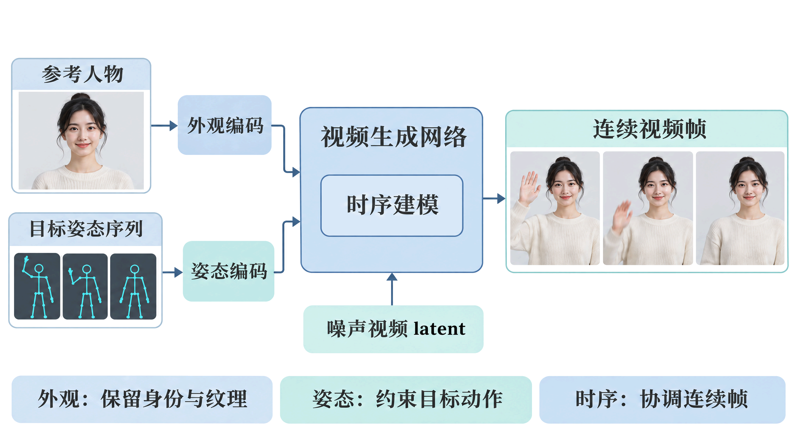

# 目录

[1. 可控人体生成的核心目标是什么？](#q-001)
  - [面试问题：人体驱动常见输入条件有哪些？](#q-002)
  - [面试问题：Pose、DensePose、Depth、Normal、SMPL/SMPL-X 各自适合什么场景？](#q-003)
  - [面试问题：基于图像扩散模型做人像视频动画的典型结构是什么？](#q-004)

[2. Animate Anyone 类方法为什么成为可控人体动画的经典范式？](#q-005)
  - [面试问题：ReferenceNet 如何保持人物外观一致？](#q-006)
  - [面试问题：Pose Guider / Pose Encoder 如何影响动作跟随能力？](#q-007)
  - [面试问题：Motion Module 如何提升帧间一致性？](#q-008)
  - [面试问题：为什么人体驱动中的脸部 ID 最容易崩？](#q-009)

[3. OmniHuman、StableAnimator、SkyReels-A1、Wan-Animate 代表了什么趋势？](#q-010)
  - [面试问题：OmniHuman 的多条件混合训练为什么有效？](#q-011)
  - [面试问题：StableAnimator 如何解决身份一致性？](#q-012)
  - [面试问题：SkyReels-A1 如何用表达感知关键点做肖像动画？](#q-013)
  - [面试问题：Wan-Animate 的整体复制和角色替换如何理解？](#q-014)
  - [面试问题：角色转身或相机绕行时，怎样判断身份保持是否可信？](#q-020)

[4. 可控人体动画如何设计训练数据和损失？](#q-015)
  - [面试问题：自重构和交叉重构分别训练什么能力？](#q-016)
  - [面试问题：如何避免条件冗余和 Copy-Paste？](#q-017)
  - [面试问题：如何处理体型差异、手部动作和遮挡？](#q-018)
  - [面试问题：姿态、音频和文本发生冲突时，模型应该听谁的？](#q-019)
---

<h1 id="q-001">1. 可控人体生成的核心目标是什么？</h1>

<h2 id="q-002">面试问题：人体驱动常见输入条件有哪些？</h2>

**难度评分：⭐⭐ (2/5)  |  考察频率：⭐⭐⭐⭐⭐ (5/5)**

人体驱动的输入条件可以分成外观、运动、空间环境和语义四组。选择它们时，首先要明确输入中的哪些信息应当迁移到输出：参考人物提供身份和服装，驱动人物提供动作，背景条件决定环境如何保留，文本补充未被精确指定的内容。原始驱动视频包含所有这些因素，必须经过提取或约束，才能避免把驱动者的脸、衣服和体型一起带走。

### 1、各类条件在回答什么问题

**外观条件回答“生成谁”。** 可用一张或多张参考图、人脸识别特征、局部图像特征及专属角色参数。全身参考提供衣服和发型，人脸参考补充小脸细节，多视角图增加侧面与背面证据。参考越多并不一定越好，错误身份、不同年代和强滤镜可能互相冲突。

**运动条件回答“怎样动”。** 二维关节点、骨架图、DensePose、三维人体参数和驱动视频都可提供动作信息，音频则为口型与韵律提供约束。它们的精确程度不同：骨架能规定手的位置，音频一般不能唯一决定手势，文本“自然挥手”又允许更大的动作自由度。

**空间环境条件回答“在哪里动”。** 深度、法线、分割、相机和背景图描述人物与场景的关系。角色替换时尤其需要知道哪些物体位于人物前方、哪些背景需要补全。若一只手正接触桌面，只传人体骨架而不传桌子信息，生成器很难理解接触为何必须保留。

**语义条件回答“哪些变化符合要求”。** 文本可以指定动作风格、情绪、场景和镜头，但不能替代已经需要精确对应的数值条件。同一个“轻轻点头”可以有多种幅度和节奏，若任务要求复现某位演员的具体表演，还需要明确的运动轨迹。

### 2、条件选择应围绕歧义进行

假设驱动人物抬起右手。二维骨架给出了肩、肘、腕的位置，却可能无法区分手掌朝前还是朝后，也不一定知道手臂在身体前方还是后方。增加深度或法线可以补空间信息，加入手指关键点可约束手势；但这些条件若估计错误，反而会让模型执行更精确的错误动作。

因此，每一路条件都要记录来源、坐标系、时间分辨率与置信度。骨架是整帧坐标还是裁剪坐标，深度是米还是归一化相对值，法线位于相机系还是世界系，音频特征对应哪个时间中心，都必须一致。条件本身正确、坐标变换错误，仍然会出现系统性错位。

### 3、训练和推理的输入契约要一致

训练时若总提供姿态、音频和完整目标背景，模型可能依赖最强条件；推理只给音频时，原有捷径消失，动作就可能退化。可以通过明确的多任务采样和条件缺失训练覆盖实际使用组合，但要保留不同组合各自的监督目标。

一种有效检查是固定身份，逐一替换姿态、音频和文本，再固定运动替换人物。输出应按任务要求改变对应属性，而不连带改变无关内容。条件数量并非能力证明，能否消除目标歧义、是否可靠、模型是否真正使用它，才决定它值得接入哪条路径。[1,2]

<h2 id="q-003">面试问题：Pose、DensePose、Depth、Normal、SMPL/SMPL-X 各自适合什么场景？</h2>

**难度评分：⭐⭐⭐ (3/5)  |  考察频率：⭐⭐⭐⭐ (4/5)**

这几种条件的差别在于它们描述人体的层次：Pose 给出骨架投影，DensePose 给出可见表面对应，Depth 和 Normal 描述当前视角下的几何，SMPL/SMPL-X 则提供可驱动的三维参数。它们可以互补，但误差与坐标约定也会一起进入生成模型。[1,2]

<div align="center">

| 条件 | 主要表示 | 最适合消除的歧义 | 仍需补充的信息 |
|---|---|---|---|
| 2D Pose | 关节点、骨架或热图 | 肢体大致位置与动作顺序 | 前后关系、表面、手指与衣物细节 |
| DensePose | 可见像素到人体部位及 UV 的映射 | 身体区域在不同姿态下的对应 | 隐藏表面、宽松服装真实几何 |
| Depth | 像素到相机的深度或相对深度 | 人体与物体的前后和粗空间结构 | 法线细节、材质；单目结果通常缺真实尺度 |
| Normal | 局部表面单位法向量 | 表面朝向与局部形状 | 全局位置、距离、反照率和真实照明 |
| SMPL | 体型、关节姿态及人体网格 | 三维姿态、视角、骨骼运动 | 精细手脸、毛发与宽松服装 |
| SMPL-X | 身体、手部、脸部表达的联合模型 | 细手势与全身表演协调 | 遮挡处真实证据、复杂服装与接触物体 |

</div>

### 1、从稀疏骨架走到稠密表面

Pose 成本较低，且主动丢弃了大部分外观信息，适合在不同人物之间迁移动作。但二维投影存在歧义：同样的手腕位置，可以由不同肘部深度和肩部旋转得到。常见身体骨架也不包含足够的手指与脸部信息，使用时需检查具体检测器输出。

DensePose 对可见人体像素预测部位标签和模板表面坐标，使模型知道“这个像素对应身体哪一块表面”。它比少数关节点提供更密集的对应，适合人体纹理与区域对齐。不过，这种对应主要基于人体模板；裙摆、宽松外套和飘动头发不贴合裸人体表，不能把 DensePose 当成完整服装三维扫描。被遮住的背面也没有凭空获得真实对应。

### 2、深度、法线与参数化人体有什么区别

Depth 直接给出当前视角的距离结构。可靠深度有助于区分手在脸前还是脸后，但单目估计常有尺度或平移歧义，还可能在头发和物体边缘出错。不同帧独立归一化深度，可能让同一人物的相对深度随时间漂移，训练和推理应采用一致规则。

Normal 描述表面朝向。一个单位法向量有三个分量，若以 RGB 图编码，需要约定从 $`[-1,1]`$ 到像素范围的映射，以及所用坐标系。法线有助于约束鼻梁、面颊和衣褶的局部方向，却不直接给出表面离相机多远；它与光照共同影响明暗，不能把法线图误当成最终着色。

SMPL/SMPL-X 先估计低维体型和姿态，再生成网格。由同一个网格和相机渲染出的深度、法线、部位图可以保持几何一致，便于多条件联合控制。Champ 就体现了以参数化人体组织多种几何引导的思路。[2] 但若最初拟合错了，几种条件可能一致地错，数量增加并不会提供独立证据。

### 3、用场景决定组合

普通舞蹈可先用身体与手部 Pose 建立基线；大角度转身可加入可靠三维或表面条件；手与物体交互需要更细的手模型、物体位置和接触约束；精细肖像表演更依赖面部关键点和表情表示。每增加一类条件，都应确认它改善了哪些失败样本，并在单独关闭它时观察退化。

优先级也不能永久按“信息越密集越强”排序。深度检测置信度低而骨架可靠时，硬性执行深度可能伤害动作。使用置信度、训练中的条件缺失与受控冲突测试，能够帮助模型在不同输入质量下做出更合理的选择。

<h2 id="q-004">面试问题：基于图像扩散模型做人像视频动画的典型结构是什么？</h2>

**难度评分：⭐⭐⭐ (3/5)  |  考察频率：⭐⭐⭐⭐⭐ (5/5)**

典型结构是在图像生成主干上增加参考外观、目标姿态和跨帧计算，使原有空间生成能力转化为可控的视频能力。Animate Anyone 是一类代表：参考图通过 ReferenceNet 提供细节，通过图像编码器提供语义；Pose Guider 将姿态图转换为对齐特征；去噪 U-Net 中的时间层协调连续帧。[1]

<div align="center">



</div>

图中是功能关系：外观告诉网络人物应当长什么样，姿态指定动作，时间建模让各帧相互参照。三条路径共同作用于生成过程，不能把时间模块看成视频生成结束后才执行的平滑滤镜。

### 1、训练输入怎样形成

从真实人物视频抽取目标片段 $`V_0`$，另取参考帧 $`I_r`$，从目标片段提取姿态序列 $`P`$。VAE 将目标压缩成 $`z_0=E(V_0)`$，再在扩散时间步 $`\tau`$ 添加已知噪声：

```math
z_\tau=\sqrt{\bar\alpha_\tau}\,z_0+
\sqrt{1-\bar\alpha_\tau}\,\epsilon,
\qquad \epsilon\sim\mathcal N(0,I)
```

这里用 $`\tau`$ 表示扩散噪声时间，避免与视频帧索引混淆；$`\bar\alpha_\tau`$ 是截至该噪声时间的累积信号保留系数。视频 latent 可具有 $`B\times C\times T_z\times H_z\times W_z`$ 的形状；图像 VAE 常按帧编码，视频 VAE 还可能压缩时间，姿态条件需要按对应编码约定对齐。

对采用噪声预测的主干，基本目标为：

```math
\mathcal L_{\mathrm{denoise}}
=\mathbb E_{V_0,I_r,P,\tau,\epsilon}
\left[\left\|\epsilon-
\epsilon_\theta(z_\tau,\tau,E_r(I_r),E_p(P))\right\|_2^2\right]
```

$`E_r`$ 概括参考图的条件编码，$`E_p`$ 表示姿态编码，训练目标是构造输入时已知的噪声。若采用速度预测、干净样本预测或 Flow Matching，应替换目标和路径；网络是 U-Net 还是 DiT，并不独自决定这个损失。

### 2、主干内部怎样分工

空间层在每帧内处理人物结构和纹理，参考注意力允许目标位置从参考中读取外观，姿态特征提供空间位置约束，时间层再让多帧共享运动和细节信息。这些模块通常交替出现，逐步去噪时反复协调条件；它们并非各生成一份独立结果后简单相加。

外观和姿态的对齐方式尤其不同。目标姿态图与目标画面在像素空间对齐，适合通过对齐特征相加或多尺度残差控制；参考图姿态可能完全不同，更适合通过内容相关的读取寻找对应。把参考图直接当成一张目标坐标下的结构图，容易锁住原姿势。

### 3、为什么常用分阶段训练

Animate Anyone 第一阶段使用单帧目标，训练去噪 U-Net、ReferenceNet 与 Pose Guider，冻结 VAE 和 CLIP 图像编码器；第二阶段加入从 AnimateDiff 初始化的时间层，在视频片段上训练时间层并冻结其余部分。[1] 这样先解决单帧外观和姿态，再学习跨帧联系。它是该方法的具体训练方案，其他视频底模可采用不同冻结策略或联合训练。

参考帧应与目标存在足够动作差异。同图自重建太多时，网络可以忽略姿态；时间训练只有缓慢正面动作时，大角度转身和快速手势仍会失败。阶段划分只能组织优化，不能替代数据覆盖。

### 4、推理和故障检查

推理从视频噪声出发，在固定参考和目标姿态下多步生成，再由 VAE 解码。长视频采用分段或滑窗时，还需维护历史和重叠关系。可先关闭时间层检查单帧身份与动作，再恢复时间层检查闪烁；同时交换参考和姿态，验证各路径是否承担预期职责。若只有总体画质提高，却无法响应目标动作，就还没有完成可控动画的任务。

---

<h1 id="q-005">2. Animate Anyone 类方法为什么成为可控人体动画的经典范式？</h1>

<h2 id="q-006">面试问题：ReferenceNet 如何保持人物外观一致？</h2>

**难度评分：⭐⭐⭐ (3/5)  |  考察频率：⭐⭐⭐⭐⭐ (5/5)**

ReferenceNet 用多尺度空间特征保存参考人物的外观，再让去噪主干按内容读取这些信息。它解决的是全局图像语义不足以保存精细纹理的问题：知道“一个穿格子衬衫的人”，与知道衣领形状、纽扣位置和格子排列，是不同粒度的要求。[1]

### 1、参考分支提供哪些信息

Animate Anyone 的 ReferenceNet 与去噪 U-Net 使用相近结构，并从同一图像预训练模型初始化，但参数分别训练。它处理参考图，不加入视频时间模块，在对应分辨率提取外观特征。生成主干因而可以在粗尺度获取整体轮廓，在较细尺度读取衣服、头发和局部细节。

模型还保留 CLIP 图像语义路径。语义向量提供人物与场景的整体描述，ReferenceNet 提供更细的空间信息，两者互补。不能把原论文中某个 CLIP 编码器的输入分辨率限制泛化为所有视觉编码器；这里更普遍的问题是语义训练目标和信息压缩是否保留了任务所需的细节。

### 2、参考注意力怎样工作

设某层当前帧特征展平后为 $`H\in\mathbb R^{N\times d}`$，参考特征为 $`R\in\mathbb R^{N_r\times d}`$。用 $`S=[H;R]`$ 表示在 token 维拼接，忽略多头、输出投影和残差后，当前分支的更新可表示为：

```math
H'=\mathrm{softmax}\left(
\frac{(HW_Q)(SW_K)^\top}{\sqrt{d_k}}
\right)(SW_V)
```

$`W_Q,W_K,W_V`$ 是查询、键和值的线性投影，$`d_k`$ 是单个注意力头的查询与键维度。当前帧提供查询，键和值来自当前帧与参考图的共同序列，因此每个生成位置可以同时读取本帧上下文和参考外观。原实现将参考特征复制到各视频帧，与当前特征沿空间宽度拼接，做空间自注意力后只保留当前分支部分；上式是展平后对当前输出的等价描述。

例如目标人物举起左手，左袖位置已经偏离参考图。注意力可以按特征相关性寻找参考袖子信息，而不要求目标像素与参考像素一一位于相同坐标。这是参考读取与目标坐标下的姿态残差之间的重要区别。不过，普通注意力并不保证找到正确语义对应，遮挡、左右相似和稀缺姿态仍可能导致纹理错位。

### 3、为什么外观保真和 Copy-Paste 会一起出现

参考特征携带的不止身份，还包括原姿态、光照与背景。训练若以相邻近重复帧为主，直接复制某些区域就能降低损失，模型可能不再认真读取目标姿态。参考注意力越强，这条捷径越容易压过动作控制。

应使用同身份但有动作差异的参考—目标配对，并观察大姿态下的属性保持。区域限制、条件 dropout、注入权重和层级选择可以减少干扰，但它们需要根据具体失败验证。完全切断背景参考，可能改善换场景，也可能损伤本来需要保留的环境，不能一律处理。

### 4、缓存和计算成本怎样理解

在原方法中，参考图保持不变，ReferenceNet 特征可以提取一次并在去噪过程中复用；所有视频帧的主干计算仍要重复进行。缓存降低的是参考编码开销，空间注意力读取额外 token 的成本仍然存在。

推广到其他实现时，要检查参考特征是否依赖当前噪声步、文本或联合更新后的状态。如果某层参考 token 已经与当前 noisy video 双向交互，就不能把第一次的输出当成永远不变的缓存。稳定身份与高效推理都依赖真实的数据流，而不只依赖模块名称。

<h2 id="q-007">面试问题：Pose Guider / Pose Encoder 如何影响动作跟随能力？</h2>

**难度评分：⭐⭐⭐ (3/5)  |  考察频率：⭐⭐⭐⭐ (4/5)**

Pose Guider 把稀疏的关节点或骨架图转换为生成网络可使用的空间特征。它的效果取决于三件事：姿态信息是否准确，特征是否与目标坐标对齐，网络是否在训练中学会依赖它。动作不跟随时，只增加控制权重往往无法区分这三类原因。

### 1、从关键点到可注入特征

姿态可表示为骨架线段、各关节热图或直接的坐标 token。骨架图直观、容易复用图像卷积；热图能区分关节类型并表达位置不确定性；坐标 token 更紧凑，但需要显式的空间位置和关节语义编码。

以热图为例，关节 $`j`$ 位于 $`p_j`$，可用：

```math
H_j(x)=c_j\exp\left(-\frac{\|x-p_j\|_2^2}{2\sigma_j^2}\right)
```

$`c_j`$ 是置信度，$`\sigma_j`$ 控制空间扩散范围。这只是常见表示示例，Animate Anyone 使用的是渲染骨架的轻量卷积编码，并在最后投影后与输入 latent 相加。[1] 它没有为姿态额外复制完整的 ControlNet 主干。

缺失关节应有明确标记，不能把“未知”简单编码成图像原点。否则网络可能把未检测到的手理解为手移动到了左上角。将置信度编码进条件，也不保证模型自动善用它，还需要训练覆盖低置信度和遮挡情况。

### 2、坐标和分辨率怎样对齐

如果目标画面经过裁剪与缩放，关键点必须接受同一变换。例如原图中裁剪区域左上角为 $`(x_0,y_0)`$、宽高为 $`(w,h)`$，输出宽高为 $`(W,H)`$，则横坐标映射为 $`x'=(x-x_0)W/w`$，纵坐标同理。人物参考、驱动骨架与最终回贴的坐标也要各自明确。

下采样到 latent 时，姿态细节可能消失。人体大关节仍可见，几根手指的线段却会挤在同一位置。更高分辨率的手部条件、分层编码或局部裁剪可以改善这一点，但先要确认原始检测器真的输出了可靠手指关键点。某个库叫 Pose，不代表它包含手部和面部模型。

### 3、时序噪声和控制强度如何处理

逐帧检测可能左右手互换、遮挡关节跳点或框尺度波动。应先观看送入模型的姿态视频，再讨论生成器是否听话。滤波可以去抖，但低通滤波会削弱快速手势并引入相位延迟，身体、手部和嘴部也不适合共用同一平滑强度。可结合置信度、运动速度和短时预测处理缺失点。

控制注入的位置影响的是该层能访问的信息与尺度，不能概括成所有 U-Net 或 DiT 都严格“浅层管结构、深层管细节”。过弱可能忽略动作，过强可能固化检测错误或破坏外观。训练中若参考图足以重建目标，控制分支也容易被绕过。

检查时可固定参考，分别给出抬左手、抬右手、转身和静止姿态，观察目标动作变化；再用同一姿态替换不同体型的参考，看是否需要重定向。把姿态错误、条件传递错误和体型不匹配拆开，才知道该修检测、编码器还是训练配对。

<h2 id="q-008">面试问题：Motion Module 如何提升帧间一致性？</h2>

**难度评分：⭐⭐⭐ (3/5)  |  考察频率：⭐⭐⭐⭐ (4/5)**

Motion Module 在生成网络内部让多帧特征交换信息，帮助当前帧利用前后帧的外观与动态。它的作用包含协调细节、学习运动趋势和减少随机闪烁，但不等价于在输出视频上做插帧或平滑。

### 1、时间卷积与时间注意力怎样计算

对于视频特征 $`Z\in\mathbb R^{B\times C\times T\times H\times W}`$，时间卷积沿 $`T`$ 轴聚合局部窗口，感受野由核大小、层数和扩张率决定。它适合捕捉局部变化，计算规律；要连接很远的帧，通常需要更深层或更大范围。

一种常见时间注意力将特征重排为 $`(BHW)\times T\times C`$，每个空间位置对应一段时间序列。对其中一条序列 $`X`$，单头计算为：

```math
\mathrm{Attn}_{\mathrm{time}}(X)
=\mathrm{softmax}\left(\frac{XW_Q(XW_K)^\top}{\sqrt d}+M\right)XW_V
```

$`W_Q,W_K,W_V`$ 分别投影出查询、键和值，$`d`$ 是查询与键的维度。$`M`$ 是注意力 mask，允许位置取 0，被屏蔽位置在 softmax 前加负无穷；允许双向观察时可读取片段内前后帧，因果模式则屏蔽未来位置。还需时间位置编码，才能区分帧顺序。结果通常通过残差接回主干，原有空间特征继续参与生成。Animate Anyone 在去噪 U-Net 的空间和交叉注意力后加入时间层，ReferenceNet 本身不做时间建模。[1]

### 2、为什么它能减少闪烁，又可能压制动作

独立生成时，某帧的衣领纹理可能被解释成另一种形状；时间层让相邻状态共同提供证据，模型更容易保留一致细节。但固定图像位置不总对应同一身体部位。人物大幅移动时，同一个像素位置上一帧是头发，下一帧可能是背景，单纯沿固定位置做注意力并没有显式光流保证。

空间与时间层交替、全时空交互、轨迹或形变条件，可以提供更丰富的对应。遮挡恢复还需要长期外观依据，时间层不能从暂时消失的区域中读取不存在的真实证据。如果训练过分强调相邻帧相似，模型可能用减少运动获得更低损失，形成“稳定但僵硬”的表演。

### 3、分解注意力为什么能节省成本

令每帧空间 token 数为 $`N=HW`$，普通全时空注意力的分数矩阵规模与 $`(TN)^2`$ 成正比。分别进行空间和时间注意力时，对应规模约为 $`TN^2+NT^2`$，暂不计投影等开销。这通常更省计算与内存，但限制了单层直接建立任意跨时空关系的方式，仍需通过多层交互传播。

推理使用窗口或缓存会进一步改变可见历史。一个训练时双向读取完整片段的模块，不能仅加一张因果 mask 就假定已经获得同样质量的实时能力；训练分布和上下文变化需要适配。Motion LoRA 则是对某些运动相关参数的低秩适配方式，属于训练或适配策略，不应与时间卷积、时间注意力并列为完全相同层次的结构。

### 4、怎样验证时间模块真的有效

在相同参考、动作和采样设置下对比有无时间模块，同时检查动作跟随、局部纹理、遮挡重现和片段边界。静止片段可暴露无意义闪烁，快速运动可暴露过度平滑，大位移可暴露空间对应问题。评价中必须保持运动完成度，才能判断更低的时间误差究竟来自更好建模，还是来自人物不再动作。

<h2 id="q-009">面试问题：为什么人体驱动中的脸部 ID 最容易崩？</h2>

**难度评分：⭐⭐⭐ (3/5)  |  考察频率：⭐⭐⭐⭐ (4/5)**

全身动画中的脸部身份容易崩，既有空间分辨率问题，也有监督权重和条件纠缠问题。人对五官比例的变化非常敏感，而生成模型的整体损失未必把这些变化看得同样重要。

### 1、脸部在训练目标中可能太小

举一个示意：在 1024×1024 的全身画面中，一张 64×64 的脸只占约 0.39% 的像素；若空间下采样 8 倍，对应区域约为 8×8 个 latent 位置。普通全图损失有大量背景和衣服位置参与，模型可以先改善大区域而仍忽略小脸的精确结构。这里的尺寸用于说明占比，不代表某一模型固定配置。

转头后脸部可见区域进一步缩小，眼镜、头发和手部遮挡还会影响检测与识别。另一方面，驱动姿态通常来自另一个人，面部关键点可能保留了驱动者的五官比例；参考条件又可能把源人物的闭嘴正脸强行带回。身份、姿态和表情之间的冲突便集中在这个很小的区域。

### 2、从数据、条件和损失三个位置补充信息

数据端应提供足够清晰的脸，并包含同身份跨角度和表情的配对。条件端可将全身外观与人脸特征分开编码，再用多尺度读取或面部区域条件增强身份。训练端可以增加可靠人脸区域的感知或身份监督，并规范区域归一化，使小脸不被全图平均完全淹没。

局部加权也不能无限增强。训练数据中的检测框若错位，模型会持续优化错误区域；人脸识别器在侧脸、闭眼或夸张表情上置信度较低时，盲目追求相似度可能把目标表情拉回正脸。应结合检测置信度、有效面积、姿态分层和人工检查，明确损失在哪些样本上可靠。

### 3、扩散训练中怎样施加身份损失

身份识别器通常接收图像，不能直接评价强噪声 latent。若网络预测噪声，可以先估计干净 latent：

```math
\hat z_0=\frac{z_\tau-\sigma_\tau\epsilon_\theta(z_\tau,\tau,c)}{\alpha_\tau},
\qquad
z_\tau=\alpha_\tau z_0+\sigma_\tau\epsilon
```

将 $`\hat z_0`$ 通过 VAE 解码，再提取对齐人脸计算身份损失。这里 $`\alpha_\tau`$ 和 $`\sigma_\tau`$ 分别是信号与噪声系数。在高噪声处，$`\alpha_\tau`$ 很小，干净样本估计对预测误差敏感，身份监督也可能产生不稳定梯度。可按噪声范围、权重或计算频率安排辅助损失，而不必在所有时间步同样施加。

冻结 VAE 或识别器参数时，仍需保留从生成图到生成网络的梯度路径；如果把解码输出整体 detach，身份损失就无法训练生成器。是否采用这一路径以及计算代价，应按具体方法说明，不能把它当作所有数字人模型的默认实现。

### 4、修复和验收怎样避免掩盖问题

后处理人脸修复可以补清晰度，却可能改变五官或逐帧生成不同细节。应保存修复前后的对照，并同时评估源身份、目标表情、头姿和时序。静止正脸通过后，再看侧脸、远景、手遮脸及遮挡恢复；检测失败帧必须进入失败统计。

如果增加人脸条件后相似度上升，转头幅度却显著缩小，就还没有解决问题，只是改变了取舍。真正有效的改进应在完成相同驱动动作的前提下，提高人脸身份与跨帧稳定性。

---

<h1 id="q-010">3. OmniHuman、StableAnimator、SkyReels-A1、Wan-Animate 代表了什么趋势？</h1>

<h2 id="q-011">面试问题：OmniHuman 的多条件混合训练为什么有效？</h2>

**难度评分：⭐⭐⭐⭐ (4/5)  |  考察频率：⭐⭐⭐ (3/5)**

OmniHuman-1 的多条件混合训练解决的是数据利用与条件学习之间的矛盾：严格符合音频驱动要求的视频有限，但大量未满足精确音画同步条件的视频，仍然包含有价值的人体运动和画面知识。方法让不同质量和标注条件的数据承担合适的训练任务，再逐步学习更精确的驱动。[3]

### 1、为什么所有数据都按最严格标准筛选会浪费监督

一个人物视频可能动作自然、画质清楚，却因为背景音乐、配音或嘴部不可见，不适合训练精确口型。若整段丢弃，身体动作、人物与物体交互等信息也一起损失；若直接当作音画同步样本使用，又会教给模型错误关系。

OmniHuman 的第一条原则是：更强条件任务可以借助较弱条件任务的数据扩展共同的生成能力。例如将不适合音频监督的视频用于图像加文本到视频任务，让它贡献外观和运动先验，而不要求它提供准确音频对应。这里的“较弱”指对目标运动的约束更宽，并非数据本身一定较差。

### 2、条件强弱如何影响优化

姿态序列给出每帧人体结构，音频对嘴部较强、对全身手势较弱，文本通常只给动作语义。三者同时出现时，模型可能只依赖姿态完成大部分重建，音频路径得到的有效学习机会反而减少。推理时去掉姿态，音频控制便暴露不足。

第二条原则因此是降低强运动条件任务在混合训练中的比例，给较弱条件更充分的学习机会。论文先训练图像与文本条件，再引入音频，最后加入姿态，并平衡不同任务的训练比例。不能把它简化成随意随机删条件：哪些数据支持哪些任务、各任务采样多少、何时引入，都影响模型最终依赖的线索。

一种概括的混合目标可以写成：

```math
\mathcal L=\sum_{S\in\mathcal S}p(S)
\mathbb E_{(V,c_S)\sim\mathcal D_S}
\left[\mathcal L_{\mathrm{gen}}(V,c_S)\right]
```

$`S`$ 表示一个条件组合，$`\mathcal D_S`$ 是适合该任务的数据，$`p(S)`$ 表示采样比例或等效任务权重。论文的具体训练不需要按这个式子同时计算所有任务；它说明同一个共享主干从多种监督中学习，而数据和比例必须一起设计。

### 3、架构怎样支持共享学习

OmniHuman-1 基于 MMDiT 视频主干，尽量减少各模态专属参数。音频经过 wav2vec 特征提取、维度和时间对齐，以逐帧交叉注意力注入；姿态图经 Pose Guider 编码，与视频 latent 按通道组合；文本继续使用原主干路径。[3]

参考图也没有再复制一整套庞大的 ReferenceNet，而是编码成 token，与带噪视频 token 一起进入共享主干，通过自注意力交互。参考 token 的时间位置编码按其设计单独处理，以区分静态参考与动态帧。这把主要学习容量放在共享参数上，使各种条件能够共同利用视频预训练能力。

不同接口并未天然严格解耦。参考仍携带姿态，音频和姿态仍可能冲突，采样比例需要验证。与仅增加一个条件分支相比，这项工作更值得学习的是任务、数据和优化共同扩展的方式。

### 4、哪些结论可以迁移

可以把“无法用于精细监督，但可用于较宽任务”的数据保留下来，也可以通过分阶段和混合采样防止强条件掩盖弱条件。前提是数据确实满足对应任务标准；严重损坏的视频、错误身份和相互矛盾的标签，不会因为使用弱条件就变成好样本。

验证时应分别测试仅音频、仅姿态和联合驱动，并固定总训练预算比较采样策略。若联合输入表现很好，音频单独输入却退化，说明模型还在走强条件捷径。论文展示的多条件能力也不能自动推出对任意新模态、任意缺失组合或所有实时场景都有效。

<h2 id="q-012">面试问题：StableAnimator 如何解决身份一致性？</h2>

**难度评分：⭐⭐⭐⭐ (4/5)  |  考察频率：⭐⭐⭐ (3/5)**

StableAnimator 将身份保持放进视频生成的训练与采样两端。它基于 Stable Video Diffusion 的 U-Net 路线，输入人物参考和姿态序列，通过全局内容感知的人脸编码、分布感知的 ID Adapter，以及推理时的面部优化，减少人物运动过程中“越动越不像”的问题。[4]

### 1、参考图为什么要走三条路径

第一条路径将参考图编码为 VAE latent，复制到视频时间维并与主 latent 拼接，提供低层外观依据；第二条通过 CLIP 图像编码器取得整图表示，进入去噪网络的交叉注意力；第三条通过 ArcFace 获得人脸特征，再由 Face Encoder 与整图特征交互。

这三路关注的信息不同。人脸识别向量擅长区分人物，但缺少整幅参考图中的布局和上下文。Face Encoder 用交叉注意力让面部表示读取全局内容，使身份条件更适合接入当前人物动画任务。它没有把所有信息压成一个完全去除姿态和背景的“纯身份”，后续仍要处理特征融合。

### 2、Distribution-aware ID Adapter 在对齐什么

视频时间层会改变主干特征分布，直接沿用图像身份适配器的注入方式，可能造成身份特征与视频 latent 不匹配。StableAnimator 先分别计算视觉 latent 对整图特征和人脸特征的交叉注意力，得到 $`z^{\mathrm{img}}`$ 与 $`z^{\mathrm{face}}`$，再调整人脸分支的统计量：

```math
\bar z^{\mathrm{face}}
=\frac{z^{\mathrm{face}}-\mu_{\mathrm{face}}}
{\sigma_{\mathrm{face}}+\varepsilon}
\odot\sigma_{\mathrm{img}}+\mu_{\mathrm{img}},
\qquad
\bar z=z^{\mathrm{img}}+\bar z^{\mathrm{face}}
```

$`\mu`$、$`\sigma`$ 是相应特征的均值与标准差，按实现规定的维度统计并广播；$`\varepsilon`$ 表示实现中防止除零的稳定项。上式在原论文变换上显式写出这一常用数值保护。融合结果再交给时间层处理。

这种操作使两路特征的尺度和偏移更加协调，降低某一路因数值范围不同压过另一条路径的风险。但匹配均值和标准差只约束低阶统计，**不能在数学上证明完整分布相同，更不能证明身份已经完全解耦**。论文中的效果需要结合模块消融和生成结果判断，不能把作者的机制解释扩大成无条件保证。

### 3、HJB 面部优化怎样参与推理

论文用 Hamilton–Jacobi–Bellman 最优控制思想描述对去噪路径的约束。落到其算法中，关键步骤是在采样过程中取出预测的干净 latent，作为可优化变量，解码后计算生成脸与参考脸的识别相似度，并用若干梯度更新改善该 latent，再用于后续去噪更新。

可以用一个局部目标理解它：

```math
J(z)=1-\cos\bigl(f(D(z)),f(I_r)\bigr),\qquad
z^{(k+1)}=z^{(k)}-\eta\nabla_zJ(z^{(k)})
```

$`D`$ 是 VAE 解码器，$`f`$ 包含对应的人脸处理与识别，$`\eta`$ 是步长。这个式子用普通梯度步解释局部优化方向，论文实现采用相应优化器和采样调度；它不等于逐字复现全部 HJB 推导，也没有证明实际离散采样获得全局最优解。

优化的对象是采样中的变量，生成模型权重不因此为每位用户重新训练。它与生成结束后调用换脸工具的方式不同，身份修正会继续影响后续生成；同时需要额外解码和反传，成本必须计入推理时间。

### 4、怎样评价这套设计

应分别关闭 Face Encoder、统计对齐和推理优化，比较身份、动作跟随、表情、背景细节及耗时。若识别分数提高但侧脸逐渐转回正脸，说明身份优化仍在影响目标表演；小脸和遮挡时，识别梯度是否可靠也需要单独验证。

StableAnimator 的可迁移价值是提醒我们：识别特征在原任务中有效，不代表进入视频主干后无需适配；训练中的条件融合与推理中的轨迹优化，解决的是不同环节。把它笼统称为 DiT 方法，或只记住 HJB 这个名字，都会遗漏真实的数据流和代价。

<h2 id="q-013">面试问题：SkyReels-A1 如何用表达感知关键点做肖像动画？</h2>

**难度评分：⭐⭐⭐⭐ (4/5)  |  考察频率：⭐⭐ (2/5)**

SkyReels-A1 以视频 Diffusion Transformer 为基础，把驱动视频中的面部表演编码成更适合生成网络读取的条件，并补充身份表示。[5] 它主要回答“怎样忠实迁移一段已经给出的表情轨迹”，输入信息比仅凭音频自由生成表演更明确。

### 1、为什么普通关键点仍可能不够

稀疏二维关键点能描述大致嘴型和眼睛位置，但细微嘴角、眼睑和大侧脸变化可能被压缩掉。直接使用驱动者的关键点，还会把其五官比例带给参考人物，形成身份泄漏。单纯增加点数也不一定有用：如果新增点在遮挡和极端表情中不稳定，模型会收到更密集的噪声。

SkyReels-A1 采用表情感知的三维关键点表示，利用三维表情重建相关机制提高驱动描述的细致程度。它强调的是运动表示对表情的辨识能力与跨身份迁移适用性。三维关键点可以补充方向和结构线索，但不等于得到了人物完整的真实三维外观，输入视频中的遮挡与拟合误差仍然存在。

### 2、关键点怎样对齐到视频 latent

方法中的 3D Landmark Guider 使用三维因果编码器，将连续关键点条件编码到与视频 latent 相容的时空表示，再与带噪输入组合。这里的“三维”也包含视频编码器沿空间和时间的运算，不能只理解成每个关键点有三个坐标。

如果视频 latent 做了时间压缩，关键点条件必须采用对应的时间聚合和首帧规则。否则连续表情虽然提取正确，却可能被注入到错误的 latent 时刻。因果编码器只说明这个局部组件的时间依赖设计；整个 DiT 是否读取未来、完整生成能否在线运行，还要检查其余模块与采样方式。

### 3、身份与运动怎样共同进入主干

Facial Image-Text Alignment 先定位参考脸，用视觉编码器提取面部特征，再通过轻量可学习映射投到与文本特征相容的空间。论文方法部分使用 SigLIP 表述这一视觉编码器。映射结果作为主干可接收的条件表示参与生成，复用预训练模型的条件处理能力。

这里的“图文对齐”并不意味着先把人脸写成一句文字描述，也不能理解成语言模型已经能精确描述所有五官。它关注的是特征空间和网络接口：让面部表示在既有视频主干中有效传递，而不再为身份复制大量额外参数。

### 4、训练如何逐步建立控制能力

论文分为运动驱动、身份保持和联合微调三个阶段。运动阶段先让输入层适应关键点条件；身份阶段训练面部特征到条件空间的映射；随后联合优化相关模块和 DiT，使外观与动态共同协调。具体冻结和更新范围属于该方法的训练配置，不能直接当成所有肖像 DiT 的标准配方。

它还采用由光流构造权重的 face-aware loss，让较强动态区域获得更高的去噪监督权重。这个名称容易引起误读：它不是 ArcFace 式的人脸身份余弦损失，其直接作用是重加权生成误差。光流在快速遮挡和错误匹配处也会不可靠，不能假定权重天然就是精确面部语义。

### 5、怎样判断提升来自哪里

在相同参考图、驱动片段和生成主干下，分别比较关键点表示、编码器对齐、身份映射与损失加权，观察嘴角、眼睑、侧脸和小脸的变化。还应检查背景稳定性，避免为了面部表演让整个场景抖动。

与纯音频方法比较时，要明确它已经获得驱动视频的表情和运动轨迹；更高控制精度可能部分来自更强输入。DiT 提供生成容量，表达感知条件和训练策略决定这份容量是否被用于正确的表演，三者需要结合理解。

<h2 id="q-014">面试问题：Wan-Animate 的整体复制和角色替换如何理解？</h2>

**难度评分：⭐⭐⭐⭐ (4/5)  |  考察频率：⭐⭐⭐ (3/5)**

Wan-Animate 的整体动作与表情复制，是把驱动视频中的身体运动和面部表演迁移给参考角色；角色替换则在此基础上要求新人物融入原视频环境。[6] 两种任务共享角色外观和运动建模，但对背景、遮挡与光照的约束不同。“复制”主要描述表演迁移，不能解释成把参考照片像素贴到每一帧。

### 1、角色动画怎样分配外观与表演

参考图提供目标角色的脸、头发、服装和总体外观。驱动视频经过预处理，提供身体姿态和面部驱动条件。身体姿态适合表达位置与粗运动，面部条件补充嘴部、眼部和细微表情，视频生成主干将它们综合成连续画面。

一个具体例子是，让卡通角色复现真人“抬手指向左侧并微笑”的动作。人物类别和比例可以变化，手的运动方向、动作节奏和表情意图需要保留。参考角色原图中的静态姿态应被释放，否则动作复制就无法完成。

身体重定向要处理驱动者与参考角色比例差异。直接复制二维关节点可能把短腿角色拉成长腿，简单按整体尺度缩放又可能让手部位置偏离道具。预处理中的重定向决定结构条件是否适合目标，生成网络再负责画面合成，两者都影响最终效果。

### 2、角色替换增加了哪些要求

公开替换流程在参考、姿态和面部条件之外，还使用背景视频及 mask 等信息，并提供重光照相关适配。[6] 背景约束告诉模型哪些场景内容应保留，mask 指示人物编辑范围，光照适配帮助新角色与环境协调。这些条件的职责不同，不能仅用一张人物分割图代替所有环境信息。

如果新人物轮廓更窄，旧人物后面从未露出的背景需要补全；若新人物更宽，可能遮住原先可见的桌边。手从桌后伸到桌前，局部遮挡顺序还会变化。替换结果在静态帧上看似自然，播放时仍可能出现边缘闪烁、接触点漂移和阴影不连续。

### 3、动作相似与接触保持可能冲突

长臂演员碰到远处道具，换成短臂角色后，保持相同关节角度未必仍能接触。如果固定手部位置，则肩肘和躯干需要调整；如果固定全部二维骨架，又会破坏角色体型。应明确任务更重视哪一项，并在可行范围内通过重定向、逆运动学或额外场景约束修正。

脚滑也是类似问题。原视频中脚在支撑阶段应相对地面静止，但骨长变化、根位置估计和相机变化可能让脚不断漂移。仅用“姿态误差很小”无法保证接触正确，需要查看世界或场景坐标下的接触关系，至少也要检查稳定的投影接触点。

### 4、统一模型怎样验收

动画模式主要检查目标角色外观、身体跟随、面部表情和时间连续性；替换模式还要检查背景保持、遮挡、光照、阴影及接触。两种模式应分别统计，不能用动画样片证明复杂场景替换已经解决。

还要区分角色服装保持与商品级换衣。一个统一角色模型可能保留红外套、领型和整体花纹，却未必能精确恢复某个 SKU 的文字和纽扣数量。若交付要求是商品试穿，必须追加商品细节与非编辑区域的验收。

使用时应固定模型、预处理与权重版本，谨慎组合其他模型训练的 LoRA。共享底模并不保证所有适配器可直接混用。它的长期价值在于把人物外观、身体、表情和环境组织到同一个生成系统中，而各输入的职责与冲突仍需被明确设计。

<h2 id="q-020">面试问题：角色转身或相机绕行时，怎样判断身份保持是否可信？</h2>

**难度评分：⭐⭐⭐⭐ (4/5)  |  考察频率：⭐⭐⭐ (3/5)**

角色从正脸转到侧面、背面再回到正面时，身份保持需要同时满足重复视角一致、不同视角结构相容，以及未见区域不违背已有证据。单张漂亮侧脸只证明某一帧合理，无法证明整个角色在空间和时间上成立。

### 1、先区分观测与生成补全

正面照片提供五官、发际线和服装正面，却通常不提供耳后、后脑勺与衣服背面的完整信息。生成器可以利用先验补出合理内容，但有多种可能答案。例如同一正面外套可以有不同背面图案，单张参考无法唯一确定真实款式。

多参考图增加真实视角证据，三维几何条件提供空间约束，共享规范空间则帮助不同帧对应到同一角色表面。它们都能缩小自由度，却各有误差：参考图可能跨年代，三维拟合可能不准，规范形变也可能在遮挡和大动作处失效。应说明哪些区域有实际观测、哪些主要来自先验。

### 2、怎样设计能暴露漂移的测试

可设计“正面 → 侧面 → 背面 → 正面”的循环，或让相机绕行后返回同一观察方向，检查耳朵、发型、衣领、饰品和纹理是否恢复。还可以让人物短暂被遮挡，再重新出现，测试模型是否记得先前已呈现的外观。

同一视角比较前要对齐姿态、表情、尺度和光照，避免把合法变化误判为漂移。人脸识别对大侧脸和背面能力有限，不能强行用同一识别指标评价所有角度。应把可见人脸、整体人物外观和几何结构分别评估，并记录检测失败。

跨视角相容性也不等于每帧纹理相同。光照、投影和遮挡变化会使像素变化，关键是这些变化能否由同一角色和合理相机解释。例如左耳突然变成右耳的形状、同一项链在绕行中反复消失，就比正常透视缩短更值得关注。

### 3、长期保存哪些信息才有帮助

原始身份参考应作为稳定依据；已经验证过的侧面或背面帧可以补充外观锚点；近期历史负责动作衔接。只保存最近一帧容易丢失早期细节，盲目保存所有生成帧则可能把第一次生成的错误固定下来。锚点需要身份、姿态、可见性和质量检查，也要能在冲突时回退。

Chronos 的时间锚定工作提供了一个近期系统案例：它通过语义提示锚定提炼身份线索并调整提示，通过视觉帧锚定构造关键帧，再用多维指标从不同生成器的候选结果中选择。[7] 其核心是推理阶段的锚点组织与候选筛选，没有额外训练长期记忆网络。

这种方法能帮助阶段性动作与身份条件协调，但候选数量和筛选也增加计算成本。关键帧若已经错脸，后续视频可能稳定地继承错误；候选得分若偏好正脸或低运动，又可能牺牲原指令。因此应在相同生成预算下比较身份与动作，检查选择机制是否扩大了可用范围。

### 4、怎样表述结论才严谨

如果回到同一视角时外观稳定，可以说该测试中的时间一致性较好；如果不同视角满足几何和观测约束，可以进一步支持空间一致性；只有真实多视角或测量证据充分，才适合讨论真实三维身份恢复。不要将这三个层次合并成一句“360 度保持身份”。

这一判断适用于照片动画、角色视频和三维 Avatar。模型更新会改变实现方式，但可见证据、未见区域与长期状态的区别始终存在。

---

<h1 id="q-015">4. 可控人体动画如何设计训练数据和损失？</h1>

<h2 id="q-016">面试问题：自重构和交叉重构分别训练什么能力？</h2>

**难度评分：⭐⭐⭐⭐ (4/5)  |  考察频率：⭐⭐⭐⭐ (4/5)**

自重构与交叉重构首先要说明参考、动作和真实目标分别来自哪里。同一身份不同帧之间可以有监督重建；任意把人物 A 的外观和人物 B 的动作组合起来，通常没有天然匹配的真实目标。监督是否成立，比方法被称为 self 还是 cross 更重要。

### 1、三种配对分别训练什么

<div align="center">

| 配对方式 | 输入与目标 | 能学习的能力 | 主要风险 |
|---|---|---|---|
| 同帧重建 | 参考帧 A，姿态 A，目标仍为 A | 外观恢复、条件接入和基础生成 | 复制参考即可降低损失 |
| 同身份跨帧重建 | 参考 A 的第 i 帧，姿态来自第 j 帧，目标为第 j 帧 | 保持外观并响应新姿态 | 帧间差异太小时仍存在复制捷径 |
| 跨身份组合 | A 的外观，B 的目标动作，输出新组合 | 身份与动作迁移 | 通常缺少真实配对画面，不能直接监督成 B |

</div>

同身份跨帧的监督可写为：

```math
(I_i^A,P_j^A)\longrightarrow I_j^A
```

参考和目标来自同一人物，目标图像真实存在。选取足够不同的姿态和表情，才能迫使模型使用动作条件。参考与目标还可以来自同一人的不同镜头，但服装、年龄或光照变化时，需要明确哪些属性应保持，不能假定所有差异都是动作。

### 2、跨身份组合为什么不能直接用目标演员监督

新组合是：

```math
(I_i^A,P_j^B)\longrightarrow\hat I^{A\leftarrow B}
```

输出应有 A 的外观和 B 的动作。若直接让 $`\hat I^{A\leftarrow B}`$ 与 $`I_j^B`$ 做全图像素损失，优化器会把 B 的脸型、皮肤和衣服也当成答案，正好违背身份保持要求。把参考条件名字改成“身份”，无法改变损失实际优化的方向。

可使用源身份识别约束、目标姿态约束、合理的背景保持和自然图像先验，分别监督可定义的属性。例如：

```math
\mathcal L_{\mathrm{cross}}
=\lambda_{\mathrm{id}}\,d_{\mathrm{id}}(\hat I,I_i^A)
+\lambda_{\mathrm{pose}}\,d_{\mathrm{pose}}(\hat I,P_j^B)
+\lambda_{\mathrm{prior}}\,\mathcal L_{\mathrm{prior}}
```

这是一般设计示例，不是某篇论文的统一公式。每个距离都依赖相应估计器，身份识别和姿态检测的误差可能互相冲突；若需可微训练，还要保证这些监督路径能传回梯度。

### 3、怎样获得更强监督

可用三维角色在已知动作下渲染新组合，获得可验证的合成配对；也可从同身份多场景数据中构造更丰富的真实变化，或者采用经过筛选的教师伪标签。合成数据有外观域差异，教师数据会继承错误，规模扩大前应先验证配对和关键属性。

循环一致性也能提供约束，例如交换动作后再恢复原状态，但它只要求往返结果接近，并不保证中间结果正确。网络可能隐藏信息，或通过不真正执行动作来满足循环。因此循环损失应与身份、动作和生成质量证据一起使用。

### 4、怎样读懂论文里的 cross-reconstruction

有的论文将同一身份不同帧的重建称为交叉重构，有的指跨人物交换属性。阅读时应画出实际输入和目标，而不是根据术语猜测。在训练日志里也应区分有真实目标的重建指标与跨身份组合的属性指标，不能把两类结果混成一个平均像素误差。

验收时固定动作更换身份，再固定身份更换动作，检查变化是否分别发生。先证明监督关系正确，再讨论复杂损失和更大模型，才能避免把错误标签训练得更加稳定。

<h2 id="q-017">面试问题：如何避免条件冗余和 Copy-Paste？</h2>

**难度评分：⭐⭐⭐⭐ (4/5)  |  考察频率：⭐⭐⭐⭐ (4/5)**

条件冗余本身不一定有害：姿态和深度共同描述人体，可以互相补充。问题在于模型是否抓住了与目标偶然相关的捷径，或多个条件对同一属性提出互相矛盾的要求。Copy-Paste 是其中一种表现，参考外观连同静态姿势被复制，动作条件失去作用。

### 1、捷径可能藏在哪些输入里

参考图包含身份，也包含姿态、背景和光照；人物解析图包含部位，也保留了体型和衣服轮廓；目标帧中提取的边缘或局部裁剪还可能泄漏过多目标外观。如果训练只需读取这些线索就能恢复画面，模型没有动力学习预期的身份与动作分工。

例如，训练参考总是目标前一帧，而且动作很慢，复制参考已经能获得较低损失。再增加一个强姿态分支，可能仍然被网络忽略。另一种情况是从目标帧提取的脸部条件过于完整，模型直接继承驱动者身份，使源身份条件失效。

### 2、先用输入干预定位问题

可准备固定参考和多种姿态，再准备固定姿态和多个身份，形成小型交叉组合。检查身份变化与动作变化是否各自落实，再逐路移除、减弱或扰动条件。应使用合理且在任务范围内的替换，避免把完全不可能的输入组合误当作正常测试。

<div align="center">

| 干预 | 预期行为 | 暴露的问题 |
|---|---|---|
| 固定参考，换目标姿态 | 动作变化，外观保持 | 姿态分支被忽略或参考姿态压制 |
| 固定姿态，换人物参考 | 身份变化，动作基本保持 | 驱动外观泄漏或身份条件过弱 |
| 更换参考背景 | 按任务约定保持或替换背景 | 身份与背景被偶然绑定 |
| 对低置信度姿态局部遮蔽 | 不应出现极端跳变 | 条件缺失处理不足 |

</div>

输出对某一路敏感，只说明这条路径影响了结果，还需检查它影响的是不是应负责的属性。注意力热图可提供线索，但不能仅凭某个区域权重大就认定模型已经完成正确解耦。

### 3、再针对原因修改数据和结构

增加同身份跨姿态、跨表情的真实配对，降低近重复样本占比，让复制参考无法完成任务。明确目标条件中需要保留的运动信息，避免无控制地传入完整驱动外观；必要时将身份识别特征与局部细节分开，采用区域读取或不同注入强度。

条件 dropout 可以让模型接触缺失输入，避免某一路永远成为唯一答案。但丢弃条件与伪造标签不同：随机换一个错误姿态、仍要求重建原目标，并不是合理的动作监督，反而会教模型忽略姿态。训练中每一种缺失组合都要对应一个成立的任务。

推理阶段可调整参考注入层级、强度或去噪阶段，寻找身份与动作的可用范围。若模型训练时只会复制，推理调权重通常只能在“复制”和“不像”之间切换，很难凭空获得强编辑能力。

### 4、怎样确认修复没有引入新退化

对比时同时测身份、姿态、表情、服装细节和时间一致性。降低参考强度后动作更大，可能同时丢掉真实衣服纹理；关闭某个条件后更自然，也可能只是模型开始自由发挥。应固定输入、采样预算和随机性，并保留困难姿态与未见身份测试。

条件设计的目标是让每路输入提供它独有而可靠的信息，并在合理重合处协作。不同架构的控制接口会变化，数据捷径和监督分工问题仍然需要用这种干预方法检查。

<h2 id="q-018">面试问题：如何处理体型差异、手部动作和遮挡？</h2>

**难度评分：⭐⭐⭐⭐ (4/5)  |  考察频率：⭐⭐⭐⭐ (4/5)**

体型、手部与遮挡问题都涉及空间对应，但不能用同一种平滑或缩放处理。体型差异需要动作重定向，手部需要足够细的几何与图像信息，遮挡需要判断当前可见什么、哪些内容只能从历史和先验恢复。

### 1、体型变化后哪些动作关系应保持

简单的二维重定向可以保留骨骼方向，用目标骨长重建关节点。例如父关节为 $`p`$、子关节为 $`q`$，目标骨长为 $`\ell'`$，有：

```math
q'=p'+\ell'\frac{q-p}{\|q-p\|_2}
```

其中 $`p',q'`$ 是目标人物的父、子关节位置；从根关节向末端递推时，每条骨骼沿源方向延伸到目标长度。源骨骼长度为零或关键点置信度过低时，应跳过该观测并采用合理的历史或结构约束。

这个式子直观说明“保留方向、调整长度”，只适用于非零骨长且当前坐标中方向可靠的情况。二维方向不包含完整深度，也无法保证关节极限、脚落地和手碰物体。更完整的方法使用 SMPL/SMPL-X 等三维模型，在目标体型上应用关节运动，再修正全局位置和接触。[2]

如果一只脚处于支撑阶段，可以要求其世界位置接近稳定接触点，用逆运动学调整根位置和相关关节。短腿角色照搬长腿演员的根轨迹，脚可能离地；只把脚压到地面，又可能让膝盖姿态不合理。因此要共同约束姿态相似、接触和关节范围，而非逐关节独立缩放。

### 2、手部问题先看输入是否足够

普通人体骨架往往只包含肩肘腕，没有每根手指的结构，无法区分握拳、指向和抓杯子。需要确认姿态检测器支持手部、输出是否稳定，并在必要时使用更高分辨率裁剪、手部模型或 SMPL-X 手部参数。镜头中的手太小时，增加网络容量不能代替真实观测。

抓握还依赖物体。手指位置看似自然，却可能穿过杯子或悬在把手外；这需要物体几何、深度与接触信息。生成任务可以用视觉数据学到合理先验，但若用于交互或仿真，应检查真实碰撞和接触，而非只看一张渲染图。

训练中可提高可靠手部区域的权重、增加多样抓握数据，并通过时序轨迹减少手指身份切换。检测错误或严重遮挡样本应保留置信度，不能把不可靠手指点当成精确真值。

### 3、遮挡需要区分可见性与存在性

手挡住脸时，被挡区域仍属于同一个人物，但当前帧没有直接视觉证据。模型可以读取未被遮挡的参考或历史帧；若此前也从未出现过，则只能依赖先验。重新露出时要恢复一致外观，不能每次随机生成一张脸。

mask、深度、表面对应和跟踪可共同描述局部可见性。不存在头发永远在手前、手永远在衣服前的固定全局层级。手插兜、撩头发和交叉手臂都会改变局部顺序，简单把某一层永久贴在最上面很容易穿帮。

时间平滑也要有选择。对错误检测可以平滑，对遮挡边界的真实变化则要及时响应；光流一致性仅在可靠可见区域使用，新露出区域不能强迫复制旧前景。镜头切换或跟踪失效时，还需重置相关历史，避免把另一个人物的纹理带回来。

### 4、组合测试才能检验可用性

可用不同身高和四肢比例的参考复现同一动作，检查支撑脚和道具接触；再加入手部近景、手遮脸、转身和短时离画。分别记录体型保持、动作跟随、手部结构和遮挡恢复，不用单一关键点平均误差替代全部质量。几何约束提供可解释的控制依据，最终像素仍要通过生成与渲染验证。

<h2 id="q-019">面试问题：姿态、音频和文本发生冲突时，模型应该听谁的？</h2>

**难度评分：⭐⭐⭐⭐ (4/5)  |  考察频率：⭐⭐⭐ (3/5)**

姿态、音频和文本发生冲突时，没有统一的“哪个条件永远更强”。优先级应由任务契约决定，再通过训练与推理落实。动作复制通常优先保留驱动轨迹，口播生成通常让音频决定口型时间，文本则可以指定表演风格或未被精确约束的动作。

### 1、先判断冲突发生在哪个属性

“微笑说话”的文本与一段正常语音可以共同成立；“保持闭嘴”的文本与要求完整发音口型的音频任务则冲突。身体 Pose 与音频也未必冲突，因为音频通常没有唯一手势答案；若驱动面部轨迹要求闭唇、音频却对应张口元音，才需要决定口型控制权。

可按属性划分职责：身份由参考约束，粗身体轨迹由姿态约束，发音时间由音频约束，情绪风格由文本或表情条件约束，背景由场景输入约束。它们仍会相互影响，例如大笑改变嘴型，短臂体型影响触碰动作，所以职责划分只是起点，不能假定所有属性独立。

### 2、可靠性应影响控制强度

姿态检测在遮挡处低置信度时，不宜机械地比清晰音频或多视角几何更强。相反，音频是后期配音、与原面部表演不同步时，系统应按任务要求重新驱动口型，而不是把原视频表情当成必保真值。需要区分输入质量问题与用户主动提出的新编辑要求。

一个可实现的设计是为各条件维护有效范围和置信度，在特征注入或控制残差上进行门控；对明确不可能的组合，先修复条件或提示业务层选择可执行目标。置信度必须与误差有实际相关性，检测器输出一个分数并不意味着它在新场景中已经校准。

### 3、训练怎样教会模型处理缺失与冲突

多任务采样让网络接触不同条件组合，条件 dropout 训练缺失输入的行为，有限且标注清楚的冲突样本帮助学习优先级。关键是每个训练目标都成立：若嘴型由音频控制，目标画面的发音必须与音频匹配；若身体动作优先，目标姿态应与驱动一致。

OmniHuman 的强弱条件训练提供了一个例子：强姿态条件过多，模型可能忽略较弱音频，所以通过训练顺序与比例调节学习机会。[3] 这并不意味着简单降低姿态权重就解决了所有冲突。训练分布、条件编码容量和注入位置都影响模型学到的控制关系。

推理时的多条件 guidance 也应谨慎。各条件产生的更新方向可能相互抵消，直接把多个 scale 都调大可能增加失真。应在已定义的职责下调节，观察目标属性和副作用，而不把更大权重理解成更精准控制。

### 4、用行为测试确认优先级

固定人物、噪声与其他输入，分别测试一致、缺失、低置信度和冲突四类条件。例如文本要求抬手、骨架要求放手：动作复制模式应按约定保留骨架；自由表演模式则可以释放骨架或先改写动作条件。再检查身份、口型和背景是否被连带破坏。

对口型可以构造静音、替换语音、面部轨迹与音频错位等测试，明确哪一路应该生效。注意力热图只辅助定位，最终判断来自可观察输出。还应记录无法满足的组合和回退行为，避免系统在输入矛盾时生成看似流畅却不可解释的结果。

这种控制权分配适用于 U-Net、DiT 以及后续视频主干。模型规模提高能扩大可用范围，任务定义与监督关系仍然需要由系统设计明确下来。[3,6]

---

## 参考资料

[1] Animate Anyone：<https://arxiv.org/abs/2311.17117>；<https://github.com/humanaigc/AnimateAnyone>。

[2] Champ：<https://arxiv.org/abs/2403.14781>；SMPL-X：<https://smpl-x.is.tue.mpg.de/>。

[3] OmniHuman-1：<https://omnihuman-lab.github.io/>；<https://arxiv.org/abs/2502.01061>。

[4] StableAnimator：<https://arxiv.org/abs/2411.17697>；<https://github.com/Francis-Rings/StableAnimator>。

[5] SkyReels-A1：<https://arxiv.org/abs/2502.10841>；<https://github.com/SkyworkAI/SkyReels-A1>。

[6] Wan2.2 / Wan-Animate：<https://github.com/Wan-Video/Wan2.2>。

[7] Chronos: Sequential Identity-Preserving Video Generation by Temporal Anchoring，2026：<https://arxiv.org/abs/2611.05893>。时间锚定是研究方法，不能视为真实三维重建的保证。
