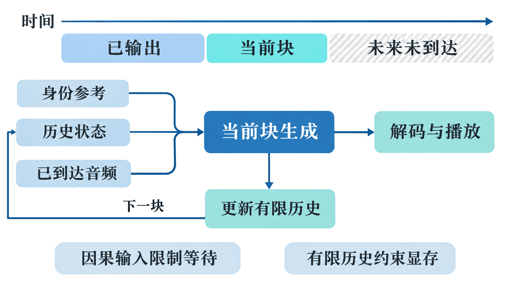

# 目录

[1. 音频驱动数字人的任务定义是什么？](#q-001)
  - [面试问题：Talking Head、Talking Portrait、Audio-driven Human Video 有什么区别？](#q-002)
  - [面试问题：音频驱动模型为什么不能只关注嘴唇？](#q-003)
  - [面试问题：音频特征如何与视频帧对齐？](#q-004)

[2. 经典音频驱动数字人模型如何演进？](#q-005)
  - [面试问题：Hallo 的分层音频驱动视觉合成如何理解？](#q-006)
  - [面试问题：Hallo2 如何支持长时长和高分辨率？](#q-007)
  - [面试问题：Sonic 为什么强调全局音频感知？](#q-008)
  - [面试问题：InfiniteTalk 为什么强调 sparse-frame video dubbing 和无限长度？](#q-009)

[3. 长视频音频驱动为什么容易闪烁、漂移和颜色偏移？](#q-010)
  - [面试问题：分段生成、重叠融合和时间感知位置偏移有什么区别？](#q-011)
  - [面试问题：Patch-drop、高斯噪声增强、参考帧约束如何减轻误差累积？](#q-012)
  - [面试问题：TeaCache、int8 量化、多 GPU/FSDP 对长视频推理有什么价值？](#q-013)
  - [面试问题：长视频为什么需要 rollout 和 on-policy 训练？](#q-029)

[4. 多人音频驱动为什么比单人难很多？](#q-014)
  - [面试问题：MultiTalk 的整体架构可以如何理解？](#q-015)
  - [面试问题：L-RoPE 如何实现音频流与人物区域绑定？](#q-016)
  - [面试问题：多路音频注入有哪些方式？为什么简单拼接通常不够？](#q-017)
  - [面试问题：HunyuanVideo-Avatar 如何处理音频情感、ID 绑定和长视频？](#q-018)

[5. 音频驱动数字人数据如何处理与评估？](#q-019)
  - [面试问题：音频驱动人脸数据预处理标准流程是什么？](#q-020)
  - [面试问题：如何评估唇形同步、身份一致性和表情自然度？](#q-021)
  - [面试问题：如何将 REPA 思想迁移到唇形对齐或时序特征对齐中？](#q-022)
  - [面试问题：流式数字人为什么需要会话级评测，而不能只测短视频质量？](#q-030)

[6. 音频驱动数字人正在向哪些新任务扩展？](#q-023)
  - [面试问题：Wan-S2V 如何结合参考图、音频和文本生成人物视频？](#q-024)
  - [面试问题：如何验证情绪控制没有破坏口型、身份和动作？](#q-025)
  - [面试问题：AnyTalker 与 MultiTalk 在多人对话生成上有什么区别？](#q-026)
  - [面试问题：StreamAvatar、OpenAvatarChat 代表了什么实时交互趋势？](#q-027)
  - [面试问题：怎样把双向视频扩散模型改造成因果流式数字人？](#q-028)
---

<h1 id="q-001">1. 音频驱动数字人的任务定义是什么？</h1>

<h2 id="q-002">面试问题：Talking Head、Talking Portrait、Audio-driven Human Video 有什么区别？</h2>

**难度评分：⭐⭐ (2/5)  |  考察频率：⭐⭐⭐⭐⭐ (5/5)**

这三个名称描述的是生成范围和输入形式，彼此有交集。理解它们时，应先看模型接收什么、修改画面的哪些部分、能够控制什么，再看论文使用了哪个名称。

### 1、任务范围扩大，监督关系也随之变化

**Talking Head** 通常集中在头部或人脸裁剪区域，主要关心口型、表情、头部姿态和身份。输入可以是一张照片、一段目标视频，或一个已经制作好的角色资产，因此 Talking Head 不等于“单图生成”。局部唇形修复也可以服务于这一任务，但修改范围比完整头部动画更小。

**Talking Portrait** 强调让肖像动起来，常见输入是一张参考图和一段语音。模型除了合成嘴部，还要补出转头时的新区域、头发运动、眨眼和肖像周边内容。画面可以包含肩膀乃至上半身，和 Talking Head 并没有严格的裁剪线。

**Audio-driven Human Video** 将目标扩展到半身、全身、复杂场景或多人。语音不仅影响嘴部，还可能与手势、身体节奏和互动相关。参考图、文本、姿态或源视频共同规定人物是谁、在哪里、做什么，声音提供其中一部分时间条件。

### 2、为什么不能把任务扩大理解为单纯提高分辨率

从脸部扩展到全身，困难来自约束不足。发音需要嘴唇、下颌协调运动，声音能提供较强线索；一句“请看这里”究竟用左手还是右手指向，通常无法仅从波形确定。模型要从训练视频中学习合理的动作分布，或接受额外的手势、姿态和场景条件。

例如对同一段产品讲解，两个真实演员都可能口型正确，却采用完全不同的手势。评价时把其中一人的全身轨迹当作唯一答案，会惩罚另一种合理表演。口型可按时间对齐评估，身体动作则需要同时看语义适合度、自然度和条件服从性。

范围扩大还意味着脸在画面中更小、手和物体遮挡更多、身份保持与运动自由之间的冲突更强。把头部视频贴进一张固定全身图，虽然输出了全身画幅，却没有解决全身生成的这些问题。

### 3、比较模型时先统一任务条件

应明确参考输入是图片还是视频，是否允许改变背景，动作由音频自由生成还是由姿态约束，是否需要多人分别驱动，以及推理能看到多少未来音频。比较速度时，还要统一输出尺寸、真实人脸像素大小和生成时长。

如果产品只是把一段访谈翻译成另一种语言，尽量保留原画面的配音编辑可能更适合；如果需要让静态讲师形象完成全新讲解，就需要肖像或全身生成。任务定义决定数据、模型和验收标准，比名称本身更有指导意义。

<h2 id="q-003">面试问题：音频驱动模型为什么不能只关注嘴唇？</h2>

**难度评分：⭐⭐⭐ (3/5)  |  考察频率：⭐⭐⭐⭐ (4/5)**

口型是音频驱动数字人的必要条件，但用户对“一个人在说话”的判断来自整套协同行为。嘴部跟得上音节，眼神却一直冻结，或每个停顿都突然低头，仍然会让人感觉画面缺少真实的表达意图。

### 1、先区分不同动作受音频约束的程度

嘴唇、牙齿可见度和下颌运动与发音密切相关，但音素到可见口型也不是简单的一一映射。相邻音素会发生协同发音，某些发音在视觉上相近；嘴部运动还可能先于相应声学事件发生。因此需要短时上下文，而不是只取当前一个音频特征。

眉眼、头动与韵律和强调有统计联系，但不是确定关系。手势、视线、身体姿态还受到说话对象、指示目标、场景和个人习惯影响。静默时也可能有眨眼、吸气、点头和倾听反馈，不能把低音量直接映射为全身不动。

### 2、为什么单一重建目标容易得到僵硬表演

设音频条件为 $`a`$，身体动作轨迹为 $`m`$。在平方误差下，对同一条件的最优确定性预测趋向条件均值：

```math
m^*(a)=\arg\min_{\hat m}\mathbb E[\|m-\hat m\|_2^2\mid a]
=\mathbb E[m\mid a].
```

如果同一句话可以左摆头，也可以右摆头，平均轨迹可能接近不动。该结论说明确定性回归面对多解监督的局限，并不表示所有使用重建损失的生成模型必然静止；随机变量、其他条件与分布学习都能改变结果。

反过来，只奖励运动幅度也不成立。模型可能通过持续摇头、扩大张嘴幅度获得更强的“动态”，却破坏语音与表达的关系。LongCat-Video-Avatar 1.6 将过度张嘴和嘴唇色彩异常作为后训练问题，也说明同步优化需要与自然度一起校准。[11]

### 3、建模和评估应怎样分工

对口型保留精细时间约束，对头动和表情引入较长韵律上下文，对多解动作使用生成式先验或显式风格、姿态条件。背景和身份特征应保持稳定，不能随着每个音节无端改变。分区域注意力、动作幅度控制和多人条件路由，都是实现这种分工的具体方式。

测试至少包含快速语音、长元音、强调、静默和自然换气。同步指标用于发现错位，动作统计检查幅度和速度，盲评判断动作是否与语气匹配。还应观察倾听者：他可以自然回应，但不应跟着另一人的音轨同步张嘴。只有把这些现象分别测清楚，才能解释模型提升来自更好的表演，还是某项指标被过度优化。

<h2 id="q-004">面试问题：音频特征如何与视频帧对齐？</h2>

**难度评分：⭐⭐⭐ (3/5)  |  考察频率：⭐⭐⭐⭐⭐ (5/5)**

音频与视频的对齐，本质上是建立不同时间坐标之间的映射。波形采样点、音频特征、视频帧和视频 latent 的步长不同，按数组长度直接截断或复制，容易产生固定偏移、片段接缝错误和逐渐累积的时钟漂移。

### 1、先在原始时间轴上找到对应位置

恒定帧率、首帧从零开始时，第 $`n`$ 帧的时间可写为 $`t_n=n/F_v`$；变帧率视频应使用解码后的呈现时间戳。音频特征第 $`j`$ 项的中心时间若为 $`s_j=s_0+jh_a`$，近邻索引为：

```math
j(n)=\mathrm{round}\left(\frac{t_n-s_0}{h_a}\right).
```

$`F_v`$ 是视频帧率，$`h_a`$ 是音频特征步长，$`s_0`$ 包含音频起点、编码器感受野中心和 padding 等偏移。实际系统还需处理边界，采用有效长度 mask 或符合训练约定的填充，不能让负索引意外读取数组末尾。

例如 25 FPS 视频每帧间隔 40 ms，50 Hz 音频特征每项间隔 20 ms，常见情况下每帧对应约两项特征。16 kHz 波形的相邻采样点间隔则是 0.0625 ms，它不是音频编码器的输出帧率。编码器实际步长应从实现或输入输出测试确认。

### 2、为什么还要聚合邻近窗口

口型受相邻音素影响，一帧通常读取对应中心附近的一组特征。可用拼接、池化、卷积或带时间约束的交叉注意力形成条件。拼接保留位置细节但增加维度，池化更省计算却可能抹掉先后关系，注意力则需要恰当的时间编码和训练监督。

对流式任务，要区分“取到当前音频片段”和“特征只依赖已到达音频”。即使索引只选过去位置，一个双向音频编码器的特征也可能已经使用未来上下文。若允许 160 ms 前瞻，这部分等待应计入首响与持续延迟；把完整音频预先编码后测试，不能证明在线因果性。

### 3、视频 VAE 的时间压缩要单独处理

视频 latent 的一项可能对应多帧，因果 VAE 还可能对首帧采用特殊编码约定。音频需要按该时间分组压缩，而非对全部序列做一个忽略首帧的均匀 reshape。MultiTalk 的音频适配器就区分首项和后续分组，以匹配其视频 VAE 的时间结构。[5]

切块时必须保存全局起点。第二块局部第零帧应读取第二块对应的音频位置，重叠视频帧也应读取同一段声音。解码、变速、剪辑或补帧后，映射关系要同步更新。

### 4、怎样确认对齐正确

先用已知同步视频检查，人工将音轨向前、向后平移几个帧间隔，观察估计 offset 是否随之变化；再测试不同采样率、不同帧率和跨块位置。若开头正确、几分钟后失步，应排查时间单位、重采样和设备时钟比例，而不只调整固定偏移。对齐验证应保留实际时间戳，避免只靠“长度看起来一致”。

---

<h1 id="q-005">2. 经典音频驱动数字人模型如何演进？</h1>

<h2 id="q-006">面试问题：Hallo 的分层音频驱动视觉合成如何理解？</h2>

**难度评分：⭐⭐⭐ (3/5)  |  考察频率：⭐⭐⭐⭐ (4/5)**

Hallo 把音频驱动拆到嘴部、表情和姿态相关区域，使同一段声音在不同视觉区域承担不同职责。参考图提供外观，音频条件驱动表演，时间模块连接连续帧，这是其分层设计的基本逻辑。[1]

### 1、从输入到生成主干

模型以 Stable Diffusion 的潜空间 U-Net 为基础，将视频帧编码后在 latent 中去噪。参考图通过 ReferenceNet 提供多尺度纹理，还使用人脸编码特征帮助保存身份；音频由预训练 wav2vec 编码并经投影适配到注意力维度。外观与声音在主干中逐层交互，而非先独立生成一张脸和一张嘴再贴合。

ReferenceNet 主要解决衣服、头发、人脸与背景细节的保持；人脸身份特征提供更集中、较少依赖场景的条件。两者并非等价。仅有身份向量难以保存全部像素细节，仅有参考纹理又容易把原姿态带入生成。

### 2、分层音频注意力具体分在哪里

Hallo 根据人脸关键点构造嘴部、表情和姿态区域 mask，在音频交叉注意力产生的视觉响应上进行区域分配，再通过可学习融合组织这些分支。嘴部区域重点处理发音，嘴部之外的面部区域支持表情，其余相关区域参与整体姿态和动态。论文还提供不同分支权重的调节，以改变动作表现。

一种帮助理解的抽象写法为：

```math
O=\mathrm{Attn}(Q(Z),K(A),V(A)),
\qquad \Delta Z=\sum_{r}\lambda_r F_r(M_r\odot O).
```

$`Z`$ 是视觉特征，$`A`$ 是音频特征，$`M_r`$ 是区域 mask，$`F_r`$ 表示分支变换，$`\lambda_r`$ 概括控制强度。这里表达区域响应与融合关系，省略了多层结构和残差，并非逐行复现实现。分层并不意味着嘴、脸和头部完全独立，它们最终仍要在共同生成网络里协调。

例如增强嘴部分支可能改善发音可见度，但权重过高也会带来夸张张嘴；增强姿态分支能够增加动态，却未必符合当前情绪。权重需要结合自然度与身份保持调节，不能只追求某个同步分数。

### 3、时序和训练怎样配合

其训练先学习单帧人物生成，再在视频阶段学习分层音频关联和时间联系；时间模块使用 AnimateDiff 的初始化。推理续接时利用前一片段的末尾运动帧，让新片段看到之前的状态。参考图负责稳定外观，运动帧负责短期连续，两类条件作用不同。

但历史帧可能携带错误，反复传递会引入长期漂移；参考关键点得到的区域在大角度转头、遮挡或夸张动作下也可能不适用。应分别测试正面、侧脸、快速发音、静默和多次续接。Hallo 的长期价值在于把音频控制落实到区域和时间结构，它并不保证所有姿态和任意时长都自然稳定。

<h2 id="q-007">面试问题：Hallo2 如何支持长时长和高分辨率？</h2>

**难度评分：⭐⭐⭐⭐ (4/5)  |  考察频率：⭐⭐⭐ (3/5)**

Hallo2 将“短片能动起来”向“持续生成且保持细节”推进。它分别处理长时续接的误差传播和高分辨率增强，两者需要不同机制：前者关注历史条件如何使用，后者关注细节如何恢复并保持时间一致。[2]

### 1、长视频为什么会越接越偏

设第 $`k`$ 段根据前段末尾历史 $`H_{k-1}`$ 生成。训练时历史往往来自真实视频，推理时却来自模型自身输出。如果历史中嘴唇偏红、背景变暗，这些外观会被下一段当成有效证据，再经编码和生成继续传播。每一段单看都能接受，几十段后可能出现明显累积。

Hallo2 让固定参考图承担主要外观来源，历史帧主要传递运动。为降低对历史纹理的依赖，训练时在历史帧的图像空间使用 Patch-drop，再对其编码表示加入高斯扰动。模型必须在不完整、受污染的历史下恢复连续运动，从稳定参考中寻找外观信息。

Patch-drop 不是随机删除整段时间，主要削弱空间局部外观；高斯扰动也不是宣称真实生成错误都符合高斯分布，而是以可控扰动提高鲁棒性。强度太大时，历史里的有效运动也会被破坏，需要用长续接实验选择。

### 2、高分辨率阶段增加了什么

基础动画完成后，高分辨率增强模块利用离散 VQ 码本预测与时间对齐机制提升细节。可理解为在高质量视觉先验中寻找适合当前画面的细节表示，并让相邻帧的预测协调，减少逐帧增强造成的纹理闪动。

因此，“输出到 4K”描述最终增强结果，不能据此推断整个基础视频扩散过程都在原生 4K 上进行。若低分辨率阶段嘴型错位、身份轮廓已经漂移，增强模块最多生成更清晰的错误，不能替代驱动和长期一致性建模。

### 3、文本、音频和历史怎样各司其职

Hallo2 还结合文本条件支持表情和运动控制。声音提供发音与节奏，文本表达期望的风格或动作，参考图稳定身份，历史帧提供连续状态。多路条件发生冲突时，例如文本要求大笑而音频语气平静，需要观察模型的实际优先级，不能假定某一路天然压过其他条件。

### 4、怎样验证长时与高清收益

应固定基础生成配置，对比有无历史增强，统计身份、颜色和口型误差随段数的趋势；同时检查每次接缝处的头部速度和动作连续性。高分辨率模块则需单独对比增强前后、逐帧增强与时间增强，并检查牙齿、眼睛和细小纹理是否稳定。

实验记录应列出基础分辨率、最终分辨率、片段长度、续接时长、帧率和后处理。平均画质分数容易掩盖末尾退化，长视频的首段、中段、末段和最差片段都需要查看。持续十分钟后仍然“是同一个人、在正确说话”，比最后一帧有多少像素更能说明系统能力。

<h2 id="q-008">面试问题：Sonic 为什么强调全局音频感知？</h2>

**难度评分：⭐⭐⭐⭐ (4/5)  |  考察频率：⭐⭐⭐ (3/5)**

Sonic 的核心是把音频同时用作局部口型条件、片段内运动上下文和跨片段连接线索。它由上下文增强音频学习、运动解耦控制和时间感知位置偏移融合组成，不能仅概括为“换了一个更好的音频编码器”。[3]

### 1、音频怎样进入空间和时间两条路径

Sonic 使用 Whisper-Tiny 提取多层音频特征，经投影形成条件。空间音频交叉注意力让当前帧在局部时间窗口中读取发音线索，并通过面部区域限制控制作用范围。论文为每个视频帧构造约 0.2 秒的音频上下文，以帮助处理相邻发音关系。

在时间路径中，模型对片段音频进行聚合，再把得到的条件注入时间交叉注意力，让跨帧视觉状态共享更长范围的韵律信息。这样，头动和表情不必完全依赖前一段生成画面来推测节奏。这里的聚合条件补充了片段级信息；精细发音时序仍需要局部路径，不能用一个全局平均向量包办。

### 2、为什么还需要运动幅度控制

发音与嘴部关系较强，但习惯性头动和表情幅度存在多解。Sonic 将头部平移相关幅度与表情幅度组织成独立 motion bucket，经过编码注入网络。训练时从视频运动计算监督，推理时可由音频与参考图预测，再通过系数调节强弱。

这种控制改变的是动态幅度，不等于精确规定每一帧的头部轨迹。若业务要求第 3 秒必须向左看，仍需要更明确的姿态或事件条件。幅度增加也应有上限，不能把“运动更大”直接当成“表达更自然”。

### 3、长音频如何跨片段建立联系

其时间感知位置偏移融合在**扩散去噪步之间改变窗口起点**。某一步中两个相邻帧可能位于不同窗口，下一步移动窗口后，它们可以进入同一上下文，逐步交换信息。音频索引和视频 latent 索引一起移动，保持音画对应。

因此它并非简单把每段最终像素平均，也不是不断给时间位置编号加一个常数。它改变的是去噪过程中片段的分组，让固定窗口边界不再始终隔断上下文。论文对序列末端使用循环填充，属于具体边界处理，实际应用仍应检查首尾附近是否出现不合适的关联。

### 4、全局感知不等于在线零等待

“全局”表达相对局部窗口的音频利用范围。Sonic 的长序列采样会围绕整段音频组织窗口，并不因此成为只看已到达音频的因果系统。用于实时交互时，必须重新核对编码器未来依赖、窗口等待和采样方式。

验证可分别去掉时间音频分支、运动控制和窗口偏移，查看口型、头动连续性和接缝变化。还应记录模型原始输出帧率与后续插帧帧率；插帧可以改善播放平滑度，却不会补回缺失的音频理解能力。

<h2 id="q-009">面试问题：InfiniteTalk 为什么强调 sparse-frame video dubbing 和无限长度？</h2>

**难度评分：⭐⭐⭐⭐ (4/5)  |  考察频率：⭐⭐⭐ (3/5)**

InfiniteTalk 面向 sparse-frame video dubbing：从源视频中选取稀疏参考帧维持人物和场景，再让新音频驱动嘴部、表情及身体动态。它把“哪些内容要保留”和“哪些动作可以重生成”分开设计，以兼顾配音一致性与表演自由度。[4]

### 1、为什么只改嘴部与严格固定关键帧都有限制

局部嘴部编辑能最大程度保留原视频，但新配音的停顿、重音和情绪可能已经改变，原来的头动与手势未必合适。若允许全画面生成，模型又容易改变人物、服装、背景甚至镜头。

另一个极端是要求每段准确经过指定首尾帧。这样能稳定外观和镜头，却可能迫使人物在新音频要求张嘴时回到闭嘴参考，或者在关键帧附近突然调整姿态。InfiniteTalk 因而采用较软的参考约束，让参考提供内容依据，而不要求在每个指定时刻机械复制所有像素。

### 2、参考帧与历史帧承担两种记忆

源视频参考帧是外部锚点，可提供身份、背景、镜头位置等信息；上一段末尾的 context frames 则提供当前动作状态和运动趋势。仅用上段最后一帧续接，容易累积外观误差；仅用源视频关键帧重新开段，又缺少动作惯性。

模型在视频生成主干中注入音频条件，并组织参考与历史视觉条件。训练可以使用普通带音轨视频，通过抽取参考、历史和目标学习条件生成，并不要求采集同一个视频的真实配音前后成对数据。参考位置和条件注入方式的设计，关系到网络会把参考当作软外观依据，还是强制还原的指定画面。

其训练比较了当前片段内随机取参考、固定首尾参考、远距离参考与邻近片段参考。当前段或固定边界的参考容易诱导姿态复制；距离过远又会削弱场景保持。采用邻近片段的参考，使参考与目标存在适度时间差，是形成软控制的重要设计。它通过数据配对关系教模型区分“参考提供外观”与“目标必须复制参考姿态”，并不只是把参考权重调小。

这里的“软”也有代价。模型允许手势与原视频不同，意味着某些商品细节、接触关系或不可见背景可能发生变化。对要求逐帧保留证据画面的任务，仍应按更严格的编辑标准评估。

### 3、无限长度指可持续续接的机制

每次生成有限长度片段，保留末尾历史，再读取下一段音频与对应参考，就能继续运行。没有预先固定的总片段数，不代表数学上保证任意时长都无漂移，也不表示整段视频一次放进显存。

例如一分钟内容可以连续生成，但如果第 20 秒人物被遮挡，后续历史可能已经携带错误脸部。固定参考有助于拉回身份，却不能保证正确恢复遮挡时的姿态和背景。应检查长时错误是否会反复传播，以及参考更新时是否发生外观突跳。

### 4、视频配音与图片驱动要分开验收

视频模式具有随时间变化的外部场景证据，单图模式只能从一张图推断后续内容，两者的约束强度不同。测试应覆盖原视频大动作、镜头移动、换气停顿、跨段接缝与长时间静默，并分别记录身份、背景、动作和同步。

缓存、INT8 和多卡选项主要改善可运行性与计算成本。是否实时，还要测音频等待、生成、VAE 解码、视频编码和播放队列组成的完整路径，不能将“可以无限续接”直接换成“可以自然对话”。

---

<h1 id="q-010">3. 长视频音频驱动为什么容易闪烁、漂移和颜色偏移？</h1>

<h2 id="q-011">面试问题：分段生成、重叠融合和时间感知位置偏移有什么区别？</h2>

**难度评分：⭐⭐⭐⭐ (4/5)  |  考察频率：⭐⭐⭐⭐ (4/5)**

分段、重叠融合和时间位置设计解决三个不同问题：分段控制一次处理多少内容，重叠处理片段如何交接，位置设计规定模型怎样理解时间关系。完整长视频方案通常需要同时考虑三者。

### 1、分段先解决算得动的问题

假设每次处理 $`L`$ 帧、相邻片段重叠 $`O`$ 帧，且 $`0\le O<L`$，滑动步长就是 $`S=L-O`$。片段越长，模型能直接看到的上下文越丰富，但注意力和激活成本更高；片段越短，单次等待更少，接缝数量却增加。

还要区分两种执行方式。一种是整段噪声在每个去噪步被分窗处理，窗口之间通过共享状态联系；另一种是先生成完整的第一段，再以其尾部生成下一段。后者在片段之间自回归，但每段内部仍可双向去噪。两者的音频等待、历史误差与并行能力不同。

### 2、重叠融合为什么可能出现双嘴

对于两段共同覆盖的时间位置，简单融合可以写成：

```math
\hat z_i=w_i z_i^{(A)}+(1-w_i)z_i^{(B)},
\qquad 0\le w_i\le1.
```

若随着时间让 $`w_i`$ 从 1 平滑降到 0，就能逐渐从 A 过渡到 B。但该式要求两者描述同一时间位置；如果 A 的嘴已经闭上、B 的嘴仍然张开，像素混合会产生重影，latent 混合也不保证得到合理中间动作。

因此应尽量让生成过程共享边界条件，例如读取同一历史、固定共同帧或协调重叠区的去噪预测，再用融合处理剩余差异。光流对齐也有适用范围，牙齿出现、遮挡变化和快速头动并不总有可靠对应。

### 3、Sonic 的偏移为何不是普通重叠

Sonic 在不同扩散步移动窗口起点，使本来分处两窗的帧在后续步骤中共同计算。音频与视频索引同步移动，从而在不持续重复计算固定重叠帧的设计下传递跨片段上下文。[3] 这里的偏移发生在采样组织中，不是把最终输出整体平移。

StreamAvatar 的参考锚定位置重编码则处理另一类问题：滑动历史窗口不断前进时，时间位置相对参考锚点如何设置，才能维持可用关系并减轻位置外推。[9] 它与改变去噪窗口边界不是同一个模块，也不能通过给所有位置加同一个数字获得。

### 4、怎样判断接续策略有效

除了看边界两帧，还要看边界前后的头部速度、音素进度和背景色彩。两帧像素接近，但人物每到接缝就短暂停顿，仍然不连续。应按接缝、段内和长期趋势分别统计，并检查重叠部分是否被重复播放或漏掉。

如果分段后总音频长度与视频长度逐渐不一致，应先检查重叠帧计数和时间映射。增加融合强度无法修复索引错误，也无法解决反复读取错误历史造成的身份漂移。

<h2 id="q-012">面试问题：Patch-drop、高斯噪声增强、参考帧约束如何减轻误差累积？</h2>

**难度评分：⭐⭐⭐⭐ (4/5)  |  考察频率：⭐⭐⭐ (3/5)**

这三种方法分别削弱历史中的错误外观、提高对受污染条件的适应性、提供稳定的身份依据。它们共同针对“训练时读真实历史，推理时读自身生成历史”的差异，但不能替代真实长序列验证。

### 1、误差为何会在历史链路中被放大

用一个局部线性近似表示续接误差：

```math
e_k\approx J_k e_{k-1}+\delta_k.
```

$`e_{k-1}`$ 是历史偏差，$`J_k`$ 概括当前生成对历史变化的敏感性，$`\delta_k`$ 是本段新增误差。这个近似用于解释传播，不是对真实生成网络的全局保证。若某类外观误差被反复放大，微小偏色就可能在几十次续接后变得明显；即使没有放大，每段新增误差也可能逐步积累。

### 2、Patch-drop 与高斯扰动分别改变什么

Hallo2 的 Patch-drop 在历史图像中丢弃部分空间块，使模型难以直接复制完整纹理，又保留一定粗结构和运动线索。它鼓励网络从固定参考读取身份，从历史读取动态。[2]

高斯扰动则加入历史编码表示，提高网络对不完美历史的适应性。其目的不是让输出带噪声，而是让生成主干在条件不完全可靠时仍能恢复正常画面。两种增强的作用位置要与原实现区分：图像空间的遮挡会经过编码器传播，latent 上的噪声则直接改变条件表示，两者不等价。

例如上一段眼睛边缘轻微模糊，如果训练永远看到锐利眼睛，模型可能把模糊当成身份纹理继续继承。适度扰动让它学会结合稳定参考修正，而非无条件相信历史。

### 3、固定参考为什么也会带来副作用

参考图不会随生成错误变化，因此适合作为外观锚点；但其中同时包含原姿态、表情和光照。若注入太强，人物可能每隔几段重新回到初始正脸，动作连续性反而下降。多参考可以增加视角证据，却也可能引入不同光照或不一致服饰。

因此应明确条件职责，避免把历史全部破坏、再依赖参考重新开始。历史要保留当前运动状态，参考要稳定身份和必要细节。对于场景变化较大的视频，固定单图也不一定是适合所有时刻的背景依据。

### 4、怎样校准增强强度

先比较真实历史和生成历史条件下的质量差距，再测试不同遮挡比例、噪声强度和参考权重。除首段质量外，记录续接段数增加时的身份、颜色、运动速度与口型表现，并观察出错后能否恢复。

训练扰动如果只模拟随机噪声，却没有覆盖真实的结构错误、错误身份和遮挡恢复，仍可能在部署中失败。进一步使用模型自身 rollout 的历史，可以补足这一差距；代价是训练成本与监督设计更复杂，不能把简单噪声增强宣称为完整的 on-policy 训练。

<h2 id="q-013">面试问题：TeaCache、int8 量化、多 GPU/FSDP 对长视频推理有什么价值？</h2>

**难度评分：⭐⭐⭐⭐ (4/5)  |  考察频率：⭐⭐⭐⭐ (4/5)**

这些优化分别针对去噪冗余、数值表示和多设备分工。正确顺序是先确认计算或显存瓶颈，再选择手段，并在同一质量要求下比较。能够装进显存与能够实时播放，是两个不同的验收结果。

### 1、TeaCache 复用的是去噪步间计算

扩散模型在相邻噪声时间步处理相近状态，部分中间结果变化可能较小。TeaCache 类方法利用与时间步相关的特征变化估计计算冗余，在满足阈值时复用部分模块结果，减少完整主干前向次数。它引入近似，阈值和校准关系通常需要适配具体模型。[15]

这与流式 Transformer 的 KV Cache 不同：后者保存已处理历史 token 的键和值，避免重复编码历史；TeaCache 主要利用去噪过程的相似性。两者可以出现在同一系统中，但误差来源与缓存失效条件不同。

数字人尤其要测试快速音节、嘴部闭合、突然转头和条件切换。整幅图变化较小时，嘴部局部仍可能有关键变化；只用全图平均画质判断缓存收益，可能遗漏口型退化。

### 2、INT8 的收益取决于量化对象与执行路径

权重量化压缩模型参数，通常可减少权重显存和搬运量；激活量化还涉及中间表示的动态范围。只将权重保存成 INT8，不意味着注意力、VAE 和全部激活都以 INT8 运算。若每层反复反量化、没有高效 kernel，显存下降也可能伴随速度持平甚至下降。

校准数据要覆盖真实人物、静默、大表情和不同音量条件。异常值、细微颜色与小脸特征对精度损失的敏感度不同，必要时保留部分层的较高精度。显存账目还要包含激活、缓存、临时张量和解码峰值，不能只用参数量乘每参数字节数估算总峰值。

### 3、多 GPU 有多种分工

<div align="center">

| 方式 | 主要分担内容 | 对数字人推理的实际影响 |
|---|---|---|
| 多副本服务 | 每张卡处理不同会话 | 增加吞吐，通常不缩短单会话前向 |
| FSDP 参数分片 | 参数；训练时还能分片梯度与优化器状态 | 帮助容纳大模型，需承担参数聚合通信 |
| 张量并行 | 单层内部计算 | 可能降低单步计算时间，受通信与拓扑影响 |
| 序列或上下文并行 | 长序列的注意力与相关计算 | 分担 token 和激活，需要跨设备交换信息 |
| 流水线并行 | 不同层或阶段 | 受流水线气泡、分块调度和负载平衡影响 |

</div>

FSDP 不会自动把长序列注意力的全部激活平均分到每张卡。多卡方案也可能降低每卡内存，却因为通信增加首块延迟，应结合模型和框架的实际推理实现判断。

### 4、怎样报告可复用的结果

固定硬件、分辨率、人数、块长、采样步数和音频前瞻，分别记录峰值显存、首块延迟、稳态生成速度与质量。若每 500 ms 内容平均用 350 ms 生成，仍需查看慢块分位数及排队情况；偶发超过播放时限会耗尽缓冲。

先单独启用缓存、量化与并行，找到各自收益，再验证组合。InfiniteTalk 等项目提供多种运行选项，但选项存在只说明实现支持，不能代替当前设备上的完整链路测量。[4]

<h2 id="q-029">面试问题：长视频为什么需要 rollout 和 on-policy 训练？</h2>

**难度评分：⭐⭐⭐⭐⭐ (5/5)  |  考察频率：⭐⭐⭐ (3/5)**

rollout 指让模型连续生成多段并使用自己的历史继续往前走；on-policy 训练则让优化接触当前模型实际会到达的状态。长视频需要这类设计，是因为部署时的历史条件与孤立短片训练时明显不同。

### 1、为什么短片训练很好，连续生成仍会崩

teacher forcing 通常给模型真实历史。网络学会的是“从正确状态生成下一段”，却未必学会“已经有一点偏色和模糊时继续生成”。推理中，每次重新编码生成尾帧，都会把前一段错误带入新的条件。少步蒸馏若只在真实历史上完成，也会继承这一缺口。

rollout 首先让这种差距可见：同一参考和音频连续生成，观察身份、嘴唇颜色和细节随段数变化。只运行 rollout 并保存样片属于评估；只有这些状态参与训练并产生有效监督，才是在调整模型面对自身历史的行为。

### 2、LongCat-Video-Avatar 1.6 怎样利用自身历史

该报告采用片段间自回归续接，片段内部仍双向去噪。在少步蒸馏后，让学生用自身生成的尾部历史连续产生片段；EMA 教师接收相同的学生噪声状态和音频、文本、参考条件，但获得更有信息量的时间上下文。[11]

其教师上下文结合相应时段的真实视频帧与教师上一段末帧，在学生实际访问的状态上提供速度场目标。监督作用于当前片段的新生成部分，可概括为：

```math
\mathcal L=\mathbb E_{z\sim p_{\theta}^{\mathrm{rollout}}}
\left[\left\|v_\theta(z,c,H_s)
-\mathrm{sg}\big(v_{\bar\theta}(z,c,H_t)\big)\right\|^2_{\mathrm{new}}\right].
```

$`H_s`$ 是学生自身历史，$`H_t`$ 是教师获得的增强上下文，$`\bar\theta`$ 表示 EMA 教师，$`\mathrm{sg}`$ 停止教师梯度，$`\mathrm{new}`$ 表示只在新生成位置计算。该式概括原方法的训练关系，不表示对整个长 rollout 都反向传播。

### 3、on-policy 不必然等于强化学习

这里“on-policy”强调状态来自当前学生；监督仍可以是教师输出的回归目标。LongCat 同时包含 GRPO 奖励优化分支和 DMD—OPSD 蒸馏分支，二者目的与损失不同，不能混成一次统一的策略梯度更新。

自身历史让训练更贴近部署，但错误状态必须有可靠纠正依据。若教师同样被错误历史带偏，或者奖励只偏好夸张嘴型，就可能重复强化问题。训练也应控制历史新鲜度、rollout 长度、计算成本和梯度范围，避免成本过高或学习不稳。

### 4、什么证据说明它改善了长期能力

比较真实历史条件与生成历史条件、短片与长片，以及不同段数下的退化曲线。还应在未参与训练的身份、动画角色、大动作和不同语种上验证。该报告的部分动画输入表现出现回退，说明平均提升不等于所有子群改善。

可迁移的原则是：将部署时实际出现的状态带回训练，并给出比简单重复自身错误更可靠的监督。这个原则同样适用于对话历史、机器人轨迹和其他自回归系统，但具体教师与损失需要按任务重新设计。

---

<h1 id="q-014">4. 多人音频驱动为什么比单人难很多？</h1>

<h2 id="q-015">面试问题：MultiTalk 的整体架构可以如何理解？</h2>

**难度评分：⭐⭐⭐⭐ (4/5)  |  考察频率：⭐⭐⭐ (3/5)**

MultiTalk 将多人对话生成建立在视频底模上：保留底模的画面和动作能力，增加音频条件路径，再解决音轨与人物区域的对应关系。多人任务的难点在于条件归属，同一画面中的每张脸必须读取正确声音。[5]

### 1、输入条件怎样进入视频主干

原论文使用 Wan2.1-I2V-14B 作为底座，参考图提供人物和场景，文本描述动作，Wav2Vec 提取音频特征。视频 VAE 同时压缩空间和时间，因此音频适配器需要将局部上下文与视频 latent 的时间位置对齐，并处理首帧与后续时间分组的差别。

在 DiT block 的文本交叉注意力后，增加归一化和音频交叉注意力。查询来自视觉 token，键和值来自音频条件，按对齐的时间位置计算。这样能将新声音接入既有生成模型，同时继续使用文本和参考图的控制能力。

### 2、多人绑定如何形成

先在参考图确定人物区域，再利用参考图到生成视频的自注意力关联，估计各个视觉位置属于哪个人。L-RoPE 根据人物关联为视觉 query 与音频 key 设置标签旋转，增强正确音轨对相应人物的驱动。

例如左侧人物 A 发言、右侧人物 B 静默，模型应该让 A 的嘴部随 A 音频运动，B 保持自然倾听。当 A 走向画面右侧时，绑定还应跟随人物身份，而不是固定绑定到画面左半边。区域估计因此是绑定机制的一部分，不能只给两条音频加不同序号就认为问题解决。

### 3、为何只训练一部分参数

论文先进行单人音频驱动训练，再引入双音轨对话数据；主要更新音频交叉注意力和音频适配器，冻结其余底模参数。其观察是，在数据与计算有限时，全参数训练容易损害原有动作指令能力，甚至增加手部和物体失真。

同时混合音频加图像到视频任务与普通图像到视频任务。后者使用多事件、人—物与人—场景互动数据，帮助保留文本动作控制。这里的多任务训练有具体目的：防止模型只见到对着镜头说话后，逐渐忘记更丰富的场景变化。

### 4、多人扩展的边界怎样检验

接受多路音频的接口，不等于任意人数都可靠。每增加一个人物，都增加小脸分辨率压力、遮挡、区域归属和交互数据需求。原方法的双人能力不能直接推广为复杂会议场景能力。

应测试单人静默、轮流说话、交叠语音、交换音轨和人物越过中线。单独记录错误人物张嘴、身份串换和不自然倾听，而非只计算整段视频同步平均分。多人模型的成功条件是每个人都按正确条件行动，同时在同一场景中形成协调互动。

<h2 id="q-016">面试问题：L-RoPE 如何实现音频流与人物区域绑定？</h2>

**难度评分：⭐⭐⭐⭐ (4/5)  |  考察频率：⭐⭐⭐ (3/5)**

L-RoPE 将人物归属编码到音频交叉注意力的查询与键中，让音轨和视觉区域之间的相对标签影响匹配。它提供可学习的绑定线索，区域定位、标签设计和训练共同决定效果。[5]

### 1、先找到“这个 token 属于谁”

MultiTalk 先为参考图中的人物建立区域，再通过参考图到视频的自注意力相似性，估计生成位置与各个人物的关联。随后根据关联给人物区域分配不同数值范围的标签，音轨使用对应标签，背景则使用分离的标签。

因此标签并非只表示时间位置，也不只是每个人一个永久固定整数。视觉区域内的数值可以随关联强弱变化，用来表达不同部位受音频驱动的关系；具体范围属于实现选择，不是人物身份的语义编号。

### 2、旋转怎样影响注意力

对单个注意力头，以 $`q_i,k_j`$ 表示视觉查询和音频键，$`\ell_i,\ell_j`$ 表示标签，可写成：

```math
q'_i=R(\ell_i)q_i,\qquad k'_j=R(\ell_j)k_j,
\qquad {q'_i}^{\top}k'_j
=q_i^{\top}R(\ell_i)^{\top}R(\ell_j)k_j.
```

$`R`$ 是按通道对执行的旋转矩阵。相对标签通过中间的相对旋转改变内积，再经过缩放与 softmax 形成注意力权重。若标签完全相同且使用同一个正交旋转，则 $`R^\top R=I`$，原内积保持不变；因此“标签相同必然放大分数”在数学上不成立。

正确解释是，模型在训练中学习利用这类相对编码组织条件匹配。标签差异也不保证每一个错误匹配都低分，绑定仍受内容特征和区域误差影响。

<div align="center">


</div>

<div align="center">图：人物与音轨需要稳定对应。叉号表示应避免的错误驱动，并不表示 L-RoPE 实施了绝对禁止跨人物读取的硬 mask。</div>

### 3、为什么比固定左右切分更有适应性

左右切分直接按画面坐标指定音轨，人只要跨过中线，嘴部就可能读到另一条声音。基于参考关联的定位允许人物区域随运动变化，因此在一定范围内更灵活。

但两人长时间遮挡、衣着非常相似或镜头突变时，注意力关联可能错误，标签也会随之错误。L-RoPE 本身不提供独立的真实身份验证，更不替代语音源分离。若输入已经把两人的声音混在同一音轨中，仍需先解决声音归属或提供正确的多路条件。

### 4、怎样验证绑定确实来自机制

在固定画面和采样配置下交换两条音轨，只让一条音轨静音，再让人物交换位置。观察口型变化是否落在对应身份，背景是否受到错误驱动。也应保留交叠发言样本，防止模型只是学会“当前音量更大的人带动所有嘴”。这类干预比展示几段正常轮流发言视频更能区分绑定能力。

<h2 id="q-017">面试问题：多路音频注入有哪些方式？为什么简单拼接通常不够？</h2>

**难度评分：⭐⭐⭐⭐ (4/5)  |  考察频率：⭐⭐⭐ (3/5)**

多路音频注入需要同时回答“何时发生”和“属于谁”。时间对齐只解决前一个问题；如果人物归属没有进入网络，两路声音即使都编码正确，也可能共同驱动每一张脸。

### 1、常见注入方式的差别

<div align="center">

| 方式 | 条件如何进入网络 | 主要问题或适用边界 |
|---|---|---|
| 音频 token 直接拼接 | 视觉 query 读取全部音轨 token | 缺少人物归属时容易混用 |
| 各音轨独立注意力后相加 | 每路产生响应，再合成视觉更新 | 相加不会自动决定哪个人接收哪路 |
| 固定空间分区 | 左右或固定区域分别读取音轨 | 适合站位稳定，跨区运动会失配 |
| 人物 mask 或跟踪区域 | 按当前人物位置限制条件注入 | 依赖定位、遮挡和轨迹稳定性 |
| 标签感知注意力 | 将人物关联编码进 query/key 等表示 | 提供软绑定，仍需训练和错误测试 |

</div>

MultiTalk 对直接拼接、独立计算后相加与左右切分进行了比较，再采用适应人物位置的 L-RoPE。[5] 其结论针对该训练和模型设置；不能据此断言任何带充分身份条件的拼接结构都不可能学会绑定。

### 2、为什么相加无法自行建立归属

设两路音频为 $`A_1,A_2`$，视觉查询为 $`Q`$，更新写成：

```math
\Delta Z=\mathrm{Attn}(Q,A_1,A_1)
+\mathrm{Attn}(Q,A_2,A_2).
```

每个视觉位置都能收到两路响应。若没有区域、身份或其他关联，输出无法仅从该计算式得知“第一路只属于小王”。加入两个权重也只是改变整体强弱，除非权重本身能够随人物位置正确变化。

硬 mask 可以强制屏蔽不允许的读取，但定位错时会直接阻断正确声音；软标签更灵活，却可能发生条件串扰。工程选择应根据人物是否移动、遮挡程度与数据规模决定，而不是认为软或硬天然更优。

### 3、音轨组织与训练数据同样重要

输入最好明确每条音轨的角色身份和时间起点。若只有混合录音，说话人日志（diarization）标出的“谁在何时说话”并不等于干净的分离音轨；交叠语音仍需要声音分离能力或明确标注。声音中断时也要保留静默长度，不能把每人的发言各自拼成无停顿音轨后直接驱动同一画面。

训练应包含轮流发言、交叠发言、倾听和适当的非语言回应。只训练“一人说完另一人说”，模型可能把任务简化成整场景状态切换，面对同时发言就失败。

### 4、验收要以人物为单位

固定其他条件，只更换某一人的音轨，检查该人物嘴部是否响应、其他人物是否保持合理状态。再加入位置变化、遮挡和音量差，区分音轨归属错误、时序错误与身份错误。多人平均同步分可能掩盖某个人一直读错音轨，应报告逐人结果及串扰率。

<h2 id="q-018">面试问题：HunyuanVideo-Avatar 如何处理音频情感、ID 绑定和长视频？</h2>

**难度评分：⭐⭐⭐⭐ (4/5)  |  考察频率：⭐⭐⭐ (3/5)**

HunyuanVideo-Avatar 在多模态视频 DiT 上分别处理角色外观、情绪风格和音频归属。它的三个模块需要分开理解：角色图像注入模块保存人物，Audio Emotion Module 提供情绪参考，Face-Aware Audio Adapter 将声音限制到对应脸部。[6]

### 1、角色图像怎样兼顾身份与运动

其图像注入并非只有一个全局身份向量。参考图经过 VAE 与 token 化，一条路径将参考扩展到时间维后与视频特征融合，另一条路径把参考图 token 拼接进序列，让模型持续读取角色信息。

位置编码将参考图置于视频时间起点之前，并对空间位置作相应处理，减轻逐位置复制参考图的倾向。这样既给运动中的人物提供稳定外观，又避免把输入肖像的静态姿势过强地固定到每一帧。它仍需数据与训练支持，大幅转身后不可见的细节不能由单张参考自动确定。

### 2、Audio Emotion Module 的情绪来自哪里

该模块使用**情绪参考图像**。图像由预训练 VAE 编码，经投影后作为键和值，与生成视频的视觉查询交互，将参考中的表情风格注入模型。论文发现模块在 Double Block 中的放置更有利于学习情绪线索。

因此不能把它解释为“仅从音频识别情绪，再输出唯一正确表情”。音频与情绪参考共同规定结果。参考图若是微笑，声音却悲伤，模型面对的是条件冲突；产品需要明确想保留声音情绪还是用户指定风格，并用反事实测试验证实际行为。

情绪参考还可能携带其他人的身份和背景。应检查迁移的是否主要是表达，避免把参考脸型或光照一并复制。情绪控制成功也不意味着细微表情都已解耦。

### 3、多人音频如何局部注入

Face-Aware Audio Adapter 使用 latent 层面的脸部 mask，并按时间对齐注入各路音频。当前时间的视觉区域读取对应音频，再由 mask 限制音频响应位置，以减轻多个人同时被一条声音驱动的问题。

这里需要两种一致性：mask 在空间上覆盖正确人物，音频在时间上匹配视频 latent。视频 VAE 的压缩与首帧约定也要传递到 mask 和音频分组。如果区域定位错了，正确音频仍会驱动错误人物；如果音轨错位，空间隔离也无法救回口型。

### 4、长视频沿用了怎样的思路

论文将 Sonic 的时间感知位置偏移融合适配到 HunyuanVideo 主干，在不同去噪步改变片段起点，并保持音画索引同步，以改善片段间衔接。[3,6] 这属于长序列采样组织，不是角色注入模块自然带来的无限记忆，也不直接等于因果流式生成。

评估时应分别测角色身份、情绪可控性、多人绑定与长期稳定性。固定音频更换情绪参考，固定人物交换音轨，延长生成并查看接缝，才能辨明每个模块是否履行职责。单个高质量多人样片无法同时证明这四项能力。

---

<h1 id="q-019">5. 音频驱动数字人数据如何处理与评估？</h1>

<h2 id="q-020">面试问题：音频驱动人脸数据预处理标准流程是什么？</h2>

**难度评分：⭐⭐⭐ (3/5)  |  考察频率：⭐⭐⭐⭐⭐ (5/5)**

预处理的目标是得到身份连续、时间可信、画面可用的音视频片段。它不仅是统一尺寸和采样率，还要保存模型将来学习的运动关系，避免把真实头动清掉、把错误音画关系固化为训练标签。

### 1、先保留时间，再做切分

读取视频帧与音频流的原始时间戳，检查解码失败、帧重复、变帧率、音轨起点和时长。切镜头时同步切音频，并保留片段在原视频中的起止位置。若统一帧率，应按时间重采样，而不是不顾时长地直接丢帧。

音频按编码器要求重采样，保留静默与换气。VAD 可用于分段和标签，但不应把每段停顿都删掉，再与原视频拼接；这样会改变时间关系，也会使模型缺少自然倾听和闭嘴状态。16 kHz、25 FPS 和某个固定裁剪尺寸都是具体配置，不能当作所有模型的统一标准。

### 2、检测要变成连续的人物轨迹

逐帧人脸框会有抖动、漏检和身份交换，需要结合跟踪、关键点和合理插值形成轨迹。镜头切换和长时间遮挡处应重建轨迹，不能盲目跨越。多人视频还需把轨迹与对应音轨关联，检测到两张脸并不能确定谁在说话。

裁剪可保留适当边界，让头部移动仍在画面内。对框中心和尺度进行平滑可减少裁剪抖动，但过度仿射对齐会消除真实头部运动，甚至改变张嘴形态。应明确训练目标：局部唇形模型可以更强地稳定嘴部，完整肖像动画则要保存姿态与背景关系。

### 3、同步校正要区分偏移与漂移

固定偏移表现为整段音轨统一早或晚；时钟漂移则表现为开始同步、后面逐渐错位。可把映射概括为 $`t_v=a t_a+b`$，其中 $`b`$ 是固定偏移，$`a`$ 描述时间比例。一个固定 offset 无法修复 $`a\ne1`$ 的问题。

SyncNet 等工具可以辅助估计偏移，但必须同时看置信度和适用条件。强侧脸、遮挡、低清口腔、配音或动画角色可能使估计不可靠。自然协同发音也包含视觉与声音的先后关系，不能把每个局部窗口的估计都强制归零，否则可能制造时间抖动。

### 4、质量筛选与数据划分应保留真实难点

解码损坏、错误音轨、身份串换应处理或剔除；侧脸、快速语音、手遮嘴和静默则应区分“无法监督”和“产品必需的困难场景”。一律删除困难片段，会得到好看的验证集，却让上线表现脆弱。

训练与测试按身份、原始视频和采集场次隔离，去除近重复片段；需要未见身份泛化时，不能只随机切时间片。保存原文件哈希、轨迹、时间映射、校正量与质量标签，才能回查某类模型错误来自哪一步。最终随机抽检之外，还应按语种、姿态、光照和同步置信度分层复核，避免少数坏分布被总体通过率掩盖。

<h2 id="q-021">面试问题：如何评估唇形同步、身份一致性和表情自然度？</h2>

**难度评分：⭐⭐⭐ (3/5)  |  考察频率：⭐⭐⭐⭐⭐ (5/5)**

唇形同步、身份一致性和表情自然度分别回答“说得对不对”“还是不是这个人”“看起来像不像自然表达”。三者可能互相冲突，应分别报告，再检查它们能否在同一条视频中同时成立。

### 1、同步指标必须带上协议

LSE-D、LSE-C 或 Sync-D、Sync-C 通常基于音频与嘴部视频的嵌入匹配。距离较低、置信度较高通常更好，但具体数值取决于实现、帧率、裁剪、音频处理和搜索偏移范围，跨论文不能直接机械排名。[16]

还要区分“估计在某个平移后能同步”与“原始输出已经同步”。若评估器会搜索最佳 offset，应同时报告最佳偏移及未校正表现。否则一个始终晚 200 ms 的视频，可能在自动平移后得到不错分数，掩盖真实播放问题。

测试中加入故意错位的音轨作为负对照，验证指标确实对错位敏感。静默、歌唱、非人脸和强侧脸应单列，因为语音同步模型未必在这些分布上可靠。

### 2、身份要看水平、趋势和失败

可用冻结人脸识别器提取参考与生成帧的归一化特征，计算余弦相似度，并报告均值、低分位数及随时间变化。检测失败应单独计数，不能直接删除后只报告剩余好帧。

身份稳定与身份正确不同。全程生成同一张错误的脸，其帧间相似度也可能很高；全程复制参考图还能获得高身份分，却没有完成说话任务。应同时比较参考一致性和动作响应，必要时使用多视角真实参考降低单张正脸评估的偏差。

### 3、自然度无法用一个动作幅度覆盖

嘴部张合、眨眼、眉眼变化、头部角速度和加速度，都能提供异常线索。频繁尖峰可能对应抖动，长时间恒定可能对应冻结；但幅度更大不一定更自然。强调语气适当点头与持续摇头，在统计上都可能“运动更多”。

可将模型结果随机排序进行盲评，让评审分别判断语气匹配、动作协调、口腔真实感和总体自然度。配合音频听一次、静音看一次，有助于区分音画关系问题与单纯画面缺陷。LongCat-Video-Avatar 1.6 对过度张嘴的修正说明，单独优化同步并不自动优化表演。[11]

### 4、长视频与多人要增加统计维度

将长视频按时间分桶，单独查看接缝与最差片段，避免好开头掩盖末尾漂移。多人结果按人物计算，分别检查发言与倾听时段；否则一个人同步、另一个人串音，可能被平均后隐藏。

FID/FVD 等分布指标能补充总体视觉质量，但无法独自验证指定人物身份与音轨归属。若有严格配对真实目标，可使用感知距离或关键点误差；对允许多种合理手势的生成任务，则要避免把另一种自然动作当成错误。评价协议应该先服务于任务，再决定指标如何汇总。

<h2 id="q-022">面试问题：如何将 REPA 思想迁移到唇形对齐或时序特征对齐中？</h2>

**难度评分：⭐⭐⭐⭐ (4/5)  |  考察频率：⭐⭐ (2/5)**

REPA 的核心是在生成训练过程中，让主干的中间表示接近冻结教师对干净样本提取的表示。它为模型学习有效视觉表征提供额外监督；迁移到数字人时，需要重新选择教师、时间对齐方式和监督区域。[8]

### 1、内部表示对齐与感知损失有何不同

普通感知损失通常先生成或重建图像，再将结果与真实图像送入外部编码器比较。REPA 则直接约束生成网络处理带噪输入时的中间特征，让这些特征逐渐具备教师表示中的有用结构。

两者都可以使用冻结网络，却作用在不同位置。把最终生成视频送进 SyncNet 算损失，可以是同步或感知监督，但不能仅因使用冻结教师就称为原始 REPA。

### 2、怎样设计音视频迁移版本

一种研究设计是从主干中抽取 $`h_\theta(z_\tau,\tau,c)`$，通过可学习投影和时空重排，与教师对干净视频的表示对齐：

```math
\mathcal L_{\mathrm{align}}
=\mathbb E\left[
d\left(P_\psi(h_\theta(z_\tau,\tau,c)),
\mathrm{sg}(\phi(V_{\mathrm{clean}}))\right)
\right].
```

$`\tau`$ 是噪声时间，$`c`$ 包含音频等条件，$`P_\psi`$ 处理通道投影与时空对应，$`\phi`$ 是冻结教师，$`d`$ 是特征距离，$`\mathrm{sg}`$ 停止教师梯度。投影器和主干仍通过该损失更新。监督不同分辨率的 token 时，要确保它们描述同一时空区域，而非仅把张量 reshape 成相同长度。

若目标是细粒度唇形，可选择能辨别口腔动作的教师或嘴部表示；若目标是时间连续性，则需要对运动顺序敏感的时序教师。还可分别约束身份与动态分支，但应避免两个教师对同一特征提出互相冲突的目标。

### 3、教师好用需要满足什么条件

静态语义教师可能把“同一个人在说话”的多种嘴型编码得很近，适合语义学习，却不足以监督几十毫秒的音画偏移。人脸识别教师通常刻意弱化表情变化，也不适合作为唯一运动教师。

音视频教师若直接输入了驱动音频，还要检查它是否主要靠音频分支满足对齐，而忽略视觉口型。可以交换音轨、打乱帧序或冻结画面，确认教师表示对错误对应敏感。冻结教师只阻止参数更新，不会消除教师偏差。

### 4、怎样证明收益来自表示对齐

在相同数据、算力和主干下比较基础生成损失、输出感知损失和内部表示对齐；分别测试早层、晚层、不同噪声时间和嘴部区域权重。观察收敛、同步、身份、动态与长时退化，而不只看训练损失降低。

上述音视频方案属于可验证的迁移方向，不能直接套用原 REPA 在图像生成中的结论。对齐过强可能限制生成多样性，高噪声状态也未必能恢复全部细粒度动作。应通过消融确定教师究竟提供了有效结构，还是给模型增加了与任务无关的约束。

<h2 id="q-030">面试问题：流式数字人为什么需要会话级评测，而不能只测短视频质量？</h2>

**难度评分：⭐⭐⭐⭐ (4/5)  |  考察频率：⭐⭐⭐ (3/5)**

短视频评测观察一段固定输入下的生成结果；会话级评测还要判断系统能否随新输入改变行为，并保留仍然有效的状态。数字人开头几秒清晰同步，不代表十轮对话后仍会及时回应、正确打断并保持同一身份。

### 1、会话需要可检查的事件脚本

为每个事件规定输入到达时间、目标变化和必须保留的内容。例如第 5 秒开始回复，第 8 秒用户纠正日期，第 12 秒切换表达风格，第 20 秒静默等待。系统应停止旧回复、记住新的日期、改变表达但保留身份，并在静默时进入自然倾听。

事件脚本要以在线到达为前提。如果测试前把后续用户指令全部给模型，就无法检验实时接收和状态更新。对于允许前瞻音频的模型，也应记录其前瞻范围，避免与严格在线系统混为一谈。

### 2、StreamEval 提供了什么借鉴

StreamEval 覆盖数字人对话、数字人表演、世界生成、指令编辑和参考编辑五类任务，采用 15、30、60、120、300 秒的多时长会话，并分别考察任务执行、状态一致性、视觉质量和音画协调。[14]

对数字人的启发是，将“新要求是否生效”与“旧状态是否保留”分开评分。例如表情已从平静变为高兴，却同时换了一张脸，不能因为情绪服从而判定整次交互成功。其他任务中的编辑指标也不应直接搬到数字人对话上，各任务只使用适用维度。

### 3、延迟应记录到真正可感知的输出

至少记录输入到达、有效轮次判定、首段音频准备、首帧准备、音视频实际播放等时间。打断时记录用户开始插话到音频停止、嘴部停止和新回复开始的间隔，配合误打断、漏打断与旧结果复活率。

服务端“已生成”不代表用户“已听到”。网络缓冲和播放器队列会把可感知响应推迟，旧包也可能在取消后到达。因此会话测试需要贯穿浏览器或客户端播放端，不能只在模型函数入口和出口打点。

### 4、长会话要同时看成功率与退化趋势

按会话时长、轮次数和事件类型分组，查看身份是否逐渐漂移、延迟是否随缓存增长、错误是否在打断后恢复。失败会话保留在分母中，多次重复测试估计随机采样与网络波动的影响。

脚本基准仍有边界：预录语音不能覆盖真实用户的表情、视线和临时犹豫，视觉分数也不能替代业务事实正确率。产品验收应补充并发、回声、网络抖动、长静默和工具失败恢复。会话级评价的价值，是把一个漂亮生成片段放回真实交互过程，检查它是否持续可用。

---

<h1 id="q-023">6. 音频驱动数字人正在向哪些新任务扩展？</h1>

<h2 id="q-024">面试问题：Wan-S2V 如何结合参考图、音频和文本生成人物视频？</h2>

**难度评分：⭐⭐⭐⭐ (4/5)  |  考察频率：⭐⭐⭐ (3/5)**

Wan-S2V 将语音驱动放进视频生成模型中，使用参考图确定人物和场景，用音频约束发音与表达，并允许文本补充动作与镜头意图。其输出范围可以超出局部嘴部，因而更适合需要身体表演与场景动态的人物视频。[7]

### 1、三类输入提供不同信息

参考图回答人物是谁、穿什么、初始环境是什么，但它只提供一个视角；音频提供发音时间、节奏和一定表达线索，却不能唯一决定手势；文本可说明人物在演讲、唱歌、转身或采用某种镜头运动，补充音频不包含的意图。

这些条件经过编码后共同参与视频生成。视频主干的作用是协调身份、空间结构和时间变化，而不只是为每个音素选择一张嘴部图片。若需要进一步约束身体轨迹，官方实现还提供姿态视频输入；音频和姿态应分别约束口型与身体动作，并在冲突场景下验证实际行为。

### 2、文本转语音与语音转视频的边界

官方推理流程支持输入已有音频，也提供与 CosyVoice 等 TTS 的集成入口。后者先把说话文本转成音频，再用于驱动视频。文本被写进场景 prompt，不等于人物必然逐字说出它；真正口播内容应由音频或明确的 TTS 文本确定。

例如“穿白衬衫的人在会议室解释产品”属于视觉描述，“本季度我们发布了……”属于口播文本。混在一个提示词里，可能得到正确场景，却没有对应说话内容。工程上应分别管理人物参考、视觉提示、口播文本与音轨文件。

### 3、怎样从短片扩展到较长内容

官方实现可以按音频长度组织输出片段，分段后仍需保存时间映射、上下文和参考关系。长音频模式意味着生成流程能够继续执行，不表示每段之间天然没有接缝，也不自动获得实时会话能力。

应记录原始模型输出尺寸和帧率，额外的超分、插帧和脸部修复单独列出。以 README 中的版本能力为准，不能因为同一 Wan 系列包含某种架构，就把其他模型的全部配置套到 S2V 上。

### 4、这种路线如何选型和验收

如果需要动态镜头、全身表演或艺术化角色，视频底模能提供更丰富的先验；如果只是给固定访谈换音轨，大范围重生成可能增加不必要的背景和手部变化。应根据允许修改的范围选择。

测试时固定参考与音频，只改文本观察动作服从；固定文本更换音频观察口型；加入姿态时检查身体轨迹和接触是否正确。还应观察小脸、牙齿、手指、镜头移动和长时身份。对这类模型，画面更丰富与修改更可控是两项需要同时验证的能力。

<h2 id="q-025">面试问题：如何验证情绪控制没有破坏口型、身份和动作？</h2>

**难度评分：⭐⭐⭐⭐ (4/5)  |  考察频率：⭐⭐⭐ (3/5)**

情绪控制的有效性，应体现在表达随指定条件变化，同时仍满足口型、身份和动作要求。只让情绪分类器给出更高“高兴”或“愤怒”分数，可能鼓励夸张眉眼，却不代表人物表达更自然。

### 1、用成对实验隔离控制变量

固定人物参考、驱动音频、视频长度、采样配置和随机种子，只改变情绪文本、标签或参考图。HunyuanVideo-Avatar 的情绪参考图路径就是一个明确可干预的入口。[6] 同一个种子有利于减少采样差异，但仍需在多个种子、身份和音频上重复，避免偶然样片决定结论。

可以设计中性、轻微高兴、明显高兴三个级别，观察表达是否平稳变化。若条件一增强就出现换脸、露齿失真或头部乱动，说明控制强度与非目标属性尚未有效分离。

### 2、四个维度分别检验

**情绪是否改变**，通过表情动作单元、情绪模型和人工盲评共同判断；细微表情应保留强度等级，而不只做离散类别判断。

**口型是否同步**，使用同一协议的同步指标、估计偏移和嘴部回放检查。大笑可能改变口腔形状，但不能让正在说话的音节顺序错位。

**身份是否稳定**，比较参考相似度、最差帧和检测失败率，尤其关注情绪参考来自另一个人时是否带入其脸型。

**动作是否合理**，检查头动、视线、手势和身体速度，确认情绪只影响允许变化的属性。背景色调变亮可能让画面看起来更开心，却不能单独证明人物表情控制有效。

### 3、必须测试条件冲突和静默

悲伤语音配微笑参考、平静语音配愤怒标签，能暴露系统究竟优先读取哪一路。没有对所有产品都正确的答案：配音表演可能允许刻意反讽，客服场景则可能要求更一致的语气。需要先规定期望行为，再判断是否服从。

静默片段可检查模型是否把情绪强度错误映射为持续张嘴；快速发音可检查表情是否压过音素控制；动画角色可检查情绪教师和人脸识别器的分布边界。

### 4、如何解释结果与权衡

将情绪强度、同步、身份和自然度画成随控制权重变化的曲线，比只报告一个最优情绪分更有用。若权重增大先改善表达、随后破坏身份，就应选择满足多项要求的区间。

还需区分两种产品目标：保持原音频不变、只调整视觉表达；同时改变 TTS 语气和视觉情绪。后者更接近整体表演，却无法用来单独证明视觉情绪模块有效，必须增加对应消融。合理的情绪控制应让用户能预测结果，而不是只能碰运气挑一条样片。

<h2 id="q-026">面试问题：AnyTalker 与 MultiTalk 在多人对话生成上有什么区别？</h2>

**难度评分：⭐⭐⭐⭐ (4/5)  |  考察频率：⭐⭐ (2/5)**

MultiTalk 与 AnyTalker 都处理多音轨驱动多人，但关注点有所不同。MultiTalk 重点研究音轨与人物区域的绑定，以及接入音频后如何保留视频底模的动作能力；AnyTalker 进一步设计可重复处理身份—音频对的结构，并用分阶段数据训练补足人物之间的互动。[5,12]

### 1、绑定机制怎样不同

MultiTalk 利用参考到视频的注意力定位人物，再通过 L-RoPE 的标签旋转组织音频匹配。AnyTalker 的 Audio-Face Cross Attention（AFCA）则按每一组人脸与音频条件执行，将身份和音频共同用于注意力，并对输出施加相应区域约束，最后汇总各路更新。

因此 AnyTalker 的“多路相加”并不是前面提到的无身份、无区域约束相加。其每一路已经包含人脸条件和输出 mask，处理对象更加明确。时间注意力 mask 还负责把后续视频 latent 与局部音频窗口对齐；首个 latent 帧在其设计中可以读取全部音频，不能把整套方法描述为严格在线因果生成。

循环处理机制使输入人数在结构上更容易扩展，但每增加一路仍需要计算和可靠区域。参考画面中人越多，单张脸像素越少，遮挡也越复杂，结构可扩展不能直接推导为任意人数的质量保证。

### 2、为什么单人数据能帮助多人训练

AnyTalker 第一阶段同时使用单人视频和由单人视频横向拼接构成的合成双人数据。这样可以低成本提供不同身份与音轨的局部对应，让网络学习多路条件的隔离与基础口型。

但是，拼接的两个人并没有真的互相看见或回应。模型能让两张嘴各自说话，却未必知道谁在倾听、何时转头或怎样回应。第二阶段因而用少量真实多人互动片段细化这些关系。论文展示从双人训练向更多人物的泛化，应视为实验范围内的结果，而非无限扩展的承诺。

### 3、多人自然度多出了哪些要求

当 A 发言、B 倾听时，B 可以有眼神和轻微头动，但不应机械复制 A 的嘴型；A 停顿后，B 的回应还需要与对话节奏协调。独立的单人同步分数无法完整覆盖这些现象。

AnyTalker 为此关注倾听阶段的眼部运动，提供反应性评价线索。但眼部位移更大也可能只是抖动，不能把幅度指标当作完整互动理解。仍应由人工判断视线方向、回应时机和整体自然度。

### 4、怎样公平比较

固定人物数量、参考布局、音轨重叠程度和时长，分别评估逐人同步、身份保持、错误驱动和倾听反应。测试不同站位、人物跨区和遮挡，检查区域约束的适用范围。若一种方法更省多人数据，另一种方法保留复杂动作更好，应结合数据成本与产品场景选择，而不是用一个总体平均分替代取舍。

<h2 id="q-027">面试问题：StreamAvatar、OpenAvatarChat 代表了什么实时交互趋势？</h2>

**难度评分：⭐⭐⭐⭐ (4/5)  |  考察频率：⭐⭐⭐ (3/5)**

StreamAvatar 与 OpenAvatarChat 分别位于生成模型层和交互系统层。前者研究视频如何逐块、低延迟地产生并保持人物稳定；后者组织感知、对话、语音和人物驱动，使这些能力进入一条可运行的实时会话链路。[9,10]

### 1、StreamAvatar 解决模型的在线生成问题

它将双向视频模型改为块间因果、块内双向的学生模型，利用滚动 KV Cache 保留有限历史，并通过蒸馏减少生成步骤。只修改注意力 mask 会改变模型可见上下文，因而还需要对应的训练适配。

为减少长时身份漂移，Reference Sink 保留参考帧相关缓存，避免它被滑动窗口淘汰；参考锚定位置重编码管理当前窗口和参考的相对位置，减轻长时间索引外推。后续一致性感知判别器同时关注逐帧真实感和相对参考的一致性，改善少步生成中的细节与时间缺陷。

该模型还面向说话与倾听行为组织条件。数字人不说话时仍有视觉状态，不能把静默处理成复制最后一帧，也不能让用户声音错误驱动数字人的口型。

### 2、OpenAvatarChat 解决模块协同问题

这类系统通过可替换模块组织音频输入、语音识别、对话生成、TTS、角色驱动和前后端传输。选择哪种 LLM、TTS 或 Avatar 实现，会改变延迟、硬件需求、表现力和部署方式，系统名称不代表内部永远使用同一个视频生成模型。

例如 TTS 持续产生音频块，人物模块需要按实际播放时间驱动口型；用户打断后，文本、声音、视频与播放队列必须一起更新轮次。某个模块被取消，不意味着已在网络中的旧视频块自动消失，消费端仍需拒收过期结果。

### 3、模型速度和系统体验怎样分开测

模型测试记录块长、前瞻、首块计算、持续帧率和显存；系统测试再加入收音、轮次判定、ASR、LLM、TTS、网络、解码和播放。若视频生成很快，却要等待完整句子的 TTS 音频，用户依然感到响应迟缓。

流水线可以重叠执行，但并非所有耗时都能直接相加或完全隐藏。应沿关键路径测量，并检查慢块和背压：生成速度偶尔跟不上播放时，队列究竟增加延迟、丢帧还是降低画质，需要有明确行为。

### 4、二者体现的可迁移趋势

生成模型逐渐从整段离线输出转向可更新条件、可保存历史的在线模块；系统工程则围绕轮次、时间戳、取消和恢复组织这些模块。升级视频模型可以改善形象，改好播放与状态管理可以改善交流，两类工作都需要独立验收。

选型时先确定产品需要头肩口播、全身表演还是多角色互动，再检查模型能力与系统接口是否匹配。能流畅聊天的应用未必使用全身扩散模型，能生成高保真视频的模型也未必包含完整对话控制。把职责拆清楚，才能定位升级究竟会改善哪部分体验。

<h2 id="q-028">面试问题：怎样把双向视频扩散模型改造成因果流式数字人？</h2>

**难度评分：⭐⭐⭐⭐⭐ (5/5)  |  考察频率：⭐⭐⭐ (3/5)**

将双向视频扩散模型改成因果流式数字人，需要共同调整可见上下文、历史缓存、训练状态和采样成本。核心约束是：当前输出只能依赖已经允许到达的条件，同时必须在播放期限前完成。

<div align="center">



</div>

<div align="center">图：当前块从稳定参考与有限历史中读取信息，后续条件随时间到达。块内可以双向交互，块间的因果关系需要在训练和推理中一致。</div>

### 1、将因果边界定义到块

把视频 latent 分成若干块，第 $`k`$ 块可以读取自身、允许的历史块和固定参考，但不能读取未来块。设允许的历史集合为 $`\mathcal H_k`$，注意力 mask 可写成：

```math
M_{kj}=\begin{cases}
0,&j\in\mathcal H_k\cup\{k\}\cup\{\mathrm{ref}\},\\
-\infty,&\text{其他位置}.
\end{cases}
```

这是块级抽象，实际还需展开到 token。块内双向交流有利于局部动作协调，但要等当前块所需音频到齐，块级因果不等于逐帧零等待。音频编码器、视频 VAE 和后处理也需要检查未来依赖，不能只审核 DiT 的 mask。

### 2、滚动 KV Cache 如何稳定成本

已处理历史的键和值缓存下来，下一块只计算新内容，并淘汰超出窗口的历史。若每块有 $`N`$ 个 token、保留 $`H`$ 块，历史容量随 $`HN`$ 增长，而不必随整场会话无限增加；缓存还与层数、通道、数据精度及噪声状态数量有关。

固定参考通常需要单独保留，否则窗口滚动后身份依据会消失。位置编码也要适应缓存滑动，直接把全局帧号无限增大可能超出短片训练分布。StreamAvatar 使用 Reference Sink 和参考锚定位置重编码，解决保留参考与维持可用位置关系的问题。[9]

### 3、为什么扩散缓存比普通语言模型更复杂

同一视频块会经历多个噪声时间，其特征可能随去噪步变化。若为每个去噪步分别保存历史缓存，内存会随步数增加；若直接混用不同噪声状态，未经适配的网络又可能读到训练中未见过的条件。

AURA 在每个训练块独立采样噪声时间，让网络学会当前噪声块与不同噪声水平的历史共同存在。推理时，历史块在其最后使用的低噪声水平保留一份缓存，供当前块多个去噪步使用，减少逐步缓存的需求；其因果学生还移除了原有的显式运动帧路径，用缓存承接历史。[13]

### 4、因果适配与少步蒸馏需要连起来

AURA 先利用双向教师的 ODE 轨迹构建训练状态，让学生在新结构下预测教师的干净 latent，再进行分布匹配蒸馏。后一阶段从学生自身生成轨迹取状态，用冻结教师和在线 fake-score 网络估计分布差异，梯度通过选定的学生前向更新。[13]

这与“保留原权重、少跑几步”不同。少步学生需要重新学习在有限计算内完成生成，因果学生还要适应缺少未来视觉上下文，两种变化同时发生时更容易不稳。训练必须覆盖部署时的缓存与历史分布。

### 5、怎样证明已经具备实时能力

报告块长、音频前瞻、首块等待、VAE 解码耗时、持续帧率、慢块分位数及显存随会话长度的变化。相同模型在不同分辨率、规模和硬件下可能跨过或达不到播放速度，不能推广单一配置的结果。

最后还需测试新音频到达、静默、打断和连续长时生成。因果计算保证依赖关系，稳定吞吐保证内容持续产生，取消与播放控制保证内容属于当前轮次。这三项共同成立，才能支撑自然交互。

---

## 参考资料

[1] Hallo：<https://arxiv.org/abs/2406.08801>；<https://github.com/fudan-generative-vision/hallo>。

[2] Hallo2：<https://arxiv.org/abs/2410.07718>；<https://github.com/fudan-generative-vision/hallo2>。

[3] Sonic：<https://arxiv.org/abs/2411.16331>；<https://jixiaozhong.github.io/Sonic/>；<https://github.com/jixiaozhong/Sonic>。

[4] InfiniteTalk：<https://arxiv.org/abs/2508.14033>；<https://github.com/MeiGen-AI/InfiniteTalk>。

[5] MultiTalk / Let Them Talk：<https://arxiv.org/abs/2505.22647>；<https://github.com/MeiGen-AI/MultiTalk>。

[6] HunyuanVideo-Avatar：<https://arxiv.org/abs/2505.20156>；<https://github.com/Tencent-Hunyuan/HunyuanVideo-Avatar>。

[7] Wan-S2V：<https://github.com/Wan-Video/Wan2.2>；<https://humanaigc.github.io/wan-s2v-webpage/>。

[8] REPA：<https://arxiv.org/abs/2410.06940>。本章的音视频迁移设计为研究建议。

[9] StreamAvatar：<https://arxiv.org/abs/2512.22065>；<https://streamavatar.github.io/>。

[10] OpenAvatarChat：<https://github.com/HumanAIGC-Engineering/OpenAvatarChat>。

[11] LongCat-Video-Avatar 1.6 Technical Report，2026-11：<https://arxiv.org/abs/2611.18822>；<https://github.com/meituan-longcat/LongCat-Video>。

[12] AnyTalker：<https://arxiv.org/abs/2511.23475>；<https://github.com/HKUST-C4G/AnyTalker>。

[13] AURA: AUdio-dRiven streaming Avatar，2026-11：<https://arxiv.org/abs/2611.26540>。

[14] StreamEval，2026-10：<https://arxiv.org/abs/2610.28402>；<https://github.com/StreamEval/StreamEval>。

[15] TeaCache / Timestep Embedding Tells: It's Time to Cache for Video Diffusion Model：<https://arxiv.org/abs/2411.19108>；<https://github.com/ali-vilab/TeaCache>。

[16] SyncNet 官方实现与音画同步评估：<https://github.com/joonson/syncnet_python>。
