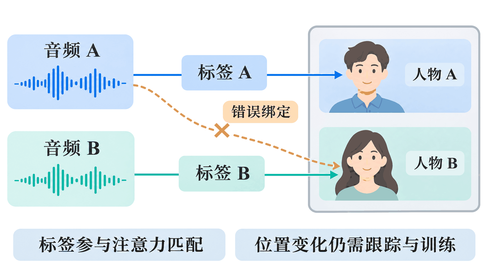

# 目录

[1. 音频驱动数字人的任务定义是什么？](#q-001)
  - [面试问题：Talking Head、Talking Portrait、Audio-driven Human Video 有什么区别？](#q-002)
  - [面试问题：音频驱动模型为什么不能只关注嘴唇？](#q-003)
  - [面试问题：音频特征如何与视频帧对齐？](#q-004)

[2. 经典音频驱动数字人模型如何演进？](#q-005)
  - [面试问题：Hallo 的分层音频驱动视觉合成如何理解？](#q-006)
  - [面试问题：Hallo2 如何支持长时长和高分辨率？](#q-007)
  - [面试问题：Sonic 为什么强调全局音频感知？](#q-008)
  - [面试问题：InfiniteTalk 为什么强调 sparse-frame video dubbing 和无限长度？](#q-009)

[3. 长视频音频驱动为什么容易闪烁、漂移和颜色偏移？](#q-010)
  - [面试问题：分段生成、重叠融合和时间感知位置偏移有什么区别？](#q-011)
  - [面试问题：Patch-drop、高斯噪声增强、参考帧约束如何减轻误差累积？](#q-012)
  - [面试问题：TeaCache、int8 量化、多 GPU/FSDP 对长视频推理有什么价值？](#q-013)
  - [面试问题：长视频为什么需要 rollout 和 on-policy 训练？](#q-029)

[4. 多人音频驱动为什么比单人难很多？](#q-014)
  - [面试问题：MultiTalk 的整体架构可以如何理解？](#q-015)
  - [面试问题：L-RoPE 如何实现音频流与人物区域绑定？](#q-016)
  - [面试问题：多路音频注入有哪些方式？为什么简单拼接通常不够？](#q-017)
  - [面试问题：HunyuanVideo-Avatar 如何处理音频情感、ID 绑定和长视频？](#q-018)

[5. 音频驱动数字人数据如何处理与评估？](#q-019)
  - [面试问题：音频驱动人脸数据预处理标准流程是什么？](#q-020)
  - [面试问题：如何评估唇形同步、身份一致性和表情自然度？](#q-021)
  - [面试问题：如何将 REPA 思想迁移到唇形对齐或时序特征对齐中？](#q-022)
  - [面试问题：流式数字人为什么需要会话级评测，而不能只测短视频质量？](#q-030)

[6. 音频驱动数字人正在向哪些新任务扩展？](#q-023)
  - [面试问题：Wan-S2V 如何结合参考图、音频和文本生成人物视频？](#q-024)
  - [面试问题：如何验证情绪控制没有破坏口型、身份和动作？](#q-025)
  - [面试问题：AnyTalker 与 MultiTalk 在多人对话生成上有什么区别？](#q-026)
  - [面试问题：StreamAvatar、OpenAvatarChat 代表了什么实时交互趋势？](#q-027)
  - [面试问题：怎样把双向视频扩散模型改造成因果流式数字人？](#q-028)
---

<h1 id="q-001">1. 音频驱动数字人的任务定义是什么？</h1>

<h2 id="q-002">面试问题：Talking Head、Talking Portrait、Audio-driven Human Video 有什么区别？</h2>

**难度评分：⭐⭐ (2/5)  |  考察频率：⭐⭐⭐⭐⭐ (5/5)**

Talking Head 通常关注头部或人脸区域，Talking Portrait 强调从肖像图生成动态人物，Audio-driven Human Video 则把范围扩展到半身、全身或多人。它们是任务范围的常用名称，并没有完全统一的边界。

范围扩大后，音频提供的约束相对变弱：音素与口型关系较紧，语气能影响表情和头动，但单靠声音无法唯一决定手势、视线和身体动作。模型需要结合视频先验、文本或显式运动条件生成合理表演。

比较方法时应先对齐输出范围、参考素材和音频可见范围。头部裁剪模型的速度，与整帧全身视频模型的速度，不能脱离分辨率和任务直接比较。

<h2 id="q-003">面试问题：音频驱动模型为什么不能只关注嘴唇？</h2>

**难度评分：⭐⭐⭐ (3/5)  |  考察频率：⭐⭐⭐⭐ (4/5)**

口型同步解决的是语音和嘴部运动的时间关系。自然表达还涉及眼神、眨眼、眉毛、下颌、头动及手势，它们与语音的约束强弱不同。

例如一句强调语气的话可能伴随点头，也可能伴随抬手。若按唯一真实轨迹计算强重建损失，模型可能趋向平均动作；若只奖励运动幅度，又容易出现夸张摇头和过度张嘴。

因此应把确定性较强的口型对齐与多解的表演分开建模和评估。音画同步、动作自然度、身份保持分别给出结果，必要时为动作增加风格或姿态条件。LongCat-Video-Avatar 1.6 对口型幅度与长期外观的后训练也说明，同步分数提升并不自动带来自然表演。[11]

<h2 id="q-004">面试问题：音频特征如何与视频帧对齐？</h2>

**难度评分：⭐⭐⭐ (3/5)  |  考察频率：⭐⭐⭐⭐⭐ (5/5)**

对齐应使用时间坐标，先确定视频帧时间戳，再查音频编码器特征的实际时间位置。恒定帧率且从零开始计数时，第 $`n`$ 帧的时间近似为 $`\tau_n=n/F_v`$；变帧率视频应直接使用呈现时间戳。

若特征步长为 $`h_a`$ 秒、第一项中心时间为 $`\tau_0`$，近邻索引可写为：

```math
j(n)=\mathrm{round}\left(\frac{\tau_n-\tau_0}{h_a}\right).
```

再聚合索引附近的窗口，或使用带时间约束的交叉注意力。$`\tau_0`$ 要考虑卷积感受野、padding 与裁剪偏移，不能默认恒为零。

例如 25 FPS 视频每帧间隔 40 ms，50 Hz 音频特征每项间隔 20 ms；16 kHz 波形采样率则属于另一个时间尺度。若视频 VAE 还做时间压缩，latent 帧要对应一段输出帧范围。

离线窗口可读未来音频，实时系统则应记录前瞻长度。偏移测试可人为将音轨前后移动少量时间，检查同步指标和肉眼口型是否按预期变化。

---

<h1 id="q-005">2. 经典音频驱动数字人模型如何演进？</h1>

<h2 id="q-006">面试问题：Hallo 的分层音频驱动视觉合成如何理解？</h2>

**难度评分：⭐⭐⭐ (3/5)  |  考察频率：⭐⭐⭐⭐ (4/5)**

Hallo 将音频条件与参考人物特征一起注入扩散视频网络，并对嘴部、表情及头部运动采用分层驱动。参考分支负责身份与外观，音频注意力建立语音和视觉变化的联系，时间建模协调连续帧。[1]

这种设计对应不同区域的运动特征：嘴部与音素密切相关，脸部和头部可以跟随韵律，背景与服装则不应被音频无端改变。区域划分和条件权重让控制更有针对性。

面部定位错误或遮挡会影响控制范围，音频与训练语种、情绪分布不一致也会削弱表现。分层结构提供了可调节的控制路径，仍需验证侧脸、静默和快速语音下的同步与稳定性。

<h2 id="q-007">面试问题：Hallo2 如何支持长时长和高分辨率？</h2>

**难度评分：⭐⭐⭐⭐ (4/5)  |  考察频率：⭐⭐⭐ (3/5)**

Hallo2 延续肖像动画路线，将问题扩展到长期续接和高分辨率。核心困难在于：每次续接都依赖之前的结果，而之前的结果并非无误；直接循环短视频模型，颜色和身份误差会逐步放大。[2]

其长视频设计包含对历史运动条件的扰动与增强，并结合时间衔接、高分辨率增强等策略。Patch-drop 降低模型对局部历史特征的依赖，高斯扰动让训练历史更接近不完美的生成结果。超分属于另外的质量提升阶段，不能代替长期一致性建模。

阅读此类结果时，应把基础生成分辨率与后处理输出分辨率分开，记录续接时长、帧率和人脸修复配置。最后一帧清晰，并不足以说明中间几分钟没有发生身份或色彩漂移。

<h2 id="q-008">面试问题：Sonic 为什么强调全局音频感知？</h2>

**难度评分：⭐⭐⭐⭐ (4/5)  |  考察频率：⭐⭐⭐ (3/5)**

Sonic 将音频视为局部口型之外的运动条件，通过上下文增强音频学习、运动解耦控制以及时间感知的位置偏移融合，协调肖像的表情和整体动态。[3]

语音中的停顿、强调和情绪需要更长上下文。仅截取当前音素附近的特征，可以让嘴部动作合理，却可能使头动像许多独立的小片段。较长的条件范围有助于协调节奏，但也会增加输入等待与计算。

“全局音频感知”是相对局部窗口的建模思路，不等于任意长度的全录音都同时进入每一帧。工程实现中的 Whisper、SVD 和插帧组件各有职责，不能把后处理帧率误认为模型原生生成帧率。

<h2 id="q-009">面试问题：InfiniteTalk 为什么强调 sparse-frame video dubbing 和无限长度？</h2>

**难度评分：⭐⭐⭐⭐ (4/5)  |  考察频率：⭐⭐⭐ (3/5)**

InfiniteTalk 面向稀疏帧视频配音：输入视频提供人物和场景线索，新音频驱动口型及相关身体动态。相较只替换嘴部的配音方式，它允许更大范围的视觉运动，同时借助视频条件保持原场景。[4]

稀疏帧约束降低了逐帧完全固定的限制，也提出新的取舍：保留越多视频结构，动作自由度越小；允许越多重新生成，身份、背景和遮挡越需要额外稳定。图像驱动模式则没有完整原视频可供保留，应分开评估。

“无限长度”指可继续执行的分段生成机制。历史传播仍可能积累误差，固定参考也未必保住所有背景细节。开源实现中的缓存、量化和多卡选项主要解决可运行性；是否满足实时交互，需要测含解码、编码和播放缓冲的完整链路。

---

<h1 id="q-010">3. 长视频音频驱动为什么容易闪烁、漂移和颜色偏移？</h1>

<h2 id="q-011">面试问题：分段生成、重叠融合和时间感知位置偏移有什么区别？</h2>

**难度评分：⭐⭐⭐⭐ (4/5)  |  考察频率：⭐⭐⭐⭐ (4/5)**

分段生成限制单次计算范围；重叠融合处理边界差异；时间位置设计决定模型怎样理解各块的时间关系。三者处在不同层次。

重叠区可以在 latent 或像素空间加权：

```math
\hat z_i=w_i z_i^{(A)}+(1-w_i)z_i^{(B)},\qquad 0\leq w_i\leq1.
```

若两段中的嘴部位置已经不同，简单平均会产生双影。要先考虑对齐，或让生成过程共享边界条件，而非只在输出后混合。

时间偏移也不能笼统解释为“知道全局时间就不会漂移”。训练上下文有限，直接把位置索引无限增大可能超出训练分布。Sonic 的时间感知融合、StreamAvatar 的参考锚定位置重编码，都需要放在各自的采样与缓存策略中理解。[3,9]

对长视频应同时检查接缝、重复动作、身份回退和位置外推失效。

<h2 id="q-012">面试问题：Patch-drop、高斯噪声增强、参考帧约束如何减轻误差累积？</h2>

**难度评分：⭐⭐⭐⭐ (4/5)  |  考察频率：⭐⭐⭐ (3/5)**

自回归续接会遇到历史分布偏移：训练时读到真实或高质量历史，推理时读到自身输出。历史里的模糊、偏色和局部错位会进入下一次生成。

Patch-drop 随机削弱部分历史空间信息，迫使模型结合其他稳定条件；高斯扰动让模型适应带噪的历史；固定参考图则提供不会随生成误差改变的身份来源。它们作用互补。[2]

扰动强度需要校准。过弱不能模拟推理误差，过强会让模型不再使用真实运动上下文。参考图过强也可能导致每隔几段动作回到初始姿态。

更有说服力的验证，是比较真实历史输入与生成历史输入的差距，并做多轮续接。短片段分数相近而长视频逐步崩坏，说明误差累积仍未被解决。

<h2 id="q-013">面试问题：TeaCache、int8 量化、多 GPU/FSDP 对长视频推理有什么价值？</h2>

**难度评分：⭐⭐⭐⭐ (4/5)  |  考察频率：⭐⭐⭐⭐ (4/5)**

先定位瓶颈，再选优化。扩散步数多、单步计算重、权重放不下、长序列激活过大，分别需要不同处理。

<div align="center">

| 手段 | 主要作用 | 需要验证的代价 |
|---|---|---|
| TeaCache 类缓存 | 估计去噪步间冗余并复用部分计算 | 口型、快速运动和颜色是否退化 |
| 权重量化 | 减少权重内存与带宽 | 算子支持、误差和实际速度 |
| 激活量化 | 压缩特定激活表示 | 校准分布与动态范围 |
| FSDP | 分片参数，训练时还可分片梯度与优化器状态 | 通信、聚合开销，推理收益依实现 |
| 序列/张量并行 | 分担序列或模型内部计算 | 通信量、拓扑、并行效率 |

</div>

INT8 权重量化不等于所有激活都变成 INT8；FSDP 也不自动分片长序列注意力的全部激活。应在同一分辨率、长度和质量要求下，报告峰值显存、首块延迟及持续吞吐。多个优化叠加后还需重新检验画面。[4]

<h2 id="q-029">面试问题：长视频为什么需要 rollout 和 on-policy 训练？</h2>

**难度评分：⭐⭐⭐⭐⭐ (5/5)  |  考察频率：⭐⭐⭐ (3/5)**

只在真实历史上训练，模型会习惯干净条件；推理时接收自身带误差的历史，就会发生分布偏移。rollout 让模型连续生成多块，再观察误差如何传播；on-policy 训练进一步让优化接触当前模型自己产生的状态。

LongCat-Video-Avatar 1.6 将长视频 rollout、on-policy 自蒸馏、少步蒸馏与偏好相关的后训练结合，针对过度张嘴、嘴唇偏色和持续生成中的退化进行调整。[11] 可迁移的经验是把部署时会遇到的历史条件带回训练，而非只优化孤立短片段。

这种方法也有代价：长 rollout 消耗计算，错误历史需要可靠监督，教师或奖励模型的偏差可能被重复放大。应比较短片段与长视频、真实人物与动画人物，以及头部和全身等子集。

该报告的部分动画输入表现出现回退，因此不能概括为所有角色都改善。训练分布、采样策略和质量目标之间的平衡，仍决定后训练能否迁移到产品场景。

---

<h1 id="q-014">4. 多人音频驱动为什么比单人难很多？</h1>

<h2 id="q-015">面试问题：MultiTalk 的整体架构可以如何理解？</h2>

**难度评分：⭐⭐⭐⭐ (4/5)  |  考察频率：⭐⭐⭐ (3/5)**

MultiTalk 在视频生成主干中增加音频条件路径，并用人物标签组织多路语音与视觉区域的对应关系。核心是让同一画面中的不同人物读取自己的音轨，同时保留文本对动作和场景的控制。[5]

输入可包含参考图、文本与多路音频，音频编码后需与视频 latent 的时间尺度匹配；音频交叉注意力承担条件注入，L-RoPE 则增强人物与音轨之间的标签关联。

多音轨数量增加，会同时增加条件路由、计算与训练覆盖要求。模型接受两条音轨，并不意味着任意多人、交叠发言和位置交换都可靠。静默人物是否仍在乱动嘴，是比普通双人样片更有区分度的测试。

<h2 id="q-016">面试问题：L-RoPE 如何实现音频流与人物区域绑定？</h2>

**难度评分：⭐⭐⭐⭐ (4/5)  |  考察频率：⭐⭐⭐ (3/5)**

L-RoPE 将人物标签参与到音频交叉注意力的旋转编码中，使视觉 query 与音频 key 的相对标签关系影响匹配。[5] 可用简化形式理解：

```math
q_i'=R(\ell_i)q_i,\qquad k_j'=R(\ell_j)k_j,
\qquad {q_i'}^\top k_j'=q_i^\top R(\ell_i)^\top R(\ell_j)k_j.
```

当两者使用同一正交旋转时，旋转不会改变原内积；标签不同则引入相对旋转。因此不能说“标签相同，分数必然放大”。实际绑定能力来自标签编码、区域构造与训练共同作用。

<div align="center">



</div>

图中叉号表示需要避免的错误绑定，不代表 L-RoPE 是一个绝对禁止跨区域注意力的硬 mask。人物交换位置、遮挡或区域估计失败时，仍需检验绑定是否稳定。

<h2 id="q-017">面试问题：多路音频注入有哪些方式？为什么简单拼接通常不够？</h2>

**难度评分：⭐⭐⭐⭐ (4/5)  |  考察频率：⭐⭐⭐ (3/5)**

拼接多路音频只给模型一组 token，不一定告诉它每条音轨对应哪张脸。单独计算每路注意力再相加，也可能让每个人同时读到所有人的声音。

可行的约束包括人物标签、区域 mask、跟踪 ID、专门的条件路由以及标签感知位置编码。固定左右分区实现简单，但只适用于人物位置相对固定的场景；自由移动时需要更新区域或采用能保持人物关联的表示。

训练数据还要包含轮流发言、静默与交叠语音。测试可以交换两条音轨、关闭其中一条、交换人物位置，检查变化是否只落在正确人物上。这里的关键是可验证的对应关系，而非多输入接口本身。

<h2 id="q-018">面试问题：HunyuanVideo-Avatar 如何处理音频情感、ID 绑定和长视频？</h2>

**难度评分：⭐⭐⭐⭐ (4/5)  |  考察频率：⭐⭐⭐ (3/5)**

HunyuanVideo-Avatar 围绕动态、情绪控制和多角色提出三条条件路径：角色图像注入模块协调外观与动作；Audio Emotion Module 使用情绪参考图像的线索控制表达；Face-Aware Audio Adapter 利用 latent 层面的脸部 mask 隔离不同人物的音频注入。[6]

名称中的 Audio Emotion 容易造成误解：其情绪控制设计并非简单从音频自动读出唯一正确情绪，参考图也参与提供条件。系统需要区分音频表达与用户指定的情绪风格。

多角色绑定的可靠性取决于区域定位和数据覆盖。长视频还需单独设计续接与验证，不能仅因为具备人物注入模块，就推断任意时长都一致。

---

<h1 id="q-019">5. 音频驱动数字人数据如何处理与评估？</h1>

<h2 id="q-020">面试问题：音频驱动人脸数据预处理标准流程是什么？</h2>

**难度评分：⭐⭐⭐ (3/5)  |  考察频率：⭐⭐⭐⭐⭐ (5/5)**

标准流程应以原始时间关系为依据：检查解码和时间戳，切分镜头，跟踪身份，稳定人脸裁剪，按编码器要求重采样音频，再做同步估计、质量筛选和数据划分。

统一帧率时，要保留从原帧时间到新帧时间的映射；裁剪或拼接音频后，要同步更新视频起点。16 kHz、25 FPS、256×256 都是可选配置，应匹配所用模型。缩小人脸会丢失口腔细节，过度仿射稳定又可能消除头动。

SyncNet 可辅助估计固定偏移，但只在置信度足够且片段满足其适用条件时校正。长录音中的时钟漂移可能需要分段诊断；自然唇音关系也不能通过强行把每段估计 offset 归零来处理。

保留静默、眨眼与倾听片段，并按身份和原视频隔离测试集。删除困难样本前，要判断它属于坏数据，还是产品确实需要处理的真实场景。

<h2 id="q-021">面试问题：如何评估唇形同步、身份一致性和表情自然度？</h2>

**难度评分：⭐⭐⭐ (3/5)  |  考察频率：⭐⭐⭐⭐⭐ (5/5)**

同步、身份和自然度应分别评估，再查看它们是否同时成立。LSE-D 越低、LSE-C 越高通常表示所用 SyncNet 协议下的同步更好，但不同裁剪、帧率和实现间的数值未必可比。

身份评估可统计与参考脸的平均相似度、低分位数、时间趋势与检测失败率。方差小不等于好：全程生成同一张错误的脸，也可能方差很小。

表情与动作可检查嘴部幅度、眨眼、头动速度及其与语音的关系，再用盲评比较自然度。动作幅度越大不一定越自然，强同步约束也可能造成过度张嘴。FID/FVD 衡量分布差异，不能独自覆盖这些细节。

长视频要分时间段报告，困难集包含转头、遮挡、静默、快语速和多人交替。近期后训练论文中出现真人与动画角色收益不同的现象，也说明平均分会掩盖子群退化。[11]

<h2 id="q-022">面试问题：如何将 REPA 思想迁移到唇形对齐或时序特征对齐中？</h2>

**难度评分：⭐⭐⭐⭐ (4/5)  |  考察频率：⭐⭐ (2/5)**

REPA 的关键是对齐生成网络的**内部表示**与冻结教师的干净样本表示。若只比较生成视频与真实视频经过同一个编码器的特征，那更接近感知损失，不能直接称为原始 REPA。[8]

迁移到音视频任务的一种研究设计是：

```math
\mathcal L_{\mathrm{align}}=
\mathbb E\left[d\left(P(h_\theta(z_t,t,c)),\mathrm{sg}(\phi(V_{\mathrm{clean}}))\right)\right].
```

其中 $`h_\theta`$ 是生成主干中间特征，$`P`$ 负责空间与时间对齐，$`\mathrm{sg}`$ 表示停止教师梯度。教师可以根据任务选择视觉或音视频编码器，但它必须对嘴部运动和时间关系有足够分辨能力。

这是迁移设想，收益需实验确认。应比较无对齐、普通感知损失、内部特征对齐，并检查教师是否携带错误同步或身份偏差。静态语义教师表现好，不代表它适合监督细粒度唇形。

<h2 id="q-030">面试问题：流式数字人为什么需要会话级评测，而不能只测短视频质量？</h2>

**难度评分：⭐⭐⭐⭐ (4/5)  |  考察频率：⭐⭐⭐ (3/5)**

短视频可以显示清晰度与同步，完整会话还会暴露条件更新不及时、人物状态丢失、长时漂移和旧回复继续播放。评测必须覆盖用户指令随时间改变的过程。

StreamEval 将交互式流式视频分成多个任务，覆盖 15、30、60、120、300 秒的持续时间，并分别考察任务执行、状态一致性、视觉质量和音画协调。[14] 这种多时长设计的价值是观察能力能否持续，而非仅比较开头几秒。

数字人产品可以据此设计脚本：开始说话、切换情绪、插话、静默等待、再次发言；在每个事件记录模型何时响应、音视频何时真正播放，以及之前状态是否被正确取消。

但基准任务边界需要保留。脚本化语音输入不等同于真实用户视频中的非语言信号理解；视觉分数也不能替代业务回答正确率。产品验收还需补充网络抖动、并发、回声和任务失败恢复。

---

<h1 id="q-023">6. 音频驱动数字人正在向哪些新任务扩展？</h1>

<h2 id="q-024">面试问题：Wan-S2V 如何结合参考图、音频和文本生成人物视频？</h2>

**难度评分：⭐⭐⭐⭐ (4/5)  |  考察频率：⭐⭐⭐ (3/5)**

Wan-S2V 将语音驱动放到视频生成底座上，输入参考图、音频及文本条件，使口型、表情、身体运动和镜头表现可以共同生成。[7]

音频主要约束时间与表达，文本补充场景和动作意图，参考图提供角色外观。它的适用范围比局部修嘴更广，因此也更需要检查手部、身体与场景是否被无意改变。

评估应落实到可验证指标：相机控制是否生效、身份在大运动中是否稳定、音画是否同步、分段后动作是否连续。具体音频编码器和推理参数以选定版本为准，不能用 wav2vec、HuBERT 等常见名称替代实际实现。

<h2 id="q-025">面试问题：如何验证情绪控制没有破坏口型、身份和动作？</h2>

**难度评分：⭐⭐⭐⭐ (4/5)  |  考察频率：⭐⭐⭐ (3/5)**

保持身份参考、音频、随机种子与生成配置相同，只改变情绪条件，是判断情绪控制是否有效的起点。HunyuanVideo-Avatar 的情绪参考路径提供了一个明确的控制接口。[6]

需要分别检查表达是否改变、口型是否仍同步、身份是否保持，以及非目标区域是否被连带修改。还要测试情绪条件与音频语气不一致时的行为，并明确产品希望优先保留哪一路信息。

单一情绪分类器分数不够。模型可以通过夸张眉眼获得更高“愤怒”分数，却让表情不自然。应加入不同身份、语种、音量与静默片段，结合盲评判断细微表达和稳定性。

这种反事实评估适用于参考图、标签或文本控制的不同路线，重点是隔离变量，防止把音频、身份或采样变化误当成情绪模块的效果。

<h2 id="q-026">面试问题：AnyTalker 与 MultiTalk 在多人对话生成上有什么区别？</h2>

**难度评分：⭐⭐⭐⭐ (4/5)  |  考察频率：⭐⭐ (2/5)**

MultiTalk 重点处理多音轨与人物区域的对应，通过 L-RoPE 等机制加强绑定；AnyTalker 使用可扩展的多流处理与身份感知注意力，并以单人数据学习基础能力，再用少量多人片段细化交互。[5,12]

二者共同面对的问题是：每个人会说话，并不代表多人场景会自然互动。轮到别人发言时的视线、倾听表情，以及人物之间的反应，都需要跨人的联合约束。

“可扩展到更多人物”还应核对显存、输入布局与训练人数。注意力结构支持增加输入，不代表未测试人数和复杂遮挡都能保持质量。比较时应固定人数、音轨重叠程度和视频长度，分别测音轨绑定错误与互动自然度。

<h2 id="q-027">面试问题：StreamAvatar、OpenAvatarChat 代表了什么实时交互趋势？</h2>

**难度评分：⭐⭐⭐⭐ (4/5)  |  考察频率：⭐⭐⭐ (3/5)**

StreamAvatar 属于生成模型层：将高保真人物视频模型适配为自回归流式生成，并结合参考锚点、位置重编码和一致性约束。OpenAvatarChat 属于系统层：组织语音识别、对话、语音合成、人物驱动和实时传输。[9,10]

前者回答视频块怎样持续产生，后者回答这些块怎样进入一轮完整对话。模型本身不处理业务工具权限，也未必负责回声消除、过期回复取消或播放器缓冲。

因此选型时应分开测模型持续速度和完整交互延迟。一个模型能连续生成视频，仍可能因为等待音频、排队或解码过慢而无法实时；一个系统能流畅聊天，也不代表内部采用生成式全身视频模型。

<h2 id="q-028">面试问题：怎样把双向视频扩散模型改造成因果流式数字人？</h2>

**难度评分：⭐⭐⭐⭐⭐ (5/5)  |  考察频率：⭐⭐⭐ (3/5)**

双向模型通常同时读取一个片段中的过去与未来帧。流式生成要在未来尚未到达时输出当前块，因此要共同改动注意力范围、历史状态、训练方式与采样步数。

<div align="center">


</div>

AURA 的具体路线是分块因果滑窗注意力、滚动 KV Cache，以及分块混合噪声时间训练，再通过教师轨迹学习和分布匹配蒸馏形成少步学生。[13] 块内仍可双向交流；块级因果不等于逐帧零等待。

混合噪声时间的意义在于，让当前块能读取处于不同噪声水平的历史表示，减少为每个去噪步保存独立历史缓存的需要。只给原双向网络加缓存，无法消除训练与流式推理的条件差异。

验收应报告首块等待、块长、前瞻音频、持续帧率与显存随时长的变化。AURA 不同规模的速度结果不同，不能将其中一个配置达到播放速度的结果推广到所有分辨率和设备。

---

## 参考资料

[1] Hallo：<https://arxiv.org/abs/2406.08801>。

[2] Hallo2：<https://arxiv.org/abs/2410.07718>；<https://github.com/fudan-generative-vision/hallo2>。

[3] Sonic：<https://jixiaozhong.github.io/Sonic/>；<https://github.com/jixiaozhong/Sonic>。

[4] InfiniteTalk：<https://arxiv.org/abs/2508.14033>；<https://github.com/MeiGen-AI/InfiniteTalk>。

[5] MultiTalk / Let Them Talk：<https://arxiv.org/abs/2505.22647>；<https://github.com/MeiGen-AI/MultiTalk>。

[6] HunyuanVideo-Avatar：<https://arxiv.org/abs/2505.20156>；<https://github.com/Tencent-Hunyuan/HunyuanVideo-Avatar>。

[7] Wan-S2V：<https://github.com/Wan-Video/Wan2.2>。

[8] REPA：<https://arxiv.org/abs/2410.06940>。本章的音视频迁移设计为研究建议。

[9] StreamAvatar：<https://arxiv.org/abs/2512.22065>；<https://streamavatar.github.io/>。

[10] OpenAvatarChat：<https://github.com/HumanAIGC-Engineering/OpenAvatarChat>。

[11] LongCat-Video-Avatar 1.6 Technical Report，2026-11：<https://arxiv.org/abs/2611.18822>；<https://github.com/meituan-longcat/LongCat-Video>。

[12] AnyTalker：<https://arxiv.org/abs/2511.23475>。

[13] AURA: AUdio-dRiven streaming Avatar，2026-11：<https://arxiv.org/abs/2611.26540>。

[14] StreamEval，2026-10：<https://arxiv.org/abs/2610.28402>；<https://github.com/StreamEval/StreamEval>。
