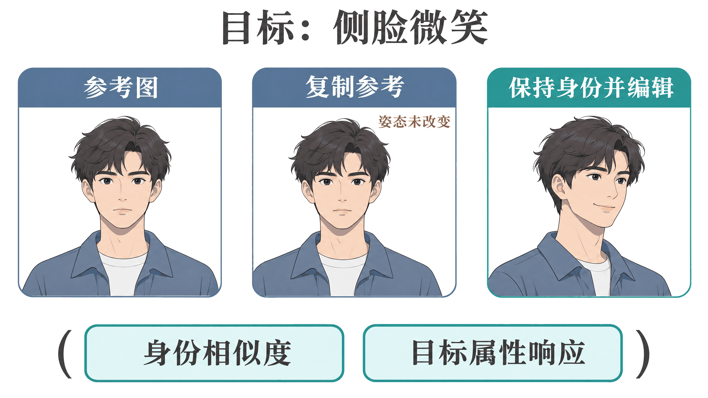

# 目录

[1. ID 保持生成的核心目标是什么？](#q-001)
  - [面试问题：ID 保持生成、个性化生成、换脸有什么区别？](#q-002)
  - [面试问题：IP-Adapter、InstantID、PuLID、PhotoMaker 的技术路线如何对比？](#q-003)
  - [面试问题：UniPortrait、ConsistentID 如何处理多人或细粒度 ID？](#q-004)
  - [面试问题：InfiniteYou、FlashFace、InstantCharacter 怎样组织人物或角色参考？](#q-005)

[2. 为什么高保真身份注入很难？](#q-006)
  - [面试问题：Q-Former 注入和 ReferenceNet 注入有什么区别？](#q-007)
  - [面试问题：如何在 ID 相似度和文本可编辑性之间平衡？](#q-008)
  - [面试问题：Copy-Paste 现象如何评估和缓解？](#q-009)
  - [面试问题：多人 ID 数据集如何构建？](#q-010)
  - [面试问题：同身份配对数据与对比训练怎样减少 Copy-Paste？](#q-026)

[3. 换脸任务的核心挑战是什么？](#q-011)
  - [面试问题：SimSwap、HiFiFace、Face-Adapter、REFace 的思路有什么区别？](#q-012)
  - [面试问题：视频换脸为什么比图像换脸难？](#q-013)
  - [面试问题：HiFiVFS、VividFace 如何提升视频换脸的一致性和细节？](#q-014)
  - [面试问题：换脸如何结合 3DMM 和背景处理？](#q-015)

[4. 虚拟换衣为什么是数字人商业化重要方向？](#q-016)
  - [面试问题：视频换衣和图像换衣的核心差异是什么？](#q-017)
  - [面试问题：Mask-based、Mask-free、蒸馏式虚拟换衣有什么区别？](#q-018)
  - [面试问题：如何处理 mask 引入的形状泄露问题？](#q-019)
  - [面试问题：如何构造成品模特试穿视频生成链路？](#q-020)
  - [面试问题：视觉试穿与真实合身预测之间缺少哪些信息？](#q-027)

[5. ID 保持、换脸和换衣如何做数据与评估？](#q-021)
  - [面试问题：虚拟换衣如何构造和筛选三元组数据？](#q-022)
  - [面试问题：虚拟换衣常用数据集有哪些？](#q-023)
  - [面试问题：文本可以控制哪些服装外观属性？与真实尺码有什么区别？](#q-024)
  - [面试问题：线上发现纹理糊、头发遮挡、服饰动作冲突如何处理？](#q-025)
---

<h1 id="q-001">1. ID 保持生成的核心目标是什么？</h1>

<h2 id="q-002">面试问题：ID 保持生成、个性化生成、换脸有什么区别？</h2>

**难度评分：⭐⭐ (2/5)  |  考察频率：⭐⭐⭐⭐⭐ (5/5)**

三类任务都可能使用人物参考，但要保持和允许改变的内容不同。ID 保持生成强调在新画面中仍能辨认同一个人，个性化生成可以面向更广泛的对象，换脸则在已有目标画面中替换身份并保留指定属性。

### 1、先说清“保持什么”

**ID 保持生成**通常以人物参考为身份条件，生成新的姿态、服装、环境或画风。脸部身份是核心，但发型、年龄、疤痕等是否必须完全保持，需要根据任务规定。识别模型可能认为不同年龄的照片属于同一个人，用户却可能要求严格保持参考照片中的当前外貌，两种标准并不相同。

**个性化生成**范围更大，可以定制人物、宠物、玩偶、商品或虚构角色。保持对象的形状、配色、服装和标志可能比人脸识别特征更重要。一个没有真人面部结构的卡通角色，就不适合只用 ArcFace 分数衡量一致性。

**换脸**以已有目标图像或视频为基础，源图提供身份，目标提供表情、头姿、光照和环境。它可以概括为：

```math
I_{\mathrm{swap}}=G(c_{\mathrm{id}}^{\mathrm{src}},c_{\mathrm{attr}}^{\mathrm{tgt}},I_{\mathrm{context}}^{\mathrm{tgt}}).
```

$`c_{\mathrm{id}}^{\mathrm{src}}`$ 是源身份条件，$`c_{\mathrm{attr}}^{\mathrm{tgt}}`$ 是目标属性，$`I_{\mathrm{context}}^{\mathrm{tgt}}`$ 提供周围画面。脸型边缘、肤色和妆容既可能影响身份，又与目标光照和融合有关，应明确到底跟随哪一端。

### 2、身份获得方式与任务类型是两条轴

DreamBooth、LoRA 等方法通过针对对象的优化吸收参考信息；IP-Adapter、InstantID 等方法则把参考编码为推理条件，通常不必为每个新人物单独训练。前者有定制与版本管理成本，后者方便即用，但可保持的细节取决于编码与适配能力。

LoRA 是参数适配方式，不天然等于身份模型；即插即用也不意味着系统从未训练，而是针对新用户身份通常无需再训练。两类方式都可能用于人物个性化，不能按是否微调定义 ID 保持或换脸。

### 3、怎样比较结果

若要求“小王穿宇航服站在月球上”，应检查小王身份、宇航服和场景指令是否同时成立；若要求将访谈中的脸换成小王，应额外检查原表情、头姿、遮挡和背景是否保留。仅看生成结果像不像小王，会漏掉另一半任务。

选型时把参考准备成本、每人训练成本、推理延迟、可编辑性和失败率一起考虑。对商业角色还应保存允许使用的身份资产及版本，避免一次模型升级悄悄改变用户已经确认的外观标准。

<h2 id="q-003">面试问题：IP-Adapter、InstantID、PuLID、PhotoMaker 的技术路线如何对比？</h2>

**难度评分：⭐⭐⭐ (3/5)  |  考察频率：⭐⭐⭐⭐⭐ (5/5)**

这四种方法都接收参考图，但差异分别落在参考表示、条件注入和训练约束上。理解它们，可以沿着“参考中取出什么信息—从哪里送入主干—怎样防止参考覆盖文本”三步展开。[1–4]

### 1、IP-Adapter：给图像提示单独的读取通道

基础 IP-Adapter 用冻结 CLIP 图像编码器提取参考特征，经投影形成图像 token。在原有文本交叉注意力旁增加图像交叉注意力，两路共享视觉查询、分别使用键和值，再合并输出：

```math
O=\mathrm{Attn}(Q,K_{\mathrm{text}},V_{\mathrm{text}})
+\lambda\,\mathrm{Attn}(Q,K_{\mathrm{image}},V_{\mathrm{image}}).
```

$`\lambda`$ 控制图像条件强度。文本仍描述目标，图像路径传递难以用文字说清的视觉信息。原始基础版本是通用图像提示，可能同时携带构图、风格与背景，不能据此保证精确人脸身份。使用网格特征的 Plus 版本、人脸识别特征的 FaceID 系列，需按具体变体分别讨论。

### 2、InstantID：身份语义与弱空间控制配合

InstantID 从预训练人脸模型提取 ID embedding，通过适配器注入主干；IdentityNet 则采用类似 ControlNet 的结构，以五个人脸关键点提供较粗的空间约束，其交叉注意力由 ID embedding 驱动。[2]

只用身份向量时，模型未必知道脸放在哪里、朝向如何；使用过密的关键点又可能把参考表情和脸型锁死。五点条件在定位与可编辑性之间提供折中。推理时还可从另一张图提取关键点控制姿态，但强控制和参考身份仍可能冲突，需要测试大侧脸与表情变化。

### 3、PuLID：训练时显式约束身份注入的副作用

PuLID 将人脸识别与视觉特征组织成身份条件，重点创新还包括训练目标。除常规去噪分支外，它引入可从纯噪声少步生成较清晰图像的 Lightning T2I 分支，在同一提示与初始噪声下比较有无 ID 注入的路径。[3]

语义和布局对齐约束希望背景、构图与文本响应少受身份条件干扰；生成的清晰脸又可提供更可靠的身份损失。这是在训练中主动优化“像同一个人，同时仍听文本指令”。对齐过强也可能限制必要的脸部变化，所以损失权重需要平衡。Lightning 训练分支帮助计算监督，不代表最终推理必须固定使用同一个极速采样器。

### 4、PhotoMaker：把多个参考保留为 stacked ID embedding

PhotoMaker 将每张参考图的视觉表示与人物类别词的文本表示融合，再沿序列长度堆叠，在文本条件中替换相应类别词位置，让生成主干读取多张参考。[4] 多图没有先被简单平均成一个向量，因此不同视角提供的信息有机会分别保留。

多图输入通常指同一人物的多张照片，不能直接理解为生成多个人物的空间绑定。混入其他身份可能被模型用于身份融合，而非自动分配到两张脸。模糊、过度滤镜、错误身份或重复近似照片，也可能降低参考质量。

### 5、选型应比较什么

<div align="center">

| 方法 | 更值得学习的设计 | 主要检查点 |
|---|---|---|
| IP-Adapter | 文本与图像解耦注意力 | 通用语义是否足以保存身份细节 |
| InstantID | ID 条件加弱空间控制 | 关键点是否过度锁定参考姿态 |
| PuLID | 身份保真与原模型行为的联合训练 | 编辑响应与身份是否同时提升 |
| PhotoMaker | 多参考融合后保留独立条件项 | 参考质量、同身份纯度及视角覆盖 |

</div>

应固定底模、人物、提示和采样预算，比较身份、属性响应与画质，记录适配器和主干版本。不能用一个模型在简单正脸上的最佳结果，代表其在全部姿态、风格和多人场景中的能力。

<h2 id="q-004">面试问题：UniPortrait、ConsistentID 如何处理多人或细粒度 ID？</h2>

**难度评分：⭐⭐⭐⭐ (4/5)  |  考察频率：⭐⭐⭐ (3/5)**

UniPortrait 与 ConsistentID 分别强调身份路由和面部细粒度信息。前者将多个身份正确分配到画面中的人物，后者加强眼、鼻、嘴等局部信息的保持，二者不是同一功能换了名称。[5,6]

### 1、UniPortrait 先区分内在身份与外观结构

其 ID embedding 模块利用人脸识别网络全连接层之前的特征，保留比最终全局向量更丰富的空间信息；同时结合较浅层人脸特征和 CLIP 局部特征表达结构与纹理。Q-Former 分别读取身份和结构分支，并对结构路径进行较强的丢弃正则，降低模型对参考表情、背景等非身份线索的依赖。

这种分工来自一个实际矛盾：识别网络希望同一人的不同表情仍然相近，生成任务却需要看清参考中的脸型与细节。结构信息有用，但全部照搬就会减少可编辑性，所以需要控制其使用方式。

### 2、多人的关键是位置级路由

得到各个人物的身份表示后，UniPortrait 在交叉注意力中为潜空间位置选择相应 ID，减少不同人脸混合。训练利用人物区域标注约束路由，并借助可微的离散选择近似学习分配。

仅要求“每个位置只读一个 ID”仍有漏洞：同一个身份可能被分到两张脸，另一个身份完全没有出现。因此区域监督与路由正则也是方法组成部分，不能把它说成纯粹依靠注意力自己发现人物对应。

该设计通常不要求用户事先给定严格人脸布局，但输出仍需验证身份是否全出现、是否互换，以及人数与提示是否一致。自由布局并不意味着不需要空间关联。

### 3、ConsistentID 如何补充局部细节

ConsistentID 用多模态模型生成眼、鼻、嘴、耳等面部描述，再结合分割得到的局部视觉特征，与整体身份条件一起进入生成模型。它通过训练中的面部注意力定位，让某个部位的条件更多作用于对应区域，减少局部特征混用。

例如全局身份看起来像同一个人，但眼形或鼻翼细节不稳定，局部条件有机会补充这种缺失。文本描述提供语义线索，视觉特征保留更难精确描述的形状，两者都可能带入错误：描述模型可能看错，分割也可能在遮挡和侧脸下失败。

### 4、怎样验证路由和细节是否有效

多人任务可交换参考顺序、只修改一个身份、改变人物左右站位，检查对应人物是否变化且其他人物保持。细粒度任务可分别观察眼、鼻、嘴和可见疤痕，再测试表情变化是否仍自然。

注意力热图可辅助定位故障，但热点落在脸上不证明身份已正确注入。模型可能关注正确区域，却提取了错误身份或复制了不该保留的表情。最终证据仍是输出是否同时满足人物对应、细节保持和编辑要求。

<h2 id="q-005">面试问题：InfiniteYou、FlashFace、InstantCharacter 怎样组织人物或角色参考？</h2>

**难度评分：⭐⭐⭐⭐ (4/5)  |  考察频率：⭐⭐⭐ (3/5)**

InfiniteYou、FlashFace 和 InstantCharacter 展示了三种参考组织思路：通过残差网络向 DiT 注入身份、以空间特征保存人脸细节、用通用视觉表征扩展到非真人角色。比较它们时，应看信息怎样进入主干，不能把三个方法都归为同一代 DiT 人像模型。[7]

### 1、InfiniteYou：用 InfuseNet 组织身份残差

InfiniteYou 面向 FLUX 等 DiT 底座。冻结的人脸编码器提取身份，经投影送入 InfuseNet；该分支与底模具有相近结构，但使用较少 Transformer block，再通过残差连接把身份影响送到对应主干位置。

这与直接把身份 token 加进原文本注意力不同。独立分支为身份提供专门路径，底模继续承担文本与图像生成。其训练还包括预训练与使用同一人多个生成样本的后续微调，以改善文本服从、画质和复制倾向。架构只提供注入通道，数据中是否存在姿态、场景和表情变化，仍决定模型会不会照搬参考。

### 2、FlashFace：把脸部保留为空间特征

FlashFace 基于 SD 1.5 的 U-Net，使用 Face ReferenceNet 提取多张参考脸的空间特征，再通过额外参考注意力读取。它没有把所有细节压成一个短身份向量，因此能为脸型、局部标记等提供更丰富依据。

训练从同一身份的照片集合中选择参考和另一张目标图，让参考与目标有变化；人脸位置条件帮助确定生成位置。推理还可调节参考特征与文本的影响。空间参考越强，细节可能越像，但原表情、姿态或照明也可能更难改变，仍需通过控制强度和数据配对平衡。

### 3、InstantCharacter：从人脸扩展到通用角色

虚构角色、动物和全身玩偶未必适用人脸识别器。InstantCharacter 使用 SigLIP 与 DINOv2 视觉特征，结合浅层与局部图块信息，通过 Transformer 适配器和噪声时间感知 Q-Former 接入 DiT。整体语义、局部纹理与角色结构因而可以共同参与条件表示。

其分阶段训练先用自重建学习角色信息，再通过同角色不同动作、姿态与场景的配对增强编辑能力，最后提高分辨率并混合训练。配对数据的重要性在于迫使模型保持角色特征，同时真正完成文本指定的变化。

### 4、三条路线怎样落到实际选择

真实人物主要看脸部身份与可编辑性，卡通角色还需检查服装、配色、尾巴或耳朵等独特结构；商品化角色则可能要求徽标和配饰严格一致。不能用一个通用图像相似度覆盖全部要求。

如果某个人的痣、眼镜或发饰是必须保持的特征，应建立针对性样例。若参考只有正面，背面细节仍缺少证据，模型只能依据先验补全。更强的适配器提升信息利用能力，却不能把不存在的参考证据变成真实事实。

---

<h1 id="q-006">2. 为什么高保真身份注入很难？</h1>

<h2 id="q-007">面试问题：Q-Former 注入和 ReferenceNet 注入有什么区别？</h2>

**难度评分：⭐⭐⭐⭐ (4/5)  |  考察频率：⭐⭐⭐⭐ (4/5)**

Q-Former 式投影通过有限数量的可学习查询压缩参考信息；ReferenceNet 则保留多尺度空间特征，供生成主干在对应层读取。二者的差别主要在条件表示和读取方式，不是固定的“一个可编辑、一个不可编辑”。

### 1、Q-Former 怎样形成条件 token

设参考编码器输出 $`F\in\mathbb R^{N\times d_f}`$，可学习查询为 $`Q_0\in\mathbb R^{M\times d}`$，一次跨注意力读取可抽象为：

```math
Z=\mathrm{softmax}\left(
\frac{(Q_0W_Q)(FW_K)^\top}{\sqrt{d_k}}
\right)(FW_V).
```

$`W_Q,W_K,W_V`$ 是投影，$`d_k`$ 是查询与键维度。实际 Q-Former 通常还包含多层查询自注意力、跨注意力、前馈网络和残差。输出保留 $`M`$ 个条件 token，便于适配不同主干的上下文维度，并控制后续注意力成本。

当 $`M`$ 较少时，模型必须筛选参考信息，可能优先保留总体身份而丢失微小配饰；但 token 仍可通过位置编码和训练保存空间关系，不能简单称为“没有空间信息”。增加 token 数也不保证细节正确，还要看参考编码器和监督是否支持。

### 2、ReferenceNet 怎样保留细节

ReferenceNet 用与生成主干相适配的网络提取不同分辨率特征，通常在对应尺度通过参考注意力读取。生成位置可以按内容寻找参考中的衣领、脸部或发丝，而不必完全依赖一个全局摘要。

空间特征较密集，通常提高细节容量，也增加计算与内存。若参考分支不依赖当前噪声步和变化条件，可以预先计算并缓存；若计算依赖变化的时间或目标状态，就不能未经验证地只算一次。缓存条件是具体实现性质，不是 ReferenceNet 这个名称的必然属性。

### 3、为何两者都可能出现复制和串扰

Q-Former 可能把参考表情压进身份 token，ReferenceNet 可能传入原姿态和背景。是否解耦，取决于同身份跨条件配对、区域约束、丢弃策略和注入方式，而非只由张量是 token 还是特征图决定。

例如目标要求抬头微笑，若训练参考和目标总是同一张图，两条路线都可能学会恢复原照片。反之，充分的姿态变化监督也能让空间特征在保持纹理时允许动作变化。

### 4、如何比较和组合

在相同参考、编辑幅度与计算预算下，分别测身份、细节、姿态响应、内存和推理时间。先检查小脸和局部配饰，再检查大角度变化，才能看清压缩容量与参考泄漏的取舍。

也可以组合全局身份 token 与局部空间特征：前者保持人物整体身份，后者补充需要严格保存的细节。两条路径仍要控制职责与权重，否则重复注入同一信息可能使参考压过文本。Q-Former 和 ReferenceNet 都是信息通道，最终能力由表示、数据和训练共同决定。

<h2 id="q-008">面试问题：如何在 ID 相似度和文本可编辑性之间平衡？</h2>

**难度评分：⭐⭐⭐⭐ (4/5)  |  考察频率：⭐⭐⭐⭐⭐ (5/5)**

ID 相似度与文本可编辑性需要同时达标。只把两者合成一个总分，很容易让高身份分掩盖不听指令，或让强编辑掩盖已经换了一个人。更实用的做法是先建立二维评价，再寻找符合产品要求的工作区间。

### 1、先确定哪些属性允许改变

“同一个人”通常允许换表情、姿态、光照和背景，但年龄、脸型、妆容和发型是否可变，需要明确。要求人物变成油画时，纹理理应变化；要求保持某颗痣时，细节又必须留下。身份条件与文本并非天然冲突，冲突往往发生在未定义清楚的属性上。

可建立成组提示：同一人正面与侧面、闭嘴与微笑、室内与逆光、写实与插画。每组只改变一个维度，先判断目标变化是否实现，再判断身份是否仍可辨认。

### 2、训练如何减少参考对文本的覆盖

同身份、不同拍摄条件的配对迫使模型学习参考中稳定的身份信息；结构分支 dropout 能减少对某一参考特征的依赖；区域约束避免身份向背景和其他人物扩散。PuLID 则比较相同噪声与提示下有无身份注入的路径，约束语义和布局变化，同时训练身份保真。[3]

这些方法不等价。减少参考信息可以改善编辑，却可能损伤细节；过强的原模型对齐也可能不允许新脸型产生必要变化。损失应结合任务属性设计，不能盲目将所有非像素相同的地方都视为污染。

### 3、推理时怎样调节

常见旋钮包括身份强度、文本 guidance、结构控制权重、注入层与开始时间。应每次改变少量因素，扫描身份与目标属性曲线，而不是同时调多个权重后凭单张样片判断。

延后身份注入有时能先让文本形成构图，但并非总有效：如果早期已形成错误脸型，后期纹理补充未必能纠正；如果很早就强注入参考，又可能锁住原姿态。噪声时间、层级和条件的作用需按模型验证，不能套用统一“前半程文本、后半程身份”的规则。

### 4、怎样识别可接受的折中

对于每组设置，报告参考身份相似度、姿态或表情响应、文本服从与画质。若某设置在身份与编辑上都被另一设置超过，就没有必要保留；其余设置可按业务最低要求选择，而非追求某一项极值。

例如用户要求明显侧脸，模型输出高相似正脸仍应判为任务失败。需要在测试集中保留大变化和条件冲突，而不能只用参考本来就符合提示的样例。只有这种测试，才能判断模型究竟学会了身份保持，还是仅仅擅长复原输入照片。

<h2 id="q-009">面试问题：Copy-Paste 现象如何评估和缓解？</h2>

**难度评分：⭐⭐⭐⭐ (4/5)  |  考察频率：⭐⭐⭐⭐ (4/5)**

Copy-Paste 指模型在保持身份时过度复制参考中的姿态、表情、构图或其他非目标属性。它不一定是逐像素粘贴；即使画面重新生成，只要要求变化的属性仍被参考锁住，任务就没有完成。

### 1、为什么高身份分可能鼓励复制

人脸识别特征主要用于区分人物，往往对表情、光照和部分姿态变化保持不变。生成一张接近参考的正脸容易获得高相似度，但这个分数无法说明“侧脸微笑”的指令是否落实。

如果训练大量采用参考与目标同图重建，模型可以从参考读出目标的全部信息，不必区分身份与表情。其最省事的策略就是复制。即使换成相邻视频帧，若两帧近乎一样，也未必真正增加变化监督。

<div align="center">



</div>

<div align="center">图：身份保真与目标属性变化应同时成立。参考中的原姿态和表情，不应自动成为所有生成结果的答案。</div>

### 2、怎样构建能暴露复制的测试

选择同一个人在不同姿态、表情和环境下的多张真实照片，用一张作参考、另一张提供变化目标；也可给出明确编辑提示，检查模型是否跟随。WithAnyone 的 MultiID-Bench 将身份保真与复制倾向共同纳入评价，针对的正是单项身份指标的盲区。[8]

测试不只看输出与参考有多近，还应看它对目标变化的响应。姿态估计、表情动作单元、区域相似度与人工检查可以互补；背景、服装等允许改变区域也应单独检查。低相似输出虽然没有复制，却可能已经丢失身份，因此不能仅奖励“离参考更远”。

### 3、缓解重点在监督关系

同身份跨照片配对，让身份相同而姿态、表情不同；对同一身份提供多视角参考，减少模型把某个姿势当作身份本身；对比身份训练强调与其他人物的区分，而不是逼近某一张照片的所有外观。

还可限制身份条件的作用区域，调整参考分支强度和丢弃策略，减少背景和服饰泄漏。若参考边界或关键点过密地暴露目标姿态，需要审视结构条件，而不能只归咎于 ID loss。

### 4、为何降低权重不是完整解法

把身份权重调低，可能使文本更容易改变画面，也可能让人物逐渐变成底模中常见的平均脸。应检查身份—编辑曲线有没有整体改善，而不只是从“很像但不动”移动到“会动但不像”。

上线时可以保存一组固定的身份与编辑回归样例，每次替换底模、适配器或参考预处理后重新测试。复制倾向是条件解耦问题，通常需要表示、训练数据与评价共同处理，单次提示词优化很难稳定解决。

<h2 id="q-010">面试问题：多人 ID 数据集如何构建？</h2>

**难度评分：⭐⭐⭐⭐ (4/5)  |  考察频率：⭐⭐⭐ (3/5)**

多人 ID 数据需要同时保存身份参考和目标位置对应。只有“一张合影里有几个人”的标签不够，模型还要知道每个人是谁、哪组参考属于他，以及在不同画面中怎样保持关联。

### 1、数据单元应包含哪些关系

一个训练样本可以包括目标画面、人物区域、每个区域的身份 ID、该身份的参考集合，以及描述人数、位置和动作的文本。视频还要包含连续轨迹、遮挡状态与时间位置。人物编号是样本内路由标识，持久身份标识则用于跨样本组织，二者应区分。

例如目标图左侧是 A、右侧是 B，参考集合分别包含 A 的正侧脸和 B 的两张照片。将参考顺序交换后，训练标签也必须同步更新；否则数据会教模型把“第一张参考”与固定左侧位置错误绑定。

### 2、身份图库怎样建立和清洗

先确认素材来源与使用范围，再进行检测、对齐、识别特征聚类与候选匹配。相似度阈值可以减少明显误配，但不同年龄、妆容、侧脸、双胞胎和低清画面都可能造成错误。关键样本应结合多视角一致性、轨迹连续性和人工复核。

错误正样本会把两个人拉成同一身份，错误负样本则会把同一个人拆开。不要只看聚类纯度的总体平均，还应检查小簇、边界样本和长尾人物。无法确认的配对可以保留为未知，而不是强行赋予高置信标签。

### 3、覆盖哪些变化才有训练价值

每个身份应有足够的姿态、表情、光照与场景变化，避免几十张近重复正脸充数。多人样本需要位置交换、不同脸部大小、遮挡、人数变化和参考数量不均衡，才能训练更一般的路由。

合成合影能增加局部身份组合，却未必具有真实互动、接触和一致光照。应标明合成来源，并保留真实多人数据验证全局关系。WithAnyone 的 MultiID-2M 体现了大规模同身份配对的研究价值，但数据规模不能代替配对质量与用途授权。[8]

### 4、怎样划分和验收

未见身份测试按人物隔离，未见组合测试则可以允许训练出现过人物、但不出现同一组组合，两者检验不同能力。还要按原始照片、视频和采集场次去重，防止合影整图在训练集、裁剪单脸却进入测试集。

验收统计身份配对准确率、每人变化覆盖、区域对应准确率和困难样本比例；再用交换参考、改变布局等干预验证模型。数据版本应能追溯到原始素材及清洗规则，发现身份串换时才能定位是模型路由失败，还是训练标签本身错误。

<h2 id="q-026">面试问题：同身份配对数据与对比训练怎样减少 Copy-Paste？</h2>

**难度评分：⭐⭐⭐⭐ (4/5)  |  考察频率：⭐⭐⭐ (3/5)**

同身份配对把“人物相同”和“照片相同”分开，对比训练进一步让模型在保持变化能力时区分不同人物。二者共同缓解仅靠同图重建学到的复制捷径，但都依赖可靠的身份标签与变化覆盖。[8]

### 1、同图重建与跨照片配对的学习信号

如果输入参考就是目标图，复制姿态、背景和表情都能降低重建损失。换成同一个人的另一张照片后，参考中的身份仍有效，其他属性却不再全部正确。模型必须结合目标文本或结构条件，生成同身份的新画面。

例如参考是室内正脸，目标是户外侧脸。鼻形和人物身份应保持，头部方向与光照应变化。这样的配对比对同一张图做轻微颜色扰动更能迫使网络区分身份与非身份信息。

### 2、对比身份损失补充什么

设生成脸的归一化表示为 $`g`$，同身份正参考为 $`r^+`$，其他身份参考为 $`r_j^-`$，一种标准 InfoNCE 形式为：

```math
\mathcal L_{\mathrm{contrast}}
=-\log\frac{\exp(s(g,r^+)/\tau)}
{\exp(s(g,r^+)/\tau)+\sum_j\exp(s(g,r_j^-)/\tau)}.
```

$`s`$ 可取余弦相似度，$`\tau>0`$ 是温度。分子鼓励生成脸接近同身份，分母同时与其他人物比较；负样本集合影响模型需要辨别哪些相似身份。此式说明通用对比关系，并非逐字符转抄 WithAnyone 的实现。

WithAnyone 利用带 ID 标签的数据和扩展参考库提供更丰富负身份，同时结合生成目标的身份监督。[8] 相比只把输出拉向一张参考，跨照片正样本让同一人的不同表情有机会被视为一致，而不必复制同一瞬间。

### 3、对齐与梯度为什么也重要

身份损失依赖人脸裁剪和对齐。训练早期或高噪声估计的生成脸可能难以稳定检测，错误关键点会污染损失。WithAnyone 使用真实目标的关键点对齐生成结果与目标，减少在噪声生成图上重新检测的误差；这依赖训练时已有目标位置，不能直接推广到任意无目标推理。

冻结识别器参数后，梯度仍需通过其对输入图像的运算回到生成模型。若把整条识别路径放进不求导上下文，身份损失只能作为监控数值，不能训练生成结果。

### 4、数据错误和迁移边界

错误身份配对是有害正样本，同一个人被错分成不同 ID 则是假负样本。过多近重复照片不能增加有效变化，负样本越多也并非无条件越好，需要清理误标并检查难负样本。

迁移到视频时，同身份跨片段、多角度参考可以改善身份学习，但还需独立处理帧间连续、遮挡恢复和长时间漂移。图像身份分提高不证明视频稳定；应把身份—编辑评价和时间评价分开建立，再检查它们是否同时改善。

---

<h1 id="q-011">3. 换脸任务的核心挑战是什么？</h1>

<h2 id="q-012">面试问题：SimSwap、HiFiFace、Face-Adapter、REFace 的思路有什么区别？</h2>

**难度评分：⭐⭐⭐ (3/5)  |  考察频率：⭐⭐⭐⭐ (4/5)**

四种方法都要解决“源人物的身份怎样进入目标画面”，但条件设计不同：SimSwap 在特征层注入身份，HiFiFace 补充三维脸型，Face-Adapter 分别组织身份、空间和属性，REFace 将换脸训练成有参考条件的扩散修复任务。[9]

### 1、SimSwap：身份注入之后，怎样保住目标属性

目标图像先经过编码器，形成同时含有身份与表情、姿态等信息的特征；源脸经预训练识别器得到身份向量，再通过 ID Injection Module 中的调制操作影响目标特征，由解码器输出换脸结果。这样便不必为每一对人物重新训练专属模型。

困难在于，修改目标特征中的身份也可能破坏表情和光照。SimSwap 使用身份损失拉近输出与源身份，并以 **Weak Feature Matching Loss** 约束输出和目标在判别器较深层的表示。浅层纹理若被强行对齐，会把目标原身份也保留下来；只使用较深层是对身份替换与属性保持的折中，不能理解为深层特征已经完全没有身份信息。

同身份样本还可提供重建监督，配合对抗训练改善观感。模型学到的是数据分布中的身份迁移，极端角度、遮挡和脸型差异仍可能超过其覆盖范围。

### 2、HiFiFace：把脸型作为明确条件

识别向量善于区分人物，却未必准确指定下颌、颧骨等几何。HiFiFace 将源身份形状与目标表情、姿态重组为三维条件，再与识别身份特征结合，让脸部形状也参与生成。

当新脸轮廓超出原目标脸时，固定裁剪后简单贴回会留下边界。其 Semantic Facial Fusion 融合编码器和解码器的特征，帮助处理脸型变化及周围区域。3DMM 提供可控的几何骨架，但皮肤纹理、发丝和口腔等仍需图像特征与生成模型补充。

### 3、Face-Adapter：身份、空间、属性各有入口

Identity Encoder 将人脸 embedding 经可学习查询与 Transformer 解码器转换为生成模型能读取的身份条件。Spatial Condition Generator 结合源身份形状与目标表情、头姿，构造关键点和需要修改的前景区域。Attribute Controller 再把结构、未变化背景及属性模板组织起来，补充光照、头发等信息。

这种拆分便于明确控制来源，但条件估计也会出错。目标关键点偏移会让新脸歪斜，属性模板携带过强目标身份则可能妨碍替换。人脸重演与换脸使用条件的方式不同，不能见到同一套适配器就把两项任务混为一谈。

### 4、REFace：在训练中学习条件修复

REFace 训练时就使用条件 inpainting：源参考提供身份与细节，目标提供被编辑区域周围的画面以及姿态、表情等属性。它用分开的 CLIP 投影路径组织两端信息，并结合人脸身份条件；mask 形状增强降低模型依赖固定修复轮廓的风险。

它还通过可微的多步 DDIM 训练，在多个去噪后的图像预测上计算身份与感知监督。相比只约束某个高噪声时刻，这能把损失更直接地作用于较清晰的人脸预测，但也增加训练成本。这里的修复机制属于训练设计，不能写成推理时临时套一个 mask 就获得换脸能力。

比较四者时，应统一源与目标、裁剪范围、输出尺寸及速度预算，分别看身份、目标表情、脸型边界与背景保持。GAN 或扩散只描述一部分架构选择，不足以代替这些任务指标。

<h2 id="q-013">面试问题：视频换脸为什么比图像换脸难？</h2>

**难度评分：⭐⭐⭐ (3/5)  |  考察频率：⭐⭐⭐⭐ (4/5)**

视频换脸要在连续运动中维持身份和属性分工。单帧里很小的差异，在播放时会成为脸型跳动、肤色闪烁或牙齿忽隐忽现；遮挡后重新露出的区域还必须延续同一个人物。

### 1、输入坐标首先要稳定

检测框逐帧变化，会让同一只眼睛落到不同的裁剪位置。即使生成模型对相同输入很稳定，贴回原视频后也可能出现跳动。因此先建立人物轨迹，稳定关键点、裁剪中心与尺度，并保存裁剪到原图的变换。

平滑不能无限加强。过强平滑会在快速转头时滞后，使脸部相对头部滑动。镜头切换、出画再入画和检测失败也要单独处理，不能把两个镜头硬接成一条连续轨迹。多人场景还需防止轨迹换 ID，否则后端模型会把身份正确地换到错误的人身上。

### 2、生成模型需要知道哪些变化是真实运动

视频模型通过时间卷积、时间注意力或连续帧条件学习动态关系，并共享源身份条件。训练可加入运动补偿后的时间约束。一个简化形式是：

```math
\mathcal L_{\mathrm{temp}}
=\frac{\sum_p V_t(p)\,\left|I_t(p)-W(I_{t-1},F_{t\leftarrow t-1})(p)\right|}
{\sum_p V_t(p)+\epsilon}.
```

$`W`$ 按光流把前帧变换到当前坐标，$`V_t`$ 表示可靠可见区域，$`\epsilon`$ 防止分母为零。没有可见性筛选时，刚张开的嘴、移开的手和新露出的脸颊会被错误要求复制上一帧。光流估计本身也可能出错，所以时间损失应与身份、属性和画质监督共同使用。

### 3、稳定不等于把每帧变得一样

表情和光照本来就应随运动变化。把嘴部过度平均虽然能减少闪烁，却会削弱说话动作；将前帧眼睛固定贴到后帧，会让眨眼失真。理想的稳定是同一表面点随运动连续变化，同时允许真实表情产生新细节。

例如手从面前经过时，应保持手在脸前，遮挡期间不凭空生成可见五官，手移开后再恢复对应身份。只比较相邻帧像素差，会把这种正确变化误判为不稳定。

### 4、怎样定位工程故障

保留原视频、检测轨迹、对齐裁剪、模型输出、融合结果和编码成片，锁定同一段时间逐阶段比较。裁剪阶段已抖动就先修跟踪；模型输出稳定、融合后闪烁就查 alpha 和调色；编码后细纹损坏则查码率和色度压缩。

评价应同时覆盖身份、头姿、表情、边缘、光照及时间连续，并包含转头、闭眼、张嘴、遮挡与切镜。逐帧身份均分合格，也可能藏着一小段明显换脸失败，因此需要报告最差片段和失败时长，而不只报告全片平均值。

<h2 id="q-014">面试问题：HiFiVFS、VividFace 如何提升视频换脸的一致性和细节？</h2>

**难度评分：⭐⭐⭐⭐ (4/5)  |  考察频率：⭐⭐ (2/5)**

HiFiVFS 与 VividFace 都将换脸放进视频建模过程，同时处理身份、属性和时间关系。这里的 VividFace 指 **2024 年的《VividFace: A Diffusion-Based Hybrid Framework for High-Fidelity Video Face Swapping》**，应与同名的其他任务区分。[10]

### 1、HiFiVFS：让目标属性与源身份分别保留细节

HiFiVFS 基于 SVD 的视频生成先验，利用连续帧、时间注意力和时空运算保持动态。其 Fine-grained Attributes Learning 旨在提取目标的表情、光照等细粒度属性，同时降低目标身份在这条路径中的影响。

训练中结合换身份前后的属性一致性、同身份重建、对抗式辅助目标及较弱的 triplet margin 身份约束，促使属性表示对身份变化不那么敏感。较弱的身份约束用于防止辅助换脸退化为原样重建，同时避免过强身份目标损伤属性。所得低层属性特征加到去噪 U-Net 的输入特征上，保留较细的空间信息。这里的“去身份化”是训练目标，不代表特征经过一次编码就能完全消除身份。

另一条 Detailed Identity Learning 路径从识别器最后一个残差块读取空间特征，经过 Detailed Identity Tokenizer 形成 49 个 token，再用于模型中的注意力交互。最终全局身份向量适合识别，但压缩较强；读取全连接层之前的空间特征，有机会保存更多眼鼻形状与局部信息。训练身份损失仍可使用全局识别表示，输入表示与监督表示不必相同。

这两条路径互补：只加细身份，容易丢失目标光照和妆容；只保留目标低层特征，又容易残留原身份。视频先验负责动态建模，解耦监督负责规定哪些内容应来自哪一端。

### 2、VividFace：让图像数据和视频数据共用表示

VividFace 的 VidFaceVAE 使用分解的空间与时间运算。图像经过空间路径，视频再利用时间分支，在该设计中不做时间下采样，以保留帧级细节。训练先学习图像，再进行图像与视频混合；一个 batch 使用同一类数据，避免混合张量形状带来的处理问题。

连续的 motion frames 经 ReferenceNet 提供运动线索。3DMM 则组织目标几何，为减少外观泄漏，相应几何引导中将纹理置零。没有纹理的几何条件仍可能携带脸型身份，因此不能把它当成彻底解耦的证明。

### 3、三元组怎样教模型区分身份和属性

其 Attribute-Identity Disentanglement Triplet 安排三张有特定关系的图：两张拥有同一身份但不同属性，第三张与其中一张共享姿态等属性、却具有另一身份。共享身份和共享属性因而不再总是同时出现，模型能得到更明确的分工信号。

其中部分解耦图通过 InsightFace Swapper 合成并筛选，所以它属于带教师误差的监督，不能称为完全真实的跨身份标准答案。若教师改变了眼神或边界，这些误差也可能进入训练。遮挡增强补充困难场景，但同样需要检查增强后的前后关系是否合理。

### 4、如何判断设计是否奏效

应固定输入视频、源参考、帧数与输出尺寸，分别去掉属性分支、细身份 token、时间模块或三元组监督，观察相应指标和困难片段。还要记录训练数据与推理成本，避免把更大数据量的收益全部归到某个模块。

两种方法可复用的经验是：**时间模型、条件表示和监督关系需要一起设计**。视频主干能改善动态，却不会自动知道脸型跟随源身份、表情跟随目标；这种任务约定必须进入数据和损失。

<h2 id="q-015">面试问题：换脸如何结合 3DMM 和背景处理？</h2>

**难度评分：⭐⭐⭐⭐ (4/5)  |  考察频率：⭐⭐⭐ (3/5)**

3DMM 可以把“换谁的脸”和“保留什么动作”落实为几何参数；背景处理则负责在脸型变化后修复可见区域。二者连接在脸部轮廓与遮挡关系上，不能只把新脸渲染出来就认为任务结束。

### 1、如何重组源形状与目标动作

以线性 3DMM 为例，重组后的脸部顶点可写为：

```math
V=\bar V+B_{\mathrm{id}}\alpha_{\mathrm{src}}
+B_{\mathrm{exp}}\beta_{\mathrm{tgt}},
\qquad
u_j=\Pi_{\mathrm{tgt}}(R_{\mathrm{tgt}}v_j+t_{\mathrm{tgt}}).
```

$`\bar V`$ 是平均脸，$`B_{\mathrm{id}}`$ 与 $`B_{\mathrm{exp}}`$ 分别为身份和表情基，$`\alpha_{\mathrm{src}}`$ 取自源身份，$`\beta_{\mathrm{tgt}}`$、旋转、平移及相机投影取自目标。对每个顶点投影后，可得到目标视角下新脸的轮廓、关键点、深度或法线条件。

这里需要统一模型、坐标和参数定义。不同 3DMM 的表情系数不能直接互换，单目拟合也可能将表情误差吸收到身份形状中。大侧脸、胡须和遮挡会降低拟合可靠性，几何应与图像证据共同使用。

### 2、脸型变化为何会牵动背景

源脸更宽时，新轮廓可能覆盖原来可见的头发或背景；源脸更窄时，原目标脸边缘会变成需要补全的背景。如果仍使用原脸 mask，前一种情况会裁掉新脸，后一种会残留旧脸。

工程上可以用原脸区域与新投影区域的并集作为候选编辑范围，再适度扩边。候选范围还要扣除或单独建模真正位于前景的手、眼镜和发丝。区域运算只能告诉模型哪里需要处理，无法从不存在的像素直接恢复原先被挡住的背景，后者仍依赖补全先验或其他帧证据。

### 3、融合要处理透明边缘与光照

粗略贴回可写为 $`I=\alpha I_{\mathrm{face}}+(1-\alpha)I_{\mathrm{target}}`$，其中 alpha 是软融合权重。但若边界两侧颜色差异很大，简单羽化会出现光晕；若 alpha 跨过发丝，可能把发丝与皮肤混在一起。

可结合分层分割、matting、局部颜色匹配与边界修复。调色应考虑目标光照，又不能把源身份的重要肤色特征全部抹掉。口腔、眼镜反光和头发也不能只靠一个平滑 mask 统一处理，应按其可见性和材质特征检查。

### 4、视频中还要维持这些关系

逐帧拟合的形状、相机和 alpha 都可能抖动。身份形状可以在可靠观测中联合估计，动态表情和姿态则保持随时间变化；切镜时要重置相机与轨迹状态。遮挡判断需要随着手和头的相对位置更新，不能永久贴回同一块前景。

验收可专门挑选源目标脸型差异大、转头和手遮脸的片段，逐帧看边界，再正常速度播放。3DMM 的价值在于提供可解释的几何控制，最终画质仍取决于拟合、生成、遮挡和融合是否协调。

---

<h1 id="q-016">4. 虚拟换衣为什么是数字人商业化重要方向？</h1>

<h2 id="q-017">面试问题：视频换衣和图像换衣的核心差异是什么？</h2>

**难度评分：⭐⭐⭐ (3/5)  |  考察频率：⭐⭐⭐⭐ (4/5)**

图像换衣要让一帧中的人物、服装和遮挡成立；视频换衣还必须让同一件服装在运动中保持对应。观众看到的不仅是“每帧都像衣服”，还包括条纹如何随布料弯曲、纽扣是否沿同一位置运动、手移开后露出的图案是否一致。

### 1、视频增加了哪些约束

首先是商品身份：颜色、印花、领型、袖长和装饰不能随帧改变。其次是运动一致性：服装应随身体运动并产生合理褶皱，而不是像一块固定贴纸。最后是可见性：被手、头发或其他身体部位遮住的纹理，在重新出现时应与此前一致。

这些要求会相互影响。把商品纹理锁在图像坐标中，很容易获得低闪烁结果，却会在身体移动时产生滑动；过度追随人体关键点，又可能把宽松衣服拉得紧贴皮肤。布料表面与骨架运动相关，但并不完全相同。

### 2、逐帧方案为什么不够

独立生成只知道当前人物和商品，可能为同一处褶皱给出不同解释。固定随机种子只能减少部分随机差异，输入姿态和遮挡变化仍会改变生成轨迹。后续插帧或去闪烁可以平滑画面，却无法可靠恢复已经被模型画错的标志与花纹。

视频方案通常共享商品特征，利用连续帧的时间建模、姿态或运动条件，以及可靠区域的时序约束。滑窗生成还需要处理重叠帧、历史状态和边界，避免同一袖口在窗口交接时换形。历史提供连续性，商品参考负责防止长期漂移，两者职责不同。

### 3、训练和数据有什么变化

单图配对可帮助学习商品外观与人体区域编辑，视频数据则提供真实的遮挡变化与动态。连续帧不能跨切镜误连，商品标识和人物轨迹也应保持一致。若用合成视频训练，需要检查教师是否已将细条纹抹平，否则学生会把错误纹理当作稳定目标。

时间损失应在运动对齐和可见性判断后使用。直接要求相邻像素一致，会惩罚正确的动作；对新露出的袖口强制复制旧帧，也会产生拖影。视频监督要奖励同一表面点的连续性，同时允许合理的新内容出现。

### 4、如何验收商品视频

先单帧检查商品，再播放检查运动，最后抽查遮挡恢复和窗口边界。指标至少分别覆盖商品保真、人物保持、时序连续及动作合理性；商品文字和图案可增加局部核验。

例如胸前字母始终清晰但每秒换一个字符，不能因为画面平滑就通过；条纹完全不变却在胸前滑动，也属于失败。产品选择时应把可用片段比例与返修成本纳入，不能只依据视频模型的平均感知分数。

<h2 id="q-018">面试问题：Mask-based、Mask-free、蒸馏式虚拟换衣有什么区别？</h2>

**难度评分：⭐⭐⭐ (3/5)  |  考察频率：⭐⭐⭐⭐ (4/5)**

Mask-based、Mask-free 描述的是编辑区域是否需要作为显式输入，蒸馏描述的是训练关系。这几类概念位于不同轴上：一个不要求用户提供 mask 的模型，也完全可能由带 mask 的教师蒸馏得到。

### 1、Mask-based 如何组织输入

常见方案先将人物图中的原服装去除，保留脸、姿态和其他区域，再结合商品图生成：

```math
I_{\mathrm{out}}=G(I_{\mathrm{person}}\odot(1-M),I_{\mathrm{garment}},M,c).
```

这里 $`M=1`$ 表示候选编辑区，$`c`$ 可以包含姿态、人体解析或其他条件。实际实现也可能保留原图并在 latent 中操作，此式只概括输入分工。

显式区域便于限制修改范围，也便于人工修正，但 mask 太窄会残留旧衣，太宽则可能破坏手、脸或头发。原始衣形还可能从 mask 边界泄漏，导致模型在训练时学会照轮廓填色。

### 2、Mask-free 与 Parser-free 要分别看

Mask-free 通常意味着推理接口不要求显式输入换衣 mask，区域由模型内部判断。它减少了一项预处理依赖，却仍需学会定位衣服和保护不变区域。训练时可能使用人体解析、mask 增强、教师结果或区域损失，因此不能进一步推断整个训练流程都没有区域信息。

Parser-free 更具体地表示不依赖人体解析器。以 PF-AFN 为例，先训练 parser-based 教师，再训练 parser-free 学生；官方推理仍使用人物图、服装图和服装边缘。[13] **不使用人体解析，不等于没有任何边缘或分割性质的输入。** 判断时应列出真实张量和预处理，而不是仅凭方法名称。

### 3、蒸馏可以简化什么

教师可以提供伪上身结果、变形场、特征或其他监督，让学生学习更简化的推理链路；少步蒸馏则主要压缩采样过程。两者都称蒸馏，但优化对象不同，不能把免解析和少步生成自动绑定。

若教师把商品图案画错，学生可能稳定地复现这个错误。需要对教师结果筛选，并保留真实配对监督和独立商品保真检查。学生也可能学到比教师更适合部署的表示，但这种收益需要实验，不是蒸馏天然保证。

### 4、如何选择

可以并列比较四项：推理实际需要哪些输入，预处理失败后能否修正，端到端延迟与显存是多少，商品和人物的失败率如何。Mask-free 少一个人工步骤，但若内部区域判断错误且难以控制，返修成本可能更高；显式 mask 多一个输入，却可能更适合需要精确局部修改的生产流程。

评测应包含长袖换短袖、上衣换连衣裙、头发遮胸和复杂背景等情况。区域表示是否显式只是设计选择，最终要看编辑范围、商品细节和运行成本是否符合任务要求。

<h2 id="q-019">面试问题：如何处理 mask 引入的形状泄露问题？</h2>

**难度评分：⭐⭐⭐⭐ (4/5)  |  考察频率：⭐⭐⭐⭐ (4/5)**

mask 形状泄漏发生在训练输入提前暴露了目标衣形时。模型无需充分读取商品，就能从挖空区域猜到袖长、领口和衣摆；换成不同版型商品后，它仍沿原轮廓生成，形成“颜色换了，衣服结构没换”的结果。

### 1、为什么精确 mask 也会造成问题

常见训练配对来自一张真实上身图：移除衣服，再让模型根据对应商品恢复原图。如果移除边界紧贴原衣服，那么训练输入和目标轮廓几乎一一对应。模型可以走捷径，优先相信区域边界，而不是商品的真实形状。

这种问题并非 mask 越准确越严重或越粗越好，而是训练条件是否不当地泄漏答案。人体轮廓、残留袖口、边缘纹理和 DensePose 等条件也可能间接暴露原衣形，应一起检查。

<div align="center">


</div>

<div align="center">图：编辑范围要容纳原衣移除与新衣生成，同时保护手和头发。右侧蓝色短袖表示输出衣物，不等于完整编辑范围；原长袖区域还需要用于补全手臂。</div>

### 2、FitDiT 如何降低边界提示

FitDiT 使用 dilated-relaxed mask：结合衣物解析与手、脚等关键点构造较粗的区域，再随机扩张边界，削弱 mask 与目标衣形之间的精确对应。[11] 对同一目标使用变化的编辑范围，迫使模型更多依赖商品条件和人体结构。

随机化需要受身体部位约束。把全部画面都挖空，会让任务接近重生整个人，增加脸、手、头发和背景改变的风险。因此还要明确不变区域、遮挡物及各服装品类的编辑范围。

### 3、长袖换短袖为什么是有效测试

新商品只覆盖上臂，旧衣却覆盖前臂。系统必须先去掉旧长袖，再生成此前看不见的皮肤；若 mask 只覆盖新短袖位置，旧袖口必然残留。反过来，短袖换长袖需要允许新衣覆盖原先可见的手臂。

这类轮廓差异比同版型换颜色更能检验模型是否真正读取商品。新暴露的人体没有直接像素证据，生成的肤色、体形和细节也需检查，不能只确认旧衣已经消失。

### 4、怎样区分泄漏与条件不足

固定人物和商品，改变 mask 边界；再固定人物与大致编辑范围，替换不同袖长、领型和衣长的商品。如果输出衣形主要跟随 mask，就有明显捷径倾向；若所有范围都无法恢复商品细节，还需检查商品编码、分辨率或训练覆盖。

验收分别看旧衣残留、新衣结构、人物保护和边界质量。扩大 mask 只是增加可编辑空间，训练数据、条件利用和区域保护是否协调，才决定模型能否完成真正的版型替换。

<h2 id="q-020">面试问题：如何构造成品模特试穿视频生成链路？</h2>

**难度评分：⭐⭐⭐⭐ (4/5)  |  考察频率：⭐⭐⭐⭐ (4/5)**

成品试穿视频的生成链路，应围绕“这件商品是否被正确展示”组织。人物漂亮、动作流畅只是部分要求；如果袖口、印花或纽扣变了，视频可能已经无法用于该 SKU 的展示。

### 1、先建立商品与模板的约束

商品输入需要确认 SKU、颜色、正反面、可见结构与参考图质量。正面商品图没有提供背面图案，就不能将模型补出的背面当成已确认事实。细条纹、反光面料、透明薄纱和文字印花应分别标注，因为它们需要不同的画质与验收条件。

动作模板要服务展示目的。没有口袋的上衣不适合插兜动作；长裙展示要有足够下半身画面；需要看衣摆时不能全程坐姿或被手遮挡。可先根据品类、镜头和动作筛选候选，再人工确认高风险组合，避免生成后反复修补不成立的动作。

### 2、生成条件怎样准备

准备人物身份、姿态或驱动视频、商品特征、编辑区域及保护区，并校验坐标、分辨率和时间对应。若采用两阶段流程，可以先做关键帧或静态上身检查，再生成动态；也可用直接视频试穿，但应先用短片段确认商品保持。

两阶段的优势是尽早发现外观错误，代价是后续动画可能再次改变衣服。直接视频生成能联合建模时间，仍可能在复杂遮挡下出现商品漂移。应按最终结果比较两种流程，不能把中间关键帧通过视为全片通过。

### 3、质检应先于包装加工

先检查颜色、版型、文字、图案、纽扣数量、袖口和衣长，再检查人物身份、手与头发遮挡、布料运动及跨帧连续。自动方法可用商品区域检索、颜色统计、关键点位置和 OCR 做初筛；透视、褶皱与遮挡会影响这些分数，重要细节仍要局部回看。

发现错误后应明确返修范围：局部边界可以重绘，整段衣形错误通常需要重选条件或重生成。只替换几帧可能破坏前后连续，因此局部返修还要检查邻近帧与窗口接缝。字幕、配乐、TTS 和转场放到主体验收之后，避免在不可用素材上增加制作成本。

### 4、交付需要哪些记录

至少保留商品与人物资产版本、动作模板、模型和条件设置、随机种子或任务 ID、原始输出、返修版本与质检结果。随机种子不能保证跨模型版本完全复现，保存实际输出与依赖版本更可靠。

成片还要检查目标平台的尺寸、码率、色彩与声音，尤其注意编码后细纹和文字是否损坏。可用单条成本应按以下口径计算：

```math
C_{\mathrm{usable}}=
\frac{C_{\mathrm{compute}}+C_{\mathrm{review}}+C_{\mathrm{repair}}+C_{\mathrm{delivery}}}
{N_{\mathrm{accepted}}}.
```

分子包含失败生成及返修消耗，分母只统计通过验收的成片；若没有任何成片通过，应直接记录交付失败，不能报告有限的单条可用成本。上线同时跟踪 SKU 一致率、返修率、平均交付时间和用户退回原因，才能判断哪一环最值得优化。

<h2 id="q-027">面试问题：视觉试穿与真实合身预测之间缺少哪些信息？</h2>

**难度评分：⭐⭐⭐⭐ (4/5)  |  考察频率：⭐⭐⭐ (3/5)**

视觉试穿回答“画面中穿起来是什么样”，真实合身预测还要判断身体、服装尺寸和材料是否允许这种穿着状态。图像生成可以给出逼真的褶皱，却不能单凭逼真程度证明衣服真的穿得下。

### 1、单张照片缺少哪些变量

人体方面需要胸围、腰围、臀围、肩宽、臂长及姿态，必要时还要知道软组织形变与个人穿着偏好。单张照片通常缺少绝对尺度，宽松原衣也会遮住真实身体轮廓；不同身体可能产生相似的二维投影。

服装方面需要具体尺码对应的成衣尺寸、纸样、版型、缝合结构与制造公差。M、L 等标签只在某套尺码体系中有意义，不能跨品牌直接比较。面料弹性、厚度、垂坠、摩擦和缩水也会改变穿着状态，相同胸围的针织衫与无弹衬衫可能有很不同的感觉。

### 2、尺寸差只是起点

以胸围为例，可以先定义一个简单松量：

```math
E_{\mathrm{chest}}=C_{\mathrm{garment}}-C_{\mathrm{body}}.
```

两项都要使用同一测量口径下的周长。若成衣胸围 104 cm、人体胸围 96 cm，差值为 8 cm；这只说明几何差额，不足以单独判断“合身”。肩部是否受限、袖窿是否合适、面料是否有弹性，以及用户偏好宽松还是贴身，都会影响结论。该数字也不是通用推荐阈值。

平铺半胸宽需要按正确口径转换，不能直接与人体周长相减。测量误差应进入结果范围，而非被界面上的一个确定尺码掩盖。

### 3、系统如何分工

测量与适配模块根据人体数据、尺码表、版型和历史试穿反馈，输出尺码建议、局部风险与置信范围；视觉模块根据已选商品和人物生成展示图。两者可以共享几何，但不能让视觉模块“画得下”成为适配模块判定能穿下的依据。

三维人体重建与布料仿真能增加物理约束，也有输入和计算要求。缺少材料参数时，仿真只是某组假设下的结果；身体重建错误也会传递到压力、拉伸和碰撞判断。应记录假设，并以真实试穿数据校准。

### 4、评价应与产品承诺一致

只做风格预览时，重点评估商品外观、人物保持与画面质量。提供尺码建议时，则需要真实试穿适配率、不同部位的不适反馈、尺码相关退换货及分人群误差，不能用图像相似度替代。

随着生成画质提高，视觉效果越来越容易获得；可靠测量、商品规格和可追踪反馈仍决定产品能否承担尺码承诺。将这两类能力分开验收，反而能让用户清楚知道结果在哪些问题上值得相信。

---

<h1 id="q-021">5. ID 保持、换脸和换衣如何做数据与评估？</h1>

<h2 id="q-022">面试问题：虚拟换衣如何构造和筛选三元组数据？</h2>

**难度评分：⭐⭐⭐ (3/5)  |  考察频率：⭐⭐⭐⭐ (4/5)**

虚拟换衣常用的训练三元组是 **服装无关的人物表示、商品图、真实上身图**。难点不只是把三个文件配在一起，而是保证商品对应正确、人物表示没有泄漏答案，以及评价确实检验了更换服装的能力。

### 1、一个三元组如何得到

设真实上身图为 $`I`$，对应商品图为 $`G`$，用解析、姿态和区域移除得到人物表示 $`A(I)`$，训练模型从 $`A(I),G`$ 恢复 $`I`$。人物表示通常保留身份、姿态及不变区域，去掉原服装的颜色、纹理和形状线索。

这种配对容易规模化，因为电商拍摄常包含商品平铺图和模特上身图。但它主要提供同一件衣服的重建监督，并不等于拥有“这个人真实换上另一件任意衣服”的标准答案。推理时更换商品产生的分布变化，需要额外评测。

### 2、配对与图像质量怎样筛选

先核对 SKU、颜色和款式。相似上衣的图案、扣子数量或领型不同，都可能造成错误监督。再检查人物、衣物是否完整可见，遮挡与裁剪是否可接受，以及商品图是否混入尺寸表、水印或多件拼图。

可用检索与局部特征产生候选匹配，再结合商品元数据和人工抽检确认。算法高相似并不保证同一 SKU，尤其要检查同款不同色与近似改版。低置信样本可以降权或隔离，避免用强监督迫使模型学会忽略商品差异。

### 3、怎样检查输入泄漏

检查被去除区域是否残留袖口、领口、衣摆和品牌图案；同时看 mask 是否精确暴露目标轮廓。可以不提供商品或打乱商品，观察模型是否仍能很好恢复原衣：若影响很小，说明它可能主要依赖人物输入，而没有真正使用商品。

这种干预只用于诊断，不能把“去掉商品后结果变差”当作充分证明。模型也可能只读取商品颜色，仍忽略文字和版型，因此还需要局部属性替换测试。

### 4、合成数据和划分如何处理

教师生成的伪上身图可补充款式与人物组合，但要标明合成来源，检查商品细节、人体与遮挡。教师自评高分不能代替独立核验，也不应将教师生成的图混进真实测试集后称为真实泛化能力。

训练测试按 SKU、人物和原始素材分组，分别设计未见商品、未见人物和两者都未见的设置。同一视频相邻帧、同场拍摄和近重复商品图应去重；同款不同色是否跨集合，也要按所测能力明确规定。

最后同时做配对重建和未配对替换测试。前者可计算对齐的像素或感知误差，后者通常没有真实目标图，更适合检查商品保真、人物保持与人工偏好，不能凭空计算一个不存在的真实换衣 GT。

<h2 id="q-023">面试问题：虚拟换衣常用数据集有哪些？</h2>

**难度评分：⭐⭐ (2/5)  |  考察频率：⭐⭐⭐ (3/5)**

VITON-HD、Dress Code 与 StreetTryOn 代表了不同的数据条件：规范电商上衣、多品类高分辨率试穿，以及更复杂的街景人物。选择时应先看任务覆盖和监督关系，再看规模。[12]

<div align="center">

| 数据集 | 主要内容 | 使用时最需要注意的边界 |
|---|---|---|
| VITON-HD | 1024×768 的人物与上衣配对；官方训练 11,647 对、测试 2,032 对 | 以正面女性上衣场景为主，不能代表所有性别、品类和姿态 |
| Dress Code | 53,792 件服装、107,584 张图像，包含上装、下装和连衣裙；图像为 1024×768 | 多品类扩大任务范围，拍摄域仍有自身偏置；获取和用途有专门条款 |
| StreetTryOn | 从街景人物数据构建更复杂的试穿任务，包含 shop-to-street、street-to-street 等设置 | 不要求所有街景人物都有真实配对商品图；需按具体任务理解监督 |

</div>

### 1、规范电商数据适合学习什么

VITON-HD 的较高分辨率适合研究领口、褶皱和衣物边缘，人物与商品关系较清楚，便于建立可复现基准。其局限也很具体：正面、有限品类与相对规范的拍摄，无法充分覆盖背面、多人、复杂遮挡和大动作。

Dress Code 扩展了服装品类，并提供关键点、人体解析和 DensePose 等辅助信息。上衣、裤装和连衣裙的编辑范围不同，训练时需要按类别组织条件；不能用上衣的裁剪和保护规则直接处理全身裙装。

### 2、街景数据改变了什么

StreetTryOn 利用来自 DeepFashion2 的街景人物开展未配对学习，处理商品域与街景域之间的差异。其方法结合 DensePose 引导的变形修正与扩散修复，说明复杂背景、身体姿态和服装可见性会影响试穿。

街景也不等于完全无筛选的现实覆盖。数据构建会排除部分非正面、严重遮挡或过暗样本，因此不能据此宣称模型已经解决所有野外场景。应检查测试集实际保留的姿态和遮挡分布。

### 3、授权和版本为什么影响可用性

VITON-HD 官方说明为研究用途，并采用 CC BY-NC 4.0；Dress Code 需要申请、机构邮箱及签署协议，官方 README 还明确其不向私人公司发布的限制。具体使用应以取得数据时的官方条款为准。公开下载入口、代码许可证和数据使用权是不同事项。

第三方整理包可能改变划分、分辨率、文件名或配对关系，比较论文时应记录原始版本和预处理。若数据里已混入测试人物或近重复图，即使模型更强的结论看起来合理，实验也缺少可信基础。

### 4、图像基准不能替代视频验收

单图数据能检验商品与人体关系，却没有连续表面对应、遮挡恢复和窗口接缝。视频任务还需连续片段、镜头边界与商品身份标注，并分别报告单帧保真和时间一致性。

一个实用的数据组合是用规范配对学习外观，以复杂场景补充泛化，再用独立视频集验证动态。组合是否有效仍由明确划分的实验决定，不能把几个数据集简单拼接后当作覆盖完整。

<h2 id="q-024">面试问题：文本可以控制哪些服装外观属性？与真实尺码有什么区别？</h2>

**难度评分：⭐⭐⭐ (3/5)  |  考察频率：⭐⭐⭐ (3/5)**

文本适合描述可见的服装属性，例如短款、宽松、卷袖或露出腰线；真实尺码则需要可测量的身体与服装数据。两者可以协同，但“看上去更宽松”不等于某个尺码的真实穿着结果。

### 1、先区分商品事实与展示方式

若任务是展示某个真实 SKU，领型、印花、扣子、面料和版型属于商品约束，不应因为一句“更时尚”被随意改掉。文本可以调整场景、姿态，或在商品允许的范围内改变穿法；若用户明确要设计一件新衣服，则可以编辑这些属性，但输出已属于服装设计。

例如“把衬衫袖子卷到肘部”主要改变穿着状态，“把长袖商品改成短袖”则改变商品本身。系统要先确定任务允许哪一种变化，否则视觉指标再高，也可能违背商品展示要求。

### 2、怎样让文字落到可检查的条件

可将文本解析为属性、目标部位和约束，再结合商品参考、人体关键点及编辑区域生成。“衣摆到髋部”比“长度合适”更明确；“袖口露出手腕”可以用袖口与腕部的位置关系辅助检查。

但二维位置受姿态、相机和遮挡影响。同一件上衣在人抬手时衣摆会上移，不能将每帧的像素高度当成实际衣长。需要固定比较姿态，或利用几何将观测转换到一致坐标。文本条件、商品条件发生冲突时，应有明确优先级，而不是任由模型随机折中。

### 3、模型里的 size-aware 通常表示什么

在一些视觉试穿方法中，size-aware 指的是输出衣物可见尺寸、衣长或廓形对条件变化的响应。例如 FitDiT 的相关设计服务于更真实的服装外观与大小控制。[11] 除非方法显式使用真实人体和成衣尺寸并验证适配结果，否则不能进一步称为实体尺码预测。

“宽松”还受面料垂坠和身体动作影响，同样的文本可能对应多种几何。若产品需要确定的胸围余量或袖长，应提供数值条件与测量协议，再检验模型是否遵守。

### 4、如何评价文本控制

建立单因素提示组，只改变衣长、松紧或穿法中的一项，同时固定人物、商品与姿态。观察目标属性是否变化、非目标属性是否保持，以及商品标志是否失真。对姿态影响较大的属性，应在多个可比视角重复检查。

注意力热图只能说明模型读取了某些 token 或区域，不能证明尺寸正确；图文相似度也可能只识别到“长袖衬衫”这一类别。更可靠的证据是局部结构、关键点关系、商品一致性与人工判断共同支持目标变化。

当用户问“这件 M 码是否适合胸围 96 cm 的人”，应进入测量与适配判断流程，使用尺码表、版型与材料信息。生成图可以呈现结果，不能反过来充当尺寸证据。

<h2 id="q-025">面试问题：线上发现纹理糊、头发遮挡、服饰动作冲突如何处理？</h2>

**难度评分：⭐⭐⭐⭐ (4/5)  |  考察频率：⭐⭐⭐⭐ (4/5)**

这三类故障需要先定位出现阶段，再决定改输入、模型还是后处理。只在最终成片上反复加提示词，容易掩盖真正的原因，也难以复现修复效果。

### 1、纹理糊：先查信息有没有进入模型

检查商品原图的局部像素数、压缩和裁剪。整张图很大，不代表胸前小字有足够信息；如果标志只有十几个像素，后续放大通常只能生成更清晰的猜测。再看商品编码是否丢失高频细节、参考特征是否被过度压缩，以及输出中衣服实际占多少像素。

若原图和条件特征足够清楚，再检查参考注入、几何变形及生成分辨率。强变形可能拉伸花纹，VAE 压缩和多次重采样也会损伤细线。FitDiT 的专门服装分支与频域相关约束提供了改善细节的思路，但不能据此保证每个字母都正确。[11]

应比较生成原图、超分结果与编码视频。如果原图清晰、成片变糊，优先检查码率、缩放和色度压缩；如果源输出已写错字，超分不会自动恢复商品事实。品牌文字、标志和重复纹样要独立核验。

### 2、头发遮挡：按层次处理边界

头发可能覆盖旧衣，发丝又具有透明边缘。直接把旧头发矩形贴回来，会同时带回旧衣颜色；只保留粗二值 mask，则容易切断发丝或产生黑边。

可将不变前景、服装编辑区和半透明边缘分别处理，用 matting 或局部重建保留发丝，再检查新衣与头发之间的颜色污染。视频里头发随头和身体运动，可见性也会变化，因此需要跟踪与时间检查，不能用第一帧的固定保护区贯穿全片。

若人物转身后露出原来被头发挡住的衣服，应重新读取商品条件补全该区域。沿用前帧遮挡内容只会制造拖影，不能解决新出现纹理的一致性。

### 3、服饰与动作冲突：尽量在生成前发现

插兜动作依赖口袋，提裙动作依赖裙摆位置，紧身裙与大幅跨步也可能冲突。模板筛选应结合商品结构、动作幅度和展示需求，必要时使用动作标签或短片预览过滤。

已经生成的手穿衣、抓空或无口袋插兜，往往同时涉及手形、布料和接触关系。局部修复若只改一处，可能把错误移到相邻帧；严重冲突应更换动作或重新生成相关片段。简单减少动作幅度可以降低风险，但也可能损害展示目的，需要按任务选择。

### 4、建立可复现的排查记录

对同一失败样本保存源输入、商品裁剪、姿态与区域条件、生成原片、融合片和编码片。每次只修改明确因素，并用固定困难集回归：细条纹、小字、长发遮胸、交叉手臂、转身和袖长替换。

验收除了看局部故障是否修好，还要检查商品、人物和相邻帧有没有新退化。将失败按阶段和原因统计，才能分清需要补数据、改模型的长期问题，以及换一张清晰商品图或修正一次预处理即可解决的问题。

---

## 参考资料

[1] IP-Adapter：<https://arxiv.org/abs/2308.06721>；<https://github.com/tencent-ailab/IP-Adapter>。

[2] InstantID：<https://arxiv.org/abs/2401.07519>；<https://github.com/InstantID/InstantID>。

[3] PuLID：<https://arxiv.org/abs/2404.16022>；<https://github.com/ToTheBeginning/PuLID>。

[4] PhotoMaker：<https://arxiv.org/abs/2312.04461>；<https://github.com/TencentARC/PhotoMaker>。

[5] UniPortrait：<https://arxiv.org/abs/2408.05939>。

[6] ConsistentID：<https://arxiv.org/abs/2404.16771>；<https://github.com/JackAILab/ConsistentID>。

[7] InfiniteYou：<https://arxiv.org/abs/2503.16418>；FlashFace：<https://arxiv.org/abs/2403.17008>；<https://github.com/ali-vilab/FlashFace>；InstantCharacter：<https://arxiv.org/abs/2504.12395>。

[8] WithAnyone / MultiID-2M / MultiID-Bench：<https://arxiv.org/abs/2510.14975>；<https://github.com/doby-xu/WithAnyone>。

[9] SimSwap：<https://arxiv.org/abs/2106.06340>；<https://github.com/neuralchen/SimSwap>；HiFiFace：<https://arxiv.org/abs/2106.09965>；Face-Adapter：<https://arxiv.org/abs/2405.12970>；<https://github.com/FaceAdapter/Face-Adapter>；REFace（Realistic and Efficient Face Swapping）：<https://arxiv.org/abs/2409.07269>；<https://github.com/Sanoojan/REFace>。

[10] HiFiVFS：<https://arxiv.org/abs/2411.18293>；VividFace（视频换脸）：<https://arxiv.org/abs/2412.11279>。

[11] FitDiT：<https://arxiv.org/abs/2411.10499>。

[12] VITON-HD：<https://github.com/shadow2496/VITON-HD>；Dress Code：<https://github.com/aimagelab/dress-code>；StreetTryOn：<https://arxiv.org/abs/2311.16094>。

[13] PF-AFN（Parser-Free Virtual Try-on via Distilling Appearance Flows）：<https://arxiv.org/abs/2103.04559>；<https://github.com/geyuying/PF-AFN>。
