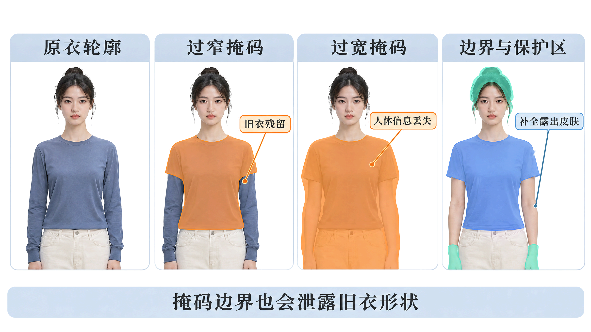

# 目录

[1. ID 保持生成的核心目标是什么？](#q-001)
  - [面试问题：ID 保持生成、个性化生成、换脸有什么区别？](#q-002)
  - [面试问题：IP-Adapter、InstantID、PuLID、PhotoMaker 的技术路线如何对比？](#q-003)
  - [面试问题：UniPortrait、ConsistentID 如何处理多人或细粒度 ID？](#q-004)
  - [面试问题：InfiniteYou、FlashFace、InstantCharacter 怎样组织人物或角色参考？](#q-005)

[2. 为什么高保真身份注入很难？](#q-006)
  - [面试问题：Q-Former 注入和 ReferenceNet 注入有什么区别？](#q-007)
  - [面试问题：如何在 ID 相似度和文本可编辑性之间平衡？](#q-008)
  - [面试问题：Copy-Paste 现象如何评估和缓解？](#q-009)
  - [面试问题：多人 ID 数据集如何构建？](#q-010)
  - [面试问题：同身份配对数据与对比训练怎样减少 Copy-Paste？](#q-026)

[3. 换脸任务的核心挑战是什么？](#q-011)
  - [面试问题：SimSwap、HiFiFace、Face-Adapter、REFace 的思路有什么区别？](#q-012)
  - [面试问题：视频换脸为什么比图像换脸难？](#q-013)
  - [面试问题：HiFiVFS、VividFace 如何提升视频换脸的一致性和细节？](#q-014)
  - [面试问题：换脸如何结合 3DMM 和背景处理？](#q-015)

[4. 虚拟换衣为什么是数字人商业化重要方向？](#q-016)
  - [面试问题：视频换衣和图像换衣的核心差异是什么？](#q-017)
  - [面试问题：Mask-based、Mask-free、蒸馏式虚拟换衣有什么区别？](#q-018)
  - [面试问题：如何处理 mask 引入的形状泄露问题？](#q-019)
  - [面试问题：如何构造成品模特试穿视频生成链路？](#q-020)
  - [面试问题：视觉试穿与真实合身预测之间缺少哪些信息？](#q-027)

[5. ID 保持、换脸和换衣如何做数据与评估？](#q-021)
  - [面试问题：虚拟换衣如何构造和筛选三元组数据？](#q-022)
  - [面试问题：虚拟换衣常用数据集有哪些？](#q-023)
  - [面试问题：文本可以控制哪些服装外观属性？与真实尺码有什么区别？](#q-024)
  - [面试问题：线上发现纹理糊、头发遮挡、服饰动作冲突如何处理？](#q-025)
---

<h1 id="q-001">1. ID 保持生成的核心目标是什么？</h1>

<h2 id="q-002">面试问题：ID 保持生成、个性化生成、换脸有什么区别？</h2>

**难度评分：⭐⭐ (2/5)  |  考察频率：⭐⭐⭐⭐⭐ (5/5)**

ID 保持生成以特定身份为条件，在新的姿态、场景或风格中生成图像；个性化生成的范围更大，可以针对人物、宠物、商品或虚构角色；换脸则以已有目标画面为基础，替换其中的脸部身份，并保留目标属性。

换脸中常写成 $`I_{\mathrm{swap}}=G(c_{\mathrm{id}}^{\mathrm{src}},c_{\mathrm{attr}}^{\mathrm{tgt}})`$。目标属性包括表情、头姿、光照及周围场景，但脸型属于身份还是目标保留属性，需要在任务定义中明确。

个性化也不一定需要逐人微调。LoRA、DreamBooth 等方法与即插即用的参考适配器，是不同的获取身份条件方式。应分别比较定制成本、生成速度、可编辑性和跨参考稳定性。

<h2 id="q-003">面试问题：IP-Adapter、InstantID、PuLID、PhotoMaker 的技术路线如何对比？</h2>

**难度评分：⭐⭐⭐ (3/5)  |  考察频率：⭐⭐⭐⭐⭐ (5/5)**

四种方法都利用参考图，但压缩身份的方式与训练约束不同。[1–4]

<div align="center">

| 方法 | 主要条件与机制 | 应关注的边界 |
|---|---|---|
| IP-Adapter | 图像编码器特征，经解耦图像交叉注意力注入 | 基础版本是通用图像提示，不专门保证人脸身份；FaceID 等变体需另论 |
| InstantID | 人脸识别特征结合关键点与 IdentityNet | 身份和姿态控制的相互影响，单图视角限制 |
| PuLID | 身份条件、快速生成训练分支及对比对齐约束 | 保持 ID 时对原文本编辑能力的扰动 |
| PhotoMaker | 将一个或多个参考图组织为 stacked ID embedding | 参考图质量、身份混杂和非身份信息泄漏 |

</div>

理解差异时问三件事：参考中的哪些信息被保留；这些信息从哪里进入生成网络；训练如何阻止它们覆盖文本和动作。不能把所有方法都概括成“加一个人脸向量”，也不能默认多图输入一定优于筛选后的单图。

<h2 id="q-004">面试问题：UniPortrait、ConsistentID 如何处理多人或细粒度 ID？</h2>

**难度评分：⭐⭐⭐⭐ (4/5)  |  考察频率：⭐⭐⭐ (3/5)**

UniPortrait 将身份表示与空间路由分开：先提取各个人物的身份条件，再把它们分配到生成图像中相应的面部区域。多人场景的难点由此变成“身份有没有提取正确”和“身份有没有送到正确位置”两部分。[5]

ConsistentID 更关注细粒度面部信息，将局部面部特征、语义描述与区域约束结合，减少只有全局身份向量时的细节缺失。[6]

路由能力需要通过干预验证。固定场景交换两张参考脸，检查身份是否交换到指定位置；只修改其中一人，检查另一人是否被连带改变。注意力图可以辅助分析，但不能仅凭热点落在脸上就断言多人身份已经解耦。

<h2 id="q-005">面试问题：InfiniteYou、FlashFace、InstantCharacter 怎样组织人物或角色参考？</h2>

**难度评分：⭐⭐⭐⭐ (4/5)  |  考察频率：⭐⭐⭐ (3/5)**

三者体现的方向并不完全相同。InfiniteYou 将身份条件接入 DiT/FLUX，通过 InfuseNet 等设计协调身份与文本；FlashFace 用更丰富的参考空间特征保留脸部细节，属于较早的扩散人像定制路线；InstantCharacter 将对象扩大到通用角色，通过可扩展的视觉特征适配器支持一致性生成。[7]

因此不宜把它们一起描述成“从 U-Net 进入 DiT”的同一代方法。更有价值的共同问题是：少量全局 token 是否足以保存局部细节，人物之外的角色能否复用身份控制机制，以及换主干后适配器还能否保持编辑能力。

更强的参考特征可能改善脸型和服饰，也可能携带参考姿态。对特定疤痕、配饰或服装的保持，需要专门测试，不能由整体图像相似度代替。

---

<h1 id="q-006">2. 为什么高保真身份注入很难？</h1>

<h2 id="q-007">面试问题：Q-Former 注入和 ReferenceNet 注入有什么区别？</h2>

**难度评分：⭐⭐⭐⭐ (4/5)  |  考察频率：⭐⭐⭐⭐ (4/5)**

Q-Former 式投影用一组可学习 query 从视觉特征中读取有限数量的 token，可抽象为：

```math
Z_q=\mathrm{Attention}(Q_{\mathrm{learn}},K_{\mathrm{ref}},V_{\mathrm{ref}}).
```

它便于控制条件 token 数量并接入 Transformer，但压缩可能损失位置和细节。ReferenceNet 则保留多尺度空间特征，生成网络在对应层读取，通常更有利于传递衣服、发丝和局部纹理。

这不是可编辑性与保真度的固定二选一。空间特征也能通过配对训练和区域约束保留编辑能力，token 条件也可能携带不该复制的表情。实际成本取决于 token 数量、特征分辨率、缓存方式和注入层数。

选型时应在相同身份、姿态变化和计算预算下比较，必要时组合全局身份 token 与局部细节特征。

<h2 id="q-008">面试问题：如何在 ID 相似度和文本可编辑性之间平衡？</h2>

**难度评分：⭐⭐⭐⭐ (4/5)  |  考察频率：⭐⭐⭐⭐⭐ (5/5)**

身份相似度和编辑响应应形成二维评估，而非合成一个容易掩盖失败的总分。固定身份后，依次改变头姿、表情、光照和画风，观察指定属性是否响应，同时看人是否仍然可辨认。

训练层面可使用同身份不同拍摄条件的配对、身份与非身份能力的对齐约束，以及适当的条件 dropout。推理层面可调整参考强度、注入层和去噪阶段，但这些调节应建立在模型训练覆盖之内。

延迟身份注入不一定总有效。早期结构若已形成错误脸型，后期局部细节可能无法修复；过早过强注入又可能锁住参考表情。应扫描条件强度与注入时段，查看身份、目标属性和画质之间的实际取舍。[2,3]

<h2 id="q-009">面试问题：Copy-Paste 现象如何评估和缓解？</h2>

**难度评分：⭐⭐⭐⭐ (4/5)  |  考察频率：⭐⭐⭐⭐ (4/5)**

Copy-Paste 的典型表现是：参考人物正脸闭嘴，要求侧脸微笑，生成结果仍保留原姿态和表情。识别分数可能很好看，编辑任务却没有完成。

<div align="center">


</div>

WithAnyone 将这一现象与同图重建训练和配对数据不足联系起来，并提出同时评估身份保真与变化能力的基准。[8] 实践中可用同身份但不同姿态的参考图和目标图，分别检查输出是否跟随目标变化，以及是否保留身份。

参考图与目标图过于相似时，复制倾向很难区分；识别特征对表情又常有不变性，因此仅比较 ArcFace 距离不够。还应记录姿态误差、表情响应和人工偏好。

缓解重点是改变监督：让同一身份跨拍摄条件出现，避免模型从参考像素直接还原目标。单纯降低 ID 权重可能减少复制，也可能同时让身份丢失。

<h2 id="q-010">面试问题：多人 ID 数据集如何构建？</h2>

**难度评分：⭐⭐⭐⭐ (4/5)  |  考察频率：⭐⭐⭐ (3/5)**

多人身份数据需要两类标注：每个身份的参考集合，以及目标画面中每张脸与身份的对应。可先建立经过授权的身份图库，再将多人画面的检测、跟踪结果与图库匹配，保留参考—目标配对。

识别聚类只能作为候选生成。相似脸、年龄变化、化妆和低清画面容易误配，关键配对需人工抽检或多信号校验。多人训练还应覆盖人物位置交换、部分遮挡和参考图数量不均衡。

划分数据时按身份与原始素材去重，并单独检查同一合影是否经裁剪后进入不同集合。WithAnyone 的 MultiID-2M 展示了规模化配对的研究价值，但公开可访问不等同于对所有商用场景具有完整授权。[8]

<h2 id="q-026">面试问题：同身份配对数据与对比训练怎样减少 Copy-Paste？</h2>

**难度评分：⭐⭐⭐⭐ (4/5)  |  考察频率：⭐⭐⭐ (3/5)**

同图重建让复制成为容易的解。若参考与目标来自同一人物的不同照片，模型必须跨过姿态、表情和光照差异，才能完成监督；身份不变的信息因此更有机会被单独学习。

WithAnyone 将大规模同身份配对与对比身份训练结合，利用正样本表达身份关联，并引入更丰富的负身份集合。[8] 与单纯把生成脸拉向参考脸相比，训练需要在可区分身份的同时容许自然变化。

配对质量决定监督上限。错误身份是有害的正样本，同一张照片的近重复又不能提供足够变化；负样本也可能存在错标或相似身份。数据清洗应同时看身份准确率和变化覆盖，而非只计数量。

这一思想可以迁移到视频：同身份跨片段的多视角参考，比重复增加同一正脸帧更有信息量。但图像论文的收益不能直接外推为视频时序稳定，仍需增加运动、遮挡恢复与长时评测。

---

<h1 id="q-011">3. 换脸任务的核心挑战是什么？</h1>

<h2 id="q-012">面试问题：SimSwap、HiFiFace、Face-Adapter、REFace 的思路有什么区别？</h2>

**难度评分：⭐⭐⭐ (3/5)  |  考察频率：⭐⭐⭐⭐ (4/5)**

SimSwap 用源身份特征注入目标表示，并以弱特征匹配等约束保留目标属性；HiFiFace 增加三维形状相关信息，处理仅靠识别向量难表达的脸型。Face-Adapter 将身份、空间结构和属性条件分别组织到预训练扩散模型中；REFace 将换脸作为训练阶段的条件修复任务，用分开的 CLIP 投影提取源身份细节与目标姿态、表情等属性，并通过多步 DDIM 训练加强身份与感知监督。[9]

比较时应围绕身份与属性分工。源图提供谁的脸，目标图提供表情、头姿、光照和遮挡，但两者在脸型边缘会发生冲突。只有输入约定清楚，才知道哪部分变化应被视为错误。

GAN 类局部生成常有较低推理成本，扩散式编辑可利用更丰富先验；速度和质量仍依赖输入范围、训练数据和采样方式。不能仅按模型家族认定哪一个在所有侧脸、遮挡或视频场景中更强。

<h2 id="q-013">面试问题：视频换脸为什么比图像换脸难？</h2>

**难度评分：⭐⭐⭐ (3/5)  |  考察频率：⭐⭐⭐⭐ (4/5)**

逐帧换脸会把微小的检测、对齐和采样误差放大成明显的闪烁。视频还要求脸型、口腔、边界和光照随动作连续变化，遮挡消失后仍要恢复同一身份。

先稳定人物跟踪与裁剪坐标，再让模型读取连续帧并共享身份条件。光流约束应作用在可靠的可见区域；遮挡或新出现区域不能强行沿用上一帧。视频判别器与时间注意力可补充动态监督，但无法代替正确的输入对齐。

后处理也要纳入诊断。逐帧自动调色或重绘牙齿，可能在原生成已稳定时引入新抖动。应保留生成前、融合前和编码后的中间结果，用同一时间片逐阶段定位。

<h2 id="q-014">面试问题：HiFiVFS、VividFace 如何提升视频换脸的一致性和细节？</h2>

**难度评分：⭐⭐⭐⭐ (4/5)  |  考察频率：⭐⭐ (2/5)**

这里的 VividFace 特指 **2024 年的视频换脸论文**，与同名的视频人脸增强和机器人表情模仿工作不同。[10]

HiFiVFS 以 SVD 的视频先验为基础，一条路径学习尽量去身份化的目标细粒度属性，另一条路径注入更细致的源身份信息。它试图同时保住光照、妆容等目标属性与源脸细节。[10]

VividFace 采用图像与视频混合训练、VidFaceVAE，以及属性—身份解耦三元组。三元组中分别安排共享姿态与共享身份的图像，帮助监督模型区分两类因素，遮挡增强则补充复杂场景。

二者的共同价值在于把视频先验与解耦监督结合。论文中的收益仍需按相同素材、分辨率和运行预算复验，不能把某个数据集的总体指标推广为所有输入都更稳定。

<h2 id="q-015">面试问题：换脸如何结合 3DMM 和背景处理？</h2>

**难度评分：⭐⭐⭐⭐ (4/5)  |  考察频率：⭐⭐⭐ (3/5)**

3DMM 为换脸提供形状、表情、头姿与可见性线索。源身份形状与目标表情、相机结合后，可以辅助确定脸部投影及需要重绘的区域。

当源脸比目标脸宽，修改区域可能超出原脸边界；源脸较窄，又可能暴露原先被遮住的背景。这些区域需要补全，不能只靠把新脸贴回旧 mask。手、眼镜和头发则要根据局部前后关系保留。

工程上可结合目标人脸区域、预测几何投影和遮挡区域构造融合范围，但交并操作只定义候选区域，不能解决发丝透明度和复杂遮挡。最好进一步使用 alpha matte、可见性与时间一致性检查。

---

<h1 id="q-016">4. 虚拟换衣为什么是数字人商业化重要方向？</h1>

<h2 id="q-017">面试问题：视频换衣和图像换衣的核心差异是什么？</h2>

**难度评分：⭐⭐⭐ (3/5)  |  考察频率：⭐⭐⭐⭐ (4/5)**

图像试穿关注单帧中的人体、服装和遮挡；视频试穿还要建立跨帧的服装对应。条纹应随褶皱运动，标志不能跳位置，手从胸前移开后要露出一致的花纹。

独立逐帧生成缺少这种对应，后续去闪烁也不能恢复已经变化的服装语义。视频模型、共享服装特征、运动条件与可见区域的时间约束可以共同改善稳定性。

评估要把“服装像不像商品”和“视频看起来顺不顺”分开。静态贴图可以很稳定，却不符合布料运动；自然摆动的衣服也可能变成另一个 SKU。商业素材应以商品细节正确为前提，再优化动态与观感。

<h2 id="q-018">面试问题：Mask-based、Mask-free、蒸馏式虚拟换衣有什么区别？</h2>

**难度评分：⭐⭐⭐ (3/5)  |  考察频率：⭐⭐⭐⭐ (4/5)**

Mask-based 试穿将目标区域作为编辑范围，常见输入可写为：

```math
I_{\mathrm{out}}=G(I_{\mathrm{person}}\odot(1-M),I_{\mathrm{garment}},M,c).
```

Mask-free 描述推理时不需要显式输入换衣 mask，不意味着训练和数据构建完全没有解析或区域监督。蒸馏则是一种训练方式，可用带 mask 教师的结果训练更简化的学生，也可用于减少采样步数。

所以这三者不能当成完全互斥的架构。教师错误、商品细节失真和区域泄漏都可能被学生继承。比较时应分别记录人工输入要求、预处理依赖、推理成本和服装保真度。[11]

<h2 id="q-019">面试问题：如何处理 mask 引入的形状泄露问题？</h2>

**难度评分：⭐⭐⭐⭐ (4/5)  |  考察频率：⭐⭐⭐⭐ (4/5)**

训练时若总是沿目标衣服轮廓精确挖空，mask 本身就透露了目标形状。模型可能学会“填满这个轮廓”，推理时即使换成短袖商品，也保留原来的长袖边界。

FitDiT 的扩张与放松 mask 增强，通过更粗且随机变化的区域，降低这种形状泄漏。[11] 这要和不变区域保护一起设计，不能简单把所有 mask 无限放大。

<div align="center">



</div>

前三栏对照原衣与两种不合适的编辑范围，右栏示意换成短袖后的补全结果，青色标出头发与手的保护区。右栏的蓝色短袖是输出衣物，实际编辑区域还需覆盖原长袖，才能补全新露出的手臂。

长袖换短袖还需要生成此前不可见的手臂，属于新暴露区域补全。测试应包含袖长、领型和裙长明显不同的替换，分别检查旧衣残留、人体保持和新衣轮廓，而非只测相似款式。

<h2 id="q-020">面试问题：如何构造成品模特试穿视频生成链路？</h2>

**难度评分：⭐⭐⭐⭐ (4/5)  |  考察频率：⭐⭐⭐⭐ (4/5)**

商品试穿视频可以按“商品确认 → 模特与动作选择 → 服装条件生成 → 时序处理 → 质检与返修”组织。商品确认需识别正确 SKU、颜色和可见细节，动作选择则要考虑服装结构与展示目的。

例如没有口袋的上衣不适合直接套用插兜模板，裙摆展示需要留出下半身画面，细条纹商品需要足够输出分辨率。VLM 可辅助打标签和筛选，但不应把不确定识别结果当成商品事实。

质检优先检查花纹、文字、纽扣、袖口、衣长、遮挡和跨帧变化。字幕、配乐、TTS 可以在主体验收后添加，避免把制作成本投入到商品已生成错误的视频上。

上线指标应包含单条可用成本、返修率和 SKU 一致率。只报告生成成功率，很容易掩盖大量无法投放的结果。

<h2 id="q-027">面试问题：视觉试穿与真实合身预测之间缺少哪些信息？</h2>

**难度评分：⭐⭐⭐⭐ (4/5)  |  考察频率：⭐⭐⭐ (3/5)**

视觉试穿回答“画面里穿起来是什么样”，合身预测还需要“尺寸和材料是否允许这样穿”。人体真实尺寸、衣服纸样与尺码、面料弹性、厚度及穿着松量，通常无法由单张照片唯一确定。

若产品只提供风格预览，应以商品外观和人物保持为验收标准；若承诺尺码建议，就需要可靠测量、尺码表、版型知识和真实试穿反馈，并根据任务引入几何或布料模型。

可以将系统拆为测量与适配判断、视觉生成两部分：前者输出可解释的尺寸证据和不确定性，后者呈现穿着效果。两者共享输入，却不能让生成图替代测量结论。

跨周期价值在于把模型能力与业务承诺对齐。视频越来越逼真，商品保真、尺寸证据和可追踪的用户反馈仍然是试穿产品的核心约束。

---

<h1 id="q-021">5. ID 保持、换脸和换衣如何做数据与评估？</h1>

<h2 id="q-022">面试问题：虚拟换衣如何构造和筛选三元组数据？</h2>

**难度评分：⭐⭐⭐ (3/5)  |  考察频率：⭐⭐⭐⭐ (4/5)**

训练三元组通常是服装无关的人物表示、商品图与真实上身图。人物表示常由真实上身图解析得到；它保留脸、姿态和部分身体信息，同时去除原衣特征。

这类重建配对具有获取方便的优势，也存在信息泄漏：残留衣服边界、袖口或人物轮廓可能直接提示答案。应检查输入表示是否隐藏了目标衣形，并用款式差异大的未配对试穿测试泛化。

合成数据需要单独标记来源，检查教师是否篡改商品和人物。按 SKU、人物、原始视频划分训练与测试，并对同款不同颜色、同拍摄的相邻帧做去重，才能避免数据泄漏带来的虚高指标。

<h2 id="q-023">面试问题：虚拟换衣常用数据集有哪些？</h2>

**难度评分：⭐⭐ (2/5)  |  考察频率：⭐⭐⭐ (3/5)**

VITON-HD 是高分辨率图像试穿的常用上衣基准，Dress Code 扩展到上衣、下装和连衣裙等品类，StreetTryOn 关注更接近街景的复杂条件。[12]

选择数据集不能只看样本量。应核对商品图与人物图是否真实配对、拍摄是否以正面和干净背景为主、是否覆盖遮挡，以及授权是否符合用途。同名整理包或第三方镜像应回到原始项目确认身份。

图像数据可以训练外观与区域编辑，却不能单独证明视频纹理稳定性。视频任务还需要连续观测、镜头分段与跨帧对应。若研究里把“同图移除衣服再恢复”称为配对试穿，应明确它与真实换衣前后对照的区别。

<h2 id="q-024">面试问题：文本可以控制哪些服装外观属性？与真实尺码有什么区别？</h2>

**难度评分：⭐⭐⭐ (3/5)  |  考察频率：⭐⭐⭐ (3/5)**

文本可以控制可见的服装属性，例如宽松、修身、短款或卷袖。先将用户表达转换为明确且不互相冲突的属性，再结合服装图与区域条件生成，通常比笼统说“更好看”更可控。

但“宽松一些”是视觉效果要求，“这件 M 码能否适合胸围 96 cm 的人”是尺寸推断问题。没有人体测量、服装尺寸与材质信息，生成模型无法从漂亮图片证明合身。

评估应检查衣摆和袖口相对人体关键点的位置、服装轮廓及商品保持，而不能仅根据文本 token 的注意力响应。热图说明模型读了哪里，不直接证明衣长或尺寸正确。

<h2 id="q-025">面试问题：线上发现纹理糊、头发遮挡、服饰动作冲突如何处理？</h2>

**难度评分：⭐⭐⭐⭐ (4/5)  |  考察频率：⭐⭐⭐⭐ (4/5)**

纹理糊先查商品源图与输出局部像素数，再看编码压缩、参考注入和生成分辨率。补分辨率能改善观感，无法保证恢复真实文字；对品牌标志应保留人工或规则复核。

头发遮挡要检查分割边界、透明发丝与跨帧可见性。简单把原头发贴回去，在头发原本覆盖旧衣或随身体移动时可能出现错误边缘，需要局部重建与时序检查。

服饰和动作冲突则应尽量在模板选择前解决。生成后反复修补无口袋插兜、手穿裙摆等错误，通常比筛掉不合适模板更贵。排查时保留源输入、条件图、生成结果与贴回结果，先定位错误出现的阶段，再调整模型或规则。

---

## 参考资料

[1] IP-Adapter：<https://arxiv.org/abs/2308.06721>。

[2] InstantID：<https://arxiv.org/abs/2401.07519>；<https://github.com/InstantID/InstantID>。

[3] PuLID：<https://arxiv.org/abs/2404.16022>；<https://github.com/ToTheBeginning/PuLID>。

[4] PhotoMaker：<https://github.com/TencentARC/PhotoMaker>。

[5] UniPortrait：<https://arxiv.org/abs/2408.05939>。

[6] ConsistentID：<https://github.com/JackAILab/ConsistentID>。

[7] InfiniteYou：<https://arxiv.org/abs/2503.16418>；FlashFace：<https://github.com/ali-vilab/FlashFace>；InstantCharacter：<https://arxiv.org/abs/2504.12395>。

[8] WithAnyone / MultiID-2M / MultiID-Bench：<https://arxiv.org/abs/2510.14975>；<https://github.com/doby-xu/WithAnyone>。

[9] SimSwap：<https://github.com/neuralchen/SimSwap>；HiFiFace：<https://arxiv.org/abs/2106.09965>；Face-Adapter：<https://github.com/FaceAdapter/Face-Adapter>；REFace（Realistic and Efficient Face Swapping）：<https://arxiv.org/abs/2409.07269>；<https://github.com/Sanoojan/REFace>。

[10] HiFiVFS：<https://arxiv.org/abs/2411.18293>；VividFace（视频换脸）：<https://arxiv.org/abs/2412.11279>。

[11] FitDiT：<https://arxiv.org/abs/2411.10499>。

[12] VITON-HD：<https://github.com/shadow2496/VITON-HD>；Dress Code：<https://github.com/aimagelab/dress-code>；StreetTryOn：<https://arxiv.org/abs/2311.16094>。
