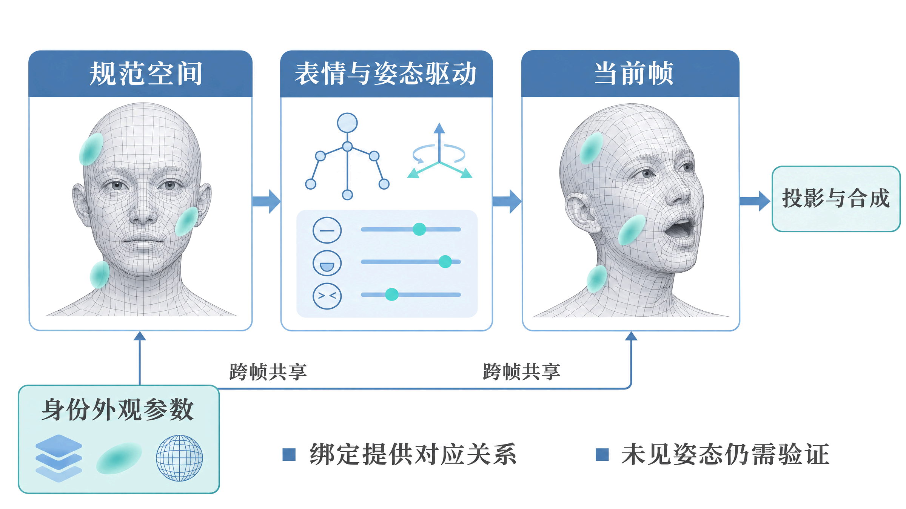
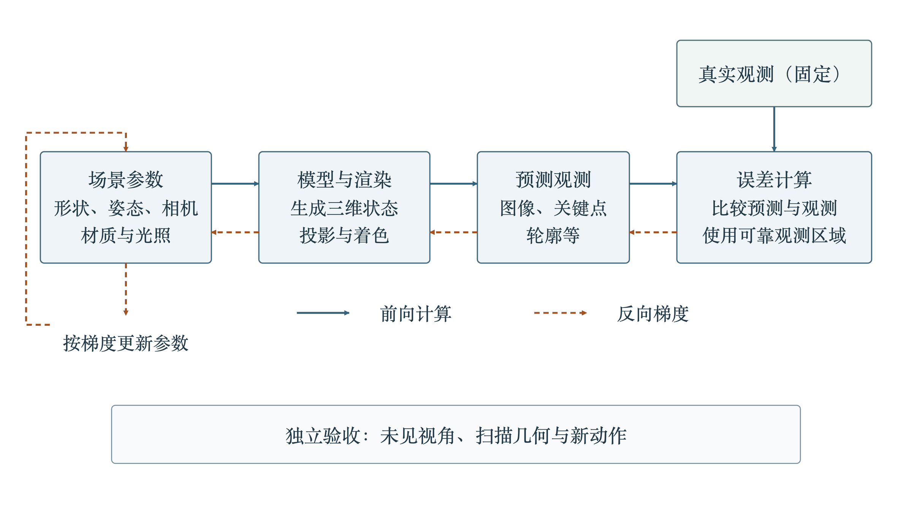

# 目录

[1. 为什么 AIGC 时代仍然需要 3D 数字人？](#q-001)
  - [面试问题：2D 数字人与 3D 数字人的核心差异是什么？](#q-002)
  - [面试问题：3D 数字人的典型技术链路是什么？](#q-003)
  - [面试问题：3D 先验如何提升数字人生成的可控性？](#q-004)

[2. 3DMM 是什么？](#q-005)
  - [面试问题：3DMM 的形状、表情和纹理参数如何理解？](#q-006)
  - [面试问题：3DMM 有哪些典型应用？](#q-007)
  - [面试问题：BFM 和 FLAME 有什么区别？](#q-008)
  - [面试问题：DECA、EMOCA、MICA、3DDFA、Deep3DFaceRecon 的路线如何区分？](#q-009)
  - [面试问题：单张图像做人脸 3D 重建的难点有哪些？](#q-010)

[3. SMPL 模型是什么？](#q-011)
  - [面试问题：SMPL 的形状参数、姿态参数和输出网格如何理解？](#q-012)
  - [面试问题：Blend Shape 和 LBS 在 SMPL 中分别解决什么问题？](#q-013)
  - [面试问题：SMPL、SMPL-H、SMPL-X、MANO、FLAME 如何对比？](#q-014)
  - [面试问题：单目 RGB 图像重建 3D 人体为什么困难？](#q-015)
  - [面试问题：参数化人体模型为什么难以表示宽松衣物？](#q-016)

[4. 3D 数据表示为什么会影响算法设计？](#q-017)
  - [面试问题：点云、Mesh、体素、RGB-D、多视角图像如何对比？](#q-018)
  - [面试问题：SDF 和 Occupancy Field 有什么区别？](#q-019)
  - [面试问题：NeRF 的核心思想是什么？](#q-020)
  - [面试问题：3D Gaussian Splatting 的渲染效率来自哪里？](#q-021)
  - [面试问题：Mesh Avatar、NeRF Avatar、3DGS Avatar 各自适合什么场景？](#q-022)
  - [面试问题：规范空间与 Mesh 绑定怎样让 3D Gaussian Avatar 可驱动？](#q-033)

[5. 传统渲染管线包括哪些核心步骤？](#q-023)
  - [面试问题：局部光照和全局光照有什么区别？](#q-024)
  - [面试问题：光栅化和 Z-buffer 为什么会带来不可微问题？](#q-025)
  - [面试问题：可微渲染是什么？](#q-026)
  - [面试问题：可微渲染有哪些主流实现思路？](#q-027)
  - [面试问题：可微渲染如何用于 3DMM/SMPL 参数优化？](#q-028)

[6. 3D 数字人与生成式模型如何结合？](#q-029)
  - [面试问题：如何设计一个可控 3D 数字人生成系统？](#q-030)
  - [面试问题：3D 数字人如何评估质量？](#q-031)
  - [面试问题：线上 3D 数字人系统常见问题如何排查？](#q-032)
  - [面试问题：Gaussian Blendshape 蒸馏为什么能降低数字人的逐帧驱动成本？](#q-034)
  - [面试问题：可重光照 Avatar 为什么要分离材质与原始光照？](#q-035)
---

<h1 id="q-001">1. 为什么 AIGC 时代仍然需要 3D 数字人？</h1>

<h2 id="q-002">面试问题：2D 数字人与 3D 数字人的核心差异是什么？</h2>

**难度评分：⭐⭐ (2/5)  |  考察频率：⭐⭐⭐⭐ (4/5)**

2D 数字人主要在图像或视频空间生成结果，3D 数字人则维护可被相机观察、可随动作变化的空间资产。这个区别决定了系统能否反复修改视角、材质与动作，也决定了资产怎样进入游戏、XR 或实时交互环境。

### 1、画面逼真度不能代替资产能力

一个视频模型可以生成很逼真的转头过程，但仅凭成片，未必能获得可编辑的后脑勺、骨骼和材质。若下一次要求从另一机位拍摄，模型通常还要重新生成，并维持与前一次结果的一致性。

三维资产则在统一坐标中保存表面或空间外观。相机移动时，同一结构通过新的投影进入画面；动作变化时，通过骨骼、表情参数或形变场更新。它为多视角对应提供了基础，但模型里不存在或错误的结构，换视角后也会暴露出来。

<div align="center">

| 交付要求 | 2D 路线 | 3D 路线 |
|---|---|---|
| 少量照片生成固定机位口播 | 可直接利用图像与视频先验 | 需先获得空间表示，前期成本可能较高 |
| 任意改相机、反复调整动作 | 依赖条件服从与跨次生成一致性 | 可显式控制相机与驱动，仍受资产覆盖限制 |
| 游戏或 XR 中的人物交互 | 通常作为视频、平面贴图或特定显示内容 | 可对接空间位置、骨架、遮挡与交互接口 |
| 修改材质、光照和碰撞 | 主要通过重新生成或二维编辑 | 需要对应几何、材质与物理结构，三维外观本身未必具备 |

</div>

### 2、为什么 3D 也可能不够可控

NeRF 和 3DGS 可以表达真实的空间外观，却未必具有传统网格的拓扑、UV、碰撞体和材质分解。一个支持新视角的辐射场，不一定能换衣、重新打光或直接进入现有动画管线。

同样，网格有骨骼也不代表极端姿态稳定。绑定权重、口腔结构、头发和衣物的建模质量，都会限制实际可用范围。应逐项验证交付能力，而不是把“3D”当成所有编辑功能的承诺。

### 3、怎样选择与组合

固定机位、主要用于内容播放的场景，可以优先比较 2D 生成的画质、制作效率和返修成本；需要用户移动视角、人物与空间发生交互时，持续的三维状态通常更有价值。前期资产成本可由后续多次使用摊薄，因此要按使用周期评估。

混合路线可用三维模型提供深度、法线与动作，再由生成模型增强外观。这样能够补细节，但增强模块可能改变轮廓、身份或光照，必须重新检查跨视角和时间一致性。最终选择取决于要交付的能力及预算，两种表示也可以在同一个产品里承担不同环节。

<h2 id="q-003">面试问题：3D 数字人的典型技术链路是什么？</h2>

**难度评分：⭐⭐⭐ (3/5)  |  考察频率：⭐⭐⭐⭐ (4/5)**

典型链路是 **观测与标定 → 空间资产 → 绑定与外观 → 动作驱动 → 渲染与交付**。各阶段都有独立误差，只有保留清晰接口，才能知道最后一帧出现问题时应从哪里修起。

### 1、从观测建立空间资产

输入可以是多机位扫描、RGB-D、单目视频或单张图像。多视角采集需要相机内外参、曝光和时间同步；单图方法则更依赖统计或生成先验。若动态人物的不同相机不同步，会把不同时刻的表情误认为同一时刻的几何，后续重建再复杂也难以弥补。

资产阶段估计几何、外观及必要的规范空间。网格要检查拓扑、法线、尺度和 UV；高斯要检查数量、分布、透明度与漂浮点；辐射场则要检查新视角和密度分布。先在简单光照下看结构，再看逼真渲染，能减少纹理掩盖几何错误的情况。

### 2、绑定让资产能够被驱动

骨骼与蒙皮权重负责身体运动，Blendshape 或参数化表情负责脸部，神经形变或网格绑定负责其他外观表示。绑定应在中性姿态和极端动作下检查，特别是肩、肘、嘴角和眼睑。只在默认 T-pose 看起来正常，无法证明运动时不会塌陷或穿插。

材质与外观也在这一阶段明确：使用固定捕获颜色、视角相关辐射外观，还是可重光照的反照率与粗糙度。选择不同，运行时可修改的变量就不同。

### 3、驱动信号要转换为资产语义

音频可预测口型、表情与头部动作，摄像头或动捕设备可估计骨架，行为系统可决定注视、点头和手势。它们产生的控制量需要映射到目标资产，统一关节顺序、旋转表示、单位和时间戳。

例如动捕的肘关节坐标不能直接当作 SMPL 的局部旋转，驱动者与角色的骨长不同还需要重定向。脸部系数也依赖各自定义，一个模型的“张嘴 0.8”不能未经标定就解释为另一个资产的同样幅度。

### 4、渲染与交付决定最终体验

渲染器读取当前资产、相机、光照和驱动状态，输出图像或立体视图，再进入增强、编码、传输和播放。离线制作可增加采样和返修，实时系统则要满足每帧预算并控制队列。

验收分别记录资产构建时间、加载时间、驱动耗时、渲染耗时与显示延迟。交付新视角视频、可编辑角色文件和在线 Avatar 服务是三种不同成果；应提前约定文件格式、运行时依赖和动画接口，否则可能得到画质很好却接不进目标环境的资产。

<h2 id="q-004">面试问题：3D 先验如何提升数字人生成的可控性？</h2>

**难度评分：⭐⭐⭐ (3/5)  |  考察频率：⭐⭐⭐⭐ (4/5)**

三维先验把姿态、表面方向和可见性等变量变成明确控制，缩小生成模型需要猜测的范围。它的作用取决于条件是否准确，以及生成网络是否在训练中学会遵守这些条件。

### 1、先验可以进入哪些位置

一类做法直接使用参数：FLAME 的头部、下颌和表情参数，或 SMPL-X 的身体、手部与脸部参数，经过编码成为生成条件。参数较紧凑，但网络还要学习从系数到画面空间的对应。

另一类先把三维状态渲染为深度、法线、关键点、分割或规范坐标图，再输入生成模型。深度说明前后关系，法线说明表面朝向，规范坐标则能指示不同帧中哪些像素属于同一表面。它们提供的信息不同，不能只因都由 3D 渲染得到就视为可互换。

### 2、为什么能改善动作和多视角控制

人物转头时，几何决定近侧脸变宽、远侧脸缩短，鼻子还会遮住部分脸颊。用相同三维结构渲染多个视角，比为每个视角独立猜关键点提供了更一致的约束。若纹理通过共享 UV 或规范空间附着，痣、衣纹等也更容易随表面运动。

对生成模型而言，结构条件减少了形状歧义，使其能把更多容量用于皮肤、发丝和服装外观。不过“更容易保持”需要训练与评测支持：如果模型忽略条件，或后处理重新画脸，三维控制仍可能被覆盖。

### 3、错误先验会怎样传递

将微笑误拟合为身份脸型，会使所有后续表情都带着错误嘴角；将裙摆轮廓当成双腿，会产生不合理骨架；深度在头发边缘出错，则可能把头发生成到脸后。强条件可能让这些错误更稳定地出现，而不是自动纠正。

可以使用置信度、可见性与条件 dropout 减少对局部错误的过度依赖。也可保留三维粗结构，让图像分支学习小范围残差，但残差过大又会削弱控制。因此需要限制修正范围，并用几何与画面双重指标监控。

### 4、怎样验证三维条件有效

固定身份和随机设置，只改变头姿或一个关节，观察输出是否按预期变化；再保持三维条件，改变纹理或风格，检查结构是否保留。多视角下比较轮廓、关键点、遮挡与表面对应，比只看单张图更有说服力。

三维先验提供的是有约束的生成接口。它适合承担空间与动作控制，细节分支承担外观补充，两者的边界应通过数据和损失固定下来，不能仅凭一张漂亮效果图认定已经解耦。

---

<h1 id="q-005">2. 3DMM 是什么？</h1>

<h2 id="q-006">面试问题：3DMM 的形状、表情和纹理参数如何理解？</h2>

**难度评分：⭐⭐⭐ (3/5)  |  考察频率：⭐⭐⭐⭐⭐ (5/5)**

3DMM 用一组低维系数描述人脸几何与外观变化。它将大量顶点坐标压缩为较少的可解释变量，便于从照片估计、跨帧共享和手动编辑；代价是只能表达其模型空间覆盖的变化。[1]

### 1、身份、表情与外观怎样分开

带表情扩展的线性模型可写为：

```math
S=\bar S+B_{\mathrm{id}}\alpha+B_{\mathrm{exp}}\beta,
\qquad A=\bar A+B_{\mathrm{alb}}\gamma.
```

若网格有 $`N`$ 个顶点，$`S\in\mathbb R^{3N}`$ 是将顶点坐标展开后的向量，$`\bar S`$ 是平均形状。身份基 $`B_{\mathrm{id}}`$ 的各列描述鼻形、脸宽等统计变化，$`\alpha`$ 选择它们的组合；表情基 $`B_{\mathrm{exp}}`$ 与 $`\beta`$ 表达张嘴、抬眉等变化。

$`A`$ 表示模型定义的表面颜色或反照率，$`\gamma`$ 控制外观基。不是每个版本都包含独立表情或反照率模型，使用前要检查具体定义。基向量的正负方向也不必对应直观的人类语义，不能把某一维默认称为“笑容强度”。

### 2、参数不直接等于最终像素

几何还要经过头姿和相机投影，外观还要经过材质、光照与相机响应，才能形成图像。照片中的暗色区域可能来自肤色，也可能来自阴影；嘴角位置改变可能由表情、头姿或身份形状共同造成。

因此拟合常同时估计形状、表情、姿态、相机和光照，并加入先验。若系数已经按各主成分标准差归一化，可使用平方范数约束；若没有归一化，应考虑各维方差，不能对不同尺度的系数不加区分地惩罚。

### 3、多帧如何帮助解耦

同一个人的多帧可共享身份形状和相对稳定的外观，每帧单独估计表情、头姿与光照。闭嘴与张嘴共同出现，可以减少把张嘴状态永久写入身份形状的倾向；不同头姿增加可见区域，也能提供更多几何约束。

但共享不是万能条件。长时间拍摄中发型、妆容或体形可能变化，自动曝光也可能改变颜色；模型和观测不匹配时，需要明确哪些量可以变。单一视角的重复帧仍无法观测后脑勺。

### 4、低维模型的能力边界

细皱纹、毛发、口腔和非典型脸型可能超出基空间，需要位移贴图、独立几何或神经残差。残差可以增加表达能力，也可能绕过先验吸收光照误差。应分别检查粗几何、细节和新视角，避免只凭带纹理的正面渲染判断重建质量。

<h2 id="q-007">面试问题：3DMM 有哪些典型应用？</h2>

**难度评分：⭐⭐ (2/5)  |  考察频率：⭐⭐⭐⭐ (4/5)**

3DMM 的主要价值是把人脸图像中的变化组织成可估计、可修改的几何参数。它既能作为直接输出的人脸模型，也能作为换脸、动画或生成系统的中间表示。

### 1、对齐与头姿估计

从图像预测 3DMM 参数后，可将稠密顶点和关键点投影回原图，获得人脸位置、轮廓与头部朝向。相较只预测少量二维点，三维结构可以约束大姿态下的布局，并表达部分不可见关键点的位置。

不过不可见点属于模型推断，不能当作直接观测。轮廓点还会随视角改变对应的网格位置，因此不能把所有二维轮廓标签永久绑定到同一组顶点。

### 2、身份与表情迁移

在换脸中，可组合源人物的身份形状与目标人物的表情、头姿；在表情重演中，则固定目标身份，输入驱动者的动作参数。这样能明确规定哪些因素跟随谁。

两个人的面部比例不同，同样的表情系数未必产生同样的视觉幅度，跨资产迁移仍可能需要标定。原始头姿和局部表情也要分开，否则一次转头可能被误映射成嘴部或眼部变化。

### 3、音频驱动与生成条件

音频模型可以先预测表情、下颌或 Blendshape 控制，再驱动网格或神经头像。低维参数方便做幅度约束、平滑与编辑，但音频不能唯一决定眨眼、注视和全部头部动作，需要其他行为条件或生成策略。

在扩散或视频生成中，3DMM 可产生深度、法线、关键点和可见性条件。它让生成模型知道脸部几何怎样变化，外观分支再补纹理。若结构拟合错误，应先修条件，不能期待更强底模必然纠正所有错误几何。

### 4、反演与资产初始化

可微渲染把照片误差传回参数，用于单图拟合或多帧联合优化。统计模型也可作为扫描配准与精细重建的初始模板，建立稳定拓扑和表面对应，再增加更高分辨率细节。

工程上应根据用途验收：对齐看投影误差，动画看表情范围和时间稳定，重建看真实几何，新视角看未见角度。若用于测量，还需标定尺度与相机。一个正面投影很像的 3DMM，仍可能拥有错误鼻部深度或头部尺寸，不能直接当作度量级扫描。

<h2 id="q-008">面试问题：BFM 和 FLAME 有什么区别？</h2>

**难度评分：⭐⭐⭐ (3/5)  |  考察频率：⭐⭐⭐⭐ (4/5)**

BFM 和 FLAME 都提供统计人脸先验，但设计重点不同。BFM 的经典贡献是身份形状与纹理的统计建模，FLAME 则把头部形状、表情和关节运动整合为可动画模型。[1,2]

<div align="center">

| 维度 | BFM | FLAME |
|---|---|---|
| 主要对象 | 人脸身份几何及统计外观 | 头部与颈部几何、表情和关节运动 |
| 典型变形机制 | 统计形状空间；表情取决于版本或扩展 | 形状与表情基、姿态修正及蒙皮 |
| 运动控制 | 经典模型本身偏静态身份描述 | 下颌、眼球、颈部等具有明确控制 |
| 外观使用 | 常配纹理或颜色统计模型 | 核心几何需配合纹理、材质等外观资产 |
| 选型重点 | 所需脸部范围、形状与外观拟合 | 表情动画、头部驱动与统一拓扑 |

</div>

### 1、BFM 不能只当成一个固定版本

不同年份、裁剪版本和研究代码可能使用不同顶点范围、主成分维数及表情扩展。某个工程使用“BFM”并带表情系数，不代表所有 BFM 原始版本都内置完全相同的表情模型。

实际接入时需要核对模型文件、基空间和单位。一个方法输出的 80 维身份系数，只有在使用相同基、相同排列与相同标准化时，才能被另一个实现直接读取；仅仅向量长度一致不够。

### 2、FLAME 的可动画性来自哪里

FLAME 的全称是 Faces Learned with an Articulated Model and Expressions。它结合身份形状、表情变形与关节驱动，使张嘴、转头和眼球运动能够通过明确参数控制，并用姿态相关修正改善变形。

这种设计适合从多帧中共享身份、逐帧估计动作，也适合将捕获表情转移到其他头部。它仍是有限维的统计模型，特定皱纹、牙齿、头发和皮肤光学需要其他细节与材质资产，不能因采用 FLAME 就认为已经得到完整写实人头。

### 3、怎样做实际选择

任务若主要是脸部对齐或已有 BFM 管线中的重建，可优先考虑现有资产和监督能否直接复用；若重点是持续头部动画、下颌与眼部控制，FLAME 的结构更贴合这类需求。最终还要看训练分布、拟合质量、许可证与部署接口。

将两者结果组合时应通过表面配准或显式映射转换，不应直接拼接系数。测试时关闭纹理看几何，再打开材质看外观，并用未见表情验证驱动范围，才能分清模型先验和渲染包装各自的作用。

<h2 id="q-009">面试问题：DECA、EMOCA、MICA、3DDFA、Deep3DFaceRecon 的路线如何区分？</h2>

**难度评分：⭐⭐⭐ (3/5)  |  考察频率：⭐⭐⭐ (3/5)**

这些方法都从图像获得三维人脸，但各自强化的目标不同。选型应从对齐、身份几何、表情和细节的需求出发，而不能把论文时间排成一条简单的替代链。[3]

### 1、3DDFA 与 Deep3DFaceRecon：对齐和重建的不同侧重

3DDFA 系列通过回归三维形变模型参数处理大姿态人脸对齐，3DDFA-V2 进一步关注速度、精度与稳定性。它适合提供稠密投影、头姿和结构条件。官方实现中的人脸检测、参数预测和渲染是不同阶段，某一网络的毫秒耗时不能当作完整端到端延迟；带未来帧平滑的示例也不能直接称为零等待在线跟踪。

Deep3DFaceRecon 通过 CNN 预测身份、表情、纹理、姿态与光照，再可微渲染回图像，以关键点、光度和身份感知等弱监督约束重建。它把二维外观与高层身份特征结合，但照片匹配仍可能存在几何与光照互相补偿。作者提供的 PyTorch 实现与原 TensorFlow 实现在渲染器、识别网络和训练配置上有所不同，实验应注明版本。

### 2、DECA：让细节随表情变化

DECA 在 FLAME 粗几何之外，学习由人物细节表示和表情条件生成 UV 位移图。这样既可保存个体较稳定的面部细节，又让额头、嘴角等皱纹随表情产生变化。

其 detail-consistency 约束利用同身份图像，鼓励身份相关细节保持一致，把临时表情皱纹交给动态条件解释。若只是把一张照片的皱纹永久刻进网格，人物恢复中性表情后皱纹仍在，就没有实现这种解耦。

### 3、EMOCA：让重建表情保留情绪表达

几何或光度误差较小，不代表微妙的情绪还在。EMOCA 引入固定情绪识别网络，比较输入照片与可微渲染图的情绪特征，用感知一致性强化表情学习。

其粗阶段保留来自 DECA 的固定粗编码分支，并训练表达相关编码器；细节阶段再利用预测表情和下颌条件学习细节。情绪网络提供的是训练信号，其偏差也会传入模型，不能将情绪特征接近视为对人物真实内心状态的测量。

### 4、MICA：强调身份相关的度量几何

MICA 使用人脸识别表征和映射网络预测身份相关几何，结合统一配准的三维扫描监督，关注真实尺度下的形状。识别特征帮助降低表情、光照等因素对身份估计的干扰，但输出仍依赖训练先验和可见信息。

它主要解决身份形状，不应被当成完整的表情跟踪器；也不能因名称强调 metrical，就认定任意照片中的尺寸都达到真实测量精度。评价时应注明是否允许尺度对齐，避免相似变换掩盖尺寸错误。

组合系统可以使用稳定的身份形状配合更灵敏的表情估计，再接细节层。前提是拓扑、坐标、相机与参数语义能对齐，并分别验证几何、表情和动画结果，而非仅比较最清晰的正面渲染图。

<h2 id="q-010">面试问题：单张图像做人脸 3D 重建的难点有哪些？</h2>

**难度评分：⭐⭐⭐ (3/5)  |  考察频率：⭐⭐⭐⭐ (4/5)**

单图人脸重建是欠约束反问题：多个不同的几何、相机、材质和光照组合，可能产生非常相近的二维图像。模型必须借助先验选择一个解释，因此“看起来像”与“恢复了真实三维结构”需要分开讨论。

### 1、投影丢失深度与尺度

透视投影中，横向图像坐标可写为 $`u=f_x X/Z+c_x`$。把三维位置整体乘以同一尺度，比例 $`X/Z`$ 不变，单张图便无法仅凭投影确定绝对大小。焦距、脸部深度和相机距离也可能互相补偿。

正脸对鼻部前后深度约束较弱，大侧脸虽然增加轮廓信息，却遮住另一侧。网络可以根据训练人群补出合理的耳朵和后脑勺，但未观测区域是否属于本人，需要额外证据。

### 2、外观会与几何混淆

面颊暗区可能来自凹陷、侧光、妆容或肤色。若损失只要求渲染颜色接近照片，模型可能把阴影刻进几何，或把错误几何用纹理补偿。眼镜、胡须、头发和手部遮挡又会违反简单的皮肤表面假设。

高频细节尤其需要谨慎：图像增强出的毛孔和皱纹可能只是合理纹理，并无对应的真实深度。将这些细节解释为测量结果，会超出单图证据支持的范围。

### 3、怎样逐步缩小歧义

参数化模型排除不合理形状，关键点与轮廓约束投影结构，可靠可见区域的光度约束外观。对身份、表情和光照施加不同先验，再通过多帧共享身份，可以减轻变量互相补偿。

若有多视角、深度或已知相机内参，应优先使用。相同角度的重复帧主要帮助降噪，变化视角才会增加新的表面观测；镜头畸变、裁剪和曝光变化也要建模，否则新增数据仍可能带来系统误差。

### 4、如何评价与使用结果

正面带纹理渲染适合检查照片重建，关闭纹理后的几何、独立侧视角和扫描对照更适合检查三维准确性。用于动画时还要测试未见表情，确认拟合没有把某一表情固化进身份。

对不可见区域、低置信关键点和异常光照应保留不确定性。内容展示可以接受合理补全，度量、个体化制造或高精资产则需要更严格采集和校准。任务允许的误差不同，重建结果的使用边界也应随之明确。

---

<h1 id="q-011">3. SMPL 模型是什么？</h1>

<h2 id="q-012">面试问题：SMPL 的形状参数、姿态参数和输出网格如何理解？</h2>

**难度评分：⭐⭐⭐ (3/5)  |  考察频率：⭐⭐⭐⭐⭐ (5/5)**

SMPL 将人体体型与关节姿态映射为固定拓扑网格。经典模型有 6,890 个顶点和 24 个骨架关节，包含根关节；它既是可渲染的表面模型，也提供稳定的顶点对应，便于训练、重定向与跨帧分析。[4]

### 1、形状参数控制什么

形状系数 $`\beta`$ 对标准姿态下的体型进行线性组合，改变身高比例、躯干与四肢粗细等统计特征。常见实现保留前 10 个系数，但模型文件与任务可以使用不同维数，不能将“10 维”当成所有 SMPL 系列的固定定义。

形状还影响关节位置。宽肩与窄肩人物的肩关节不应固定在同一位置，SMPL 因而从形状相关的网格回归关节，再进行骨架驱动。若只改表面而不更新关节，运动时可能出现明显拉伸。

### 2、姿态参数怎样进入模型

姿态通常描述各关节相对父关节的旋转。经典轴角形式中，24 个关节各 3 维，共 72 维；很多接口将其中 3 维全局朝向单列，剩下 69 维作为 body pose，全局平移则另外提供。

输入也可以使用旋转矩阵或其他连续表示。二维关键点、三维关节位置与局部旋转不是同一数据，不能按形状相似直接送入同一接口。旋转矩阵需要满足正交与行列式约束，轴角也不能在跨越表示边界时直接线性平滑。

### 3、输出网格如何生成

整体可写为：

```math
M(\beta,\theta)=W\bigl(
\bar T+B_S(\beta)+B_P(\theta),
J(\beta),\theta,\mathcal W
\bigr).
```

$`\bar T`$ 是模板，$`B_S`$ 改变体型，$`B_P`$ 补偿姿态相关表面变形，$`J(\beta)`$ 是关节位置，$`\mathcal W`$ 是蒙皮权重，$`W`$ 执行线性混合蒙皮。全局平移可在得到顶点后按接口加入。

固定拓扑意味着同一个顶点索引在不同人物和帧中对应相近的身体位置，便于建立监督和附着外观。但输出的“关节”可能还经过额外回归器或顶点选择，未必只有骨架中的 24 个点，需要区分驱动关节与评测关节。

### 4、接入时最容易错在哪里

检查米与毫米、左右手坐标系、上方向、关节顺序、根旋转和平移，以及相机裁剪变换。若角色整体旋转 90 度，优先排查坐标约定；若姿态大致对但四肢长度错，检查形状与重定向；若投影随裁剪变化，检查相机参数是否仍在原图坐标。

SMPL 提供可控的人体表面，不自动包含写实衣服、头发和材料。需要根据最终资产要求增加外观与其他几何，并在动作下验证。

<h2 id="q-013">面试问题：Blend Shape 和 LBS 在 SMPL 中分别解决什么问题？</h2>

**难度评分：⭐⭐⭐⭐ (4/5)  |  考察频率：⭐⭐⭐⭐⭐ (5/5)**

Blend Shape 负责改变蒙皮前的表面形状，LBS 负责将表面跟随骨架运动。SMPL 将两者组合，使体型与姿态变形可以在一个可微模型里计算。[4]

### 1、两类 Blend Shape 的职责

Shape blend shapes 表达不同人的体型差异，pose blend shapes 表达弯曲或旋转关节时需要的局部表面修正。蒙皮前网格为：

```math
T_P(\beta,\theta)=\bar T+B_S(\beta)+B_P(\theta).
```

经典 SMPL 的姿态修正对各非根关节旋转矩阵相对标准姿态的变化做线性映射。若使用 23 个非根关节、每个矩阵展开为 9 个元素，姿态特征共 207 维。它对这些旋转特征是线性的，对原始轴角参数则整体为非线性，不能直接等同于“把 72 维角度乘一个矩阵”。

例如手肘弯曲时，修正项可提前调整肘部表面，使蒙皮后的轮廓更接近训练中的真实人体。不同姿态修正共享统计规律，并非每帧独立雕刻一张新网格。

### 2、LBS 怎样混合关节影响

对齐次顶点 $`\tilde v_i`$，可写为：

```math
\tilde v_i'=\sum_k w_{ik}\,
G_k(\theta,J(\beta))\,
G_k(\theta_{\mathrm{rest}},J(\beta))^{-1}\tilde v_i,
\qquad \sum_k w_{ik}=1.
```

$`G_k`$ 是沿骨架层级组合得到的全局变换，逆标准姿态变换将绑定位置的影响抵消；$`w_{ik}`$ 表示顶点受第 $`k`$ 个关节影响的程度。实现中常把两项变换合并为修正后的蒙皮矩阵，因此不能再重复加入一次绑定平移。

靠近前臂中央的顶点可能主要跟随一根骨骼，肘附近顶点则混合上臂和前臂的变换。父子关系也很重要：肩部旋转会影响其下游肘和腕，不能把所有局部旋转当成独立全局旋转。

### 3、为什么仍可能塌陷或扭曲

单个刚性旋转保持长度与体积，但多个旋转矩阵的加权平均通常不再是刚性旋转。关节附近的混合可能缩小截面，形成塌陷或扭糖纸现象。原因在变换混合，不能说成“刚性旋转本身会让网格缩水”。

Pose blend shapes 能从数据中学习补偿常见误差，但不保证对所有未见极端动作都成立。双四元数蒙皮、额外修正形状或物理模拟是其他选择，各有兼容性和成本。

### 4、如何验证实现

先检查标准姿态是否还原模板，再只旋转一个关节，观察其下游与影响区域；之后改变体型，检查关节是否随之更新。最后测试肘、肩、膝和躯干扭转。这样的分层检查比直接播放复杂动作更容易定位矩阵顺序、权重和绑定姿态的错误。

<h2 id="q-014">面试问题：SMPL、SMPL-H、SMPL-X、MANO、FLAME 如何对比？</h2>

**难度评分：⭐⭐ (2/5)  |  考察频率：⭐⭐⭐⭐ (4/5)**

这组模型覆盖的身体范围不同，选择应由需要控制的部位决定。模型越丰富，潜在表达能力越强，同时也需要更清晰的观测、监督与更细的接口管理。[2,4,5]

<div align="center">

| 模型 | 核心范围 | 主要控制与用途 |
|---|---|---|
| SMPL | 身体 | 体型、全身骨架，适合人体姿态与动作 |
| MANO | 手部 | 手形与手指关节，适合抓握和精细手势 |
| FLAME | 头部 | 身份形状、表情、下颌与眼部等运动 |
| SMPL-H | 身体加双手 | 兼顾身体动作和手势，脸部表达有限 |
| SMPL-X | 身体、双手与表达性脸部 | 统一全身、手指与面部控制 |

</div>

### 1、为什么需要统一模型

如果身体、手和头分别估计，腕部与颈部可能出现连接缝，坐标和比例也可能冲突。统一模型提供一致的表面与关节关系，让身体动作与手脸控制在同一框架中表达。

但统一不意味着所有参数都可直接互换。MANO、FLAME 与 SMPL-X 的模型文件、基空间和实现约定不同；即使某部分来源相关，实际接入仍要核对系数映射、关节旋转顺序与拓扑。直接把独立网格拼接在一起，通常无法获得连续可驱动表面。

### 2、怎样根据任务选型

远景运动分析主要关心躯干和四肢，基础 SMPL 可能已经足够；手语或操作动作需要精细手部，SMPL-H 或 SMPL-X 更匹配；近景对话强调眼睑、嘴部和下颌，FLAME 及更细的头部资产可能更便于针对性优化。

全身数字人同时说话和做手势时，SMPL-X 提供统一入口，但近景画质往往仍需要更高分辨率面部、眼球、牙齿与材质。选择统一模型并不消除精细资产制作。

### 3、输入信息决定可恢复的细节

图像中手只有几像素时，多个手势可能有相似投影。更丰富的模型可以生成一个合理手形，却不能保证恢复真实抓握；手部遮挡时，也需要时序、物体接触或额外视角帮助约束。

同样，低清全身图中的面部表情不应被当作可靠测量。可以对不同部位设置置信度，在缺乏观测时使用中性或受约束的预测，而不是将所有高维参数都自由拟合。

### 4、转换与评测要统一口径

明确使用哪个模型版本、性别或中性形状空间、关节定义和坐标单位。不同论文的“手腕”或“头部”评测点可能来自不同回归器，比较误差前需对齐语义。

跨模型转换可使用配准、顶点映射或优化拟合，并分别检查形状、动作和连接区域。仅验证中性姿态重合不够，还要测试抬臂、握拳、转头与张嘴，避免转换误差在动态中放大。

<h2 id="q-015">面试问题：单目 RGB 图像重建 3D 人体为什么困难？</h2>

**难度评分：⭐⭐⭐ (3/5)  |  考察频率：⭐⭐⭐⭐ (4/5)**

单目 RGB 人体重建需要从二维投影推断体型、姿态、相机和全局位置。身体遮挡与宽松衣物进一步减少了可见信息，所以问题通常没有唯一解。

### 1、深度与尺度歧义怎样产生

一条前臂的二维长度相同，可能对应不同的真实骨长与朝向；两只手在图像中接近，也可能在深度方向相隔很远。人物变高同时离相机更远，投影仍可能近似不变。若没有已知相机或尺度参照，绝对身高和位置很难仅由一帧确定。

人体先验能排除反关节和不常见比例，却不能把所有歧义都消除。生成一个看起来合理的背后手势，与恢复拍摄时真实手势是不同标准。

### 2、衣物和相机模型会带来系统误差

宽松外套隐藏腰线，长裙遮住腿部，背包改变轮廓。若强迫裸体人体网格解释全部可见轮廓，可能把衣服厚度写进体型，或用不合理姿态贴合裙摆。

弱透视将物体深度变化相对平均距离较小作为近似，适合部分远景场景；近距离拍摄、手臂伸向相机和明显纵深运动则可能不满足。相机还必须与图像裁剪一致：裁剪、缩放后主点和焦距的像素表示会变化，直接沿用原值会产生系统偏移。

### 3、多种监督怎样互补

二维关键点约束关节投影，轮廓约束外边界，深度或多视角提供空间信息，姿态与体型先验排除不合理解。时序约束减少突然跳变，足部接触和地面关系则帮助恢复根位移与稳定站立。

但时序平滑只能改善连续性，不会自动把整段错误朝向变正确；接触检测错了，也可能将抬起的脚强压到地面。应保留置信度，并检查关键点、相机、先验和接触之间的冲突。

### 4、为什么要同时看对齐前后误差

MPJPE 通常计算对应关节的三维欧氏距离均值，但是否先做根关节对齐、使用哪些关节，要按评测协议说明。PA-MPJPE 再进行 Procrustes 相似变换对齐，去掉旋转、平移和尺度差异后比较结构。

因此，一个尺寸和朝向都错的预测，经过相似对齐后仍可能有较低 PA-MPJPE。应同时报告所需的全局位置、尺度、姿态和表面误差，并包含脚滑、穿模与遮挡失败。产品需要人物准确站在空间中时，不能只用对齐后的关节分数验收。

<h2 id="q-016">面试问题：参数化人体模型为什么难以表示宽松衣物？</h2>

**难度评分：⭐⭐⭐ (3/5)  |  考察频率：⭐⭐⭐⭐ (4/5)**

参数化人体模型描述受骨架驱动的人体表面，宽松衣物则有独立于身体的形状和运动。把两者强行用同一套低维人体参数解释，会在拓扑、距离和动态上遇到限制。

### 1、衣物不总贴着身体

紧身衣在一定范围内可以近似为人体表面的偏移，但宽袖、外套和裙摆会离开身体，形成空腔、褶皱和自遮挡。身体姿态相同，衣物还可能因上一时刻的运动、风和碰撞处于不同状态。

例如人物突然停下，躯干已经停止，裙摆仍会摆动。只以当前 SMPL 姿态确定衣物的静态函数，难以表达这种历史依赖；需要运动状态、时间条件或物理模拟。

### 2、固定拓扑有什么限制

在人体顶点上增加位移可以改变表面位置，却不改变连接关系。双腿的身体拓扑与连在一起的裙摆不同，开襟外套还有内外两层、边缘与开口。通过巨大位移硬凑外形，往往出现拉伸、自交或不合理的面片连接。

因此要区分“能在某个视角看起来像衣服”和“得到可编辑、可碰撞、可动画的衣物资产”。后者对拓扑与表面厚度有更高要求。

### 3、有哪些常见补充表示

独立衣物网格可以保存版型、缝合与材料，适合仿真和生产编辑；隐式表面便于表示复杂形状，但需要表面提取与动画对应；绑定到身体的高斯或神经外观层适合快速呈现衣物外观，但碰撞和材料编辑通常还需额外结构。

身体模型在这些方案中仍有价值：它提供规范空间、骨架、粗形变与碰撞参照。只是衣物需要在其基础上保留额外自由度，而不能把所有变化压回人体形状系数。

### 4、如何选择与验收

用于固定视角展示时，可以接受以外观为主的近似；用于真实试穿、动作交互或衣物设计时，则应增加几何、材料、重力、摩擦及接触约束。生成模型可补自然褶皱，但漂亮褶皱不证明受力关系正确。

测试应包括抬臂、坐下、转身、快速停止和身体接触，分别检查穿模、衣摆运动、纹理拉伸和遮挡恢复。需要长期复用的角色还要测试未见动作，否则模型可能只记住采集时的一小段衣物运动。

---

<h1 id="q-017">4. 3D 数据表示为什么会影响算法设计？</h1>

<h2 id="q-018">面试问题：点云、Mesh、体素、RGB-D、多视角图像如何对比？</h2>

**难度评分：⭐⭐⭐ (3/5)  |  考察频率：⭐⭐⭐⭐ (4/5)**

点云、Mesh 和体素描述空间几何的存储方式；RGB-D 与多视角图像首先是观测形式。观测可以转换为多种表示，不能把它们视为互斥的五种建模算法。

<div align="center">

| 类型 | 保存了什么 | 优点 | 主要代价 |
|---|---|---|---|
| 点云 | 三维采样点，可附颜色、法线等 | 接近扫描输出，无需先建立连接 | 不规则、密度不均，缺少连续表面与拓扑 |
| Mesh | 顶点、边、面及可选 UV/材质 | 方便渲染、编辑、绑定和碰撞 | 需要可靠连接，毛发和复杂拓扑处理较难 |
| 体素 | 三维格点上的占用、距离或特征 | 规则邻域便于卷积与空间查询 | 稠密高分辨率存储昂贵 |
| RGB-D | 同视角的颜色和深度观测 | 提供部分直接距离信息 | 标定、深度噪声、材质干扰及遮挡 |
| 多视角图像 | 多个相机下的二维外观 | 可联合恢复形状与外观 | 需要标定、同步、重叠与足够覆盖 |

</div>

### 1、表示怎样影响计算

点云没有固定顺序，算法需考虑排列不变性或通过邻域查询组织局部结构；Mesh 有明确邻接，可沿表面传播信息；规则体素容易使用三维卷积，但每边分辨率翻倍，格点数就增至 8 倍。

以单通道 float32 稠密网格为例，256³ 约需 64 MiB，512³ 约需 512 MiB，还没有计算多通道特征、梯度和优化器状态。稀疏体素、八叉树或哈希结构减少空空间开销，但也增加索引和不规则访问的管理。

### 2、观测转表示还需要什么

RGB-D 的深度像素需结合相机内参反投影，颜色与深度相机不同还需外参对齐。深度值可能表示相机轴向深度，也可能表示射线距离，必须确认协议。反光、透明材料和深度边缘常出现错误，不能直接把每个返回值当作可靠点。

多视角重建要求不同相机看到同一时刻的对象。静态场景可以移动一台相机采集，动态人脸则需要同步或显式动态模型。视角多但全部集中在正面，也不能替代背面覆盖。

### 3、交付要求会反过来决定表示

可用点云初始化高斯，用多视角图像优化辐射场，再从隐式场提取网格；转换过程往往损失某些性质。外观很好的辐射场提取出的表面，未必具有适合动画的拓扑；点云重建网格也可能在薄结构处连错面。

因此应提前确认是否需要骨骼、UV、碰撞、材质编辑或实时显示，按重建、驱动、渲染与导出全流程选型。训练最方便的表示，不一定是目标运行环境最容易维护的资产。

<h2 id="q-019">面试问题：SDF 和 Occupancy Field 有什么区别？</h2>

**难度评分：⭐⭐⭐ (3/5)  |  考察频率：⭐⭐⭐⭐ (4/5)**

SDF 用有符号距离表示表面，Occupancy Field 用内外占用表示表面。两者都可以由网格、体素或神经网络实现；“隐式”指通过函数定义几何，不等于必须使用某一种网络。

### 1、SDF 提供距离与方向

采用内部为负的约定，表面是零水平集：

```math
\mathcal S=\{x\mid f(x)=0\},\qquad
f(x)\lt0\ \text{表示内部},\quad f(x)\gt0\ \text{表示外部}.
```

理想 SDF 的绝对值是到最近表面的距离，单位应与空间坐标一致。在可微且最近点关系合适的位置，梯度指向有符号距离增加的方向；表面上的单位法线可由归一化梯度得到。

常见 Eikonal 正则为：

```math
\mathcal L_{\mathrm{eik}}=
\mathbb E_x\left(\|\nabla f(x)\|_2-1\right)^2.
```

它鼓励距离场的梯度范数接近 1，但不能独立确定表面在哪里；必须与表面、法线、图像或其他观测监督配合。距离函数在中轴或尖锐结构附近也可能不可微，不能宣称处处具有唯一平滑梯度。

### 2、Occupancy Field 表达内外分类

占用函数可以是二值指示，也可以输出 $`o(x)\in[0,1]`$ 的连续预测。通过 $`o(x)=\tau`$ 提取等值面，常见阈值是 0.5，但实际阈值应结合训练目标和验证集确定。

占用值不直接告诉点离表面几毫米。神经网络输出虽然常被称为概率，其数值是否经过校准仍需检查；两个模型都输出 0.8，也不代表相同的不确定性。

### 3、训练和使用有什么差别

有距离监督时，SDF 可回归数值并加入梯度约束；有内外标签时，占用场可采用分类损失。两者都需要合理采样，既覆盖空间，又在表面附近提供足够密度，否则薄手指、耳朵和衣物边缘容易漏掉。

表面可通过网格采样与 Marching Cubes 等方法提取，精度受采样分辨率和阈值影响。SDF 可用于距离查询或球面追踪，但学习场偏离真实距离时，安全步长与收敛仍需处理，不能仅因名称为 SDF 就假定不会越过表面。

### 4、数字人中的边界

完整人体通常有明确内外，开放衣片、发丝和极薄结构则不一定适合简单封闭体假设。可以采用带厚度的表面、无符号距离或专门的毛发表示。

需要碰撞距离与法线时，SDF 的几何量较直接；只关心内外分类时，占用监督可能更自然。选择应看可获得的监督、薄结构要求和下游操作，而非简单认定一种表示在所有任务中更精确。

<h2 id="q-020">面试问题：NeRF 的核心思想是什么？</h2>

**难度评分：⭐⭐⭐⭐ (4/5)  |  考察频率：⭐⭐⭐⭐ (4/5)**

NeRF 用共享的三维辐射场解释多张图像，再从新相机位置生成画面。经典形式用空间位置预测体密度，用位置和观察方向预测颜色，通过沿像素射线的体渲染得到图像。[6]

### 1、网络学习的是什么

```math
\sigma=\sigma_\theta(x),\qquad c=c_\theta(x,d).
```

$`x`$ 是三维位置，$`\sigma`$ 是非负体密度，$`d`$ 是观察方向，$`c`$ 是颜色。密度不随观察方向改变，有助于共享空间结构；颜色随方向变化，可以拟合镜面等外观。经典 NeRF 通过位置编码和 MLP 表达高频空间细节。

这里的方向相关颜色是捕获光照下的辐射外观，未必已经分解真实材质和环境光。能绕着人物看，不自动意味着能够换一盏灯得到物理正确的结果。

### 2、为什么一个像素需要沿射线累积

设单位方向射线为 $`r(s)=o+sd`$，颜色可写为：

```math
C(r)=\int_{s_n}^{s_f}T(s)\sigma(r(s))c(r(s),d)\,ds
+T(s_f)C_{\mathrm{bg}},
\qquad
T(s)=\exp\left[-\int_{s_n}^{s}\sigma(r(u))\,du\right].
```

$`T(s)`$ 表示光到达该位置前未被吸收的比例，$`C_{\mathrm{bg}}`$ 是背景。前方密度高时，后方贡献会减弱，这形成连续的遮挡关系。采样后常用：

```math
\alpha_i=1-\exp(-\sigma_i\Delta_i),\qquad
T_i=\prod_{j<i}(1-\alpha_j),\qquad
\hat C=\sum_i T_i\alpha_i c_i+T_{N+1}C_{\mathrm{bg}}.
```

$`\Delta_i`$ 是相邻样本的空间间隔。若射线方向未归一化，需要将参数间隔转换为空间距离，避免密度与尺度解释错位。前景和剩余背景共同组成像素，不能忽略透明区域的背景贡献。

### 3、多视角训练如何约束三维

使用已知或估计的相机，从各训练图像采样射线，比较渲染颜色与真实像素并更新场。不同相机共同查询同一个空间，因此同一结构要同时解释多个视角。经典方案还利用分层采样，把更多查询放在可能有贡献的区域。

视角覆盖不足、相机不准和动态对象都会破坏约束。模型也可能用错误密度和颜色拟合训练图，因此需要保留独立视角检验，而不是只看训练重建误差。

### 4、数字人需要增加什么

人物会改变表情和姿态，可以为辐射场增加动作条件，或把各帧的空间点映射到共享规范空间。规范空间负责稳定身份，形变负责运动；嘴部拓扑变化、头发和宽松衣物仍可能难以由简单形变解释。

经典 NeRF 的开销主要来自大量射线采样与网络查询，后续网格、哈希编码、剪枝和烘焙等方法已显著加速。应按具体实现测量，不能把整个 NeRF 家族都归为无法实时。输出若要用于碰撞、材质编辑或传统动画，还需额外提取和结构化处理。

<h2 id="q-021">面试问题：3D Gaussian Splatting 的渲染效率来自哪里？</h2>

**难度评分：⭐⭐⭐⭐ (4/5)  |  考察频率：⭐⭐⭐⭐ (4/5)**

3D Gaussian Splatting 的效率主要来自显式基元与适合 GPU 的局部光栅化。它把优化后的空间外观直接存成高斯参数，渲染时不必沿每条射线反复调用大型 MLP，但投影、排序与像素合成仍有真实成本。[7]

### 1、一个高斯包含什么

常见参数包括中心 $`\mu`$、旋转 $`R`$、各方向尺度 $`s`$、不透明度和颜色或球谐系数。三维协方差可表示为：

```math
\Sigma=R\,\mathrm{diag}(s_1^2,s_2^2,s_3^2)R^\top.
```

正尺度与合法旋转使协方差保持半正定。高斯可以是扁平、细长或近球形，用不同形状覆盖表面细节；它并不是一个带固定三角拓扑的小网格面片。

### 2、投影与合成怎样进行

将中心变换到相机，再用投影的局部雅可比近似将三维协方差映射为屏幕椭圆：

```math
\Sigma_{\mathrm{2D}}\approx J R_c\Sigma R_c^\top J^\top.
```

$`R_c`$ 是相机旋转，$`J`$ 是在高斯中心处计算的投影雅可比。随后只处理其覆盖的屏幕区域，依据深度顺序做 alpha 合成。某像素的贡献可概括为：

```math
C=\sum_i c_i\alpha_i\prod_{j<i}(1-\alpha_j)
+C_{\mathrm{bg}}\prod_i(1-\alpha_i).
```

$`\alpha_i`$ 由该高斯的不透明度与屏幕高斯权重得到。原始 3DGS 使用高效的分块组织和近似排序，这与对连续高斯体进行精确物理积分不同。大高斯、排序变化和交叠仍可能产生伪影。

### 3、训练如何决定基元数量

优化从初始点开始调整位置、尺度、旋转、透明度和颜色，并通过增密、分裂与剪枝给困难区域增加表示容量，移除贡献较小的基元。数量不是越多越好，过多小高斯增加存储与排序，过大高斯又可能覆盖大量像素并模糊边界。

渲染速度因此取决于基元数量、屏幕覆盖面积、分辨率、透明度累积和硬件。近距离看一张脸，投影覆盖可能显著增加；即使高斯数相同，也未必与远景拥有同样帧率。

### 4、数字人还有驱动成本

静态场景只需改变相机，动态数字人还要更新高斯随表情、骨骼或衣物的变化。若每帧用大网络预测全部属性，驱动网络可能比 splatting 更慢。应分开测资产初始化、动画更新和渲染，避免用静态渲染 FPS 代表完整系统。

球谐颜色可以拟合视角相关外观，却不自动得到反照率、粗糙度或光照分解；高斯也不天然提供碰撞网格和动画接口。3DGS 解决了高效空间外观表达的重要部分，其他交付能力仍需专门设计。

<h2 id="q-022">面试问题：Mesh Avatar、NeRF Avatar、3DGS Avatar 各自适合什么场景？</h2>

**难度评分：⭐⭐⭐ (3/5)  |  考察频率：⭐⭐⭐⭐ (4/5)**

选择 Mesh、NeRF 或 3DGS Avatar，首先要明确资产需要做哪些操作，再比较画质和速度。三种路线的边界正在交叉，实际系统常采用网格控制结构、神经表示补充外观的组合。

<div align="center">

| 路线 | 适合的需求 | 主要优势 | 需要补充的能力 |
|---|---|---|---|
| Mesh Avatar | 骨骼动画、材质编辑、游戏与 XR | 拓扑、UV、绑定和工具链成熟 | 高保真毛发、皮肤与服装细节仍有制作成本 |
| NeRF Avatar | 连续辐射外观、真实捕获与新视角 | 从图像监督学习复杂外观 | 动态控制、加速、编辑与几何导出 |
| 3DGS Avatar | 显式辐射表示和快速显示 | 局部基元、快速光栅化与直接参数优化 | 稳定绑定、存储、重光照和物理接口 |

</div>

### 1、资产操作决定表示是否合适

需要给角色换材质、做碰撞或交给美术编辑时，网格通常更容易进入现有流程。需要复现某个人在采集光照下的真实外观时，辐射表示可能减少手工材质制作，但也要接受编辑范围与运行时的限制。

如果只需在线展示头像，特定高斯运行时可能已经够用；若客户要求通用角色文件和第三方引擎可编辑，就必须验证导出与兼容。能导出一个视频，与能导出同等能力的角色资产差别很大。

### 2、成本要分成三个阶段

资产获取成本包括拍摄、逐人优化或前馈推理；驱动成本包括动作估计和属性更新；渲染成本包括投影、采样、着色和合成。一次性高成本拟合若能长期复用，可能仍适合固定人物；频繁创建新人物则更看重初始化速度。

运行时还应统计资产大小、加载时间与显存。3DGS 高 FPS 并不能抵消极大的下载文件，NeRF 的紧凑网络也不必然意味着低查询成本。对移动设备，带宽、温升和持续功耗同样影响可用性。

### 3、混合方案怎样发挥作用

网格可提供骨架和表面对应，再驱动附着高斯；神经网络可预测网格的材质与细节；辐射场也可接受表情或骨骼条件。这样的混合保留了显式控制，又能改善外观。

代价是误差会跨模块传播。错误网格驱动会带动高斯，过强神经修正可能破坏碰撞几何与显示表面的一致性。应检查用户看到的表面是否仍与系统用于交互的几何对应。

### 4、比较时怎样避免被演示误导

用相同身份、采集条件、测试动作与相机范围，分别看未见视角、未见表情、遮挡和长时稳定。记录目标硬件上的初始化、驱动、渲染与内存，而非只引用论文中的单项最快数字。

最合适的路线应满足必须的资产能力，再在预算内优化画质。画面最好却无法被目标系统驱动，或单帧很快却无法持续运行，都不算完成交付。

<h2 id="q-033">面试问题：规范空间与 Mesh 绑定怎样让 3D Gaussian Avatar 可驱动？</h2>

**难度评分：⭐⭐⭐⭐ (4/5)  |  考察频率：⭐⭐⭐ (3/5)**

可驱动高斯需要在不同帧中保持“这个基元属于身体哪里”的对应。规范空间形变与网格局部绑定是两种相关思路：前者通过共享参考空间组织运动，后者把高斯直接挂在可动画表面上。

### 1、规范空间怎样组织变化

通常先在中性姿态下保存身份与外观，再用骨架或形变场将其映射到当前姿态。若每帧都无约束地预测一套新高斯，同一个索引可能从脸颊跑到鼻子，身份细节和时序就很难稳定。

共享参考空间提供持续对应，但形变必须处理自遮挡、局部大变形和新可见区域。映射不一定处处可逆，张嘴、衣物接触等情况也可能超出简单平滑形变的表达范围。

### 2、GaussianAvatars 如何直接绑定网格

GaussianAvatars 将高斯绑定到 FLAME 网格三角面，在父三角面的局部坐标中优化中心偏移、旋转与尺度。[9] 三角面顶点均值给出局部原点，边方向与法线构成局部坐标系，再从边长等信息计算尺度。

用概括记法表示局部到世界坐标的变换：

```math
\mu_{\mathrm{world}}=t_f+s_fR_f\mu_{\mathrm{local}},\qquad
\Sigma_{\mathrm{world}}=s_f^2R_f\Sigma_{\mathrm{local}}R_f^\top.
```

$`t_f,R_f,s_f`$ 来自当前父三角面，局部高斯参数保存相对位置与形状。网格运动时，高斯一起平移、旋转和缩放。这里使用的是面局部框架，原方法无需像某些 NeRF 路线那样逐查询点反向变换到全局规范辐射场，二者不能混写成同一个实现。

<div align="center">



</div>

<div align="center">图：绑定关系将持续外观附着到可驱动结构。共享参考可用于理解对应；具体实现可使用三角面局部坐标，而无需逐点查询一个全局规范场。</div>

### 3、增密和局部偏移怎样保持绑定

优化可能增加或删除高斯，新产生的基元需要继承父三角面关系，否则会变成只在训练帧正确的自由点。GaussianAvatars 还约束局部位置与尺度，减少高斯离网格过远或过大造成的动画伪影。

局部偏移用于拟合粗网格未覆盖的细节，不应理解为每帧都可以任意移动高斯。约束过紧可能损失细节，过松则在未见表情下出现漂浮或裂缝，需要用动画结果选择平衡。

### 4、为什么静态好看仍可能驱动失败

嘴唇、牙齿与口腔具有复杂相对运动，头发和宽松衣物也不完全跟随某个表面三角形。粗网格拟合错误会直接传给高斯；只看训练表情，可能看不出绑定在极端动作下的问题。

验收应固定身份，测试未见头姿、张嘴、闭眼与相机角度，检查漂浮、裂缝、穿插和纹理滑动。持续对应为动画提供基础，完整的运动范围仍依赖驱动几何、局部约束和采集覆盖。

---

<h1 id="q-023">5. 传统渲染管线包括哪些核心步骤？</h1>

<h2 id="q-024">面试问题：局部光照和全局光照有什么区别？</h2>

**难度评分：⭐⭐⭐ (3/5)  |  考察频率：⭐⭐⭐⭐ (4/5)**

局部光照主要根据当前表面与直接光源计算颜色，全局光照进一步考虑光在场景表面之间的传播。差异在计算哪些光路，而不在画面中有没有阴影或是否出现“光线追踪”这个名称。

### 1、直接照明怎样计算

Lambert 漫反射可用简化形式说明：

```math
I_d=k_d I_l\max(0,n^\top l).
```

$`n`$ 是单位法线，$`l`$ 是指向光源的单位方向，$`k_d`$ 是漫反射系数，$`I_l`$ 包含这里采用的光源强度约定。表面越正对光源，接收到的照明越强；背向光源时截断为零。物理渲染还需明确反射率归一化、距离衰减、可见性和色彩空间。

直接光也可以有阴影：通过阴影贴图或射线判断光源是否被挡住，然后减少直接贡献。因此有阴影不能单独证明实现了多次反射的全局光照。

### 2、间接光增加哪些现象

墙面反射的光会照亮人物阴影区，彩色衣服可能向皮肤产生颜色溢出，反射面会映出其他物体。渲染方程把某点出射光写成自身发光与来自各入射方向的反射积分：

```math
L_o(x,\omega_o)=L_e(x,\omega_o)
+\int_{\Omega^+}f_r(x,\omega_i,\omega_o)
L_i(x,\omega_i)(n\cdot\omega_i)\,d\omega_i.
```

$`f_r`$ 是反射分布函数，$`L_i`$ 可能来自直接光，也可能来自其他表面的反射。要计算后者，就需要处理场景中的光传输。上式描述表面反射；皮肤内部散射还需更丰富模型或近似。

### 3、PBR、光追与全局光照怎样区分

PBR 强调材质与光照模型遵循一定物理规律，可以用实时近似实现；光线追踪是沿射线求交并计算相关效果的工具，可只追踪阴影或反射；路径追踪通常通过采样多段光路估计光传输，但采样数量、反弹次数和材质实现仍限制结果。

实时引擎常混合直接光、环境贴图、预计算探针、屏幕空间效果和光追。是否覆盖全局照明，应看具体算法与光路，而非只看技术标签。

### 4、数字人如何分配预算

皮肤需要合适的粗糙度与次表面散射，眼球需要角膜反射和湿润感，头发具有方向性散射。全部采用高成本物理模拟可能超出帧预算，可以按镜头距离和可见面积选择近似。

诊断塑料感时，先校准法线、材质、曝光和线性色彩流程，再增加复杂光照。错误反照率或过强高光不会因为加上更多光线反弹而自动变正确。

<h2 id="q-025">面试问题：光栅化和 Z-buffer 为什么会带来不可微问题？</h2>

**难度评分：⭐⭐⭐⭐ (4/5)  |  考察频率：⭐⭐⭐⭐ (4/5)**

不可微困难主要集中在覆盖与可见性切换。传统光栅化并非每一步都不能求导，但一个三角形刚进入像素或被另一个表面遮住时，像素属于谁会发生离散变化，普通自动微分难以直接提供完整的边界梯度。

### 1、从顶点到像素经过什么

网格先经过模型变换和视图变换，再投影到齐次裁剪空间；裁剪后进行透视除法与视口映射。光栅化确定三角形覆盖哪些像素样本，并计算重心坐标等信息。片元再参与属性插值、纹理采样、着色、深度测试与混合。

实际 GPU 管线可能提前进行深度测试或采用其他优化，不能把某一种执行顺序当成唯一规则。抗锯齿、曝光与色调映射等处理也应与几何和光照计算区分。

### 2、固定可见面时，很多操作可导

若某像素仍由同一三角形覆盖，投影坐标、重心插值、纹理采样和着色通常可以提供关于相关参数的梯度。透视除法在分母远离零时可导，双线性纹理采样也具有分段导数。

这些梯度可以调整当前可见表面的颜色和局部几何，但不能完整解决“该让哪个还没覆盖像素的三角形移过来”这一问题。

### 3、Z-buffer 的离散选择在哪里

可将可见表面索引简化写为：

```math
k^*=\arg\min_{k\in\mathcal C(p)} z_k(p),
\qquad I(p)=c_{k^*}(p).
```

$`\mathcal C(p)`$ 是覆盖像素 $`p`$ 的候选面，$`z_k`$ 是深度，这里采用数值越小越靠近相机的约定。顶点移动可能改变候选集合，两个面交换前后也会改变 $`k^*`$。索引在一段范围内不变、在边界突然跳变，单纯沿当前分支反传会漏掉切换对图像的影响。

例如目标轮廓比当前渲染宽一圈，外圈像素目前全是背景。如果渲染器不给轮廓运动提供梯度，这些像素的误差就难以告诉顶点向外扩张。

### 4、怎样获得可用的优化信号

可以软化覆盖与深度选择，让邻近表面也有贡献；可以保留清晰前向渲染，再通过边界近似或抗锯齿积分求导；也可以换用体渲染等连续积累表示。[8]

这些方法分别引入平滑、近似或采样误差。应检验它们能否将轮廓推向正确方向，且最终几何仍符合真实遮挡。支持 backward 只是接口条件，不能单独证明可见性梯度正确或反演一定收敛。

<h2 id="q-026">面试问题：可微渲染是什么？</h2>

**难度评分：⭐⭐⭐ (3/5)  |  考察频率：⭐⭐⭐⭐ (4/5)**

可微渲染在生成图像的同时，提供图像相对场景参数的导数，使二维误差能够更新三维几何、相机、姿态、材质或光照。它连接了图像监督与空间模型，但不会自动消除反问题的歧义。

### 1、梯度如何传回场景

设图像为 $`I=R(\theta)`$，与目标图比较得到损失 $`\mathcal L(I,I^*)`$，链式法则为：

```math
\frac{\partial\mathcal L}{\partial\theta}
=\frac{\partial\mathcal L}{\partial I}
\frac{\partial R(\theta)}{\partial\theta}.
```

实际反向传播通常计算向量与雅可比的乘积，无需显式存储巨大的完整雅可比矩阵。若 $`\theta`$ 来自预测网络，梯度还可继续传到网络参数，让模型学习从照片预测三维状态。

例如当前渲染嘴角低于照片，可用关键点和图像误差更新表情；头部整体投影偏移，则可能主要更新相机或头姿。不同损失对不同变量的敏感性决定了优化是否容易。

### 2、可微不等于所有操作处处光滑

可见性、阴影边界、采样和排序可能包含离散步骤。实际渲染器常在特定条件下求导，或为边界提供近似梯度。应明确哪些参数受支持，哪些效果在前向计算中存在却没有对应梯度。

如果输出经过不可微的外部压缩、硬阈值或断开的计算图，某些参数可能收不到有效信号。反过来，固定渲染器或感知网络的权重，也不意味着要禁用对其输入的梯度。

### 3、为什么损失下降仍可能得到错解

一块阴影可以通过调暗纹理、改变光照或改变几何来解释。若模型拥有过强纹理自由度，它可能用贴图掩盖错误鼻形；若相机可任意变化，也可能用缩放补偿错误头部尺寸。

需要结合身份、姿态与材质先验，可靠区域掩码，多视角或深度监督，以及分阶段优化来限制退化解。梯度解决“怎样调整参数”，观测与先验决定“哪些解值得相信”。

### 4、怎样确认渲染器适合任务

先在简单场景中验证相机平移、顶点移动和材质变化的方向，观察损失是否按预期变化；在避开可见性切换的位置，可用有限差分检查导数。边界处则需结合方法采用的平滑模型理解，不能机械要求它等于硬渲染跳变的普通导数。

再用独立视角与未见动作验收结果。训练照片拟合很好，只说明该观测被解释，并不能单独证明三维资产准确、可编辑或可泛化。

<h2 id="q-027">面试问题：可微渲染有哪些主流实现思路？</h2>

**难度评分：⭐⭐⭐⭐ (4/5)  |  考察频率：⭐⭐⭐ (3/5)**

可微渲染的主流思路，可以按“如何处理可见性及像素贡献”理解。不同路线适合不同表示与监督，不能把 PyTorch3D、nvdiffrast 和 Soft Rasterizer 当成内部机制完全相同的替代包。[6–8]

### 1、软光栅化：让覆盖逐渐变化

Soft Rasterizer 等方法用连续函数近似三角形覆盖和深度贡献，让像素附近或部分被遮挡的面也能影响输出。这样在当前轮廓没有覆盖目标位置时，几何仍可能获得移动方向。

软化程度决定梯度范围与前向偏差。过软会让表面像透明叠层，拟合出错误深度；过硬又可能使梯度过于局部。通常需要结合分辨率、温度或模糊参数设计优化过程。

### 2、清晰光栅化加边界处理

nvdiffrast 提供光栅化、插值、纹理和抗锯齿等基础操作。其点采样光栅化保留清晰的可见表面，覆盖与遮挡相关的顶点梯度主要由后续抗锯齿操作产生，而非在光栅化时将所有面变透明。

它不内置完整相机、材质和光照系统，使用者需自己组织这些部分。很小的边界三角形若没有被像素采到，抗锯齿梯度也可能不完整；需要合适分辨率，而不是仅调用一个 API 就假定轮廓优化可靠。

### 3、模块化网格渲染与连续积累

PyTorch3D 将光栅化与着色分开，可返回每像素的候选面、深度、距离和重心坐标，再选择着色与混合方式。每像素保留面数越多，可能提供更丰富的处理空间，也增加与 batch、分辨率和候选数相关的显存成本。

NeRF 的体渲染沿射线连续积累密度与颜色，3DGS 则对投影高斯做 alpha 合成；这些表达更适合各自的空间表示，仍可能有采样、排序和阈值等非光滑环节。它们不是把传统网格渲染直接变成同一种算法。

### 4、全局光照还需要处理光路

若要优化间接照明、阴影或复杂反射，可使用可微光线或路径追踪，处理随机采样与可见性边界。它能覆盖更丰富的光传输，但方差、计算量和梯度估计更加复杂，不一定适合每帧低延迟的人体拟合。

选择时列出需要优化的变量、前向效果、边界梯度、硬件和内存限制。先用简化几何验证方向与收敛，再增加人体、材质和光照复杂度；同时比较最终几何和渲染质量，避免只优化一个容易下降的损失。

<h2 id="q-028">面试问题：可微渲染如何用于 3DMM/SMPL 参数优化？</h2>

**难度评分：⭐⭐⭐⭐ (4/5)  |  考察频率：⭐⭐⭐⭐ (4/5)**

可微拟合将参数化模型、相机和渲染器接成闭环：当前参数生成网格，渲染或投影得到观测预测，与照片比较后更新参数。关键在变量分工、可靠监督和优化顺序，而不只是列出几个损失再一起求和。

<div align="center">



</div>

<div align="center">图：观测损失的正向计算与梯度更新。参数先验还可直接约束参数，图中未画该支路；拟合后的资产需要通过独立视角和动作验收。</div>

### 1、先定义共享量与动态量

同一个人的人脸序列可共享身份形状，逐帧估计表情、头姿和光照；人体序列可共享体型，逐帧估计局部姿态与根运动。相机固定或移动也需明确，不能让相机和人物根位移同时无约束地解释同一运动。

使用预测网络初始化通常比从随机参数开始稳定。随后核对坐标、尺度、裁剪与模型版本，排除接口错误，再做数值优化。

### 2、各损失约束什么

一个示例目标是：

```math
\mathcal L=
\lambda_{\mathrm{lm}}\mathcal L_{\mathrm{landmark}}
+\lambda_{\mathrm{photo}}\mathcal L_{\mathrm{photo}}
+\lambda_{\mathrm{sil}}\mathcal L_{\mathrm{silhouette}}
+\lambda_{\mathrm{prior}}\mathcal L_{\mathrm{prior}}
+\lambda_{\mathrm{temp}}\mathcal L_{\mathrm{temporal}}.
```

关键点损失约束对应位置，轮廓约束外边界，光度约束可见颜色，先验限制不合理参数，时间项减少无依据的跳动。可将关键点项写为 $`\sum_j w_j\rho(\|\Pi(v_j)-u_j\|_2)`$，其中 $`w_j`$ 表示置信度，$`\rho`$ 是稳健惩罚。

轮廓关键点可能随视角改变对应，遮挡区域和高光也不满足简单光度假设，需要专门处理。人体轮廓若来自宽松衣物，不能强制裸体模型完全贴合，否则会污染体型。

### 3、为什么分阶段优化更稳定

可先固定细节，拟合相机和粗姿态；再放开形状、表情或体型；最后优化外观与细节，并加入时序。若一开始让纹理和光照拥有过高自由度，它们可能迅速吸收几何误差，使形状再也收不到足够信号。

损失权重还受单位、像素分辨率、有效点数和区域大小影响。应进行合理归一化并检查各项梯度，而不是直接复制别人的权重。接触、关节限位和碰撞可按任务加入，但错误接触标签也会将姿态拉向错误位置。

### 4、怎样判断真正拟合成功

保存每阶段的关键点、轮廓、纯几何、法线与渲染结果，观察是哪一项在改善。若照片重建更好而侧面几何变形，应检查纹理、相机与形状的互相补偿。

最后使用未参与拟合的帧、视角或扫描验证，并测试新的表情和动作。优化收敛表示当前目标难以进一步降低，不能单独证明获得了真实三维参数。用于驱动的资产还需检查极端姿态、穿模与跨帧稳定。

---

<h1 id="q-029">6. 3D 数字人与生成式模型如何结合？</h1>

<h2 id="q-030">面试问题：如何设计一个可控 3D 数字人生成系统？</h2>

**难度评分：⭐⭐⭐⭐ (4/5)  |  考察频率：⭐⭐⭐⭐ (4/5)**

可控 3D 数字人系统首先要定义交付能力：可编辑角色、高保真人物回放，还是能够在空间中持续对话的 Avatar。它们需要的资产、运行时和验收条件不同，架构应围绕这些要求展开。

### 1、把资产状态和运行状态分开

身份几何、纹理或高斯外观、骨架、表情定义与材料属于相对稳定的资产；当前姿态、表情、注视、相机和播放进度属于运行状态。两者分开管理，既便于多次复用身份，也方便替换驱动策略而不重新制作人物。

资产需要版本号与接口说明。更新一套嘴部 Blendshape 后，原来的音频映射可能失效；替换高斯模型后，驱动网络的索引或局部坐标也可能不兼容。版本兼容应进入加载检查，不能等到线上嘴部错位后再发现。

### 2、明确各类控制的职责

动作层产生身体与面部控制，行为层协调注视、倾听、点头和手势，渲染层根据相机与光照显示。控制参数应带时间戳、单位和有效期，避免迟到动作在当前画面中突然执行。

同一部位可能有多个控制来源，例如音频要求张嘴，情绪系统要求微笑。需要明确叠加、优先级或约束求解，否则简单相加可能超出资产范围。手部与物体接触也应由统一的空间状态管理，不能让显示与交互使用不同位置。

### 3、生成式模型放在哪里

可用于创建初始几何与材质、从音频产生表情、预测衣物残差，或对渲染结果增强细节。每增加一个生成模块，都要明确哪些变量允许改变，以及输出怎样回到可控资产或画面。

如果增强模块改变了鼻形和轮廓，而交互仍使用原几何，用户看到的脸与空间碰撞不再一致。对多视角 XR，还要检查双眼视图与头动连续，单眼画质提升不一定改善立体体验。

### 4、预算与降级如何设计

60 FPS 对应约 16.7 ms 的显示帧间隔，但动画估计、渲染与编码可流水执行，不能简单将所有平均耗时相加就推断帧率；同时也不能因吞吐达标就忽略端到端延迟。应测关键路径、队列与各阶段尾延迟。

资源不足时可降低高斯数或网格细节、渲染分辨率、阴影质量与部分非关键动作更新率。降级应尽量保持口型时序、身份和核心交互，避免为了平均 FPS 随意跳过关键语音帧。

上线前检查冷加载、首帧、持续运行、内存峰值、温升及异常恢复，并覆盖转头、张嘴、遮挡和极端姿态。可控性要通过对参数的重复操作验证，不能只靠一条预先挑选的演示视频。

<h2 id="q-031">面试问题：3D 数字人如何评估质量？</h2>

**难度评分：⭐⭐⭐ (3/5)  |  考察频率：⭐⭐⭐⭐ (4/5)**

3D 数字人的质量应按几何、外观、动作、资产能力和运行性能分别评估，再判断它们是否共同满足任务。一个指标很高，不能抵消其他维度已经不可用。

<div align="center">

| 维度 | 常用检查 | 必须交代的条件 |
|---|---|---|
| 几何 | 点到面距离、Chamfer、法线与轮廓误差 | 单位、对齐方式、采样密度和可见范围 |
| 姿态与运动 | MPJPE、PA-MPJPE、速度/加速度误差、接触与穿模 | 关节定义、时间单位、是否去除全局误差 |
| 外观与新视角 | PSNR、SSIM、LPIPS、局部细节与盲评 | 真实配对、相机、曝光和独立测试视角 |
| 身份与表达 | 身份相似度、表情和口型响应 | 检测失败、侧脸与遮挡分布 |
| 资产能力 | 重定向、重光照、编辑和导出 | 是否真的在目标工具或运行时完成操作 |
| 性能 | 加载、首帧、驱动、渲染、内存与持续功耗 | 硬件、分辨率、基元数、并发和测试时长 |

</div>

### 1、几何指标为什么会误导

Chamfer 通常双向寻找最近点，但有的实现使用距离，有的使用距离平方，数值单位与量级不同。若一侧采样很密、另一侧很稀，或只评可见脸部而忽略耳朵，结果也会改变。必须统一表面采样和评价区域。

最近点误差小不保证拓扑正确，重复表面、内部漂浮结构和不合理连接可能逃过部分指标。需要额外检查法线、自交、薄结构与动画变形。允许尺度对齐的扫描误差也不能证明真实尺寸准确。

### 2、图像指标要防止观测泄漏

测试视角与训练视角几乎相同，可能只验证记忆与插值。应保留独立视角和未见表情，并固定曝光、背景及裁剪口径。PSNR 偏好像素一致，LPIPS 更关注感知特征，但二者都不能保证身份和几何正确。

若没有真实配对图，不能随意找一张相似照片计算重建分数；可改用条件符合度、跨视角一致性和盲评，并明确证据范围。生成补全的后脑勺需要额外观测才能核实是否属于本人。

### 3、动态与性能需要看整段

运动应检查脚滑、手部接触、嘴眼穿插、遮挡恢复和时间抖动。加速度误差必须使用真实时间间隔，帧率变化时不能仍按帧索引直接比较。

性能分别统计冷启动和热运行，报告中位数与尾延迟，必要时长时间运行观察温升降频。渲染 60 FPS 但动作更新只有很低频率，可能仍显得迟钝；显示吞吐稳定但缓冲越来越长，也不适合交互。

### 4、失败样本怎样进入验收

记录检测失败、资产无法加载、穿模和任务无法完成的比例，不要只对成功片段算均值。按姿态、光照、人物外观和设备分组，保留最差片段与失败原因。

最终设置任务门槛：例如可编辑角色必须通过目标引擎的动画与材质操作，交互头像必须同时满足身份、口型和延迟。独立维度通过之后，再做完整使用过程的验收。

<h2 id="q-032">面试问题：线上 3D 数字人系统常见问题如何排查？</h2>

**难度评分：⭐⭐⭐⭐ (4/5)  |  考察频率：⭐⭐⭐⭐ (4/5)**

线上问题应沿输入、参数、变形、渲染、后处理和显示逐层定位。最有用的调试材料是同一时刻的中间状态，尤其是纯几何、法线、深度、未增强颜色和最终显示帧。

<div align="center">

| 现象 | 优先核对 | 常见修复方向 |
|---|---|---|
| 头部抖动 | 检测轨迹、相机、旋转表示与时间戳 | 置信度过滤、正确旋转插值、时序拟合 |
| 嘴型滞后 | 音频时间、参数帧率、缓冲和实际播放位置 | 统一时钟并测各阶段延迟 |
| 脚滑或穿模 | 根运动、骨长、接触、碰撞体 | 重定向、接触约束和几何修正 |
| 转头后身份变化 | 视角覆盖、局部绑定和外观条件 | 补观测、修正对应与受控残差 |
| 皮肤塑料感 | 法线、材质、曝光、色彩空间 | 校准粗糙度与反照率，再调整散射 |
| 帧率下降 | 驱动网络、排序、覆盖面积、增强与编码 | 针对瓶颈做 LOD、剪枝、压缩或调度 |

</div>

### 1、先排除坐标与时间错误

整体翻转、偏移或缩放，常来自单位、左右手系、根姿态或相机裁剪处理。可以用固定姿态和已知方向的单轴旋转测试。旋转四元数 $`q`$ 与 $`-q`$ 表示同一旋转，若直接按分量平滑而未处理符号连续，可能制造本不存在的跳动。

口型问题则应比较参数预期呈现时间与音频实际播放时间。服务端收到音频、客户端收到音频和扬声器播放不是同一时刻。固定偏移可校准，逐渐增大的偏移则要查时钟漂移、采样率与队列积压。

### 2、再检查几何与外观分工

关闭纹理和生成增强，播放纯几何动作。若肩部已塌陷，先查蒙皮、姿态修正和骨长；若几何正确而皮肤细节在滑动，重点查纹理坐标、规范空间对应或神经外观。

转头后脸变样可能来自未观测侧面，也可能来自高斯绑错三角面或视角相关颜色过拟合。补采集、修绑定和限制不可靠视角对应不同原因，应通过中间表示区分，而不是统一提高“身份权重”。

### 3、性能按真实耗时拆分

记录 CPU 预处理、GPU 驱动、渲染、传输与编码的耗时和同步点。GPU 操作常异步提交，未经同步的主机计时可能只测到启动开销；性能分析应使用合适的事件或 profiler。

同样数量的高斯在近景可能覆盖更多像素，排序与合成耗时会改变。帧率随镜头距离变化时，应查投影覆盖；长时间运行才下降，则检查温升、资源泄漏与缓存增长。只压缩驱动网络，未必能解决渲染填充率瓶颈。

### 4、修复后怎样回归

保留可复现的资产版本、驱动序列、相机轨迹和输出日志。对固定困难集比较修复前后，不只确认当前故障消失，还要看延迟、身份和其他动作是否退化。

对暂时无法覆盖的极端动作，可采用限幅、较轻资产或受控视角作为明确降级。长期则根据失败分布补数据与表示能力，使修复成为可追踪的工程改进，而不是一次性掩盖。

<h2 id="q-034">面试问题：Gaussian Blendshape 蒸馏为什么能降低数字人的逐帧驱动成本？</h2>

**难度评分：⭐⭐⭐⭐⭐ (5/5)  |  考察频率：⭐⭐ (2/5)**

高斯画面可以渲染得很快，但每帧用大型网络更新全部高斯属性仍可能昂贵。GALA 将这部分动画计算蒸馏为“浅层系数预测加线性组合”，把复杂教师的变化压缩进可复用的基中。[10]

### 1、怎样把动画拆成中性状态与残差

设教师为 $`A(w,\theta)`$，$`w`$ 表示身份条件，$`\theta`$ 表示驱动，$`\theta_0`$ 为中性状态。学生近似为：

```math
\hat G(w,\theta)=A(w,\theta_0)+U f_\phi(w,\theta).
```

中性高斯资产对一个身份计算并缓存一次，$`U`$ 保存共享动画基，浅层网络 $`f_\phi`$ 每帧预测系数。若教师依赖运动历史，驱动条件也应包含相应历史，不能只保留当前姿态而丢掉衣物动态所需的信息。

离线阶段采样不同身份与动作，收集教师相对中性状态的属性残差，再提取基并训练系数网络。运行时省去昂贵的完整解码，但仍需系数预测、基组合和后续渲染。

### 2、为什么不能直接把所有属性做一次 PCA

位置、尺度、旋转、透明度和颜色具有不同单位与变化范围，直接拼接会让数值幅度大的属性主导。全局基又会为局部嘴角运动在整个头部存储分量，浪费内存。

GALA 按属性分组，并根据空间位置划分局部块，分别构建基。更进一步，它考虑属性误差对渲染图像的影响：对小扰动 $`\delta`$，有局部近似

```math
\|I(x+\delta)-I(x)\|_2^2
\approx\delta^\top J^\top J\delta,
\qquad J=\frac{\partial I}{\partial x}.
```

完整矩阵过大，方法估计局部块的敏感度，并加上保持数值稳定的项及可选关键点约束。这样优先保存视觉上更重要的变化，再按每字节能减少的估计误差，在内存预算下分配基数量。

### 3、怎样区分两类近似误差

将教师残差投影到基上，使用选定二次度量下的投影系数渲染，可评估基本身的表达能力；再换成浅层网络预测系数，两者差距反映系数回归误差。若基容量足够但预测差，继续加基不一定解决问题，应改进条件或系数网络。

旋转、正尺度等属性仍需遵循所选参数化和有效性约束，线性组合不能自动保证所有属性都合法。数值误差在嘴部、眼睑和透明边缘也可能比在平坦皮肤上更显眼，需结合局部动画检查。

### 4、适用前提与跨周期价值

核心前提是教师输出的高斯索引在身份和动作间具有一致对应，否则同一维残差代表的身体位置不断变化，共享基就难以成立。教师未覆盖的动作、错误绑定与不真实细节也不会被蒸馏自动修正。

论文中的动画加速应与完整驱动、渲染、加载和显示分开解释，不能把某一模块的倍数当成端到端收益。其可迁移价值在于将昂贵非线性计算转为有结构的表示、按感知重要性分配存储，并清楚拆开表示误差与预测误差；这比记住一个特定手机帧率更有长期用途。

<h2 id="q-035">面试问题：可重光照 Avatar 为什么要分离材质与原始光照？</h2>

**难度评分：⭐⭐⭐⭐⭐ (5/5)  |  考察频率：⭐⭐ (2/5)**

照片中的颜色混合了皮肤或衣服本身的反射特性、环境光、阴影、高光和相机处理。如果把这些全部烘焙为固定颜色，换灯后原阴影仍粘在脸上，人物就难以自然融入新环境。

### 1、重光照需要哪些可分离变量

可重光照资产通常需要几何或法线、反照率、粗糙度等材质属性，以及新的光照输入。反照率描述相对稳定的表面颜色，粗糙度影响高光分布，法线决定表面朝向；渲染器再计算它们与光照的作用。

单纯让高斯球谐颜色随观察方向变化，可以拟合捕获时的反射外观，却没有明确说明原光源如何影响它。只有改变相机的能力，不能代替独立改变光照的能力。

### 2、ZARA 怎样从单图组织几何与材质

ZARA 使用预训练人体重建模型提供可动画高斯几何，再增加 Material Transformer 学习材质表示。[11] 几何 token 提供空间查询，全局材质特征提供上下文，局部特征则通过高斯对齐融合进入各基元。

具体来说，先将规范高斯变形到参考姿态，再投影回参考相机，从材料图和多尺度特征中取出对应信息，经过融合与门控送入高斯表示。这样可以把局部衣纹和材料边界与具体空间位置关联，而不只依赖一个全局摘要。输出包含每高斯反照率、粗糙度等所需属性，再通过可微渲染与 PBR 流程呈现新姿态和光照。

### 3、没有真实材质标签时怎样训练

普通人体数据多为 RGB，缺少真实反照率和粗糙度。ZARA 用冻结的逆渲染模型生成伪材质图，作为条件和监督。但伪标签在人脸上可能改变五官或肤色，直接照抄会损害身份。

其 MatFace 正则结合原 RGB 中的面部结构与伪反照率中的颜色线索，减少错误伪标签带来的身份偏移。这是针对监督噪声的设计，不能理解为已经得到真实测量的皮肤反射率。

“零样本、前馈重建”表示对新人物不需要逐人优化或测试时微调，系统本身仍经过训练并依赖预训练先验。看不到的背面材料也仍需要预测，无法由单张正面图唯一恢复。

### 4、怎样验收真正的重光照能力

固定姿态和相机改变光源方向，检查原阴影是否仍残留；固定光源改变姿态，检查高光是否按几何与材料合理移动；再使用未见环境光，观察肤色、衣纹和反射是否稳定。若有受控多光照采集，可直接比较对应图像与材料估计。

单图逆渲染存在反照率—光照、法线—粗糙度等歧义，ZARA 的 PBR 设计也未覆盖完整皮肤次表面散射。拥有可重光照接口、生成视觉合理的结果与恢复真实物理参数，是不同层次的证据。实际产品应按其需要的层次验收，避免用一次漂亮的换灯演示代替材料准确性验证。

---

## 参考资料

[1] 3D Morphable Model：<https://dl.acm.org/doi/10.1145/311535.311556>；Basel Face Model：<https://faces.dmi.unibas.ch/bfm/>。

[2] FLAME：<https://flame.is.tue.mpg.de/>。

[3] DECA：<https://arxiv.org/abs/2012.04012>；<https://deca.is.tue.mpg.de/>；EMOCA：<https://arxiv.org/abs/2204.11312>；<https://emoca.is.tue.mpg.de/>；MICA：<https://arxiv.org/abs/2204.06607>；<https://zielon.github.io/mica/>；3DDFA-V2：<https://github.com/cleardusk/3DDFA_V2>；Deep3DFaceRecon：<https://arxiv.org/abs/1903.08527>；<https://github.com/sicxu/Deep3DFaceRecon_pytorch>。

[4] SMPL：<https://smpl.is.tue.mpg.de/>。

[5] SMPL-X：<https://smpl-x.is.tue.mpg.de/>；<https://github.com/vchoutas/smplx>；MANO：<https://mano.is.tue.mpg.de/>。

[6] NeRF：<https://arxiv.org/abs/2003.08934>；<https://www.matthewtancik.com/nerf>。

[7] 3D Gaussian Splatting：<https://arxiv.org/abs/2308.04079>；<https://repo-sam.inria.fr/fungraph/3d-gaussian-splatting/>。

[8] Soft Rasterizer：<https://arxiv.org/abs/1904.01786>；nvdiffrast：<https://nvlabs.github.io/nvdiffrast/>；PyTorch3D Rendering Overview：<https://pytorch3d.org/docs/renderer>。

[9] GaussianAvatars: Photorealistic Head Avatars with Rigged 3D Gaussians：<https://arxiv.org/abs/2312.02069>；<https://shenhanqian.github.io/gaussian-avatars>。

[10] One Basis to Animate Them All: Gaussian Blendshape Distillation for Real-Time Avatars，2026-10：<https://arxiv.org/abs/2610.02207>。

[11] ZARA: Zero-shot Animatable and Relightable 3D Avatar Reconstruction from a Single Image，2026-11：<https://arxiv.org/abs/2611.10562>。
