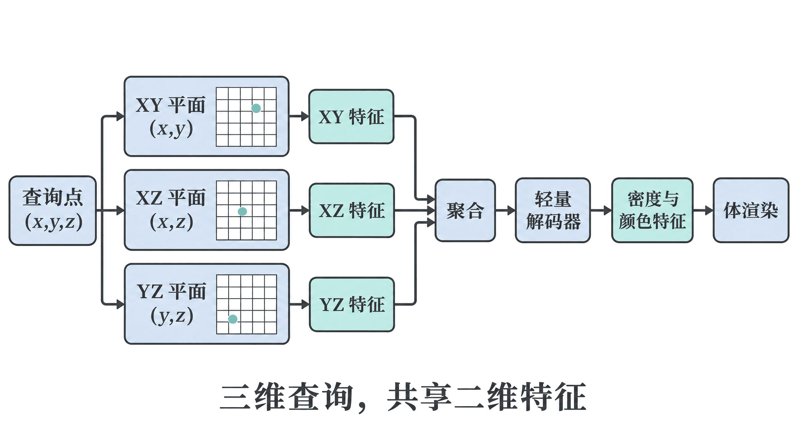

# 目录

[1. GAN 在数字人发展中解决过什么核心问题？](#q-001)
  - [面试问题：GAN、扩散、DiT、Flow Matching 分别属于哪一层？](#q-002)
  - [面试问题：为什么现在仍然需要学习 GAN 数字人？](#q-003)
  - [面试问题：GAN 数字人的典型模块有哪些？](#q-004)

[2. 经典 2D 数字人如何组织外观和运动？](#q-005)
  - [面试问题：StyleGAN 系列为什么是人脸生成的重要基础？](#q-006)
  - [面试问题：StyleGAN 的 latent space 为什么适合做人脸编辑和数字人定制？](#q-007)
  - [面试问题：GAN Inversion 在数字人里有什么作用？](#q-008)
  - [面试问题：Monkey-Net、FOMM、TPSMM 如何用运动场驱动肖像？](#q-009)
  - [面试问题：LivePortrait 如何用隐式关键点与特征变形降低肖像驱动延迟？](#q-010)
  - [面试问题：GAN Talking Head 如何做音频驱动口型？](#q-011)

[3. GAN 换脸的低延迟优势来自哪里？](#q-012)
  - [面试问题：DeepFakes、FaceSwap、FaceShifter、SimSwap、HiFiFace 的核心差异是什么？](#q-013)
  - [面试问题：ArcFace 身份特征如何注入 GAN 换脸网络？](#q-014)
  - [面试问题：GAN 换脸如何处理姿态、表情、遮挡和边界融合？](#q-015)
  - [面试问题：GAN 视频数字人如何保证时序一致性？](#q-016)
  - [面试问题：GAN 换脸相比 Diffusion 换脸还有哪些优势和短板？](#q-017)

[4. 什么是 3D-aware GAN？](#q-018)
  - [面试问题：HoloGAN、pi-GAN、GIRAFFE、StyleNeRF、EG3D 如何演进？](#q-019)
  - [面试问题：EG3D 的 tri-plane 表示为什么重要？](#q-020)
  - [面试问题：3D-aware GAN 如何实现人脸视角一致性？](#q-021)
  - [面试问题：3D-aware GAN 与 NeRF/3DGS Avatar 有什么区别？](#q-022)
  - [面试问题：GAN 如何用于 3D 数字人的纹理、材质和细节增强？](#q-023)

[5. AIGC 数字人从 GAN 走向了哪些新范式？](#q-024)
  - [面试问题：扩散式人体动画和 GAN 人体动画的本质差别是什么？](#q-025)
  - [面试问题：OmniHuman、Wan-Animate、StableAnimator、SkyReels-A1 代表什么趋势？](#q-026)
  - [面试问题：Hallo/Hallo2/Hallo3、Sonic、InfiniteTalk、EMO、VASA、MuseTalk 如何分类？](#q-027)
  - [面试问题：DiT、Flow Matching、多模态大视频模型对数字人有什么影响？](#q-028)
  - [面试问题：AIGC 数字人为什么越来越强调多条件混合训练？](#q-029)
  - [面试问题：实时交互数字人与离线高保真数字人的技术路线如何取舍？](#q-030)
  - [面试问题：少步蒸馏为什么不能只追求减少采样次数？](#q-038)

[6. 面试中如何系统回答“设计一个数字人生成系统”？](#q-031)
  - [面试问题：如何评估 GAN/Diffusion 数字人的质量？](#q-032)
  - [面试问题：GAN 数字人线上常见问题如何排查？](#q-033)
  - [面试问题：数字人安全、版权和反滥用为什么越来越重要？](#q-034)
  - [面试问题：当前 AI 数字人论文和 GitHub 项目可以如何分层跟踪？](#q-035)
  - [面试问题：HeyGen、Synthesia、Tavus、D-ID、Akool 等产品体现了哪些落地方向？](#q-036)
  - [面试问题：如何建立 AI 数字人方向的持续学习清单？](#q-037)
---

<h1 id="q-001">1. GAN 在数字人发展中解决过什么核心问题？</h1>

<h2 id="q-002">面试问题：GAN、扩散、DiT、Flow Matching 分别属于哪一层？</h2>

**难度评分：⭐⭐⭐ (3/5)  |  考察频率：⭐⭐⭐⭐⭐ (5/5)**

这几个概念需要拆开比较。GAN 以生成器与判别器的对抗为训练核心；扩散模型围绕加噪与去噪过程构造学习目标；Flow Matching 学习将噪声分布输运到数据分布的速度场；DiT 则是生成主干的一种 Transformer 架构。[1,12]

<div align="center">

| 概念 | 主要描述的层次 | 与其他概念的关系 |
|---|---|---|
| GAN | 对抗训练框架 | 生成器可采用不同结构，也可为其他模型提供对抗精修 |
| 扩散 | 噪声过程与生成建模 | 去噪主干可以是 U-Net 或 Transformer |
| Flow Matching | 连续输运路径及速度学习 | 可用 Transformer 预测速度，采样步数另行选择 |
| DiT | 网络架构 | 可以承载扩散或流匹配相关目标 |

</div>

它们并非四个互斥时代。实际数字人系统可以用 DiT 加 Flow Matching，再通过蒸馏与对抗训练得到少步生成器。评估速度时应看实际采样与解码路径，不能由名称直接推断。

<h2 id="q-003">面试问题：为什么现在仍然需要学习 GAN 数字人？</h2>

**难度评分：⭐⭐ (2/5)  |  考察频率：⭐⭐⭐⭐ (4/5)**

GAN 时代留下的价值包括可编辑的人脸潜空间、身份与目标属性分离、运动场驱动，以及将生成学习与三维渲染结合。这些问题在今天仍然存在，只是承载它们的主干不断变化。

对局部换脸、肖像驱动和超分等受约束任务，一次前向的生成器常能提供较低延迟。它也可以作为更大系统中的局部模块，或参与扩散蒸馏后的质量精修。是否适合部署，还要看训练域、设备与最终画面要求。

学习时应保留能复用的机制：条件如何注入、身份损失如何工作、运动和外观怎样分工、判别器怎样约束质量。具体工具更新很快，这些设计问题会持续出现在后续模型里。

<h2 id="q-004">面试问题：GAN 数字人的典型模块有哪些？</h2>

**难度评分：⭐⭐⭐ (3/5)  |  考察频率：⭐⭐⭐⭐ (4/5)**

训练中，生成器根据噪声或条件生成结果，判别器区分真实与生成样本；身份编码器、属性编码器和运动估计模块则根据任务提供控制信号。**判别器通常用于训练，并不需要在普通生成推理中逐帧运行。**

人脸任务的一种生成器目标可以写成：

```math
\mathcal L_G=\lambda_{\mathrm{adv}}\mathcal L_{\mathrm{adv}}
+\lambda_{\mathrm{id}}\mathcal L_{\mathrm{id}}
+\lambda_{\mathrm{rec}}\mathcal L_{\mathrm{rec}}
+\lambda_{\mathrm{perc}}\mathcal L_{\mathrm{perc}}
+\lambda_{\mathrm{temp}}\mathcal L_{\mathrm{temp}}.
```

这些损失并非每个模型都具备。重建项需要有效配对，时间项需要连续帧或可靠运动关系，身份项需要适用的人脸特征。应先明确监督来源，再组合损失，避免只按公式长度设计训练。[1]

---

<h1 id="q-005">2. 经典 2D 数字人如何组织外观和运动？</h1>

<h2 id="q-006">面试问题：StyleGAN 系列为什么是人脸生成的重要基础？</h2>

**难度评分：⭐⭐⭐ (3/5)  |  考察频率：⭐⭐⭐⭐ (4/5)**

StyleGAN 用映射网络将随机变量 $`z`$ 变成中间表示 $`w`$，再逐层控制生成特征，使部分外观变化可以在潜空间中被组织和编辑。[2]

不同版本的改动不能混为一谈。早期 StyleGAN 使用基于 AdaIN 的样式控制；StyleGAN2 改进调制与解调、正则化及伪影；StyleGAN3 关注混叠与纹理粘连，使图像变化更符合平移或旋转等连续变换。

低分辨率层通常更影响整体形状，高分辨率层更影响局部细节，但这是经验上的分工，不是严格独立的语义开关。StyleGAN3 的 alias-free 设计也不等于完整三维一致性。

在数字人中，这一系列提供了身份生成、真实图像反演与语义编辑的基础。它的可控性需要通过实际编辑方向与身份保持测试来证明。

<h2 id="q-007">面试问题：StyleGAN 的 latent space 为什么适合做人脸编辑和数字人定制？</h2>

**难度评分：⭐⭐⭐ (3/5)  |  考察频率：⭐⭐⭐⭐ (4/5)**

常见空间包括输入噪声 $`Z`$、映射后的 $`W`$、允许不同层使用不同潜变量的 $`W^+`$，以及直接控制调制参数的 style space。更自由的空间有利于重建，也可能偏离训练分布并削弱编辑稳定性。

线性编辑可写为：

```math
w'=w+\alpha d.
```

$`d`$ 是估计的属性方向，$`\alpha`$ 控制幅度。一个方向在部分人物上表达微笑，并不意味着对所有身份都只改变微笑；它还可能改变年龄、发型或姿态。

实际定制应固定身份，逐步增加编辑幅度，检查目标属性响应与其他属性变化。插值平滑只能说明路径连续，不足以证明各语义已经解耦。

<h2 id="q-008">面试问题：GAN Inversion 在数字人里有什么作用？</h2>

**难度评分：⭐⭐⭐⭐ (4/5)  |  考察频率：⭐⭐⭐⭐ (4/5)**

GAN Inversion 为真实图像寻找生成器中的表示，典型优化形式是：

```math
w^*=\arg\min_w\mathcal L(G(w),I).
```

优化式方法逐步更新潜变量，编码器式方法一次预测初始化，混合方法则先编码再细化。PTI 在给定潜变量附近进一步调整生成器，使它更贴合目标图像。[3]

关键取舍是重建与可编辑性。自由度越高，越容易拟合耳饰、背景或细小纹理，但也可能离开原本便于语义编辑的区域。优化噪声图或微调权重还会增加逐人定制成本。

验收不应止于原图重建。还要改变表情、头姿或年龄，观察身份是否保留、局部是否产生伪影，并报告定制时间与模型额外存储。

<h2 id="q-009">面试问题：Monkey-Net、FOMM、TPSMM 如何用运动场驱动肖像？</h2>

**难度评分：⭐⭐⭐ (3/5)  |  考察频率：⭐⭐⭐⭐ (4/5)**

这类方法先估计源图与驱动帧之间的运动，再对源图特征进行变形，由生成网络补全不可见区域。外观主要来自源图，动作主要来自驱动序列。[4]

Monkey-Net 用学习到的关键点组织运动；FOMM 进一步利用局部一阶运动信息，包括关键点附近的仿射变化；TPSMM 使用薄板样条变换描述更灵活的非刚性运动。因此不能把它们都称为同一种“一阶运动模型”。

典型链路是关键点或变换估计、稠密运动、特征 warping、遮挡预测和图像生成。大角度转头会暴露源图中没有的区域，网络需要补全；如果运动估计本身错位，后续生成也难以保留五官和纹理。

训练可使用自监督重建和对抗损失，具体方法的监督组合需要分别说明，不能因它们使用了 warping 就全部等同于传统 GAN。

<h2 id="q-010">面试问题：LivePortrait 如何用隐式关键点与特征变形降低肖像驱动延迟？</h2>

**难度评分：⭐⭐⭐ (3/5)  |  考察频率：⭐⭐⭐⭐ (4/5)**

LivePortrait 将任务集中在肖像的表情和头部运动迁移：提取参考外观与隐式关键点，估计驱动变化，在特征空间 warping，再用生成器输出画面。stitching 与 retargeting 模块提供拼接以及眼睛、嘴部等控制。[5]

它降低了每帧重新生成整个世界的需求，外观可以预先编码，运行时主要处理运动与局部合成。因此轻量的前向生成能在受控任务中获得较低延迟。

其基本输入是肖像及运动驱动信息，原始方法不等于完整的语音对话系统。要接入实时语音，还需音频到运动的路径、时间同步与播放控制。

评估应包含大转头、驱动与源人物比例不同、眼口幅度极端等场景。实时优势来自任务约束和结构设计，效果仍受参考图可见范围和运动估计质量限制。

<h2 id="q-011">面试问题：GAN Talking Head 如何做音频驱动口型？</h2>

**难度评分：⭐⭐⭐ (3/5)  |  考察频率：⭐⭐⭐⭐ (4/5)**

音频驱动可以先预测关键点或 3DMM 表情，再生成头像；也可以直接把音频特征与图像条件融合，重绘嘴部或更大区域。前者便于显式控制几何，后者能直接学习外观，却更依赖配对数据。

训练通常结合重建、感知、同步和对抗约束。同步专家衡量音频片段与嘴部片段的对应，若把专家冻结，它仍可向生成结果传递梯度；冻结参数不等于切断全部梯度。[6]

局部修嘴能保留目标视频的大部分内容，无法自动生成与新语气协调的头动和手势。若修改范围扩大，身份与背景也需要更强约束。选择路线应先明确是配音替换、肖像表演，还是全身音频驱动。

---

<h1 id="q-012">3. GAN 换脸的低延迟优势来自哪里？</h1>

<h2 id="q-013">面试问题：DeepFakes、FaceSwap、FaceShifter、SimSwap、HiFiFace 的核心差异是什么？</h2>

**难度评分：⭐⭐⭐ (3/5)  |  考察频率：⭐⭐⭐⭐ (4/5)**

这些名称包含软件项目和论文方法，不能当成统一模型谱系。早期 DeepFakes 常采用共享编码器与身份相关解码器；FaceSwap 也可能指不同实现的软件工具；FaceShifter、SimSwap、HiFiFace 才有各自明确的论文设计。[7]

FaceShifter 以身份与多层目标属性融合为核心，并设计面向遮挡与异常区域的处理；SimSwap 通过身份注入和弱特征匹配保留目标属性；HiFiFace 进一步加入三维形状相关信息。

演进中可复用的变化，是从逐身份训练走向用身份条件控制的多身份泛化，再加强脸型、细节和遮挡。并非所有早期自编码换脸都使用对抗训练，比较时也要固定检测、裁剪与融合链路。

<h2 id="q-014">面试问题：ArcFace 身份特征如何注入 GAN 换脸网络？</h2>

**难度评分：⭐⭐⭐ (3/5)  |  考察频率：⭐⭐⭐⭐ (4/5)**

先从经过对齐的源人脸提取识别特征，再将其映射为生成器的条件。可采用通道调制、特征拼接、条件归一化或注意力读取；不同方法的注入位置和参数共享方式不同。

常见身份约束为：

```math
\mathcal L_{\mathrm{id}}=1-
\frac{E(I_{\mathrm{out}})^\top E(I_{\mathrm{src}})}
{\|E(I_{\mathrm{out}})\|_2\|E(I_{\mathrm{src}})\|_2}.
```

ArcFace 是识别训练目标及相关特征体系，InsightFace 是包含多种模型与工具的实现生态，二者不能作为完全等价的网络名称。识别器冻结时，训练仍需保留对生成图像的梯度。[7]

高相似度不能代替目标表情保持。应同时约束目标属性，并检查侧脸、遮挡和极端表情时识别特征是否可靠。

<h2 id="q-015">面试问题：GAN 换脸如何处理姿态、表情、遮挡和边界融合？</h2>

**难度评分：⭐⭐⭐ (3/5)  |  考察频率：⭐⭐⭐⭐ (4/5)**

目标属性编码器提供头姿、表情和上下文，源身份条件提供人物特征。几何先验可以辅助确定脸型与投影，遮挡预测则决定哪些区域应该保留。

边界处理需要区分颜色不匹配、mask 错位和缺失背景。alpha blending 可以软化边界，泊松融合可以调整局部梯度，但都不能修复错误的鼻子位置或被生成脸覆盖的手。

大脸型差异下还会出现新暴露区域：源脸变窄后，旧脸旁边的背景需要补全；眼镜、发丝和麦克风则要结合局部深度与透明度处理。视频中这些区域的判断还需稳定跟踪，避免边界逐帧跳变。

<h2 id="q-016">面试问题：GAN 视频数字人如何保证时序一致性？</h2>

**难度评分：⭐⭐⭐⭐ (4/5)  |  考察频率：⭐⭐⭐⭐ (4/5)**

时间稳定性首先来自稳定条件。检测框、关键点、身份、mask 和颜色校正参数如果逐帧跳动，模型即使每帧推理很快也会闪烁。计算速度快与时间一致没有必然关系。

模型可以读取连续帧、使用时间判别器或在可靠区域加入光流对齐损失。共享参考特征能减少外观漂移，递归历史则要警惕错误累积。遮挡与新出现区域不能用上一帧简单约束。

后处理平滑应保留真实运动。对嘴部施加过强低通会损伤口型，对整脸直接平均会产生重影。测试应在同样的驱动动作下比较闪烁和响应，而不是用更静止的输出换取更低帧间差异。

<h2 id="q-017">面试问题：GAN 换脸相比 Diffusion 换脸还有哪些优势和短板？</h2>

**难度评分：⭐⭐⭐ (3/5)  |  考察频率：⭐⭐⭐⭐ (4/5)**

局部、固定输入范围的 GAN 换脸，常具有少次前向、资源可控的优点；扩散式换脸可利用更丰富的预训练生成先验，但多步采样、条件扰动与非编辑区域变化需要额外处理。蒸馏后的扩散模型也可能只有少量步骤。

因此应按工作负载比较：同一脸部尺寸、同一视频长度、同一检测与融合管线，分别测身份、目标属性、边界、时间稳定和延迟。整帧生成与局部裁剪修脸的速度不具有直接可比性。

若任务只需要稳定地替换脸部，一套成熟的小模型可能更合适；若还要改变场景和角色表演，就需要更大的编辑范围。技术路线的选择应跟随任务自由度，而非固定的家族排名。

---

<h1 id="q-018">4. 什么是 3D-aware GAN？</h1>

<h2 id="q-019">面试问题：HoloGAN、pi-GAN、GIRAFFE、StyleNeRF、EG3D 如何演进？</h2>

**难度评分：⭐⭐⭐⭐ (4/5)  |  考察频率：⭐⭐⭐ (3/5)**

3D-aware GAN 在类别生成中引入三维中间表示和可控相机，希望同一身份能从不同视角被观察。[8]

<div align="center">

| 方法 | 主要机制 | 需要理解的进展 |
|---|---|---|
| HoloGAN | 三维特征体与投影 | 把视角变化显式引入生成 |
| pi-GAN | 风格控制的隐式辐射场 | 将生成潜变量与连续三维函数结合 |
| GIRAFFE | 可组合的对象与背景特征场 | 用空间变换控制对象与场景 |
| StyleNeRF | 风格生成与高效神经渲染 | 在高分辨率与三维约束间折中 |
| EG3D | 三平面、轻量解码与超分 | 降低三维查询成本并保留图像先验 |

</div>

它们并非单线替代关系。类别级生成、场景组合和高效人脸渲染是不同目标。二维超分还能引入新的视角不一致，因此具有三维中间表示后，最终图像仍需单独验证。

<h2 id="q-020">面试问题：EG3D 的 tri-plane 表示为什么重要？</h2>

**难度评分：⭐⭐⭐⭐ (4/5)  |  考察频率：⭐⭐⭐⭐ (4/5)**

EG3D 用三个正交二维特征平面表达三维查询。对点 $`p=(x,y,z)`$，分别在 XY、XZ、YZ 平面双线性采样并聚合，再由轻量解码器预测密度与颜色特征。[8]

```math
f(p)=F_{xy}(x,y)+F_{xz}(x,z)+F_{yz}(y,z).
```

对每平面分辨率 $`N\times N`$、通道数 $`C`$ 的表示，特征存储约为 $`3N^2C`$；稠密三维网格则约为 $`N^3C`$。这里只比较特征存储，不能直接当成完整模型显存或速度比。

<div align="center">



</div>

图中三维点共享二维特征，最终仍要沿相机射线做体渲染。EG3D 还结合二维超分与训练约束提高输出质量；三平面本身并不直接生成网格，也不保证后续超分完全视角一致。

<h2 id="q-021">面试问题：3D-aware GAN 如何实现人脸视角一致性？</h2>

**难度评分：⭐⭐⭐⭐ (4/5)  |  考察频率：⭐⭐⭐ (3/5)**

让同一潜变量生成共享的三维表示，再改变相机渲染，是视角一致性的主要来源。不同视角需要解释同一个空间结构，比完全独立生成二维图像多了一层约束。

相机分布、姿态估计和训练数据覆盖也会影响模型。若训练只有正脸，背面仍可能被任意补全；若二维超分对不同视角产生不协调细节，最终图像也会违背底层几何。

验证时固定身份潜变量，连续改变相机并回到起点，检查轮廓、耳朵、纹理和遮挡恢复。还应把低分辨率神经渲染与最终超分结果分开看，以定位不一致来自表示还是后处理。[8]

<h2 id="q-022">面试问题：3D-aware GAN 与 NeRF/3DGS Avatar 有什么区别？</h2>

**难度评分：⭐⭐⭐ (3/5)  |  考察频率：⭐⭐⭐ (3/5)**

3D-aware GAN 主要描述类别级生成与对抗训练，NeRF/3DGS 主要描述场景表示及渲染方式，它们并非互斥类别。GAN 可以生成辐射场，前馈重建模型也可以预测多身份高斯 Avatar。

传统实例重建常用某个人的多视角照片或视频拟合资产；类别生成则学习许多人物的分布，并可随机采样新身份。近年来的前馈重建和可驱动模型正在连接这两类能力。

选型时应明确是生成不存在的人物，还是恢复指定人物；是否需要逐人优化，是否能动画驱动，以及是否可导出。用“GAN 生成很多人、NeRF 只重建一个人”记忆虽然方便，却会漏掉当前大量交叉方法。[8,13]

<h2 id="q-023">面试问题：GAN 如何用于 3D 数字人的纹理、材质和细节增强？</h2>

**难度评分：⭐⭐⭐ (3/5)  |  考察频率：⭐⭐⭐ (3/5)**

对抗训练可以用于 UV 纹理、法线或位移细节、渲染超分和域适配。它提供的主要约束是结果应接近真实外观分布，而非自动保证每个细节都来自目标人物。

在 UV 空间生成，需要检查接缝、不可见区域和材质含义；在图像空间增强，需要检查不同视角和相邻帧是否一致。把固定阴影写进反照率，会妨碍后续重光照；把幻觉毛孔当成真实身份细节，也会影响保真。

GFPGAN、CodeFormer 与 Real-ESRGAN 各有不同结构与训练设计，不能仅因都用于修复就称为同一种 GAN。部署应保存增强前后对照，确认细节提升没有改变脸型、口型或身份。

---

<h1 id="q-024">5. AIGC 数字人从 GAN 走向了哪些新范式？</h1>

<h2 id="q-025">面试问题：扩散式人体动画和 GAN 人体动画的本质差别是什么？</h2>

**难度评分：⭐⭐⭐ (3/5)  |  考察频率：⭐⭐⭐⭐ (4/5)**

许多早期人体动画先估计运动场，再变形参考特征并补全；扩散式动画则在条件约束下迭代生成画面，能利用较大规模的图像与视频预训练先验。前者更依赖可复用外观与可靠对应，后者拥有更大的生成自由度。

自由度带来更丰富的新姿态、服装和场景，也带来身份漂移与非目标区域变化。warping 在新暴露区域会受源图观测限制，扩散补全则可能生成合理但不真实的细节。

这只是典型设计差异，不是严格按损失函数划分的能力上限。对抗方法可以加入视频上下文，扩散模型也可以使用运动场和少步蒸馏。应对齐输入条件、计算预算与输出范围后再比较。

<h2 id="q-026">面试问题：OmniHuman、Wan-Animate、StableAnimator、SkyReels-A1 代表什么趋势？</h2>

**难度评分：⭐⭐⭐ (3/5)  |  考察频率：⭐⭐⭐ (3/5)**

这组方法可以用三条线索串联：OmniHuman-1 用混合条件扩大可用训练数据；StableAnimator 加强身份特征与视频主干的适配；SkyReels-A1 和 Wan-Animate 则提供更明确的表情、身体及环境控制。[9]

它们并非全部采用同一种 DiT 或相同训练目标，也不都具有完整的实时交互能力。共同问题是让视频先验接受细粒度人物约束，同时保留动作变化和可编辑性。

面试中解释到这一层即可建立技术地图。具体结构与数据设计见[角色动画章节](./02_可控人体生成与角色动画高频考点.md#q-010)，本章保留它们与经典生成路线之间的联系，避免重复逐一背诵模型模块。

<h2 id="q-027">面试问题：Hallo/Hallo2/Hallo3、Sonic、InfiniteTalk、EMO、VASA、MuseTalk 如何分类？</h2>

**难度评分：⭐⭐⭐ (3/5)  |  考察频率：⭐⭐⭐ (3/5)**

按输出范围与推理方式分类，比按名字出现顺序更清楚。[5,6,10]

<div align="center">

| 方法或系列 | 主要关注点 | 分类时要保留的边界 |
|---|---|---|
| MuseTalk | 局部唇形同步 | 使用 latent 表示不等于执行标准多步扩散采样 |
| EMO | 音频驱动、表达丰富的肖像 | 生成范围和计算成本不同于局部修嘴 |
| VASA-1 | 面部动态、头动与实时生成研究 | 研究演示不等于可直接使用的公开服务 |
| Hallo / Hallo2 | 分层肖像驱动、长时与高分辨率 | 高分辨率后处理应单独计入 |
| Hallo3 | 视频基础模型上的肖像生成 | 架构变化与任务能力需分别说明 |
| Sonic | 上下文音频与运动关系 | 全局感知有具体上下文范围 |
| InfiniteTalk | 稀疏帧配音与长时续接 | 持续生成不等于无限期无漂移或实时 |

</div>

具体原理见[音频驱动章节](./03_音频驱动数字人与长视频生成高频考点.md)。分类本身应帮助确定输入、修改范围与验收目标，而非制造“越新越全面”的排名。

<h2 id="q-028">面试问题：DiT、Flow Matching、多模态大视频模型对数字人有什么影响？</h2>

**难度评分：⭐⭐⭐⭐ (4/5)  |  考察频率：⭐⭐⭐⭐ (4/5)**

DiT 让视频 latent 与条件特征能够通过 Transformer 组织交互；Flow Matching 则提供学习连续生成速度场的训练方式。以简单线性路径为例：

```math
x_t=(1-t)x_0+t x_1,\qquad
\mathcal L_{\mathrm{FM}}=\mathbb E\left[\|v_\theta(x_t,t,c)-(x_1-x_0)\|_2^2\right].
```

这里 $`x_0`$ 是噪声，$`x_1`$ 是数据，$`c`$ 表示条件；其他路径或时间约定需要修改目标。采样沿学习到的速度场积分，步数由采样和蒸馏设计决定。[12]

对数字人而言，视频底模提供人体运动与场景先验，身份、音频和姿态适配器提供任务控制。但 Transformer 不会自动解决长视频记忆，Flow Matching 也不天然等于一步生成。长上下文、因果适配和条件冲突仍需专门设计。

<h2 id="q-029">面试问题：AIGC 数字人为什么越来越强调多条件混合训练？</h2>

**难度评分：⭐⭐⭐⭐ (4/5)  |  考察频率：⭐⭐⭐ (3/5)**

人物视频中的有效控制常不齐全：有的片段只有好画面，有的有清晰语音，有的可提取可靠姿态。混合条件训练希望让这些数据共同贡献能力，同时让模型学会在不同输入组合下工作。

核心是避免强条件吞掉弱条件。姿态几乎直接给出动作时，模型可能无需读取音频；参考图与目标过近时，模型可能无需理解文本。任务采样、条件 dropout 和分阶段训练都服务于控制路径的学习。[9]

评估应覆盖每种实际部署的组合，并测试缺失或低质量条件。训练中存在某一路输入，不代表模型真正学会使用它。具体数据设计见[多条件训练问答](./02_可控人体生成与角色动画高频考点.md#q-011)。

<h2 id="q-030">面试问题：实时交互数字人与离线高保真数字人的技术路线如何取舍？</h2>

**难度评分：⭐⭐⭐⭐ (4/5)  |  考察频率：⭐⭐⭐⭐ (4/5)**

先定义可接受的等待、持续运行时长和修改自由度。实时客服需要迅速接话、停止旧回复并维持音画同步；广告制作可以多次采样和返修，更看重最终画质与动作表现。

实时系统可以使用网格驱动、局部生成或因果少步视频模型；离线系统可以采用更多采样步、更高分辨率和复杂后处理。3DGS 既可能用于实时渲染，也可能嵌入昂贵的资产构建流程，不能只按表示名称划分实时或离线。

评测中把首响应、稳定吞吐与端到端成本分开。预生成长视频再匀速播放，不构成实时生成；生成速度快但依赖完整未来音频，也未满足在线对话需求。最终路线应在目标设备和并发下验证。

<h2 id="q-038">面试问题：少步蒸馏为什么不能只追求减少采样次数？</h2>

**难度评分：⭐⭐⭐⭐⭐ (5/5)  |  考察频率：⭐⭐⭐ (3/5)**

教师多步采样可以逐渐修正结构与细节，少步学生必须在更少计算中完成相似生成。轨迹蒸馏让学生学习教师的中间或终点映射，分布匹配蒸馏则通过教师与学生分布的差异调整生成，二者约束并不相同。

在数字人中，减少步骤可能同时影响脸部锐度、牙齿、嘴部幅度和颜色。AURA 的消融发现，某些整体分布指标对少步带来的模糊不够敏感，因此还检查脸部清晰度与颜色变化。[11]

实时部署还需要因果结构、有限历史、音频输入和解码速度。采样变快后，VAE 解码或编码传输可能成为新瓶颈。蒸馏时只在短片段上匹配分布，也可能保不住长时续接。

应以固定硬件和输出配置报告质量—首块延迟—持续速度的取舍，同时验证动态、静默和困难口型。这里的通用价值是把训练计算转移到更便宜的推理路径，收益必须在完整任务链路上确认。

---

<h1 id="q-031">6. 面试中如何系统回答“设计一个数字人生成系统”？</h1>

<h2 id="q-032">面试问题：如何评估 GAN/Diffusion 数字人的质量？</h2>

**难度评分：⭐⭐⭐ (3/5)  |  考察频率：⭐⭐⭐⭐⭐ (5/5)**

以同一任务约束比较模型：人物参考、驱动条件、输出尺寸、时长、后处理和随机采样预算保持一致，再分别记录身份、动作、同步、时间稳定和计算成本。

FID/FVD 反映分布，LPIPS 需要合理配对，识别相似度衡量部分身份特征，SyncNet 衡量特定协议下的音画对应。任何一个指标都不能覆盖全部数字人体验。

应保留困难集、长时集和失败率，并将检测失败的帧纳入统计。实时系统还要测首音频、首画面和打断停止时间，在并发和网络抖动下观察分位数。新近会话级基准的价值见[StreamEval 问答](./03_音频驱动数字人与长视频生成高频考点.md#q-030)。

<h2 id="q-033">面试问题：GAN 数字人线上常见问题如何排查？</h2>

**难度评分：⭐⭐⭐⭐ (4/5)  |  考察频率：⭐⭐⭐⭐ (4/5)**

排障从可观察中间结果开始。先检查检测框、裁剪与姿态，再看身份特征和区域条件，最后检查生成、融合与编码。不要一看到脸不像就直接增大身份损失。

<div align="center">

| 现象 | 优先排查 | 可验证的修复 |
|---|---|---|
| 身份忽好忽坏 | 跟踪换人、裁剪漂移 | 固定正确轨迹后复测 |
| 嘴型持续落后 | 音视频时间基准、缓冲 | 改正 offset 并检查全片趋势 |
| 边界闪烁 | mask 与逐帧调色 | 固定融合参数做阶段对照 |
| 侧脸崩坏 | 训练覆盖、可见性与几何 | 困难集复测、可靠几何约束 |
| 牙齿反复变化 | 口腔数据与独立修复 | 检查增强前后和连续帧 |
| 端侧卡顿 | 生成、贴回、编码或内存复制 | 分项计时后优化真正瓶颈 |

</div>

每次只修改可归因的一项，并保留同一素材的前后结果。这样才能区分算法收益与输入、缓存或后处理变化。

<h2 id="q-034">面试问题：数字人安全、版权和反滥用为什么越来越重要？</h2>

**难度评分：⭐⭐⭐ (3/5)  |  考察频率：⭐⭐⭐ (3/5)**

产品侧的身份授权应贯穿素材、角色资产、模型和输出记录。照片使用许可、声音克隆许可和商业投放范围可能不同，不能用一份泛化的“上传即授权”覆盖所有用途。

工程上需要角色权限、有效期、撤回与删除机制，并让生成任务可追踪到授权资产。输出标识、水印和来源记录可辅助识别，但可能被压缩、裁剪或重拍破坏；伪造检测也存在误判。

因此治理应覆盖使用前的授权、使用中的范围限制与异常监控，以及使用后的投诉和停用流程。具体法规依地区和业务确认，算法评测中的检测分数不能替代这些业务能力。通用要求见[总览中的授权问答](./01_AIGC时代数字人基础高频考点.md#q-042)。

<h2 id="q-035">面试问题：当前 AI 数字人论文和 GitHub 项目可以如何分层跟踪？</h2>

**难度评分：⭐⭐⭐⭐ (4/5)  |  考察频率：⭐⭐⭐ (3/5)**

截至 2026-11-23，更值得持续追踪的线索包括因果流式生成、长历史下的稳定训练、身份与动作解耦，以及可驱动资产的低成本表示。AURA、LongCat-Video-Avatar 1.6、WithAnyone 和 GALA 分别提供了这些问题的具体案例。[11,13]

判断新项目时应分开四层证据：方法是否被后续技术明确使用，模型是否公开采用，产品是否暴露相关能力，以及研究社区是否有复现或有意义的比较。论文引用、GitHub stars 和演示相似，都不能单独证明生产采用。

只有论文的方法可以作为机制案例，有代码和权重才能进一步检查可复现性，有目标场景的部署结果才能讨论业务收益。对这里列举的近期研究，不将跨周期潜力等同于已经被主流产品采用。

更新知识库时，优先保留能解释数据、延迟、可控性和评估问题的问答，减少随发布节奏变长的模型名单。

<h2 id="q-036">面试问题：HeyGen、Synthesia、Tavus、D-ID、Akool 等产品体现了哪些落地方向？</h2>

**难度评分：⭐⭐⭐ (3/5)  |  考察频率：⭐⭐⭐ (3/5)**

这些产品体现了不同工作流：HeyGen 和 Synthesia 侧重脚本、角色和企业视频制作；Tavus 强调对话式视频接口；D-ID 提供说话头像与交互能力；Akool 覆盖多种营销视频与视觉编辑工具。[14]

产品宣传能帮助判断目标用户和交付形态，无法反推闭源模型结构。即使两个产品都能实时说话，也可能使用不同的人物表示、驱动方式和部署链路。

从产品中值得提炼的是交付约束：角色和品牌是否稳定，授权与审核是否完整，用户能否修改和返修，API 是否易集成，以及每条可用视频或每分钟有效会话的成本。市场定位可作为选型线索，实际功能、套餐和许可应按使用时版本核对。

<h2 id="q-037">面试问题：如何建立 AI 数字人方向的持续学习清单？</h2>

**难度评分：⭐⭐⭐ (3/5)  |  考察频率：⭐⭐⭐ (3/5)**

可以维护一个固定的小型测试集，让新方法持续回答同一批问题：正脸与侧脸是否都像本人，动作和语音是否响应，遮挡后能否恢复，长时间运行是否漂移，以及失败时能否定位。

学习材料分成基础、代表方法和运行证据。基础覆盖几何、语音时间、生成目标、运动表示与评估；每个任务保留少量互补方法；运行证据记录硬件、输入、版本、结果和失败样例。

读一篇新论文，先指出它相对基线改变了哪个机制，再看消融是否隔离该机制、实验输入是否公平、代码与模型是否实际可用。若只是更换底模后样片更好，应把底模收益与新方法收益分开。

这种学习方式让每次更新都能修正判断，而不会把知识库变成越来越难维护的工具清单。

---

## 参考资料

[1] Generative Adversarial Nets：<https://arxiv.org/abs/1406.2661>。

[2] StyleGAN：<https://arxiv.org/abs/1812.04948>；StyleGAN2：<https://arxiv.org/abs/1912.04958>；StyleGAN3：<https://nvlabs.github.io/stylegan3/>。

[3] Pivotal Tuning for Latent-based Editing of Real Images：<https://arxiv.org/abs/2106.05744>。

[4] FOMM：<https://aliaksandrsiarohin.github.io/first-order-model-website/>；Monkey-Net：<https://arxiv.org/abs/1812.08861>；TPSMM：<https://arxiv.org/abs/2203.14367>。

[5] LivePortrait：<https://arxiv.org/abs/2407.03168>；<https://github.com/KwaiVGI/LivePortrait>。

[6] Wav2Lip：<https://arxiv.org/abs/2008.10010>；MuseTalk：<https://github.com/TMElyralab/MuseTalk>。

[7] SimSwap：<https://github.com/neuralchen/SimSwap>；FaceShifter：<https://arxiv.org/abs/1912.13457>；HiFiFace：<https://arxiv.org/abs/2106.09965>。

[8] HoloGAN：<https://arxiv.org/abs/1904.01326>；pi-GAN：<https://marcoamonteiro.github.io/pi-GAN-website/>；GIRAFFE：<https://m-niemeyer.github.io/project-pages/giraffe/index.html>；StyleNeRF：<https://arxiv.org/abs/2110.08985>；EG3D：<https://nvlabs.github.io/eg3d/>。

[9] OmniHuman-1：<https://arxiv.org/abs/2502.01061>；StableAnimator：<https://arxiv.org/abs/2411.17697>；SkyReels-A1：<https://arxiv.org/abs/2502.10841>；Wan-Animate：<https://github.com/Wan-Video/Wan2.2>。

[10] EMO：<https://humanaigc.github.io/emote-portrait-alive/>；VASA-1：<https://www.microsoft.com/en-us/research/project/vasa-1/>；Hallo 系列：<https://github.com/fudan-generative-vision>；Sonic：<https://arxiv.org/abs/2411.16331>；InfiniteTalk：<https://arxiv.org/abs/2508.14033>。

[11] AURA，2026-11：<https://arxiv.org/abs/2611.26540>；LongCat-Video-Avatar 1.6，2026-11：<https://arxiv.org/abs/2611.18822>；WithAnyone：<https://arxiv.org/abs/2510.14975>。

[12] DiT：<https://arxiv.org/abs/2212.09748>；Flow Matching：<https://arxiv.org/abs/2210.02747>。

[13] GALA / Gaussian Blendshape Distillation，2026-10：<https://arxiv.org/abs/2610.02207>；ZARA，2026-11：<https://arxiv.org/abs/2611.10562>。

[14] 产品定位核验于 2026-11-23：<https://www.heygen.com/>；<https://www.synthesia.io/>；<https://www.tavus.io/>；<https://www.d-id.com/>；<https://akool.com/>。
