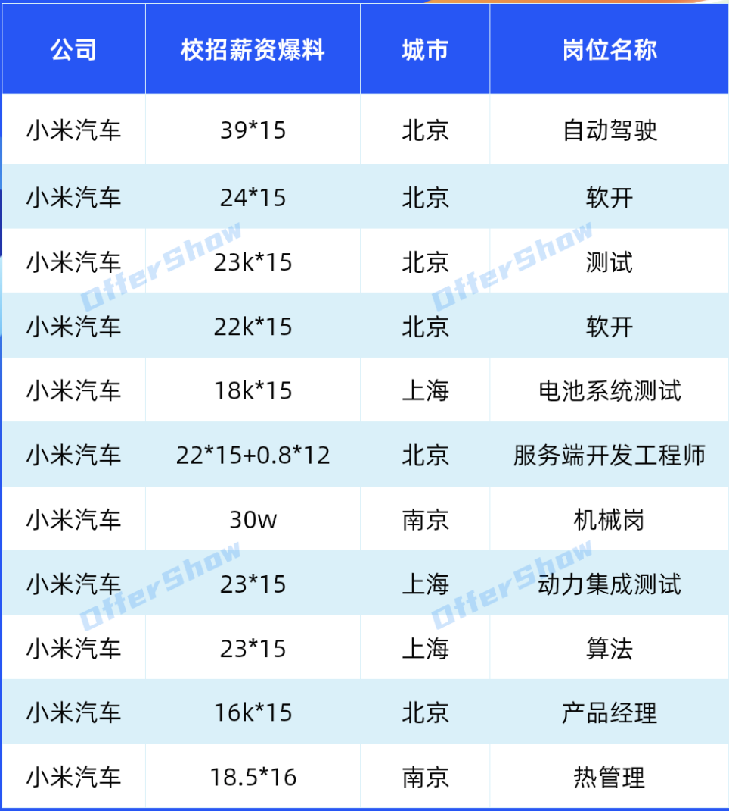

# 往届AIGC算法岗薪资情况汇总

判断一份 AI 岗位 offer，首先要把“岗位做什么”和“收入怎样兑现”讲清楚。大模型算法、Agent 应用开发、AI Infra 和测试开发，对能力的要求、定级方式与收入结构都可能不同；仅凭岗位名称带有 AI，不能推导出稳定的薪资溢价。

本文整理往届算法岗薪资样本，并补充开发、Agent/AI、测试开发的横向比较。**这些数字属于个案自报和区间估计，不是公司官方薪资标准，也不是总体平均数或中位数。** 除明确注明的城市与业务外，样本的具体届次、学历、部门、职级及兑现条件并不完整，不应补写成确定事实。

## 目录

- [一、薪资比较的统一口径](#salary-scope)
- [二、往届 AIGC 与算法岗个案](#salary-history)
- [三、开发、Agent/AI 与测开参考区间](#salary-comparison)
  - [字节跳动](#salary-bytedance)
  - [腾讯](#salary-tencent)
  - [阿里巴巴与蚂蚁集团](#salary-alibaba-ant)
  - [京东](#salary-jd)
  - [美团](#salary-meituan)
  - [百度](#salary-baidu)
  - [快手](#salary-kuaishou)
  - [网易](#salary-netease)
  - [小米](#salary-xiaomi)
  - [滴滴](#salary-didi)
- [四、2027 届秋招薪资披露案例（2026 年 9—10 月）](#salary-2027-disclosures)
  - [算法、Agent 与 AI 基础设施](#salary-2027-ai)
  - [软件开发、嵌入式与数字化](#salary-2027-software)
  - [芯片、硬件、电气与技术支持](#salary-2027-hardware)
  - [制造、汽车与其他工程研发](#salary-2027-industry)
  - [产品、运营、管理与非研发岗位](#salary-2027-business)
  - [岗位未披露或信息不完整的案例](#salary-2027-unspecified)
- [五、怎样比较首年收入与持续收入](#salary-offer)
- [六、面向 AIGC 求职的选择原则](#salary-decision)

## 一、薪资比较的统一口径

第三节的比较信息整理于 **2026 年 9 月**，用于理解往届案例和 2027 届求职时的谈薪范围；第四节另外保留 **2026 年 9 月 27 日至 10 月 26 日**的校招薪资披露，两批信息不合并统计。**2027 届指毕业届次，不代表表中数字已经在该届统一落地；历史案例与预测区间不能合并解释为已核验的 2027 届 offer。**

| 项目 | 本文口径 | 比较时需要确认 |
|---|---|---|
| 月薪 | `k` 表示千元人民币，按税前名义金额理解 | 工资构成、试用期折扣、是否包含津贴 |
| 月薪 × 计薪月数 | 例如 `30k × 16 = 48 万`，只做算术折算 | 其中多少个月保底、多少依赖绩效，不能一律视为固定收入 |
| 普通档、SP、SSP | 沿用求职交流中的相对档位标签 | 不是跨公司统一职级，也不保证同公司各部门口径一致 |
| 签字费 | 单列金额，默认不计入可持续年收入 | 发放时间、分期、服务期及离职返还条件 |
| 股权 | 股票、限制性股票、期权必须分清 | 授予总额、逐年归属、行权与出售条件、计价时点 |
| 补贴 | 房补、餐补、地方人才补贴等单列 | 资格、期限、税务与是否已计入报价 |
| 城市与业务 | 只保留已明确的案例标签 | 同名岗位在城市、业务、招聘批次之间不可直接互推 |

下文的年化数均以“万元”为单位。**月薪乘以计薪月数只是名义折算，不证明全部兑现，也不等于首个自然年实收。** 入职月份、奖金考核周期、归属期及税费都会影响实际到手金额。

## 二、往届 AIGC 与算法岗个案

以下个案保留具体报价与地点，不推定未知年份、学历或评级。算法岗个案与后文的开发/测开区间属于不同样本，不能因为同一家公司就直接比较高低档。

| 公司 | 岗位 | 薪资样本 | 工作地点 | 折算与待确认项 |
|---|---|---|---|---|
| 字节跳动 | 算法工程师 | `44k × 15 + 签字费` | 北京 | 月薪乘月数为 66 万；签字费金额与发放条件未明确 |
| 小红书 | 算法工程师 | `45k × 16 × 1.18 + 签字费` | 北京 | 算式结果为 84.96 万；`1.18` 的含义未明确，不应直接认定为固定现金或普遍系数 |
| 快手 | 算法工程师 | `43k × 16 + 2 × 12 + 六位数签字费` | 北京 | 月薪乘月数为 68.8 万；`2 × 12` 的单位未注明，若指每月 2k 补贴则另为 2.4 万，需单独确认 |
| 快手 | 搜索算法工程师 | `36k × 16` | 北京 | 名义折算 57.6 万 |
| 美团 | 算法工程师 | `38k × 15.5` | 北京 | 名义折算 58.9 万；小数月通常涉及奖金表达，需确认保底部分 |
| 高德 | 算法工程师 | `42k × 16 + 签字费` | 北京 | 月薪乘月数为 67.2 万；签字费未明确 |
| Momenta | 算法工程师 | `50k × 14，无签字费，无期权` | 苏州 | 名义折算 70 万；“无签字费、无期权”仅描述该个案 |
| 作业帮 | 大模型算法（NLP） | `31k × 15` | 北京 | 名义折算 46.5 万 |
| 百度 | 算法工程师 | `30k × 16` | 北京 | 名义折算 48 万 |

### 小米汽车校招薪资样本

图中信息作为单独样本保留。图示报价不能直接推广为小米集团、汽车业务全部部门或后续届次的统一标准；比较时仍需核对岗位、城市、计薪月数、奖金和股权兑现条件。

## 三、开发、Agent/AI 与测开参考区间

下面按公司归纳三类岗位的名义报价。**各档由不同案例及估计拼成，不是同一学历、城市、业务和届次的严格对照实验。** Agent/AI 列中涉及应用开发、基础设施、推荐工程和模型算法，已尽量拆明；没有明确细分职责的区间，应作为进一步询问的线索。

### 岗位名称与实际工作

| 方向 | 典型工作 | 薪资比较边界 |
|---|---|---|
| 大模型/多模态算法 | 数据、训练、对齐、检索与模型评测 | 研究经历、训练规模、学历和业务稀缺度会影响定级 |
| Agent 应用开发 | 工具调用、工作流、RAG、上下文管理、可观测性 | 常与后端或应用研发体系比较，不能套用高端算法岗个案 |
| AI Infra | 训练与推理平台、分布式、性能、数据基础设施 | 更依赖系统与性能工程能力，不等同于普通 API 集成 |
| 测试开发/AI 测开 | 自动化、质量平台、服务测试、模型与 Agent 评测 | “AI 测开”可能是不同职责组合，需看代码与系统责任范围 |

### 字节跳动

| 方向 | 普通档参考 | SP 参考 | SSP 参考 |
|---|---|---|---|
| 开发（前后端） | `26k × 15`，39 万 | `28–30k × 15`，42–45 万 | `32–38k × 15`，48–57 万；另有 5–9 万签字费 |
| Agent/AI 相关 | `28k × 15`，42 万 | `30–32k × 15`，45–48 万 | `34–36k × 15`，51–54 万；签字费未明确 |
| 测试开发 | `23k × 15`，34.5 万 | `25k × 15`，37.5 万 | 按月薪 28k 理解，`28k × 15` 为 42 万；需确认单位 |

开发个案还包括 `40k × 15 + 10 万签字费`、上海搜索架构 `34k × 15 + 11 万签字费`、成都数据中心平台化开发 `25k × 15`。前两例在签字费全额计入时分别为 70 万、62 万，不能据此推断是普遍可得的档位。杭州后端另有约 50 万总包样本，但构成不明，不拆算月薪。

AI 测开约 25k/月属于估计，不能视为已确认的普遍报价。岗位带有 Agent 或 AI 标签，仍需以实际研发职责、定级和书面 offer 判断。

### 腾讯

| 方向 | 普通档参考 | SP 参考 | SSP 参考 |
|---|---|---|---|
| 开发（前后端） | `27k × 15`，40.5 万；另有 3 万签字费 | `29–33k × 15`，43.5–49.5 万；另有 3–6 万签字费及 4–6 万股票表述 | `35–38k × 15`，52.5–57 万；另有 8 万签字费及 5–10 万股票表述 |
| Agent/AI 相关 | `30k × 15`，45 万，具体职责待确认 | 大模型岗约 70 万总包，构成未明确 | 算法岗 `41–42k × 17`，69.7–71.4 万；另列 20–30 万但构成未明确 |
| 测试开发 | `25k × 15`，37.5 万；另有“2 年股权”表述，金额未明确 | `27k × 15`，40.5 万 | `30k × 15`，45 万；另有 5 万签字费与 6 万股票表述 |

大模型和算法岗的高薪样本，不应作为 Agent 应用开发的默认报价。测试开发普通档案例涉及腾讯云成都，SP 案例涉及北京；城市和业务差异需要与岗位差异一起考虑。

前端另有 `27k × 15 + 5 万签字费` 的样本，腾讯地图相关业务有 `33k × 15` 的样本。开发 SSP 如果额外 5–10 万股票确实是首年归属价值，且 8 万签字费首年全额发放，则端点组合的首年名义合计为 **65.5–75 万**；这一范围只是算术包络，不证明每个端点组合都有实际 offer。股权期限未确认时，不直接把它计入首年现金。

测试开发 SSP 的 `45 + 5 + 6 = 56 万` 同样依赖股票为首年价值、签字费首年全额兑现的前提。算法岗额外 20–30 万的性质不明，应保留“构成待确认”，不能径直归为签字费或年终奖。

### 阿里巴巴与蚂蚁集团

**淘天、阿里其他业务与蚂蚁集团不能合并成一套薪资标准。** 下表中开发普通档有杭州淘天后端案例，其余区间仍需要确认具体业务与用工主体。

| 主体与方向 | 普通档参考 | SP 参考 | SSP 参考 |
|---|---|---|---|
| 阿里相关开发 | `25–26k × 16`，40–41.6 万；另有 1 万签字费 | `29–30k × 16`，46.4–48 万 | `32–35k × 16`，51.2–56 万；另有 3–8 万签字费 |
| 阿里相关 Agent/AI | 缺少可明确归属的普通档样本 | `26–28k × 16`，41.6–44.8 万 | `30k × 16` 及以上，48 万起 |
| 阿里相关测试开发 | `22k × 16`，35.2 万 | `24k × 16`，38.4 万 | `26k × 16`，41.6 万 |
| 蚂蚁集团 Java + AI 后端 | `23k × 15 + 绩效`，34.5 万加未明确部分 | 未明确 | 未明确 |

蚂蚁案例需要进一步核对 `15 薪` 是否已含部分绩效，避免把同一奖金重复相加。地方人才补贴不属于企业固定工资，受学历、毕业时间、落户或参保等条件限制，不应普遍折成“每月多拿 2–4k”。

### 京东

| 方向 | 普通档参考 | SP 参考 | SSP 参考 |
|---|---|---|---|
| 开发（前后端） | `22.4k × 20`，44.8 万 | `26–28k × 20`，52–56 万 | `30–32k × 20`，60–64 万 |
| Agent/AI 相关 | `26k × 18`，46.8 万 | Java + AI 案例 `30k × 18`，54 万 | 端智能研发案例 `28k × 20`，56 万 |
| 测试开发 | `20k × 20`，40 万 | `22k × 20`，44 万 | `24k × 20`，48 万 |

其他开发样本包括前端 `26k × 20`、数据开发 `27–28k × 20`、京东云数据库 `24k × 20`，名义折算分别为 52 万、54–56 万、48 万。

比较京东 offer 时，关键是把“20 薪”中的固定月数、绩效奖金和发放周期拆清楚。不同岗位案例也出现 18 薪，不能统一替换成 20 薪。关于某部门“多数人拿满”的交流信息，不能证明个人奖金保底，更不能外推至全公司。

### 美团

| 方向 | 普通档参考 | SP 参考 | SSP 参考 |
|---|---|---|---|
| 开发（前后端） | `23k × 15.5`，35.65 万 | `25k × 15.5`，38.75 万；另有 5 万签字费 | `30k × 15.5`，46.5 万；另有 8 万签字费与股权 |
| Agent/AI 相关 | `25k × 15.5`，38.75 万 | `27–28k × 15.5`，41.85–43.4 万 | 推荐工程相关样本 `30k × 15.5 + 8 万签字费`，签字费全额计入时为 54.5 万 |
| 测试开发 | `23k × 15.5`，35.65 万 | `25k × 15.5`，38.75 万 | `28k × 15.5`，43.4 万 |

开发 SSP 的 `30k × 15.5 + 8 万` 已经是 **54.5 万**，尚未计入股权，不能再写成 45–50 万总包。上海点评有月薪 30k、签字费 8 万、股票 30 万分四年的个案；只有四年等额归属时才可粗略折为每年 7.5 万的授予价值，实际仍需核对归属表与股价。

普通档开发与测开在上述样本中的月薪相同，不代表所有部门待遇都相同。`15.5 薪` 应确认年终绩效系数与首年折算，业务线相关 AI 岗位也不能直接等同于模型研究岗。

### 百度

| 方向 | 普通档参考 | SP 参考 | SSP 参考 |
|---|---|---|---|
| 开发（前后端） | `22–24k × 16`，35.2–38.4 万 | `25–28k × 16`，40–44.8 万；另有 6–8 万签字费 | `30–32k × 16`，48–51.2 万；另有 9 万签字费 |
| Agent/AI 相关 | `25–26k × 16`，40–41.6 万；涉及智能体业务、AI 基建优化 | `28k × 16`，44.8 万 | 凤巢模型工程样本 `30k × 16`，48 万 |
| 测试开发 | `22k × 16`，35.2 万；另有 6 万签字费 | `25k × 16`，40 万；另有 6 万签字费 | `26k × 16`，41.6 万；另有 8 万签字费 |

开发另有客户端 `22–28k × 16`、C++ `22–26k × 16` 的区间表述。部分签字费案例按两年发放，应按实际合同拆分，不能把全部签字费算作首年到账，也不能认定所有岗位都采用相同规则。

例如测试开发 SSP 报价 `26k × 16 + 8 万签字费`：不考虑折算时，工资与计薪月数部分为 41.6 万；若签字费两年等额发放，首年计入 4 万，则首年名义现金为 **45.6 万**，而不是 49.6 万。比较智能体业务和测开时，应同时看持续收入与签字费到期后的收入。

### 快手

| 方向 | 普通档参考 | SP 参考 | SSP 参考 |
|---|---|---|---|
| 开发（前后端） | `25.5k × 16`，40.8 万 | `27–30k × 16`，43.2–48 万 | `32–35k × 16`，51.2–56 万 |
| Agent/AI 相关 | `27k × 16`，43.2 万 | `28–30k × 16`，44.8–48 万 | `32k × 16`，51.2 万 |
| 测试开发 | 电商案例 `24k × 16 + 2k × 12`，工资部分 38.4 万，补贴 2.4 万 | `27k × 16`，43.2 万 | `30k × 16`，48 万 |

开发另有前端 `32k × 16`、交易支付业务 `30.5k × 16` 的样本，后者工资部分为 48.8 万；有案例另提每月 2k 房补，应核实是否独立发放及是否全年适用。

电商测开普通档含全年补贴时为 40.8 万。房补是否受城市、住址、入职时间或最长发放期限限制，需要逐一确认；实习补贴与正式员工补贴也不能混算。

### 网易

**这组数据的估计成分较高。** 不同游戏、内容和工具业务的奖金结构差异明显，以下档位不能视为已逐一核实的 offer 样本。

| 方向 | 普通档估计 | SP 估计 | SSP 估计 |
|---|---|---|---|
| 开发（前后端） | `22k × 13`，28.6 万 | `25k × 15`，37.5 万 | `28k × 16`，44.8 万 |
| Agent/AI 相关 | `25k × 13`，32.5 万 | `27k × 15`，40.5 万 | `30k × 16`，48 万 |
| 测试开发 | `22k × 15`，33 万 | `24k × 15`，36 万 | `27k × 15`，40.5 万 |

个案中有杭州开发 `28k ×（13–16）` 的表达，折算范围为 36.4–44.8 万。招聘标价、项目奖金说明和个人 offer 是不同类型的信息，不能用其中一种补齐另一种的缺失条件。AI 工作可能涉及美术生成、NPC、语音等，但岗位的实际研发深度和薪资仍需单独确认。

社招涨幅不属于校招薪资口径，不能用极端跳槽涨幅推断应届生待遇。

### 小米

| 方向 | 普通档参考 | SP 参考 | SSP 参考 |
|---|---|---|---|
| 开发（前后端） | 南京、武汉样本 `15–18k × 15`，22.5–27 万 | `21–23k × 15`，31.5–34.5 万 | 北京样本 `26k × 15`，39 万 |
| Agent/AI 相关 | 武汉 AI Infra 案例 `23k × 15`，34.5 万 | `25k × 15`，37.5 万 | 大模型数据处理/Infra 相关案例 `26k × 15`，39 万 |
| 测试开发 | 北京区间表述 `15–18k × 15`，22.5–27 万 | `20k × 15`，30 万 | `25k × 15`，37.5 万 |

开发另有北京软件开发 `20k × 15`、分布式系统开发 `26k × 15` 的案例，分别为 30 万和 39 万。测试开发 SSP 的算术结果是 **37.5 万**，不能写成 33 万。

城市差异和 Infra 岗位职责对比较尤其重要。武汉 AI Infra 个案提及公积金缴存比例 12%，但不能据此认定所有岗位、城市或计缴基数一致；公积金也不应直接加进税前现金工资。

### 滴滴

| 方向 | 普通档参考 | SP 参考 | SSP 参考 |
|---|---|---|---|
| 开发（前后端） | `21–23k × 15`，31.5–34.5 万 | `25–27k × 15`，37.5–40.5 万；另有 3–5 万签字费 | `30–33k × 15`，45–49.5 万 |
| Agent/AI 相关 | `25k × 15`，37.5 万 | `27–28k × 15`，40.5–42 万 | `30k × 15`，45 万 |
| 测试开发 | `21k × 15`，31.5 万 | `25k × 15`，37.5 万 | `27k × 15`，40.5 万 |

开发样本还包括前端 `23–30k × 15`、杭州后端 `26k × 15`、成都国际化外卖 `22k × 16`，名义折算分别为 34.5–45 万、39 万、35.2 万。签字费不是所有案例都有。

测试开发 SP 的 `25k × 15` 应为 **37.5 万**，不能写成 27.5 万。调度、定价、安全等业务中的 AI 岗位，也需要进一步区分算法研发、应用开发与平台工程，不能仅凭公司经营印象判断具体团队的稳定性。

## 四、2027 届秋招薪资披露案例（2026 年 9—10 月）

本节于 **2026 年 10 月 28 日**整理，覆盖 **2026 年 9 月 27 日至 10 月 26 日**窗口内的 2027 届校招交流信息，共 **108 个具名公司或机构条目，以及 1 个未具名 AI 应用案例**。这是公开交流中的二次汇总，未经逐份 offer 或企业确认；公司条目数不等于独立 offer 数，也不代表所有条目都已正式发放录用文件。

**每一笔披露单独阅读，不把公司多岗位报价平均，不把非 AI 岗位纳入 AI 薪资行情。** 本节与前文往届案例、2026 年 9 月整理的参考区间分开保留，不将它们拼成同一届次的普通档、SP 或 SSP 标准。

表中报价保留披露中的表达；`k/K` 表示千元，`w/W` 表示万元，解读列的年化金额均用万元。**未注明单位的乘法只作附条件折算，不替披露者补齐确定事实；总包也不自动等于税前固定现金。** 多笔报价用换行区分，岗位与报价没有明确对应关系时不强行匹配。除表中已明确的学历、地点外，其余信息保持未知。

### 算法、Agent 与 AI 基础设施

这一组优先列出 AI 应用、AI 芯片、GPU 系统及算法方向。只写“算法”而未细分的岗位仍保留其边界，不直接认定为大模型算法。

| 公司或机构 | 披露岗位与已知学历 | 报价 | 折算与比较边界 |
|---|---|---|---|
| OPPO | AI全栈开发工程师；本科 | `总包34` | 总包按上下文为 34 万；固定工资、奖金及其他组成未披露，不倒推出月薪。 |
| 京博控股 | AI数智化工程师；硕士 | `税前15K；12薪；一年差不多18W` | 税前 15k × 12 = 18 万，报价与算术一致；不另加未披露奖金。 |
| 华为 | ICT通信AI芯片设计；硕士 | `20*16` | 若省略的月薪单位为 k，20k × 16 = 32 万。AI 芯片设计与模型算法岗分开比较。 |
| 华泰证券 | 业务Agent开发；硕士 | `年包30-35` | 年包按上下文为 30–35 万；固定、绩效及其他组成未披露，不取中点充当确定报价。 |
| 景嘉微 | AI芯片软件；硕士 | `年包35` | 年包 35 万；属于 AI 芯片软件方向，不能据此推出模型训练岗报价。 |
| 海光信息 | GPU系统软件 | `总包大概40个` | 总包按上下文约 40 万；固定工资、奖金及股权未拆分。GPU 系统软件与模型算法岗位分别比较。 |
| 珠海杰理科技 | 算法 | `26K * 15` | 26k × 15 = 39 万；只明确算法岗位，具体算法方向未披露。 |
| 睿创微纳 | 嵌入式软件（AI部署） | `未披露` | 只明确嵌入式软件中的 AI 部署方向，金额未披露。 |
| 翱捷科技 | 算法工程师 | `20*（12+3～4）` | 若月薪为 20k、括号为计薪月数，20k ×（12 + 3–4）对应 30–32 万；额外 3–4 个月的绩效条件未知。 |
| 锐捷网络 | AI应用 | 未披露 | 仅明确 AI 应用岗位，金额未披露；不使用同名或关联公司样本补齐。 |

同属技术岗位，Agent 应用、GPU 系统软件、芯片设计与模型算法的能力要求和定级体系仍不同。睿创微纳、锐捷网络没有披露金额，不能参与薪资区间或均值计算。

**未具名 AI 应用案例。** 深圳一家约 20 人的公司披露硕士 FDE（AI 应用）报价为 `12k × 12，入职满一年年终奖 1–3 个月`。12 个月工资名义折算 14.4 万；只有满足领取资格、奖金按同一月薪基数发放且覆盖完整考核期时，合计才可能为 15.6–18 万。入职满一年是资格条件，不等于入职后前 12 个月必定收到年终奖。具体公司未披露，不与任何具名企业合并。

**不从这些报价推导“AI 平均薪资”。** OPPO 的 34 万总包、华泰证券的 30–35 万区间、京博控股的 18 万工资口径，既有职责差异，也有收入构成差异。少量、自选择公开的样本不能用于估计 AI 行业均值，更不能证明某种学历或岗位名称带来固定薪资溢价。

### 软件开发、嵌入式与数字化

以下保留软件、嵌入式、数据与 IT 岗位，以及软硬件混合研发样本。相同公司在历史区间中的报价仍属另一批样本。

| 公司或机构 | 披露岗位与已知学历 | 报价 | 折算与比较边界 |
|---|---|---|---|
| 南瑞集团研发中心 | 嵌入式开发、软件研发 | `总包29万+餐补等2w；月base只有13k` `税前29万` | 两笔均提到 29 万，其中一笔另列餐补等 2 万及月 base 13k；13k × 12 = 15.6 万。差额构成、补贴资格与是否全年发放需确认，不将 29 万全部视为固定工资。 |
| 恒生电子 | 后端开发、测试开发 | `12.2k*?，90%固定+10%绩效` `16k` | 12.2k 报价包含 90% 固定、10% 绩效，计薪月数未知；另一笔只披露 16k。均不足以确定年包。 |
| 上汽乘用车 | 平台软件开发 | `年包21w` | 披露年包 21 万；固定与浮动部分未拆分。 |
| 东软集团（大连）有限公司 | 安卓 | `12.4k` | 只披露 12.4k，计薪月数与奖金未知，不外推完整年包。 |
| 中科院微小卫星研究院 | 嵌入式软件 | `总包20-23W` | 总包 20–23 万；不能将区间中点当作已确认 offer。 |
| 乐动机器人 | 嵌入式软件开发 | `20k*15` | 20k × 15 = 30 万；额外 3 个月的保底与绩效条件待确认。 |
| 保融科技 | Java后端软件开发 | `14k，14薪` | 14k × 14 = 19.6 万；需确认 14 薪的兑现条件。 |
| 国鑫数智科技 | 服务器测试 | `11k*12` | 11k × 12 = 13.2 万；额外奖金未披露。 |
| 宇通 | IT岗 | `一年20万` | 一年 20 万；IT 岗未进一步细分，不能直接认定为算法岗。 |
| 小米 | 玄戒嵌入式软件 | `20*15` | 若省略的月薪单位为 k，20k × 15 = 30 万；仅对应玄戒嵌入式软件样本。 |
| 广州邦普电脑技术 | Web全栈 | `年16` | 按年薪语境为 16 万；固定与浮动构成未披露。 |
| 思格新能源 | 后端开发 | `20k*15` | 20k × 15 = 30 万；需确认额外计薪月数的条件。 |
| 恒立液压 | 软硬件工程师 | `14k（基本+绩效）+6k补贴（5年），16薪，总包32w` | 报价称总包 32 万，但月薪 14k 含绩效，6k 补贴仅持续 5 年。若两项均计 16 个月为 32 万；若工资计 16 个月、补贴计 12 个月则为 29.6 万。实际月数与补贴到期后的收入需核对。 |
| 找家纺织 | 无人车软件开发 | `月薪13k` | 月薪 13k，计薪月数未知；不能默认 13、14 或 15 薪。 |
| 招银网络科技 | 后端开发 | 未披露 | 未披露金额；保留岗位线索，不补写公司统一报价。 |
| 汉得信息 | 数据开发工程师 | `base 9k` | 只披露 base 9k；奖金与计薪月数未知。 |
| 潍柴动力 | 数智化岗 | `15k x 12` | 15k × 12 = 18 万；“数智化”未明确模型或 Agent 职责，不直接归为大模型算法。 |
| 电科金仓 | C语言数据库内核研发 | `16k*14` | 16k × 14 = 22.4 万；对应数据库内核研发。 |

软件岗位不能只比较总包数字。恒生电子的绩效占比、恒立液压的限期补贴、南瑞集团研发中心的低月 base 与较高年包，都要求进一步拆分兑现条件。

### 芯片、硬件、电气与技术支持

这组覆盖芯片设计、FPGA、硬件、电气及技术支持；部分岗位名称较宽，按已披露方向保留，不推定其具体研发任务。

| 公司或机构 | 披露岗位与已知学历 | 报价 | 折算与比较边界 |
|---|---|---|---|
| 中兴 | IC设计、MKT技术 | `15*14` `19k*12，年终1-3个月` | 第一笔若月薪为 15k，折算 21 万；第二笔 12 个月工资为 22.8 万，若完整领取 1–3 个月年终奖，名义合计 24.7–28.5 万。两笔不合并平均。 |
| 京东方 | Cell设计、软件开发 | `16*12` `12Kx14薪` | 第一笔若月薪为 16k，折算 19.2 万；第二笔 12k × 14 = 16.8 万。岗位与两笔报价的对应关系未明确。 |
| 北京通广龙电子科技 | FPGA工程师 | `总包20` | 总包按上下文为 20 万；现金组成未拆分。 |
| 北大EDA研究院/芯怀科技 | 不明 | `20k，16薪，总包32w，其中8w年终绩效` | 20k × 16 = 32 万，其中 8 万年终绩效已包含在总包中；12 个月月薪为 24 万，不能再额外加一次 8 万。主体与岗位待确认。 |
| 南瑞稳定控制分公司 | 新技术预研部研发岗 | `年包25 月13k` | 年包 25 万、月薪 13k；12 个月工资为 15.6 万，其余约 9.4 万的性质与条件待确认。 |
| 南瑞继保 | 测试研发 | `年薪29；十个月的年终奖` | 年薪 29 万，另有“十个月年终奖”表述；是否已包含在年薪中、按什么基数发放均待确认，不能重复叠加。 |
| 合肥欣奕华智能机器股份有限 | 电气工程师 | `8.1k*12，他说有13，网上说是12` | 8.1k × 12 = 9.72 万；若为 13 薪则 10.53 万。两种月数表述冲突，不擅自选取较高者；公司全称未完整披露。 |
| 合肥航太 | 硬件工程师 | `14k*13` | 14k × 13 = 18.2 万。 |
| 峰岹科技 | FAE现场技术支持 | `20k×15` | 20k × 15 = 30 万；现场技术支持与芯片设计的职责、绩效条件不同。 |
| 广东亿源通 | 光学工程师 | `18k*14` | 18k × 14 = 25.2 万。 |
| 成都天奥电子股份有限公司 | 研发 | `18W` | 披露 18 万；研发方向与年薪组成待确认。 |
| 旺宏微 | 存储芯片设计 | `21*15` | 若月薪为 21k，乘 15 为 31.5 万；普通存储芯片岗位不自动归为 AI 芯片岗。 |
| 氢合科技 | 电控开发 | `20k*14` | 20k × 14 = 28 万。 |
| 浙江锐鹰传感 | 测试工程师 | `本科年15` | 本科样本年薪 15 万；测试工程师是否为软件测试开发未明确。 |
| 海能达 | FPGA工程师 | `17k*14，首年保14薪，后续12薪+绩效` | 首年 17k × 14 = 23.8 万，报价称首年保 14 薪；后续 12 个月工资为 20.4 万，再加未明确绩效，不能保证后续仍有 23.8 万。 |
| 艾为电子 | FAE | `16k*12，年终不定，补贴加起来可能1k` | 16k × 12 = 19.2 万；年终不定，补贴“可能 1k”的周期及资格未知，不计入确定年包。 |
| 诺瓦星云 | FPGA工程师 | `总包28` | 总包按上下文为 28 万；构成未披露。 |
| 长鑫存储 | 模拟电路 | `33k*15` | 33k × 15 = 49.5 万；模拟电路设计属于芯片方向，不自动视为 AIGC 算法。 |
| 青岛电科思仪 | FPGA工程师 | `总包18` | 总包按上下文为 18 万；构成未披露。 |
| 麦格米特 | 技术支持 | `8k` | 只披露 8k；计薪月数、出差补贴与奖金未知。 |
| 麦米电气 | 硬件开发 | `8*13` | 若省略的月薪单位为 k，8k × 13 = 10.4 万。 |

额外计薪月数与年终奖通常是比较中的关键变量。特别是“首年保证、以后浮动”的结构，应同时比较第一年和后续年度；FAE 与设计研发也不能直接按同一职级排序。

### 制造、汽车与其他工程研发

以下作为工程就业的横向参照，其中汇川技术、格力电器、歌尔股份的并列岗位跨越多个方向。同一行的多笔报价不强行配给未明确对应的岗位。

| 公司或机构 | 披露岗位与已知学历 | 报价 | 折算与比较边界 |
|---|---|---|---|
| 汇川技术 | 嵌入式、应用软件开发、软件研发、销售 | `14*14` `25*15` `27 * （12-18）` `22*12+（0-6）` | 四笔报价分别保留，不与并列岗位强行一一配对。若省略的月薪单位为 k，前两笔为 19.6 万、37.5 万，第三笔为 32.4–48.6 万；第四笔基础乘积为 26.4 万，附加项“0–6”的单位与条件待确认。 |
| 宁德时代 | BMS软件测试、电气工程师（设备维修） | `首年20左右（没加长期激励）` `10k*16` | 首年约 20 万的报价未计长期激励；另一笔 10k × 16 = 16 万。不能将二者平均成统一年包。 |
| 格力电器 | 电控软件、科技管理 | `15k*12` `19k*12` | 两笔分别为 18 万、22.8 万；不据此推定各岗位的统一报价或公司均薪。 |
| 歌尔股份 | 产线非标、算法开发 | `算法开发22W` `14*13-14` | 算法开发明确报价 22 万；另一笔若为 14k ×（13–14），折算 18.2–19.6 万，需确认单位与计薪月数。 |
| 509 | 卫星设计 | `25w` | 披露 25 万；“509”为机构简称，具体用工主体与现金构成待确认。 |
| 一汽解放 | 研发（未细分） | `薪资16` | 按年薪语境理解为 16 万，报价未明确单位与组成，需核对正式文件。 |
| 上海航天电器 | 结构设计 | `薪资17，安家费6w` | 按语境为薪资 17 万、另有安家费 6 万；薪资周期、安家费发放期及服务期条件待确认。 |
| 中交振华海上起重铺管核心装备工程技术有限公司 | 电气岗 | `年薪12万` | 年薪 12 万；固定与浮动构成未披露。 |
| 中芯国际 | 设备工程师 | `年包20w+` | 年包 20 万以上；上界、加班及奖金构成未披露。 |
| 中车唐山 | 技术员 | `前三年12-13w；后面18-25w` | 前三年每年 12–13 万、后续 18–25 万属于不同阶段的表述；后续区间不等于必然涨薪承诺。 |
| 中车浦镇 | 研发工程师 | `年包16w` | 年包 16 万；构成未披露。 |
| 信捷电气 | 客诉质量工程师 | `8-10K*14薪，综合年薪约11-14W` | 8–10k × 14 = 11.2–14 万；“约 11–14 万”为粗略表述，不能理解为每个端点均为实际报价。 |
| 兰剑智能 | 物流机械设计 | `15*14` | 若省略的月薪单位为 k，15k × 14 = 21 万。 |
| 共济科技 | 调试工程师 | `8500x13薪` | 若 8500 的单位为元/月，乘 13 薪为 11.05 万。 |
| 华阳精机 | 锌合金生产工艺员 | `7600/月（含固定60h加班费），第一年总包10.2W` | 7600 元/月已含固定 60 小时加班费；第一年总包 10.2 万。需拆出基础工资与加班计价，不把含加班报价视为纯固定 base。 |
| 大众安徽 | 底盘SOR评估审核 | `15k×15，另每年2w补贴` | 15k × 15 = 22.5 万，另列每年 2 万补贴；完整年度且补贴独立兑现时名义合计 24.5 万。 |
| 奇瑞汽车 | 汽车底盘研发工程师 | `9.2K*13.5` | 9.2k × 13.5 = 12.42 万；半个月对应的奖金条件需确认。 |
| 无锡奥特维 | 机械工程师 | `12.5*14（六个月实习期不打折）` | 若月薪为 12.5k，乘 14 为 17.5 万；另称六个月实习期不打折，仍需核对实习与正式合同的奖金适用条件。 |
| 歌尔之翼 | 结构研发 | `14*14（六个月实习期前三个月0.8，后三个月0.9）` | 若月薪为 14k，标准 14 薪为 19.6 万；六个月实习期前三个月按 0.8、后三个月按 0.9，实际首年不能直接采用完整标准年包。 |
| 法士特 | 研发工程师 | `总包18w，到手月均约1.1w` | 总包 18 万、到手月均约 1.1 万为不同口径；税费、社保公积金与奖金发放节奏未知，不能直接互相反推。 |
| 海大集团 | 水电预备技师 | `7-8K/月，综合8-12W` | 月度 7–8k 与综合 8–12 万并列；工时、补贴及奖金条件不明，不能当作彼此严格等价的范围。 |
| 深圳市雷迪奥视觉技术有限公 | 结构工程师 | `基础9k(6个月)转正涨5到10%和绩效；年终1-3` | 前 6 个月基础 9k，转正称涨 5%–10% 并有绩效；“年终 1–3”的单位与基数未明确，不拼出确定年包。公司全称未完整披露。 |
| 深圳金岷江智能装备有限公司 | 机械设计工程师（非标） | `10*12（三个月实习期0.9）` | 若月薪为 10k，完整标准年度 12 薪为 12 万；三个月实习期按 0.9，含该阶段的首年应另算。 |
| 精进电动菏泽有限公司 | 机械设计工程师（非标） | `0.7-0.8*13（六个月实习期不打折第一个月0.8折）` | “0.7–0.8 × 13”缺少单位；若为万元/月，标准年化为 9.1–10.4 万。实习期“不打折”与“第一个月 0.8 折”并存，需核对例外月份。 |
| 航宇救生 | 工艺岗 | `工艺岗总包18` | 工艺岗总包 18 万；不作为算法岗样本。 |
| 航空制造技术研究院625所 | 检测 | `年包22-25` | 年包 22–25 万；检测岗位的具体职责、固定与浮动构成未披露。 |
| 英科医疗 | 产线非标自动化 | `15*12+(1-3)` | 若前项为 15k × 12，则为 18 万；“1–3”的单位和周期未知，不擅自解释为奖金月数。 |
| 豪迈集团 | 机械工程师 | `试用六千转正7500` | 试用 6000、转正 7500，需确认月度单位；试用期长度及计薪月数未知。 |
| 赢合科技 | 机械工程师 | `月薪11000(包涵绩效），试用期0.9` | 月薪 11000 元包含绩效，试用期按 0.9；固定部分、试用期长度与奖金未知。 |
| 飞亚达 | 研发 | `16.8W` | 披露 16.8 万；研发方向与组成未知。 |

制造业和工程岗位的收入可能包含加班、驻场、实习折扣或安家费。含这些条件的综合收入，不宜直接与标准工时下的基础工资比较；算法与机械等混合岗位样本也不应求一个平均数。

### 产品、运营、管理与非研发岗位

保留金融科技定向、智能运维产品及其他非研发或职责未细分的岗位，便于比较完整就业选择；这些条目不计作 AIGC 算法薪资样本。

| 公司或机构 | 披露岗位与已知学历 | 报价 | 折算与比较边界 |
|---|---|---|---|
| TCL | 营销管培生 | `年包12w，前6个月轮岗固定7k+每日补贴` | 年包 12 万；前 6 个月轮岗固定 7k/月，每日补贴金额与后续工资未知，不能直接拼出首年实收。 |
| 中伟新材料 | 人力管培 | `16` | 只列“16”，按年薪语境可能为 16 万，需确认单位、周期与组成。 |
| 中广核（陆丰） | 运行/运营岗 | `统一价（20左右）` | 披露约 20 万；“统一价”仅是个案表述，不能证明全公司统一标准。 |
| 北森 | 客户开发 | `转正后工资7K，14薪` | 转正后 7k × 14 = 9.8 万；“客户开发”不按软件研发归类，试用期收入未披露。 |
| 华电辽宁 | 检修 | `一年见习期税前6w，转正10w` | 一年见习期税前 6 万、转正后年薪 10 万，属于不同阶段，不能以转正年薪替代第一年收入。 |
| 双环传动 | 大学生储备岗 | `税前7500` | 税前 7500，通常需进一步核对是否为元/月；月数、奖金与培养期安排未披露。 |
| 吉利国际 | 海外工厂管理 | `国内底薪9k，驻外额外补贴` | 国内底薪 9k，驻外补贴另计但金额未知；不能据此确定驻外年包。 |
| 威迈斯 | 供应链采购 | `年包15万` | 年包 15 万；采购岗位不作为算法岗薪资样本。 |
| 宁波银行 | 金融科技定向 | `杂七杂八估计17k；薪资hr说有21-31w` | 月度约 17k 是估计，21–31 万为口头年包区间；组成和相互对应关系不清，不将两项叠加。 |
| 小鹏汽车 | 项目经理培训生 | `20.5k*15` | 20.5k × 15 = 30.75 万；项目经理培训生与算法研发岗位分别比较。 |
| 新华三 | 产品经理（智能运维） | `23W` | 披露 23 万；智能运维产品经理不直接视为算法研发岗位。 |
| 星网锐捷 | 营销管培生（大客户销售） | `目前是开了7k` | 只披露 7k；计薪月数、提成和奖金未知。 |
| 河北乐恒节能 | ToB销售 | `6000底薪` | 底薪 6000，需确认单位与周期；销售提成、出差费用及计薪月数未披露。 |
| 海信纳真科技 | 供应链采购 | `年包13万` | 年包 13 万；供应链采购不作为算法岗样本。 |
| 顾家家居 | 人力管培 | `15` | 只列“15”，按年薪语境可能为 15 万，需确认单位与周期；人力管培不作为算法岗样本。 |

管培、销售、驻外和运行检修的收入机制不同。轮岗期、提成、出差补贴与见习期工资需要单独核算，不能靠相同的“年包”标签消除差异。

### 岗位未披露或信息不完整的案例

以下条目尚不足以按具体研发职责归类。公司或机构标签只用于检索线索，不据此补写岗位、城市、学历或职级。

| 公司或机构 | 披露岗位与已知学历 | 报价 | 折算与比较边界 |
|---|---|---|---|
| 上海三菱电梯 | 未披露 | `实习期8k，转正后年包26` | 实习期 8k 与转正后年包约 26 万分开比较；转正年包不能当作含实习月份的首年实收。岗位未披露。 |
| 上海和辉 | 不明 | `9500算上加班费10500` | 披露 9500，含加班费后 10500，需确认是否为元/月；加班收入不等于固定工资，计薪月数未知。 |
| 中国商火（原8院805） | 未知 | `首年25+` | 首年“25+”按语境为 25 万以上，未给精确值；不能当作后续年度保底收入。 |
| 中国火箭（长征火箭公司） | 未知 | `首年30+` | 首年“30+”按语境为 30 万以上，未给精确值；需确认一次性项目与持续收入。 |
| 中国通号安控院 | 未知 | `首年22-23w` | 首年 22–23 万；后续年度、奖金与补贴构成未知。 |
| 中工互联 | 不明 | `转正后底薪7K加120每天的出差补贴` | 转正后底薪 7k，另有 120 元/出差日补贴；需核对单位、实际出差天数及是否属费用报销，不按全年天数计算补贴。 |
| 外高桥造船厂 | 未知 | `22-24➕前三年15安家费` | 按语境为年薪 22–24 万，另有“前三年 15 安家费”；15 的单位、是三年合计还是逐年发放均待确认，不计入首年确定现金。 |
| 天兵科技 | 未知 | `首年33w` | 首年 33 万；是否含签字费、安家费或其他一次性项目未知。 |
| 安吉热威 | 未披露 | `8500底薪，之后加班可以到9k` | 底薪 8500、加班后约 9k，需确认月度单位；加班部分与计薪月数不明，不能确定年包。 |
| 概伦电子 | 不明 | `月基础工资27k，总包36w，3.6w绩效` | 月基础工资 27k，12 个月为 32.4 万，加 3.6 万绩效为 36 万；绩效已包含在总包中。 |
| 比亚迪 | 不明 | `7500*1.36` | 仅有“7500 × 1.36”，算术结果 10200，但系数性质、单位与计薪周期未知，不推导年包。 |
| 浪潮信息 | 不明 | `按hr说税前21` | 口头税前年薪约 21 万；岗位、构成与书面兑现条件未知。 |
| 海信 | 不明 | `年包21，13薪，首年1000房补每月` | 年包 21 万、13 薪，另提首年每月 1000 元房补；全年房补为 1.2 万，但是否已含在 21 万内不明，不直接累加。 |
| 长川科技 | 不明 | `年包31，15薪` | 年包 31 万、15 薪；总包组成未知，不直接用 31 万除以 15 推定固定月薪。 |

这些报价主要用于进一步核实机会，不能独立证明某家公司算法岗的薪资水平。“首年”“总包”“含加班”和“额外安家费”尤其需要回到正式 offer 的具体条款。

## 五、怎样比较首年收入与持续收入

**首年收入高，可能只是签字费集中；名义总包高，也可能是未归属股权较多。** 建议把每份 offer 拆成三张账：保证现金、目标现金、按年归属的股权。所有项目都按同一观察窗口统计，例如入职后 12 个月，并单独列出第二年及签字费到期后的情况。

| 账目 | 计算方式 | 不能混入的内容 |
|---|---|---|
| 保证现金 | 观察期内合同保证支付的工资、保证奖金及满足条件的固定补贴 | 未承诺绩效、未到账股权、尚未符合资格的人才补贴 |
| 目标现金 | 工资 + 按目标绩效假设的奖金 + 观察期内应发签字费 + 符合条件的补贴 | 全部跨年签字费、重复计入的年终奖 |
| 股权价值 | 按实际归属计划与明确估值假设单列 | 尚未归属的多年授予总额；不可直接把期权面值当现金 |
| 到手与购买力 | 在上述基础上考虑税费、个人缴存及生活成本 | 将税前报价直接视为可支配收入 |

例如 `30k × 15.5 + 8 万签字费 + 30 万股票/4 年`，应先问清：15.5 个月中哪些保底，8 万何时到账，30 万股票怎样归属。只有在完整计薪周期、签字费全额兑现、股权等额归属且估值不变的假设下，才可以算出 46.5 万工资及奖金、8 万签字费、7.5 万股权参考价值，名义合计 62 万。**这个数不是保证现金，更不是到手工资。**

谈薪时可以逐项确认：

1. 月薪由哪些项目组成，保证发多少个月，试用期是否折扣？
2. 超过 12 个月的部分如何与绩效挂钩，入职不足一年怎样折算？
3. 签字费何时发放、分几次，离职或试用期未通过时是否返还？
4. 股票还是期权，授予数量与计价方式是什么，是否存在 cliff、逐年归属或交易限制？
5. 房补和人才补贴是否需申请，有没有期限，是否已经包含在总包中？
6. offer 所属用工主体、城市、部门和实际岗位职责是否与面试时一致？
7. 哪些金额写入正式文件，哪些只是目标值、历史经验或口头预估？

对于无法确认的部分，保留“未知”比自行补齐更有价值。可以分别建立保底、目标绩效和较好绩效三种场景，比较收入波动，而不是只挑最乐观场景谈高低。

## 六、面向 AIGC 求职的选择原则

Rocky认为，AI 求职的长期判断应落在可积累的能力上：能否深入数据和模型，能否把非确定性的生成结果接入可靠业务流程，能否参与评测、部署与线上反馈，而不只是岗位名称是否时髦。

**算法、Agent、Infra 与测开各有能力门槛，不存在只凭名称就成立的固定薪资排序。** 高端算法个案可能受到研究履历、稀缺方向和特别定级影响；应用开发的价值可能来自复杂系统交付；测试开发也可能承担高质量的模型评测与平台工程工作。具体职责比名义分类更值得追问。

选择时把持续收入、团队任务、导师与协作、数据和算力资源、上线责任、工作节奏放在一起比较。单条高薪案例适合用来拓展信息边界，不适合用来断言自己应得的精确报价；关于普遍加班、平均在职时长、裁员概率或必然涨薪的判断，也不能从零散薪资样本中推出。
