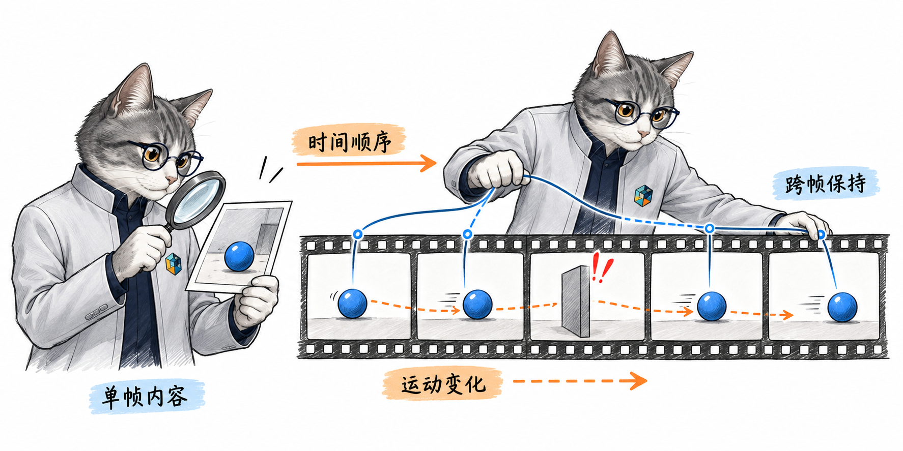
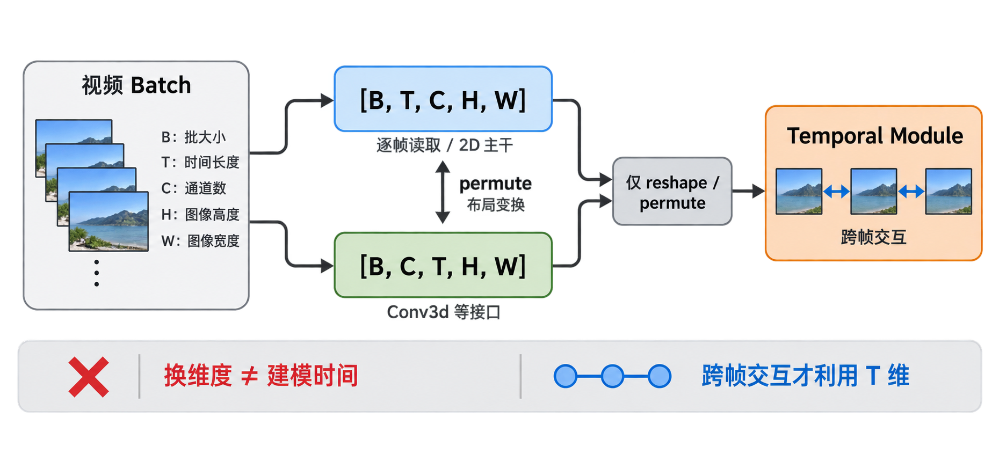
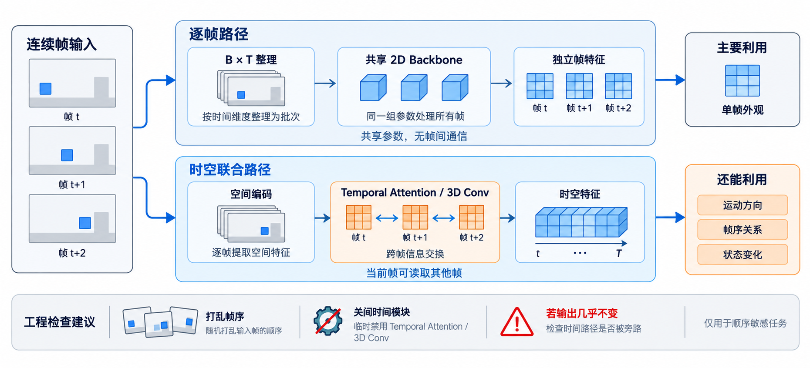
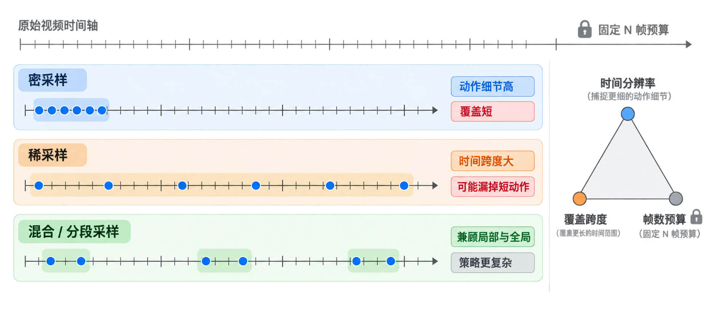
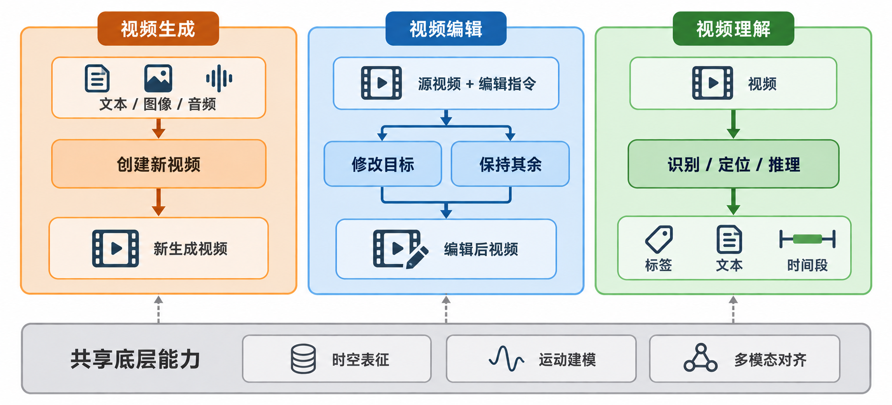
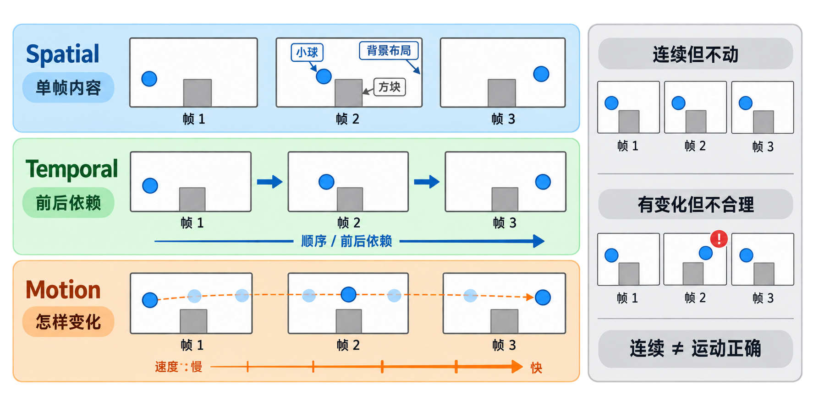
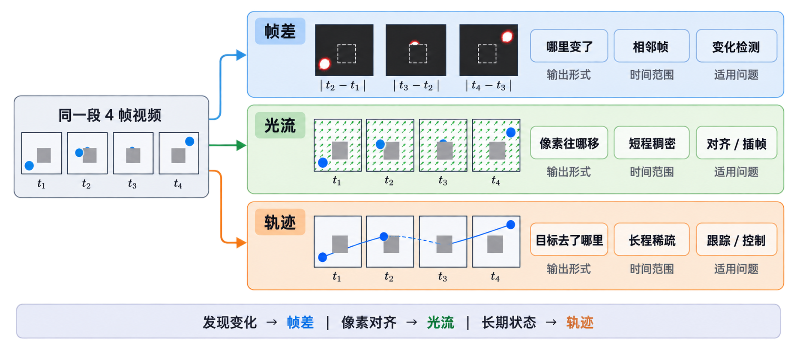
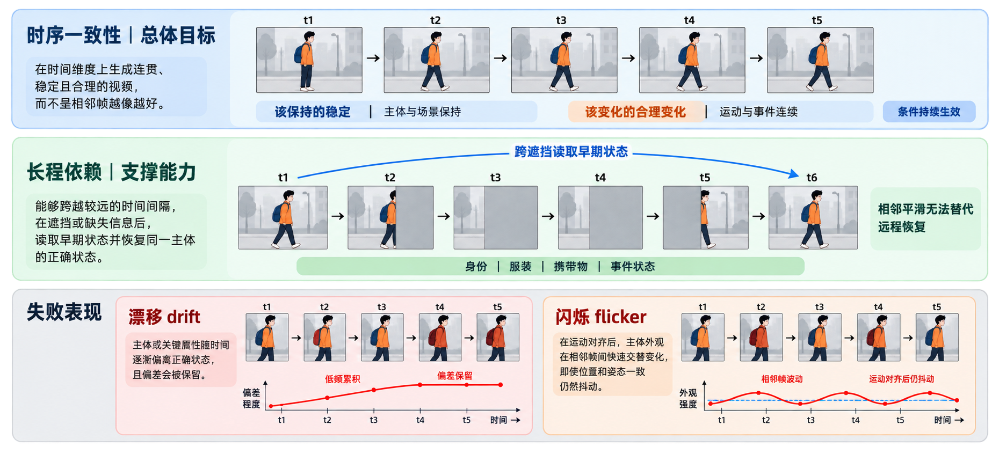
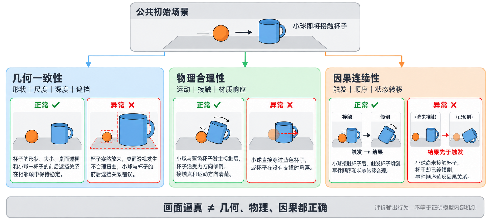

# 4.1 AI 视频核心基础知识

> 本章作为 AI 视频方向的开篇内容，重点建立视频建模的基础坐标系：视频相对图像新增了什么、视频数据如何组织、运动如何表示、时序一致性为什么重要，以及高质量视频为什么需要满足几何、物理与因果约束。后续章节中的模型架构、经典路线、长视频生成、训练优化与统一视频系统，均建立在这些基础概念之上。

---

# 目录导航

[4.1.1 视频 vs 图像：视频建模到底多了什么？](#4.1.1_视频-vs-图像：视频建模到底多了什么？)

  - [4.1.1.1 面试问题：视频相对图像新增了哪些建模变量？为什么通常更难？](#4.1.1.1_面试问题：视频相对图像新增了哪些建模变量？为什么通常更难？)
  - [4.1.1.2 面试问题：视频 Tensor 如何组织？维度顺序为什么重要？](#4.1.1.2_面试问题：视频-Tensor-如何组织？维度顺序为什么重要？)
  - [4.1.1.3 面试问题：逐帧处理与时空联合建模有什么区别？](#4.1.1.3_面试问题：逐帧处理与时空联合建模有什么区别？)

[4.1.2 视频基本参数：帧、帧率、时长、分辨率、码率与采样](#4.1.2_视频基本参数：帧、帧率、时长、分辨率、码率与采样)
  - [4.1.2.1 面试问题：FPS、采样间隔和输入时长是什么关系？](#4.1.2.1_面试问题：FPS、采样间隔和输入时长是什么关系？)
  - [4.1.2.2 面试问题：分辨率和码率有什么区别？它们如何影响训练数据？](#4.1.2.2_面试问题：分辨率和码率有什么区别？它们如何影响训练数据？)
  - [4.1.2.3 面试问题：固定输入帧数时，视频采样策略应该怎么选？](#4.1.2.3_面试问题：固定输入帧数时，视频采样策略应该怎么选？)

[4.1.3 视频任务坐标系：生成、编辑、理解与多模态条件](#4.1.3_视频任务坐标系：生成、编辑、理解与多模态条件)
  - [4.1.3.1 面试问题：视频生成、视频编辑和视频理解的任务边界是什么？](#4.1.3.1_面试问题：视频生成、视频编辑和视频理解的任务边界是什么？)
  - [4.1.3.2 面试问题：视频编辑相对图像编辑新增了哪些约束？](#4.1.3.2_面试问题：视频编辑相对图像编辑新增了哪些约束？)
  - [4.1.3.3 面试问题：不同模态条件分别解决什么控制问题？条件越多越好吗？](#4.1.3.3_面试问题：不同模态条件分别解决什么控制问题？条件越多越好吗？)
  - [4.1.3.4 面试问题：视频理解如何为视频生成与编辑提供可用的时空状态？](#4.1.3.4_面试问题：视频理解如何为视频生成与编辑提供可用的时空状态？)

[4.1.4 视频的时空属性：Spatial、Temporal 与 Motion](#4.1.4_视频的时空属性：Spatial、Temporal-与-Motion)
  - [4.1.4.1 面试问题：Spatial、Temporal 与 Motion 分别是什么？三者有什么关系？](#4.1.4.1_面试问题：Spatial、Temporal-与-Motion-分别是什么？三者有什么关系？)
  - [4.1.4.2 面试问题：为什么时序连续不等于运动正确？如何判断模型是否真正利用了运动信息？](#4.1.4.2_面试问题：为什么时序连续不等于运动正确？如何判断模型是否真正利用了运动信息？)

[4.1.5 运动表征基础：光流、帧差、轨迹与隐式运动](#4.1.5_运动表征基础：光流、帧差、轨迹与隐式运动)
  - [4.1.5.1 面试问题：什么是光流？它在视频算法中起什么作用？](#4.1.5.1_面试问题：什么是光流？它在视频算法中起什么作用？)
  - [4.1.5.2 面试问题：光流、帧差与轨迹有什么区别？工程上如何选择？](#4.1.5.2_面试问题：光流、帧差与轨迹有什么区别？工程上如何选择？)
  - [4.1.5.3 面试问题：生成模型不显式使用光流，为什么仍能生成运动？显式运动表征还有什么价值？](#4.1.5.3_面试问题：生成模型不显式使用光流，为什么仍能生成运动？显式运动表征还有什么价值？)

[4.1.6 时序建模基础：一致性、长程依赖、漂移与闪烁](#4.1.6_时序建模基础：一致性、长程依赖、漂移与闪烁)
  - [4.1.6.1 面试问题：什么是视频中的时序一致性？](#4.1.6.1_面试问题：什么是视频中的时序一致性？)
  - [4.1.6.2 面试问题：什么是长程依赖？为什么视频中很难建模？](#4.1.6.2_面试问题：什么是长程依赖？为什么视频中很难建模？)
  - [4.1.6.3 面试问题：什么是视频漂移？不同生成方式为什么都可能出现漂移？](#4.1.6.3_面试问题：什么是视频漂移？不同生成方式为什么都可能出现漂移？)
  - [4.1.6.4 面试问题：什么是 flicker？它与漂移有什么区别，如何定位来源？](#4.1.6.4_面试问题：什么是-flicker？它与漂移有什么区别，如何定位来源？)

[4.1.7 视频语义对齐与世界一致性](#4.1.7_视频语义对齐与世界一致性)
  - [4.1.7.1 面试问题：Video-Text Alignment 比 Image-Text Alignment 难在哪里？如何构造有效的对齐信号？](#4.1.7.1_面试问题：Video-Text-Alignment-比-Image-Text-Alignment-难在哪里？如何构造有效的对齐信号？)
  - [4.1.7.2 面试问题：几何一致性、物理合理性与因果连续性分别约束什么？如何评估？](#4.1.7.2_面试问题：几何一致性、物理合理性与因果连续性分别约束什么？如何评估？)

---

<h1 id="4.1.1_视频-vs-图像：视频建模到底多了什么？">4.1.1 视频 vs 图像：视频建模到底多了什么？</h1>

> 本节先建立三层基础：视频相对图像新增了哪些变量，这些变量在 Tensor 中如何组织，以及模型怎样利用时间维。后续的运动表征、时序一致性与视频模型架构都建立在这三层之上。

<h2 id="4.1.1.1_面试问题：视频相对图像新增了哪些建模变量？为什么通常更难？">4.1.1.1 面试问题：视频相对图像新增了哪些建模变量？为什么通常更难？</h2>

**难度评分：⭐⭐⭐ (3/5)  |  考察频率：⭐⭐⭐⭐⭐ (5/5)**

视频相对图像新增了**时间顺序与间隔、随时间持续或变化的状态，以及跨帧对应关系**。单帧可以描述某一时刻有什么；视频还要利用前后观测，判断对象是否延续、状态如何变化、动作按什么顺序发生。无论是理解还是生成视频，这些关系都不能只从一帧中获得。

<div align="center"></div>

<p align="center">图1-1 视频不是多张独立图片，而是连续演化的状态</p>

如图1-1，球经过方块时暂时被遮挡，随后重新出现。只看遮挡中的一帧，无法确定球的去向；结合前后帧，才能推断重新出现的球是否为同一对象、运动能否接上。把这些帧打乱，动作方向甚至事件含义也可能改变。因而，即使各帧单独看都清楚，主体在遮挡后突然变样，或位置变化与此前运动不衔接，视频仍不连贯。

跨帧对应也不能简单等同于匹配相似像素：画面变化可能来自对象运动或相机运动，对象还可能形变、被遮挡后再出现。模型需要利用时间线索维持对主体和场景的判断，并在可见信息变化时跟踪状态转移。这里讨论的是可观察的时序关系；画面连贯并不等于模型已经理解物理或因果机制。

时间维还带来计算和数据上的代价。若采样 $T$ 帧、每帧大小为 $H \times W$，原始输入的时空规模为 $T \times H \times W$；逐帧切分得到的视觉 token 也会随帧数增多，但实际计算量取决于采样、压缩和跨帧交互方式，不能一概说成图像的 $T$ 倍。

数据方面，不同采样间隔会改变模型观察到的运动幅度，压缩伪影会干扰画面，只有静态内容描述的文本也难以监督动作顺序。

因此，“视频通常更难”有比较前提：任务目标和单帧质量要求相近，并且任务确实需要利用时间关系。短而静止的视频未必比一张复杂图像更难。

> **面试速答**：视频比图像多了帧序、时间间隔，以及对象和状态的跨帧延续。每帧单独看都对，不代表遮挡后主体还能接上、动作顺序仍然正确；更长的时空输入增加计算负担，采样不当还可能丢失动作信息。这是在可比任务条件下说视频通常更难的原因。

参考资料：[Video Diffusion Models](https://arxiv.org/abs/2204.03458)、[ViViT](https://arxiv.org/abs/2103.15691)

<h2 id="4.1.1.2_面试问题：视频-Tensor-如何组织？维度顺序为什么重要？">4.1.1.2 面试问题：视频 Tensor 如何组织？维度顺序为什么重要？</h2>

**难度评分：⭐⭐ (2/5)  |  考察频率：⭐⭐⭐⭐ (4/5)**

把一批视频帧送入模型时，常用五维 Tensor：$[B, T, C, H, W]$ 或 $[B, C, T, H, W]$。 $B$ 是批量大小， $T$ 是采样帧数， $C$ 是通道数， $H$、 $W$ 是单帧的高和宽。这里讨论的是帧张量；视频经过编码后也可能表示为其他形状的特征或 token。维度顺序必须与接收它的算子约定一致，否则算子可能把时间轴当成通道轴，或者把本不相邻的帧当成同一段视频。

<div align="center"></div>

<p align="center">图1-2 两种视频 Tensor 布局与时间模块的关系</p>

如图1-2，$[B, T, C, H, W]$ 便于按时间索引取帧，也便于合并 $B$、$T$ 后交给二维图像主干；[PyTorch `Conv3d`](https://docs.pytorch.org/docs/stable/generated/torch.nn.Conv3d.html) 则按 $[B, C, T, H, W]$ 解释输入。两种写法可以通过 `permute` 变换，但换轴不会让模型自动学到时间关系。

轴的含义也不同于内存存放方式。PyTorch 的 [`channels_last_3d`](https://docs.pytorch.org/docs/stable/tensor_attributes.html) 改变内存步长，不会把 `Conv3d` 的逻辑输入形状改成 $[B, T, H, W, C]$。

更隐蔽的错误发生在合并、恢复维度时。设 $B=2$、$T=3$，把视频展平为 $B \times T=6$ 帧，顺序应是“视频 0 的三帧，接着视频 1 的三帧”。二维主干可以分别处理这六帧；若还原时先把它们误当作 $[T,B,\ldots]$，再换轴得到 $[B,T,\ldots]$，最终形状仍是两段、每段三帧，内容却已交错。时间模块随后看到的“相邻帧”可能来自不同视频。只检查 `shape` 发现不了这种错误，可以给每帧附上视频编号和帧号，核对变换前后的对应关系。

如果输入还带有逐帧时间戳、位置索引或 padding mask，重排帧时也要同步重排或重建这些信息；帧率可以是每段视频的一项元数据，不必强行扩成 $T$ 个值。

若使用 PyTorch，`permute` 后还要留意内存步长：[`view`](https://docs.pytorch.org/docs/stable/generated/torch.Tensor.view.html) 要求新形状与原步长兼容，而 `reshape` 必要时可能复制数据。这是布局变换的实现细节，与模型是否建立跨帧依赖是两回事。

> **面试速答**：成批视频帧常用 $[B,T,C,H,W]$ 或 $[B,C,T,H,W]$，顺序取决于算子怎样解释时间轴和通道轴。逐帧计算时可以合并 $B$、$T$，但还原时必须让每段视频的帧、时间信息和 mask 一一对应；形状对了，帧序也可能已经串了。换轴本身不等于建模时间。

<h2 id="4.1.1.3_面试问题：逐帧处理与时空联合建模有什么区别？">4.1.1.3 面试问题：逐帧处理与时空联合建模有什么区别？</h2>

**难度评分：⭐⭐⭐ (3/5)  |  考察频率：⭐⭐⭐⭐⭐ (5/5)**

区别在于**处理当前帧时，能否读取其他帧的信息**。设 $x_t$ 是第 $t$ 帧输入，$h_t$ 是它的特征。逐帧阶段可写成 $h_t=f_\theta(x_t)$；若建立了跨帧通路，则可写成 $h_t=F_\theta(x_{1:T})_t$，表示 $h_t$ 有可能随其他帧的变化而改变。共享参数或共享文本条件，并不等于帧与帧交换了信息。

<div align="center"></div>

<p align="center">图1-3 逐帧共享参数与跨帧信息交互的差异</p>

**1. 处理当前帧时，信息从哪里来**

如图1-3，上方路径把 $B$、$T$ 合并，复用二维 CNN、图像 Transformer 或图像 VAE 提取各帧的外观特征。单帧识别或逐帧分割可以直接利用这些特征，也容易继承图像预训练能力；但仅靠这一阶段，模型不能根据其他帧的位置变化判断运动，也无法直接约束遮挡前后是否为同一对象。

下方路径则让不同时间位置交换信息：时间卷积或时间核大于 1 的 3D 卷积利用局部邻帧，时间注意力可以在其注意范围内读取其他帧。

不过，算子名称并不保证已建模时间：时间核为 1 的 3D 卷积仍按帧处理；注意力即使混合了多帧，若没有时间位置或因果掩码等顺序线索，也难以区分先后。跨帧通路只提供利用时序的可能，模型是否学到有效的运动关系还取决于训练数据和任务。

两条路径可以组合：先用二维主干提取外观，再在中间特征上加入时间模块，也是时空模型。[Video Diffusion Models](https://arxiv.org/abs/2204.03458) 采用空间与时间分解的网络；[ViViT](https://arxiv.org/abs/2103.15691) 同时讨论联合与分解式时空注意力。

这种组合便于复用图像主干，分解计算也有助于控制成本；时间模块能看到多远，仍受感受野或注意范围限制。架构允许读取其他帧之后，还要检查模型是否真的依赖这些信息。

**2. 用受控扰动检查时间依赖**

在推理模式下固定其他输入，只改动一帧，观察允许访问它的其他帧特征是否变化。这能检查跨帧通路是否影响了计算结果，但特征变化本身还不能证明模型学到了正确的运动关系。

若任务依赖动作顺序，还可打乱帧序；比较逐帧输出前，应先按帧编号对齐，不能把输出跟着输入换位误判为模型理解了顺序。打乱后结果不变，也可能是任务本身对顺序不敏感。关闭时间模块可作另一组对照，但输出变化同样只说明该路径产生了影响。

> **面试速答**：逐帧处理时，当前帧只依据自身内容得到特征；时空建模让它通过时间卷积或注意力等路径读取其他帧，因此才有条件判断运动和状态延续。图像主干与时间模块可以组合使用，但有跨帧通路只是前提，能否辨别帧序、学好运动还要看顺序信息和训练。

参考资料：[Attention Is All You Need](https://arxiv.org/abs/1706.03762)

---

<h1 id="4.1.2_视频基本参数：帧、帧率、时长、分辨率、码率与采样">4.1.2 视频基本参数：帧、帧率、时长、分辨率、码率与采样</h1>

> 本节区分源视频参数、模型输入规格与采样策略。三者相互影响，但不能混为一谈：源视频有自己的帧率和码率，模型实际看到的是经过解码、缩放与时间采样后的帧序列。

<h2 id="4.1.2.1_面试问题：FPS、采样间隔和输入时长是什么关系？">4.1.2.1 面试问题：FPS、采样间隔和输入时长是什么关系？</h2>

**难度评分：⭐⭐⭐ (3/5)  |  考察频率：⭐⭐⭐⭐ (4/5)**

FPS 是单位真实时间内的帧数。对恒定帧率视频，源帧率 $f_{src}$ 对应的源帧时间间隔为 $1/f_{src}$；模型看到的时间密度还取决于取帧方式。设相邻采样帧的**源帧索引相差 $s$**（每 $s$ 个源帧取一帧），且保留原视频的时间坐标，那么采样间隔与采样帧率分别为

```math
\Delta t_{sample}=\frac{s}{f_{src}},\qquad f_{sample}=\frac{f_{src}}{s}.
```

若输入 $T$ 帧，首末两帧之间有 $T-1$ 个采样间隔，**实际观察到的时间戳跨度**为

```math
\Delta t_{clip}=\frac{T-1}{f_{sample}}=\frac{(T-1)s}{f_{src}}.
```

例如，源视频为 30 FPS，每 3 个源帧取一帧，输入的时间采样密度就是 10 FPS；取 16 帧时，首末帧相隔 1.5 秒。若把每帧按 0.1 秒显示，播放时长才是 1.6 秒。前者描述模型覆盖了多少真实时间，后者还取决于怎样播放这些帧。

固定输入帧数 $T$ 和单帧尺寸时，提高采样帧率会缩短时间覆盖范围，让相邻帧的位移更小，但输入规模并未增加；降低采样帧率能覆盖更长事件，也更可能漏掉短时动作，甚至使快速周期运动产生方向歧义。物体的真实速度没有因抽帧改变，改变的是模型看到的帧间位移。若固定真实覆盖时长，同时提高采样帧率，输入帧数才会增加，计算量也通常随之上升。

上述换算依赖等时间间隔。可变帧率、丢帧或不规则采样时，应读取采样帧的时间戳，用末帧减首帧求覆盖跨度；一个平均 FPS 无法说明每对相邻帧间隔。

训练与推理若采用不同时间采样密度，相同物理运动也会对应不同的帧间位移，应显式统一采样方式或提供时间信息。取源帧索引的固定步长与设定目标输出 FPS 也不是同一操作：FFmpeg 的 [`framestep`](https://ffmpeg.org/ffmpeg-filters.html#framestep) 按源帧步长选帧，而 [`fps`](https://ffmpeg.org/ffmpeg-filters.html#fps) 会为目标恒定帧率按需丢帧或复制帧。

> **面试速答**：恒定帧率下，相邻采样帧若跨 $s$ 个源帧索引，输入帧率就是 $f_{src}/s$，$T$ 帧的首末时间跨度是 $(T-1)s/f_{src}$。固定 $T$ 时，采得密能看清局部变化，但覆盖时间更短，输入帧数并不会增加；变帧率视频则应直接看时间戳。

<h2 id="4.1.2.2_面试问题：分辨率和码率有什么区别？它们如何影响训练数据？">4.1.2.2 面试问题：分辨率和码率有什么区别？它们如何影响训练数据？</h2>

**难度评分：⭐⭐ (2/5)  |  考察频率：⭐⭐⭐⭐ (4/5)**

分辨率是单帧的宽、高及其像素数量；这里的码率指**视频流**编码后单位时间使用的比特数，通常以 bit/s 表示，也常用一段视频的平均码率描述。前者说画面有多少像素位置，后者说编码这些画面用了多少数据。它们不能互相确定，也都不能单独代表画质：高分辨率视频可能原本就失焦，高码率重编码也无法找回此前压缩丢掉的细节。

两者进入训练管线后的作用见表1-1。

**表1-1 分辨率与码率的作用边界**

| 参数 | 描述对象 | 进入模型时的作用 | 单看这个参数无法判断什么 |
| --- | --- | --- | --- |
| 源视频分辨率 | 解码帧的宽、高与像素数量 | 决定可供裁剪、缩放的空间信息；不必等于最终输入尺寸 | 真实细节是否清楚、压缩损失有多大 |
| 视频码率 | 编码视频流单位时间使用的比特数 | 不成为 Tensor 的一个维度；有损编码可能改变解码后的像素 | 跨编码器、帧率和内容比较时，哪段视频画质更好 |

训练时通常先解码，再裁剪或缩放到模型要求的尺寸。假如一段 4K 视频和一段 720p 视频最终都被裁剪、缩放为 $256\times256$，它们的输入 Tensor 空间尺寸相同；采用同样的空间分块方式时，空间 token 数也相同。源分辨率的差别体现在预处理前可用的细节，而输入尺寸由预处理设定。[PyTorch `Resize`](https://docs.pytorch.org/vision/main/generated/torchvision.transforms.functional.resize.html) 便是按指定目标尺寸产生输出的例子。

码率则通过编码后的画面影响训练。对同一段源视频，保持编码器和其他关键编码条件一致，提高分配的比特数通常能减轻有损压缩带来的失真；画质已接近源视频时，继续增加码率的收益可能很小。换了编码器、帧率、分辨率或画面内容，就不能只按码率给画质排序；快速运动和复杂纹理也会改变维持相近质量所需的数据量。编码器既可以按目标码率控制输出，也可以采用目标质量模式，二者不是同一个约束。[FFmpeg 编码文档](https://ffmpeg.org/ffmpeg-codecs.html)列出了相应的码率控制和恒定质量设置。

解码只把码流还原为像素帧，不会自动修复有损压缩造成的块效应、振铃或纹理涂抹；后续缩放可能减弱部分痕迹，也可能留下可见的失真。若某类标签或数据来源总对应特定的压缩风格，模型就可能把这些痕迹当作识别线索，生成模型也可能学着复现它们。

因此，筛选训练视频时，除了记录分辨率和码率，还应抽查解码并完成预处理后的画面；比较不同来源时，最好在相同输入尺寸下观察细节与压缩痕迹，而不是用单一元数据阈值代替画质判断。

> **面试速答**：分辨率说的是单帧有多少像素，码率说的是编码视频流每秒用了多少比特。模型实际输入的空间尺寸看裁剪、缩放后的结果；码率不占一个输入维度，但有损压缩可能把失真留在像素里。同码率不等于同画质，筛选训练数据最终还要看解码后的画面。

<h2 id="4.1.2.3_面试问题：固定输入帧数时，视频采样策略应该怎么选？">4.1.2.3 面试问题：固定输入帧数时，视频采样策略应该怎么选？</h2>

**难度评分：⭐⭐⭐ (3/5)  |  考察频率：⭐⭐⭐⭐⭐ (5/5)**

固定输入 $T$ 帧时，采样策略决定这 $T$ 个观测落在视频的哪些时间点。选择之前要问：任务靠相邻帧的细小变化判断，还是靠相隔较远的事件阶段判断？关键片段的位置和持续时间是否已知？在帧数不变的条件下，把帧集中到局部会缩短覆盖范围；铺满较长时间，又会拉大帧间隔。这是**时间覆盖范围与局部运动细节之间的取舍**。

<div align="center"></div>

<p align="center">图1-4 固定 N 帧预算下的密采样、稀采样与混合采样取舍</p>

如图1-4，**密采样**把帧放在较短的时间窗内，适合需要辨认手势变化、接触瞬间或其他短时运动的任务；若视频生成训练以连续帧为目标，取帧间隔也应与目标时序一致。密采样的代价是关键动作若出现在窗口外，模型一帧也看不到。[SlowFast Networks](https://arxiv.org/abs/1812.03982) 展示了较高的时间采样密度对细粒度运动信息的价值。

**稀疏采样**把帧分散到较长时间内，适合依据动作前后状态或多个事件阶段作判断；但两帧之间发生的瞬时动作可能完全消失，不能靠稀疏帧还原其过程。[Temporal Segment Networks](https://arxiv.org/abs/1608.00859) 用分段稀疏取帧扩大视频级动作识别的时间覆盖。

若既要看到不同阶段，又要保留阶段内的运动，可以采用图中的**混合／分段采样**：先把时间范围分段，再给每段分配若干相邻帧。例如总共取 12 帧，可在三个时间段各取连续 4 帧。这样能观察三个局部过程及其先后，但段与段之间仍有盲区；每段分到的帧越多，能覆盖的时间段通常越少。分段取帧并不会在固定帧数下同时获得完整的长程过程和全部局部细节。

训练时可以随机选择片段起点，或在合理范围内改变采样间隔，让模型接触不同的时间位置和帧间位移；间隔过大可能漏掉决定标签的动作，甚至让样本与标签不再匹配。评估时宜固定取帧位置，或明确使用多片段结果聚合，并记录其额外计算量。

若任务要求单个片段内动作连续，按镜头边界取帧可减少无意跨切点；若稀有事件有可靠的定位信息，可围绕事件取帧，但也要检查这种选择是否让训练样本与实际推理输入产生偏差。

检验策略时，先统计采样后真实覆盖的秒数、相邻帧时间差、目标事件被采到的比例，以及无意跨镜头的比例。再保持模型架构、单片段帧数和空间尺寸相同，对比不同采样方案在短时动作与长事件上的表现；若长事件表现改善而瞬时动作变差，这种此消彼长便是时间覆盖与局部细节取舍影响任务的证据之一。

训练与推理还要核对时间采样分布，避免模型只在一种帧间位移上学到规律。这里讨论的是单个样本怎样取帧；批量中的帧数和分辨率分桶属于后续训练效率问题。

> **面试速答**：固定 $T$ 帧时，先看任务需要局部动作细节，还是较长时间内的事件阶段。密采样保留局部变化，稀疏采样扩大覆盖；两者都需要时可分段取帧，在不同时间段各保留几帧连续画面。最后检查关键事件有没有被采到，以及训练和推理看到的时间间隔是否匹配。

---

<h1 id="4.1.3_视频任务坐标系：生成、编辑、理解与多模态条件">4.1.3 视频任务坐标系：生成、编辑、理解与多模态条件</h1>

> 本节从任务边界、编辑约束、条件作用和视频理解四个角度建立基础坐标系。重点是分清任务要解决什么问题，不提前展开条件注入、统一系统和 Video Agent 的具体架构。

<div align="center"></div>

<p align="center">图1-5 生成、编辑与理解的输入输出边界及共享底层能力</p>

<h2 id="4.1.3.1_面试问题：视频生成、视频编辑和视频理解的任务边界是什么？">4.1.3.1 面试问题：视频生成、视频编辑和视频理解的任务边界是什么？</h2>

**难度评分：⭐⭐⭐ (3/5)  |  考察频率：⭐⭐⭐⭐⭐ (5/5)**

三类任务应按**主要输入、输出形式和约束目标**划分，不能根据模型名称或使用了哪种条件来判断。

**三类任务分别解决什么问题**

- **视频生成**从文本、图像、音频或视频前缀等条件出发合成新视频，输出的主要内容原本并不存在。评价重点包括条件遵循、单帧质量、运动和时序稳定性。
- **视频编辑**以完整源视频为已知内容，按照指令修改指定对象、区域或时间段，同时尽量保持未授权修改的部分。它同时受到“改对”和“保留住”两类约束。
- **视频理解**以视频为主要输入，输出标签、文本、时间区间、对象轨迹或判断结果。它的目标是提取和推理视频中的语义与时序关系，不以合成新视频为必要条件。

**容易混淆的边界**

I2V 通常仍属于生成，因为输入图像只提供外观或起始状态，模型需要合成后续动态内容。V2V 只是输入接口名称：若任务要求围绕完整源视频定向修改并保持其余内容，更接近编辑；若源视频只作为宽松参考，输出可以整体重写，则更接近条件生成。同一个 backbone 也可能同时支持三类任务，任务边界不由架构是否共享决定。

> **面试速答**：生成是在条件约束下合成新视频；编辑以完整源视频为基础，修改指定内容并保持其余部分；理解则从视频中输出语义、位置、时间或判断。I2V、V2V 只描述输入接口，最终分类还要看源内容是否需要被精确保留，以及输出目标是什么。

参考资料：[Video Diffusion Models](https://arxiv.org/abs/2204.03458)、[TokenFlow](https://arxiv.org/abs/2307.10373)、[ViViT](https://arxiv.org/abs/2103.15691)

<h2 id="4.1.3.2_面试问题：视频编辑相对图像编辑新增了哪些约束？">4.1.3.2 面试问题：视频编辑相对图像编辑新增了哪些约束？</h2>

**难度评分：⭐⭐⭐⭐ (4/5)  |  考察频率：⭐⭐⭐⭐ (4/5)**

视频编辑在单帧修改之外，还要处理**随时间变化的编辑作用域、源视频保持和跨帧连续性**。

**编辑作用域会随运动变化**

图像编辑中的 mask 是固定二维区域，视频中的对象会移动、形变、被遮挡后再次出现。编辑区域必须沿时间传播，并在遮挡关系变化时重新判断可见区域。简单复制同一个 mask，常会留下漏改、边缘抖动或误伤背景。

**修改正确与源视频保持要同时满足**

目标区域既要符合编辑指令，非编辑区域又要维持原有身份、纹理、动作、光照和镜头运动。约束过弱会出现漏改或编辑结果不稳定；约束过强则可能压制合理变化，使结果僵硬，甚至把源视频压缩伪影一并锁住。

**先查重建，再查编辑传播**

工程排查通常先做无编辑或空指令重建，确认源视频能否稳定恢复；再检查动态 mask、对象轨迹和遮挡位置；最后比较编辑区是否生效、非编辑区是否发生非预期变化，以及播放时是否出现闪烁和漂移。若基础重建已经不稳定，直接调大编辑条件通常解决不了问题。

> **面试速答**：视频编辑新增了动态作用域、跨帧传播和源视频保持约束。编辑区域要随对象运动和遮挡变化，目标内容要改对，未编辑内容还要保持稳定。排查时先测无编辑重建，再看 mask 与轨迹，最后分别检查编辑区生效和非编辑区变化。

参考资料：[TokenFlow](https://arxiv.org/abs/2307.10373)

<h2 id="4.1.3.3_面试问题：不同模态条件分别解决什么控制问题？条件越多越好吗？">4.1.3.3 面试问题：不同模态条件分别解决什么控制问题？条件越多越好吗？</h2>

**难度评分：⭐⭐⭐ (3/5)  |  考察频率：⭐⭐⭐⭐ (4/5)**

不同模态条件提供的信息粒度不同：文本适合表达语义，参考图约束外观，姿态和深度约束空间结构，轨迹和相机参数约束运动，音频提供时间事件。条件数量增加并不自动提高可控性，关键是它们能否对齐并在各自作用范围内生效。

原始模态与信息作用并非一一对应。同一段参考视频既能提供外观，也能提供运动；音频既可能携带语义，也可能提供节奏。按条件实际提供的信息划分，作用边界见表1-2。

**表1-2 多模态条件的信息作用与对齐要求**

| 信息作用 | 主要解决的问题 | 常见输入 | 关键对齐要求 |
| --- | --- | --- | --- |
| 语义目标 | 生成或修改什么内容 | 文本、脚本、编辑指令、语音转写 | 主体、属性、动作与事件关系需要绑定正确 |
| 外观参考 | 主体或场景应该长什么样 | 首帧、参考图、参考视频 | 区分全局风格、主体身份与逐像素空间约束 |
| 空间结构 | 内容出现在哪里、保持什么几何关系 | mask、pose、depth、edge | 与目标帧的空间位置和分辨率对齐 |
| 运动与相机 | 对象和视角怎样随时间变化 | trajectory、光流、相机位姿、参考运动 | 与帧序、时间尺度和目标对象对齐 |
| 时间事件 | 事件在何时发生以及节奏如何变化 | 语音、音乐、环境声、时间标记 | 音素、节拍或事件与视频时间轴对齐 |

**条件冲突比条件缺失更难发现**

文本要求主体向左移动，轨迹却指向右侧；参考图要求固定外观，动作条件又要求大幅形变。模型可能偏向其中一路，也可能生成折中但不符合任何条件的结果。音频还需要区分“作为生成条件”和“作为联合输出”，这两个设定不能混为一类。

**用消融和冲突测试判断条件是否生效**

可以固定随机种子，依次置空、替换或扰动单路条件，观察输出是否只在预期的时间和空间范围内变化；再人为构造条件冲突，检查优先级是否稳定。这里只回答不同条件提供什么信息，具体编码和注入接口留到 4.2.1 展开。

> **面试速答**：文本管语义，参考图管外观，姿态和深度管空间结构，轨迹与相机参数管运动，音频管时间事件。条件越多，对齐、冲突和强弱失衡的问题越明显；判断条件是否有效，应做单路消融、错配和冲突测试，而不是只看多条件同时开启的样例。

参考资料：[VideoComposer](https://arxiv.org/abs/2306.02018)、[MotionCtrl](https://arxiv.org/abs/2312.03641)

<h2 id="4.1.3.4_面试问题：视频理解如何为视频生成与编辑提供可用的时空状态？">4.1.3.4 面试问题：视频理解如何为视频生成与编辑提供可用的时空状态？</h2>

**难度评分：⭐⭐⭐⭐ (4/5)  |  考察频率：⭐⭐⭐⭐⭐ (5/5)**

视频理解可以把像素序列转成对象、区域、轨迹、镜头和事件等时空状态。对带源视频的生成与编辑任务，这些状态用于定位条件作用范围、确定保留内容，并检查结果是否满足指令。

**理解模块需要产出什么**

- **对象与区域状态**：主体身份、分割区域、位置、轨迹、遮挡和再出现，用于把编辑指令绑定到正确对象。
- **时间与事件状态**：镜头边界、动作阶段、事件顺序和目标出现区间，用于确定从哪一帧开始、在哪段时间生效。
- **操作约束**：哪些区域允许修改，哪些内容需要保持，以及修改后应该检查哪些属性。

例如，“把第三个镜头中穿红衣的人换成蓝色外套”至少要求定位镜头区间、识别并跟踪目标、处理遮挡，同时保护其他人物和镜头运动。缺少其中任何一项，都可能出现漏改、改错对象或非编辑区域变化。

**理解能力不等于独立理解模型**

对象检测、分割和跟踪可以由独立模块显式完成，也可以由统一 backbone 的时空 token 隐式表示。简单 T2V 没有源视频需要解析，并不要求先运行视频理解模型；复杂 V2V、局部编辑和结果验证才更依赖对当前视频状态的解析。

**如何确认时空状态真的被使用**

可以替换目标对象、修改时间范围或制造短暂遮挡，观察编辑作用域是否随之变化；同时检查非编辑区域和镜头运动是否保持。若指令改变后作用区域不变，或目标遮挡后无法继续编辑，问题通常出在目标绑定、跟踪或时间定位，而不只是生成质量。

> **面试速答**：视频理解把源视频转成对象、区域、轨迹、镜头和事件等时空状态，生成或编辑模块据此判断改什么、何时改、哪些内容要保留。它可以来自独立检测与跟踪模块，也可以内化在统一模型中；简单 T2V 并不要求单独执行视频理解。

参考资料：[SAM 2](https://arxiv.org/abs/2408.00714)、[TokenFlow](https://arxiv.org/abs/2307.10373)

---

<h1 id="4.1.4_视频的时空属性：Spatial、Temporal-与-Motion">4.1.4 视频的时空属性：Spatial、Temporal 与 Motion</h1>

> 本节先区分空间内容、时间关系与运动变化，再回答一个容易混淆的问题：视频播放连续，并不代表运动方向、幅度和动作阶段正确。运动如何表示留到 4.1.5，闪烁、漂移和长程一致性留到 4.1.6。

<div align="center"></div>

<p align="center">图1-6 Spatial、Temporal 与 Motion 的观察对象及“连续不等于运动正确”</p>

<h2 id="4.1.4.1_面试问题：Spatial、Temporal-与-Motion-分别是什么？三者有什么关系？">4.1.4.1 面试问题：Spatial、Temporal 与 Motion 分别是什么？三者有什么关系？</h2>

**难度评分：⭐⭐ (2/5)  |  考察频率：⭐⭐⭐⭐⭐ (5/5)**

三者相关，但逻辑层级并不完全平行：Spatial 描述单帧的空间内容，Temporal 描述时间轴上的顺序与依赖，Motion 描述内容随时间发生的具体变化。Motion 是 Temporal 建模中的重要部分，但 Temporal 的范围更宽。

**三个概念各自回答什么？**

- **Spatial：画面里有什么、在哪里。** 包括对象、纹理、形状、布局和局部结构。
- **Temporal：前后如何衔接。** 包括帧序、持续时间、状态依赖和事件展开过程。
- **Motion：内容怎样变化。** 包括目标位移、姿态与表情变化、形变、遮挡关系变化和相机运动。

**为什么说 Temporal 的范围更宽？**

静止镜头几乎没有目标运动，但仍有帧序、持续时间和状态保持等时序关系；反过来，亮度闪烁或纹理随机变化会产生帧间差异，却不一定对应有效运动。因此，不能把“帧间有变化”直接等同于“模型学到了运动”。

**三者为什么需要联合建模？**

Spatial 决定单帧是否清晰、结构是否正确；Temporal 与 Motion 决定这些空间内容能否沿时间稳定演化。只重视空间质量，容易得到“每帧都好看、连起来却不对”的视频；只做时序平滑，又可能压低细节和运动幅度。

> **面试速答**：Spatial 管单帧内容与布局，Temporal 管时间顺序与依赖，Motion 管内容随时间的具体变化。Motion 属于时序建模的重要部分，但时序关系还包括状态保持、事件顺序和持续时间，范围更广。

参考资料：[ViViT](https://arxiv.org/abs/2103.15691)、[Video Diffusion Models](https://arxiv.org/abs/2204.03458)

<h2 id="4.1.4.2_面试问题：为什么时序连续不等于运动正确？如何判断模型是否真正利用了运动信息？">4.1.4.2 面试问题：为什么时序连续不等于运动正确？如何判断模型是否真正利用了运动信息？</h2>

**难度评分：⭐⭐⭐ (3/5)  |  考察频率：⭐⭐⭐⭐⭐ (5/5)**

时序连续只说明相邻帧衔接平滑、状态没有无故跳变；运动正确还要求方向、幅度、轨迹、速度和动作阶段符合条件与场景。一个视频可以非常稳定，却几乎不动，或者始终朝错误方向运动。

**连续但运动错误，通常有三种表现：**

- 连续重复或缓慢改变近似静态帧，画面稳定，但没有完成提示词要求的动作。
- 运动轨迹很平滑，方向、速度或幅度却与控制条件不一致。
- 全局画面随相机平移，像素变化很大，但主体没有产生预期的相对运动。

另一类反例是“变化很多但运动无效”：亮度闪烁、纹理抖动和身份漂移都会增大帧间差异，却不能说明模型掌握了物体运动或动作语义。

**判断模型是否真正利用运动信息，可以做三类检查：**

1. **反事实条件测试**：固定随机种子、主体和场景，只改变“向左/向右”“快/慢”或轨迹控制。输出运动应随条件稳定改变，否则运动条件可能没有被有效利用。
2. **时序扰动测试**：对需要输入视频或帧序列的任务，尝试倒序、打乱或重复部分帧。若任务本身依赖顺序，而模型输出或判断几乎不变，说明其可能主要依赖单帧外观。该方法不适用于所有任务，纯文本生成也没有可扰动的输入帧。
3. **拆分指标评估**：分别检查动态幅度、运动平滑度、动作或轨迹符合度，以及主体一致性、背景一致性和闪烁。单一的“时序一致性”分数无法覆盖这些能力。

面试中还可以补一句：光流、点轨迹或姿态序列能帮助量化运动，但它们各自带有不同假设，不能单独作为运动正确性的充分证据。

> **面试速答**：连续性看帧与帧是否平滑衔接，运动正确性看方向、幅度、轨迹和动作阶段是否符合条件。验证时应固定外观并改变运动条件，再结合时序扰动和分项指标，观察模型是否对运动信息产生可解释的响应。

参考资料：[VBench](https://arxiv.org/abs/2311.17982)、[Video Diffusion Models](https://arxiv.org/abs/2204.03458)

---

<h1 id="4.1.5_运动表征基础：光流、帧差、轨迹与隐式运动">4.1.5 运动表征基础：光流、帧差、轨迹与隐式运动</h1>

> 本节讨论运动怎样进入视频算法。帧差、光流和轨迹是可观察、可检查的显式线索；生成模型也可以把运动编码在特征或 latent 中。几种方式粒度不同，各有盲区，不能只按“是否显式”判断优劣。

<h2 id="4.1.5.1_面试问题：什么是光流？它在视频算法中起什么作用？">4.1.5.1 面试问题：什么是光流？它在视频算法中起什么作用？</h2>

**难度评分：⭐⭐⭐ (3/5)  |  考察频率：⭐⭐⭐⭐⭐ (5/5)**

光流（Optical Flow）是描述相邻帧之间像素或局部区域表观运动的二维向量场。它通常不等同于真实三维速度，而是物体运动、相机运动、视角变化、遮挡和光照变化投影到图像平面后的结果。

**光流方程约束了什么？**

经典推导通常假设同一可见点在短时间内亮度近似不变。若 $(u, v)$ 表示图像平面上的表观速度，则有：

```math
I(x, y, t) = I(x + u \Delta t, y + v \Delta t, t + \Delta t)
```

对上式做一阶泰勒展开并除以 $\Delta t$，可得到：

```math
I_x u + I_y v + I_t = 0
```

其中，$I_x, I_y, I_t$ 是图像亮度在空间和时间上的偏导。一个方程无法唯一确定 $u$ 和 $v$ 两个未知量，这就是光流估计中的孔径问题。经典方法需要加入局部或全局平滑约束，学习方法则从数据中获得匹配和运动先验。

**它在视频算法中主要做什么？**

- **建立稠密对应**：为帧插值、运动补偿等任务提供像素级位移。
- **对齐图像或特征**：把前一帧的内容 warp 到当前帧，用于超分、分割传播和视频编辑。
- **构造训练或评估信号**：在有效可见区域比较运动对齐后的内容，检查局部时序误差。

**什么时候不能直接相信光流？**

遮挡与新显露区域没有双向对应；反光、透明体、阴影和亮度变化会破坏亮度恒常假设；快速运动和重复纹理也容易造成错误匹配。工程上通常要同时使用前后向一致性、遮挡掩码或置信度，不能把估计光流当作无噪声真值。

> **面试速答**：光流是图像平面上的稠密表观运动场，核心价值是建立帧间对应和对齐关系。它依赖亮度恒常、局部可匹配等假设，在遮挡、光照变化和大位移区域需要配合置信度或遮挡处理。

参考资料：[Horn–Schunck Optical Flow](https://doi.org/10.1016/0004-3702(81)90024-2)、[RAFT](https://arxiv.org/abs/2003.12039)

<h2 id="4.1.5.2_面试问题：光流、帧差与轨迹有什么区别？工程上如何选择？">4.1.5.2 面试问题：光流、帧差与轨迹有什么区别？工程上如何选择？</h2>

**难度评分：⭐⭐⭐⭐ (4/5)  |  考察频率：⭐⭐⭐⭐ (4/5)**

三者都从帧间变化中提取运动线索，但输出对象和时间尺度不同：帧差给出变化强度，光流给出稠密二维位移，轨迹记录点或目标跨多帧的状态路径。关键区别见表1-3。

**表1-3 帧差、光流与轨迹的作用边界**

| 表征 | 典型输出 | 时间范围 | 能直接回答 | 主要盲区 |
| --- | --- | --- | --- | --- |
| 帧差 | 像素差值或变化区域 | 相邻帧 | 哪里发生了变化、变化有多强 | 缺少对应关系和运动方向，易受光照、噪声与相机运动影响 |
| 光流 | 每个像素或局部区域的二维位移 | 通常是相邻帧或短窗口 | 图像内容向哪里移动、移动多少 | 遮挡、新显露、反光和错误匹配会破坏估计 |
| 点或目标轨迹 | 位置、可见性，以及可选的尺度、姿态或目标状态序列 | 多帧或整段视频 | 同一点或目标长期经过哪里、状态怎样变化 | 依赖跟踪和数据关联，通常不保留完整的稠密形变 |

<div align="center"></div>

<p align="center">图1-7 帧差、光流与轨迹的输出形式、时间范围和工程选择</p>

**选择时先看任务需要哪种信息：**

- 只需低成本检测画面是否变化，帧差通常够用。
- 需要像素级对齐、warp 或插帧，优先考虑光流，并处理遮挡与置信度。
- 需要长时间跟踪、轨迹控制或动作路径评估，轨迹更直接。目标框中心轨迹只能粗略描述整体位移；非刚性形变往往需要多点轨迹或稠密运动场。

三者也可以组合。例如先用轨迹确定主体的长期路径，再用光流处理局部形变和短程对齐；帧差可作为低成本的运动区域筛选，但不宜单独作为运动正确性的证据。

> **面试速答**：帧差回答“哪里变了”，光流回答“图像内容向哪里移动”，轨迹回答“同一点或目标长期走过哪里”。选型取决于任务需要变化检测、像素对齐还是长程状态跟踪，同时要考虑光照、遮挡和跟踪误差。

参考资料：[RAFT](https://arxiv.org/abs/2003.12039)、[CoTracker](https://arxiv.org/abs/2307.07635)

<h2 id="4.1.5.3_面试问题：生成模型不显式使用光流，为什么仍能生成运动？显式运动表征还有什么价值？">4.1.5.3 面试问题：生成模型不显式使用光流，为什么仍能生成运动？显式运动表征还有什么价值？</h2>

**难度评分：⭐⭐⭐⭐ (4/5)  |  考察频率：⭐⭐⭐ (3/5)**

运动信息不必以光流变量显式出现。只要训练目标作用于视频片段，模型内部又存在跨帧信息通路，网络就可以把位移、姿态变化、形变和动作阶段编码在时空特征或隐空间（latent）中。

**隐式运动从哪里来？**

- **视频级学习目标提供信号**：扩散模型对视频张量或 latent 去噪，自回归模型预测视频 token。要拟合训练视频的联合分布，模型需要利用跨帧相关性。
- **时序模块提供信息通路**：3D 卷积、时间注意力或全时空注意力允许不同帧交换信息。若各帧始终独立处理，仅共享参数并不能保证学到运动。
- **数据分布提供运动先验**：动作、相机移动和物体交互在训练数据中反复出现，模型可以学到统计规律，无须先把它们转换成光流标签。

**能生成运动，不代表运动表征足够准确。**

隐式特征可以同时编码外观、语义和动态，表达能力强，但不保证存在可解释的像素对应。模型也可能依赖静态场景偏置、常见动作模板或相机运动等捷径，生成“看起来在动”的结果，却在遮挡恢复、局部形变和精确轨迹上出错。

**显式运动表征什么时候仍有价值？**

需要像素级对齐、插帧、编辑传播、轨迹控制或分项评估时，光流和轨迹能提供清晰接口，也便于诊断条件是否生效。代价是估计误差会进入后续模块，光流本身也无法描述新显露区域的内容。因此，显式和隐式表征常被组合使用：隐式特征负责生成能力，显式线索提供局部约束或控制。

> **面试速答**：视频级训练目标和跨帧模块可以把运动隐式编码在时空特征中，所以模型不输入光流也能生成动态。显式光流或轨迹仍适合精确对齐、控制和诊断，但要处理遮挡与估计误差，二者通常是互补关系。

参考资料：[Video Diffusion Models](https://arxiv.org/abs/2204.03458)、[CoTracker](https://arxiv.org/abs/2307.07635)

---

<h1 id="4.1.6_时序建模基础：一致性、长程依赖、漂移与闪烁">4.1.6 时序建模基础：一致性、长程依赖、漂移与闪烁</h1>

> 时序一致性是总要求，长程依赖是建模能力，漂移和 flicker 是两类可观察的失败现象。漂移通常表现为偏差随时间逐渐累积，flicker 则多是相邻帧之间的快速抖动。先分清这四个概念，后续排查长视频生成和视频编辑问题才不会混在一起。

<div align="center"></div>

<p align="center">图1-8 时序一致性、长程依赖与漂移、闪烁的层级关系</p>

<h2 id="4.1.6.1_面试问题：什么是视频中的时序一致性？">4.1.6.1 面试问题：什么是视频中的时序一致性？</h2>

**难度评分：⭐⭐⭐ (3/5)  |  考察频率：⭐⭐⭐⭐⭐ (5/5)**

时序一致性要求视频状态沿时间合理演化：应该保持的内容不能无故改变，应该变化的内容要按运动、事件和条件正确变化。它不是“相邻帧越像越好”，也不能由单一指标完整衡量。

**一致性具体约束什么？**

- **主体与场景状态**：人物身份、物体属性、背景和空间关系要延续，除非视频内容给出了变化原因。
- **运动与事件过程**：轨迹、速度、动作阶段和事件顺序要连续，也要符合提示词或控制信号。
- **局部视觉属性**：在运动对齐后，颜色、纹理、亮度和边缘不应随机抖动。
- **任务约束**：生成任务要持续遵循条件；编辑任务还要保证修改在目标区域和相关帧生效，非编辑区域尽量保持。

**怎么评估才不容易误判？**

相邻帧经过运动对齐后，可以比较像素或特征残差，但要排除遮挡和新显露区域。这类局部指标适合检查 flicker，无法判断人物是否在远处再次出现时保持身份，也无法判断动作语义是否正确。实际评估需要拆开主体一致性、背景一致性、运动平滑度、动态幅度和条件遵循，并结合分段播放与人工检查。

这里还有一个常见陷阱：静态视频很容易获得较高的相邻帧相似度，却可能完全没有完成要求的动作。因此，一致性指标必须和动态程度、动作或轨迹符合度一起看。

> **面试速答**：时序一致性要求视频中该保持的状态稳定、该变化的内容合理演化。评估时应把主体、背景、运动、局部视觉属性和条件遵循拆开，并防止静态输出用“几乎不动”换取较高的一致性分数。

参考资料：[VBench](https://arxiv.org/abs/2311.17982)、[TokenFlow](https://arxiv.org/abs/2307.10373)

<h2 id="4.1.6.2_面试问题：什么是长程依赖？为什么视频中很难建模？">4.1.6.2 面试问题：什么是长程依赖？为什么视频中很难建模？</h2>

**难度评分：⭐⭐⭐ (3/5)  |  考察频率：⭐⭐⭐⭐ (4/5)**

视频中的长程依赖指当前状态需要读取较远时间位置的信息才能正确理解或生成。例如人物在开头出现，经过长时间遮挡后再次进入画面，模型仍要恢复其身份、携带物和此前事件状态。仅靠相邻帧平滑无法解决这类问题。

**长程信息为什么难以保留？**

- **信息要跨越干扰重新匹配**：视角、姿态、光照和场景可能已经变化，模型需要判断远处出现的是不是同一对象，而非简单复制早期外观。
- **训练视野通常有限**：若训练片段短于推理视频，模型很少直接学习跨越更长间隔的状态恢复与事件衔接。
- **扩大上下文会迅速增加成本**：视频同时包含时间和空间 token，延长时间会放大注意力计算与显存压力。

若视频按时间和空间 patch 划分，token 数可近似写成：

```math
N \approx \frac{T}{p_t}
\cdot \frac{H}{p_h}
\cdot \frac{W}{p_w}
```

其中，$p_t, p_h, p_w$ 是时间和空间方向的 patch 大小。标准全局自注意力要计算 $N \times N$ 规模的两两相关关系，因此 token 维度上的计算量随 $N^2$ 增长。

**降成本往往会损失长程信息。**

时间压缩、局部窗口和分段生成可以控制显存，却可能丢失细粒度运动或跨段状态；稀疏注意力、记忆模块和分层生成能扩大有效时间范围，也会引入检索错误、边界衔接或额外系统复杂度。这里的关键判断是：上下文“放得进”不等于模型“用得好”，仍需用跨遮挡重现、远距离属性保持和事件状态延续等样本单独评估。

> **面试速答**：长程依赖要求模型在较远帧之间恢复对象和事件状态。难点来自跨视角匹配、训练与推理时长不一致，以及时空 token 带来的计算压力；窗口化和压缩能降成本，但可能牺牲跨段信息。

参考资料：[Attention Is All You Need](https://arxiv.org/abs/1706.03762)、[Phenaki](https://arxiv.org/abs/2210.02399)

<h2 id="4.1.6.3_面试问题：什么是视频漂移？不同生成方式为什么都可能出现漂移？">4.1.6.3 面试问题：什么是视频漂移？不同生成方式为什么都可能出现漂移？</h2>

**难度评分：⭐⭐⭐ (3/5)  |  考察频率：⭐⭐⭐⭐ (4/5)**

漂移（drift）指偏差随时间逐渐积累，使后段视频持续偏离参考状态、生成条件或既定轨迹。它通常是低频、累积性的变化，例如人物越变越不像、背景结构慢慢错位或运动路径持续偏航。

**不同生成方式，漂移路径并不相同：**

- **自回归或分段续写**：后续内容依赖已生成结果，早期误差会进入下一步输入；跨段重叠太短或锚点太弱时，偏差更容易累积。
- **整段并行生成**：没有逐帧误差回灌，但远距离 token 交互不足、条件在后段作用变弱，仍可能造成身份、结构和运动轨迹逐渐偏离。
- **视频编辑或传播链路**：光流、点轨迹、特征对应或掩码传播存在偏差时，反复 warp 或传播会让编辑区域慢慢错位。

**如何判断是哪一层在漂？**

先按时间画出身份相似度、结构误差或轨迹偏差，而不是只比较首尾帧。若误差随距参考帧的时间间隔持续增大，再做最小对照：递推模型可将历史生成帧替换为真实帧；分段模型可缩短分段并增加参考锚点；编辑任务可替换运动估计或关闭多次传播。哪项对照显著压低误差增长，主因通常就在哪条链路。

缓解漂移通常依赖周期性重锚定、跨段状态或记忆、重叠区域一致性，以及更可靠的对应关系。具体方案要看偏差来自生成历史、条件衰减还是传播误差，不能统一归因于“模型不稳定”。

> **面试速答**：漂移是随时间累积的持续偏离。递推生成常见误差回灌，整段生成可能受长程交互和条件保持不足影响，视频编辑还会累积对应与传播误差；定位时要看误差随时间的增长曲线，并逐条替换历史输入、参考锚点或运动传播链路。

参考资料：[Video Diffusion Models](https://arxiv.org/abs/2204.03458)、[Phenaki](https://arxiv.org/abs/2210.02399)、[TokenFlow](https://arxiv.org/abs/2307.10373)

<h2 id="4.1.6.4_面试问题：什么是-flicker？它与漂移有什么区别，如何定位来源？">4.1.6.4 面试问题：什么是 flicker？它与漂移有什么区别，如何定位来源？</h2>

**难度评分：⭐⭐⭐ (3/5)  |  考察频率：⭐⭐⭐⭐⭐ (5/5)**

Flicker 指亮度、颜色、纹理、边缘或局部细节在相邻帧间快速、不合理地波动。判断时要先补偿正常运动：主体移动造成的像素变化属于有效动态，运动对齐后同一表面仍反复明暗或改变纹理，才更接近 flicker。

**它与漂移的差别在时间形态。**

漂移通常缓慢积累，并在后续帧保留偏差；flicker 往往在相邻帧间来回波动，不一定形成持续偏移。例如人物面部越来越不像属于身份漂移，肤色每帧忽明忽暗则更接近 flicker。两者可以同时出现，但排查方法不同。

**来源通常落在三段链路上：**

- **生成主干**：逐帧随机性过强或跨帧交互不足，使纹理和边缘各自采样。
- **对应与遮挡处理**：运动估计错误、遮挡掩码不准，会把对齐残差表现成局部闪烁或重影。
- **解码与后处理**：VAE 解码、超分、插帧、颜色处理或压缩设置不一致，可能引入新的高频波动。

**定位时按流水线逐段对比。**

先比较基础解码、超分、插帧和最终编码后的输出；若 flicker 只在某一步后出现，问题通常在该阶段。怀疑 VAE 时，可以用稳定的真实视频做一次编码与解码对照。对于局部问题，可跟踪静止区域或先做运动补偿，再观察亮度、特征或频域能量的时间曲线。加强时序约束虽然能降低闪烁，但约束过强可能压低动态幅度或抹平细节，因此还要回看运动和单帧质量。

> **面试速答**：flicker 是运动对齐后仍存在的快速视觉波动，漂移则是随时间累积并保留下来的偏差。排查时应逐段比较生成、解码、超分和插帧结果，再区分全局亮度抖动与局部纹理或边缘不稳定。

参考资料：[VBench](https://arxiv.org/abs/2311.17982)、[TokenFlow](https://arxiv.org/abs/2307.10373)

---

<h1 id="4.1.7_视频语义对齐与世界一致性">4.1.7 视频语义对齐与世界一致性</h1>

> 文本语义是否与视频中的动态过程对齐，以及生成结果是否满足几何、物理和事件状态约束。后者只评价输出行为，不能据此断言模型内部已经形成世界模型或因果机制。

<h2 id="4.1.7.1_面试问题：Video-Text-Alignment-比-Image-Text-Alignment-难在哪里？如何构造有效的对齐信号？">4.1.7.1 面试问题：Video-Text Alignment 比 Image-Text Alignment 难在哪里？如何构造有效的对齐信号？</h2>

**难度评分：⭐⭐⭐⭐ (4/5)  |  考察频率：⭐⭐⭐ (3/5)**

图文对齐主要判断对象、属性、场景和空间关系是否匹配。视频文本对齐还要处理动作、方向、先后顺序和事件边界。同一批对象出现在画面中，只要动词或顺序不同，文本含义就可能完全改变。

很多模型可以依靠人物、杯子和背景等静态线索完成粗粒度检索，却未必区分“拿起杯子再喝水”和“放下杯子后离开”。因此，全局视频向量与整句文本做一次对比学习通常只是基础，无法保证模型学到细粒度时序语义。

有效的对齐信号需要覆盖不同时间粒度，如表1-4所示。

**表1-4 视频文本对齐的语义粒度与训练信号**

| 对齐粒度 | 主要语义 | 合适的正样本 | 有区分度的负样本或扰动 |
| --- | --- | --- | --- |
| 帧或对象 | 对象、属性、空间关系 | 可见帧与对象短语或描述 | 替换对象、属性或空间关系 |
| 短片段 | 动作、方向、速度、动作阶段 | 时间上对应的 clip 与动作描述 | 保留对象，替换动词、方向或动作阶段 |
| 事件序列 | 多事件顺序、状态转移、局部边界 | 带时间区间的句子或事件序列 | 调换事件顺序、删除片段或制造局部错配 |

**训练数据首先要解决时间错位。**

网页标题、旁白或长描述经常只概括整段主题，具体动作与画面还可能有时间偏移。正样本不必追求帧级精确，但至少要与可见事件有合理重叠；否则模型容易把背景和主题词当成捷径。训练时可以组合全局 clip-text 对比、局部片段定位或 token 级交互，具体选择取决于下游任务需要检索、定位还是生成条件理解。

**负样本决定模型会区分什么。**

随机负样本往往对象和场景都不同，区分难度太低。更有效的做法是固定主体与场景，只替换动词、方向或事件顺序。倒序和打乱帧也可以测试时间敏感性，但只适用于顺序会改变语义的样本；静态镜头和周期动作不能据此判错。

评估时不能只看文本到视频召回率。还要加入“对象相同、动作不同”“动作相同、顺序不同”的对照组，并检查时间定位和局部事件匹配。生成任务则可以固定随机种子，只改动作或顺序描述，观察输出变化是否落在对应时间段。

> **面试速答**：视频文本对齐比图文对齐多了动作、方向、顺序和事件边界。训练时要保证文本与可见片段在时间上对应，并加入主体相同但动词、方向或顺序不同的困难负样本；评估也要使用时序对照，不能只看全局检索分数。

参考资料：[Frozen in Time](https://arxiv.org/abs/2104.00650)、[VideoCLIP](https://arxiv.org/abs/2109.14084)、[VideoComp](https://arxiv.org/abs/2504.03970)

<h2 id="4.1.7.2_面试问题：几何一致性、物理合理性与因果连续性分别约束什么？如何评估？">4.1.7.2 面试问题：几何一致性、物理合理性与因果连续性分别约束什么？如何评估？</h2>

**难度评分：⭐⭐⭐⭐ (4/5)  |  考察频率：⭐⭐⭐ (3/5)**

三者约束的对象不同：几何一致性关注空间结构如何随视角和时间变化，物理合理性关注运动与交互是否符合任务设定下的规律，因果连续性关注事件先后和状态转移是否成立。一个视频可能只违反其中一项。

<div align="center"></div>

<p align="center">图1-9 同一初始场景下的几何、物理与因果约束及典型失败</p>

**几何一致性看空间结构。** 人物转头、相机移动或物体旋转时，形状、尺度、深度顺序、透视和遮挡关系应合理。常见错误是肢体结构突变、物体忽大忽小，或相机移动后前后景关系反转。

**物理合理性看动力学与交互。** 需要检查接触、支撑、碰撞、重力、惯性和材质响应。例如杯子不能穿过桌面，球与墙碰撞后也不应毫无条件地悬停。若任务本身是动画或超现实设定，应按照提示中建立的世界规则评估，不能一律套用真实世界物理。

**因果连续性看事件和状态依赖。** 玻璃破碎应由碰撞等事件触发，门打开后人物才能穿过，后续状态要能从前序事件中解释。这里评价的是输出中的因果顺序，不能仅凭一段生成视频证明模型内部学到了可干预的因果模型。

**评估时先隔离变量，再选择观测量。**

几何问题可以跟踪关键点、目标尺度、深度顺序和相机轨迹；物理问题应按碰撞、流体、刚体或材质等现象分别设计初始状态，并检查轨迹、接触和结果状态；因果连续性可以先标注事件边界和状态机，再判断触发条件、先后顺序和结果是否成立。只有在参数和场景可控时，才适合与物理引擎或解析规律直接比较。

自动指标或视觉语言模型适合做大规模初筛，但可能受画面质量和提示措辞影响。关键样本仍需人评，并报告不同物理现象和失败类型的分项结果。视觉真实感高，只能说明输出更像真实视频，不能单独证明几何、物理或因果正确。

> **面试速答**：几何一致性检查形状、尺度、深度和遮挡关系；物理合理性检查运动、接触和材质响应；因果连续性检查事件触发、先后顺序和状态转移。评估应使用可控场景和分项观测量，并区分“视频看起来真实”与“模型真正掌握世界规律”。

参考资料：[VideoPhy](https://arxiv.org/abs/2406.03520)、[PhyGenBench](https://arxiv.org/abs/2410.05363)、[Physics-IQ](https://arxiv.org/abs/2501.09038)

---

## 总结

视频建模相对图像建模的核心增量，是对动态状态和跨帧关系进行建模。时间采样决定模型看到了哪些变化，跨帧信息通路决定模型能否利用这些变化；评价生成结果时，还要把运动、时序、语义对齐和世界约束拆开检查。

需要真正掌握的是这些判断：

- **输入信息与成本**：帧率、采样跨度、分辨率和码率共同决定输入信息与计算成本。Tensor 换维或逐帧复用图像模型，本身不会建立跨帧依赖。
- **任务边界**：生成、编辑和理解应按主要输入、输出及保持约束区分；I2V、V2V 只描述输入接口，不能直接代替任务定义。
- **运动表征**：帧差适合发现变化，光流适合短程稠密对应，轨迹适合长程状态跟踪；隐式表征更灵活，但显式线索在对齐、控制和排障中仍有价值。
- **时序质量**：播放连续不代表运动正确，静态输出也可能获得较高的一致性分数。漂移表现为偏差逐渐积累，flicker 多是相邻帧间的快速波动，二者需要分开定位。
- **视频文本对齐**：对象和场景匹配只是基础，还要验证动作、方向、事件顺序和时间边界；困难负样本与局部时间对照比单一全局检索分数更有区分度。
- **世界一致性**：几何、物理和因果约束应按可观察现象分项评估。视频看起来真实，或者通过某项自动指标，都不能单独证明模型已经形成世界模型或因果机制。

后续章节将在这些基础判断之上，依次展开视频生成核心架构、生成与编辑技术路线、长视频与分镜叙事、训练与工程优化，以及统一视频系统、创作工作流与未来趋势。

---

<div align="center">

*Last Updated: 2026-08-23*

</div>
