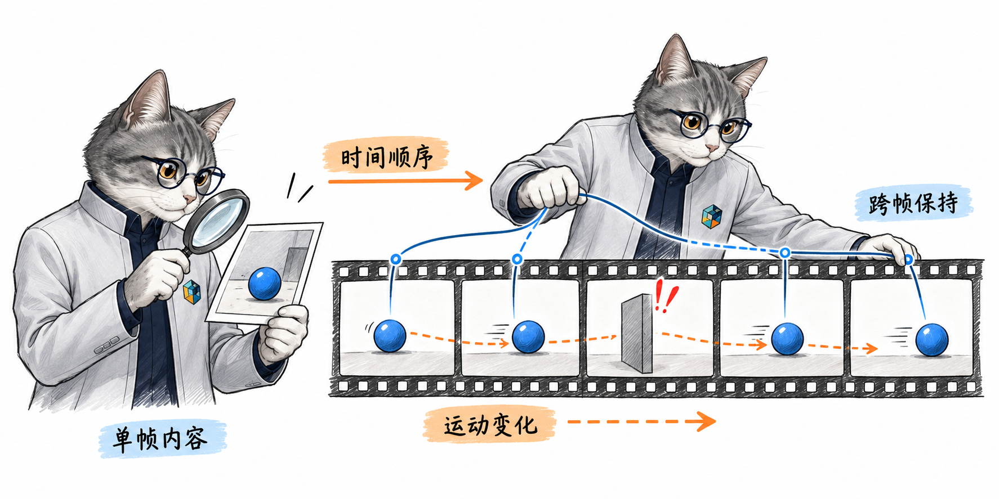
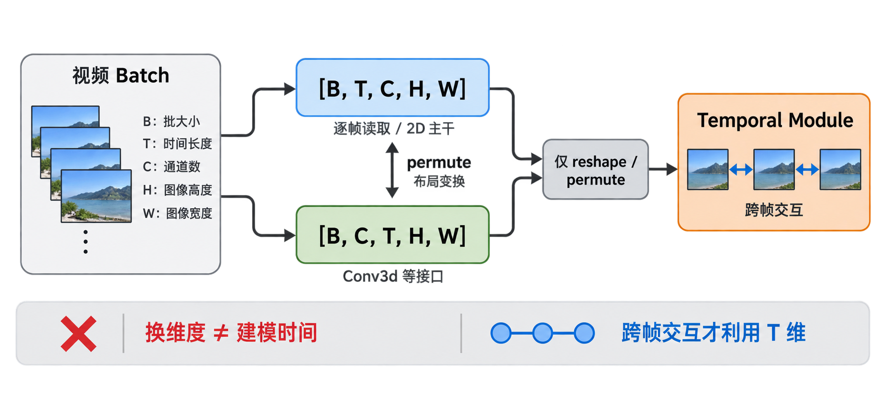
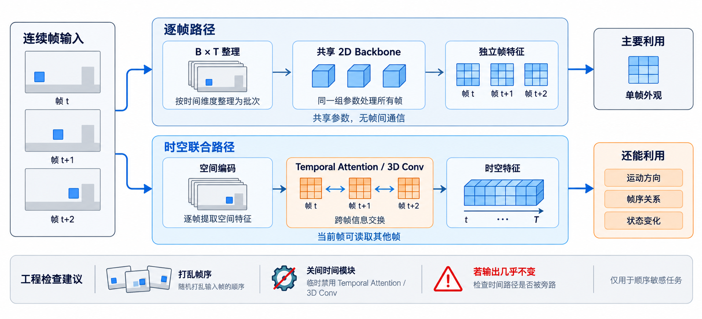
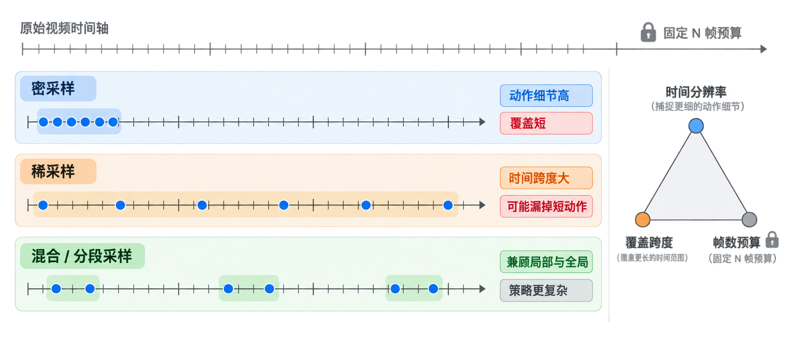
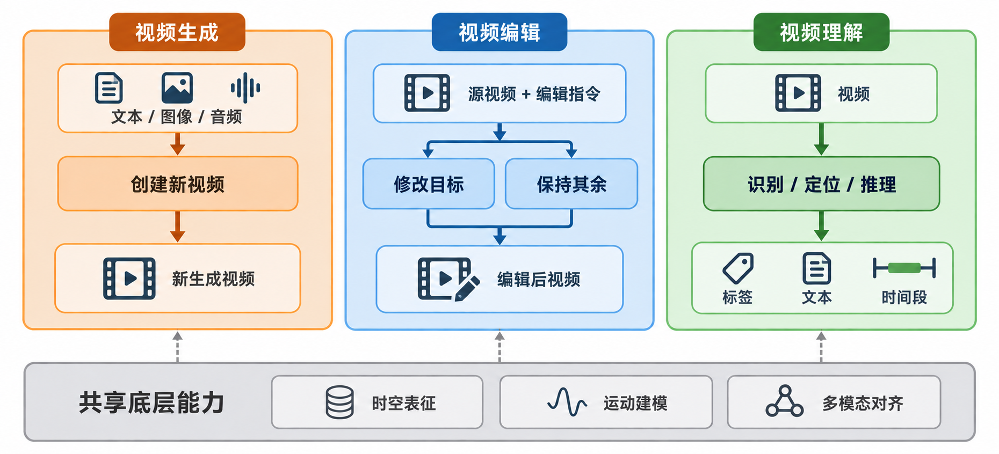
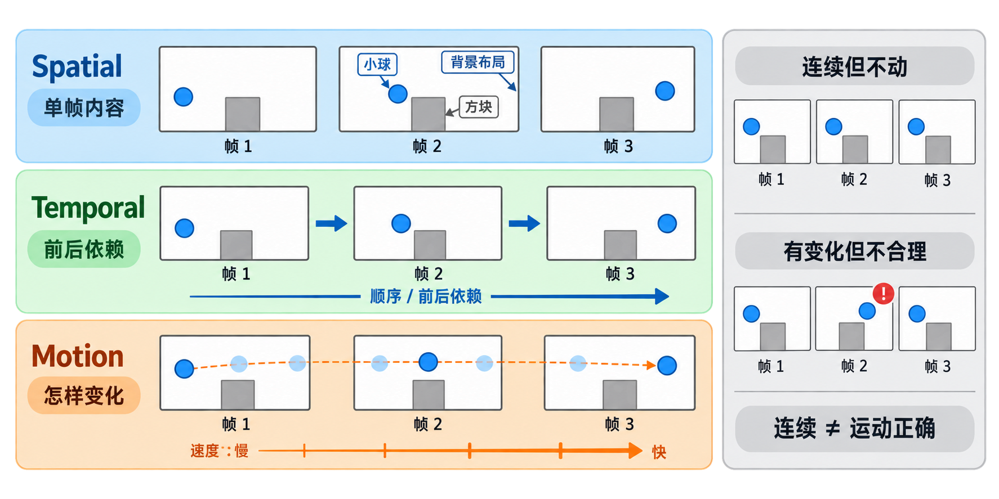
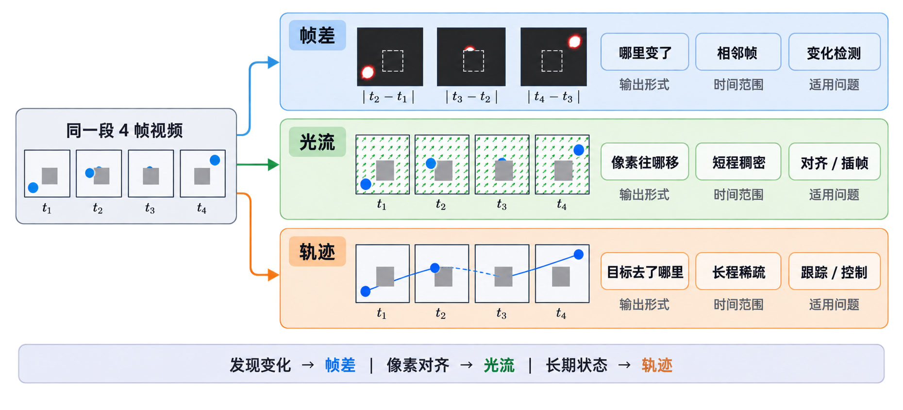
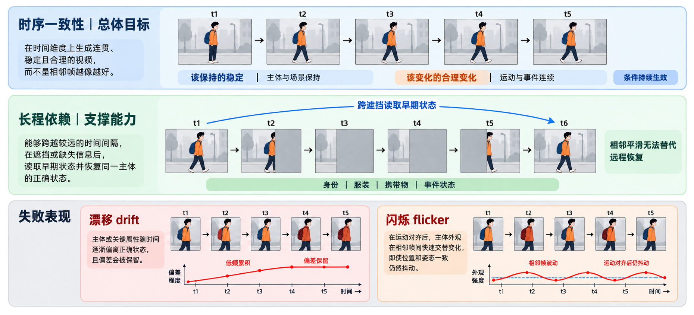
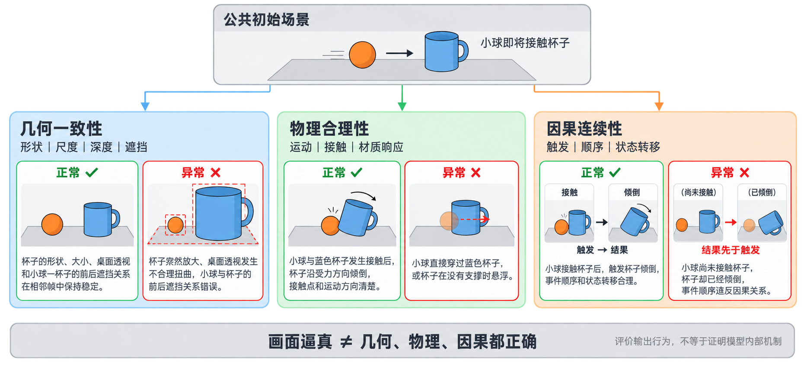

# 4.1 AI 视频核心基础知识

> 本章介绍视频建模的基础概念，包括视频相对图像增加的时间关系、数据组织与采样、运动表征，以及时序一致性、语义对齐和场景合理性。这些概念用于理解后续的视频生成架构与编辑方法，也为分析视频质量问题提供依据。

---

# 目录导航

[4.1.1 视频 vs 图像：视频建模到底多了什么？](#4.1.1_视频-vs-图像：视频建模到底多了什么？)

  - [4.1.1.1 面试问题：视频相对图像新增了哪些建模要求？为什么通常更难？](#4.1.1.1_面试问题：视频相对图像新增了哪些建模要求？为什么通常更难？)
  - [4.1.1.2 面试问题：视频 Tensor 如何组织？维度顺序为什么重要？](#4.1.1.2_面试问题：视频-Tensor-如何组织？维度顺序为什么重要？)
  - [4.1.1.3 面试问题：逐帧处理与时空建模有什么区别？](#4.1.1.3_面试问题：逐帧处理与时空建模有什么区别？)

[4.1.2 视频基本参数：帧、帧率、时长、分辨率、码率与采样](#4.1.2_视频基本参数：帧、帧率、时长、分辨率、码率与采样)
  - [4.1.2.1 面试问题：FPS、采样间隔和输入片段的时间跨度是什么关系？](#4.1.2.1_面试问题：FPS、采样间隔和输入片段的时间跨度是什么关系？)
  - [4.1.2.2 面试问题：分辨率和码率有什么区别？它们如何影响训练数据？](#4.1.2.2_面试问题：分辨率和码率有什么区别？它们如何影响训练数据？)
  - [4.1.2.3 面试问题：固定输入帧数时，视频采样策略应该怎么选？](#4.1.2.3_面试问题：固定输入帧数时，视频采样策略应该怎么选？)

[4.1.3 视频任务基础：生成、编辑与理解](#4.1.3_视频任务基础：生成、编辑与理解)
  - [4.1.3.1 面试问题：视频生成、视频编辑和视频理解的任务边界是什么？](#4.1.3.1_面试问题：视频生成、视频编辑和视频理解的任务边界是什么？)
  - [4.1.3.2 面试问题：视频编辑相对图像编辑新增了哪些约束？](#4.1.3.2_面试问题：视频编辑相对图像编辑新增了哪些约束？)
  - [4.1.3.3 面试问题：视频生成与编辑中，不同条件分别控制什么？条件越多越好吗？](#4.1.3.3_面试问题：视频生成与编辑中，不同条件分别控制什么？条件越多越好吗？)
  - [4.1.3.4 面试问题：视频理解如何支持视频生成与编辑？](#4.1.3.4_面试问题：视频理解如何支持视频生成与编辑？)

[4.1.4 视频的时空属性：Spatial、Temporal 与 Motion](#4.1.4_视频的时空属性：Spatial、Temporal-与-Motion)
  - [4.1.4.1 面试问题：Spatial、Temporal 与 Motion 分别是什么？三者有什么关系？](#4.1.4.1_面试问题：Spatial、Temporal-与-Motion-分别是什么？三者有什么关系？)
  - [4.1.4.2 面试问题：视频生成中，为什么画面连续不等于运动正确？如何判断运动是否符合要求？](#4.1.4.2_面试问题：视频生成中，为什么画面连续不等于运动正确？如何判断运动是否符合要求？)

[4.1.5 运动表征基础：光流、帧差、轨迹与隐式运动](#4.1.5_运动表征基础：光流、帧差、轨迹与隐式运动)
  - [4.1.5.1 面试问题：什么是光流？它在视频算法中起什么作用？](#4.1.5.1_面试问题：什么是光流？它在视频算法中起什么作用？)
  - [4.1.5.2 面试问题：光流、帧差与轨迹有什么区别？工程上如何选择？](#4.1.5.2_面试问题：光流、帧差与轨迹有什么区别？工程上如何选择？)
  - [4.1.5.3 面试问题：视频生成模型不显式使用光流，为什么仍能生成运动？显式运动表征还有什么价值？](#4.1.5.3_面试问题：视频生成模型不显式使用光流，为什么仍能生成运动？显式运动表征还有什么价值？)

[4.1.6 时序建模基础：一致性、长程依赖、漂移与闪烁](#4.1.6_时序建模基础：一致性、长程依赖、漂移与闪烁)
  - [4.1.6.1 面试问题：什么是视频中的时序一致性？](#4.1.6.1_面试问题：什么是视频中的时序一致性？)
  - [4.1.6.2 面试问题：什么是视频中的长程依赖？为什么难以建模？](#4.1.6.2_面试问题：什么是视频中的长程依赖？为什么难以建模？)
  - [4.1.6.3 面试问题：什么是视频漂移？视频生成与编辑中为什么会出现漂移？](#4.1.6.3_面试问题：什么是视频漂移？视频生成与编辑中为什么会出现漂移？)
  - [4.1.6.4 面试问题：什么是视频闪烁（flicker）？它与漂移有什么区别，如何定位来源？](#4.1.6.4_面试问题：什么是视频闪烁（flicker）？它与漂移有什么区别，如何定位来源？)

[4.1.7 视频语义对齐与世界一致性](#4.1.7_视频语义对齐与世界一致性)
  - [4.1.7.1 面试问题：视频文本对齐比图文对齐难在哪里？如何构造有效的训练信号？](#4.1.7.1_面试问题：视频文本对齐比图文对齐难在哪里？如何构造有效的训练信号？)
  - [4.1.7.2 面试问题：视频生成中，几何一致性、物理合理性与因果连续性分别约束什么？如何评估？](#4.1.7.2_面试问题：视频生成中，几何一致性、物理合理性与因果连续性分别约束什么？如何评估？)

[总结](#总结)

---

<h1 id="4.1.1_视频-vs-图像：视频建模到底多了什么？">4.1.1 视频 vs 图像：视频建模到底多了什么？</h1>

> 本节讨论视频增加了哪些建模要求、采样帧怎样组织成 Tensor，以及模型如何通过跨帧交互利用时间信息。

<h2 id="4.1.1.1_面试问题：视频相对图像新增了哪些建模要求？为什么通常更难？">4.1.1.1 面试问题：视频相对图像新增了哪些建模要求？为什么通常更难？</h2>

**难度评分：⭐⭐⭐ (3/5)  |  考察频率：⭐⭐⭐⭐⭐ (5/5)**

视频相对图像新增了对**时间关系、动态状态和跨帧对应关系**的建模要求。在任务目标和单帧质量要求相近时，模型需要同时处理空间内容与时间关系，因此视频通常更难建模。

<div align="center"></div>

<p align="center">图1-1 视频不是多张独立图片，而是连续演化的状态</p>

**1、视频新增了哪些建模要求？**

- **建模时间关系与状态变化。** 图像描述某个时刻的对象、属性和空间布局；视频还要描述动作按什么顺序发生、持续多久，以及对象的状态怎样变化。例如，“拿起杯子”和“放下杯子”可能包含相似的单帧画面，但帧序不同，表达的动作也不同。帧间时间间隔还会影响模型对运动快慢的判断。

- **建立跨帧对应，维持对象与场景的连续性。** 模型需要判断不同帧中的对象是否为同一个，以及它的位置、外观和状态如何衔接。例如图1-1中的球被方块遮挡后重新出现，模型需要利用前后信息，判断它是否仍为同一个球、运动轨迹能否接上。对象运动、相机移动、形变和遮挡都会增加建立对应关系的难度。

**2、这些要求为什么让视频通常更难？**

**单帧质量与跨帧连贯性需要同时考虑。** 每一帧的画面都清楚、结构都正确，并不能保证整段视频合理。模型还要维持主体身份、衔接运动轨迹，并保持动作与事件顺序正确。这要求模型结合多个时间位置的信息，在外观和可见性变化时持续判断对象状态。

**跨帧计算与时序监督增加了资源和数据需求。** 采样 $T$ 帧、每帧大小为 $H\times W$ 时，输入包含 $T\times H\times W$ 的时空位置。处理更多帧并建立跨帧交互，通常会增加计算和显存开销，具体增长取决于采样、压缩和模型结构。数据也需要保留关键时间信息：采样过疏可能漏掉短时动作，只有静态场景描述的文本则难以监督动作顺序。

> **面试速答**：视频相对图像新增了时间关系、动态状态和跨帧对应的建模要求。它既要保证单帧合理，还要在运动、形变和遮挡下保持对象与状态的连续性；更多帧和跨帧交互也增加了计算开销，对采样和时序标注提出更高要求。因此，在可比任务条件下，视频通常更难建模。

参考资料：[Video Diffusion Models](https://arxiv.org/abs/2204.03458)、[ViViT](https://arxiv.org/abs/2103.15691)

<h2 id="4.1.1.2_面试问题：视频-Tensor-如何组织？维度顺序为什么重要？">4.1.1.2 面试问题：视频 Tensor 如何组织？维度顺序为什么重要？</h2>

**难度评分：⭐⭐ (2/5)  |  考察频率：⭐⭐⭐⭐ (4/5)**

将一批采样后的视频帧送入模型时，常用五维 Tensor 表示： $[B,T,C,H,W]$ 或 $[B,C,T,H,W]$。维度顺序需要符合接收它的模型或算子约定。

<div align="center"></div>

<p align="center">图1-2 两种视频 Tensor 布局与时间模块的关系</p>

**1、视频 Tensor 如何组织？**

五个维度分别表示：

<div align="center">

| 维度 | 含义 |
| :---: | :--- |
| $B$ | 批量大小，即一批包含多少段视频 |
| $T$ | 每段视频的采样帧数 |
| $C$ | 单帧通道数，RGB 图像通常为 3 |
| $H$、 $W$ | 输入帧的高度和宽度 |

</div>

常见的两种组织方式是：

- $[B,T,C,H,W]$：每段视频包含 $T$ 帧，每帧按 $[C,H,W]$ 组织，便于按时间取帧。逐帧提取特征时，可以将 $B$、 $T$ 合并为 $B\times T$，交给二维图像主干处理。
- $[B,C,T,H,W]$：将通道维放在时间维之前。例如，PyTorch `Conv3d` 的批量输入采用 $[N,C,D,H,W]$，处理视频时通常将时间轴放在 $D$ 所在的位置。[PyTorch 官方文档](https://docs.pytorch.org/docs/stable/generated/torch.nn.Conv3d.html)

这里讨论的是输入帧张量；经过编码后，视频也可以表示为其他形状的特征或 token。

**2、维度顺序为什么重要？**

**（1）算子按照约定的位置解释每个维度。** 如果将 $[B,T,C,H,W]$ 直接送给要求 $[B,C,T,H,W]$ 的模块，时间轴就会被当作通道轴，可能导致维度不匹配，或产生语义错误的计算。因此，转换布局时需要正确交换维度，不能只把形状改成目标数字。

**（2）合并和恢复维度时，必须保持视频归属与帧序。** 例如，两段视频各有三帧，合并后得到六帧。逐帧处理完再恢复时间维时，必须让每一帧回到原来的视频和时间位置。如果恢复顺序错误，不同视频的帧可能被放进同一个序列，形状虽然正确，时间模块看到的“相邻帧”却已经错了。

换轴、合并和恢复维度都属于数据组织操作；模型是否建立跨帧联系，还取决于后续是否存在时间信息交互。

> **面试速答**：一批视频帧常用 $[B,T,C,H,W]$ 或 $[B,C,T,H,W]$ 表示，分别包含批量、时间、通道和空间维度，具体顺序由算子接口决定。顺序错误可能让时间轴与通道轴混淆；逐帧计算后恢复维度时，还要保持视频归属和帧序，避免形状正确但内容已经串帧。维度变换本身不等于时序建模。

<h2 id="4.1.1.3_面试问题：逐帧处理与时空建模有什么区别？">4.1.1.3 面试问题：逐帧处理与时空建模有什么区别？</h2>

**难度评分：⭐⭐⭐ (3/5)  |  考察频率：⭐⭐⭐⭐⭐ (5/5)**

这里的逐帧处理指各帧独立计算，时空建模则通过跨帧联系利用时间信息。核心区别是：**当前帧的特征或预测，是否能够利用其他帧的信息。**

<div align="center"></div>

<p align="center">图1-3 逐帧共享参数与跨帧信息交互的差异</p>

**1、逐帧处理与时空建模的区别**

- **逐帧处理：各帧独立计算，共享模型参数。** 同一个图像模型分别处理每一帧，提取对象、纹理和空间布局等信息。这种方式便于复用图像预训练模型，但当前帧无法读取其他帧的内容。共享参数只意味着使用同一套处理规则，并不意味着帧之间交换了信息。
- **时空建模：不同帧之间存在信息交互。** 模型通过时间卷积、时间注意力等模块，结合多个时间位置的信息，学习对象位移、动作阶段和状态延续等关系。例如，时间卷积可以聚合相邻帧特征，时间注意力可以读取其注意范围内的其他帧特征。

以球的运动为例，逐帧模型可以分别识别各帧中球的位置，但仅靠单帧信息无法确定它的实际运动方向；建立跨帧联系后，模型才有条件结合位置变化与时间顺序判断运动。

**2、逐帧处理可以作为时空模型的一部分**

一种常见做法是：先用二维图像主干分别提取每帧特征，再用时间模块让不同帧的特征交换信息。前一阶段处理单帧空间内容，后一阶段建立跨帧依赖，整个模型因此具备时空建模能力。

判断时应检查完整的计算路径：逐帧空间计算之后可以继续进行时间交互。跨帧结构提供信息通路，模型还需要通过训练学习运动与状态关系。

> **面试速答**：逐帧处理是在各帧上复用同一个图像模型，各帧之间不交换信息；时空建模通过时间卷积或注意力等模块建立跨帧联系，使模型能够利用运动和状态变化。两者可以组合：先逐帧提取空间特征，再进行时间交互，整体仍属于时空模型。

参考资料：[Video Diffusion Models](https://arxiv.org/abs/2204.03458)、[ViViT](https://arxiv.org/abs/2103.15691)、[Attention Is All You Need](https://arxiv.org/abs/1706.03762)

---

<h1 id="4.1.2_视频基本参数：帧、帧率、时长、分辨率、码率与采样">4.1.2 视频基本参数：帧、帧率、时长、分辨率、码率与采样</h1>

> 源视频的帧率、分辨率和码率，与模型最终输入的帧数和尺寸需要分别理解。解码、裁剪、缩放和时间采样共同决定模型实际接收的画面及其时间范围。

<h2 id="4.1.2.1_面试问题：FPS、采样间隔和输入片段的时间跨度是什么关系？">4.1.2.1 面试问题：FPS、采样间隔和输入片段的时间跨度是什么关系？</h2>

**难度评分：⭐⭐⭐ (3/5)  |  考察频率：⭐⭐⭐⭐ (4/5)**

FPS 表示每秒包含多少帧。视频送入模型前通常会经过取帧，因此需要区分**源视频帧率**与**采样帧率**。输入片段覆盖多少真实时间，由采样间隔和输入帧数共同决定。

**1、源帧率与采样间隔如何换算？**

对恒定帧率视频，设源帧率为 $f_{src}$，相邻采样帧的源帧索引相差 $s$。例如，取第 0、3、6、9 帧时，采样步长 $s=3$。

保留原视频的时间坐标时，相邻采样帧的时间间隔为：

```math
\Delta t_{sample}=\frac{s}{f_{src}}
```

对应的采样帧率为：

```math
f_{sample}=\frac{1}{\Delta t_{sample}}=\frac{f_{src}}{s}
```

例如，源视频为 30 FPS，按步长 3 取帧，相邻采样帧相隔 0.1 秒，采样帧率为 10 FPS。

**2、输入帧数怎样决定时间跨度？**

若输入 $T$ 帧，首末两帧之间有 $T-1$ 个采样间隔，因此时间跨度为：

```math
\Delta t_{clip}
=(T-1)\Delta t_{sample}
=\frac{T-1}{f_{sample}}
=\frac{(T-1)s}{f_{src}}
```

沿用上面的例子，取 16 帧时，首末帧相隔：

```math
\Delta t_{clip}=\frac{16-1}{10}=1.5\text{ 秒}
```

这里计算的是**首末采样帧的时间戳跨度**。如果将这 16 帧逐帧播放，每帧显示 0.1 秒，播放时长则为 1.6 秒，两者采用的时长口径不同。

**3、固定输入帧数时，采样密度有什么影响？**

固定 $T$ 时，提高采样帧率会缩短时间覆盖范围，提供更密集的局部观测；降低采样帧率可以覆盖更长时间，但可能漏掉短时动作。此时输入帧数保持不变。如果保持覆盖时长不变，提高采样帧率则需要更多输入帧。

上述公式适用于等间隔采样。遇到可变帧率、丢帧或不规则采样，应直接读取采样帧的时间戳，用末帧时间戳减去首帧时间戳计算跨度。

> **面试速答**：恒定帧率视频按源帧步长 $s$ 采样时，采样帧率为 $f_{src}/s$。输入 $T$ 帧，首末时间跨度为 $(T-1)s/f_{src}$。固定帧数时，采样越密，覆盖时间越短；采样越疏，覆盖越长，但容易漏掉短时动作。不规则采样则应按实际时间戳计算。

<h2 id="4.1.2.2_面试问题：分辨率和码率有什么区别？它们如何影响训练数据？">4.1.2.2 面试问题：分辨率和码率有什么区别？它们如何影响训练数据？</h2>

**难度评分：⭐⭐ (2/5)  |  考察频率：⭐⭐⭐⭐ (4/5)**

分辨率描述**单帧有多少像素**，码率描述**编码视频每秒使用多少比特**。两者分别反映空间尺寸和编码数据量，都不能单独代表画质。

**1、分辨率和码率有什么区别？**

<p align="center"><strong>表1-1 分辨率与码率的区别</strong></p>

<div align="center">

| 参数 | 含义 | 常见表示 |
| :---: | :--- | :--- |
| 分辨率 | 单帧图像的宽和高，决定像素数量 | 如 $1920\times1080$ |
| 视频码率 | 编码后的视频流单位时间使用的比特数 | 如 5 Mbit/s，即每秒约 500 万比特 |

</div>

分辨率高，只说明像素多，不保证细节清楚。例如，一段失焦的视频即使达到 4K，画面仍可能模糊。

码率与画质的关系需要在可比条件下判断。对同一段源视频，保持编码器、分辨率、帧率等条件一致，提高码率通常能减轻有损压缩失真；换了编码器或画面内容，就不能仅凭码率给画质排序。提高已经受损视频的重编码码率，也无法找回此前丢失的细节。

**码率还直接影响视频文件大小和传输带宽。** 视频流平均码率是视频流在整段时长上的平均值；各数据流的总平均码率还计入音频等其他数据流。文件大小可以近似估算为：

```math
\text{文件大小（字节）}\approx\frac{\text{各数据流的总平均码率（bit/s）}\times\text{时长（秒）}}{8}
```

例如，一段 60 秒、视频流平均码率为 5 Mbit/s 的视频，仅视频流约占 37.5 MB；完整文件还需计入音频等数据流及公式未包含的封装开销。对于可变码率，也应使用整段时长上的平均值估算。

**2、它们如何影响训练数据？**

**（1）分辨率影响可用的空间信息，但源分辨率不等于模型输入尺寸。** 训练时通常先解码，再裁剪、缩放到目标尺寸。例如，4K 和 720p 视频最终都处理为 $256\times256$ 时，输入 Tensor 的空间尺寸相同。源分辨率的价值在于提供可供裁剪、缩放的细节，最终保留多少信息还取决于源画质与预处理方式。

**（2）码率通过压缩质量影响解码后的像素。** 输入 Tensor 的形状不包含码率，但有损压缩留下的块状伪影、边缘失真和纹理涂抹，可能随解码帧进入训练。生成模型可能学着复现这些痕迹，理解模型也可能将其作为与数据来源相关的识别线索。

视频文件大小影响数据集存储与读取开销，解码后的 Tensor 大小则主要由帧数、输入分辨率、通道数和数据类型决定。相同输入规格下，高码率视频并不意味着输入 Tensor 更大。

因此，筛选训练视频时，需要检查**解码并完成预处理后的画面**，确认关键细节是否清楚、压缩失真是否影响任务，不能只依赖分辨率或码率阈值。

> **面试速答**：分辨率表示单帧的像素尺寸，视频码率表示视频流每秒使用的数据量。同等时长下，各数据流的总平均码率越高，文件通常越大，但不代表输入 Tensor 更大。训练输入尺寸由裁剪、缩放决定，压缩失真可能保留在像素中，因此还要检查预处理后的画质。

<h2 id="4.1.2.3_面试问题：固定输入帧数时，视频采样策略应该怎么选？">4.1.2.3 面试问题：固定输入帧数时，视频采样策略应该怎么选？</h2>

**难度评分：⭐⭐⭐ (3/5)  |  考察频率：⭐⭐⭐⭐⭐ (5/5)**

固定输入 $T$ 帧时，需要在**时间覆盖范围与局部运动细节**之间取舍：将帧集中在短时间内，可以更密集地观察局部变化；将帧分散到较长时间内，可以覆盖更多事件阶段，但可能漏掉短时动作。

<div align="center"></div>

<p align="center">图1-4 固定 N 帧预算下的密采样、稀采样与混合采样取舍</p>

**1、根据任务需要选择采样方式**

如图1-4所示，密集采样将帧集中在较短时间窗内，稀疏采样将帧分散到较长时间范围，分段组合采样则在多个时间段内分别保留一组连续帧。根据任务需要，可以参考表1-2选择：

<p align="center"><strong>表1-2 固定输入帧数下的视频采样策略选型</strong></p>

<div align="center">

| 采样方式 | 优先适用的任务需求 | 主要风险 |
| :---: | :--- | :--- |
| 密集采样 | 分辨短时动作和局部运动过程 | 可能错过窗口外的关键事件 |
| 稀疏采样 | 概览长视频、观察多个事件阶段 | 可能漏掉瞬时动作 |
| 分段组合采样 | 同时观察不同阶段及阶段内变化 | 段间有盲区，每段细节有限 |

</div>

例如，总共只能输入 12 帧：

- 判断一个短时手势怎样变化，可以将 12 帧集中在动作发生的时间窗内。
- 了解较长视频经历了哪些事件，可以将 12 帧分散到整个时间范围。
- 既要观察不同阶段，又要保留阶段内的动作，可以在三个时间段各取连续 4 帧。

分段组合保留了各段内部的连续变化，但段间仍有未观测区域，每段可分配的帧数也会减少。

**2、选择后还需要注意什么？**

**（1）关键事件是否被采到。** 密集采样如果选错时间窗，也可能完全漏掉目标动作。若已有可靠的事件位置，可以围绕事件取帧；没有定位信息时，则要考虑怎样扩大覆盖范围。

**（2）采样后的内容是否仍符合任务要求。** 采样间隔过大，可能使决定标签的动作消失。对于要求片段内连续运动的任务，还应避免无意跨越镜头切换。

**（3）训练和推理的采样方式是否匹配。** 训练时可以随机选择起点或适度改变间隔，增加时间位置和运动变化的覆盖；评估时应固定采样规则，保证结果可比较。若使用多个片段聚合结果，还应说明额外的输入帧数和计算开销。

> **面试速答**：固定帧数下，密集采样提供局部运动细节，稀疏采样覆盖较长时间的事件过程，分段组合则在多个阶段保留连续帧。采样方式需要符合任务所需的时间粒度，并检查关键动作是否保留、训练与推理是否匹配。

---

<h1 id="4.1.3_视频任务基础：生成、编辑与理解">4.1.3 视频任务基础：生成、编辑与理解</h1>

> 视频生成、编辑与理解具有不同的输出目标和保持要求，也可以在同一流程中配合。本节介绍它们的任务边界、编辑中的时间约束，以及条件输入和视频理解的作用。

<div align="center"></div>

<p align="center">图1-5 生成、编辑与理解的输入输出边界及共享底层能力</p>

<h2 id="4.1.3.1_面试问题：视频生成、视频编辑和视频理解的任务边界是什么？">4.1.3.1 面试问题：视频生成、视频编辑和视频理解的任务边界是什么？</h2>

**难度评分：⭐⭐⭐ (3/5)  |  考察频率：⭐⭐⭐⭐⭐ (5/5)**

三类任务可以按**输出目标，以及对已有视频内容的保持要求**区分：生成侧重合成视频，编辑侧重按要求修改已有视频，理解侧重从视频中提取信息并进行判断。

**1、三类任务分别解决什么问题？**

- **视频生成：根据条件合成视频内容。** 输入可以是文本、图像、音频或视频前缀等，输出是满足条件的视频。例如，根据“一位穿红衣的人在街上行走”生成一段视频，模型需要组织人物、场景和运动过程。
- **视频编辑：修改已有视频，同时保持要求保留的内容。** 输入通常包括源视频和修改要求，输出是编辑后的视频。例如，把源视频中人物的红色外套改成蓝色，同时保持人物身份、原有动作和背景。编辑既要完成修改，也要控制非预期变化。
- **视频理解：从视频中提取信息并进行判断。** 输入主要是视频，输出可以是动作类别、文字描述、事件时间区间或对象轨迹等。例如，判断人物正在做什么、沿什么路线移动，以及某个动作发生在哪段时间。

**2、容易混淆的任务怎样区分？**

**（1）图生视频通常属于生成。** 图生视频（Image-to-Video，I2V）虽然输入已有图像，但模型仍需要合成随时间展开的内容，例如让照片中的人物开始行走。

**（2）视频输入不代表一定是编辑。** 视频到视频（Video-to-Video，V2V）描述的是输入与输出形式。若任务要求修改指定内容，并保持源视频的其他相关内容，更接近编辑；若源视频仅提供风格或运动参考，允许重新组织场景与主体，则更接近条件生成。

**（3）任务区别不等于模型必须分开。** 编辑可以通过生成模型实现，理解结果也可以用于定位编辑对象或检查生成结果。同一个模型可以承担多种任务，具体归类仍要看它这次需要完成什么目标。

> **面试速答**：视频生成根据条件合成视频；视频编辑以已有视频为基础，完成指定修改并保持相关内容；视频理解从视频中输出语义、时间、位置或判断。区分时主要看输出目标和源内容的保持要求，不能只看输入是图片还是视频，也不能只看使用了什么模型。

参考资料：[Video Diffusion Models](https://arxiv.org/abs/2204.03458)、[TokenFlow](https://arxiv.org/abs/2307.10373)、[ViViT](https://arxiv.org/abs/2103.15691)

<h2 id="4.1.3.2_面试问题：视频编辑相对图像编辑新增了哪些约束？">4.1.3.2 面试问题：视频编辑相对图像编辑新增了哪些约束？</h2>

**难度评分：⭐⭐⭐⭐ (4/5)  |  考察频率：⭐⭐⭐⭐ (4/5)**

图像编辑要求完成指定修改，并保持不应改变的内容。视频编辑需要让这些要求**沿时间持续成立**：修改要作用于正确的对象和时间段，编辑结果要跨帧一致，源视频中要求保留的运动与场景也要延续。

**1、编辑作用域需要随时间变化**

视频中的对象会移动、形变、被遮挡后重新出现。编辑需要持续对应到目标对象，并根据可见性和指定时间范围确定修改位置。

例如，把人物的红色外套改成蓝色，修改范围要跟随衣服的运动和形变；衣服被遮挡时，不应误改前景对象，重新出现后也要继续保持修改。对于使用掩码的方法，简单地给所有帧复制同一个二维 mask，容易漏改目标或误改背景。

**2、编辑结果需要保持跨帧一致**

逐帧修改正确，并不保证播放时连贯。同一件外套可能有的帧变蓝、有的帧仍是红色，也可能出现纹理跳变、边缘抖动或遮挡后恢复原样。

跨帧一致性要求同一项修改在相关帧中持续生效，同时随姿态、光照和遮挡合理变化。例如，蓝色外套在阴影中可以变暗，不要求所有帧的像素颜色完全相同，但不能无故变色或闪烁。

**3、要求保留的源视频状态需要跨帧延续**

除单帧中的非编辑内容外，视频还需要保持未要求改变的动作过程、运动轨迹和镜头运动。

例如，只修改外套颜色时，人物走路的节奏、身体姿态和相机移动不应随之改变。若指令本身要求修改动作或运镜，则应允许相应变化，保持范围由任务目标决定。

> **面试速答**：视频编辑把图像编辑中的“修改正确、保持其他内容”扩展到了时间维。新增约束主要包括：编辑范围随对象运动、遮挡和指定时间段变化；修改结果跨帧持续一致；未要求改变的动作、轨迹和镜头运动保持延续。因此，逐帧编辑正确还不够，还要保证整段视频中的修改连贯、保持内容稳定。

参考资料：[TokenFlow](https://arxiv.org/abs/2307.10373)

<h2 id="4.1.3.3_面试问题：视频生成与编辑中，不同条件分别控制什么？条件越多越好吗？">4.1.3.3 面试问题：视频生成与编辑中，不同条件分别控制什么？条件越多越好吗？</h2>

**难度评分：⭐⭐⭐ (3/5)  |  考察频率：⭐⭐⭐⭐ (4/5)**

视频生成与编辑中的条件，用于约束**生成什么、外观怎样、位于哪里、怎样运动，以及何时发生**。不同条件可以互相补充，但增加条件只有在信息有效、彼此协调且模型能够利用时，才有助于提高可控性。

**1、不同条件主要控制什么？**

<p align="center"><strong>表1-3 视频生成与编辑中常见条件的控制作用</strong></p>

<div align="center">

| 控制目标 | 常见条件 | 主要作用 | 例子 |
| :---: | :--- | :--- | :--- |
| 内容与语义 | 文本、脚本、编辑指令 | 描述主体、属性、动作和事件关系 | “一个人拿起杯子后喝水” |
| 外观与身份 | 首帧、参考图、参考视频 | 提供人物、物体、场景或风格参考 | 保持参考人物的外貌与服装 |
| 空间结构与作用区域 | 姿态、深度、边缘、mask | 约束姿势、布局、几何关系或修改范围 | 按指定姿态生成，只修改掩码区域 |
| 对象运动与镜头运动 | 点轨迹、光流、相机位姿 | 约束对象移动路径或视角变化 | 人物沿指定路线移动，镜头向前推进 |
| 时间与音画配合 | 语音、音乐、时间标记 | 约束口型、动作节奏或事件发生时间 | 口型匹配语音，动作配合节拍 |

</div>

这里按主要控制作用归类，条件与作用并非一一对应。例如，文本既能描述外观，也能描述动作；参考视频可以同时提供主体外观、运动和镜头信息。

**2、条件越多越好吗？**

条件可以减少生成结果的不确定性，但数量增加也会带来新的要求：

**（1）条件需要绑定到正确对象，并在空间和时间上对齐。** 例如，多个人物的姿态需要对应各自的身份，逐帧轨迹要与目标视频的时间轴匹配；否则，即使每路条件单独正确，组合后也可能控制错对象或错时间。

**（2）条件之间需要相互协调。** 例如，文本要求人物向左移动，轨迹却要求向右；两者无法同时满足，模型可能忽略其中一路，或产生不符合预期的结果。

**（3）模型需要支持并有效利用这些条件。** 能分别使用参考图和姿态，不代表一定能将二者稳定组合。输入接口、训练方式和条件强度都会影响结果，不能仅凭“多输入了一路条件”判断控制能力有所提升。

因此，应先明确任务最需要控制什么，再选择相应条件。已有条件能够表达要求时，不必为了增加数量而加入重复或不可靠的信息。

> **面试速答**：文本主要表达语义，参考图提供外观和身份，姿态、深度与掩码约束结构和区域，轨迹与相机参数控制运动和视角，音频与时间标记帮助同步。条件越多不一定越好，还需要对象与时空对齐、条件互不冲突，以及模型具备相应的组合控制能力。应按任务需求选择条件。

参考资料：[VideoComposer](https://arxiv.org/abs/2306.02018)、[MotionCtrl](https://arxiv.org/abs/2312.03641)

<h2 id="4.1.3.4_面试问题：视频理解如何支持视频生成与编辑？">4.1.3.4 面试问题：视频理解如何支持视频生成与编辑？</h2>

**难度评分：⭐⭐⭐⭐ (4/5)  |  考察频率：⭐⭐⭐⭐⭐ (5/5)**

视频理解可以从画面中提取**对象、区域、运动轨迹和事件过程**等信息，帮助生成与编辑任务确定处理对象、作用范围和时间位置，也可以辅助检查输出是否符合要求。

**1、视频理解能够提供哪些信息？**

- **对象与空间信息。** 识别画面中的人物、物体及其位置，确定目标区域和遮挡关系，帮助任务定位“处理谁、处理哪里”。
- **跨帧对应与运动信息。** 跟踪同一对象的位置变化、可见性和运动轨迹，帮助相关操作在对象移动或遮挡后继续作用于正确目标。
- **时间与事件信息。** 划分镜头、定位动作发生区间、识别事件顺序，帮助确定“在哪段时间处理、当前进行到哪个阶段”。

这些信息可由检测、分割、跟踪或其他视频理解方法提取，再与任务指令结合，用于确定处理范围和保持要求。

**2、这些信息怎样支持生成与编辑？**

**（1）支持编辑对象与时间范围的定位。** 例如，“把第三个镜头中人物的红色外套改成蓝色”，需要先定位第三个镜头，再找到并持续对应目标衣服，使修改在相关帧中生效，同时尽量保持其他内容。

**（2）支持参考视频条件生成与续写。** 当任务需要参考已有视频或接着生成后续内容时，对主体、场景、运动和当前动作阶段的判断，可以为后续生成提供依据，帮助衔接人物外观和动作过程。

**（3）辅助检查生成与编辑结果。** 可以根据输出中的对象、动作和时间信息，检查修改是否作用于正确目标、指定事件是否发生，以及应保持的内容是否出现非预期变化。自动判断仍可能出错，关键结果需要结合其他指标或人工检查。

上述能力既可以由独立模块提供，也可以集成在生成或编辑模型内部。纯文本生成视频（T2V）没有必须预先解析的源视频，因此不必将独立视频理解模型作为生成前置步骤；生成后的结果检查仍可以使用理解模型。

> **面试速答**：视频理解提供对象、区域、轨迹和事件等信息，帮助编辑任务定位目标与时间范围，为参考视频生成和续写提供已有状态，也能辅助检查输出是否符合指令。这些能力可以由独立模块提供，也可以集成在模型内部，并非所有生成任务都需要单独的视频理解流程。

参考资料：[SAM 2](https://arxiv.org/abs/2408.00714)、[TokenFlow](https://arxiv.org/abs/2307.10373)

---

<h1 id="4.1.4_视频的时空属性：Spatial、Temporal-与-Motion">4.1.4 视频的时空属性：Spatial、Temporal 与 Motion</h1>

> 本节先区分空间内容、时间关系与运动变化，再回答一个容易混淆的问题：视频播放连续，并不代表运动方向、幅度和动作阶段正确。运动如何表示留到 4.1.5，闪烁、漂移和长程一致性留到 4.1.6。

<div align="center"></div>

<p align="center">图1-6 Spatial、Temporal 与 Motion 的观察对象及“连续不等于运动正确”</p>

<h2 id="4.1.4.1_面试问题：Spatial、Temporal-与-Motion-分别是什么？三者有什么关系？">4.1.4.1 面试问题：Spatial、Temporal 与 Motion 分别是什么？三者有什么关系？</h2>

**难度评分：⭐⭐ (2/5)  |  考察频率：⭐⭐⭐⭐⭐ (5/5)**

**Spatial（空间）：某一帧中有什么、在哪里。** 包括对象的外观、形状、纹理，以及对象之间的位置、布局和遮挡关系。

**Temporal（时间）：不同时间的内容怎样联系。** 包括帧与事件的先后顺序、持续时间、对象状态的延续，以及前后事件之间的依赖。

**Motion（运动）：对象或相机怎样运动。** 包括对象位移、旋转、姿态变化、形变，以及相机移动带来的视角变化。

以“一个人拿起杯子后喝水”为例：人物和杯子的外观与位置属于空间信息；先拿杯子、后喝水及各阶段的持续时间属于时间关系；手臂抬起、杯子移动和倾斜则属于运动信息。要判断杯子是被拿起还是被放下，需要结合前后帧的位置、姿态和时间顺序，因此运动判断同时依赖空间与时间信息。

**运动是时序建模的重要内容，但时序关系不限于运动。** 即使对象保持静止，视频仍有持续时间和状态保持等时间属性。光照变化或纹理闪烁也会产生帧间差异，因此不能仅凭画面发生变化，就认定模型学到了运动。

> **面试速答**：Spatial 关注单帧内容与空间关系，Temporal 关注时间顺序、持续和跨帧依赖，Motion 关注对象或相机的运动变化。运动是时序建模的重要内容，但时间关系还包括静止状态的保持和事件顺序；判断运动则需要结合各帧的空间信息与时间关系。

参考资料：[ViViT](https://arxiv.org/abs/2103.15691)、[Video Diffusion Models](https://arxiv.org/abs/2204.03458)

<h2 id="4.1.4.2_面试问题：视频生成中，为什么画面连续不等于运动正确？如何判断运动是否符合要求？">4.1.4.2 面试问题：视频生成中，为什么画面连续不等于运动正确？如何判断运动是否符合要求？</h2>

**难度评分：⭐⭐⭐ (3/5)  |  考察频率：⭐⭐⭐⭐⭐ (5/5)**

画面连续主要描述相邻帧的视觉衔接是否平稳；运动正确还要求对象的动作、方向、速度和轨迹符合任务要求。因此，视频播放流畅，并不代表它完成了指定动作。

**1、为什么画面连续不等于运动正确？**

例如，提示词要求“人物向右走到桌边并拿起杯子”，以下结果都可能画面连续，却没有正确完成任务：

- **画面稳定，但动作缺失。** 人物始终站在原地，或只做轻微晃动，没有走到桌边。
- **运动平滑，但方向或过程错误。** 人物向左走，或到达桌边后没有拿起杯子。
- **相机在动，但主体没有完成动作。** 镜头平移带来明显的画面变化，人物却没有产生要求的移动。

同样，亮度闪烁和纹理抖动也会造成帧间差异，不能仅凭“画面变化很多”判断运动充分或正确。

**2、如何判断运动是否符合要求？**

**（1）先检查指定动作是否完成。** 对照提示词、轨迹或动作要求，检查主体是否正确，方向、路径、速度和动作顺序是否符合条件。例如，“走到桌边再拿杯子”需要分别检查移动、到达和拿取三个阶段。

**（2）将动作完成情况与视觉稳定性分开检查。** 既要看有没有发生所需运动，也要看运动是否平滑、主体是否保持一致、有无闪烁。静态输出可能很稳定，动态很大的输出也可能只是抖动，单一分数难以覆盖这些情况。VBench 也将运动平滑度、时间闪烁和主体一致性等作为不同维度评价。

**（3）通过改变运动条件检查响应。** 尽量保持主体、场景等条件一致，只改变“向左／向右”“快／慢”或目标轨迹，观察多个生成结果的运动是否随要求相应变化。这可以帮助判断运动控制是否有效，但不能单独证明模型已经掌握真实的运动规律。

光流、点轨迹或姿态序列可以辅助量化位移与动作，最终仍需结合任务要求判断。

> **面试速答**：画面连续说明视觉衔接平稳，运动正确还要求动作、方向、速度和轨迹符合条件。静止、走错方向或只有相机移动的视频，都可能很流畅。评估时应先检查动作是否完成，再分别检查运动平滑度、主体一致性和闪烁，并通过改变运动条件观察输出是否相应变化。

参考资料：[VBench](https://arxiv.org/abs/2311.17982)、[Video Diffusion Models](https://arxiv.org/abs/2204.03458)

---

<h1 id="4.1.5_运动表征基础：光流、帧差、轨迹与隐式运动">4.1.5 运动表征基础：光流、帧差、轨迹与隐式运动</h1>

> 帧差、光流和轨迹分别描述画面变化、帧间位移和多帧位置序列。生成模型也可以在内部特征中学习运动。本节比较这些表征提供的信息、适用任务和误差来源。

<h2 id="4.1.5.1_面试问题：什么是光流？它在视频算法中起什么作用？">4.1.5.1 面试问题：什么是光流？它在视频算法中起什么作用？</h2>

**难度评分：⭐⭐⭐ (3/5)  |  考察频率：⭐⭐⭐⭐⭐ (5/5)**

光流（Optical Flow）描述图像内容在两帧之间的**二维表观运动**。常见的稠密光流为每个像素位置估计一个位移向量，表示该位置的内容在另一帧中向哪里移动、移动了多少。

**1、怎样理解光流？**

设某个可见点在前一帧中的位置为 $(x,y)$，在后一帧中的对应位置为 $(x+u,y+v)$，则它的光流向量为 $(u,v)$，分别表示水平和垂直方向的像素位移。

例如，某点从 $(100,50)$ 移动到 $(105,48)$，对应位移为 $(5,-2)$。按照图像坐标横轴向右、纵轴向下的约定，表示向右移动 5 像素、向上移动 2 像素。为图像中的各个像素估计这样的向量，就形成了光流场。

光流描述的是**图像平面上的位移**，不能直接等同于物体的真实三维速度。物体运动和相机运动都可能产生光流；即使物体静止，相机移动也会使它在画面中的位置发生变化。

**2、光流在视频算法中有什么作用？**

**（1）提供帧间对应与运动线索。** 光流描述不同帧中图像内容的位置联系，可以辅助分析运动方向、位移和运动区域。

**（2）对齐图像或特征。** 根据光流对图像、特征或掩码进行位置映射，使不同帧中的对应内容对齐。这可以用于运动补偿、视频超分、分割传播和视频编辑，也能为插帧提供运动依据。

**（3）辅助训练与质量评估。** 在对应可靠、没有遮挡的区域，可以比较运动对齐后的图像或特征，构造时序约束，或检查局部闪烁与内容不一致。

**3、使用光流时需要注意什么？**

光流是估计结果，并不总是可靠。遮挡可能使某个点在另一帧中不可见；光照变化、反光、重复纹理和快速运动也可能导致匹配错误。因此，使用光流进行对齐或传播时，通常需要结合遮挡判断或置信度处理，避免将错误对应传递到后续结果中。

> **面试速答**：光流是图像平面上的二维表观运动场，常用每个像素的位移向量表示两帧间的对应位置。它主要用于运动分析、帧间对齐，以及视频超分、插帧、分割和编辑传播。光流不等于真实三维速度，在遮挡、光照变化和大位移区域可能估计错误，需要处理不可靠的对应。

参考资料：[Horn–Schunck Optical Flow](https://doi.org/10.1016/0004-3702(81)90024-2)、[RAFT](https://arxiv.org/abs/2003.12039)

<h2 id="4.1.5.2_面试问题：光流、帧差与轨迹有什么区别？工程上如何选择？">4.1.5.2 面试问题：光流、帧差与轨迹有什么区别？工程上如何选择？</h2>

**难度评分：⭐⭐⭐⭐ (4/5)  |  考察频率：⭐⭐⭐⭐ (4/5)**

三者提供的运动线索不同：**帧差描述哪里发生了变化，光流描述两帧之间的像素位移，轨迹描述同一点或目标在多帧中的位置变化。** 所需信息的粒度和时间范围，是选型的主要依据。

**1、三种表征有什么区别？**

<p align="center"><strong>表1-4 帧差、光流与轨迹的区别</strong></p>

<div align="center">

| 表征 | 典型输出 | 时间关系 | 主要局限 |
| :---: | :--- | :--- | :--- |
| 帧差 | 两帧对应位置的像素差值，或阈值筛选后的变化区域 | 通常比较相邻帧 | 不直接建立内容对应关系，容易受光照、噪声和相机运动影响 |
| 光流 | 两帧间各像素的二维位移向量 | 通常描述两帧之间的对应 | 遮挡、重复纹理和大位移等情况可能造成估计错误 |
| 点或目标轨迹 | 同一点或目标的位置序列，可附带可见性等状态 | 持续关联多个时间位置 | 可能跟丢、漂移或关联到错误目标 |

</div>

<div align="center"></div>

<p align="center">图1-7 帧差、光流与轨迹的输出形式、时间范围和工程选择</p>

例如，球从左向右移动：帧差可以显示哪些位置发生了变化；光流可以估计球表面可对应区域的位移；轨迹则记录球或其特征点在多帧中经过的位置。

**2、工程上如何选择？**

**（1）只需低成本发现画面变化，可以先考虑帧差。** 例如筛选变化较大的帧或候选区域。但若要进一步判断是否为目标运动，还需要排除光照变化、噪声或相机移动等影响。

**（2）需要像素级对应与对齐，可以考虑光流。** 例如运动补偿、插帧、视频超分和编辑传播。使用时要处理遮挡和不可靠对应，避免将估计错误传到后续结果中。

**（3）需要持续跟踪对象或控制路径，可以考虑轨迹。** 例如记录人物行走路线、指定物体运动路径或检查目标是否到达指定位置。目标框中心轨迹只能描述粗略位移；需要分析姿态或形变时，可以使用关键点或多点轨迹。

这些表征可以配合使用，例如用轨迹描述主体的长期路径，用光流处理局部帧间对齐，同时核算估计成本并检查遮挡等区域的可靠性。

> **面试速答**：帧差提供变化区域，光流估计两帧间的像素位移，轨迹记录同一点或目标在多帧中的位置。它们分别适合变化筛选、像素对齐和持续跟踪或路径控制，也可以组合使用；估计时需要考虑光照、遮挡和关联误差。

参考资料：[RAFT](https://arxiv.org/abs/2003.12039)、[CoTracker](https://arxiv.org/abs/2307.07635)

<h2 id="4.1.5.3_面试问题：视频生成模型不显式使用光流，为什么仍能生成运动？显式运动表征还有什么价值？">4.1.5.3 面试问题：视频生成模型不显式使用光流，为什么仍能生成运动？显式运动表征还有什么价值？</h2>

**难度评分：⭐⭐⭐⭐ (4/5)  |  考察频率：⭐⭐⭐ (3/5)**

光流是表示运动的一种方式，视频生成模型也可以直接从视频数据中学习跨帧变化，将运动信息编码在内部特征中。因此，没有显式光流输入或光流标签，并不意味着模型无法学习运动。

**1、模型怎样在没有光流的情况下学习运动？**

**（1）视频数据本身包含运动信息。** 按时间排列的帧记录了对象的位置、姿态和外观变化。例如，训练视频连续展示手臂抬起、杯子移动和倾斜，即使没有标注光流，这些画面也提供了动作过程的学习信号。

**（2）生成训练可以利用这些跨帧变化。** 扩散模型通过去噪学习恢复视频内容，自回归模型通过预测视频 token 学习生成过程。在能够利用跨帧信息的结构中，这些训练目标可以促使模型学习不同时间位置之间的关联。

**（3）时序结构支持跨帧信息交互。** 时间卷积、时间注意力等模块让不同帧的信息相互作用，使网络能够利用位置变化、动作阶段和前后状态。运动信息可以分布在这些内部特征中，不必单独输出为光流场。

这种方式通常称为隐式运动建模。它能够支持动态生成，但不保证模型学到了准确的像素对应、运动轨迹或物理规律。

**2、显式运动表征还有什么价值？**

**（1）提供明确的对应关系。** 光流、点轨迹等表征把运动转化为可直接使用的位移或位置序列，方便进行帧间对齐、插帧和编辑传播。

**（2）提供更具体的控制条件。** 当用户要求对象沿指定路径移动时，轨迹可以直接表达路径要求；光流也可以为局部运动提供约束。仅依赖文本或内部隐式特征，未必容易准确指定这些变化。

**（3）辅助分析运动误差。** 可以比较目标与输出的轨迹，检查路径偏差、局部对应或传播错误，使问题更容易定位。

显式表征的估计误差可能影响后续结果，遮挡区域也可能缺少可靠对应。光流描述位移，无法单独提供新显露区域的完整外观，这部分仍需结合其他帧信息或生成模型补全。

> **面试速答**：视频数据包含跨帧变化，生成目标和时序结构能够促使模型从中学习运动，并将其编码在内部特征中，所以不依赖显式光流也能生成动态。光流和轨迹仍能提供明确对应、运动控制和误差分析依据，但需要处理估计误差与遮挡，通常可以与隐式建模结合。

参考资料：[Video Diffusion Models](https://arxiv.org/abs/2204.03458)、[CoTracker](https://arxiv.org/abs/2307.07635)

---

<h1 id="4.1.6_时序建模基础：一致性、长程依赖、漂移与闪烁">4.1.6 时序建模基础：一致性、长程依赖、漂移与闪烁</h1>

> 时序一致性描述内容能否在时间上合理延续，长程依赖涉及相隔较远的信息联系。漂移和闪烁则是两类可观察的异常：前者表现为内容逐渐偏离参考要求，后者表现为明暗、颜色或纹理等快速波动。

<div align="center"></div>

<p align="center">图1-8 时序一致性、长程依赖与漂移、闪烁的层级关系</p>

<h2 id="4.1.6.1_面试问题：什么是视频中的时序一致性？">4.1.6.1 面试问题：什么是视频中的时序一致性？</h2>

**难度评分：⭐⭐⭐ (3/5)  |  考察频率：⭐⭐⭐⭐⭐ (5/5)**

时序一致性指视频中的对象、场景与状态在不同时间位置之间保持合理联系：**需要延续的内容不应无故改变，发生变化的内容应与动作、事件和镜头变化相衔接。** 它要求前后内容连贯，并不要求每一帧看起来相同。

**1、时序一致性主要体现在哪些方面？**

- **主体与场景的延续。** 同一个人的身份、物体的基本属性和场景结构，应在相关帧中保持。例如，人物转身或短暂被遮挡后重新出现，不应无故换一张脸，随身物品也不应突然消失。
- **外观变化的连贯。** 颜色、纹理、亮度和边缘应随姿态、光照与可见性合理变化。例如，衣服进入阴影后可以变暗，但同一表面的纹理不应在相邻帧中随机跳变。
- **运动与状态的衔接。** 对象的位置、姿态和动作阶段应前后对应。例如，人物拿起杯子后，杯子的位置应与手部动作衔接，不能在没有相应过程时突然回到桌面。

这些联系既存在于相邻帧之间，也可能跨越较长时间。例如，人物离开画面后再次出现，仍需要保持此前应当延续的身份和状态。

**2、为什么不能只看相邻帧是否相似？**

**（1）合理运动本来就会改变画面。** 人物转头、物体旋转或相机移动时，像素和可见区域都会变化。直接要求相邻帧高度相似，可能压制正常运动；应结合运动与遮挡判断对应内容是否连贯。

**（2）画面稳定不代表任务完成。** 重复同一帧可以得到很高的帧间相似度，却没有完成要求的动作；人物持续朝错误方向平滑移动，也可能保持较好的时序一致性。因此，还需要分别检查动作是否完成、运动是否符合条件。

在视频编辑中，同一项修改也需要跨帧延续。例如，外套改成蓝色后，应随人物运动保持这一修改，同时保留合理的光照与形变。

> **面试速答**：时序一致性要求对象、场景和状态在时间上合理延续，外观、位置与动作变化能够前后衔接。它不要求各帧相同，正常运动和光照变化都应保留；也不能只用帧间相似度判断，因为静态或动作错误的视频同样可能很稳定。

参考资料：[VBench](https://arxiv.org/abs/2311.17982)、[TokenFlow](https://arxiv.org/abs/2307.10373)

<h2 id="4.1.6.2_面试问题：什么是视频中的长程依赖？为什么难以建模？">4.1.6.2 面试问题：什么是视频中的长程依赖？为什么难以建模？</h2>

**难度评分：⭐⭐⭐ (3/5)  |  考察频率：⭐⭐⭐⭐ (4/5)**

视频中的长程依赖，是指**当前的理解或生成结果，依赖相隔较远时间位置的信息**。模型需要保留并利用此前出现的对象、属性和事件状态，才能正确处理后续内容。

例如，人物在视频开头出现，中间离开画面或经历较长时间遮挡，随后重新出现。模型需要结合此前信息判断其身份，并延续应当保持的外观与状态。

长程依赖也包括事件信息。例如，要回答“人物最初把杯子放在哪里”，可能需要回看较早的操作，仅观察当前几帧无法得到答案。

这里的“长程”指依赖关系跨越的时间范围。相邻帧衔接平滑，并不能保证较远时间之间的对象与事件状态仍然一致。

长程依赖难以建模，主要有以下原因：

**（1）需要保留关键信息，并在后续变化中重新对应。** 时间间隔增大后，人物姿态、视角、光照和背景可能已经变化。模型既要记住此前哪些信息重要，也要判断当前对象与早先对象的联系，不能只依赖外观是否相似。

**（2）更长的时间范围带来更高的计算成本。** 视频同时包含空间与时间信息，输入更多帧通常会增加 token 数量。标准全局自注意力的两两相关计算随 token 数平方增长，因此直接扩大时间范围会增加计算与显存压力。局部窗口或分段处理能控制成本，但可能限制远距离信息交互。

**（3）训练未必充分覆盖所需的长距离关联。** 如果训练主要使用短片段，模型可能很少见到跨较长时间的身份重现和事件衔接。推理时即使输入了更长视频，也可能无法有效保留或调用早先信息。

记忆模块可用于保存历史状态，稀疏注意力或分层处理可用于控制长序列成本。评估这些设计时，需要检查远处的关键信息能否被准确调用，以及计算开销是否可接受。

> **面试速答**：视频长程依赖指当前理解或生成需要利用较远时间的信息，例如人物长时间遮挡后仍保持身份，或回答早先发生的事件。难点在于关键信息的保留与重新对应、长时间范围带来的计算压力，以及训练中长距离样本不足。扩大上下文能增加可见信息，但不保证模型能够有效使用。

参考资料：[Attention Is All You Need](https://arxiv.org/abs/1706.03762)、[Phenaki](https://arxiv.org/abs/2210.02399)

<h2 id="4.1.6.3_面试问题：什么是视频漂移？视频生成与编辑中为什么会出现漂移？">4.1.6.3 面试问题：什么是视频漂移？视频生成与编辑中为什么会出现漂移？</h2>

**难度评分：⭐⭐⭐ (3/5)  |  考察频率：⭐⭐⭐⭐ (4/5)**

视频漂移（drift）指**随着视频时间推进，原本应保持的内容或应遵循的状态持续偏离参考要求**。它常表现为身份、外观、场景结构或目标位置逐渐发生非预期变化。

例如，人物刚出现时与参考图相似，后续五官却逐渐变化；视频编辑开始时准确修改了衣服，之后编辑区域却慢慢偏到背景。这些偏差可能在相邻帧之间并不明显，但经过一段时间后，结果已明显偏离原有对象或目标区域。

判断漂移需要结合任务要求。人物转身、光照改变或相机移动，本来就会造成外观变化；只有偏离了应当保持的属性或指定变化过程，才属于这里讨论的漂移。

视频生成与编辑中的漂移可能有以下原因：

**（1）历史结果中的误差被后续生成继续使用。** 在依赖已生成内容进行递推或分段续写时，早先的外观、位置或状态误差可能进入后续条件。如果缺少可靠参考进行约束，后续结果可能沿着已有偏差继续变化。

**（2）模型未能持续保持跨时间状态。** 即使整段视频一起生成，没有逐帧回灌历史结果，模型仍可能无法在较远帧之间保持同一人物、物体属性或场景结构。因此，漂移不能统一归因于递推误差，也可能与长程关联和条件保持不足有关。

**（3）跨帧对应与传播误差造成位置偏离。** 对依赖光流、轨迹、特征或掩码传播的编辑方法，对应关系一旦出错，修改就可能作用于错误位置；连续传播时，还可能进一步偏离目标区域。

这些原因可以同时存在。历史状态丢失时，可以评估参考帧或跨段记忆的作用；传播偏移时，需要检查对应关系和遮挡处理。相邻帧平滑只能改善局部变化，无法替代对长期身份、位置和状态的约束。

> **面试速答**：视频漂移是随时间推进，应保持的身份、外观、结构或目标位置持续偏离参考要求。递推生成可能继续使用历史误差，整段生成可能无法维持长程状态，视频编辑则可能受到对应与传播误差影响。正常运动和光照变化不等于漂移，需要结合任务中的保持要求判断。

参考资料：[Video Diffusion Models](https://arxiv.org/abs/2204.03458)、[Phenaki](https://arxiv.org/abs/2210.02399)、[TokenFlow](https://arxiv.org/abs/2307.10373)

<h2 id="4.1.6.4_面试问题：什么是视频闪烁（flicker）？它与漂移有什么区别，如何定位来源？">4.1.6.4 面试问题：什么是视频闪烁（flicker）？它与漂移有什么区别，如何定位来源？</h2>

**难度评分：⭐⭐⭐ (3/5)  |  考察频率：⭐⭐⭐⭐⭐ (5/5)**

视频闪烁（flicker）指亮度、颜色、纹理或局部细节随时间出现**不符合场景变化的快速波动**。例如，人物肤色反复忽明忽暗，衣服纹理在相邻帧中交替变化，或物体边缘持续抖动。

**1、怎样判断是否存在闪烁？**

判断时需要区分正常变化与非预期波动。人物移动、进入阴影或场景灯光变化，都可能合理地改变像素；同一表面在没有相应原因时反复改变明暗、颜色或纹理，才更接近这里讨论的闪烁。

可以跟踪同一对象或区域，必要时进行运动对齐，再观察其外观变化。但对齐误差、遮挡和新显露区域也会产生差异，不能只凭对齐后的残差判定闪烁。

**2、闪烁与漂移有什么区别？**

两者主要区别在于偏差随时间变化的方式。

<p align="center"><strong>表1-5 视频闪烁与漂移的区别</strong></p>

| 对比项 | 闪烁（flicker） | 漂移（drift） |
|---|---|---|
| 常见表现 | 外观快速、反复波动 | 内容逐渐持续偏离参考状态 |
| 例子 | 肤色忽明忽暗，纹理来回变化 | 人物越来越不像参考人物，编辑区域逐渐错位 |
| 是否持续偏向一侧 | 不一定，可能反复变化 | 常表现为偏离逐渐加深 |
| 能否同时出现 | 可以，同一视频可能既闪烁又漂移 | 可以 |

因此，人物面部细节逐渐改变，同时肤色反复波动时，可能同时存在身份漂移和局部闪烁。

**3、如何定位闪烁来源？**

**（1）先排除输入中已有的问题。** 对使用源视频或参考视频的任务，先检查输入是否已存在曝光波动、压缩失真或其他闪烁，避免把已有问题全部归因于生成或编辑模型。

**（2）比较处理链路各阶段的输出。** 检查基础视频、超分、插帧、颜色处理及最终编码后的结果。如果某阶段之后首次出现或明显加重闪烁，可以围绕该阶段做对照。若后处理前已经存在问题，还需要进一步区分生成、编辑传播与解码等环节。

**（3）结合闪烁区域检查具体原因。** 全局明暗波动可以检查曝光和颜色处理；局部纹理跳变可以检查跨帧生成稳定性；编辑边缘或遮挡位置的异常可以检查对应关系、掩码与融合处理。这些是排查线索，需要通过替换、关闭相关步骤或重建对照进一步确认。

加强时序约束可能减少闪烁，也可能损失细节或压低运动幅度，需要同时检查动作表现和单帧质量。

> **面试速答**：视频闪烁是亮度、颜色或纹理等随时间出现非预期的快速波动，漂移则常表现为持续偏离参考状态，两者可以同时出现。定位时先检查输入，再逐段比较生成、编辑、解码和后处理结果，结合异常区域做对照；运动对齐残差可以辅助判断，但不能直接等同于闪烁。

参考资料：[VBench](https://arxiv.org/abs/2311.17982)、[TokenFlow](https://arxiv.org/abs/2307.10373)

---

<h1 id="4.1.7_视频语义对齐与世界一致性">4.1.7 视频语义对齐与世界一致性</h1>

> 本节讨论文本描述与动态过程的对应，以及视频中的空间结构、物理交互和事件状态是否合理。这些检查用于评价输出表现，对模型内部机制的判断还需要另外的证据。

<h2 id="4.1.7.1_面试问题：视频文本对齐比图文对齐难在哪里？如何构造有效的训练信号？">4.1.7.1 面试问题：视频文本对齐比图文对齐难在哪里？如何构造有效的训练信号？</h2>

**难度评分：⭐⭐⭐⭐ (4/5)  |  考察频率：⭐⭐⭐ (3/5)**

视频文本对齐，是让模型建立**文本描述与视频内容之间的语义对应关系**。模型既要判断描述是否符合视频，也可能需要确定描述对应的时间片段。

相比单张图像，视频增加了动作过程、事件顺序和时间位置，因此仅识别对象与场景还不够。

**1、视频文本对齐难在哪里？**

- **需要区分外观相似、过程不同的动作。** 同样是人物和杯子，“拿起”与“放下”可能包含相似画面，需要结合前后变化判断。
- **需要理解事件顺序。** “先开门再开灯”与“先开灯再开门”包含相同对象和动作，但事件关系不同。只匹配关键词，无法区分两种描述。
- **需要处理描述与画面的时间对应。** 一段长视频可能包含多个事件，某句话只描述其中一段；标题或旁白还可能概括主题，或与实际动作存在时间偏移。

**2、如何构造有效的训练信号？**

**（1）先保证描述准确，并对应到合适的视频范围。** 文本应描述实际出现的主体、动作和关系。描述局部事件时，应尽量匹配相应片段，避免仅因主题相同就将整段视频与文本配对。

**（2）根据任务需要提供不同粒度的监督。** 全局描述帮助模型学习整体语义，局部描述与时间标注则用于区分具体动作和事件位置。不同粒度的例子见表1-6。

<p align="center"><strong>表1-6 视频文本对齐的监督粒度与样本示例</strong></p>

<div align="center">

| 对齐粒度 | 主要监督内容 | 样本示例 |
| :---: | :--- | :--- |
| 帧或对象 | 对象、属性和空间关系 | 可见画面与“穿红衣的人站在桌旁”配对 |
| 短片段 | 动作及其发生区间 | 拿杯子的片段与“人物拿起杯子”配对 |
| 事件序列 | 多个事件及其先后关系 | 连续片段与“先开门，再开灯”配对 |

</div>

不必要求每条数据都具备全部标注，监督粒度应与任务目标匹配。

**（3）加入外观相似、时序语义不同的困难对照。** 例如保留人物和场景，将“拿起”替换为“放下”，或调换两个事件的顺序，使模型需要利用动作与时间关系才能区分匹配结果。构造时应核对目标片段，避免将仍然成立的描述误标为不匹配。

评估时也可加入这类时序对照，将动作和顺序的区分能力与整体检索表现分别报告。

> **面试速答**：视频文本对齐比图文对齐多了动作过程、事件顺序和时间位置。训练时，应保证文本准确对应视频内容，按任务需要加入片段和事件级监督，再构造主体、场景相似但动作或顺序不同的困难对照，减少模型只依靠静态外观匹配的机会。

参考资料：[Frozen in Time](https://arxiv.org/abs/2104.00650)、[VideoCLIP](https://arxiv.org/abs/2109.14084)、[VideoComp](https://arxiv.org/abs/2504.03970)

<h2 id="4.1.7.2_面试问题：视频生成中，几何一致性、物理合理性与因果连续性分别约束什么？如何评估？">4.1.7.2 面试问题：视频生成中，几何一致性、物理合理性与因果连续性分别约束什么？如何评估？</h2>

**难度评分：⭐⭐⭐⭐ (4/5)  |  考察频率：⭐⭐⭐ (3/5)**

三者分别关注**空间结构、运动交互，以及事件与状态之间的依赖**。它们相互关联，共同用于检查生成视频是否合理，但关注点不同，同一种错误也可能违反多项要求。

<div align="center"></div>

<p align="center">图1-9 同一初始场景下的几何、物理与因果约束及典型失败</p>

**1、三类要求分别约束什么？**

**（1）几何一致性：空间结构与视角变化是否协调。** 对象的形状、比例、深度和遮挡关系，应随视角与运动合理变化。例如，相机绕杯子移动时，可见轮廓可以改变，但杯子的结构不应无故变形，前后遮挡关系也应与视角对应。

**（2）物理合理性：运动与交互是否符合场景规律。** 关注重力、惯性、碰撞、接触、支撑和材质响应。例如，在普通现实场景中，杯子应受到桌面支撑，物体不能无故穿过桌面；杯子倾倒时，液体的运动也应与容器和重力作用相协调。动画或超现实任务则应按其明确设定的规则判断。

**（3）因果连续性：事件结果是否与触发条件、前后状态衔接。** 例如，任务设定为“球撞倒杯子”，在展示完整过程的连续镜头中，应先发生相应碰撞，再出现由此引起的倾倒，后续状态也应承接这一过程。如果杯子在碰撞前已经自行倒下，就没有正确呈现指定的事件关系。

因果判断需要结合可见信息与任务设定；原因可能发生在画外或被剪辑省略，不能仅凭画面中未出现原因就判错。

**2、如何分别评估？**

**（1）检查几何结构与对应关系。** 结合视角变化，观察对象轮廓、关键点、相对位置和遮挡关系是否合理。关键点、深度或相机运动估计可以辅助检查，但它们本身也可能有误差，需要与实际画面共同判断。

**（2）按具体物理现象检查过程与结果。** 将碰撞、支撑、流体等问题分别评估，观察接触是否成立、轨迹是否合理、材质响应是否符合设定。场景和参数足够明确时，可以进一步与物理仿真或解析规律比较。

**（3）检查事件触发与状态转移。** 根据任务列出关键事件及其关系，例如“碰撞—倾倒—液体流出”，再检查相关过程是否发生、顺序与结果是否相符。不能只看最终出现了一个倒下的杯子，就认为整个过程正确。

评估时应分别记录结构、物理交互和事件过程，结合自动工具与人工检查。视觉真实感不能代替这些检查，也不足以证明模型掌握了因果机制。Physics-IQ 同样强调了视觉真实感与物理理解之间的差距。[Physics-IQ 论文](https://arxiv.org/abs/2501.09038)

> **面试速答**：几何一致性检查空间结构与视角变化，物理合理性检查运动、接触和材质响应，因果连续性检查触发事件、先后关系与状态转移。评估时应结合任务设定，分别检查结构、运动交互和事件过程；三类要求可以重叠，视觉逼真也不代表它们都正确。

参考资料：[VideoPhy](https://arxiv.org/abs/2406.03520)、[PhyGenBench](https://arxiv.org/abs/2410.05363)、[Physics-IQ](https://arxiv.org/abs/2501.09038)

---

## 总结

视频建模需要同时处理单帧内容、动态状态和跨帧关系。采样影响可观察的变化，模型结构与训练影响这些信息如何被利用；评价生成结果时，还需要分别检查运动、时间连续性、语义对齐和场景合理性。

本章的主要概念及其关系如下：

- **输入信息与成本**：采样帧数、时间间隔和输入尺寸影响可观察信息及模型计算规模；码率主要关系到编码质量、存储和传输开销，不直接决定输入 Tensor 大小。Tensor 换维本身也不会建立跨帧依赖。
- **任务边界**：生成、编辑和理解主要按输出目标及内容保持要求区分；I2V、V2V 说明主要输入形式，具体操作还需要结合任务指令判断。
- **运动表征**：帧差用于发现变化，光流用于帧间位移与对齐，轨迹用于持续的位置关联。内部运动特征与这些显式线索可以配合使用，选择依据是任务需要的信息和估计可靠性。
- **时序质量**：动作完成情况与视觉稳定性需要分别检查。漂移表现为内容逐渐偏离参考要求，闪烁表现为快速波动；两者可能同时出现，不能都归因于递推误差。
- **视频文本对齐**：除对象和场景外，还需要验证动作、方向、事件顺序和时间范围。困难负样本和局部时间对照可用于补充全局检索评估，检查模型是否利用了时序信息。
- **世界一致性**：几何结构、物理交互和事件关系需要按任务设定分别检查。视觉真实感和单项自动指标只能提供部分证据，对模型内部机制的结论需要更充分验证。

后续章节将在这些基础判断之上，依次展开视频生成核心架构、生成与编辑技术路线、长视频与分镜叙事、训练与工程优化，以及统一视频系统、创作工作流与未来趋势。

---


<div align="center">

*Last Updated: 2026-11-04*

</div>
