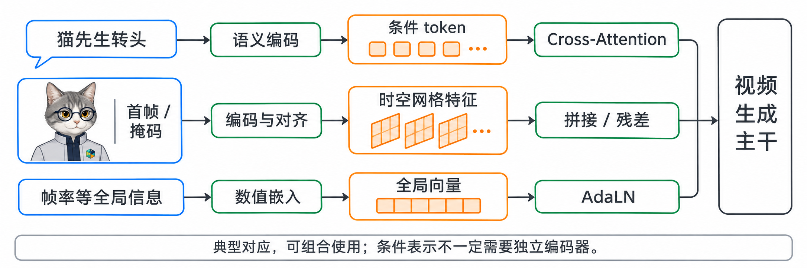
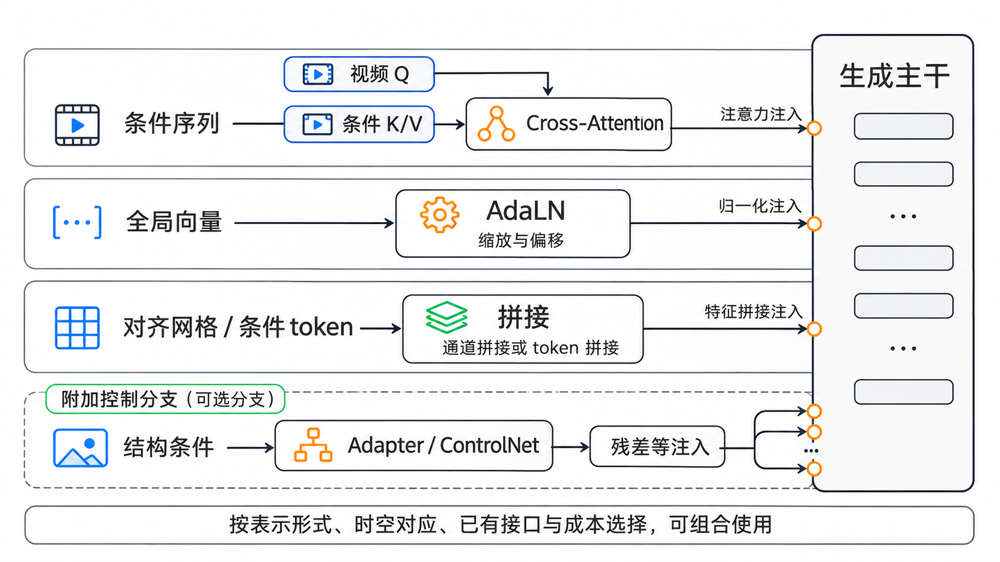
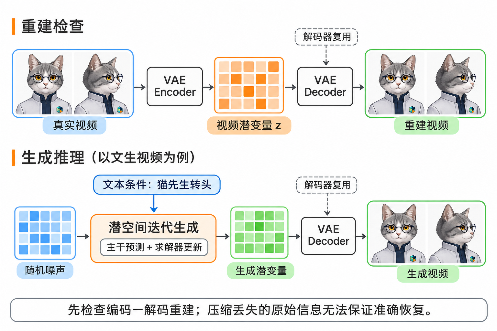
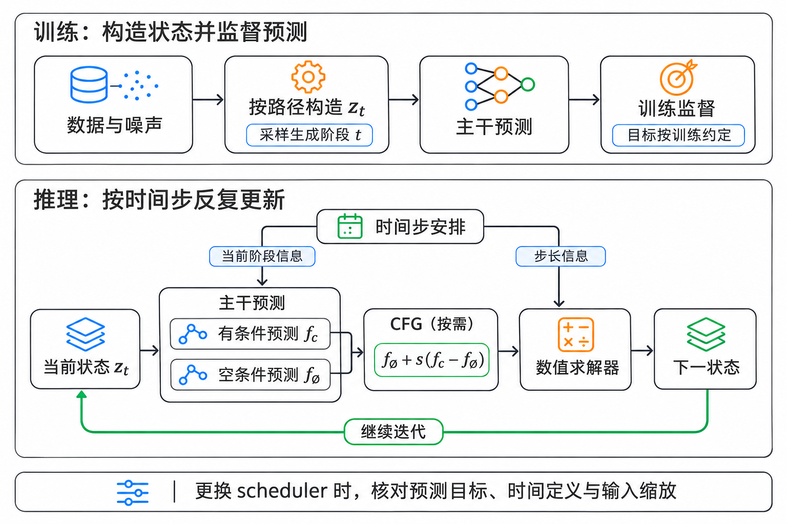
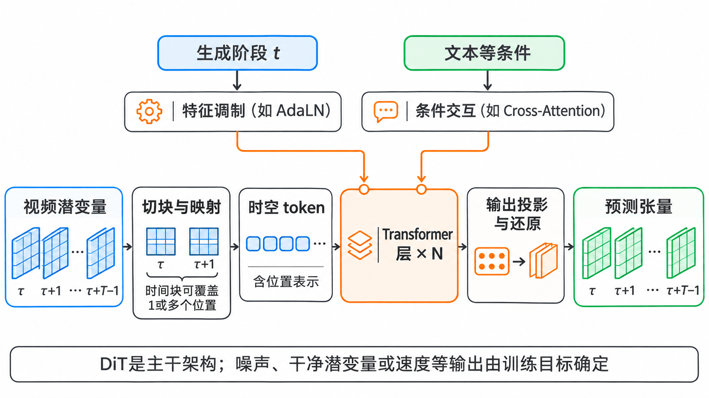
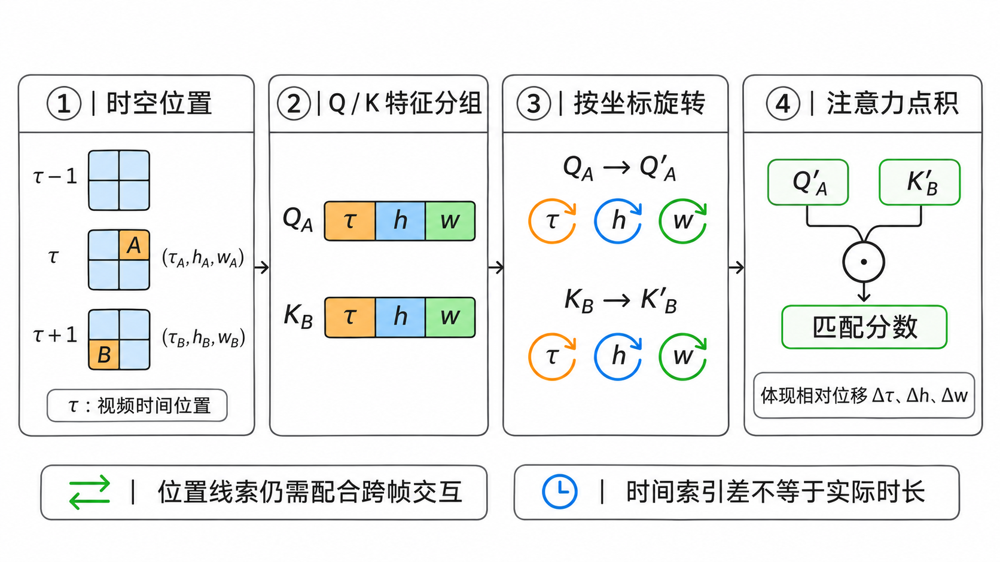
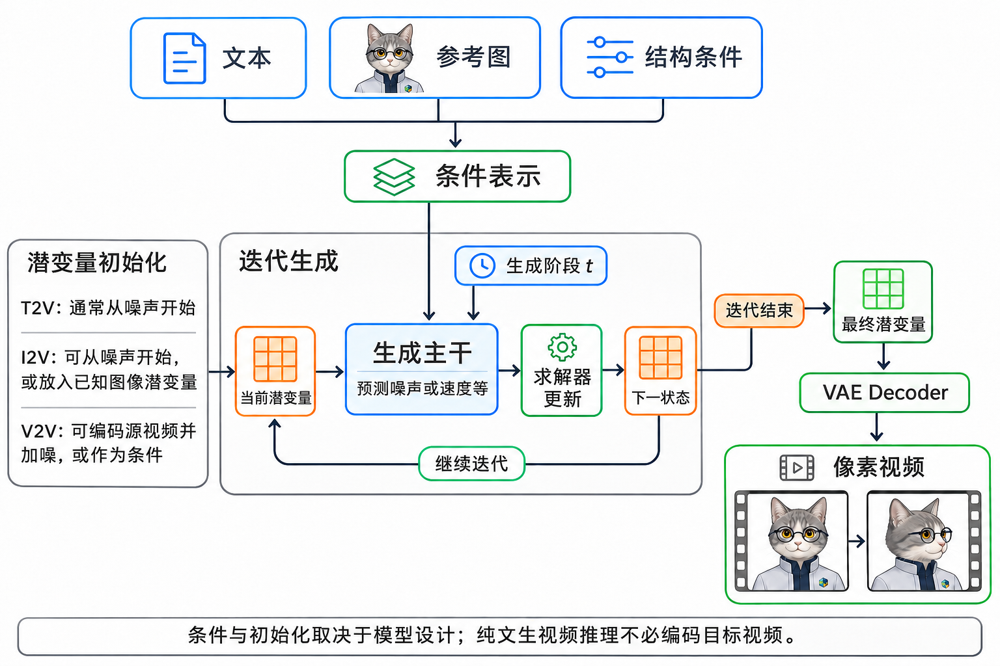
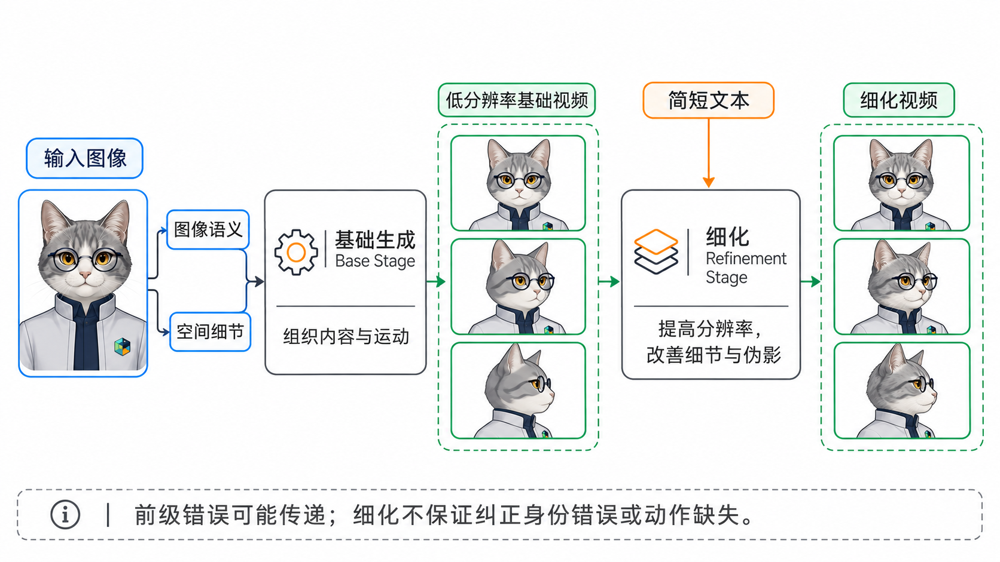

# 4.2 AI 视频生成原理与模型架构

> 本章聚焦 AI 视频生成的基本原理与模型架构：条件编码、视频压缩表示、扩散与自回归等生成方式、主干网络、时空建模和端到端推理数据流。这里不展开具体模型家族，也不讨论训练工程细节；目标是建立多年后仍然不过时的架构级理解。

---

# 目录导航

[4.2.1 视频生成的条件编码与注入](#4.2.1_视频生成的条件编码与注入)

  - [4.2.1.1 面试问题：视频生成模型为什么需要条件表示？一定要使用独立条件编码器吗？](#4.2.1.1_面试问题：视频生成模型为什么需要条件表示？一定要使用独立条件编码器吗？)
  - [4.2.1.2 面试问题：视频生成中，文本与视觉条件编码分别提供什么信息？](#4.2.1.2_面试问题：视频生成中，文本与视觉条件编码分别提供什么信息？)
  - [4.2.1.3 面试问题：视频生成中，条件信息有哪些常见注入方式？应如何选择？](#4.2.1.3_面试问题：视频生成中，条件信息有哪些常见注入方式？应如何选择？)
  - [4.2.1.4 面试问题：图生视频中，为什么首帧符合参考图，不代表后续内容能够持续保持？](#4.2.1.4_面试问题：图生视频中，为什么首帧符合参考图，不代表后续内容能够持续保持？)

[4.2.2 Video VAE 与潜空间建模](#4.2.2_Video-VAE-与潜空间建模)

  - [4.2.2.1 面试问题：为什么视频生成通常在潜空间中进行？VAE 在其中承担什么作用？](#4.2.2.1_面试问题：为什么视频生成通常在潜空间中进行？VAE-在其中承担什么作用？)
  - [4.2.2.2 面试问题：Video VAE 与逐帧 Image VAE 有什么区别？因果与非因果结构应如何选择？](#4.2.2.2_面试问题：Video-VAE-与逐帧-Image-VAE-有什么区别？因果与非因果结构应如何选择？)
  - [4.2.2.3 面试问题：Video VAE 的空间压缩、时间压缩和潜变量通道数应如何权衡？](#4.2.2.3_面试问题：Video-VAE-的空间压缩、时间压缩和潜变量通道数应如何权衡？)

[4.2.3 视频生成目标与采样机制](#4.2.3_视频生成目标与采样机制)

  - [4.2.3.1 面试问题：视频扩散模型训练时学习什么？为什么不能简单理解为逐帧独立去噪？](#4.2.3.1_面试问题：视频扩散模型训练时学习什么？为什么不能简单理解为逐帧独立去噪？)
  - [4.2.3.2 面试问题：Diffusion、Flow Matching 与 Rectified Flow 是什么关系？](#4.2.3.2_面试问题：Diffusion、Flow-Matching-与-Rectified-Flow-是什么关系？)
  - [4.2.3.3 面试问题：训练路径、推理时间步、数值求解器与 CFG 分别控制什么？](#4.2.3.3_面试问题：训练路径、推理时间步、数值求解器与-CFG-分别控制什么？)
  - [4.2.3.4 面试问题：自回归视频生成与扩散、流匹配生成有什么区别？它们能否结合？](#4.2.3.4_面试问题：自回归视频生成与扩散、流匹配生成有什么区别？它们能否结合？)

[4.2.4 生成主干网络：U-Net 与视频 DiT](#4.2.4_生成主干网络：U-Net-与视频-DiT)

  - [4.2.4.1 面试问题：U-Net 为什么适合扩散去噪？扩展到视频时需要改什么？](#4.2.4.1_面试问题：U-Net-为什么适合扩散去噪？扩展到视频时需要改什么？)
  - [4.2.4.2 面试问题：视频 DiT 如何处理时空潜变量？有哪些规模化优势与限制？](#4.2.4.2_面试问题：视频-DiT-如何处理时空潜变量？有哪些规模化优势与限制？)
  - [4.2.4.3 面试问题：U-Net 与视频 DiT 应如何选择？Transformer 一定更优吗？](#4.2.4.3_面试问题：U-Net-与视频-DiT-应如何选择？Transformer-一定更优吗？)

[4.2.5 视频时空建模：跨帧交互与位置编码](#4.2.5_视频时空建模：跨帧交互与位置编码)

  - [4.2.5.1 面试问题：时间建模模块如何接入图像生成主干，并建立跨帧交互？](#4.2.5.1_面试问题：时间建模模块如何接入图像生成主干，并建立跨帧交互？)
  - [4.2.5.2 面试问题：时间卷积、3D 卷积与时空注意力应如何选择？](#4.2.5.2_面试问题：时间卷积、3D-卷积与时空注意力应如何选择？)
  - [4.2.5.3 面试问题：为什么视频 Transformer 需要时空位置编码？3D RoPE 的作用是什么？](#4.2.5.3_面试问题：为什么视频-Transformer-需要时空位置编码？3D-RoPE-的作用是什么？)

[4.2.6 AI 视频生成的整体流程与架构设计](#4.2.6_AI-视频生成的整体流程与架构设计)

  - [4.2.6.1 面试问题：典型的潜空间视频生成，端到端推理流程是什么？](#4.2.6.1_面试问题：典型的潜空间视频生成，端到端推理流程是什么？)
  - [4.2.6.2 面试问题：视频生成流程中，各组件之间需要匹配哪些关键接口？](#4.2.6.2_面试问题：视频生成流程中，各组件之间需要匹配哪些关键接口？)
  - [4.2.6.3 面试问题：视频生成架构中的质量与计算成本，应从哪些组件分析？](#4.2.6.3_面试问题：视频生成架构中的质量与计算成本，应从哪些组件分析？)
  - [4.2.6.4 面试问题：视频生成中的基础生成与细化级联如何工作？有哪些收益与局限？](#4.2.6.4_面试问题：视频生成中的基础生成与细化级联如何工作？有哪些收益与局限？)

---

<h1 id="4.2.1_视频生成的条件编码与注入">4.2.1 视频生成的条件编码与注入</h1>

> 文本、参考图、源视频和结构控制等条件，需要先转换为模型可用的表示，再通过相应接口参与生成。编码过程影响条件中哪些信息得到保留，注入方式和后续的时空交互则影响这些信息如何作用于生成结果。

<h2 id="4.2.1.1_面试问题：视频生成模型为什么需要条件表示？一定要使用独立条件编码器吗？">4.2.1.1 面试问题：视频生成模型为什么需要条件表示？一定要使用独立条件编码器吗？</h2>

**难度评分：⭐⭐⭐ (3/5)  |  考察频率：⭐⭐⭐⭐⭐ (5/5)**

在条件引导的视频生成中，文本、参考图、源视频或结构控制等输入，需要以模型能够处理的数值形式参与计算。这些形式称为**条件表示**，例如文本特征、图像潜变量或经过对齐的区域掩码（mask，用于标记修改或控制的作用区域）。

条件表示是生成模型使用外部信息的接口，但不要求每种条件都额外配置一个独立编码器。

**1、为什么需要条件表示？**

**（1）将输入信息转换为模型可处理的形式。** 文本需要经过分词、嵌入或特征编码；参考图可以转换为视觉特征或潜变量；掩码也需要具有符合接口要求的尺寸和数值格式。不同输入的处理复杂度并不相同。

**（2）保留任务需要的信息。** 文本条件需要表达主体、动作和关系；参考图可能需要保留人物身份或外观；掩码、姿态和轨迹还需要保留空间位置或时间对应关系。如果转换时丢失了关键内容，后续主干就难以据此准确控制生成。

**（3）使条件能够接入生成主干。** 条件表示可以是特征序列、空间网格或向量等形式，再通过相应接口参与生成计算。它不必与视频表示具有完全相同的形状，但需要满足所用接口对维度、位置和时间关系的要求。

图2-1展示了常见条件表示及其接入生成主干的路径。

<div align="center">
  
  <p>图2-1 条件表示及其接入视频生成主干的典型路径</p>
</div>

**2、每种条件都需要独立编码器吗？**

不一定。条件表示可以由独立编码器提供，也可以复用已有模块，或通过简单的格式转换得到。

- **可以使用独立编码器。** 例如，利用预训练文本编码器提取语言特征，或利用视觉编码器提取参考图特征，复用已有的表征能力。
- **可以复用已有编码路径。** 例如，参考首帧或源视频可以经过生成系统已有的 VAE，转换为潜变量，不一定再增加一套专用视觉编码器。
- **可以使用轻量转换或直接输入。** 例如，掩码在完成尺寸对齐和格式处理后，可以直接拼接到相应输入；帧率等数值条件可以通过模型内部的嵌入层转换为向量。

是否增加独立编码器，需要结合已有模块、任务所需信息和主干接口判断。能否保留必要信息、增加多少计算，以及需要多少训练适配，都是选择依据。

> **面试速答**：条件表示把文本、参考图和结构信号变成生成模型可以使用的数值输入，同时保留任务需要的语义与时空关系。它不一定需要独立编码器：可以使用预训练编码器、复用已有 VAE，也可以通过轻量投影、嵌入或直接输入完成。关键是表示保留了什么信息，以及能否正确接入主干。

延伸阅读：[High-Resolution Image Synthesis with Latent Diffusion Models](https://arxiv.org/abs/2112.10752)

<h2 id="4.2.1.2_面试问题：视频生成中，文本与视觉条件编码分别提供什么信息？">4.2.1.2 面试问题：视频生成中，文本与视觉条件编码分别提供什么信息？</h2>

**难度评分：⭐⭐⭐⭐ (4/5)  |  考察频率：⭐⭐⭐⭐ (4/5)**

文本条件主要描述生成意图，视觉条件提供已有画面的参考。编码路径需要将这些输入转换为可用特征；最终保留哪些信息，取决于**编码器的训练目标、输出形式和压缩程度**。

**1、文本编码器提供什么信息？**

文本编码器将提示词转换为特征，供生成模型利用其中的主体、属性、动作和关系。T5 与 CLIP 文本编码器是两类常见选择。

- **T5 类文本编码器。** 通过文本预训练学习词义、上下文和句子关系，通常输出文本特征序列[1]。用于视频生成时，生成模型还需要学习这些语言特征与视频内容的对应关系。
- **CLIP 文本编码器。** 通过图文对比学习，使文本表示与对应图像表示在语义上关联[2]。生成系统可以使用其文本序列特征或全局特征，表达提示词中的视觉概念。

两者都可以表达主体、属性和动作，不能简单划分为“T5 负责复杂语言、CLIP 负责风格”。具体能否稳定处理数量、属性绑定和事件顺序，需要结合编码器版本与生成模型训练判断。

**2、视觉条件编码提供什么信息？**

参考图或首帧通常可以通过两类路径进入模型，侧重点不同。

**（1）视觉特征路径：提供参考图的内容与外观信息。** 例如，使用 CLIP 图像编码器提取人物、物体、场景或风格特征。全局向量将整张图的信息汇总，空间细节容易被弱化；局部 patch 特征能保留更多位置相关信息，但不等于原始像素的完整表示。

**（2）VAE 潜变量路径：提供带有空间布局的压缩画面。** 参考图或首帧经过 VAE 后，通常仍保留空间网格中的颜色、轮廓和局部布局，可为生成提供更直接的画面参考。它也会因压缩损失细节，实际保持能力还取决于后续如何使用这些潜变量。

例如，要求“让参考照片中的人物在海边行走”：文本特征表达“行走”和“海边”等生成要求，视觉特征提供参考人物的外观线索；如果还要求从指定首帧开始，可以利用首帧潜变量提供画面布局。

视觉特征和 VAE 潜变量可以配合使用，分别提供外观线索与画面布局；具体采用哪条路径，需要结合任务要求和模型已有接口。

> **面试速答**：文本编码器提供提示词的语义表示，T5 主要通过语言预训练学习，CLIP 文本编码器通过图文对比学习建立视觉语义关联。视觉条件既可以提取参考图特征，也可以通过 VAE 保留空间布局明确的压缩画面。不同路径的侧重点不同，应按任务需要的信息选择，不能仅凭编码器名称判断最终能力。

<h2 id="4.2.1.3_面试问题：视频生成中，条件信息有哪些常见注入方式？应如何选择？">4.2.1.3 面试问题：视频生成中，条件信息有哪些常见注入方式？应如何选择？</h2>

**难度评分：⭐⭐⭐⭐ (4/5)  |  考察频率：⭐⭐⭐⭐⭐ (5/5)**

条件注入，是让编码后的文本、参考图或控制信号参与生成主干的计算。选择时需要考虑**条件的表示形式、时空对应关系、已有模型接口与计算成本**，同一个模型也可以组合使用多种方式。

**1、常见注入方式怎样工作？**

**（1）Cross-Attention：让视频特征读取条件特征。**

交叉注意力通过计算视频特征与条件特征的匹配程度，对条件信息加权求和，其基本计算形式为：

```math
y=\mathrm{softmax}\left(\frac{Q_xK_c^\top}{\sqrt{d_k}}\right)V_c
```

其中， $Q_x$ 是由视频特征映射得到的查询， $K_c$ 和 $V_c$ 分别是由条件特征映射得到的键和值， $d_k$ 是查询与键的特征维度。不同视频位置可以对条件序列中的不同内容分配权重，例如读取与当前对象相关的文本或参考图信息。

当条件包含多个词或图像区域，并且不同视频位置需要读取不同条件信息时，可以使用交叉注意力。视频序列或条件序列越长，相关计算开销通常也越大。

**（2）AdaLN：用条件调整归一化后的特征。**

自适应层归一化的一种基本形式为：

```math
y=\gamma(c)\odot\mathrm{LN}(x)+\beta(c)
```

其中， $x$ 是主干特征， $\mathrm{LN}(x)$ 表示对主干特征进行层归一化， $c$ 是条件表示， $\gamma(c)$ 与 $\beta(c)$ 是根据条件生成的缩放和偏移参数， $\odot$ 表示逐元素相乘。

这种由条件控制特征缩放和偏移的过程称为**特征调制**。常见实现中，不同通道使用各自的调整参数，多个 token 共用同一组参数[3]，因此适合注入类别、汇总后的文本语义等全局信息。扩散时间步（去噪进度）也常通过这种方式输入模型，用于指示当前所处的去噪阶段。对于“某个对象应出现在什么位置”等局部控制，通常还需要结合保留空间对应关系的条件注入方式。

**（3）拼接：将条件与待生成表示放在一起处理。**

- **通道拼接。** 将掩码、首帧潜变量或结构特征等，在通道维与待生成视频表示组合。通常需要先处理好空间尺寸、时间位置和数值尺度。
- **Token 拼接。** 将条件特征加入视频 token 序列，通过后续注意力建立联系。模型需要区分条件与待生成内容，并保留必要的位置关系；序列变长也会增加计算开销。

条件也可以先经过额外分支处理，再将分支输出作为残差加入主干特征，ControlNet 是代表性例子[4]。这种设计可以在保留预训练主干的同时学习结构控制，但会增加参数和计算开销。额外分支内部仍可使用注意力、调制或拼接，因此可以与前述方式组合使用。

常见条件表示及其注入位置如图2-2所示。

<div align="center">
  
  <p>图2-2 条件注入方式与可选附加控制分支</p>
</div>

**2、工程上应如何选择？**

**（1）需要逐位置读取条件内容时，考虑注意力交互。** 文本或参考图特征包含多个信息单元，希望不同视频位置分别利用它们时，可以采用 Cross-Attention，或通过 token 拼接建立交互。

**（2）条件主要提供全局信息时，考虑特征调制。** 例如类别、汇总语义或帧率等数值条件，可以先转换为向量，再用于 AdaLN 等调制路径，不必全部扩展成较长序列。

**（3）需要明确的空间或时间控制时，保留对应关系。** 对掩码、姿态、深度或逐帧轨迹，可以考虑对齐后的通道拼接或控制分支；若使用 token 形式，也需要让模型识别对应的位置与时间。

**（4）结合已有模型与训练预算判断。** 复用已训练模型时，优先使用它支持的接口。新增注入路径通常需要训练适配，不能仅完成张量连接就认为控制会生效。最终还要比较条件遵循、生成质量与计算开销。

> **面试速答**：Cross-Attention 让视频特征读取条件序列，AdaLN 用条件调制特征，拼接则将条件加入通道或 token 序列。残差控制分支是额外的网络路径，可以与这些操作组合。选型主要看条件粒度、时空对应、已有接口与计算预算，并通过训练让模型学会使用条件。

<h2 id="4.2.1.4_面试问题：图生视频中，为什么首帧符合参考图，不代表后续内容能够持续保持？">4.2.1.4 面试问题：图生视频中，为什么首帧符合参考图，不代表后续内容能够持续保持？</h2>

**难度评分：⭐⭐⭐⭐ (4/5)  |  考察频率：⭐⭐⭐⭐⭐ (5/5)**

首帧符合参考图，只说明起始画面满足了内容与外观要求。后续帧还需要在动作、遮挡和视角变化中延续主体身份与场景关系，因此，起点匹配与整段保持是不同的能力。

前文介绍的视觉特征、VAE 潜变量和条件注入方式，都可以用于图生视频。例如，SVD 同时使用 CLIP 图像特征和沿时间维复制的条件图像潜变量，为生成提供参考[5]。

**1、为什么图像条件不能单独保证全程保持？**

**（1）条件参与计算，不等于严格固定输出。**

图像潜变量或视觉特征为模型提供参考，最终画面仍由主干预测、采样更新和解码共同得到。潜变量拼接可以传入空间信息，但不保证首帧像素与原图完全一致，更不能直接约束后续所有帧。

即使在输出时直接保留输入图像作为第一帧，下一帧仍可能出现位置、外观或光照跳变。这种处理固定了起点，没有解决后续衔接。

**（2）运动需要推断参考图中没有的内容。**

人物转头、物体旋转或相机移动后，会出现新视角、遮挡和新显露区域。模型需要补全这些信息，同时延续应保持的属性。例如，人物转头时面部投影可以改变，但不应变成另一位人物。

因此，全程保持要求主体在变化中仍然合理一致，并不要求各帧与参考图逐像素相同。

**（3）参考信息需要与跨帧建模共同发挥作用。**

如果图像编码丢失了身份细节，或生成过程未能有效利用条件，后续画面可能逐渐偏离参考。即使每帧都能读取图像条件，模型仍需要学习各帧之间的位置、外观和状态如何衔接，才能在遮挡或较长时间变化后维持一致。

加强参考约束可能改善保持，也可能压低运动幅度，需要结合具体模型和任务判断。

**2、怎样评估持续保持能力？**

- **起始画面是否符合参考。** 检查主体、外观和布局；任务要求严格保留首帧时，还需确认实际输出方式。
- **后续变化是否连贯。** 观察首帧与后续帧的衔接，以及身份、纹理和场景结构是否逐渐漂移，特别关注转头、遮挡后重现等情况。
- **指定动作是否完成。** 在保持参考内容的同时检查运动方向、幅度和动作过程，避免把静态复制误判为良好的图生视频能力。

保持范围应由任务确定。例如，相机移动可以改变背景构图，人物动作可以改变遮挡和阴影；这些合理变化不应一律记为保持失败。

> **面试速答**：首帧符合参考只说明起点匹配。图像条件不一定严格固定输出，运动还会引入参考图中没有的新视角和区域，因此持续保持需要条件信息与跨帧建模配合。评估时应分别检查首帧匹配、后续身份与结构的延续，以及动作是否完成，不能只比较首帧像素或整段外观相似度。

---

<h1 id="4.2.2_Video-VAE-与潜空间建模">4.2.2 Video VAE 与潜空间建模</h1>

> 潜空间视频生成通常由 VAE 完成视频与潜变量之间的转换，再由扩散或 Flow Matching 主干学习潜变量的生成过程。本节重点讨论这种分工的计算收益、重建代价，以及视频压缩方式的选择。

<h2 id="4.2.2.1_面试问题：为什么视频生成通常在潜空间中进行？VAE-在其中承担什么作用？">4.2.2.1 面试问题：为什么视频生成通常在潜空间中进行？VAE 在其中承担什么作用？</h2>

**难度评分：⭐⭐⭐ (3/5)  |  考察频率：⭐⭐⭐⭐⭐ (5/5)**

视频包含大量像素，生成模型如果直接处理高分辨率、多帧视频，训练和推理的计算成本都很高。常见做法是先用 VAE 将视频编码为更紧凑的特征表示，即**潜变量（latent）**；这些表示所在的空间称为**潜空间（latent space）**。

**1、为什么在潜空间中生成？**

VAE 通常压缩视频的空间尺寸，部分 Video VAE 还会压缩时间维度。生成主干在压缩后的表示上进行计算，可以减少需要处理的时空位置，降低显存占用和计算开销。

对于需要多次迭代的扩散或 Flow Matching 模型，这种收益尤其明显：每一步都在较小的表示上计算，最后再通过解码器还原为像素视频。

Latent Diffusion 先训练自编码器，学习图像压缩与重建，再固定自编码器，在潜空间中训练扩散模型。生成时，扩散模型产生潜变量，解码器再将其转换为图像，使多步去噪能够在更紧凑的表示上完成[6]。

视频模型沿用这一分工，并在编码、生成或解码过程中加入跨帧信息处理，以适应画面随时间变化的特点。

潜空间生成是一种常见的效率与质量折中，视频也可以直接在像素空间中生成。

**2、VAE 在其中承担什么作用？**

VAE 主要承担视频与潜变量之间的转换：

- **编码器负责压缩表示。** 训练时，将真实视频编码为潜变量，供生成主干学习。
- **解码器负责重建画面。** 生成时，将主干生成的潜变量转换为像素视频。

因此，VAE 的压缩与重建能力会影响最终视频的细节和稳定性。压缩过强或重建能力不足，可能导致文字模糊、纹理丢失或帧间闪烁。模型可以根据学到的规律生成合理细节，但无法保证准确恢复压缩时已经丢失的原始信息。

图2-3将重建检查与生成推理分开：上方用真实视频检查 VAE 的编码—解码重建，下方以文生视频为例，从噪声出发在潜空间迭代生成，再解码为视频。

<div align="center">
  
  <p>图2-3 VAE 重建检查与潜空间生成推理的分工</p>
</div>

工程上，可以先将真实视频经过一次“编码—解码”，检查重建质量，作为判断编解码环节是否存在明显损失的依据。

> **面试速答**：视频在潜空间中生成，主要是为了降低高分辨率、多帧建模的计算成本。VAE 的编码器将视频压缩为潜变量，解码器将生成的潜变量还原为视频；生成主干负责学习并生成这些潜变量。代价是有损压缩和重建误差可能影响细节及时间连续性。

<h2 id="4.2.2.2_面试问题：Video-VAE-与逐帧-Image-VAE-有什么区别？因果与非因果结构应如何选择？">4.2.2.2 面试问题：Video VAE 与逐帧 Image VAE 有什么区别？因果与非因果结构应如何选择？</h2>

**难度评分：⭐⭐⭐⭐ (4/5)  |  考察频率：⭐⭐⭐⭐⭐ (5/5)**

逐帧 Image VAE 将视频中的每一帧独立编码、解码；Video VAE 则在编码器、解码器或两者中加入跨帧信息处理，使视频的压缩表示或重建过程能够利用时间上下文。

**1、Video VAE 增加了什么能力？**

- **利用跨帧信息。** 通过时间卷积、3D 卷积或时间注意力等方式，结合相邻帧的信息进行编码或解码，有助于减少逐帧独立处理带来的重建波动。
- **可以压缩时间维度。** 将多帧信息编码到更少的潜变量时间位置，减少生成主干需要处理的时空位置。是否进行时间压缩，取决于具体设计。

因此，**处理跨帧信息与压缩时间维度是两个不同的属性**。Video VAE 可以利用时间上下文，同时保持时间位置数量不变。

这些能力有助于改善视频表示和重建的连续性，但生成结果中的长期身份和运动一致性，还需要生成主干与训练共同支持。

**2、因果与非因果分别是什么意思？**

这里的“因果”指时间上的信息依赖方向，表示计算当前位置的输出时，是否允许使用未来位置的输入。

- **因果结构（causal）**：只使用当前及过去位置的信息，不使用未来信息。
- **非因果结构（non-causal）**：允许使用未来位置的信息，例如结合前后帧进行编码或重建。

以不进行时间降采样的编码器为例，编码第 5 帧时，因果结构不能读取第 6 帧及之后的内容；非因果结构可以利用这些未来帧。对于存在时间压缩的模型，还需结合其时间位置对应方式理解这种约束。

CogVideoX 的 3D VAE 就采用时间因果卷积，在不使用未来输入的前提下进行时空压缩[7]。

表2-1概括了三类结构的主要区别。

<p align="center">表2-1 逐帧 Image VAE、因果 Video VAE 与非因果 Video VAE 的主要区别</p>

| 维度 | 逐帧 Image VAE | 因果 Video VAE | 非因果 Video VAE |
| --- | --- | --- | --- |
| 可利用的时间信息 | 当前单帧 | 当前及过去位置 | 可包含未来位置 |
| 时间压缩 | 通常不进行 | 可进行，也可不进行 | 可进行，也可不进行 |
| 主要特点 | 可复用图像 VAE，逐帧独立处理 | 无须等待未来输入，便于增量处理 | 可利用双向上下文进行编解码 |
| 需要关注的问题 | 缺少跨帧交互，重建误差可能表现为闪烁 | 历史特征缓存、首帧和分块边界处理 | 未来上下文需求、处理延迟和分块边界 |

**3、应如何选择？**

- **需要及时处理持续到来的帧，或复用已有视频前缀时**，优先考虑相关编码或解码路径采用因果结构，减少对未来输入的依赖。
- **可以获得完整视频或允许等待后续帧时**，可以考虑非因果结构，利用更多时间上下文；最终仍需比较重建质量、计算成本和延迟。

编码器和解码器是否因果，需要分别确认。即使 VAE 支持因果处理，端到端流式生成仍需要生成主干、采样过程和缓存机制配合。

> **面试速答**：逐帧 Image VAE 独立处理每帧，Video VAE 增加跨帧信息处理，并可选择压缩时间维度。因果结构不使用未来输入，便于增量和流式编解码；非因果结构可以利用未来上下文，适合离线处理或允许一定延迟的场景。选择时要结合重建质量、延迟和计算成本，且 VAE 的因果性不能单独保证端到端流式生成。

<h2 id="4.2.2.3_面试问题：Video-VAE-的空间压缩、时间压缩和潜变量通道数应如何权衡？">4.2.2.3 面试问题：Video VAE 的空间压缩、时间压缩和潜变量通道数应如何权衡？</h2>

**难度评分：⭐⭐⭐⭐ (4/5)  |  考察频率：⭐⭐⭐⭐ (4/5)**

这三个参数共同影响视频表示的大小、信息保留能力和计算成本：**空间与时间压缩决定保留多少个时空位置，潜变量通道数决定每个位置使用多少个特征数值。**

**1、三个参数分别影响什么？**

**（1）空间压缩：减少每帧的空间位置。**

例如，将高度和宽度分别缩小到原来的八分之一，每帧的空间位置数量就变为原来的六十四分之一。

空间压缩可以降低后续计算成本，但压缩过强时，小字、小物体、人脸细节和精细纹理容易受损。

**（2）时间压缩：减少潜变量的时间位置。**

例如，将连续多帧的信息编码到更少的时间位置，可以进一步减少生成主干需要处理的数据。

时间压缩过强时，快速动作、短暂表情或闪光等变化可能难以保留。时间压缩也不同于直接抽帧：视频编码器可以融合多帧信息，解码器再恢复完整帧序列。

**（3）潜变量通道数：调整每个时空位置的表示容量。**

每个潜变量位置都对应一个特征向量，通道数就是这个向量的维度。增加通道数，意味着每个时空位置可以使用更多特征数值，有助于保留更丰富的信息，但也会增加潜变量的存储量和相关网络层的计算成本。

更多通道并不保证更好的生成效果，也不能保证补回过强空间或时间压缩造成的信息损失。

**2、如何理解它们与数据量的关系？**

设输入 RGB 视频的尺寸为 $T\times H\times W\times3$，空间压缩倍数分别为 $r_h$、 $r_w$，时间压缩倍数为 $r_t$，潜变量通道数为 $C_z$。忽略边界处理，并假设各维可以整除，则潜变量尺寸为：

```math
\frac{T}{r_t}\times\frac{H}{r_h}\times\frac{W}{r_w}\times C_z
```

输入视频与潜变量的元素数量之比为：

```math
R_{\mathrm{elem}}=\frac{3r_tr_hr_w}{C_z}
```

按上述简化计算，高度和宽度各压缩 8 倍、时间压缩 4 倍、潜变量通道数为 16 时：

- 时空位置数量缩减为原来的 $1/256$；
- 考虑通道数后，元素数量缩减为原来的 $1/48$。

这里计算的是**元素数量比**；实际占用的字节数还与数值精度有关，不能直接当成视频文件的存储压缩率。

对于 Transformer 主干，最终 token 数还取决于如何将潜变量划分为 patch。固定划分方式时，减少时空位置通常会减少 token 数；增加潜变量通道数通常不会直接改变 token 数。

**3、实际应如何权衡？**

- **细节要求高时**，重点检查空间压缩是否损伤文字、人脸和小物体。
- **快速运动或短事件较多时**，重点检查时间压缩是否导致动作失真、短暂变化丢失。
- **调整通道数时**，比较增加通道后是否带来足够的质量收益，以及额外的显存和计算成本是否可接受。

选型时，可以先用代表性视频检查重建细节和运动，再将 VAE 与生成主干组合，比较最终画质、显存和端到端延迟。压缩与重建指标用于筛选方案，最终选择仍应依据完整生成效果和运行成本。

*重建质量、下游生成效果与端到端成本的具体评估方法见[4.5.2.2](05_视频生成训练与工程优化.md#4.5.2.2_面试问题：如何评估Video-VAE是否适合下游视频生成训练？)。*

> **面试速答**：空间压缩减少每帧的空间位置，时间压缩减少时间位置，潜变量通道数影响每个位置的表示容量。压缩过强可能损伤细节或快速变化，增加通道可以提供更多表示空间，但会增加成本，也不能保证补回压缩损失。实际应结合重建质量、下游生成效果和端到端成本共同选择。

延伸阅读：[Stable Video Diffusion](https://arxiv.org/abs/2311.15127)、[VideoGPT（VQ-VAE与离散潜变量建模）](https://arxiv.org/abs/2104.10157)

---

<h1 id="4.2.3_视频生成目标与采样机制">4.2.3 视频生成目标与采样机制</h1>

> 本节讨论扩散、Flow Matching与Rectified Flow的训练目标及采样过程，再比较自回归生成如何利用已有序列预测后续内容。需要区分视频时间上的生成顺序与噪声阶段的迭代，两者可以组合。

<h2 id="4.2.3.1_面试问题：视频扩散模型训练时学习什么？为什么不能简单理解为逐帧独立去噪？">4.2.3.1 面试问题：视频扩散模型训练时学习什么？为什么不能简单理解为逐帧独立去噪？</h2>

**难度评分：⭐⭐⭐ (3/5)  |  考察频率：⭐⭐⭐⭐⭐ (5/5)**

视频扩散模型根据带噪的视频表示、扩散时间步和条件，预测噪声、干净表示等去噪所需的量。下面以潜空间中的噪声预测为例，说明一次训练如何进行。

**1、训练时，模型具体学习什么？**

**（1）构造带噪输入。**

先用 VAE 将真实视频编码为干净的潜变量 $z_0$，再随机选择一个扩散时间步 $t$，采样高斯噪声 $\epsilon$，构造：

```math
z_t=\alpha_t z_0+\sigma_t\epsilon,
\qquad \epsilon\sim\mathcal{N}(0,I)
```

其中， $\alpha_t$ 和 $\sigma_t$ 控制原始信号与噪声的比例。这里的 $t$ 表示**扩散过程所处的阶段**，与视频中的帧序号不同。

**（2）预测加入的噪声。**

模型接收带噪潜变量 $z_t$、时间步 $t$，以及文本等条件 $c$，输出噪声预测 $\epsilon_\theta(z_t,t,c)$，并通过预测与实际加入噪声之间的误差训练：

```math
\mathcal{L}
=\mathbb{E}_{z_0,t,\epsilon,c}
\left[
\left\|
\epsilon_\theta(z_t,t,c)-\epsilon
\right\|_2^2
\right]
```

其中， $\theta$ 表示模型参数， $\mathbb{E}$ 表示对训练视频及其条件、时间步和噪声取平均， $\|\cdot\|_2^2$ 表示平方误差。

条件 $c$ 与训练视频配对；无条件模型则不需要这一输入。训练时噪声由我们采样，因此监督目标是已知的。这也是经典扩散模型常用的训练方式[8]。

训练时，通常为每个样本随机采样一个时间步，直接构造该阶段的带噪输入并计算损失，无须执行完整的多步去噪。不同样本和训练迭代覆盖不同的噪声阶段，使模型学会处理不同程度的噪声。

此外，模型也可以预测干净潜变量 $z_0$，或预测由干净潜变量与噪声线性组合得到的 $v$。它们是不同的预测目标，并不改变“从带噪表示中学习去噪信息”这一基本思路。

**2、为什么不能简单理解为逐帧独立去噪？**

视频生成还需要维持对象外观、位置和动作的连续性。例如，生成“一只猫向前奔跑”时，模型需要利用跨帧信息，使猫的外观稳定、位置与姿态变化连贯。时间卷积、时间注意力和时空注意力都可以用于建立这种联系。

Video Diffusion Models 将图像扩散网络扩展为能够处理多帧视频的网络：在提取每帧空间特征的同时，通过时间注意力交换不同帧的信息。因此，模型预测当前帧的噪声时，也能利用其他帧的特征，为保持对象外观和动作连续提供依据[9]。

如果每帧都独立预测、没有跨帧信息交互，即使各帧分别看起来合理，也容易出现外观变化、位置跳动或动作不连续。

因此，判断是否进行了视频时序建模，要看**预测时能否利用跨帧信息**。模型可以整段处理，也可以逐帧或分块处理；扩散训练目标本身不会自动保证时间一致性。

> **面试速答**：视频扩散训练通常随机选择一个噪声阶段，给真实视频表示加噪，再让模型预测噪声、干净表示或其他约定目标。训练时通常直接构造该阶段的输入，多步去噪主要发生在推理阶段。视频生成还需要利用跨帧信息维持外观和运动连续性，不能简单等同于对每帧独立运行图像去噪模型。

<h2 id="4.2.3.2_面试问题：Diffusion、Flow-Matching-与-Rectified-Flow-是什么关系？">4.2.3.2 面试问题：Diffusion、Flow Matching 与 Rectified Flow 是什么关系？</h2>

**难度评分：⭐⭐⭐⭐ (4/5)  |  考察频率：⭐⭐⭐⭐⭐ (5/5)**

三者都可以用于学习如何从噪声生成数据，但描述的侧重点不同：**Diffusion 从加噪与反向生成过程出发，Flow Matching 通过学习速度场构建生成过程，Rectified Flow 则强调直线插值与生成轨迹的拉直。**

这里的“数据”可以是图像，也可以是视频潜变量；是否能够建模跨帧关系，还取决于网络结构和训练数据。

**1、三种方法分别怎样工作？**

**（1）Diffusion：学习与加噪过程对应的反向生成。**

训练时，按照预先设定的规则，将不同程度的噪声加入真实数据，让模型预测噪声、干净数据等用于去噪的信息。生成时，从随机噪声出发，根据模型预测逐步得到数据。

它的采样过程既可以包含随机性，也可以采用确定性的更新方式，因此不能简单理解为“每一步都必须重新加入随机噪声”。

**（2）Flow Matching：学习当前状态应该怎样变化。**

Flow Matching 先选定噪声与数据之间的过渡路径，再学习各阶段的状态应该朝什么方向、以多大幅度变化。这种随状态和时间变化的预测称为**速度场**。生成时，从噪声出发，按照预测速度逐步更新状态。

这里的“速度”指图像或视频潜变量数值的变化速度，与画面中物体的运动速度不同。

Flow Matching 可以采用不同的过渡路径，其中也包括与扩散过程对应的路径[10]。

**（3）Rectified Flow：用直线插值构造训练样本，并尝试拉直生成轨迹。**

一种常见做法是取一个噪声样本 $z_n$ 和一个数据样本 $z_d$，在两者之间进行直线插值：

```math
z_t=(1-t)z_n+t z_d,\qquad t\in[0,1]
```

这里约定 $t=0$ 对应噪声， $t=1$ 对应数据，与上一题从数据逐步加噪的时间方向不同。

沿这条插值线，目标变化速度为 $z_d-z_n$，因此可以训练模型：

```math
\mathcal{L}
=\mathbb{E}
\left[
\left\|
v_\theta(z_t,t,c)-(z_d-z_n)
\right\|_2^2
\right]
```

其中， $v_\theta$ 是模型预测的速度， $c$ 是文本等条件。训练时，噪声和数据端点已知，所以目标速度可以直接计算。

训练目标由噪声和数据两个端点计算，但模型预测时只接收当前状态、时间和条件，并不知道原始样本对的两个端点。因此，学到的速度场不一定让每条生成轨迹沿训练时的插值直线前进。Rectified Flow 还可以利用已有模型生成新的噪声与数据配对，再次训练，使轨迹进一步变直，这一过程通常称为 **reflow**[11]。

**2、三者有哪些联系与区别？**

表2-2概括了三者的主要思路。

<p align="center">表2-2 Diffusion、Flow Matching 与 Rectified Flow 的主要思路</p>

| 方法 | 基本思路 | 常见预测目标 | 生成方式 |
| --- | --- | --- | --- |
| Diffusion | 定义加噪过程，学习相应的反向生成 | 噪声、干净数据等 | 根据预测进行多步反向更新 |
| Flow Matching | 为选定的分布过渡路径学习速度场 | 当前状态的变化速度 | 从噪声出发，沿预测速度逐步更新 |
| Rectified Flow | 使用直线插值训练，并可进一步拉直轨迹 | 插值端点之差对应的速度 | 沿学习到的速度场生成 |

Flow Matching 可以采用与扩散过程对应的分布路径；常见直线插值 Rectified Flow 的训练目标，也可以从条件 Flow Matching 的角度理解。因此，比较具体模型时，应核对路径、预测目标和时间约定，而不是只比较方法名称。

上一题扩散模型中的 $v$ 预测与这里的速度场定义可能不同，需要结合具体路径和时间约定区分。

轨迹较直通常有利于用较少步骤近似求解，实际所需步数还取决于训练质量、求解器和目标画质。

> **面试速答**：Diffusion 从加噪过程出发，学习反向生成所需的预测量；Flow Matching 为选定的分布过渡路径学习速度场；Rectified Flow 常用噪声与数据之间的直线插值训练，并可通过 reflow 拉直生成轨迹。三者有联系，直线 Rectified Flow 的训练目标可从条件 Flow Matching 的角度理解。少步生成的效果仍需结合实际轨迹、模型训练和求解方式判断。

<h2 id="4.2.3.3_面试问题：训练路径、推理时间步、数值求解器与-CFG-分别控制什么？">4.2.3.3 面试问题：训练路径、推理时间步、数值求解器与 CFG 分别控制什么？</h2>

**难度评分：⭐⭐⭐⭐ (4/5)  |  考察频率：⭐⭐⭐⭐⭐ (5/5)**

这四个概念共同影响生成过程，但承担不同职责：**训练路径规定中间状态如何构造，推理时间步选择在哪些阶段计算，数值求解器负责更新状态，CFG 调整条件引导强度。**

**1、训练路径：规定数据与噪声之间怎样过渡。**

训练路径描述不同时间阶段的中间状态如何构造。例如，扩散模型可以通过不同的信号与噪声比例构造带噪数据；上一题中的直线插值，则直接在噪声与数据端点之间构造中间状态。

路径与预测目标共同决定模型需要学习怎样的去噪信息或变化速度。训练时，还需要选择时间步采样策略，决定各个阶段被抽到的频率。

**2、推理时间步：选择生成时访问哪些阶段。**

推理时，通常从噪声端出发，选择一系列时间位置，逐步更新到数据端。这里既要考虑**步数**，也要考虑**各步的位置与间隔**，并不一定均匀取点。

例如，同样使用 20 步，可以均匀分配，也可以在变化较难准确估计的阶段安排更密集的计算。

这里的时间步表示生成过程所处的阶段，与最终视频有多少帧不同。减少步数通常可以降低计算成本，但也可能增大数值近似误差，影响生成质量。

**3、数值求解器：根据模型预测，计算下一步状态。**

主干给出预测后，数值求解器根据当前状态、时间间隔和预测结果，计算下一状态。

以速度场生成模型为例，Euler 方法可写为：

```math
z_{t+\Delta t}
=
z_t+\Delta t\,v_\theta(z_t,t,c)
```

其中， $z_t$ 是当前状态， $v_\theta$ 是模型预测的变化速度， $\Delta t$ 是当前更新的时间增量，正负取决于所采用的时间方向。公式表示：按照预测速度和时间间隔，对当前状态进行一次近似更新。

其他求解器可以利用额外的预测或历史信息提高精度，但不保证在所有步数和模型上都更好。比较效率时，除了步数，还应关注实际的模型计算次数和运行时间。

**4、CFG：调整条件信息对生成结果的引导强度。**

CFG 是**分类器无关引导（Classifier-Free Guidance）**，指不借助额外分类器进行条件引导。常见做法是在同一个状态下，分别计算有条件预测与空条件预测，再将两者组合：

```math
f_{\mathrm{cfg}}
=
f_\theta(z_t,t,\varnothing)
+
s\left[
f_\theta(z_t,t,c)
-
f_\theta(z_t,t,\varnothing)
\right]
```

其中：

- $f_\theta$ 表示模型输出的预测量，可以是噪声或速度等；
- $c$ 是文本等条件， $\varnothing$ 表示省略所讨论的条件；
- $s$ 是引导强度，用于调节有条件预测与空条件预测之间差异的贡献。

按照这一公式， $s=1$ 时得到原始的有条件预测； $s>1$ 时进一步放大条件带来的差异。常见训练方式是随机丢弃部分样本的条件，使同一个模型同时学习有条件预测与空条件预测。

适度增加引导强度，通常有助于提高条件遵循程度；过强则可能降低多样性，或引入过饱和、伪影等问题[12]。

四者在训练和推理中的关系如图2-4所示。

<div align="center">
  
  <p>图2-4 训练路径、推理时间步、数值求解器与 CFG 的职责边界</p>
</div>

工程框架常将推理时间步的安排和状态更新规则一起封装为 **scheduler**。因此，更换 scheduler 时，需要确认它与模型的预测目标、时间定义及输入缩放方式相匹配。

> **面试速答**：训练路径规定数据与噪声如何构成中间状态；推理时间步决定在哪些阶段计算；数值求解器根据预测更新状态；CFG 通过组合有条件与空条件预测，调节条件引导强度。步数不一定等于模型计算次数，更换 scheduler 也需要匹配模型的训练约定。

延伸阅读：[Score-Based Generative Modeling through Stochastic Differential Equations](https://arxiv.org/abs/2011.13456)

<h2 id="4.2.3.4_面试问题：自回归视频生成与扩散、流匹配生成有什么区别？它们能否结合？">4.2.3.4 面试问题：自回归视频生成与扩散、流匹配生成有什么区别？它们能否结合？</h2>

**难度评分：⭐⭐⭐⭐ (4/5)  |  考察频率：⭐⭐⭐ (3/5)**

自回归生成按序列依赖逐步产生后续内容；扩散与流匹配通过迭代更新当前表示，学习从噪声到数据的生成过程。它们关注的组织方式不同，可以分别使用，也可以结合。

**1、自回归怎样生成视频？**

以离散视频token为例，先将视频编码为序列 $y_{1:N}$，再按约定顺序预测后续token：

```math
p(y_{1:N}\mid c)=\prod_{i=1}^{N}p(y_i\mid y_{<i},c)
```

其中， $c$ 是文本等条件， $y_{<i}$ 是已经生成的token。训练时常提供真实前缀，让模型预测下一个token；推理时则将已经生成的内容作为后续上下文。

一个token通常只表示视频中的一部分，不等于完整一帧；生成顺序也由序列组织决定。Emu3将多模态内容离散化，通过下一token预测生成视频，是这种方式的例子[13]。按帧或视频块递推也属于自回归组织，但不要求都使用离散token或相同训练损失。

**2、它与扩散、流匹配有什么不同？**

典型整段扩散或流匹配生成，将待生成视频表示作为整体，在多个噪声或生成时间阶段中更新。一次主干计算可以联合处理多个视频时间位置；自回归则强调后续内容对已有序列的依赖。

离散token自回归通常沿token序列采样，较长序列会增加串行生成开销；整段扩散或流匹配需要多次主干预测，视频表示较大时每次计算也很昂贵。速度与质量需要结合表示粒度、模型、缓存和采样设置比较，不能只按方法名称判断。

**3、为什么能够结合？**

视频时间与去噪时间是两条不同的轴。模型可以先读取已生成的视频块，再对下一块从噪声开始迭代生成；完成后将该块加入历史，继续下一块。整体沿视频时间自回归，每个块内部仍采用扩散或流匹配。

Diffusion Forcing研究了结合因果序列建模与不同位置噪声水平的方法，说明两者并非互斥路线[14]。采用这种组织还需训练模型使用历史条件，并检查误差累积；也不意味着系统自动具备实时交互能力。*分块方法与流式运行要求分别见[4.4.2](04_长视频生成与多镜头叙事.md#4.4.2_长视频生成方法：因果生成、分块生成、滑动窗口与分层生成)和[4.6.7.2](06_AI视频多任务建模、创作工作流与能力拓展.md#4.6.7.2_面试问题：流式视频生成与实时交互分别需要满足哪些要求？)。*

> **面试速答**：自回归按已有序列预测后续token、帧或视频块；扩散与流匹配通过迭代更新生成表示。二者可以结合为“按视频块递推、每块内部迭代生成”。需要区分视频时间、token顺序与去噪时间，并按具体模型比较质量、串行开销及误差累积。


---

<h1 id="4.2.4_生成主干网络：U-Net-与视频-DiT">4.2.4 生成主干网络：U-Net 与视频 DiT</h1>

> 生成主干根据当前视频潜变量、生成时间步和条件表示，预测噪声、干净表示或速度等量。本节比较 U-Net 与视频 DiT 的特征处理方式、视频化改造和选型依据；具体预测目标由采用的训练方案确定。

<h2 id="4.2.4.1_面试问题：U-Net-为什么适合扩散去噪？扩展到视频时需要改什么？">4.2.4.1 面试问题：U-Net 为什么适合扩散去噪？扩展到视频时需要改什么？</h2>

**难度评分：⭐⭐⭐ (3/5)  |  考察频率：⭐⭐⭐⭐⭐ (5/5)**

在扩散模型中，U-Net 接收当前带噪的图像或视频表示、扩散时间步，以及文本等条件，输出噪声、干净表示等训练目标的预测。它适合这类任务，主要因为**多尺度结构与跳跃连接能够结合整体上下文和局部细节，完成逐位置预测**。

**1、U-Net 为什么适合扩散去噪？**

**（1）通过多尺度处理，结合整体结构与局部信息。**

U-Net 的下采样路径逐级降低特征分辨率，使后续层能够结合更大范围的信息；上采样路径再逐级恢复分辨率，输出与输入空间尺寸对应的预测。

例如，对猫的带噪图像进行噪声预测时，模型既需要利用整体轮廓和位置，也需要结合耳朵边缘、毛发等局部线索。多尺度处理有助于兼顾这些信息。

**（2）通过跳跃连接，保留较细的位置线索。**

下采样会减少空间位置，部分细节可能难以仅靠低分辨率特征保留。跳跃连接将下采样路径中的特征直接送到上采样路径的对应层，与更深层的特征融合，为逐位置预测提供细节和定位信息。

这些特征来自当前的带噪输入，仍然可能包含噪声，需要经过网络处理，才能形成最终预测。

用于条件扩散模型时，U-Net 还会接收扩散时间步和文本等条件。时间步编码用于区分噪声阶段，文本、参考图或结构控制则通过注意力、特征调制或拼接等方式进入网络。这些是扩散模型中的适配设计，与上述多尺度结构和跳跃连接的作用不同。

U-Net 内部的下采样和上采样用于组织一次预测中的特征；前文的 VAE 则负责像素与潜变量之间的转换。两者虽然都包含分辨率变化，但承担不同职责。

**2、扩展到视频时，需要改什么？**

核心是**让网络在预测时利用跨帧信息**。如果只是把多帧放在一起，仍然逐帧独立运行图像 U-Net，就没有建立帧间联系。

常见改造方式包括：

- **在图像 U-Net 中加入时间模块。** 保留已有的二维空间处理层，在部分层之间插入时间卷积或时间注意力，使不同帧的特征能够交换信息。这种方式便于复用预训练图像模型。
- **将部分网络层扩展为时空运算。** 例如使用同时处理时间与空间的 3D 卷积，或加入时空注意力，在多尺度特征中共同处理画面内容与帧间变化。

这些改造可以组合使用。在哪些层交换跨帧信息、是否在主干内部降低时间分辨率，需要结合运动建模需求、计算成本和已有权重决定。前文介绍的 Video Diffusion Models，就是通过空间处理与时间注意力配合，让图像扩散架构能够利用多帧信息[9]。

新增时间结构提供了跨帧交互路径，还需要视频训练使模型学会利用它，才能改善外观稳定性与运动连续性。

> **面试速答**：U-Net 通过多尺度路径结合整体上下文与局部信息，通过跳跃连接保留细节和位置线索，因此适合扩散模型的逐位置预测。扩展到视频时，需要加入时间卷积、时间注意力或其他时空运算，让不同帧的特征建立联系。可以复用图像 U-Net 增加时间模块，也可以改造部分网络层，两者能够结合使用。

延伸阅读：[Denoising Diffusion Probabilistic Models](https://arxiv.org/abs/2006.11239)、[Lumiere](https://arxiv.org/abs/2401.12945)

<h2 id="4.2.4.2_面试问题：视频-DiT-如何处理时空潜变量？有哪些规模化优势与限制？">4.2.4.2 面试问题：视频 DiT 如何处理时空潜变量？有哪些规模化优势与限制？</h2>

**难度评分：⭐⭐⭐⭐ (4/5)  |  考察频率：⭐⭐⭐⭐⭐ (5/5)**

DiT 是 **Diffusion Transformer**，指采用 Transformer 作为扩散模型生成主干的架构。视频 DiT 将视频潜变量转换为一组特征序列，通过 Transformer 处理空间与时间信息，再输出与潜变量位置对应的预测量。

这类 Transformer 主干也可用于 Flow Matching 等生成方案，具体输出由训练目标确定。

**1、视频 DiT 如何处理时空潜变量？**

**（1）切块并转换为 token。**

模型将当前的视频潜变量划分为小块，称为 **patch**。例如，一块可以只覆盖一个时间位置上的局部区域，也可以覆盖连续两个时间位置上的同一片区域。

每块的数值展开后，通过可学习的映射转换为固定维度的特征向量，即一个 **token**。这些 token 组成 Transformer 的输入序列；在输入尺寸相同时，块越小，token 数通常越多。

**（2）加入位置信息和条件，进行特征交互。**

模型需要知道每个 token 来自哪个时间位置、哪片空间区域，因此还要加入相应的位置表示。

扩散时间步、文本和参考图等信息，可以通过前面介绍的特征调制、交叉注意力或 token 拼接等方式进入网络。

Transformer 层通过注意力等运算，使 token 之间交换信息。视频模型需要建立跨时间位置的联系，才能利用其他帧的信息辅助当前预测；具体采用全时空注意力还是分解式注意力，取决于模型设计。

**（3）输出预测量，并还原为潜变量对应的形状。**

输出层将处理后的 token 转换为各个小块对应的噪声、干净潜变量或速度等预测量，再按照原来的时间与空间位置，将小块重新排列为完整预测张量。

重新排列后得到的是与输入潜变量形状对应的预测量。采样器据此更新潜变量，完成迭代后，再由 VAE 解码为像素视频。

图2-5展示了切块、条件注入和输出还原的主要流程。

<div align="center">
  
  <p>图2-5 视频 DiT 的时空 token 处理、条件注入与预测张量还原</p>
</div>

**2、视频 DiT 有哪些规模化优势与限制？**

**（1）重复的网络结构，便于扩大模型。**

DiT 通常由结构相近的 Transformer 层堆叠而成，可以通过增加层数或隐藏维度扩大模型，也便于使用已有的 Transformer 并行计算与算子优化方法。

原始 DiT 论文在图像生成实验中发现，增加网络深度、宽度，或通过更细切块增加输入 token 数，在其研究范围内都带来了生成质量改善[3]。这为扩展模型提供了实验依据，但视频中的收益仍需结合数据与训练预算验证。

**（2）视频序列较长，注意力成本可能成为限制。**

提高分辨率、增加视频帧数或减小 patch，通常都会增加 token 数。采用全局注意力时，每个 token 都需要与其他 token 计算关联，相关计算量会随 token 数近似平方增长。

因此，更细的切块或更多输入帧可能显著增加计算和显存需求。实际模型可以通过分解式注意力、局部窗口或稀疏连接控制成本，*不同注意力方式的交互范围与计算开销见[4.2.5.2](#4.2.5.2_面试问题：时间卷积、3D-卷积与时空注意力应如何选择？)。*

> **面试速答**：视频 DiT 将视频潜变量切块并映射为 token，加入时空位置和条件信息，经 Transformer 交互后输出每块的噪声或速度等预测，再还原为潜变量对应的形状。重复的 Transformer 层便于扩大深度和宽度，但视频 token 数量很大，注意力成本可能成为瓶颈，规模化收益需要结合数据和计算预算判断。

延伸阅读：[Latte](https://arxiv.org/abs/2401.03048)、[VDT](https://arxiv.org/abs/2305.13311)

<h2 id="4.2.4.3_面试问题：U-Net-与视频-DiT-应如何选择？Transformer-一定更优吗？">4.2.4.3 面试问题：U-Net 与视频 DiT 应如何选择？Transformer 一定更优吗？</h2>

**难度评分：⭐⭐⭐⭐ (4/5)  |  考察频率：⭐⭐⭐⭐⭐ (5/5)**

**Transformer 并不一定更优。** U-Net 与视频 DiT 都可以作为视频生成主干，实际效果取决于具体结构、预训练基础、训练数据和计算投入。选型需要同时考虑生成质量、开发成本和运行成本。

**1、两类主干有哪些与选型相关的差异？**

表2-3概括了常见实现中的主要区别。

<p align="center">表2-3 U-Net 与视频 DiT 的主要选型差异</p>

| 维度 | U-Net | 视频 DiT |
| --- | --- | --- |
| 特征组织 | 在不同分辨率的特征图之间处理和融合信息 | 将潜变量转为 token 序列，通过 Transformer 层处理 |
| 结构特点 | 卷积与多尺度路径直接提供局部处理和跨尺度融合能力 | 注意力便于建立 token 间联系，具体范围取决于连接方式 |
| 模型扩展 | 调整各层的通道数、深度和处理模块 | 通常可以较直接地增加层数和隐藏维度 |
| 已有模型复用 | 可复用兼容的图像或视频 U-Net，以及相应控制模块 | 可复用兼容的图像或视频 DiT，以及相应条件接口 |
| 需要关注的成本 | 多尺度中间特征的显存占用，以及高分辨率层计算 | 长 token 序列的计算，尤其是全局注意力的成本 |

这些是常见设计的特点，并非严格边界。U-Net 可以加入注意力，DiT 也可以采用局部或多尺度结构，因此不能仅凭架构名称判断能力。

**2、实际应如何选择？**

**（1）已有模型和配套能力。**

如果已经有适合任务的 U-Net 权重、控制模块和部署方案，继续复用通常可以减少改造与验证工作。

例如，AnimateDiff 先在视频数据上训练运动模块，再将其接入源自同一图像基座的兼容个性化模型，使已有外观生成能力能够与运动生成结合[15]。

如果已有视频 DiT 满足大部分需求，直接适配它也可能更省资源。训练预算有限时，可复用的预训练基础往往比架构名称更有参考价值。

**（2）训练规模和任务要求。**

开展较大规模训练时，可以评估 DiT 沿深度和宽度扩展的收益，同时核算长视频序列的注意力成本。前一题介绍的图像 DiT 实验提供了规模化依据，视频任务仍需结合具体数据和预算验证。

对于长视频、大幅运动或多种条件输入，还应检查跨帧信息的传递范围和条件接口，确认具体设计能够支持任务要求。

**（3）运行与适配成本。**

除了画面质量，还要评估运动合理性、时间连续性和条件遵循程度，并记录显存、生成耗时及适配训练成本。

例如，一个方案单帧细节更好，但生成目标时长的视频时显存超限，就不满足当前部署需求。

**3、怎样进行合理比较？**

- **研究主干结构差异时**，尽量保持 VAE、训练数据、训练目标和输出规格一致，在相近训练计算预算下比较，并报告采样配置。
- **选择实际使用方案时**，在相同硬件和目标视频规格下，比较完整系统的质量、延迟、显存和适配成本。

参数量和采样步数可以作为比较信息，但还需要报告每步计算成本及实际耗时，才能判断运行效率。

> **面试速答**：U-Net 与视频 DiT 的选择，要看已有模型能否复用、任务要求、训练资源和部署成本。U-Net 的多尺度结构便于融合局部与整体信息；DiT 的重复层便于扩大模型，但长序列注意力可能带来较高成本。Transformer 不保证更优，最终应在明确的数据、训练和运行条件下比较质量、显存与延迟。

---

<h1 id="4.2.5_视频时空建模：跨帧交互与位置编码">4.2.5 视频时空建模：跨帧交互与位置编码</h1>

> 将图像模型用于视频，需要增加帧间信息交互，并保留时间与空间位置关系。本节讨论时间模块如何接入主干、卷积与注意力的交互范围和成本，以及视频 Transformer 的时空位置编码。

<h2 id="4.2.5.1_面试问题：时间建模模块如何接入图像生成主干，并建立跨帧交互？">4.2.5.1 面试问题：时间建模模块如何接入图像生成主干，并建立跨帧交互？</h2>

**难度评分：⭐⭐⭐ (3/5)  |  考察频率：⭐⭐⭐⭐⭐ (5/5)**

时间建模模块通常接在图像主干的中间特征上，让不同帧的信息在网络内部交互，再把结果交回空间处理层。这样可以复用图像模型的外观建模能力，同时增加对运动和状态变化的处理。

**1、先保留视频归属，再组织跨帧特征**

图像主干可以先独立处理各帧。例如，将 $[B,T,C,H,W]$ 的输入合并批量与时间维，按 $[BT,C,H,W]$ 执行二维空间计算；进入时间模块前，再恢复对应的视频与时间位置。

时间注意力的一种实现是，将每个空间位置的特征沿时间轴组成序列，使该位置可以读取其他帧的信息；处理后再还原为原来的特征布局。合并、换轴与还原必须保持视频归属、帧序和空间坐标，不能让不同视频的帧互相混入。

仅沿相同坐标交互并不等于跟踪同一对象。对象移动后会出现在不同坐标，时间模块需要与空间层配合，才能传递跨帧、跨位置的信息。

**2、在主干内部组合空间与时间处理**

- **在U-Net中插入时间模块。** 可以在若干分辨率层级的空间模块之间加入时间卷积或时间注意力，让经过空间处理的特征继续进行跨帧交互。
- **在Transformer中交替组织注意力。** 可以组合帧内空间注意力与跨帧时间注意力；也可以让选定层直接处理多个时间位置的时空token。

新增模块可以通过残差连接将时间处理结果加回原特征，使后续层继续利用空间信息与时间上下文。具体采用哪类交互、放在哪些层，需要结合运动范围、时间长度和计算预算选择，*模块比较见[4.2.5.2](#4.2.5.2_面试问题：时间卷积、3D-卷积与时空注意力应如何选择？)。*

**3、通过视频训练学习怎样利用这些连接**

接通跨帧路径只提供了信息交换能力，时间模块仍需通过视频训练学习动作、遮挡和状态延续。训练可以先保留图像主干、学习新增模块，也可以联合调整部分主干，取决于预训练基础和任务要求。

AnimateDiff提供了将训练后的运动模块接入兼容图像模型的案例[15]。*具体路线见[4.3.3](03_视频生成与编辑技术路线.md#4.3.3_图像生成能力的视频化与运动定制：AnimateDiff、SVD-等代表方法)。*不能仅凭新增了一个时间层，就认定模型已具备可靠的长期一致性。

> **面试速答**：先在图像主干中提取空间特征，再恢复视频与时间位置，通过时间卷积、时间注意力或时空交互模块交换跨帧信息，并将结果交给后续层。实现时要保持维度对应，让空间与时间运算配合，再通过视频训练学习运动和状态关系。

延伸阅读：[Video Diffusion Models](https://arxiv.org/abs/2204.03458)

<h2 id="4.2.5.2_面试问题：时间卷积、3D-卷积与时空注意力应如何选择？">4.2.5.2 面试问题：时间卷积、3D 卷积与时空注意力应如何选择？</h2>

**难度评分：⭐⭐⭐⭐ (4/5)  |  考察频率：⭐⭐⭐⭐⭐ (5/5)**

时间卷积、3D 卷积和时空注意力的主要差别，在于一次计算能连接哪些位置，以及相应的计算成本。选型还需要考虑已有图像模型能否复用，各类模块可以组合使用。

**1、不同模块能直接利用哪些信息？**

表2-4比较了几种典型实现。这里的“直接交互”，指单次模块计算中，一个位置能够读取哪些其他位置的信息。

<p align="center">表2-4 时间卷积与时空注意力的典型交互范围及取舍</p>

| 模块 | 直接交互范围 | 主要优势 | 主要限制 |
| --- | --- | --- | --- |
| 时间卷积（Temporal Conv） | 邻近时间位置上的相同空间坐标 | 固定邻域下成本较低，便于插入图像主干 | 单层时间范围有限，缺少跨空间位置的直接联系 |
| 时空 3D 卷积 | 局部时间与空间邻域 | 同时处理局部画面变化和短时运动 | 长程联系通常需要多层传播 |
| 时间注意力（Temporal Attention） | 常见实现中，相同空间坐标沿时间轴交互 | 可以直接连接时间窗口内相隔较远的位置 | 单独使用时，不能直接连接不同时间、不同空间坐标 |
| 全时空注意力 | 当前处理范围内的所有时空 token | 不同时间、不同空间位置可直接交互 | token 较多时，两两交互的计算成本高 |

时间卷积通常采用 $(k_t,1,1)$ 的卷积核，其中 $k_t$ 是时间方向的核大小；本题中的时空 3D 卷积则采用同时覆盖时间和空间邻域的卷积核。两者在算子形式上存在包含关系，这里按交互范围区分。

另外，**相同坐标不代表同一个对象**。例如，猫从左侧移动到右侧，仅沿固定坐标做时间注意力，不能直接把不同帧中猫所在的位置连接起来，还需要结合空间信息交互。

**2、为什么常将空间与时间注意力分开计算？**

一种常见方式是：

- 先在每个时间位置内部进行空间注意力，交换不同空间位置的信息；
- 再沿时间轴进行时间注意力，交换相同空间坐标的信息。

这称为**空间与时间分解式注意力**。经过这两类操作的组合，不同帧、不同位置之间也能间接传递信息。

设特征序列有 $T$ 个时间位置，每个时间位置包含 $S$ 个空间 token。保持特征维度等配置不变，全时空注意力的两两交互计算量约为：

```math
O(T^2S^2)
```

分别进行空间与时间注意力时，相应计算量约为：

```math
O(TS^2+ST^2)
```

分解计算通过空间、时间两步传播信息，通常可以减少注意力计算，但与全时空注意力采用了不同的交互方式，生成效果需要实际比较。上述公式未计入投影层、前馈网络等计算，运行速度还受实现和硬件影响。

**3、实际应如何选择？**

- **重点处理局部、短时变化时**，可以考虑时间卷积或时空 3D 卷积。若需要同时读取邻近的空间位置，时空卷积更直接。
- **需要较长时间范围的信息交互、同时控制成本时**，可以考虑空间与时间分解式注意力。应检查空间层与时间层怎样配合，不能只根据时间窗口长度判断运动建模能力。
- **需要跨时间、跨空间的直接联系，且 token 数可控时**，可以考虑全时空注意力，也可以只在部分层使用。
- **需要复用预训练图像模型时**，可以保留空间处理层，增加时间卷积或时间注意力，减少对已有结构和参数的改动。

应在目标运动幅度、时间跨度和分辨率下比较生成质量、显存与延迟，判断扩大交互范围是否带来了足够收益。

> **面试速答**：时间卷积以较低成本处理局部时间变化，时空 3D 卷积联合处理局部时间和空间邻域；时间注意力可以连接较远的时间位置，但常见实现还需要空间交互配合；全时空注意力允许不同时间和空间位置直接交互，成本也较高。选型主要看所需交互范围、计算预算和预训练模型复用需求，各类模块可以组合使用。

延伸阅读：[Latte](https://arxiv.org/abs/2401.03048)

<h2 id="4.2.5.3_面试问题：为什么视频-Transformer-需要时空位置编码？3D-RoPE-的作用是什么？">4.2.5.3 面试问题：为什么视频 Transformer 需要时空位置编码？3D RoPE 的作用是什么？</h2>

**难度评分：⭐⭐⭐⭐ (4/5)  |  考察频率：⭐⭐⭐⭐ (4/5)**

时空位置编码标记视频 token 的时间与空间位置，使注意力在比较内容时，也能利用先后顺序和相对位置。

**1、为什么需要时空位置编码？**

视频潜变量切块后，会形成一组 token。如果没有位置表示或其他位置相关机制，标准自注意力主要根据内容计算关联，不会自动知道这些 token 在原视频中的排列方式。

例如，“抬手”和“放下手”可能包含相似的姿态，但先后顺序不同；同样的对象出现在画面左侧或右侧，也对应不同的空间关系。

因此，可以用坐标 $(\tau,h,w)$ 表示一个视频 token 的位置：

- $\tau$ 表示视频内容的时间位置；
- $h$ 和 $w$ 分别表示高度与宽度方向的位置。

这里用 $\tau$ 区别于前面表示扩散阶段的时间步 $t$。这些坐标通常对应切块后的时空网格，不一定直接等于原视频帧序号和像素坐标。

**2、3D RoPE 怎样引入位置关系？**

RoPE 是**旋转位置编码（Rotary Position Embedding）**。在注意力计算中，Query 与 Key 是用于计算匹配程度的特征向量。RoPE 根据位置，对它们内部的成对数值进行旋转变换，使旋转角度随位置变化。

这里旋转的是特征向量中的数值，不是画面本身。处理后的 Query 与 Key 在计算点积时，会同时体现内容和相对位置关系[16]。

扩展到视频时，一种常见的 3D RoPE 实现是：将 Query 和 Key 的部分特征维度分别用于时间、高度和宽度三个轴，再根据对应坐标施加旋转。

CogVideoX 就采用了这种方式，将特征维度分配给三个坐标轴，分别应用旋转位置编码，使注意力能够利用时间、高度和宽度方向的相对位移[7]。

图2-6展示了 3D RoPE 根据时空坐标旋转 Query、Key，使注意力匹配分数体现相对位置信息的过程。

<div align="center">
  
  <p>图2-6 3D RoPE 对 Query、Key 的旋转及相对位置信息</p>
</div>

**3、使用时需要注意什么？**

- **位置编码提供位置线索。** 它不会自动追踪对象，也不会增加注意力原本没有的连接；跨帧信息仍需要通过时序或时空模块传递。
- **时间索引不等于实际时长。** 不同帧率或采样间隔下，相同的索引差可能对应不同时间跨度，需要结合时间坐标尺度、帧率条件等处理。
- **超出训练范围的效果需要验证。** 更长视频或更高分辨率会改变坐标范围，3D RoPE 本身不能保证位置外推后的生成质量。

> **面试速答**：视频 Transformer 需要时空位置编码，帮助模型区分 token 的时间顺序和空间位置。3D RoPE 根据时间、高度和宽度坐标旋转 Query、Key 的特征，使注意力点积能够利用相对位移。位置编码需要与跨帧交互配合，超出训练长度或分辨率时，还需验证生成效果。

---

<h1 id="4.2.6_AI-视频生成的整体流程与架构设计">4.2.6 AI 视频生成的整体流程与架构设计</h1>

> 前面几节分别介绍了条件编码、Video VAE、生成目标、主干网络和时空模块。本节将这些部分连接起来，讨论潜空间视频生成模型的端到端推理流程、组件接口，以及质量、成本和任务覆盖之间的取舍。

<h2 id="4.2.6.1_面试问题：典型的潜空间视频生成，端到端推理流程是什么？">4.2.6.1 面试问题：典型的潜空间视频生成，端到端推理流程是什么？</h2>

**难度评分：⭐⭐⭐ (3/5)  |  考察频率：⭐⭐⭐⭐⭐ (5/5)**

以采用扩散或 Flow Matching 的潜空间视频生成系统为例，一次推理通常经过：**准备条件、初始化待生成潜变量、迭代更新、解码与视频输出**。

**1、准备生成条件和输出规格。**

系统先接收文本，以及可选的参考图、源视频、姿态、深度或区域掩码等输入，并确定分辨率、帧数和帧率等输出规格。

随后，按照模型支持的路径，将输入转换为条件表示。例如：

- 文本编码为语义特征；
- 参考图通过视觉编码器提取特征，或通过 VAE 编码为空间对应的潜变量；
- 姿态、深度和区域掩码经过尺寸、时间位置等处理，用于后续控制。

这些条件可以通过注意力、特征调制或拼接等方式参与主干计算。

**2、初始化待生成的视频潜变量。**

系统根据输出规格、VAE 压缩方式等，确定潜变量的形状，并按照模型约定构造初始状态。

- **文生视频**通常从随机噪声开始。
- **图生视频**也可以从随机噪声开始，通过参考图条件引导生成；部分模型会将已知图像潜变量放入指定位置。
- **视频编辑或视频到视频生成**可以先编码源视频，再按编辑强度加噪；也可以采用源视频作为条件等其他设计。

因此，输入图像或视频的编码结果，既可能作为条件，也可能参与初始状态或已知区域约束，具体取决于模型的训练设计。

**3、反复预测并更新潜变量。**

每次迭代中：

- **生成主干**接收当前潜变量、生成时间步和条件，预测噪声、干净潜变量或速度等目标；
- **条件引导机制**按需要组合预测，例如使用 CFG 调整条件引导强度；
- **采样器或数值求解器**根据预测和时间步安排，计算下一阶段的潜变量。

重复这一过程，直到得到最终的视频潜变量。主干中的时序或时空模块负责在预测时交换跨帧信息。

**4、解码为像素帧，并输出视频。**

Video VAE 解码器将最终潜变量转换为像素帧。系统再进行必要的数值范围转换，并按指定帧率和编码格式输出视频文件。

插帧、超分辨率等可以作为额外处理，但不是这一基本流程的必需步骤。

图2-7展示了条件输入、潜变量迭代和视频解码之间的主要关系。

<div align="center">
  
  <p>图2-7 潜空间视频生成的条件、初始化、迭代与解码流程</p>
</div>

训练时，真实目标视频经 VAE 编码后用于构造带噪或插值样本，为主干提供监督。纯文生视频推理没有目标视频需要编码，因此通常只调用 VAE 解码器。

> **面试速答**：潜空间视频生成先编码条件并确定输出规格，再初始化视频潜变量，由生成主干预测、求解器更新，经过多次迭代后交给 VAE 解码，最后编码为视频文件。参考图或源视频可以作为条件，也可以参与初始化或已知区域约束，具体取决于模型设计，不能将所有任务都理解为先给输入视频加噪。

延伸阅读：[Latent Diffusion Models](https://arxiv.org/abs/2112.10752)、[CogVideoX](https://arxiv.org/abs/2408.06072)

<h2 id="4.2.6.2_面试问题：视频生成流程中，各组件之间需要匹配哪些关键接口？">4.2.6.2 面试问题：视频生成流程中，各组件之间需要匹配哪些关键接口？</h2>

**难度评分：⭐⭐⭐⭐ (4/5)  |  考察频率：⭐⭐⭐⭐⭐ (5/5)**

这里的核心组件包括条件处理模块、Video VAE、生成主干，以及采样器或数值求解器；视频输出阶段还涉及帧处理与视频编码。它们之间需要匹配张量形状、数值尺度、预测目标和条件作用范围，才能正确协同工作。

形状兼容只是基本要求；组件还需要采用相容的特征表示和数值约定。

**1、各组件之间传递什么？**

表2-5概括了主要接口及其匹配要求。

<p align="center">表2-5 潜空间视频生成系统的主要接口与匹配要求</p>

| 接口 | 传递的内容 | 主要匹配要求 |
| --- | --- | --- |
| 条件处理模块 → 生成主干 | 文本特征、参考特征或结构控制信息 | 特征维度、注入位置，以及对应的时间和空间范围 |
| VAE 表示约定 ↔ 生成主干 | 视频潜变量 | 使用兼容的 VAE 权重、通道数、压缩方式和数值变换 |
| 生成主干 → 采样器 | 噪声、干净潜变量或速度等预测量 | 采样器按模型实际训练的预测目标解释输出 |
| 采样器 → 生成主干 | 更新后的潜变量和时间信息 | 时间范围、噪声阶段及输入缩放约定 |
| 最终潜变量 → VAE 解码器 → 视频输出 | 潜变量、像素帧和视频文件 | 解码前的数值还原、帧顺序、色彩范围及输出帧率 |

纯文生视频推理中，即使不调用 VAE 编码器，生成主干仍然需要遵循训练时使用的 VAE 表示约定。

**2、最需要核对哪些约定？**

**（1）形状与位置对应。**

潜变量的通道顺序、时间长度和空间尺寸，需要与主干输入一致。使用切块处理时，还要保持切块、位置编码和输出还原之间的对应关系。

条件也需要作用在正确位置。例如，区域掩码的尺寸即使正确，如果时间位置偏移，仍然可能修改错误的帧。

**（2）数值尺度与表示方式。**

不同 VAE 即使输出相同形状的潜变量，也可能具有不同的特征含义和数值分布，不能直接互换。

部分模型还会在编码后对潜变量进行缩放或归一化，解码前需要执行对应的还原操作。遗漏这些变换，即使程序可以运行，输出也可能异常[17]。

**（3）预测目标与时间定义。**

采样器必须知道主干预测的是噪声、干净潜变量，还是某种速度，才能正确计算下一状态[18]。

同时，时间变量的方向、取值范围、对应的噪声程度和输入缩放方式，也需要兼容。例如，噪声预测与 Flow Matching 速度预测具有不同含义，采样器需要使用各自对应的更新规则或转换关系。

**（4）条件接口与引导能力。**

文本、参考图或结构控制需要经过模型支持的编码和注入路径。将新条件投影成合适维度，只完成了数值连接，通常仍需要训练适配，模型才会学会使用。

采用 CFG 时，还需要模型支持相应的空条件预测。引导强度可以在推理时调整，但不能修复错位的掩码或不兼容的条件表示。

例如，更换 VAE 后出现颜色异常，可以先核对权重和数值变换是否兼容，排除接口问题后再检查生成与采样效果。

时间注意力和 3D 卷积通常在主干内部交换时空信息，控制分支则在指定层参与条件注入；它们的作用位置应结合主干内部连接理解。

> **面试速答**：组件协同需要匹配四类约定：张量形状和位置对应、潜变量的表示与数值尺度、主干预测目标与采样时间定义，以及条件接口和引导能力。形状相同不代表语义兼容，更换 VAE、条件编码器或采样器时，都需要确认这些约定。

<h2 id="4.2.6.3_面试问题：视频生成架构中的质量与计算成本，应从哪些组件分析？">4.2.6.3 面试问题：视频生成架构中的质量与计算成本，应从哪些组件分析？</h2>

**难度评分：⭐⭐⭐⭐ (4/5)  |  考察频率：⭐⭐⭐⭐⭐ (5/5)**

应在明确输出分辨率、帧数和质量要求后，分别分析视频表示、生成主干、条件路径与采样，再检查这些组件组合后的完整效果。某一环节节省计算，可能把质量或计算压力转移到其他环节。

**1、先区分各组件带来的取舍**

<p align="center">表2-6 视频生成各组件对质量与计算成本的影响</p>

| 组件 | 对质量的主要影响 | 对计算成本的主要影响 |
| --- | --- | --- |
| VAE与潜变量 | 压缩和重建可能损失文字、纹理或快速运动细节 | 时空压缩程度及通道数影响潜变量大小，编解码本身也有开销 |
| 生成主干与切块 | 模型容量、交互范围和处理粒度影响细节、运动及跨帧关系 | token数量、网络深宽与注意力方式影响单次预测成本 |
| 条件处理与控制分支 | 编码是否保留必要信息、条件是否被有效利用，影响控制与内容保持 | 条件编码、额外token和控制分支增加计算与显存需求 |
| 采样与条件引导 | 时间步安排、更新方法和引导强度影响生成质量与条件遵循 | 实际主干预测次数影响累计计算，不能只看名义采样步数 |

VAE压缩与DiT切块的作用不同：前者改变视频表示及其信息保留，后者改变主干处理的粒度。两者都可能减少token，但不能当作完全等价的操作。

**2、通过分组件对照判断瓶颈**

可以先将代表性真实视频编码再解码，检查细节与运动是否已明显受损。如果重建本身不合格，增强生成主干未必能弥补编解码路径的问题；重建良好但生成失败时，再检查主干、条件和采样，并结合训练情况定位。

例如，文字在VAE重建后已经模糊，应先比较更合适的压缩表示或解码能力；文字重建清楚、但生成时漏字，则需要进一步检查模型学习与条件遵循，不能统一归因于压缩。

**3、在完整流程中验证取舍**

减少潜变量位置、增大切块或减少采样计算后，应同时检查画面细节、运动、条件遵循与总开销。一次推理还包含条件编码、必要的输入编码、输出解码和视频封装，局部模块加速不代表端到端同比例加速。

比较架构时应控制目标输出规格与运行条件，并记录质量、总延迟及峰值显存。*具体性能测量与优化见 [4.5.6](05_视频生成训练与工程优化.md#4.5.6_视频生成推理与部署优化：延迟、吞吐与成本)；多任务共享范围与专用组件的选择见 [4.6.1](06_AI视频多任务建模、创作工作流与能力拓展.md#4.6.1_视频多任务的组织方式：模型共享与系统协作)。*

> **面试速答**：从VAE表示、生成主干、条件路径和采样四方面分析质量与成本，再做分组件对照和完整流程验证。压缩、切块和采样次数影响计算的方式不同，某个组件变快也不代表整体同样加速。选择应依据目标任务中的实际质量和完整开销。

<h2 id="4.2.6.4_面试问题：视频生成中的基础生成与细化级联如何工作？有哪些收益与局限？">4.2.6.4 面试问题：视频生成中的基础生成与细化级联如何工作？有哪些收益与局限？</h2>

**难度评分：⭐⭐⭐⭐ (4/5)  |  考察频率：⭐⭐⭐⭐ (4/5)**

级联结构将生成任务分配给前后衔接的多个模型：基础模型先产生视频，后续模型以该结果为依据，提高分辨率、补充细节或修正局部伪影。它利用阶段分工，分别处理内容生成与质量提升的要求。

**1、基础生成与细化怎样分工？**

- **基础生成阶段**组织主体、场景和运动过程，常在较低分辨率下完成，以控制整体内容生成的计算规模。
- **细化阶段**结合基础视频及文本等条件，生成更高分辨率的结果，改善纹理、边缘和时间连续性。采用扩散模型时，可以对基础视频对应的表示加噪，再通过去噪进行修正。

这里的细化是学习得到的条件生成过程，不等同于普通图像缩放。两阶段也不必采用相同条件或训练数据，而应根据各自目标设计。

以 I2VGen-XL 为例，基础模型结合图像语义与空间细节，生成保持输入内容的低分辨率视频；细化模型以基础视频为起点，结合简短文本提高分辨率，并修正细节与时空伪影[19]。两个阶段使用不同条件，分别侧重内容生成和质量改善，具体分工如图2-8所示。

<div align="center">
  
  <p>图2-8 I2VGen-XL 基础生成与细化阶段的分工示意</p>
</div>

**2、级联有哪些收益？**

**（1）分开处理整体内容与高分辨率细节。** 基础模型可以在较小的表示上组织场景和动作，细化模型在此基础上补充画面信息，减少单个模型同时处理全部要求的优化压力。

**（2）按阶段选择数据和模型配置。** 基础阶段与细化阶段可以使用不同的数据筛选标准、分辨率和采样设置。例如，细化模型可以侧重高质量视频中的纹理与时空连续性。

级联扩散在图像生成中已有研究[20]，其分阶段提高分辨率的思路也可用于视频生成。

**3、需要承担哪些代价与局限？**

- **前级错误可能传到后级。** 细化模型可能改善模糊和局部抖动，但如果基础视频已经出现身份错误或动作过程缺失，后级不一定能够纠正。它还需要在保留已有结构与允许修改之间取得平衡。
- **训练与推理开销增加。** 多个模型需要分别训练或适配，推理时也有多段处理。低分辨率基础生成可以节省部分计算，但能否降低总成本，需要与满足相同质量要求的单阶段方案比较。
- **阶段之间需要适配。** 细化模型训练时接收的输入质量，应覆盖基础模型实际输出中的模糊、噪声和其他误差。如果训练只见过理想输入，实际细化效果可能下降。

评估时，可以分别检查基础结果与细化结果，确认后级是否改善了画质和连续性，是否改变了应保持的内容，再比较完整流程的质量、显存与延迟。

> **面试速答**：级联结构先由基础模型组织视频内容与运动，再由细化模型提高分辨率、改善细节和连续性。分阶段可以采用不同数据与配置，减轻单个模型的优化压力；代价是额外训练和推理开销，以及前级误差传播和阶段适配问题。是否采用级联，应按完整生成效果与成本判断。


---

<h2 id="4.2_references">参考文献</h2>

[1] RAFFEL C, SHAZEER N, ROBERTS A, et al. Exploring the limits of transfer learning with a unified text-to-text transformer[J/OL]. arXiv preprint arXiv:1910.10683, 2019. https://arxiv.org/abs/1910.10683

[2] RADFORD A, KIM J W, HALLACY C, et al. Learning transferable visual models from natural language supervision[J/OL]. arXiv preprint arXiv:2103.00020, 2021. https://arxiv.org/abs/2103.00020

[3] PEEBLES W, XIE S. Scalable diffusion models with transformers[J/OL]. arXiv preprint arXiv:2212.09748, 2022. https://arxiv.org/abs/2212.09748

[4] ZHANG L, RAO A, AGRAWALA M. Adding conditional control to text-to-image diffusion models[J/OL]. arXiv preprint arXiv:2302.05543, 2023. https://arxiv.org/abs/2302.05543

[5] BLATTMANN A, DOCKHORN T, KULAL S, et al. Stable Video Diffusion: scaling latent video diffusion models to large datasets[J/OL]. arXiv preprint arXiv:2311.15127, 2023. https://arxiv.org/abs/2311.15127

[6] ROMBACH R, BLATTMANN A, LORENZ D, et al. High-resolution image synthesis with latent diffusion models[J/OL]. arXiv preprint arXiv:2112.10752, 2021. https://arxiv.org/abs/2112.10752

[7] YANG Z, TENG J, ZHENG W, et al. CogVideoX: text-to-video diffusion models with an expert transformer[J/OL]. arXiv preprint arXiv:2408.06072, 2024. https://arxiv.org/abs/2408.06072

[8] HO J, JAIN A, ABBEEL P. Denoising diffusion probabilistic models[J/OL]. arXiv preprint arXiv:2006.11239, 2020. https://arxiv.org/abs/2006.11239

[9] HO J, SALIMANS T, GRITSENKO A, et al. Video diffusion models[J/OL]. arXiv preprint arXiv:2204.03458, 2022. https://arxiv.org/abs/2204.03458

[10] LIPMAN Y, CHEN R T Q, BEN-HAMU H, et al. Flow matching for generative modeling[J/OL]. arXiv preprint arXiv:2210.02747, 2022. https://arxiv.org/abs/2210.02747

[11] LIU X, GONG C, LIU Q. Flow straight and fast: learning to generate and transfer data with rectified flow[J/OL]. arXiv preprint arXiv:2209.03003, 2022. https://arxiv.org/abs/2209.03003

[12] HO J, SALIMANS T. Classifier-free diffusion guidance[J/OL]. arXiv preprint arXiv:2207.12598, 2022. https://arxiv.org/abs/2207.12598

[13] WANG X, ZHANG X, LUO Z, et al. Emu3: next-token prediction is all you need[J/OL]. arXiv preprint arXiv:2409.18869, 2024. https://arxiv.org/abs/2409.18869

[14] CHEN B, MARTI MONSO D, DU Y, et al. Diffusion forcing: next-token prediction meets full-sequence diffusion[J/OL]. arXiv preprint arXiv:2407.01392, 2024. https://arxiv.org/abs/2407.01392

[15] GUO Y, YANG C, RAO A, et al. AnimateDiff: animate your personalized text-to-image diffusion models without specific tuning[J/OL]. arXiv preprint arXiv:2307.04725, 2023. https://arxiv.org/abs/2307.04725

[16] SU J, LU Y, PAN S, et al. RoFormer: enhanced transformer with rotary position embedding[J/OL]. arXiv preprint arXiv:2104.09864, 2021. https://arxiv.org/abs/2104.09864

[17] HUGGING FACE. AutoencoderKL: Diffusers documentation[EB/OL]. https://huggingface.co/docs/diffusers/api/models/autoencoderkl

[18] HUGGING FACE. DDIMScheduler: Diffusers documentation[EB/OL]. https://huggingface.co/docs/diffusers/api/schedulers/ddim

[19] ZHANG S, WANG J, ZHANG Y, et al. I2VGen-XL: high-quality image-to-video synthesis via cascaded diffusion models[J/OL]. arXiv preprint arXiv:2311.04145, 2023. https://arxiv.org/abs/2311.04145

[20] HO J, SAHARIA C, CHAN W, et al. Cascaded diffusion models for high fidelity image generation[J/OL]. arXiv preprint arXiv:2106.15282, 2021. https://arxiv.org/abs/2106.15282
