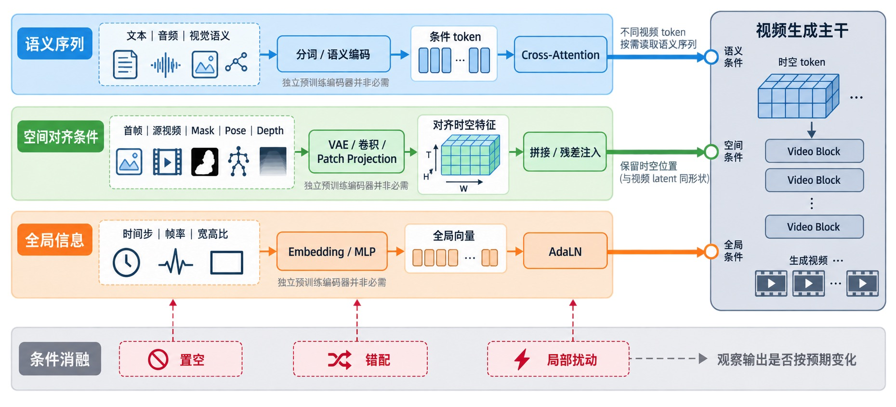
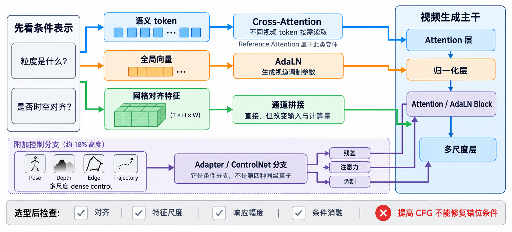
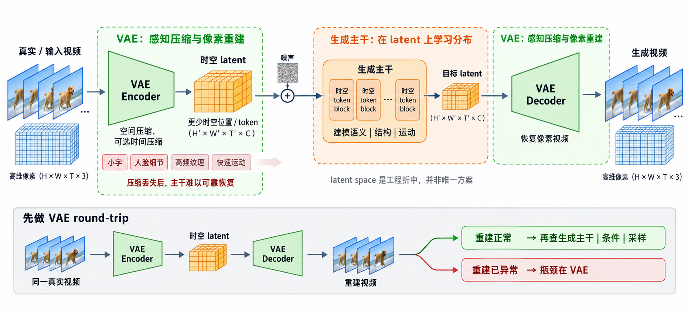
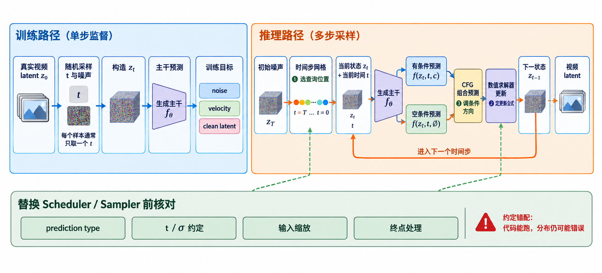
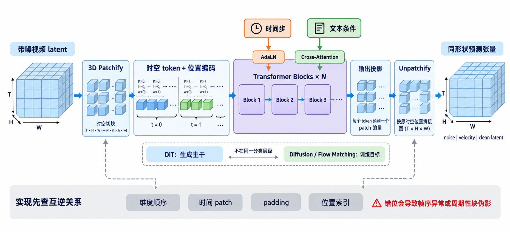
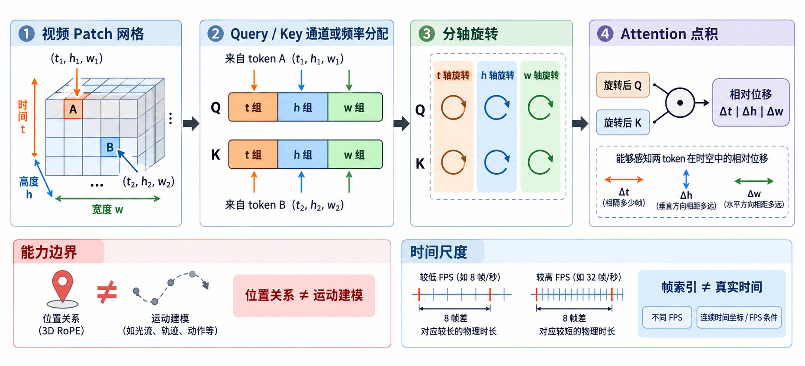
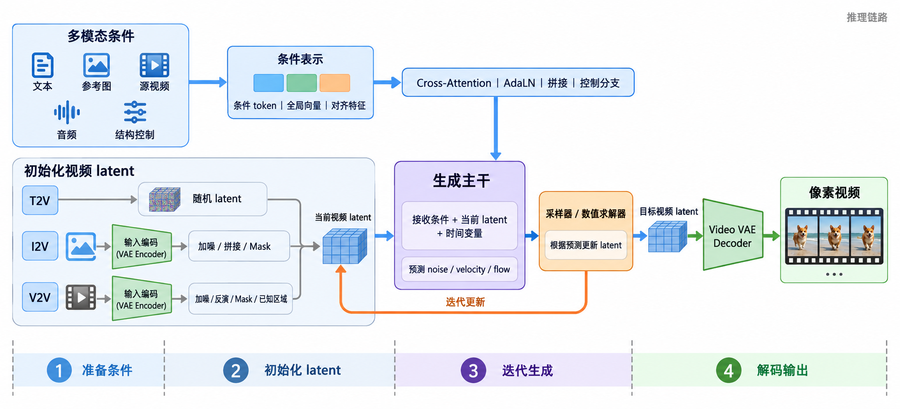

# 4.2 AI 视频核心基础架构模型

> 本章聚焦 AI 视频生成模型的底层架构：条件编码、视频压缩表示、生成目标、主干网络、时空建模和端到端系统数据流。这里不展开具体模型家族，也不讨论训练工程细节；目标是建立多年后仍然不过时的架构级理解。

---

# 目录导航

[4.2.1 条件编码与多模态条件注入：文本、图像、视频与结构控制如何进入模型](#4.2.1_条件编码与多模态条件注入：文本、图像、视频与结构控制如何进入模型)
  - [4.2.1.1 面试问题：视频生成模型为什么需要条件表示？一定要使用独立条件编码器吗？](#4.2.1.1_面试问题：视频生成模型为什么需要条件表示？一定要使用独立条件编码器吗？)
  - [4.2.1.2 面试问题：视频生成中，文本与视觉条件编码分别提供什么信息？](#4.2.1.2_面试问题：视频生成中，文本与视觉条件编码分别提供什么信息？)
  - [4.2.1.3 面试问题：视频生成中，条件信息有哪些常见注入方式？应如何选择？](#4.2.1.3_面试问题：视频生成中，条件信息有哪些常见注入方式？应如何选择？)

[4.2.2 Video VAE 与潜空间建模：为什么视频生成通常不直接在像素空间完成](#4.2.2_Video-VAE-与潜空间建模：为什么视频生成通常不直接在像素空间完成)
  - [4.2.2.1 面试问题：为什么视频生成通常在潜空间中进行？VAE 在其中承担什么作用？](#4.2.2.1_面试问题：为什么视频生成通常在潜空间中进行？VAE-在其中承担什么作用？)
  - [4.2.2.2 面试问题：Video VAE 与逐帧 Image VAE 有什么区别？因果与非因果结构应如何选择？](#4.2.2.2_面试问题：Video-VAE-与逐帧-Image-VAE-有什么区别？因果与非因果结构应如何选择？)
  - [4.2.2.3 面试问题：Video VAE 的空间压缩、时间压缩和潜变量通道数应如何权衡？](#4.2.2.3_面试问题：Video-VAE-的空间压缩、时间压缩和潜变量通道数应如何权衡？)

[4.2.3 视频生成目标：Diffusion、Flow Matching、Rectified Flow 与采样过程](#4.2.3_视频生成目标：Diffusion、Flow-Matching、Rectified-Flow-与采样过程)
  - [4.2.3.1 面试问题：视频扩散模型训练时究竟学什么？为什么不能理解为逐帧去噪？](#4.2.3.1_面试问题：视频扩散模型训练时究竟学什么？为什么不能理解为逐帧去噪？)
  - [4.2.3.2 面试问题：Diffusion、Flow Matching 与 Rectified Flow 是什么关系？](#4.2.3.2_面试问题：Diffusion、Flow-Matching-与-Rectified-Flow-是什么关系？)
  - [4.2.3.3 面试问题：训练路径、推理时间步、数值求解器与 CFG 分别控制什么？](#4.2.3.3_面试问题：训练路径、推理时间步、数值求解器与-CFG-分别控制什么？)

[4.2.4 生成主干网络：U-Net 与视频 DiT](#4.2.4_生成主干网络：U-Net-与视频-DiT)
  - [4.2.4.1 面试问题：U-Net 为什么适合扩散去噪？扩展到视频时需要改什么？](#4.2.4.1_面试问题：U-Net-为什么适合扩散去噪？扩展到视频时需要改什么？)
  - [4.2.4.2 面试问题：视频 DiT 如何处理时空 latent？为什么更适合规模化？](#4.2.4.2_面试问题：视频-DiT-如何处理时空-latent？为什么更适合规模化？)
  - [4.2.4.3 面试问题：U-Net 与视频 DiT 应如何选择？Transformer 一定更优吗？](#4.2.4.3_面试问题：U-Net-与视频-DiT-应如何选择？Transformer-一定更优吗？)

[4.2.5 时空建模模块：Temporal Layer、3D Conv、时空注意力与位置编码](#4.2.5_时空建模模块：Temporal-Layer、3D-Conv、时空注意力与位置编码)
  - [4.2.5.1 面试问题：为什么不能把图像生成主干简单复制到每一帧？](#4.2.5.1_面试问题：为什么不能把图像生成主干简单复制到每一帧？)
  - [4.2.5.2 面试问题：Temporal Conv、3D Conv 与时空 Attention 应如何选择？](#4.2.5.2_面试问题：Temporal-Conv、3D-Conv-与时空-Attention-应如何选择？)
  - [4.2.5.3 面试问题：为什么视频 Transformer 需要时空位置编码？3D RoPE 的作用是什么？](#4.2.5.3_面试问题：为什么视频-Transformer-需要时空位置编码？3D-RoPE-的作用是什么？)

[4.2.6 AI 视频生成系统架构总览：从条件输入到视频输出](#4.2.6_AI-视频生成系统架构总览：从条件输入到视频输出)
  - [4.2.6.1 面试问题：一个典型 AI 视频生成系统的端到端流程是什么？](#4.2.6.1_面试问题：一个典型-AI-视频生成系统的端到端流程是什么？)
  - [4.2.6.2 面试问题：视频生成系统的核心组件如何协同工作？](#4.2.6.2_面试问题：视频生成系统的核心组件如何协同工作？)
  - [4.2.6.3 面试问题：设计视频生成系统时，如何权衡生成质量、计算成本与任务覆盖？](#4.2.6.3_面试问题：设计视频生成系统时，如何权衡生成质量、计算成本与任务覆盖？)

---

<h1 id="4.2.1_条件编码与多模态条件注入：文本、图像、视频与结构控制如何进入模型">4.2.1 条件编码与多模态条件注入：文本、图像、视频与结构控制如何进入模型</h1>

> 条件系统要解决两个接口问题：先把文本、参考图、首帧、源视频、音频、mask、pose、depth、trajectory 等输入变成合适的表示，再把这些表示注入生成主干。编码路径决定模型保留了什么信息，注入位置决定这些信息能影响哪些时空 token。

<h2 id="4.2.1.1_面试问题：视频生成模型为什么需要条件表示？一定要使用独立条件编码器吗？">4.2.1.1 面试问题：视频生成模型为什么需要条件表示？一定要使用独立条件编码器吗？</h2>

**难度评分：⭐⭐⭐ (3/5)  |  考察频率：⭐⭐⭐⭐⭐ (5/5)**

在条件引导的视频生成中，文本、参考图、源视频或结构控制等输入，需要以模型能够处理的数值形式参与计算。这些形式称为**条件表示**，例如文本特征、图像潜变量或经过对齐的区域掩码（mask，用于标记修改或控制的作用区域）。

条件表示是生成模型使用外部信息的接口，但不要求每种条件都额外配置一个独立编码器。

**1、为什么需要条件表示？**

**（1）将输入信息转换为模型可处理的形式。** 文本需要经过分词、嵌入或特征编码；参考图可以转换为视觉特征或潜变量；掩码也需要具有符合接口要求的尺寸和数值格式。不同输入的处理复杂度并不相同。

**（2）保留任务需要的信息。** 文本条件需要表达主体、动作和关系；参考图可能需要保留人物身份或外观；掩码、姿态和轨迹还需要保留空间位置或时间对应关系。如果转换时丢失了关键内容，后续主干就难以据此准确控制生成。

**（3）使条件能够接入生成主干。** 条件表示可以是特征序列、空间网格或向量等形式，再通过相应接口参与生成计算。它不必与视频表示具有完全相同的形状，但需要满足所用接口对维度、位置和时间关系的要求。

图2-1展示了常见条件表示及其接入生成主干的路径。

<div align="center">
  
  <p>图2-1 视频生成中三类条件表示及其典型注入接口</p>
</div>

**2、每种条件都需要独立编码器吗？**

不一定。需要区分**必须有可用的条件表示**，与**必须额外配置独立编码网络**。

- **可以使用独立编码器。** 例如，利用预训练文本编码器提取语言特征，或利用视觉编码器提取参考图特征，复用已有的表征能力。
- **可以复用已有编码路径。** 例如，参考首帧或源视频可以经过生成系统已有的 VAE，转换为潜变量，不一定再增加一套专用视觉编码器。
- **可以使用轻量转换或直接输入。** 例如，掩码在完成尺寸对齐和格式处理后，可以直接拼接到相应输入；帧率等数值条件可以通过模型内部的嵌入层转换为向量。

因此，编码方式应由条件的信息特点和控制目标决定。只有需要额外的语义提取、压缩或特征适配时，才考虑相应编码模块，同时权衡信息保留、计算开销和训练适配成本。

> **面试速答**：条件表示把文本、参考图和结构信号变成生成模型可以使用的数值输入，同时保留任务需要的语义与时空关系。它不一定需要独立编码器：可以使用预训练编码器、复用已有 VAE，也可以通过轻量投影、嵌入或直接输入完成。关键是表示保留了什么信息，以及能否正确接入主干。

参考资料：[High-Resolution Image Synthesis with Latent Diffusion Models](https://arxiv.org/abs/2112.10752)

<h2 id="4.2.1.2_面试问题：视频生成中，文本与视觉条件编码分别提供什么信息？">4.2.1.2 面试问题：视频生成中，文本与视觉条件编码分别提供什么信息？</h2>

**难度评分：⭐⭐⭐⭐ (4/5)  |  考察频率：⭐⭐⭐⭐ (4/5)**

文本条件主要描述生成意图，视觉条件提供已有画面的参考。编码路径需要将这些输入转换为可用特征；最终保留哪些信息，取决于**编码器的训练目标、输出形式和压缩程度**。

**1、文本编码器提供什么信息？**

文本编码器将提示词转换为特征，供生成模型利用其中的主体、属性、动作和关系。T5 与 CLIP 文本编码器是两类常见选择。

- **T5 类文本编码器。** 通过文本预训练学习词义、上下文和句子关系，通常输出文本特征序列。用于视频生成时，生成模型还需要学习这些语言特征与视频内容的对应关系。
- **CLIP 文本编码器。** 通过图文对比学习，使文本表示与对应图像表示在语义上关联。生成系统可以使用其文本序列特征或全局特征，表达提示词中的视觉概念。

两者都可以表达主体、属性和动作，不能简单划分为“T5 负责复杂语言、CLIP 负责风格”。具体能否稳定处理数量、属性绑定和事件顺序，需要结合编码器版本与生成模型训练判断。

**2、视觉条件编码提供什么信息？**

参考图或首帧通常可以通过两类路径进入模型，侧重点不同。

**（1）视觉特征路径：提供参考图的内容与外观信息。** 例如，使用 CLIP 图像编码器提取人物、物体、场景或风格特征。全局向量将整张图的信息汇总，空间细节容易被弱化；局部 patch 特征能保留更多位置相关信息，但不等于原始像素的完整表示。

**（2）VAE 潜变量路径：提供带有空间布局的压缩画面。** 参考图或首帧经过 VAE 后，通常仍保留空间网格中的颜色、轮廓和局部布局，可为生成提供更直接的画面参考。它也会因压缩损失细节，实际保持能力还取决于后续如何使用这些潜变量。

例如，要求“让参考照片中的人物在海边行走”：文本编码提供人物行走与海边场景的描述；视觉特征可以提供参考人物的外观信息；如果还要求从指定首帧开始，则可以利用首帧潜变量提供初始画面布局。

视觉特征和 VAE 潜变量可以配合使用，也可以按任务选择其中一路。它们是否有效，取决于所需信息有没有保留下来，以及生成模型是否学会利用这些信息。

> **面试速答**：文本编码器提供提示词的语义表示，T5 主要通过语言预训练学习，CLIP 文本编码器通过图文对比学习建立视觉语义关联。视觉条件既可以提取参考图特征，也可以通过 VAE 保留空间布局明确的压缩画面。不同路径的侧重点不同，应按任务需要的信息选择，不能仅凭编码器名称判断最终能力。

<h2 id="4.2.1.3_面试问题：视频生成中，条件信息有哪些常见注入方式？应如何选择？">4.2.1.3 面试问题：视频生成中，条件信息有哪些常见注入方式？应如何选择？</h2>

**难度评分：⭐⭐⭐⭐ (4/5)  |  考察频率：⭐⭐⭐⭐⭐ (5/5)**

条件注入，是让编码后的文本、参考图或控制信号参与生成主干的计算。选择时需要考虑**条件的表示形式、时空对应关系、已有模型接口与计算成本**，同一个模型也可以组合使用多种方式。

**1、常见注入方式怎样工作？**

**（1）Cross-Attention：让视频特征读取条件特征。**

交叉注意力通过计算视频特征与条件特征的匹配程度，对条件信息加权求和，其基本计算形式为：

```math
y=\mathrm{softmax}\left(\frac{Q_xK_c^\top}{\sqrt{d_k}}\right)V_c
```

其中， $Q_x$ 来自视频特征， $K_c$、 $V_c$ 来自条件特征， $d_k$ 是查询与键的特征维度。不同视频位置可以对条件序列中的不同内容分配权重，例如读取与当前对象相关的文本或参考图信息。

它适合需要保留多个条件特征、进行细粒度交互的情况，计算开销会受到视频序列和条件序列长度的共同影响。

**（2）AdaLN：用条件调整归一化后的特征。**

自适应层归一化的一种基本形式为：

```math
y=\gamma(c)\odot\mathrm{LN}(x)+\beta(c)
```

其中， $x$ 是主干特征， $c$ 是条件表示， $\gamma(c)$ 与 $\beta(c)$ 是根据条件生成的缩放和偏移参数， $\odot$ 表示逐元素相乘。

AdaLN 根据条件信息生成缩放和偏移参数，调整归一化后的主干特征，这个过程称为**特征调制**。常见实现中，不同通道使用各自的调整参数，多个 token 共用同一组参数，因此适合注入类别、汇总后的文本语义等全局信息。扩散时间步也常通过这种方式输入模型，用于指示当前所处的去噪阶段。对于“某个对象应出现在什么位置”等局部控制，通常还需要结合保留空间对应关系的条件注入方式。

**（3）拼接：将条件与待生成表示放在一起处理。**

- **通道拼接。** 将掩码、首帧潜变量或结构特征等，在通道维与待生成视频表示组合。通常需要先处理好空间尺寸、时间位置和数值尺度。
- **Token 拼接。** 将条件特征加入视频 token 序列，通过后续注意力建立联系。模型需要区分条件与待生成内容，并保留必要的位置关系；序列变长也会增加计算开销。

此外，**残差控制分支属于网络组织方案**：增加一条条件处理路径，再将其输出作为残差加入主干特征。ControlNet 是代表性例子，可以在保留预训练主干的同时学习结构控制，但会增加参数和计算开销。分支与注意力、调制、拼接可以组合使用，并非互斥选项。

常见条件表示及其注入位置如图2-2所示。

<div align="center">
  
  <p>图2-2 多模态条件的表示粒度与典型注入位置</p>
</div>

**2、工程上应如何选择？**

**（1）需要逐位置读取条件内容时，考虑注意力交互。** 文本或参考图特征包含多个信息单元，希望不同视频位置分别利用它们时，可以采用 Cross-Attention，或通过 token 拼接建立交互。

**（2）条件主要提供全局信息时，考虑特征调制。** 例如类别、汇总语义或帧率等数值条件，可以先转换为向量，再用于 AdaLN 等调制路径，不必全部扩展成较长序列。

**（3）需要明确的空间或时间控制时，保留对应关系。** 对掩码、姿态、深度或逐帧轨迹，可以考虑对齐后的通道拼接或控制分支；若使用 token 形式，也需要让模型识别对应的位置与时间。

**（4）结合已有模型与训练预算判断。** 复用已训练模型时，优先使用它支持的接口。新增注入路径通常需要训练适配，不能仅完成张量连接就认为控制会生效。最终还要比较条件遵循、生成质量与计算开销。

> **面试速答**：Cross-Attention 让视频特征读取条件序列，AdaLN 用条件调制特征，拼接则将条件加入通道或 token 序列。残差控制分支是额外的网络路径，可以与这些操作组合。选型主要看条件粒度、时空对应、已有接口与计算预算，并通过训练让模型学会使用条件。

相关原始资料：

- [T5: Exploring the Limits of Transfer Learning with a Unified Text-to-Text Transformer](https://arxiv.org/abs/1910.10683)
- [CLIP: Learning Transferable Visual Models From Natural Language Supervision](https://arxiv.org/abs/2103.00020)
- [DiT: Scalable Diffusion Models with Transformers](https://arxiv.org/abs/2212.09748)
- [ControlNet: Adding Conditional Control to Text-to-Image Diffusion Models](https://arxiv.org/abs/2302.05543)

---

<h1 id="4.2.2_Video-VAE-与潜空间建模：为什么视频生成通常不直接在像素空间完成">4.2.2 Video VAE 与潜空间建模：为什么视频生成通常不直接在像素空间完成</h1>

> Latent 视频生成把像素重建交给 VAE，把分布建模交给扩散或 Flow Matching 主干。VAE 决定主干能看到多少时空信息和多少 token，但最终质量还取决于生成主干、训练数据和采样过程。

<h2 id="4.2.2.1_面试问题：为什么视频生成通常在潜空间中进行？VAE-在其中承担什么作用？">4.2.2.1 面试问题：为什么视频生成通常在潜空间中进行？VAE 在其中承担什么作用？</h2>

**难度评分：⭐⭐⭐ (3/5)  |  考察频率：⭐⭐⭐⭐⭐ (5/5)**

视频包含大量像素，生成模型如果直接处理高分辨率、多帧视频，训练和推理的计算成本都很高。常见做法是先用 VAE 将视频编码为更紧凑的特征表示，即**潜变量（latent）**；这些表示所在的空间称为**潜空间（latent space）**。

**1、为什么在潜空间中生成？**

VAE 通常压缩视频的空间尺寸，部分 Video VAE 还会压缩时间维度。生成主干在压缩后的表示上进行计算，可以减少需要处理的时空位置，降低显存占用和计算开销。

对于需要多次迭代的扩散或 Flow Matching 模型，这种收益尤其明显：每一步都在较小的表示上计算，最后再通过解码器还原为像素视频。

> [Latent Diffusion 论文](https://arxiv.org/abs/2112.10752)的核心思路，是将生成过程分成两个阶段：先训练一个自编码器，将图像压缩为保留主要视觉信息的潜变量，并学习从中重建图像；再固定自编码器，在潜空间中训练扩散模型。生成时，扩散模型先产生潜变量，解码器再将其转换为图像。这样，多步去噪都在更紧凑的表示中进行，能够降低计算成本，同时尽量保留视觉细节。

视频潜空间生成沿用了类似分工，并进一步处理跨帧信息；部分 Video VAE 还会压缩时间维度。

潜空间生成是一种常见的效率与质量折中，视频也可以直接在像素空间中生成。

**2、VAE 在其中承担什么作用？**

VAE 主要承担视频与潜变量之间的转换：

- **编码器负责压缩表示。** 训练时，将真实视频编码为潜变量，供生成主干学习。
- **解码器负责重建画面。** 生成时，将主干生成的潜变量转换为像素视频。

因此，VAE 的压缩与重建能力会影响最终视频的细节和稳定性。压缩过强或重建能力不足，可能导致文字模糊、纹理丢失或帧间闪烁。模型可以根据学到的规律生成合理细节，但无法保证准确恢复压缩时已经丢失的原始信息。

图2-3展示了这一分工：训练时，真实视频经编码器得到潜变量；生成时，生成主干产生潜变量，再由解码器输出视频。

<div align="center">
  
  <p>图2-3 Video VAE 将像素视频压缩到 latent space 并解码回视频的流程示意图</p>
</div>

工程上，可以先将真实视频经过一次“编码—解码”，检查重建质量，作为判断编解码环节是否存在明显损失的依据。

> **面试速答**：视频在潜空间中生成，主要是为了降低高分辨率、多帧建模的计算成本。VAE 的编码器将视频压缩为潜变量，解码器将生成的潜变量还原为视频；生成主干负责学习并生成这些潜变量。代价是有损压缩和重建误差可能影响细节及时间连续性。

<h2 id="4.2.2.2_面试问题：Video-VAE-与逐帧-Image-VAE-有什么区别？因果与非因果结构应如何选择？">4.2.2.2 面试问题：Video VAE 与逐帧 Image VAE 有什么区别？因果与非因果结构应如何选择？</h2>

**难度评分：⭐⭐⭐⭐ (4/5)  |  考察频率：⭐⭐⭐⭐⭐ (5/5)**

逐帧 Image VAE 将视频中的每一帧独立编码、解码；Video VAE 则在编码器、解码器或两者中加入跨帧信息处理，使视频的压缩表示或重建过程能够利用时间上下文。

**1、Video VAE 增加了什么能力？**

- **利用跨帧信息。** 通过时间卷积、3D 卷积或时间注意力等方式，结合相邻帧的信息进行编码或解码，有助于减少逐帧独立处理带来的重建波动。
- **可以压缩时间维度。** 将多帧信息编码到更少的潜变量时间位置，减少生成主干需要处理的时空位置。是否进行时间压缩，取决于具体设计。

因此，**处理跨帧信息与压缩时间维度是两个不同的属性**。Video VAE 可以利用时间上下文，同时保持时间位置数量不变。

例如，CogVideoX 的 3D VAE 同时进行空间和时间压缩，并使用时间因果卷积。[CogVideoX 论文](https://arxiv.org/html/2408.06072v3#S2.SS1)

**2、因果与非因果分别是什么意思？**

这里的“因果”指时间上的信息依赖方向，表示计算当前位置的输出时，是否允许使用未来位置的输入。

- **因果结构（causal）**：只使用当前及过去位置的信息，不使用未来信息。
- **非因果结构（non-causal）**：允许使用未来位置的信息，例如结合前后帧进行编码或重建。

以不进行时间降采样的编码器为例，编码第 5 帧时，因果结构不能读取第 6 帧及之后的内容；非因果结构可以利用这些未来帧。对于存在时间压缩的模型，还需结合其时间位置对应方式理解这种约束。

表2-1概括了三类结构的主要区别。

<p align="center">表2-1 逐帧 Image VAE、因果 Video VAE 与非因果 Video VAE 的主要区别</p>

| 维度 | 逐帧 Image VAE | 因果 Video VAE | 非因果 Video VAE |
| --- | --- | --- | --- |
| 可利用的时间信息 | 当前单帧 | 当前及过去位置 | 可包含未来位置 |
| 时间压缩 | 通常不进行 | 可进行，也可不进行 | 可进行，也可不进行 |
| 主要特点 | 可复用图像 VAE，逐帧独立处理 | 无须等待未来输入，便于增量处理 | 可利用双向上下文进行编解码 |
| 需要关注的问题 | 缺少跨帧交互，重建误差可能表现为闪烁 | 历史特征缓存、首帧和分块边界处理 | 未来上下文需求、处理延迟和分块边界 |

**3、应如何选择？**

- **需要及时处理持续到来的帧，或复用已有视频前缀时**，优先考虑相关编码或解码路径采用因果结构，减少对未来输入的依赖。
- **可以获得完整视频或允许等待后续帧时**，可以考虑非因果结构，利用更多时间上下文；最终仍需比较重建质量、计算成本和延迟。

编码器和解码器是否因果，需要分别确认。即使 VAE 支持因果处理，端到端流式生成仍需要生成主干、采样过程和缓存机制配合。

此外，Video VAE 有助于改善视频的表示与重建连续性，生成视频中的长期身份、运动和场景一致性仍需要生成主干等环节共同保证。

> **面试速答**：逐帧 Image VAE 独立处理每帧，Video VAE 增加跨帧信息处理，并可选择压缩时间维度。因果结构不使用未来输入，便于增量和流式编解码；非因果结构可以利用未来上下文，适合离线处理或允许一定延迟的场景。选择时要结合重建质量、延迟和计算成本，且 VAE 的因果性不能单独保证端到端流式生成。

<h2 id="4.2.2.3_面试问题：Video-VAE-的空间压缩、时间压缩和潜变量通道数应如何权衡？">4.2.2.3 面试问题：Video VAE 的空间压缩、时间压缩和潜变量通道数应如何权衡？</h2>

**难度评分：⭐⭐⭐⭐ (4/5)  |  考察频率：⭐⭐⭐⭐ (4/5)**

这三个参数共同影响视频表示的大小、信息保留能力和计算成本：**空间与时间压缩决定保留多少个时空位置，潜变量通道数决定每个位置使用多少个特征数值。**

**1、三个参数分别影响什么？**

**（1）空间压缩：减少每帧的空间位置。**

例如，将高度和宽度分别缩小到原来的八分之一，每帧的空间位置数量就变为原来的六十四分之一。

空间压缩可以降低后续计算成本，但压缩过强时，小字、小物体、人脸细节和精细纹理容易受损。

**（2）时间压缩：减少潜变量的时间位置。**

例如，将连续多帧的信息编码到更少的时间位置，可以进一步减少生成主干需要处理的数据。

时间压缩过强时，快速动作、短暂表情或闪光等变化可能难以保留。时间压缩也不同于直接抽帧：视频编码器可以融合多帧信息，解码器再恢复完整帧序列。

**（3）潜变量通道数：调整每个时空位置的表示容量。**

每个潜变量位置都对应一个特征向量，通道数就是这个向量的维度。增加通道数可以为颜色、纹理和运动等信息提供更多表示空间，但也会增加潜变量的存储量，以及相关编解码层和主干输入输出层的计算成本。

更多通道并不保证更好的生成效果，也不能保证补回过强空间或时间压缩造成的信息损失。

**2、如何理解它们与数据量的关系？**

设输入 RGB 视频的尺寸为 $T\times H\times W\times3$，空间压缩倍数分别为 $r_h$、 $r_w$，时间压缩倍数为 $r_t$，潜变量通道数为 $C_z$。忽略边界处理，并假设各维可以整除，则潜变量尺寸为：

```math
\frac{T}{r_t}\times\frac{H}{r_h}\times\frac{W}{r_w}\times C_z
```

输入视频与潜变量的元素数量之比为：

```math
R_{\mathrm{elem}}=\frac{3r_tr_hr_w}{C_z}
```

例如，高度和宽度各压缩 8 倍、时间压缩 4 倍、潜变量通道数为 16 时：

- 时空位置数量缩减为原来的 $1/256$；
- 考虑通道数后，元素数量缩减为原来的 $1/48$。

这里计算的是**元素数量比**；实际占用的字节数还与数值精度有关，不能直接当成视频文件的存储压缩率。

对于 Transformer 主干，最终 token 数还取决于如何将潜变量划分为 patch。固定划分方式时，减少时空位置通常会减少 token 数；增加潜变量通道数通常不会直接改变 token 数。

**3、实际应如何权衡？**

- **细节要求高时**，重点检查空间压缩是否损伤文字、人脸和小物体。
- **快速运动或短事件较多时**，重点检查时间压缩是否导致动作失真、短暂变化丢失。
- **调整通道数时**，比较增加通道后是否带来足够的质量收益，以及额外的显存和计算成本是否可接受。

选型时，先用代表性视频检查“编码—解码”后的重建质量，再结合生成主干评估最终效果、显存和端到端延迟。压缩倍数更大不代表系统一定更快，重建指标更好也不保证最终生成效果更好。

> **面试速答**：空间压缩减少每帧的空间位置，时间压缩减少时间位置，潜变量通道数影响每个位置的表示容量。压缩过强可能损伤细节或快速变化，增加通道可以提供更多表示空间，但会增加成本，也不能保证补回压缩损失。实际应结合重建质量、下游生成效果和端到端成本共同选择。

相关原始资料：

- [Latent Diffusion Models](https://arxiv.org/abs/2112.10752)
- [VideoGPT](https://arxiv.org/abs/2104.10157)
- [Stable Video Diffusion](https://arxiv.org/abs/2311.15127)
- [CogVideoX](https://arxiv.org/abs/2408.06072)

---

<h1 id="4.2.3_视频生成目标：Diffusion、Flow-Matching、Rectified-Flow-与采样过程">4.2.3 视频生成目标：Diffusion、Flow Matching、Rectified Flow 与采样过程</h1>

> 本节从训练目标讲到推理求解，重点分清模型学到的场、生成路径如何定义，以及推理时怎样把这个场积分成视频 latent。

<h2 id="4.2.3.1_面试问题：视频扩散模型训练时究竟学什么？为什么不能理解为逐帧去噪？">4.2.3.1 面试问题：视频扩散模型训练时究竟学什么？为什么不能理解为逐帧去噪？</h2>

**难度评分：⭐⭐⭐ (3/5)  |  考察频率：⭐⭐⭐⭐⭐ (5/5)**

视频扩散模型学习的是：在给定噪声级别和条件后，如何从受扰动的**时空 latent** 估计去噪方向。典型训练并不会对每个样本完整执行一遍反向链，而是随机采样时间 $t$ 和噪声 $\epsilon$，直接构造 $z_t$，用一次网络前向计算监督信号：

```math
\begin{aligned}
z_t &= \alpha_t z_0 + \sigma_t \epsilon, \qquad \epsilon \sim \mathcal{N}(0,I), \\
\mathcal{L} &= \mathbb{E}\left[\left\lVert y(z_0,\epsilon,t)-f_\theta(z_t,t,c)\right\rVert_2^2\right].
\end{aligned}
```

**预测目标可以采用不同参数化**

$y$ 取决于参数化方式，可以是噪声 $\epsilon$、干净 latent $z_0$，也可以是常见约定下的 velocity $v_t=\alpha_t\epsilon-\sigma_tz_0$。三种写法描述的是相关的预测量，但损失权重、数值尺度和训练动态并不完全相同；更换 prediction type 时，采样器中的转换公式也必须同步。

**视频一致性来自时空联合建模**

“不是逐帧去噪”的原因不在损失函数名称，而在模型处理的数据与网络结构。视频 latent 通常形如 $T'\times H'\times W'\times C$，主干通过 3D 卷积、时间注意力或时空注意力联合处理多帧。若网络仍按帧独立预测，即使使用同一扩散损失，也不会自动获得可靠的运动连续性。时序一致性来自时空表示、主干结构和视频数据的共同约束，不能全部归功于 Diffusion。

**训练误差要按噪声区间观察**

工程上应按噪声区间统计训练误差，并分别检查静态镜头、快速运动和镜头切换样本。高噪声区语义结构学不好、低噪声区细节恢复差，是两类不同问题；只看一个全局平均 loss 很容易掩盖它们。

> **面试速答**：训练时通常随机采样一个噪声级别，模型用一次前向预测 $\epsilon$、$z_0$ 或 $v$，完整的多步求解主要发生在推理阶段。视频不是逐帧独立去噪，因为主干应在时空 latent 上联合预测；Diffusion 目标本身并不保证跨帧一致性。

<h2 id="4.2.3.2_面试问题：Diffusion、Flow-Matching-与-Rectified-Flow-是什么关系？">4.2.3.2 面试问题：Diffusion、Flow Matching 与 Rectified Flow 是什么关系？</h2>

**难度评分：⭐⭐⭐⭐ (4/5)  |  考察频率：⭐⭐⭐⭐⭐ (5/5)**

三者不能简单理解为互斥的模型类别。Diffusion 先规定数据逐渐变成噪声的随机过程，再学习其反向去噪量或 score；对应的 probability flow ODE 又能把同一组边缘分布写成确定性流。Flow Matching 则直接回归一条给定概率路径上的速度场，而这条路径既可以是扩散路径，也可以是其他路径。Rectified Flow 是强调直线插值与路径拉直的一类流模型构造，范围比 Flow Matching 更窄。

具体边界见表2-2。

<p align="center">表2-2 Diffusion、Flow Matching 与 Rectified Flow 的建模关系</p>

| 方法 | 训练时主要学习什么 | 路径如何得到 | 推理时如何生成 | 需要避免的误解 |
| --- | --- | --- | --- | --- |
| Diffusion / score-based model | 噪声、干净样本、velocity 或 score | 先定义前向加噪过程 | 求解反向 SDE、概率流 ODE 或其离散化更新 | 不等于只能随机采样，也不只支持 $\epsilon$ prediction |
| Flow Matching | 给定概率路径上的速度场 | 可使用扩散路径、OT 路径等 | 用 ODE 求解器积分速度场 | 不是 Diffusion 的简单反义词 |
| Rectified Flow | 尽量沿端点直线输运的速度场 | 给定噪声—数据耦合，使用直线插值；可进一步 reflow | 通常求解 ODE | 是流模型的一类构造，不等于所有 Flow Matching |

**Rectified Flow 如何定义直线路径**

以噪声端点 $z_n$ 和数据端点 $z_d$ 为例，Rectified Flow 常用：

```math
z_t=(1-t)z_n+t z_d, \qquad
\mathcal{L}_{\mathrm{RF}}
=\mathbb{E}\left[\left\lVert v_\theta(z_t,t,c)-(z_d-z_n)\right\rVert_2^2\right].
```

**少步采样不能只看训练目标**

直线路径通常更容易用较粗的时间离散逼近，但“使用 Flow Matching 就一定能少步采样”并不成立。实际步数还受路径弯曲程度、端点耦合、求解器阶数、训练质量、蒸馏和目标画质影响。比较两类模型时，应固定分辨率、CFG 和函数评估次数（NFE），再看画质、运动一致性与延迟；不同目标下的训练 loss 数值不能直接横向比较。

> **面试速答**：Diffusion 定义前向加噪并学习反向生成量，Flow Matching 直接学习给定概率路径的速度场；扩散路径本身也可以用于 Flow Matching。Rectified Flow 是使用直线插值并尝试拉直输运轨迹的一类方法，不等于整个 Flow Matching。是否能少步采样，要看路径和求解误差，不能只看方法名称。

<h2 id="4.2.3.3_面试问题：训练路径、推理时间步、数值求解器与-CFG-分别控制什么？">4.2.3.3 面试问题：训练路径、推理时间步、数值求解器与 CFG 分别控制什么？</h2>

**难度评分：⭐⭐⭐⭐ (4/5)  |  考察频率：⭐⭐⭐⭐⭐ (5/5)**

这四个概念处在不同层级：

1. **训练路径**规定 $\alpha_t$、$\sigma_t$ 或中间概率路径，决定训练时模型看到哪些信噪比和目标速度。
2. **推理时间步**选择从噪声端到数据端实际访问哪些 $t$ 或 $\sigma$。步数越少，网络调用越少，但离散误差通常更大。
3. **数值求解器**根据模型在当前状态的预测计算下一状态，例如 Euler、Heun 或 DPM-Solver 类方法。高阶方法可能减少误差，也可能增加单步网络调用。
4. **CFG**在每次模型预测时组合有条件与空条件结果，改变条件引导强度。用一般预测量 $f$ 表示：

```math
f_{\mathrm{cfg}}
=f_\theta(z_t,t,\varnothing)
+s\left(f_\theta(z_t,t,c)-f_\theta(z_t,t,\varnothing)\right).
```

其中 $s$ 是 guidance scale。增大 $s$ 往往能强化文本遵循，却可能压缩多样性，并带来颜色过饱和、结构伪影；在视频中也可能改变运动幅度或放大时序抖动。这是经验风险，不代表所有模型都会出现同一种退化。

训练与推理的关系如图2-4所示。

<div align="center">
  
  <p>图2-4 训练路径、推理时间步、数值求解器与 CFG 的职责边界</p>
</div>

**为什么框架里的 scheduler 容易混淆**

不少框架把“时间步离散 + 更新公式”一起封装为 scheduler，因此工程名称与理论概念不总是一一对应。替换 scheduler 或 sampler 也并非必然即插即用：prediction type、时间或 $\sigma$ 约定、输入缩放和终点处理必须与训练配置匹配，否则即使代码能运行，生成分布也可能已经错位。

**如何排查采样问题**

排查采样问题时，先记录实际 $t/\sigma$ 序列和每步网络调用次数，再用固定随机种子扫描“步数 × CFG”。低步数时结构崩坏，优先检查时间网格与求解误差；提高 CFG 后才出现饱和、闪烁或动作僵硬，再检查条件引导，而不是笼统归因于模型容量。

> **面试速答**：训练路径决定模型学哪些中间状态，推理时间步决定查询哪些状态，数值求解器决定如何从当前状态走到下一状态，CFG 决定条件方向被放大多少。工程库常把推理时间步与数值求解器一起封装为 scheduler，但替换时必须匹配 prediction type、时间参数化和缩放约定。

相关原始资料：

- [Denoising Diffusion Probabilistic Models](https://arxiv.org/abs/2006.11239)
- [Score-Based Generative Modeling through Stochastic Differential Equations](https://arxiv.org/abs/2011.13456)
- [Flow Matching for Generative Modeling](https://arxiv.org/abs/2210.02747)
- [Flow Straight and Fast: Learning to Generate and Transfer Data with Rectified Flow](https://arxiv.org/abs/2209.03003)
- [Classifier-Free Diffusion Guidance](https://arxiv.org/abs/2207.12598)

---

<h1 id="4.2.4_生成主干网络：U-Net-与视频-DiT">4.2.4 生成主干网络：U-Net 与视频 DiT</h1>

> 生成主干接收带噪视频 latent、时间信息和条件表示，输出去噪量或速度场。U-Net 与视频 DiT 的区别主要在特征组织和计算拓扑，训练目标仍由上一节的 Diffusion 或 Flow Matching 决定。

<h2 id="4.2.4.1_面试问题：U-Net-为什么适合扩散去噪？扩展到视频时需要改什么？">4.2.4.1 面试问题：U-Net 为什么适合扩散去噪？扩展到视频时需要改什么？</h2>

**难度评分：⭐⭐⭐ (3/5)  |  考察频率：⭐⭐⭐⭐⭐ (5/5)**

U-Net 适合扩散去噪，核心在于一次预测需要同时处理不同空间尺度的信息：低分辨率特征更侧重主体布局和大范围结构，高分辨率特征更侧重边缘、纹理与局部位置。

**U-Net 为什么合适**

- **多尺度路径**：编码器逐级降低分辨率并扩大感受野，解码器再恢复空间尺寸，使同一个网络能够处理从整体结构到局部细节的预测。
- **跳跃连接（skip connection）**：把当前噪声状态下的高分辨率中间特征送到对应解码层，保留位置和边界信息。这些特征仍然含有噪声，模型需要将其与低分辨率特征融合后预测训练目标。
- **分层条件注入**：时间步嵌入、文本条件和结构控制可以进入不同分辨率层，同时影响整体语义与局部细节。

卷积还提供了局部性和平移等变的归纳偏置。需要明确的是，U-Net 只是生成主干的一种选择，Diffusion 和 Flow Matching 都没有限定必须使用哪类网络。

**扩展到视频时，需要补上跨帧信息流**

仅把输入张量增加一个时间维还不够。如果每一帧仍由同一套空间网络独立处理，模型学到的依然主要是单帧去噪。常见改法有两条：

- **复用图像 U-Net**：保留预训练的 2D 空间层，在部分分辨率层插入时间卷积、时间注意力或 motion module。这种方式便于继承已有的空间表征，新增模块的作用范围取决于插入位置和时间感受野。
- **构建时空 U-Net**：将卷积、注意力或上下采样直接扩展到时间维，统一设计空间与时间运算。这通常会增加计算量，与图像预训练权重的兼容也更复杂。

具体选择 Temporal Conv 还是 Temporal Attention 属于 4.2.5。本题要抓住的是：视频化改造必须让中间特征跨帧交换信息。

**工程上如何确认时间模块生效**

出现运动很弱、身份漂移或跨帧闪烁时，先在验证样本上关闭时间模块，或打乱带噪 latent 的帧序，观察模型预测是否明显变化；再检查时间层的梯度、输出幅度和训练数据中的运动分布。预测几乎不变，通常说明时间路径没有被有效利用，继续堆训练步数未必能解决问题。

> **面试速答**：U-Net 通过多尺度编码、解码和跳跃连接同时处理整体结构与局部细节。扩展到视频后，必须让中间特征跨帧交互；可以在图像 U-Net 中插入时间模块，也可以直接构建时空 U-Net，取舍点是预训练复用、时间建模范围和计算成本。

<h2 id="4.2.4.2_面试问题：视频-DiT-如何处理时空-latent？为什么更适合规模化？">4.2.4.2 面试问题：视频 DiT 如何处理时空 latent？为什么更适合规模化？</h2>

**难度评分：⭐⭐⭐⭐ (4/5)  |  考察频率：⭐⭐⭐⭐⭐ (5/5)**

视频 DiT 先把 Video VAE 输出的时空 latent 切成 3D patch，再投影为 token。时间步、文本等条件通过 AdaLN、Cross-Attention 或联合 token 序列进入 Transformer blocks；输出头把每个 token 映射为对应 patch 的噪声、干净 latent 或 velocity，最后还原成原时空网格。数据流见图2-5。

<div align="center">
  
  <p>图2-5 视频 DiT 的时空 token 化、条件注入与输出还原流程</p>
</div>

**规模化优势来自规则化 block**

规则、重复的 block 使 DiT 可以通过深度、宽度和 token 数较直接地增加计算量，也便于采用 Transformer 已有的并行与算子优化。原始 DiT 工作验证的是图像 latent diffusion 中质量随计算量扩展的经验规律；把这一结论迁移到视频时，还要处理更长的 token 序列，不能直接推出“同等算力下视频 DiT 一定更好”。

**视频侧的瓶颈是 token 预算**

视频长度或分辨率增加后，token 数会快速增长，全时空 attention 的计算和显存可能成为主瓶颈。实际模型往往采用空间与时间分解、局部窗口或稀疏 attention。具体注意力方案与位置编码属于 4.2.5，本题只需抓住一条主线：patch 大小决定 token 预算，attention pattern 决定 token 之间如何交换信息。

**实现先检查 patchify 与 unpatchify**

实现中最先核对 patchify 与 unpatchify 是否严格互逆，包括维度顺序、时间 patch、padding 和位置索引。这里一旦写错，常见现象是帧顺序异常、周期性块状伪影，或者改变帧数后质量突然下降，这些问题无法靠增加训练步数可靠修复。

“Video Transformer”是更宽泛的名称，也可能指自回归或掩码预测模型。本节所说的视频 DiT，特指在视频时空 token 上预测扩散或流模型训练目标的 Transformer 主干。

> **面试速答**：视频 DiT 把时空 latent 切成 3D patch token，经 Transformer 预测每个 patch 的去噪量或速度场，再还原为视频 latent 网格。规则化 block 便于扩大深度、宽度和 token 数，但视频 token 很长，规模化收益要和 attention 成本、数据量及训练算力一起判断。

<h2 id="4.2.4.3_面试问题：U-Net-与视频-DiT-应如何选择？Transformer-一定更优吗？">4.2.4.3 面试问题：U-Net 与视频 DiT 应如何选择？Transformer 一定更优吗？</h2>

**难度评分：⭐⭐⭐⭐ (4/5)  |  考察频率：⭐⭐⭐⭐⭐ (5/5)**

Transformer 没有脱离训练规模、token 预算和任务约束的普遍优势。U-Net 与视频 DiT 都可以预测 Diffusion 或 Flow Matching 的目标，选型依据是计算拓扑是否匹配现有资源和系统资产。主要差异见表2-3。

<p align="center">表2-3 U-Net 与视频 DiT 的工程选型维度</p>

| 维度 | U-Net | 视频 DiT |
| --- | --- | --- |
| 特征组织 | 多尺度 feature map，编码器与解码器通过 skip connection 对应 | 时空 patch token，标准实现以重复 Transformer block 为主 |
| 归纳偏置 | 局部性和多尺度先验较强 | 对视觉局部结构的先验较弱，更依赖数据和位置表示 |
| 扩展方式 | 需要同时调整各分辨率层的通道、深度与 attention | 较容易沿深度、宽度和 token 数规则扩展 |
| 视频化路径 | 可在图像 U-Net 中插入时间模块，也可构建时空 U-Net | 直接对时空 token 做联合或分解式 attention |
| 资产复用 | 便于继承已有图像 U-Net、ControlNet 或 motion module | 可继承图像 DiT，但 patch、位置编码和时空 attention 通常需要适配 |
| 主要成本 | 多尺度激活与高分辨率层计算 | token 数量及 attention 的计算、显存开销 |

**什么时候更倾向于哪一种主干**

已有图像 U-Net 和控制分支较多、视频数据或训练预算有限时，沿 U-Net 增加时间模块通常更容易得到稳定基线。数据和算力能够支撑规模化训练，且任务需要长程交互或统一多模态 token 接口时，视频 DiT 更有吸引力。这些是工程倾向，并非由架构名称保证的结果；时空 U-Net 也能建模长程关系，DiT 也可能因数据不足或位置设计不当而训练不充分。

**如何做公平比较**

公平比较至少要固定 VAE、训练数据、生成目标、输出分辨率与时长，并在相近训练计算量和采样 NFE 下观察生成质量。只对齐参数量不够：两类主干的 token 或 feature map 数量、激活显存、每步延迟和硬件利用率并不相同。实践中应同时记录训练吞吐、峰值显存、单步推理延迟，以及单帧质量、运动和时序一致性。

> **面试速答**：U-Net 的多尺度和局部先验较强，也便于复用已有图像扩散资产；视频 DiT 的 block 更规则，更适合按深度、宽度和 token 数扩展。Transformer 并不天然胜出，最终要在相同 VAE、数据、训练计算量和采样预算下比较质量、显存与延迟。

相关原始资料：

- [Denoising Diffusion Probabilistic Models](https://arxiv.org/abs/2006.11239)
- [Video Diffusion Models](https://arxiv.org/abs/2204.03458)
- [Lumiere: A Space-Time Diffusion Model for Video Generation](https://arxiv.org/abs/2401.12945)
- [Scalable Diffusion Models with Transformers](https://arxiv.org/abs/2212.09748)
- [Latte: Latent Diffusion Transformer for Video Generation](https://arxiv.org/abs/2401.03048)
- [VDT: General-purpose Video Diffusion Transformers via Mask Modeling](https://arxiv.org/abs/2305.13311)

---

<h1 id="4.2.5_时空建模模块：Temporal-Layer、3D-Conv、时空注意力与位置编码">4.2.5 时空建模模块：Temporal Layer、3D Conv、时空注意力与位置编码</h1>

> 图像主干解决单帧内容生成，时空模块解决帧间信息如何交互。本节重点讨论三个问题：为什么必须建立跨帧依赖、局部卷积与全局注意力如何取舍，以及视频 Transformer 如何表示时空位置。

<h2 id="4.2.5.1_面试问题：为什么不能把图像生成主干简单复制到每一帧？">4.2.5.1 面试问题：为什么不能把图像生成主干简单复制到每一帧？</h2>

**难度评分：⭐⭐⭐ (3/5)  |  考察频率：⭐⭐⭐⭐⭐ (5/5)**

问题不在于图像主干不会生成高质量画面，而在于它看不到其他帧。主体外观、运动轨迹和相机变化都需要跨帧信息，只做逐帧预测无法直接约束这些关系。

**先看概率分解**

如果各帧使用相同的图像主干，但推理过程没有任何跨帧交互，并且每帧噪声彼此独立，那么条件分布会退化为：

```math
\prod_{t=1}^{T}p(x_t\mid c)
```

此时，每一帧只需要符合文本或图像条件，不必与相邻帧保持一致。因此，单帧可能都清晰，连续播放时却会出现纹理闪烁、主体身份漂移或运动跳变。

视频生成真正需要逼近的是多帧联合分布：

```math
p(x_{1:T}\mid c)
```

落实到网络里，就是让某一帧、某一位置的预测能够依赖其他帧的信息。Temporal Conv、时序 Attention、3D Conv 和全时空 Attention 都是在建立这种依赖，只是连接范围和成本不同。

**但时序模块不是充分条件**

加入时序模块不代表视频一定连贯。Video VAE 的时间压缩、训练视频质量、噪声初始化和条件信号同样会影响一致性。工程上可以固定输入和噪声，关闭时序分支或打乱帧序；如果输出几乎不变，通常说明时序路径没有被模型有效利用。

> **面试速答**：没有跨帧交互的图像主干，本质上仍在分别预测各帧，无法直接约束主体、背景和运动在时间上的连续变化。视频模型必须让当前帧的预测依赖其他帧，才能建模多帧联合分布；但最终一致性还取决于 Video VAE、数据和训练方式。

<h2 id="4.2.5.2_面试问题：Temporal-Conv、3D-Conv-与时空-Attention-应如何选择？">4.2.5.2 面试问题：Temporal Conv、3D Conv 与时空 Attention 应如何选择？</h2>

**难度评分：⭐⭐⭐⭐ (4/5)  |  考察频率：⭐⭐⭐⭐⭐ (5/5)**

选择这些模块，本质上是在权衡三件事：需要多大的时空交互范围、能够承担多少计算量，以及是否要复用预训练图像模型。四类常见方案的边界见表2-4。

<p align="center">表2-4 局部卷积与时空 Attention 的交互范围及工程取舍</p>

| 模块 | 直接交互范围 | 主要优势 | 主要限制 |
| --- | --- | --- | --- |
| Temporal Conv | 以 `(k_t, 1, 1)` 为代表，只聚合相邻帧的同一空间位置 | 参数和计算开销小，容易插入 2D 图像主干 | 时间感受野局部，对大位移不敏感 |
| 3D Conv | 以 `(k_t, k_h, k_w)` 为代表，在局部时空邻域联合卷积 | 同时捕获局部纹理变化和短时运动 | 长程关系仍需堆叠网络；完整 3D 卷积成本高于纯时序卷积 |
| Temporal Attention | 通常让同一空间位置的 token 沿时间轴交互 | 能直接建立长程时间依赖，便于与 Spatial Attention 分解使用 | 单层无法让不同空间位置跨时间直接交互 |
| Full Spatiotemporal Attention | 所有时间和空间位置的 token 共同参与 Attention | 任意时空位置可直接交互，直接感受野最广 | token 数增加后显存和计算量增长快 |

这里要特别区分 Temporal Conv 与 3D Conv：前者通常只沿时间维滑动，空间建模仍由 2D 层负责；后者在一个算子内联合处理时间和空间邻域。二者都偏向局部建模，但不是同一个概念。

**为什么视频模型常用分解式 Attention**

设每帧有 `S=H×W` 个 token，共有 `T` 帧。忽略通道数和注意力头等常数后，全时空 Attention 的复杂度约为：

```math
O((TS)^2)
```

如果先在每帧做 Spatial Attention，再让同一空间位置跨帧做 Temporal Attention，复杂度可写为：

```math
O(TS^2+ST^2)
```

分解式 Attention 的单层连接范围较受限，但经过空间层与时间层交替堆叠，信息仍能间接传播到不同帧、不同位置。它的价值不是建模能力必然更强，而是用较低成本换取可扩展性，并方便复用图像模型中的空间参数。

**选型时看什么**

- 短时、小幅、局部运动，可优先考虑 Temporal Conv 或轻量 3D Conv。
- 长视频或需要远距离帧间对应时，Temporal Attention 更合适。
- token 数可控且需要大范围运动交互时，可以使用全时空 Attention，或只在部分分辨率层使用。
- 从预训练图像主干扩展视频模型时，保留 2D 空间层并增设时序层，通常比整体替换为 3D 模块更容易继承已有参数。

实际实现中还要检查张量维度。若误把帧维折叠进 batch，Temporal Attention 看到的可能仍是单帧；这种情况下模块虽然存在，帧间信息却没有真正发生交互。

> **面试速答**：Temporal Conv 负责低成本的局部时间聚合，3D Conv 联合建模局部时空邻域，Temporal Attention 擅长长程帧间依赖，全时空 Attention 的直接连接范围最广但成本最高。选型主要看运动范围、token 预算和图像预训练参数的复用需求。

<h2 id="4.2.5.3_面试问题：为什么视频-Transformer-需要时空位置编码？3D-RoPE-的作用是什么？">4.2.5.3 面试问题：为什么视频 Transformer 需要时空位置编码？3D RoPE 的作用是什么？</h2>

**难度评分：⭐⭐⭐⭐ (4/5)  |  考察频率：⭐⭐⭐⭐ (4/5)**

仅靠内容特征，Self-Attention 无法区分两个相同 token 谁先谁后、位于画面哪里。视频 Transformer 因此需要同时表示帧序和二维空间坐标。

**视频位置是三维坐标**

一个视频 token 的坐标可记为 `(t, h, w)`。其中 `t` 表示时间位置，`h`、`w` 表示空间位置。缺少时间坐标，模型无法区分动作先后；缺少空间坐标，模型也难以判断物体在画面中的相对位置。

**3D RoPE 改变的是什么**

RoPE 不是把位置向量简单加到 token 上，而是根据坐标旋转 Query 和 Key，使二者点积显式依赖相对位置。扩展到视频后，常见实现会将注意力头的部分通道或频率分配给 `t、h、w` 三个轴，再分别施加旋转。这样，Attention 在比较两个 token 时能够感知它们相隔多少帧、在水平和垂直方向相距多远。

3D RoPE 的作用过程如图2-6所示。

<div align="center">
  
  <p>图2-6 3D RoPE 将时间与空间相对位置引入视频 Attention 的过程</p>
</div>

**两个容易被忽略的边界**

第一，3D RoPE 只提供位置关系，不会自动学会运动，也不能替代跨帧 Attention 或卷积。第二，帧索引不等于物理时间：训练数据帧率不同时，相差 8 帧可能对应完全不同的时长。对变帧率数据，可以额外引入 FPS 条件，或使用经过缩放的连续时间坐标。

此外，更长帧数和更高分辨率下的外推并非天然成立。训练坐标范围、三个轴的频率分配，以及位置插值或缩放策略都会影响结果。

> **面试速答**：视频 Transformer 需要用 `(t, h, w)` 区分帧序和空间位置。3D RoPE 通过旋转 Query、Key，让 Attention 点积感知时间、高度和宽度方向的相对位移；它提供的是位置关系，不等于运动建模，变帧率和超出训练长度时仍需处理时间尺度与位置外推。

相关原始资料：

- [Video Diffusion Models](https://arxiv.org/abs/2204.03458)
- [Latte: Latent Diffusion Transformer for Video Generation](https://arxiv.org/abs/2401.03048)
- [RoFormer: Enhanced Transformer with Rotary Position Embedding](https://arxiv.org/abs/2104.09864)
- [CogVideoX: Text-to-Video Diffusion Models with An Expert Transformer](https://arxiv.org/abs/2408.06072)

---

<h1 id="4.2.6_AI-视频生成系统架构总览：从条件输入到视频输出">4.2.6 AI 视频生成系统架构总览：从条件输入到视频输出</h1>

> 前面几节分别讨论了条件编码、Video VAE、生成目标、主干和时空模块。本节把这些部分重新接成一条系统链路，重点看推理数据流、组件接口和资源约束，不再重复单个模块的内部原理。

<h2 id="4.2.6.1_面试问题：一个典型-AI-视频生成系统的端到端流程是什么？">4.2.6.1 面试问题：一个典型 AI 视频生成系统的端到端流程是什么？</h2>

**难度评分：⭐⭐⭐ (3/5)  |  考察频率：⭐⭐⭐⭐⭐ (5/5)**

如果题目没有特别说明，先按**推理链路**回答：处理条件，初始化视频 latent，反复调用生成主干和采样更新，最后由 Video VAE 解码成像素视频。完整数据流如图2-7所示。

<div align="center">
  
  <p>图2-7 潜空间视频生成系统的端到端推理数据流</p>
</div>

**一次生成请求通常经过四步**

1. **准备条件。** 文本经分词和文本编码，图像、视频或结构信号经各自路径得到序列特征、全局向量或空间对齐 latent。这里还会处理帧率、分辨率、时长和 mask 等元数据。
2. **初始化视频 latent。** T2V 通常从随机噪声开始；I2V 和 V2V 还可能先编码输入图像或视频，再通过加噪、反演、拼接或 mask 构造初始状态。具体形式取决于训练时采用的条件接口。
3. **迭代生成。** 主干在当前 latent、时间变量和条件表示下预测噪声、velocity、去噪 latent 或流场；采样器或数值求解器据此更新状态，重复若干次得到目标 latent。
4. **解码与输出。** Video VAE Decoder 将 latent 还原为像素帧，系统再完成色彩、帧率、编码格式等后处理。

训练链路与此不同：目标视频需要经过 VAE Encoder，模型随机采样时间并构造带噪或插值状态，通常不会执行完整的多步采样循环。另一个容易说错的点是，纯 T2V 推理通常只需要 VAE Decoder；只有存在图像或视频输入时，VAE Encoder 才可能进入请求链路。

> **面试速答**：推理时先把条件转成主干可用的表示，再根据任务初始化视频 latent，由主干预测、采样器更新，最后经 Video VAE 解码。T2V、I2V 和 V2V 不只条件不同，latent 初始化、输入编码和已知区域约束也可能不同；训练时则要编码目标视频并直接构造训练状态。

<h2 id="4.2.6.2_面试问题：视频生成系统的核心组件如何协同工作？">4.2.6.2 面试问题：视频生成系统的核心组件如何协同工作？</h2>

**难度评分：⭐⭐⭐⭐ (4/5)  |  考察频率：⭐⭐⭐⭐⭐ (5/5)**

组件协同的核心是传递表示、数值尺度和训练约定一致，列出模块名称还不够。主要接口见表2-5。

<p align="center">表2-5 视频生成系统主要组件的输入输出与故障边界</p>

| 组件 | 交给下游的内容 | 接口不匹配时的典型表现 |
| --- | --- | --- |
| 条件路径 | 条件 token、全局向量或空间对齐特征，以及对应 mask | 条件被忽略、属性绑定错误，或控制范围与目标区域错位 |
| Video VAE | 规定通道数、时空压缩率和数值分布的视频 latent | 即使生成主干正常，也会出现重建模糊、颜色漂移或周期性闪烁 |
| 生成主干 | 对当前 latent 的噪声、velocity、去噪结果或流场预测 | 预测目标与训练配置不一致时，采样轨迹会直接失效 |
| Scheduler / 数值求解器 | 根据时间网格、噪声日程和模型预测更新 latent | 时间参数化或 prediction type 不一致时，容易出现过曝、噪声残留或发散 |
| Video VAE Decoder 与后处理 | 像素帧、色彩范围、帧率和编码后的视频 | 分块解码或视频编码配置不当时，可能出现块边界、色差或播放异常 |

Temporal Attention、3D Conv 等属于生成主干内部的时空建模结构；ControlNet、Adapter 或额外参考分支属于条件路径。把它们与 VAE、主干、采样器并列成完全独立的流水线组件，会混淆“系统阶段”和“阶段内部模块”。

**接口检查要抓住三类约定**

- **形状与作用域。** 核对 latent 的通道顺序、时间长度、patch 数量，以及 padding mask、条件 mask 是否覆盖了正确帧和区域。
- **数值与时间参数化。** VAE scaling factor、latent 归一化、时间变量范围、噪声日程和 prediction type 必须与训练配置一致。
- **条件强度。** CFG、条件 dropout 和各控制分支的缩放方式需要与训练设定对应；条件接入成功不等于模型真正使用了条件。

**定位问题时先拆组件**

先对真实视频做 VAE round-trip，确认信息是否已经在压缩阶段损失；再固定随机种子做条件置空、错配和强度扫描；最后核对主干输出到采样器更新之间的 prediction type、时间步和缩放公式。这个顺序能把“表示损失”“条件未生效”和“采样配置错误”分开。

> **面试速答**：条件路径规定控制信号怎样进入主干，VAE 规定生成空间，主干给出当前状态的预测，采样器负责更新 latent。真正的协同依赖三类接口：张量形状和作用域、latent 与时间变量的数值约定，以及训练和推理使用的 prediction type。排障时先查 VAE，再做条件消融，最后核对采样更新。

<h2 id="4.2.6.3_面试问题：设计视频生成系统时，如何权衡生成质量、计算成本与任务覆盖？">4.2.6.3 面试问题：设计视频生成系统时，如何权衡生成质量、计算成本与任务覆盖？</h2>

**难度评分：⭐⭐⭐⭐ (4/5)  |  考察频率：⭐⭐⭐⭐⭐ (5/5)**

没有脱离任务约束的“最佳架构”。系统设计应先确定输出时长、分辨率、任务类型、质量底线和延迟预算，再分配 latent token、主干计算量与采样步数。只比较模型参数量，通常得不出有效结论。

**生成质量先受表示上限约束**

输出时长和分辨率经过 VAE 压缩、DiT patchify 后，决定主干实际处理的 token 数。具体计算已在 4.2.2.3 展开，这里需要抓住它对系统的影响：提高 VAE 压缩率或增大 patch 都能降低主干成本，但被表示阶段丢掉的细节和快速运动无法靠更大的 DiT 完整恢复。因此，应先用 VAE round-trip 确认重建质量，再讨论主干规模和 Attention 方案。

**再算完整推理成本**

端到端延迟不只由主干大小决定，还取决于 token 数、Attention 方式、采样函数评估次数（NFE）、CFG 引入的条件与无条件计算，以及 VAE 解码和数据搬运。减少采样步数也不是免费优化：求解器、蒸馏方式和目标画质不变时，步数过少可能留下结构或运动误差。

**任务覆盖越广，条件接口越难统一**

统一主干可以复用训练数据和模型容量，但 T2V、I2V、V2V 的条件形态、可修改区域和保持约束并不相同。若一个共享接口无法准确表达首帧锁定、局部 mask 或源视频保持，增加专用条件分支往往比继续扩大主干更直接；代价是训练、部署和版本维护更复杂。

**局部优化要回到端到端指标**

架构比较至少应同时记录生成质量、条件遵循、运动与时序一致性、峰值显存、单步耗时、总延迟和失败率。优化某个局部模块后，如果端到端瓶颈已经转移到 VAE 解码、通信或视频编码，总体吞吐未必改善。

> **面试速答**：先确定生成质量底线，再通过 VAE 压缩率、patch 大小、Attention 方式和采样 NFE 控制计算成本。任务较多时可以共享主干，但首帧锁定、局部编辑和源视频保持等约束未必适合完全统一，必要时应增加专用条件分支。最终要同时比较质量、显存、延迟和任务成功率，不能只看参数量。

相关原始资料：

- [High-Resolution Image Synthesis with Latent Diffusion Models](https://arxiv.org/abs/2112.10752)
- [Video Diffusion Models](https://arxiv.org/abs/2204.03458)
- [Scalable Diffusion Models with Transformers](https://arxiv.org/abs/2212.09748)
- [CogVideoX: Text-to-Video Diffusion Models with An Expert Transformer](https://arxiv.org/abs/2408.06072)
