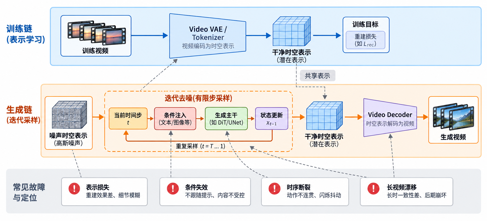
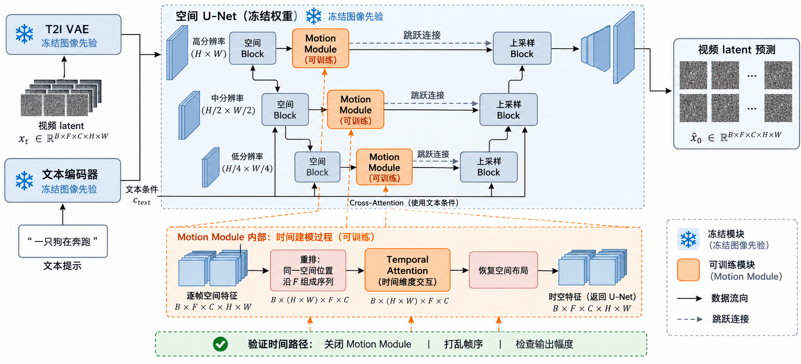
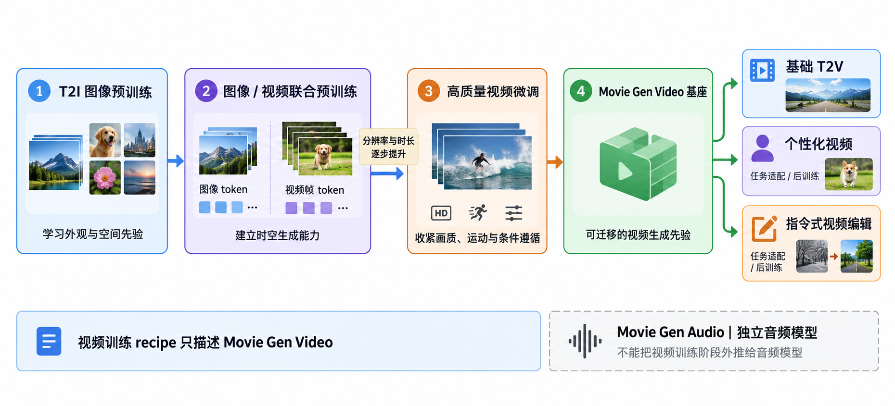
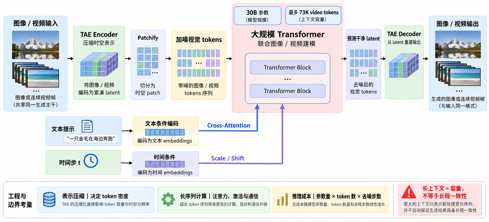
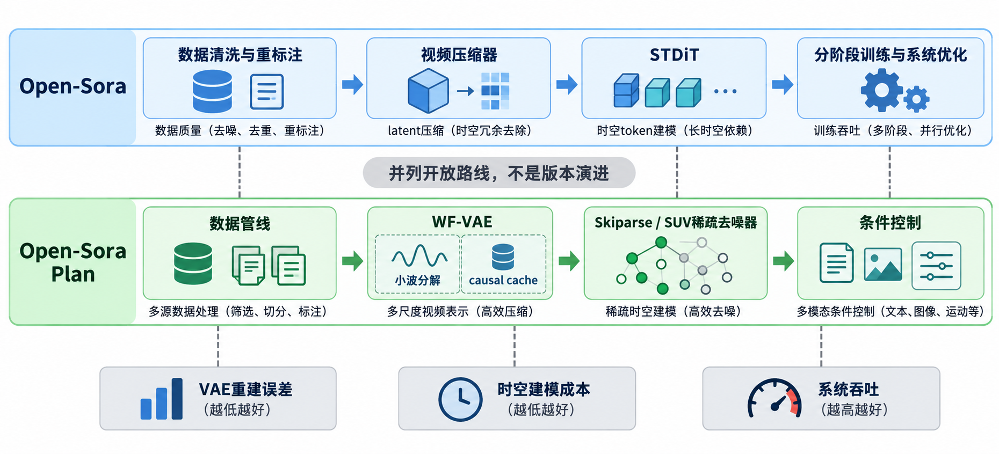
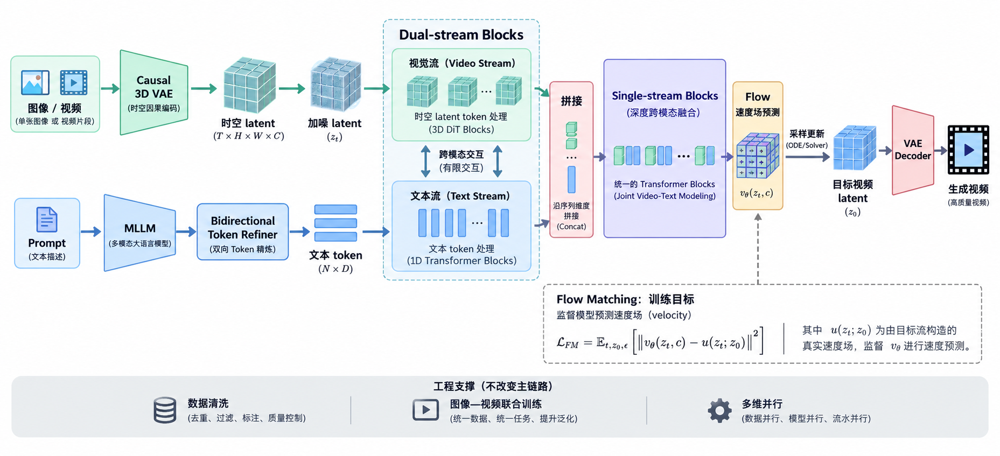
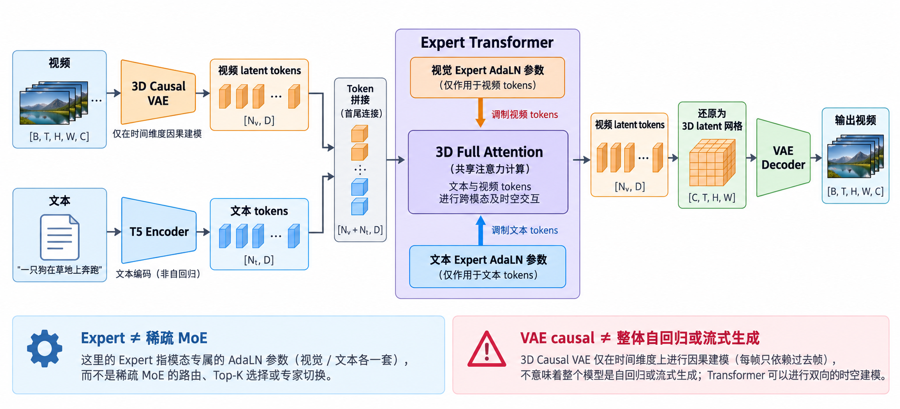
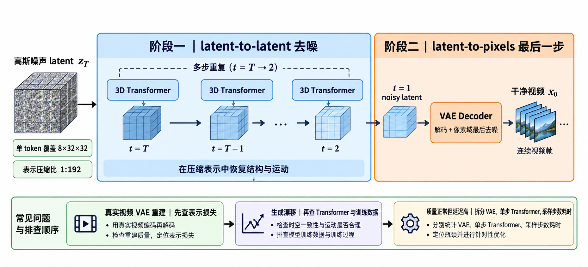
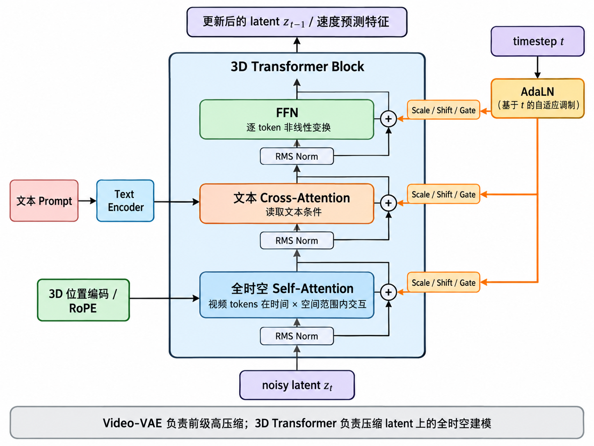
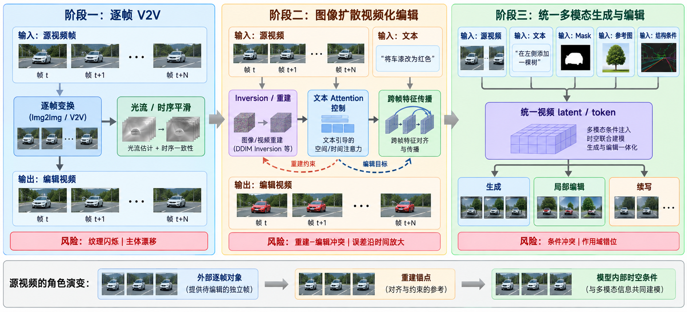

# 4.3 视频生成与编辑技术路线
> 💡 **本节目标**：系统梳理视频生成与编辑的任务范式、技术路线、代表模型和工业系统演进。重点是理解从图像模型视频化、原生视频基础模型到统一多模态生成与编辑系统的关键变化。

---

# 目录导航

[4.3.1 视频生成模型的任务坐标系：T2V、I2V、V2V 与统一多模态生成](#4.3.1_视频生成模型的任务坐标系：T2V、I2V、V2V-与统一多模态生成)
  - [4.3.1.1 面试问题：按主要输入条件，视频生成任务有哪些常见类型？](#4.3.1.1_面试问题：按主要输入条件，视频生成任务有哪些常见类型？)
  - [4.3.1.2 面试问题：视频续写、关键帧条件生成、视频修复与视频编辑的任务边界如何划分？](#4.3.1.2_面试问题：视频续写、关键帧条件生成、视频修复与视频编辑的任务边界如何划分？)
  - [4.3.1.3 面试问题：为什么接入一种输入条件，不等于模型真正具备对应的任务能力？](#4.3.1.3_面试问题：为什么接入一种输入条件，不等于模型真正具备对应的任务能力？)

[4.3.2 从图像扩散到视频扩散：经典技术路线如何演进](#4.3.2_从图像扩散到视频扩散：经典技术路线如何演进)
  - [4.3.2.1 面试问题：分析一条视频生成技术路线时，应该抓住哪些关键设计与取舍？](#4.3.2.1_面试问题：分析一条视频生成技术路线时，应该抓住哪些关键设计与取舍？)
  - [4.3.2.2 面试问题：图像模型视频化与原生时空建模的核心取舍是什么？](#4.3.2.2_面试问题：图像模型视频化与原生时空建模的核心取舍是什么？)

[4.3.3 图像先验复用与视频基座训练：AnimateDiff、运动定制与 SVD](#4.3.3_图像先验复用与视频基座训练：AnimateDiff、运动定制与-SVD)
  - [4.3.3.1 面试问题：AnimateDiff 的 Motion Module 如何插入图像扩散模型？](#4.3.3.1_面试问题：AnimateDiff-的-Motion-Module-如何插入图像扩散模型？)
  - [4.3.3.2 面试问题：为什么 AnimateDiff 的运动模块可以迁移到个性化 T2I 模型？](#4.3.3.2_面试问题：为什么-AnimateDiff-的运动模块可以迁移到个性化-T2I-模型？)
  - [4.3.3.3 面试问题：MotionLoRA 与 MotionDirector 如何实现运动定制？侧重点有什么不同？](#4.3.3.3_面试问题：MotionLoRA-与-MotionDirector-如何实现运动定制？侧重点有什么不同？)
  - [4.3.3.4 面试问题：AnimateDiff 与 SVD 在图像先验复用和视频训练上有何差异？](#4.3.3.4_面试问题：AnimateDiff-与-SVD-在图像先验复用和视频训练上有何差异？)

[4.3.4 闭源前沿模型路线：Sora、Veo 与 Movie Gen](#4.3.4_闭源前沿模型路线：Sora、Veo-与-Movie-Gen)
  - [4.3.4.1 面试问题：Sora 如何将图像与不同尺寸的视频纳入统一的训练与生成框架？](#4.3.4.1_面试问题：Sora-如何将图像与不同尺寸的视频纳入统一的训练与生成框架？)
  - [4.3.4.2 面试问题：Sora 为什么支持不同宽高比、分辨率和时长的训练数据？工程上有哪些组织难点？](#4.3.4.2_面试问题：Sora-为什么支持不同宽高比、分辨率和时长的训练数据？工程上有哪些组织难点？)
  - [4.3.4.3 面试问题：如何理解 Sora 的“世界模拟器”说法？公开视频展示了哪些能力，又有哪些局限？](#4.3.4.3_面试问题：如何理解-Sora-的“世界模拟器”说法？公开视频展示了哪些能力，又有哪些局限？)
  - [4.3.4.4 面试问题：Veo 3 的原生音视频生成如何实现？相比仅生成视频，新增了哪些建模与评估要求？](#4.3.4.4_面试问题：Veo-3-的原生音视频生成如何实现？相比仅生成视频，新增了哪些建模与评估要求？)
  - [4.3.4.5 面试问题：Veo 的首尾帧、多参考图、视频延展与对象插入，分别提供什么控制？这些能力是否意味着底层模型统一？](#4.3.4.5_面试问题：Veo-的首尾帧、多参考图、视频延展与对象插入，分别提供什么控制？这些能力是否意味着底层模型统一？)
  - [4.3.4.6 面试问题：Movie Gen 如何从视频生成基座扩展到个性化、视频编辑与音频生成？这些能力之间是什么关系？](#4.3.4.6_面试问题：Movie-Gen-如何从视频生成基座扩展到个性化、视频编辑与音频生成？这些能力之间是什么关系？)
  - [4.3.4.7 面试问题：Movie Gen Video 如何结合时空压缩、Transformer 与并行训练，支持大规模视频生成？](#4.3.4.7_面试问题：Movie-Gen-Video-如何结合时空压缩、Transformer-与并行训练，支持大规模视频生成？)
  - [4.3.4.8 面试问题：从 Sora、Veo 与 Movie Gen 的公开资料看，视频生成有哪些共同技术方向？哪些设计仍存在明显差异？](#4.3.4.8_面试问题：从-Sora、Veo-与-Movie-Gen-的公开资料看，视频生成有哪些共同技术方向？哪些设计仍存在明显差异？)

[4.3.5 开放视频生成模型的代表路线与设计取舍](#4.3.5_开放视频生成模型的代表路线与设计取舍)
  - [4.3.5.1 面试问题：Open-Sora 如何通过模型复用与分阶段训练控制视频模型的训练成本？](#4.3.5.1_面试问题：Open-Sora-如何通过模型复用与分阶段训练控制视频模型的训练成本？)
  - [4.3.5.2 面试问题：HunyuanVideo 如何处理文本条件，并通过双流到单流结构融合文本与视频？](#4.3.5.2_面试问题：HunyuanVideo-如何处理文本条件，并通过双流到单流结构融合文本与视频？)
  - [4.3.5.3 面试问题：Wan 如何组织不同规模与任务的模型？Wan2.1 与 Wan2.2 的代表性设计有何区别？](#4.3.5.3_面试问题：Wan-如何组织不同规模与任务的模型？Wan2.1-与-Wan2.2-的代表性设计有何区别？)
  - [4.3.5.4 面试问题：Step-Video 如何结合深压缩表示、大规模主干与后训练，并扩展到图生视频？](#4.3.5.4_面试问题：Step-Video-如何结合深压缩表示、大规模主干与后训练，并扩展到图生视频？)
  - [4.3.5.5 面试问题：CogVideoX 的 3D Causal VAE 与 Expert Transformer 如何配合？Expert 指什么？](#4.3.5.5_面试问题：CogVideoX-的-3D-Causal-VAE-与-Expert-Transformer-如何配合？Expert-指什么？)
  - [4.3.5.6 面试问题：CogVideoX 为什么采用混合时长、Multi-Resolution Frame Pack 与渐进分辨率训练？](#4.3.5.6_面试问题：CogVideoX-为什么采用混合时长、Multi-Resolution-Frame-Pack-与渐进分辨率训练？)
  - [4.3.5.7 面试问题：MiniMax-H3 如何利用多模态参考生成音视频？开放的 H3-Base 与完整生成流程有什么区别？](#4.3.5.7_面试问题：MiniMax-H3-如何利用多模态参考生成音视频？开放的-H3-Base-与完整生成流程有什么区别？)

[4.3.6 工业级视频生成路线：Seedance、Kling 与 LTX-Video](#4.3.6_工业级视频生成路线：Seedance、Kling-与-LTX-Video)
  - [4.3.6.1 面试问题：Seedance 路线如何兼顾多镜头、音视频、多模态控制与推理效率？](#4.3.6.1_面试问题：Seedance-路线如何兼顾多镜头、音视频、多模态控制与推理效率？)
  - [4.3.6.2 面试问题：Kling-Omni 如何统一视频生成、编辑与多模态推理？](#4.3.6.2_面试问题：Kling-Omni-如何统一视频生成、编辑与多模态推理？)
  - [4.3.6.3 面试问题：LTX-Video 如何通过高压缩表示和整体去噪实现低延迟生成？](#4.3.6.3_面试问题：LTX-Video-如何通过高压缩表示和整体去噪实现低延迟生成？)
  - [4.3.6.4 面试问题：开放视频基座走向工业系统，还需要补齐哪些环节？](#4.3.6.4_面试问题：开放视频基座走向工业系统，还需要补齐哪些环节？)

[4.3.7 视频编辑模型路线：从 V2V 重建到统一多模态编辑](#4.3.7_视频编辑模型路线：从-V2V-重建到统一多模态编辑)
  - [4.3.7.1 面试问题：视频编辑如何从逐帧 V2V 演进到统一的多模态生成与编辑？](#4.3.7.1_面试问题：视频编辑如何从逐帧-V2V-演进到统一的多模态生成与编辑？)
  - [4.3.7.2 面试问题：视频编辑为什么必须同时处理源视频重建、作用域定位与跨帧保持？](#4.3.7.2_面试问题：视频编辑为什么必须同时处理源视频重建、作用域定位与跨帧保持？)
  - [4.3.7.3 面试问题：inversion、attention 控制、时空 mask 与特征传播分别解决什么问题？](#4.3.7.3_面试问题：inversion、attention-控制、时空-mask-与特征传播分别解决什么问题？)


---

<h1 id="4.3.1_视频生成模型的任务坐标系：T2V、I2V、V2V-与统一多模态生成">4.3.1 视频生成模型的任务坐标系：T2V、I2V、V2V 与统一多模态生成</h1>

> 先把任务坐标摆清楚。看到一个视频模型时，先判断它是在从零生成、参考图驱动、源视频编辑，还是在做多模态统一生成。

<h2 id="4.3.1.1_面试问题：按主要输入条件，视频生成任务有哪些常见类型？">4.3.1.1 面试问题：按主要输入条件，视频生成任务有哪些常见类型？</h2>

**难度评分：⭐⭐⭐ (3/5)  |  考察频率：⭐⭐⭐⭐⭐ (5/5)**

常见类型包括**文生视频（T2V）、图生视频（I2V）和视频到视频（V2V）**，分别以文本、图像和视频作为主要输入。同一个模型可以支持多类任务，实际请求也可以组合多种输入条件。

**1、三类常见输入任务**

表3-1概括了三类常见任务。

<p align="center">表3-1 T2V、I2V 与 V2V 的主要输入及生成要求</p>

| 类型 | 主要输入 | 模型需要生成或改变什么 | 重点要求 |
| --- | --- | --- | --- |
| 文生视频（Text-to-Video，T2V） | 文本描述 | 根据描述生成主体、场景、动作和镜头变化 | 符合文本要求，画面与运动连贯 |
| 图生视频（Image-to-Video，I2V） | 图像，可结合文本等条件 | 在给定视觉信息基础上生成时间变化和新内容 | 按任务要求保持参考外观、场景或起始画面 |
| 视频到视频（Video-to-Video，V2V） | 输入视频，可结合指令或其他条件 | 对视频进行转换、修改或生成相关内容 | 明确哪些内容需要保留、哪些允许改变 |

例如，同样生成“一只猫向前奔跑”：

- **T2V**：只提供文字，猫的具体外观、背景和运动由模型生成。
- **I2V**：提供猫的图像，要求模型参考其外观或以该图作为起始画面生成运动。
- **V2V**：提供已有的猫奔跑视频，再要求改变背景、风格或其他指定内容。

视频输入也可以用于续写或修复等任务。这些任务的名称有时会单独列出，因此不能仅凭“V2V”判断具体操作。

**2、图像条件的作用与其他控制输入**

图像条件需要区分两种常见作用：

- **首帧条件**：指定期望的起始画面，并生成后续变化；是否严格保持首帧，还要看模型和实现。
- **参考图条件**：提供主体、外观或场景信息，不一定指定它在视频中的时间位置。

如果提供首尾帧或多个关键帧，就需要进一步说明这些图像对应哪些时间位置，具体边界留到下一题讨论。

此外，姿态、轨迹、音频等条件可以与文本、图像或视频组合使用。例如，人物参考图与语音共同驱动说话视频，既包含外观约束，也包含口型与音频同步要求。音频也可以成为主要输入，单独形成音频驱动视频生成任务。

**3、统一多模态生成与任务类型的关系**

统一多模态生成描述一个模型或一套模型体系对多种输入、输出和任务的支持。它可以覆盖 T2V、I2V、V2V，也可能支持音视频联合输出。描述具体能力时，仍需交代输入条件、任务目标和输出形式。

例如，Movie Gen 将文本生成视频、参考人物图像的个性化生成、视频编辑和音频生成作为不同能力进行组织，说明多模态体系可以覆盖多种任务，而不必将它们合并为一种输入类型。[Movie Gen 论文](https://arxiv.org/abs/2410.13720)

> **面试速答**：常见任务有 T2V、I2V 和 V2V，分别以文本、图像和视频作为主要输入。它们描述任务接口，同一个模型可以支持多类任务。分析时还要说明输入内容的作用、需要保留和改变什么，以及是否包含音频等其他条件；统一多模态生成则描述多种能力如何共同组织。

<h2 id="4.3.1.2_面试问题：视频续写、关键帧条件生成、视频修复与视频编辑的任务边界如何划分？">4.3.1.2 面试问题：视频续写、关键帧条件生成、视频修复与视频编辑的任务边界如何划分？</h2>

**难度评分：⭐⭐⭐⭐ (4/5)  |  考察频率：⭐⭐⭐ (3/5)**

视频续写主要延长已有内容，关键帧条件生成连接指定画面，补全修复填补指定区域，视频编辑则按要求修改已有内容。它们的边界取决于生成目标和保持要求，也可能在同一任务中组合使用。

**1、四类任务的目标与保持要求**

表3-2概括了它们的典型目标。这里的“视频修复”主要指缺失或被指定区域的补全修复，不泛指所有视频质量增强任务。

<p align="center">表3-2 视频续写、关键帧条件生成、视频补全修复与视频编辑的主要区别</p>

| 任务 | 已有输入 | 主要生成或修改内容 | 重点要求 |
| --- | --- | --- | --- |
| 视频续写 | 一段已有视频 | 在已有片段之后生成新内容 | 衔接处自然，主体、场景和事件状态能够延续 |
| 关键帧条件生成 | 指定时间位置的首尾帧或多个关键帧 | 生成连接关键画面的中间过程 | 符合关键帧要求，中间变化连贯合理 |
| 视频补全修复 | 视频及缺失、损坏或指定补全区域 | 补全相应时空区域 | 与周围画面和跨帧运动衔接，尽量保持其他内容 |
| 视频编辑 | 源视频，以及修改指令或其他条件 | 改变指定对象、属性、背景、风格或动作等 | 完成目标修改，同时保持任务要求保留的内容 |

例如，对于“一只猫在草地上奔跑”的视频：

- **续写**：已有前几秒，继续生成猫接下来的动作。
- **关键帧条件生成**：给出猫在左侧的起始画面和在右侧的结束画面，生成中间的奔跑过程。
- **补全修复**：画面中有一块缺失区域，结合邻近画面和其他帧补全内容。
- **编辑**：将草地改为雪地，同时尽量保持猫的外观和原有动作。

**2、任务之间的交叉与区别**

**（1）关键帧条件生成不等于普通插帧。**

普通插帧通常在已有相邻帧之间增加画面，以提高时间采样密度；关键帧条件生成可以面对间隔较长、变化较大的画面，需要生成更完整的动作或场景过渡。

关键帧表达的是目标约束，输出是否严格保持这些画面，还取决于模型与实现方式。

**（2）补全修复与编辑可以重叠。**

补全修复主要根据上下文填补指定区域；编辑强调按照目标要求改变内容。但同一个操作可能同时具有这两种性质。

例如，“移除视频中的路人”属于编辑任务，也可以通过标记路人区域、补全其后的背景来实现。

**（3）续写与关键帧条件也可以组合。**

已有视频提供起始上下文，再给出期望的结束画面，就同时包含延续已有内容和满足结束画面的要求。

描述具体任务时，应明确已有输入、生成或修改目标，以及需要保留的内容；同一请求可以同时包含续写、补全或编辑要求。

> **面试速答**：续写延长已有视频，关键帧条件生成连接指定画面，补全修复填补指定时空区域，编辑按要求改变已有内容。它们的区别主要在生成目标和保持要求，也可以交叉组合，例如对象移除既是编辑，也可通过补全实现。

<h2 id="4.3.1.3_面试问题：为什么接入一种输入条件，不等于模型真正具备对应的任务能力？">4.3.1.3 面试问题：为什么接入一种输入条件，不等于模型真正具备对应的任务能力？</h2>

**难度评分：⭐⭐⭐⭐ (4/5)  |  考察频率：⭐⭐⭐ (3/5)**

**条件信息能够进入模型计算，并不意味着模型会有效利用它。只有生成结果能够响应条件，并满足相应的内容保持和时间连续性要求，才能说明模型具备对应的任务能力。**

例如，模型接口允许输入人物参考图，不代表生成的人物就能在转头、遮挡和姿态变化后保持相同身份。需要验证参考信息是否在整个视频中得到有效利用。

**1、任务能力形成的条件**

**（1）条件表示保留必要信息。**

输入经过编码后，部分信息可能丢失。例如，参考图特征能够表达“一个穿红衣服的人”，但未必保留足够的面部细节，支持后续身份保持。

因此，需要检查编码结果是否保留了任务关注的外观、位置、时间或运动信息。

**（2）注入路径有效影响生成。**

条件需要通过适当的注意力、特征调制、拼接或控制分支影响生成。即使张量维度正确、计算能够运行，模型仍可能较少利用该条件，或将其作用到错误的时间和空间位置。

例如，区域掩码已经输入，但编辑仍影响整幅画面，说明“能够传入掩码”并不等于“能够准确限制修改范围”。

**（3）训练建立条件与输出的对应关系。**

新增条件接口通常需要相应训练或适配，使模型学会条件与输出之间的关系。

例如，主体保持需要模型在外观保持与姿态变化之间取得协调；音频驱动需要学习声音与口型的时间对应。仅具备图像输入能力，不能自动获得这些任务能力。

**2、条件控制能力的验证**

可以固定一组随机种子和其他条件，比较原条件、替换条件，以及在模型支持时移除条件后的结果：

- **目标是否按要求变化。** 例如，改变姿态条件后，人物动作是否相应改变。
- **要求保留的内容是否稳定。** 例如，局部编辑后，非编辑区域是否尽量保持。
- **视频中的响应是否持续、连贯。** 例如，人物身份是否只在首帧相似，随后逐渐漂移；口型是否只在部分片段与语音同步。

判断时需要考虑合理的连带变化。例如，改变动作可能同时改变遮挡和阴影，不能将所有非目标变化都视为控制失败。

如果条件改变后结果几乎不变，应进一步检查条件表示、注入路径和其他条件是否冲突；仅凭一次结果，不能确定原因。最终需要在多个样本和随机种子上，结合任务指标与人工观察判断。

> **面试速答**：接口支持某种条件，不代表模型具备对应任务能力。还需要条件表示保留必要信息、注入路径能够有效影响生成，以及训练建立条件与目标的联系。验证时应替换或移除条件，检查目标是否按要求变化、应保留内容是否稳定，以及这种控制能否在视频中持续生效。

<h1 id="4.3.2_从图像扩散到视频扩散：经典技术路线如何演进">4.3.2 从图像扩散到视频扩散：经典技术路线如何演进</h1>

> VAE、LDM、DiT、时序建模和条件注入已经在 4.2 中介绍。本节从模型路线角度出发，分析这些模块如何组合成不同的视频生成系统。

<h2 id="4.3.2.1_面试问题：分析一条视频生成技术路线时，应该抓住哪些关键设计与取舍？">4.3.2.1 面试问题：分析一条视频生成技术路线时，应该抓住哪些关键设计与取舍？</h2>

**难度评分：⭐⭐⭐⭐ (4/5)  |  考察频率：⭐⭐⭐⭐ (4/5)**

视频生成技术路线的差异，主要体现在视频表示、时空主干、条件控制、训练方案和推理过程上。分析时，需要结合目标任务，说明这些设计为什么采用、改善了什么能力，以及增加了哪些成本或限制。

**1、视频表示与压缩**

视频可以直接在像素空间中建模，也可以先编码为连续潜变量或离散 token。采用压缩表示时，需要关注空间和时间压缩程度，以及重建后的细节和运动是否得到保留。

更紧凑的表示通常能减少主干计算，但压缩过强可能损伤文字、小物体和短暂动作。因此，需要同时比较计算收益与重建损失。

**2、主干结构与跨帧交互**

主干可以采用 U-Net、DiT 或其他结构，需要进一步分析不同时间、不同空间位置之间的信息交互方式。

保留图像主干、增加时间模块，可以继承已有的空间处理能力；但新增模块需要适配原有特征和网络接口。扩大时空交互范围，可以让更多位置直接交换信息，同时也可能增加计算和显存开销。

重点是确定跨帧信息传递的范围，以及它如何支持目标任务，不能仅凭“使用 Transformer”判断运动建模能力。

**3、条件输入与控制范围**

条件控制需要关注文本、参考图、源视频、姿态或轨迹等信息的编码与注入方式，以及模型如何表达需要保留和允许改变的内容。

例如，参考图用于提供主体外观，与将图像作为严格保持的首帧，对条件接口和保持机制的要求不同。

因此，需要将条件接入方式与实际任务能力对应起来，判断它能控制什么、控制范围有多精确。

**4、预训练与任务适配**

训练路线包括预训练权重的来源、参与更新的模块、训练数据，以及视频预训练和任务适配的阶段安排。

冻结图像主干、只训练新增时间模块，可以减少训练参数和相关开销，但限制了原有特征的调整；联合训练整个网络，调整空间更大，通常也需要更多训练资源。

数据的运动分布、片段长度、帧率及标注质量，同样会影响模型能够学到的能力。分析训练方案时，应解释这些选择怎样服务于目标任务。

**5、生成目标与推理方式**

对于本节讨论的扩散与流模型，需要明确模型预测的是噪声、干净表示还是速度，以及推理时怎样利用预测更新状态。还应区分整段生成与分段延续，分析后者如何保持片段之间的衔接。

还要结合采样步数、条件引导和编解码成本，判断最终的质量、显存及延迟。相同主干可以配合不同训练目标；相同步数，也不一定对应相同计算成本。

图3-1展示了视频表示、条件输入、生成主干和解码之间的关系，可辅助理解这些设计在流程中的位置。

<div align="center">
  
  <p>图3-1 视频生成技术路线的核心链路与故障定位</p>
</div>

对设计收益的判断，应结合明确的评测任务和运行条件。展示效果可以说明部分能力，但不足以证明具体设计的贡献；公开资料没有说明的实现细节，也不宜自行补全。

> **面试速答**：分析视频生成技术路线时，需要结合目标任务，考察视频表示、时空主干、条件控制、训练方式和推理过程。重点说明这些设计如何影响生成能力、计算成本和适用范围，并结合实际评测判断其收益与局限。

<h2 id="4.3.2.2_面试问题：图像模型视频化与原生时空建模的核心取舍是什么？">4.3.2.2 面试问题：图像模型视频化与原生时空建模的核心取舍是什么？</h2>

**难度评分：⭐⭐⭐⭐⭐ (5/5)  |  考察频率：⭐⭐⭐⭐ (4/5)**

两者代表不同的设计侧重点：**图像模型视频化侧重复用已有图像生成能力，再补充跨帧建模；原生时空建模侧重围绕视频的空间与时间关系，整体安排表示、网络和训练。** 两种思路可以结合，不能仅凭名称判断生成质量或能力上限。

**1、两种思路分别怎样实现？**

**图像模型视频化**通常以预训练图像生成模型为基础，保留其空间处理层，增加时间卷积、时间注意力等结构，再用视频数据训练。

这种方式复用了图像模型已经学到的对象外观、纹理、构图和文本对应能力，也就是常说的**图像先验**。例如，AnimateDiff 训练运动模块，再将其接入源自同一图像基座的兼容个性化模型，使已有外观生成能力能够与运动生成结合。[AnimateDiff 论文](https://arxiv.org/abs/2307.04725)

**原生时空建模**则将视频作为整体学习对象，在表示、跨帧交互和训练数据组织上共同考虑空间与时间关系。例如，设计视频压缩表示，在多个时间位置之间交换信息，并使用视频片段学习动作与状态变化。

这里的“原生”不要求全部参数从零初始化，也不排除图像数据或图像权重。它强调的是视频建模在整体设计中的地位。

**2、核心取舍体现在哪里？**

<p align="center">表3-3 图像模型视频化与原生时空建模的设计取舍</p>

| 比较维度 | 侧重图像模型视频化 | 侧重原生时空建模 |
| --- | --- | --- |
| 复用基础 | 尽量保留已有图像主干及配套能力 | 根据视频需求决定复用或调整哪些部分 |
| 结构改动 | 通常在已有空间结构中增加时间模块 | 可以联合安排视频表示、空间处理与时间交互 |
| 训练投入 | 冻结部分主干、主要训练新增模块时，可减少训练参数及相关开销 | 联合调整更多模块时，需要相应的数据与训练预算 |
| 主要取舍 | 兼顾原模型兼容性与新增时间能力，部分改造受已有接口限制 | 设计自由度较大，但需要验证各模块能否有效协同 |
| 适配重点 | 已有模型的风格、个性化能力和控制模块能否保留 | 目标运动、时间跨度与条件控制是否得到充分训练 |

时间模块加入得较少，可能限制跨帧信息的利用；整体改造范围较大，则会增加训练和验证工作。两者都需要用实际结果判断，不能将“改动更多”等同于“效果更好”。

**3、实际如何选择与结合？**

已有成熟图像模型、需要保留其个性化能力时，可以优先评估增加时间模块的方案。如果原有接口或时间交互范围不能满足任务，再考虑扩大联合训练范围，或调整视频表示和主干结构。

对于复杂运动或长时间状态保持，需要重点检查跨帧信息能否有效传递、训练数据是否覆盖目标变化，以及计算成本是否可接受。即使采用“原生视频”设计，这些能力也需要训练和评测支持。

实际路线常将图像预训练与视频训练结合。例如，SVD 将训练分为图像预训练、视频预训练和高质量视频微调，利用已有图像能力，再逐步学习视频生成。[SVD 论文](https://arxiv.org/abs/2311.15127)

此外，U-Net、DiT 是主干结构名称，与上述设计侧重点并不一一对应：两类主干都可以复用图像权重，也都可以进行视频训练。

> **面试速答**：图像模型视频化侧重复用已有外观生成能力，通过新增时间结构学习跨帧关系；原生时空建模更强调围绕视频整体安排表示、网络和训练。核心取舍是保留多少已有能力、允许多大改造，以及能够投入多少视频数据和训练资源。两者可以结合，实际能力应根据结构、训练和评测判断。

<h1 id="4.3.3_图像先验复用与视频基座训练：AnimateDiff、运动定制与-SVD">4.3.3 图像先验复用与视频基座训练：AnimateDiff、运动定制与 SVD</h1>

> 本节比较已有图像能力如何用于视频生成：AnimateDiff 训练可复用的时间模块，MotionLoRA 和 MotionDirector 研究运动定制，SVD 则通过分阶段视频训练得到可继续适配的模型。

<h2 id="4.3.3.1_面试问题：AnimateDiff-的-Motion-Module-如何插入图像扩散模型？">4.3.3.1 面试问题：AnimateDiff 的 Motion Module 如何插入图像扩散模型？</h2>

**难度评分：⭐⭐⭐⭐ (4/5)  |  考察频率：⭐⭐⭐⭐⭐ (5/5)**

AnimateDiff 在预训练图像扩散模型的 U-Net 中插入**运动模块（Motion Module）**，让原本逐帧处理的空间特征能够沿时间维交换信息。VAE、文本编码器和原有空间层继续复用，新增模块负责补充跨帧联系。

**1、运动模块怎样处理空间特征？**

原有二维空间层仍然独立处理每一帧。实现时，可以将视频的批量维与帧维合并，把各帧作为图像送入空间层，再恢复视频维度。

假设某一层的视频特征为 $[B,C,T,H,W]$，进入运动模块时，可以将其组织为：

```math
[B,C,T,H,W]
\;\longrightarrow\;
[BHW,T,C]
```

其中， $B$ 是批量大小， $T$ 是帧数， $H$、 $W$ 是当前特征图的空间尺寸， $C$ 是通道数。

这种组织方式将每个空间坐标对应的多帧特征组成一条长度为 $T$ 的序列。运动模块使用时间 Transformer，在序列中进行自注意力计算，并通过时间位置编码区分帧序。处理后，再将特征恢复为原来的视频形状，继续传入后续 U-Net 层。

因此，空间层负责帧内信息处理，运动模块负责跨帧信息交互。沿相同坐标交换信息并不等于追踪同一对象，对象移动还需要空间层与时间模块配合建模。

图3-2展示了运动模块的插入位置及特征流。

<div align="center">
  
  <p>图3-2 AnimateDiff 的 Motion Module 插入位置与时空特征流</p>
</div>

**2、怎样接入预训练模型并进行训练？**

运动模块采用残差连接，将时间处理分支的输出加回输入特征。论文将该分支的输出投影层零初始化，使新增模块在训练开始时近似保持输入不变，减少随机初始化对原有空间特征的干扰。

在运动模块训练阶段，原有图像模型参数保持冻结，使用视频数据更新运动模块。模型根据带噪的视频潜变量和文本条件预测噪声，通过视频去噪训练学习跨帧变化；它不需要显式输出光流。

这里的“冻结主干”表示主干参数不更新，主干仍参与生成计算。论文中的域适配器和可选 MotionLoRA 属于其他训练阶段，不应与运动模块训练混为一谈。[AnimateDiff 原论文](https://arxiv.org/html/2307.04725v2#S4)

> **面试速答**：AnimateDiff 在图像 U-Net 的多个分辨率层插入运动模块。空间层逐帧处理特征，运动模块将同一空间坐标的多帧特征组成时间序列，通过时间注意力建立联系，再恢复原形状。模块采用残差连接和零初始化输出投影，训练时冻结原有图像参数，利用视频去噪目标学习新增的时间能力。

<h2 id="4.3.3.2_面试问题：为什么-AnimateDiff-的运动模块可以迁移到个性化-T2I-模型？">4.3.3.2 面试问题：为什么 AnimateDiff 的运动模块可以迁移到个性化 T2I 模型？</h2>

**难度评分：⭐⭐⭐⭐ (4/5)  |  考察频率：⭐⭐⭐⭐ (4/5)**

AnimateDiff 的迁移主要面向**来自同一图像生成基座、保留兼容 U-Net 结构的个性化模型**。这些模型通常经过主体或风格适配，改变了生成外观，但仍保留运动模块所需的插入位置和特征接口。

因此，在基础模型上训练好的运动模块，可以接入这些兼容模型，为其增加跨帧信息交互，而不必为每个个性化模型重新训练一套运动模块。这是论文设计和实验验证的主要目标。[AnimateDiff 原论文](https://arxiv.org/html/2307.04725v2)

**1、为什么同一基座的模型能够复用运动模块？**

**（1）网络结构和特征接口保持兼容。**

运动模块插入 U-Net 的中间层，处理这些层输出的特征。同一基座的个性化模型通常保留相同的层级和通道配置，因此模块能够在对应位置接收、处理并返回特征。

例如，一个基于某图像基座训练的卡通风格模型，如果保留相应结构，就可以接入为该基座训练的运动模块，无须重新设计时间层的输入输出。

**（2）外观适配与时间能力采用不同的参数路径。**

个性化图像模型主要提供目标主体或风格的生成能力；运动模块则通过视频训练，学习如何利用不同帧的特征共同完成去噪。

训练运动模块时，原有图像参数保持冻结，有助于保留供后续复用的空间处理基础。迁移时，将同一个运动模块与不同的兼容个性化模型组合，就可以复用已学到的跨帧处理方式。

这是一种有用的分工，但外观与运动并不完全独立。运动模块仍然依赖空间特征，生成结果也会受到主体形态、风格和训练视频分布的影响。

**2、迁移时需要确认什么？**

- **结构与版本是否匹配。** 核对图像基座、U-Net 层级、通道数和运动模块的插入位置，不能直接假定不同基座的模块可以互换。
- **接入后是否保留个性化效果。** 检查主体身份、目标风格和画面细节，判断运动模块是否引入明显退化。结构兼容并不保证效果相同。
- **目标运动是否得到支持。** 模块在常见短片段上有效，不代表能够稳定处理复杂动作、强遮挡或长时间状态保持，需要针对目标任务评估。

如果个性化训练明显改变了中间特征，运动模块的适配效果可能下降；但是否下降，应通过接入前后的对照判断，不能只根据微调方式或权重合并次数推断。

> **面试速答**：AnimateDiff 面向同一图像基座的兼容个性化模型复用运动模块。它们保留相近的 U-Net 结构和特征接口，运动模块因此可以在对应层提供跨帧交互，无须逐个重新训练。外观与运动并非完全独立，迁移后仍需检查个性化效果、画质和目标运动，不能将结构兼容等同于能力保证。

<h2 id="4.3.3.3_面试问题：MotionLoRA-与-MotionDirector-如何实现运动定制？侧重点有什么不同？">4.3.3.3 面试问题：MotionLoRA 与 MotionDirector 如何实现运动定制？侧重点有什么不同？</h2>

**难度评分：⭐⭐⭐⭐ (4/5)  |  考察频率：⭐⭐⭐⭐ (4/5)**

运动定制是从参考视频中学习某种运动模式，再将其用于新的生成内容。MotionLoRA 与 MotionDirector 都采用低秩适配，但前者侧重在 AnimateDiff 的运动模块上高效适配新模式，后者更关注定制运动时如何减少参考外观的干扰。

**1、MotionLoRA：在已有运动模块上适配新运动。**

AnimateDiff 的运动模块已经通过视频训练获得一般的跨帧处理能力。MotionLoRA 在其时间自注意力层中加入可训练的低秩权重增量，冻结原有参数，再用少量参考视频进行适配。

这样，无须重新训练整个运动模块，就能学习特定运动模式。论文主要展示了镜头推进、拉远、平移和旋转等效果，也展示了组合不同 MotionLoRA 权重的用法。[AnimateDiff 论文](https://arxiv.org/html/2307.04725v2#S4.SS3)

因此，MotionLoRA 的重点是复用已有运动能力，减少新模式的训练参数和权重存储开销。能够组合权重，不代表任意运动组合都能稳定实现。

**2、MotionDirector：减少运动学习对参考外观的依赖。**

少量参考视频往往同时包含固定的人物、背景和动作。直接适配时，模型可能将这些信息一起学入，导致生成目标动作时，也带入参考视频的人物外观或场景。

例如，希望学习“挥手”，再换成另一位人物和新的背景；如果输出仍反复出现参考人物的服装或原背景，就可能存在外观混入。

MotionDirector 在预训练视频扩散模型上使用两条学习路径：

- **空间 LoRA**主要拟合参考视频的外观；
- **时间 LoRA**主要学习跨帧运动变化。

它还设计了减少外观偏差的时间损失，降低外观信息对运动训练目标的干扰。推理时，可以加载学到的时间 LoRA，让基础模型在不同外观条件下生成定制运动。[MotionDirector 项目说明](https://showlab.github.io/MotionDirector/)

这种分工旨在改善运动复用，并不意味着外观与运动已经完全独立。

**3、两者的区别应怎样理解？**

MotionLoRA 依托 AnimateDiff 已有的运动模块，强调新运动模式的轻量适配；MotionDirector 则通过空间与时间 LoRA 的分工及相应损失，改善运动向不同外观迁移的效果。

两者都需要检查目标运动是否学到、提示词指定的主体与场景是否保留，以及结果是否连续。少量参数降低了适配开销，但运动复杂度、参考数据和基础模型能力仍会限制最终效果。

> **面试速答**：MotionLoRA 在 AnimateDiff 的时间注意力层上训练低秩增量，以较小开销适配新的运动模式。MotionDirector 使用空间和时间 LoRA 分别学习外观与运动，并通过减少外观偏差的时间损失，改善运动在不同主体和场景中的复用。两者都属于运动定制，分别更强调适配效率与外观、运动分离的训练设计。

参考资料：[AnimateDiff / MotionLoRA](https://arxiv.org/abs/2307.04725)、[MotionDirector](https://arxiv.org/abs/2310.08465)

<h2 id="4.3.3.4_面试问题：AnimateDiff-与-SVD-在图像先验复用和视频训练上有何差异？">4.3.3.4 面试问题：AnimateDiff 与 SVD 在图像先验复用和视频训练上有何差异？</h2>

**难度评分：⭐⭐⭐⭐ (4/5)  |  考察频率：⭐⭐⭐⭐⭐ (5/5)**

两者都利用预训练图像扩散模型，并增加时间处理结构。**AnimateDiff 侧重保留图像主干，训练能够重复接入兼容模型的运动模块；SVD 则侧重通过分阶段视频训练，得到可继续适配的视频模型。**

这里的 SVD 指 Stable Video Diffusion 论文中的整体训练路线，不仅指某个已发布的图生视频权重。

**1、图像能力怎样保留和参与视频学习？**

AnimateDiff 在运动模块训练阶段冻结图像主干，将视频训练的参数更新集中在新增模块中。这样，已有图像模型的空间处理参数得到保留，训练好的运动模块还可以接入同一基座下的兼容个性化模型。

SVD 从图像预训练模型出发，加入时间卷积和时间注意力，将图像能力作为视频模型的初始化基础。在论文的视频训练设置中，空间层也参与更新，使原有空间处理与新增时间处理共同适应视频数据。[SVD 训练说明](https://arxiv.org/html/2311.15127v1#A5.S2.SS1)

两者的区别因此不只是“有没有时间层”，还包括是否保留原有空间参数，以及训练结果准备怎样复用。

**2、视频训练怎样组织？**

表3-4概括了两者的主要差异。

<p align="center">表3-4 AnimateDiff 与 SVD 的图像能力复用及视频训练差异</p>

| 比较维度 | AnimateDiff | SVD 论文路线 |
| --- | --- | --- |
| 图像能力的利用 | 保留图像主干参数，学习新增时间模块 | 用图像预训练初始化，再通过视频训练调整模型 |
| 视频训练的更新范围 | 运动模块阶段主要更新运动模块，其他参数冻结 | 视频训练允许空间层与时间层共同更新 |
| 训练组织重点 | 学习可迁移运动模块，并可进一步训练 MotionLoRA | 图像预训练、视频预训练、高质量视频微调 |
| 数据处理重点 | 学习跨帧变化，同时减少视频外观分布对复用的干扰 | 通过视频筛选、标注和分阶段训练改善视频生成 |
| 训练结果的复用 | 将运动模块接入兼容的个性化图像模型 | 在视频模型基础上继续进行任务适配 |

AnimateDiff 修订版还引入域适配器，处理视频训练数据与图像预训练数据之间的外观差异；运动模块和 MotionLoRA 的训练各有对应阶段。因此，“只训练运动模块”应限定在该阶段，而不是概括整个方法。[AnimateDiff 论文](https://arxiv.org/html/2307.04725v2#S4)

SVD 则强调视频数据与训练阶段的配合：先利用图像预训练获得空间生成能力，再通过视频预训练学习跨帧变化，最后使用经过筛选的高质量视频继续微调。论文进一步展示了图生视频、镜头运动和多视角等适配方向；这些能力涉及相应训练，并非基座权重自动具备全部能力。[SVD 论文](https://arxiv.org/html/2311.15127v1#S4)

**3、这些差异对复用有什么影响？**

如果需要为多个同源个性化图像模型增加运动，AnimateDiff 的模块化方式更直接，但需要确认结构兼容及迁移效果。

如果准备围绕一个已训练的视频模型继续适配任务，可以评估 SVD 路线，利用其视频训练得到的表示与参数。

训练成本应结合具体范围比较：训练一个新增模块、训练完整视频基座，以及使用现成权重进行适配，是不同投入，不能仅凭方法名称判断哪个更便宜或效果更好。

> **面试速答**：AnimateDiff 在运动模块训练时冻结图像主干，重点获得可接入同源个性化模型的时间模块；SVD 利用图像预训练初始化，通过视频预训练和高质量微调，使空间与时间处理共同适应视频数据。前者侧重运动模块复用，后者侧重视频模型及其后续适配，成本和效果需要结合具体训练范围判断。

参考资料：[AnimateDiff](https://arxiv.org/abs/2307.04725)、[Stable Video Diffusion](https://arxiv.org/abs/2311.15127)

<h1 id="4.3.4_闭源前沿模型路线：Sora、Veo-与-Movie-Gen">4.3.4 闭源前沿模型路线：Sora、Veo 与 Movie Gen</h1>

> 本节关注闭源前沿模型。由于完整训练细节并未开源，分析时不应过度推断实现细节，而应基于官方明确披露的表示方式、主干范式、条件接口、音视频能力和系统边界进行判断。

<h2 id="4.3.4.1_面试问题：Sora-如何将图像与不同尺寸的视频纳入统一的训练与生成框架？">4.3.4.1 面试问题：Sora 如何将图像与不同尺寸的视频纳入统一的训练与生成框架？</h2>

**难度评分：⭐⭐⭐⭐ (4/5)  |  考察频率：⭐⭐⭐⭐⭐ (5/5)**

以下讨论基于 OpenAI 于 2024 年发布的 Sora 技术报告。其核心做法是：**将图像和视频转换为同一种视觉 token 表示，再由同一个扩散 Transformer 学习生成。**

**1、用时空 patch 表示图像和视频**

Sora 先通过视觉压缩网络，将视频编码为在时间和空间上经过压缩的潜变量，再从中提取时空 patch（spacetime patches），作为 Transformer 处理的 token。一个时空 patch 对应潜变量中一段时间、一块空间区域的数据。

图像可以视为只有一帧的视频，也采用这套表示。这样，图像与视频都能转换为同一种 token 序列；分辨率、宽高比和时长不同，序列的长度与对应的时空布局也可以不同。

这里需要区分压缩与切块：压缩网络负责得到更紧凑的视觉表示，切块负责组织 Transformer 的输入，不能将 patch 变大直接等同于压缩损失增加。

关于潜空间压缩的作用，参见 [4.2.2.1「为什么视频生成通常在潜空间中进行？VAE 在其中承担什么作用？」](02_AI视频生成核心架构.md#4.2.2.1_面试问题：为什么视频生成通常在潜空间中进行？VAE-在其中承担什么作用？)；关于切块、token 化及输出还原，参见 [4.2.4.2「视频 DiT 如何处理时空潜变量？有哪些规模化优势与限制？」](02_AI视频生成核心架构.md#4.2.4.2_面试问题：视频-DiT-如何处理时空潜变量？有哪些规模化优势与限制？)。这些题目介绍通用架构原理，不代表 Sora 已公开确认采用其中列举的具体 VAE 实现。

**2、用共同的生成主干学习不同视觉数据**

转换为共同表示后，图像和视频可以参与同一个扩散 Transformer 的训练。模型接收带噪的时空 patch 和文本等条件，学习预测对应的干净 patch。

统一表示不要求所有样本具有相同的 token 数。例如，单张图像与一段视频可以采用相同的 token 表示方式，同时保留各自的时空尺寸。

生成时，按照目标时空尺寸组织噪声 patch，经多步去噪得到生成的潜变量，再由解码器还原为图像或视频。因此，同一模型可以面向不同的输出尺寸，而不必为每种尺寸单独建立一套生成主干。

**3、这条路线的意义与边界**

这套设计让图像、视频和不同尺寸的视觉数据能够共享表示与生成主干，支持联合训练，也为灵活选择输出尺寸提供了基础。保留原始宽高比的收益，以及可变尺寸训练的数据组织问题，参见 [4.3.4.2「Sora 为什么支持不同宽高比、分辨率和时长的训练数据？工程上有哪些组织难点？」](#4.3.4.2_面试问题：Sora-为什么支持不同宽高比、分辨率和时长的训练数据？工程上有哪些组织难点？)。

但共同表示并不保证不同数据之间一定产生同等程度的训练收益，也不意味着模型自动获得所有图像与视频任务的能力。具体任务仍需要相应的条件处理和训练设计。报告没有披露完整模型与实现细节，因此不能据此断定 Sora 采用了某种具体的组批、注意力或并行方案。

> **面试速答**：Sora 将图像视为单帧视频，通过视觉压缩和时空切块，把图像与不同尺寸的视频转换为共同的 token 表示，再用同一个扩散 Transformer 学习生成。不同样本可以有不同的 token 数和时空布局；生成时按目标尺寸组织噪声 patch，逐步去噪并解码。这使图像与视频能够联合训练，并由同一模型生成不同尺寸的内容。

参考资料：[OpenAI《Video generation models as world simulators》（2024）](https://openai.com/index/video-generation-models-as-world-simulators/)

<h2 id="4.3.4.2_面试问题：Sora-为什么支持不同宽高比、分辨率和时长的训练数据？工程上有哪些组织难点？">4.3.4.2 面试问题：Sora 为什么支持不同宽高比、分辨率和时长的训练数据？工程上有哪些组织难点？</h2>

**难度评分：⭐⭐⭐⭐ (4/5)  |  考察频率：⭐⭐⭐⭐ (4/5)**

以下讨论基于 OpenAI 于 2024 年发布的 Sora 技术报告。上一题说明了不同尺寸的数据如何进入共同的建模框架，本题进一步讨论：**为什么保留这些差异，以及训练时需要付出什么代价。**

**1、为什么不把所有视频统一裁成相同尺寸？**

**（1）减少裁剪对构图和内容的破坏。**

将横屏、竖屏视频都裁成正方形，可能截掉人物、物体或交互区域，改变主体与场景的关系。Sora 报告中的对比表明，保留原始宽高比训练，有助于改善生成画面的取景与构图，减少主体只呈现一部分的情况。

**（2）让同一模型覆盖不同输出需求。**

横屏、竖屏、不同分辨率和时长都有实际用途。结合上一题的可变时空表示，同一模型可以面向多种输出尺寸，而不必只围绕一种固定规格训练和生成。[Sora 技术报告](https://openai.com/index/video-generation-models-as-world-simulators/)

这里的“原始尺寸训练”不宜理解为完全不做预处理。公开报告没有交代完整的数据处理流程，不能据此断定所有视频都原封不动地进入模型。

**2、可变尺寸数据如何组织训练？**

以下是通用工程思路，Sora 报告没有披露其具体实现。

**（1）将尺寸相近的样本分桶。**

把宽高比、分辨率和帧数相近的样本放入同一批，减少为了对齐尺寸而增加的填充计算。例如，横屏长视频与竖屏短视频可以分别组织批次。

**（2）根据计算预算安排每批样本。**

固定样本数可以使用，但不同批次的显存和耗时可能差异较大。可以结合 token 数、序列长度和实际显存占用调整批量，通常让长视频或高分辨率视频每批更少，短视频或低分辨率视频每批更多。

**（3）控制多卡之间的负载差异。**

如果不同设备分到的样本计算量相差很大，较快的设备就需要等待较慢的设备。分配数据时应参考预计计算量或实际耗时，不能只平均样本数；token 数可以作为估计依据，但不一定足以反映全部开销。

**（4）检查不同尺寸样本对训练的贡献。**

需要明确希望模型学习怎样的分辨率与时长分布，再检查采样比例和损失归一化方式。例如，按 token 计算平均损失与先对每个样本求平均，会使长短样本对训练产生不同影响，是否调整应由训练目标决定。

> **面试速答**：保留不同宽高比可以减少裁剪对内容与构图的破坏，支持不同分辨率和时长则让同一模型覆盖更多输出需求。代价是样本的 token 数、显存和计算量不一致，工程上可以通过尺寸分桶、调整批量和负载均衡组织训练，并检查采样与损失权重。这些是通用方案，不能直接当作 Sora 已公开的内部实现。

参考资料：[OpenAI《Video generation models as world simulators》（2024）](https://openai.com/index/video-generation-models-as-world-simulators/)

<h2 id="4.3.4.3_面试问题：如何理解-Sora-的“世界模拟器”说法？公开视频展示了哪些能力，又有哪些局限？">4.3.4.3 面试问题：如何理解 Sora 的“世界模拟器”说法？公开视频展示了哪些能力，又有哪些局限？</h2>

**难度评分：⭐⭐⭐⭐ (4/5)  |  考察频率：⭐⭐⭐⭐ (4/5)**

以下讨论基于 OpenAI 于 2024 年发布的 Sora 技术报告。报告将规模化视频生成视为通向世界模拟器的一条可能路径。**应将这一说法理解为研究方向与部分能力的展示，不能直接等同于已经获得可靠的通用物理模拟能力。**

**1、为什么视频生成会与“世界模拟”联系起来？**

视频不仅包含物体的外观，还包含物体如何移动、相互作用，以及动作发生后场景如何变化。为了生成连贯的视频，模型需要预测这些变化在画面中的表现。

Sora 报告展示了几类相关现象：

- **一定的三维一致性。** 镜头移动时，人物与场景元素能够呈现相对连贯的空间关系。
- **一定的对象持续性。** 主体被遮挡或离开画面后，再次出现时有时仍能保持外观。
- **简单状态变化的延续。** 例如，画笔留下的笔迹可以在后续画面中保留。

这些现象为“视频模型能够学习部分世界动态规律”提供了初步证据，但尚不足以确定模型内部采用了怎样的表示和推理机制。[Sora 技术报告](https://openai.com/index/video-generation-models-as-world-simulators/)

**2、为什么这些表现还不足以证明可靠的物理模拟能力？**

**（1）画面逼真不保证变化过程正确。**

纹理、光照和镜头效果可以很逼真，但物体碰撞、破碎或进食后的状态变化仍可能出错。报告也明确列出了物理交互和长时间一致性方面的局限。[Sora 技术报告](https://openai.com/index/video-generation-models-as-world-simulators/)

**（2）个别成功样例不说明能力稳定。**

一次遮挡后保持正确，不代表不同主体、遮挡时长和视角下都能保持。需要在明确条件下重复测试，统计成功率与失败类型，才能判断能力范围。

**（3）输出表现不能直接证明内部机制。**

正确的视频可能涉及模型学到的运动与空间关系，也可能依赖训练数据中常见的视觉模式。仅凭公开视频，难以判断模型是否形成了可泛化的物体状态表示或因果机制；同样，也不能因为出现错误就断言这些表示完全不存在。

关于输出层面的具体检查，参见 [4.1.7.2「视频生成中，几何一致性、物理合理性与因果连续性分别约束什么？如何评估？」](01_AI视频基础概念.md#4.1.7.2_面试问题：视频生成中，几何一致性、物理合理性与因果连续性分别约束什么？如何评估？)。

**3、如果要将它用于模拟或决策，还需要验证什么？**

需要根据用途提出更明确的测试要求。例如：

- **改变条件后的响应。** 改变物体初始位置、运动方向或支撑条件，后续变化是否合理响应。
- **状态能否持续保持。** 遮挡、镜头切换或较长时间后，物体属性与动作结果是否仍然一致。
- **交互与决策是否可靠。** 如果用于控制或规划，还需验证模型能否根据连续动作更新预测，以及误差是否会影响后续决策。

这些是进一步验证能力的方法，不是 Sora 报告已经证明具备的能力。

> **面试速答**：Sora 的“世界模拟器”说法，强调视频模型可能通过大规模训练学习物体、场景及其变化规律。公开视频展示了一定的空间一致性、对象持续性和状态变化，但仍存在物理交互与长时间一致性错误。因此，这些结果支持继续研究世界模拟能力，尚不足以证明模型具备可靠的通用物理模拟或决策能力。

参考资料：[OpenAI《Video generation models as world simulators》（2024）](https://openai.com/index/video-generation-models-as-world-simulators/)

<h2 id="4.3.4.4_面试问题：Veo-3-的原生音视频生成如何实现？相比仅生成视频，新增了哪些建模与评估要求？">4.3.4.4 面试问题：Veo 3 的原生音视频生成如何实现？相比仅生成视频，新增了哪些建模与评估要求？</h2>

**难度评分：⭐⭐⭐⭐ (4/5)  |  考察频率：⭐⭐⭐ (3/5)**

**Veo 3 将声音纳入生成过程，目标不仅是得到清晰的视频和音频，还要让两者描述同一个事件，并在时间上协调。**

**1、原生音视频生成是什么意思？**

在 Veo 3 中，模型可以根据提示生成包含环境声、音效或对白的视频，声音是生成能力的一部分，用户不必另外制作和添加音轨。[Google 官方发布说明](https://blog.google/innovation-and-ai/products/generative-media-models-io-2025/)

根据技术报告，音频与视频分别通过自编码器转换为压缩潜变量：音频表示随时间变化，视频表示同时包含时间和空间维度。随后，在两类潜变量上联合进行扩散，使用基于 Transformer 的网络学习去噪。[Veo 3 技术报告](https://storage.googleapis.com/deepmind-media/veo/Veo-3-Tech-Report.pdf)

这说明音频与视频进入了共同的生成建模过程。不过，报告没有完整披露两类表示如何交互，不能进一步断言它们采用相同的 tokenizer、特定注意力结构或某种对齐损失。

**2、相比仅生成视频，新增了哪些要求？**

**（1）声音与画面需要表达一致的内容。**

声音应与主体、动作和场景相符。例如，玻璃杯落地时，声音应符合杯子的材质和碰撞事件；背景环境声也应与场景协调。

**（2）声画事件需要在时间上对应。**

碰撞声应与接触时刻协调，脚步声应与落脚节奏对应；人物对白还涉及说话者、语音内容与口型的匹配。视频和音频分别听起来、看起来合理，组合后仍可能出现错位。

**（3）生成过程需要兼顾两种模态的质量。**

模型既要保持画面与运动连贯，也要生成清晰、合理的声音，并满足跨模态关系。联合生成提供了协调声画的建模条件，但不会自动保证同步，也不能据此断言它在所有任务上都优于分阶段生成。

**3、怎样评估生成结果？**

可以从三个方面检查：

- **视频本身：** 主体、运动、接触和状态变化是否连贯。
- **音频本身：** 语音是否清晰、内容是否符合要求，环境声与音效是否合理。
- **声画关系：** 声音是否对应正确的主体和事件，发生时刻、持续时间与节奏是否匹配。

例如，检查“杯子掉落并破碎”时，应分别观察下落、接触和破碎过程，听声音是否符合事件，再检查碰撞声是否与落地时刻对应。整体观感良好，不能替代这些具体检查。

物理合理性与因果连续性的评价维度，参见 [4.1.7.2「视频生成中，几何一致性、物理合理性与因果连续性分别约束什么？如何评估？」](01_AI视频基础概念.md#4.1.7.2_面试问题：视频生成中，几何一致性、物理合理性与因果连续性分别约束什么？如何评估？)；公开视频能否证明物理模拟能力，参见 [4.3.4.3「如何理解 Sora 的“世界模拟器”说法？公开视频展示了哪些能力，又有哪些局限？」](#4.3.4.3_面试问题：如何理解-Sora-的“世界模拟器”说法？公开视频展示了哪些能力，又有哪些局限？)。

> **面试速答**：Veo 3 将音频和视频分别压缩为潜变量，再通过基于 Transformer 的去噪网络进行联合扩散建模。相比仅生成视频，它还需要让声音的内容、来源与发生时间符合画面事件。评估时应分别检查视频质量、音频质量和声画对应关系，不能把联合生成等同于已经实现可靠同步。

参考资料：[Veo 3 技术报告](https://storage.googleapis.com/deepmind-media/veo/Veo-3-Tech-Report.pdf)、[Google 官方发布说明](https://blog.google/innovation-and-ai/products/generative-media-models-io-2025/)

<h2 id="4.3.4.5_面试问题：Veo-的首尾帧、多参考图、视频延展与对象插入，分别提供什么控制？这些能力是否意味着底层模型统一？">4.3.4.5 面试问题：Veo 的首尾帧、多参考图、视频延展与对象插入，分别提供什么控制？这些能力是否意味着底层模型统一？</h2>

**难度评分：⭐⭐⭐ (3/5)  |  考察频率：⭐⭐⭐ (3/5)**

Veo 官方展示的多种控制方式，让用户能够指定起止画面、参考内容，或在已有视频上继续生成和修改。**分析这些能力时，需要说明用户提供了什么、允许生成什么，以及哪些内容需要保持。**

以下概括官方展示的能力，不代表所有版本或调用入口都支持相同功能。

**1、不同控制方式约束了什么？**

表3-5概括了几种代表性控制方式。

<p align="center">表3-5 Veo 代表性控制方式及其生成要求</p>

| 控制方式 | 用户提供什么 | 生成目标 | 重点检查 |
| --- | --- | --- | --- |
| 首尾帧生成（First and Last Frame） | 起始与结束图像，可结合文本 | 生成连接两端画面的中间过程 | 首尾匹配、过程连贯，避免突然跳变 |
| 多参考图生成（Ingredients to Video） | 人物、物体或场景等参考图，可结合文本 | 参考这些内容生成视频 | 参考内容是否正确对应，主体外观与场景关系是否合理 |
| 视频延展（Scene Extension） | 已有视频与续写要求 | 生成后续内容 | 衔接处是否自然，主体、运动和场景状态是否延续 |
| 对象插入（Object Insertion） | 源视频与对象插入要求 | 在已有视频中加入指定对象 | 对象是否符合指令，遮挡与交互是否合理，应保留内容是否受到破坏 |

这些能力均可在官方页面找到对应展示。[Veo 官方页面](https://deepmind.google/models/veo/)

与普通首帧图生视频相比，它们进一步指定了结束状态、参考内容、时间延续或局部修改要求。任务边界可结合 [4.3.1.2「视频续写、关键帧条件生成、视频修复与视频编辑的任务边界如何划分？」](#4.3.1.2_面试问题：视频续写、关键帧条件生成、视频修复与视频编辑的任务边界如何划分？) 理解。

**2、支持这些控制，为什么不只是增加输入入口？**

不同输入需要在生成过程中发挥不同作用。例如：

- **首尾帧**指定两个时间位置的画面，模型还需要生成合理的中间变化。
- **参考图**提供人物或物体的外观，不一定指定它对应视频中的某一帧。
- **源视频**提供已有运动与场景，延展和对象插入需要分别处理时间衔接与修改范围。

因此，评估时应根据任务检查条件是否被有效利用，以及应保留内容是否得到保持。画质良好，并不代表首尾对齐、参考保持或局部编辑都正确。

条件表示与注入方式的通用原理，参见 [4.2.1「条件编码与多模态条件注入」](02_AI视频生成核心架构.md#4.2.1_条件编码与多模态条件注入：文本、图像、视频与结构控制如何进入模型)；条件接入与任务能力的区别，参见 [4.3.1.3「为什么接入一种输入条件，不等于模型真正具备对应的任务能力？」](#4.3.1.3_面试问题：为什么接入一种输入条件，不等于模型真正具备对应的任务能力？)。

**3、这些能力是否意味着底层模型统一？**

不能仅凭功能列表判断。

同一产品可以组合多个专用模型，也可以由共同基座经过不同适配，再配合不同推理流程提供这些能力。要确认是否采用同一个模型及相同参数，需要对应的技术披露。

这些控制方式可以为连续创作提供工具，例如先参考人物图生成片段，再延展视频或修改其中对象；但是否支持这样的组合，以及组合后能否保持内容一致，仍需单独验证。

> **面试速答**：首尾帧约束起止画面，多参考图提供内容参考，视频延展要求延续已有状态，对象插入要求修改指定内容并保持其余部分。它们体现了不同的控制与保持要求，需要分别评价。多种能力出现在同一产品中，不足以证明底层采用同一个模型。

参考资料：[Google DeepMind Veo 官方页面](https://deepmind.google/models/veo/)

<h2 id="4.3.4.6_面试问题：Movie-Gen-如何从视频生成基座扩展到个性化、视频编辑与音频生成？这些能力之间是什么关系？">4.3.4.6 面试问题：Movie Gen 如何从视频生成基座扩展到个性化、视频编辑与音频生成？这些能力之间是什么关系？</h2>

**难度评分：⭐⭐⭐ (3/5)  |  考察频率：⭐⭐⭐ (3/5)**

Movie Gen 采用两种方式扩展媒体生成能力：**在视频基座上进一步训练，得到个性化与编辑模型；另外训练音频模型，根据视频与文本等条件生成声音。** 因此，这些能力之间既有预训练能力的复用，也有不同模型之间的配合。

以下讨论基于《Movie Gen: A Cast of Media Foundation Models》论文。

**1、视频基座如何支持个性化与编辑？**

Movie Gen Video 根据文本生成图像或视频，通过预训练学习视觉内容与动态过程的生成能力。在此基础上，论文进一步训练了两类任务模型。

**（1）个性化：增加人物参考，学习保持身份。**

Personalized Movie Gen Video 结合人物参考图与文本生成视频。例如，参考图指定“是谁”，文本指定人物在什么场景中做什么。模型需要在动作、视角和场景变化中保持参考人物的身份特征。

它复用了视频基座的生成能力，但还需要专门的图像条件处理与训练，让模型学会利用人物参考。仅在提示词中增加人物描述，并不能替代这种适配。

**（2）编辑：增加源视频与指令，学习修改和保持。**

Movie Gen Edit 通过专门的后训练，学习根据源视频和编辑指令修改内容。它不仅要生成所要求的变化，还要尽量保持人物、背景或运动中不需要修改的部分。

例如，将视频中人物的服装改成雨衣，需要完成服装变化，同时避免无故改变人物身份和原有动作。这要求模型学习源视频、编辑指令与目标结果之间的关系，不能仅靠文生视频训练获得保证。

两类适配都复用了视频基座，但新增条件、训练数据和任务要求不同；它们是由共同基座发展出的模型，不代表同一套参数自动完成所有任务。[Movie Gen 论文](https://arxiv.org/html/2410.13720v2)

图3-3展示了视频基座的分阶段训练及后续适配流程。该图描述的是视频模型，不能外推为音频模型采用相同的训练阶段。

<div align="center">
  
  <p>图3-3 Movie Gen Video 的分阶段训练流程示意图</p>
</div>

**2、音频生成如何与视频模型配合？**

Movie Gen Audio 是专门的音频模型，可以根据视频及文本条件生成与画面同步的音效、环境声和音乐，也支持文本生成音频。它读取视频所提供的事件与时间信息，再生成对应声音；并非将视频基座直接微调成音频模型。[Movie Gen 论文](https://arxiv.org/html/2410.13720v2)

例如，人物在雨中行走的视频可以交给音频模型，生成雨声与脚步声。视频由视频模型生成，声音由音频模型结合画面生成，声画同步仍需要单独检查。

这可以与 [4.3.4.4「Veo 3 的原生音视频生成如何实现？相比仅生成视频，新增了哪些建模与评估要求？」](#4.3.4.4_面试问题：Veo-3-的原生音视频生成如何实现？相比仅生成视频，新增了哪些建模与评估要求？) 对照：Veo 3 披露了音视频潜变量的联合扩散，Movie Gen 则由独立音频模型根据视频生成声音。相似的声画输出，可以来自不同的模型组织方式，效果与成本需要结合具体任务评估。

**3、为什么称为“媒体基础模型家族”？**

“媒体”强调它覆盖视频与音频生成，以及个性化和编辑等任务；“基础”强调预训练能力能够作为后续任务适配的起点；“家族”则说明这些能力由相互关联的多个模型承担。

理解这条路线，重点是区分两种关系：个性化与编辑复用视频基座的预训练能力，音频模型则利用视频作为生成条件。前者涉及基座适配，后者涉及模型之间的信息传递，不能将两者混为一种能力扩展方式。

> **面试速答**：Movie Gen 以视频生成模型为基座，通过专门训练扩展出人物个性化和指令编辑能力；音频则由独立模型根据视频与文本等条件生成。个性化和编辑复用的是视频基座的预训练能力，音频模型利用的是视频提供的内容与时间信息。这构成了媒体基础模型家族，而非一个模型自动完成全部任务。

参考资料：[Movie Gen 论文](https://arxiv.org/html/2410.13720v2)、[Meta 官方论文页](https://ai.meta.com/research/publications/movie-gen-a-cast-of-media-foundation-models/)

<h2 id="4.3.4.7_面试问题：Movie-Gen-Video-如何结合时空压缩、Transformer-与并行训练，支持大规模视频生成？">4.3.4.7 面试问题：Movie Gen Video 如何结合时空压缩、Transformer 与并行训练，支持大规模视频生成？</h2>

**难度评分：⭐⭐⭐⭐ (4/5)  |  考察频率：⭐⭐⭐ (3/5)**

Movie Gen Video 的路线是：**先压缩视频以控制输入规模，再用 Transformer 学习潜空间生成，并通过并行训练分担大模型与长序列的计算和显存开销。** 三者解决的问题不同，需要配合设计。

**1、先控制视频表示的规模**

Movie Gen 使用时空自编码器（TAE），压缩视频的空间尺寸与时间长度，再将潜变量切块，转换为 Transformer 的输入 token。

论文最大视频主干为 30B 参数，训练上下文最长约为 73K 视频 token。这些 token 来自压缩、切块后的时空位置，**不是 73K 帧，也不是文本提示词长度**。论文中这一训练配置对应约 16 秒、16 FPS 的视频。[Movie Gen 论文](https://arxiv.org/html/2410.13720v2)

因此，上下文长度需要结合分辨率、帧数、压缩比例和切块尺寸理解，不能单独换算为固定的视频时长。

关于潜空间压缩与 token 化的通用原理，参见 [4.2.2.3「Video VAE 的空间压缩、时间压缩和潜变量通道数应如何权衡？」](02_AI视频生成核心架构.md#4.2.2.3_面试问题：Video-VAE-的空间压缩、时间压缩和潜变量通道数应如何权衡？) 和 [4.2.4.2「视频 DiT 如何处理时空潜变量？有哪些规模化优势与限制？」](02_AI视频生成核心架构.md#4.2.4.2_面试问题：视频-DiT-如何处理时空潜变量？有哪些规模化优势与限制？)。

**2、用 Transformer 处理整段视频的生成**

Movie Gen 的主干参考 Llama 3 的 Transformer 结构，但根据视觉生成任务进行了调整：

- **使用双向注意力。** 各时空位置可以交换信息，生成过程不按语言模型的方式逐个预测下一个 token。
- **加入文本与生成时间步条件。** 文本通过交叉注意力进入主干，生成时间步通过自适应归一化等路径参与计算。
- **采用 Flow Matching 训练。** 主干学习预测潜变量从噪声向数据变化的速度，推理时由数值求解器逐步更新潜变量。[Movie Gen 论文第3.1.2—3.1.3节](https://arxiv.org/html/2410.13720v2#S3.SS1.SSS2)

这里的生成时间步表示采样过程所处的位置，与视频中的帧时间不同。沿用部分语言模型结构，也不意味着采用相同的训练目标或自回归生成方式。

图3-4展示了压缩表示、文本条件、生成主干与解码输出之间的关系。

<div align="center">
  
  <p>图3-4 Movie Gen 的联合图像与视频生成流程示意图</p>
</div>

**3、用并行训练承担模型和序列的开销**

压缩后的视频序列仍然很长，单张设备需要容纳模型参数、训练状态和中间激活，并完成大量注意力计算。

论文组合使用参数分片、张量并行及序列／上下文并行等方法，将这些开销分担到多张设备。可以分别理解为：

- **分担模型状态：** 减少每张设备需要保存的参数、梯度和优化器状态。
- **拆分层内计算：** 将较大的矩阵运算分配给多张设备。
- **拆分序列相关计算：** 分担长视频 token 带来的激活与注意力开销。

这些方法会引入设备间通信，因此，并行规模越大并不必然越快。实际配置需要结合显存、计算速度与互连带宽选择。[Movie Gen 论文第3.1.6节及附录A.2](https://arxiv.org/html/2410.13720v2#S3.SS1.SSS6)

**长上下文提供了处理更多时空位置的容量，实际的一致性仍需要训练数据和生成效果来验证。** 不能仅凭参数量和上下文长度，推断模型已经具备稳定的长程状态保持或多镜头叙事能力。

> **面试速答**：Movie Gen Video 先用 TAE 和切块控制视频 token 规模，再用带文本与时间步条件的双向 Transformer，通过 Flow Matching 学习生成。训练时组合参数分片、张量及序列／上下文并行，分担模型状态、计算和激活开销。这条路线体现了表示、主干与工程的协同设计；大参数量和长上下文提供容量，但不自动保证长程一致性。

参考资料：[Meta 官方论文页](https://ai.meta.com/research/publications/movie-gen-a-cast-of-media-foundation-models/)、[Movie Gen 论文](https://arxiv.org/html/2410.13720v2)

<h2 id="4.3.4.8_面试问题：从-Sora、Veo-与-Movie-Gen-的公开资料看，视频生成有哪些共同技术方向？哪些设计仍存在明显差异？">4.3.4.8 面试问题：从 Sora、Veo 与 Movie Gen 的公开资料看，视频生成有哪些共同技术方向？哪些设计仍存在明显差异？</h2>

**难度评分：⭐⭐⭐⭐ (4/5)  |  考察频率：⭐⭐⭐⭐ (4/5)**

这三个案例在压缩表示、Transformer 主干和能力扩展上有相近方向，但生成目标、音频建模与任务组织并不完全相同。**比较时需要限定版本和资料范围，不能将某个模型的设计直接当作其他模型的实现。**

以下主要依据 2024 年 Sora 技术报告、Veo 3 技术报告及官方能力说明，以及 Movie Gen 论文。

**1、公开资料支持哪些共同方向？**

表3-6概括了三个案例的主要设计。

<p align="center">表3-6 Sora、Veo 与 Movie Gen 的公开路线比较</p>

| 比较维度 | Sora（2024 年报告） | Veo 3 及官方能力说明 | Movie Gen |
| --- | --- | --- | --- |
| 视觉表示与主干 | 时空压缩、时空 patch、扩散 Transformer | 压缩的视频潜变量、基于 Transformer 的去噪网络 | TAE、潜变量切块、Transformer |
| 生成目标 | 扩散去噪 | 音视频潜变量联合扩散 | 视频主干采用 Flow Matching |
| 能力扩展 | 图像与视频生成，以及图像／视频条件下的生成与编辑 | 原生音频，以及首尾帧、参考图、延展和插入等控制能力；具体支持范围随版本与入口变化 | 视频基座进一步适配个性化与编辑，另有音频模型 |
| 音频组织 | 该报告未讨论音频生成 | 音视频联合建模 | 独立音频模型根据视频与文本等条件生成声音 |

资料依据：[Sora 技术报告](https://openai.com/index/video-generation-models-as-world-simulators/)、[Veo 3 技术报告](https://storage.googleapis.com/deepmind-media/veo/Veo-3-Tech-Report.pdf)、[Veo 官方能力说明](https://deepmind.google/models/veo/)、[Movie Gen 论文](https://arxiv.org/html/2410.13720v2)。

可以归纳出两点共同方向：

- **在压缩表示上使用 Transformer 进行生成建模。** 压缩控制视频表示的规模，Transformer 处理条件与时空信息。三者都有这一层面的依据，但具体压缩器、切块与注意力设计不能视为相同。
- **能力范围超出单一文生视频。** 图像或视频条件、编辑与任务适配，使用户能够提供更具体的参考和修改要求。但这些能力是否共享参数、如何训练，需要分别查看技术披露。

**2、哪些设计不能概括为相同路线？**

**（1）生成主干相近，不代表训练目标相同。**

Sora 和 Veo 3 的上述资料采用扩散表述，Movie Gen 视频主干采用 Flow Matching。即使都使用 Transformer，学习的预测量和采样更新方式仍需按具体方案解释。

相关原理参见 [4.2.3.2「Diffusion、Flow Matching 与 Rectified Flow 是什么关系？」](02_AI视频生成核心架构.md#4.2.3.2_面试问题：Diffusion、Flow-Matching-与-Rectified-Flow-是什么关系？)。

**（2）最终都有声音，不代表音视频联合生成。**

Veo 3 将音视频纳入联合扩散建模，Movie Gen 由独立音频模型读取视频等条件生成声音。这是不同的模型组织方式；是否同步、效果如何，仍需实际评价。

两条路线分别参见 [4.3.4.4「Veo 3 的原生音视频生成如何实现？相比仅生成视频，新增了哪些建模与评估要求？」](#4.3.4.4_面试问题：Veo-3-的原生音视频生成如何实现？相比仅生成视频，新增了哪些建模与评估要求？) 和 [4.3.4.6「Movie Gen 如何从视频生成基座扩展到个性化、视频编辑与音频生成？这些能力之间是什么关系？」](#4.3.4.6_面试问题：Movie-Gen-如何从视频生成基座扩展到个性化、视频编辑与音频生成？这些能力之间是什么关系？)。

**（3）功能覆盖广，不代表所有任务由同一个模型完成。**

共同表示、共同预训练基座、相同模型参数，以及同一产品中的多个功能，是不同层面的复用。不能仅凭功能列表推断底层只有一个模型。

相关区别参见 [4.3.4.5「Veo 的首尾帧、多参考图、视频延展与对象插入，分别提供什么控制？这些能力是否意味着底层模型统一？」](#4.3.4.5_面试问题：Veo-的首尾帧、多参考图、视频延展与对象插入，分别提供什么控制？这些能力是否意味着底层模型统一？)。

**3、评价要求随任务范围扩展**

当模型支持更多任务，评价也需要覆盖相应要求：参考生成要检查身份与外观保持，编辑要检查修改准确性与非目标内容保持，音视频生成要检查声音质量与声画同步。

这些要求是在画质评价之外增加检查维度。画面清晰、整体观感好，仍不足以说明指定动作、状态变化或编辑要求都正确完成。

> **面试速答**：三个案例都体现了压缩表示与 Transformer 生成主干的结合，能力也超出了单一文生视频。但它们的生成目标、音频建模和任务适配方式存在差异：例如 Movie Gen 使用 Flow Matching，Veo 3 采用音视频联合扩散，Movie Gen 音频则由独立模型生成。应比较具体设计及任务效果，不能从相似功能推断相同架构。

参考资料：[OpenAI Sora 技术报告](https://openai.com/index/video-generation-models-as-world-simulators/)、[Veo 3 技术报告](https://storage.googleapis.com/deepmind-media/veo/Veo-3-Tech-Report.pdf)、[Google DeepMind Veo 官方页面](https://deepmind.google/models/veo/)、[Movie Gen 论文](https://arxiv.org/html/2410.13720v2)

<h1 id="4.3.5_开放视频生成模型的代表路线与设计取舍">4.3.5 开放视频生成模型的代表路线与设计取舍</h1>

> 本节选取 Open-Sora、HunyuanVideo、Wan、Step-Video、CogVideoX 与 MiniMax-H3，比较模型复用、条件融合、噪声阶段分工、压缩与后训练，以及多模态音视频生成。它们是不同的代表方案，具体设计均按版本说明。开放范围也各不相同：代码、权重和训练数据是否提供，以及完整流程能否本地复现，需要分别核对。这里侧重模型设计，下一节进一步讨论面向实际创作的效率、控制能力和流程配合。

<h2 id="4.3.5.1_面试问题：Open-Sora-如何通过模型复用与分阶段训练控制视频模型的训练成本？">4.3.5.1 面试问题：Open-Sora 如何通过模型复用与分阶段训练控制视频模型的训练成本？</h2>

**难度评分：⭐⭐⭐⭐ (4/5)  |  考察频率：⭐⭐⭐⭐ (4/5)**

Open-Sora 提供了视频生成的开放模型与训练实现。以 **Open-Sora 2.0** 为例，控制成本的主要做法是复用已有图像模型、先在低分辨率上学习运动，再进行高分辨率适配，而不只依靠更快的计算算子。

**1、复用图像能力，减少从头训练的开销**

Open-Sora 2.0 使用 FLUX 图像生成模型初始化视频主干，再进行视频训练。已有图像能力提供了外观与文本对应的基础，后续仍需要视频数据学习时间变化。这与前面讨论的图像先验复用有关，但并不局限于冻结图像主干、只增加时间模块。

其主干采用双流与单流结合的 Transformer 和全注意力。早期 Open-Sora 的 STDiT 不能直接当作 2.0 的架构说明。[Open-Sora 2.0 论文第3—4节](https://arxiv.org/html/2503.09642v3)

**2、把训练预算分配到不同阶段**

- **低分辨率视频训练：** 先学习运动和语义对应，减少早期高分辨率计算。
- **高质量数据筛选：** 在高分辨率适配时使用筛选更严格的数据，控制有限预算所处理的样本质量。
- **借助 I2V 适配高分辨率：** 论文发现，以图像作为条件进行分辨率适配更高效，并采用先生成图像、再生成视频的推理方式。这个结果属于其具体实验，不能推广为所有 I2V 都比 T2V 便宜。
- **按尺寸分桶并配置批量：** 根据视频的分辨率、帧数和宽高比组织训练，减少批处理中的无效计算。

论文报告的约20万美元是按指定硬件租价估算的一次训练运行成本；它复用了已有模型，不能将该数字理解为从零研发、数据处理和全部实验的总成本。[论文训练配置与成本说明](https://arxiv.org/html/2503.09642v3#S4)

**3、怎样理解其开放价值？**

读者可以检查模型、训练流程和成本假设，判断节省来自预训练复用、数据选择还是计算实现。具体复现仍取决于数据获取、硬件和配置，公开代码与权重不代表训练数据也全部公开。

Open-Sora 与 Open-Sora Plan 是不同团队的项目。图3-5用于区分两条项目线，具体组件应按对应版本阅读，不能混成同一项目的连续版本。

<div align="center">
  
  <p>图3-5 Open-Sora 与 Open-Sora Plan 的开放训练路线对比</p>
</div>

关于可变尺寸组批的通用思路，参见 [4.3.4.2「Sora 为什么支持不同宽高比、分辨率和时长的训练数据？工程上有哪些组织难点？」](#4.3.4.2_面试问题：Sora-为什么支持不同宽高比、分辨率和时长的训练数据？工程上有哪些组织难点？)。

> **面试速答**：Open-Sora 2.0 通过 FLUX 初始化复用图像能力，先做低分辨率视频训练，再结合高质量数据和 I2V 进行高分辨率适配，并用分桶与批量配置控制计算成本。分析它时要同时看模型版本、复用起点和成本口径，不能把一次训练费用当作完整研发成本。

参考资料：[Open-Sora 2.0 论文](https://arxiv.org/html/2503.09642v3)、[Open-Sora 官方仓库](https://github.com/hpcaitech/Open-Sora)、[Open-Sora Plan 论文](https://arxiv.org/abs/2412.00131)

<h2 id="4.3.5.2_面试问题：HunyuanVideo-如何处理文本条件，并通过双流到单流结构融合文本与视频？">4.3.5.2 面试问题：HunyuanVideo 如何处理文本条件，并通过双流到单流结构融合文本与视频？</h2>

**难度评分：⭐⭐⭐⭐ (4/5)  |  考察频率：⭐⭐⭐⭐ (4/5)**

以下讨论原始 HunyuanVideo 13B 模型的公开设计。它使用多模态大语言模型提供文本特征，并采用**双流到单流的 Transformer**，在保留不同模态处理路径的同时，让文本与视频进行交互。

**1、文本条件如何进入模型？**

HunyuanVideo 将预训练多模态大语言模型（MLLM）用作文本编码器，提取提示词的序列特征。这里使用的是它的文本编码能力，不能据此推断视频主干接收了任意多模态输入。

由于该编码器采用因果注意力，模型另外加入双向 token refiner，让文本位置进一步结合前后文更新特征。CLIP 提供的全局文本特征则与生成时间步信息配合，参与主干中的条件控制。[HunyuanVideo 论文第4.3节](https://arxiv.org/html/2412.03603v6#S4.SS3)

例如，“人物拿起桌上的红杯子”既需要表示人物、桌子和杯子，也需要保留动作及对象关系。文本编码和特征处理为主干提供这些信息，最终是否正确生成仍依赖视频训练。

**2、双流与单流分别处理什么？**

- **双流阶段：** 文本与视频分别使用各自的归一化、投影和前馈处理路径，再通过注意力交换信息。官方实现中，两个流的查询、键和值会拼接后参与注意力计算，因此“双流”不代表两种模态完全不交互。
- **单流阶段：** 文本与视频 token 合并后，进入共同的 Transformer 处理路径，继续建立跨模态和跨时空关系。

这套组织允许前段保留模态各自的处理参数，后段进一步共享计算。它与直接采用一个共享序列的结构有所不同，但效果优劣仍需具体实验判断。[官方主干实现](https://github.com/Tencent-Hunyuan/HunyuanVideo/blob/main/hyvideo/modules/models.py)

图3-6展示了条件处理与生成主干的关系。

<div align="center">
  
  <p>图3-6 HunyuanVideo 的系统架构与条件融合链路</p>
</div>

**3、这些设计如何与视频生成配合？**

Causal 3D VAE 先压缩视频，主干在潜空间中通过 Flow Matching 学习生成，并用时空位置编码区分视频中的时间与空间位置。文本处理和双流／单流结构需要与这套表示、训练数据共同适配，不能只用编码器规模或主干参数量解释生成能力。

条件注入的通用原理参见 [4.2.1.3「视频生成中，条件信息有哪些常见注入方式？应如何选择？」](02_AI视频生成核心架构.md#4.2.1.3_面试问题：视频生成中，条件信息有哪些常见注入方式？应如何选择？)。

> **面试速答**：HunyuanVideo 用 MLLM 提供文本序列特征，经双向 refiner 进一步处理，并结合 CLIP 全局文本特征。双流阶段保留模态各自的处理参数，同时进行注意力交互；单流阶段合并 token 继续共享计算。它们与视频压缩、时空位置表示和 Flow Matching 配合，完成条件视频生成。

参考资料：[HunyuanVideo 论文](https://arxiv.org/html/2412.03603v6)、[HunyuanVideo 官方仓库](https://github.com/Tencent-Hunyuan/HunyuanVideo)

<h2 id="4.3.5.3_面试问题：Wan-如何组织不同规模与任务的模型？Wan2.1-与-Wan2.2-的代表性设计有何区别？">4.3.5.3 面试问题：Wan 如何组织不同规模与任务的模型？Wan2.1 与 Wan2.2 的代表性设计有何区别？</h2>

**难度评分：⭐⭐⭐⭐ (4/5)  |  考察频率：⭐⭐⭐⭐ (4/5)**

Wan 是按版本、规模和任务组织的视频模型家族。讨论其技术路线时，需要明确具体模型；同属 Wan 不代表使用相同压缩器、主干结构或输入接口。

**1、Wan2.1 的基础生成链路是什么？**

Wan2.1 使用 Wan-VAE 压缩视频，采用 umT5 编码文本，再由 DiT 在潜空间中进行生成。文本通过交叉注意力进入主干，训练采用 Flow Matching。因果视频 VAE 与缓存机制还支持分块编解码，降低处理较长视频时的内存需求。

其 1.3B 与 14B 等规模提供不同的计算配置；T2V、I2V和首尾帧等任务也有相应模型与条件处理。具体支持哪些任务，应查看所选权重的说明，不能从家族能力列表推断某个权重全部支持。[Wan 技术报告](https://arxiv.org/html/2503.20314v2)、[Wan2.1 官方仓库](https://github.com/Wan-Video/Wan2.1)

**2、Wan2.2 的 A14B 系列为什么使用两个专家？**

Wan2.2 的 A14B 系列将不同噪声阶段交给不同专家处理：高噪声阶段侧重形成内容与布局，低噪声阶段进一步完善细节。采样时根据噪声水平切换，每一步调用相应专家。

这里的分工发生在生成过程的不同噪声阶段，不是将一段视频的前半段、后半段交给不同模型，也不等同于对每个 token 使用语言模型式的稀疏路由。

这种组织增加了总参数容量，同时每步只调用一个专家；但每步激活参数量不能直接代表全部权重存储或部署显存。两个专家如何加载、切换和通信，仍会影响实际资源需求。[Wan2.2 官方架构说明](https://github.com/Wan-Video/Wan2.2#introduction-of-wan22)

该设计属于 A14B 系列，不能套用到 Wan2.2 的所有型号，例如其 5B TI2V 模型就需要单独查看架构和规格。

**3、选择模型时应核对什么？**

先确认版本与任务，再核对输入条件、VAE和文本编码器、目标尺寸与显存预算。适配权重还需要匹配基础模型：同一家族的不同规模或任务模型，其 LoRA 与其他参数不能默认互换。

> **面试速答**：Wan 按版本、规模和任务提供多个模型。Wan2.1 的代表链路是因果 VAE、umT5 文本条件与 Flow Matching DiT；Wan2.2 A14B 则进一步按高低噪声阶段分配两个专家。分析和选型应具体到型号，区分总参数、每步激活参数与实际部署成本。

参考资料：[Wan 技术报告](https://arxiv.org/html/2503.20314v2)、[Wan2.1 官方仓库](https://github.com/Wan-Video/Wan2.1)、[Wan2.2 官方仓库](https://github.com/Wan-Video/Wan2.2)

<h2 id="4.3.5.4_面试问题：Step-Video-如何结合深压缩表示、大规模主干与后训练，并扩展到图生视频？">4.3.5.4 面试问题：Step-Video 如何结合深压缩表示、大规模主干与后训练，并扩展到图生视频？</h2>

**难度评分：⭐⭐⭐⭐ (4/5)  |  考察频率：⭐⭐⭐ (3/5)**

Step-Video-T2V 将深压缩 Video-VAE、30B 全时空注意力 DiT、Flow Matching 和视频偏好后训练结合起来。后续 Step-Video-TI2V 则以该基座为起点，增加图像与运动强度条件。

**1、深压缩与大规模主干如何配合？**

Video-VAE 的空间下采样为每个方向16倍，时间下采样为8倍。忽略边界取整后，潜变量网格的位置数约为：

```math
N_{\mathrm{grid}} \approx \frac{T}{8}\times\frac{H}{16}\times\frac{W}{16}
```

网格位置数约为原始像素时空位置数的1/2048。这描述的是位置数量，不是总数值量或视频文件大小的压缩比例，还需要考虑潜变量通道数与数据精度。

较少的时空位置减轻了后续全注意力主干的序列负担，但生成效果也受到压缩表示的细节与运动保留能力影响。因此，应结合 VAE 重建与最终生成评价压缩方案。[Step-Video-T2V 官方说明](https://github.com/stepfun-ai/Step-Video-T2V)

**2、Flow Matching 与 Video-DPO 分别做什么？**

Flow Matching 让主干学习潜变量从噪声向视频数据变化的速度，推理时由求解器逐步生成。它不自动保证少步生成，实际延迟仍取决于采样配置与主干开销。

Video-DPO 在后训练阶段利用偏好数据调整模型，使输出更符合所采用的偏好标准。它改善的是已有模型的生成倾向，不能代替预训练，也不能保证所有动作或物理关系都正确。

**3、TI2V 如何在基座上加入图像控制？**

Step-Video-TI2V 将条件图像经原有 Video-VAE 编码，放在条件序列的起始位置，其余时间位置补零，再与带噪视频潜变量沿通道拼接。输入映射随之适配，并继续训练模型使用图像条件。

此外，模型以训练视频的光流幅度构造运动强度条件，经嵌入后与生成时间步条件结合。推理时可以指定运动强度，但这一数值不等同于精确指定物体轨迹。[Step-Video-TI2V 论文第2节](https://arxiv.org/html/2503.11251v1#S2)

这提供了一个具体的能力扩展示例：复用视频基座，增加有明确含义的条件，并用对应数据训练。首帧匹配与后续保持的区别，参见 [4.2.1.4「图生视频中，为什么首帧符合参考图，不代表后续内容能够持续保持？」](02_AI视频生成核心架构.md#4.2.1.4_面试问题：图生视频中，为什么首帧符合参考图，不代表后续内容能够持续保持？)。

> **面试速答**：Step-Video 用深压缩 VAE 减少时空位置，由 30B 全注意力 DiT 通过 Flow Matching 学习生成，再用 Video-DPO 进行偏好后训练。TI2V 进一步拼接首帧潜变量，并加入运动强度条件。压缩、生成目标、偏好调整和条件适配分别承担不同作用，需要各自的训练与验证。

参考资料：[Step-Video-T2V 论文](https://arxiv.org/abs/2502.10248)、[官方仓库](https://github.com/stepfun-ai/Step-Video-T2V)、[Step-Video-TI2V 论文](https://arxiv.org/html/2503.11251v1)

<h2 id="4.3.5.5_面试问题：CogVideoX-的-3D-Causal-VAE-与-Expert-Transformer-如何配合？Expert-指什么？">4.3.5.5 面试问题：CogVideoX 的 3D Causal VAE 与 Expert Transformer 如何配合？Expert 指什么？</h2>

**难度评分：⭐⭐⭐⭐ (4/5)  |  考察频率：⭐⭐⭐⭐ (4/5)**

CogVideoX 先用 3D Causal VAE 压缩视频，再将视频与文本 token 交给 Expert Transformer。**VAE 负责视觉表示，Transformer 负责条件与时空信息的交互；这里的 Expert 主要指模态专属的自适应归一化。**

**1、3D Causal VAE 提供什么表示？**

3D VAE 联合处理连续帧，在空间与时间上压缩视频；因果时间卷积使当前潜变量的编码不读取未来帧。相比逐帧压缩，它能够利用相邻帧信息，但压缩率和潜变量通道数仍影响重建质量及生成学习难度。

这一因果性属于视频编解码组件。生成主干仍采用双向的时空交互，不能仅凭 VAE 的名称判断整个模型是自回归生成或支持流式输出。

**2、Expert Transformer 如何融合文本与视频？**

文本与视频编码后拼接为序列，通过全注意力进行跨模态与跨时空交互。不同时间和空间位置由时空位置编码加以区分。

由于文本与视觉特征的分布和数值尺度不同，模型分别为两种模态设置 Expert AdaLN。它根据扩散时间步生成相应参数，调整文本或视频特征，再参与共同的 Transformer 计算。

这里的 Expert 不涉及每个 token 在多个前馈专家之间的稀疏路由。它与 [4.3.5.3 中 Wan2.2 A14B 的噪声阶段专家](#4.3.5.3_面试问题：Wan-如何组织不同规模与任务的模型？Wan2.1-与-Wan2.2-的代表性设计有何区别？) 也具有不同含义。[CogVideoX 论文第2节](https://arxiv.org/html/2408.06072v3#S2)

图3-7展示了视频表示与文本融合的关系。

<div align="center">
  
  <p>图3-7 CogVideoX 的视频表示与文本—视频融合架构</p>
</div>

**3、这种组合的取舍是什么？**

全注意力允许不同帧、不同空间位置直接交换信息，不要求运动对象始终位于相同坐标；但对象对应关系仍需训练学习，序列变长也会增加成本。模态专属归一化则让部分处理适应各自特征，同时继续共享注意力等计算。

这里的结构选择可以与 [4.3.5.2 的双流到单流融合](#4.3.5.2_面试问题：HunyuanVideo-如何处理文本条件，并通过双流到单流结构融合文本与视频？) 对照。通用注意力取舍参见 [4.2.5.2「时间卷积、3D 卷积与时空注意力应如何选择？」](02_AI视频生成核心架构.md#4.2.5.2_面试问题：时间卷积、3D-卷积与时空注意力应如何选择？)。

> **面试速答**：CogVideoX 的因果 3D VAE 负责压缩连续视频，Expert Transformer 将文本与视频 token放入共同注意力序列，并用模态专属 AdaLN 分别调整两类特征。Expert 在这里指模态处理差异，不是稀疏 MoE；VAE 的因果编码也不等于生成主干采用自回归方式。

参考资料：[CogVideoX 论文](https://arxiv.org/html/2408.06072v3)、[CogVideo 官方仓库](https://github.com/zai-org/CogVideo)

<h2 id="4.3.5.6_面试问题：CogVideoX-为什么采用混合时长、Multi-Resolution-Frame-Pack-与渐进分辨率训练？">4.3.5.6 面试问题：CogVideoX 为什么采用混合时长、Multi-Resolution Frame Pack 与渐进分辨率训练？</h2>

**难度评分：⭐⭐⭐⭐ (4/5)  |  考察频率：⭐⭐⭐⭐ (4/5)**

这些方法处理的是不同形状的视频如何参与训练，以及训练预算如何分配。以下依据 CogVideoX 论文中的训练方案，不将它们直接概括为所有视频模型的最佳配置。

**1、混合时长训练为什么有用？**

如果训练只使用单帧图像和固定帧数的视频，中间长度的样本覆盖较少；固定帧数还可能导致短片段被丢弃、较长片段被截断。

CogVideoX 因此混合不同长度的视频与图像，让训练接触更多时间尺度。模型是否能处理这些长度，仍需结合相应长度的生成结果验证。

**2、Multi-Resolution Frame Pack 解决什么问题？**

不同帧数、分辨率和宽高比产生不同的输入形状，直接组成规整批次比较困难。论文受 Patch’n Pack 启发，设计 Multi-Resolution Frame Pack，在批处理中组织这些可变形状样本，并结合 3D RoPE 表示各样本自己的时空位置。[论文第3.1节](https://arxiv.org/html/2408.06072v3#S3.SS1)

它服务于可变尺寸和混合时长训练。在其他项目中实现类似方案时，还需根据实际打包方式处理样本边界与各自的位置信息，避免将不同视频误当作连续片段。

可变尺寸组批的一般难点，参见 [4.3.4.2](#4.3.4.2_面试问题：Sora-为什么支持不同宽高比、分辨率和时长的训练数据？工程上有哪些组织难点？)。

**3、渐进分辨率与数据处理如何配合？**

论文先在 256px 分辨率训练，再逐步提高到 512px、768px，并保留样本宽高比。低分辨率阶段降低计算开销，后续阶段再学习更细的视觉内容，最后进行高质量微调。

数据方面，论文筛选存在明显剪辑干扰、运动不连贯或画面质量差的片段，并重新生成较详细的视频描述，为主体、动作和场景关系提供监督。[论文第3.2—3.4节](https://arxiv.org/html/2408.06072v3#S3.SS2)

这些筛选标准服务于其训练目标，不能推广为“含文字、低运动或有剪辑的视频都不值得训练”。例如，文字生成、多镜头和说话视频就需要各自相应的数据。

> **面试速答**：CogVideoX 混合不同长度的图像和视频样本，用 Multi-Resolution Frame Pack 组织可变形状的批次，再逐步提高训练分辨率，以利用更多数据并控制成本。数据筛选和详细描述提供相应监督。混合时长覆盖不同时间尺度，渐进分辨率则用于分配不同清晰度阶段的训练预算。

参考资料：[CogVideoX 论文第3节](https://arxiv.org/html/2408.06072v3#S3)、[CogVideo 官方仓库](https://github.com/zai-org/CogVideo)

<h2 id="4.3.5.7_面试问题：MiniMax-H3-如何利用多模态参考生成音视频？开放的-H3-Base-与完整生成流程有什么区别？">4.3.5.7 面试问题：MiniMax-H3 如何利用多模态参考生成音视频？开放的 H3-Base 与完整生成流程有什么区别？</h2>

**难度评分：待评估  |  考察频率：待评估**

MiniMax-H3 将文本、图像、视频与音频参考组织为多模态上下文，再生成带声音的视频。**需要区分生成基座本身的建模能力，与上下文处理、基座生成和 2K 再生成组成的完整流程。** 以下开放范围依据2026年11月5日核对的官方资料。

**1、多模态参考如何参与生成？**

H3-Base 使用相应编码器或 VAE 转换不同模态，组织为统一的多模态 token 序列，并通过位置表示保留时空关系。H3-Omni-Transformer 共同处理这些表示，联合预测视频和音频潜变量，再分别解码为画面与立体声音频。[H3 官方模型卡](https://huggingface.co/MiniMaxAI/MiniMax-H3)

例如，可以用人物图提供外观参考、视频提供运动参考、音频提供声音参考，再由文本指定这些素材分别应如何影响输出。能输入多种素材不代表所有参考都会自动正确对应，仍需检查人物身份、动作与声画关系。

开放权重区分两类任务：**FL2VA**用于文本及可选首帧、尾帧条件下的音视频生成；**Ref2VA**用于多模态参考生成。它们共享架构思路，但发布为不同任务权重，不能将所有能力视为同一权重的任意切换。输入数量、时长及组合限制应以对应版本说明为准。

**2、完整流程比本地基座多了什么？**

官方完整流程包含三个模块：

- **H3-Context-IR：** 解析素材与指令之间的关系，将多模态上下文整理为生成模块接受的结构化描述。
- **H3-Base：** 根据处理后的上下文及参考素材生成 768p 音视频。
- **H3-Regenerate-2K：** 结合基座输出与原始上下文，重新生成 2K 结果，而非只对低分辨率视频做像素放大。

截至上述核对日期，官方提供的完整 2K 复现流程结合了本地 H3-Base 与官方上下文处理、2K 再生成 API；后两部分并未随基座完整开放。开发者也可以按官方提示指南构建自己的上下文处理，但效果需要另行验证。[H3 官方开放说明](https://www.minimax.cn/news/minimax-h3-open-source)

**3、怎样理解这条路线的价值与边界？**

它把多模态参考的组织、音视频联合生成与高分辨率再生成分开处理。比较模型效果时，应注明使用的是本地基座还是完整服务流程，不能把完整流程的结果直接归为单个开放权重的能力。

Veo 3 的音视频联合建模可参见 [4.3.4.4](#4.3.4.4_面试问题：Veo-3-的原生音视频生成如何实现？相比仅生成视频，新增了哪些建模与评估要求？)；基础生成与细化的通用取舍参见 [4.2.6.4](02_AI视频生成核心架构.md#4.2.6.4_面试问题：视频生成为什么采用基础生成与细化的级联结构？有哪些收益与局限？)。H3 的具体开放组件与使用条件，还应按版本及其 Community License 分别核对。

> **面试速答**：H3-Base 将多模态参考编码为共同序列，由 Omni Transformer 联合预测音视频潜变量。FL2VA 与 Ref2VA 分别提供关键帧和多模态参考任务权重；完整 H3 流程还包含上下文处理与 2K 再生成。本地开放基座和完整服务流程的能力范围不同，评价与复现时需要说明使用了哪些组件。

参考资料：[H3 官方模型卡](https://huggingface.co/MiniMaxAI/MiniMax-H3)、[H3 官方开放说明](https://www.minimax.cn/news/minimax-h3-open-source)

---

<h1 id="4.3.6_工业级视频生成路线：Seedance、Kling-与-LTX-Video">4.3.6 工业级视频生成路线：Seedance、Kling 与 LTX-Video</h1>

> 本节关注工业级视频生成系统。分析这类系统时，不能只讨论模型效果，还需要关注低时延、高吞吐、多条件控制、音视频同步、后训练对齐和产品工作流。公开技术细节有限时，应优先基于论文和官方报告中的明确披露进行分析，避免过度推断闭源实现。

<h2 id="4.3.6.1_面试问题：Seedance-路线如何兼顾多镜头、音视频、多模态控制与推理效率？">4.3.6.1 面试问题：Seedance 路线如何兼顾多镜头、音视频、多模态控制与推理效率？</h2>

**难度评分：⭐⭐⭐⭐ (4/5)  |  考察频率：⭐⭐⭐ (3/5)**

Seedance 的演进可以看成工业视频基座不断增加约束，而不是把几个独立功能并排堆起来。Seedance 1.0 先处理画面质量、运动合理性、多镜头一致性和推理速度；后续 1.5 Pro、2.0 再将原生音视频和多模态参考纳入同一创作链路。

**不同训练阶段解决不同问题**

- **预训练打基础**：多源数据、同时描述静态内容和动态过程的 caption，以及 T2I、T2V、I2V 联合训练，让模型先获得主体、动作、镜头和多镜头切换能力。多镜头生成还要求跨 shot 保留身份和事件状态，单纯延长帧数并不能解决。
- **后训练提高可用率**：细粒度 SFT 与视频偏好优化针对指令遵循、结构稳定、运动和审美做分维度调整。只看平均画质，容易漏掉复杂交互、多人关系和镜头切换中的失败。
- **蒸馏与系统优化控制成本**：Seedance 1.0 报告披露了多阶段蒸馏和系统优化带来的加速。工业系统关心的是固定硬件、分辨率和时长下的端到端延迟，不能只比较采样步数。
- **音视频与多模态控制扩大任务边界**：后续版本支持文本、图像、音频和视频参考。声画联合至少要对齐语义、事件时刻和节奏；多参考输入还要解决条件绑定、作用范围和冲突优先级。

**版本能力不能反推未公开架构**

版本边界必须说清：Seedance 1.0 的公开报告不能用来证明 2.0 的内部音视频架构细节；2.0 官方页面确认了统一多模态音视频能力，但未完整披露 tokenizer、主干和损失设计。

> **面试速答**：Seedance 先用联合预训练获得多任务和多镜头能力，再通过视频后训练提高可用率，以蒸馏和系统优化降低延迟；后续版本进一步加入原生音视频与多参考控制。各阶段解决的数据、对齐和成本问题不同，不能归结为单纯扩大模型。

参考资料：[Seedance 1.0 技术报告](https://seed.bytedance.com/en/public_papers/seedance-1-0-exploring-the-boundaries-of-video-generation-models)、[Seedance 2.0 官方页面](https://seed.bytedance.com/seedance2_0)

<h2 id="4.3.6.2_面试问题：Kling-Omni-如何统一视频生成、编辑与多模态推理？">4.3.6.2 面试问题：Kling-Omni 如何统一视频生成、编辑与多模态推理？</h2>

**难度评分：⭐⭐⭐ (3/5)  |  考察频率：⭐⭐⭐⭐ (4/5)**

Kling-Omni 的“统一”首先是任务建模上的统一：文本指令、参考图像和源视频上下文被组织成多模态条件，生成、编辑和推理共享一套端到端框架。它减少了多个独立工具串联时的状态丢失，但不代表三类任务具有完全相同的输入约束和评测方式。

**底层需要统一三类信息**

- **语义与意图**：理解指令要生成什么或修改什么。
- **可观测视频状态**：识别主体、动作、镜头和当前事件，编辑时还要知道哪些内容已经存在。
- **操作约束**：明确可改写的时空区域、必须保留的内容和期望输出。生成任务的可写区域接近全局，局部编辑则必须限制变化范围。

**共享表示仍需要分任务训练和评测**

统一表示只有配合相应训练信号才有意义。模型需要看到文本生成、参考生成、源视频编辑和视觉推理等任务数据，并通过任务标识或指令区分行为。评估也应拆开：生成看质量和条件遵循，编辑增加非目标区域保持，推理看答案或决策正确性。一个综合偏好分无法证明三项能力都可靠。

**公开资料只支持到统一框架层面**

公开材料支持 Kling-Omni 采用统一多模态框架，但不足以核实原文此前写入的每项 3D VAE、DiT 和任务头细节，因此这里不把通用视频架构当成其已披露实现。

> **面试速答**：Kling-Omni 将指令、参考图和视频上下文编码为统一条件，在同一端到端框架内处理生成、编辑和推理。真正难点是区分可改区域与保持区域，并为不同任务提供对应训练信号和评测，统一接口不等于任务边界消失。

参考资料：[Kling-Omni 技术报告](https://arxiv.org/abs/2512.16776)

<h2 id="4.3.6.3_面试问题：LTX-Video-如何通过高压缩表示和整体去噪实现低延迟生成？">4.3.6.3 面试问题：LTX-Video 如何通过高压缩表示和整体去噪实现低延迟生成？</h2>

**难度评分：⭐⭐⭐⭐ (4/5)  |  考察频率：⭐⭐⭐ (3/5)**

LTX-Video 的低延迟来自压缩器和去噪器的协同设计。Video-VAE 将 patchify 前移到编码器，使每个 latent token 覆盖 $8\times32\times32$ 的时空像素区域，论文报告的整体表示压缩比为 $1:192$。token 数减少后，Transformer 才能以可接受成本使用 full spatiotemporal self-attention。

**整体去噪补偿高压缩损失**

高压缩会先丢失细节。LTX-Video 没有把 VAE 与 DiT 当成完全独立模块，而是让解码器同时承担 latent-to-pixel 映射和最后一步去噪：前面多步在 latent 空间生成结构与运动，最后一步直接在像素空间恢复干净结果。整体过程如图3-8所示。

<div align="center">
  
  <p>图3-8 LTX-Video 的 holistic denoising strategy 示意图</p>
</div>

若原始视频尺寸为 $T\times H\times W$，仅考虑时空下采样时，Transformer 处理的 token 数近似为：

```math
N_{\text{latent}} \approx \frac{T}{8}\times\frac{H}{32}\times\frac{W}{32}
```

**Token 缩减与表示压缩比不是同一个量**

这里是 token 数的时空缩减，不应与包含通道维度的 $1:192$ 表示压缩比混为一谈。压缩后的 3D Transformer block 如图3-9所示。

<div align="center">
  
  <p>图3-9 LTX-Video 的 3D Transformer block 架构示意图</p>
</div>

**三层协同共同决定速度与质量**

这条路线的取舍很明确：压缩降低注意力和显存成本，全时空注意力换取跨帧、跨区域交互，像素域最后一步去噪补偿高压缩细节。排障时先对真实视频做 VAE 重建；重建已糊，问题在表示层；重建正常但生成漂移，再查 DiT 和训练数据；质量正常但延迟高，再拆分 VAE、每步 Transformer 和采样步数的耗时。

**“实时”必须绑定硬件与输出规格**

论文中的快于实时结论对应特定 H100、分辨率、帧率和模型设置，不能直接推广到任意消费级设备；后续蒸馏、量化和多尺度工作流还会形成新的速度—质量档位。

> **面试速答**：LTX-Video 用高压缩 VAE 大幅缩短视频 token 序列，再用全时空注意力建模全局运动，并让 VAE 解码器完成最后一步像素去噪以补偿细节。实时性来自整条链路协同，必须连同硬件、规格和采样设置一起评价。

参考资料：[LTX-Video 论文](https://arxiv.org/abs/2501.00103)、[LTX-Video 官方仓库](https://github.com/Lightricks/LTX-Video)

<h2 id="4.3.6.4_面试问题：开放视频基座走向工业系统，还需要补齐哪些环节？">4.3.6.4 面试问题：开放视频基座走向工业系统，还需要补齐哪些环节？</h2>

**难度评分：⭐⭐⭐⭐ (4/5)  |  考察频率：⭐⭐⭐⭐ (4/5)**

开放和工业不是互斥分类：Wan、HunyuanVideo、LTX-Video 可以同时是开放模型和工业系统的技术底座。真正差别在交付边界。开放基座通常交付权重、代码和离线能力；工业系统还要对质量分布、延迟、成本和失败恢复负责。主要差异见表3-7。

<p align="center">表3-7 开放视频基座与工业视频系统的交付边界</p>

| 环节 | 开放基座通常关注 | 工业系统还需补齐 |
| --- | --- | --- |
| 模型能力 | 平均生成质量、任务覆盖、可复现性 | 复杂提示可用率、失败切片、稳定版本管理 |
| 对齐 | 基础文本或图像条件 | SFT、偏好优化、安全策略与品牌风格 |
| 推理 | 可运行的采样代码 | 蒸馏、量化、并行、动态 batching 与资源隔离 |
| 服务 | 单次离线生成 | 排队、超时、重试、降级、缓存和容量规划 |
| 评测 | 公开 benchmark 与人工样例 | 离线切片、在线实验、用户反馈和回归门禁 |
| 创作链路 | 模型输入与输出 | 素材管理、编辑、续写、音频、审核与导出 |

**后训练、蒸馏和系统优化不能互相替代**

后训练改变输出偏好，但不会自然降低延迟；蒸馏减少采样成本，可能牺牲细节、多样性或条件遵循；量化和并行改善部署效率，也可能带来数值误差和通信开销。每次优化都应在固定任务切片上同时回归质量、延迟、显存、失败率和单位视频成本。

**服务稳定性也是交付能力的一部分**

服务稳定性同样属于模型效果。OOM、长尾超时、不同宽高比下吞吐骤降，最终都会表现为产品不可用。常见处理包括按 token 预算调度、规格分桶、超时降级、模型版本灰度和失败样本回流；只有平均延迟，没有 P95/P99 和错误率，无法判断系统是否能上线。

> **面试速答**：开放基座解决“模型能否训练和运行”，工业系统还要解决“能否稳定、低成本地交付”。需要补齐后训练、蒸馏与量化、推理服务、评测回归和创作工作流，并同时监控质量、尾延迟、失败率和单位成本。

---

<h1 id="4.3.7_视频编辑模型路线：从-V2V-重建到统一多模态编辑">4.3.7 视频编辑模型路线：从 V2V 重建到统一多模态编辑</h1>

> 视频编辑始终在平衡两件事：按指令改变目标内容，同时保留其余内容；这两个要求还要在时间轴上持续成立。因此，判断一条编辑路线，关键要看源视频如何进入模型、修改范围如何确定、编辑结果如何跨帧传播。

<h2 id="4.3.7.1_面试问题：视频编辑如何从逐帧-V2V-演进到统一的多模态生成与编辑？">4.3.7.1 面试问题：视频编辑如何从逐帧 V2V 演进到统一的多模态生成与编辑？</h2>

**难度评分：⭐⭐⭐⭐ (4/5)  |  考察频率：⭐⭐⭐⭐ (4/5)**

技术路线的变化可以沿着一条主线理解：**源视频从“逐帧处理对象”变成了生成模型内部的时空条件。** 这条演进路线如图3-10所示。

<div align="center">
  
  <p>图3-10 视频编辑从逐帧 V2V 到统一条件建模的演进</p>
</div>

**逐帧 V2V。** 每帧独立做风格迁移或图像翻译，再用光流、关键帧传播和时序平滑补一致性。实现成本低，但遮挡、快速运动和大形变会破坏帧间对应，常见结果是纹理闪烁和主体外观漂移。

**图像扩散模型的视频化编辑。** Video-P2P、FateZero、TokenFlow 等方法复用图像扩散先验：先通过 inversion 或重建找到源视频对应的生成状态，再用 attention 改语义，并借助时空注意力或特征对应维持帧间一致。问题在于，源视频重建、目标编辑和时序保持由多套机制协作，任一环节的误差都可能沿时间放大。

**原生视频模型上的统一条件编辑。** 源视频、文本、mask、参考图、姿态或轨迹被编码到同一时空生成过程。以 VACE 为例，Video Condition Unit 将参考、视频和 mask 条件组织成统一输入，Context Adapter 再把条件注入视频生成主干。任务因此可以写成不同条件和可改写区域的组合，而无需为 R2V、V2V、局部编辑分别设计完全独立的流程。

**统一需要限定到具体层面**

“统一”可以指统一条件接口、共享 backbone 或单一 checkpoint，三者不能混用。条件接口统一也不保证所有任务都达到专用模型的精度，局部编辑仍可能需要目标跟踪、分镜和人工 mask。

> **面试速答**：视频编辑的演进，本质上是源视频利用方式的变化：从逐帧变换和后处理，发展到基于 inversion、attention 和特征传播的视频化编辑，再到把源视频、mask、参考和文本作为时空条件联合建模。统一系统减少了任务切换时的状态丢失，但高精度局部控制仍依赖专用模块。

<h2 id="4.3.7.2_面试问题：视频编辑为什么必须同时处理源视频重建、作用域定位与跨帧保持？">4.3.7.2 面试问题：视频编辑为什么必须同时处理源视频重建、作用域定位与跨帧保持？</h2>

**难度评分：⭐⭐⭐⭐⭐ (5/5)  |  考察频率：⭐⭐⭐⭐⭐ (5/5)**

视频编辑不是条件更强的重新生成。它必须回答三个具体问题：源视频的当前状态是什么，哪些时空位置允许改，哪些信息需要继续沿用。三者共同构成编辑约束链。

**源视频重建**提供编辑起点。模型需要把外观、布局、动作和镜头映射为可复现的 latent、扩散轨迹或条件特征。重建已经漂移时，后续即使正确响应指令，也无法判断变化来自编辑还是源状态丢失。

**作用域定位**确定修改对象及其有效时间。这里的作用域不只是单帧二维 mask，还包括对象身份、运动轨迹、遮挡关系和起止帧。只给首帧 mask 时，目标一旦移动或被遮挡，容易出现漏改、改错对象和边缘抖动。

**跨帧保持**负责保留未指定内容，并让已完成的修改随目标持续传播。背景、相机运动和动作节奏要尽量沿用；阴影、反射、接触关系等受编辑影响的上下文则需要联动更新。把非编辑区域全部锁死，也会生成明显的拼接边界。

**三个目标之间存在直接冲突**

可以把这组冲突写成带时空作用域的优化目标：

```math
\mathcal{L}=\lambda_e\mathcal{L}_{\mathrm{follow}}(\Omega_e)
+\lambda_k\mathcal{L}_{\mathrm{preserve}}(\Omega_k)
+\lambda_t\mathcal{L}_{\mathrm{temporal}}
```

$\Omega_e$ 表示可编辑的时空作用域，$\Omega_k$ 表示需要保持的区域和状态；$\lambda_e$、$\lambda_k$、$\lambda_t$ 控制指令遵循、源内容保持和时间连续之间的权重。编辑强度太弱会改不动，保持约束太弱会误伤，时间约束不足会闪烁；权重本身合理，但 mask 或跟踪错误时，损失函数也无法补回正确作用域。

**排障顺序与约束链一致**

排查时按链路逐层关掉变量：先做无编辑重建，确认源状态能否复现；再可视化逐帧 mask、轨迹和切镜位置；最后比较编辑区命中率、非编辑区变化量、边界闪烁和 chunk 首尾跳变。这样能区分生成主干能力不足与条件链路出错。

> **面试速答**：重建决定从什么状态开始改，作用域决定对象和时间范围，跨帧保持决定未编辑内容是否稳定、编辑结果能否随运动持续。排障时先测无编辑重建，再查动态 mask 和跟踪，最后看非编辑区变化及边界连续性。

<h2 id="4.3.7.3_面试问题：inversion、attention-控制、时空-mask-与特征传播分别解决什么问题？">4.3.7.3 面试问题：inversion、attention 控制、时空 mask 与特征传播分别解决什么问题？</h2>

**难度评分：⭐⭐⭐⭐⭐ (5/5)  |  考察频率：⭐⭐⭐⭐ (4/5)**

这四类机制不在同一条互斥分类轴上。它们分别负责恢复源状态、解释编辑语义、限制修改范围和维持帧间对应，实际系统通常组合使用。具体分工见表3-8。

<p align="center">表3-8 视频扩散编辑中四类关键机制的作用与局限</p>

| 机制 | 作用位置 | 主要解决的问题 | 典型局限 |
| --- | --- | --- | --- |
| Inversion / reconstruction | 去噪初态、扩散轨迹或条件状态 | 从真实视频对应的生成状态出发，保留布局和外观 | 逐帧误差不一致；优化成本高；重建偏差会传入编辑结果 |
| Attention control | 文本 token 与视频特征交互层 | 将目标词对应的语义变化注入指定特征 | Attention 只是软对应，不等于精确分割；多对象、遮挡和形变时容易串改 |
| 时空 mask / grounding | 输入条件、特征融合或去噪更新范围 | 显式限定对象、区域和时间段 | 依赖跟踪质量；硬边界易产生接缝；遮挡解除后可能漏改 |
| 特征对应与传播 | 相邻帧或关键帧之间的扩散特征 | 把已编辑特征沿对象运动传播，减少帧间闪烁 | 大位移、遮挡和切镜时对应失效；错误匹配会把伪影传播到后续帧 |

**Video-P2P 与 FateZero 侧重重建和语义控制**

Video-P2P 用近似 inversion、共享 unconditional embedding 和 cross-attention 控制，在保留源布局的同时修改文本语义。FateZero 保存 inversion 过程中的 attention map，并通过时空 attention 融合与由 cross-attention 推得的区域 mask 抑制源视频语义残留。这里的 attention map 仍是软定位信号，不能直接当作高精度分割结果。

**TokenFlow 侧重跨帧特征对应**

TokenFlow 解决的是另一层问题：它在扩散特征空间建立帧间对应，再从关键帧传播编辑后的特征，使原视频的运动和布局尽量延续。即使每帧的语义都改对了，缺少这类对应关系时，纹理和身份仍可能逐帧漂移。

**机制选择要跟着失败现象走**

无编辑重建已经失真，先查 inversion；编辑对象或属性串到别处，查 attention 和作用域；边缘抖动或遮挡后漏改，查动态 mask；单帧正确但整段闪烁，查特征对应和传播。高速运动、频繁遮挡及跨镜头片段通常还要配合检测、跟踪和分镜，单靠其中一种机制不够。

> **面试速答**：inversion 恢复源视频对应的生成状态，attention 控制语义变化，时空 mask 限定对象和时间范围，特征传播维持帧间对应。四者互补，排障时分别对应重建失真、目标串改、作用域漂移和跨帧闪烁。

可参考的代表方法：

- [Video-P2P: Video Editing with Cross-attention Control](https://arxiv.org/abs/2303.04761)
- [FateZero: Fusing Attentions for Zero-shot Text-based Video Editing](https://arxiv.org/abs/2303.09535)
- [TokenFlow: Consistent Diffusion Features for Consistent Video Editing](https://arxiv.org/abs/2307.10373)
- [VACE: All-in-One Video Creation and Editing](https://arxiv.org/abs/2503.07598)

## 总结

### 核心要点回顾

本章不应被理解为模型名称清单，而应围绕以下技术演进主线建立认知：

```text
图像模型视频化 -> 视频基础模型 -> 统一多模态生成与编辑 -> 长视频/分镜叙事系统
```

第一阶段是 **从图像生成到短视频生成**。图像扩散模型已经具备高质量单帧生成能力，此时核心问题是如何补充时间维度建模。AnimateDiff、Motion Module、MotionLoRA、部分 I2V 路线都可以放在这一阶段理解。关键词是图像先验复用、运动模块和低成本视频化。

第二阶段是 **从短视频生成到视频基础模型**。模型不能只完成图像动画化，还需要学习视频分布、时序一致性和运动先验。Stable Video Diffusion、I2VGen-XL、CogVideoX、Open-Sora、HunyuanVideo、Wan 等路线都体现了这一点。关键词是 Video VAE、Latent Video Diffusion、Video DiT、数据流水线和 video tokenizer。

第三阶段是 **从单条件生成到统一多模态生成与编辑**。真实创作通常不是单一文本 prompt 驱动，模型需要同时处理文本、图像、视频、音频、主体、动作、镜头等条件，并在源视频状态上完成修改、保持与续写。Sora、Veo、Movie Gen、Seedance、Kling 等路线都体现了这一方向。关键词是统一条件建模、音视频联合、受约束编辑、媒体基础模型和创作系统。

第四阶段是 **从单段生成到长视频和分镜叙事系统**。模型不仅需要生成短片段视频，还要处理长程一致性、跨镜头主体稳定、故事级连贯和可控镜头组织。这部分与 4.4 直接衔接。

### 模型比较维度

比较不同视频生成模型时，不宜只讨论“谁的效果更好”。面试中更稳妥的做法是拆解其任务能力、表示方式、主干架构、控制能力和部署约束，避免被演示样例的表面效果影响判断。

可以优先看以下维度：

1. **任务能力**：支持 T2V、I2V、V2V、Subject-to-Video、Audio-to-Video、视频编辑还是统一多模态生成。
2. **视频表示**：使用图像 VAE、Video VAE、3D VAE、Causal VAE，还是更统一的 video tokenizer / spacetime patches。
3. **主干架构**：是 2D U-Net + temporal module、Video U-Net、3D U-Net、Video Transformer，还是 DiT / Video DiT。
4. **条件控制**：是否支持文本、图像、音频、视频、身份、姿态、轨迹、镜头、分镜等多条件输入。
5. **时序与一致性**：能否维持身份、场景、运动、风格和故事层面的长期稳定。
6. **长视频能力**：是否支持 causal、chunk、sliding-window、hierarchical 或 storyboard/memory 等长视频策略。
7. **效率与部署**：生成速度、采样步数、显存、吞吐、低时延交互能力和产品可用性。
8. **开放程度与生态**：是否开源权重、训练代码、数据处理管线、VAE、推理框架和社区插件。

### 延伸学习

本章主要解决“代表模型路线如何理解”的问题。4.4 可以视为本章的进一步展开：长视频、分镜叙事、多参考一致性和音视频联合长生成，都是视频生成从单段模型走向复杂创作系统时必须处理的问题。
