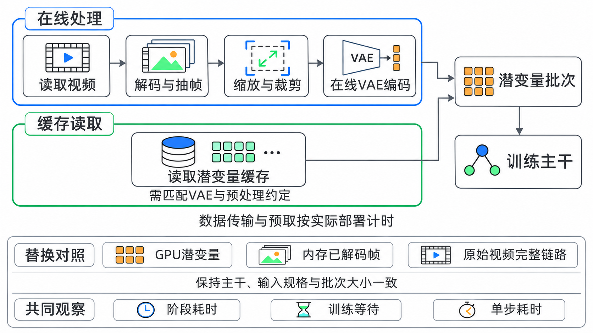
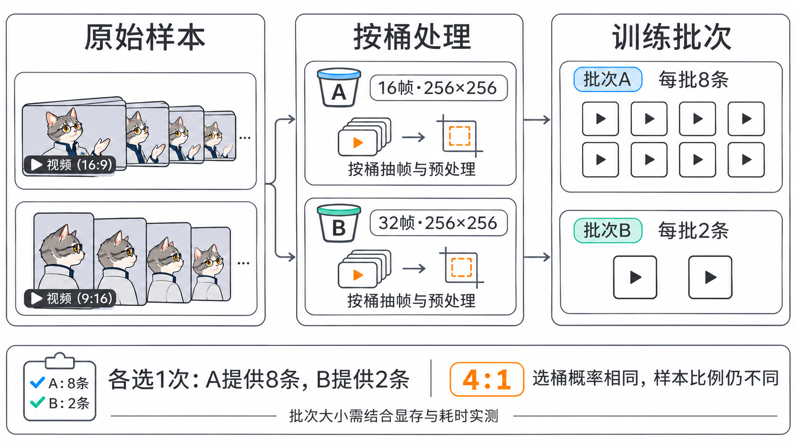
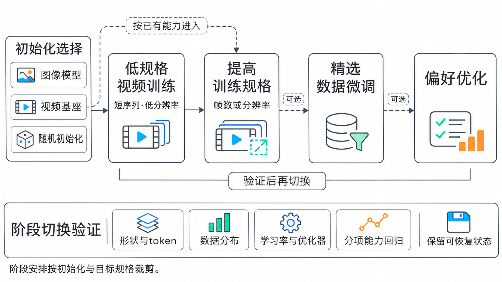
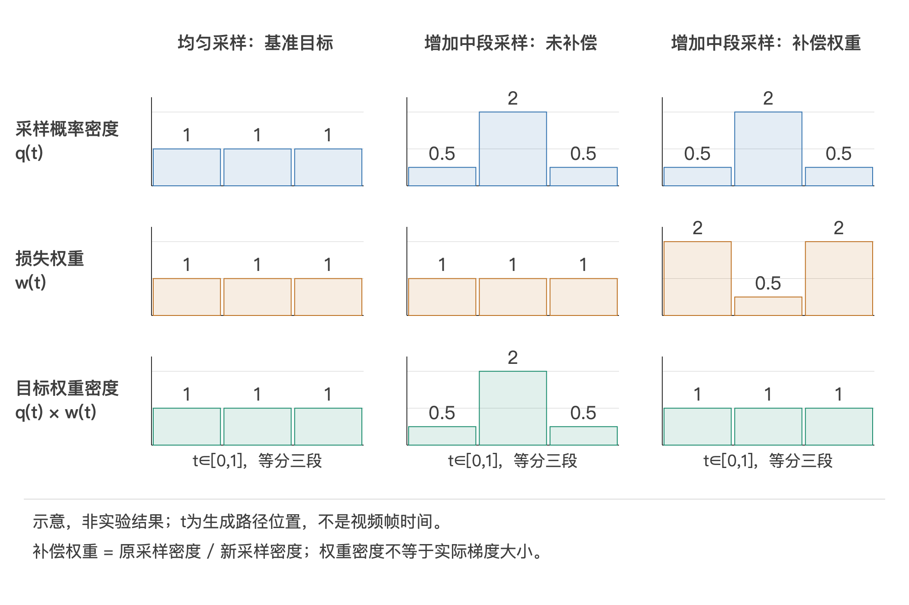
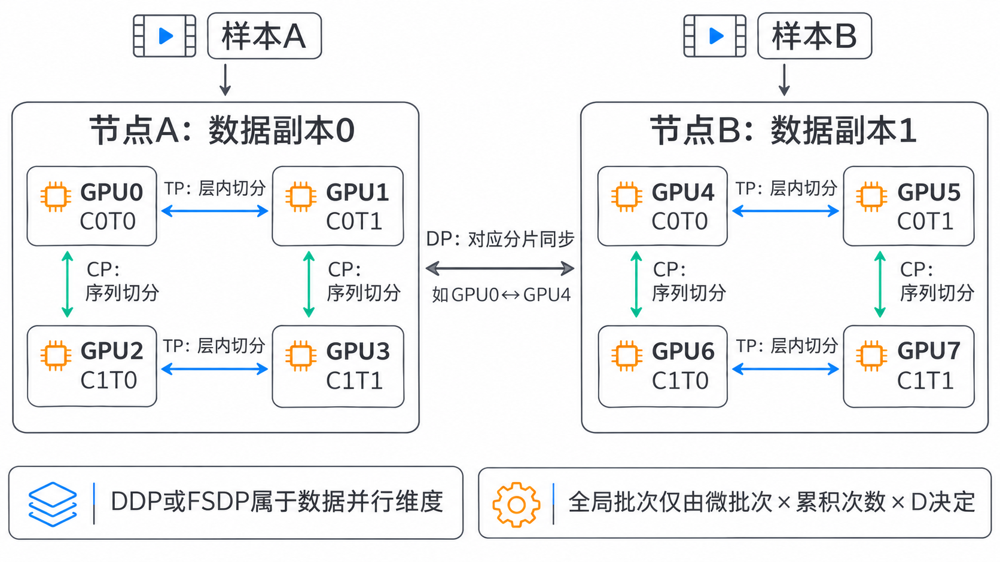
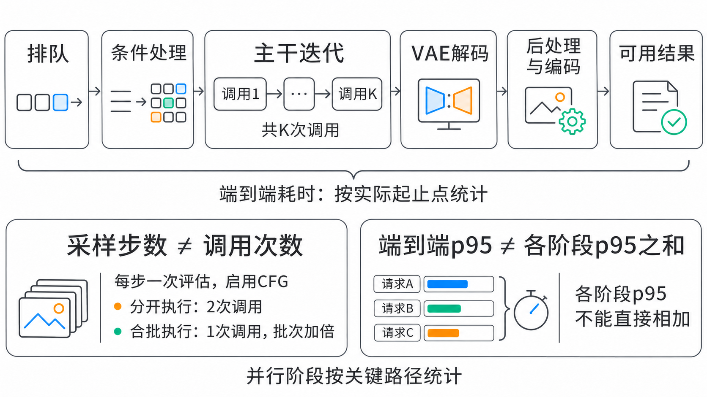
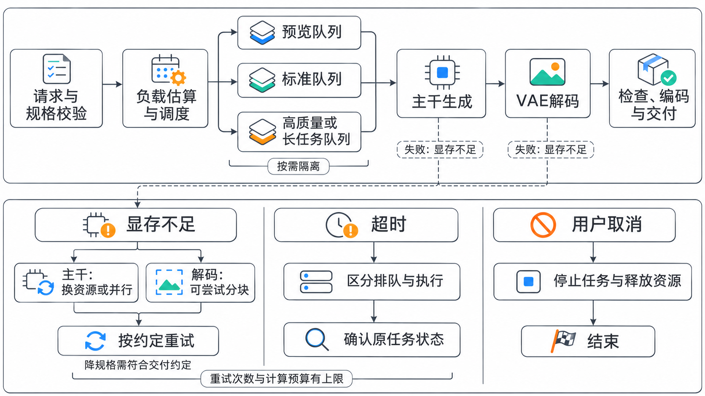
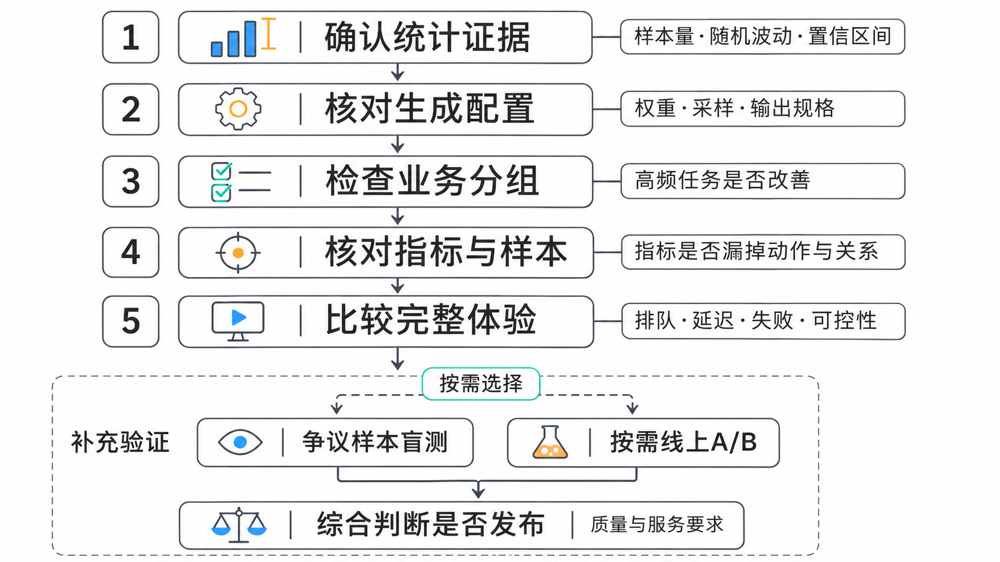
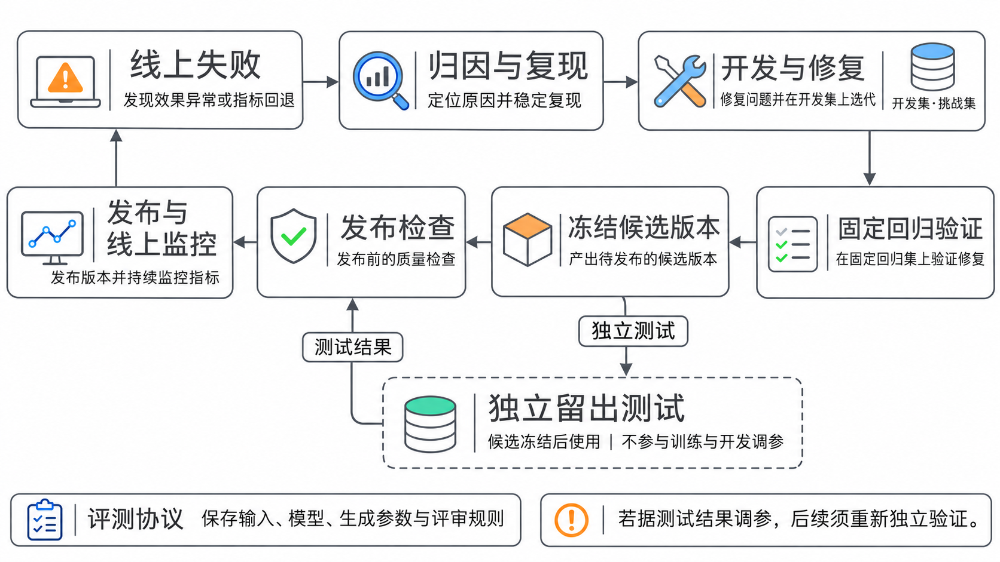

# 4.5 视频生成训练与工程优化

> 本章讨论视频生成模型从数据准备、训练安排到推理服务与质量验证的工程方法。重点是如何选择训练规格、核对训练设置、定位计算与显存瓶颈，并在可比的质量要求下评估优化收益。模型原理见第二章，代表模型的具体设计见第三章。

---

# 目录导航

[4.5.1 视频训练数据处理：样本构建、文本描述与数据供给](#4.5.1_视频训练数据处理：样本构建、文本描述与数据供给)
  - [4.5.1.1 面试问题：视频训练的数据供给容易在哪些环节出现瓶颈？如何定位？](#4.5.1.1_面试问题：视频训练的数据供给容易在哪些环节出现瓶颈？如何定位？)
  - [4.5.1.2 面试问题：视频切片、镜头切分与去重如何影响训练数据和生成效果？](#4.5.1.2_面试问题：视频切片、镜头切分与去重如何影响训练数据和生成效果？)
  - [4.5.1.3 面试问题：用于文生视频训练的文本描述应包含哪些信息？如何保证与视频片段一致？](#4.5.1.3_面试问题：用于文生视频训练的文本描述应包含哪些信息？如何保证与视频片段一致？)
  - [4.5.1.4 面试问题：视频训练数据如何进行质量筛选？怎样避免筛选后损害运动与内容覆盖？](#4.5.1.4_面试问题：视频训练数据如何进行质量筛选？怎样避免筛选后损害运动与内容覆盖？)

[4.5.2 视频训练规格与资源约束：帧数、分辨率、token 预算与分桶](#4.5.2_视频训练规格与资源约束：帧数、分辨率、token-预算与分桶)
  - [4.5.2.1 面试问题：如何估算视频训练的token数量？它如何影响计算与显存开销？](#4.5.2.1_面试问题：如何估算视频训练的token数量？它如何影响计算与显存开销？)
  - [4.5.2.2 面试问题：如何评估Video VAE是否适合下游视频生成训练？](#4.5.2.2_面试问题：如何评估Video-VAE是否适合下游视频生成训练？)
  - [4.5.2.3 面试问题：不同时长、分辨率和长宽比的视频如何分桶并组成训练批次？](#4.5.2.3_面试问题：不同时长、分辨率和长宽比的视频如何分桶并组成训练批次？)

[4.5.3 视频生成训练策略：图像与视频联合训练、渐进式训练与后训练](#4.5.3_视频生成训练策略：图像与视频联合训练、渐进式训练与后训练)
  - [4.5.3.1 面试问题：图像与视频联合训练时，如何确定和调整混合比例？](#4.5.3.1_面试问题：图像与视频联合训练时，如何确定和调整混合比例？)
  - [4.5.3.2 面试问题：视频生成为什么采用渐进式训练？阶段切换时需要注意什么？](#4.5.3.2_面试问题：视频生成为什么采用渐进式训练？阶段切换时需要注意什么？)
  - [4.5.3.3 面试问题：高质量数据微调与偏好优化有什么区别？各自有哪些风险？](#4.5.3.3_面试问题：高质量数据微调与偏好优化有什么区别？各自有哪些风险？)

[4.5.4 视频生成训练设置与异常排查](#4.5.4_视频生成训练设置与异常排查)
  - [4.5.4.1 面试问题：采用 Diffusion 或 Flow Matching 训练视频模型时，需要核对哪些关键设置？](#4.5.4.1_面试问题：采用-Diffusion-或-Flow-Matching-训练视频模型时，需要核对哪些关键设置？)
  - [4.5.4.2 面试问题：条件丢弃与EMA分别起什么作用？训练和验证时需要注意什么？](#4.5.4.2_面试问题：条件丢弃与EMA分别起什么作用？训练和验证时需要注意什么？)
  - [4.5.4.3 面试问题：时间步采样与损失加权如何共同影响视频生成训练？](#4.5.4.3_面试问题：时间步采样与损失加权如何共同影响视频生成训练？)
  - [4.5.4.4 面试问题：视频生成训练出现数值异常或生成质量退化时，如何排查？](#4.5.4.4_面试问题：视频生成训练出现数值异常或生成质量退化时，如何排查？)

[4.5.5 视频生成训练效率：吞吐瓶颈、显存优化与并行策略](#4.5.5_视频生成训练效率：吞吐瓶颈、显存优化与并行策略)
  - [4.5.5.1 面试问题：视频训练吞吐低，应该从哪些环节排查？](#4.5.5.1_面试问题：视频训练吞吐低，应该从哪些环节排查？)
  - [4.5.5.2 面试问题：视频生成模型训练时，如何定位显存占用并选择优化方法？](#4.5.5.2_面试问题：视频生成模型训练时，如何定位显存占用并选择优化方法？)
  - [4.5.5.3 面试问题：视频生成模型训练时，如何选择和组合数据并行、张量并行与长序列并行？](#4.5.5.3_面试问题：视频生成模型训练时，如何选择和组合数据并行、张量并行与长序列并行？)

[4.5.6 视频生成推理与部署优化：延迟、吞吐与成本](#4.5.6_视频生成推理与部署优化：延迟、吞吐与成本)
  - [4.5.6.1 面试问题：视频生成请求的端到端延迟由哪些部分构成？如何定位瓶颈？](#4.5.6.1_面试问题：视频生成请求的端到端延迟由哪些部分构成？如何定位瓶颈？)
  - [4.5.6.2 面试问题：视频生成推理有哪些加速方法？各自的收益与代价是什么？](#4.5.6.2_面试问题：视频生成推理有哪些加速方法？各自的收益与代价是什么？)
  - [4.5.6.3 面试问题：视频生成服务如何兼顾质量、延迟、吞吐与成本？](#4.5.6.3_面试问题：视频生成服务如何兼顾质量、延迟、吞吐与成本？)

[4.5.7 视频生成质量评估：评估维度、评审方法与迭代验证](#4.5.7_视频生成质量评估：评估维度、评审方法与迭代验证)
  - [4.5.7.1 面试问题：为什么视频生成不能依赖单一指标判断模型好坏？](#4.5.7.1_面试问题：为什么视频生成不能依赖单一指标判断模型好坏？)
  - [4.5.7.2 面试问题：视频生成质量评估应覆盖哪些维度？如何针对不同任务补充？](#4.5.7.2_面试问题：视频生成质量评估应覆盖哪些维度？如何针对不同任务补充？)
  - [4.5.7.3 面试问题：自动指标、人类评测和多模态大模型评审应如何分工？](#4.5.7.3_面试问题：自动指标、人类评测和多模态大模型评审应如何分工？)
  - [4.5.7.4 面试问题：模型离线分数提升但用户体验没有变好，应如何排查？](#4.5.7.4_面试问题：模型离线分数提升但用户体验没有变好，应如何排查？)
  - [4.5.7.5 面试问题：如何在训练、版本发布和线上反馈中持续验证视频生成质量？](#4.5.7.5_面试问题：如何在训练、版本发布和线上反馈中持续验证视频生成质量？)

---

<h1 id="4.5.1_视频训练数据处理：样本构建、文本描述与数据供给">4.5.1 视频训练数据处理：样本构建、文本描述与数据供给</h1>

> 本节讨论视频训练数据如何构建并送入模型：切片、镜头切分、去重与质量筛选决定训练样本及其分布，文本描述提供与片段对应的内容条件，读取、解码和预处理则影响数据供给速度。*训练规格与分桶设计见[4.5.2](#4.5.2_视频训练规格与资源约束：帧数、分辨率、token-预算与分桶)，计算、通信和负载等整体训练效率问题见[4.5.5](#4.5.5_视频生成训练效率：吞吐瓶颈、显存优化与并行策略)。*

<h2 id="4.5.1.1_面试问题：视频训练的数据供给容易在哪些环节出现瓶颈？如何定位？">4.5.1.1 面试问题：视频训练的数据供给容易在哪些环节出现瓶颈？如何定位？</h2>

**难度评分：⭐⭐⭐⭐ (4/5)  |  考察频率：⭐⭐⭐⭐⭐ (5/5)**

视频训练的数据供给可能卡在读取解码、预处理与VAE编码、批次组装和数据传输等环节。定位时需要同时观察各阶段耗时，以及训练是否真的在等待数据。

**1、数据供给可能卡在哪些环节**

- **读取与解码**：存储读取慢、视频随机定位开销大、解码耗时或损坏文件重试，都可能拖慢供给。少数样本处理特别慢，还可能拖住整个批次；解码可以在CPU或GPU上执行，应按实际实现计时。
- **预处理与VAE编码**：抽帧、缩放、裁剪和在线VAE编码会消耗处理时间。预计算潜变量可以绕过部分在线处理，但会增加存储开销；缓存需与当前VAE、潜变量归一化和预处理方式兼容，已缓存的裁剪结果也限制了后续的数据增强选择。
- **批次组装与数据传输**：不同规格或编码复杂度的样本处理速度不同，可能需要等待较慢样本才能凑齐批次；从主存向GPU传输数据也可能造成等待。*分桶与批次大小的设计见[4.5.2](#4.5.2_视频训练规格与资源约束：帧数、分辨率、token-预算与分桶)。*

**2、通过阶段计时与输入替换定位**

先记录训练等待下一批数据的时间、读取与解码等阶段的耗时，以及整体训练单步耗时，并检查是否存在少数特别慢的样本。异步预取可以将部分数据处理与训练计算重叠，因此某个阶段耗时长，还要确认它是否实际造成训练等待。图5-1展示了需要观察的数据供给环节。

<div align="center">
  
  <p>图5-1 视频训练数据供给链路与吞吐瓶颈定位</p>
</div>

在保持训练主干、输入规格和批次大小一致的前提下，可以比较三组输入：

- **GPU上预先准备好的潜变量**：重复执行训练步骤，绕过读取、解码、预处理、VAE编码及主存到GPU的数据传输，测得绕过上述处理后的训练耗时基线；这不是理论性能上限。
- **内存中已解码的帧**：执行实际需要的预处理、数据传输和VAE编码。与上一组比较，可以检查这些环节引入了多少额外耗时，再用分阶段计时区分具体来源。
- **原始视频完整链路**：恢复实际存储读取和视频解码，检查训练等待与单步耗时是否增加。只有训练中在线执行的过滤或其他处理，才需要计入这组链路。

也可以用预计算潜变量缓存与原始视频链路对照，但应注明缓存位于GPU、主存、本地磁盘还是远端存储。缓存方案变快，可能同时来自读取体积减少、跳过解码和跳过VAE编码，不能仅凭这一结果认定某个环节是瓶颈。

GPU利用率低也可能与通信等待、算子调度或负载不均有关，不能直接证明数据供给慢。最终应结合阶段计时和输入替换结果，确认哪项处理实际拖慢了训练。

> **面试速答**：先检查读取解码、预处理与VAE编码、批次组装及数据传输，再记录数据等待和训练单步耗时。使用GPU潜变量、内存中的已解码帧、原始视频完整链路做对照，逐步确定额外耗时来自哪里。缓存变快或GPU利用率低只能提供线索，具体瓶颈仍需阶段计时确认。

延伸阅读：[Stable Video Diffusion](https://arxiv.org/abs/2311.15127)、[CogVideoX](https://arxiv.org/abs/2408.06072)

<h2 id="4.5.1.2_面试问题：视频切片、镜头切分与去重如何影响训练数据和生成效果？">4.5.1.2 面试问题：视频切片、镜头切分与去重如何影响训练数据和生成效果？</h2>

**难度评分：⭐⭐⭐⭐ (4/5)  |  考察频率：⭐⭐⭐⭐⭐ (5/5)**

镜头切分识别视频中的切镜边界，切片从视频中截取训练片段，去重减少相同或高度相似素材的重复出现。它们共同决定模型看到的时间变化，以及不同内容在训练中的实际比例。

**1、镜头边界与切片范围应符合训练任务**

如果目标是单镜头连续生成，训练片段通常应位于同一镜头内。混入切镜会使突变的视角、场景或主体变化进入训练，可能增加生成中意外切镜的风险。多镜头任务则可以保留跨镜头样本，但需要保证镜头关系和文本描述符合目标任务，不要求所有方法都使用显式切镜标注。

需要学习完整事件时，应避免反复截掉动作的关键阶段。例如，训练“拿起杯子”时，片段应覆盖接触、拿起等关键变化；但并非每个训练片段都必须包含动作的完整起止。切片后还需核对文本描述，避免描述包含片段中未出现的事件，*具体见[4.5.1.3](#4.5.1.3_面试问题：用于文生视频训练的文本描述应包含哪些信息？如何保证与视频片段一致？)。*

**2、时间采样决定模型看到的动作变化**

同样采样16帧，覆盖1秒和覆盖4秒，呈现的动作范围与相邻帧位移不同。切片时需要结合采样间隔和真实时长，判断动作是否被截断、关键变化是否被跳过。

还应统计静止、低运动与高运动片段的比例。大量静止片段会使训练数据偏向低运动，但低运动片段本身可能符合目标任务，不应统一删除。*帧数、帧率和训练规格的安排见[4.5.2](#4.5.2_视频训练规格与资源约束：帧数、分辨率、token-预算与分桶)。*

**3、去重控制重复素材的训练权重**

同一素材经过转码、裁剪、加字幕或变速后，可能以不同文件重复出现。文件哈希只能识别字节完全相同的文件，还需结合视频感知特征寻找近重复候选，避免同源素材反复出现，放大某些主体、风格或动作的采样权重。

相似不等于重复：不同人物执行相同动作，仍可能提供有效变化。应结合素材来源、片段重叠情况和抽样复核决定是否删除，不能仅凭构图或动作相似就一并去除。

训练集与验证集之间也要检查同源和近重复素材，尤其是同一原视频的重叠切片。仅按文件随机划分，不能保证两者独立；可按原视频或素材来源分组划分，再检查跨集合的近重复情况。

处理后应复核镜头边界的误切与漏切，检查时长、运动强度和重复素材的分布，并在可比训练设置下验证生成效果，不能将删除更多数据直接当作质量提升。

> **面试速答**：镜头切分确定切镜边界，切片确定训练片段的时间范围，采样间隔决定模型看到的动作变化；这些设置应符合单镜头或多镜头等目标任务。去重减少同源素材反复采样，避免内容权重失衡，但不能把动作或构图相似直接当成重复。划分训练集与验证集时，还应防止同源重叠片段造成评估偏高。

延伸阅读：[Stable Video Diffusion](https://arxiv.org/abs/2311.15127)、[CogVideoX](https://arxiv.org/abs/2408.06072)

<h2 id="4.5.1.3_面试问题：用于文生视频训练的文本描述应包含哪些信息？如何保证与视频片段一致？">4.5.1.3 面试问题：用于文生视频训练的文本描述应包含哪些信息？如何保证与视频片段一致？</h2>

**难度评分：⭐⭐⭐⭐ (4/5)  |  考察频率：⭐⭐⭐⭐⭐ (5/5)**

视频文本描述（video caption）为文生视频训练提供文本条件，应准确描述对应训练片段中的主体、动作和时间关系。描述需要以片段中可确认的内容为依据，不能为了丰富细节而补写事件。

**1、文本描述应包含哪些信息**

可以根据片段内容选择以下信息，不要求每条描述都包含全部项目：

- **主体与场景**：谁在什么环境中，关键属性和主体关系是什么。
- **动作与变化**：哪个主体做了什么，运动方向、速度或状态如何变化。
- **时间关系**：动作同时发生还是先后发生，事件经历了哪些阶段。
- **镜头信息**：画面中能够判断的景别、视角和相机运动。

例如，人物静坐阅读时，可以描述人物、环境和阅读动作，不必额外推断相机运动或故事发展。描述还应符合文本编码器的长度限制，避免关键主体或动作被截断；可以使用详略不同但事实一致的描述，避免训练只接触一种冗长格式。

**2、如何检查描述与训练片段一致**

根据实际训练片段生成或修订描述。静态属性可以通过清晰帧核对，动作方向、事件顺序和相机运动则需要查看连续片段；快速或短暂动作不能只凭间隔较大的截图判断。

原视频经过切片后，需要重新核对描述。例如，原视频包含“拿起杯子、喝水、放下杯子”，若训练片段只保留拿起动作，描述就不应继续写“喝水后放下”。重点检查：

- **事实是否正确**：主体、数量、属性和动作是否与画面相符。
- **动作是否对应正确主体**：多人场景中，是否把甲的动作写成乙的动作。
- **时间关系是否准确**：方向、动作阶段和先后顺序是否与连续画面一致。
- **是否超出可见内容**：是否包含片段外事件，或无法从画面确认的意图、原因与结果。

可以用自动审核筛查，再抽样人工复核，并用已知错误检验审核方法。例如，在已确认人物先拿杯子、再开门的片段中，将描述改成“人物开门后拿起杯子”，检查审核方法能否根据视频识别顺序错误，不能只凭描述长度或图文相似度判断质量。

描述审核与下游生成验证需要分开：生成模型没有执行某个动作，不能直接证明描述错误；不同描述方案是否改善生成效果，还需在可比训练条件下验证。

> **面试速答**：文本描述应按片段实际内容说明主体、场景、动作、时间关系及可判断的镜头信息，不必填满所有项目。切片后要重新核对描述，结合清晰帧与连续过程检查事实、动作主体和事件顺序，删除片段外事件及无依据推断。审核可以结合自动筛查与人工复核，但不能用生成模型的一次失败直接判定描述有误。

延伸阅读：[Stable Video Diffusion](https://arxiv.org/abs/2311.15127)、[CogVideoX](https://arxiv.org/abs/2408.06072)


<h2 id="4.5.1.4_面试问题：视频训练数据如何进行质量筛选？怎样避免筛选后损害运动与内容覆盖？">4.5.1.4 面试问题：视频训练数据如何进行质量筛选？怎样避免筛选后损害运动与内容覆盖？</h2>

**难度评分：⭐⭐⭐⭐ (4/5)  |  考察频率：⭐⭐⭐⭐ (4/5)**

数据筛选应去除不适合目标任务的样本，同时检查保留数据是否仍覆盖所需的动作、场景与主体。高分辨率或高美学分不能单独代表视频训练质量。

**1、按质量问题与任务要求分别检查**

- **画面可用性**：解码损坏、严重模糊、压缩伪影及大面积遮挡式水印或叠加文字。是否过滤应结合目标任务，不能把正常场景中的文字一并删除。
- **时间与动作信息**：异常闪烁、重复帧、意外切镜，以及切片是否保留目标动作的关键阶段。正常静止、快速运动和有意切镜应按任务区分。
- **内容与条件对应**：描述中的主体、动作与顺序是否有画面依据。*切片和描述核对分别见[4.5.1.2](#4.5.1.2_面试问题：视频切片、镜头切分与去重如何影响训练数据和生成效果？)与[4.5.1.3](#4.5.1.3_面试问题：用于文生视频训练的文本描述应包含哪些信息？如何保证与视频片段一致？)。*

自动分数用于定位候选问题，阈值应通过抽样复核确定。对被删除与被保留的样本都进行检查，避免只看到留下的素材，却不知道哪些有效内容被误删。

**2、比较筛选前后的分布，避免筛选后偏向静态、简单场景**

按运动强度、动作类别、主体数量、场景与时长统计保留比例。例如，只保留画面平稳、构图简单的高美学样本，可能同时减少跑跳、遮挡与多人交互；筛选后的样本即使画面质量更高，也不代表覆盖了目标任务。

可以按内容类型使用不同的筛选规则，并保留质量合格的复杂运动和稀少场景。静止片段是否减少、某类动作是否补充，应根据目标分布和验证结果决定，不以运动越大或删除越多为目标。

**3、用下游训练验证筛选收益**

记录规则版本、阈值、各类样本保留率及删除原因。比较候选数据集时，尽量固定模型与训练配置，并明确训练预算、采样次数和重复使用程度，再看画质、动作完成、文本遵循及覆盖是否改善。

Stable Video Diffusion（SVD）对不同筛选信号与阈值进行训练对照，再根据生成结果的人类偏好评估选择方案[1]。这说明筛选标准需要下游验证，不宜直接照搬其他数据集的阈值。

> **面试速答**：先按画面、时间变化及条件对应检查质量，再抽样复核筛选阈值，并比较筛选前后的动作、场景和主体覆盖。最后在明确预算的训练对照中验证收益，避免只提升美学分，却损失运动与复杂内容能力。

---

<h1 id="4.5.2_视频训练规格与资源约束：帧数、分辨率、token-预算与分桶">4.5.2 视频训练规格与资源约束：帧数、分辨率、token 预算与分桶</h1>

> 本节讨论如何在计算与显存约束下安排视频训练规格。对于将时空潜变量划分为token的Transformer主干，帧数、分辨率、VAE压缩率和patch大小共同决定视频序列长度；分桶（bucketing）则将形状相近的样本组织成批次。训练时既要评估单样本与批次的资源开销，也要控制不同规格的采样比例。

<h2 id="4.5.2.1_面试问题：如何估算视频训练的token数量？它如何影响计算与显存开销？">4.5.2.1 面试问题：如何估算视频训练的token数量？它如何影响计算与显存开销？</h2>

**难度评分：⭐⭐⭐⭐⭐ (5/5)  |  考察频率：⭐⭐⭐⭐⭐ (5/5)**

视频token数需要按生成主干实际处理的表示估算。以下以将Video VAE潜变量划分为时空patch的DiT为例，分别说明单样本序列长度、批次计算量与显存开销。

**1、根据潜变量网格与patch大小估算token数**

设VAE输出的时空网格为 $T_l\times H_l\times W_l$，patch大小为 $p_t\times p_h\times p_w$。各维可整除时，单条视频的token数为：

```math
N_{\mathrm{vid}}
=\frac{T_l}{p_t}
\times\frac{H_l}{p_h}
\times\frac{W_l}{p_w}
```

例如，潜变量网格为8×32×32，patch为1×2×2，则形成8×16×16＝2048个视频token。潜变量通道通常进入每个patch的特征维度，不再乘到token数量中。

若输入视频为 $T\times H\times W$，VAE下采样倍数为 $r_t,r_h,r_w$，忽略边界处理时，可以用 $T_l\approx T/r_t$、 $H_l\approx H/r_h$、 $W_l\approx W/r_w$ 估算。实际计算应优先读取VAE输出形状，并按patch划分时的填充规则计算，避免首帧处理或边界填充造成偏差。

若文本等条件token与视频token拼接后做联合注意力，还需将它们计入总序列长度；使用交叉注意力时，则需另外考虑条件序列带来的计算。

**2、区分计算量与显存的增长方式**

在模型宽度、层数等配置固定，批次内每个样本的序列长度均为 $N$ 时，稠密全局注意力中的两两交互计算随序列长度二次增长，投影与MLP等逐token计算则近似线性增长：

```math
C_{\mathrm{attn}}\propto BN^2,
\qquad
C_{\mathrm{token}}\propto BN
```

其中 $B$ 是批次大小。token数翻倍时，注意力中的两两交互计算约增加到4倍，但不意味着整个训练耗时也增加到4倍；局部、分解或稀疏注意力的增长方式还会不同。

显存需区分模型状态、激活与注意力中间量。模型配置固定时，参数、梯度和优化器状态不会随序列长度同比增长；激活及部分中间结果则会增加。*显存分项与优化见 [4.5.5.2](#4.5.5.2_面试问题：视频生成模型训练时，如何定位显存占用并选择优化方法？)，注意力与历史缓存随时长增长的区别见 [4.4.1.4](04_长视频生成与多镜头叙事.md#4.4.1.4_面试问题：视频时长增加时，模型的计算量与显存开销如何变化？)。*

批次总token数相同，也不保证计算量相同。对于分别计算注意力的独立样本，稠密注意力计算量与各样本序列长度的平方之和有关，因此少量长序列的注意力计算开销可能更大。

token 预算可以限制单样本长度或批次总token数，但最终仍需按训练规格实测峰值显存与单步耗时，再确定批次大小。

> **面试速答**：对于采用潜变量patch划分的DiT，视频token数等于潜变量时空网格经patch划分后的块数，实际应按VAE输出形状和填充规则计算。token增加会提高激活开销，稠密全局注意力的两两交互计算近似平方增长，但模型状态和全部显存并不随之平方增长。批次总token相同也可能成本不同，需要结合单样本长度及实测显存、耗时判断。

延伸阅读：[Attention Is All You Need](https://arxiv.org/abs/1706.03762)、[CogVideoX](https://arxiv.org/abs/2408.06072)、[FlashAttention](https://arxiv.org/abs/2205.14135)

<h2 id="4.5.2.2_面试问题：如何评估Video-VAE是否适合下游视频生成训练？">4.5.2.2 面试问题：如何评估Video VAE是否适合下游视频生成训练？</h2>

**难度评分：⭐⭐⭐⭐⭐ (5/5)  |  考察频率：⭐⭐⭐⭐ (4/5)**

评估Video VAE是否适合下游训练，需要同时检查重建质量、下游生成效果和端到端成本。在相同输入尺寸和patch划分方式下，更高的空间或时间下采样倍数通常能减少视频token数，但能否保留任务需要的细节与运动信息，还需要实际评估。

**1、重建质量是否满足目标任务**

在相同输入视频上检查小物体、文字、手部、人物身份、快速运动及首尾帧，并连续播放重建片段，观察是否出现闪烁、细节跳变或动作失真。结合重建指标与失败样本判断。应按内容类型分别检查，避免整体平均分掩盖特定细节或动作的损失。

*空间压缩、时间压缩与潜变量通道数的原理和取舍见 [4.2.2.3](02_AI视频生成原理与模型架构.md#4.2.2.3_面试问题：Video-VAE-的空间压缩、时间压缩和潜变量通道数应如何权衡？)。* 这里重点判断候选VAE能否保留任务需要的信息。

**2、潜变量是否适合生成主干学习**

使用相同数据，记录生成主干规模、训练样本量和实际计算开销。比较固定算力下的效果时，应统一计算预算；比较训练到目标质量的成本时，则记录达到该质量所需的资源。不同VAE产生的token数可能不同，相同训练步数不一定代表相同成本。

更换VAE后，通常需要重新训练或适配生成主干，再比较生成质量与时序稳定性；未经适配就直接替换，不能据此判断候选VAE的优劣。

重建测试中，解码器接收的是实际视频编码得到的潜变量；生成时，潜变量由生成主干预测。因此，重建质量好，并不能说明主干也能在给定预算内准确生成这种表示。

**3、端到端成本是否合算**

成本应按实际执行流程统计：

- **训练阶段**：统计在线VAE编码或离线预计算、缓存读取，以及主干训练的耗时、峰值显存和存储开销。缓存体积还受潜变量通道数与数值精度影响，不能只根据时空网格的缩小倍数推算。
- **生成阶段**：统计主干采样与VAE解码的耗时和峰值显存；图生视频、视频编辑等任务还可能需要输入编码。

选型时先排除无法满足任务质量要求的候选，再比较其下游生成表现与整体成本，避免主干节省的开销被更昂贵的VAE编码、解码抵消。

> **面试速答**：先用真实视频重建检查细节与运动信息是否保留，再训练或适配生成主干，比较候选潜变量下的生成效果，最后统计编码、主干计算、解码及缓存的整体成本。重建更好不保证下游生成更好，压缩更强也不保证端到端更划算。

延伸阅读：[CogVideoX](https://arxiv.org/abs/2408.06072)、[Improved Video VAE](https://arxiv.org/abs/2411.06449)

<h2 id="4.5.2.3_面试问题：不同时长、分辨率和长宽比的视频如何分桶并组成训练批次？">4.5.2.3 面试问题：不同时长、分辨率和长宽比的视频如何分桶并组成训练批次？</h2>

**难度评分：⭐⭐⭐⭐ (4/5)  |  考察频率：⭐⭐⭐⭐⭐ (5/5)**

样本分桶（bucketing）是按帧数、分辨率和长宽比等输入规格将样本分组，再从相近规格的样本中组成训练批次的方法。它可以减少填充浪费，但仍需明确样本如何调整形状、每批取多少条，以及各桶以什么比例参与训练。

**1、确定桶规格，并将样本处理成可组批的形状**

根据目标生成需求和数据分布选择有限的桶规格。例如，设置16帧、256×256，32帧、256×256，以及16帧、256×448三个桶。根据样本的原始规格选择合适的桶，再按桶要求进行抽帧、缩放或裁剪，每次从一个桶中取出若干处理后的样本组成批次。

对于直接堆叠张量的批次，同桶样本经过处理后仍需形成一致的形状，分桶本身不会自动消除尺寸差异。桶尺寸还需满足VAE与patch划分的整除或填充规则，并限制过度裁剪、拉伸和填充。

<p align="center">表5-1 视频训练多规格变量的作用与常见误区</p>

| 变量 | 实际控制的内容 | 常见误区 |
| --- | --- | --- |
| 帧数 $T$ | 输入包含多少个离散时间点，直接影响序列长度 | 把相同帧数当成相同时长 |
| 采样帧率或时间间隔 | 决定相邻采样帧间的真实时间间隔，影响动作覆盖范围和帧间位移 | 混用不同时间尺度，却没有统一采样方式或提供模型支持的时间条件 |
| 分辨率 $H\times W$ | 空间细节、构图及空间token数 | 统一拉伸到固定尺寸，破坏主体比例 |
| 长宽比 | 横竖构图与裁剪范围，可由 $H,W$ 推出 | 桶划分过细，形成大量样本不足的规格 |

桶通常按实际输入形状组织。帧数结合采样间隔决定覆盖的时间范围，因此相同形状的样本也可能具有不同时间尺度；可以统一采样方式，或在模型支持时提供相应时间条件，不一定单独按帧率分桶。

**2、按资源开销设置各桶的批次大小**

token数量可以作为初步估算，最终应按桶实测峰值显存与训练单步耗时。长序列桶可能需要更小的微批次；若希望保持每次参数更新所覆盖的样本量，可以配合梯度累积，并核对全局批次大小。

不能仅凭相同批次总token数就认定成本相同，*具体原因见[4.5.2.1](#4.5.2.1_面试问题：如何估算视频训练的token数量？它如何影响计算与显存开销？)。*调整后应检查填充比例、峰值显存、单步耗时及分规格生成质量，避免只提高批次效率却损害目标能力。

**3、控制选桶概率与实际样本比例**

选桶概率不等于样本比例。例如，两个桶被选中的次数相同，但一个桶每批取8条视频，另一个只取2条，那么前者实际提供的样本数是后者的4倍；视频token量及计算开销还可能不同。

图5-2将按桶处理、组批与实际样本比例放在一起展示。

<div align="center">
  
  <p>图5-2 视频样本分桶、批次组装与实际样本比例</p>
</div>

应记录各桶的选中次数、实际样本数和token量，再结合损失归一化方式检查训练权重。稀少规格过度采样会反复使用少量素材，完全按原始数据占比采样又可能使目标规格训练不足，需要结合分规格验证结果调整。

部分架构也支持将不同长度样本打包处理，但需要专门处理样本边界，不能直接将独立视频拼成一段连续序列。

> **面试速答**：先选择帧数、分辨率和长宽比规格，将样本处理成桶内可直接组批的形状，再按实测显存和耗时设置各桶的批次大小。帧率决定时间尺度，不一定单独分桶；微批次变小时，可以按需要使用梯度累积。最后检查实际样本与token比例，不能将相同选桶概率当作相同训练权重。

延伸阅读：[CogVideoX](https://arxiv.org/abs/2408.06072)、[NaViT](https://arxiv.org/abs/2307.06304)

---

<h1 id="4.5.3_视频生成训练策略：图像与视频联合训练、渐进式训练与后训练">4.5.3 视频生成训练策略：图像与视频联合训练、渐进式训练与后训练</h1>

> 本节讨论图像与视频如何联合训练，分辨率、视频长度等规格如何随训练阶段调整，以及基础训练后如何通过高质量数据微调和偏好优化改善生成表现。混合比例与阶段顺序应结合模型初始化、数据质量和验证结果选择，不是所有模型都需要依次经历相同阶段。

<h2 id="4.5.3.1_面试问题：图像与视频联合训练时，如何确定和调整混合比例？">4.5.3.1 面试问题：图像与视频联合训练时，如何确定和调整混合比例？</h2>

**难度评分：⭐⭐⭐⭐ (4/5)  |  考察频率：⭐⭐⭐⭐⭐ (5/5)**

图像与视频的混合比例需要结合数据质量、模型初始化和目标能力确定。首先说明比例的统计口径，再比较不同设置下的生成表现，不宜直接照搬其他模型的数值。

**1、区分采样比例、计算开销与损失权重**

图像和视频可以混在同一批次，也可以交替使用不同批次。按样本数、批次数或token数统计，会得到不同的比例。例如，图像批次和视频批次各占一半，但每批样本数不同，就不代表两类样本各占一半；视频序列更长时，两者计算开销也不同。

损失权重是另一项设置。先对每个样本的损失归一化，再按样本平均，与对所有有效元素直接平均，会改变不同规格样本的相对权重。应同时记录实际样本数、token量、计算时间及损失归一化方式，不能仅凭采样比例判断两类数据对训练的实际影响。

**2、根据参数更新范围与分项验证调整**

图像数据可以补充主体、构图、纹理和文本对应关系；视频数据还提供运动与时间关系。需要检查两类输入实际更新哪些参数。例如，图像输入若绕过时间模块，就不能直接训练这些参数，但仍可能更新共享主干。

固定其余训练设置，尝试少量候选比例，并比较单帧质量、文本遵循、动作完成情况和时序一致性。运动变弱时，检查视频样本是否减少、时间模块是否得到更新，以及视频描述与采样是否正确；不能仅凭这一现象认定图像比例过高。运动幅度也应符合任务要求，不能一味追求更大。

混合比例可以随训练阶段调整。例如，视频适配阶段需要充分学习运动，高质量微调时则要防止精选数据过度偏静态。是否调整，应由分项验证结果支持。

> **面试速答**：先明确混合比例按样本、批次还是token统计，再单独核对计算开销、损失权重和参数更新范围。保持其他设置可比，用候选比例比较画质、条件遵循与运动时序表现，按目标能力调整。各占一半样本不等于各占一半算力，也不等于相同梯度贡献。

延伸阅读：[Video Diffusion Models](https://arxiv.org/abs/2204.03458)、[CogVideoX](https://arxiv.org/abs/2408.06072)

<h2 id="4.5.3.2_面试问题：视频生成为什么采用渐进式训练？阶段切换时需要注意什么？">4.5.3.2 面试问题：视频生成为什么采用渐进式训练？阶段切换时需要注意什么？</h2>

**难度评分：⭐⭐⭐⭐ (4/5)  |  考察频率：⭐⭐⭐⭐⭐ (5/5)**

渐进式训练（progressive training）是一种训练策略：先在成本较低的训练设定下建立基础能力，再逐步增加分辨率、输入帧数、条件复杂度或数据质量要求。是否采用以及如何划分阶段，需要结合初始化模型与目标规格验证。

**1、为什么逐步提高训练规格**

首先是计算成本：低分辨率、较少输入帧数通常能降低单步成本，便于在相同资源下使用更大的微批次或完成更多训练迭代。其次是调整与排查：如果同时改变帧数、分辨率、数据分布和任务条件，训练一旦退化，很难判断是哪项变化造成的。分阶段可以控制变量，也便于在阶段切换后回滚。

常见的阶段关系如图5-3所示。它只是一种组织方式，实际项目可以从已有图像模型、已有视频基座或随机初始化开始，并不要求完整走过所有阶段。

<div align="center">
  
  <p>图5-3 视频生成渐进式训练的阶段安排与验证</p>
</div>

**2、阶段切换时需要检查什么**

- **形状变化**：分辨率或输入帧数增加后，需重新核对token规模、位置编码与批次组织，并测量显存和吞吐，检查全局批次、位置编码支持范围及学习率是否适用；
- **分布变化**：从大规模数据切到精选数据后，质量可能上升，但多样性和长尾能力也可能收缩；
- **优化状态**：是否保留优化器状态、是否重做 warmup、哪些参数解冻，应按变化幅度决定，不能机械继承；
- **切换依据**：阶段切换应依据分项验证是否稳定、目标能力是否达到门槛，而不是只看训练步数或整体 loss。

课程学习（curriculum learning）强调按难度安排训练样本或任务，例如先学习单主体、动作清楚的片段，再加入多主体交互和遮挡。渐进式训练侧重分阶段调整分辨率、帧数等训练设定，两者可以结合。先短后长也可能只是为了降低早期计算成本，不能仅凭规格顺序判断是否采用了课程学习。

> **面试速答**：渐进式训练通过分开引入分辨率、时长、数据质量和任务复杂度，降低早期训练成本，也让阶段退化更容易定位。它不是固定流水线；每次切换都要重新检查 token 规模、学习率、优化器状态和数据分布，并用固定分项验证集决定是否进入下一阶段。课程学习强调样本或任务的难度安排，与渐进式训练可以交叉，但不能仅凭先短后长判断其收益。

延伸阅读：[Stable Video Diffusion](https://arxiv.org/abs/2311.15127)、[CogVideoX](https://arxiv.org/abs/2408.06072)

<h2 id="4.5.3.3_面试问题：高质量数据微调与偏好优化有什么区别？各自有哪些风险？">4.5.3.3 面试问题：高质量数据微调与偏好优化有什么区别？各自有哪些风险？</h2>

**难度评分：⭐⭐⭐⭐ (4/5)  |  考察频率：⭐⭐⭐⭐ (4/5)**

高质量数据微调和偏好优化都发生在基础训练之后，但监督信号不同。高质量数据微调仍用目标视频和条件做生成训练，主要让模型适应质量更高、更符合目标任务的样本分布；偏好优化利用候选结果之间的比较或奖励信号，提高模型生成更符合偏好的结果的倾向。

两种方法的监督信号与风险见表5-2，实际训练中可以先后或结合使用。

<p align="center">表5-2 高质量数据微调与偏好优化的监督信号和风险</p>

| 方法 | 主要监督 | 更适合改善 | 主要风险 |
| --- | --- | --- | --- |
| 高质量数据微调 | 精选视频、准确条件及原有 Diffusion/Flow Matching 目标 | 目标领域表现、文本遵循、视觉质量和特定失败样本 | 小数据过拟合、能力遗忘、运动或内容多样性收缩 |
| 偏好优化 | 同一条件下的候选排序、人工偏好或经过校准的奖励信号 | 难以用单个目标视频表达的审美、可用性和多目标取舍 | 奖励偏置、过度优化可测指标、输出趋同 |

**1、高质量数据微调侧重示范样本**

高质量数据除分辨率外，还要检查动作完整性、时序稳定、文本描述准确度、来源分布和业务覆盖。微调集如果大量偏静态，即使单帧画质上升，运动能力也可能回退；如果只保留审美风格相近的样本，生成多样性也会缩小。

**2、偏好优化侧重结果比较或奖励**

例如，同一提示生成的两个视频，一个画面清晰却未完成动作，另一个画质稍弱但动作正确。偏好标注需要说明重视哪些要求，不能只给出含义不清的“更好”。画质、文本遵循、运动自然度、主体一致性和安全性可能互相冲突，把它们压成一个未经校准的总分，模型可能提高评分，却未改善实际生成质量。例如，Flow-DPO和Flow-RWR分别探索了流模型的直接偏好优化与奖励加权训练[2]。训练时还需控制相对原模型的变化，例如加入参考模型约束或混合原有训练目标，避免只提高奖励分数却丢失原有能力。

验证时应保留基础能力回归集，并同时观察偏好胜率、运动幅度、内容多样性、文本遵循和严重失败率。偏好分数提高但视频越来越静、构图越来越相似，需要检查奖励是否偏爱静态或固定构图；这些现象不能仅凭总分解释为整体质量提升。

> **面试速答**：高质量数据微调用精选视频继续原有生成目标，主要调整模型的数据分布；偏好优化用候选比较或奖励信号，提高模型生成更符合偏好的结果的倾向。前者要防止小数据过拟合和能力遗忘，后者要防止奖励偏置、输出趋同和运动静态化。两者都应保留基础能力回归集，偏好分数提高不能单独证明模型整体变好。

延伸阅读：[Stable Video Diffusion](https://arxiv.org/abs/2311.15127)

---

<h1 id="4.5.4_视频生成训练设置与异常排查">4.5.4 视频生成训练设置与异常排查</h1>

> 本节先核对生成目标、训练标签与采样更新是否匹配，再讨论条件丢弃、参数的指数移动平均（EMA）、时间步采样和损失加权，最后分析数值异常与质量退化。*生成目标的通用原理见[4.2.3.1](./02_AI视频生成原理与模型架构.md#4.2.3.1_面试问题：视频扩散模型训练时学习什么？为什么不能简单理解为逐帧独立去噪？)和[4.2.3.2](./02_AI视频生成原理与模型架构.md#4.2.3.2_面试问题：Diffusion、Flow-Matching-与-Rectified-Flow-是什么关系？)，训练阶段安排见[4.5.3](#4.5.3_视频生成训练策略：图像与视频联合训练、渐进式训练与后训练)，计算与显存问题见[4.5.5](#4.5.5_视频生成训练效率：吞吐瓶颈、显存优化与并行策略)。*

<h2 id="4.5.4.1_面试问题：采用-Diffusion-或-Flow-Matching-训练视频模型时，需要核对哪些关键设置？">4.5.4.1 面试问题：采用 Diffusion 或 Flow Matching 训练视频模型时，需要核对哪些关键设置？</h2>

**难度评分：⭐⭐⭐⭐⭐ (5/5)  |  考察频率：⭐⭐⭐⭐ (4/5)**

需要核对输入尺度、噪声或路径定义、预测目标、时间采样与损失权重，以及推理更新公式。

**1、核对输入与监督目标**

Diffusion可以通过以下形式构造带噪视频潜变量：

```math
x_t=\alpha(t)z+\sigma(t)\epsilon,
\qquad \epsilon\sim\mathcal{N}(0,I)
```

其中 $z$ 是经过约定缩放的干净潜变量， $t$ 表示噪声调度中的位置，不是视频帧对应的时间； $\alpha(t)$ 与 $\sigma(t)$ 控制该位置的信号和噪声强度。需要明确网络预测噪声、干净潜变量还是其他参数化，并核对训练标签、输入缩放与输出转换是否一致。

以噪声到数据的线性插值为例，Flow Matching可以写成：

```math
x_t=(1-t)\epsilon+tz,\qquad
u=z-\epsilon,\qquad t\in[0,1]
```

其中 $t$ 表示从噪声到数据的路径位置，不是视频帧对应的时间；本例约定 $t=0$ 为噪声、 $t=1$ 为数据， $u=z-\epsilon$ 为对应的目标速度。模型根据 $x_t$、 $t$ 和生成条件预测速度，并以 $u$ 为监督目标。其他实现可能反向定义时间，或使用不同路径，不能只替换变量名而沿用速度符号和更新方向。不同方法即使用相同的“速度预测”名称，也需要核对实际标签公式。

Flow Matching并不限于上述线性插值，也可以采用扩散概率路径[3]。这里的扩散概率路径，指扩散模型通过逐步加噪构造的一系列中间分布；生成时则沿相反方向，从噪声恢复数据。因此，需要核对具体的路径定义和监督目标。

**2、核对时间采样、加权与推理设置**

- **时间采样与损失加权**：确认哪些噪声区间更常被采到、各项损失如何归一化，避免某个区间或视频规格占据过大权重。*具体见[4.5.4.3](#4.5.4.3_面试问题：时间步采样与损失加权如何共同影响视频生成训练？)。*
- **推理更新**：采样器必须正确解释模型输出，并使用匹配的噪声范围或时间方向。少步效果还受求解器与预测误差影响，不能仅凭路径为直线就判断可以任意减少步数。
- **视频专项检查**：核对VAE潜变量的缩放与偏移、不同帧数和分辨率的损失归一化，并观察动作、时序和条件遵循是否改善。

比较训练方案时，固定数据、VAE和可比主干，明确训练计算预算；推理侧记录实际网络调用量和耗时，再比较质量。参数化改变时，应相应适配采样器，并记录推理配置；不必强行沿用同一个更新公式。

> **面试速答**：核对潜变量尺度、概率路径、预测标签、时间方向、采样分布和损失权重，再确认推理公式正确解释网络输出。Diffusion可采用不同预测参数化，Flow Matching也有多种路径；训练标签与推理更新必须配套，效果应在明确的训练和推理预算下比较。

延伸阅读：[Elucidating the Design Space of Diffusion-Based Generative Models](https://arxiv.org/abs/2206.00364)

<h2 id="4.5.4.2_面试问题：条件丢弃与EMA分别起什么作用？训练和验证时需要注意什么？">4.5.4.2 面试问题：条件丢弃与EMA分别起什么作用？训练和验证时需要注意什么？</h2>

**难度评分：⭐⭐⭐⭐ (4/5)  |  考察频率：⭐⭐⭐⭐⭐ (5/5)**

条件丢弃让同一模型学习有条件与空条件下的预测，为标准分类器无关引导（CFG）提供基础；EMA则维护参数的指数移动平均副本，用于评估或发布。两者解决不同问题，需要分别验证。

**1、条件丢弃：训练条件与空条件预测**

训练时以一定概率把条件替换为空条件，为标准CFG在推理时组合两路输出提供训练基础[4]：

```math
f_{\mathrm{cfg}}
=f_\theta(x_t,t,\varnothing)
+s\left[f_\theta(x_t,t,c)-f_\theta(x_t,t,\varnothing)\right]
```

其中 $x_t$ 表示生成路径当前位置的带噪潜变量， $t$ 表示该位置， $\theta$ 表示模型参数； $c$ 表示生成条件， $\varnothing$ 表示空条件。$f_\theta$ 可以是当前参数化下的噪声、速度或其他预测， $s$ 是引导强度，用于调节条件预测与空条件预测之差在组合结果中的占比。空条件的表示应与训练约定一致，不能随意用零向量替代。条件丢弃概率过低，模型在空条件下的预测可能不可靠；过高则会减少使用完整条件训练的机会。多条件系统还要区分“全部条件一起丢弃”和“每种条件独立丢弃”，两者提供的条件组合训练样本不同，不能据此保证任意条件组合都能正确执行。验证时比较不同引导强度，同时看文本遵循、运动、伪影和多样性。

**2、EMA：维护参数的指数移动平均副本**

```math
\bar{\theta}\leftarrow \beta\bar{\theta}+(1-\beta)\theta
```

其中 $\theta$ 是当前训练参数， $\bar{\theta}$ 是EMA参数， $\beta$ 是衰减系数。$\beta$ 越大，历史参数保留得越多，EMA跟随当前参数变化的速度越慢。常规用法中，EMA不参与当前参数 $\theta$ 的梯度更新，因此不能用来修复 loss 爆炸或错误梯度。它主要用于评估或发布更平滑的权重，并带来额外参数存储。衰减过大时会明显滞后于当前模型，阶段切换后尤其要比较原始权重与 EMA 权重，避免把滞后误判成训练回退。

> **面试速答**：条件丢弃让同一模型学习条件与空条件预测，为推理时的CFG提供基础；EMA维护平滑的权重副本，不参与当前参数的梯度更新。前者需比较引导强度下的质量与条件遵循，后者需比较当前权重与平均权重，尤其注意阶段切换后的滞后。

延伸阅读：[Elucidating the Design Space of Diffusion-Based Generative Models](https://arxiv.org/abs/2206.00364)

<h2 id="4.5.4.3_面试问题：时间步采样与损失加权如何共同影响视频生成训练？">4.5.4.3 面试问题：时间步采样与损失加权如何共同影响视频生成训练？</h2>

**难度评分：⭐⭐⭐⭐ (4/5)  |  考察频率：⭐⭐⭐⭐⭐ (5/5)**

时间步采样决定模型多常看到某个噪声或路径位置，损失加权决定对应误差在目标中的权重。这里的时间步描述生成路径，不是视频帧的时间。两项设置需要结合预测参数化共同考虑。

**1、时间步采样：改变不同路径位置被抽到的频率**

例如，原目标按均匀时间分布计算损失，改为更多采样中间噪声区间后，若不相应调整权重，就改变了优化重点。若希望仍估计原目标，需要给每个样本的损失乘以“原采样概率密度／新采样概率密度”，以补偿采样频率的变化；原分布覆盖的时间区间也不能被新采样方案完全排除。采样分布会影响训练方差、收敛速度以及模型更常看到哪些噪声或路径区间。

**2、损失加权：调整各训练项的相对权重**

权重可以按信噪比（SNR）、时间步、帧、区域、任务或样本规格设置。它必须与预测参数化和 loss 归一化一起设计；照搬另一种参数化下的权重，可能让某些时间区间主导训练。

时间步采样与损失加权共同影响训练目标。设 $q(t)$ 是时间位置 $t$ 的采样概率密度， $w(t)$ 是该位置的损失权重。未做其他修正时，两者的乘积 $q(t)w(t)$ 决定该位置的误差在期望损失中的权重密度，不能直接当作实际梯度大小；实际梯度还取决于预测误差和模型对参数的响应。因此两者不宜同时改完再看总 loss，可按时间区间记录损失和梯度，并逐项修改、比较固定提示集的生成结果。

图5-4用分段常数示例对比均匀采样、增加中段采样及补偿权重后的目标变化。图中数值仅用于说明关系，并非实验结果。

<div align="center">
  
  <p>图5-4 时间步采样、损失加权与目标权重密度的关系</p>
</div>

> **面试速答**：时间步采样改变不同路径位置出现的频率，损失加权改变对应误差的相对权重。未做其他修正时，两者的乘积决定期望损失中的权重密度，但不直接代表梯度大小。调整时应分区间观察损失与梯度，并比较固定验证集的生成表现。

延伸阅读：[Efficient Diffusion Training via Min-SNR Weighting Strategy](https://arxiv.org/abs/2303.09556)、[Elucidating the Design Space of Diffusion-Based Generative Models](https://arxiv.org/abs/2206.00364)

<h2 id="4.5.4.4_面试问题：视频生成训练出现数值异常或生成质量退化时，如何排查？">4.5.4.4 面试问题：视频生成训练出现数值异常或生成质量退化时，如何排查？</h2>

**难度评分：⭐⭐⭐⭐ (4/5)  |  考察频率：⭐⭐⭐⭐⭐ (5/5)**

先区分数值异常与生成质量退化，再保存复现信息、逐项验证。训练损失的平均值不能单独说明画质、运动或条件遵循是否正常。

<p align="center">表5-3 视频生成训练异常的定位线索</p>

| 观察到的现象 | 优先检查 | 验证方法 |
| --- | --- | --- |
| 损失或梯度出现NaN/Inf | 首个异常批次、潜变量尺度、学习率、混合精度及异常算子 | 保存异常前的模型与训练状态、输入和随机状态，在相同条件下重放，必要时提高可疑算子的精度 |
| 特定时间步或输入规格的损失异常 | 时间步采样、损失加权、归一化及数据分布 | 分组查看损失和梯度，只改变一个采样或加权设置做对照 |
| 固定提示下的生成质量下降 | 权重版本、EMA、采样配置，以及近期数据或训练阶段变化 | 使用固定提示集和同一组随机种子，在一致生成设置下比较相邻检查点 |

这些是排查线索，并不与原因一一对应。例如，数据异常也可能直接引发NaN，质量退化也可能源于验证配置改变。

**1、保存异常现场并区分训练问题与验证变化**

数值异常应尽量定位到首次出现NaN（非数值）或Inf（无穷值）的算子或训练步骤，并检查当时输入、学习率和梯度。FP16训练若使用动态损失缩放，还应检查是否频繁因溢出而降低缩放值或跳过参数更新。

质量退化则先核对原始权重与EMA权重、采样器、步数、CFG和后处理是否一致，再检查数据切换、参数解冻等近期变更。怀疑VAE存在问题时，可检查真实视频经过编码、解码后的重建结果；检查生成模型时，则使用固定提示集比较画质、运动和条件遵循。

**2、用可控实验缩小范围，再验证修复效果**

可以使用固定小数据集、单一规格或更高精度的短程训练，每次改变一个变量。小数据训练失败是检查实现与数值的线索，但扩散训练持续采样噪声，不能要求训练损失必然降到零；小数据正常也不能排除全量数据或分布式设置的问题。

修复后重新检查数值、分组损失、单帧质量、动作完成情况与时序一致性。*吞吐、通信等待和显存不足的专项定位见[4.5.5](#4.5.5_视频生成训练效率：吞吐瓶颈、显存优化与并行策略)。*

> **面试速答**：数值异常要保存异常前状态并定位首个非有限值；质量退化先固定验证配置，再检查数据和训练设置变化。用小数据、单规格或精度对照验证具体假设，修复后同时复查损失与生成表现，不能只凭平均损失下降判定恢复。

延伸阅读：[Elucidating the Design Space of Diffusion-Based Generative Models](https://arxiv.org/abs/2206.00364)、[CogVideoX](https://arxiv.org/abs/2408.06072)

---

<h1 id="4.5.5_视频生成训练效率：吞吐瓶颈、显存优化与并行策略">4.5.5 视频生成训练效率：吞吐瓶颈、显存优化与并行策略</h1>

> 本节讨论视频生成训练的吞吐瓶颈、显存占用与并行策略。长时空序列、多规格样本和在线VAE编码会带来不同的资源开销，需要结合阶段耗时、显存峰值和设备间负载选择优化方法。*数据供给链路见[4.5.1](#4.5.1_视频训练数据处理：样本构建、文本描述与数据供给)，训练规格与批次组织见[4.5.2](#4.5.2_视频训练规格与资源约束：帧数、分辨率、token-预算与分桶)。* 本节关注它们与计算、通信共同决定的整体效率。

<h2 id="4.5.5.1_面试问题：视频训练吞吐低，应该从哪些环节排查？">4.5.5.1 面试问题：视频训练吞吐低，应该从哪些环节排查？</h2>

**难度评分：⭐⭐⭐⭐ (4/5)  |  考察频率：⭐⭐⭐⭐⭐ (5/5)**

先在明确的输入规格与设备数下测量吞吐，再用时间线判断等待来自数据、计算、通信还是负载不均。GPU利用率高低只能提供线索，不能直接定位原因。

**1、明确比较条件与吞吐口径**

明确一次训练步是指一次前向与反向，还是包含梯度累积的一次参数更新，再记录对应耗时、每秒处理的样本数和有效视频token数。有效token不包含填充位置；不同规格样本的计算量不同，即使token数相同，耗时也可能不同。比较时需说明模型、精度、输入规格、微批次、梯度累积及设备数，并统计平均表现和较慢步骤，避免只看短时间峰值。

**2、按实际等待环节排查**

- **数据供给**：确认训练是否在等待下一批数据；存在等待时，可按阶段计时与输入替换方法细查，避免仅凭GPU利用率判断。*具体见[4.5.1.1](#4.5.1.1_面试问题：视频训练的数据供给容易在哪些环节出现瓶颈？如何定位？)。*
- **训练计算**：分别观察前向、反向和优化器更新，检查注意力、矩阵计算、小算子及激活重算。显存允许时，可减少重算范围做对照，避免为了测速关闭重算后直接显存不足。
- **通信等待**：查看参数聚合、梯度同步等通信能否与计算同时进行，以及仍有多少通信时间需要额外等待。数据并行扩展时，需说明是固定全局批次还是固定每卡工作量；后者会增加全局批次，不能将两种结果直接比较。张量与长序列并行共同处理一个样本，应另按对应切分方式测试。
- **负载不均与周期停顿**：比较各训练进程的样本规格、计算结束时间和等待时间。慢进程可能拖住其他设备；保存检查点、数据分片不均或个别慢样本也可能造成周期性停顿。

可以使用性能分析工具记录CPU与GPU时间线，找出哪些计算或等待直接延长了完整训练步骤的耗时。多机变慢是检查通信与负载的线索，也可能与跨节点数据读取有关，不能仅凭扩展实验认定网络是唯一原因。

每次只调整一个主要设置，比较完整训练步骤的耗时。算子更快但填充、重算或通信增加时，整体吞吐仍可能下降。

> **面试速答**：固定可比规格，记录单步耗时、有效token吞吐与慢步骤，再沿数据等待、训练计算、通信和进程负载排查。用预先放在GPU上的潜变量替换在线输入链路，辅助判断数据供给是否构成瓶颈，再结合性能时间线检查重算和仍需额外等待的通信。设备利用率或单个算子的速度不能代表整体训练效率。

延伸阅读：[PyTorch Profiler](https://docs.pytorch.org/docs/stable/profiler.html)、[FlashAttention](https://arxiv.org/abs/2205.14135)

<h2 id="4.5.5.2_面试问题：视频生成模型训练时，如何定位显存占用并选择优化方法？">4.5.5.2 面试问题：视频生成模型训练时，如何定位显存占用并选择优化方法？</h2>

**难度评分：⭐⭐⭐⭐ (4/5)  |  考察频率：⭐⭐⭐⭐⭐ (5/5)**

**1、结合峰值位置与分配记录确定占用来源**

前向阶段达到峰值，通常先查输入规格、padding、激活和 attention 临时量；反向峰值更可能与保存的激活、梯度和重算策略有关；优化器更新或保存训练检查点时显存不足，则要检查优化器状态、参数聚合和状态字典（state dict）的生成方式。状态字典保存模型参数、优化器状态等内容，其生成方式也可能影响显存峰值。峰值阶段只能提供线索，还应结合显存分配记录判断，不能仅凭前向或反向阶段就确定唯一原因。

参数、梯度和优化器状态属于**模型状态**；随 micro-batch、token 数和层数变化的部分主要是**激活**；注意力工作区和通信缓冲区属于临时开销；分配器保留的显存、碎片和外部库占用也会影响可用容量。应区分实际张量占用与分配器保留量，不能把两者差额直接视为可释放的浪费。表5-4 给出了常见方案实际作用的位置。

<p align="center">表5-4 视频模型训练中的主要显存优化手段</p>

| 方法 | 主要减少的显存 | 主要代价或边界 |
| --- | --- | --- |
| 混合精度，如BF16/FP16 | 支持低精度的激活、计算张量及部分通信量 | 优化器状态或主权重可能仍保持FP32；FP8还需专门的硬件、算子与数值验证 |
| 显存高效注意力（memory-efficient attention），如FlashAttention[5] | 注意力中间量及高带宽显存（HBM）读写开销 | 不改变稠密注意力的理论计算量；具体收益受张量形状和算子实现支持影响 |
| 激活检查点（activation checkpointing） | 反向计算所需保存的激活 | 少保存激活、反向时重新计算；粒度过细还会增加调度开销 |
| FSDP或ZeRO[6]状态分片 | 按策略切分优化器状态、梯度或参数的副本 | 不同分片级别作用不同；参数分片还需考虑计算前聚合的临时峰值与通信 |
| context/sequence parallel | 长序列相关的激活；具体范围取决于实现 | 需要额外通信，且 sequence parallel 在不同框架中的语义并不相同 |
| 卸载（CPU/NVMe offload） | GPU上的模型状态或激活 | 转移到主存或NVMe存储后，受主存容量、PCIe或存储带宽限制，通常会牺牲吞吐 |

**2、按占用来源选择方法并衡量代价**

以下方法可以按需组合，不要求依次启用：

- **消除无效占用。** 先处理过度 padding、异常大的 bucket 和不必要的在线 VAE。预计算VAE潜变量可省去在线编码的计算与临时显存；若训练进程不再加载VAE，还可减少其权重占用。但这不等于减少生成主干的激活显存。
- **降低激活开销。** 常见组合是低精度、memory-efficient attention 和分层 activation checkpointing，并根据吞吐损失选择重算粒度。
- **切分模型状态。** 若参数、梯度和优化器状态仍占主导，再引入 FSDP 或 ZeRO，并检查参数聚合造成的临时峰值和通信开销。
- **处理超长单样本。** 长视频的单样本激活仍然放不下时，再使用 context parallel 等序列维度切分。

**3、合理调整微批次与梯度累积**

减小微批次（micro-batch）可以降低激活显存，但不会减少参数和优化器状态。若保持设备数和全局批次不变，就需要增加梯度累积次数，并可能降低计算利用率；如果连全局批次也一起改变，还要重新核对学习率、优化器统计和收敛表现。

> **面试速答**：先将 OOM 出现位置作为线索，结合显存分配记录确认模型状态、激活与临时缓冲区的占用。激活侧优先检查 padding、低精度、memory-efficient attention 和 checkpointing；状态侧使用 FSDP/ZeRO；超长序列再考虑 context parallel。减小微批次主要降低随批次变化的激活与临时量，不能解决模型状态本身放不下的问题。

延伸阅读：[PyTorch FSDP](https://docs.pytorch.org/docs/stable/fsdp.html)

<h2 id="4.5.5.3_面试问题：视频生成模型训练时，如何选择和组合数据并行、张量并行与长序列并行？">4.5.5.3 面试问题：视频生成模型训练时，如何选择和组合数据并行、张量并行与长序列并行？</h2>

**难度评分：⭐⭐⭐⭐⭐ (5/5)  |  考察频率：⭐⭐⭐⭐ (4/5)**

**1、区分切分对象**

普通数据并行（DDP）让各卡处理不同样本，并同步梯度。全分片数据并行（FSDP）进一步在数据并行组内切分模型状态。本题将FSDP视为数据并行维度上的状态分片方式，不把它另算为一个并行维度。张量并行（Tensor Parallel，TP）让多张卡共同完成一层的矩阵计算；长序列切分则让多张卡共同处理同一个视频样本。

“Sequence Parallel”还要说明具体框架。Megatron 语境下的 SP 通常与 TP 配套，只沿序列维切分 LayerNorm、Dropout 等区域的激活[7]；把整个输入和各层激活沿序列维切分、并在 attention 中交换 KV，Megatron 称为上下文并行（Context Parallel，CP）[8]。其他论文或框架可能把后一类方案也叫 sequence parallel。因此使用“序列并行”一词时，需要说明切分哪些激活，以及如何完成跨卡注意力。

**2、按瓶颈与通信条件选择组合**

以下方法分别对应不同的资源问题，可以按需组合，不是必须依次尝试的升级顺序：

- **单卡能容纳模型状态和目标微批次时，可用普通数据并行（DDP）扩展吞吐。** 各卡处理不同样本，主要通过梯度同步保持模型一致。
- **模型状态放不下时，在数据并行维度使用 FSDP/ZeRO。** ZeRO不同阶段切分的状态不同；完全分片参数时，计算前还需聚合参数。因此要同时测显存峰值及通信等待，不能把所有分片策略视为相同。
- **单层权重过大或层内计算需要多卡分担时，可使用张量并行（TP）。** TP 通信频繁，通常优先放在 NVLink/NVSwitch 等高带宽域内。
- **单个视频的时空序列导致激活或 attention 超限时，使用 CP 或框架对应的长序列并行。** 若微批次已为1，继续减小批次就无法解决单样本放不下的问题；同时要验证位置编码、注意力掩码和跨训练进程的注意力计算是否正确。

**3、分别核对设备数与全局批次**

采用相互独立的数据、张量和上下文并行维度，且不含流水线并行时，可写成：

```math
G=D\times T\times C,
\qquad
B_{\mathrm{global}}=B_{\mathrm{micro}}\times A\times D
```

其中 $G$ 是GPU总数， $D$、 $T$、 $C$ 分别是数据、张量和上下文并行规模； $B_{\mathrm{micro}}$ 是每个数据并行副本一次前向与反向处理的样本数， $A$ 是梯度累积次数， $B_{\mathrm{global}}$ 是一次参数更新使用的全局样本数。数据并行维度可以由DDP或FSDP实现，TP和CP组内的设备共同处理同一批样本，因此其规模不额外计入全局批次。例如，数据并行规模为2、TP为2、CP为2，共需8张卡；每个数据并行副本的微批次为1、累积4次时，全局批次为8条样本。增加TP或CP分担同一样本，不会额外增加独立样本数。

**硬件映射也影响收益。** 一种常见但非固定的映射见图5-5：把通信频繁的 TP/CP 组放在节点内，把数据并行或分片数据并行扩展到节点间。最终仍要依据节点内外带宽、模型形状和集合通信实测决定。

<div align="center">
  
  <p>图5-5 视频 DiT 混合并行的进程组与硬件映射</p>
</div>

**大规模训练前先验证正确性。** 应在能够容纳的相同小模型上，用相同全局样本比较单卡与多卡的损失及梯度，核对随机数、样本切分与数值误差容限；再检查峰值显存、通信时间与扩展效率，并完成一次分布式检查点保存与恢复，确认训练状态正确。

> **面试速答**：DDP 与 FSDP 属于同一数据并行维度，FSDP 通过切分模型状态换显存；TP 切分层内计算，CP 切分同一视频的长序列。模型状态可用FSDP等方式分片，单层计算可用TP分担，单样本长序列可用CP切分；应按实际瓶颈和通信代价选择组合。TP/CP 规模不计入全局 batch 的放大倍数，并行组还要按节点带宽映射并做数值对齐。

延伸阅读：[ZeRO](https://arxiv.org/abs/1910.02054)、[PyTorch FSDP](https://docs.pytorch.org/docs/stable/fsdp.html)

---

<h1 id="4.5.6_视频生成推理与部署优化：延迟、吞吐与成本">4.5.6 视频生成推理与部署优化：延迟、吞吐与成本</h1>

> 本节讨论视频生成请求从进入服务到交付结果的耗时，以及采样、单步计算、VAE解码和服务调度的优化方法。优化应在满足生成质量要求的前提下，比较端到端延迟、服务吞吐与单位成功交付成本。*模型组件及推理流程见[4.2.6.1](./02_AI视频生成原理与模型架构.md#4.2.6.1_面试问题：典型的潜空间视频生成，端到端推理流程是什么？)。* 本节重点分析实际运行中的资源开销与取舍。

<h2 id="4.5.6.1_面试问题：视频生成请求的端到端延迟由哪些部分构成？如何定位瓶颈？">4.5.6.1 面试问题：视频生成请求的端到端延迟由哪些部分构成？如何定位瓶颈？</h2>

**难度评分：⭐⭐⭐⭐ (4/5)  |  考察频率：⭐⭐⭐⭐⭐ (5/5)**

端到端延迟需要先明确起止点，例如从服务接收请求到完整视频可下载。参考素材上传和结果下载是否计入，应与所选统计起止点一致。延迟由排队时间及请求实际经过的执行链路共同决定。对于典型的 latent 视频生成系统，可近似写成：

```math
L_{\mathrm{e2e}}\approx
L_{\mathrm{queue}}
+L_{\mathrm{condition}}
+\sum_{k=1}^{K}L_{\mathrm{model}}^{(k)}
+L_{\mathrm{VAE}}
+L_{\mathrm{post}}
+L_{\mathrm{encode/transfer}}
```

其中 $L_{\mathrm{e2e}}$ 是端到端延迟， $L_{\mathrm{queue}}$ 是排队耗时， $L_{\mathrm{condition}}$ 是条件处理与编码耗时， $L_{\mathrm{model}}^{(k)}$ 是第 $k$ 次主干前向调用的耗时， $L_{\mathrm{VAE}}$ 是潜变量解码耗时， $L_{\mathrm{post}}$ 是后处理耗时， $L_{\mathrm{encode/transfer}}$ 是视频编码与传输耗时； $K$ 是实际主干调用次数，每次调用的耗时应包含实际批次与条件分支的计算。

采样步数不一定等于调用次数：部分求解器每步需要多次评估，CFG也可能分开或合批执行。例如，每个采样步只需一次模型评估时，CFG两路预测若分开执行，会产生两次主干调用；合批执行则为一次调用，但批次中的计算量相应增加。该式按串行链路近似；如果安全检查、编码或传输存在并行，端到端时间应按实际关键路径统计，不能简单相加。

图5-6展示了请求执行链及采样步数、主干调用次数和端到端耗时的区别。

<div align="center">
  
  <p>图5-6 视频生成请求的执行链与耗时统计口径</p>
</div>

**1、排队与请求准备**

请求进入模型前，可能经历限流、规格校验、prompt 处理、参考图上传以及文本或图像条件编码。高并发下，队列等待可能超过模型执行时间；条件编码若与 DiT、VAE 共用同一组 GPU，也可能因阶段负载不均造成设备空转。

**2、主干多次预测**

典型多步扩散或流模型会反复预测视频潜变量的更新方向，单步成本受帧数、分辨率、patch 大小、attention 形式和并行通信影响。启用 CFG 时，条件与无条件分支通常还会增加模型计算；合批进行一次前向计算可以提高并行度，但不会消除额外的计算量和显存占用。

**3、解码与结果交付**

3D VAE 解码、高分辨率后处理、安全检查、视频编码以及上传下载都可能进入关键路径。分块解码能降低显存峰值，但会增加调度和边界处理；主干加速以后，瓶颈还可能转移到 VAE 或视频编码。

**4、记录阶段耗时并检查完整请求**

固定模型、输出规格、采样配置和并发量，分别记录排队、条件处理、单步及总去噪、VAE解码、后处理、编码与传输的p50/p95，分别表示50%和95%的请求耗时不超过该值。结合GPU执行时间线、批次中的有效计算比例、显存峰值和失败原因，排查少数耗时特别长的请求。各阶段的p95不能直接相加得到端到端p95，应按完整请求另外统计。若支持预览或流式返回，再单独记录首个可用结果时间；它不适合替代完整视频交付时间。

> **面试速答**：视频生成的端到端延迟包含排队、条件编码、多步去噪、VAE 解码、后处理、视频编码和传输。多步主干预测可能占较大比例，但高并发或主干加速后，瓶颈可能转移到队列、VAE 和编码。排查时要固定请求规格，对完整请求及各阶段记录耗时分布、显存和失败原因，不能用 GPU 利用率或单步耗时代表整条链路。

延伸阅读：[CogVideoX](https://arxiv.org/abs/2408.06072)、[DDiT](https://arxiv.org/abs/2506.13497)、[PyTorch Profiler](https://docs.pytorch.org/docs/stable/profiler.html)

<h2 id="4.5.6.2_面试问题：视频生成推理有哪些加速方法？各自的收益与代价是什么？">4.5.6.2 面试问题：视频生成推理有哪些加速方法？各自的收益与代价是什么？</h2>

**难度评分：⭐⭐⭐⭐ (4/5)  |  考察频率：⭐⭐⭐⭐⭐ (5/5)**

推理加速要先确定瓶颈发生在哪个阶段，再选择对应手段。减少去噪步数、加快单步计算、降低解码成本和提高并发吞吐是不同目标，不能只比较一个“加速倍数”。各路线的作用位置和代价见表5-5。采样步数不能代替实际主干调用量，也不能代替完整请求耗时。

<p align="center">表5-5 视频生成推理加速路线及其适用边界</p>

| 路线 | 主要改善 | 代价或适用边界 |
| --- | --- | --- |
| 调整采样器或求解器、减少步数 | 在质量允许时减少主干调用量 | 原模型未针对极少步训练时，细节、运动和条件遵循可能退化；采样器要与训练参数化匹配 |
| 少步蒸馏或一致性模型训练[9] | 通过额外训练，使模型能够用一次或少数几次预测完成生成 | 需要额外训练与数据，可能改变多样性、CFG 响应和不同任务上的质量分布 |
| BF16/FP16/FP8、优化注意力算子、编译与算子融合 | 降低每一步的计算、访存或调度开销 | 收益依赖硬件、输入形状和算子覆盖；低精度还要验证数值与质量 |
| 条件编码缓存、跨去噪步特征复用 | 避免重复条件计算或近邻步骤中的部分重复计算 | 模型、预处理与输入条件完全相同时，未依赖当前带噪状态的编码结果可复用；跨步主干特征复用通常是近似方法，如DeepCache[10] |
| VAE 专用解码优化、并行、分块或时间切片 | 专用优化与合理并行可缩短解码时间；分块和切片主要降低峰值显存 | 分块和切片常以更多调度换显存，可能降低速度；还要检查接缝、时间边界和通信成本 |
| 多 GPU 模型、序列或空间并行 | 让单卡放不下的模型或长视频运行，并尝试降低单请求延迟 | 通信可能抵消计算收益，并行度越高不代表延迟越低 |
| 按形状分桶和动态合批 | 提高设备占用与整体吞吐 | 等待请求凑成批次会增加排队时间；帧数、分辨率或采样配置不一致时，还会产生 padding 浪费或无法直接合批 |

*先按[4.5.6.1](#4.5.6.1_面试问题：视频生成请求的端到端延迟由哪些部分构成？如何定位瓶颈？)建立逐阶段基线，再选择对应方法。* 算子、编译和条件缓存可以在不重新训练主干的情况下评估，但仍需检查数值与输出质量；少步采样、蒸馏和跨步主干特征复用还应重点比较动作、条件遵循与多样性。显存不足时，VAE分块、卸载到主存或存储、多卡并行可能让任务跑起来，但它们不一定降低延迟。

验证时使用相同提示与随机种子集合，固定输出规格及请求到达负载，记录采样设置、实际主干调用量和批次配置，同时比较端到端 p50/p95、吞吐、峰值显存、单位成本、失败率以及画质、运动和条件遵循。*质量检查方法见[4.5.7](#4.5.7_视频生成质量评估：评估维度、评审方法与迭代验证)。* 蒸馏和缓存的参考论文中有图像模型上的原理示例，不能直接沿用其加速倍数推断视频模型收益。

> **面试速答**：推理加速分为减少去噪次数、降低单步成本、优化 VAE、使用缓存或并行，以及通过合批提高吞吐。条件与编码流程不变、且编码不依赖当前带噪状态时，可以复用条件结果；跨去噪步特征缓存通常是近似加速；VAE 分块主要解决显存，也可能变慢。所有方案都要回到端到端延迟、吞吐、峰值显存、失败率和分项质量上比较。

延伸阅读：[Progressive Distillation for Fast Sampling of Diffusion Models](https://arxiv.org/abs/2202.00512)、[Latent Consistency Models](https://arxiv.org/abs/2310.04378)、[FlashAttention](https://arxiv.org/abs/2205.14135)、[DDiT](https://arxiv.org/abs/2506.13497)

<h2 id="4.5.6.3_面试问题：视频生成服务如何兼顾质量、延迟、吞吐与成本？">4.5.6.3 面试问题：视频生成服务如何兼顾质量、延迟、吞吐与成本？</h2>

**难度评分：⭐⭐⭐⭐ (4/5)  |  考察频率：⭐⭐⭐⭐⭐ (5/5)**

服务设计应先明确质量门槛、延迟目标、并发需求与成本预算，再选择模型配置和调度方式。请求需求差异较大时，可以设置服务档位或分开调度；需求相近时，也可以使用统一配置与队列，不必预设多个档位。

**1、按质量与等待要求确定生成配置**

需要快速反馈时，可以提供低分辨率、短时长或少步模型生成的预览；对质量要求较高、执行时间较长的任务，可以采用异步交付。如果采用预览、标准和高质量等档位，各档配置都需要单独验证，不能只按采样步数划分，也不能假定增加步数一定提高质量。

**2、按请求开销安排队列与资源**

根据帧数、分辨率及模型的潜变量与分块方式估算视频token数，再结合模型版本、采样步数和控制条件估算显存需求与运行时间，随后按形状分桶，路由到对应资源池。按请求到达顺序调度时，长任务可能让短任务长时间等待。可设置有界队列与等待上限，并按任务开销和优先级调度；独立资源池也需权衡空闲浪费。图5-7给出了一种按请求需求分开路由的示例，是否使用独立资源池应结合流量规模和资源利用率决定。

<div align="center">
  
  <p>图5-7 视频生成服务的请求调度与失败处理</p>
</div>

**3、限制失败与重试带来的额外成本**

显存不足时先判断发生在主干还是解码阶段：解码分块不能解决主干本身的显存不足，可按原因切换资源或执行方式。降低分辨率或时长会改变交付规格，应符合约定。超时先区分队列等待与执行超时，避免仍在运行的长任务被重复提交；失败重试应设置次数与计算预算上限。

**4、在可比质量与规格下统计交付成本**

按统计周期汇总实际资源费用，将失败重试和空闲占用也计入，再除以成功交付的请求数或视频时长。VAE、后处理、存储与传输费用按实际资源计入，不能把已包含在GPU占用费用中的阶段再重复相加。请求数/s 无法公平比较长短不同的视频，可以同时记录成功请求吞吐、每 GPU 小时交付的视频秒数、每成功视频秒成本，以及排队等待时间与请求开始处理后的执行耗时的p50/p95。这些成本与吞吐指标应在输出分辨率、帧率、质量要求及请求构成可比时比较，不能仅按视频秒数判断不同服务配置的优劣。*质量门槛和灰度发布方法见[4.5.7](#4.5.7_视频生成质量评估：评估维度、评审方法与迭代验证)。* 本题重点是让调度、回退和成本口径与这些门槛一致。

> **面试速答**：先明确质量、延迟、容量与成本目标，再根据模型版本、帧数、分辨率和采样配置估算请求负载。按需采用请求合批、队列隔离、服务分档或异步交付，失败重试设置次数与成本上限。最终在可比输出规格和质量要求下，检查成功交付吞吐、延迟、失败率与单位成本。

延伸阅读：[DDiT](https://arxiv.org/abs/2506.13497)、[NVIDIA Triton Inference Server: Dynamic Batching](https://docs.nvidia.com/deeplearning/triton-inference-server/user-guide/docs/user_guide/batcher.html)

---

<h1 id="4.5.7_视频生成质量评估：评估维度、评审方法与迭代验证">4.5.7 视频生成质量评估：评估维度、评审方法与迭代验证</h1>

> 本节讨论视频生成质量的评估维度、自动指标与人工及模型评审的分工，以及如何用评估结果选择模型版本、检查发布条件和验证问题修复。*长视频的观察范围与事件检查见[4.4.6](./04_长视频生成与多镜头叙事.md#4.4.6_长视频生成的质量评估)，推理调度与成本优化见[4.5.6](#4.5.6_视频生成推理与部署优化：延迟、吞吐与成本)。* 这里重点保证评估结果可信，并能支持后续迭代。

<h2 id="4.5.7.1_面试问题：为什么视频生成不能依赖单一指标判断模型好坏？">4.5.7.1 面试问题：为什么视频生成不能依赖单一指标判断模型好坏？</h2>

**难度评分：⭐⭐⭐⭐ (4/5)  |  考察频率：⭐⭐⭐⭐⭐ (5/5)**

单个指标通常只覆盖部分质量要求，或将多种表现压缩成一个难以定位问题的数值。画面、运动、条件遵循、长程一致性和多样性可能朝不同方向变化；将各维度的表现汇总为一个总分，可能掩盖某些维度上的严重退化。

常见自动指标的职责边界见表5-6。

<p align="center">表5-6 常见视频生成自动指标的能力边界</p>

| 指标类型 | 主要观察对象 | 无法单独回答的问题 |
| --- | --- | --- |
| 分布距离，如 FVD | 生成集与参考集在视频特征空间中的分布差异 | 单条视频是否正确、是否遵循 prompt；结果还受样本数、预处理和特征提取器影响 |
| 文本—视频相似度 | 视频与文本的整体语义相关性 | 数量、空间关系、动作方向和事件顺序是否准确 |
| 帧级画质或美学分数 | 清晰度、伪影和单帧观感 | 闪烁、身份漂移、运动是否自然 |
| 光流、跟踪或时序指标 | 局部运动、轨迹稳定性和帧间变化 | 运动是否符合指令，静止视频是否只是通过少运动获得高分 |

**1、根据指标的观察对象解释分数**

弗雷歇视频距离（Fréchet Video Distance，FVD）比较生成集与参考集的视频特征均值和协方差，是集合级统计量，不适合解释单条视频。可以理解为比较两组视频在所选特征空间中的整体分布是否接近，而不是将生成视频与参考视频逐条配对比较。原始工作报告了它与人类判断的相关性[11]，后续研究指出，所用特征可能对时间扰动不够敏感，统计估计也受样本规模等因素影响[12]。因此，FVD 可以作为固定协议下的趋势信号，但不能独立承担模型发布决策。

**2、用可追溯的协议比较分项表现**

提示集、参考条件、生成数量、随机种子集合、输出规格、预处理和指标实现应明确并保持可比。采样配置按比较目的设置：比较权重变化时尽量固定；比较不同生成方案时可以采用各自适配的采样器，但需记录实际调用量、耗时和质量。协议不同，即使指标名称相同，数值也未必可直接横向比较。最终应保留分维得分和失败样本，任务要求必须满足的条件应单独检查，不能用其他维度的高分抵消严重失败。

> **面试速答**：单一指标只覆盖视频质量的一部分。FVD 看生成集与参考集的分布差异，文本相似度看整体语义，帧级指标看空间质量，运动指标看局部时间变化；它们都不能单独判断一条视频是否完成了任务。可靠结论需要固定评测协议，同时查看分维指标、场景分桶和失败样本，关键问题再用人评校准。

延伸阅读：[VBench](https://arxiv.org/abs/2311.17982)

<h2 id="4.5.7.2_面试问题：视频生成质量评估应覆盖哪些维度？如何针对不同任务补充？">4.5.7.2 面试问题：视频生成质量评估应覆盖哪些维度？如何针对不同任务补充？</h2>

**难度评分：⭐⭐⭐⭐⭐ (5/5)  |  考察频率：⭐⭐⭐⭐⭐ (5/5)**

评估维度应围绕任务要求与生成结果定义，便于比较不同主干或训练方法。表5-7 给出了一组适用于多数视频生成任务的基础维度。

<p align="center">表5-7 视频生成评估的基础能力维度</p>

| 能力维度 | 核心问题 | 典型失败现象 |
| --- | --- | --- |
| 空间与视觉质量 | 每一帧是否清晰、结构合理且没有明显生成伪影 | 模糊、局部畸形、纹理破碎、文字不可读 |
| 运动与短时时序 | 运动幅度、速度和帧间变化是否自然稳定 | 闪烁、抖动、动作冻结、速度突变 |
| 条件遵循 | 是否满足文本、参考图、首尾帧、姿态或轨迹等条件 | 漏对象、属性绑定错误、动作方向或空间关系错误 |
| 主体、场景与状态一致性 | 应保持的身份与属性是否延续，变化是否符合事件 | 无故换脸、换装、物体消失、状态重置或场景漂移 |
| 几何、交互与物理可信度 | 遮挡、接触、碰撞等是否符合任务设定 | 非预期穿模、接触错位或不符合设定的运动 |
| 多样性与分布覆盖 | 同一条件的多次生成是否存在合理变化，不同提示是否覆盖目标内容 | 无依据的构图趋同、任务相关动作缺失、目标概念覆盖不足 |

**具体任务还要增加对应约束。** 文生视频（T2V）重点检查文本中的对象、属性、关系和动作；图生视频（I2V）还要检查参考主体的保持，以图像作为首帧时，应检查起始画面与后续运动的衔接；视频到视频（V2V）中的编辑任务还要检查编辑是否准确，以及要求保留的区域或内容是否保持；长视频关注状态、事件顺序和分段边界；联合音视频任务还要增加音画同步。*长视频专项可参考[4.4.6](./04_长视频生成与多镜头叙事.md#4.4.6_长视频生成的质量评估)。*

合理换装、主动切镜和静止构图都可能符合任务；不能只看变化或运动幅度判定失败。写实任务可以检查物理可信度，风格化内容则应结合其设定。

**评测集需要按场景和难度分组。** 例如静态与高运动、单主体与多主体、简单与组合指令、短视频与长视频、普通场景与复杂交互。每个维度都要有针对性的 prompt、评分方法和失败标签。安全与内容要求可另设评估项；延迟、失败率和成本作为服务表现单独报告，再结合质量决定是否采用该版本，不宜统一称作“画质分”。

> **面试速答**：基础评估至少覆盖空间质量、运动时序、条件遵循、主体与状态保持、几何物理可信度以及多样性。不同任务再增加对应约束：I2V 看参考保持，V2V 看编辑区域与非编辑区域，长视频看状态和事件连续，音视频看同步。评估维度、任务分组和失败标签应保留可追溯的版本，并随新任务补充；比较版本时需明确评估范围是否一致。

延伸阅读：[VBench](https://arxiv.org/abs/2311.17982)、[EvalCrafter](https://arxiv.org/abs/2310.11440)、[VBench++](https://arxiv.org/abs/2411.13503)

<h2 id="4.5.7.3_面试问题：自动指标、人类评测和多模态大模型评审应如何分工？">4.5.7.3 面试问题：自动指标、人类评测和多模态大模型评审应如何分工？</h2>

**难度评分：⭐⭐⭐⭐⭐ (5/5)  |  考察频率：⭐⭐⭐⭐⭐ (5/5)**

自动指标适合重复检查明确的质量项，人类评测可以判断任务完成情况与主观偏好，多模态大模型评审可辅助筛查与标注。模型评审同样属于自动评估，这里将它单列，是为了说明其校准和复核要求。

**1、自动指标：持续检查明确的质量项**

选择成本可承受、结果可重复的指标，在固定集上定期检查或用于候选版本筛选。局限是这些指标通常只能通过特征相似度、帧间变化等可计算量，间接反映用户关心的质量，因此更适合发现“哪项可能变了”，不适合独立决定整体体验是否提升。

**2、人类评测：区分事实判断与主观偏好**

“是否拿起指定物体”可以按明确规则判断；“哪个视频更有吸引力”则需要目标用户的偏好比较。两类问题应分开设置，不能用一个整体喜好分代替动作正确率。人评时可隐藏模型版本信息，减少先入判断；偏好问题可采用成对比较，绝对评分则应提供明确的等级说明和示例。结果仍取决于人群、标注说明、样本覆盖和问题难度。需要随机化展示顺序，记录有效样本数、标注者一致性，并为胜率或通过率等汇总结果报告置信区间，以表示统计不确定性；审美偏好可由目标用户判断，物理、安全或专业内容则可能需要专家。

**3、多模态模型评审：先与人工校准，再扩大覆盖**

多模态大模型评审（MLLM judge）可按评分规则检查对象、属性、动作和关系，并给出失败标签；实际采用前应验证这些判断是否可靠。其判断会受到模型版本、视频采样方式、提示词、候选顺序和自身感知能力影响。MLLM-as-a-Judge在视觉语言任务中发现，不同评审形式的可靠性存在差异[13]；这不能直接证明其能够可靠评审视频动作和事件顺序，仍需用实际视频任务验证。

落地时先建立带多人标注的校准集，用于检查模型评审与人工判断是否一致，并固定评审模型版本、提示词、视频采样和候选顺序策略；对事实判断计算与人工的一致情况，对排序或分数检查相关性，并单独复核错误样本；相关性高也不保证严重错误不会漏判。评审模型升级，或被评模型及请求分布发生明显变化后，都应复查校准结果。关键安全问题和 judge 明显不擅长的维度，应保留规则、专用检测器或人工复核。

> **面试速答**：自动指标负责低成本高频回归，人评判断任务完成情况与目标用户偏好，多模态模型评审在人工校准后辅助筛查；其解释也需要核对视频证据。人评本身也受样本和标注规范影响，MLLM judge 更需要按维度与人工校准。上线时固定评审协议，报告一致性与不确定性，高风险能力保留专用检查和人工复核。

延伸阅读：[VBench](https://arxiv.org/abs/2311.17982)、[EvalCrafter](https://arxiv.org/abs/2310.11440)

<h2 id="4.5.7.4_面试问题：模型离线分数提升但用户体验没有变好，应如何排查？">4.5.7.4 面试问题：模型离线分数提升但用户体验没有变好，应如何排查？</h2>

**难度评分：⭐⭐⭐⭐⭐ (5/5)  |  考察频率：⭐⭐⭐⭐ (4/5)**

先确认离线提升是否可信，再核对评测配置、请求分布和实际交付表现。离线指标改善而用户体验没有变化，可能发生在其中任一环节。

1. **先确认提升是否真实。** 检查重复运行、不同随机种子带来的结果波动、样本量和置信区间。若差异落在明显的随机波动范围内，现有证据不足以确认提升；应增加代表性提示或重复样本，而非只换种子挑选有利结果。
2. **对齐生成协议。** 核对 checkpoint、EMA、prompt 重写、采样器、步数、CFG、seed 策略、分辨率、后处理和安全过滤。任一项不同，都可能让问题落在推理配置而非模型权重。
3. **按真实请求分组比较。** 比较离线与线上在任务类型、prompt 长度、主体数、运动强度、参考条件、时长和分辨率上的分布。高频业务场景没有改善，即使总分上升，用户也可能感受不到提升。
4. **检查指标奖励了什么。** 画质提高伴随运动减弱、时序分数提高伴随输出趋于静态、文本相似度提高但关系仍错误，都是检查指标与任务要求是否一致的线索；若用户本来要求静止画面，运动减少本身并不构成退化。需要回看样本和失败标签；先确认具体错误，再判断指标覆盖不足还是汇总权重不合适。
5. **补齐端到端体验。** 将排队、生成时长、失败与重试、可控性、编辑成功率纳入同一版本比较；单位成本另用于评估服务可持续性，不能直接代替用户体验。最后对争议场景做盲测；需要线上验证时，再将可比请求随机分配给新旧版本，通过A/B测试比较实际完成率或用户评价，区分“质量确有提升但用户不重视”与“离线评估本身失真”。

排查关系可按图5-8整理。

<div align="center">
  
  <p>图5-8 离线指标提升但用户体验未改善的排查路径</p>
</div>

> **面试速答**：先确认离线提升超过统计波动，再核对线上线下的模型与采样配置；随后按真实业务场景重算分桶指标，检查代理指标是否通过静态化等方式获得虚高分。最后把延迟、失败率、可控性和编辑成功率纳入比较，并用争议样本盲测或线上 A/B 判断是否值得发布。

延伸阅读：[EvalCrafter](https://arxiv.org/abs/2310.11440)、[VBench](https://arxiv.org/abs/2311.17982)、[Beyond FVD](https://arxiv.org/abs/2410.05203)

<h2 id="4.5.7.5_面试问题：如何在训练、版本发布和线上反馈中持续验证视频生成质量？">4.5.7.5 面试问题：如何在训练、版本发布和线上反馈中持续验证视频生成质量？</h2>

**难度评分：⭐⭐⭐⭐⭐ (5/5)  |  考察频率：⭐⭐⭐⭐⭐ (5/5)**

持续验证需要保存可复现的评测协议，在训练选型、发布检查和线上反馈中使用，并将问题修复与独立测试分开。整体流程如图5-9所示。

<div align="center">
  
  <p>图5-9 视频生成评估接入训练、发布与线上反馈的闭环</p>
</div>

**1、保存评测版本，区分开发检查与独立测试**

随结果保存提示与参考输入、生成参数、随机种子、模型版本、指标实现及人评规则。评估协议升级时，应对可比版本重新计算，避免将评估器变化当作模型改善。

数据可以承担不同职责：固定回归集检查已知能力，挑战集收集困难和失败场景，线上代表集反映实际请求分布。它们可能被反复用于调参，因此还需单独保留未参与训练、数据选择或开发调参的留出测试集。用于哪个角色、是否进入训练，都应有记录。

测试样本或近重复内容进入训练、或被反复用于选择方案后，应记录受影响范围，用新的独立留出数据重新验证；不能仅删除相关样本后沿用旧结论。

**2、按训练与发布阶段安排评估**

训练期间定期运行成本可承受的自动检查，筛选候选检查点；候选版本再做完整分项评估、人工比较及经过校准的模型评审。发布前按预先明确的质量要求检查核心任务，并比较延迟、失败率和成本。小范围上线后按真实场景观察变化，保留恢复旧版本的能力。

必须满足的要求与可权衡指标应分开记录。例如，指定主体是否正确、关键动作是否完成，可以作为核心任务的通过条件，不能被平均美学分抵消。*具体评审分工见[4.5.7.3](#4.5.7.3_面试问题：自动指标、人类评测和多模态大模型评审应如何分工？)，服务指标与调度见[4.5.6](#4.5.6_视频生成推理与部署优化：延迟、吞吐与成本)。*

**3、让失败样本支持复现与修复验证**

记录输入、输出、模型与推理配置、失败时间位置及类型，先复现问题，再检查数据描述、条件处理、主干生成、VAE解码或服务执行。某类错误不自动对应唯一原因，例如主体变化也可能来自参考输入处理错误。

修复后先在对应失败场景验证，再运行固定回归集检查其他能力。方案确定、候选版本冻结后，再使用未参与开发的留出数据确认改进能否推广；若根据测试结果继续调整，该测试集便不再是后续版本的独立验证依据。失败样本可以转入训练或开发集，但转入后不再作为独立测试证据。

> **面试速答**：保存可复现的评测协议，区分回归集、挑战集、线上代表集与独立留出集；训练期间筛选检查点，候选版本增加完整评估，发布后观察真实场景。失败先复现再定位，修复后检查对应场景与其他能力，最终用未参与开发的数据验证，避免把已用于调参的样本当作独立证据。

延伸阅读：[The ML Test Score](https://research.google/pubs/the-ml-test-score-a-rubric-for-ml-production-readiness-and-technical-debt-reduction/)、[Hidden Technical Debt in Machine Learning Systems](https://papers.nips.cc/paper/5656-hidden-technical-debt-in-machine-learning-systems)、[VBench](https://arxiv.org/abs/2311.17982)

---

<h2 id="4.5_references">参考文献</h2>

[1] BLATTMANN A, DOCKHORN T, KULAL S, et al. Stable Video Diffusion: scaling latent video diffusion models to large datasets[J/OL]. arXiv preprint arXiv:2311.15127, 2023. https://arxiv.org/abs/2311.15127

[2] LIU J, LIU G, LIANG J, et al. Improving video generation with human feedback[J/OL]. arXiv preprint arXiv:2501.13918, 2025. https://arxiv.org/abs/2501.13918

[3] LIPMAN Y, CHEN R T Q, BEN-HAMU H, et al. Flow matching for generative modeling[J/OL]. arXiv preprint arXiv:2210.02747, 2022. https://arxiv.org/abs/2210.02747

[4] HO J, SALIMANS T. Classifier-free diffusion guidance[J/OL]. arXiv preprint arXiv:2207.12598, 2022. https://arxiv.org/abs/2207.12598

[5] DAO T, FU D Y, ERMON S, et al. FlashAttention: fast and memory-efficient exact attention with IO-awareness[J/OL]. arXiv preprint arXiv:2205.14135, 2022. https://arxiv.org/abs/2205.14135

[6] RAJBHANDARI S, RASLEY J, RUWASE O, et al. ZeRO: memory optimizations toward training trillion parameter models[J/OL]. arXiv preprint arXiv:1910.02054, 2019. https://arxiv.org/abs/1910.02054

[7] KORTHIKANTI V, CASPER J, LYM S, et al. Reducing activation recomputation in large transformer models[J/OL]. arXiv preprint arXiv:2205.05198, 2022. https://arxiv.org/abs/2205.05198

[8] NVIDIA. Megatron Core: context parallel overview[EB/OL]. https://docs.nvidia.com/megatron-core/developer-guide/latest/user-guide/features/context_parallel.html

[9] SONG Y, DHARIWAL P, CHEN M, et al. Consistency models[J/OL]. arXiv preprint arXiv:2303.01469, 2023. https://arxiv.org/abs/2303.01469

[10] MA X, FANG G, WANG X. DeepCache: accelerating diffusion models for free[J/OL]. arXiv preprint arXiv:2312.00858, 2023. https://arxiv.org/abs/2312.00858

[11] UNTERTHINER T, VAN STEENKISTE S, KURACH K, et al. Towards accurate generative models of video: a new metric & challenges[J/OL]. arXiv preprint arXiv:1812.01717, 2018. https://arxiv.org/abs/1812.01717

[12] LUO G Y, FAVERO G M, LUO Z H, et al. Beyond FVD: enhanced evaluation metrics for video generation quality[J/OL]. arXiv preprint arXiv:2410.05203, 2024. https://arxiv.org/abs/2410.05203

[13] CHEN D, CHEN R, ZHANG S, et al. MLLM-as-a-Judge: assessing multimodal LLM-as-a-Judge with vision-language benchmark[J/OL]. arXiv preprint arXiv:2402.04788, 2024. https://arxiv.org/abs/2402.04788
