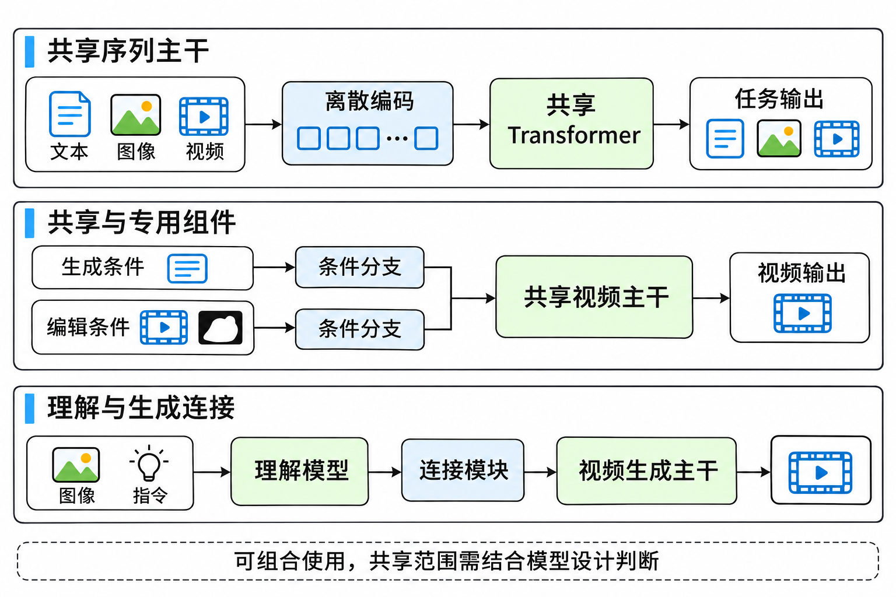
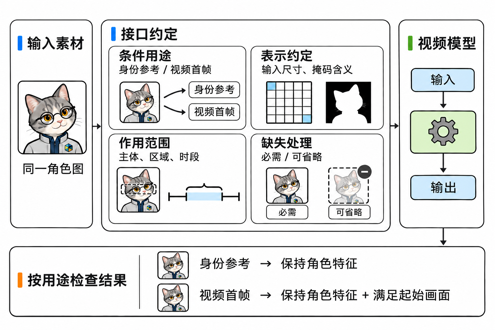
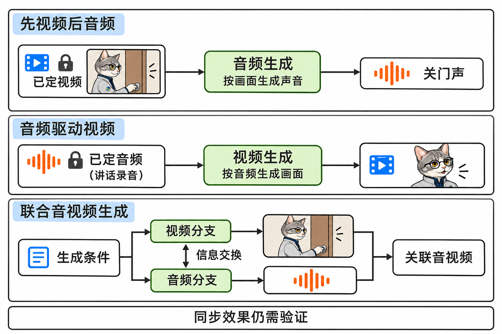
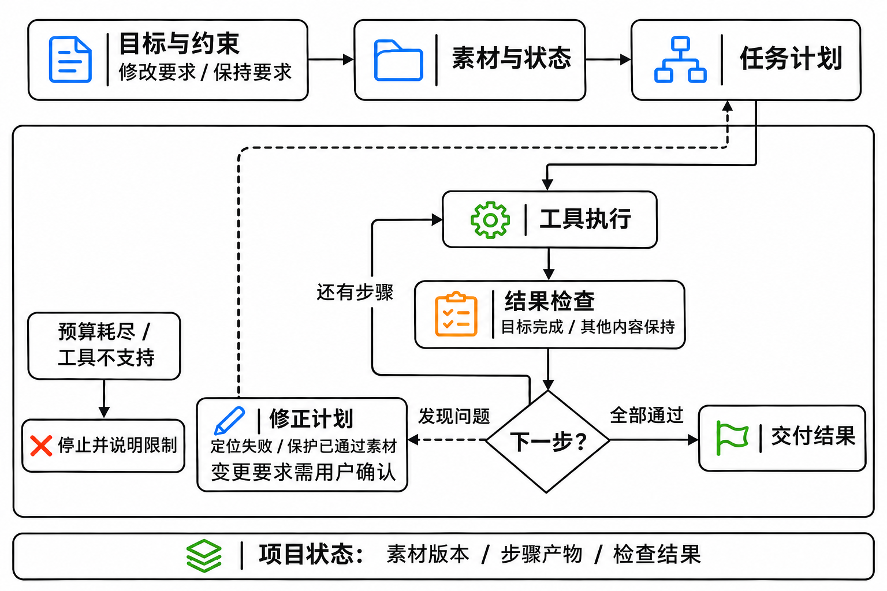
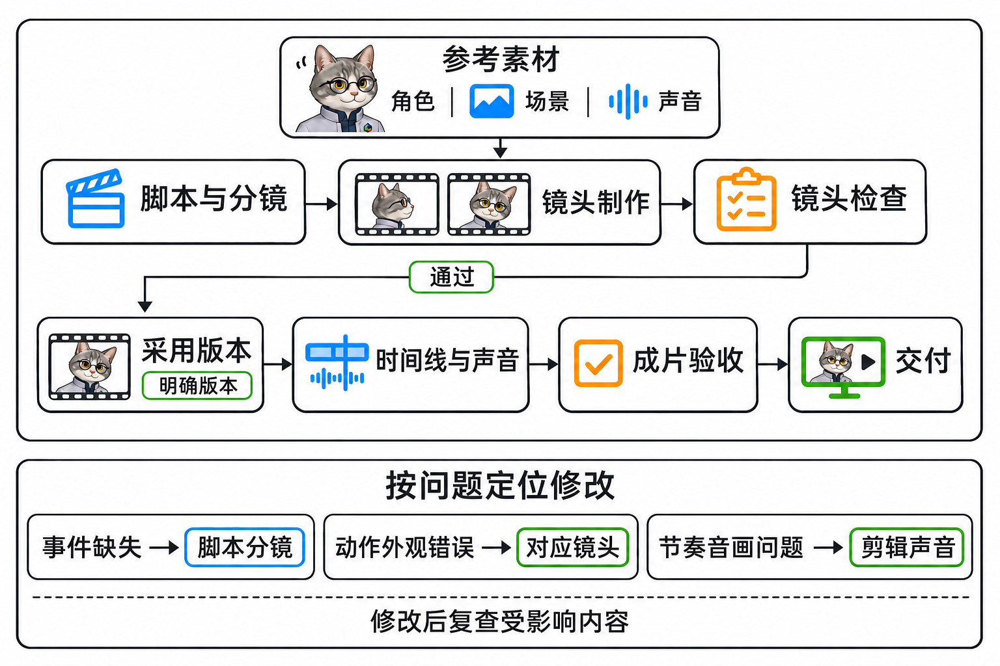
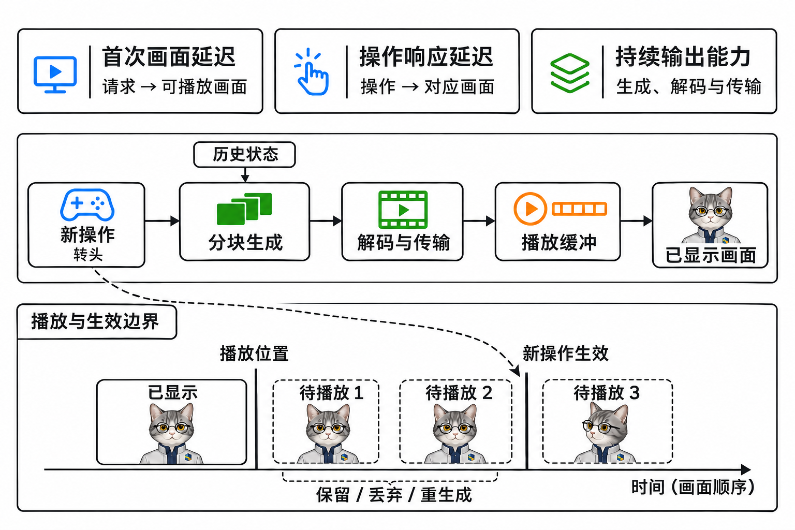
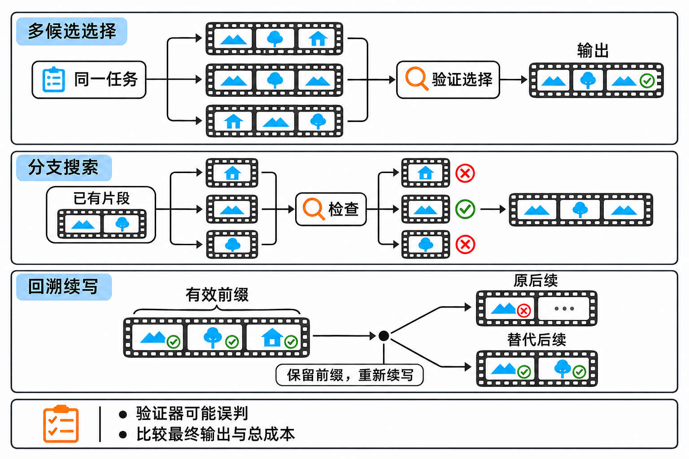

# 4.6 AI 视频多任务建模、创作工作流与能力拓展

> 本章承接前面的模型原理、生成编辑方法与训练工程，讨论不同视频任务如何共享模型或通过多个组件协作，音视频如何联合建模或通过级联方案配合，以及智能体和项目状态如何支持多轮创作。最后讨论环境预测、实时交互、几何一致性与时空推理等能力，并以合成数据和机器人规划、策略训练为例，说明应用要求与验证方法。

---

# 目录导航

[4.6.1 视频多任务的组织方式：模型共享与系统协作](#4.6.1_视频多任务的组织方式：模型共享与系统协作)
  - [4.6.1.1 面试问题：视频任务为什么采用模型共享或系统协作？两者有什么区别？](#4.6.1.1_面试问题：视频任务为什么采用模型共享或系统协作？两者有什么区别？)
  - [4.6.1.2 面试问题：多个视频任务共享模型有哪些收益与代价？何时保留专用模型？](#4.6.1.2_面试问题：多个视频任务共享模型有哪些收益与代价？何时保留专用模型？)
  - [4.6.1.3 面试问题：如何判断多个视频任务实际共享了哪些组件与参数？](#4.6.1.3_面试问题：如何判断多个视频任务实际共享了哪些组件与参数？)

[4.6.2 视频多任务模型：表征共享、架构组织与负迁移](#4.6.2_视频多任务模型：表征共享、架构组织与负迁移)
  - [4.6.2.1 面试问题：生成、编辑和理解可以共享哪些表征与组件？哪些任务差异需要保留？](#4.6.2.1_面试问题：生成、编辑和理解可以共享哪些表征与组件？哪些任务差异需要保留？)
  - [4.6.2.2 面试问题：视频多任务模型有哪些常见架构组织方式？各有什么取舍？](#4.6.2.2_面试问题：视频多任务模型有哪些常见架构组织方式？各有什么取舍？)
  - [4.6.2.3 面试问题：多任务共享为什么可能产生负迁移？如何定位和缓解？](#4.6.2.3_面试问题：多任务共享为什么可能产生负迁移？如何定位和缓解？)

[4.6.3 多任务视频模型的条件接口与组合控制](#4.6.3_多任务视频模型的条件接口与组合控制)
  - [4.6.3.1 面试问题：多任务视频模型的条件接口需要明确哪些信息？](#4.6.3.1_面试问题：多任务视频模型的条件接口需要明确哪些信息？)
  - [4.6.3.2 面试问题：多任务视频模型如何组织不同条件，并保留各自的用途与对应关系？](#4.6.3.2_面试问题：多任务视频模型如何组织不同条件，并保留各自的用途与对应关系？)
  - [4.6.3.3 面试问题：多任务视频模型组合多个条件时，如何明确作用范围与约束优先级？](#4.6.3.3_面试问题：多任务视频模型组合多个条件时，如何明确作用范围与约束优先级？)

[4.6.4 音视频生成：级联方案、联合建模与音画对齐](#4.6.4_音视频生成：级联方案、联合建模与音画对齐)
  - [4.6.4.1 面试问题：先视频后音频、音频驱动视频与联合音视频生成有什么区别？](#4.6.4.1_面试问题：先视频后音频、音频驱动视频与联合音视频生成有什么区别？)
  - [4.6.4.2 面试问题：音视频生成需要解决哪些对齐问题？如何判断对齐是否正确？](#4.6.4.2_面试问题：音视频生成需要解决哪些对齐问题？如何判断对齐是否正确？)
  - [4.6.4.3 面试问题：级联与联合音视频生成应如何选型？](#4.6.4.3_面试问题：级联与联合音视频生成应如何选型？)

[4.6.5 视频创作智能体：任务规划、工具执行与评估](#4.6.5_视频创作智能体：任务规划、工具执行与评估)
  - [4.6.5.1 面试问题：视频创作智能体与生成、编辑模型及预设工作流有何区别？](#4.6.5.1_面试问题：视频创作智能体与生成、编辑模型及预设工作流有何区别？)
  - [4.6.5.2 面试问题：视频创作智能体如何将需求转化为任务计划，并根据执行结果调整？](#4.6.5.2_面试问题：视频创作智能体如何将需求转化为任务计划，并根据执行结果调整？)
  - [4.6.5.3 面试问题：如何评估视频创作智能体的任务结果与执行过程？](#4.6.5.3_面试问题：如何评估视频创作智能体的任务结果与执行过程？)

[4.6.6 AI 视频创作工作流：脚本分镜与多轮迭代](#4.6.6_AI-视频创作工作流：脚本分镜与多轮迭代)
  - [4.6.6.1 面试问题：多镜头、多轮修改的视频创作为什么需要工作流？](#4.6.6.1_面试问题：多镜头、多轮修改的视频创作为什么需要工作流？)
  - [4.6.6.2 面试问题：脚本、参考素材、镜头制作、组接与评估如何组成可迭代的工作流？](#4.6.6.2_面试问题：脚本、参考素材、镜头制作、组接与评估如何组成可迭代的工作流？)
  - [4.6.6.3 面试问题：多镜头、多轮创作需要保存哪些项目状态、素材与版本信息？](#4.6.6.3_面试问题：多镜头、多轮创作需要保存哪些项目状态、素材与版本信息？)
  - [4.6.6.4 面试问题：多轮视频创作中，如何选择局部编辑、续写或重生成，并确定重做范围？](#4.6.6.4_面试问题：多轮视频创作中，如何选择局部编辑、续写或重生成，并确定重做范围？)

[4.6.7 视频生成的能力拓展与应用](#4.6.7_视频生成的能力拓展与应用)
  - [4.6.7.1 面试问题：视频生成模型用于交互式世界建模，还需要哪些能力？](#4.6.7.1_面试问题：视频生成模型用于交互式世界建模，还需要哪些能力？)
  - [4.6.7.2 面试问题：流式视频生成与实时交互分别需要满足哪些要求？](#4.6.7.2_面试问题：流式视频生成与实时交互分别需要满足哪些要求？)
  - [4.6.7.3 面试问题：3D/4D场景表示如何帮助视频生成保持跨视角与时间一致性？](#4.6.7.3_面试问题：3D/4D场景表示如何帮助视频生成保持跨视角与时间一致性？)
  - [4.6.7.4 面试问题：视频生成中的时空推理指什么？如何区分过程正确与视觉上合理？](#4.6.7.4_面试问题：视频生成中的时空推理指什么？如何区分过程正确与视觉上合理？)
  - [4.6.7.5 面试问题：视频生成如何利用推理时搜索与验证改善结果？为什么增加计算不一定有效？](#4.6.7.5_面试问题：视频生成如何利用推理时搜索与验证改善结果？为什么增加计算不一定有效？)
  - [4.6.7.6 面试问题：视频生成如何用于合成训练与测试数据？为什么画面逼真不代表数据有效？](#4.6.7.6_面试问题：视频生成如何用于合成训练与测试数据？为什么画面逼真不代表数据有效？)
  - [4.6.7.7 面试问题：视频生成如何辅助机器人规划与策略训练？需要验证哪些关键条件？](#4.6.7.7_面试问题：视频生成如何辅助机器人规划与策略训练？需要验证哪些关键条件？)

---

<h1 id="4.6.1_视频多任务的组织方式：模型共享与系统协作">4.6.1 视频多任务的组织方式：模型共享与系统协作</h1>

> 视频任务可以在模型层面共享组件及其参数，也可以在系统层面通过接口、任务编排和项目状态协作。本节区分这两种做法，讨论收益、代价与共享范围的判断依据；具体模型架构在4.6.2展开。

<h2 id="4.6.1.1_面试问题：视频任务为什么采用模型共享或系统协作？两者有什么区别？">4.6.1.1 面试问题：视频任务为什么采用模型共享或系统协作？两者有什么区别？</h2>

**难度评分：⭐⭐⭐⭐ (4/5)  |  考察频率：⭐⭐⭐⭐⭐ (5/5)**

视频创作往往涉及生成、编辑、理解和配音等多个任务。不同任务可能需要相近的视频表示，处理结果也需要相互衔接。模型共享侧重复用共同组件与参数，系统协作侧重组织不同步骤之间的衔接。

**1、模型共享：让多个任务复用共同的模型组件**

生成与编辑都需要处理主体外观、场景和时间变化，可以共用视频编码器、部分时空主干等组件及其参数，再通过不同条件或专用分支完成各自任务[1]。

共享的收益需要通过分任务评估确认，具体组件与架构见4.6.2。

**2、系统协作：让不同组件衔接完成创作任务**

先生成镜头、再修改服装、最后配音，需要将已有素材、修改范围和时间信息传递给后续步骤，并保存用户确认的版本。系统可以调用不同的专用模型完成这些操作，底层参数不必共享。

例如，生成与编辑共用一个视频主干，配音由独立音频模型完成，外部系统负责保存素材、安排调用并对齐音画。同一个创作系统中，既可以让部分任务共享模型，也可以组织不同模型协作。

判断区别时，模型共享看多个任务是否使用共同组件及参数；系统协作看组件之间如何传递信息、组织执行。统一的产品入口本身不能证明底层模型共享。项目状态与工作流的具体组织见4.6.5—4.6.6。

> **面试速答**：模型共享让多个任务复用共同组件及参数，系统协作让不同组件通过素材、时间信息和执行流程完成同一创作任务。前者关注模型内部的复用，后者关注任务之间的衔接，两者可以组合使用。

延伸阅读：[VideoPoet](https://arxiv.org/abs/2312.14125)、[UniVideo](https://arxiv.org/abs/2510.08377)

<h2 id="4.6.1.2_面试问题：多个视频任务共享模型有哪些收益与代价？何时保留专用模型？">4.6.1.2 面试问题：多个视频任务共享模型有哪些收益与代价？何时保留专用模型？</h2>

**难度评分：⭐⭐⭐⭐ (4/5)  |  考察频率：⭐⭐⭐⭐ (4/5)**

多个视频任务共享编码器或时空主干，可以复用共同的视频表示，但也可能让任务之间相互干扰。是否共享，应比较模型在各任务上的表现、资源开销和维护需求。

**1、共享模型有哪些收益？**

生成与编辑都需要处理主体外观、场景和运动。共享组件可以让不同任务的训练信号共同改善这些表示，减少各自重复学习；对于数据较少的任务，也可能借助其他任务学到的能力提高效果。

部署时，如果多个任务使用同一份常驻权重，还可能减少模型存储和重复加载的开销。不过，参数共享不代表单次推理的计算量一定减少，实际收益仍需测量。

**2、共享模型有哪些代价？**

- **任务相互干扰。** 为了生成任务而更新的参数，可能损害编辑任务对原内容的保持能力。如果引入其他任务后，目标任务表现下降，就发生了负迁移，*具体见[4.6.2.3](#4.6.2.3_面试问题：多任务共享为什么可能产生负迁移？如何定位和缓解？)。*
- **训练与验证更复杂。** 需要安排不同任务的数据比例、损失权重和参数更新范围，并在更新后检查各任务表现。例如，UNIC 的消融实验表明，直接联合训练与逐步引入任务的训练安排，对相机控制等任务的效果有明显影响[2]。
- **版本维护相互牵连。** 修改共享权重可能同时改变多个任务的输出，发布和回滚需要考虑所有受影响任务。

**3、何时保留专用分支或独立模型？**

任务之间仍有较多共同能力，只是输入、输出或控制方式不同，可以保留共享主干，增加适配器或任务专用分支，不必直接拆成独立模型。

如果经过合理调整后，共享仍使某项关键能力持续退化，或不同任务的计算与发布要求难以兼顾，则可以保留独立模型。例如，实时预览强调低延迟，离线制作强调高质量，两者可以采用不同规模的模型。

最终应逐项比较任务质量、延迟、显存及维护开销。*共享范围的架构组织方式见[4.6.2](#4.6.2_视频多任务模型：表征共享、架构组织与负迁移)。*

> **面试速答**：共享模型可能复用共同表示、改善数据利用，并减少重复存储和加载；代价是负迁移、训练验证复杂度以及版本耦合。任务差异可以先通过专用分支处理，持续退化或部署要求难以兼顾时再考虑独立模型。是否共享，应按各任务的实际效果和成本判断。

延伸阅读：[VACE](https://arxiv.org/abs/2503.07598)、[UniVideo](https://arxiv.org/abs/2510.08377)

<h2 id="4.6.1.3_面试问题：如何判断多个视频任务实际共享了哪些组件与参数？">4.6.1.3 面试问题：如何判断多个视频任务实际共享了哪些组件与参数？</h2>

**难度评分：⭐⭐⭐⭐ (4/5)  |  考察频率：⭐⭐⭐⭐⭐ (5/5)**

判断多个任务实际共享了什么，需要结合组件调用关系、权重与训练配置检查。统一入口可以分发给独立模型，共享主干也可以搭配任务专用输入与输出组件。

表6-1 视频任务共享范围的判断依据

| 检查方面 | 需要确认的内容 |
| --- | --- |
| 接口 | 是否使用统一的任务描述与输入约定，输入之后是进入共同模型，还是分发给不同模型 |
| 表示 | 是否采用共同的视频编码方式，潜变量或token是否具有兼容的含义，特征能否直接复用 |
| 参数 | 哪些编码器、主干层或输出组件共用同一组权重，哪些采用任务专用组件 |
| 训练方式 | 哪些任务参与共享参数的训练，采用联合训练、分阶段训练，还是各自训练后组合使用 |

这四个方面需要结合判断。例如，潜变量形状相同，不代表特征含义兼容；多个任务共用主干，也不代表它们使用完全相同的输入、输出路径，或所有参数都由各任务共同训练。

检查时可以列出各任务实际调用的组件及其权重来源，再核对哪些参数参与哪些任务的训练。

模型文件或检查点的数量只能作为辅助信息。同一文件可以包含多个独立组件，共享主干也可以搭配单独保存的适配器，应以实际参数关系和训练配置为准。

这些检查说明的是共享范围。共享之后是否改善质量、降低成本，*还需结合[4.6.1.2](#4.6.1.2_面试问题：多个视频任务共享模型有哪些收益与代价？何时保留专用模型？)讨论的任务表现与成本另行评估。*

> **面试速答**：从接口、表示、参数和训练方式判断多个视频任务实际共享了什么，并说明任务专用组件。统一入口、相同张量形状或单个检查点，都不足以证明模型完全共享。共享范围看实现，实际收益看任务评估。

延伸阅读：[VideoPoet](https://arxiv.org/abs/2312.14125)、[VACE](https://arxiv.org/abs/2503.07598)、[Omni-Video](https://arxiv.org/abs/2507.06119)、[UniVideo](https://arxiv.org/abs/2510.08377)

---

<h1 id="4.6.2_视频多任务模型：表征共享、架构组织与负迁移">4.6.2 视频多任务模型：表征共享、架构组织与负迁移</h1>

> 本节讨论视频任务如何共享表征与模型组件、怎样组织任务专用路径，以及如何识别和缓解负迁移，即引入其他任务后目标任务表现反而下降。共享范围需要结合表示兼容性、训练目标和分任务验证确定，不预设所有任务都应共用完整主干。

<h2 id="4.6.2.1_面试问题：生成、编辑和理解可以共享哪些表征与组件？哪些任务差异需要保留？">4.6.2.1 面试问题：生成、编辑和理解可以共享哪些表征与组件？哪些任务差异需要保留？</h2>

**难度评分：⭐⭐⭐⭐ (4/5)  |  考察频率：⭐⭐⭐⭐⭐ (5/5)**

生成、编辑和理解都需要处理主体、场景、动作和时间关系，因此可以复用部分视频表示及模型组件。但它们使用这些信息的目的不同，共享时仍需保留各自的输入处理、输出方式和训练要求。

**1、可以共享哪些表征与组件？**

- **视频表示与编码组件。** 在采用共同编码方式时，多个任务可以复用视频token或潜变量及其编码器，避免各自建立完全独立的视频表示。编码后的信息还需满足各任务对细节和语义的需求。
- **时空特征与主干网络。** 主体外观、对象运动和帧间关系，可由共享的部分时空层提取或建模。例如，生成与编辑可以共用视频主干，通过不同条件完成新视频合成或已有视频修改。
- **文本与视觉的对齐组件。** 如果多个任务需要根据指令定位对象、动作或属性，可以复用相应的文本编码器或跨模态连接组件。

共享不要求所有任务采用同一种视频表示。理解侧与生成侧使用不同特征时，也可以通过连接模块传递信息，但需要训练这种映射，不能仅因张量形状相同就直接交换特征。

**2、哪些任务差异需要保留？**

- **输入与可用信息不同。** 生成根据文本、参考图等条件合成视频；编辑还需读取源视频，区分修改内容与保持内容；理解则根据已有视频回答问题、识别动作或定位事件。采用自回归生成时，还需通过因果掩码等方式，防止当前预测位置读取后续目标内容。
- **输出要求不同。** 生成和编辑输出视频，需要还原画面细节；理解通常输出文本、类别或时间区间。因此可以共享部分主干，同时保留视频解码器、文本输出头等不同组件。
- **训练目标不同。** 扩散或流匹配生成与语言建模、分类等理解目标存在差异；即使统一采用下一token预测，各任务的预测内容和输入组织也不同，仍需明确训练哪些位置、如何安排任务数据。

例如，“描述人物的衣服”和“把衣服改成红色”都需要识别人物与服装，但前者输出描述，后者还要生成修改后的画面，并保持人物身份、动作和背景。共同语义可以复用，编辑所需的细节生成与保持要求仍需专门处理。

> **面试速答**：三类任务可以共享视频编码、部分时空主干及文本—视觉对齐组件，复用主体、场景和运动信息；但输入可用范围、输出形式和训练目标存在差异，需要保留相应处理路径。共享不要求所有任务使用完全相同的表示，也不意味着理解特征能直接用于视频生成。

延伸阅读：[Emu3](https://arxiv.org/abs/2409.18869)、[Omni-Video](https://arxiv.org/abs/2507.06119)、[UniVideo](https://arxiv.org/abs/2510.08377)

<h2 id="4.6.2.2_面试问题：视频多任务模型有哪些常见架构组织方式？各有什么取舍？">4.6.2.2 面试问题：视频多任务模型有哪些常见架构组织方式？各有什么取舍？</h2>

**难度评分：⭐⭐⭐⭐⭐ (5/5)  |  考察频率：⭐⭐⭐⭐ (4/5)**

组织视频多任务模型，需要决定哪些计算由多个任务共用，哪些交给专用组件。下面三种方式分别体现了共享主干、保留任务分支和连接不同模型的思路，可以组合使用。

表6-2 视频多任务模型的常见架构组织方式

| 组织方式 | 核心做法 | 主要优势 | 主要代价 |
| --- | --- | --- | --- |
| 多模态离散token与共享Transformer | 将文本、图像和视频分别编码为离散token，由共享Transformer根据任务格式处理和预测序列 | 多种任务可以采用相近的序列建模方式，减少独立主干的数量 | 视频token较多，逐token生成可能耗时；画面细节受视觉编码与解码质量影响 |
| 共享主干与任务专用组件 | 共用部分编码器或时空主干，为不同任务配置条件分支、适配器或输出头 | 能复用共同能力，同时保留输入、输出和控制方式的差异 | 需要确定共享位置，并承担任务分支的训练与维护开销 |
| 理解模型与视频生成主干连接 | 理解模型处理多模态指令，通过连接模块把相关特征传给扩散或流模型 | 可以复用已有理解模型与视频生成模型，不必让两者采用相同的生成目标 | 需要训练特征映射，避免遗漏控制信息；两个主干也增加了计算与调试环节 |

**如何理解这些取舍？**

第一种方式尽量采用共同的序列处理方式。例如，Emu3把多模态输入组织为离散token序列，使用共享Transformer建模[3]。但统一为token并不会消除视频序列长度和视觉重建质量的限制。

第二种方式允许任务只共享一部分计算。例如，生成与编辑共用视频主干，编辑侧增加源视频和掩码的条件处理组件。第三种则保留理解与生成的不同主干，通过连接模块交换信息；UniVideo采用多模态理解模型与MMDiT结合的设计[4]。

这些方式并不互斥：理解模型连接的生成器，本身还可以通过共享主干支持多种生成和编辑任务。连接了理解模型，也不代表生成器本身能够直接完成所有理解任务。

选择时，应先明确任务范围，再考虑已有预训练模型、数据规模、目标画质和推理预算。例如，已有成熟理解模型与视频生成器时，可以优先评估连接方案；主要扩展生成与编辑条件时，可以先评估共享主干和条件组件。最终仍需比较模型在各任务上的表现与实际运行成本。

图6-1对比了三种组织方式中的共享组件与信息流，表6-2则概括其收益和代价。

  
  
图6-1 视频多任务模型的三种架构组织方式

> **面试速答**：常见方式包括多模态离散token与共享Transformer、共享主干加任务专用组件，以及连接理解模型与视频生成主干。它们分别在序列长度、任务差异处理和跨模型特征对齐上承担不同代价，也可以组合。选择依据是任务需求、已有模型、训练数据与运行预算。

延伸阅读：[VACE](https://arxiv.org/abs/2503.07598)、[Omni-Video](https://arxiv.org/abs/2507.06119)

<h2 id="4.6.2.3_面试问题：多任务共享为什么可能产生负迁移？如何定位和缓解？">4.6.2.3 面试问题：多任务共享为什么可能产生负迁移？如何定位和缓解？</h2>

**难度评分：⭐⭐⭐⭐⭐ (5/5)  |  考察频率：⭐⭐⭐⭐⭐ (5/5)**

负迁移是指引入其他任务后，目标任务的表现反而低于可比的单任务或原有训练方案。例如，加入视频生成任务后，编辑模型对未修改区域的保持能力下降。

判断时需要说明训练数据、计算预算和评测条件，不能仅凭一次指标下降，就认定任务之间存在冲突。

**1、为什么会产生负迁移？**

- **参数更新相互干扰。** 多个任务更新同一组参数时，有利于一个任务的变化，可能损害另一个任务需要的表示。
- **训练贡献不均衡。** 某项任务采样更多，或其加权梯度明显更大，可能主导共享参数的更新。损失数值较大，不一定意味着梯度也更大。
- **共享容量或路径不合适。** 同一套组件可能难以兼顾所有任务需要的细节、语义或输入分布；后期只训练一个任务，也可能使其他任务能力退化。

**2、如何定位问题？**

先固定评测集和推理配置，比较单任务基线、共享前模型与多任务训练结果，确认具体是哪项能力下降。

随后检查目标任务实际获得的样本量和更新次数。固定总算力时，加入其他任务会分摊训练资源；若目标任务获得的训练量减少，应补充训练量相同的单任务对照，区分资源分摊与任务干扰的影响。

再分别调整任务采样比例、损失权重和共享范围，观察退化是否减轻，每次尽量只改变一个因素。必要时检查共享参数上的梯度大小和方向：不同任务梯度方向相反，可以作为干扰线索，但不足以单独证明最终退化由它造成。

**3、如何缓解？**

- **训练贡献失衡时**，调整任务采样比例、损失归一化和权重。GradNorm进一步根据梯度量级与相对学习进度，动态调整任务权重[5]。
- **梯度方向冲突时**，可以评估PCGrad等方法。PCGrad通过投影去除任务梯度中与另一任务梯度冲突的分量，但实际收益仍需验证[6]。
- **共享范围不合适时**，减少共享层，或增加任务专用适配器、分支；后期单任务微调导致其他能力退化时，可混入其他任务的数据继续训练。

调整后应重新检查所有相关任务，避免改善一项能力的同时损害另一项。如果经过调整仍无法满足关键任务要求，再考虑独立模型，*选择依据见[4.6.1.2](#4.6.1.2_面试问题：多个视频任务共享模型有哪些收益与代价？何时保留专用模型？)。*

> **面试速答**：负迁移可能来自共享参数更新干扰、训练贡献失衡或共享容量不足。排查时先建立可比基线，确认目标任务的训练量，再分别检查采样、损失权重和共享范围。缓解方法包括平衡训练贡献、处理冲突梯度和增加专用组件，最后验证全部任务的表现。

延伸阅读：[Multi-Task Learning as Multi-Objective Optimization](https://arxiv.org/abs/1810.04650)

---

<h1 id="4.6.3_多任务视频模型的条件接口与组合控制">4.6.3 多任务视频模型的条件接口与组合控制</h1>

> 本节讨论模型如何解释不同任务的条件：输入用于约束什么，采用何种表示，哪些信息需要时空对应，以及组合要求如何处理。这里的条件接口主要指输入组织与模型使用之间的约定，不只指对外API；兼容输入也不要求所有模态共用编码器或注入路径。

<h2 id="4.6.3.1_面试问题：多任务视频模型的条件接口需要明确哪些信息？">4.6.3.1 面试问题：多任务视频模型的条件接口需要明确哪些信息？</h2>

**难度评分：⭐⭐⭐⭐ (4/5)  |  考察频率：⭐⭐⭐⭐⭐ (5/5)**

条件接口是输入提供方与模型之间的约定：输入代表什么、采用什么格式，以及模型应按什么用途使用它。对于多任务模型，仅说明“支持图片或视频输入”还不够，因为相同形式的输入可能承担不同作用。因此，条件接口需要明确以下四个方面：

- **条件用途。** 一张人物图像可以用作身份参考，也可以作为视频首帧。身份参考侧重保持人物特征，首帧条件还约束起始画面；一段视频也可能是待编辑内容，或只提供运动参考。接口需要区分这些用途。
- **表示约定。** 明确模型接收原始图像、视频还是编码后的特征，并规定尺寸、帧率、数值范围等要求。掩码还需说明哪些值表示可编辑区域，避免不同模块对编辑区域和保留区域的解释相反。
- **作用范围。** 说明条件关联哪个主体、哪些时间和区域。例如，掩码约束局部编辑范围，指定关键帧对应特定时间；全局风格参考通常不要求与输出逐像素对应。
- **缺失处理。** 明确哪些条件必需、哪些可以省略，以及省略时如何表示。文本生成视频可以不提供源视频，局部视频编辑则需要待编辑内容。填入零值只有在模型明确支持这种约定时，才能表示条件缺失。

这些信息可以通过输入字段、任务标识和固定的模型使用约定共同表达，不一定全部写入文本指令。

接口约定清楚后，还需验证模型是否真正按约定使用条件。例如，将同一人物图分别作为身份参考和首帧输入，应检查前者是否保持人物特征、后者是否还满足起始画面的要求。

图6-2展示了条件接口的四项约定，以及如何按用途检查模型结果；*具体的编码与时空对齐方法见[4.6.3.2](#4.6.3.2_面试问题：多任务视频模型如何组织不同条件，并保留各自的用途与对应关系？)。*

  
  
图6-2 条件接口的四项约定与按用途验证

> **面试速答**：条件接口需要明确用途、表示、作用范围和缺失处理。同一张图作为身份参考或视频首帧，要求不同；掩码值和条件省略方式也必须约定清楚。接口能接收输入之后，还要验证模型是否按对应任务要求使用它。

延伸阅读：[VideoComposer](https://arxiv.org/abs/2306.02018)、[VACE](https://arxiv.org/abs/2503.07598)、[ControlNet](https://arxiv.org/abs/2302.05543)

<h2 id="4.6.3.2_面试问题：多任务视频模型如何组织不同条件，并保留各自的用途与对应关系？">4.6.3.2 面试问题：多任务视频模型如何组织不同条件，并保留各自的用途与对应关系？</h2>

**难度评分：⭐⭐⭐⭐ (4/5)  |  考察频率：⭐⭐⭐⭐ (4/5)**

多任务模型需要同时保留条件的内容与角色：同一张图像作为首帧、身份参考或编辑目标，要求并不相同。可以使用不同编码器，但编码后的条件仍应关联正确的任务、主体及时间或区域。

**1、按任务角色组织条件**

表6-3列出常见条件的组织方式。角色可以由任务标识、专用输入分支、位置安排或模型明确支持的其他约定表达，不要求所有用途都使用相同格式。

表6-3 不同视频条件的编码与对应关系

| 条件用途 | 编码与组织方式 | 需要保留的对应关系 |
| --- | --- | --- |
| 首帧条件 | 按模型设计，将图像编码为视觉特征或视频潜变量中的起始条件 | 明确对应视频起始位置，预处理应符合目标画幅 |
| 局部视频编辑 | 编码源视频，并结合掩码和文本指令表示修改要求 | 源帧与掩码在时间和空间上对应，区分修改与保持区域 |
| 姿态或深度控制 | 将控制图序列或坐标序列转换为模型支持的结构特征 | 保留采样时间、坐标系及视角关系 |
| 身份或风格参考 | 提取参考图特征，通过条件模块参与生成 | 关联正确主体或属性，不要求复制参考图的位置与背景 |

编码后的条件可以通过注意力、拼接或控制分支进入生成主干，*具体机制见 [4.2.1.3](02_AI视频生成原理与模型架构.md#4.2.1.3_面试问题：视频生成中，条件信息有哪些常见注入方式？应如何选择？)。*

**2、保留各类条件真正需要的对应关系**

若同一张图同时承担多个角色，应分别明确用途，避免把身份保持误作整幅画面保持。

预处理与编码应遵守这些约定。*分块后的时间进度、采样率和坐标对应，见 [4.4.5.1](04_长视频生成与多镜头叙事.md#4.4.5.1_面试问题：长视频中的控制条件如何对应对象、时间段与空间范围？) 与 [4.4.5.2](04_长视频生成与多镜头叙事.md#4.4.5.2_面试问题：长视频分段生成时，相机运动与主体运动条件如何保持时空对齐？)。*

验证时可以固定其他条件，分别改变输入内容与任务角色。例如，同一人物图作为身份参考时允许构图变化，作为首帧时则检查起始画面是否满足要求；不能只检查接口是否成功接收图像。

> **面试速答**：按任务角色组织条件，保留首帧的时间位置、编辑源与掩码的时空对应，以及参考图与主体或属性的关联。不同条件可分别编码，角色通过模型支持的输入约定表达；验证时检查模型是否按对应用途使用条件。

延伸阅读：[ControlNet](https://arxiv.org/abs/2302.05543)、[VideoComposer](https://arxiv.org/abs/2306.02018)、[VACE](https://arxiv.org/abs/2503.07598)

<h2 id="4.6.3.3_面试问题：多任务视频模型组合多个条件时，如何明确作用范围与约束优先级？">4.6.3.3 面试问题：多任务视频模型组合多个条件时，如何明确作用范围与约束优先级？</h2>

**难度评分：⭐⭐⭐⭐ (4/5)  |  考察频率：⭐⭐⭐⭐⭐ (5/5)**

组合多个条件时，需要先说明每个条件约束什么、作用于哪个对象和时段，再明确哪些要求必须满足、哪些允许调整。不能仅凭输入来自文本、图像还是视频，就设置固定优先级。

**1、明确各条件的用途与作用范围**

例如，用人物参考图保持身份，用姿态序列控制动作，再用文本修改背景。三种条件分别约束人物特征、运动和场景，可以共同参与生成，不要求完整复制参考图中的姿态与背景。

多个主体或分时段控制时，还需说明条件对应谁、何时生效。例如，一条运动轨迹只控制人物A，不能误用于人物B。*具体编码与时空对应方法见[4.6.3.2](#4.6.3.2_面试问题：多任务视频模型如何组织不同条件，并保留各自的用途与对应关系？)。*

**2、依据任务要求确定优先关系**

需要区分必须满足的约束与允许调整的偏好。例如，任务要求修改背景风格，同时保持人物身份与动作；背景的色调可以在约定范围内调整，人物则属于需要保留的内容。

优先关系应来自任务约定或用户要求。文本指令不天然高于参考图，首尾帧也不在所有任务中都必须严格保持。

如果要求确实互斥，已有约定能够决定时按约定处理；没有明确依据时，需要澄清允许修改哪项。例如，同时要求固定相机和相机绕主体环拍，就需要调整要求，改变条件权重无法让两者同时成立。

**3、按约定执行，并逐项验证**

将约定落实为模型支持的输入角色、掩码、参考条件及工具选择。写明优先级并不保证模型能够执行；对兼容要求，可以在模型支持的范围内调整条件强度，或先生成再局部编辑，并检查后续操作是否破坏已满足的要求。

验证时分别检查条件遵循、内容保持及组合要求。兼容要求执行失败时，先核对各条件是否正确传入，再比较单条件与组合条件的结果；*长视频前段有效、后段逐渐失效时，按 [4.4.5.4](04_长视频生成与多镜头叙事.md#4.4.5.4_面试问题：长视频中的条件控制逐段失效时，如何排查？)检查条件延续与更新。*

> **面试速答**：先明确每个条件的用途、对象和时空范围，再根据任务要求区分必须满足的约束与可调整偏好。优先级不由模态决定，互斥要求需要依据约定裁决或澄清。将要求落实为模型支持的输入或操作，再分别验证单项与组合效果。

延伸阅读：[VideoComposer](https://arxiv.org/abs/2306.02018)、[VACE](https://arxiv.org/abs/2503.07598)

---

<h1 id="4.6.4_音视频生成：级联方案、联合建模与音画对齐">4.6.4 音视频生成：级联方案、联合建模与音画对齐</h1>

> 本节讨论画面与声音如何生成、二者需要满足哪些语义和时间关系，以及如何根据已有素材、控制要求和资源选择方案。级联与联合建模各有适用场景，不预设联合生成必然更同步或更高效。

<h2 id="4.6.4.1_面试问题：先视频后音频、音频驱动视频与联合音视频生成有什么区别？">4.6.4.1 面试问题：先视频后音频、音频驱动视频与联合音视频生成有什么区别？</h2>

**难度评分：⭐⭐⭐⭐ (4/5)  |  考察频率：⭐⭐⭐⭐⭐ (5/5)**

主要区别在于声音与画面是否有一方先确定，以及生成过程中如何建立两者的联系。前两种先确定一种内容，再据此生成另一种；联合生成则在同一模型框架中学习并生成相互关联的声音与画面。

**1、先视频后音频：根据已有画面生成声音**

先提供或生成视频，再根据画面事件和文本要求生成音效、语音或音乐。

例如，画面中门在第3秒关上，音频模型需要在对应位置生成关门声。在这一步中，视频已经确定，声音生成可以适配画面，但不会直接改变门关闭的动作。

**2、音频驱动视频：根据已有声音生成画面**

先提供或生成音频，再以声音的内容和时间信息指导视频生成。

例如，给定讲话录音，生成对应的人物口型；或根据音乐节拍生成动作。此时音频已经确定，视频需要遵循相关的发音、节奏或动作要求。

**3、联合音视频生成：在同一框架中建模声音与画面的联系**

训练时使用配对的音视频，学习事件、声音与时间之间的关系；生成时通过共享上下文或跨模态连接，使声音与画面的生成相互关联。

例如，生成关门场景时，模型既生成门的运动，也生成对应的关门声，并学习两者在时间上的联系。实现上可以使用不同的音频、视频分支及解码器，不要求全部组件共享。MM-Diffusion就是通过连接音频与视频去噪网络，让两种模态在生成过程中交换信息[7]。

联合生成不要求音频和视频在程序中同一时刻完成，也不保证每次输出都同步。*具体对齐要求与验证方式见[4.6.4.2](#4.6.4.2_面试问题：音视频生成需要解决哪些对齐问题？如何判断对齐是否正确？)。*

这三种方式不是完全互斥的模型类别：联合模型也可以支持固定视频生成音频等条件任务。“原生音视频”或产品同时交付声音与画面，也不足以单独判断底层采用哪种方式。

图6-3对比了三种方式的依赖关系：哪些内容已先确定，以及声音与画面在生成过程中如何联系。

  
  
图6-3 音视频生成的三种依赖关系

> **面试速答**：先视频后音频，让声音适配已有画面；音频驱动视频，让画面遵循已有声音；联合生成则在同一框架中学习和生成关联的音视频。前两种主要描述使用流程，联合生成强调建模方式。级联可以同步，联合生成也需要验证同步效果。

延伸阅读：[SyncFlow](https://arxiv.org/abs/2412.15220)、[Movie Gen](https://arxiv.org/abs/2410.13720)

<h2 id="4.6.4.2_面试问题：音视频生成需要解决哪些对齐问题？如何判断对齐是否正确？">4.6.4.2 面试问题：音视频生成需要解决哪些对齐问题？如何判断对齐是否正确？</h2>

**难度评分：⭐⭐⭐⭐ (4/5)  |  考察频率：⭐⭐⭐⭐ (4/5)**

音画对齐需要检查声音与画面的内容、时间和声源关系是否符合任务要求。它不只是让两段素材长度相同，也不要求每个声音都对应画面中的可见动作。

**1、需要检查哪些对应关系？**

- **语义对应。** 声音是否符合画面事件。例如，敲击木桌应出现相应的敲击声，不能仅因声音出现的时间正确，就接受玻璃破碎声。
- **时间对应。** 声音的起点、持续时间和先后顺序是否与事件匹配。例如，碰撞声是否对应物体接触，讲话的发音是否与口型变化匹配。
- **声源对应。** 声音是否属于正确的人物或对象。例如，两人交替讲话时，对白不能对应到未说话的人物。旁白、画外声和环境声可以合理存在，不必强行绑定可见对象。
- **任务要求下的节奏配合。** 音乐卡点视频可能要求动作或切镜对应节拍，一般视频则不必如此。是否检查这类关系，应由创作要求决定。

**2、如何判断对齐是否正确？**

先分别确认画面和声音是否清楚可辨，再选取关键事件，结合连续画面与对应音频检查，不能只看单帧或只听声音。

例如，检查一段人物关门视频，可以分别判断：声音是否像关门声、是否对应门关闭的时刻，以及是否出现了没有依据的额外撞击声。对白场景还需检查说话人物、语音内容与口型关系。

对较长视频，应覆盖开头、中间和结尾的相关事件，检查是否存在固定的音画时间偏移，或音画偏差是否随播放时间逐渐增大。

可以使用适用的口型同步指标、事件时间偏差等辅助判断，并对关键片段人工复核。整体音画相似度高，只能说明两者可能相关，不能证明每次碰撞、每段对白都准确对应。

> **面试速答**：核心是检查语义、时间和声源对应，节奏配合按任务要求判断。评估时结合连续画面与音频检查关键事件，并覆盖不同时间段，识别固定偏移和逐渐失步。音质、画质或整体相似度，都不能代替具体事件的对齐检查。

延伸阅读：[JavisDiT](https://arxiv.org/abs/2503.23377)、[SyncFlow](https://arxiv.org/abs/2412.15220)、[VideoPoet](https://arxiv.org/abs/2312.14125)

<h2 id="4.6.4.3_面试问题：级联与联合音视频生成应如何选型？">4.6.4.3 面试问题：级联与联合音视频生成应如何选型？</h2>

**难度评分：⭐⭐⭐⭐ (4/5)  |  考察频率：⭐⭐⭐⭐ (4/5)**

选型首先取决于已有素材和允许修改的范围，再比较音画对齐、独立编辑能力及完整制作成本。*生成方式的区别见[4.6.4.1](#4.6.4.1_面试问题：先视频后音频、音频驱动视频与联合音视频生成有什么区别？)。*

表6-4 不同创作要求下的音视频生成方案选择

| 创作要求 | 优先评估的方案 | 需要验证的能力 |
| --- | --- | --- |
| 视频已确定，需要补充声音 | 根据视频生成音频 | 画面保持不变，声音符合事件与时间要求 |
| 录音或音乐已确定，需要生成画面 | 音频驱动视频 | 保持已有音频，口型、动作或节奏符合要求 |
| 音画都可生成与调整 | 联合生成，或规划后分阶段生成 | 音画整体质量、同步表现及后续修改能力 |

表格说明的是任务与生成流程的匹配关系。联合模型如果支持固定视频生成音频，也可以用于第一类任务，不能只凭模型采用联合架构就排除它。

**1、检查后续修改是否方便、可靠**

一次生成效果好，还需要看能否完成实际修改。例如，只替换对白时，人物外观和动作能否保持；只修改画面时，已有声音能否保留并继续对应。

还应检查对白、音乐和音效能否分别输出或修改。若只能得到混合后的声音，后续调整某一部分可能需要额外分离或重新生成。联合生成模型是否支持这些操作，需要单独验证。

**2、比较满足交付要求的完整成本**

使用现成模型时，在相同输出规格和质量要求下，比较音质、画质、对齐效果、耗时及资源开销。成本应包括生成、解码、后处理和修复重试，级联方案还需计入各模块调用及衔接开销。

自行训练或微调时，再比较可用的配对音视频数据、预训练模型和训练预算。联合建模可以结合单模态预训练与分阶段训练，不能仅凭“联合”或“级联”判断哪种一定更贵。

最终应以满足创作要求的可交付结果为依据，不能只比较一次成功样例或某个模块的生成速度。

> **面试速答**：先确定哪些素材必须保持，再选择相应的生成流程；音画都可调整时，再比较联合与分阶段方案。重点验证同步质量、独立修改和内容保持能力，并计算包含后处理与重试的完整成本。自行训练时，还需考虑数据和训练资源。

延伸阅读：[Movie Gen](https://arxiv.org/abs/2410.13720)、[MM-Diffusion](https://arxiv.org/abs/2212.09478)、[SyncFlow](https://arxiv.org/abs/2412.15220)、[VideoPoet](https://arxiv.org/abs/2312.14125)

---

<h1 id="4.6.5_视频创作智能体：任务规划、工具执行与评估">4.6.5 视频创作智能体：任务规划、工具执行与评估</h1>

> 本节讨论视频创作智能体（Agent）如何理解任务与素材、选择工具，并根据执行结果调整后续操作。这里重点分析操作决策与决策效果，*[4.6.6](#4.6.6_AI-视频创作工作流：脚本分镜与多轮迭代)则讨论制作步骤、项目素材与版本如何组织*；智能体可以承担工作流中的部分决策。

<h2 id="4.6.5.1_面试问题：视频创作智能体与生成、编辑模型及预设工作流有何区别？">4.6.5.1 面试问题：视频创作智能体与生成、编辑模型及预设工作流有何区别？</h2>

**难度评分：⭐⭐⭐⭐ (4/5)  |  考察频率：⭐⭐⭐⭐⭐ (5/5)**

三者主要区别在于承担的职责：生成、编辑模型处理内容，预设工作流组织执行步骤，视频创作智能体则根据目标、素材状态和执行反馈，选择接下来采取什么操作。它们可以共同组成一个创作系统。

表6-5 生成编辑模型、预设工作流与视频创作智能体的职责比较

| 对象 | 主要职责 | 视频创作中的例子 |
| --- | --- | --- |
| 生成、编辑模型 | 根据输入条件生成视频或修改已有内容 | 根据参考图生成镜头，或按指令修改人物服装 |
| 预设工作流 | 按预先定义的步骤、条件和分支安排执行 | 先生成镜头，再补充音效；检查失败后按规则重试 |
| 视频创作智能体 | 利用模型判断当前任务需要哪些操作，并根据结果调整选择 | 根据素材和修改要求选择编辑工具，检查结果后决定继续修改、接受结果或停止 |

例如，用户要求“只修改第二个镜头的人物外套颜色”：

编辑模型负责执行换色。预设工作流可以按固定规则定位镜头、调用编辑工具并检查结果。智能体则可以结合现有素材和工具能力，判断需要处理哪个人物、采用什么编辑方式，并根据检查结果选择下一步操作。

区别在于这些操作选择如何产生，而不是系统调用了多少工具。工作流也可以包含自动重试和错误分支；仅有多轮对话或多次工具调用，也不足以说明模型承担了任务决策。

三者也不是互斥的产品类别。智能体可以在预设工作流中负责部分决策，再调用生成、编辑模型完成具体操作；同一个模型也可能同时具备内容处理与工具选择能力。分析时应说明它实际承担哪些职责。

> **面试速答**：生成、编辑模型负责内容处理，预设工作流按既定规则安排执行，创作智能体结合目标、当前状态和反馈选择操作。三者可以组合使用。判断重点是模型承担了哪些决策，不能只看工具数量、多轮交互或自动重试。

延伸阅读：[ReAct](https://arxiv.org/abs/2210.03629)、[StoryAgent](https://arxiv.org/abs/2411.04925)

<h2 id="4.6.5.2_面试问题：视频创作智能体如何将需求转化为任务计划，并根据执行结果调整？">4.6.5.2 面试问题：视频创作智能体如何将需求转化为任务计划，并根据执行结果调整？</h2>

**难度评分：⭐⭐⭐⭐⭐ (5/5)  |  考察频率：⭐⭐⭐⭐ (4/5)**

视频创作智能体需要把需求拆成可执行操作，为步骤指定素材、工具和检查要求，再根据实际结果决定继续、修改或停止。计划可以随执行结果调整，但调整仍应遵守用户要求与资源预算。

**1、明确目标、修改范围与保持要求**

以“把人物外套改成红色，再将镜头延长3秒”为例，需要确定目标镜头、人物和待修改服装，并明确原片段中人物身份、动作及背景等内容的保持要求。

新增3秒的内容也应有依据，例如延续当前动作和场景；不能在续写时无故改变已确认的事件安排。

**2、把需求组织成有依赖的操作步骤**

- **局部换色。** 使用指定版本的原视频，调用支持局部编辑的工具。工具需要掩码时，再准备对应的区域信息。
- **检查编辑结果。** 确认外套已变红，并检查是否误改人物、背景或其他服装。通过检查后，将该结果作为续写素材。
- **延长镜头。** 根据编辑后视频及工具支持的历史条件续写3秒，检查衔接、人物外观和动作是否连续。

每一步都应明确输入素材、工具参数、输出产物及后续依赖。工具调用成功，只说明执行完成，仍需检查内容是否满足要求。

**3、根据失败位置调整后续操作**

如果换色时背景被误改，应先修正编辑范围、调整工具设置或更换编辑工具，避免把错误结果继续用于续写。

如果原片段编辑正确，但新增片段中的外套颜色漂移，可以保留已通过检查的原片段，在工具支持的范围内补充外观参考或调整参考条件强度，再重新生成新增片段。若修改了上游素材，则需重新检查依赖它的后续结果。

重试应有次数与成本限制。工具不支持必要操作或预算耗尽时，应说明限制；*改变创作要求与重做范围的处理见[4.6.6.4](#4.6.6.4_面试问题：多轮视频创作中，如何选择局部编辑、续写或重生成，并确定重做范围？)。*

图6-4展示了执行反馈如何影响后续决策。*项目素材、版本和状态如何保存，见[4.6.6](#4.6.6_AI-视频创作工作流：脚本分镜与多轮迭代)。*

  
  
图6-4 视频创作智能体的执行检查与后续决策

> **面试速答**：先明确目标、修改范围和保持要求，再为步骤指定素材、工具、检查标准及依赖。执行后分别检查目标是否完成、其他内容是否保持，根据失败位置修正对应步骤，避免将错误传给下游。重试受预算约束，需要改变用户要求时再澄清。

延伸阅读：[ReAct](https://arxiv.org/abs/2210.03629)、[UniVA](https://arxiv.org/abs/2511.08521)

<h2 id="4.6.5.3_面试问题：如何评估视频创作智能体的任务结果与执行过程？">4.6.5.3 面试问题：如何评估视频创作智能体的任务结果与执行过程？</h2>

**难度评分：⭐⭐⭐⭐ (4/5)  |  考察频率：⭐⭐⭐⭐ (4/5)**

评估需要同时回答：任务是否完成，以及系统为完成任务采取了什么操作、付出了多少成本。画面质量好，不代表修改对象和范围正确；调用过程顺利，也不代表最终产物符合要求。

表6-6 视频创作智能体的结果与过程评估

| 评估对象 | 检查重点 | 失败示例 |
| --- | --- | --- |
| 结果：任务完成与内容质量 | 指令、目标对象、时长和格式是否满足，画质、运动及音画关系是否合格 | 视频流畅，但改错人物或漏掉续写要求 |
| 结果：约束保持 | 修改范围之外的内容，以及多轮交互中仍有效的要求是否保留 | 外套改红了，但人物身份或已确认背景发生变化 |
| 过程：工具与素材使用 | 工具能力、参数、素材版本及步骤依赖是否正确 | 后续步骤使用旧素材，覆盖已确认修改 |
| 过程：检查与恢复 | 是否发现不合格结果，并采取有效修正或及时停止 | 将错误产物传给下游，反复执行同一失败操作 |
| 过程：效率与人工介入 | 完成任务所需的耗时、资源、调用次数及人工操作 | 大量无效重试，或频繁要求用户决定可自动处理的参数 |

**1、用多步、多轮任务检查稳定性**

评测应覆盖连续编辑、镜头续写、需求变化和工具失败等情况，并使用不同素材重复运行，统计任务成功率、关键约束违反情况和成本。

多轮任务应依据当前有效要求判断。例如，用户明确要求替换原背景后，旧背景不再是保持目标；人物身份等未被修改的约束仍需检查。

执行过程可以有不同的合理路径，应根据工具能力、依赖关系和结果判断，不要求所有系统采用同一套步骤。*内容质量与音画对齐的具体检查见[4.5.7](05_视频生成训练与工程优化.md#4.5.7_视频生成质量评估：评估维度、评审方法与迭代验证)和[4.6.4.2](#4.6.4.2_面试问题：音视频生成需要解决哪些对齐问题？如何判断对齐是否正确？)。*

**2、通过对照区分决策收益与工具能力**

使用相同的底层工具、任务集和可比预算，将智能体与预设工作流比较，观察它是否提高成功率、减少无效调用或降低人工介入。若同时更换了更强的生成模型，就不能把全部提升归因于智能体决策。

记录工具调用、输入输出版本、检查结果与计划变更，便于区分素材选错、工具失败和结果误判等问题。UniVA-Bench等多步视频任务评测可提供参考[8]，实际评测仍应覆盖目标创作场景。

> **面试速答**：结果看任务完成、内容质量与约束保持；过程看工具和素材使用、失败恢复及成本。通过多步、多轮任务和重复运行检查稳定性，再在相同工具与可比预算下对照预设工作流，判断智能体决策带来的实际收益。

延伸阅读：[AgentBoard（通用智能体评测）](https://arxiv.org/abs/2401.13178)、[OSWorld（计算机操作评测）](https://arxiv.org/abs/2404.07972)、[StoryAgent](https://arxiv.org/abs/2411.04925)

---

<h1 id="4.6.6_AI-视频创作工作流：脚本分镜与多轮迭代">4.6.6 AI 视频创作工作流：脚本分镜与多轮迭代</h1>

> 本节讨论项目级创作如何组织素材、镜头、时间线和版本，怎样根据检查结果局部修改，并追踪修改对下游内容的影响。工作流可以由人工、规则或智能体执行；脚本分镜到成片是一类典型过程，不要求简单短片或已有素材剪辑完整经历所有环节。

<h2 id="4.6.6.1_面试问题：多镜头、多轮修改的视频创作为什么需要工作流？">4.6.6.1 面试问题：多镜头、多轮修改的视频创作为什么需要工作流？</h2>

**难度评分：⭐⭐⭐⭐ (4/5)  |  考察频率：⭐⭐⭐⭐⭐ (5/5)**

多镜头、多轮创作需要持续协调不同镜头、素材和修改要求。工作流将制作步骤、素材引用和检查环节组织起来，使创作者能够保留已确认成果，并在需求变化后确定哪些内容需要更新。

它主要解决三个问题：

- **协调跨镜头要求。** 角色、服装、道具和视觉风格可能需要在多个镜头中保持一致。工作流可以让相关镜头引用明确的设定与参考素材，并安排一致性检查，而不是让每个镜头独立决定。
- **保留中间成果与确认版本。** 一轮制作可能产生多个候选，后续编辑需要明确使用哪一个。保存原素材、候选结果和已确认版本，才能避免误用旧内容，也便于比较或恢复。
- **控制修改的影响范围。** 局部修改不一定需要重做全片，但也可能影响前后镜头、声音和字幕。工作流需要记录这些关系，帮助确定重做与复查范围。

例如，第三个镜头的衣服颜色有误，而其他镜头已经确认，可以先尝试局部编辑，必要时只重做第三个镜头，再检查它与前后镜头的服装和动作是否衔接。如果修改还改变了镜头时长，则需检查后续音轨和字幕的时间位置。

一次生成可以提供完整短片，也可以作为工作流中的一个制作步骤。但仅保留提示词和最终视频，难以追踪中间选择、确认版本和修改依赖。

工作流可以由人工、规则或智能体执行，不要求采用复杂的自动化系统。简单任务可以只保留少量步骤；项目变复杂后，再增加必要的素材、版本和检查管理。*具体组织方式见[4.6.6.2](#4.6.6.2_面试问题：脚本、参考素材、镜头制作、组接与评估如何组成可迭代的工作流？)。*

> **面试速答**：多镜头、多轮创作需要协调跨镜头要求、保存已确认成果，并控制修改对其他内容的影响。工作流通过组织步骤、素材引用和检查环节支持这些需求，可以由人工、规则或智能体执行，复杂程度应与项目相适应。

延伸阅读：[VideoDirectorGPT](https://arxiv.org/abs/2309.15091)、[StoryAgent](https://arxiv.org/abs/2411.04925)

<h2 id="4.6.6.2_面试问题：脚本、参考素材、镜头制作、组接与评估如何组成可迭代的工作流？">4.6.6.2 面试问题：脚本、参考素材、镜头制作、组接与评估如何组成可迭代的工作流？</h2>

**难度评分：⭐⭐⭐⭐⭐ (5/5)  |  考察频率：⭐⭐⭐⭐ (4/5)**

这些环节通过明确的制作要求和中间产物衔接：脚本与分镜确定要呈现什么，参考素材提供人物和场景依据，镜头制作产生候选内容，组接与评估再决定哪些部分需要修改。

**1、将脚本转成镜头要求，并准备参考素材**

脚本明确人物、事件与叙事顺序，分镜进一步确定各镜头的动作、景别、运镜和大致时长。角色、服装、道具、场景及声音参考，应关联到需要使用它们的镜头。

例如，脚本要求“人物拿起钥匙后走出房间”，需要明确哪些镜头呈现拿钥匙、起身和离开，以及后续镜头中人物是否已经持有钥匙。*分镜规划的具体作用见[4.4.4](04_长视频生成与多镜头叙事.md#4.4.4_多镜头视频生成与叙事连贯性)。*

**2、制作镜头，检查后再进入组接**

根据镜头要求选择生成、编辑或续写工具，并提供对应的参考素材。获得候选后，先检查关键动作、人物外观和镜头要求是否满足，再确定采用版本。

后续镜头或操作应引用明确的素材版本。例如，前一镜头已确认人物右手持钥匙，后一镜头需要延续这一状态，不能只依赖脚本中的文字设定。

**3、组接评估，将问题反馈到对应环节**

将采用的镜头放入时间线，结合对白、音乐和音效检查叙事、衔接与节奏。单个镜头合格，不代表组接后自然，仍可能出现动作跳变、事件缺失或对白时长不匹配。

修改范围应根据问题确定：

- 关键事件在规划中就缺失，需要调整脚本或分镜。
- 某个镜头漏掉动作或人物外观错误，需要修改对应镜头。
- 镜头内容可用，但衔接或节奏不合适，可以先调整剪辑、声音或转场。

修改完成后，重新检查受影响的后续内容。例如，镜头时长改变，需要复查相关音轨、字幕和转场位置；服装设定改变，则需检查适用镜头中的服装是否一致。

图6-5展示了这些环节之间的制作与修改关系。

  
  
图6-5 视频创作的制作、验收与局部修改

工作流不要求所有项目采用固定顺序：已有视频可以直接进入编辑和组接，已确定的对白也可以先作为时间依据。关键是保留中间成果及其关联，让问题能够定位、修改结果能够继续使用。*具体状态与版本信息见[4.6.6.3](#4.6.6.3_面试问题：多镜头、多轮创作需要保存哪些项目状态、素材与版本信息？)。*

> **面试速答**：脚本与分镜明确镜头要求，参考素材提供制作依据，镜头经过检查后进入时间线，再评估整体叙事、衔接和音画关系。发现问题后修改对应环节，并复查受影响内容。工作流可以调整顺序，但需要保持中间产物和依赖关系清楚。

延伸阅读：[VideoDirectorGPT](https://arxiv.org/abs/2309.15091)、[StoryAgent](https://arxiv.org/abs/2411.04925)、[FilmAgent（虚拟3D空间制片）](https://arxiv.org/abs/2501.12909)

<h2 id="4.6.6.3_面试问题：多镜头、多轮创作需要保存哪些项目状态、素材与版本信息？">4.6.6.3 面试问题：多镜头、多轮创作需要保存哪些项目状态、素材与版本信息？</h2>

**难度评分：⭐⭐⭐⭐⭐ (5/5)  |  考察频率：⭐⭐⭐⭐⭐ (5/5)**

项目状态描述当前有效的创作要求、采用的素材与镜头版本，以及制作和确认进度。这些信息通常由项目文件、数据库或素材管理系统保存，用于后续制作、检查与恢复，不等同于生成模型内部的记忆。

表6-7 多镜头、多轮创作需要保存的项目信息

| 信息类别 | 需要保存的内容 | 直接用途 |
| --- | --- | --- |
| 脚本与分镜 | 事件、人物关系、镜头要求、顺序及修改记录 | 判断制作结果是否符合当前内容规划 |
| 素材与参考 | 原始及参考图像、视频、声音文件，来源、版本和适用镜头 | 为制作提供明确依据，避免引用错误素材 |
| 镜头与时间线 | 候选与采用版本、镜头顺序、时间位置，以及音轨、字幕和转场关系 | 支持镜头替换、续写及组接调整 |
| 指令与确认 | 修改要求、作用范围、仍有效的约束，以及候选、待复查、已采用或已否决状态 | 确定当前要求与可供后续使用的结果 |
| 执行与版本关系 | 输入输出文件引用、工具与模型版本、关键参数、随机种子及检查结果 | 复查制作过程，查找受影响内容并恢复旧版本 |

需要区分**计划、实际内容和确认结果**。例如，脚本要求人物拿起钥匙，但候选视频漏掉了这个动作，就不能把“人物已持有钥匙”直接作为后续镜头的已确认状态。采用版本也不意味着完全没有瑕疵，影响后续制作的已知问题应一并记录。

修改要求还需带有作用范围。例如，换装仅适用于当前镜头，还是后续镜头也要延续，需要明确。上游素材或要求变化后，应找出引用旧版本的结果，标记为待复查，再决定保留还是更新。

恢复需要保留实际文件及其引用关系。模型版本、参数和随机种子可以帮助复查，但不同运行环境下未必能重新生成完全相同的结果，不能代替已确认素材的保存。

后续任务只需读取相关要求、素材和版本，不必把全部视频与历史对话放入模型上下文。

> **面试速答**：保存脚本分镜、素材参考、镜头时间线、指令确认和执行来源，并记录版本关系与作用范围。计划、实际内容和采用结果应区分，后续操作引用明确版本。恢复既需要记录，也需要实际媒体文件，不能只依赖提示词和随机种子。

延伸阅读：[StoryAgent](https://arxiv.org/abs/2411.04925)、[UniVA](https://arxiv.org/abs/2511.08521)、[Crayotter](https://arxiv.org/abs/2606.07636)

<h2 id="4.6.6.4_面试问题：多轮视频创作中，如何选择局部编辑、续写或重生成，并确定重做范围？">4.6.6.4 面试问题：多轮视频创作中，如何选择局部编辑、续写或重生成，并确定重做范围？</h2>

**难度评分：⭐⭐⭐⭐⭐ (5/5)  |  考察频率：⭐⭐⭐⭐ (4/5)**

先明确问题位置、修改目标和必须保持的内容，再结合工具能力、修复效果与成本选择操作。修改范围应覆盖需要解决的问题，同时尽量保留已确认成果。

**1、根据问题范围和工具能力选择操作**

表6-8 局部编辑、续写与重生成的适用情况

| 操作 | 适用情况 | 需要注意 |
| --- | --- | --- |
| 局部编辑 | 问题集中在特定对象、区域或时间段，其他内容可以保留 | 检查工具能否准确修改目标，并保持周围内容与跨帧连续性 |
| 续写 | 已有片段符合要求，只缺后续动作或时长 | 利用已有画面与运动信息延展，检查连接处和新增内容 |
| 重生成 | 镜头整体不合格，或局部修复难以满足质量与保持要求 | 先判断问题来自生成结果还是上游设定，再确定重做范围 |

例如，外套颜色错误但人物动作和背景可用，可以先评估局部换色；镜头已经合格但需要延长3秒，可以续写；人物动作、构图和场景均偏离要求，则可以考虑重生成该镜头。

如果要求正确，只是本次输出失败，可以保留原要求重新生成。若脚本漏掉关键事件，或参考素材本身选错，则应先修正这些输入，再重做受影响的内容。

局部修改并不保证成本最低。若连续编辑不断引入伪影或破坏其他内容，应比较从较早版本重新编辑与重生成的效果，不必坚持沿当前版本继续修补。

**2、沿素材与镜头依赖确定重做范围**

只修改一个镜头的颜色，不一定需要重做全片，但仍应检查相邻镜头中的服装是否应当延续。若改变镜头时长，则需复查后续音轨、字幕和转场的时间位置；若更改角色参考，则应检查引用该参考的相关镜头。

重做可以从已确认的较早版本开始，保留仍然有效的成果。需要改变既定创作要求、扩大修改范围或超出约定预算时，再提交具体取舍供用户决定；约定的候选选择与成片验收也按项目要求进行。

修改后同时检查目标是否完成、非目标内容是否保持，以及前后镜头和音画是否衔接。结果通过相应检查或确认后，再采用新版本；*素材与版本管理见[4.6.6.3](#4.6.6.3_面试问题：多镜头、多轮创作需要保存哪些项目状态、素材与版本信息？)。*

> **面试速答**：局部问题且能保持其他内容时选编辑，已有内容合格而缺后续时选续写，整体不合格或修复收益较低时考虑重生成。先判断是否需要修正上游设定，再沿素材、镜头与时间线依赖确定重做和复查范围，保留仍有效的成果；改变既定要求或预算时再确认取舍。

延伸阅读：[Crayotter](https://arxiv.org/abs/2606.07636)

---

<h1 id="4.6.7_视频生成的能力拓展与应用">4.6.7 视频生成的能力拓展与应用</h1>

> 本节讨论视频生成在环境预测、实时交互、几何一致性与时空推理方面的能力拓展，以及通过推理时搜索与验证改善结果的方法；再以合成数据和机器人规划、策略训练为例，说明这些能力如何用于其他任务，以及怎样验证实际收益。各方向有不同的任务要求，不预设所有模型都沿同一路线发展。

<h2 id="4.6.7.1_面试问题：视频生成模型用于交互式世界建模，还需要哪些能力？">4.6.7.1 面试问题：视频生成模型用于交互式世界建模，还需要哪些能力？</h2>

**难度评分：⭐⭐⭐⭐ (4/5)  |  考察频率：⭐⭐⭐⭐⭐ (5/5)**

交互式世界建模需要根据当前观测、历史信息和动作，预测环境接下来如何变化。视频生成模型用于这一目的时，需要重点加强并验证动作响应、状态保持和多步预测，画面自然流畅本身不足以证明这些能力可靠。

表6-9 视频生成用于交互式世界建模的主要能力要求

| 能力要求 | 具体含义 | 检查例子 |
| --- | --- | --- |
| 动作响应 | 环境变化符合输入动作及所建模环境的规则 | 从可比初始状态改变推力方向，检查对象运动是否相应变化 |
| 状态保持 | 与任务有关的对象属性、位置及事件结果能够延续 | 对象离开视野后重新出现，状态仍符合此前发生的事件 |
| 多步预测 | 连续交互中，后续变化能够承接已有状态与动作 | 运行较长动作序列，检查对象是否漂移、事件是否中断或前后矛盾 |

**1、不仅检查结果，还要检查变化过程**

例如，在设定好的场景中，木块倒下后碰到小球，小球再沿斜面滚动。模型不能跳过接触过程，直接生成小球到达终点的画面。

如果把木块移到无法接触小球的位置，后续事件也应按新的场景条件变化。这类检查比“生成了看起来合理的运动”更能说明模型是否捕捉到动作、接触与后续变化之间的关系。CausalCascade研究了这类事件链及受控干预下的生成表现[9]。

对于存在随机性的环境，不要求每次预测完全相同，而应通过重复测试检查结果是否符合合理范围与环境约束。

**2、按实际用途验证预测是否够用**

交互式内容需要检查动作是否影响正确对象、状态能否延续，以及连续操作是否产生矛盾。用于规划或策略训练时，还需验证预测是否真正改善目标环境中的任务表现，*具体见[4.6.7.7](#4.6.7.7_面试问题：视频生成如何辅助机器人规划与策略训练？需要验证哪些关键条件？)。*

世界模型可以预测潜在状态或观测，不一定输出逼真视频；状态也可以通过潜变量或历史信息维护，不要求显式记录每个对象。经典World Models就采用了压缩的时空表示[10]。

实时运行是实时交互应用的额外要求，*具体见[4.6.7.2](#4.6.7.2_面试问题：流式视频生成与实时交互分别需要满足哪些要求？)*；它不是所有世界模型的必要条件。

> **面试速答**：重点是可靠的动作响应、任务相关状态保持和多步预测。既要检查事件结果，也要检查接触、运动等中间过程，并通过改变动作或场景条件验证响应。世界模型不一定输出视频或实时运行；用于规划和训练时，还需验证实际任务收益。

延伸阅读：[Genie](https://deepmind.google/research/publications/60474/)、[Morpheus](https://arxiv.org/abs/2504.02918)、[MIND](https://arxiv.org/abs/2602.08025)

<h2 id="4.6.7.2_面试问题：流式视频生成与实时交互分别需要满足哪些要求？">4.6.7.2 面试问题：流式视频生成与实时交互分别需要满足哪些要求？</h2>

**难度评分：⭐⭐⭐⭐ (4/5)  |  考察频率：⭐⭐⭐⭐ (4/5)**

流式生成允许完整视频尚未生成完，就交付前面的片段；实时交互还要求用户的新操作及时影响后续画面。能够持续输出视频，不代表操作响应一定及时。

**1、流式生成需要逐段可用，并保持连续性**

模型可以按帧或视频块生成，前面的内容解码后先播放，后续内容继续生成。相邻片段之间需要保持人物、场景和动作的衔接，避免出现跳变。

流式生成不要求逐帧自回归，分块生成也可以实现。*具体生成方法见[4.4.2](04_长视频生成与多镜头叙事.md#4.4.2_长视频生成方法：因果生成、分块生成、滑动窗口与分层生成)。*

如果模型将自己生成的片段作为后续条件，还需检查连续生成中的误差累积。首个片段质量良好，不能证明后续人物和场景也能持续稳定。

**2、实时交互需要让新操作及时影响画面**

例如，用户要求相机向左转，系统需要让这一操作在可接受的时间内体现在后续画面中。如果已经缓存了较长的待播放内容，即使生成速度很快，用户仍可能等待很久才看到变化。

因此，系统需要明确新操作从哪里生效，以及尚未播放的旧内容是继续使用、丢弃还是重新生成。更新后，还应检查新画面是否与已经显示的内容衔接。

较大的生成块可能提高计算效率，却也可能延长等待新操作生效的时间。块大小与缓冲长度需要结合播放流畅度和响应要求选择。图6-6展示了一种实时交互链路。

  
  
图6-6 流式视频的播放缓冲与操作响应

**3、分别测量启动、响应与持续输出表现**

- **首次画面延迟。** 从发起请求到出现可播放画面，需要多长时间。
- **操作响应延迟。** 从用户发出操作到画面出现对应变化，需要多长时间。
- **持续输出能力。** 完整生成、解码和传输链路能否跟上目标播放速率，运行中是否频繁停顿。
- **长时间运行质量。** 连续操作后，是否仍能保持场景状态、动作遵循和画面质量。

这些指标应结合分辨率、帧率、资源配置和质量报告。只测生成主干的FPS，无法反映完整交互体验；*端到端耗时的具体测量见[4.5.6.1](05_视频生成训练与工程优化.md#4.5.6.1_面试问题：视频生成请求的端到端延迟由哪些部分构成？如何定位瓶颈？)。*

> **面试速答**：流式生成要求视频能够逐段交付，并保持片段衔接；实时交互还要求新操作及时影响后续画面。分块和缓冲会影响输出效率与响应延迟，需要分别测首次画面、操作响应、持续输出及长期质量，不能只看生成FPS。

延伸阅读：[GameNGen](https://arxiv.org/abs/2408.14837)、[Genie 2](https://deepmind.google/blog/genie-2-a-large-scale-foundation-world-model/)、[Causal Forcing](https://arxiv.org/abs/2602.02214)

<h2 id="4.6.7.3_面试问题：3D/4D场景表示如何帮助视频生成保持跨视角与时间一致性？">4.6.7.3 面试问题：3D/4D场景表示如何帮助视频生成保持跨视角与时间一致性？</h2>

**难度评分：⭐⭐⭐⭐ (4/5)  |  考察频率：⭐⭐⭐⭐ (4/5)**

3D场景表示描述对象的空间结构、位置及相互关系；4D在这里指三维场景随时间的变化。它们让不同视角、不同时间的画面能够依据共同的场景信息生成，从而减少形状、位置和运动上的矛盾。

**1、用共同的场景几何约束不同视角**

同一物体换一个观察角度，画面中的形状、大小和可见部分会改变，但这些变化应符合相机位置与物体几何。

例如，相机绕桌子移动时，桌腿的遮挡关系可以改变，桌腿数量和连接位置却不应随意变化。利用相机、深度和三维结构，可以约束哪些表面可见、哪些对象被遮挡，以及它们应出现在画面的什么位置。

这样，不同视角就有了共同的空间依据，而不只是分别生成看起来合理的画面。

**2、用随时间变化的场景信息约束运动**

动态场景还需描述对象在各个时刻的位置、姿态或形变，使不同视角对应同一段运动过程。

例如，同一时刻从两个角度观察移动的小球，投影位置可以不同，但应对应同一个三维位置；不能一个视角中小球已经落地，另一个视角中仍停在半空。

VerseCrafter用背景点云描述静态场景，用对象随时间变化的三维轨迹与占据范围描述运动，再将这些信息渲染成控制图，指导预训练视频扩散模型生成画面[11]。

**3、检查约束是否落实到生成结果**

应分别检查：

- 同一时刻，不同视角中的对象形状、相对位置和遮挡是否一致。
- 不同时间，对象运动是否连续，不同视角是否呈现对应的动作阶段。
- 对象被遮挡或离开视野后重新出现时，身份、形状和状态是否合理延续。

几何信息可以作为显式输入，也可以通过训练约束帮助模型学习，不要求所有方法都先重建完整三维场景。例如，几何感知4D视频生成工作通过跨视角三维点对应的训练监督，加强生成结果的一致性[12]。

这些方法有助于几何与时间一致，但不能直接保证碰撞、受力等物理过程正确；输入几何估计有误，也可能把错误传给生成结果。

> **面试速答**：3D表示提供不同视角共享的空间依据，4D进一步描述场景随时间的变化，使各画面对应同一结构与运动过程。几何信息可通过控制输入或训练约束发挥作用，仍需检查生成结果的跨视角对应和时间连续性，不能由几何一致直接推断物理正确。

延伸阅读：[WorldReel](https://arxiv.org/abs/2512.07821)

<h2 id="4.6.7.4_面试问题：视频生成中的时空推理指什么？如何区分过程正确与视觉上合理？">4.6.7.4 面试问题：视频生成中的时空推理指什么？如何区分过程正确与视觉上合理？</h2>

**难度评分：⭐⭐⭐⭐ (4/5)  |  考察频率：⭐⭐⭐ (3/5)**

在视频生成任务中，时空推理关注模型能否根据初始状态、空间关系和任务规则，生成符合要求的连续变化。例如，根据迷宫布局生成合法的通行过程，或按规定顺序完成物体移动。

判断时需要区分画面是否自然，与任务是否真正完成。流畅的视频可能违反规则，正确的最后一帧也可能来自错误的中间过程。

**1、检查视频呈现的过程与最终结果**

以迷宫任务为例，对象到达出口还不够，需要同时满足：

- **场景保持。** 墙壁、通道和出口不能为了配合移动而改变。
- **移动合法。** 对象应沿可通行路径连续移动，不能穿墙或跳到另一位置。
- **目标达成。** 最终按任务要求到达出口。

画面平滑只能说明视觉变化较连续，不能代替上述检查。反过来，任务过程正确，也不代表画面细节和视觉质量一定合格，两者应分别评价。

这里的“过程”指视频中可观察的状态变化，不是模型内部的计算或思维链。VIPER正是通过同时检查中间步骤与结局，减少只看最后一帧带来的误判[13]。

**2、通过任务变体与对照判断能力**

评估前先明确初始状态、允许操作、保持要求和完成条件，再改变布局、起点、目标或规则，检查模型能否随条件变化生成正确过程。还应重复采样，统计稳定表现，避免只展示成功样例。

如果外部规划器已经提供完整路径，需要区分“生成器根据任务自行生成过程”与“生成器执行给定计划”两种设置。可以分别测试提供计划前后的表现，说明外部组件带来了哪些帮助。

TiViBench等专项评测可作为任务设计参考[14]。

> **面试速答**：时空推理任务要求生成过程符合初始状态、空间关系、规则与目标。应分别检查场景保持、中间变化和最终结果，不能只看画面流畅或终点正确。通过任务变体、重复采样和有无外部计划的对照评估能力，并区分可观察的任务表现与模型内部机制。

<h2 id="4.6.7.5_面试问题：视频生成如何利用推理时搜索与验证改善结果？为什么增加计算不一定有效？">4.6.7.5 面试问题：视频生成如何利用推理时搜索与验证改善结果？为什么增加计算不一定有效？</h2>

**难度评分：⭐⭐⭐⭐⭐ (5/5)  |  考察频率：⭐⭐⭐ (3/5)**

推理时搜索与验证，是在生成阶段尝试多个候选或后续分支，根据检查结果选择输出、调整生成。验证器可以是评分模型，也可以是任务规则检查程序。它负责判断结果是否符合要求，不意味着判断一定正确。

**1、额外计算可以用在哪里？**

- **生成多个完整候选再选择。** 使用不同随机种子生成多条视频，检查后选择较好的结果，通常称为Best-of-N。它容易实施，但每个候选都需要完整生成。
- **边生成边扩展分支。** 对已经生成的片段尝试不同后续，根据检查结果保留或淘汰分支。Video-T1的Tree-of-Frames探索了这种方式[15]。
- **发现错误后，从有效片段重新续写。** 定位失败位置，保留此前通过检查的部分，再生成后续内容。Temporal Backtracking Search研究了这类方法[16]。

例如，迷宫视频前半段移动合法，后半段开始穿墙，可以保留穿墙前的有效片段，再尝试不同后续。这要求模型支持以该片段为条件继续生成，并保持连接处的状态。

这里搜索的是不同视频候选或后续变化，不只是给同一个候选增加去噪步数。

**2、为什么计算增加了，结果仍可能没有改善？**

- **候选没有明显变好。** 如果模型反复产生同类错误，增加采样可能只是获得更多相似失败。
- **验证器没有选对。** 评分偏重清晰度或最终状态时，可能选中画质好、却中途穿墙的视频。候选中存在正确结果，不代表系统能够识别它。
- **搜索放大评分偏差。** 反复按同一评分挑选，可能得到分数更高、实际任务表现却没有改善的结果。
- **收益不足以抵消成本。** 完整候选、分支扩展、解码和验证都需要资源，应比较最终交付质量，而不只是候选中的最好结果。

相关研究也区分了候选池中的质量提升与实际选择收益，并发现两者可能存在明显差距[17]。

评估时应固定任务、输出规格和总预算，比较最终选出视频的任务成功率、关键错误及内容质量，并使用独立检查或人工复核，避免只报告搜索所优化的评分。

*项目级工具安排见 [4.6.5](#4.6.5_视频创作智能体：任务规划、工具执行与评估)；降低单次推理开销的方法见 [4.5.6.2](05_视频生成训练与工程优化.md#4.5.6.2_面试问题：视频生成推理有哪些加速方法？各自的收益与代价是什么？)。*

图6-7展示了多候选选择、分支搜索与回溯续写的区别；搜索能否改善最终结果，还取决于验证与成本。

  
  
图6-7 视频生成的候选选择、分支搜索与回溯续写

> **面试速答**：额外计算可用于多候选选择、分支搜索和从有效片段重新续写。实际收益既受候选质量限制，也受验证器准确性和完整成本限制。应比较最终选出的结果，不能用候选中的最好样例或更高评分代替实际收益。

<h2 id="4.6.7.6_面试问题：视频生成如何用于合成训练与测试数据？为什么画面逼真不代表数据有效？">4.6.7.6 面试问题：视频生成如何用于合成训练与测试数据？为什么画面逼真不代表数据有效？</h2>

**难度评分：⭐⭐⭐⭐ (4/5)  |  考察频率：⭐⭐⭐ (3/5)**

视频生成可以补充检测、跟踪、动作识别等任务的训练样本，也可以构造特定场景，检查已有模型的表现。有效性取决于样本是否符合目标任务、相关标注是否可靠，以及它能否改善或准确检验模型能力。

**1、围绕目标任务生成样本**

以自动驾驶为例，可以根据道路布局、深度或轨迹条件，改变天气、光照和交通参与者行为，补充采集中较少遇到的场景。多相机任务还需保证各视角中的对象、位置和动作阶段能够对应。

Cosmos-Drive-Dream采用可控、多视角驾驶视频生成扩充数据，并在其评测设置下报告了对车道检测、目标检测和驾驶策略学习的帮助[18]。这里需要验证的是下游任务效果，而不只是生成画面的观感。

**2、检查标注、时序与真实任务的差异**

提供控制条件，不代表生成结果一定严格遵守。例如，车辆偏离给定位置后，沿用原布局的检测框就可能出错；对象中途消失，也会破坏原有跟踪标注。

因此，用于有监督训练或带标注测试时，应核对画面与检测框、轨迹、动作区间等信息是否对应，不能未经核验就沿用源数据标注。自动生成的伪标签也需检查。

标注正确仍不够。生成数据可能反复出现相似场景、异常纹理或不自然运动，模型在这些样本上表现良好，却无法迁移到真实视频。需要检查新增数据是否覆盖目标场景，并带来有效变化。

**3、分别验证训练收益与测试可信度**

- **用于训练：** 在相同真实数据量和可比训练预算下，比较加入生成数据前后的表现，并与常规数据增强对照。最终在独立真实测试集上验证收益，同时检查是否损害其他重要场景的表现。
- **用于测试：** 先确认样本符合预设场景和标注要求，再判断被测模型是否失败。如果生成时改变了车道结构，却仍沿用原标签，测得的错误可能来自测试数据本身。

训练与测试还应按来源场景或原始片段隔离，避免同源生成变体跨集合泄漏。合成测试能够补充受控场景，但不能覆盖生成器无法正确构造的情况，也不能替代真实环境测试。

本题讨论生成视频如何服务其他模型；*[4.5.1](05_视频生成训练与工程优化.md#4.5.1_视频训练数据处理：样本构建、文本描述与数据供给)主要讨论视频生成模型自身的训练数据。*

> **面试速答**：生成视频可补充训练样本或构造测试场景，但需要检查任务条件、标注和时序关系，以及与真实数据的差异。训练收益在独立真实测试集上验证，测试用途先确认样本有效，并隔离同源数据。画面逼真、样本增多都不等于数据有效。

<h2 id="4.6.7.7_面试问题：视频生成如何辅助机器人规划与策略训练？需要验证哪些关键条件？">4.6.7.7 面试问题：视频生成如何辅助机器人规划与策略训练？需要验证哪些关键条件？</h2>

**难度评分：⭐⭐⭐⭐ (4/5)  |  考察频率：⭐⭐⭐ (3/5)**

视频生成可以预测动作之后的画面，或生成展示预期操作过程的“视觉计划”，为机器人决策提供依据。用于控制时，还需要把这些预测与具体动作、执行反馈和任务结果联系起来。

**1、辅助规划：预测动作后果，或先生成视觉计划**

一种方式是输入当前观测和候选动作，预测不同动作可能产生的结果，再选择更接近目标、满足约束的动作。执行一小段后，重新读取真实观测并规划，减少长期依赖错误预测的影响。

另一种方式是先生成完成任务的未来画面，再由动作预测或控制模块转换成机器人指令。例如，生成机械臂将杯子移到指定位置的过程，还需要确定机械臂实际怎样移动、何时闭合夹爪。UniPi研究了这种先生成视频计划、再提取控制动作的方式[19]。

两者的区别是：前者用动作预测结果，后者根据预期画面推求动作。普通视频生成能力本身不保证这两种连接都可靠。

**2、辅助策略训练：提供动作对应的模拟经验**

动作条件视频模型可以根据策略选择的动作，生成后续观测，供策略反复尝试。UniSim探索了利用这类生成式模拟经验训练机器人策略[20]。

训练还需要与方法相适应的学习信号。例如，强化学习需要奖励或任务完成判断，模仿学习需要可用的动作示范。无动作标注的视频可以帮助学习视觉表示，但不能直接当作完整的动作交互记录。

**3、验证动作可执行、预测可靠及任务收益**

- **动作是否可执行。** 画面中的位置、接触和移动，需要能对应到机器人的坐标、活动范围及控制接口。视频中抓取成功，不代表真实夹爪能够到达并抓稳物体。
- **预测是否符合动作与环境。** 检查不同物体、初始状态和连续操作下的结果。如果模拟器让物体未经有效接触就移动，策略可能学会利用这种错误，在模拟中得高分却无法实际执行。
- **目标环境中是否有效。** 在可比真实数据量和计算预算下，与不使用生成模型的方案比较，并在独立仿真或真实机器人任务中检查成功率与失败情况。生成画质提高，不能代替控制效果提高。

*几何一致性相关方法见[4.6.7.3](#4.6.7.3_面试问题：3D/4D场景表示如何帮助视频生成保持跨视角与时间一致性？)。*

> **面试速答**：视频生成可预测候选动作的后果，或生成视觉计划再转换为动作；动作条件模拟器还可提供策略训练经验。关键是动作对应与可执行性、预测过程可靠，以及目标环境中的实际收益。生成视频看起来成功，不代表机器人能完成任务。

延伸阅读：[Geometry-aware 4D Video Generation for Robot Manipulation](https://arxiv.org/abs/2507.01099)

---

<h2 id="4.6_references">参考文献</h2>

[1] JIANG Z, HAN Z, MAO C, et al. VACE: all-in-one video creation and editing[J/OL]. arXiv preprint arXiv:2503.07598, 2025. https://arxiv.org/abs/2503.07598

[2] YE Z, HE X, LIU Q, et al. UNIC: unified in-context video editing[J/OL]. arXiv preprint arXiv:2506.04216, 2025. https://arxiv.org/abs/2506.04216

[3] WANG X, ZHANG X, LUO Z, et al. Emu3: next-token prediction is all you need[J/OL]. arXiv preprint arXiv:2409.18869, 2024. https://arxiv.org/abs/2409.18869

[4] WEI C, LIU Q, YE Z, et al. UniVideo: unified understanding, generation, and editing for videos[J/OL]. arXiv preprint arXiv:2510.08377, 2025. https://arxiv.org/abs/2510.08377

[5] CHEN Z, BADRINARAYANAN V, LEE C Y, et al. GradNorm: gradient normalization for adaptive loss balancing in deep multitask networks[C]//International Conference on Machine Learning. 2018. arXiv:1711.02257. https://arxiv.org/abs/1711.02257

[6] YU T, KUMAR S, GUPTA A, et al. Gradient surgery for multi-task learning[C]//Advances in Neural Information Processing Systems. 2020. arXiv:2001.06782. https://arxiv.org/abs/2001.06782

[7] RUAN L, MA Y, YANG H, et al. MM-Diffusion: learning multi-modal diffusion models for joint audio and video generation[C]//Proceedings of the IEEE/CVF Conference on Computer Vision and Pattern Recognition. 2023. arXiv:2212.09478. https://arxiv.org/abs/2212.09478

[8] LIANG Z, ZHANG D, ZHOU H, et al. UniVA: universal video agent towards open-source next-generation video generalist[J/OL]. arXiv preprint arXiv:2511.08521, 2025. https://arxiv.org/abs/2511.08521

[9] LI J, XU Z, MA Z, et al. A plausible future is not a causal future: can video models generate how the world unfolds?[J/OL]. arXiv preprint arXiv:2610.15562, 2026. https://arxiv.org/abs/2610.15562

[10] HA D, SCHMIDHUBER J. World models[J/OL]. arXiv preprint arXiv:1803.10122, 2018. https://arxiv.org/abs/1803.10122

[11] ZHENG S, YIN M, HU W, et al. VerseCrafter: dynamic realistic video world model with 4D geometric control[J/OL]. arXiv preprint arXiv:2601.05138, 2026. https://arxiv.org/abs/2601.05138

[12] LIU Z, LI S, COUSINEAU E, et al. Geometry-aware 4D video generation for robot manipulation[J/OL]. arXiv preprint arXiv:2507.01099, 2025. https://arxiv.org/abs/2507.01099

[13] LI Y, GU Y, MIN Y, et al. Beyond the last frame: process-aware evaluation for generative video reasoning[C]//Proceedings of the 64th Annual Meeting of the Association for Computational Linguistics. 2026. https://aclanthology.org/2026.acl-long.934/

[14] CHEN H H, LAN D, SHU W J, et al. TiViBench: benchmarking think-in-video reasoning for video generative models[J/OL]. arXiv preprint arXiv:2511.13704, 2025. https://arxiv.org/abs/2511.13704

[15] LIU F, WANG H, CAI Y, et al. Video-T1: test-time scaling for video generation[C]//Proceedings of the IEEE/CVF International Conference on Computer Vision. 2025. arXiv:2503.18942. https://arxiv.org/abs/2503.18942

[16] JUN S, DING Z, SU H, et al. Temporal backtracking search for test-time generative video reasoning[J/OL]. arXiv preprint arXiv:2606.13861, 2026. https://arxiv.org/abs/2606.13861

[17] JIANG Y, LU J, GAO F. Sampling headroom is not selection gain: a compute-value audit of test-time scaling for video world models[J/OL]. arXiv preprint arXiv:2609.13257, 2026. https://arxiv.org/abs/2609.13257

[18] LU Y, REN X, CAO T, et al. Cosmos-Drive-Dream: scalable synthetic driving data generation with world foundation models[EB/OL]. NVIDIA, [2026-11-15]. https://research.nvidia.com/labs/toronto-ai/cosmos_drive_dream_submission/

[19] DU Y, YANG M, DAI B, et al. Learning universal policies via text-guided video generation[J/OL]. arXiv preprint arXiv:2302.00111, 2023. https://arxiv.org/abs/2302.00111

[20] YANG S, DU Y, GHASEMIPOUR K, et al. Learning interactive real-world simulators[J/OL]. arXiv preprint arXiv:2310.06114, 2023. https://arxiv.org/abs/2310.06114
