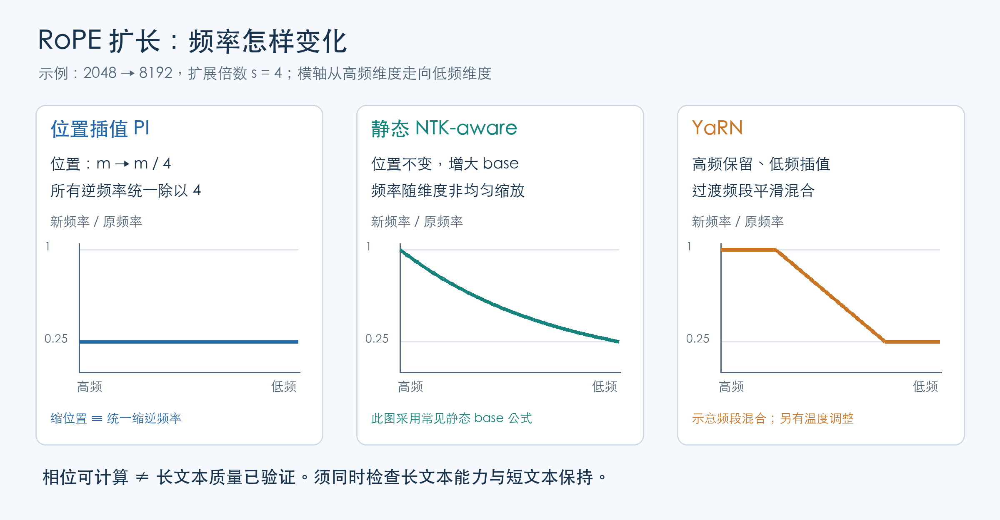
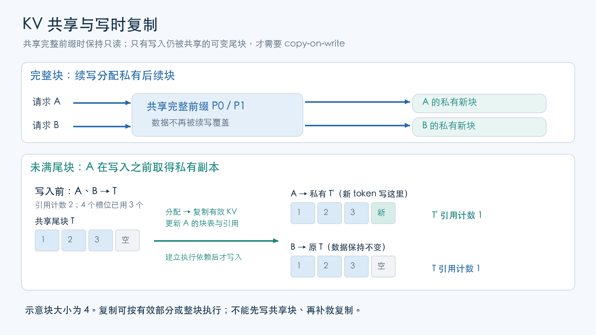
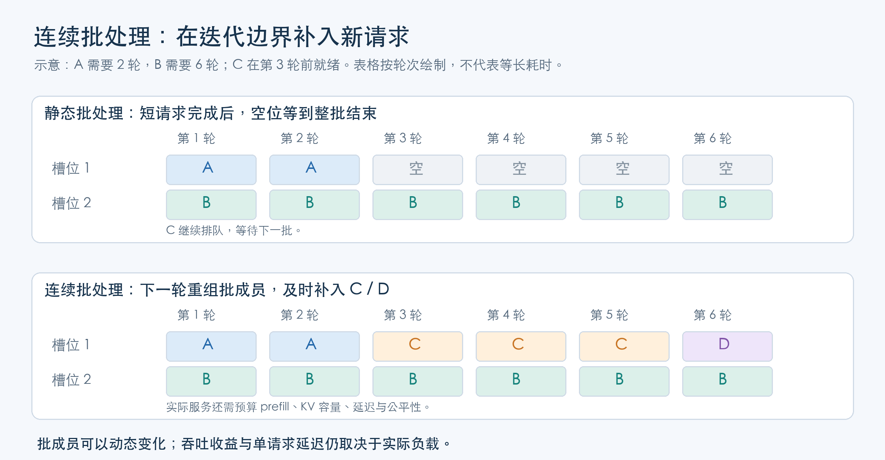

# MiniMax高频面试题

> 用于持续沉淀多模态、语音、Agent、角色对话和大模型应用相关面试题。

## 目录

- [2026-11-11_MiniMax大模型与Agent方向一面面经](#minimax-first-20261111-950396237935566848)

## 待补充方向

本文件作为该公司面试题的持续更新入口。后续可按照“岗位/面试轮次/问题/答案/手撕代码/复盘要点”的格式补充内容。

建议优先补充以下方向：

- 大模型、AIGC、多模态、Agent 或推荐搜索相关岗位面经。

- 公司核心业务场景中的算法工程问题。

- 高频手撕代码、系统设计、训练/推理/部署工程题。

<a id="minimax-first-20261111-950396237935566848"></a>

## 2026-11-11_MiniMax大模型与Agent方向一面面经

## 目录

- [一面](#minimax-first-20261111-950396237935566848-round1)
    - [前十五分钟：还是常规题](#minimax-first-20261111-950396237935566848-g1)
        - [1. 自我介绍。](#minimax-first-20261111-950396237935566848-q01)
        - [2. 你做过最像样的一个 Agent 项目是什么？](#minimax-first-20261111-950396237935566848-q02)
        - [3. 这个项目里，模型能力是瓶颈吗？](#minimax-first-20261111-950396237935566848-q03)
        - [4. 如果模型突然变强十倍，你这套系统里哪一部分可以直接删掉？](#minimax-first-20261111-950396237935566848-q04)
        - [5. 哪一部分删不掉？为什么？](#minimax-first-20261111-950396237935566848-q05)
        - [6. 你平时怎么用 AI Coding？完整流程说一遍。](#minimax-first-20261111-950396237935566848-q06)
        - [7. Plan 模式和 Agent 模式的区别，你在什么场景切？](#minimax-first-20261111-950396237935566848-q07)
        - [8. AI 改坏过历史功能吗？怎么发现的？](#minimax-first-20261111-950396237935566848-q08)
        - [9. 你的 Skill 是怎么写的？给一个你觉得写得好的。](#minimax-first-20261111-950396237935566848-q09)
        - [10. 怎么验证一个 Skill 有效？](#minimax-first-20261111-950396237935566848-q10)
        - [11. RAG 链路里，你觉得最没用的一环是哪个？](#minimax-first-20261111-950396237935566848-q11)
        - [12. 为什么？拿掉会怎样？](#minimax-first-20261111-950396237935566848-q12)
        - [13. 反问环节留到最后。](#minimax-first-20261111-950396237935566848-q13)
    - [中间三十五分钟：模型侧](#minimax-first-20261111-950396237935566848-g2)
        - [14. Transformer 的 attention，为什么要除根号 d_k？](#minimax-first-20261111-950396237935566848-q14)
        - [15. 换成别的缩放值会怎样？不缩放会怎样？](#minimax-first-20261111-950396237935566848-q15)
        - [16. softmax 在大维度下会有什么数值问题？](#minimax-first-20261111-950396237935566848-q16)
        - [17. GLM 和 GPT 的结构差异在哪？各自的取舍是什么？](#minimax-first-20261111-950396237935566848-q17)
        - [18. 为什么现在很多模型都选 decoder-only？](#minimax-first-20261111-950396237935566848-q18)
        - [19. RoPE 的数学形式写一下。](#minimax-first-20261111-950396237935566848-q19)
        - [20. RoPE 是绝对位置编码还是相对位置编码？为什么这么说？](#minimax-first-20261111-950396237935566848-q20)
        - [21. 它具备外推能力吗？为什么训到 4K 就很难直接用到 32K？](#minimax-first-20261111-950396237935566848-q21)
        - [22. 位置插值（PI）在做什么？会伤害短文本能力吗？](#minimax-first-20261111-950396237935566848-q22)
        - [23. NTK-aware 和 YaRN 的思路分别是什么？](#minimax-first-20261111-950396237935566848-q23)
        - [24. ALiBi 呢？和 RoPE 比差在哪？](#minimax-first-20261111-950396237935566848-q24)
        - [25. 长上下文的 attention 复杂度是多少？](#minimax-first-20261111-950396237935566848-q25)
        - [26. Sparse Attention 有哪几类典型做法？](#minimax-first-20261111-950396237935566848-q26)
        - [27. 滑动窗口 + 全局 token 的缺点是什么？](#minimax-first-20261111-950396237935566848-q27)
        - [28. Linear Attention approximates 什么？代价是什么？](#minimax-first-20261111-950396237935566848-q28)
        - [29. MoE 的 router 怎么训练？负载均衡怎么保证？](#minimax-first-20261111-950396237935566848-q29)
        - [30. aux loss 加太大有什么副作用？](#minimax-first-20261111-950396237935566848-q30)
        - [31. expert 并行里 all-to-all 的通信量怎么估？](#minimax-first-20261111-950396237935566848-q31)
        - [32. top-2 路由，一个 batch 里 token 分布极不均衡会怎样？](#minimax-first-20261111-950396237935566848-q32)
        - [33. capacity factor 设多少？ dropping token 会发生什么？](#minimax-first-20261111-950396237935566848-q33)
        - [34. 量化到 INT4，精度掉多少？你怎么测的？](#minimax-first-20261111-950396237935566848-q34)
        - [35. 权重量化和 KV cache 量化，哪个风险大？](#minimax-first-20261111-950396237935566848-q35)
        - [36. LoRA 的 A 和 B 为什么不能同时初始化成零？](#minimax-first-20261111-950396237935566848-q36)
        - [37. P-tuning 和 LoRA 差在哪？](#minimax-first-20261111-950396237935566848-q37)
        - [38. DPO 和 PPO 在数据选择上有什么区别？](#minimax-first-20261111-950396237935566848-q38)
        - [39. RLHF 里 reward model 过拟合了会怎样？](#minimax-first-20261111-950396237935566848-q39)
        - [40. 你怎么评估一个模型"变好了"？](#minimax-first-20261111-950396237935566848-q40)
        - [41. 评测集泄露怎么发现？](#minimax-first-20261111-950396237935566848-q41)
        - [42. 反问（他没给，直接下一题）。](#minimax-first-20261111-950396237935566848-q42)
    - [最后三十分钟：推理和工程](#minimax-first-20261111-950396237935566848-g3)
        - [43. KV cache 显存怎么算？给公式。](#minimax-first-20261111-950396237935566848-q43)
        - [44. 7B、32 层、32 头、head_dim 128、fp16、8K 上下文，单序列多大？](#minimax-first-20261111-950396237935566848-q44)
        - [45. batch 32 呢？](#minimax-first-20261111-950396237935566848-q45)
        - [46. PagedAttention 解决什么问题？](#minimax-first-20261111-950396237935566848-q46)
        - [47. 逻辑块和物理块怎么映射？](#minimax-first-20261111-950396237935566848-q47)
        - [48. block 取多大？太大太小各有什么问题？](#minimax-first-20261111-950396237935566848-q48)
        - [49. prefix cache 共享之后，一个请求继续生成会不会污染别人？](#minimax-first-20261111-950396237935566848-q49)
        - [50. copy-on-write 在哪一步触发？](#minimax-first-20261111-950396237935566848-q50)
    - [推理服务追问](#minimax-first-20261111-950396237935566848-g4)
        - [43. 连续批处理和静态批处理的区别？](#minimax-first-20261111-950396237935566848-service43)
        - [44. chunked prefill 会不会拖慢 decode？](#minimax-first-20261111-950396237935566848-service44)
        - [45. 投机解码的原理？草稿模型怎么选？](#minimax-first-20261111-950396237935566848-service45)
        - [46. 接受率低的时候反而变慢，为什么？](#minimax-first-20261111-950396237935566848-service46)
        - [47. vLLM 和 SGLang 你更熟哪个？](#minimax-first-20261111-950396237935566848-service47)
        - [48. 如果让你自己写一个最小推理服务，你先写哪一块？](#minimax-first-20261111-950396237935566848-service48)
        - [49. 反问。](#minimax-first-20261111-950396237935566848-service49)
    - [手撕：手写 RoPE，并实现位置插值外推](#minimax-first-20261111-950396237935566848-g5)
        - [题目：用 numpy 实现 RoPE 的旋转变换。然后加一个要求：模型训练长度 2048，现在要推理 8192，用位置插值做外推，把实现补上，并说清楚两种做法的差别。](#minimax-first-20261111-950396237935566848-rope-code)
        - [位置插值之后，相邻 token 的相对距离变成 0.25 个整数位置，模型的分辨率够吗？](#minimax-first-20261111-950396237935566848-rope-followup1)
        - [PI 要不要微调？不微调和微调几步差多少？](#minimax-first-20261111-950396237935566848-rope-followup2)
        - [你的实现里 `x[..., 0::2]` 是相邻两维一组，有些模型用的是前后半分组（half-split），两种等价吗？](#minimax-first-20261111-950396237935566848-rope-followup3)
        - [推理时 q 和 k 用了不同的 scale，attention score 会怎么样？](#minimax-first-20261111-950396237935566848-rope-followup4)

<a id="minimax-first-20261111-950396237935566848-round1"></a>

## 一面

<a id="minimax-first-20261111-950396237935566848-g1"></a>

**前十五分钟：还是常规题**

<a id="minimax-first-20261111-950396237935566848-q01"></a>

### 1. 自我介绍。

**回答：**

自我介绍要让面试官迅速建立三条判断：你负责过什么真实问题、你掌握到哪一层、你的能力与岗位有什么联系。可以用 60—90 秒讲清“背景与方向 → 一个代表项目 → 关键技术判断 → 希望承担的工作”。

项目部分优先交代个人负责范围。例如，做过知识问答助手，就说明自己负责检索、上下文组织、工具执行还是推理部署；再选一个有证据的问题，解释怎样定位、怎样改进、怎样验证。只有实际测量过，才报成功率、延迟和成本；团队整体成绩也要与个人贡献分开。

对于大模型与 Agent 方向，要能把应用问题连接到模型和系统约束：检索失败是否来自召回，长上下文失效是否来自位置泛化，响应慢是否来自 prefill 或 decode。简历中的每个术语都应能展开到机制、实现和失败案例，避免把自我介绍变成框架名称清单。

<a id="minimax-first-20261111-950396237935566848-q02"></a>

### 2. 你做过最像样的一个 Agent 项目是什么？

**回答：**

选一个自己能够完整解释且有实际交付证据的项目，沿着“用户任务—最小基线—困难—改进—验证”展开。重点是为什么需要 Agent、执行中如何维护状态，以及遇到错误怎样恢复。

以课程预约助手作为**设计示例**：用户给出时间和课程偏好，系统先查询课程，再检查时间冲突与剩余名额，确认后创建预约。模型负责理解意图和选择工具；预约接口负责权威状态、幂等键与事务约束；执行器负责重试、超时和状态转移。只有完成真实项目时，才能把这个示例改写为个人经历。

应给出一个可复现的失败轨迹，例如“接口已成功但响应超时，重试导致重复预约”，再解释如何通过业务幂等键和结果查询消除重复写入。评估要检查最终预约是否正确、是否发生多余副作用、是否能恢复，以及任务耗时和成本。仅展示一段流畅对话，不足以证明 Agent 完成了任务。

<a id="minimax-first-20261111-950396237935566848-q03"></a>

### 3. 这个项目里，模型能力是瓶颈吗？

**回答：**

模型能力是否构成瓶颈，需要按失败阶段定位。先把链路拆成意图理解、信息获取、计划、参数构造、工具执行和最终确认，再统计每一步的失败比例与对最终成功率的影响。

可以做三组对照：给模型人工确认的正确检索结果，观察推理是否仍然失败；用人工确认的计划与参数调用现有工具，检查执行是否稳定；在同一数据和工具条件下换更强模型，比较哪些错误消失。前者区分证据不足与推理不足，后两者区分模型决策与执行系统问题。

若正确证据已经齐全，但多步约束仍反复遗漏，模型能力可能是主要瓶颈；若失败来自过期库存、权限拒绝或重复写入，换模型也解决不了。改进优先级应结合错误频率、修复后的增益与成本，不根据某次演示的感受下结论。

<a id="minimax-first-20261111-950396237935566848-q04"></a>

### 4. 如果模型突然变强十倍，你这套系统里哪一部分可以直接删掉？

**回答：**

先明确“变强十倍”指什么：指令遵循、规划、工具参数准确率提升，还是吞吐提高、价格下降。不同变化能删掉的组件不同。

如果模型在固定回归集上明显改善了规划与结构化输出，可以尝试去掉为旧模型补偿的复杂提示词分支、多轮自我纠错、机械化的任务拆解、部分中间分类器和重复调用。删除前要做消融，比较任务成功率、长尾错误、延迟和成本，并保留回退路径。

不能因为模型推理变强，就假定它知道实时业务事实。只有检索组件的事实新鲜度、覆盖范围和权限约束可以由其他可靠机制满足时，才有理由简化检索。更强模型应减少补偿模型缺陷的复杂度，具体删什么由对照实验决定。

<a id="minimax-first-20261111-950396237935566848-q05"></a>

### 5. 哪一部分删不掉？为什么？

**回答：**

业务事实、授权边界、执行一致性和可验证性仍然需要系统提供。模型再强，也无法仅凭参数知道某个时刻的库存、某位用户的权限或上一笔事务是否已经提交。

因此通常保留：提供权威数据的接口，身份与权限检查，约束工具输入输出的协议，幂等与事务机制，任务状态和审计记录，以及评测、监控和故障恢复。涉及不可逆操作时，执行策略还要落实业务要求的确认条件。

这些能力可以改进实现、减少重复封装，但它们对应的外部约束不会随模型能力提升而消失。面试时最好选一个实例说明：模型可以更准确地决定“应该预约”，但“是否仍有名额”和“是否已成功写入”必须查询并约束真实系统。

<a id="minimax-first-20261111-950396237935566848-q06"></a>

### 6. 你平时怎么用 AI Coding？完整流程说一遍。

**回答：**

完整流程从验收条件开始：读需求和现有代码，找出入口、依赖、约束与相关测试，明确预期行为和改动范围。跨模块任务先形成可检查的方案，再把工作拆成能独立验证的小步。

执行时为 AI 提供准确的文件位置、输入输出约定和反例；每完成一个有意义的改动，就检查 diff、运行相关测试和静态检查。修复缺陷时先保存能复现问题的用例，避免只验证新增的正常路径。发现方案前提不成立，应重新检查设计，不能不断追加提示词掩盖结构问题。

交付阶段复查异常路径、兼容性、数据迁移和可观测性，整理变更说明，并通过正常代码评审与发布流程。AI 参与了阅读、实现和验证，人仍要能解释关键设计；没有运行过的测试明确标注，不能把工具显示“执行完毕”等同于产品验收。

<a id="minimax-first-20261111-950396237935566848-q07"></a>

### 7. Plan 模式和 Agent 模式的区别，你在什么场景切？

**回答：**

这里可以按通用工作方式解释：Plan 侧重澄清约束、比较方案、拆解步骤和确定验收条件；Agent 侧重在已有边界内调用工具、修改产物、检查结果并继续执行。不同产品对这些名称的权限设计不完全相同，不能把名称直接等同于固定实现。

需求模糊、跨多个模块、可能涉及数据迁移或存在多个架构方案时，先规划能减少错误方向上的投入。局部修复、明确的接口改造、已经有复现用例的缺陷，可以进入执行并持续验证。

切换依据是关键不确定性是否已解决：目标、影响范围和验收标准清楚后执行；执行中发现隐藏依赖、设计冲突或新增业务约束时再回到规划。规划产物也应具体到代码入口和检查方式，不能只是“分析、实现、测试”三个空步骤。

<a id="minimax-first-20261111-950396237935566848-q08"></a>

### 8. AI 改坏过历史功能吗？怎么发现的？

**回答：**

这类经历题应讲真实事故；没有对应经历时，可以说明自己如何防止和发现回归，不应编造线上故障。

一次有说服力的复盘包括：历史行为是什么、改动破坏了哪个隐含约束、什么信号首先暴露问题、怎样定位与修复。常见原因有默认参数改变、边界分支被合并、异常被吞掉、共享状态被改写，或者只覆盖新路径而漏掉老用户配置。

验证手段包括受影响模块的回归测试、接口契约测试、关键路径端到端检查，以及必要的流量回放和灰度指标。测试本身也要独立审查：如果实现和测试都依据同一个错误假设生成，测试全绿仍然可能退化。发现问题后应补充能够防止同类回归的具体用例，再解释影响范围和回滚策略。

<a id="minimax-first-20261111-950396237935566848-q09"></a>

### 9. 你的 Skill 是怎么写的？给一个你觉得写得好的。

**回答：**

好的 Skill 把重复任务中的判断规则、确定性工具和验收条件沉淀下来。它需要说明何时适用、输入是什么、执行顺序、哪些情况应停止或降级，以及怎样证明结果正确；正文保留必要指令，大段资料和脚本按需加载。

一个**设计示例**是接口回归检查 Skill：输入为目标接口、变更 diff 和已有契约；先识别影响范围，再选择相关测试，运行后区分环境故障与功能失败，最后输出实际通过项、失败项与未覆盖项。可以把入口写成以下结构：

```text
适用：接口参数、返回值或业务分支发生变化。
输入：目标接口、变更范围、现有契约和测试入口。
步骤：核对契约 → 选择用例 → 执行 → 分析失败 → 复核结论。
约束：不把未执行的测试写成通过，不擅自扩大修改范围。
验收：关键旧行为仍成立，新增行为有实际结果，失败可复现。
```

若存在稳定的解析、校验或格式转换，优先用脚本固定规则；模型负责需要上下文判断的部分。真正的个人案例还需说明使用次数、解决了什么重复错误，以及仍然在哪些输入上失效。

<a id="minimax-first-20261111-950396237935566848-q10"></a>

### 10. 怎么验证一个 Skill 有效？

**回答：**

先定义结果标准，再比较“使用 Skill”和“不使用 Skill”。保持模型版本、工具权限、任务集与预算条件一致，任务集应包含正常、边界、失败和不该触发该 Skill 的情况。

衡量最终任务成功率、产物正确性、约束违反率、重试次数、耗时与成本；同时检查触发是否准确。对随机性较大的任务重复运行，报告样本量和波动。只看一次成功演示，无法判断收益是否稳定。

还要做消融：移除某个检查步骤、参考文件或脚本，观察它是否真正贡献效果。根据错误类型修订后，用独立留出的任务回归，避免把 Skill 写成只适配示例的答案模板。最终应能解释“它减少了哪一种错误，代价是什么，适用边界在哪里”。

<a id="minimax-first-20261111-950396237935566848-q11"></a>

### 11. RAG 链路里，你觉得最没用的一环是哪个？

**回答：**

没有一环在所有 RAG 系统里都“最没用”。应选择当前业务里边际收益最小、代价最明确的组件，再用数据证明。

例如，在文档结构规范、查询相对直接的场景，额外的多轮 query rewrite 可能增加延迟，还把原有实体、时间条件或否定词改坏；但在口语化、多轮省略或跨语言检索中，它可能明显提高召回。重排、混合检索和上下文压缩也都要按任务分布评价。

回答时可以提出一个候选环节，然后说明判断方法：固定知识库版本和测试问题，比较召回、证据覆盖、最终答案正确率及延迟。若去掉组件后质量稳定、长尾没有明显受损且成本下降，才有理由简化。不能只因为链路“看起来复杂”就删除它。

<a id="minimax-first-20261111-950396237935566848-q12"></a>

### 12. 为什么？拿掉会怎样？

**回答：**

以移除 query rewrite 为例，先跑离线对照：原始问题直接检索与改写后检索使用相同预算，比较相关片段召回、实体约束保留、最终回答的证据支持程度，以及端到端延迟。

整体指标相近时，继续按短查询、多轮指代、专业缩写、带否定条件和跨语言问题切片，防止总体均值掩盖某类用户的退化。若只有少数问题受益，可改成条件触发，而不是每个请求都调用。

去掉后可能更快、更便宜，也可能漏召回，或让生成模型在缺少证据时猜测。上线采用可回退的灰度验证，并监控无答案率、人工转接率和证据不足错误。消融结论只适用于所测数据与系统配置，不能推广成“RAG 不需要改写”。

<a id="minimax-first-20261111-950396237935566848-q13"></a>

### 13. 反问环节留到最后。

**面试安排：**

这一项记录反问的时间安排。可以先记下岗位目标、模型侧与应用侧的责任边界、近期技术难点等问题，等技术讨论结束后再提出，避免打断当前问答。

<a id="minimax-first-20261111-950396237935566848-g2"></a>

**中间三十五分钟：模型侧**

<a id="minimax-first-20261111-950396237935566848-q14"></a>

### 14. Transformer 的 attention，为什么要除根号 d_k？

**回答：**

设一个 query 和 key 的各维独立、均值为 0、方差约为 1，则点积是 $`d_k`$ 个乘积之和，方差约为 $`d_k`$，标准差随 $`\sqrt{d_k}`$ 增大。除以这个量，可以把初始化附近的 logit 尺度保持在相对稳定的范围：

```math
z=q^\top k=\sum_{i=1}^{d_k}q_i k_i,
\qquad \mathrm{Var}(z)\approx d_k,
\qquad \mathrm{Var}\!\left(\frac{z}{\sqrt{d_k}}\right)\approx 1.
```

logit 过大时，softmax 容易集中到少数位置，进入饱和区，反向传播中许多方向的梯度变小。缩放改善的是注意力分布与优化尺度，不能保证永远不饱和。

独立和单位方差是解释设计动机的近似假设，训练后的 Q/K 不必严格满足。QK 归一化、可学习温度等方法可以进一步控制尺度，但都需要与模型训练方式配套。

<a id="minimax-first-20261111-950396237935566848-q15"></a>

### 15. 换成别的缩放值会怎样？不缩放会怎样？

**回答：**

把 attention 写成 $`\mathrm{softmax}(QK^\top/c)V`$，正数 $`c`$ 就控制了温度。分母更小，分布通常更尖锐；分母更大，分布通常更平坦。

若不缩放，在上述独立近似下，维度越高 logit 方差越大，容易出现过度集中的权重与梯度饱和。若直接除以 $`d_k`$，方差约变成 $`1/d_k`$，初始权重可能过于接近均匀，区分不同 key 的能力较弱。

这不是说其他缩放一定训练失败。模型可以通过参数范数调整来部分补偿，某些结构也使用专门的温度设计。面试中应说明比较条件：同一 Q/K 分布下缩放如何改变 softmax；训练整套模型时又有哪些适应空间。直接修改已有模型的缩放则会改变其已学习的 attention 分布。

<a id="minimax-first-20261111-950396237935566848-q16"></a>

### 16. softmax 在大维度下会有什么数值问题？

**回答：**

要区分“head 维度大”和“候选 token 多”。前者可能使点积尺度变大，后者增加归一化求和项；两者带来的问题与处理方式不完全相同。

直接计算指数会使大 logit 溢出，小 logit 对应的指数下溢，低精度求和还会积累误差。通常减去每行最大值，并在合适的较高精度下做归约：

```math
p_i=\frac{\exp(z_i-z_{\max})}{\sum_j\exp(z_j-z_{\max})}.
```

减去最大值不改变结果，只改善表示范围；它不能消除分布本身过尖造成的饱和。下溢为 0 对极小概率往往可接受，但若还要算 log-prob 或交叉熵，应使用稳定的 log-softmax / log-sum-exp。

另外，整行都被 mask 为负无穷时，减最大值可能得到 NaN，必须通过有效行检查或框架约定处理。融合 attention 也需要稳定的分块归一化，不能只依靠 fp16 指数运算。

<a id="minimax-first-20261111-950396237935566848-q17"></a>

### 17. GLM 和 GPT 的结构差异在哪？各自的取舍是什么？

**回答：**

先确认 GLM 的具体版本。经典 GLM 论文采用自回归空白填充：把文本中的若干 span 遮掉，模型在可见上下文的条件下逐段生成缺失内容；配套采用混合可见性的 attention mask 和二维位置信息。GPT 的经典训练目标则是从左到右预测下一个 token，使用因果 mask。

两者都可以使用单个 Transformer 堆栈，不能简单概括成“GLM 是 encoder-decoder，GPT 是 decoder-only”。经典 GLM 的二维位置分别表达原文位置以及待生成片段内部的进度，使填空式任务能利用双向可见上下文。

取舍在于任务与训练组织：空白填充有利于利用前后文完成缺失片段，但 mask、位置与任务编排更复杂；因果语言建模目标统一，容易扩展到开放生成，并直接适配自回归缓存与部署。后续 GLM 系列可能改变结构、位置编码和训练方法，需要按具体模型文档回答，不能将最早论文的细节套到所有产品。

<a id="minimax-first-20261111-950396237935566848-q18"></a>

### 18. 为什么现在很多模型都选 decoder-only？

**回答：**

decoder-only 把大量任务统一为条件续写：问题、示例、上下文和工具结果都可以放进前缀，模型持续预测下一个 token。预训练目标简单，文本数据易组织，训练、指令微调和自回归部署之间的接口也比较一致。

这套路线积累了成熟的并行训练、KV cache、连续批处理和推理优化生态，模型扩展到较大规模时容易复用工程经验。多模态输入也可以先编码为序列，再与解码器连接。

选择它并不意味着其他结构没有价值。双向编码器适合表示学习和检索，encoder-decoder 可以将输入理解和输出生成分开；图像、语音等模态也可能需要专用编码器。应根据训练目标、输入输出特征和部署成本选择，不能把流行程度当作架构最优性的证明。

<a id="minimax-first-20261111-950396237935566848-q19"></a>

### 19. RoPE 的数学形式写一下。

**回答：**

设 head 维度 $`d`$ 为偶数，把向量的相邻两维看作一个二维平面。第 $`i`$ 对维度在位置 $`m`$ 上旋转角度 $`m\theta_i`$，其中 $`\theta_i=b^{-2i/d}`$，$`i=0,\ldots,d/2-1`$。旋转写成：

```math
\begin{bmatrix}x'_{2i}\\x'_{2i+1}\end{bmatrix}
=
\begin{bmatrix}
\cos(m\theta_i)&-\sin(m\theta_i)\\
\sin(m\theta_i)&\cos(m\theta_i)
\end{bmatrix}
\begin{bmatrix}x_{2i}\\x_{2i+1}\end{bmatrix}.
```

令 $`z_i=x_{2i}+\mathrm{i}x_{2i+1}`$，同一操作就是 $`z'_i=z_i e^{\mathrm{i}m\theta_i}`$。旋转保持每对维度的范数，且不同维度对使用不同频率。

标准 RoPE 作用于 Q 和 K；在做点积前按各自位置旋转，通常不对 V 做同样操作。相邻配对只是布局约定之一，已有权重使用何种配对、是否只旋转一部分维度，都必须保持一致。

<a id="minimax-first-20261111-950396237935566848-q20"></a>

### 20. RoPE 是绝对位置编码还是相对位置编码？为什么这么说？

**回答：**

RoPE 在计算操作上依赖每个 token 的绝对位置，但 Q/K 点积中的位置项具有相对位置形式。对同一套频率和布局，旋转矩阵满足：

```math
\bigl(R(m)q\bigr)^\top\bigl(R(n)k\bigr)
=q^\top R(m)^\top R(n)k
=q^\top R(n-m)k.
```

因此，固定未旋转的 q、k 时，把两个位置同时平移相同距离，位置旋转对分数的作用不变。可以描述为“通过绝对位置旋转，让注意力点积呈现相对位置结构”。

这个性质有前提：Q/K 的频率、缩放与坐标约定一致。它也不等于整套模型完全平移不变，因为 q、k 本身来自上下文计算，因果边界和其他位置处理可能随输入改变。混用两套 RoPE scale 后，上式通常不再只依赖 $`n-m`$。

<a id="minimax-first-20261111-950396237935566848-q21"></a>

### 21. 它具备外推能力吗？为什么训到 4K 就很难直接用到 32K？

**回答：**

RoPE 可以为任意位置计算旋转，因此没有固定长度的位置查表上限；但“公式可以计算”与“模型能可靠处理更长文本”是两件事。

从 4K 直接扩展到 32K，许多维度的旋转相位与相对距离组合超出训练时熟悉的分布。各频段的周期不同，远距离还可能出现相位混淆；同时注意力要在更多候选 token 中选择证据，训练时学到的长度和距离偏好未必适用。即使位置处理合理，模型也可能缺少跨长段落推理的训练经验。

改进通常需要位置缩放、长文本继续训练或微调，并单独验证短文本保持能力。测试不能只做单针检索，还要覆盖多证据组合、不同位置、不同长度、长文生成及干扰信息。另一个独立问题是显存与计算预算：位置编码修复不会自动降低 dense attention 的复杂度。

<a id="minimax-first-20261111-950396237935566848-q22"></a>

### 22. 位置插值（PI）在做什么？会伤害短文本能力吗？

**回答：**

线性位置插值 PI 将位置坐标除以扩展倍数 $`s=L_{\mathrm{target}}/L_{\mathrm{train}}`$，让较长序列使用接近训练尺度的相位范围：

```math
m'=\frac{m}{s},\qquad
\phi_{m,i}=\frac{m\theta_i}{s}.
```

例如从 2048 扩到 8192，$`s=4`$，相邻 token 的旋转位置间隔变为 0.25；它仍然是不同的连续坐标，不需要取整。实现可缩放 position，也可把所有 inverse frequency 除以 4，两者在数学上相同。

短文本也使用 scale 4 时，原本距离 4 的相位差现在对应距离 1，局部位置关系发生变化，未经适配可能损害短文本能力。实践中应同时评估短长文本，结合训练策略决定缩放方式，不能简单承诺 PI 免费扩窗。

若采用随长度变化的策略，还要保证一个请求中 Q/K 和已有 KV cache 使用一致的坐标体系。生成过程中直接改变 scale、却不重算旧 K，会造成新的位置不一致。

<a id="minimax-first-20261111-950396237935566848-q23"></a>

### 23. NTK-aware 和 YaRN 的思路分别是什么？

**回答：**

两者都试图缓解统一插值对不同频段的影响，但需要区分具体变体。

一种常见的**静态 NTK-aware** 形式在 head 维度 $`d>2`$ 时增大 RoPE base：

```math
b'=b\,s^{d/(d-2)},\qquad
\theta'_i=(b')^{-2i/d}
=\theta_i\,s^{-2i/(d-2)}.
```

它保留第一个高频维度的频率，对后续维度逐渐加大缩放，最低频维度缩为原来的 $`1/s`$。PI 则把所有频率统一缩为 $`1/s`$。因此，“PI 缩位置、NTK-aware 改 base”描述了常见实现入口；更准确的区别是统一频率缩放与按维度变化的频率缩放。动态 NTK 等实现还可能让 base 与运行长度相关，不能直接视为同一公式。

YaRN 按频段结合保留与插值，在过渡区域平滑混合，并配合 attention 温度或幅度调整来适应长序列的分布。直观上，高频保留较多局部分辨率，低频进行较多插值；具体边界与参数应按模型配置实现。

<div align="center">



</div>

图中展示的是缩放机制，不是效果排名。位置策略、继续训练数据和实际长度分布共同决定质量，尤其不能把某一种 NTK 公式当成所有模型的通用扩窗开关。

<a id="minimax-first-20261111-950396237935566848-q24"></a>

### 24. ALiBi 呢？和 RoPE 比差在哪？

**回答：**

ALiBi 不旋转 Q/K，而是在注意力 logit 上加入与距离线性相关的偏置。对因果 attention 中的过去位置 $`j\le i`$，第 h 个头可以写成：

```math
z_{ij}^{(h)}=
\frac{q_i^\top k_j}{\sqrt{d_k}}-a_h(i-j),\qquad a_h>0.
```

不同头采用不同斜率，使模型具有不同强度的近距离偏好。它不需要位置嵌入查表，在长序列上可以继续计算距离惩罚；但长距离 token 被持续压低，也可能不利于远程信息检索，外推效果仍取决于任务与训练。

RoPE 使用多频旋转，让内容向量与相对位置共同影响分数，表达方式更丰富；ALiBi 的距离归纳偏置更直接、形式更简单。不能只说 ALiBi “比 RoPE 差”，应比较目标任务、训练长度和实现成本。两者都是模型训练设计的一部分，通常不能在已有模型上直接互换而保持原有能力。

<a id="minimax-first-20261111-950396237935566848-q25"></a>

### 25. 长上下文的 attention 复杂度是多少？

**回答：**

设 batch 为 B，头数为 H，序列长度为 N，每头维度为 d。标准 dense self-attention 的 QK 点积和加权求和，计算量均为 $`O(BHN^2d)`$；若显式存储全部分数矩阵，额外空间为 $`O(BHN^2)`$。

FlashAttention 通过分块、融合和在线 softmax 减少 HBM 读写，避免完整保存 N×N 注意力矩阵，但仍计算 dense attention 所需的成对关系，不能把它说成线性 FLOPs 的算法。

自回归 decode 使用 KV cache 时，一步只增加一个 query，单步注意力计算约为 $`O(BHNd)`$，历史 KV 容量随 N 线性增长。生成很多 token 的累计开销仍会持续增加。prefill 的 N² 与 decode 的单步 N 应分别说明。

稀疏 attention 若每个 query 只访问 w 个位置，可降到约 $`O(BHNwd)`$；线性 attention 则通过有限维状态改变计算方式。理论复杂度之外，还要检查稀疏索引、kernel 效率、内存带宽与质量损失。

<a id="minimax-first-20261111-950396237935566848-q26"></a>

### 26. Sparse Attention 有哪几类典型做法？

**回答：**

Sparse Attention 的共同点是只计算部分 query-key 连接；关键差别在于连接怎样选择，以及是否能高效落到硬件上。典型方法如下：

<div align="center">

| 类别 | 连接规则 | 主要取舍 |
| --- | --- | --- |
| 局部窗口 | 每个 token 看附近一段位置 | 计算规整，但单层远距离交互有限 |
| 局部加全局 | 局部连接之外加入全局 token | 增强远程通信，但全局点可能成为信息瓶颈 |
| 跨步、膨胀或块稀疏 | 按间隔或块布局访问 | 容易控制预算，但固定模式可能错过证据 |
| 随机加结构连接 | 局部、全局和随机边组合 | 改善连接性，理论性质依赖具体假设 |
| 内容自适应选择 | 路由、检索或打分选出 key/block | 更贴近内容，但选取成本与漏选风险更高 |

</div>

Longformer 的局部与全局模式、BigBird 的局部/全局/随机组合是经典例子。讨论新模型时还要确认它稀疏的是 token、block、head 还是别的维度。

实现上，理论上少算乘法不必然更快：不规则访存、稀疏元数据和小 kernel 可能抵消收益。应同时评价被省略连接对任务的影响，以及真实硬件上的速度和显存。

<a id="minimax-first-20261111-950396237935566848-q27"></a>

### 27. 滑动窗口 + 全局 token 的缺点是什么？

**回答：**

滑动窗口把直接交互限制在局部。多层可以扩大感受野，但远距离信息往往要经过多次中转，重要细节可能被压缩或丢失；固定窗口还可能切断跨段引用、代码定义与调用等依赖。

全局 token 提供捷径，却带来选择问题：哪些 token 应全局可见，是否随任务变化，数量多大才够。少量全局表示需要汇聚大量信息，可能形成表达瓶颈；若全局数量 g 随长度快速增长，$`O(Nw+Ng)`$ 的连接成本也会变大。

因果生成中还必须遵守可见性：所谓全局不能让较早位置偷看未来。训练与推理若采用不同 mask，也可能引入分布偏移。测试应覆盖远距离证据、多个同类实体和跨窗口组合推理，不能只凭局部困惑度判断方案有效。

<a id="minimax-first-20261111-950396237935566848-q28"></a>

### 28. Linear Attention approximates 什么？代价是什么？

**回答：**

很多 Linear Attention 方法把 softmax attention 的指数核替换为可分解的核；另一些通过有限特征去近似目标核。必须先说明是哪种方法，不能泛称所有线性 attention 都精确近似同一个函数。

设核写成 $`K(q,k)=\phi(q)^\top\phi(k)`$，特征维度为 r，则因果版本可以维护两个累积状态：

```math
S_t=\sum_{j\le t}\phi(k_j)v_j^\top,
\qquad z_t=\sum_{j\le t}\phi(k_j),
\qquad y_t=\frac{\phi(q_t)^\top S_t}{\phi(q_t)^\top z_t}.
```

这里分母需要稳定处理；不同方法可能再加入门控、归一化或遗忘机制。固定 r 和 value 维度时，序列处理时间随 N 线性增长，状态大小不随历史长度增长，但会依赖 r 与 value 维度。

代价是把历史压进有限状态，可能损失精确内容检索和复杂交互能力；核近似还存在误差、方差和数值稳定性问题。不能写成 $`\mathrm{softmax}(QK^\top)V=Q(K^\top V)`$，因为 softmax 是非线性运算，不能这样交换结合顺序。

<a id="minimax-first-20261111-950396237935566848-q29"></a>

### 29. MoE 的 router 怎么训练？负载均衡怎么保证？

**回答：**

router 通常把 token 隐状态映射为专家 logits，经过 softmax 得到门控概率，再选择 top-k 专家处理。专家输出按门控权重组合，主任务损失会更新专家和可微的门控部分；离散 top-k 的索引选择本身不能直接按普通导数反传。

如果只优化主任务，早期偶然占优的专家可能持续获得更多 token，导致负载集中。经典 Switch 的 top-1 辅助项把实际分配比例 $`f_e`$ 与平均门控概率 $`P_e`$ 结合：

```math
\mathcal{L}_{\mathrm{balance}}=
\alpha E\sum_{e=1}^{E}f_eP_e.
```

其中 E 为专家数，$`f_e`$ 的离散计数通常不直接求导，梯度主要经过 $`P_e`$。top-k 的计数和归一化需要按具体实现调整，不能把 top-1 公式机械照搬。

均衡还涉及容量限制、路由噪声、logit 稳定化、专家布局与动态调度。有些方案使用额外偏置进行均衡，不一定采用上述 aux loss。无论方法怎样，都要监控每个专家的 token 数、溢出率、路由熵和最慢设备耗时；平均均匀并不保证每个 microbatch 都无热点。

<a id="minimax-first-20261111-950396237935566848-q30"></a>

### 30. aux loss 加太大有什么副作用？

**回答：**

aux loss 权重过大时，优化器会为了均匀分配而牺牲任务相关路由，把本来适合某个专家的 token 推给其他专家，削弱专家分工并可能降低模型质量。

还可能出现主损失下降变慢、router 过于平坦或持续摆动。反过来，权重过小又可能使少数专家拥堵、其他专家训练不足，因此目标是质量和负载之间的平衡。

调参要同时看验证集质量、负载分布、溢出率和实际吞吐。不同 aux loss 的归一化随专家数、top-k、batch 统计范围变化，系数不能跨实现直接照抄。分布均衡但任务质量下降，不能算训练成功。

<a id="minimax-first-20261111-950396237935566848-q31"></a>

### 31. expert 并行里 all-to-all 的通信量怎么估？

**回答：**

先定义统计口径。设某个 expert-parallel 组在一个 MoE 层处理 T 个原始 token，top-k 路由，隐藏维度 D，每个激活元素占 b 字节。忽略元数据与 padding，dispatch 的逻辑 payload 约为 $`TkDb`$；专家输出送回还需要同量级的数据，因此一次前向合计约为：

```math
V_{\mathrm{forward}}\approx 2TkDb\,r.
```

$`r`$ 是需要跨设备传输的路由副本比例，局部专家无需跨卡发送。若 P 个设备上专家均匀分布且路由近似均匀，粗估 $`r\approx1-1/P`$；实际值应从路由与拓扑测量。

例如 T=8192、k=2、D=4096、b=2，未扣除本地路由时，两次传输合计 256 MiB。这里按每份 payload 在发送侧计一次，没有再把接收侧重复相加，也没有乘一遍专家数。

实际开销还包括 token 索引、门控权重、容量 padding、协议开销和训练反向通信。延迟取决于最大负载设备、跨节点带宽、通信启动次数以及能否与计算重叠；总字节数除以网卡标称带宽只是非常粗的下界。

<a id="minimax-first-20261111-950396237935566848-q32"></a>

### 32. top-2 路由，一个 batch 里 token 分布极不均衡会怎样？

**回答：**

top-2 只规定每个 token 通常送到两个不同专家，不保证全局负载均匀。大量 token 仍可能选中同一对专家，使这些设备成为计算与通信的拖尾点，其他设备等待。

若设有容量上限，热门专家可能溢出，触发丢弃部分专家分支或重路由；若采用 dropless 策略，则需要承受不均匀的计算、通信和显存需求。一个 token 的两个专家中只剩一个有效时，输出是否重归一化还取决于实现，不能默认无影响。

排查时看每个 microbatch 的路由直方图、最大/平均 token 数比、溢出率及 all-to-all 耗时，再判断是数据局部偏斜、router 训练问题还是专家设备布局问题。处理手段包括调整均衡策略、容量和 token 调度，必要时增加热点专家的部署副本；复制部署与改变模型专家结构需要区分。

<a id="minimax-first-20261111-950396237935566848-q33"></a>

### 33. capacity factor 设多少？ dropping token 会发生什么？

**回答：**

capacity factor 是容量预算相对平均路由负载的放大倍数。采用常见 top-k 计数口径时，每个专家容量可写为：

```math
C=\left\lceil c\,\frac{kT}{E}\right\rceil.
```

具体框架可能按每次路由单独计数，必须确认定义。c 越大，越容易容纳偏斜，但会增加 buffer、padding 或计算预算；c 太小则容易溢出。不存在适用于所有模型的固定答案，可以在目标硬件和数据分布上扫参，结合质量、drop rate 与吞吐选择。

dropping token 通常指该 token 在某个专家上的计算贡献被跳过，并不是把它从序列中删除。带残差的 Transformer 仍可能保留原隐状态，但缺少 FFN 专家更新，质量可能退化。top-2 下是否保留另一个分支、是否重归一化、是否重新路由，都要按实现解释。

若推理采用不丢 token 的执行方式，应讨论如何调度不均匀的专家任务，不能套用训练期固定容量和丢弃策略。

<a id="minimax-first-20261111-950396237935566848-q34"></a>

### 34. 量化到 INT4，精度掉多少？你怎么测的？

**回答：**

不能只凭“INT4”给出准确率下降多少。先说明量化的是权重、激活还是 KV，采用 W4A16 还是其他组合，以及分组大小、校准数据、缩放方式和保留高精度层的策略。

测量时固定模型、tokenizer、prompt、解码配置与评测集，比较高精度基线和量化模型。除了困惑度，还要看任务正确率、代码执行结果、数值推理、工具参数、长上下文与少数语言等敏感切片；量化误差在这些任务上的表现可能不同。

性能报告应同时给模型权重占用、运行峰值显存、TTFT、逐 token 延迟和吞吐，并说明 batch、输入输出长度和硬件。权重位宽下降不等于端到端显存同比下降，也不保证没有适配 kernel 时仍然更快。

如果没有亲自测过，就明确给出测量方案；已有实测则报基线值、量化值、差值和重复运行条件，避免编造“通常只掉 1%”之类无法复核的数字。

<a id="minimax-first-20261111-950396237935566848-q35"></a>

### 35. 权重量化和 KV cache 量化，哪个风险大？

**回答：**

两者误差进入模型的路径不同，风险不能只按对象名称排序。权重量化改变每次前向的线性映射，误差会跨层传播；KV 量化压缩运行时历史状态，K 误差影响注意力分数，V 误差影响加权读出的内容。

在长上下文和检索任务中，KV 误差可能改变模型对关键位置的选择。以 KIVI 为例，它利用特定模型中 K 的通道异常值和 V 的 token 分布差异，采用不同量化粒度；这是一种方法的经验设计，不能当成所有模型的最优规则。

评估上分别做仅权重、仅 KV、两者同时量化的对照，覆盖长短上下文、不同位置和输入分布。若主要预算被长序列 KV 占据，KV 量化可能更有价值；若权重占主导且成熟 kernel 支持充分，权重量化可能更直接。最终选择由质量容忍度、节省的实际显存和性能收益共同决定。

<a id="minimax-first-20261111-950396237935566848-q36"></a>

### 36. LoRA 的 A 和 B 为什么不能同时初始化成零？

**回答：**

令 LoRA 增量为 $`\Delta W=BA`$，其中 $`B\in\mathbb{R}^{d_{\mathrm{out}}\times r}`$、$`A\in\mathbb{R}^{r\times d_{\mathrm{in}}}`$。设 $`G=\partial\mathcal{L}/\partial\Delta W`$，忽略固定缩放系数，有：

```math
\frac{\partial\mathcal{L}}{\partial A}=B^\top G,
\qquad
\frac{\partial\mathcal{L}}{\partial B}=GA^\top.
```

A、B 同时为零时，两边梯度也为零，标准梯度更新无法让这个分支离开零点。只说“为了打破对称”不够，关键是双线性乘积导致梯度相互依赖。

常见初始化是 A 随机、B 为零：开始时增量为零，不扰动基座输出；第一步 B 通常能获得非零梯度，之后 A 也能更新。反过来设置 A 为零、B 随机，在数学上也可以启动训练，但初始化分布和具体实现需保持匹配。

<a id="minimax-first-20261111-950396237935566848-q37"></a>

### 37. P-tuning 和 LoRA 差在哪？

**回答：**

P-tuning 主要学习连续提示表示，冻结主体模型，让模型通过可学习的提示接收任务信号。经典 P-tuning 使用提示编码器生成连续 prompt；P-tuning v2 将提示作用扩展到更深的层，不能把两个版本都理解成只在输入前拼几个 token。

LoRA 则在选定线性层上学习低秩权重增量，直接改变模型内部映射。它的可训练参数数目大致随 rank 和目标层维度增长，推理时在适当条件下可合并进权重；提示方法通常保留额外提示状态，可能增加序列或各层前缀的开销。

两者都属于参数高效适配，但控制模型的位置不同。比较时要固定基座、任务、训练预算和推理方式，看质量、参数规模、内存、并发适配器管理和部署支持，不能只按“可训练参数更少”决定优劣。

<a id="minimax-first-20261111-950396237935566848-q38"></a>

### 38. DPO 和 PPO 在数据选择上有什么区别？

**回答：**

标准 DPO 直接使用同一 prompt 下的 chosen/rejected 偏好对，在参考策略约束下优化相对偏好，通常不需要训练中不断向环境采样，也不必单独拟合一个奖励模型。数据重点是偏好标注是否可靠、两个回答是否可比较，以及 prompt 和难度是否覆盖实际分布。

PPO 用于 RLHF 时，需要 prompt 数据、奖励机制，以及由当前或足够接近当前策略的行为策略生成的 rollout；还要保留对应 log-prob、奖励和优势估计等训练信息。训练奖励模型所用的偏好数据可以是离线的，但这不意味着 PPO 的策略优化可以任意使用陈旧 rollout。

区别不在“DPO 用人类数据、PPO 不用”。两者都需要良好的任务覆盖与质量控制；DPO 容易受固定偏好对的分布限制，PPO 可以持续探索当前策略行为，却增加采样成本和奖励利用风险。在线 DPO 等变体存在，回答时应明确讨论的是标准流程。

<a id="minimax-first-20261111-950396237935566848-q39"></a>

### 39. RLHF 里 reward model 过拟合了会怎样？

**回答：**

奖励模型过拟合时，它在训练偏好对上判断很好，却可能把长度、格式、语气或固定表达当作质量捷径。策略持续优化这个奖励，会放大这些捷径，出现奖励分数上升、人工评价或真实任务成功率下降的情况。

还要区分监督训练过拟合与策略利用奖励漏洞：即使奖励模型在静态验证集上表现尚可，策略分布改变后，也可能找到它没有覆盖的高分错误答案。

缓解方法包括扩大且清理偏好数据，按任务、长度等维度验证，使用独立评估与周期性人工抽查，监控 reward 与真实结果的背离，并控制策略偏离参考模型的幅度。KL 约束、早停或奖励模型集成只能降低风险，不能证明奖励目标等同于真实目标。

<a id="minimax-first-20261111-950396237935566848-q40"></a>

### 40. 你怎么评估一个模型"变好了"？

**回答：**

先把“变好”拆成可检验的目标：事实正确率、推理或代码能力、指令遵循、工具执行、稳健性，以及延迟和成本。不同应用的权重不同，不应靠单个综合榜单分数替代业务判断。

对比实验固定 prompt、模板、解码参数、工具、数据版本和预算。尽量使用可执行检查或客观标签；开放式回答采用盲评和随机交换展示顺序，检查模型裁判的位置、长度和自偏好，并对关键样本人工复核。

报告总体与切片结果、样本量、置信区间或重复运行波动，同时列出明显退化。模型质量提高但成本或尾延迟超出约束，未必适合上线。最终通过受控线上实验验证实际任务收益，离线评分和真实用户结果应分别呈现。

**怎样判断提升超过随机波动。** 同一批任务上比较两个模型时，应保留逐题配对结果。可以按任务做配对 bootstrap，重复抽取任务及其两边结果，统计分数差的区间；一个任务跑多次时，应保留任务内部的重复结构，不能把同题的多次采样当成完全独立的新题。任务来自少数模板或文档家族时，还应按这些相关组重采样，避免区间过窄。二元结果也可检查“旧模型错、新模型对”与相反情况，发现提升主要来自哪些样本。

模型裁判给出的偏好胜率应说明平局处理、展示顺序与失败任务口径。先在开发集选定方法和阈值，再用独立测试集估计收益；如果反复在同一测试集上挑出最高分配置，最终区间无法弥补选择偏差。统计上可检测的差异也不一定具有业务价值，还要说明它能减少多少实际失败。

<a id="minimax-first-20261111-950396237935566848-q41"></a>

### 41. 评测集泄露怎么发现？

**回答：**

能访问训练数据时，先做精确去重、规范化后的 n-gram 匹配与语义近重复检索，重点检查测试题、标准答案、解析和改写版本是否进入训练或调参流程。还要检查开发集被长期反复试验造成的隐性过拟合。

无法访问训练语料时，只能积累间接证据：比较公开题与新编同构题、改变实体和数值、调整表述、加入时间上晚于训练的数据，观察能力是否异常依赖题面。异常高分或能背出答案可能提示污染，但单独一个现象不能证明泄露；改写后性能下降也可能来自问题难度变化。

持续维护保密留出集、时间切分集和新构建任务，记录模型与评测版本，并限制评测反馈被直接用于调参。最终应区分“发现确定重复”“发现可疑相似”和“没有检测到”，不能把未检出表述为绝对无污染。

<a id="minimax-first-20261111-950396237935566848-q42"></a>

### 42. 反问（他没给，直接下一题）。

**面试安排：**

这一项记录面试流程：反问尚未展开，讨论直接进入推理工程部分。准备时可以把问题记下来，等获得明确的反问时间再提出；不要把这条安排当成新的模型知识题。

<a id="minimax-first-20261111-950396237935566848-g3"></a>

**最后三十分钟：推理和工程**

<a id="minimax-first-20261111-950396237935566848-q43"></a>

### 43. KV cache 显存怎么算？给公式。

**回答：**

对标准自回归 Transformer，设层数为 L、batch 为 B、每序列缓存长度为 S、KV 头数为 $`H_{\mathrm{kv}}`$、每头维度为 d、每个元素占 b 字节，则有效 KV 数据为：

```math
M_{\mathrm{KV}}=2LBSH_{\mathrm{kv}}db.
```

系数 2 表示 K 和 V。序列长度不同时，用所有请求的有效长度之和代替 BS；MHA 中 KV 头数通常等于 Q 头数，GQA/MQA 必须使用实际 KV 头数，不能直接套 Q 头数。

这个式子不含模型权重、激活、临时 workspace、分块取整、量化 scale/zero-point 或预留空间。前缀共享可以减少物理副本数，滑窗和特殊缓存结构也会改变公式；它是标准未共享 KV 的容量估算。

多卡下还要看头、层和序列怎样切分，以及是否复制某些 KV。不能未经确认就把总容量简单除以 tensor-parallel 卡数。

<a id="minimax-first-20261111-950396237935566848-q44"></a>

### 44. 7B、32 层、32 头、head_dim 128、fp16、8K 上下文，单序列多大？

**回答：**

先说明假设：8K 按 8192 token 计算，“32 头”表示 32 个 KV 头，即 MHA；fp16 每元素 2 字节。则：

```math
M=2\times32\times8192\times32\times128\times2
=4{,}294{,}967{,}296\ \mathrm{bytes}
=4\ \mathrm{GiB}.
```

也可以心算：每个 token 在所有层共占 $`2\times32\times32\times128\times2=524{,}288`$ 字节，即 512 KiB；8192 个 token 就是 4 GiB。十进制表示约为 4.295 GB，需区分 GB 与 GiB。

7B 参数量并不直接进入这条 KV 公式，它主要影响权重占用。若 32 只是 Q 头数，而实际采用 8 个 KV 头的 GQA，结果降为 1 GiB。面试时先确认这个条件，比报出一个看似精确但假设错误的数字更重要。

<a id="minimax-first-20261111-950396237935566848-q45"></a>

### 45. batch 32 呢？

**回答：**

沿用上一题 MHA、每条序列都实际缓存 8192 token 的条件，batch 32 的未共享 KV 数据为：

```math
M_{B=32}=32\times4\ \mathrm{GiB}=128\ \mathrm{GiB}.
```

这只是 KV，还要额外放模型权重、运行 workspace 和容量余量；因此不能据此认为一张 128 GiB 显存的设备一定能承载完整服务。

若每条实际长度不同，应按长度之和估算；若有相同前缀共享，物理占用可以减少，但续写部分仍各自增长。若实际为 8 个 KV 头的 GQA，则同一条件下是 32 GiB。batch 数本身不能代替 token 总量，也不能代表峰值显存已被完整估计。

<a id="minimax-first-20261111-950396237935566848-q46"></a>

### 46. PagedAttention 解决什么问题？

**回答：**

PagedAttention 主要解决变长请求的 KV cache 分配与共享问题。为每条序列预留一大段连续内存，会因为长度不可预知而浪费空间，也容易在请求反复进入退出时形成碎片。

它把逻辑 KV 序列拆成固定 token 数的块，通过 block table 映射到分散的物理块。请求增长时按需分配，结束时释放引用，attention kernel 根据映射读取历史 KV；有相同前缀或分支时，还可以共享块并按需要执行写时复制。

它减少了连续大块分配的约束和内存浪费，但最后一个块仍可能存在未用槽位，块表和管理逻辑也有成本。PagedAttention 不自动把 dense attention 改成稀疏 attention，也不改变上述有效 KV 的基础字节数；它改善的是物理管理与复用效率。

<a id="minimax-first-20261111-950396237935566848-q47"></a>

### 47. 逻辑块和物理块怎么映射？

**回答：**

设一个块容纳 t 个 token。序列中的位置 p 对应逻辑块号与块内偏移：

```math
\ell=\left\lfloor\frac{p}{t}\right\rfloor,
\qquad o=p\bmod t,
\qquad b_{\mathrm{physical}}=\mathrm{block\_table}[\ell].
```

kernel 结合物理块号、层号、KV 头号、块内偏移和 head_dim，定位真正的 K/V 数据。具体张量存储顺序由 kernel 决定，不必与逻辑序列连续。

例如 t=16、块表为 `[7, 2, 11]`，位置 20 位于逻辑块 1，落在物理块 2 的偏移 4。物理块 7、2、11 可以来自互不相邻的位置。

请求增长到新块边界时分配新物理块并更新表；请求结束时减少引用，只有不再被活动请求占用的块才可按缓存策略回收。共享块的映射更新必须只影响当前请求，不能意外改动其他请求的 block table。

<a id="minimax-first-20261111-950396237935566848-q48"></a>

### 48. block 取多大？太大太小各有什么问题？

**回答：**

这里的 block size 指一个 KV 块容纳多少 token，要与权重量化分组、attention tile 等概念区分。选择范围首先受当前模型、缓存布局、设备和 kernel 支持限制。

块小：尾部浪费少、共享和回收粒度细，但块表更大、寻址和调度开销可能更多；块大：管理开销容易摊薄、访问可能更规整，但短请求更浪费尾块，前缀共享的粒度变粗，发生尾块复制时数据量也更大。

对于独立未共享请求，每条序列最后一块浪费少于一个块，具体还要乘每 token 的 KV 字节数。选择时结合请求长度、前缀命中率、吞吐和尾延迟，对框架支持的候选值进行测量。16、32 等只能作为常见示例，不能不看版本与后端就宣布一个固定最佳值。

<a id="minimax-first-20261111-950396237935566848-q49"></a>

### 49. prefix cache 共享之后，一个请求继续生成会不会污染别人？

**回答：**

正确实现下不会污染，因为共享的是已经计算且语义相同的 KV，写入位置要保持隔离。共享完整前缀块时，旧块保持只读，每个请求在自己的后续块写入新 token。

共享的前提也不只是文本表面一样。缓存标识需要对应相同模型与推理配置、token 前缀和位置语义，并正确区分 LoRA、多模态输入等会改变 KV 的条件。错误命中即使没有覆盖内存，也会造成结果污染。

如果系统允许两个分支共享尚未填满的尾块，那么任一分支准备写入该尾块时必须获得独占写权限，必要时 copy-on-write。当前 vLLM 的前缀缓存设计按完整块复用；不能因此推断每个开启 prefix cache 的请求都要在每次 decode 复制共享前缀。

<a id="minimax-first-20261111-950396237935566848-q50"></a>

### 50. copy-on-write 在哪一步触发？

**回答：**

触发点是**写入一个仍被多个请求引用的可变物理块之前**。单纯读取共享块、生成了不同内容、或者续写到一个全新块，都不足以构成 copy-on-write 的条件。

以共享未满尾块的两个分支为例：写入者检查引用计数；若大于 1，则分配私有块，复制已有的有效 KV，更新自己的逻辑映射并减少旧块引用；完成必要的设备执行依赖后，才把新 token 的 KV 写入私有块。复制范围可以是有效部分或整个块，由实现决定。

<div align="center">



</div>

引用计数、块表变更和 GPU 写入之间必须建立正确顺序，否则会出现读写竞争、过早回收或跨请求覆盖。图中 A 写入前复制尾块，B 继续使用旧块；如果共享块已经填满，则各分支直接分配后续块，旧前缀无需复制。具体函数名随引擎版本改变，回答应先说明这个不变量。

<a id="minimax-first-20261111-950396237935566848-g4"></a>

**推理服务追问**

<a id="minimax-first-20261111-950396237935566848-service43"></a>

### 43. 连续批处理和静态批处理的区别？

**回答：**

静态批处理在一批请求开始后，通常保持批成员不变，直到整批完成才补入新请求。输出较短的请求提前结束，会留下不能及时补充新工作的空位；长请求拉长整批持续时间。

连续批处理以一次或少量生成迭代为调度边界，及时移除已完成请求，把等待队列中的新请求加入后续计算。不同请求可以处于不同长度、不同阶段，需要配套变长计算、独立状态和 KV 管理。

<div align="center">



</div>

图中短请求 A 完成后，连续批处理可让 C 在下一轮获得位置，从而减少空闲和排队。它不保证任何负载下单个请求都更快：拥塞时增加并发可能使每步变慢，还要在吞吐、TTFT、逐 token 延迟和公平性之间权衡。

连续批处理也不等于简单的“按固定时间窗凑动态 batch”。后者可能仍一次执行完整生成；这里的关键是自回归生成过程内部可以重新组织批成员。

<a id="minimax-first-20261111-950396237935566848-service44"></a>

### 44. chunked prefill 会不会拖慢 decode？

**回答：**

会有资源竞争，但与不分块的长 prefill 相比，合理的 chunked prefill 通常可以减轻 decode 被长任务阻塞的问题。需要说明比较基线：相对于只运行 decode，加入 prefill 工作可能变慢；相对于让整段长 prompt 一次占满设备，切块后更容易控制单次停顿。

chunked prefill 将长 prompt 的计算拆成多个 token 块，在迭代间与 decode 一起或交替调度。prefill 常偏计算密集，decode 常偏访存密集，两者混合有机会提高利用率，但仍共享计算、带宽和显存预算。

当前 vLLM V1 的相关策略优先调度 decode，再使用剩余 token budget 安排 prefill。预算过大或 chunk 过长，可能拉高逐 token 延迟；太小则增加调度与 kernel 开销，拖慢新请求的首 token，还可能在持续 decode 压力下使 prefill 排队。

调参要联合看 TTFT、ITL/TPOT、吞吐和高分位延迟，使用真实长短输入混合负载，并加入公平性或等待时间约束。不能仅凭“prefill 与 decode 能互补”就承诺完全没有干扰。

<a id="minimax-first-20261111-950396237935566848-service45"></a>

### 45. 投机解码的原理？草稿模型怎么选？

**回答：**

投机解码先用低成本的草稿机制提出一段候选 token，再让目标模型在一次前向中并行计算这些位置的条件分布，随后按顺序验证候选。目标模型仍然看到正确的因果前缀；并行的是候选位置的验证计算，不能跳过自回归依赖。

对贪心解码，可以接受与目标模型逐位置 argmax 一致的最长前缀，在首个不一致处使用目标选择。对标准随机采样，若候选 x 来自草稿分布 Q，目标分布为 P，经典接受概率与拒绝后的修正分布为：

```math
a(x)=\min\left(1,\frac{P(x)}{Q(x)}\right),
\qquad
P_{\mathrm{res}}(x)=
\frac{[P(x)-Q(x)]_+}{\sum_y[P(y)-Q(y)]_+}.
```

发生拒绝后丢弃后续草稿，并从修正分布采样；若候选全部接受，则可额外从目标分布采一个 token。在正确实现和相应采样分布一致的条件下，这套校正保留目标采样分布，并不意味着相同随机种子下一定输出逐字相同。温度、top-k/top-p 等处理也必须纳入实际分布，不能只比较未经处理的 logits。

草稿选择看联合收益：单步足够便宜、与目标模型在真实任务上的分布接近、词表与 token 对齐可兼容、额外权重和 KV 不挤压主服务。候选可以来自小模型，也可以来自共享表示的预测头或其他机制；后者未必采用完全相同的经典验证流程。

因此应测端到端每输出 token 耗时、接受长度分布、显存和不同并发下的收益。参数量最小的模型不一定最好，接受率最高但几乎和目标模型一样贵的草稿也可能没有价值。

<a id="minimax-first-20261111-950396237935566848-service46"></a>

### 46. 接受率低的时候反而变慢，为什么？

**回答：**

投机解码增加了草稿生成、目标验证和拒绝后状态回收的成本，只有一次验证能产出足够多有效 token 时，这些成本才摊得开。拒绝越早，后续已经生成的草稿及验证计算就越多地被浪费。

设每轮草稿长度为 $`\gamma`$，单个草稿 token 成本为 $`T_d`$，目标批量验证成本为 $`T_v(\gamma)`$，其他管理成本为 $`T_o`$，一轮最终产出 K 个有效 token，则粗略平均成本为：

```math
T_{\mathrm{per\ token}}\approx
\frac{\gamma T_d+T_v(\gamma)+T_o}{\mathbb{E}[K]}.
```

在每步条件接受率近似相同为 a 的简化模型下：

```math
\mathbb{E}[K]\approx 1+a+a^2+\cdots+a^\gamma.
```

a 很低时，产出接近每轮一个 token，却仍支付整段草稿和验证成本，可能比目标模型直接生成更慢。只统计所有候选的平均命中率也不够，必须看连续接受前缀的长度，因为首个拒绝后的候选不能直接保留。

此外，大并发可能已经使目标模型计算饱和，草稿又占用显存和算力，降低可接纳的 batch。可根据接受长度、负载和任务类型动态缩短草稿，或者在收益不足时关闭投机。收益边界需要实际测量，不能仅用接受率阈值推断。

<a id="minimax-first-20261111-950396237935566848-service47"></a>

### 47. vLLM 和 SGLang 你更熟哪个？

**回答：**

这是一道经验核验题，应该选择自己实际部署、阅读和排查过问题的框架。如果只使用过其中一个，就坦诚说明另一个了解的范围；不能把“启动过服务”说成理解调度器与 kernel。

若主要熟悉 vLLM，可以沿着请求进入、调度、模型执行、块式 KV 管理、连续批处理、前缀复用和采样输出讲解，并选一个真实调优或故障案例深入。若主要熟悉 SGLang，可以结合 RadixAttention 的前缀复用、请求调度与实际使用的运行时功能，说明其工作负载与瓶颈。

两者的能力都有交集，不能简单说“一个管吞吐、一个只管前缀”，也不能只凭框架名断言谁一定更快。对比要固定模型与精度、硬件、输入输出长度分布、并发、共享前缀比例和版本配置，比较 TTFT、逐 token 延迟、吞吐与资源占用。

有说服力的回答应包含能复现的配置、观察到的指标、定位过程和修改依据。没有实测的配置或版本能力，应明确作为待验证项。

**压测时还要固定请求到达方式。** 固定并发的闭环测试会在一个请求结束后再补下一个；服务变慢时，压测端自然减少新请求，可能掩盖排队压力。按预定到达率发送的开环测试，更容易暴露超载下的排队和拒绝行为。两者回答的问题不同，应分别报告，不能把不同负载发生器的数字放在一起比较。

首 token 延迟应明确从客户端发起请求还是服务端接收时开始计时，是否包含排队和网络。单请求 TPOT 通常按首 token 之后的耗时除以剩余生成 token 数计算，不适用于只输出一个 token 的请求；ITL 是相邻 token 的时间间隔，平均 TPOT 不能代替 ITL 的尾部分布。吞吐之外，可报告满足 TTFT 与 ITL 约束的有效请求数每秒，并同时列出超时、拒绝和取消率。这样才能判断系统增加吞吐时是否仍满足服务目标。

<a id="minimax-first-20261111-950396237935566848-service48"></a>

### 48. 如果让你自己写一个最小推理服务，你先写哪一块？

**回答：**

先写一条**正确且可验证的单请求推理闭环**：加载模型与 tokenizer，执行 prefill，维护 KV cache，逐步 decode，采样并按 EOS、长度上限或取消条件结束。HTTP 接口可以很薄，第一优先级是状态和数值行为正确。

用固定 prompt 对照参考实现，验证缓存与不缓存时的输出、位置编号、attention mask 和采样配置；特别检查多轮输入的缓存长度、停止 token、异常退出时的资源回收。随后加入有界请求队列和状态机，使请求经历等待、prefill、decode、完成或取消。

第二阶段再实现按迭代调度的连续批处理和基本 KV 分配，给出清晰的 token/显存预算，处理超时、取消、背压和错误隔离。通过短长请求混合测试观察排队与公平性，再考虑前缀缓存、chunked prefill、投机解码等优化。

最小服务可以依赖成熟张量算子，无需先手写高性能 CUDA kernel。先测量 prefill、decode、队列等待和数据传输各自耗时，确认瓶颈后再优化，才能知道新增复杂度是否带来收益。

还要为缓存定义生命周期不变量：请求结束或取消后，其私有缓存最终可回收；仍被其他活动请求引用的共享块不能被提前释放；GPU 尚未完成读写的块不能立即交给新请求复用。可以设计“两个请求共享前缀，其中一个取消，另一个继续生成”的验证场景，检查引用计数、输出一致性和释放时机。这样的失败路径检查，通常比继续添加一项优化更能证明最小服务已经正确。

<a id="minimax-first-20261111-950396237935566848-service49"></a>

### 49. 反问。

**面试安排：**

可以根据前面的讨论选择两三个问题展开，重点了解岗位的实际目标与判断标准：

- 团队当前更主要的瓶颈在模型能力、数据与评测，还是推理成本和延迟？
- 这个岗位在训练、推理引擎与 Agent 应用之间如何分工，新人最先承担什么交付？
- 一项模型或系统改进进入线上之前，需要通过哪些质量、回归和性能评估？

反问应接续面试中已经谈到的技术，例如询问长上下文方案如何兼顾质量与服务预算。避免为了显得专业而连续堆术语，也不必要求对方透露尚未公开的模型细节。

<a id="minimax-first-20261111-950396237935566848-g5"></a>

**手撕：手写 RoPE，并实现位置插值外推**

<a id="minimax-first-20261111-950396237935566848-rope-code"></a>

### 题目：用 numpy 实现 RoPE 的旋转变换。然后加一个要求：模型训练长度 2048，现在要推理 8192，用位置插值做外推，把实现补上，并说清楚两种做法的差别。

**回答：**

先确定三个约定：输入是 `[seq, heads, dim]`，head_dim 为偶数；相邻配对与 half-split 是两套坐标布局，必须与权重匹配；PI 的 `scale` 表示目标长度与训练长度之比，本题取 4。

**旋转与两种扩长方式。** 对每一维度对使用 $`\theta_i=b^{-2i/d}`$。普通 RoPE 的相位是 $`m\theta_i`$；PI 使用 $`(m/4)\theta_i`$；下面展示的静态 NTK-aware 变体保留位置 m、增大 base，从而按维度非均匀地改变频率。PI 在代码里缩放 position，但它在数学上也等价于将所有 inverse frequency 除以 4，因此“PI 不改变频率”只能理解成实现入口的描述。

以下代码保留浮点输入的输出 dtype，并在 float32/float64 中计算相位；拒绝整数输入，避免 `empty_like` 创建整数数组后把旋转结果截断。`rope` 支持 dim=2，但这条 NTK base 公式含有 `dim-2`，要求 dim 为大于 2 的偶数。

```python
"""NumPy RoPE: explicit pairing convention, linear PI, and a static NTK variant."""
import numpy as np


def rope(x, positions, base=10000.0, scale=1.0, layout="interleaved"):
    """Rotate [seq, heads, dim]; scale=4 maps positions to positions/4.

    layout: interleaved pairs (0,1),(2,3),...;
            half_split pairs (0,dim/2),(1,dim/2+1),...
    Returns the input floating dtype; phase arithmetic uses float32 or float64.
    """
    x = np.asarray(x)
    positions = np.asarray(positions)
    if x.ndim != 3:
        raise ValueError("x must have shape [seq, heads, dim]")
    seq, _, dim = x.shape
    if dim == 0 or dim % 2:
        raise ValueError("head_dim must be a positive even integer")
    if x.dtype not in (np.dtype("float16"), np.dtype("float32"),
                       np.dtype("float64")):
        raise TypeError("x must be float16, float32, or float64")
    if positions.shape != (seq,):
        raise ValueError("positions must have shape [seq]")
    if positions.dtype.kind not in "iuf" or not np.isfinite(positions).all():
        raise ValueError("positions must be finite real numbers")
    if not np.isfinite(base) or base <= 1:
        raise ValueError("base must be finite and greater than 1")
    if not np.isfinite(scale) or scale <= 0:
        raise ValueError("scale must be finite and positive")
    if layout not in ("interleaved", "half_split"):
        raise ValueError("unknown pairing layout")

    phase_dtype = np.float64 if x.dtype == np.float64 else np.float32
    pair_index = np.arange(dim // 2, dtype=phase_dtype)
    inv_freq = np.power(phase_dtype(base), -2 * pair_index / dim)
    pos = positions.astype(phase_dtype) / scale
    angles = pos[:, None] * inv_freq[None, :]
    cos, sin = np.cos(angles)[:, None, :], np.sin(angles)[:, None, :]
    if layout == "interleaved":
        x1, x2 = x[..., 0::2], x[..., 1::2]
    else:
        x1, x2 = x[..., :dim // 2], x[..., dim // 2:]
    a = x1.astype(phase_dtype) * cos - x2.astype(phase_dtype) * sin
    b = x1.astype(phase_dtype) * sin + x2.astype(phase_dtype) * cos
    out = np.empty_like(x)
    if layout == "interleaved":
        out[..., 0::2], out[..., 1::2] = a, b
    else:
        out[..., :dim // 2], out[..., dim // 2:] = a, b
    return out


def ntk_aware_base(base, L_train, L_target, dim):
    """One common static NTK-aware formula, not dynamic NTK or YaRN."""
    if not isinstance(dim, (int, np.integer)) or dim <= 2 or dim % 2:
        raise ValueError("this NTK formula needs even head_dim > 2")
    if not np.isfinite(base) or base <= 1:
        raise ValueError("base must be finite and greater than 1")
    if not (np.isfinite(L_train) and np.isfinite(L_target)):
        raise ValueError("lengths must be finite")
    if L_train <= 0 or L_target < L_train:
        raise ValueError("require 0 < L_train <= L_target")
    scale = L_target / L_train
    return base * scale ** (dim / (dim - 2))


if __name__ == "__main__":
    L_train, L_target, dim = 2048, 8192, 128
    rng = np.random.default_rng(0)
    x = rng.standard_normal((L_target, 8, dim)).astype(np.float32)
    pos = np.arange(L_target)
    y_pi = rope(x, pos, scale=L_target / L_train)
    new_base = ntk_aware_base(10000.0, L_train, L_target, dim)
    y_ntk = rope(x, pos, base=new_base)
    print(y_pi.shape, y_ntk.shape, y_pi.dtype)
```

**边界与复杂度。** 输出和运算规模为 $`O(SHD)`$，正余弦缓存规模为 $`O(SD)`$；这里为教学清晰保留了中间数组，工程实现可融合并减少临时内存。仅使用 `base=10000`、`scale=1` 时就是普通 RoPE；正确模型推理需要对 q、k 使用相同配置，并在 decode 时传入绝对位置偏移，不能每轮都从 0 开始。

按长度比取 scale=4 时，最后一个位置是 $`8191/4=2047.75`$，其尺度接近训练窗口，并非严格对齐训练最大索引 2047。若要求两个离散端点严格对应，比例应为 $`(8192-1)/(2048-1)`$；这属于另一种具体配置，训练适配和推理必须一致。标准线性 PI 通常使用长度比，不能悄悄切换定义。

**数值验证。** 配套检查覆盖复数乘法对照、零位置恒等、范数保持、相对位置点积、PI 与统一频率缩放等价、配对布局置换、不同 scale 的平移反例，以及完整 `[8192, 8, 128]` 输入。它们验证旋转和代码行为，不代表已经验证某个模型在 8192 长度上的质量。

<a id="minimax-first-20261111-950396237935566848-rope-followup1"></a>

### 位置插值之后，相邻 token 的相对距离变成 0.25 个整数位置，模型的分辨率够吗？

**回答：**

相邻 token 变成相差 0.25 的**连续坐标**，没有四个 token 共用一个位置的问题。浮点运算直接计算正余弦，不应把 0.25、0.5、0.75 取整。

但位置分辨率确实改变了。某个频率上的相邻相位差从 $`\theta_i`$ 变为 $`\theta_i/4`$，位置特征之间更相似，模型原本学到的距离关系发生压缩。内容向量仍能区分 token，但这种区别并不能自动弥补位置模式的变化。

“够不够”需要通过任务验证：短程顺序与局部匹配、重复实体区分、长距离精确检索和多证据推理都应单独检查。扩展倍数越大，统一压缩的压力通常越大；长文本适配和按频段处理可以缓解，但不能只凭坐标仍不同就断言质量不受影响。

<a id="minimax-first-20261111-950396237935566848-rope-followup2"></a>

### PI 要不要微调？不微调和微调几步差多少？

**回答：**

代码可以在不微调的情况下运行，模型质量却未必合格。PI 改变了模型熟悉的位置关系，经典方法通常配合长文本继续训练或微调来适配；具体是否需要、需要多少训练量，依赖模型、扩展比例、数据分布和目标质量。

经典 PI 论文在其模型与实验设置下报告过约千步量级的有效适配，这不能转换成“任意模型微调几步即可”。一步的 batch、token 数、序列长度和学习率都不同，用步数单独比较缺少意义。

应至少比较三个设置：原位置配置的短窗口基线、PI 后不微调、PI 后按固定 token 预算适配。每个设置同时评估短文本保持、多个长上下文长度、不同证据位置和长文生成稳定性，并报告实际训练 token 数、数据、学习率与随机性。

本题的 NumPy 测试只能证明旋转关系和边界处理正确，不能给出“不微调与微调几步差多少”的质量数字。没有模型实验时，应给出对照方案，而不编造准确率或困惑度提升。

<a id="minimax-first-20261111-950396237935566848-rope-followup3"></a>

### 你的实现里 `x[..., 0::2]` 是相邻两维一组，有些模型用的是前后半分组（half-split），两种等价吗？

**回答：**

**同一份未经变换的 Q/K 张量上，两种配对不能直接互换；在一致的坐标置换下，两种表示可以等价。** 相邻配对使用 `(0,1)、(2,3)…`，half-split 使用 `(0,d/2)、(1,d/2+1)…`。这改变了哪些通道共同旋转。

例如 d=4，相邻布局为 `[a0,b0,a1,b1]`；把它重排为 `[a0,a1,b0,b1]`，就得到相同二维平面的 half-split 布局。设 P 表示把偶数通道排在前、奇数通道排在后的置换，则：

```math
R_{\mathrm{half}}(m)=P R_{\mathrm{interleaved}}(m)P^\top,
\qquad
R_{\mathrm{half}}(m)(Px)=P\bigl(R_{\mathrm{interleaved}}(m)x\bigr).
```

对 q、k 同时做同一个正交置换，内积保持不变。要转换已有模型，需一致变换 Q/K 投影输出通道、相应偏置及所有依赖该布局的操作，并匹配频率复制与旋转符号；运行中已有的 K cache 也不能继续按旧布局使用。融合 QKV 与 GQA 还要按各个头分别处理。

所以，直接把预训练模型的 `rotate_half` 换成相邻切片通常会严重破坏结果；说“两种在数学上永不等价”也不准确。配套测试分别验证了未置换时不同、正确置换后结果和注意力点积一致。

<a id="minimax-first-20261111-950396237935566848-rope-followup4"></a>

### 推理时 q 和 k 用了不同的 scale，attention score 会怎么样？

**回答：**

设 q 在位置 m，使用 scale $`s_q`$；k 在位置 n，使用 scale $`s_k`$，其余频率与布局一致，则点积中的旋转项变成：

```math
\bigl(R(m/s_q)q\bigr)^\top\bigl(R(n/s_k)k\bigr)
=q^\top R\!\left(\frac{n}{s_k}-\frac{m}{s_q}\right)k.
```

如果两者相等为 s，只依赖 $`(n-m)/s`$。如果不同，固定相对距离再把两个位置同时平移 $`\Delta`$，相位还会额外变化：

```math
\Delta\phi_i=\Delta\left(\frac{1}{s_k}-\frac{1}{s_q}\right)\theta_i.
```

这使相同相对距离的内容因为绝对位置不同而得到不同的位置作用，偏离模型训练时的关系，进而改变 attention 分布。不是每个输入都必然数值爆炸，但质量可能明显下降，不能当作合法的小误差。

同样的错误会出现在生成途中切换 scale、却保留旧尺度 K cache 的情况。应在请求生命周期内固定一致配置，或者按正确的新坐标体系重算缓存。配套测试固定 q/k 与相对距离，验证同 scale 时分数保持、不同 scale 时出现反例；它没有把内容变化混进位置性质的比较。
