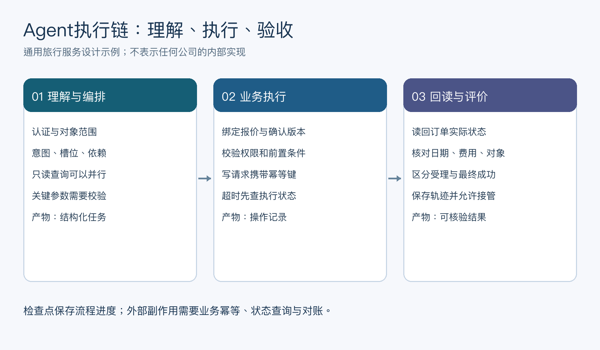
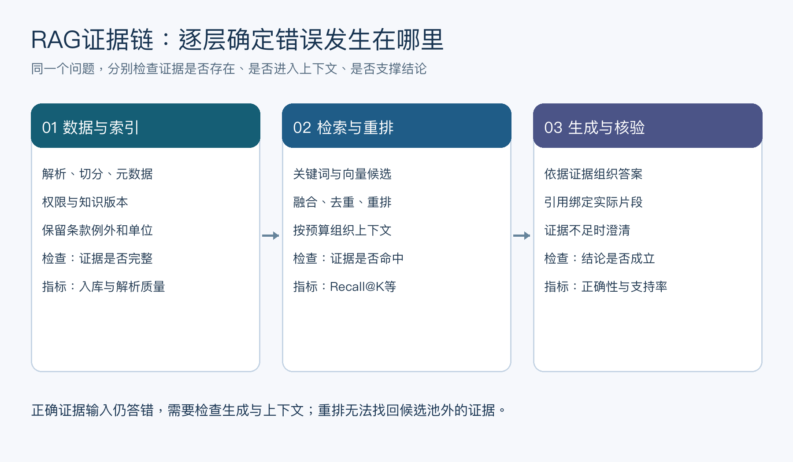

# 携程高频面试题

## 面经目录

- [2026-10-26_携程Agent项目一面面经](#ctrip-agent-20261026-4342f2fc)

> 覆盖携程推荐、搜索、用户画像和深度学习基础相关面试题。

## 已收录面试题

<h2 id="1.携程推荐算法面试题8道">1.携程推荐算法面试题8道</h2>

<h3 id="问题1：讲一讲推荐系统包含哪些流程？">问题1：讲一讲推荐系统包含哪些流程？</h3>

推荐系统的流程通常包括以下几个步骤：
- **数据收集**：收集用户行为数据（如浏览记录、购买记录、点击记录等）和物品数据（如物品特征、分类、标签等）。
- **数据预处理**：对数据进行清洗、归一化、特征提取等预处理操作。
- **特征工程**：构建用户画像和物品画像，提取有助于推荐的特征。
- **模型选择**：选择合适的推荐算法，如基于内容的推荐、协同过滤、矩阵分解、深度学习等。
- **模型训练**：使用历史数据训练推荐模型。
- **推荐生成**：根据训练好的模型生成推荐列表。
- **评估与调优**：使用评价指标（如准确率、召回率、F1-score等）评估推荐效果，并进行模型调优。
- **上线与更新**：将推荐系统上线，并定期更新模型和数据。

<h3 id="问题2：Transformer 位置编码是什么">问题2：Transformer 位置编码是什么？</h3>

Transformer中的位置编码（Positional Encoding）是为了弥补自注意力机制中缺乏顺序信息的缺陷。位置编码有两种常见方式：
- **固定位置编码**：如原始Transformer论文中使用的正弦和余弦函数。每个位置的编码是一个固定的向量，不随训练变化。
- **可训练位置编码**：将位置编码作为可训练的参数，与模型其他参数一起训练。

<h3 id="问题3：QKV 注意力公式为什么除以根号 d">问题3：QKV 注意力公式为什么除以根号 d</h3>

除以根号 $\( \sqrt{d_k} \)$ 的原因是为了防止内积值过大导致softmax函数的梯度消失问题。由于Q和K的维度较高，其内积的值会随 $\( d_k \)$ 增加而增大，
从而导致softmax的输出极端化（接近0或1）。除以根号 $\( \sqrt{d_k} \)$ 可以使得内积值的方差接近1，保持梯度稳定。

<h3 id="问题4：简单讲讲 GCN">问题4：简单讲讲 GCN</h3>

GCN（Graph Convolutional Network，图卷积网络）是一种用于图数据的神经网络。GCN通过在图的节点上进行卷积操作来提取节点的特征。基本的GCN操作步骤包括：

- **邻接矩阵**：用邻接矩阵 \( A \) 表示图结构。
- **节点特征矩阵**：用矩阵 \( X \) 表示节点特征。
- **卷积操作**：将节点特征与邻接矩阵进行卷积。

<h3 id="问题5：简单讲讲RNN">问题5：简单讲讲RNN</h3>

RNN（Recurrent Neural Network，循环神经网络）是一类用于处理序列数据的神经网络。RNN通过循环结构使得网络可以在序列的每个时间步共享参数，
从而记忆和处理序列中的上下文信息。RNN的基本结构包括：
- **输入层**：接收序列的当前时间步输入。
- **隐藏层**：通过循环连接，将前一时间步的隐藏状态和当前时间步的输入一起处理，生成当前时间步的隐藏状态。
- **输出层**：生成当前时间步的输出。

<h3 id="问题6：RNN 里的参数有什么特点？">问题6：RNN 里的参数有什么特点？</h3>

RNN的参数具有共享性，即在序列的每个时间步使用相同的一组参数。这使得RNN能够有效处理不同长度的序列，并在参数数量固定的情况下学习序列中的时间依赖关系。

<h3 id="问题7：Dropout 是怎么做的？有什么作用？推理和训练时 Dropout 的区别？如果推理也用 dropout 会怎么样？">问题7：Dropout 是怎么做的？有什么作用？推理和训练时 Dropout 的区别？如果推理也用 dropout 会怎么样？</h3>

Dropout是一种正则化技术，通过在训练过程中随机丢弃（即设置为零）一部分神经元来防止过拟合。具体步骤为：

1. 在每一层的输出中，以一定的概率 $\( p \)$ 随机丢弃一些神经元。
2. 对保留的神经元进行放大 $( \frac{1}{1-p} \)$ ，以保持总的激活值不变。

作用：通过随机丢弃神经元，减少节点之间的相互依赖，从而提高模型的泛化能力。

推理和训练时 Dropout 的区别
- **训练时**：应用Dropout，即随机丢弃神经元，并对保留的神经元进行放大。
- **推理时**：不应用Dropout，使用完整的网络。

如果推理时也用Dropout，模型的输出将变得不稳定，因为每次推理时网络结构都不同，导致结果不可预测且精度下降。

<h3 id="问题8：讲讲 BN？BN 训练和推理什么区别？有什么用？">问题8：讲讲 BN？BN 训练和推理什么区别？有什么用？</h3>

Batch Normalization（BN）是一种加速深层神经网络训练并提高其稳定性的方法。BN通过对每一层的输入进行标准化，使得输入具有零均值和单位方差，
同时允许网络学习最优的均值和方差。

训练和推理的区别

- **训练时**：使用mini-batch的均值和方差，并更新全局均值和方差的移动平均值。
- **推理时**：使用训练过程中计算的全局均值和方差。

作用

- 减少内部协变量偏移（Internal Covariate Shift）。
- 加快训练速度。
- 提高模型的泛化能力。

<a id="ctrip-agent-20261026-4342f2fc"></a>
## 2026-10-26_携程Agent项目一面面经

## 目录

- [一面](#ctrip-agent-20261026-4342f2fc-round1)
    - [1. 自我介绍，重点介绍你的Agent相关项目](#ctrip-agent-20261026-4342f2fc-q01)
    - [2. 讲讲多个Agent之间的协同逻辑](#ctrip-agent-20261026-4342f2fc-q02)
    - [3. 基于用户意图的路由机制是怎么实现的？](#ctrip-agent-20261026-4342f2fc-q03)
    - [4. 路由模型准确率如何？识别出错时，有什么兜底处理方案？](#ctrip-agent-20261026-4342f2fc-q04)
    - [5. 用户一条请求包含多个意图，系统该怎么处理？](#ctrip-agent-20261026-4342f2fc-q05)
    - [6. 完整介绍项目整体架构](#ctrip-agent-20261026-4342f2fc-q06)
    - [7. 适配层的实现思路是什么？](#ctrip-agent-20261026-4342f2fc-q07)
    - [8. 项目支持历史记录导出吗？海量数据读写导出怎么优化？](#ctrip-agent-20261026-4342f2fc-q08)
    - [9. Agent落地之后，主要缩短了哪些环节耗时？有没有量化指标？](#ctrip-agent-20261026-4342f2fc-q09)
    - [10. 结合你的项目，介绍RAG完整流程](#ctrip-agent-20261026-4342f2fc-q10)
    - [11. 召回率怎么定义、如何计算？](#ctrip-agent-20261026-4342f2fc-q11)
    - [12. 提升召回率的诸多手段里，哪一类优化收益最明显？](#ctrip-agent-20261026-4342f2fc-q12)
    - [13. Context Engineering 和 Prompt Engineering 的区别](#ctrip-agent-20261026-4342f2fc-q13)
    - [14. 怎么量化评估Agent输出结果的好坏？](#ctrip-agent-20261026-4342f2fc-q14)
    - [15. 正向样本good case和错误bad case，会不会回流到数据集做迭代？](#ctrip-agent-20261026-4342f2fc-q15)
    - [16. 用户一句自然语言，到最终调用接口执行，完整链路是什么？](#ctrip-agent-20261026-4342f2fc-q16)
    - [17. LangChain 和 LangGraph 的差异，各自优势是什么？](#ctrip-agent-20261026-4342f2fc-q17)

<a id="ctrip-agent-20261026-4342f2fc-round1"></a>
## 一面

<a id="ctrip-agent-20261026-4342f2fc-q01"></a>
### 1. 自我介绍，重点介绍你的Agent相关项目

**回答：**

介绍应围绕一个能深入解释的 Agent 项目，按“用户目标—个人职责—核心链路—关键难点—验证结果”展开。先讲用户原先怎样完成任务，系统介入后改变了哪些步骤，再说明自己负责路由、检索、工具接入、状态编排或评测中的哪部分，避免只列功能和框架名称。

可以根据真实经历组织为：“我主要负责……，项目面向……场景。用户请求经过……后由……模块执行，我实现了……。最难的问题是……，通过……定位并改进，用……数据和指标验证。目前仍有……限制。”没有正式上线、真实用户或可靠统计，就明确是原型、离线实验或测试环境，不编造业务规模和收益。

后续题解以“旅行服务助手”为统一设计示例：用户可以查询行程与政策、比较方案，必要时在授权和确认后执行订单操作。这个示例用于解释系统机制，不代表候选人的真实经历，也不代表携程内部系统的实现。实际面试要替换成自己真正做过的业务和组件。

<a id="ctrip-agent-20261026-4342f2fc-q02"></a>
### 2. 讲讲多个Agent之间的协同逻辑

**回答：**

多个 Agent 的协同先由任务依赖决定。旅行服务助手可以区分资料查询、方案比较和订单操作等职责，由调度器维护总任务状态；独立的只读查询可并行，依赖上游结果的步骤按顺序执行，有业务副作用的步骤经过明确授权与确认后执行。

通信宜使用结构化任务与产物，而不是无边界地互相发送完整聊天记录。消息包含 task_id、父任务、输入对象、权限范围、期望输出、预算和截止时间；返回结果包含状态、数据、证据引用和错误类型。共享状态由明确的协调者或受控存储更新，避免多个 Agent 同时覆盖同一字段。

如果查询 Agent 发现日期缺失，应返回“需要补充信息”，由调度器统一向用户提问；如果某一分支失败，需要决定其他结果是否可独立交付。设置最大调用次数、超时、取消传播和失败恢复，汇总时检测冲突，不能把三个 Agent 的答案直接拼接成最终结论。

多 Agent 不天然优于单 Agent。职责隔离、权限隔离或并行执行应带来可测收益；若单 Agent 加工具即可完成任务，增加协作只会增加 token、延迟与错误传播。通过单 Agent 基线和同一评测集比较，才能说明拆分的价值。

**协作的最小可验证单元。** 可以把子任务状态限定为 `pending → running → succeeded / failed / waiting_input`，再额外处理取消与重试。依赖节点只有在前置产物通过校验后才能调度；并行节点最好写不同状态字段，汇总节点按确定的合并规则读取。对“航班查询成功、酒店查询超时”，系统可以先返回航班结果并标明酒店待处理，不能把局部成功升级成整个旅行方案已完成。

评估协作收益时，固定工具、模型和总预算，比较单 Agent 与多 Agent 的任务成功率、关键路径延迟和每成功任务成本。并行能缩短独立分支的等待，却不能缩短有前置依赖的串行链；协调、汇总和冲突消解还会增加额外开销。

<a id="ctrip-agent-20261026-4342f2fc-q03"></a>
### 3. 基于用户意图的路由机制是怎么实现的？

**回答：**

意图路由把用户请求映射到合适的能力或执行流程，通常还需要抽取槽位和判断是否应澄清。先定义意图集合、边界、可组合关系和未知意图类别，例如“查询退改规则”与“提交退票”必须区分，后者不能只凭关键词直接进入写操作。

实现可以组合确定性规则、轻量分类器、Embedding 相似度和大模型结构化判断。明确且高频的请求走低成本路径，复杂上下文进入语义判断；路由结果至少包含候选意图、必要槽位、缺失信息和下一步动作。用户历史可以辅助理解“那就改到明天”，但要核实指代对象和日期所在时区。

分类分数需在验证集上校准，不把模型自报“95% 确信”当作真实概率。按业务风险设置阈值和候选差距条件：高置信度只读请求可以直接进入查询，歧义请求进行澄清，未知请求明确能力边界。权限判断由服务端独立执行，路由模型只能提出候选动作。

训练和评测数据覆盖多轮省略、否定、反问、错别字、混合语言与多意图。记录路由模型、提示词、意图 schema 和策略版本，让错误可重现；新意图上线要同步更新工具目录、评测集和回退策略，避免分类器已经支持而下游尚未准备好。

**一个结构化路由结果。** 对“看看这张订单能否免费取消，先别退”，合理的输出应保持查询与执行的边界：

```json
{
  "intents": ["query_cancellation_policy"],
  "slots": {"order_id": null},
  "missing_slots": ["order_id"],
  "next_action": "clarify_order",
  "execution_requested": false
}
```

这个结果仅表示语义解析，尚未完成鉴权。服务端根据当前登录态与订单归属筛选候选；如果用户下一轮说“确认取消”，系统还需核对这句话对应哪笔订单、哪版报价与哪次待确认动作。

<a id="ctrip-agent-20261026-4342f2fc-q04"></a>
### 4. 路由模型准确率如何？识别出错时，有什么兜底处理方案？

**回答：**

准确率必须基于实际标注集回答。对于单标签路由，可以统计正确分类请求数除以有效请求总数，但还应报告各意图的精确率、召回率、混淆矩阵和宏平均 F1，避免高频意图掩盖低频高风险错误。多标签路由另需使用适合多意图的指标。

如果系统允许拒绝或澄清，要同时报告自动路由覆盖率和已自动路由样本的正确率。只保留最容易的请求确实可能得到很高准确率，但大部分请求都转人工时，业务价值未必成立。验证集应与训练数据按用户、会话或时间等合适边界隔离，并包含真实分布与困难反例。

兜底分层处理：低置信度或相邻意图难以区分时，请用户确认目标；下游发现参数缺失或意图不匹配时，返回结构化错误给调度器重新判断；服务异常时选择已验证的备用路径、暂存任务或转人工。重新路由应有次数上限，避免错误请求在多个 Agent 间循环。

执行阶段还需要风险控制。订单写操作先完成授权、对象核验和必要确认；接口超时后先查询实际执行状态，不能因没有收到响应就重做。没有真实路由实验时，可以介绍上述评价与兜底设计，但不能虚构准确率，也不能用几个演示案例代替整体评估。

**把覆盖率与正确率一起算。** 假设仅作说明的 1,000 条评测请求中，800 条自动路由，其中 760 条正确：自动覆盖率为 80%，已自动路由的正确率为 95%，正确自动路由数占全部请求的 76%。这不是三个可以混用的“模型准确率”。比较两个阈值时，应画出覆盖率与错误率的关系，并单独统计误入写操作、高风险意图漏识别等错误。

| 现象 | 首选处理 | 必须保留的信息 |
| --- | --- | --- |
| 意图歧义或槽位缺失 | 针对性澄清 | 候选意图、缺失槽位与上下文 |
| 下游校验否决参数 | 修正参数或重新规划 | 结构化错误与原参数版本 |
| 只读服务暂时失败 | 有界重试或可信备用源 | 截止时间、已消耗预算 |
| 写接口超时、状态未知 | 查询操作记录与对账 | 幂等键、业务对象与执行请求 |

兜底策略应通过故障注入测试：故意触发超时、重复响应和过期确认，检查系统最终状态，而不只是检查它是否输出一句道歉。

<a id="ctrip-agent-20261026-4342f2fc-q05"></a>
### 5. 用户一条请求包含多个意图，系统该怎么处理？

**回答：**

将多意图请求解析为带约束的子任务集合，再建立依赖关系。例如“查一下酒店退订规则，如果可以免费取消就取消，再找附近更便宜的酒店”包含政策查询、条件判断、取消操作和酒店搜索，不能把它简单拆成四个独立并行请求。

子任务应记录目标、对象、槽位、条件、权限和产物。查询退订规则先执行，取消操作依赖规则与用户确认，附近酒店搜索在地点和日期明确时可并行。金额、日期、人数等约束要明确作用范围，禁止某个子任务擅自改变全局条件。

出现歧义时集中澄清，例如“附近”以哪个地点为中心、预算是每晚还是总价。对于会改变资金、订单或个人信息的动作，应根据产品规则再次确认关键参数；已经确认的内容要绑定到具体任务版本，用户修改日期后不能继续使用旧确认。

多步骤跨服务通常不是单个数据库事务，需要考虑部分成功。例如取消已成功但搜索失败，应如实报告状态并继续可恢复的步骤，不能宣称已回滚取消。可补偿操作按预定义业务规则执行，不让模型临时发明补偿动作。最终答复逐项说明完成、失败和待确认内容。

<a id="ctrip-agent-20261026-4342f2fc-q06"></a>
### 6. 完整介绍项目整体架构

**回答：**

整体架构沿请求链路说明：入口接收用户请求并完成认证；会话服务加载受控历史；意图路由决定流程；编排层维护任务状态与依赖；检索和工具层提供外部能力；模型生成候选结果；校验层检查格式、证据和执行状态；前端展示结果及必要确认。

数据层分别保存会话、任务与节点状态、文档及索引、产物和审计记录。大文件不必塞进会话表，可通过对象存储引用；长耗时工作交给队列与 Worker；日志、指标和调用轨迹通过 trace_id 关联。模型服务和工具供应方通过适配层接入，但业务授权与执行规则仍由系统负责。

以查询后改签为例，路由先识别目标，检索只提供政策证据，实时库存和价格通过业务接口获取，编排器等待确认后才提交变更，随后读回订单状态。历史知识库不能替代实时库存，模型回答也不能替代接口执行结果。

还要讲清故障边界：某个模型不可用如何降级，重复消息如何去重，Worker 重启如何恢复，撤权后历史任务如何处理。用实际部署规模决定是否引入缓存、消息队列和多服务拆分，不把组件数量当作架构成熟度。



图中区分理解、执行与验收三个阶段。数据库里的订单状态是执行结果的依据，聊天文本只承担解释；编排检查点记录“流程走到哪里”，业务操作账本记录“外部动作是否发生”，两者需要关联却不能互相替代。

<a id="ctrip-agent-20261026-4342f2fc-q07"></a>
### 7. 适配层的实现思路是什么？

**回答：**

适配层把不同模型或工具的调用方式转换成内部稳定契约，使上层业务不直接依赖供应方字段和 SDK。模型适配可以统一请求、流式事件、工具调用、用量和错误；工具适配可以统一输入校验、认证注入、超时、错误分类和结果结构。

统一契约不意味着所有能力必须强行一致。维护能力声明，例如是否支持结构化输出、并行工具调用、图片输入、流式参数或某种上下文长度；调用前检查能力，缺失时明确降级或拒绝。聊天模板、结束原因和工具调用 ID 的语义也需要正确转换，不能只换 base_url 就认为完全兼容。

重试策略根据错误与副作用区分：只读超时可以在预算内重试，鉴权失败不应无限重试，写操作需幂等标识和状态查询。认证密钥由服务端管理，模型生成的参数不能覆盖租户身份或权限范围。输出进行 schema 与业务校验，工具返回的自然语言被当作数据处理。

用契约测试验证正常结果、空结果、分片流、格式异常、限流、超时和取消。升级 SDK 或切换供应方时回放代表性样本，比较业务含义是否一致；不能只验证 HTTP 状态码成功。适配层解决兼容和依赖隔离，流程决策与业务事务规则应保持清晰边界。

<a id="ctrip-agent-20261026-4342f2fc-q08"></a>
### 8. 项目支持历史记录导出吗？海量数据读写导出怎么优化？

**回答：**

先如实说明项目是否实现历史导出。若未实现，可以给出设计并明确实践边界。导出范围应包括哪些会话、消息、工具结果和附件，由产品需求与权限确定；内部提示、密钥及不应暴露的日志不能因为属于“历史”就一起导出。

小量导出可同步处理，大量数据采用异步任务：校验权限和筛选条件，固定导出范围，创建 job_id，由 Worker 分批读取、流式序列化并写入对象存储，完成后返回受控下载入口。进度、失败原因、过期时间、取消和断点恢复都应有明确状态，避免持有一个超长 HTTP 请求或一次性把所有数据加载到内存。

数据库读取通常采用与过滤和排序匹配的联合索引，按稳定的复合游标如 created_at 与唯一 ID 分页，避免深 OFFSET。仅固定最大 ID 可以约束新增记录，却不能保证读取期间旧记录的修改和删除一致；是否需要事务快照、版本化读取或“按导出时可见数据”的较弱语义，要明确取舍。长事务快照也可能增加数据库维护压力。

写入采用有界缓冲、批量编码和必要的压缩，超大导出分片并记录校验值与清单；重试防止重复分片，临时文件定期清理。读副本可以降低主库负载，但需接受或处理复制延迟。对每个租户限制并发与总量，避免导出占满数据库连接或存储带宽。

下载前按业务要求重新验证授权，使用短期访问凭证并考虑撤权后的失效策略。CSV 需要处理引号、换行、编码以及表格软件公式注入风险。压测关注导出行数、吞吐、峰值内存、数据库影响、文件完整性和失败恢复，而不仅是“能下载”。

**复合游标的具体写法。** 假设按创建时间与唯一 ID 升序读取，下一页条件可表达为：

```sql
SELECT id, created_at, content
FROM messages
WHERE tenant_id = :tenant_id
  AND (created_at > :last_time
       OR (created_at = :last_time AND id > :last_id))
  AND created_at <= :cutoff_time
ORDER BY created_at, id
LIMIT :page_size;
```

可考虑与过滤排序匹配的 `(tenant_id, created_at, id)` 索引；真实查询有额外条件时需要检查执行计划。`cutoff_time` 只能约束时间范围，无法阻止回填旧时间戳、更新历史内容或删除记录；要求严格一致的导出，应另用可恢复的版本快照或物化任务范围。游标分页解决读取效率，一致性是另一项设计。

<a id="ctrip-agent-20261026-4342f2fc-q09"></a>
### 9. Agent落地之后，主要缩短了哪些环节耗时？有没有量化指标？

**回答：**

先把业务任务拆成获取信息、查资料、跨系统录入、方案整理、人工确认和实际执行等阶段，明确 Agent 改变了哪一段。它可能缩短人工检索和重复录入，也可能增加模型等待、澄清和复核，所以不能只统计某一次模型响应时间。

可以分别测量端到端完成时间、人工实际操作时间、人工接管比例、一次完成率、错误与返工次数及每个成功任务的成本。对于需要人工审核的场景，应把审核和排队计入端到端耗时，避免把劳动转移到其他环节后仍宣称全面节省。

在任务类型和样本难度相近的前提下，可用配对测试或合理随机分组比较基线与 Agent 流程。相对时间减少比例为：

```math
\mathrm{Reduction}=\frac{T_{\mathrm{baseline}}-T_{\mathrm{agent}}}
{T_{\mathrm{baseline}}}\times100\%.
```

同时报告样本量、均值或中位数、P95、观察窗口与失败样本处理规则。失败任务不能简单剔除后只计算成功样本耗时；应同时呈现成功率和全体请求结果，并尽量控制模型、数据及业务流程变化。

面试中可说明“实际测到的改善集中在某一步，而最终执行仍受外部接口或人工确认影响”。没有做过实验时，给出测量方案和已观察到的案例即可，不把假设性收益写成个人项目指标。

<a id="ctrip-agent-20261026-4342f2fc-q10"></a>
### 10. 结合你的项目，介绍RAG完整流程

**回答：**

RAG 要分为数据准备和在线请求两条链路。数据准备包括文档接入、解析、清洗、结构化切分、元数据与权限绑定、Embedding 和全文索引构建、质量检查以及版本发布。每个块保留文档与版本 ID、标题路径、原文位置和适用时间，方便更新与引用。

在线链路先确认用户身份和查询范围，再理解问题与必要槽位，按需改写或拆解查询，执行关键词、向量或混合召回，融合、去重、重排并补充必要上下文，最后把证据与用户问题送入模型。模型输出后检查引用是否存在、是否属于允许版本，以及结论是否被证据支持；格式合法不等于事实正确。

旅行服务示例中，静态政策和服务说明适合进入知识库；实时价格、库存和订单状态应查询业务接口。政策还受日期、产品和渠道限制，不能检索到一段语义相似内容就直接用于任意订单。跨版本冲突要优先依据生效规则和对象范围处理。

召回不足时，可以在授权范围内改写、扩大候选或读取相关章节，仍不足则说明无法确认或请求补充。缓存键包含权限范围、知识版本和必要的模型配置，更新与撤权要处理失效。完整对比或穷尽检查任务不能只依赖 Top-K 检索证明没有遗漏。

评测覆盖解析完整性、证据召回、重排、答案正确性和引用支持，并结合延迟与成本。回答项目实践时，需要说明哪些步骤真实实现过、哪些只是可选优化，不把标准流程全部当成个人完成的工作。



图中每个阶段都有独立验收对象。一个便于定位错误的办法是做三组对照：把人工正确证据直接给生成器，观察生成上限；固定候选池替换重排，观察排序收益；固定生成器替换检索结果，观察证据获取收益。若正确证据下仍答错，应继续检查上下文组织与推理，而不是盲目扩大召回数量。

<a id="ctrip-agent-20261026-4342f2fc-q11"></a>
### 11. 召回率怎么定义、如何计算？

**回答：**

召回率衡量所有应被找出的目标中，实际找到了多少。分类场景下是 TP/(TP+FN)，精确率是 TP/(TP+FP)。在检索场景，先为查询 q 定义人工标注的相关证据集合 R_q 和实际返回的前 K 个结果集合 S_q：

```math
\mathrm{Recall@K}(q)=\frac{|R_q\cap S_q|}{|R_q|},\qquad
\mathrm{Precision@K}(q)=\frac{|R_q\cap S_q|}{|S_q|}.
```

通常完整返回 K 个结果时第二个分母就是 K；若有效返回不足 K，应明确采用实际返回数还是固定 K 的约定。举例：应召回 5 个证据，返回 4 个不同结果，其中 3 个相关，则召回率为 3/5，精确率为 3/4。重复返回同一证据不能反复计为命中。

关键在于“相关”的标注单位。以文档为单位和以 chunk 为单位的结果不同；切分策略变化后 chunk ID 发生变化，宜对齐到稳定原文区间或可接受的证据等价组。需要两段证据联合支持的答案，还要检查证据组合是否齐全，命中任一相关片段并不意味着任务已可回答。

有些系统把“Top-K 中至少有一个相关结果的查询比例”称为召回率，严格说更接近 Hit Rate@K，应主动说明口径。多查询汇总还要区分逐查询平均与按总相关项汇总。无答案查询的 R_q 为空，召回率没有通常的定义，应另测正确拒答、误召回或误答，不直接把这类样本计成召回率 100%。

完整相关集合往往难以标注，评测池遗漏也会造成偏差。应记录标注范围、多人一致性及困难样本；线上点击只能作为弱反馈，不能不加区分地当作完整真实标签。

**Macro 与 Micro 的区别。** 假设查询 A 有 1 条相关证据、命中 1 条，查询 B 有 9 条相关证据、命中 3 条。逐查询平均的 Macro Recall 为 `(1 + 3/9)/2 ≈ 66.7%`；按相关项汇总的 Micro Recall 为 `(1+3)/(1+9)=40%`。两者并不矛盾，前者让每个查询权重相同，后者让每条相关证据权重相同。报告时同时交代 K、标注单位和聚合方法，才有可比性。

<a id="ctrip-agent-20261026-4342f2fc-q12"></a>
### 12. 提升召回率的诸多手段里，哪一类优化收益最明显？

**回答：**

收益最明显的优化取决于当前主要瓶颈，不能脱离实验宣布“混合检索一定最好”或“换大 Embedding 一定最有效”。先把失败分成文档根本未入库、解析丢失、切分破坏条件、过滤范围错误、查询表达不匹配、候选不足和重排误删等类别。

如果证据被 OCR 漏掉，升级重排模型无济于事；如果条款编号和专有名词经常漏召回，关键词召回与混合检索可能有效；如果用户问法省略较多，上下文补全或查询改写可能更直接；如果权限或版本过滤后候选不足，应检查索引与过滤执行策略。先修复确定性错误，再比较模型和检索策略。

固定数据划分、标注口径和延迟预算，依次比较解析与切分、关键词/向量/混合、查询改写、候选规模和重排等方案，并做消融。报告 Recall@K 的绝对百分点变化、答案正确性、P95 延迟和成本，而不只报相对提升。涉及多项同时修改时，不能把全部收益归给其中一个组件。

重排主要改善候选内部顺序，无法找回根本不在候选池中的证据；若最终只保留较小 K，它可能提高这个最终集合的召回，但不能据此说初始候选召回率提高了。最终上下文压缩也要检查是否删除例外条款和关键数字。

如果没有实验结论，可以回答自己会如何建立失败分类和对照实验。若确有结果，则说明在哪类查询上哪种改动收益最大、在哪些样本无效及是否引起其他退化，避免用单个好案例替代整体证据。

<a id="ctrip-agent-20261026-4342f2fc-q13"></a>
### 13. Context Engineering 和 Prompt Engineering 的区别

**回答：**

Prompt Engineering 主要设计模型调用中的指令、示例、表达方式和输出约束；Context Engineering 进一步管理每次调用可见的信息，包括系统指令、当前请求、历史、记忆、工具定义、工具结果和检索证据，以及它们的选择、顺序、权限与生命周期。两者边界并非完全统一的标准分类，但后者通常具有更广的系统视角。

例如要求模型“只依据证据回答并返回 JSON”属于提示设计；决定哪些政策版本进入上下文、如何压缩旧对话、保留哪些未完成操作、工具结果是否需要分页、上下文超限时删什么，则属于上下文管理。把更多内容全部塞进窗口，不等于有效的 Context Engineering。

工程上需要 token 预算、稳定任务状态、可回读的原始证据与选择策略。近期必要对话可以保留原文，历史可以摘要，长工具结果外置并按需读取；压缩时保留用户约束、关键实体、时间、已确认动作和待解决问题，避免截断工具调用与返回的关联关系。

长期记忆需要证据、时间、适用范围和更新机制，模型自己的猜测不能直接成为可信记忆。外部文档和工具返回应作为数据，不能提升为系统指令；权限范围在检索和读取时由服务端控制。上下文正确性不能只靠一句提示保证。

评估既看 token 与延迟，也看约束保持、证据覆盖、跨轮一致性和任务成功率。通过回放上下文快照定位失败，才能判断是提示不清、信息没进入、信息被压缩丢失，还是模型在充分证据下仍判断错误。

<a id="ctrip-agent-20261026-4342f2fc-q14"></a>
### 14. 怎么量化评估Agent输出结果的好坏？

**回答：**

首先定义任务成功：问答需要正确且被证据支持，方案推荐需要满足用户约束，接口操作需要业务状态确实改变。不能用“回答流畅”“返回了 JSON”或“接口 HTTP 200”统一代替成功标准。

建立分层评测：路由层检查意图和槽位，检索层检查证据召回，工具层检查参数合法性、授权与执行结果，输出层检查事实、引用和格式，任务层检查是否完成目标。执行类任务应读回业务状态，确认没有重复操作和隐藏失败；多意图请求还应检查每个子任务及整体依赖是否满足。

自动评测适合 schema、关键字段、数值、引用存在性、状态转换和可执行断言。语义质量可以结合专家标注及模型评审，但模型评审要校准、盲化和抽检，避免偏好冗长答案或受评审提示影响。引用能打开只证明可定位，仍需判断引用是否支持结论。

测试集覆盖正常请求、歧义、未知意图、无答案、权限不足、工具超时和多轮状态变化。按任务难度、语言和风险分桶，记录模型、提示词、工具、知识与流程版本；随机性明显的场景重复运行，观察成功率和方差，而不是展示最好一次。

上线还要监控 P50/P95 延迟、每个成功任务成本、人工接管、澄清、取消、错误和用户反馈。安全与权限测试作为硬性门槛，不与其他指标平均后掩盖失败。优化时同时验证目标指标和固定回归集，避免修复一类问题却破坏其他路径。

**任务成功应写成可执行判据。** 对一个酒店改期任务，可以要求：目标订单匹配、入住退房日期正确、最终费用在确认范围内、接口终态为成功、且没有额外订单被修改。任何一个硬约束不成立，该任务就不应被算作完整成功。问答类则需要另一套判据，不能照搬写操作的评价方式。

每成功任务成本建议用全部评测请求产生的推理、工具、重试与人工接管成本，除以通过验收的任务数；同时单列成功率。否则，把失败任务排除在账单之外，会得到不符合生产实际的成本结果。

<a id="ctrip-agent-20261026-4342f2fc-q15"></a>
### 15. 正向样本good case和错误bad case，会不会回流到数据集做迭代？

**回答：**

可以回流，但需要经过采集、脱敏、标注、审核和划分，再决定用于训练、知识修订还是评测。good case 有助于保留已具备的能力，bad case 用于发现盲点；用户点赞和未投诉都是弱信号，不能直接证明答案或执行结果正确。

记录案例时保留必要的任务上下文、版本、工具轨迹和错误阶段，限制敏感信息与保留期限。将失败按路由、检索、参数、执行、事实、权限和交互等原因分类：工具配置错误应修工具，文档过期应更新知识，不能把所有问题都交给微调解决。

审核后的样本需要正确答案、证据或明确偏好理由，并对重复会话、模板和同一文档衍生样本去重。按用户、会话、文档家族或时间隔离训练与评测；修复失败案例可以进入开发回归集，但保留独立测试集，避免一边训练一边把同一批案例当作泛化证据。

迭代策略可以是增加反例、改进 schema、补充工具说明、调整切分、提示词或训练数据。维护一定比例的正常与边界样本，避免只训练困难错误导致常见请求退化。偏好对需要控制长度、语气和标注者偏差，不能让模型只学习“更长看起来更好”。

每次更新版本化并记录样本用途，先离线回归再小范围灰度，观察任务质量、成本和失败分布，必要时回滚。未经审核的实时反馈不应直接修改生产规则或可信长期记忆。

<a id="ctrip-agent-20261026-4342f2fc-q16"></a>
### 16. 用户一句自然语言，到最终调用接口执行，完整链路是什么？

**回答：**

完整链路可以概括为：认证与范围确认 → 意图及槽位解析 → 任务规划 → 参数补全 → 授权与业务校验 → 必要确认 → 工具执行 → 状态读回 → 结果反馈与记录。模型负责提出理解和候选操作，确定性服务负责授权、约束和实际执行。

例如用户说“帮我把明天的酒店改到后天”，系统先读取有权访问的订单，消解“明天”“后天”的时区与日期，确认要变更哪笔订单、入住还是退房时间，再查询库存、价格和改期规则。缺少对象或存在多笔候选时进行澄清，不能任意选择最近一笔。

模型按工具 schema 生成候选参数后，代码检查类型、必填字段、允许值、订单归属和业务前置条件。变更费用等关键内容按产品规则展示并确认，确认结果绑定订单、参数和报价有效期；若确认后库存、价格或版本发生变化，应重新校验，不能复用过期承诺。

提交时生成幂等键，记录请求与任务状态。网络超时后先用请求标识查询订单或操作状态，防止重复提交；可重试的暂时故障采用有上限的退避，参数和权限错误走修复或终止。持久化 checkpoint 只保存流程状态，不自动保证外部接口恰好执行一次。

最后读回业务状态并向用户报告实际完成内容、金额和待处理项。模型不得在接口失败时继续声称“已改好”；异步受理也要区分“已提交”和“最终成功”。保存必要审计与调用轨迹，支持取消、人工接管和恢复，让整个流程能解释、能核查。

**超时后的状态机。** 写操作可以维护 `prepared → confirmed → submitted → succeeded / failed / unknown`。其中 `unknown` 表示暂时无法确认外部结果，不能当作 `failed` 直接重做。幂等键绑定业务动作与参数摘要，重试复用同一键；参数已改变时必须作为新动作重新校验。业务服务若不支持幂等或状态查询，编排器只能降低重复执行风险，不能凭本地 checkpoint 宣称“恰好一次”。

<a id="ctrip-agent-20261026-4342f2fc-q17"></a>
### 17. LangChain 和 LangGraph 的差异，各自优势是什么？

**回答：**

LangChain 提供较高层的模型、工具、消息和 Agent 构建接口，适合快速搭建常见模型应用，并通过集成减少供应方接入工作。LangGraph 更偏向状态化编排，用状态、节点和边描述可控流程，适合复杂分支、循环、人工中断以及需要持久化恢复的执行过程。

二者不是互斥选项。当前 LangChain 的 Agent 能力构建在 LangGraph 之上，开发者可以先使用高层接口，也可以在需要精细控制时直接编写图。不能把差异简单归结为“LangChain 只能线性执行、LangGraph 才能循环或多 Agent”，具体能力要结合版本和使用层级。

选择时看控制需求：标准工具调用循环和简单检索问答可先用高层 Agent；如果必须明确每个节点的业务状态、等待确认后恢复、分别处理多个失败分支，直接使用图式编排更容易表达。固定且很短的任务也可能用普通服务代码就够，不必为采用框架而增加流程层次。

持久化需要选择合适的 checkpointer 和存储，使用正确的任务或线程标识，并定义状态 schema 与升级策略。恢复执行仍可能重跑节点，涉及订单写入等副作用时继续需要幂等、状态读回和对账；框架不会自动完成跨外部系统的事务保证。

评价框架应比较开发维护成本、状态可观察性、恢复与测试能力、依赖兼容和运行开销。实际使用经验只报告自己做过的部分；没有用过某框架时，可以解释能力边界和选型依据，不把文档了解描述成生产实践。

**面试中的选型落点。** 标准问答助手可以用 LangChain 高层接口快速交付；涉及审批、长任务恢复和多个业务终态时，需要显式状态图与稳定存储。LangGraph 的持久化恢复会重放部分流程，因此外部副作用宜封装为可识别、可重试且幂等的独立步骤。是否引入框架，最终由状态控制和维护收益决定，不能靠“Agent 越多、图越复杂”证明系统先进。
