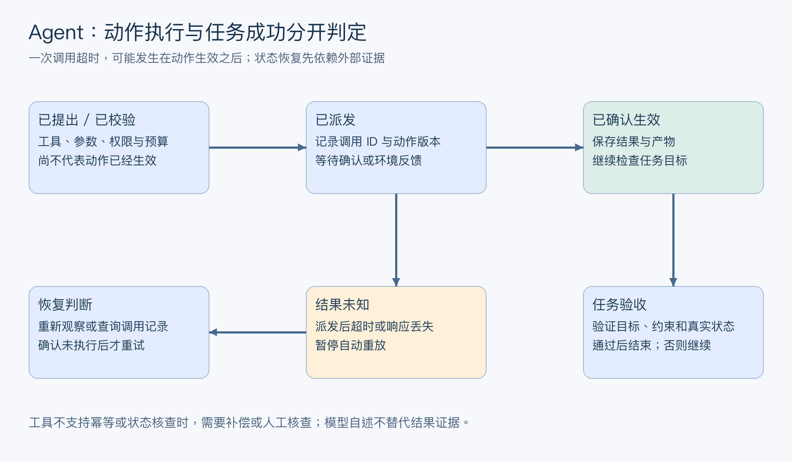
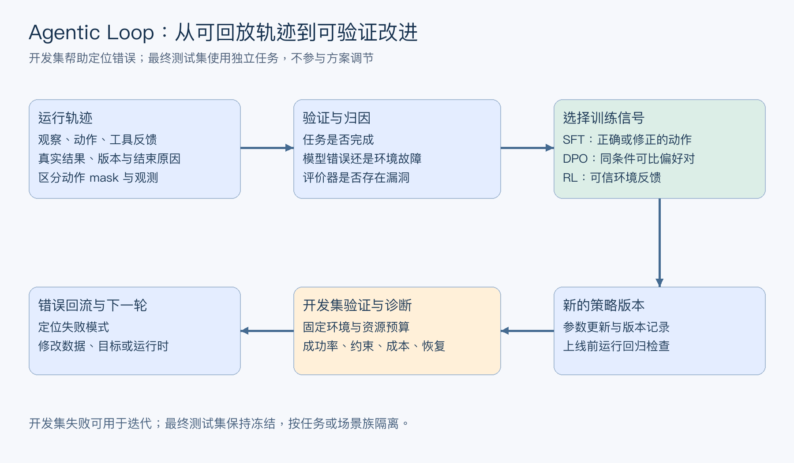
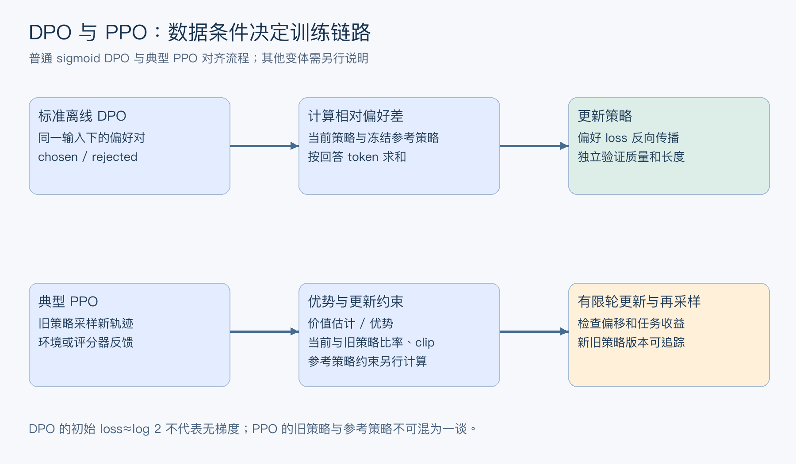

# 米哈游高频面试题

> 用于持续沉淀米哈游相关的 AI、Agent 和工程面试题。

## 待补充方向

本文件作为该公司面试题的持续更新入口。

## 目录

- [2026-11-08_米哈游大模型算法岗面经](#mihoyo-llm-algorithm-20261108-7de26039)

- [米哈游Agent开发提前批一面面经](#mihoyo-agent-20260801)
  - [（1）平时怎么使用 AI coding？](#mihoyo-agent-20260801-q1)
  - [（2）如何保证 AI coding 生成代码的质量？](#mihoyo-agent-20260801-q2)
  - [（3）AI 幻觉产生的原因是什么？](#mihoyo-agent-20260801-q3)
  - [（4）DeepSeek、OpenAI 这类模型 API 有哪些接口？](#mihoyo-agent-20260801-q4)
  - [（5）如何解决模型回答的事实性和忠实度问题？](#mihoyo-agent-20260801-q5)
  - [（6）Skill 和 MCP 有什么区别？](#mihoyo-agent-20260801-q6)
  - [（7）Skill 有哪些特性？](#mihoyo-agent-20260801-q7)
  - [（8）个人agent项目深挖](#mihoyo-agent-20260801-q8)
  - [（9）手写题（二选一）](#mihoyo-agent-20260801-q9)

<a id="mihoyo-agent-20260801"></a>
### 米哈游Agent开发提前批一面面经

#### 面试问题汇总

<a id="mihoyo-agent-20260801-q1"></a>
##### （1）平时怎么使用 AI coding？

**回答：**

我把 AI coding 当作“可审查的工程协作者”，而不是把需求直接丢给模型生成一份代码。通常分成五步：

1. **先定义边界。** 说明业务目标、输入输出、已有模块、技术栈、约束、非目标和验收条件；涉及 Agent 时还要说明工具协议、状态结构、超时和安全边界。
2. **先让模型理解再实现。** 让它先阅读目录、接口、测试和调用链，输出改动计划及风险点，再按小步提交代码。新项目先让模型生成接口、数据结构和最小可运行骨架。
3. **把重复劳动交给模型。** 适合交给 AI 的工作包括样板代码、类型补全、单元测试、SQL/正则草稿、日志分析、重构候选和文档；核心业务规则、权限、数据一致性和安全策略必须由人确认。
4. **验证后再合入。** 我会执行格式化、静态检查、单元测试、集成测试和关键场景回放，审查 diff、依赖变化、异常路径、资源释放和日志是否泄露敏感信息。
5. **保留可追溯性。** 每次让模型完成一个小任务，记录输入约束、改动范围、测试结果和未解决风险，避免大范围生成导致问题无法定位。

本质上，AI coding 提升的是“从意图到可验证变更”的吞吐；代码是否进入主干，仍然由需求、测试、评审和生产指标共同决定。

<a id="mihoyo-agent-20260801-q2"></a>
##### （2）如何保证 AI coding 生成代码的质量？

**回答：**

质量不能靠一句“请生成高质量代码”保证，而要把自然语言要求转换成可执行的质量门禁。

首先明确契约：函数签名、数据不变量、错误语义、性能上限、兼容版本和安全要求；对 Agent 工具尤其要定义参数 schema、权限、幂等性和副作用。然后让模型先写测试或验收样例，再实现代码，降低“实现了错误需求”的风险。

验证链路至少包括：

- 编译、类型检查、lint、格式检查和依赖漏洞扫描；
- 单元测试覆盖正常、边界、异常、空值、超时和重复调用；
- 集成测试验证数据库、消息队列、外部 API 和工具调用；
- 性能、并发、资源泄漏和故障注入测试；
- 对模型/Agent 代码增加轨迹回放、结构化输出校验、工具参数校验和离线评测集。

审查时重点看 AI 容易犯的错误：凭空引入不存在的 API，忽略旧接口兼容性，把异常吞掉，重试造成重复副作用，使用不安全的反序列化，或在并发场景下共享可变状态。高风险模块采用小 diff、双人评审和灰度发布；低风险重复代码可以提高自动化比例。

最终质量标准是“可证明地满足约束”，而不是代码看起来像人写的。模型可以生成候选实现，但测试、静态分析、代码评审和线上可观测性共同承担质量责任。

<a id="mihoyo-agent-20260801-q3"></a>
##### （3）AI 幻觉产生的原因是什么？

**回答：**

幻觉的本质是生成模型根据训练分布和当前上下文计算下一个 token 的条件概率，而不是直接访问一个保证真实的事实数据库。模型可以生成语言上连贯、概率上合理，但事实并不存在的内容。

主要原因有四类：

1. **知识边界。** 训练数据缺失、过时、相互矛盾，或问题属于长尾事实，模型只能基于相似模式补全。
2. **目标错位。** 语言模型优化的是 token 似然，不是事实正确率；在信息不足时，流畅回答的概率可能高于明确说“不知道”。
3. **上下文问题。** Prompt 歧义、上下文过长、检索召回错误、证据冲突、关键信息被截断或出现 lost in the middle，都会让模型引用错误依据。
4. **系统与工具问题。** 工具选择错误、参数错误、工具返回脏数据、解析失败、重试时状态重复，以及温度较高造成的采样波动，都会把系统错误表现成模型幻觉。

因此不能把所有幻觉都归结为“模型参数不够大”。要区分知识幻觉、引用幻觉、工具幻觉和执行幻觉，再分别通过检索与引用、工具校验、结构化输出、事实核验、置信度/拒答策略和端到端评测治理。

<a id="mihoyo-agent-20260801-q4"></a>
##### （4）DeepSeek、OpenAI 这类模型 API 有哪些接口？

**回答：**

不同厂商的命名和兼容层不完全相同，但从能力抽象看，常见 API 可以分为以下几类：

- **生成接口：** 文本/多模态输入、文本输出、流式输出、批量请求，以及对话状态或响应 ID 管理。
- **工具与结构化接口：** Function/Tool Calling、JSON Schema 结构化输出、并行工具调用、工具结果回传和响应终止原因。
- **表示与检索接口：** Embedding、向量相似度相关能力；部分平台还提供 Rerank 或专门的检索模型接口。
- **多模态接口：** 图片、音频、视频理解，语音识别、语音合成和图像生成/编辑，具体可用能力取决于模型。
- **模型运营接口：** Fine-tuning、Batch、文件/数据集管理、评估、配额、用量查询和模型列表。
- **安全与治理接口：** 内容审核、敏感信息检测、权限、审计和请求追踪。

工程上不能只记接口名称，还要关注请求 schema、认证、超时、重试、速率限制、幂等键、错误码、上下文窗口、计费单位和数据保留策略。最好在业务侧定义统一的 Provider Adapter，把流式事件、工具调用、结构化输出和错误类型归一化，避免上层 Agent 与某一家 SDK 强耦合。

回答“有哪些接口”时，我会先按能力分类，再选一个具体业务说明调用顺序，例如：用户请求进入生成接口，模型返回工具调用，服务端执行工具并回传结果，最后以结构化或流式结果结束。

<a id="mihoyo-agent-20260801-q5"></a>
##### （5）如何解决模型回答的事实性和忠实度问题？

**回答：**

事实性是答案是否符合真实世界或权威数据；忠实度是答案是否被给定证据支持。两者相关但不相同：模型可能说了一个真实事实，却没有来自当前检索证据；也可能忠实复述了错误来源。

我会建立分层方案：

1. **限定知识来源。** 对稳定知识使用版本化知识库，对实时信息调用权威 API/搜索工具；RAG 中保留文档 ID、版本、时间和段落引用。
2. **提升证据质量。** 做查询改写、混合召回、元数据过滤和 Rerank，过滤过期、冲突、低质量文档；证据不足时明确触发拒答或澄清。
3. **约束生成。** Prompt 中要求只基于证据回答、区分事实与推断、逐项引用；需要机器消费的结果使用 JSON Schema 或工具调用。
4. **生成后核验。** 对答案拆分原子事实，用 NLI/LLM Judge/规则/第二次检索核对每条陈述；高风险动作必须由规则引擎或人工审批决定。
5. **做可观测评测。** 分别评估 answer correctness、citation correctness、citation completeness、faithfulness、拒答准确率和工具执行成功率，并按问题类型、时间新鲜度和长尾场景分桶。

治理重点不是让模型永远回答，而是让系统在“有证据时准确回答、证据不足时可解释地不回答、需要行动时先验证权限和参数”。

<a id="mihoyo-agent-20260801-q6"></a>
##### （6）Skill 和 MCP 有什么区别？

**回答：**

Skill 和 MCP 解决的是不同层次的问题。

**Skill 更像可复用的能力包或工作流说明。** 它通常包含触发条件、领域知识、执行步骤、提示模板、脚本、资源和验收规则，告诉 Agent“遇到某类任务应该如何完成”。Skill 可以是纯指令，也可以调用本地工具；它的重点是流程和方法。

**MCP 是工具与上下文的协议层。** 它规定客户端和服务器如何发现、描述、调用工具，以及读取资源、提示模板和结构化结果。MCP 解决的是“模型/Agent 如何以统一方式连接外部能力”，重点是接口契约、能力发现、权限和传输。

两者可以组合：Skill 规定“先读取项目规范，再调用代码检查工具并运行测试”，MCP Server 提供读取文件、查询数据库或执行测试的标准化工具。Skill 不等于 MCP Server，MCP 也不会自动提供业务流程、任务分解和质量标准。

设计时要把职责分开：Skill 负责方法、顺序和决策边界；MCP 负责受控能力暴露、参数 schema、权限、超时和结果协议。这样既能复用工作流，也能替换底层工具实现。

<a id="mihoyo-agent-20260801-q7"></a>
##### （7）Skill 有哪些特性？

**回答：**

一个成熟 Skill 至少应具备以下特性：

- **可发现。** 具有清晰名称、描述、触发条件和输入输出，Agent 能判断什么时候应该使用。
- **模块化。** 将领域知识、提示模板、脚本、资源和验证器封装在一起，避免每次从零编排。
- **渐进式加载。** 先加载短描述和入口规则，真正触发后再读取详细文档和资源，节省上下文窗口。
- **流程可执行。** 关键步骤、分支、停止条件和失败兜底明确，不能只有泛泛的知识介绍。
- **可组合。** Skill 可以调用其他 Skill 或 MCP 工具，但要避免循环依赖、重复执行和权限越界。
- **可验证。** 有样例、测试、输出 schema、质量门禁和可观测日志，能通过回放判断是否完成任务。
- **可版本化和可治理。** 变更可审查、依赖可锁定、权限最小化、敏感操作需确认，并能回滚。

Skill 的边界也很重要：它不应把所有业务逻辑都藏在不可见 Prompt 中，更不能绕过权限、审计和代码评审。真正有价值的 Skill 是把专家经验变成可重复、可评估、可维护的执行单元。

<a id="mihoyo-agent-20260801-q8"></a>
##### （8）个人agent项目深挖

**回答：**

这道题不能套一个虚构项目答案。我的回答结构会严格围绕真实项目展开：

1. **业务目标。** 谁在什么场景下遇到什么问题，原流程的成本、延迟或错误点是什么，成功指标是什么。
2. **完整链路。** 用户输入经过意图理解、状态构建、规划/路由、工具调用、观察结果、重试/反思和最终输出的过程；画清同步、异步和人工确认边界。
3. **状态与数据。** 说明短期上下文、长期记忆、RAG 文档、工具返回、任务 ID 和持久化方式，解释多轮与并发时如何隔离。
4. **关键技术选择。** 为什么采用固定 Workflow、ReAct 或图式编排，为什么选某个模型/框架/向量库，替代方案的成本和缺点是什么。
5. **可靠性。** 结构化输出、参数校验、超时、重试、幂等、熔断、权限、审计、人工审批和失败降级怎么做。
6. **效果证明。** 离线评测集、成功率、工具调用正确率、任务完成率、延迟、成本和线上反馈如何定义，改动是否有消融或 A/B 证据。

项目深挖的本质是证明“我理解系统为什么这样工作，并且能定位它为什么失败”。没有亲自实现的模块要明确边界，不把框架默认行为说成自己的设计；面试官继续追问时，能落到一次真实请求的输入、状态变化、工具参数、日志和最终结果。

<a id="mihoyo-agent-20260801-q9"></a>
##### （9）手写题（二选一）

**回答：**

两道题都可以先澄清输入输出和边界，再选择实现。若现场只要求二选一，我会优先选择自己能完整验证的一道；下面给出两道的可运行思路。

**A：Python 实现一个打印 log 的装饰器。** 使用 `functools.wraps` 保留原函数元数据，记录调用开始、参数、耗时和异常；生产环境应使用结构化日志并对密码、Token、个人信息脱敏。

```
from functools import wraps
import logging
import time

logger = logging.getLogger(__name__)

def log_call(func):
    @wraps(func)
    def wrapper(*args, **kwargs):
        started = time.perf_counter()
        logger.info("call_start function=%s", func.__qualname__)
        try:
            result = func(*args, **kwargs)
            elapsed_ms = (time.perf_counter() - started) * 1000
            logger.info("call_success function=%s elapsed_ms=%.2f", func.__qualname__, elapsed_ms)
            return result
        except Exception:
            elapsed_ms = (time.perf_counter() - started) * 1000
            logger.exception("call_failed function=%s elapsed_ms=%.2f", func.__qualname__, elapsed_ms)
            raise

    return wrapper
```

**B：筛选并输出售价最低的前 4 个有效记录。** 在题目未给出完整输入格式时，我会先确认是否为“第一行 n，后续每行 price sold buy”。下面按这个常见 ACM 约定实现：过滤 `sold == 0` 或 `buy == 0` 的记录，按售价升序取前 4 个；同价时保留输入顺序。

```
import sys

def solve():
    data = list(map(int, sys.stdin.buffer.read().split()))
    if not data:
        return
    n = data[0]
    records = []
    for i in range(n):
        price, sold, buy = data[1 + 3 * i: 4 + 3 * i]
        if sold != 0 and buy != 0:
            records.append((price, sold, buy))
    records.sort(key=lambda row: row[0])
    for row in records[:4]:
        print(*row)

if __name__ == "__main__":
    solve()
```

排序复杂度是 $O(n\log n)$，额外空间是 $O(n)$。如果只需要前 4 个且 $n$ 很大，可以用大小为 4 的堆把复杂度降到 $O(n\log 4)$，但仍要先根据题意确认输出顺序和并列价格规则。

<a id="mihoyo-llm-algorithm-20261108-7de26039"></a>

## 2026-11-08_米哈游大模型算法岗面经

## 目录

- [面试问题汇总](#mihoyo-llm-algorithm-20261108-7de26039-questions)
    - [1. Agent是如何完成推理以及工具调用的？训练轨迹里需要留存哪些信息？](#mihoyo-llm-algorithm-20261108-7de26039-q01)
    - [2. 怎么设计Agent的工具记忆模块？过期信息、冲突信息该怎么处理？](#mihoyo-llm-algorithm-20261108-7de26039-q02)
    - [3. 谈谈你对Agentic Loop的理解，怎么利用交互轨迹优化后续训练？](#mihoyo-llm-algorithm-20261108-7de26039-q03)
    - [4. 分析Agent训练曲线时，重点看哪些指标？奖励持续上涨，但任务实际成功率反而下降，该怎么排查？](#mihoyo-llm-algorithm-20261108-7de26039-q04)
    - [5. DPO训练之后，模型输出明显变长，你会怎么排查和处理？](#mihoyo-llm-algorithm-20261108-7de26039-q05)
    - [6. 大模型训练为什么会设置退火阶段，作用是什么？](#mihoyo-llm-algorithm-20261108-7de26039-q06)
    - [7. 怎么判断一款大型游戏GUI Agent具备研究价值，而不是单纯固定路线演示？](#mihoyo-llm-algorithm-20261108-7de26039-q07)
    - [8. 以RoPE结构的模型举例，长度外推有哪些方案？仅仅修改最大长度配置够用吗？是否一定要从头预训练长文本？](#mihoyo-llm-algorithm-20261108-7de26039-q08)
    - [9. DPO和PPO，在优化目标、数据来源、训练流程上有什么区别？](#mihoyo-llm-algorithm-20261108-7de26039-q09)

<a id="mihoyo-llm-algorithm-20261108-7de26039-questions"></a>

## 面试问题汇总

<a id="mihoyo-llm-algorithm-20261108-7de26039-q01"></a>

### 1. Agent是如何完成推理以及工具调用的？训练轨迹里需要留存哪些信息？

**回答：**

Agent 的一次推理与工具调用，可以理解为“模型提出动作，执行器落实动作，环境结果进入下一轮决策”。模型输出工具名称和参数，只代表提出了调用请求；实际调用是否被允许、是否成功，以及任务是否完成，需要运行时和验收逻辑给出依据。

**推理与执行闭环。** 系统把任务目标、约束、当前观察、必要历史和工具描述组织成输入。模型可以直接作答，也可以生成结构化动作。执行器检查工具是否存在、参数是否符合 Schema、权限与资源预算是否满足，再执行动作，把结果、错误或超时状态与对应调用 ID 一起返回。模型据此更新下一步行动；到达成功条件、明确失败、超出预算或需要补充信息时结束当前阶段。这个过程不要求系统获取或存储模型内部不可见的推理过程。

例如 Agent 需要查询数据再更新一条记录，第一步的查询结果决定第二步是否具备执行条件。如果更新调用超时，执行器先核查真实状态，再决定是否重试；不能直接把超时解释为“没有执行”。同一个业务动作跨重试复用幂等标识，避免一次不确定响应造成重复写入。

**训练轨迹要保留能重建决策依据的信息。** 可以按以下结构组织，而不只是保存最终回答。

<div align="center">

| 信息类别 | 需要记录的内容 | 用途 |
|---|---|---|
| 任务与环境 | 任务 ID、目标、初始状态、环境及工具版本、可见权限 | 明确模型当时面对什么问题 |
| 输入上下文 | 消息顺序、角色、实际提供的工具定义、检索或记忆内容、截断与压缩状态 | 还原每一步真实输入 |
| 动作与反馈 | 工具调用 ID、参数、返回值、执行状态、重试与取消记录 | 对齐请求与结果，定位执行失败 |
| 产物与评价 | 最终产物、成功判定、奖励及其版本、人工评价、失败类别 | 区分完成任务与仅生成流畅答案 |
| 训练与运行元数据 | 模型及分词器版本、采样参数、动作掩码、时间和成本；算法需要时保留旧策略概率与价值估计 | 支持复现、损失计算和策略更新 |

</div>

训练数据必须与训练目标匹配。做监督微调时，通常只让选定的 assistant 输出或动作 token 参与损失，用户输入和工具观测作为条件；错误动作不能不加区分地当成正例。做基于轨迹的策略优化时，还需要奖励、终止与截断标志，以及计算优势或重要性比所需的信息。上下文摘要遗漏了实际可见信息，就不能声称已经精确复现了当时的策略条件。

外部文档和工具返回内容需要保留其数据身份，不能因为进入轨迹就获得指令权限。敏感字段在进入训练集前脱敏，并保持调用与结果的关联；无法完整回放的环境也应标明限制，避免把一段文本记录误当作可重复的真实执行。

**把“工具调用成功”拆成能落盘的状态。** 一次动作可以经历“已提出 → 已校验 → 已派发 → 已确认生效”，随后再由任务验证器判定是否满足目标。网络超时发生在派发后、确认前时，应记录为结果未知，而不是直接记为失败。此时先按调用 ID 查询操作记录；确认没有生效后才进入重试。工具不支持幂等键或状态查询时，执行器需要停止自动重放，并选择补偿或人工核查。

例如“领取奖励”按钮点击后响应丢失，再点一次可能产生不同结果；GUI 场景没有可靠幂等接口时，应先重新观察背包、任务状态或按钮状态。屏幕刷新本身也未必证明服务端已经提交，需要把可观测证据与动作结果分开记录。



*图 1：动作被发出、动作生效与任务完成属于不同状态。派发后的超时进入“结果未知”，通过重新观察或查询恢复判断。*

可以用一个最小轨迹结构自检数据是否够用：`episode_id、step_id、parent_call_id、policy_version、observation_ref、action、result_state、artifact_ref、reward_version、terminated、truncated`。如果要重算训练概率，还要保存实际 token IDs、角色边界与动作 mask；只保存格式化后的对话文本，可能因模板升级而无法还原同一个输入。

<a id="mihoyo-llm-algorithm-20261108-7de26039-q02"></a>

### 2. 怎么设计Agent的工具记忆模块？过期信息、冲突信息该怎么处理？

**回答：**

工具记忆模块需要分清三类内容：当前任务的执行状态、工具能力与接口约束，以及跨任务可复用的经验。它们可以共同服务模型决策，但更新频率、可信度和失效方式不同，不适合全部混入一个只按向量相似度检索的库。

**先确定各类信息的权威存储。** 任务状态包含已执行动作、待返回结果、业务对象 ID 和副作用状态，应由可持久化的运行时状态库维护。工具名称、参数 Schema、版本和权限来自受控工具注册表。长期记忆可以保存经验证的使用经验、常见错误及恢复方法、稳定事实和用户明确允许保存的偏好，但不能覆盖注册表中的权限规则或实时业务状态。

每条可检索记忆至少包含实体与租户标识、适用任务、工具及环境版本、证据引用、记录时间、生效与失效时间、验证状态和替代关系。记录时间是何时写入系统，生效时间是事实何时成立，两者需要区分。例如今天录入的旧接口说明，不一定比昨天验证过的新版本约束更可靠。

检索流程可以采用“权限与版本过滤 → 关键词或向量召回 → 相关性和可信度重排 → 按需读取证据”。先缩小适用范围，再比较语义相似度，避免把其他用户、其他工具版本的经验带入当前任务。对库存、余额、执行结果等快速变化的信息，记忆只作为查询线索，动作前重新读取实时状态。

**处理过期与冲突时，先判断它们是否描述同一个条件下的事实。** 例如“接口默认超时为 30 秒”和“接口默认超时为 60 秒”，可能分别对应不同版本。版本不同则并存并明确边界；同版本下出现冲突，再比较权威性、实际验证证据和有效时间。已确认过期的记录标为失效或由新记录替代，保留必要的历史关系；无法确认的内容进入待复核状态，避免直接参与高风险决策。

不能仅用“最近写入覆盖旧值”解决所有冲突，也不能把一次成功调用概括为永久规律。经验入库可以先放入候选区，经重复验证后提升可信度；失败轨迹可用于撤销或缩小已有经验的适用范围。评估时同时看正确召回率、过期信息使用率、冲突处置准确率、任务成功率和跨用户信息混入情况，确保记忆真正改善执行结果。

**冲突处理可以落实为一条确定的查询顺序。** 先过滤租户、权限、工具版本和有效时间，再检查是否存在明确的 `supersedes` 关系；仍冲突时，优先读取可验证的权威状态。两个高可信记录仍无法区分时，返回“尚未解决的冲突”及证据，而不是要求语言模型凭措辞猜一个值。

例如 11 月 1 日保存“工具 v1 默认超时 30 秒”，11 月 5 日发布的 v2 改为 60 秒，11 月 8 日又补录一份旧 v1 文档。按写入时间取最新会选错；按版本与生效时间查询，v1 与 v2 可以各自保留正确值。这里的日期只是说明双时间语义的例子。

删除和失效也要传播到派生内容。源事实撤销之后，向量索引、缓存摘要和压缩记忆若仍引用旧结论，Agent 仍可能使用它。可以为派生记忆记录依赖项及版本，在检索时检查失效标记；“原表已经删了”不足以证明系统不再使用这条信息。

<a id="mihoyo-llm-algorithm-20261108-7de26039-q03"></a>

### 3. 谈谈你对Agentic Loop的理解，怎么利用交互轨迹优化后续训练？

**回答：**

Agentic Loop 包含两个相互关联、时间尺度不同的闭环。一个是推理时的“观察 → 决策 → 动作 → 反馈”，另一个是训练迭代中的“采集轨迹 → 评价与归因 → 构建数据 → 更新模型 → 独立验证”。前者可以更新上下文和任务状态，并不意味着每次调用都会更新模型参数。

在推理闭环中，系统根据工具返回或环境变化选择后续动作。例如游戏 GUI Agent 观察画面后点击按钮，下一帧出现了意外弹窗，就需要重新识别状态和决定动作，不能继续按预设坐标机械执行。闭环质量取决于观察是否可靠、动作是否正确落实，以及反馈是否及时反映环境变化。

**交互轨迹进入训练前，需要先回答“这一段数据教给模型什么”。** 核对动作和观测是否对齐，区分模型决策错误、工具故障、环境随机性和评价器错误，保留任务版本与实际结果。对同一输入下不同策略的比较，必须保证它们面对的约束和可用信息一致；不能把任务更简单的一条轨迹直接标成更好的策略。

可以按数据质量和反馈形式选择后续训练方式：

- **监督微调**：使用经验证的成功动作、有效恢复步骤或人工修正，训练正确的动作格式与决策模式。对失败轨迹只保留其诊断价值，把错误动作当正例会强化错误。
- **偏好优化**：为同一任务构建可比的优劣轨迹或回答对，判断依据包括任务完成度、约束遵守和成本；避免让“更长、更像解释”自动成为偏好标签。
- **强化学习**：在可重复交互的环境中采集新轨迹，用可信奖励推动策略改进，同时处理奖励稀疏、长程信用分配和训练稳定性。旧日志并不能不经处理就当成当前策略的 on-policy 数据。

数据划分要按任务实例、地图、初始状态或场景族隔离，不能把同一条轨迹的相邻帧随机分到训练和测试两侧。固定独立测试集、执行预算和环境版本，比较成功率、恢复能力、调用成本及失败分布；涉及模型、提示词、记忆或工具修改时，分别做消融，避免无法判断收益究竟来自哪个环节。

一个完整改进周期应能够解释：发现了什么失败模式，用什么数据或目标修复，在哪些未见任务上验证，哪些能力发生回退。这样才能从积累日志推进到有证据的能力改进。

轨迹用于策略训练时，首先明确哪些输出属于模型动作。假设一轮包含模型发出的工具调用、工具返回的 2,000 token 观测，以及模型随后生成的 100 token 答案：观测可以作为后续条件，但不能作为策略自己生成的 2,000 token 计入策略损失。动作 mask 与普通的非 padding attention mask 具有不同含义。

只有最终成功奖励时，把同一个优势广播给所有动作会造成粗糙信用分配：早期一次错误查询和最后一次正确修复可能获得同样的序列标签。可以研究分段回报、过程验证或价值估计，但新增的中间奖励也需要证明与最终目标一致，不能只奖励“多规划、多调用”。若用人工修正轨迹做 SFT，则把修正后的动作作为监督对象，保留修正前失败状态作为输入条件。



*图 2：运行轨迹先经过结果验证与错误归因，再进入适合的训练目标。开发集支持迭代诊断，最终测试集保持独立与冻结，避免将测试反馈不断用于调参。*

<a id="mihoyo-llm-algorithm-20261108-7de26039-q04"></a>

### 4. 分析Agent训练曲线时，重点看哪些指标？奖励持续上涨，但任务实际成功率反而下降，该怎么排查？

**回答：**

训练奖励是被优化的代理指标，实际任务成功率才直接对应目标行为。两者反向变化，可能来自评价配置变化、环境故障、奖励漏洞或策略退化，需要先证明比较口径一致，再判断模型是否学会了“刷分”。

我会同时观察四组指标，避免仅盯着平均奖励或 loss。

<div align="center">

| 指标层次 | 重点观测 | 可以暴露的问题 |
|---|---|---|
| 任务结果 | 独立任务成功率、约束满足率、各任务类型表现、失败比例及置信区间 | 总分掩盖局部能力退化 |
| 行为过程 | 工具选择与参数有效率、重复调用、超时、恢复成功率、异常终止 | 动作循环、无效调用、错误恢复 |
| 训练状态 | 奖励各组成项、梯度范数、策略熵、相对参考策略的偏移；使用 PPO 时观察裁剪比例与价值误差 | 过度更新、策略坍缩、价值估计失真 |
| 成本与环境 | token、步数、时延、调用费用、模型和工具版本、解码与预算设置 | 用更大成本换取表面收益或环境变化 |

</div>

**排查第一步是固定评价条件。** 用相同任务、初始状态或随机种子集合、工具版本、解码设置和动作预算，重新运行训练前后的检查点。检查是否把多次重试后的成功率与单次成功率混比，奖励是否重新缩放，任务难度是否变化，成功判定是否依赖模型自述。出现超时的样本不能悄悄从分母中删除，少量样本的波动也应与统计不确定性区分。

**第二步是分解奖励并回放异常轨迹。** 对“高奖励但失败”的样本，逐项查看得分来自哪里。例如每调用一次工具都有正奖励，Agent 可能反复执行无效查询；格式评分占比过高，模型可能输出符合模板却没有完成任务的结果；训练环境允许利用隐藏字段，则可能出现评测泄漏。检查奖励与轨迹长度、调用次数和真实成功的关系，比只看总奖励更容易定位问题。

**第三步是检查训练本身。** 查看奖励标注是否被错误归到其他任务，终止与截断处理是否正确，优势或动作掩码是否算错，工具观测是否意外参与策略损失。如果评价和奖励定义没有问题，仍可能是优化过强、任务分布偏移或有限数据过拟合，需对照学习率、更新轮数和约束强度。

修复应针对确认的问题：调整有漏洞的奖励项、修正环境与标签、补充反例或回退到有效检查点，再以固定预算做单因素对照。发布条件应包含独立成功率和回归检查；训练奖励继续上涨，本身不足以支持采用新版本。

可以把排查缩成一个可执行的实验：固定一批未参与训练的任务，运行训练前后两个 checkpoint，将每条结果放入“高奖励且成功、高奖励但失败、低奖励但成功、低奖励且失败”四格表。先核查高奖励失败样本，定位可利用的评分捷径；再核查低奖励成功样本，寻找漏判、迟到反馈或奖励尺度问题。阈值要在同一奖励版本与任务类型内定义，不能把不同量纲的分数直接混合。

同时固定“谁来宣布成功”。GUI Agent 的任务若是获得指定物品，成功依据应是受控环境状态或可信的画面验收，而不是模型最后一句“已获得”。评价器版本变动后，可以对保留轨迹重新打分，分离“策略变了”与“尺子变了”；涉及真实动作的成功率则仍要在环境中重跑。

回归发布可以设成多个同时满足的条件：目标任务收益、关键约束、长尾成本和基础能力均通过。平均奖励提升无法抵消某类高价值任务完全失效。

<a id="mihoyo-llm-algorithm-20261108-7de26039-q05"></a>

### 5. DPO训练之后，模型输出明显变长，你会怎么排查和处理？

**回答：**

DPO 后输出变长，先判断增长是有用的内容扩展，还是冗余、重复与停止异常。对需要完整论证的任务，长度增加可能提高正确率；对简单查询或工具调用，额外文本可能增加成本甚至破坏协议。因此应联合评估质量、长度和任务完成情况。

**先排除推理与数据管线差异。** 固定提示词、聊天模板、采样参数和输出预算，检查 EOS、停止串、最大生成长度及模型配置是否变化。统计平均长度、中位数、长尾分位数、触及长度上限的比例，以及重复输出和自然结束的比例。训练前使用了停止串、训练后漏配停止串，就不应先归因于偏好算法。

**再检查偏好数据有没有把长度当成质量线索。** 在同一个 prompt 内比较 chosen 与 rejected 的长度差，按任务类别统计；抽查长回答是否包含真实新增信息，还是大量复述与套话。如果标注者持续偏好更长的回答，模型可能学会冗长风格。训练中还要检查响应掩码、padding、EOS、截断位置及策略模型与参考模型的分词和序列对齐，避免把格式错误误判为算法特性。

从目标函数看，标准 DPO 使用完整回答的条件对数概率，而序列对数概率是各 token 对数概率的和：

```math
\log \pi_\theta(y\mid x)
=\sum_{t=1}^{T}\log \pi_\theta(y_t\mid x,y_{1:t-1}).
```

这使长度、训练数据分布和偏好标签可能发生耦合，但不能据此断言 DPO 必然偏好长回答。DPO 比较的是策略相对参考模型的对数概率差，还受样本质量与更新强度影响。简单把序列求和改成 token 平均，会改变优化目标；它应被当作新的设计选择验证，不能称为原始 DPO 的等价实现。

处理顺序可以是：先修复停止与掩码问题，再清理冗余偏好样本、补充“简洁但完整”的优选回答和长度可比的偏好对，然后对学习率、训练轮数与 DPO 的 $\beta$ 参数做小规模对照。长度正则或专门的去长度偏差目标可以作为候选方案，但要检查是否牺牲复杂任务的完整性，不能仅靠截断让长度指标变好。

验证时同时做自然长度评测、相同输出预算评测和长度分层分析，报告正确率、完整性、成本、重复率与停止情况。长度匹配的比较有助于诊断偏差，但筛选本身也会改变样本分布，不能代替总体结果；自动评审若偏好冗长答案，还需要人工抽查和可执行验证补充。

**一个数值例子可以说明，DPO 奖励的是相对偏好差。** 假设某对回答的参考 logprob 为 chosen=-20、rejected=-18；策略训练前与参考一致，偏好差为 0，DPO loss 为 log 2，约 0.693。之后策略 logprob 变成 chosen=-21、rejected=-22，则相对变化分别为 -1 和 -4，偏好差提高到 3。取 β=0.1 时，loss 下降到约 0.554，尽管 chosen 的绝对概率也下降了。

这不是长回答必然占优的证明，而是提醒排查时要分别画出 chosen、rejected 相对参考的变化、两者长度差和偏好 margin。只看平均 loss 下降或 chosen 的平均 logprob，很容易漏掉实际学习行为。不同长度回答的裸 logprob 还受累积项数影响，不能直接当作质量分数比较。

序列对齐检查要落到一个短样本上：第 t 个位置的 logits 预测第 t+1 个 token，求和只覆盖回答 token；EOS 若被定义为真实回答的一部分就应按约定保留，padding 必须剔除。左右 padding、prompt 长度变化和截断都应保持这项对应关系。参考概率预计算后，模板、tokenizer 或响应截断规则变化，需要重算缓存。

<a id="mihoyo-llm-algorithm-20261108-7de26039-q06"></a>

### 6. 大模型训练为什么会设置退火阶段，作用是什么？

**回答：**

这里的退火通常指训练后期逐步降低学习率，让参数更新在已有解附近更细致地收敛。有些训练方案还会同步调整数据配比，例如提高经过筛选的高质量数据或目标能力数据占比；学习率调度与数据变化是两个因素，需要分别分析。

训练较早阶段使用相对较大的学习率，有助于在有限步数内快速学习；接近训练预算终点时，持续较大的更新可能带来较强波动，降低学习率可以减小相同梯度与优化器状态下的更新尺度。它不保证找到全局最优，也不能保证所有能力都会提高；过早降低学习率可能使模型学习不足，后期数据过窄则可能引起能力遗忘。

以某个退火阶段内的余弦衰减为例，设起始学习率为最大值，经过 $T$ 步逐渐降到最小值：

```math
\eta_t=\eta_{\min}
+\frac{\eta_{\max}-\eta_{\min}}{2}
\left(1+\cos\frac{\pi t}{T}\right),
\qquad 0\le t\le T.
```

这只是一个调度示例，也可以采用线性衰减，或在稳定学习率阶段之后执行较短的衰减阶段。训练期间的学习率退火，与推理采样的 temperature 调整、模拟退火搜索、偏好优化里的温度系数属于不同概念，不能混为一谈。

**验证退火收益，需要把额外训练、数据变化与调度变化拆开。** 从同一检查点出发，在相同 token 与算力预算下，可以设计以下对照。

<div align="center">

| 方案 | 学习率 | 数据配比 | 主要比较目的 |
|---|---|---|---|
| A | 保持基线调度 | 保持原配比 | 额外训练的基线 |
| B | 增加退火 | 保持原配比 | 学习率调度的影响 |
| C | 保持基线调度 | 调整后期配比 | 数据选择的影响 |
| D | 增加退火 | 调整后期配比 | 两者组合及交互影响 |

</div>

评估至少覆盖独立验证集损失、目标能力、通用能力、长短文本表现和能力遗忘，并记录优化器状态、有效 batch size 和重复数据比例。若同时提高数据质量又降低学习率，只观察最终模型变好，无法把收益全部归给退火。

是否单独设置退火阶段，要结合已有调度、剩余预算、训练稳定性和部署目标决定。已有调度包含完整衰减时，不一定还需要额外阶段；从头到尾保持同一个高学习率也不应被当成唯一对照方案。

可以进一步把四组对照的结果写成主效应和交互项。若四个方案的同口径指标分别为 A、B、C、D，那么 `B−A` 描述原配比下调度变化的收益，`C−A` 描述基线调度下数据变化的收益，`D−B−C+A` 描述两者在该指标尺度上的交互。交互为正不代表存在普适的训练规律，还要看随机种子和任务分层的不确定性。

实验中容易漏掉的是优化器状态。相同参数配上不同 Adam 动量，后续轨迹仍会不同；因此要从同一完整 checkpoint 分叉，并统一 token 预算、样本顺序规则和有效 batch。若只剩很短预算，warmup 与 decay 占比可能把真正学习的阶段挤没，应同时画出按 step 和按已处理 token 计量的学习率。

<a id="mihoyo-llm-algorithm-20261108-7de26039-q07"></a>

### 7. 怎么判断一款大型游戏GUI Agent具备研究价值，而不是单纯固定路线演示？

**回答：**

判断游戏 GUI Agent 的研究价值，要看它是否解决了可复现的决策问题，并证明方法在明确的变化范围内有效。单次成功演示能展示系统潜力，但无法说明它适应了新状态，也无法区分模型决策和预先写好的路径。

**首先定义研究问题和公平的观测边界。** 例如研究“在陌生界面与随机起点下完成多步任务”，就要明确 Agent 输入是截图、历史动作还是其他信息，输出是鼠标键盘动作还是高层接口。若宣称仅依赖视觉，就不能偷偷把游戏内部坐标、完整地图或任务答案作为模型输入。评价器可以读取受控的环境状态判定成功，但这些信息不能泄漏给策略。

任务应由目标状态定义，例如在限定步数内取得指定物品并到达目标区域，而不只检查是否走过一串固定坐标。保存初始存档、地图种子、任务配置和终止规则，使不同方法面对可比条件。将自动执行部分与人工介入部分分别统计，不能把人工修正后的结果当作完全自主成功。

**其次设计与主张匹配的泛化测试。** 按任务或环境分组留出测试集，覆盖未见起点、地图或关卡、目标组合、界面布局、窗口尺寸和语言变化；再加入可控的延迟、误点击、弹窗或动作丢失，观察系统能否重新感知并恢复。只在同一关卡上替换一张截图，通常不足以支持跨关卡能力；只验证跨起点，也不能扩展宣称为跨游戏泛化。

对照方法至少包含固定脚本、简单状态机或规则策略，以及去掉记忆、重规划或视觉反馈的消融版本。尽量保持它们获得的观测、允许的动作、时间和重试预算一致。若比较对象使用不同的特权信息，应单列结果，解释比较边界。

指标以固定预算内的首次尝试成功率为主，同时报告多次重试后的成功率、执行时间、动作次数、模型调用成本、失败恢复比例和约束违规情况。对多个任务与随机种子运行，给出样本量和不确定性；不能只选最好的一段录像。游戏状态变化很快时，还应测量从截图到动作生效的延迟，区分感知误差、规划错误和动作时序问题。

研究价值也可能来自揭示一种稳定的失败机制、提出可信的评测方法，或在同等成本下显著改善恢复能力，不必以“所有任务都成功”为前提。最终应清楚说明验证了哪个假设、在哪些条件下成立、哪些失败仍未解决。

**预算和统计单位应在跑实验前确定。** 固定脚本与闭环 Agent 比较时，除了动作数，还要约束总墙钟时间、模型调用和允许重试次数。否则一方每次决策调用多个模型、反复读档，却只报告最终成功，比较的就不只是决策方法。

例如在 100 个近似独立任务上成功 70 次，点估计为 70%，95% Wilson 区间约为 60.4%～78.1%。如果这 100 次实际只是同一关卡重复 100 个随机种子，结果主要反映该关卡的不确定性，不能按 100 个独立关卡解释。可以先对任务求均值，再按任务或关卡进行成组 bootstrap；比较两个方法时保留相同任务与种子的配对关系。这里给出的是统计口径算例，并非某款 Agent 的实测。

消融也要有可证伪的预期：移除视觉反馈后，遇到意外弹窗的恢复率是否显著下降；移除长期记忆后，新任务适应成本是否提高；把初始位置扰动后，固定脚本是否失效。若消融结果与宣称的机制无关，研究结论应收缩到真正得到验证的部分。

<a id="mihoyo-llm-algorithm-20261108-7de26039-q08"></a>

### 8. 以RoPE结构的模型举例，长度外推有哪些方案？仅仅修改最大长度配置够用吗？是否一定要从头预训练长文本？

**回答：**

**只修改最大长度配置，通常不够；也不必一开始就从头预训练长文本。** 需要分开处理位置编码对长距离的适应、模型是否学过长程依赖，以及推理系统能否承载更长序列。配置上限提高，只解决了其中一部分输入或运行限制。

RoPE 对查询和键的二维通道施加随位置变化的旋转。对位置 $m$、$n$，旋转后的点积可以写成：

```math
\widetilde q_m=R(m)q_m,\qquad
\widetilde k_n=R(n)k_n,
```

```math
\widetilde q_m^{\mathsf T}\widetilde k_n
=q_m^{\mathsf T}R(n-m)k_n.
```

这使注意力分数包含相对位置信息，但并不自动保证超出训练长度后的泛化。不同通道的旋转频率不同，长距离下的相位关系可能落到模型不熟悉的范围；模型还可能没有学会在大量干扰文本中稳定组合远距离信息。

常见扩展方法可以按改变位置映射、改变频率分布和追加训练来理解。

<div align="center">

| 方案 | 主要机制 | 需要关注的边界 |
|---|---|---|
| 直接使用更大位置索引 | 保持原有 RoPE，把序列延长 | 可能越出有效训练分布，不能只看能否运行 |
| 位置插值 PI | 将更长序列的位置按比例缩回原范围 | 压缩局部位置间隔，通常需要适配训练与短文本回归 |
| 频率或基数缩放 | 调整不同旋转频率，如部分 NTK-aware 扩展方案 | 配置依赖模型与实现，不能任意复制参数 |
| YaRN 等分频段方法 | 对不同频段采用不同处理，并配合注意力尺度调整 | 需要与原始模型、目标长度和训练方案匹配 |
| 长序列持续训练或微调 | 在保留已有权重的基础上学习长程依赖 | 数据需包含真实跨段关系，同时控制短文本退化 |

</div>

例如原训练长度为 $L$，目标长度为 $sL$，简单位置插值把位置 $m$ 映射为 $m/s$。它扩展的是可用上下文；虽然工程上常统称“长度外推”，具体位置处理属于插值。频率缩放与插值也不保证相同结果，必须核对所用注意力实现和模型配置。

工程上先检查模型是否已有经过验证的长上下文权重及配套配置，再尝试合适的 RoPE 扩展方式；达不到目标时，使用已有检查点进行长序列持续预训练或针对性微调，而非默认从头训练。长训练数据应包含需要跨段检索、整合或推理的内容，机械拼接大量互不相关的短文本未必能教会模型长程能力。推理时也不能在未处理历史 KV Cache 的情况下随意切换旋转配置。

验证需要覆盖不同长度、证据位置、干扰强度、多证据推理、长文生成与短文本回归。单个“大海捞针”测试主要反映检索能力，不能代表长文理解的全部能力。同时检查显存、首 token 延迟、解码吞吐和注意力实现：标准全注意力的计算量随序列长度近似二次增长，KV Cache 通常随长度线性增长；高效注意力改善执行成本，也不等于模型自动获得长程推理能力。

**容量估算能帮助区分“能输入”和“能用好”。** 对每层保存完整 K/V 的 MHA/GQA 模型，一条序列的 KV Cache 近似为 `2×层数×KV头数×头维×长度×元素字节数`。以 32 层、8 个 KV 头、头维 128、BF16 为例，8,192 token 约占 1 GiB，32,768 token 约占 4 GiB；这是单序列 K/V 数据，不包含权重、临时张量和分配开销。滑动窗口、前缀共享、KV 量化和 MLA 会改变这个模型。

全注意力 prefill 的注意力计算部分通常随长度近似二次增长；逐 token decode 对已有 KV 的注意力读取通常随当前缓存长度增长。FlashAttention 一类实现通过减少中间矩阵物化与显存读写改善执行效率，并没有把普通稠密注意力的全部算术复杂度自动改为线性。

长上下文验收可以把横轴设为输入长度，分别画检索、两处证据组合、跨段推理、生成质量与单位请求成本。再把关键信息放在开头、中间和结尾，区分“单点命中”与“利用整段上下文”。扩长之后短任务退化，也应在同一张结果表里展示。

<a id="mihoyo-llm-algorithm-20261108-7de26039-q09"></a>

### 9. DPO和PPO，在优化目标、数据来源、训练流程上有什么区别？

**回答：**

DPO 和 PPO 都能用于模型对齐，但优化方式不同。标准离线 DPO 用已有的偏好对直接训练策略；PPO 是策略梯度算法，通常交替采集当前策略附近的数据与更新策略，通过优势估计和裁剪代理目标控制更新。两者都需要可信的目标和评价，不能只按算法名称判断哪一个一定更好。

**DPO 的目标。** 对相同输入 $x$，设优选回答为 $`y_w`$，较差回答为 $`y_l`$，固定参考策略为 $`\pi_{\mathrm{ref}}`$。先定义策略相对参考策略的偏好差：

```math
\Delta_\theta
=\log\frac{\pi_\theta(y_w\mid x)}{\pi_{\mathrm{ref}}(y_w\mid x)}
-\log\frac{\pi_\theta(y_l\mid x)}{\pi_{\mathrm{ref}}(y_l\mid x)}.
```

```math
\mathcal L_{\mathrm{DPO}}
=-\mathbb E_{(x,y_w,y_l)\sim\mathcal D}
\left[\log\sigma\left(\beta\Delta_\theta\right)\right].
```

这里的 $\beta$ 控制对数概率比差的缩放，并与推导中的参考策略约束有关；它不等同于学习率，也不是专门控制输出长度的参数。DPO 在常用的偏好模型与 KL 正则化框架下，将奖励关系重参数化为策略概率比，省去了独立训练奖励模型和在每次梯度更新时在线生成回答的步骤。提高偏好差，并不保证优选回答的绝对概率一定上升，它也可能主要通过压低较差回答的概率实现。

**PPO 的目标。** 令 $`s_t`$ 为当前状态或语言模型的前缀，$`a_t`$ 为动作或下一个 token，旧采样策略为 $`\pi_{\mathrm{old}}`$，优势估计为 $`\widehat A_t`$：

```math
r_t(\theta)
=\frac{\pi_\theta(a_t\mid s_t)}{\pi_{\mathrm{old}}(a_t\mid s_t)}.
```

```math
J_{\mathrm{clip}}(\theta)
=\mathbb E_t\left[
\min\left(r_t(\theta)\widehat A_t,
\mathrm{clip}(r_t(\theta),1-\epsilon,1+\epsilon)\widehat A_t\right)
\right].
```

训练通过最大化这个代理目标更新策略，常配合价值函数损失和熵项。在典型大模型 RLHF 流程中，反馈可以由奖励模型提供，并加入相对参考策略的 KL 约束；在可验证任务中，也可以由测试器、规则或环境给出奖励。奖励模型是常见组成部分，并不是 PPO 算法必须绑定的模型。

需要区分两个策略：PPO 的旧策略用于本轮采样与重要性比，随迭代更新；参考策略用于约束长期行为偏移，通常固定于某个初始或监督微调检查点。裁剪目标也不构成严格的 KL 上界，仍需监控更新幅度。

两者在数据和工程流程上的差别可以概括如下。

<div align="center">

| 维度 | 标准离线 DPO | 典型 PPO 对齐 |
|---|---|---|
| 训练数据 | 同一输入下的优选与较差回答对 | 较新的策略生成或环境交互轨迹及奖励 |
| 主要更新信号 | 相对参考模型的偏好概率差 | 优势估计与新旧策略概率比 |
| 训练流程 | 计算两类回答的概率，构造偏好损失，更新策略 | 采样、评分、估计优势、若干轮优化，再重新采样 |
| 辅助组件 | 通常需要参考策略或预先计算的参考概率 | 通常需要价值估计，可能还需要奖励和参考模型 |
| 主要开销 | 偏好数据准备与训练计算 | 额外的生成、环境交互、奖励计算和状态同步 |
| 主要风险 | 偏好标签偏差、覆盖不足、长度偏差与分布外行为 | 奖励漏洞、长程信用分配、采样成本与更新不稳定 |

</div>

有可靠偏好对、希望简化训练链路时，DPO 是值得验证的选择；需要不断接触新状态、优化真实交互结果时，PPO 或其他强化学习方法更容易利用环境反馈。DPO 也可以在不同训练轮次之间刷新偏好数据，但那属于迭代或在线变体；PPO 使用同一批新采样数据做有限轮更新，也不意味着可以无限复用陈旧日志。最终应在同一任务、成本与质量标准下比较，避免把算法流程的简化直接等同于所有场景的效果优势。



*图 3：标准离线 DPO 直接消费可比偏好对；典型 PPO 交替采样、反馈、优势估计与更新。PPO 的旧策略与参考策略承担不同作用。*

**一组可检查的实现边界。** 对普通 sigmoid DPO，如果当前策略初始化为参考策略，则每对样本的偏好 margin 为零，平均 loss 应接近 log 2；它不意味着梯度为零。反转 chosen 与 rejected 标签应反转偏好推动方向；改动已屏蔽的 padding 不应改变 loss；参考概率应保持冻结，避免策略与参考一起移动而破坏比较基准。这些检查只能验证实现语义，无法证明偏好标签可靠或训练后任务效果更好。

对典型 PPO，旧策略随采样轮次更新，价值模型用于回报与优势估计；一个 rollout batch 内做若干次更新之后，应监控概率比和偏移，而非无限重复优化直到训练奖励最大。相对参考策略的 KL、相对旧策略的更新距离和奖励模型的得分，是三种不同信号。

选型还要问数据从哪里来。如果任务需要通过操作才能遇到新状态，而手头偏好对只覆盖静态问答，直接做 DPO 可能缺少所需状态覆盖；如果环境反馈成本很高，却已有高质量的同条件偏好对，先做离线偏好优化更容易建立基线。最终比较应包括数据采集和评测的成本，不能只比较一次反向传播的显存。
