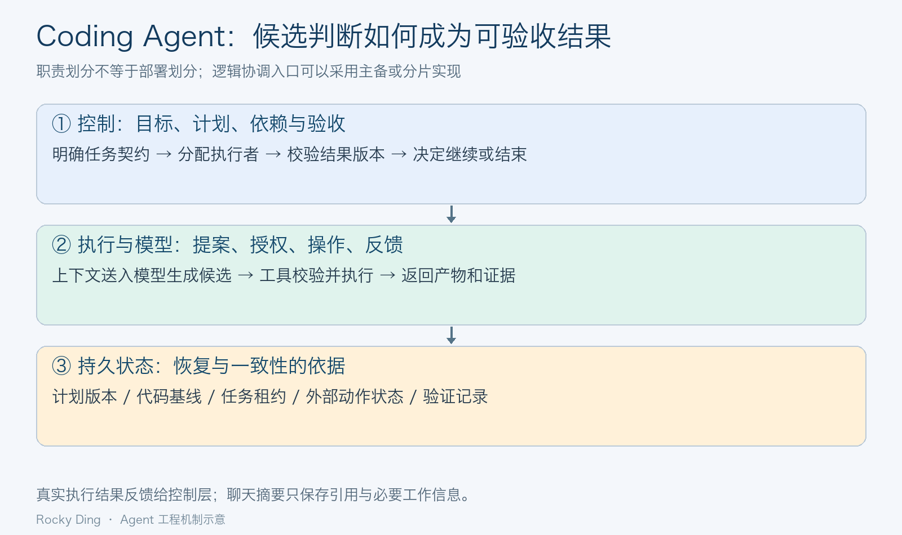
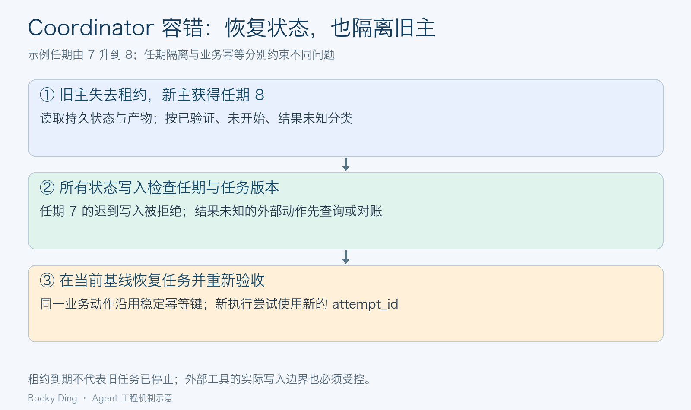

# 长鑫存储高频面试题

## 面经目录

- [2026-10-31_长鑫存储Agent开发面经](#cxmt-agent-dev-20261031-9d70e1b4)

## 2026-10-31_长鑫存储Agent开发面经

这组问题反复追问同一件事：Coding Agent 怎样把局部代码修改变成可靠的整体交付。讨论从自研价值和架构分层，逐步进入任务耦合、状态一致性、重规划与故障恢复。Rocky认为，这些机制决定了 Agent 能否从演示走向持续运行的研发系统。

文中的 Coordinator 作为中心协调架构讨论；涉及 Codex、Claude Code 的描述以公开机制为界。架构示例和指标口径用于分析，不代表相关公司的内部实现或个人已经取得的项目收益。

## 目录

- [面试问题汇总](#cxmt-agent-dev-20261031-9d70e1b4-questions)
    - [1. 设计 Coding Agent，如何优化 Codex](#cxmt-agent-dev-20261031-9d70e1b4-q01)
    - [2. 市面上这么多 codeagent 我为什么要自己做](#cxmt-agent-dev-20261031-9d70e1b4-q02)
    - [3. 从架构上来讲 agent 有几层](#cxmt-agent-dev-20261031-9d70e1b4-q03)
    - [4. 多 agent 这些主流的 codeagent 是怎么设计的，什么场景需要](#cxmt-agent-dev-20261031-9d70e1b4-q04)
    - [5. claudecode 的协调者模式的好处是什么](#cxmt-agent-dev-20261031-9d70e1b4-q05)
    - [6. Claude Code Coordinator 协调者模式设计初衷是什么](#cxmt-agent-dev-20261031-9d70e1b4-q06)
    - [7. 为什么 Claude Code 协调者模式要设计一个中心 Coordinator](#cxmt-agent-dev-20261031-9d70e1b4-q07)
    - [8. 中心 Agent 模式（Coordinator）单点局限问题是什么](#cxmt-agent-dev-20261031-9d70e1b4-q08)
    - [9. 中心 agent 模式有哪些冲突，解决办法是什么](#cxmt-agent-dev-20261031-9d70e1b4-q09)
    - [10. codeagent 怎么解决处理长复杂任务的问题的，怎么处理的](#cxmt-agent-dev-20261031-9d70e1b4-q10)
    - [11. 拆解任务的时候，怎么判断拆分粒度](#cxmt-agent-dev-20261031-9d70e1b4-q11)
    - [12. 如果中途发现最初的规划有问题怎么办](#cxmt-agent-dev-20261031-9d70e1b4-q12)
    - [13. 协调者模式和自组织多 Agent（swarm）的对比](#cxmt-agent-dev-20261031-9d70e1b4-q13)
    - [14. 中心如果挂了怎么办？怎么做容错](#cxmt-agent-dev-20261031-9d70e1b4-q14)
    - [15. 在 Coordinator 模式里，怎么评估任务之间的耦合度](#cxmt-agent-dev-20261031-9d70e1b4-q15)
    - [16. 长任务场景下，动态重规划会带来什么风险](#cxmt-agent-dev-20261031-9d70e1b4-q16)
    - [17. Codex 幻觉怎么重点处理](#cxmt-agent-dev-20261031-9d70e1b4-q17)
    - [18. 上下文压缩什么时候触发？压缩会丢失信息吗](#cxmt-agent-dev-20261031-9d70e1b4-q18)
    - [19. 能不能简化成 3 层版本](#cxmt-agent-dev-20261031-9d70e1b4-q19)
    - [20. 规划层和模型层的边界是什么](#cxmt-agent-dev-20261031-9d70e1b4-q20)
    - [21. 多 Agent 相比单 Agent，最大的痛点是什么](#cxmt-agent-dev-20261031-9d70e1b4-q21)
    - [22. 自研 CodeAgent，你会选单还是多 Agent](#cxmt-agent-dev-20261031-9d70e1b4-q22)
    - [23. 这个模式缺点是什么](#cxmt-agent-dev-20261031-9d70e1b4-q23)
    - [24. 对比普通多 Agent（角色直接互相通信）最大差异](#cxmt-agent-dev-20261031-9d70e1b4-q24)
    - [25. 为什么不直接用单 Agent 做大重构](#cxmt-agent-dev-20261031-9d70e1b4-q25)
    - [26. 和普通角色式多 Agent（Planner/Coder/Reviewer）本质差别在哪](#cxmt-agent-dev-20261031-9d70e1b4-q26)
    - [27. 中心会不会成为单点瓶颈](#cxmt-agent-dev-20261031-9d70e1b4-q27)
    - [28. 那能不能做多个 Coordinator 来消除单点](#cxmt-agent-dev-20261031-9d70e1b4-q28)
    - [29. 如果任务拆分无法做到完全隔离，怎么办](#cxmt-agent-dev-20261031-9d70e1b4-q29)

## 面试问题汇总

### 1. 设计 Coding Agent，如何优化 Codex

**回答：**

设计 Coding Agent，我会先定义它交付什么：在指定代码版本上完成一个需求，给出可审查的变更、可复现的验证结果，以及尚未解决的问题。优化 Codex 时，优先优化任务定义、代码上下文、工具执行和验收闭环；不能把使用端的工程改进说成修改了闭源模型参数。

一次完整执行可以组织为“理解目标与约束 → 检索相关代码和依赖 → 制订可验证的计划 → 修改代码 → 运行检查 → 根据证据修正”。输入中明确目标、相关上下文、限制条件和完成标准；用 `AGENTS.md` 固化仓库结构、构建命令和必要约定，避免每次依靠模型猜测项目规则。复杂任务先检查调用链和现有测试，再决定修改范围。

执行时采用小步变更，工具输出记录命令、工作目录、退出码和关键日志。需要并行时，把边界清楚的检索、测试分析或模块工作委派出去；涉及代码写入时明确文件归属和基线版本，并在适用时使用独立 worktree。worktree 能隔离工作目录，接口语义和共享服务仍需另外协调。验收至少覆盖相关测试、类型或静态检查，以及变更是否符合需求。

优化效果通过固定任务集评估，比较任务成功率、回归率、人工修正量、总耗时和调用成本，并保持代码基线、环境、预算与评测标准一致。若没有实际测量，就把这些说成设计方案和待验证假设，不编造“成功率提升了多少”。

**先找错误发生在哪一环，再谈优化模型。** 可以把失败样例分为需求理解、代码定位、补丁生成、工具执行、测试覆盖和完成判定六类；固定模型与任务集，逐项改进检索或验收机制，再观察变化。一次同时替换模型、提示词和执行环境的对比，无法说明收益究竟来自哪里。

### 2. 市面上这么多 codeagent 我为什么要自己做

**回答：**

是否自研，应由现有产品无法满足的业务约束决定。通用编程工具已经能覆盖大量读代码、写代码和调试工作；自研更有价值的部分通常是企业内部工具接入、特定研发流程、权限边界、私有知识与可审计执行，而不是重新包装一个聊天窗口。

例如，若团队需要根据内部接口规范修改多个仓库，联动私有构建平台，并给出每次修改对应的审批和验证记录，可以先验证现有工具能否通过配置、扩展或工具协议满足需求。只有在关键流程、部署方式、数据处理要求或验收机制存在明确缺口时，才值得建设专用 Agent 系统。这是假设性的业务例子，不能直接当作某家公司的实际内部需求。

技术上可以复用成熟模型和工具协议，自研任务状态、领域检索、执行环境、验证规则和评测体系。模型训练、Agent 编排、内部平台集成是不同投入层次，应分别论证。评估总成本时，要计入模型调用、基础设施、工具适配、运行维护和人工兜底，而不只比较订阅费用。

我会用同一批真实任务对比“现有产品原生能力”“现有产品加扩展”“自研系统”。只有自研在关键约束下带来可持续收益，才继续扩大范围；如果主要差异是一段提示词，优先复用现有产品。

自研立项还需要一条停止条件：如果内部工具接入后，任务成功率或人工返工没有实质改善，就应缩减范围。可复用资产应落在接口、任务状态、测试集和领域约束上；这些资产能跨模型版本保留，也更容易解释长期维护投入的价值。

### 3. 从架构上来讲 agent 有几层

**回答：**

Agent 没有统一规定必须分几层。为了讲清 Coding Agent 的职责边界，我会先用五层逻辑结构说明；这些是职责划分，不要求部署成五个服务。

- **交互与任务入口层**：接收需求，建立任务身份，明确目标、约束和验收条件。
- **规划与编排层**：维护计划、依赖关系和任务状态，决定执行顺序、并发、重试与停止条件。
- **上下文与知识层**：检索代码、文档和执行记录，组织当前需要的信息，管理持久状态及其引用。
- **执行与工具层**：实际读写文件、运行命令、调用服务、执行测试，并返回可检查的结果。
- **模型推理层**：提供理解、推理、代码生成和工具调用建议；同一个模型可以支撑多个上层环节。

权限、隔离、预算、日志和评测贯穿各层。尤其要区分模型提出“调用哪个工具”与执行系统“是否允许并实际执行该调用”，后者需要程序化检查，不能仅靠模型自觉遵守。

以修改接口为例，入口明确兼容要求，编排层安排依赖检查与修改，上下文层提供调用方和类型定义，模型生成候选补丁，工具层应用并测试，再由编排层依据结果推进。需要简化表达时，可以把这些职责合并成后文的三层结构。

*图 1：逻辑职责可以共处一个进程，也可以拆为多个服务。模型提供候选判断，执行环境返回事实，持久状态记录任务进展。图示为通用架构分析。*

这张图的关键是反馈关系：规划层依据真实工具结果推进，模型通过上下文接收证据。模型返回“完成”只是一段输出；经过程序化校验和任务验收之后，状态才可以进入已完成。

### 4. 多 agent 这些主流的 codeagent 是怎么设计的，什么场景需要

**回答：**

常见协作结构包括主 Agent 委派子任务、带共享任务列表的团队协作，以及按阶段推进的固定工作流。不同产品和版本会组合这些机制，不能把所有 codeagent 概括成同一种多 Agent 架构。

从公开机制看，Codex 支持把边界明确的工作分给子 Agent，并由主线程收集结果。Claude Code 的 subagents 在各自上下文中执行任务并返回结果；Agent Teams 则有负责协调的 team lead，成员拥有独立上下文，也可以直接通信。团队中存在负责人，并不意味着所有消息都必须绕过成员之间的直接交流。

适合多 Agent 的场景包括：并行分析多个相对独立的模块、从不同假设排查故障、分别检查安全与测试覆盖，以及在接口已经确定后开发独立模块。委派时应明确输入版本、允许修改的范围、输出格式、验收方法和依赖关系；返回结果最好包含文件位置、补丁或提交引用、验证记录与阻塞点。

如果任务主要是连续推理、反复修改同一组核心文件，或每一步都依赖上一步结论，多 Agent 的协调成本可能高于并行收益。选择依据是任务依赖和可验证边界，Agent 数量本身不能代表系统能力。

不同探索分支只有在假设、材料或验证方法有差异时，才可能提供新增信息。让多个同类 Agent 读取同一段摘要、按同一提示词判断，错误往往高度相关。需要以独立证据源、不同测试维度和可复现检查提升验证质量，不能把多票一致直接当作正确性证明。

### 5. claudecode 的协调者模式的好处是什么

**回答：**

这里把“协调者模式”理解为主会话负责全局目标、把有明确边界的工作委派给执行 Agent 的架构模式。Claude Code 公开文档提供了子 Agent 委派等相关机制，但不能据此断言它的所有协作功能都采用唯一的中心化实现。

这种模式的直接好处是保护主任务的上下文。大量代码检索、日志阅读和局部实现可以在子任务上下文中完成，主会话接收与决策相关的结论，继续关注需求、约束与最终验收。协调者还可以集中维护依赖、预算和任务优先级，减少多个执行者重复调查同一问题。

例如重构一个模块时，可以让执行 Agent 调查调用链、补充测试，协调者据此确定兼容策略。子任务输出应包括证据位置和适用条件，协调者能够按需展开原始材料。如果只返回一句“检查通过”，摘要就可能隐藏遗漏或错误。

收益成立的前提是子任务边界清楚、结果能验证，而且汇总成本可控。协调者若需要重读每个执行者的全部过程，或不断解决同一批文件的冲突，就很难获得预期的上下文与效率收益。

上下文隔离也有代价：子任务看不到主会话里未传入的关键限制。适合交接的是“目标、约束、输入版本、必要证据与验收条件”，而不只是一个简短动词。协调者应检查这些字段是否齐全，再用摘要控制信息量；摘要短不等于任务定义完整。

### 6. Claude Code Coordinator 协调者模式设计初衷是什么

**回答：**

对“设计初衷”需要区分公开说明和工程推断。Claude Code 公开文档说明，子 Agent 有助于隔离上下文、限定工具访问和复用专项配置；它没有因此证明题目所称“Coordinator”是唯一官方模式名称，也不能据此推断厂商未披露的内部设计动机。

从系统设计角度，设置协调者通常是为了解决两类问题：一是局部任务需要专注的上下文与工具配置，二是整个任务仍需要统一的目标、依赖和完成标准。把所有日志、探索分支和局部细节持续堆入一个会话，容易挤占关键约束；让每个执行者自行决定全局方向，又可能出现重复工作或目标分叉。

因此可以把全局规划与局部执行分开：协调者发布任务契约，执行者在限定范围内工作，返回产物和证据，协调者决定如何整合。真正值得设计的是这套信息交接与验收机制，而不只是给某个模型实例起一个“主管”名称。

面试中可以明确说：“以下是我对中心协调架构适用动机的分析；公开产品机制支持其中部分思路，具体内部实现仍以披露信息为准。”这样既回答架构问题，也保留事实边界。

可以用反事实检验这个架构是否必要：移除协调者后，系统是否失去了全局依赖管理、预算裁决或集成验收。如果这些职责已经由一个确定性工作流完整承担，再加入模型协调者就需要说明新增价值。需要动态判断的地方调用模型，确定的状态规则交给程序，通常更容易控制运行结果。

### 7. 为什么 Claude Code 协调者模式要设计一个中心 Coordinator

**回答：**

中心 Coordinator 的价值是给跨任务决策建立明确的责任归属。多个执行 Agent 可以各自完成局部工作，但“接口以哪个版本为准”“冲突时采用哪个方案”“任务是否已经完成”需要有一致的裁决路径。

协调者可以维护权威任务状态，记录目标、依赖、任务归属、计划版本和验收结果。执行者提交结构化结果，协调者或与其配套的程序化校验器判断结果是否属于当前计划、是否满足前置条件，再决定进入集成或继续修改。这样能避免把“某个 Agent 说完成了”直接当作整个系统已经完成。

例如，一个 Agent 修改服务接口，另一个修改调用方，协调者先确定契约版本，再安排实现和集成验证。双方仍然可以直接讨论技术细节，但影响公共契约的决策必须写回共享状态，使其他参与者获得同一版本的事实。

中心代表逻辑上的决策入口，不要求所有状态只存在于一个模型的上下文，也不要求只有一个物理进程。持久化状态库、任务队列和验证服务可以独立部署；是否采用主备或分片，则取决于可用性和规模要求。

一份最小任务契约可以包含以下字段。字段是设计示例，按实际系统删减，不代表某个产品的内部协议。

| 字段 | 解决的问题 |
|---|---|
| `task_id / parent_id` | 标识任务及其归属，支持汇合与追踪 |
| `plan_version / base_revision` | 指明计划与代码基线，防止旧结果覆盖 |
| `inputs / read_set / write_set` | 说明必要证据与允许操作的边界 |
| `acceptance / budget` | 给出可检查的完成标准、时限与成本额度 |
| `artifact_ref / verification_ref` | 让结果能定位、复验，避免只有口头结论 |
| `business_action_id / attempt_id` | 区分同一业务动作与不同执行尝试 |

### 8. 中心 Agent 模式（Coordinator）单点局限问题是什么

**回答：**

中心模式的单点局限至少有可用性、吞吐、认知和上下文四个方面。进程崩溃会中断调度；大量请求汇聚会导致排队；错误的全局判断可能扩散到所有执行任务；过多任务摘要也可能超出协调者有效处理信息的能力。

这几类问题需要不同措施。持久化任务状态和主备切换用于恢复服务；批量汇总、并发控制和分层协调用于降低调度负载；独立检查、可复现测试和关键约束校验用于发现错误决策；按需检索、结构化结果和外部状态存储用于控制上下文规模。

例如，给协调者增加备用实例，可以缩短故障后的恢复时间，却无法纠正两个实例共同依赖的错误接口定义。增加更多执行 Agent，也可能让中心收到更多结果，进一步放大排队问题。

因此评估单点风险时，应分别看恢复时间、任务等待时间、决策错误率和集成返工量。把所有问题都归为“机器不够多”，容易修复了可用性，却留下更严重的全局错误传播。

可用性还可用恢复时间目标和数据恢复点目标描述：允许多久恢复调度、最多能丢多少已确认状态。业务动作不能重复执行时，恢复点要求往往比聊天记录严格。应先确定哪些事实必须同步落盘，再选择状态库和主备策略，避免仅用“有备份”概括容错。

### 9. 中心 agent 模式有哪些冲突，解决办法是什么

**回答：**

中心模式仍会产生冲突，因为执行者可能同时修改资源、依赖不同版本的事实，或追求不同的局部目标。协调者的作用是让冲突有明确的发现和处理机制。常见情况可以分为以下几类。

| 冲突类型 | 典型表现 | 处理方式 |
|---|---|---|
| 文件与编辑冲突 | 多个 Agent 同时改同一文件或公共配置 | 文件归属、独立工作区、受控集成；必要时单写者 |
| 接口与语义冲突 | 各自测试通过，组合后字段含义或行为不一致 | 先确定接口契约，补契约测试与集成测试 |
| 状态与版本冲突 | 旧计划的结果覆盖新计划的结论 | 计划版本、基线校验、条件更新，拒绝过期提交 |
| 资源与调度冲突 | 抢占同一测试环境、端口或预算 | 资源租约、队列、并发上限和独立环境 |
| 目标与优先级冲突 | 一个追求性能，另一个破坏兼容性 | 明确硬约束和优先级，把权衡写成可追溯决策 |

其中，Git 能帮助解决文本合并问题，但不能自动发现业务语义冲突。例如两个补丁都能合并，一个把超时时间单位改为毫秒，另一个仍按秒传值，必须依靠类型约束、契约测试或行为检查发现。

冲突发生后，应先核对基线和实际变更，再确定唯一的处理者及重新验证范围。避免让多个 Agent 同时“自行修复冲突”，否则修复过程本身会产生新的覆盖与反复。

集成入口应对候选补丁检查三件事：它针对哪个基线、是否触及约定范围、与已接纳变更组合后是否仍满足测试。基线变化后，旧测试结果不能原样继承为新基线上的通过证明；即使补丁可以干净合并，也应重跑受影响的检查。

### 10. codeagent 怎么解决处理长复杂任务的问题的，怎么处理的

**回答：**

长复杂任务需要同时管理任务依赖、持久状态和阶段验收。单纯增加上下文长度，只能容纳更多信息，无法自动保证任务在多次执行、失败和恢复之后仍然沿着正确方向推进。

可以先把目标拆成带依赖的任务图，为每个节点定义输入、产物和完成标准。以跨模块接口重构为例，先完成依赖调查与契约设计，再修改接口和调用方，最后做整体回归；可独立的检查可以并行，依赖尚未满足的实现暂不启动。

执行过程中持续保存计划版本、当前代码基线、已验证产物、待解决问题及关键日志引用。将阶段结果形成可恢复的检查点，恢复时读取实际仓库和任务状态，而不是仅凭聊天摘要接着猜。大日志保存在外部，当前上下文只保留必要结论与定位方式。

每个阶段都应有结束判据，失败时区分环境问题、实现错误和计划假设错误，再决定重试、修复或局部重规划。对重复失败设置次数、时间与成本边界；当关键约束无法满足时，返回明确阻塞事实。长任务能力最终体现为可持续推进、可恢复、可验收。

检查点应区分“已产生候选补丁”和“已在当前基线上验证完成”。恢复时如果仓库发生外部修改，要先识别用户变更，再判断旧产物可否复用，不能简单重放全部命令。涉及安装、部署或外部写入的命令尤其需要查询真实状态，文件检查点无法覆盖所有系统副作用。

### 11. 拆解任务的时候，怎么判断拆分粒度

**回答：**

任务粒度可以用四个问题判断：输入是否明确，输出能否独立验收，执行期间是否需要频繁依赖其他人的决策，以及交接成本是否低于拆分收益。一个好子任务通常对应一个有完整验证闭环的结果，而不是固定行数或固定时长。

粒度过大，执行者需要掌握过多上下文，失败后也难定位和恢复；粒度过小，会反复传递相同背景、等待依赖和合并零碎产物。例如“改一个函数里的三行代码”可能缺乏完整语义，“升级整个支付系统”又可能覆盖过多接口与状态迁移。

可以把“为某个已确定的接口增加超时行为，并补齐其边界测试”作为一个任务；若实现和测试依赖同一段核心语义，放在同一执行单元往往更合适。跨模块改造则先稳定公共契约，再按模块拆分，避免按文件数量机械均分。

运行中观察等待比例、重复检索量、跨任务消息数量、合并冲突率和失败返工范围。频繁互相询问同一接口，说明边界可能拆得过细或契约不清；一个任务长期无法形成可验证中间结果，则可能需要进一步拆分。

从耗时看，并行收益取决于关键路径被缩短多少，以及新增的委派、等待、集成与返工成本。把同一条强依赖链拆成十个 Agent 不会自动变快；若各任务只做几十秒工作，却各自重复加载大量背景，拆分还可能增加总耗时。先用一次实际任务记录这些成本，再调整粒度。

### 12. 如果中途发现最初的规划有问题怎么办

**回答：**

发现初始规划有问题时，先记录推翻它的新证据，再判断影响范围。应保留仍然有效的已完成结果，对受影响的部分重规划，避免把一次局部错误扩展成全量重做。

具体可以按“诊断 → 暂停受影响任务 → 修改计划 → 检查已有产物 → 恢复执行”的顺序处理。例如原计划假设旧接口已无调用方，但检索发现外部服务仍在使用，就需要补兼容层或分阶段迁移，而不是继续删除旧接口。此时要重新检查依赖这项假设的任务及其验收条件。

重规划时递增计划版本，更新任务依赖与责任人。运行中的旧任务可以取消，或只允许其返回候选产物；迟到结果须经过版本与语义校验，不能自动覆盖新状态。对正在执行的外部操作，要先确认真实执行结果，不能把“发出了取消请求”当作操作已经回滚。

新计划还要重算剩余预算与关键路径。如果变化涉及目标本身或新的高风险动作，应把具体影响交给相应决策者处理。计划需要随证据调整，但每次调整都应留下理由、影响范围和新的验收条件。

一个具体时序是：计划 v3 下任务 A 正在修改接口，新证据要求保留旧字段，于是生成 v4；A 迟到返回的补丁先进入候选区，不能直接写入 v4 的完成状态。协调者检查其中仍可复用的修改，补齐兼容实现，并在新基线上重新验证。版本不一致要求复核，不必机械丢弃全部有价值的产物。

### 13. 协调者模式和自组织多 Agent（swarm）的对比

**回答：**

这里把 swarm 理解为依靠局部协作与动态分工的架构类别，不特指某个同名框架。中心协调和自组织是组织方式上的倾向，实际系统可以混合使用。

| 维度 | 中心协调模式 | 自组织协作模式 |
|---|---|---|
| 全局决策 | 由明确的协调入口汇总和裁决 | 通过分布式规则、消息或协商形成 |
| 任务分配 | 中心依据依赖与负载安排 | 成员认领、转交或协商分工 |
| 状态一致性 | 较易形成统一任务视图，仍需持久化 | 需要额外处理重复认领与不同状态视图 |
| 主要优势 | 责任清楚，适合强约束的集成工作 | 局部响应灵活，适合边界较松的探索 |
| 主要代价 | 中心可能过载或传播错误判断 | 通信、收敛、冲突与完成判定更复杂 |

例如，多个独立假设的故障排查可以容纳较强的自组织，让执行者交换证据并调整方向；涉及公共接口、数据库迁移和发布顺序的改造，更需要明确的全局约束与集成责任。选择要看任务是否允许局部试错，以及最终结果能否自动验证。

自组织也不意味着无需基础设施。共享队列、消息系统或状态库仍可能成为瓶颈；中心模式也可以允许成员直接通信。工程中常用的折中是局部自主探索，加上明确的全局任务状态和验收入口。

选择组织方式还取决于错误是否可逆。只读检索与候选方案探索允许较多局部自治；涉及共享数据库、制品发布和不可重复的业务动作时，更需要明确的所有权与提交入口。混合架构可以让探索分散进行，把外部写入和最终验收收敛到受控流程。

### 14. 中心如果挂了怎么办？怎么做容错

**回答：**

中心故障的恢复基础是把任务状态持久化，避免让计划、产物和执行进度只存在于进程内存或模型上下文中。至少记录任务标识、计划版本、依赖、执行尝试、租约、产物位置和验证状态。

可以采用主备协调者：当前主实例持有有效租约，备用实例在确认主失效后接管。为防止网络分区后旧主继续写入，接管时使用递增的任期或 fencing token，并要求状态库或写入网关拒绝过期任期。只有心跳检测而没有写入隔离，仍可能出现两个实例同时认为自己有效的情况。

恢复后按实际状态分类处理：已验证完成的任务直接复用；尚未开始的重新排队；执行中但没有确定结果的先查询产物和外部系统，再决定是否重试。任务认领可使用带版本条件的原子更新，消息交付按可能重复设计。

外部副作用尤其需要幂等键或对账。例如一次远程变更已成功，但成功响应丢失，直接重试可能造成重复操作。幂等键应对应同一个业务动作，并跨重试保持稳定；不支持幂等的服务则需要查询确认、补偿或人工处理不确定状态。不能仅凭消息队列或数据库事务就宣称所有外部效果恰好发生一次。

*图 2：故障接管必须同时恢复状态并隔离旧主。新任期使过期写入失效，幂等键约束重复业务动作，两者处理的问题不同。*

| 恢复时观察到的事实 | 下一步 |
|---|---|
| 有可复验产物，且与当前基线和契约一致 | 复核后复用，不重复执行 |
| 明确未开始，或失败且确认没有外部效果 | 按重试策略重新调度 |
| 请求已发出，无法判断外部效果 | 标记结果未知，先查询或对账 |
| 旧主提交过期任期的状态修改 | 由写入端拒绝，不能依赖旧主自觉停止 |

要测试“旧主暂停后恢复”和“外部写成功但响应丢失”，只测试进程直接退出覆盖不到最棘手的重复执行路径。

### 15. 在 Coordinator 模式里，怎么评估任务之间的耦合度

**回答：**

任务耦合度要同时检查代码依赖、数据依赖、接口语义和执行资源。文件路径没有重叠，只能说明直接编辑冲突较少，并不能证明两个任务可以独立完成。

可以先建立任务依赖图：节点是任务，边表示一个任务需要另一个任务的产物或决策。再为每个任务列出读取集合、写入集合、公共接口、数据库对象、配置和测试环境。两个任务存在写写重叠，或一方写入的内容会改变另一方读到的事实，通常需要排序、隔离或明确的版本契约。

例如接口实现与调用方分处不同仓库，但字段含义和错误处理紧密相关，属于语义耦合；两个只读分析任务即使扫描同一目录，只要代码版本固定且不争抢稀缺资源，也可能适合并行。历史共同变更、共享测试失败和频繁跨任务问询，可以作为静态依赖之外的补充信号。

实践中可把边标为“必须先后”“契约确定后可并行”“共享资源需限流”等类别，再据此调度。若需要量化分数，权重应通过历史任务校准；不要用一个随意设定的相似度阈值替代实际依赖分析。

在固定基线下，一种保守的冲突检查是检查 `W_A ∩ (R_B ∪ W_B)` 与 `W_B ∩ R_A` 是否为空，其中 R、W 分别代表读写集合。它能发现显式读写冲突，但代码生成、反射、环境变量和外部状态会造成漏项，所以只能作为调度信号，不能证明语义独立。

### 16. 长任务场景下，动态重规划会带来什么风险

**回答：**

动态重规划会带来计划震荡、结果过期、重复副作用和成本失控。系统如果每看到一点新信息就推翻计划，会不断取消任务、重传上下文，甚至永远停留在规划阶段。

首先应设置有意义的触发条件，例如关键假设被证伪、前置任务失败、目标约束发生变化，或预算明显无法满足；一般的实现细节调整不必升级为全局重规划。每次改动尽量局限于受影响的依赖子图，保留仍然成立的决策和已经验证的产物。

其次要处理并发中的旧世界：使用计划版本识别迟到结果，明确取消状态，集成前检查基线与接口契约。特别是已发出的外部操作，不能因为计划版本更新就假定它没有发生。业务动作标识应跨重规划保持稳定，否则每次换一个新标识会绕过原有的去重机制。

最后记录重规划原因、次数、返工量和新增成本，对反复切换的方案设置收敛条件。高风险迁移可以设置检查点与补偿路径；无法收敛时停止自动试探，给出冲突约束和已经尝试的证据。

重规划去重需要先判断动作语义是否相同。只是网络重试或更换执行者，应沿用同一业务动作 ID；如果用户把“提交 10 个样本”改为“提交 20 个样本”，则可能是新的动作，还要处理原动作是否已生效。不能为了去重把不同业务意图强行绑定到一个键，也不能为了区分尝试而每次生成新的业务键。

### 17. Codex 幻觉怎么重点处理

**回答：**

Coding Agent 的“幻觉”需要先分类：虚构函数或接口、误读业务需求、凭旧知识使用错误版本，以及没有执行验证却声称“测试通过”。这些现象的成因不同，应分别用代码证据、需求约束和真实执行记录处理。

对于代码与接口事实，先检索当前仓库、依赖锁文件和对应版本的文档，确认符号、签名和使用方式；无法确认时保留不确定性，避免生成看似合理的调用。对于需求理解，先把关键行为与边界条件写成验收条件，例如空输入、超时、权限不足或兼容性要求，再围绕这些条件修改和检查。

对于完成状态，要求每个关键结论关联真实证据：修改对应实际 diff，测试对应工作目录、代码版本、执行命令、退出码及日志。命令退出成功并不等于业务正确，还要检查测试是否真的运行、是否覆盖目标场景，以及是否存在跳过或环境替代。由同一个模型生成的测试也可能重复它的误解，需要结合已有测试、契约检查或独立审查。

OpenAI 的使用建议强调明确目标与完成标准、提供项目上下文、维护 `AGENTS.md`，并执行适当的测试和审查。在工程上还应持续收集失败样例，区分模型错误与环境、权限、依赖错误。更长的提示词或增加一个评审 Agent 都不能保证消除幻觉，最终要看证据覆盖和实际回归结果。

验证记录还要防止选择性报告：记录失败与跳过项，保留原始输出位置，说明测试命令是否实际覆盖修改模块。若环境缺少 GPU、数据库或外部依赖，就明确区分静态检查、模拟测试与真实集成运行。一个“退出码 0”需要结合测试数量、断言范围和环境才能解释。

### 18. 上下文压缩什么时候触发？压缩会丢失信息吗

**回答：**

上下文压缩通常在剩余窗口不足以支持下一阶段推理和工具输出时触发，也可以在完成一个任务阶段、准备切换主题时主动触发。Codex 支持自动压缩和显式压缩长会话，但具体阈值与客户端、模型及实现有关，不宜给出统一的固定百分比。

如果设计自己的策略，应根据当前输入占用、下一步预计工具输出和响应预算预留余量，在接近上限之前压缩。信息密度下降也是信号：大量重复日志、过期尝试和已结束的探索分支持续存在，即使窗口尚未用满，也可能干扰关键判断。

用摘要替代历史属于有损处理，可能丢失例外条件、失败原因、精确参数和证据位置。比较可靠的做法是保留一份结构化任务状态，包括目标与硬约束、计划版本、当前代码基线、已完成产物及验证结果、未决事项、外部操作状态和必要的文件引用；详细日志与历史决策放在可检索的外部存储中。

压缩后要核对硬约束是否仍然完整，执行敏感操作前重新读取相关代码或状态。对固定任务可以做压缩前后的结果对照评测。对话摘要、历史裁剪、检索式记忆和 KV Cache 压缩属于不同机制，不能因为名称都含“压缩”就混为一谈。

可以把摘要视作带版本的缓存：权威来源仍是用户约束、仓库文件、任务状态与工具日志。发生冲突时按来源和版本回读，而不是让模型在两段摘要之间凭语言相似度选一个。重要的否定约束、已失败路径和未决外部动作应作为固定字段保留，避免摘要只记录成功进展。

### 19. 能不能简化成 3 层版本

**回答：**

可以简化成“规划与控制层、执行与反馈层、模型能力层”。三层是便于沟通的职责视图，模型会被上面不同环节调用，不要求所有请求只沿着一条线依次流过。

| 层次 | 主要责任 | 关键输入与输出 |
|---|---|---|
| 规划与控制层 | 理解目标，维护计划和依赖，调度、重规划与验收 | 目标、约束、执行反馈 → 任务契约与状态变化 |
| 执行与反馈层 | 读取代码、检索资料、调用工具、应用补丁和运行检查 | 已授权任务 → 产物、日志和结构化结果 |
| 模型能力层 | 提供语言理解、推理、生成及候选动作 | 组织好的上下文 → 候选方案、代码或调用建议 |

在前面的五层划分中，交互与任务入口并入规划与控制层；上下文与知识能力由控制层决定需要什么、执行层检索实际材料；工具执行和模型推理分别保留。持久化状态、权限、可观测性与预算管理作为横向能力支撑三层。

例如用户要求修改接口，控制层确定兼容约束，执行层读代码，模型给出候选实现，执行层应用并运行测试，控制层再根据反馈决定继续还是结束。简化层数后，计划、执行结果和验收依据仍然要分清楚。

落地时可以用接口而非部署层数检验分层：控制层是否只接收结构化结果，执行层是否能拒绝越界操作，模型适配层是否可以替换而不破坏任务状态机。若三个模块仍通过任意共享变量互相修改完成状态，图上画成三层也没有形成可维护的边界。

### 20. 规划层和模型层的边界是什么

**回答：**

规划层负责“当前任务怎样推进”，模型层负责“给定输入可以提出什么候选判断和内容”。规划可以调用模型完成任务拆解或方案比较，但模型一次生成的计划只是候选结果，不能自动成为系统已经执行或已经验证的事实。

规划层管理任务状态、依赖、预算、重试与停止条件，并根据真实反馈决定下一步。模型层接收组织好的上下文，返回计划候选、代码或工具调用参数。模型输出进入执行之前，需要检查参数、权限和前置条件；执行之后，由运行时记录真实结果，再反馈给规划层。

例如模型建议删除旧接口，规划层仍需检查兼容性约束和迁移阶段；工具调用返回超时，规划层要判断操作是否可能已生效，再决定查询状态或重试。模型可以协助判断，但任务是否已经完成、外部操作是否已经发生，应有可追溯状态和验证依据。

两层可以在同一个进程中实现，也可以使用同一个模型支持多个规划角色。分层的价值在于把推理能力与任务控制规则解耦，使模型或提示词变化后，权限、状态一致性和验收要求仍然稳定。

状态变化可采用条件更新，例如仅当任务仍为 running、计划版本匹配、执行租约有效时接纳结果。模型可以解释为什么需要某个动作，但不能直接跳过这些条件更新数据库。把候选判断与状态提交分离，才能在模型输出异常、重复消息和并发恢复时保住系统不变量。

### 21. 多 Agent 相比单 Agent，最大的痛点是什么

**回答：**

多 Agent 相比单 Agent，最大的系统性痛点是维持共享事实与正确交接。每个执行者只看到局部上下文，可能基于不同代码版本、不同假设或不同完成标准工作，导致局部结论都合理，整合后却无法成立。

例如一个 Agent 认为接口字段可空，另一个按必填字段写调用方，双方的局部测试都可能通过。增加对话频率只能部分缓解问题，还会消耗上下文并扩大延迟；更可靠的措施是建立版本化契约、明确产物归属，交接时携带基线、变更范围、验证记录和未决问题。

成本也是结果：多个 Agent 会重复读取公共背景、分别调用模型，并在等待、整合和冲突修复上花费时间。应比较相同任务和相同质量标准下的总成本与交付时间，而不是只看某个子任务完成得快不快。

实际建设中，我会先让多 Agent 承担边界清楚的只读探索，再逐步开放独立写任务。验收重点包括整体成功率、集成返工量、重复工作比例和故障恢复能力；这些指标才能说明协作是否创造了净收益。

比较成本时用“每个通过验收的任务成本”更有意义：总模型与工具费用加人工复核成本，再除以通过验收的任务数。只计算成功样本的 token 均值会遗漏失败重试；只报告平均耗时则可能隐藏长尾卡死。失败率、P95 完成时间和集成返工要一起看。

### 22. 自研 CodeAgent，你会选单还是多 Agent

**回答：**

自研 CodeAgent 的起点通常是一个可靠的单 Agent 执行闭环，外加可扩展的任务接口。先把代码检索、工具执行、状态保存和验证做扎实，再根据任务分布引入多 Agent，能够更清楚地判断收益来自哪里。

小范围修复、同一模块的连续调试、依赖密集的修改，优先使用单 Agent。多个独立模块的调查、不同故障假设的验证、独立维度的审查，可以增加子 Agent。只有接口稳定、产物能分别验证且集成成本可控时，才扩大并行写入。

如果业务确实需要协作，我倾向于采用一个逻辑协调入口加若干按需执行者：协调入口维护任务状态与集成责任，执行者处理有界子任务，并设置并发上限。这个选择是设计偏好，仍需通过单 Agent 基线和真实任务评测验证，不能因为架构更复杂就认为效果更好。

演进顺序可以是“单 Agent 完整闭环 → 并行只读辅助 → 独立模块实现 → 按需求增加高可用协调”。每一步都应说明它解决了哪个已观测到的问题，避免提前承担不必要的分布式系统复杂度。

评测至少包含局部修复、跨模块接口修改、依赖升级和外部服务故障几类任务。在相同基线、预算与验收条件下对比单 Agent 和协作方案，使用隔离环境重复运行，并保留失败样例。若只在容易并行的任务上取样，得出的结论无法推广到依赖密集的重构。

### 23. 这个模式缺点是什么

**回答：**

结合前一题，这里把“这个模式”理解为“一个逻辑 Coordinator 加若干执行 Agent”。它的主要缺点是集中决策和分散执行之间存在持续的沟通、验证与集成成本。

首先，协调者需要理解所有子任务的重要约束，可能成为吞吐与上下文瓶颈。其次，执行者提交的摘要存在信息损失，协调者可能依据不完整证据做决定。再次，任务拆分错误会造成重复工作、频繁等待或修改冲突，这些代价往往在集成阶段才显现。

另外，系统还需要处理任务持久化、结果去重、超时取消、故障恢复和过期结果等问题。若协调者和执行者使用相似模型与相似提示，还可能共享同一种误解；单纯增加 Agent 数量并不能获得独立的正确性保证。

缓解方法是让协调者专注于全局约束和少量关键决策，把常规检查交给程序；限制任务规模与并发，保留可展开的证据，并持续比较单 Agent 的表现。任务规模小时，这些额外机制的成本可能超过收益。

还有一个容易忽略的代价是可调试性：结果错误时，需要判断是任务定义遗漏、执行者理解偏差，还是集成时采用了过期证据。为每次委派保存输入契约、输出产物和接纳原因，有助于定位责任阶段；单纯保留一份很长的聊天记录，往往难以还原状态为何变化。

### 24. 对比普通多 Agent（角色直接互相通信）最大差异

**回答：**

与角色之间自由互相通信的多 Agent 系统相比，中心模式的最大差异在于全局任务的决策权与状态归属。是否允许直接发消息，是通信拓扑问题；由谁确认公共契约、解决冲突和宣布完成，是控制权问题。

在纯中心转发结构中，每个执行者主要向协调者报告，信息汇聚路径较清楚。如果所有角色都可以两两通信，潜在关系数量会随成员数更快增长，但实际开销取决于消息频率和任务依赖，不能只看理论连接数就断定哪种实现更快。

例如 Coder 与 Reviewer 可以直接讨论一个缺陷，解决后再把最终变更和验证结果写回任务状态；涉及公共接口变更，则由明确的协调入口裁决。这样既保留局部沟通效率，也避免重要决定只停留在两个 Agent 的私下对话里。

因此实际设计可以允许直接通信，同时保留唯一的任务归属、版本化契约和集成入口。面试中应先说明比较对象采用的具体通信与控制规则，避免把所有“角色式多 Agent”都当作完全去中心化系统。

直接通信可以讨论事实，但修改全局承诺要有提交协议。例如两个执行者协商改变字段含义，应该提交契约变更并等待接纳，而不是各自认为“已经达成一致”。其他依赖该字段的任务收到版本更新后才能继续，这使局部讨论与全局一致性兼容。

### 25. 为什么不直接用单 Agent 做大重构

**回答：**

单 Agent 完全可以承担大重构，尤其是修改高度耦合、需要持续保持统一语义时。是否引入多 Agent，要看大任务内部是否存在可独立推进的部分，而不能仅依据代码行数或项目规模。

单 Agent 的压力主要来自探索范围、上下文负担和串行耗时。一个跨多个模块的重构，可能需要同时调查调用链、测试覆盖和性能影响；这些只读调查可以并行执行，并向主任务返回带证据的结论。接口确定后，独立模块的实现也可能获得并行收益。

但如果所有修改都围绕一个核心状态机或共享数据结构，多 Agent 并发写入容易破坏整体一致性。此时可以让主 Agent 负责核心实现，辅助 Agent 提供调查、测试设计或审查结果；也可以通过检查点、计划和外部状态支持单 Agent 长时间推进。

选择时比较关键路径耗时、集成成本和回归风险。如果多 Agent 节省的局部执行时间被沟通与返工抵消，就继续使用单 Agent。架构应服务于重构的依赖结构。

大重构可以采用“先加兼容路径、再迁移调用方、最后删除旧路径”的阶段划分，每一阶段都能单独测试和回退。多个执行者负责调用方迁移时，仍共享同一兼容契约；负责核心实现的 Agent 保持统一语义。能否形成这样的中间稳定点，比一次投入多少 Agent 更能决定交付风险。

### 26. 和普通角色式多 Agent（Planner/Coder/Reviewer）本质差别在哪

**回答：**

Planner、Coder、Reviewer 描述的是角色分工；Coordinator 描述的是任务协调与控制方式。这两个维度可以组合，不能把它们看成天然互斥的架构。

例如，一个固定流水线按“规划 → 编码 → 审查”依次运行三个角色，这已经有明确的控制流程。如果 Planner 进一步维护任务图、动态分配执行者、管理失败恢复并负责整合，它也可以承担 Coordinator 的职责。反过来，中心协调系统内部仍然可以设置 Coder 和 Reviewer。

真正要比较的是：任务由固定流程还是动态调度推进，角色看到什么状态，谁可以修改全局计划，冲突由谁裁决，以及完成状态如何被验证。如果所谓 Coordinator 只是把 Planner 改名，却没有增加状态管理、依赖调度和集成责任，系统机制并没有本质变化。

对于流程稳定、验收清楚的任务，固定角色流水线通常更容易复现和调试；对于任务数量和依赖会随执行变化的场景，动态协调更灵活，但需要更严格的状态与版本管理。

评审是否独立也不能只看角色名称。Reviewer 若仅复述 Coder 的结论，没有读取实际 diff、需求契约和测试输出，就没有增加多少证据。可让它围绕未覆盖边界、兼容性与失败路径检查，并要求指出可定位的问题或说明验证范围；审查通过仍不等于形式化正确性证明。

### 27. 中心会不会成为单点瓶颈

**回答：**

中心确实可能成为瓶颈，而且瓶颈可能发生在不同环节：模型推理耗时、结果队列积压、状态库争用、上下文膨胀，或者所有修改最终都要串行集成。增加执行 Agent 的数量不一定提高整体吞吐。

先通过观测区分等待与执行时间，记录任务就绪到领取的延迟、结果提交到验收的延迟、协调者调用次数和时长、队列长度及集成返工。整体交付还受关键依赖路径影响，一些必须先后执行的工作无法靠增加并行度缩短。

优化可以从减少无效中心工作开始：执行者返回结构化摘要和证据引用，常规状态转换与格式检查由程序处理，独立结果批量验收，对重复事件去重；给执行者设置并发和预算上限，避免过量结果淹没协调入口。只有需要全局权衡的决策才调用模型进行复杂推理。

任务规模继续扩大时，可以按项目或模块分层协调，使每层处理有限范围的问题。扩容之前要确认瓶颈所在：如果耗时来自共享接口的反复变更，更多协调者很可能只增加冲突。

若中心平均每秒能处理 μ 个结果，而执行端持续提交 λ 个结果，长期 λ 接近或超过 μ 时排队就会增长；实际还受突发与处理时间分布影响。应通过背压限制新任务投放，或把确定性的结果校验移出模型串行路径。队列变长后继续扩大执行池，可能只是在更快地产生待验收工作。

### 28. 那能不能做多个 Coordinator 来消除单点

**回答：**

可以部署多个 Coordinator，但要先区分目标：主备部署主要提高可用性，分片或分层协调主要提高吞吐。让多个实例无约束地指挥同一个任务，会把单点问题变成重复调度和相互覆盖的问题。

主备方案中，同一任务在同一时刻只有一个有效调度拥有者，通过租约、任期和持久化状态完成接管。备用实例可以读取进度，但不能在没有获得有效所有权时提交决策。写入端必须校验任期，避免旧主恢复后继续影响系统。

分片方案可以按项目或独立任务划分所有权，不同 Coordinator 并行管理各自范围；分层方案由上层定义公共契约与跨模块依赖，下层处理局部执行。跨分片任务仍需明确归属、版本和冲突处理，不能依赖多个模型自行达成稳定共识。

共享状态库、队列和集成服务也要考虑可用性，否则只复制协调进程并不能消除所有单点。对于同一批高度耦合的代码修改，通常保留一个逻辑上的集成责任者更容易保证一致性，其背后可以有具备故障切换能力的物理实例。

任期隔离需要一路到达真正产生副作用的边界。如果数据库拒绝旧任期，但旧主仍能绕过它直接调用外部工具，系统仍有风险。写入网关应核验所有权；对无法接收 fencing token 的外部服务，采用业务幂等、执行隔离和对账来限制不确定性，不能假装一个数据库锁覆盖了全部世界。

### 29. 如果任务拆分无法做到完全隔离，怎么办

**回答：**

无法完全隔离时，应显式管理耦合，把必须共享的部分收敛到少数稳定契约或受控写入入口。任务无需绝对独立，但共享状态和修改顺序必须清楚。

例如前后端共同修改接口，可以先确定字段、错误码和兼容策略，生成契约测试或可用的模拟服务，再并行实现；公共类型定义和数据库迁移脚本由明确的负责人维护。若两个任务必须改同一核心状态机，就合并为一个执行单元，或者分阶段串行完成。

工作区层面可以使用独立分支或 worktree，集成时检查各自基线；共享数据库、测试账号、生成文件和依赖配置则需要专门的隔离或调度规则。锁可以避免同时覆盖文件，却不能保证两个先后修改在语义上兼容，因此还需要契约检查与整体回归。

集成后重新验证关键调用链、兼容行为和迁移路径，不能把各子任务的局部测试结果相加当作整体正确。若冲突持续发生，就回头调整拆分边界或降低并发。可控地串行一部分工作，往往比让所有任务同时执行更有利于完成最终目标。

可把集成安排成一个明确顺序：公共契约与迁移准备先完成，独立实现随后进入，最后在同一代码基线上执行跨模块验证。冲突频繁的任务合并或串行，证据收集仍可并行。**Agent 工程能力最终体现在把局部工作变成可验收的整体结果：每一步知道依据是什么，失败后知道从哪里恢复，交付时知道哪些已经被验证。**
