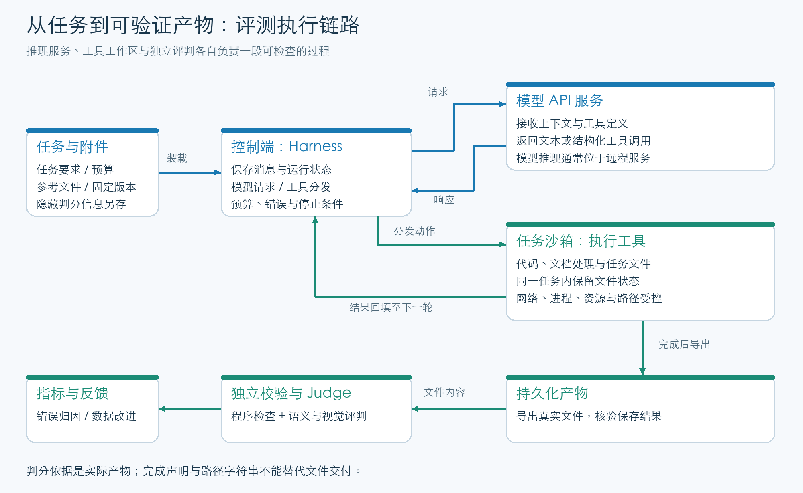
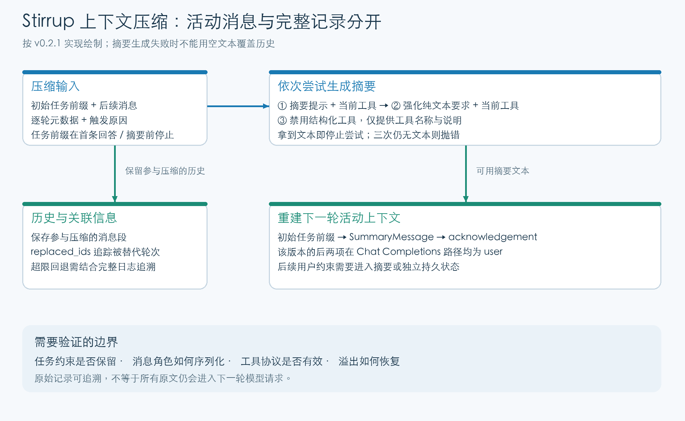

# 阶跃星辰高频面试题

> 用于持续沉淀 StepFun、多模态大模型、长上下文、Agent 和模型产品化相关面试题。

## 待补充方向

本文件作为该公司面试题的持续更新入口。后续可按照“岗位/面试轮次/问题/答案/手撕代码/复盘要点”的格式补充内容。

建议优先补充以下方向：

- 大模型、AIGC、多模态、Agent 或推荐搜索相关岗位面经。
- 公司核心业务场景中的算法工程问题。
- 高频手撕代码、系统设计、训练/推理/部署工程题。

## 目录

- [2026-11-12至2026-11-13_阶跃星辰AI评测算法岗一面、二面面经](#stepfun-ai-eval-20261112-68924c24-950775887815770112)


- [1. 多模态大模型应用算法二面-阶跃星辰](#batch2-p1)
  - [1. qwen3-8b训练显存计算](#batch2-p1-q1)
  - [2. MOE原理和机制](#batch2-p1-q2)
  - [3.多模态模型架构](#batch2-p1-q3)
  - [4. 前序中序恢复二叉树](#batch2-p1-q4)
  - [5. 如何追踪大模型最新进展](#batch2-p1-q5)
  - [6. 预训练 sft rlhf都用在哪些场景 有哪些注意点](#batch2-p1-q6)
  - [7. 模型选型方案](#batch2-p1-q7)

<a id="batch2-p1"></a>
### 1. 多模态大模型应用算法二面-阶跃星辰

#### 面试问题汇总

<a id="batch2-p1-q1"></a>
##### 1. qwen3-8b训练显存计算

**回答：**
这类问题要先回答核心定义，再讲为什么需要它、如何实现、适用边界和工程风险。面试中不要只背概念，要结合大模型算法岗常见场景：数据构建、训练稳定性、推理成本、评估体系、线上鲁棒性和业务指标，给出可落地的判断。

<a id="batch2-p1-q2"></a>
##### 2. MOE原理和机制

**回答：**
底层训练/推理问题要从通信、算子、显存和调度定位。NCCL timeout 常见原因包括某卡 OOM/异常退出、通信拓扑或网络问题、不同 rank 执行路径不一致、数据加载卡住。Kernel fusion 的收益来自减少显存读写和 launch overhead，但如果寄存器压力、occupancy、访存模式或并行粒度变差，性能反而下降。MoE 要看专家负载均衡、路由熵、专家专门化和通信开销。

<a id="batch2-p1-q3"></a>
##### 3.多模态模型架构

**回答：**
多模态大模型通常由视觉编码器、投影/对齐层、语言模型和跨模态训练目标组成。视觉 token 过多会增加上下文和注意力成本，可通过 patch merge、token pruning、query-based compressor、动态分辨率或区域选择压缩。ViT 把图像切成 patch token 送入 Transformer；Swin 用窗口注意力和 shifted window 降低高分辨率计算量并建立层次特征。

<a id="batch2-p1-q4"></a>
##### 4. 前序中序恢复二叉树

**回答：**
这类问题要先回答核心定义，再讲为什么需要它、如何实现、适用边界和工程风险。面试中不要只背概念，要结合大模型算法岗常见场景：数据构建、训练稳定性、推理成本、评估体系、线上鲁棒性和业务指标，给出可落地的判断。

<a id="batch2-p1-q5"></a>
##### 5. 如何追踪大模型最新进展

**回答：**
这类问题要先回答核心定义，再讲为什么需要它、如何实现、适用边界和工程风险。面试中不要只背概念，要结合大模型算法岗常见场景：数据构建、训练稳定性、推理成本、评估体系、线上鲁棒性和业务指标，给出可落地的判断。

<a id="batch2-p1-q6"></a>
##### 6. 预训练 sft rlhf都用在哪些场景 有哪些注意点

**回答：**
PPO 通过 clipped policy objective 控制策略更新幅度，通常配合 reward model、reference model 和 critic；critic 通过回归 return/value target 来估计优势。DPO 直接用 chosen/rejected 偏好对优化策略，不显式训练 reward model 和 critic，工程更简单但受离线数据覆盖限制。GRPO 用同一 prompt 的多条采样做组内相对优势估计，减少 critic 成本，适合大模型 RL，但依赖 reward 区分度和采样质量。

<a id="batch2-p1-q7"></a>
##### 7. 模型选型方案

**回答：**
这类问题要先回答核心定义，再讲为什么需要它、如何实现、适用边界和工程风险。面试中不要只背概念，要结合大模型算法岗常见场景：数据构建、训练稳定性、推理成本、评估体系、线上鲁棒性和业务指标，给出可落地的判断。

<a id="stepfun-ai-eval-20261112-68924c24-950775887815770112"></a>

## 2026-11-12至2026-11-13_阶跃星辰AI评测算法岗一面、二面面经

## 目录

- [一面](#stepfun-ai-eval-20261112-68924c24-950775887815770112-round1)
    - [1. 自我介绍，项目被要求要求只讲与岗位最相关的 1-2 个](#stepfun-ai-eval-20261112-68924c24-950775887815770112-r1-q1)
    - [2. 重点被追问了一个项目的痛点、pipeline、方法原理、评测集构建、与已有 benchmark 区别](#stepfun-ai-eval-20261112-68924c24-950775887815770112-r1-q2)
    - [3. 技术题：](#stepfun-ai-eval-20261112-68924c24-950775887815770112-r1-tech)
        - [① 用过哪些 harness、选一个讲原理。](#stepfun-ai-eval-20261112-68924c24-950775887815770112-r1-tech1)
        - [② 接触过 GDPval-AA 吗（真实工作场景评测集）。](#stepfun-ai-eval-20261112-68924c24-950775887815770112-r1-tech2)
        - [③ 追问评测从输入到产出的完整链路](#stepfun-ai-eval-20261112-68924c24-950775887815770112-r1-tech3)
        - [④ 提问沙箱机制（模型 API 在容器内还是外、工具在内还是外）。](#stepfun-ai-eval-20261112-68924c24-950775887815770112-r1-tech4)
    - [3. AI Coding 练习：](#stepfun-ai-eval-20261112-68924c24-950775887815770112-r1-code)
        - [① 现场和 AI 对话探索 GDPval-AA，回答 是什么+源码 → 官方 rollout harness → rollout 如何执行、如何拿产出](#stepfun-ai-eval-20261112-68924c24-950775887815770112-r1-code1)
        - [② “API 在容器外、工具在容器内”怎么理解。](#stepfun-ai-eval-20261112-68924c24-950775887815770112-r1-code2)
    - [4. 日常手写还是 AI 写代码。](#stepfun-ai-eval-20261112-68924c24-950775887815770112-r1-q4)
    - [反问阶段：](#stepfun-ai-eval-20261112-68924c24-950775887815770112-r1-reverse)
        - [1. 你们用 AI 推进多个项目时，怎么做注意力分配。](#stepfun-ai-eval-20261112-68924c24-950775887815770112-r1-reverse1)
- [二面](#stepfun-ai-eval-20261112-68924c24-950775887815770112-round2)
    - [1. 对实习的 timeline 与期望？](#stepfun-ai-eval-20261112-68924c24-950775887815770112-r2-q1)
    - [2. 上面提到了评测反馈闭环，团队期望从能力观测推到能力建设（数据合成、quality filtering），你觉得你会怎么去加入和上手？](#stepfun-ai-eval-20261112-68924c24-950775887815770112-r2-q2)
    - [3. 你更期望做主线贡献还是 self-contained research？](#stepfun-ai-eval-20261112-68924c24-950775887815770112-r2-q3)
    - [4. 说说你对 AI 水印的了解。](#stepfun-ai-eval-20261112-68924c24-950775887815770112-r2-q4)
    - [5. 人类能否做好该任务？](#stepfun-ai-eval-20261112-68924c24-950775887815770112-r2-q5)
    - [6. 介绍一下你第二个工作的研究思路。](#stepfun-ai-eval-20261112-68924c24-950775887815770112-r2-q6)
    - [7. Coding：读开源 harness 的 context 压缩源码，先 general 聊 CC/Codex/Pi 压缩机制，再现场读 stirup 的 summarization 实现，包括他的输入输出、三类尝试、任务信息保护、summary bridge + acknowledgement 保证 user/agent 交替、原文保留等](#stepfun-ai-eval-20261112-68924c24-950775887815770112-r2-q7)
    - [反问：](#stepfun-ai-eval-20261112-68924c24-950775887815770112-r2-reverse)

<a id="stepfun-ai-eval-20261112-68924c24-950775887815770112-round1"></a>

## 一面

<a id="stepfun-ai-eval-20261112-68924c24-950775887815770112-r1-q1"></a>

### 1. 自我介绍，项目被要求要求只讲与岗位最相关的 1-2 个

**回答：**

这类岗位需要把“发现模型哪里不会”推进到“让模型学会”。自我介绍可以围绕评测集、执行环境、judge 和训练反馈，选择最能证明其中一两项能力的项目，而不是按简历顺序逐项复述。

一个适合展开的介绍结构是：研究或工程方向 → 目标任务及失败现象 → 自己负责的模块 → 方法为什么有效 → 独立评测结果。例如，做过办公 Agent 评测，就讲清输入有哪些文档、要求交付什么文件、如何判定真正完成，以及如何把失败样本转成数据或工具改进。效果数字应包含基线、样本数、生成预算和评测协议，避免只报一个没有口径的“提升百分比”。

两个项目最好形成互补：一个证明能搭建和调试完整系统，另一个证明能提出假设、设计对照并解释机制。没有实际做过后训练，就说明自己的工作停留在数据、评测或系统层；可以讨论怎样接入训练，但不把拟开展的工作说成已经完成。面试官继续追问时，应能直接拿出代码、数据样本、失败案例和自己做出的具体决策。

<a id="stepfun-ai-eval-20261112-68924c24-950775887815770112-r1-q2"></a>

### 2. 重点被追问了一个项目的痛点、pipeline、方法原理、评测集构建、与已有 benchmark 区别

**回答：**

先把痛点定义成可观察的错误。例如办公报告生成里，模型可能写出流畅的结论，却引用了错误的表格、漏算一个部门，或者最终文件打不开。这三种失败分别涉及证据使用、计算与文件交付，不能用单一文本相似度概括。

讲 pipeline 时可以按一次任务实际经过的步骤展开：收集并脱敏任务与附件，冻结任务版本，在隔离环境运行模型和工具，保存轨迹与产物，做程序校验及语义评判，再把错误归因到模型、工具、环境或评判器。每一步都要说明输入、输出、失败处理和自己的贡献。方法原理则回答“哪个机制改变了哪类错误”，例如增加可执行表格校验，是为了验证计算关系；增加文档渲染，是为了发现纯文本抽取看不到的图表与版式问题。

评测集应覆盖任务类型、输入复杂度、工具组合、语言、长上下文和文件格式，并包含有明确要求的正常案例、困难案例与失败恢复案例。训练、开发和最终测试需要按任务模板、文档家族或业务实体隔离；只把同一模板换几个数字后随机切分，会高估泛化。评分规则先于模型结果确定，judge 的开发也要有独立校准集。

与已有 benchmark 的区别应落在具体维度：是否要求交付真实文件，是否允许工具和多轮交互，是否覆盖本地业务的文档与权限，是否检查可用性，以及评分能否定位错误。不能只说“更贴近业务”。可以让同一组模型在固定预算下同时跑公共基准和自建集，分析排名分歧对应的失败类型，再用人工复核判断自建评测是否提供了额外信息。

最后报告任务成功率、关键约束违例率、文件有效率、时延和成本，并保留超时、崩溃和无产物任务的计分规则。只有把失败任务也纳入预先定义的统计口径，才能避免系统看起来越来越强，实际只是越来越会跳过难题。

<a id="stepfun-ai-eval-20261112-68924c24-950775887815770112-r1-tech"></a>

**3. 技术题：**

<a id="stepfun-ai-eval-20261112-68924c24-950775887815770112-r1-tech1"></a>

### ① 用过哪些 harness、选一个讲原理。

**回答：**

harness 是把模型接入可执行任务的运行层：组织指令与上下文，提供工具协议，调度工具执行，回填结果，管理预算、状态和终止条件。评测 harness 还要负责任务装载、重复实验和评分。Agent harness 与评测 harness 可以组合使用，但“能运行 Agent”并不等于“已经完成一套可靠评测”。

以 Codex 这类编码 Agent 为例，可以用通用的执行循环解释原理：读取任务和工作区信息，将消息与工具定义发给模型；模型提出结构化工具调用后，运行时校验参数和权限，执行读文件、改代码或命令等操作；工具结果连同调用标识返回上下文，模型再据此选择下一步。最终回答、预算耗尽、用户中断和不可恢复错误都可能结束一次运行，是否真正完成仍需检查产物和验证结果。

这里有三个不同的状态：本轮送入模型的消息，磁盘上的工作成果，以及为恢复和审计保存的完整记录。上下文压缩改变第一种状态，不代表仓库文件被回滚，也不代表完整历史必须删除。Codex 的公开使用说明支持主动压缩与自动压缩；具体压缩阈值、内部提示词和供应商协议转换则需要按实际版本核对，不能凭一次界面体验推断所有客户端。

回答“用过哪些”时，应给出自己的使用或开发证据：是否接入过工具、如何处理工具失败、如何限制执行权限、如何恢复中断任务。熟悉一个 harness 的状态转换和失败路径，通常比罗列多个框架名字更有说服力。

<a id="stepfun-ai-eval-20261112-68924c24-950775887815770112-r1-tech2"></a>

### ② 接触过 GDPval-AA 吗（真实工作场景评测集）。

**回答：**

GDPval 是面向具有经济价值的真实工作任务的评测数据；GDPval-AA 是 Artificial Analysis 基于 GDPval 构建的独立执行与评判方案。GDPval 的公开 gold 数据集包含 220 个任务，覆盖 44 类职业，任务通常由文字要求与参考文件组成。公开的 220 题子集与论文研究中更大的完整任务集合应分开讨论。

GDPval-AA 的关键特点是要求模型完成工作并提交文件，例如文档、幻灯片、表格或图示。它通过 Stirrup 组织 Agent 执行循环，为任务配置工具和执行环境，再对最终提交物进行匿名成对比较，汇总相对表现。这样的分数衡量的是给定协议下的相对交付质量，不能直接读成“完成了多少比例的全部职业工作”。

理解它时至少分清下面四层，后续复现实验也应分别固定版本。

<div align="center">

| 层次 | 负责什么 | 容易混淆的地方 |
|---|---|---|
| GDPval 任务数据 | 任务描述、参考文件与职业场景 | 数据集不等于可直接复现的完整排行榜 |
| Stirrup 执行框架 | 模型循环、工具、环境与文件交付 | 通用框架不等于所有评测配置和评分程序 |
| GDPval-AA 运行协议 | 工具集合、沙箱、预算和提交要求 | 同一个模型换协议，表现也可能改变 |
| 评判与聚合 | 产物解析、匿名比较和相对评分 | 相对分数不等于绝对成功率或人工替代率 |

</div>

对 AI 评测算法岗而言，更值得研究的是它如何把任务、工具环境和可检查的产物连接起来，以及 judge 是否真的能识别事实、计算和交付质量。没有使用经验时可以明确说尚未实际跑过，再给出阅读方法和复现计划，不必编造评测成绩。

<a id="stepfun-ai-eval-20261112-68924c24-950775887815770112-r1-tech3"></a>

### ③ 追问评测从输入到产出的完整链路

**回答：**

完整链路应同时回答“模型怎样做事”和“我们怎样知道它做对了”。以根据多份表格制作经营分析报告为例，可以按下面的顺序展开。

1. **定义任务合同。** 固定任务 ID、提示词、参考文件、要求交付的格式、关键约束与预算。先明确哪些信息可以进入模型上下文，哪些判分信息必须独立保存。
2. **准备执行环境。** 从固定镜像启动独立任务环境，放入对应输入文件，记录工具、依赖、网络权限和资源限额。启动失败应单独归为基础设施错误。
3. **执行 rollout。** 模型读取材料、调用工具、观察结果并继续决策。记录实际请求参数、工具输入输出、错误、重试、token、时延和费用，而不只保存最后一句回答。
4. **收集最终产物。** 模型通过完成协议声明文件路径，运行时将文件复制出临时环境，核对文件存在、大小、类型和导出结果。路径字符串只能证明模型声明了一个位置，不能证明文件已经交付。
5. **做分层验证。** 程序先检查文件能否打开、表格公式或关键字段是否满足约束；再将任务、证据及产物的文本和渲染视图提供给 judge，评估语义、计算、完整性与可用性。
6. **校准评判。** 使用人工标注的独立样本检查 judge 的漏判、误判、位置偏差和对格式的偏好。候选产物中的指令是被评内容，不能成为 judge 的执行指令。
7. **聚合与反馈。** 按任务类型报告结果、置信区间和失败分布；把问题分别反馈到训练数据、工具适配、环境和评分规则，避免所有失败都归咎于基座模型。



图中模型服务、工具执行环境与评判阶段具有不同职责。生产任务的 Agent 不应拿到隐藏评分答案，judge 也不应只听 Agent 自报成功。最终评分依赖实际导出的内容，并与完整执行记录关联。

做模型比较时还要固定 harness、工具权限和预算，至少报告质量、成本与时延。随机种子可以帮助管理重复实验，但跨模型接口、并行工具和远程服务不一定具备逐字节确定性；重要结果应通过重复采样与配对分析确认。

**统计单元与失败口径也要写进评测协议。** 同一个任务让两个模型分别执行，再按任务配对比较，可以减少题目难度差异带来的噪声。重复 rollout 应保留在所属任务之内；多个任务共享模板或附件时，还要考虑按任务家族分组。配对或分组 bootstrap 应在相应的独立单元上抽样，而不是把所有工具调用或 judge 打分当作独立样本。

基础设施故障应单独记录，但不能只删除某个模型的失败样本后比较剩余成功任务。可以同时报告实际部署口径的完成率，以及按预先规定、对两边对称执行的重试协议得到的能力结果。对于匿名成对评判，还应交换左右顺序，记录平局与顺序不一致样本，再通过人工复核检查 judge。只有分清模型差异、运行波动和评分波动，结果才足以支持模型选择。

<a id="stepfun-ai-eval-20261112-68924c24-950775887815770112-r1-tech4"></a>

### ④ 提问沙箱机制（模型 API 在容器内还是外、工具在内还是外）。

**回答：**

先画出部署边界：模型通常通过远程 API 提供推理服务；harness 负责保存对话、调用模型并分发工具请求；文件读写、代码执行和文档处理可以放在任务沙箱里。harness 可以位于宿主进程、独立服务或另一容器，“模型 API 在外、工具在内”描述的是一种常见架构，并非所有 Agent 产品的固定部署方式。

模型生成工具调用，只表示提出一个动作。真正运行命令的是工具执行器，执行器必须在自己的边界内落实文件系统、进程、网络和资源策略。审批机制决定某个动作是否获准；沙箱机制限制获准动作实际能够触达什么。只在提示词里写“不要访问其他文件”，或者依赖模型自行遵守规则，都不能替代运行时隔离。

办公任务特别需要控制输入目录、输出目录、临时目录和网络访问。可以将参考材料按任务隔离，按需只读挂载，限制 CPU、内存、执行时长和并发进程；模型服务凭证通常由可信控制端保管，不必注入可执行任意代码的工具环境。需要联网的任务应有明确策略，否则不同模型的外部信息访问能力不一致，比较也会失真。

还应区分工具类型。代码执行可能在容器中，搜索、网页抓取或远程数据库查询可能由控制端或外部服务提供，不能因为“有沙箱”就断言所有工具都在同一容器里。文件导出与 judge 解析同样要验证路径、文件类型和大小；任务隔离降低风险，但不自动保证文件内容可信，也不等于容器绝对无法逃逸。

<a id="stepfun-ai-eval-20261112-68924c24-950775887815770112-r1-code"></a>

**3. AI Coding 练习：**

<a id="stepfun-ai-eval-20261112-68924c24-950775887815770112-r1-code1"></a>

### ① 现场和 AI 对话探索 GDPval-AA，回答 是什么+源码 → 官方 rollout harness → rollout 如何执行、如何拿产出

**回答：**

这道练习主要考察能否把 AI 当作代码阅读助手，迅速建立可核对的执行链路。第一步确认项目身份：GDPval 是任务数据，GDPval-AA 是 Artificial Analysis 的评测实现，官方方法说明将执行 harness 指向 **Stirrup**。拿到仓库后先固定版本，查看目录、入口示例和调用关系，不让 AI 根据名称猜测不存在的函数或完整评测命令。

在 Stirrup v0.2.1 的实现中，下面这些位置能够构成一条清楚的阅读路线。

<div align="center">

| 阅读位置 | 需要找出的事实 |
|---|---|
| `examples/code_executor/code_executor.py` | 如何创建 client、选择执行后端、建立 Agent，以及传入输入文件和输出目录 |
| `src/stirrup/core/agent.py` 中的 `session()` | 环境与工具何时初始化，输入文件怎样进入任务环境，退出时如何收集文件并清理资源 |
| `run()` 与模型、工具调用逻辑 | 消息如何追加，工具结果如何回填，完成工具和轮次上限怎样结束运行 |
| 完成参数的 `paths` 与 `save_output_files()` | 声明路径何时转成持久化文件，复制失败如何记录 |
| 具体代码执行后端 | 命令在哪里执行，工作目录、超时、文件读取与输出导出的语义是什么 |

</div>

可以把一次 rollout 理解为：装载任务及附件 → 建立 session → 反复进行模型调用与工具执行 → 完成工具提交说明和文件路径 → 退出 session 时导出文件 → 检查保存成功与失败清单。根 Agent 的输出会保存到配置的本地输出目录；存在工具环境和有效提交路径是导出的前提。`session.run()` 返回完成参数、历史和元数据，并不意味着每个声明文件都已经复制成功，必须继续看生命周期中的导出结果。

现场可以先请 AI 列出上述入口及调用位置，再亲自阅读关键函数，沿着一个输入文件和一个输出文件追踪它们的路径。若允许实际运行，应从小任务验证环境、工具调用和文件导出，然后再接入数据集；仅阅读代码或运行一个示例，不能声称已经复现 GDPval-AA 排名。公开 Stirrup 是通用 Agent 框架，也不能据此假定完整评测调度、judge 配置和排行榜聚合都包含在同一仓库里。

拿产出时至少核对三份东西：完成工具声明的路径、控制端收到的真实文件，以及保存过程的成功和错误记录。任务需要 PDF，就验证 PDF 可以解析、页数合理且内容符合要求；不应把一条“已生成报告”的终端日志作为交付证据。

<a id="stepfun-ai-eval-20261112-68924c24-950775887815770112-r1-code2"></a>

### ② “API 在容器外、工具在容器内”怎么理解。

**回答：**

可以把它理解为推理服务与工具工作区分开：控制端把任务上下文发给模型 API，模型返回结构化工具调用，控制端将命令分派给容器内的执行器，再把执行结果送回模型。模型参数与推理服务通常不在这个临时工作容器里，容器主要承载工具、依赖、任务文件和计算过程。

**“容器无状态”需要加上边界。** 容器在同一任务内通常有文件状态：上一条命令写出的表格，下一条命令还要读取。某些执行接口会让每条 shell 命令独立运行，导致 `cd` 或临时环境变量不跨调用保留，但这与文件系统是否保留是两回事。跨任务时可以销毁或重建环境，避免前一题的文件、缓存和进程影响后一题；需要持久保留的结果应在销毁前导出到外部存储。

这种拆分便于复用基础镜像、快速建立一致环境、并行运行任务，以及将模型凭证、调度状态和审计记录保留在可信控制端。可复用的通常是镜像、依赖和受控缓存；不能未经清理就复用带有其他任务数据的活动容器，否则会引入信息泄漏和评测污染。

防止投机也需要额外设计：隐藏答案和评分器不挂载到执行环境，输出路径经过验证，网络与文件权限由执行器限制，judge 将产物当作待评材料。拆分部署能形成更清晰的控制边界，是否真正有效仍取决于权限、挂载、密钥管理和输出解析规则。

<a id="stepfun-ai-eval-20261112-68924c24-950775887815770112-r1-q4"></a>

### 4. 日常手写还是 AI 写代码。

**回答：**

可以如实说明自己在哪些工作中使用 AI：搭建初稿、查 API、补测试、阅读陌生代码、重构和生成文档等。回答的重点是开发责任怎样分配：人确定需求、系统边界与验收条件，AI 帮助探索和实现，人再通过代码审查与可执行证据确认结果。

对评测岗位，一个可信的工作方式是先写清输入输出、失败状态和判分口径，再让 AI 实现可检查的小步改动。读取 diff，检查依赖与异常路径，运行与风险对应的测试，并用真实文件或轨迹验证关键结果。AI 生成的测试如果只是复述同一套错误假设，代码和测试可以一起“通过”却仍然不正确，因此关键用例需要来自独立任务要求或反例。

学习阶段手写核心逻辑有助于理解复杂度、状态与数值行为；生产阶段则可以充分使用 AI 提高效率。无论代码由谁输入，都应能够解释关键实现，判断什么时候需要回退或人工介入。不要为了显得熟练虚报使用比例，也不要把“几乎全由 AI 写”当成免于理解代码的理由。

<a id="stepfun-ai-eval-20261112-68924c24-950775887815770112-r1-reverse"></a>

**反问阶段：**

<a id="stepfun-ai-eval-20261112-68924c24-950775887815770112-r1-reverse1"></a>

### 1. 你们用 AI 推进多个项目时，怎么做注意力分配。

**回答：**

这类反问的价值在于了解团队如何约束在制任务，以及个人贡献如何被验证。多个 AI 任务同时运行，不代表人能够同时做多个高质量技术判断；需求澄清、实验解释、异常处理和最终验收仍然会争用注意力。

可以把项目分成需要持续判断的主线、可以批量运行的实验，以及有明确时间上限的探索。主线任务先写出下一项交付和验收标准，批量实验用固定配置与自动报告降低盯盘成本，探索任务则设置继续或停止的条件。并行数量应由反馈频率、依赖关系和验收负担决定，没有适用于所有团队的固定最优值。

对于 AI 评测工作，还可以进一步了解：谁审核 judge 与数据变更，失败样本多久进入排查流程，关键实验如何避免相互污染，以及团队如何安排复现与维护。这些问题能够判断团队是否把“同时启动很多任务”转化成了可持续的产出，而不只是增加未完成工作。

<a id="stepfun-ai-eval-20261112-68924c24-950775887815770112-round2"></a>

## 二面

<a id="stepfun-ai-eval-20261112-68924c24-950775887815770112-r2-q1"></a>

### 1. 对实习的 timeline 与期望？

**回答：**

这道题同时确认可投入的时间和期望承担的责任。先如实说明可到岗时间、每周投入和预计持续时间，再说明希望从哪个环节进入业务，例如先接手一类评测任务，逐步承担数据、评分和训练反馈。尚未确定的时间应明确保留，不把理想安排当成已经承诺的事实。

推进计划最好按交付阶段描述。第一阶段复现现有评测并理解口径，能够从任务 ID 追到输入、轨迹、产物和分数；第二阶段负责一个明确的失败类型，做人工抽检和错误归因；第三阶段提出数据或方法改进，在独立任务集上验证并沉淀成团队可重复使用的流程。具体需要几周，取决于权限、数据、系统复杂度和导师安排。

合理期望应包含业务影响与个人学习两部分：既希望理解后训练评测如何服务模型改进，也愿意承担数据清理、复现、监控和文档这些必要工作。最终以什么验收，需要与团队对齐，例如减少某类真实交付失败、提高评判一致性，或建立可复现的数据筛选流程。

<a id="stepfun-ai-eval-20261112-68924c24-950775887815770112-r2-q2"></a>

### 2. 上面提到了评测反馈闭环，团队期望从能力观测推到能力建设（数据合成、quality filtering），你觉得你会怎么去加入和上手？

**回答：**

我会先把评测结果变成可信的错误诊断，再选择数据合成或质量过滤方案。评测低分可能来自模型能力，也可能来自损坏的附件、工具适配、超时配置或 judge 漏判。原因没有区分，就把所有失败轨迹送去训练，容易把基础设施噪声和错误标签一起学进去。

第一步是复现基线，建立按任务、职业场景、文件类型和错误原因划分的失败集，并人工检查代表性案例。第二步选择一个高价值、可测量的能力缺口，例如跨表核对、按要求生成可编辑文件，或在工具报错后恢复。第三步设计与失败机制匹配的数据：改变约束和输入组合，构造可靠示范、可验证中间结果或有区分度的偏好对。

质量过滤应独立检查事实与计算正确性、输入输出一致性、任务可完成性、重复度和难度。结构化格式通过，只说明语法合规；最终答案正确，也不保证轨迹中的推理和工具使用可供训练。对“模型生成、模型打分”的数据，尤其要抽检共同盲点，避免 judge 偏好被当成真实能力提升。

随后在固定训练与推理预算下做对照：基线、仅增加数据、加入质量过滤，以及按失败类型设计数据的方案分别带来什么变化。验证集需要与合成种子、任务模板、附件家族和训练数据隔离；保留不参与调参的最终测试，并监控其他能力的回归。

闭环真正成立的条件是：错误被稳定发现，数据针对这个错误发生变化，模型在独立分布上的对应能力提高，而且成本和副作用可接受。不能仅因为数据规模增长、训练奖励上涨或同一批题得分提高，就认定已经完成了能力建设。

**过滤有效性需要单独做消融。** 至少比较原始合成数据、过滤后的数据，以及从原始数据随机下采样到相同规模的对照；尽量固定训练 token 预算和训练配置。否则过滤后效果改善，可能仅仅因为删除了重复样本、改变了难度分布或减少了训练量。还要报告各能力和难度切片的保留率，防止过滤器把格式不熟悉但有价值的困难样本全部删除。

被拒绝的数据也应抽样复核，估计漏保留率；人工审核结论与模型评分分开保存。过滤器、合成器和最终 judge 如果共享明显偏好，闭环可能只在奖励某种写作形式。最终验证仍需使用未参与筛选的任务与独立结果检查，并记录方法实际减少了哪类失败。

<a id="stepfun-ai-eval-20261112-68924c24-950775887815770112-r2-q3"></a>

### 3. 你更期望做主线贡献还是 self-contained research？

**回答：**

可以表达清晰的倾向，并把选择与岗位目标联系起来。如果更偏向主线贡献，可以说明希望让评测结论真正影响数据和模型迭代，愿意承担接口维护、质量监控和结果解释，同时围绕主线中反复出现的问题形成研究假设。

主线与独立研究的区别，主要在于交付依赖和评价方式。主线工作要与团队节奏、既有系统和上线标准衔接；独立研究则需要一个足够明确的问题、对照方法和可验证结论。两者都需要实验严谨性，研究也不意味着可以不考虑复现和适用边界。

对于评测算法岗，一种可执行的结合方式是：先在主线中发现 judge 的系统性偏差、数据过滤失效或上下文压缩损伤，再用独立实验解释原因；如果证据成立，就将改进接回生产评测。面试时应说明自己愿意投入的工作和成功标准，不需要承诺在很短时间内同时完成业务交付与论文成果。

<a id="stepfun-ai-eval-20261112-68924c24-950775887815770112-r2-q4"></a>

### 4. 说说你对 AI 水印的了解。

**回答：**

AI 水印是在生成过程中或生成后嵌入可检测信号，用于判断内容是否符合某种生成标记。文本水印、图像音视频水印、文件元数据和可验证的内容凭证是不同技术，回答时先明确对象。这里可以重点讲基于 token 采样偏置的文本水印。

一类经典方案根据前文和密钥或种子，为当前步构造伪随机“绿色 token 集合”，对集合内 token 的 logit 加上偏置，使模型在保留一定表达自由的同时，更倾向于选择这些 token。设原始 logit 为 $`z_t(v)`$，绿色集合为 $`G_t`$，偏置强度为 $`\delta`$，则可以写为：

```math
p'_t(v)=\frac{\exp\!\left(z_t(v)+\delta\,\mathbf{1}[v\in G_t]\right)}
{\sum_u\exp\!\left(z_t(u)+\delta\,\mathbf{1}[u\in G_t]\right)}.
```

检测端按相同规则恢复每一步的绿色集合，统计长度为 $`n`$ 的待检序列中有多少 token 落入其中。若绿色集合占比为 $`\gamma`$，绿色 token 数为 $`K`$，常见的基础统计量是：

```math
Z=\frac{K-\gamma n}{\sqrt{n\gamma(1-\gamma)}}.
```

这个表达依赖零假设与方差建模，实际文本存在重复上下文、重复 n-gram 和 token 相关性，不能不加修正地把所有 token 当成独立伯努利试验。阈值应由目标误报率和对应语言、领域、长度的数据校准。检测到统计信号也不等于“这段文本由 AI 生成的后验概率就是某个数”，更不能仅凭一次检验认定作者身份或违规行为。

水印强度、文本质量、可检测性和抗改写能力之间存在权衡。短文本、低熵代码或固定格式输出可用的采样自由度较少；翻译、改写、混入人类文本和截断都可能削弱信号。还需要考虑密钥管理、伪造、不同模型或不同分词器之间的兼容性。

最后要区分**主动嵌入水印**与**事后训练 AI 文本检测器**：后者可能只学习到文体和语料差异，未必检测到任何主动标记。也不能从某家公司研究过水印，直接推断其所有线上文本都默认嵌入了某种算法；产品是否部署、覆盖哪些输出，需要独立的公开证据。

**误报率必须结合基率解释。** 举一个假设示例：待检内容中真正带有该水印的比例是 1%，检测器检出率为 90%，误报率为 1%。在 10,000 条样本中，100 条正例约检出 90 条，9,900 条负例约误报 99 条。因此，189 条阳性结果中只有约 47.6% 真正带有该水印。这里的正类是“具有指定水印”，不能偷换成“所有 AI 生成内容”。

检测协议应在独立负例上固定阈值，然后报告目标误报率下的检出率，并按长度、语言和编辑强度切片。有限样本里零误报也不代表真实误报率为零：在独立同分布二项近似下，零事件时 95% 单侧误报率上界约为 3 除以负例样本数；若负例高度重复，实际有效样本量更小。面试中把这层统计边界讲清楚，比孤立地报告一个高准确率更重要。

<a id="stepfun-ai-eval-20261112-68924c24-950775887815770112-r2-q5"></a>

### 5. 人类能否做好该任务？

**回答：**

需要先确认“该任务”指什么。结合 AI 水印的话题，它可能指识别人类与 AI 文本，也可能指判断是否含有特定水印。这两个目标不同：人可以观察文体、事实和表达习惯，但通常无法仅凭阅读恢复依赖密钥的伪随机 token 分组。

如果讨论人类识别 AI 文本，应明确文本语言、长度、领域、模型版本、是否经过编辑、观察者背景以及是否获得示例训练。在类别平衡的二分类实验中，随机猜测的期望准确率是 50%；类别不平衡时，仅报准确率会受到基率影响，应同时给出混淆矩阵、灵敏度、特异度和不确定性。

不同年份、教师或研究人员群体之间的成绩不能脱离实验条件直接比较。没有可核对的论文、样本和评价协议，就不能把“接近随机”或“达到 70%—80%”写成普遍成立的结论。中文与英文也需要控制任务、模型、文本长度及观察者熟悉度，再讨论差异。

比较人类与算法时，最好让双方评估同一组隐藏标签的样本，预先约定工作点，例如相同误报率下的检出率，并区分水印检测器与普通 AI 文本分类器。人类更适合参与真实性、任务质量和争议案例的复核；统计水印算法负责检验规定信号。两者提供的证据可以互补，但都不应被包装成对所有 AI 文本的可靠识别能力。

<a id="stepfun-ai-eval-20261112-68924c24-950775887815770112-r2-q6"></a>

### 6. 介绍一下你第二个工作的研究思路。

**回答：**

这道题要求解释自己的研究，不能用一个虚构项目替代。可以按“观察到什么问题 → 提出什么假设 → 方法改变了哪个机制 → 如何排除替代解释 → 结论适用于哪里”的顺序回答。已有论文或代码只是载体，面试官更关心你为什么这样设计，以及证据是否足够。

讲完整链路时，交代任务与数据、训练或推理过程、基线、评价指标及实验结果。对关键改进分别做消融，控制参数规模、数据量、计算预算和调参次数，避免把额外资源带来的收益归因于新方法。训练与测试之间还应检查数据、模板、实体和人工调参的泄漏。

如果研究涉及文本检测或水印，可以进一步讨论：信号如何嵌入或提取，零假设是什么，阈值如何选择，在改写、跨领域和跨语言情况下哪些假设会失效。结果要包含失败案例和适用范围，而不只挑选最有利的主表数字。

最后明确个人贡献、最关键的一次取舍，以及现有结果尚未解释的问题。能解释一个负结果为什么改变后续实验，比背诵预先准备的流程更能体现研究能力。

<a id="stepfun-ai-eval-20261112-68924c24-950775887815770112-r2-q7"></a>

### 7. Coding：读开源 harness 的 context 压缩源码，先 general 聊 CC/Codex/Pi 压缩机制，再现场读 stirup 的 summarization 实现，包括他的输入输出、三类尝试、任务信息保护、summary bridge + acknowledgement 保证 user/agent 交替、原文保留等

**回答：**

可以先用统一问题比较三类编码 Agent：**何时压缩、保留什么、摘要怎样进入下一次请求、原始记录存在哪里、失败怎样恢复。** CC 通常指 Claude Code；它的公开说明支持接近上下文上限时自动总结，也允许用 `/compact` 和项目指令影响保留重点。Codex 的公开说明也支持主动及自动压缩。仅凭这些产品说明，不能认定它们的内部提示词、保留窗口或协议转换完全一致。

Pi 的公开压缩文档进一步展示了可追踪的实现：确定保留近期消息的边界，生成结构化摘要，追加带 `firstKeptEntryId` 的 `CompactionEntry`，随后用摘要与保留消息重建模型上下文。原始 session 记录与本轮模型可见历史分开；切分还要保护工具调用和结果的配对。长程连续工作能力因此取决于压缩后是否还能正确决策，单看摘要压缩率不够。

题目中的 `stirup` 对应官方项目 **Stirrup**。下面以 v0.2.1、提交 `c092cee80ce09cd1dfb93aef053296a9ecd9dbb6` 的实现为例，追踪 `src/stirrup/core/agent.py` 中的 `summarize_messages()`。不同版本可能调整消息结构，现场应先确认提交，再解释代码。

**输入与输出。** 输入包括当前消息列表、按轮次保存的元数据及触发原因。函数返回一份本次参与压缩的消息列表，以及重新构造的活动上下文。正常情况下前者对应压缩前历史；发生上下文超限恢复时，它可能已经经过回退，因此更早的原始数据仍需靠完整日志追溯。

**任务信息保护。** `task_context` 使用 `takewhile` 保留最前面的消息，直到遇到首条 `AssistantMessage` 或 `SummaryMessage`。这种实现保护的是开头的任务前缀，并不是自动原样保留所有后续用户补充。后续约束、已验证结果、文件路径和未完成工作需要进入摘要，或者由独立状态管理机制持久保留。

**三类尝试。** 它们用于处理模型不输出摘要文本的情况，具有顺序关系。

<div align="center">

| 尝试 | 给模型的条件 | 继续或结束的依据 |
|---|---|---|
| 第一次 | 摘要提示词，同时提供当前工具定义 | 从返回块提取文本；拿到文本即结束尝试 |
| 第二次 | 增加明确的“只返回文本、不要调用工具”要求，仍提供工具定义 | 继续检查是否存在文本块 |
| 第三次 | 工具集合设为空，并将工具名称、说明作为普通文本提供 | 使结构化工具调用不可用；仍无文本则抛错 |

</div>

这三步不是三个独立摘要投票，也不是每次压缩固定请求三次。这里直接调用的是 client 的生成接口，不能把模型返回的工具调用误说成已经被执行。代码检查的是可提取的文本，不负责证明摘要忠实、完整或足够短；语义质量还需要额外评测。三次都没有文本时抛出错误，避免用空摘要悄悄覆盖历史。

**summary bridge 与 acknowledgement。** bridge 模板将摘要包装成继续任务的说明，随后追加 `UserMessage(content="Got it, thanks!")`。需要注意：这个版本的 `SummaryMessage` 继承 `UserMessage`，Chat Completions 转换器也将它序列化为 `role="user"`。因此 bridge 和 acknowledgement 在该路径下都是 user 消息，不能照着“避免连续 assistant 消息”的注释推导出严格的 user/assistant 交替。是否满足特定供应商协议，要继续检查实际 client、适配层和线上请求；也不能把合成的 acknowledgement 当作真实用户批准。



**原文保留与溢出恢复。** 正常压缩后，调用方把参与压缩的消息段加入 `full_msg_history`，活动上下文使用任务前缀、摘要桥接消息和 acknowledgement；`replaced_ids` 追踪摘要替代的 assistant 轮次，并继承更早摘要的关联。模型请求或摘要请求发生上下文溢出时，还会回退已完成轮次再尝试；恢复到任务边界后不能继续无限裁剪。历史可追溯与“所有原文仍在下一次模型输入里”是两件事。

现场验证至少覆盖：第一次直接成功，只有工具调用而没有文本时升级尝试，第三次禁用工具仍无文本时报错，初始任务前缀保持不变，多次压缩的关联 ID，以及实际序列化角色。进一步做任务级回归时，应测试中途新增约束、长工具输出、未完成动作和连续多次压缩，观察压缩后能否继续正确交付，而不是仅检查函数返回了一个字符串。

**任务级回归还应检查摘要保留的不变量。** 可以在压缩前加入一项后续约束，例如“最终交付必须是可编辑表格”，并让工具返回与该约束相关的中间结果；压缩后检查模型是否继续遵守要求、能否找到已有文件，以及是否重复执行已经成功的写操作。固定模型和预算后，比较不压缩、压缩一次与连续压缩的最终任务结果，同时统计摘要成本和上下文节省。

这属于对压缩机制的应用评估设计，不是该版本函数已经提供的保证。权限、用户确认和已提交事务状态应由可信运行时保存与校验，摘要只承载供模型继续理解的描述。既不能把摘要遗漏当成权限已取消，也不能把运行时合成的确认语句解释为用户新增授权。

<a id="stepfun-ai-eval-20261112-68924c24-950775887815770112-r2-reverse"></a>

### 反问：

**交流要点：**

这段交流强调公共 benchmark 与真实工作体验都需要，但两类评测应共享明确的能力定义和失败分类。公共基准便于横向比较与回归；真实工作任务则暴露工具组合、长时执行、文件格式、业务约束以及异常恢复方面的问题。“体感”只有被拆解为可复现任务和可检查产物，才便于改进模型。

对于通过 API 被不同 harness 使用的基模，建议区分两组实验：固定 harness 比较不同模型，以控制运行环境差异；固定模型比较不同 harness，以定位上下文管理、工具适配和预算策略的影响。必要时做模型与 harness 的交叉实验，观察某项模型能力是否依赖特定运行框架。

真实体验可以拆成首次成功率、纠正轮数、工具错误恢复率、文件可用性、任务约束违例、时延与成本，并结合匿名人工复核。若 benchmark 上升而真实任务变差，应先检查任务分布、评分偏好、工具环境和数据污染，再决定改数据、改模型还是改 harness。

团队精力如何分配没有固定的通用比例。更关键的是两类评测能够互相解释：真实失败促成可复现的新用例，新增用例能够检验改进，模型迭代后再回到独立真实任务验证收益。
