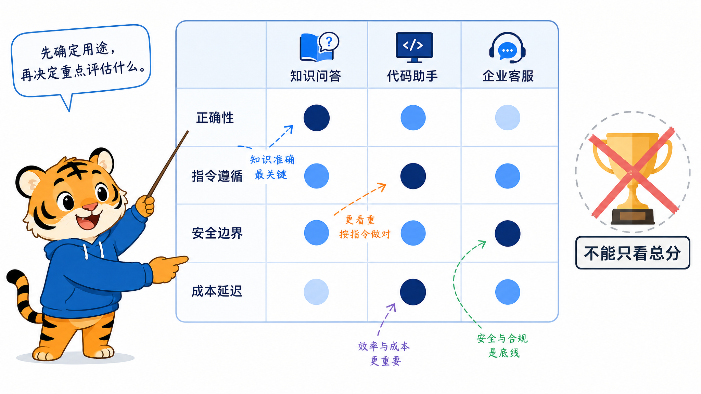
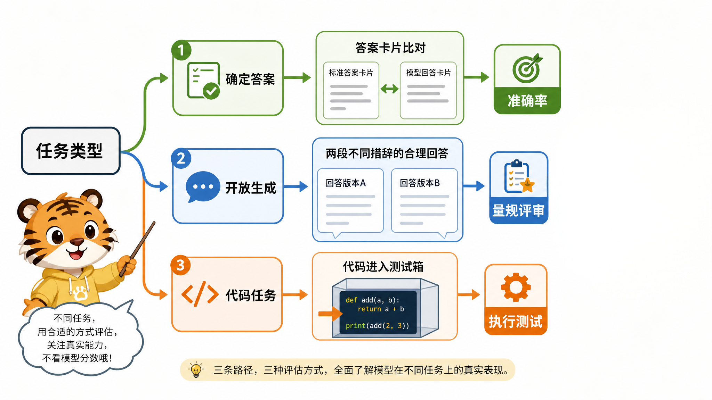
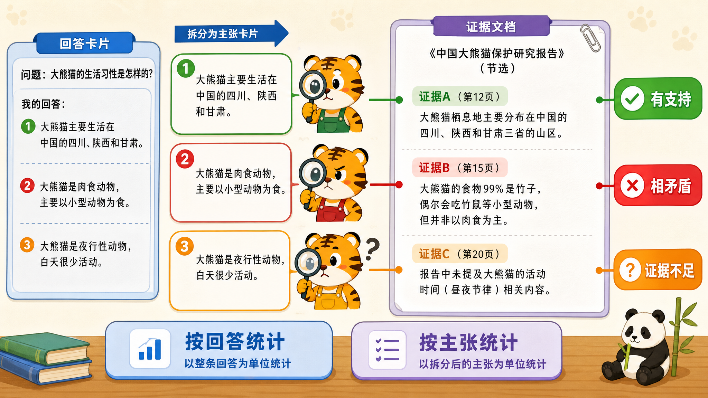
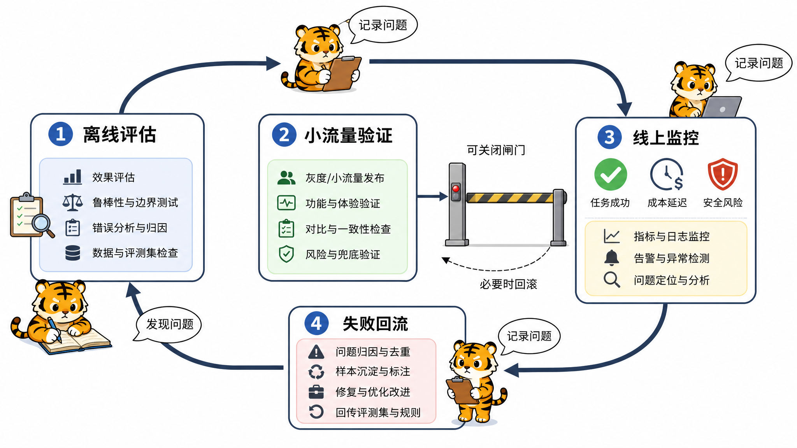

# 模型评估：多维评估大语言模型

本章围绕大语言模型（Large Language Model，LLM）的能力、可靠性、安全、检索增强生成（Retrieval-Augmented Generation，RAG）与线上成本，说明如何用可复现的评估支持模型选择、问题定位和上线决策。

## 目录导航

- [1. 如何构建大语言模型评估体系？](#evaluation-section-37)
  - [面试问题：为什么要评估大语言模型？评估最终要回答哪些问题？](#evaluation-section-37-question-01)
  - [面试问题：如何设计多维评估矩阵？不同类型模型的评估重点有什么差异？](#evaluation-section-37-question-02)
  - [面试问题：离线基准、自动评估、人工评估、LLM-as-a-Judge 和线上 A/B 分别解决什么问题？](#evaluation-section-37-question-03)

- [2. 如何评估大语言模型的生成质量与评估指标？](#evaluation-section-38)
  - [面试问题：为什么生成质量不能只看流畅度？如何评估相关性、事实性、连贯性和有用性？](#evaluation-section-38-question-01)
  - [面试问题：开放式任务和有参考答案任务有什么区别？自动指标应该如何选择？](#evaluation-section-38-question-02)
  - [面试问题：人工评估和 LLM-as-a-Judge 应该如何设计？如何控制主观性和评审偏差？](#evaluation-section-38-question-04)

- [3. 如何评估知识掌握、事实准确性与幻觉？](#evaluation-section-39)
  - [面试问题：如何评估模型的知识掌握程度和事实准确性？](#evaluation-section-39-question-01)
  - [面试问题：如何将幻觉问题转化为可评估的标签、指标和归因流程？](#evaluation-section-39-question-02)
  - [面试问题：如何验证幻觉治理方案是否真的有效？](#evaluation-section-39-question-03)

- [4. 大语言模型有哪些基准测试集（Benchmark）？](#evaluation-section-40)
  - [面试问题：常见综合能力 Benchmark 有哪些？它们分别覆盖什么能力？](#evaluation-section-40-question-01)
  - [面试问题：Benchmark 评估有哪些局限？如何避免评测集污染和刷榜误导？](#evaluation-section-40-question-03)

- [5. 如何评估大语言模型的具体能力？](#evaluation-section-41)
  - [面试问题：如何评估语言理解和问答能力？](#evaluation-section-40-question-02)
  - [面试问题：大语言模型的推理能力包括哪些类型？如何判断模型是真的会推理？](#evaluation-section-41-question-01)
  - [面试问题：如何评估数学推理能力？](#evaluation-section-41-question-02)
  - [面试问题：如何评估代码能力和科学推理能力？](#evaluation-section-41-question-03)

- [6. 如何评估长上下文能力？](#evaluation-section-42)
  - [面试问题：长上下文能力应该评估哪些任务、基准和指标？](#evaluation-section-42-question-01)
  - [面试问题：什么是 Needle-in-a-Haystack 和 Lost in the Middle？它们分别暴露什么问题？](#evaluation-section-42-question-02)

- [7. 如何评估指令遵循、人类偏好与对齐效果？](#evaluation-section-43)
  - [面试问题：如何评估模型是否遵循指令？](#evaluation-section-43-question-01)
  - [面试问题：Helpful、Honest、Harmless 和 Fairness 如何落到评估指标上？](#evaluation-section-43-question-02)
  - [面试问题：RLHF、DPO、GRPO 后的模型应该如何评估？](#evaluation-section-43-question-03)
  - [面试问题：如何评估拒答边界和过度拒答？](#evaluation-section-43-question-04)

- [8. 如何评估安全性、偏见与对抗鲁棒性？](#evaluation-section-44)
  - [面试问题：如何系统评估模型的有害性？如何做红队测试？](#evaluation-section-44-question-01)
  - [面试问题：如何评估模型偏见与公平性？BBQ、StereoSet、CrowS-Pairs 分别关注什么？](#evaluation-section-44-question-02)
  - [面试问题：如何评估对抗鲁棒性？](#evaluation-section-44-question-03)

- [9. 如何评估 RAG 场景下的大语言模型系统？](#evaluation-section-45)
  - [面试问题：RAG 系统需要评估哪些部分？为什么不能只看最终答案？](#evaluation-section-45-question-01)
  - [面试问题：RAG 检索指标、排序指标和上下文指标如何区分？](#evaluation-section-45-question-02)
  - [面试问题：忠实度（Faithfulness）、答案相关性（Answer Relevance）、上下文相关性（Context Relevance）和引用准确率（Citation Accuracy）有什么区别？](#evaluation-section-45-question-03)
  - [面试问题：如何定位 RAG 系统问题发生在解析、分块、检索、重排序还是生成阶段？](#evaluation-section-45-question-05)

- [10. 如何设计完整的大模型评估方案与业务闭环？](#evaluation-section-46)
  - [面试问题：如何从零设计一个合理的大模型评估方案？](#evaluation-section-46-question-01)
  - [面试问题：为什么业务场景评估比通用榜单更重要？上线后应该监控什么？](#evaluation-section-46-question-03)

---

<a id="evaluation-section-37"></a>
## 1. 如何构建大语言模型评估体系？

<a id="evaluation-section-37-question-01"></a>
### 面试问题：为什么要评估大语言模型？评估最终要回答哪些问题？

**难度评分：⭐⭐ (2/5) | 考察频率：⭐⭐⭐⭐⭐ (5/5)**

#### 1. 为什么大语言模型必须被系统评估？

大语言模型通常具备开放生成、多任务泛化和工具调用能力，输出空间远比传统分类模型更大。因此训练损失（Loss）、奖励分数（Reward Score）或单一基准测试（Benchmark）分数，都不足以说明真实可用性。评估要判断它在目标场景中是否 **有用、可靠、安全、稳定、可部署**。


#### 2. 评估结果应该用于什么决策？

- 比较不同模型、检查点（Checkpoint）、微调方案和提示（Prompt）方案；
- 判断微调、后训练或数据配比是否真正提升目标能力；
- 发现能力退化、格式不稳定、安全边界破坏和事实性问题；
- 决定模型是否可以进入灰度（先向少量用户开放新版本）、A/B 测试（A/B Testing，即随机分组的对照实验，分流比例按风险与统计功效确定）或正式上线；
- 为下一轮数据构造、训练策略、RAG 设计和安全策略提供依据。

> **注**：评估体系可以看作模型研发、产品上线和风险治理之间的反馈链路。

<a id="evaluation-section-37-question-02"></a>
### 面试问题：如何设计多维评估矩阵？不同类型模型的评估重点有什么差异？

**难度评分：⭐⭐⭐ (3/5) | 考察频率：⭐⭐⭐⭐⭐ (5/5)**

#### 1. 什么是多维评估矩阵？

多维评估矩阵是指**围绕模型定位，把能力、风险、成本和业务效果拆成可分别观测的评估维度**，避免一个分数掩盖关键短板[Liang et al., 2022](https://arxiv.org/abs/2211.09110) 。常见维度包括：

- **基础能力**：语言理解、文本生成、知识问答、推理、数学、代码。
- **交互能力**：指令遵循、多轮对话、结构化输出、函数调用、工具使用。
- **长上下文能力**：长文档理解、信息定位、跨段落整合、长对话一致性。
- **事实与可靠性**：事实准确性、幻觉率、引用准确性、不确定性表达。
- **安全与合规**：有害性、越狱、偏见、隐私泄露、版权和行业合规。
- **工程性能**：延迟、吞吐、显存、并发、可用性、推理成本。
- **业务效果**：任务完成率、问题解决率、转人工率、用户满意度、人工节省。

#### 2. 不同类型模型的评估重点如何变化？

| 模型 / 系统类型 | 评估重点 |
|---|---|
| 通用基座模型 | 语言理解、知识、推理、数学、代码、长上下文、通用基准 |
| 对话助手模型 | 指令遵循、多轮对话、帮助性、自然度、安全对齐、拒答边界 |
| 推理模型 | 数学、代码、逻辑推理、单次通过率（pass@1）、多次采样通过率（pass@k）、推理稳定性、推理词元（Reasoning Token）成本 |
| 代码模型 | 代码生成、补全、修复、单元测试通过率、编译成功率、真实代码修复任务 |
| 行业模型 | 领域知识、事实准确性、合规性、专家评估、真实业务任务完成率 |
| 长上下文模型 | 长文档检索、跨段落推理、信息插入位置敏感性、有效上下文长度 |
| RAG 系统 | 检索召回、上下文相关性、答案忠实度、引用准确率、拒答边界 |
| 部署模型 | 延迟、吞吐、显存、并发、稳定性、成本和监控能力 |

成熟评估体系应该同时看 **目标能力是否提升** 和 **非目标能力是否退化**。这也是微调、后训练和模型升级后必须做回归评估的原因。

<a id="evaluation-section-37-question-03"></a>
### 面试问题：离线基准、自动评估、人工评估、LLM-as-a-Judge 和线上 A/B 分别解决什么问题？

**难度评分：⭐⭐⭐ (3/5) | 考察频率：⭐⭐⭐⭐ (4/5)**

#### 1. 不同评估方式分别适合解决什么问题？

| 评估方式 | 主要解决的问题 | 优点 | 局限 |
|---|---|---|---|
| 离线基准 | 快速比较模型在标准任务上的能力，如知识、数学、代码、推理 | 成本低、可重复、便于横向比较 | 可能被污染，和真实业务分布不一致 |
| 自动评估 | 用程序化指标大规模评测分类、抽取、代码、数学、结构化输出等任务 | 快速、稳定、适合回归测试 | 难以完整判断开放式回答的帮助性和细微质量 |
| 人工评估 | 判断开放式回答是否有用、准确、自然、安全，尤其适合高风险任务 | 可信度高，能发现细节问题 | 成本高、速度慢、主观性强 |
| 大语言模型裁判（Large Language Model as a Judge，LLM-as-a-Judge） | 批量评估开放式回答、偏好比较、质量初筛 | 效率高、维度灵活、成本较低 | 可能有位置偏差、长度偏好、自偏好和评审模型偏见 |
| 线上 A/B 测试 | 验证模型在真实用户和业务流程中的效果 | 最接近真实业务价值 | 成本高、有风险，必须先通过质量和安全门槛 |

典型工程流程是：

```text
离线基准 / 自动评估 → LLM-as-a-Judge 批量初筛 → 人工偏好评估和专家抽检 → 安全红队测试 → 小流量线上 A/B → 线上反馈回流
```

#### 2. 线上 A/B 能否替代离线评估？

不能。线上 A/B 只能在模型已经通过离线质量、安全和业务门槛后进行。对于医疗、法律、金融、政务、企业客服等场景，直接把未充分测试的模型放到线上，会放大安全、合规和声誉风险。正确做法是先用离线集和红队测试排除明显问题，再做小流量灰度，并设置人工接管、报警和回滚机制。

<a id="evaluation-section-38"></a>
## 2. 如何评估大语言模型的生成质量与评估指标？

<a id="evaluation-section-38-question-01"></a>
### 面试问题：为什么生成质量不能只看流畅度？如何评估相关性、事实性、连贯性和有用性？

**难度评分：⭐⭐⭐ (3/5) | 考察频率：⭐⭐⭐⭐⭐ (5/5)**

#### 1. 为什么不能只看流畅度？

大语言模型很擅长生成自然、顺滑、结构清楚的文本，但流畅并不等于正确。一个回答可能语言表达自然，却存在答非所问、事实错误、逻辑矛盾、遗漏关键信息、引用编造或对用户没有实际帮助等问题。



核心判断标准是：生成内容是否 **自然、切题、准确、连贯、有用，并符合用户给出的约束和业务场景**。

#### 2. 不同任务的质量权重有什么差异？

| 任务类型 | 评估重点 |
|---|---|
| 客服问答 | 相关性、事实性、有用性、拒答边界、话术一致性 |
| 创意写作 | 流畅性、创造性、风格一致性、表达多样性 |
| 摘要任务 | 忠实度、完整性、压缩质量、信息覆盖、无新增事实 |
| RAG 问答 | 引用正确性、证据支持度（Groundedness）、事实性、上下文相关性、拒答能力 |
| 法律 / 医疗 / 金融 | 事实性、合规性、边界说明、审慎表达、专家审核 |
| 结构化输出 | 可解析率、结构化查询语言（Structured Query Language，SQL）语法与执行正确率、表格字段准确率、模式（Schema）校验通过率 |

<a id="evaluation-section-38-question-02"></a>
### 面试问题：开放式任务和有参考答案任务有什么区别？自动指标应该如何选择？

**难度评分：⭐⭐⭐ (3/5) | 考察频率：⭐⭐⭐⭐⭐ (5/5)**

#### 1. 开放式任务和有参考答案任务的本质区别是什么？

| 任务类型 | 典型任务 | 推荐评估方式 |
|---|---|---|
| 有参考答案任务 | 翻译、摘要、抽取、标准问答、分类 | 双语评估替补（Bilingual Evaluation Understudy，BLEU）、面向摘要评估的召回导向替补（Recall-Oriented Understudy for Gisting Evaluation，ROUGE）、基于上下文化表示的相似度指标 BERTScore、精确匹配（Exact Match，EM）、F1 分数（F1 Score，F1）或准确率（Accuracy） |
| 可执行 / 可验证任务 | 代码生成、数学题、结构化输出 | 单元测试、编译检查、答案校验器、模式校验、pass@k |
| 开放式生成任务 | 对话、写作、头脑风暴、开放问答 | 人工评估、成对比较、LLM-as-a-Judge、业务指标 |

#### 2. 自动指标如何选择？



| 任务类型 | 推荐指标 / 方法 | 注意事项 |
|---|---|---|
| 分类任务 | 准确率、精确率（Precision）、召回率（Recall）、F1 | 类别不均衡时不能只看准确率 |
| 抽取任务 | EM、词元级 F1（Token-level F1）/ 字段准确率 | 注意边界错误和等价表达归一化 |
| 选择题 / 考试题 | 准确率 | 要防止评测集污染 |
| 翻译任务 | BLEU、字符 n 元组 F 分数（Character n-gram F-score，chrF）、跨语言优化的翻译评估指标（Crosslingual Optimized Metric for Evaluation of Translation，COMET）、人工评估 | BLEU 不足以完整反映语义和流畅性 |
| 摘要任务 | ROUGE、BERTScore、事实一致性检查 | ROUGE 高不代表摘要事实正确 |
| 代码生成 | pass@1 / pass@k、单元测试通过率 | 测试用例质量决定指标可信度 |
| 数学推理 | 准确率、pass@k、答案校验器 | 要区分最终答案正确和过程正确 |
| RAG 问答 | 前 k 项召回率（Recall@k）、引用准确率（Citation Accuracy）、忠实度（Faithfulness） | 必须判断答案是否基于检索内容 |
| 对话助手 | 胜率（Win Rate）、人工偏好、LLM-as-a-Judge、安全评估 | 需要多轮、边界和安全测试 |
| 线上业务 | A/B、满意度、解决率、转人工率、成本 | 离线指标不一定等于线上效果 |

<a id="evaluation-section-38-question-04"></a>

### 面试问题：人工评估和 LLM-as-a-Judge 应该如何设计？如何控制主观性和评审偏差？

**难度评分：⭐⭐⭐⭐ (4/5) | 考察频率：⭐⭐⭐⭐ (4/5)**

#### 1. 人工评估应该评什么？

- 正确性、事实性、相关性、完整性；
- 有用性、可执行性、清晰度；
- 流畅性、逻辑性、可读性；
- 安全性、礼貌性、合规性；
- 是否遵循指令、格式、长度和角色要求；
- 是否符合目标用户和业务场景的偏好。

常见形式包括打分制、成对比较、排序法和错误标注。

#### 2. 如何提高人工评估可靠性？

- 制定清晰评分准则，给出正例、反例和边界案例；
- 对标注员进行一致性校准；
- 使用多标注员投票或仲裁机制；
- 隐藏模型名称，避免品牌偏见；
- 混入金标样本，监控标注质量；
- 计算标注一致性；
- 对争议样本做专家复核。

#### 3. LLM-as-a-Judge 如何控制偏差？

LLM-as-a-Judge 可能出现长度偏好、位置偏差、自偏好（偏爱自身生成风格）和提示敏感性；偏差的程度依裁判模型与任务而变[Zheng et al., 2023](https://arxiv.org/abs/2306.05685) 。常见控制手段包括：

- 随机交换 A/B 答案顺序，统计是否存在位置偏差；
- 要求裁判按维度评分，而不是只给总体偏好；
- 明确惩罚幻觉、答非所问、冗长和不遵循格式；
- 对开放题使用参考资料或标准答案约束裁判；
- 使用多个裁判模型或人工抽检校准；
- 报告置信区间和胜率差异，而不是只给单点分数。

LLM-as-a-Judge 适合作为批量初筛和辅助评估，但不能替代人工评估。

比较两个模型时，优先对同一批提示做成对比较，并对“同一题上的分数差”进行配对自助重采样（Paired Bootstrap）；

若多条样本共享文档、用户或模板，应按相应相关单元分组重采样。对 $n$ 个近似独立且同分布的二元结果，设样本正确率为 $\hat p$，标准误可粗略估为 $\sqrt{\hat p(1-\hat p)/n}$。

<a id="evaluation-section-39"></a>
## 3. 如何评估知识掌握、事实准确性与幻觉？

<a id="evaluation-section-39-question-01"></a>
### 面试问题：如何评估模型的知识掌握程度和事实准确性？

**难度评分：⭐⭐⭐ (3/5) | 考察频率：⭐⭐⭐⭐⭐ (5/5)**

#### 1. 如何评估知识掌握程度？

知识掌握评估关注模型是否知道某个领域的概念、事实、规则和关系。常见方法包括：

- **闭卷问答**：不提供外部资料，直接让模型回答，测试参数化知识。
- **选择题测试**：如大规模多任务语言理解（Massive Multitask Language Understanding，MMLU）、中文多层级多学科评测 C-Eval、中文大规模多任务语言理解（Chinese Massive Multitask Language Understanding，CMMLU），用标准答案评估学科知识。[Hendrycks et al., 2021](https://arxiv.org/abs/2009.03300)；[Huang et al., 2023](https://arxiv.org/abs/2305.08322)；[Li et al., 2023](https://arxiv.org/abs/2306.09212)
- **开放式问答**：考察模型能否生成准确、完整、可解释的答案。
- **专业领域问答**：医学、法律、金融、科学等需要专家评估。
- **时间敏感问题测试**：检查模型是否混淆过时信息和最新信息。

> **注**：涉及新闻、政策、产品版本、价格、论文和法规时，应优先结合检索或工具验证。

#### 2. 如何评估事实准确性？

- 回答是否包含错误事实；
- 是否编造不存在的概念、论文、人物、数据、链接或法规；
- 是否能承认不知道；
- 是否给出可靠来源；
- 是否区分事实、观点和推测；
- 是否能保持与给定上下文一致。

常用方式包括人工事实核查、与权威知识库比对、检索增强评估、真实性问答基准 TruthfulQA，以及幻觉率统计。TruthfulQA 关注模型是否重复常见误解[Lin et al., 2022](https://arxiv.org/abs/2109.07958) 。高风险领域还需要专家审核和可追溯证据。

<a id="evaluation-section-39-question-02"></a>
### 面试问题：如何将幻觉问题转化为可评估的标签、指标和归因流程？

**难度评分：⭐⭐⭐ (3/5) | 考察频率：⭐⭐⭐⭐⭐ (5/5)**

#### 1. 幻觉评估标签应该如何设计？

常见做法是把模型回答拆成原子事实声明，再逐条标注。



标签可以包括：

- **无证据支持的声明（Unsupported Claim）**：答案中有断言，但给定证据不足以支持。
- **与证据矛盾的声明（Contradicted Claim）**：答案与上下文、数据库或权威来源直接矛盾。
- **伪造引用（Fabricated Citation）**：引用、链接、论文、法规或出处不存在。
- **引用不匹配（Citation Mismatch）**：引用存在，但不能支持对应结论。
- **数值或日期错误（Numeric / Date Error）**：数值、日期、比例、版本号等关键事实错误。
- **上下文不一致（Context Inconsistency）**：回答与用户提供材料或对话历史不一致。
- **未知却过度自信（Overconfident Unknown）**：证据不足时仍自信作答，没有澄清、限界或拒答。

每个标签还应记录严重程度、证据来源和错误位置。

#### 2. 幻觉如何度量？

- **幻觉率（Hallucination Rate）**：含至少一处幻觉的回答数占全部受评回答数的比例。
- **声明级错误率（Claim-level Error Rate）**：被证据判为错误的事实声明占比。
- **无支持声明率（Unsupported Claim Rate）**：无法从指定证据支持的断言占比。
- **忠实度**：答案中的声明是否得到给定上下文支持。
- **事实准确性（Factual Accuracy）**：声明是否与可核验外部事实相符。
- **引用准确率**：按受评引用统计，其是否真实存在、定位正确且支持对应结论；同时报告关键声明的引用覆盖率。
- **校准与拒答准确性（Calibration / Refusal Accuracy）**：校准衡量置信度与实际正确率是否匹配。

<a id="evaluation-section-39-question-03"></a>

### 面试问题：如何验证幻觉治理方案是否真的有效？

**难度评分：⭐⭐⭐⭐ (4/5) | 考察频率：⭐⭐⭐⭐ (4/5)**

幻觉治理方案可能让模型回答更保守，但这不一定代表系统更好。模型可能只是更频繁拒答、引用更多文本或输出更模板化，却没有真正提升事实正确性。

常见治理手段包括 RAG、证据约束提示、引用绑定、工具调用、降低随机性、事实性微调和验证器后处理。

#### 1. 如何验证模型是否真的降低了幻觉？

应该用同一套固定评估集做治理前后对比：

- 幻觉率是否下降；
- 正确回答率是否保持或提升；
- 拒答是否只发生在缺证据场景；
- 引用是否真实且支持结论；
- 对长文档和多文档场景是否仍保持忠实度；
- 高风险场景中专家审核是否通过。

<a id="evaluation-section-40"></a>
## 4. 大语言模型有哪些基准测试集（Benchmark）？

<a id="evaluation-section-40-question-01"></a>
### 面试问题：常见综合能力 Benchmark 有哪些？它们分别覆盖什么能力？

**难度评分：⭐⭐ (2/5) | 考察频率：⭐⭐⭐⭐ (4/5)**

#### 1. 英文综合评测常见有哪些？

| Benchmark | 主要评估内容 |
|---|---|
| MMLU | 多学科选择题，覆盖科学、技术、工程、数学（Science, Technology, Engineering, Mathematics，STEM）、人文与社会科学 |
| 超越模仿游戏基准（Beyond the Imitation Game Benchmark，BIG-bench） | 大规模多任务集合，覆盖推理、语言、常识等能力。[Srivastava et al., 2023](https://arxiv.org/abs/2206.04615) |
| 语言模型全面评估（Holistic Evaluation of Language Models，HELM） | 斯坦福提出的多场景、多指标评估框架，强调透明与可复现；不是单一测试集。[Liang et al., 2022](https://arxiv.org/abs/2211.09110) |
| 艾伦人工智能研究所推理挑战（AI2 Reasoning Challenge，ARC）/ ARC-Challenge | 科学考试题；ARC-Challenge 是其中的较难子集。 |
| HellaSwag（常识情境补全基准） | 判断情境的合理后续 |
| WinoGrande（常识指代消解基准） | 通过指代消解考察常识推理 |
| TruthfulQA | 关注常见误解诱发的错误回答，区分真实性与信息量 |

#### 2. 中文综合评测常见有哪些？

| Benchmark | 主要评估内容 |
|---|---|
| C-Eval | 中文多学科综合评测 |
| CMMLU | 中文大规模多任务语言理解评测 |
| AGIEval（面向人类考试的评测） | 通过标准化考试题评估知识与推理，需区分语言和任务子集 |
| SuperCLUE（中文大模型综合评估） | 中文综合能力评估，需记录版本与评分协议 |
| GAOKAO-Bench（高考题基准） | 高考题评测，需区分题型与评分方式 |

#### 3. 常见数学推理基准有哪些？

| Benchmark | 主要特点 |
|---|---|
| 小学数学八千题（Grade School Math 8K，GSM8K） | 小学数学应用题，重视文本理解和多步算术 |
| MATH（竞赛数学基准） | 竞赛级数学题，覆盖代数、几何、数论等 |
| 美国邀请数学考试（American Invitational Mathematics Examination，AIME） | 常用于高难推理评估；须标明年份、试卷与采样预算 |
| MathQA（数学问答基准） | 数学问答与操作过程标注 |
| SVAMP（数学应用题变体基准） | 用题面扰动考察鲁棒性，避免模型只依赖表面模板 |
| 中文小学数学应用题（Chinese Elementary School Math Word Problems，CMATH） | 中文小学数学应用题Wei et al., 2023](https://arxiv.org/abs/2306.16636) |

#### 4. 常见代码推理基准有哪些？

| Benchmark | 主要评估内容 |
|---|---|
| HumanEval（人工编写的代码生成评测集） | Python 函数级代码生成，通过测试验证功能正确性[Chen et al., 2021](https://arxiv.org/abs/2107.03374) |
| 基础 Python 编程题（Mostly Basic Python Problems，MBPP） | 基础函数级编程任务 |
| CodeContests（竞赛编程基准） | 竞赛编程题，强调算法实现与测试通过 |
| 自动化编程进展标准（Automated Programming Progress Standard，APPS） | 程序设计和算法题 |
| LiveCodeBench（持续更新的代码评测基准） | 按题目发布日期划分竞赛编程任务等评测[Jain et al., 2024](https://arxiv.org/abs/2403.07974) |
| 软件工程基准（Software Engineering Benchmark，SWE-bench） | 基于真实 GitHub 问题单的仓库修复任务Jimenez et al., 2024](https://arxiv.org/abs/2310.06770) |

#### 5. 常见指令和偏好基准有哪些？

| Benchmark | 主要用途 |
|---|---|
| 指令遵循评估（Instruction-Following Evaluation，IFEval） | 使用可程序验证的格式、长度、关键词、语言等约束[Zhou et al., 2023](https://arxiv.org/abs/2311.07911) |
| 多轮对话基准（Multi-Turn Benchmark，MT-Bench） | 以模型裁判评估多轮开放回答。[Zheng et al., 2023](https://arxiv.org/abs/2306.05685) |
| AlpacaEval（开放式指令回答偏好评估） | 与参考回答做偏好比较 |
| Arena-Hard（困难开放问题评测） | 基于困难问题做自动偏好比较 |
| Chatbot Arena（聊天模型竞技场） | 根据人类匿名成对投票估计相对偏好 |

#### 6. 常见偏见基准有哪些？

| Benchmark | 主要关注点 |
|---|---|
| 问答偏见基准（Bias Benchmark for Question Answering，BBQ） | 在信息不足和信息充分的问答场景中测试社会偏见，原始设计面向美国英语社会语境。[Parrish et al., 2022](https://arxiv.org/abs/2110.08193) |
| StereoSet（刻板印象评测集） | 结合语言建模能力，检测对刻板印象表达的偏好。[Nadeem et al., 2021](https://arxiv.org/abs/2004.09456) |
| 众包刻板印象句对（Crowdsourced Stereotype Pairs，CrowS-Pairs） | 成对句子比较；原协议面向掩码语言模型，迁移到生成式模型必须说明计分方式。[Nangia et al., 2020](https://aclanthology.org/2020.emnlp-main.154/) |
| WinoBias（指代消解偏见基准） | 检测职业和性别相关的指代消解偏见 |
| 开放式语言生成偏见数据集（Bias in Open-Ended Language Generation Dataset，BOLD） | 通过开放式续写分析群体描述与情感倾向等偏见。[Dhamala et al., 2021](https://arxiv.org/abs/2101.11718) |

<a id="evaluation-section-40-question-03"></a>
### 面试问题：Benchmark 评估有哪些局限？如何避免评测集污染和刷榜误导？

**难度评分：⭐⭐⭐⭐ (4/5) | 考察频率：⭐⭐⭐⭐⭐ (5/5)**

#### 1. Benchmark 的主要局限是什么？

- **数据污染**：训练数据中可能包含测试题，导致分数虚高。
- **刷榜问题**：模型或提示策略专门针对公开基准优化。
- **分布不一致**：公开评测和真实业务输入差异很大。
- **开放生成难以客观打分**：同一个问题可能有多个好答案。
- **提示敏感**：提示模板、选项顺序、解码参数可能明显影响结果。
- **语言和领域覆盖不足**：低资源语言、垂直行业测试不足。
- **高分不等于体验好**：榜单分数无法完整反映安全、成本、稳定性和业务价值。

#### 2. 如何避免评测集污染？

- 对训练语料和测试集做 n 元组（n-gram）、嵌入或近重复检测；
- 使用动态构造的新题、私有评测集和时间切分测试集；
- 将开发集与最终保留测试集隔离；
- 记录提示、解码参数、模型版本和数据版本；
- 对异常高分样本做人工抽检和错误分析。

<a id="evaluation-section-41"></a>
## 5. 如何评估大语言模型的具体能力？

<a id="evaluation-section-40-question-02"></a>
### 面试问题：如何评估语言理解和问答能力？

**难度评分：⭐⭐⭐ (3/5) | 考察频率：⭐⭐⭐⭐ (4/5)**

#### 1. 语言理解能力评估哪些任务？

- 文本分类；
- 情感分析；
- 阅读理解；
- 自然语言推理（Natural Language Inference，NLI），即判断前提与假设之间的蕴含、矛盾或中立关系；
- 信息抽取；
- 指代消解；
- 关键词识别；
- 语义匹配。

#### 2. 问答能力如何评估？

- **开放域问答**：模型依赖参数化知识或检索回答。
- **阅读理解问答**：答案应来自给定文本。
- **多跳问答**：整合多个证据片段。
- **专业领域问答**：领域知识和专家核查。
- **多轮问答**：理解历史对话、指代和上下文。

<a id="evaluation-section-41-question-01"></a>
### 面试问题：大语言模型的推理能力包括哪些类型？如何判断模型是真的会推理？

**难度评分：⭐⭐⭐⭐ (4/5) | 考察频率：⭐⭐⭐⭐⭐ (5/5)**

#### 1. 推理能力包括哪些类型？

- **常识推理**：理解日常世界规律和隐含常识。
- **逻辑推理**：基于规则、条件和蕴含关系得出结论。
- **数学推理**：完成多步计算、代数、几何、概率等任务。
- **符号推理**：处理抽象符号、形式规则和变量关系。
- **多跳推理**：整合多个证据或中间结论。
- **因果推理**：区分相关性和因果关系。
- **规划推理**：把复杂任务拆成可执行步骤。
- **科学推理**：基于科学概念、证据和机制进行判断。

<a id="evaluation-section-41-question-02"></a>
### 面试问题：如何评估数学推理能力？

**难度评分：⭐⭐⭐ (3/5) | 考察频率：⭐⭐⭐⭐⭐ (5/5)**

- **最终答案准确率**：答案是否正确。
- **推理步骤正确性**：中间步骤是否成立。
- **解题过程一致性**：过程和最终答案是否匹配。
- **多步推理成功率**：长链条推理是否稳定。
- **pass@1**：固定解码协议下单次生成的通过概率，通常在题集上取平均。
- **pass@k**：采样 $`k`$ 次中至少一次通过的概率。设每题按同一分布独立生成 $`n`$ 个候选，其中 $`c`$ 个通过验证，当 $`n\ge k\ge1`$ 时可用 $`1-\frac{\binom{n-c}{k}}{\binom{n}{k}}`$ 估计，再对题目取平均；当 $`n-c<k`$ 时该值为 1。[Chen et al., 2021](https://arxiv.org/abs/2107.03374)

<a id="evaluation-section-41-question-03"></a>
### 面试问题：如何评估代码能力和科学推理能力？

**难度评分：⭐⭐⭐⭐ (4/5) | 考察频率：⭐⭐⭐⭐ (4/5)**

在隔离沙箱中运行生成代码，使用隐藏单元测试衡量功能正确性；设置超时、内存和网络限制，固定语言版本、依赖与测试集。报告 pass@1 或 pass@k 时同时固定采样数和词元预算，并做污染检查。


<a id="evaluation-section-42"></a>
## 6. 如何评估长上下文能力？

<a id="evaluation-section-42-question-01"></a>
### 面试问题：长上下文能力应该评估哪些任务、基准和指标？

**难度评分：⭐⭐⭐ (3/5) | 考察频率：⭐⭐⭐⭐ (4/5)**

长上下文能力是模型能否稳定利用长输入中的关键信息。常见任务包括：长文档问答；长文档摘要；多文档综合；信息定位；跨段落推理；长对话一致性；前后文矛盾检查；长代码或长表格理解。

以下述指标作为评估依据：长文档问答准确率；关键信息召回率；长距离依赖推理成功率；摘要忠实度和覆盖率；不同位置插入信息的召回差异；上下文长度增加时的性能衰减；延迟、显存和成本[Bai et al., 2024](https://arxiv.org/abs/2308.14508)。

<a id="evaluation-section-42-question-02"></a>
### 面试问题：什么是 Needle-in-a-Haystack 和 Lost in the Middle？它们分别暴露什么问题？

**难度评分：⭐⭐⭐ (3/5) | 考察频率：⭐⭐⭐⭐ (4/5)**

#### 1. 什么是 Needle-in-a-Haystack？

大海捞针测试（Needle-in-a-Haystack，NIAH）是一种长上下文测试方法：**在很长的文本中插入关键信息，再要求模型找出它**。评估时改变文档长度、关键信息位置、表述形式和干扰数量，以测试位置敏感性。

#### 2. 什么是 Lost in the Middle？

中间信息利用下降（Lost in the Middle）指：在相关信息相同、位置不同的条件下，部分模型对**上下文中间位置的信息利用较差**。原论文在多文档问答和键值检索实验中观察到这种位置敏感性；程度随模型、任务与提示而变。这说明标称窗口长度不等于有效上下文能力。[Liu et al., 2023](https://arxiv.org/abs/2307.03172)

<a id="evaluation-section-43"></a>
## 7. 如何评估指令遵循、人类偏好与对齐效果？

<a id="evaluation-section-43-question-01"></a>
### 面试问题：如何评估模型是否遵循指令？

**难度评分：⭐⭐⭐ (3/5) | 考察频率：⭐⭐⭐⭐⭐ (5/5)**

指令遵循关注模型是否理解并执行用户要求[Zhou et al., 2023](https://arxiv.org/abs/2311.07911) 。常见维度包括：

- 是否回答了用户真正的问题；
- 是否遵守输出格式；
- 是否遵守长度限制；
- 是否遵守角色设定；
- 是否执行多约束任务；
- 是否在需要时追问澄清；
- 是否拒绝不该回答的问题；
- 是否避免答非所问和偷换任务。

<a id="evaluation-section-43-question-02"></a>
### 面试问题：Helpful、Honest、Harmless 和 Fairness 如何落到评估指标上？

**难度评分：⭐⭐⭐ (3/5) | 考察频率：⭐⭐⭐⭐ (4/5)**

#### 1. HHH 分别意味着什么？

- **有帮助（Helpful）**：回答是否解决用户问题，是否具体可执行。
- **诚实（Honest）**：是否诚实表达不确定性，是否避免编造和过度自信。
- **无害（Harmless）**：是否避免有害指导、隐私泄露和危险建议。
- **公平性（Fairness）**：是否避免歧视、刻板印象和不公平差异对待（额外评估维度）。

对齐评估的难点在于这些目标会冲突。过度强调无害性可能导致过度拒答；过度强调帮助性可能导致模型在不知道时强行回答。因此需要同时监控安全性和可用性。

#### 2. 如何评估这些目标？

| 目标 | 可观测指标 |
|---|---|
| 有帮助 | 任务完成率、用户满意度、人工偏好胜率、解决率 |
| 诚实 | 幻觉率、错误事实率、不确定性表达正确率、引用准确率 |
| 无害 | 有害输出率、越狱成功率、危险请求拒答率、隐私泄露率 |
| 公平性 | 不同群体错误率差异、拒答率差异、情感倾向差异、刻板印象比例 |

<a id="evaluation-section-43-question-03"></a>
### 面试问题：RLHF、DPO、GRPO 后的模型应该如何评估？

**难度评分：⭐⭐⭐⭐ (4/5) | 考察频率：⭐⭐⭐⭐ (4/5)**

| 方法 | 评估重点 |
|---|---|
| 基于人类反馈的强化学习（Reinforcement Learning from Human Feedback，RLHF），如近端策略优化（Proximal Policy Optimization，PPO） | 胜率、相对参考模型的 Kullback–Leibler 散度（Kullback–Leibler Divergence，KL）变化、通用能力和安全性退化 |
| 直接偏好优化（Direct Preference Optimization，DPO） | 偏好胜率、人工偏好、偏好数据过拟合风险 |
| 组相对策略优化（Group Relative Policy Optimization，GRPO）/ 去耦裁剪与动态采样策略优化（Decoupled Clip and Dynamic Sampling Policy Optimization，DAPO）等推理强化学习方法 | 数学、代码任务的 pass@1/pass@k、验证器（Verifier）通过率、推理长度和词元成本 |
| 安全对齐算法 | 拒答准确率、误拒率、漏拒率、越狱成功率、有害输出率 |
| 领域偏好优化 | 业务成功率、事实性、引用一致性、专家评估、用户满意度 |

<a id="evaluation-section-43-question-04"></a>
### 面试问题：如何评估拒答边界和过度拒答？

**难度评分：⭐⭐⭐⭐ (4/5) | 考察频率：⭐⭐⭐⭐ (4/5)**

#### 1. 什么是拒答边界？

**拒答边界是模型区分“应该回答”和“不应该回答”的能力**。安全模型既要拒绝危险、违法、越权、隐私泄露等请求，也要避免对正常教育、科普、合规咨询和安全防御问题过度拒答。

边界样本还要关注不确定性校准：模型应能在信息不足或政策边界不清时澄清、限界回答或安全转化，而不是自信误答。

#### 2. 常见拒答指标有哪些？

- **危险请求拒答率**：有害请求中被正确拒绝的比例。
- **漏拒率**：危险请求被错误回答的比例。
- **误拒率**：正常请求被错误拒绝的比例。
- **过度拒答率（Over-refusal Rate）**：可回答问题被拒的比例。
- **安全转化质量**：拒答后是否提供安全替代建议。

<a id="evaluation-section-44"></a>
## 8. 如何评估安全性、偏见与对抗鲁棒性？

<a id="evaluation-section-44-question-01"></a>
### 面试问题：如何系统评估模型的有害性？如何做红队测试？

**难度评分：⭐⭐⭐⭐ (4/5) | 考察频率：⭐⭐⭐⭐⭐ (5/5)**

#### 1. 有害性评估覆盖哪些风险？

- 暴力、自残、仇恨、色情内容；
- 违法指导、网络攻击、欺诈和绕过安全机制；
- 生物、化学、武器等危险信息；
- 隐私泄露和个人信息推断；
- 虚假信息生成和操纵；
- 版权、合规和行业监管风险；
- 工具调用场景中的越权操作和数据泄露。

#### 2. 红队测试怎么做？

红队测试（Red Teaming）是主动构造高风险和对抗输入，寻找模型及应用系统安全策略的薄弱点。流程通常包括：

```text
定义风险分类 → 构造正常、安全边界和恶意样本 → 使用多轮诱导、角色扮演、编码、多语言、上下文污染等攻击 → 记录模型是否拒答、是否泄露、是否给出危险步骤 → 分析失败案例 → 回流安全数据、规则和对齐策略 → 做回归测试
```

<a id="evaluation-section-44-question-02"></a>
### 面试问题：如何评估模型偏见与公平性？BBQ、StereoSet、CrowS-Pairs 分别关注什么？

**难度评分：⭐⭐⭐ (3/5) | 考察频率：⭐⭐⭐ (3/5)**

常见偏见类型包括：

- 性别偏见；
- 种族或族群偏见；
- 地域偏见；
- 职业偏见；
- 年龄偏见；
- 宗教偏见；
- 政治立场偏见；
- 语言和文化偏见。

常见指标包括不同群体上的错误率差异、有害刻板印象比例、拒答率差异、情感倾向差异等。

BBQ 比较信息不足时是否依赖刻板印象作答，以及信息充分时能否依据证据回答；

StereoSet 比较刻板、反刻板和无关续写；

CrowS-Pairs 比较刻板与反刻板句子的模型评分。[Parrish et al., 2022](https://arxiv.org/abs/2110.08193)；[Nadeem et al., 2021](https://arxiv.org/abs/2004.09456)；[Nangia et al., 2020](https://aclanthology.org/2020.emnlp-main.154/)

<a id="evaluation-section-44-question-03"></a>
### 面试问题：如何评估对抗鲁棒性？

**难度评分：⭐⭐⭐⭐ (4/5) | 考察频率：⭐⭐⭐⭐ (4/5)**

常见攻击方式包括：

- 角色扮演绕过；
- 多语言绕过；
- 编码、拼写和同音扰动；
- 多轮上下文污染；
- 恶意工具调用诱导；
- 系统提示词泄露诱导；
- 检索文档中的提示注入。

评估重点包括：

- 模型是否输出有害内容；
- 是否泄露系统提示词、隐私或内部数据；
- 是否忽略安全策略；
- 是否错误调用工具；
- 是否能识别不可信指令；
- 攻击失败后是否仍保持有帮助的安全回答。

<a id="evaluation-section-45"></a>
## 9. 如何评估 RAG 场景下的大语言模型系统？

<a id="evaluation-section-45-question-01"></a>
### 面试问题：RAG 系统需要评估哪些部分？为什么不能只看最终答案？

**难度评分：⭐⭐⭐ (3/5) | 考察频率：⭐⭐⭐⭐⭐ (5/5)**

#### 1. RAG 评估为什么要拆层？

RAG 评估至少包括：

- **文档与索引评估**：文档是否被正确解析、清洗、切分，元数据（Metadata）和权限信息是否保留。
- **检索评估**：相关文档是否被召回，排序是否合理，文本块（Chunk）是否包含关键证据。
- **生成评估**：答案是否正确、相关、完整，并忠实于检索内容。
- **引用评估**：引用是否真实存在，是否支持对应结论。
- **拒答评估**：知识库没有答案或权限不足时，模型是否拒答、澄清或说明不确定。
- **端到端业务评估**：用户问题是否被解决，延迟、成本、满意度和人工接管率是否可接受。

#### 2. RAG 常见失败模式有哪些？

- 解析失败：表格、公式、代码、页眉页脚或光学字符识别（Optical Character Recognition，OCR）文本处理错误；
- 切块不合理：关键证据被切散，或者文本块过大混入多个主题；
- 召回缺失：正确文档没有被检索出来；
- 排序错误：正确文档排在后面，被截断或未进入上下文；
- 噪声过多：无关上下文干扰生成；
- 忠实度不足：模型加入检索内容没有的信息；
- 引用错误：引用位置不支持答案；
- 过度回答：资料不足时仍然编造结论。

<a id="evaluation-section-45-question-02"></a>
### 面试问题：RAG 检索指标、排序指标和上下文指标如何区分？

**难度评分：⭐⭐⭐ (3/5) | 考察频率：⭐⭐⭐⭐⭐ (5/5)**

#### 1. 检索与排序阶段常见指标如何理解？

| 指标 | 含义 |
|---|---|
| 命中率（Hit Rate@k） | 前 $k$ 项中至少包含一个相关结果的查询占比 |
| Recall@k | 前 $k$ 项中的相关结果数 / 全部标注相关结果数 |
| 前 k 项精确率（Precision@k） | 前 $k$ 项中的相关结果数 / $k$ |
| 平均倒数排名（Mean Reciprocal Rank，MRR） | 第一个相关结果排名倒数的查询平均值；未命中记 0 |
| 归一化折损累计增益（Normalized Discounted Cumulative Gain，NDCG） | 按排名折损相关性收益，再除以同一截断下的理想排序收益 |
| 上下文召回率（Context Recall） | 所需事实或证据被检索上下文覆盖的程度 |
| 上下文精确率（Context Precision） | 上下文相关性与噪声程度 |

<a id="evaluation-section-45-question-03"></a>
### 面试问题：忠实度（Faithfulness）、答案相关性（Answer Relevance）、上下文相关性（Context Relevance）和引用准确率（Citation Accuracy）有什么区别？

**难度评分：⭐⭐⭐ (3/5) | 考察频率：⭐⭐⭐⭐⭐ (5/5)**

#### 1. 生成阶段常见指标如何区分？

| 指标 | 含义 |
|---|---|
| 忠实度 | 答案是否得到检索上下文支持 |
| 答案相关性（Answer Relevance） | 答案是否回答了用户问题 |
| 上下文相关性（Context Relevance） | 检索上下文是否与问题相关 |
| 引用准确率 | 引用是否准确且支持结论 |
| 幻觉率 | 按既定标签统计含幻觉的回答或声明占比 |
| 完整率 | 答案是否覆盖问题要求的关键点 |

<a id="evaluation-section-45-question-05"></a>
### 面试问题：如何定位 RAG 系统问题发生在解析、分块、检索、重排序还是生成阶段？

**难度评分：⭐⭐⭐⭐⭐ (5/5) | 考察频率：⭐⭐⭐⭐ (4/5)**

#### 1. 如何区分“没检到”“检到了但排序不好”“上下文足够但模型答错”？

按链路逐步排查，若正确片段不在初始召回中，是召回问题；若在候选中但没进入上下文，是排序或截断问题；若在上下文中但答错，是生成、提示或模型能力问题。

#### 2. 如何判断问题出在文档解析或分块阶段？

检查原文、解析文本和入库文本是否一致。常见信号包括表格错位、页码缺失、标题丢失、乱码、重复页眉页脚、扫描便携式文档格式（Portable Document Format，PDF）文件的 OCR 错误、代码缩进丢失。如果正确信息在原文中存在但索引文本中不存在，问题在解析或清洗阶段。

分块阶段要检查相关信息是否被切散、文本块是否过大混入多个主题、块间重叠（Chunk Overlap）是否不足、元数据是否丢失。若答案依赖多个文本块而系统只召回一部分，应联合排查分块、多跳检索和上下文组装。

<a id="evaluation-section-46"></a>

## 10. 如何设计完整的大模型评估方案与业务闭环？

<a id="evaluation-section-46-question-01"></a>
### 面试问题：如何从零设计一个合理的大模型评估方案？

**难度评分：⭐⭐⭐⭐ (4/5) | 考察频率：⭐⭐⭐⭐⭐ (5/5)**

#### 1. 通用设计流程是什么？

```text
明确评估目标 → 选择基线模型 → 构建评估数据 → 确定指标和评分标准 → 固定提示与推理参数 → 执行自动评估 → 执行人工评估 / LLM-as-a-Judge → 做安全红队和回归测试 → 分析错误案例 → 小流量线上 A/B → 反馈回流并迭代
```

#### 2. 评估目标如何定义？

- 通用模型选型：看综合能力、成本、部署方式和安全性；
- 微调效果验证：看目标任务提升和通用能力是否退化；
- RAG 系统验收：看检索、忠实度、引用和拒答边界；
- 生产替换：看线上解决率、转人工率、用户满意度、延迟和成本。

#### 3. 评估集应该如何构成？

- **常规样本**：代表主要用户需求和高频任务；
- **困难样本**：覆盖长上下文、多约束、复杂推理和领域专业问题；
- **边界样本**：测试拒答、不确定性表达、格式约束和权限边界；
- **对抗样本**：测试越狱、提示注入、干扰信息和鲁棒性；
- **回归样本**：固定旧版本已知能力，防止模型升级后退化；
- **业务样本**：来自真实应用分布，用于判断线上价值。

<a id="evaluation-section-46-question-03"></a>
### 面试问题：为什么业务场景评估比通用榜单更重要？上线后应该监控什么？

**难度评分：⭐⭐⭐ (3/5) | 考察频率：⭐⭐⭐⭐⭐ (5/5)**

#### 1. 为什么业务评估更重要？

业务评估关注的是模型是否解决真实用户问题、是否降低人工成本、是否提高效率、是否满足安全和合规要求、是否能稳定处理边界情况。

#### 2. 上线后应该持续监控什么？

- 输入分布是否变化；

- 幻觉率和事实错误是否上升；

- 安全拦截和越狱是否异常；

- 延迟、错误率、超时率是否异常；

- 成本是否超预算；

- 用户反馈是否恶化；

- 新版本是否引入回归；

- 外部知识库是否过期。

成熟系统需要灰度发布、报警、回滚、人工接管和反馈回流机制。**大模型评估的最终目标，是把离线能力、线上体验和风险治理连接成可迭代的反馈链路。**



