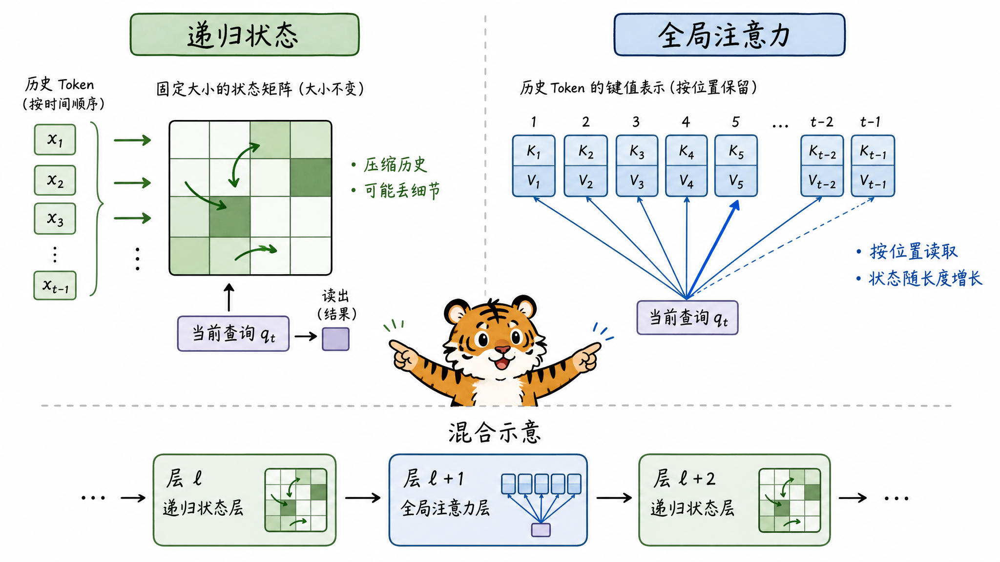
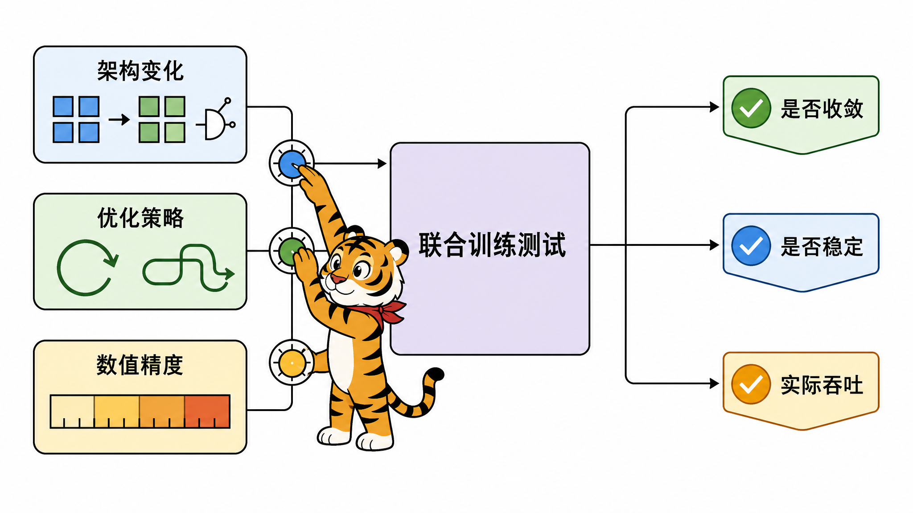
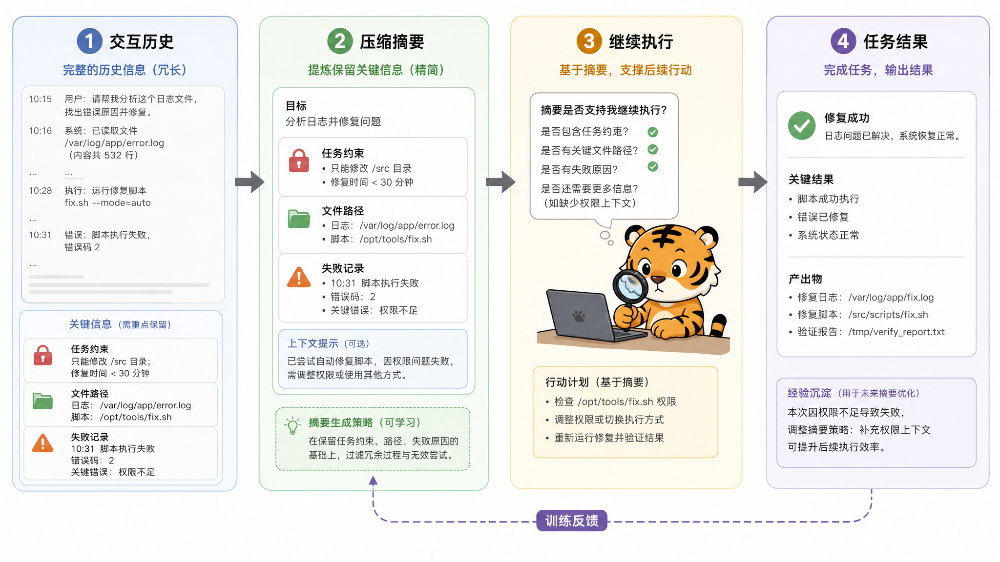

<a id="sota-overview"></a>
# 07 当前最先进水平（State of the Art，SOTA）模型拆解：跨周期技术主线

本章以公开报告中的代表性方案为例，比较它们针对的瓶颈、工程代价和能力边界。

## 目录导航

- [1. 从长序列计算到混合记忆](<#sota-section-1>)

  - [面试问题：为什么前沿模型混用递归状态与全局注意力？](<#sota-section-1-question-1>)
  - [面试问题：动态稀疏注意力为什么仍可能很慢？](<#sota-section-1-question-2>)
  
- [2. 从层数堆叠到跨层信息流](<#sota-section-2>)
  - [面试问题：AttnRes、mHC 和 GR 分别改进了残差路径的什么问题？](<#sota-section-2-question-1>)
  
- [3. 从参数扩张到有效容量](<#sota-section-3>)

  - [面试问题：高稀疏 MoE 的瓶颈为什么会转向通信和稳定性？](<#sota-section-3-question-1>)
  - [面试问题：N-gram 嵌入为何能增加容量，却未必提高下游能力？](<#sota-section-3-question-2>)
  
- [4. 从单步预测到训练与解码协同](<#sota-section-4>)

  - [面试问题：多词元预测（Multi-Token Prediction，MTP）如何服务推测解码？何时能保持目标分布不变？](<#sota-section-4-question-1>)
  - [面试问题：优化器与低精度为什么必须和架构一起设计？](<#sota-section-4-question-2>)
  - [面试问题：思考预算为什么要按任务分配，而不是一律拉满？](<#sota-section-4-question-3>)

- [5. 从单轮推理到长程 Agent 训练](<#sota-section-5>)
  
  - [面试问题：异步 Agent RL 为什么提高吞吐又带来策略偏移？](<#sota-section-5-question-1>)
  - [面试问题：上下文压缩为何必须进入训练，而不只是推理技巧？](<#sota-section-5-question-2>)
  
- [6. 如何判断一项跨周期技术值得采用？](<#sota-section-6>)
  
  - [面试问题：如何比较不同报告中的质量、效率和成本？](<#sota-section-6-question-1>)

---

<a id="sota-section-1"></a>
## 1. 从长序列计算到混合记忆

<a id="sota-section-1-question-1"></a>
### 面试问题：为什么前沿模型混用递归状态与全局注意力？

**难度评分：⭐⭐⭐⭐ (4/5) | 考察频率：⭐⭐⭐⭐⭐ (5/5)**

全局注意力（Global Attention）允许当前位置直接读取任意可见历史词元（Token），但长上下文的预填充（Prefill）计算和解码阶段的键值缓存（Key–Value Cache，KV Cache）持续增长。递归状态（Recurrent State）只保存固定维度的压缩记忆，解码不必逐一读取所有旧词元的键（Key，K）和值（Value，V）；代价是压缩可能丢失需要精确回溯的细节。因此，混合架构把“便宜的持续记忆”和“昂贵的精确寻址”分给不同层。[Kimi Team, 2025](https://arxiv.org/abs/2510.26692)



见上图 07-1：左侧递归状态以固定大小的状态矩阵压缩历史，状态成本不随历史长度线性增长，但可能丢失细节；右侧全局注意力保留各位置的 K/V，可按位置读取历史，缓存随上下文长度增长；下方示意在不同层交替使用两类模块。

以 Kimi Delta 注意力（Kimi Delta Attention，KDA）为例，单头状态 $S_t$ 的更新可写成：

$$
S_t=(I-\beta_t k_tk_t^{\mathsf T})\mathrm{Diag}(\alpha_t)S_{t-1}+\beta_tk_tv_t^{\mathsf T},\qquad o_t=S_t^{\mathsf T}q_t.
$$

$t$ 是词元位置， $S_t\in\mathbb{R}^{d_k\times d_v}$ 是压缩记忆， $q_t,k_t\in\mathbb{R}^{d_k}$ 分别是查询与键， $v_t,o_t\in\mathbb{R}^{d_v}$ 分别是值与输出； $d_k,d_v$ 是单头键、值维度。 $I$ 是  $d_k$ 阶单位矩阵， $\mathrm{Diag}(\alpha_t)$ 将遗忘向量  $\alpha_t\in\mathbb{R}^{d_k}$ 变成对角矩阵，标量  $\beta_t$ 控制写入强度。前一项先衰减旧状态，再修正当前键方向的旧关联，后一项写入新键值。[Kimi Team, 2025](https://arxiv.org/abs/2510.26692)

| 公开实例 | 混合方式 | 解决的瓶颈 | 缺点 |
| --- | --- | --- | --- |
| [Kimi Linear](https://arxiv.org/abs/2510.26692) / [Kimi K3](https://arxiv.org/abs/2607.24653v2) | KDA 与多头潜在注意力（Multi-Head Latent Attention，MLA）或其门控变体 Gated MLA 混用；K3 每组为 3 层 KDA、1 层 Gated MLA | 减少长序列状态与 KV 访问 | 递归层的精确回溯能力有限，混合核更复杂 |
| [Qwen3.8-Flash-Next](https://arxiv.org/abs/2608.30320v1) | 每 4 层中 3 层门控 DeltaNet（Gated DeltaNet，GDN）、1 层全局注意力；继续预训练时后者换为通义千问稀疏注意力（Qwen Sparse Attention，QSA） | 用固定状态承担大部分词元混合 | 稀疏索引的训练与服务成本仍需计算 |

<a id="sota-section-1-question-2"></a>
### 面试问题：动态稀疏注意力为什么仍可能很慢？

**难度评分：⭐⭐⭐⭐⭐ (5/5) | 考察频率：⭐⭐⭐⭐ (4/5)**

设序列长度为 $L$，每个查询最多选择 $k$ 个历史位置。在头数和头维度固定时，稀疏主注意力（Sparse Attention）的整段分数与加权求和计算可从 $O(L^2)$ 降为 $O(Lk)$，但选出这 $k$ 个位置也要成本。若索引器仍扫描全部历史，整段索引计算仍可能是平方量级。

| 路线 | 如何减少索引或主注意力成本 | 缺点 |
| --- | --- | --- |
| [原生稀疏注意力（Native Sparse Attention，NSA）](https://arxiv.org/abs/2502.11089) | 压缩表示、选择性块和局部窗口结合 | 压缩或块选择可能漏掉细粒度证据 |
| [DeepSeek 稀疏注意力（DeepSeek Sparse Attention，DSA）](https://arxiv.org/abs/2512.02556) | 轻量索引器选评分最高的 k 项（Top-k），再执行稀疏注意力 | 索引器与不规则访存可能成为瓶颈 |
| [索引缓存方法 IndexCache](https://arxiv.org/abs/2603.12201) | 多层复用一层选出的索引 | 层间需要的位置未必相同，复用过度会漏检 |
| [QSA](https://arxiv.org/abs/2608.30320v1) | 对压缩后的微块打分；每 $r\ge1$ 个位置压成一个索引单元时，整段索引计算约为 $O(L^2/r)$ | 仍有随长度增长的索引开销和块级误选 |

<a id="sota-section-2"></a>
## 2. 从层数堆叠到跨层信息流

<a id="sota-section-2-question-1"></a>
### 面试问题：AttnRes、mHC 和 GR 分别改进了残差路径的什么问题？

**难度评分：⭐⭐⭐⭐⭐ (5/5) | 考察频率：⭐⭐⭐⭐ (4/5)**

普通前置归一化（Pre-Norm）残差不断把子层输出累加到当前状态 $h_l\in\mathbb{R}^d$，其中 $l$ 是层编号、 $d$ 是隐藏维度。后层从累积表示读取信息，不能显式选择某个早期层的独立输出。以下三类方法分别改变跨层读取、残差分支混合或门控方式。

| 方法 | 核心做法 | 缺点 |
| --- | --- | --- |
| [注意力残差（Attention Residuals，AttnRes）](https://arxiv.org/abs/2603.15031) | 对前面层的输出按内容计算权重，再聚合为当前层输入 | 全层版本需保存并读取多层输出；分块版本减少这一开销 |
| [流形约束超连接（Manifold-Constrained Hyper-Connections，mHC）](https://arxiv.org/abs/2512.24880v2) | 扩宽残差流，并约束分支混合矩阵以维持稳定的信息传递 | 约束与分支混合有额外计算、访存开销 |
| [门控残差（Gated Residual，GR）](https://arxiv.org/abs/2608.30320v1) | 扩宽为多分支残差流，用逐元素门控读取，不做完整分支混合 | 更宽的残差状态仍占用内存；要与优化器共同验证稳定性 |

<a id="sota-section-3"></a>

## 3. 从参数扩张到有效容量

<a id="sota-section-3-question-1"></a>
### 面试问题：高稀疏 MoE 的瓶颈为什么会转向通信和稳定性？

**难度评分：⭐⭐⭐⭐ (4/5) | 考察频率：⭐⭐⭐⭐⭐ (5/5)**

混合专家（Mixture of Experts，MoE）让每个词元只激活少量专家。专家总量增大而激活量近似不变时，单词元浮点运算次数（Floating-Point Operations，FLOPs）仍可能可控，但跨设备调度、热门专家负载偏斜、激活异常和权重访存可能先成为瓶颈；是否发生取决于批大小、互联带宽与路由分布。

- Kimi K3 使用投影前归一化、Sigmoid–Tanh 单元门控线性单元（Sigmoid Tanh Unit Gated Linear Unit，SiTU-GLU）抑制异常激活，并用分位数均衡（Quantile Balancing）调整专家负载。[Kimi Team, 2026，v2](https://arxiv.org/abs/2607.24653v2)
- 专家并行库 MoonEP 在系统侧通过动态冗余专家放置与静态计算形状应对负载偏斜；（专家并行（Expert Parallelism，EP）指把专家分布到不同设备并调度词元）。[Moonshot AI，MoonEP 官方仓库](https://github.com/MoonshotAI/MoonEP)
- DeepSeek-V3 用路由偏置更新实现主要的无辅助损失负载均衡，以减轻平衡目标对语言建模的干扰；报告仍保留小权重的序列级辅助平衡损失。[DeepSeek-AI, 2024](https://arxiv.org/abs/2412.19437)

<a id="sota-section-3-question-2"></a>
### 面试问题：N-gram 嵌入为何能增加容量，却未必提高下游能力？

**难度评分：⭐⭐⭐⭐ (4/5) | 考察频率：⭐⭐⭐ (3/5)**

N 元组（N-gram）是连续 N 个词元组成的片段。Qwen3.8-Flash-Next 将其映射到嵌入（Embedding）表项，表放在加速器外并按需预取，通过查表增加容量，避免每个词元执行与新增参数量成比例的矩阵乘法。[Qiu et al., 2026，v1](https://arxiv.org/abs/2608.30320v1)

关键限制是“存储更多常见片段”不等于“学会更强的组合推理”。[Qwen3.8-Next 报告第 2.3 节](https://arxiv.org/html/2608.30320v1)

- 在保持 MoE 参数量不变、额外扩大 N-gram 表的实验中观察到训练损失（Loss）持续下降，但多个下游指标趋于饱和或波动；
- 在固定总参数预算、用 N-gram 表替换部分专家的实验中，损失也非单调下降。

> **注**：论文报告该变体主干为 125B 总参数、6B 每词元激活参数，另有 51B N-gram 嵌入参数。

<a id="sota-section-4"></a>

## 4. 从单步预测到训练与解码协同

<a id="sota-section-4-question-1"></a>
### 面试问题：多词元预测（Multi-Token Prediction，MTP）如何服务推测解码？何时能保持目标分布不变？

**难度评分：⭐⭐⭐⭐⭐ (5/5) | 考察频率：⭐⭐⭐⭐ (4/5)**

多词元预测（Multi-Token Prediction，MTP）与推测解码（Speculative Decoding）分工不同：

- 在训练时为未来若干位置提供辅助预测信号；

- 在推理时，附加模块可充当草稿生成器，一次提出多个候选词元，目标模型再并行验证。

DeepSeek-V3 公开将 MTP 用作辅助训练目标；Qwen3.8-Next 报告说明其 MTP 模块复用稀疏注意力索引以降低草稿成本[DeepSeek-AI, 2024](https://arxiv.org/abs/2412.19437)；[Qiu et al., 2026，v1](https://arxiv.org/abs/2608.30320v1)

训练目标可以概括为主损失加辅助损失：

$$
\mathcal L=\mathcal L_{\mathrm{next}}+\lambda\sum_{j=2}^{K}w_j\mathcal L_{t+j}.
$$

其中 $t$ 是当前词元位置， $K\ge2$ 是最大预测距离， $\mathcal L_{\mathrm{next}}$ 是下一词元预测损失， $\mathcal L_{t+j}$ 是距离为  $j$ 的辅助损失； $\lambda$ 和  $w_j$ 是无量纲权重。

真实加速取决于连续接受长度与验证成本。对同一前缀下的目标分布 $p$ 与草稿分布 $q$，标准拒绝采样的期望单步接受率为 $\sum_x\min(p(x),q(x))$， $x$ 遍历词表。草稿越弱，验证后能省掉的串行目标步数通常越少；批大小（Batch Size）较大或内存带宽不再是主瓶颈时，收益也可能变小。

要保持采样目标分布不变，设目标模型在当前前缀上的分布为 $p$，草稿分布为 $q$，草稿采样出 $y$ 后按下式接受：

```math
a(y)=\min\left(1,\frac{p(y)}{q(y)}\right)
```

若拒绝，则从归一化残差分布中重采样：

```math
p_{\mathrm{rej}}(z)=
\frac{\max(0,p(z)-q(z))}
{\sum_u\max(0,p(u)-q(u))}
```

这里 $y$ 是从 $q$ 采到的候选，因此 $q(y)>0$； $z,u$ 遍历词表。在相同前缀条件下正确计算概率并执行标准拒绝采样时，输出词元的条件分布与直接从 $p$ 采样一致，逐步成立即可保持整段生成分布。[Leviathan et al., 2023](https://arxiv.org/abs/2211.17192) 残差分母为零表示两分布相同，不会发生拒绝；多词元验证需使用各自前缀下的条件分布。温度与概率截断也必须按目标解码协议处理。

<a id="sota-section-4-question-2"></a>

### 面试问题：优化器与低精度为什么必须和架构一起设计？

**难度评分：⭐⭐⭐⭐ (4/5) | 考察频率：⭐⭐⭐⭐ (4/5)**

新架构改变矩阵形状、激活分布和有效批量后，原先最优的学习率、批大小和精度策略可能失效。



见上图 07-2，架构、优化策略和数值精度应联合测试，并同时检查收敛、训练稳定性和实测吞吐。

- Muon 是矩阵优化器的专名，对部分二维权重的动量矩阵做近似正交化。Qwen3.8-Next 将其用于主二维映射，嵌入、输出头、路由器等仍用解耦权重衰减的 Adam 优化器（Adam with Decoupled Weight Decay，AdamW）；Kimi K3 对注意力投影采用按头分块的正交化。[Qiu et al., 2026，v1](https://arxiv.org/abs/2608.30320v1)；[Kimi Team, 2026，v2](https://arxiv.org/abs/2607.24653v2)

- DeepSeek-V3 公开 8 位浮点（8-bit Floating Point，FP8）混合精度训练方案；Kimi K3 在后训练阶段使用微缩放 4 位浮点格式（Microscaling 4-bit Floating Point，MXFP4）量化部分专家权重，并开展量化感知训练（Quantization-Aware Training，QAT）。[DeepSeek-AI, 2024](https://arxiv.org/abs/2412.19437)；[Kimi Team, 2026，v2](https://arxiv.org/abs/2607.24653v2)

<a id="sota-section-4-question-3"></a>

### 面试问题：思考预算为什么要按任务分配，而不是一律拉满？

**难度评分：⭐⭐⭐⭐ (4/5) | 考察频率：⭐⭐⭐⭐⭐ (5/5)**

测试时计算扩展（Test-Time Compute Scaling）通过增加推理词元、工具调用或并行候选，争取提高困难任务的成功率；收益取决于任务难度、模型能力和验证方式。简单任务的额外计算可能只增加延迟和费用，长推理也可能累积错误；应在同一任务集上比较不同预算的质量—成本曲线。

- Qwen3 报告公开思考模式（Thinking Mode）与非思考模式（Non-thinking Mode），以及控制思考预算的方案。[Qwen Team, 2025](https://arxiv.org/abs/2505.09388)
- Kimi K3 报告按任务给初始预算，对超预算训练轨迹施加惩罚，并把不同推理强度的专家能力蒸馏到统一模型。[Kimi Team, 2026，v2](https://arxiv.org/abs/2607.24653v2)
- DeepSeek-V3.2 强调工具调用之间保留推理状态；其保留或丢弃规则依对话阶段而定。[DeepSeek-AI, 2025](https://arxiv.org/abs/2512.02556)

共同目标是在给定成本与延迟约束下，最大化额外计算带来的任务成功率增量。

闭源产品也公开了接口层的预算控制：

- 在支持的模型上，OpenAI Responses 应用程序接口（Application Programming Interface，API）的 `reasoning.effort` 与 Claude Messages API 的 `output_config.effort` 可调节推理投入；它们不是精确的词元数或运行时间承诺，取值、默认值与支持范围须按具体模型核对。[OpenAI，Reasoning models](https://developers.openai.com/api/docs/guides/reasoning)；[Anthropic，Effort](https://platform.claude.com/docs/en/build-with-claude/effort)

工程上可比较预算 $B$ 下的任务成功率 $S(B)\in[0,1]$ 与单任务成本 $C(B)$； $B$ 可用词元数、调用数或时间定义， $C$ 可用金额或设备时间计量，跨方案必须统一单位。先满足质量门槛，再选择成本可接受的预算，不能直接把不同单位的成功率增量与金额增量相减。

<a id="sota-section-5"></a>
## 5. 从单轮推理到长程 Agent 训练

<a id="sota-section-5-question-1"></a>
### 面试问题：异步 Agent RL 为什么提高吞吐又带来策略偏移？

**难度评分：⭐⭐⭐⭐⭐ (5/5) | 考察频率：⭐⭐⭐⭐ (4/5)**

长程智能体（Agent）任务的执行时长可能相差很大。同步强化学习（Reinforcement Learning，RL）若必须收齐一批交互轨迹（Rollout）再更新，便会受到最慢任务拖累；异步采样可减轻等待。

- GLM-5 报告将采样/执行与模型更新解耦，持续生成轨迹后送入训练器。设 $\pi_{\mathrm{old}}$ 是生成轨迹的旧策略， $\pi_\theta$ 是参数为 $\theta$ 的当前策略，两者均定义动作的条件概率；策略差异越大，直接把旧轨迹当作当前策略样本的偏差风险通常越高。[GLM-5 技术报告](https://arxiv.org/abs/2602.15763)
- Kimi K3 报告采用部分轨迹采样（Partial Rollout）、外部 KV 保留与可恢复沙盒，支持延续长交互的环境和模型状态。[Kimi Team, 2026，v2](https://arxiv.org/abs/2607.24653v2)

<a id="sota-section-5-question-2"></a>
### 面试问题：上下文压缩为何必须进入训练，而不只是推理技巧？

**难度评分：⭐⭐⭐⭐ (4/5) | 考察频率：⭐⭐⭐⭐ (4/5)**

长任务超过窗口上限时，系统可把旧历史压成摘要，再继续执行；摘要是有损状态，遗漏约束、文件路径或工具失败信息会在后续步骤放大。当模型需要自行生成摘要并据此继续执行、且训练时始终看到完整历史时，训练与执行分布可能不一致；此时让压缩过程进入训练，可学习保留对后续奖励有用的信息。若摘要由可靠外部程序生成，或任务无需跨压缩边界保留状态，则未必需要这类训练。



见上图 07-3：长交互历史先提炼任务约束、路径与失败记录，再据压缩摘要继续执行；任务结果用于反馈摘要策略。

上下文压缩强化学习方法 CompactionRL 把生成摘要和继续完成任务放进同一条训练轨迹，让最终任务奖励影响摘要策略；同时处理压缩造成的片段长度不均和跨片段信用分配，即把最终任务的成败反馈到较早的摘要决策。[Li et al., 2026，v2](https://arxiv.org/abs/2607.05378v2)

CompactionRL 论文 v2 在软件工程基准（Software Engineering Benchmark，SWE-bench）的人工核验子集 SWE-bench Verified 上，报告 GLM-4.5-Air 的单次通过率（pass@1）为 66.4%，相对“仅推理时压缩”的 59.8% 高 6.6 个百分点。[Li et al., 2026，v2](https://arxiv.org/abs/2607.05378v2)

<a id="sota-section-6"></a>
## 6. 如何判断一项跨周期技术值得采用？

<a id="sota-section-6-question-1"></a>
### 面试问题：如何比较不同报告中的质量、效率和成本？

**难度评分：⭐⭐⭐⭐ (4/5) | 考察频率：⭐⭐⭐⭐⭐ (5/5)**

| 维度 | 关注点 |
| --- | --- |
| 能力 | 相同数据、提示、工具权限、推理预算下的下游评测（长文本需看证据位置） |
| 训练效率 | 激活参数、训练词元、实际 FLOPs、图形处理器（Graphics Processing Unit，GPU）利用率与稳定性 |
| 服务效率 | 同硬件、同批大小/上下文/输出长度的预填充、解码和整请求时延；同时固定并发与质量门槛 |
| 系统可靠性 | 索引漏检、路由偏斜、数值异常、智能体失败恢复 |
| 证据等级 | 技术报告、模型卡、代码、可复现实验与产品声明 |
