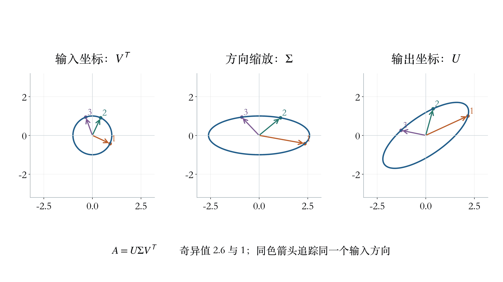
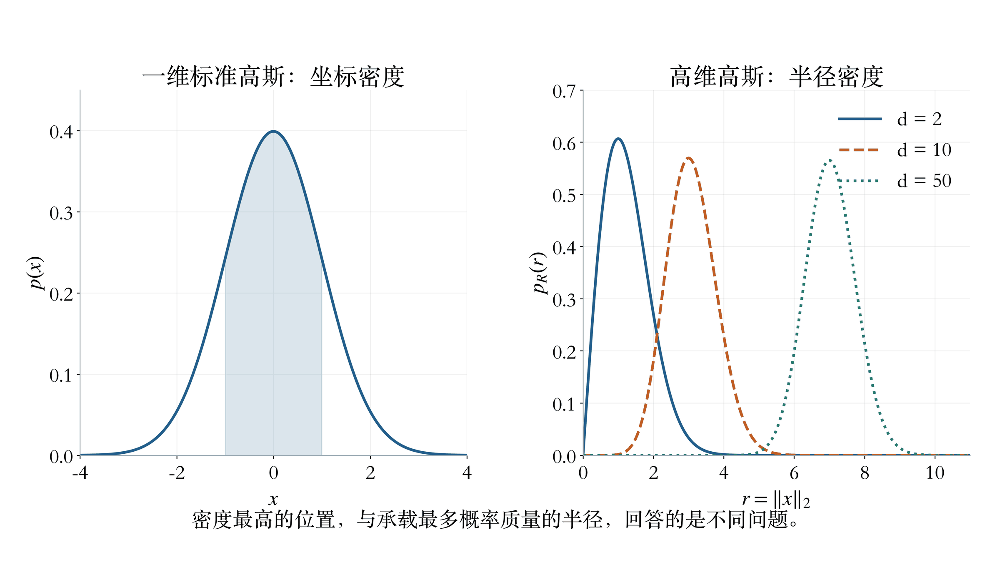
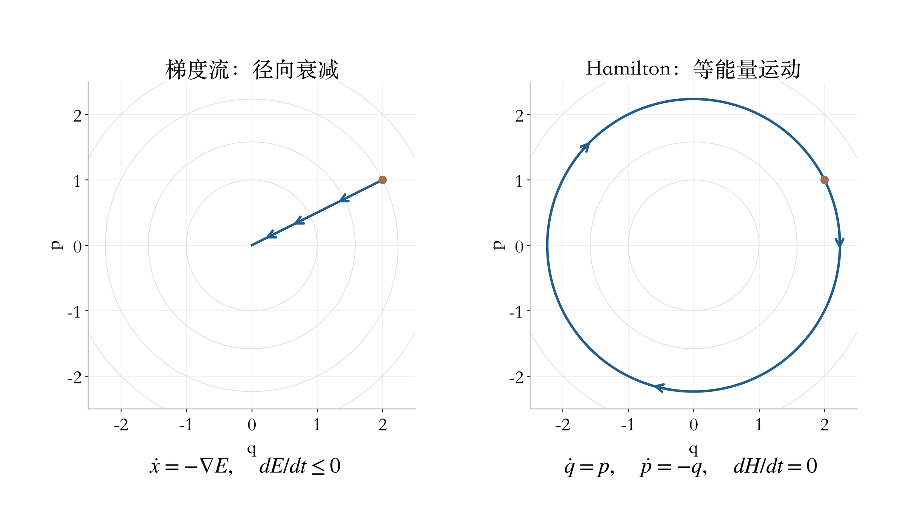

# 目录


[1. 深度学习与大模型为什么离不开线性代数？](#q-001)
  - [面试问题：标量、向量、矩阵、张量之间有什么联系和区别？](#q-002)
  - [面试问题：矩阵乘法、批量矩阵乘法和张量维度在 Transformer 中如何理解？](#q-003)
  - [面试问题：向量范数、矩阵范数、核范数、Frobenius 范数分别有什么作用？](#q-004)
  - [面试问题：什么是正定矩阵？为什么协方差矩阵和 Hessian 经常要求半正定？](#q-005)

[2. 特征值分解、SVD 与低秩近似为什么重要？](#q-006)
  - [面试问题：特征值、特征向量的几何意义是什么？](#q-007)
  - [面试问题：奇异值分解 SVD 与特征值分解有什么关系？](#q-008)
  - [面试问题：低秩近似如何解释 PCA、LoRA、模型压缩和推荐系统？](#q-009)
  - [面试问题：线性空间、基、维度和线性变换在深度学习中如何理解？](#q-009a)
  - [面试问题：条件数、病态问题和浮点误差为什么会影响模型训练？](#q-009b)

[3. 导数、偏导、梯度、Jacobian、Hessian 有什么区别？](#q-010)
  - [面试问题：导数和偏导数有什么区别？](#q-011)
  - [面试问题：梯度为什么指向函数上升最快方向？](#q-012)
  - [面试问题：Jacobian 和 Hessian 在深度学习中分别出现在哪里？](#q-013)
  - [面试问题：链式法则如何支撑反向传播和自动微分？](#q-014)
  - [面试问题：泰勒展开和极限思想在优化与大模型训练中有什么作用？](#q-014a)

[4. 常见激活函数、归一化和损失函数如何求导？](#q-015)
  - [面试问题：Sigmoid、Tanh、ReLU、GELU、SiLU 的导数和梯度问题是什么？](#q-016)
  - [面试问题：Softmax + Cross Entropy 为什么梯度形式很简洁？](#q-017)
  - [面试问题：LayerNorm、RMSNorm 的数学作用是什么？](#q-018)

[5. 机器学习为什么需要概率论？](#q-019)
  - [面试问题：随机变量、概率分布、PMF、PDF 分别是什么？](#q-020)
  - [面试问题：联合概率、边缘概率、条件概率、贝叶斯公式有什么联系？](#q-021)
  - [面试问题：独立性和条件独立性有什么区别？](#q-022)
  - [面试问题：期望、方差、协方差、相关系数如何理解？](#q-023)
  - [面试问题：大数定律、中心极限定理和置信区间能支持哪些模型评估结论？](#q-023a)

[6. 常见概率分布在 AI 中如何使用？](#q-024)
  - [面试问题：Bernoulli、Categorical、Binomial、Multinomial 分布分别适合什么场景？](#q-025)
  - [面试问题：高斯分布、多元高斯、协方差矩阵为什么重要？](#q-026)
  - [面试问题：指数分布、Laplace 分布、Dirac 分布和经验分布有什么用途？](#q-027)
  - [面试问题：最大似然估计、MAP、贝叶斯估计有什么区别？](#q-028)
  - [面试问题：什么时候能把梯度移进期望？重参数化与 score-function 估计有什么区别？](#q-028a)

[7. 熵、交叉熵、KL 散度、互信息为什么是大模型基础？](#q-029)
  - [面试问题：熵、交叉熵和困惑度 Perplexity 如何理解？](#q-030)
  - [面试问题：KL 散度为什么不对称？在 VAE、蒸馏、RLHF 中怎么用？](#q-031)
  - [面试问题：JS 散度、互信息、最大熵原理在生成模型中有什么意义？](#q-032)

[8. 梯度下降与现代优化器的数学本质是什么？](#q-033)
  - [面试问题：SGD、Momentum、AdaGrad、RMSProp、Adam、AdamW 有什么区别？](#q-034)
  - [面试问题：学习率、Batch Size、梯度噪声、Warmup、Cosine Decay 如何影响训练？](#q-035)
  - [面试问题：梯度爆炸、梯度消失、梯度裁剪如何从数学上理解？](#q-036)
  - [面试问题：过拟合、正则化、Dropout、Label Smoothing 的数学作用是什么？](#q-037)
  - [面试问题：无约束优化、有约束优化、拉格朗日乘子和 KKT 条件如何理解？](#q-037a)
  - [面试问题：凸优化和非凸优化有什么区别？深度学习为什么仍能训练成功？](#q-037b)

[9. Attention 的核心数学是什么？](#q-038)
  - [面试问题：Scaled Dot-Product Attention 为什么要除以 $`\sqrt{d_k}`$？](#q-039)
  - [面试问题：Multi-Head Attention 的线性代数本质是什么？](#q-040)
  - [面试问题：位置编码、RoPE、ALiBi 的数学差异是什么？](#q-041)
  - [面试问题：KV Cache、FlashAttention、长上下文优化背后的数学直觉是什么？](#q-042)

[10. 大模型预训练、微调和推理中的常考数学是什么？](#q-043)
  - [面试问题：自回归语言模型的最大似然训练目标是什么？](#q-044)
  - [面试问题：Temperature、Top-k、Top-p、重复惩罚如何改变采样分布？](#q-045)
  - [面试问题：Embedding 相似度、余弦相似度、向量检索和 RAG 的数学基础是什么？](#q-046)
  - [面试问题：MoE 的门控函数、负载均衡损失和稀疏激活如何理解？](#q-047)

[11. 扩散模型的概率建模基础是什么？](#q-048)
  - [面试问题：DDPM 的前向扩散和反向去噪如何用马尔可夫链表示？](#q-049)
  - [面试问题：Score Matching、SDE、ODE 与扩散模型有什么关系？](#q-050)
  - [面试问题：Classifier-Free Guidance 的数学形式是什么？为什么 CFG scale 过大会失真？](#q-051)
  - [面试问题：Flow Matching、Rectified Flow 与传统扩散模型的训练目标有什么差异？](#q-052)
  - [面试问题：最优传输与 Flow Matching 的端点配对有什么关系？](#q-052a)

[12. 大模型对齐为什么需要偏好优化和强化学习？](#q-053)
  - [面试问题：RLHF 中 reward model、PPO、KL penalty 分别解决什么问题？](#q-054)
  - [面试问题：DPO 如何把偏好学习转化为分类式损失？](#q-055)
  - [面试问题：GRPO 与 PPO 的数学差异是什么？为什么适合推理模型训练？](#q-056)

[13. LoRA、QLoRA、量化和蒸馏背后的数学是什么？](#q-057)
  - [面试问题：LoRA 为什么可以用低秩矩阵近似权重更新？](#q-058)
  - [面试问题：量化、反量化、对称/非对称量化、NF4 的核心数学是什么？](#q-059)
  - [面试问题：知识蒸馏、温度系数和 KL 损失如何理解？](#q-060)

[14. AIGC 数学基础应该如何复习？](#q-061)
  - [面试问题：算法岗、大模型工程岗、多模态方向各自最该优先掌握哪些数学？](#q-062)

[15. 动力系统、守恒规律与物理建模](#q-063)
  - [面试问题：量纲分析与无量纲化如何帮助构造可靠的物理学习模型？](#q-064)
  - [面试问题：梯度流与 Hamilton 动力学有什么本质区别？](#q-065)
  - [面试问题：Langevin 动力学为什么能把能量函数变成概率分布？](#q-066)
  - [面试问题：为什么学习 PDE 不能只最小化方程残差，还要检查初值与边界条件？](#q-067)
  - [面试问题：数值积分中的一致性、稳定性和步长误差为什么不能混为一谈？](#q-068)

---

<h1 id="q-001">1. 深度学习与大模型为什么离不开线性代数？</h1>

<h2 id="q-002">面试问题：标量、向量、矩阵、张量之间有什么联系和区别？</h2>

**难度评分：⭐⭐ (2/5)  |  考察频率：⭐⭐⭐⭐⭐ (5/5)**

**先区分“有几个轴”和“一个轴有多长”，张量形状才不会越看越乱。** 在深度学习框架中，标量、向量、矩阵分别是零阶、一阶、二阶数组，tensor 则是任意阶数组的统称。这里的“张量”通常指数据容器；微分几何中的张量还带有坐标变换规则，两者不能直接画等号。

一批文本的隐藏表示可写成：

```math
X\in\mathbb R^{B\times S\times D}.
```

其中 $`B`$ 是样本数，$`S`$ 是每个样本的序列长度，$`D`$ 是每个 token 的特征数。例如形状 `[2,128,768]` 有三个轴，包含 196608 个数；单个 token 位于 768 维特征空间，整个数组的阶数仍是 3。

多头注意力常把最后一维拆成 $`H\times d_h`$，再换轴得到 `[B,H,S,d_h]`。`reshape` 只改变元素的组织方式，`transpose` 改变轴的解释顺序；二者都不会凭空产生新语义。连续存储、stride 和复制行为属于框架实现，不能只凭 shape 判断是否拷贝了内存。

检查一次张量运算时，先为每个轴写下含义，再检查收缩轴和广播轴。例如 `[B,S,1]` 与 `[B,S,D]` 相加会在特征轴广播，`[B,1,D]` 则在序列轴广播。两者都能运行，模型含义却不同。**shape 对得上只是第一关，轴的语义也必须对得上。**

<h2 id="q-003">面试问题：矩阵乘法、批量矩阵乘法和张量维度在 Transformer 中如何理解？</h2>

**难度评分：⭐⭐⭐ (3/5)  |  考察频率：⭐⭐⭐⭐⭐ (5/5)**

矩阵乘法把前一组坐标按权重重新组合。若 $`A\in\mathbb R^{m\times n}`$、$`B\in\mathbb R^{n\times p}`$，则 $`(AB)_{ij}=\sum_k A_{ik}B_{kj}`$；中间的 $`n`$ 是被求和消去的轴，留下 $`m\times p`$。

采用 token 为行向量的约定，Transformer 先做 $`Q=XW_Q`$。把头拆开后，注意力各量的形状为：

```math
Q\in\mathbb R^{B\times H\times S_q\times d_k},\quad
K\in\mathbb R^{B\times H\times S_k\times d_k},\quad
V\in\mathbb R^{B\times H\times S_k\times d_v}.
```

这里 $`S_q`$ 与 $`S_k`$ 可以不同，例如交叉注意力。分数矩阵与输出为：

```math
A=\mathrm{softmax}_{\mathrm{key}}\!
\left(\frac{QK^{\mathsf T}}{\sqrt{d_k}}+M\right),\qquad
O=AV\in\mathbb R^{B\times H\times S_q\times d_v}.
```

$`K^{\mathsf T}`$ 只交换最后两个轴。Softmax 沿 key 轴归一化，因此每个 query 对可见 key 的权重和为 1。$`M`$ 是掩码或偏置；整行全部被屏蔽时，直接对全负无穷做 Softmax 可能产生 NaN，需要实现明确处理。

在自注意力、$`S_q=S_k=S`$、总特征宽度为 $`D`$ 的常用设置下，两次注意力矩阵乘法约需 $`O(BS^2D)`$ 运算，线性投影另有 $`O(BSD^2)`$。因此“注意力是平方复杂度”描述的是长度项，不能据此忽略短序列时的投影和 FFN 成本。FlashAttention 可以避免把完整 $`S\times S`$ 矩阵写入显存，但仍要计算稠密注意力中的配对。

<h2 id="q-004">面试问题：向量范数、矩阵范数、核范数、Frobenius 范数分别有什么作用？</h2>

**难度评分：⭐⭐⭐ (3/5)  |  考察频率：⭐⭐⭐⭐ (4/5)**

范数回答的是“按什么尺度衡量大小”。对向量 $`x`$，常见定义为：

```math
\Vert x\Vert_1=\sum_i\vert x_i\vert,\quad
\Vert x\Vert_2=\sqrt{\sum_i x_i^2},\quad
\Vert x\Vert_\infty=\max_i\vert x_i\vert.
```

一般 $`p`$ 范数是 $`(\sum_i\vert x_i\vert^p)^{1/p}`$，要求 $`p\ge1`$；$`0\lt p\lt1`$ 不满足三角不等式，不能按普通范数使用。

矩阵至少有两种衡量思路：把所有元素摊平后量大小，或者把它看作线性算子，量输入最多被放大多少。对应的 Frobenius 范数和谱范数为：

```math
\Vert A\Vert_F^2=\sum_{ij}a_{ij}^2=\sum_i\sigma_i^2,\qquad
\Vert A\Vert_2=\max_{\Vert x\Vert_2=1}\Vert Ax\Vert_2=\sigma_{\max}.
```

诱导矩阵 1 范数是最大列绝对值和，诱导无穷范数是最大行绝对值和。它们不等于“所有元素绝对值求和”。核范数 $`\Vert A\Vert_*=\sum_i\sigma_i`$ 则对奇异值做类似 $`L_1`$ 的约束，常用来鼓励低秩。

例如 $`A=\mathrm{diag}(3,1)`$ 的谱范数是 3，Frobenius 范数是 $`\sqrt{10}`$，核范数是 4：分别刻画最大方向放大、总平方能量和奇异值总量。分析梯度传播优先看算子放大率；比较矩阵重构误差常用 Frobenius 范数。

$`L_1`$ 促进稀疏、核范数促进低秩，都依赖优化目标与约束，不能保证任何训练结果必然稀疏或低秩。核范数是秩的常用凸替代；说它是“凸包”时还必须限定相应的有界集合。

<h2 id="q-005">面试问题：什么是正定矩阵？为什么协方差矩阵和 Hessian 经常要求半正定？</h2>

**难度评分：⭐⭐⭐ (3/5)  |  考察频率：⭐⭐⭐⭐⭐ (5/5)**

对实对称矩阵 $`A`$，若任意非零 $`x`$ 都满足 $`x^{\mathsf T}Ax>0`$，则 $`A`$ 正定；将严格大于换成大于等于，就是半正定。正定表示所有方向都有正曲率，半正定允许某些方向完全平坦。

对称矩阵正定等价于全部特征值为正，也等价于所有顺序主子式为正。半正定的主子式判别需要检查**所有主子式**，只检查顺序主子式不够。任意矩阵 $`C`$ 都使 $`C^{\mathsf T}C`$ 半正定；当 $`C`$ 满列秩时才正定，并不要求 $`C`$ 必须是方阵。

协方差矩阵的半正定性由定义自动保证。若二阶矩存在，则：

```math
\Sigma=\mathbb E[(X-\mu)(X-\mu)^{\mathsf T}],\qquad
v^{\mathsf T}\Sigma v=\mathbb E[(v^{\mathsf T}(X-\mu))^2]\ge0.
```

例如某个特征恒等于另一个特征，协方差矩阵就可能奇异。高斯密度中直接使用逆矩阵和行列式的常见公式要求正定协方差；半正定的退化高斯存在，但应在其支撑子空间上处理。

Hessian 则未必半正定。对于二阶连续可微函数，在内部局部极小点，Hessian 半正定是必要条件；驻点处 Hessian 正定是严格局部极小的充分条件。半正定本身不能判定极小：$`f(x)=x^3`$ 在原点的一阶、二阶导数都为 0，原点仍不是极小点。

实际二阶优化中加 $`\lambda I`$，是在修改曲率模型以稳定求解，不能把这种数值处理理解成原始损失处处凸。

<h1 id="q-006">2. 特征值分解、SVD 与低秩近似为什么重要？</h1>

<h2 id="q-007">面试问题：特征值、特征向量的几何意义是什么？</h2>

**难度评分：⭐⭐⭐ (3/5)  |  考察频率：⭐⭐⭐⭐ (4/5)**

特征向量描述线性变换保持不变的一条方向线：

```math
Av=\lambda v,\qquad v\ne0.
```

当 $`\lambda>0`$ 时方向保持，$`\lambda\lt0`$ 时方向翻转，$`\lambda=0`$ 时该向量被压到零。严格地说，保持的是向量张成的子空间，而不总是有向箭头的方向。

若 $`n`$ 阶矩阵有 $`n`$ 个线性无关特征向量，就能写成 $`A=V\Lambda V^{-1}`$。实对称矩阵总能正交对角化为 $`Q\Lambda Q^{\mathsf T}`$；一般方阵可能不可对角化，也可能只有复特征值。例如平面旋转 90 度在实数域没有非零特征向量。

特征值必须结合“是哪一个矩阵”解释。协方差矩阵的特征值是相应主方向上的方差，所以 PCA 选择较大特征值方向。Hessian 的特征值是局部曲率，正值与负值对应向上弯曲和向下弯曲；比较敏感度时还要看绝对值及扰动大小。

在线性动力系统 $`x_{t+1}=Ax_t`$ 中，谱半径小于 1 保证有限维系统最终收敛到零，但非正规矩阵仍可能出现短期放大。例如上三角矩阵的非对角项可以很大，即使对角特征值都小于 1，前几步也会增长。这是分析深层网络与递推模型时，需要同时关注特征值、奇异值和矩阵乘积的原因。

<h2 id="q-008">面试问题：奇异值分解 SVD 与特征值分解有什么关系？</h2>

**难度评分：⭐⭐⭐ (3/5)  |  考察频率：⭐⭐⭐⭐⭐ (5/5)**

SVD 把任意实矩阵拆成输入方向、各方向增益和输出方向。对 $`A\in\mathbb R^{m\times n}`$、秩 $`r`$，紧致形式为：

```math
A=U_r\Sigma_rV_r^{\mathsf T},\quad
U_r\in\mathbb R^{m\times r},\quad
V_r\in\mathbb R^{n\times r},\quad
\Sigma_r=\mathrm{diag}(\sigma_1,\ldots,\sigma_r).
```

$`U_r,V_r`$ 的列分别正交归一，正奇异值通常按降序排列。先用 $`V_r^{\mathsf T}`$ 提取输入方向的坐标，再由 $`\Sigma_r`$ 缩放，最后通过 $`U_r`$ 放到输出空间中。

它与特征分解的关系是：

```math
A^{\mathsf T}AV_r=V_r\Sigma_r^2,\qquad
AA^{\mathsf T}U_r=U_r\Sigma_r^2.
```

因此奇异值是 $`A^{\mathsf T}A`$ 非零特征值的平方根。完整 SVD 使用 $`m\times m`$ 的 $`U`$、$`n\times n`$ 的 $`V`$ 和 $`m\times n`$ 的矩形 $`\Sigma`$，这时两侧分别出现 $`\Sigma^{\mathsf T}\Sigma`$ 与 $`\Sigma\Sigma^{\mathsf T}`$，不能把矩形 $`\Sigma`$ 一律写成 $`\Sigma^2`$。

特征分解研究方阵作用前后同一空间中的不变方向，SVD 可以连接不同维度的输入、输出空间，因而适合最小二乘、降维和低秩近似。

数值计算时不要为了求 SVD 而盲目先形成 $`A^{\mathsf T}A`$。在满列秩情形，其 2 范数条件数是 $`A`$ 条件数的平方，会放大病态问题；成熟 SVD 算法可以直接分解原矩阵。

<div align="center">



图 1：确定性绘制的二维 SVD。圆上对应点与主轴使用一致颜色，奇异值控制轴长，旋转保持长度。

</div>

<h2 id="q-009">面试问题：低秩近似如何解释 PCA、LoRA、模型压缩和推荐系统？</h2>

**难度评分：⭐⭐⭐ (3/5)  |  考察频率：⭐⭐⭐⭐⭐ (5/5)**

**低秩近似假设有用信息可以由较少的独立方向表达。** 若 $`A`$ 的奇异值递减，截断 SVD 给出秩不超过 $`r`$ 的最优近似：

```math
A_r=\sum_{i=1}^{r}\sigma_i u_i v_i^{\mathsf T},\qquad
\Vert A-A_r\Vert_F^2=\sum_{i>r}\sigma_i^2,\quad
\Vert A-A_r\Vert_2=\sigma_{r+1}.
```

这是无额外约束、完整矩阵已知时的结论。若 $`r`$ 落在重复奇异值处，最优解可能不唯一。

PCA 先中心化数据，再选择方差最大的方向。对样本为行的矩阵 $`X`$ 做 SVD，右奇异向量对应主轴；未经中心化时，最大方向可能只是均值偏移。推荐系统则只观察到部分用户与物品的交互，缺失值通常不等于零，其分解要在已观测条目上拟合，不能直接套用完整矩阵截断 SVD 的最优性。

LoRA 约束的是更新矩阵 $`\Delta W=BA`$，原权重 $`W`$ 仍可以满秩。它通过任务损失学习 $`A,B`$，没有预先拿到“全量微调的正确更新”再做 SVD，因此也不继承上述误差最优保证。

压缩权重还需要考虑输入分布。设压缩误差为 $`E=W-\widehat W`$，输出误差是 $`Ex`$；若输入二阶矩为 $`C=\mathbb E[xx^{\mathsf T}]`$，则：

```math
\mathbb E\Vert Ex\Vert_2^2=\mathrm{tr}(ECE^{\mathsf T}).
```

输入很少使用的权重方向，数值误差大也可能影响有限；输入高频使用的方向则相反。**矩阵重构误差与任务损失之间还隔着数据分布，压缩方案必须回到实际任务验证。**

<h2 id="q-009a">面试问题：线性空间、基、维度和线性变换在深度学习中如何理解？</h2>

**难度评分：⭐⭐ (2/5)  |  考察频率：⭐⭐⭐⭐ (4/5)**

线性空间是一组对象连同加法、数乘运算，并满足结合律、分配律、零元素和加法逆元等公理。一个非空集合若已是某向量空间的子集，检验它是否为子空间时，可以使用“对线性组合封闭”这一简化条件；不能只给任意集合定义两种封闭运算，就断言它是向量空间。

一组向量既能张成整个空间，又线性无关，就构成一组基。相对于这组基，每个向量的坐标表示唯一。空间维数是基的向量个数，矩阵的秩则是其像空间维数。

有限维线性变换满足：

```math
T(ax+by)=aT(x)+bT(y),\qquad y=Wx.
```

若输入空间有 $`n`$ 维，秩为 $`r`$，则零空间维数是 $`n-r`$。降维投影丢掉的正是某些不可恢复方向。例如 $`W=[1\;\;1]`$ 把二维向量压成坐标和，$`(1,-1)`$ 落在零空间中。

带偏置的网络层 $`y=Wx+b`$ 是仿射变换；只有 $`b=0`$ 时才是线性变换。多层仿射映射若中间没有非线性，复合后仍可合成一层。注意力中的 Softmax 权重依赖输入，整个注意力模块也不能因为内部有矩阵乘法就被称为线性模型。

Embedding 落在实向量空间中，但“两个词向量相加”是否具有稳定语义取决于训练目标和数据。数学空间允许某种运算，不代表语义世界自动满足同样的代数结构。

<h2 id="q-009b">面试问题：条件数、病态问题和浮点误差为什么会影响模型训练？</h2>

**难度评分：⭐⭐⭐⭐ (4/5)  |  考察频率：⭐⭐⭐⭐ (4/5)**

条件数衡量输入小扰动被问题本身放大多少，算法稳定性衡量计算过程有没有额外放大误差。二者应分开：稳定算法也无法从已经丢失精度的数据中恢复病态方向。

对可逆矩阵的线性方程 $`Ax=b`$，2 范数条件数为：

```math
\kappa_2(A)=\Vert A\Vert_2\Vert A^{-1}\Vert_2
=\sigma_{\max}(A)/\sigma_{\min}(A).
```

固定 $`A`$、只扰动右侧时，解的相对误差上界为 $`\kappa_2(A)`$ 乘以右侧相对误差。$`A=\mathrm{diag}(1,10^{-6})`$ 的条件数为一百万，第二个分量极易放大观测误差。

最小二乘若形成正规方程 $`A^{\mathsf T}Ax=A^{\mathsf T}b`$，满列秩情况下条件数平方增长。QR 或 SVD 往往更稳；显式计算逆矩阵再乘右侧，也通常不如直接求解方程。

浮点数具有有限有效位和指数范围。两大近似数相减可能丢失有效位，直接指数可能溢出。log-sum-exp、较高精度累加、损失缩放和预条件分别解决不同问题，不能用一种技巧包办。

大模型量化与混合精度也遵循这个逻辑：同样的权重误差，在敏感方向可能被层间乘积放大。诊断时应观察输入尺度、奇异值谱、运算精度与最终任务误差，不能只盯着参数文件的 bit 数。

<h1 id="q-010">3. 导数、偏导、梯度、Jacobian、Hessian 有什么区别？</h1>

<h2 id="q-011">面试问题：导数和偏导数有什么区别？</h2>

**难度评分：⭐⭐ (2/5)  |  考察频率：⭐⭐⭐⭐⭐ (5/5)**

导数刻画输入发生微小变化时，输出怎样变化。一元函数在 $`x_0`$ 的导数是：

```math
f'(x_0)=\lim_{h\to0}\frac{f(x_0+h)-f(x_0)}{h}.
```

多元函数的偏导数只改变一个坐标，其他坐标固定。例如 $`f(x,y)=x^2y`$，有 $`\partial f/\partial x=2xy`$、$`\partial f/\partial y=x^2`$。如果 $`x,y`$ 又依赖时间 $`t`$，沿真实路径的变化率则是全导数：

```math
\frac{df}{dt}=2xy\frac{dx}{dt}+x^2\frac{dy}{dt}.
```

因此偏导回答“单独扰动这一坐标”，全导数回答“沿所有变量共同变化的路径”。优化模型参数时，通常把其他参数暂时视为固定，求得各参数偏导；反向传播会再把参数通过不同路径造成的影响累加。

多元函数各偏导存在，仍不保证可微。可微要求存在同一个线性映射，能在所有微小方向上统一近似函数变化：

```math
f(x+\Delta x)=f(x)+\nabla f(x)^{\mathsf T}\Delta x+o(\Vert\Delta x\Vert).
```

例如原点处令 $`f(0,0)=0`$，其他点令 $`f(x,y)=xy/(x^2+y^2)`$。沿两条坐标轴得到的偏导都是 0，沿 $`y=x`$ 接近原点时函数值却为 $`1/2`$，连连续性都不满足。神经网络常用分段可微函数，框架在不可微点采用约定的次梯度或导数值；自动微分有输出，不等于原函数在该点存在经典导数。

<h2 id="q-012">面试问题：梯度为什么指向函数上升最快方向？</h2>

**难度评分：⭐⭐⭐ (3/5)  |  考察频率：⭐⭐⭐⭐⭐ (5/5)**

梯度指向最快上升方向，这句话有两个前提：函数在当前点可微，而且用**欧氏长度相同的微小步长**比较不同方向。

若 $`g=\nabla f(x)\ne0`$，单位方向 $`u`$ 的方向导数为 $`g^{\mathsf T}u`$。由 Cauchy–Schwarz 不等式：

```math
g^{\mathsf T}u\le\Vert g\Vert_2\Vert u\Vert_2=\Vert g\Vert_2,
```

等号在 $`u=g/\Vert g\Vert_2`$ 时成立。所以负梯度是欧氏几何下的局部最速下降方向。若梯度为零，一阶信息对所有方向都给出零，不能据此宣布已经达到最小值。

“最快”会随距离定义变化。若步长代价是 $`\Delta x^{\mathsf T}M\Delta x`$，其中 $`M`$ 正定，那么受相同代价约束的一阶最速方向与 $`-M^{-1}g`$ 平行。预条件、自然梯度等方法正是通过改变更新的几何尺度，处理不同参数方向敏感度不一致的问题。

例如 $`f(x,y)=100x^2+y^2`$，同样移动一单位，沿 $`x`$ 的损失变化比沿 $`y`$ 大很多。普通梯度下降容易在陡峭方向反复摆动，合适的预条件可以压缩这种尺度差。

局部下降还不等于有限步一定下降。对于梯度满足 $`L`$-Lipschitz 条件的光滑函数，步长取 $`0\lt\eta\lt2/L`$ 才能由标准下降不等式保证非零梯度处的损失减少。学习率过大时，即使方向选对也会跨过局部有效区域。

<h2 id="q-013">面试问题：Jacobian 和 Hessian 在深度学习中分别出现在哪里？</h2>

**难度评分：⭐⭐⭐ (3/5)  |  考察频率：⭐⭐⭐⭐ (4/5)**

Jacobian 描述一阶输入输出关系，Hessian 描述标量函数的二阶曲率。对 $`f:\mathbb R^n\to\mathbb R^m`$：

```math
J_{ij}=\frac{\partial f_i}{\partial x_j},\qquad
f(x+\Delta x)\approx f(x)+J\Delta x.
```

若损失 $`L`$ 依赖输出 $`y=f(x)`$，采用列向量梯度约定，反向传播计算的是 $`\nabla_xL=J^{\mathsf T}\nabla_yL`$。框架通常直接计算这个乘积，不必显式构造 $`m\times n`$ 的 Jacobian。

对于标量函数，Hessian 是梯度的 Jacobian：

```math
H_{ij}=\frac{\partial^2L}{\partial x_i\partial x_j},\qquad
L(x+\Delta x)\approx L(x)+g^{\mathsf T}\Delta x+
\frac12\Delta x^{\mathsf T}H\Delta x.
```

混合二阶偏导连续等条件保证 $`H`$ 对称。大模型有数十亿参数，完整 Hessian 的存储量按参数量平方增长；实际分析常用 Hessian-vector product。对固定向量 $`v`$，再次求导 $`g^{\mathsf T}v`$ 就能得到 $`Hv`$。

Fisher 信息矩阵是模型分布下 score 外积的期望，天然半正定。在满足正则条件、针对概率模型负对数似然取模型分布期望时，它与期望 Hessian 相等；单个样本 Hessian、经验 Fisher 和一般任务 Hessian 不能混用。

Adam 使用梯度平方的滑动平均调节坐标步长，“二阶矩”中的二阶指统计矩，不代表计算了二阶导数。这一区分决定了它能否被当作曲率近似来解释。

<h2 id="q-014">面试问题：链式法则如何支撑反向传播和自动微分？</h2>

**难度评分：⭐⭐⭐ (3/5)  |  考察频率：⭐⭐⭐⭐⭐ (5/5)**

反向传播把一个巨大复合函数的求导拆成局部求导，并在共享节点处合并所有贡献。若 $`y=f(g(x))`$，其 Jacobian 满足 $`J_{y,x}=J_{f,g}J_{g,x}`$；标量损失的梯度按转置后的乘积从后向前传递。

看一个有分支的例子：$`u=x^2`$、$`v=3x`$、$`L=u+v`$。节点 $`x`$ 同时影响两条支路，所以 $`dL/dx=2x+3`$，不能只保留最后访问的一条路径。权重在多个 token 上复用、残差连接分叉再合并，都依赖这种梯度累加。

自动微分把基本算子的导数规则与实际执行的计算图组合，通常不进行代数表达式的大规模符号展开，也不靠有限差分估算梯度。前向模式传播 $`Jv`$，反向模式传播 $`J^{\mathsf T}v`$。对少量输入、很多输出的问题，前向模式合适；对数十亿参数汇聚成一个标量损失，反向模式合适。

代价主要来自需要保留前向中间值。激活重计算用额外前向计算换显存；`detach` 或停止梯度明确切断某条求导路径；原地修改仍被反向使用的变量，可能破坏计算图的版本依赖。

自动微分保证的是**按既定算子与分支计算导数**。离散采样、排序、取 argmax 一般不能直接把梯度传回选择概率；数值溢出也不会因使用自动微分而消失。调试时可在小规模双精度样例上做有限差分核对，但要避开 ReLU 的拐点等不可微位置。

<h2 id="q-014a">面试问题：泰勒展开和极限思想在优化与大模型训练中有什么作用？</h2>

**难度评分：⭐⭐⭐ (3/5)  |  考察频率：⭐⭐⭐⭐ (4/5)**

泰勒展开给优化提供一个局部模型。对于二阶连续可微函数，$`\Delta x`$ 足够小时：

```math
f(x+\Delta x)=f(x)+g^{\mathsf T}\Delta x+
\frac12\Delta x^{\mathsf T}H\Delta x+o(\Vert\Delta x\Vert_2^2).
```

梯度下降只使用一阶项，但单独最小化线性项没有有限最优步长。加上步长惩罚 $`\Vert\Delta x\Vert_2^2/(2\eta)`$ 后，最优解才是 $`\Delta x=-\eta g`$。Newton 法最小化二阶近似，得到 $`H\Delta x=-g`$；若 $`H`$ 不定或奇异，就需要阻尼、信赖域或其他稳定处理。

例如 $`f(x)=\tfrac12 ax^2`$、$`a>0`$，梯度下降满足 $`x_{k+1}=(1-\eta a)x_k`$。只有 $`0\lt\eta a\lt2`$ 时误差收缩。这个简单例子解释了为什么高曲率方向会限制学习率。

把离散更新除以步长并在合适条件下令步长趋于零，可得到梯度流：

```math
\frac{dx}{dt}=-\nabla f(x),\qquad
\frac{df}{dt}=-\Vert\nabla f(x)\Vert_2^2\le0.
```

连续时间系统单调下降，不代表它的任意大步长离散化也稳定。同样，扩散模型从离散链到 SDE 的联系需要明确噪声、时间步长与漂移的缩放，不能只把差分符号换成微分符号。

泰勒近似的余项、大数定律的采样条件、数值积分的步长误差，都是结论的一部分。“样本更多”“步长更小”能否改善结果，要检查相应极限成立的前提。

<h1 id="q-015">4. 常见激活函数、归一化和损失函数如何求导？</h1>

<h2 id="q-016">面试问题：Sigmoid、Tanh、ReLU、GELU、SiLU 的导数和梯度问题是什么？</h2>

**难度评分：⭐⭐⭐ (3/5)  |  考察频率：⭐⭐⭐⭐⭐ (5/5)**

激活函数决定哪些信号容易通过，导数则决定哪些误差容易传回。Sigmoid 与 Tanh 的导数为：

```math
\sigma'(x)=\sigma(x)(1-\sigma(x)),\qquad
\tanh'(x)=1-\tanh^2(x).
```

两端饱和时导数接近零。Tanh 的输出范围关于零对称，但输出均值是否接近零仍依赖输入分布，不能由函数名称保证。

ReLU 在正半轴导数为 1，负半轴为 0，零点经典导数不存在，框架通常约定取 0。一个单元若长期只收到负的预激活，局部梯度持续为零，便可能出现 dead ReLU；残差连接只能提供其他路径，不能自动恢复这个单元。

GELU 和 SiLU 使用平滑门控：

```math
\mathrm{GELU}(x)=x\Phi(x),\quad
\mathrm{GELU}'(x)=\Phi(x)+x\phi(x);
```

```math
\mathrm{SiLU}(x)=x\sigma(x),\quad
\mathrm{SiLU}'(x)=\sigma(x)+x\sigma(x)(1-\sigma(x)).
```

$`\Phi,\phi`$ 分别是标准正态的累积分布函数与密度。工程中 GELU 可能采用 tanh 近似，求导要对应实际版本；它的概率门控解释不意味着推理时真的采样一个随机开关。

SwiGLU 进一步引入两条投影支路，一条经 SiLU 后与另一条逐元素相乘。它既改变非线性，也改变参数分配和计算量，不能只看激活函数曲线判断优劣。激活导数较大也不是越好：梯度传播还受权重谱、归一化、残差结构及深度影响。

<h2 id="q-017">面试问题：Softmax + Cross Entropy 为什么梯度形式很简洁？</h2>

**难度评分：⭐⭐⭐ (3/5)  |  考察频率：⭐⭐⭐⭐⭐ (5/5)**

设 $`p=\mathrm{softmax}(z)`$，目标 $`y`$ 是与 logits 无关、非负且和为 1 的标签分布，则交叉熵为 $`L=-\sum_i y_i\log p_i`$。把对数 Softmax 展开：

```math
L=-\sum_i y_i z_i+\log\sum_j e^{z_j},
\qquad \frac{\partial L}{\partial z_i}=p_i-y_i.
```

这个结论既适用于 one-hot，也适用于 label smoothing 等软标签。以三分类为例，$`p=(0.2,0.5,0.3)`$、$`y=(0,1,0)`$，梯度为 $`(0.2,-0.5,0.3)`$。梯度下降提高正确类别 logit，压低其他类别，调整幅度反映概率误差。

简洁梯度不代表先算 Softmax 再算 log 最稳。若正确类别概率在低精度下先被舍入成零，后续就会出现无穷损失。实现通常直接用：

```math
\log p_i=z_i-m-\log\sum_j e^{z_j-m},\qquad m=\max_j z_j.
```

这与原式数学等价，却能避免指数溢出。

语言模型把每个有效 token 位置看作一次词表分类。求和、按 token 平均、按序列平均会产生不同的梯度权重；padding 和 prompt 区域是否参与损失也必须明确。类别加权、温度或非归一化目标会改变梯度表达，不能在这些设置中原封不动套用 $`p-y`$。完整 Jacobian 推导见[推导篇](02_AIGC数学公式推导高频考点.md#q-001)。

<h2 id="q-018">面试问题：LayerNorm、RMSNorm 的数学作用是什么？</h2>

**难度评分：⭐⭐⭐ (3/5)  |  考察频率：⭐⭐⭐⭐⭐ (5/5)**

LayerNorm 和 RMSNorm 都对选定的特征轴控制尺度，常见 Transformer 中是一条 token 向量的隐藏维，而不是整个 batch。

```math
\mu=\frac1d\sum_i x_i,\quad v=\frac1d\sum_i(x_i-\mu)^2,\qquad
\mathrm{LN}(x)_i=\gamma_i\frac{x_i-\mu}{\sqrt{v+\epsilon}}+\beta_i.
```

RMSNorm 省去中心化：

```math
r=\sqrt{\frac1d\sum_i x_i^2+\epsilon},\qquad
\mathrm{RMSNorm}(x)_i=\gamma_i x_i/r.
```

忽略 $`\epsilon`$、仿射参数且非退化时，LayerNorm 对统一平移和正比例缩放不敏感；RMSNorm 对正比例缩放不敏感，却保留均值偏移。取 $`x=(1,3)`$，中心化后为 $`(-1,1)`$，RMS 缩放后仍保持两个坐标为正。两者移除的信息不同，不是把同一个运算简单加速。

共同分母依赖所有坐标，所以一个坐标的梯度会受到其他坐标影响。$`\epsilon`$ 用于控制接近零方差或零均方时的除法，过大又会改变归一化行为；求平方与累加常需较高精度。逐坐标学习的 $`\gamma_i`$ 也会重新改变方向，因此“RMSNorm 完全保持方向”只适用于仿射缩放之前的公共标量除法。

Pre-Norm 把归一化放在子层之前，使残差主路提供较直接的梯度通道。是否稳定仍取决于初始化、残差尺度、学习率及网络深度。归一化改善训练条件，不构成收敛或泛化保证。

<h1 id="q-019">5. 机器学习为什么需要概率论？</h1>

<h2 id="q-020">面试问题：随机变量、概率分布、PMF、PDF 分别是什么？</h2>

**难度评分：⭐⭐ (2/5)  |  考察频率：⭐⭐⭐⭐⭐ (5/5)**

随机变量是从随机试验结果到数值的可测函数，它的分布描述不同取值出现的概率。取值恒定的变量也可以作为退化随机变量处理；随机性来自所采用的概率模型，不是变量符号本身。

离散随机变量用概率质量函数 PMF：

```math
p_X(x)=P(X=x),\qquad p_X(x)\ge0,\quad\sum_xp_X(x)=1.
```

具有密度的连续随机变量用 PDF：

```math
P(a\le X\le b)=\int_a^b f_X(x)\,dx,\qquad
f_X(x)\ge0,\quad\int f_X(x)\,dx=1.
```

密度不是单点概率。均匀分布在 $`[0,0.1]`$ 上的密度为 10，大于 1 完全合法；宽度 0.02 的区间内概率为 0.2。对具有密度的分布，单点概率为零，但区间概率可以非零。

累积分布函数 $`F_X(t)=P(X\le t)`$ 能统一描述离散、连续和混合分布。并非所有没有原子的分布都存在通常意义的密度，因此“随机变量只分 PMF 和 PDF 两类”也不够严谨。

在语言模型里，词表上的输出是离散概率；图像潜变量中常用连续密度。两者的负对数似然都可优化，但连续密度会随单位和坐标变换改变，甚至可以使负对数密度为负。比较数值前必须统一数据表示、单位及参考测度。

<h2 id="q-021">面试问题：联合概率、边缘概率、条件概率、贝叶斯公式有什么联系？</h2>

**难度评分：⭐⭐⭐ (3/5)  |  考察频率：⭐⭐⭐⭐⭐ (5/5)**

联合分布描述变量共同取值；边缘分布通过消去不关心的变量得到；条件分布描述已知信息之后的剩余不确定性。离散情形为：

```math
p(x)=\sum_y p(x,y),\qquad
p(x\mid y)=\frac{p(x,y)}{p(y)},\quad p(y)>0.
```

同一联合分布可以按两种顺序分解，因此：

```math
p(x\mid y)=\frac{p(y\mid x)p(x)}{p(y)}.
```

把 $`x`$ 看作参数、$`y`$ 看作数据时，各项对应后验、似然、先验和证据。似然是“把已观测数据固定后，作为参数函数考察”的量，通常不是一个关于参数已经归一化的概率分布。

概率链式法则给出 $`p(x_{1:T})=\prod_t p(x_t\mid x_{\lt t})`$，无需假设 token 独立；自回归模型就是用网络近似这些条件分布。

经典“两孩问题”必须先说明信息如何获得。若从有两个孩子的家庭中均匀选一个，并按“至少一个女孩”筛选，假设出生顺序可区分、性别独立且等概率，则 $`GG,GB,BG`$ 三种情况等可能，两孩都是女孩的概率为 $`1/3`$。若随机抽中一名孩子并观察到她是女孩，$`GG`$ 家庭被观察到女孩的机会是另外两类的两倍，后验结果变为 $`1/2`$。

这类题训练的不是记住 $`1/3`$，而是把**采样机制也写进条件**。医疗检测、推荐曝光、训练数据筛选同样会改变后验；忽略基率和筛选机制，公式写对也会得出错误结论。

<h2 id="q-022">面试问题：独立性和条件独立性有什么区别？</h2>

**难度评分：⭐⭐⭐ (3/5)  |  考察频率：⭐⭐⭐⭐ (4/5)**

独立表示一个变量不提供另一个变量的分布信息；条件独立则是在给定某些信息之后，这种额外信息消失：

```math
p(x,y)=p(x)p(y),\qquad
p(x,y\mid z)=p(x\mid z)p(y\mid z).
```

这两种关系不能互相推出。设两枚独立公平硬币为 $`X,Y`$，给定 $`Z=X+Y=1`$ 后，一枚为 1 就决定另一枚为 0。原本独立的变量，经过条件筛选后产生依赖。

反方向看，设 $`Z`$ 是某天的天气，两个传感器的读数分别是 $`X=Z+\epsilon_1`$、$`Y=Z+\epsilon_2`$，噪声彼此独立且与天气独立。给定天气后，两传感器条件独立；不观察天气时，它们因共同受天气影响而相关。

朴素贝叶斯使用的是“给定类别后，各特征条件独立”，所以联合似然能分解为 $`\prod_jp(x_j\mid c)`$。假设不完全成立时分类仍可能有用，但概率校准可能受损。

马尔可夫性质也是条件独立：给定当前状态后，下一状态与更早历史独立。自回归语言模型的链式分解不需要这个假设；如果把长历史截断为有限窗口，才额外引入了上下文限制。**把概率分解写成乘积，不等于声称所有因子对应的变量彼此独立。**

<h2 id="q-023">面试问题：期望、方差、协方差、相关系数如何理解？</h2>

**难度评分：⭐⭐⭐ (3/5)  |  考察频率：⭐⭐⭐⭐⭐ (5/5)**

期望描述分布的平均位置，方差描述围绕均值的平方波动，协方差描述两个变量共同线性变化的方向。假设相关矩存在：

```math
\mathrm{Var}(X)=\mathbb E[X^2]-\mathbb E[X]^2,\quad
\mathrm{Cov}(X,Y)=\mathbb E[XY]-\mathbb E[X]\mathbb E[Y].
```

期望的线性性 $`\mathbb E[aX+bY]=a\mathbb E[X]+b\mathbb E[Y]`$ 不要求独立；方差相加则要保留协方差项：

```math
\mathrm{Var}(X+Y)=\mathrm{Var}(X)+\mathrm{Var}(Y)+2\mathrm{Cov}(X,Y).
```

相关系数 $`\rho=\mathrm{Cov}(X,Y)/(\sigma_X\sigma_Y)`$ 消去量纲，范围在 $`[-1,1]`$，前提是两个方差有限且非零。常量变量与其他变量的相关系数通常未定义。

独立且二阶矩有限可以推出不相关，反方向一般不成立。取关于零对称的 $`X`$，令 $`Y=X^2`$，则可能有 $`\mathrm{Cov}(X,Y)=0`$，但 $`Y`$ 完全由 $`X`$ 决定。对联合高斯变量，不相关才足以推出独立。

训练中 mini-batch 的梯度均值依赖这些性质：独立同分布采样时，均值方差按样本数缩小；重复样本、同文档片段或强相关轨迹会留下协方差项，真实降噪收益小于简单估算。

非线性函数不能随意移到期望外面。凸函数满足 Jensen 不等式 $`f(\mathbb E[X])\le\mathbb E[f(X)]`$，需要相应期望存在。例如 $`\mathbb E[X^2]\ge\mathbb E[X]^2`$，其差正好是方差。

<h2 id="q-023a">面试问题：大数定律、中心极限定理和置信区间能支持哪些模型评估结论？</h2>

**难度评分：⭐⭐⭐⭐ (4/5)  |  考察频率：⭐⭐⭐⭐ (4/5)**

大数定律说样本均值在相应条件下接近总体期望；中心极限定理进一步描述均值的波动尺度。独立同分布、方差有限时：

```math
\sqrt n\,\frac{\overline X-\mu}{\sigma}
\ \xrightarrow{d}\ \mathcal N(0,1).
```

标准误差按 $`1/\sqrt n`$ 缩小，所以把误差约减半，通常需要约四倍独立样本。它不表示原始数据分布随着样本数增加就变成高斯。

若 n 道独立任务的成功率估计为 $`\widehat p`$，粗略标准误差为 $`\sqrt{\widehat p(1-\widehat p)/n}`$。例如 100 道题正确 80 道，标准误差约 0.04，正态近似的 95% 区间半宽约 0.078。样本少或概率接近 0、1 时，这个近似可能很差，应使用 Wilson、精确区间等方法。

频率学派 95% 置信区间表示按同一程序反复抽样构造区间，约 95% 能覆盖固定真值；不是在该框架下给已固定真值赋一个 95% 后验概率。

评测题来自同一文档、同一用户或同一模板时，相关性减少有效样本量。比较两个模型宜用同一组题做配对分析，bootstrap 也应按真实独立单位重采样。反复试提示词后只报告最佳一次，还会引入选择偏差。

统计区间反映抽样波动，不会自动覆盖污染、错误标注、判分器偏差和领域漂移。可靠评测需要同时处理统计不确定性与数据质量。

<h1 id="q-024">6. 常见概率分布在 AI 中如何使用？</h1>

<h2 id="q-025">面试问题：Bernoulli、Categorical、Binomial、Multinomial 分布分别适合什么场景？</h2>

**难度评分：⭐⭐ (2/5)  |  考察频率：⭐⭐⭐⭐⭐ (5/5)**

这四种分布先区分“看一次结果”还是“统计多次结果”，再区分二分类还是多分类。

<div align="center">

| 观测对象 | 两类结果 | 多类结果 |
|---|---|---|
| 一次试验 | Bernoulli | Categorical |
| 固定次数的独立重复试验，统计类别计数 | Binomial | Multinomial |

</div>

Bernoulli 的取值为 0 或 1，$`P(X=1)=p`$，均值为 $`p`$，方差为 $`p(1-p)`$。Categorical 返回一个类别编号，概率向量各元素非负且总和为 1；单步 token 采样就是这种情况。

若 $`n`$ 次试验彼此独立且成功率相同，则成功总数服从 Binomial：

```math
P(K=k)=\binom nkp^k(1-p)^{n-k}.
```

组合数统计哪些试验成功。推广到 $`m`$ 类计数 $`n_1+\cdots+n_m=n`$：

```math
P(N_1=n_1,\ldots,N_m=n_m)
=\frac{n!}{\prod_i n_i!}\prod_i p_i^{n_i}.
```

例如 10 次独立调用，每次成功率为 0.8，成功次数才可用 Binomial 建模；若后一次根据前一次反馈修改提示词，各次成功率和依赖关系发生变化，就不能直接套这个分布。自回归 token 的条件概率随前缀变化，整段文本也不等于固定词表概率下的一组独立抽样。

Dropout 的掩码常使用独立 Bernoulli，但某些变体会共享通道或时间维的掩码。分布名称要与实际采样对象及独立性假设对应。

<h2 id="q-026">面试问题：高斯分布、多元高斯、协方差矩阵为什么重要？</h2>

**难度评分：⭐⭐⭐ (3/5)  |  考察频率：⭐⭐⭐⭐⭐ (5/5)**

高斯分布之所以常用，是因为它由均值和协方差确定，线性变换后仍是高斯，并且条件分布与边缘分布容易计算。对正定协方差 $`\Sigma`$：

```math
p(x)=\frac{\exp[-\tfrac12(x-\mu)^{\mathsf T}\Sigma^{-1}(x-\mu)]}
{(2\pi)^{d/2}\det(\Sigma)^{1/2}}.
```

二次型是 Mahalanobis 距离的平方。协方差特征向量决定等密度椭球的方向，特征值决定各方向的平方尺度。各向同性 $`\Sigma=\sigma^2I`$ 是特殊情形，不能代表所有多元高斯。

若 $`\epsilon\sim\mathcal N(0,I)`$，$`LL^{\mathsf T}=\Sigma`$，则 $`X=\mu+L\epsilon`$ 服从目标高斯。这是采样与重参数化的基础。协方差半正定但奇异时，样本集中在低维子空间，不能再使用上面的普通全维密度公式。

中心极限定理谈的是适当中心化和缩放后的和，在独立同分布且有限方差等条件下趋向高斯；强依赖或无限方差可能破坏这些条件。固定均值和协方差、以连续分布微分熵衡量时，高斯具有最大熵，但这并不证明实际图像或参数分布必须高斯。

一维正态在均值上下 1、2、3 个标准差内约有 68.3%、95.4%、99.7% 的概率。高维标准高斯的大部分质量却集中在半径约 $`\sqrt d`$ 的壳层，原点密度最高却不是随机样本最常停留的位置。理解这一区别，才能避免把生成采样误解成“总往密度最大点走”。

<div align="center">



图 2：左侧是坐标密度，右侧是半径的概率密度。高维高斯的原点密度最高，概率质量却集中在半径约为维度平方根的区域。

</div>

<h2 id="q-027">面试问题：指数分布、Laplace 分布、Dirac 分布和经验分布有什么用途？</h2>

**难度评分：⭐⭐⭐ (3/5)  |  考察频率：⭐⭐⭐ (3/5)**

不同分布对应不同的误差与采样假设。指数分布以非负等待时间为对象：

```math
f(t)=\lambda e^{-\lambda t},\quad t\ge0,\ \lambda>0.
```

它的均值为 $`1/\lambda`$，并满足无记忆性。恒定事件率的 Poisson 过程可导出这种等待时间；排队系统中有明显周期、拥塞或历史依赖时，不能只因变量叫“等待时间”就使用指数分布。

Laplace 分布为 $`f(x)=e^{-\vert x-\mu\vert/b}/(2b)`$。在固定尺度 $`b`$ 的独立误差模型下，负对数似然中的可优化项与绝对误差成正比，因此得到 MAE。对应地，固定方差高斯得到 MSE。把尺度也作为未知量训练时，还必须保留对数尺度项。

Dirac 点质量把全部概率放在一个位置，$`\delta`$ 是描述它的广义函数记号，不是一个在单点有“无限高数值”可直接代入普通运算的常规密度。经验分布更清楚的写法是：

```math
\widehat P_N=\frac1N\sum_{i=1}^N\delta_{x_i},\qquad
\mathbb E_{\widehat P_N}[f(X)]=\frac1N\sum_i f(x_i).
```

于是经验风险最小化就是在训练样本的点质量分布下优化平均损失。它并未自动修复选择偏差：样本只来自高活跃用户时，经验分布反映的仍是这个子群体。概率模型不仅要方便计算，还要与数据收集机制相符。

<h2 id="q-028">面试问题：最大似然估计、MAP、贝叶斯估计有什么区别？</h2>

**难度评分：⭐⭐⭐ (3/5)  |  考察频率：⭐⭐⭐⭐⭐ (5/5)**

MLE 与 MAP 给出参数的一个估计点；贝叶斯推断保留后验分布，并可进一步求后验均值、区间或预测分布。

```math
\widehat\theta_{\mathrm{MLE}}=\arg\max_\theta p(D\mid\theta),\qquad
\widehat\theta_{\mathrm{MAP}}=\arg\max_\theta p(D\mid\theta)p(\theta).
```

二者取负对数后，MAP 比 MLE 多了 $`-\log p(\theta)`$。各向同性高斯先验给出平方 $`L_2`$ 惩罚，Laplace 先验给出 $`L_1`$ 惩罚。系数还取决于先验尺度和数据损失是求和还是平均，不能随意忽略。

以硬币正面率 $`p`$ 为例，10 次中 8 次正面，MLE 是 0.8。使用 $`\mathrm{Beta}(2,2)`$ 先验，后验为 $`\mathrm{Beta}(10,4)`$；MAP 是 $`9/12=0.75`$，后验均值为 $`10/14`$。它们优化的目标不同，数值不同并不矛盾。

真正用于新数据的贝叶斯预测是：

```math
p(y_*\mid x_*,D)=
\int p(y_*\mid x_*,\theta)p(\theta\mid D)\,d\theta.
```

积分把参数不确定性传播到预测中，代价是后验往往难以精确表示，需要采样或变分近似。MAP 的一个最优点无法提供同等完整的不确定性信息。

在连续参数空间中，MAP 依赖参数化方式，因为密度在换坐标时带 Jacobian；“概率最高的点”不是坐标不变的概念。实际选择估计量应由预测损失和不确定性需求决定。

<h2 id="q-028a">面试问题：什么时候能把梯度移进期望？重参数化与 score-function 估计有什么区别？</h2>

**难度评分：⭐⭐⭐⭐ (4/5)  |  考察频率：⭐⭐⭐⭐ (4/5)**

若采样分布与参数无关，函数可微且存在可积的导数控制条件，才可交换：

```math
\nabla_\theta\mathbb E_{X\sim p}[f_\theta(X)]
=\mathbb E_p[\nabla_\theta f_\theta(X)].
```

当采样分布本身依赖参数，直接把分布当常量就会漏项。若支撑固定、密度足够光滑且积分条件满足：

```math
\nabla_\theta\mathbb E_{p_\theta}[f_\theta(X)]
=\mathbb E_{p_\theta}\left[
\nabla_\theta f_\theta(X)+f_\theta(X)\nabla_\theta\log p_\theta(X)
\right].
```

第二项就是 score-function 或 REINFORCE 估计的基础。与动作无关的基线可利用 $`\mathbb E[\nabla_\theta\log p_\theta]=0`$ 降低方差，但不得随意使用会引入相关偏差的基线。

重参数化把随机性移到固定分布：$`X=g_\theta(\epsilon)`$、$`\epsilon\sim p_0`$，再沿可微路径求导。高斯的 $`X=\mu+\sigma\epsilon`$ 是典型例子。路径导数通常有较好的方差性质，但离散采样不能直接使用同样的连续路径。

一个重要反例是 $`X\sim\mathrm{Uniform}(0,\theta)`$。期望 $`\mathbb E[X]=\theta/2`$，导数为 $`1/2`$；若只对区间内密度 $`1/\theta`$ 求 log 导数，会漏掉随参数移动的边界贡献。重参数化 $`X=\theta U`$ 可以清楚得到正确结果。

VAE、策略梯度与 MeanFlow 中的 JVP 都涉及求导，但求导对象和随机性位置不同。写公式前先标清哪些量参与梯度、哪些量停止梯度以及样本从哪里来。

<h1 id="q-029">7. 熵、交叉熵、KL 散度、互信息为什么是大模型基础？</h1>

<h2 id="q-030">面试问题：熵、交叉熵和困惑度 Perplexity 如何理解？</h2>

**难度评分：⭐⭐⭐ (3/5)  |  考察频率：⭐⭐⭐⭐⭐ (5/5)**

离散熵 $`H(P)=-\sum_xP(x)\log P(x)`$ 衡量分布自身的不确定性。交叉熵 $`H(P,Q)=-\sum_xP(x)\log Q(x)`$ 衡量数据来自 $`P`$、却用 $`Q`$ 预测时的平均对数损失。在适当编码条件下，也可以解释为平均编码长度。

固定 $`P`$ 时：

```math
H(P,Q)=H(P)+D_{\mathrm{KL}}(P\Vert Q).
```

因此训练减小交叉熵，是减少模型相对于数据分布的额外编码代价。单个 one-hot 标签只是对真实条件分布的一次观察；真实任务本身可能有噪声或多个合理答案。

语言模型的 token 困惑度定义为：

```math
\mathrm{PPL}=\exp\left[-\frac1T\sum_{t=1}^T
\log p_\theta(x_t\mid x_{\lt t})\right].
```

使用自然对数时取指数，使用以 2 为底的对数时取 2 的幂。若每个位置真实 token 的概率均为 $`1/4`$，PPL 为 4。更一般地，它是这些概率的**几何平均数的倒数**，不是算术平均数的倒数。

比较 PPL 必须统一测试集、tokenizer、上下文、损失掩码与平均口径。两个 tokenizer 把同一句话分成不同数量的 token，其 token PPL 不能直接比高低。

PPL 评价下一 token 概率建模，无法替代事实性、任务完成率或推理验证。一个模型可以更善于预测常见措辞，却在需要检索新事实或执行工具的任务上更差。

<h2 id="q-031">面试问题：KL 散度为什么不对称？在 VAE、蒸馏、RLHF 中怎么用？</h2>

**难度评分：⭐⭐⭐ (3/5)  |  考察频率：⭐⭐⭐⭐⭐ (5/5)**

KL 散度的方向决定了“在哪个分布上检查错误”：

```math
D_{\mathrm{KL}}(P\Vert Q)=
\mathbb E_{X\sim P}\left[\log\frac{p(X)}{q(X)}\right].
```

如果 $`P`$ 给某区域正概率，而 $`Q`$ 为零，KL 为无穷大；在 $`P`$ 不取样的区域，损失不会直接采到该区域。交换两个分布，受惩罚的区域随之改变，所以一般不对称，也不满足距离的三角不等式。

在模型容量受限的多峰拟合中，最小化 $`D_{\mathrm{KL}}(P_{\mathrm{data}}\Vert Q_\theta)`$ 往往促使模型覆盖数据中的多个模式；最小化反方向 KL 往往更愿意集中在某个高概率模式。这是受模型族、支撑和优化过程影响的倾向，不能当成所有问题都成立的定理。

VAE 的常见项是 $`D_{\mathrm{KL}}(q_\phi(z\mid x)\Vert p(z))`$，限制输入相关编码携带的信息并协调先验；蒸馏常用教师到学生的 KL；KL 正则强化学习常用当前策略到参考策略的 KL。三处方向不同，不能只写“两个分布拉近”就结束解释。

例如 VAE 的 KL 权重过大，编码器可能放弃输入信息，使近似后验接近先验、解码器弱化对潜变量的依赖。它不按语义规则自动分辨“细节是否重要”。KL 约束能改变优化中的信息代价，能否保留任务需要的内容仍由整个目标、容量和训练动态决定。

<h2 id="q-032">面试问题：JS 散度、互信息、最大熵原理在生成模型中有什么意义？</h2>

**难度评分：⭐⭐⭐ (3/5)  |  考察频率：⭐⭐⭐⭐ (4/5)**

JS 散度将两个分布分别与混合分布比较：

```math
M=(P+Q)/2,\qquad
\mathrm{JS}(P,Q)=\tfrac12D_{\mathrm{KL}}(P\Vert M)
+\tfrac12D_{\mathrm{KL}}(Q\Vert M).
```

它对称、非负，使用自然对数时上界为 $`\log2`$。原始 GAN 在理想最优判别器等假设下，生成目标与 JS 有关；实际交替训练远没有满足这些理想条件。支撑分离时判别器过强、梯度不足，是理解训练困难的一个入口。

互信息衡量联合分布偏离独立分布的程度：

```math
I(X;Y)=D_{\mathrm{KL}}(P_{XY}\Vert P_XP_Y).
```

它可以发现非线性依赖，而相关系数只看线性关系。离散且熵有限时，$`I(X;Y)=H(X)-H(X\mid Y)`$。连续变量中微分熵可以为负，不能把离散熵的所有直觉直接照搬。

对比学习通过区分匹配与不匹配样本学习表示。某些 InfoNCE 形式在指定的正负采样条件下给出互信息下界，但实际图文数据中假负样本、批内相关性及有限负样本都会影响解释。优化一个对比损失，并不等于直接精确求出了互信息。

最大熵原理则是在已知约束下少加额外假设。有限状态上，固定分数 $`a_i`$，最大化 $`\sum_i p_i a_i+\tau H(p)`$ 并约束概率和为 1，可得到 $`p_i\propto e^{a_i/\tau}`$。这解释了 Softmax 的温度与熵权衡，但没有证明任意温度都会提升回答质量。

<h1 id="q-033">8. 梯度下降与现代优化器的数学本质是什么？</h1>

<h2 id="q-034">面试问题：SGD、Momentum、AdaGrad、RMSProp、Adam、AdamW 有什么区别？</h2>

**难度评分：⭐⭐⭐ (3/5)  |  考察频率：⭐⭐⭐⭐⭐ (5/5)**

这些优化器主要在两个维度上不同：是否积累方向，以及是否按坐标调整步长。令 $`g_t`$ 为当前梯度估计，普通 SGD 更新为 $`\theta_{t+1}=\theta_t-\eta_tg_t`$。Momentum 积累历史方向，持续同向的梯度被增强，交替变化的分量被平滑。

AdaGrad 累积每个坐标的平方梯度，$`G_t=G_{t-1}+g_t^2`$，再除以 $`\sqrt{G_t}+\epsilon`$。经常更新的坐标步长逐渐减小，对稀疏特征有用，但长时间训练可能衰减过快。RMSProp 改用指数滑动平均，遗忘较早的梯度。

Adam 同时维护一阶矩与二阶矩，以下乘方和除法均逐元素执行：

```math
m_t=\beta_1m_{t-1}+(1-\beta_1)g_t,\quad
v_t=\beta_2v_{t-1}+(1-\beta_2)g_t^2,
```

```math
\widehat m_t=\frac{m_t}{1-\beta_1^t},\qquad
\widehat v_t=\frac{v_t}{1-\beta_2^t},\qquad
\theta_{t+1}=\theta_t-\eta_t\frac{\widehat m_t}{\sqrt{\widehat v_t}+\epsilon}.
```

零初始化导致早期滑动平均偏小，分母中的偏差修正针对这一点。它并未估计完整 Hessian。

AdamW 将权重衰减独立施加：

```math
\theta_{t+1}=(1-\eta_t\lambda)\theta_t-
\eta_t\frac{\widehat m_t}{\sqrt{\widehat v_t}+\epsilon}.
```

若把 $`\lambda\theta`$ 先加到 Adam 梯度里，它会经过坐标自适应缩放和动量积累，与上式不同。在普通 SGD 中适当系数下的 $`L_2`$ 正则与权重衰减等价，不能把该等价关系直接推广到 Adam。

选择优化器要结合参数形状、显存、训练阶段与学习率调度。矩阵感知更新如 Muon 进一步利用矩阵结构，详见[专题篇](03_大模型与多模态最新数学专题.md#q-030)；它也需要适用参数分组和尺度校准。

<h2 id="q-035">面试问题：学习率、Batch Size、梯度噪声、Warmup、Cosine Decay 如何影响训练？</h2>

**难度评分：⭐⭐⭐ (3/5)  |  考察频率：⭐⭐⭐⭐⭐ (5/5)**

学习率控制单次更新尺度，batch size 控制梯度估计的统计与硬件性质，二者必须连同训练总 token 数一起讨论。

若单样本梯度独立同分布、协方差为 $`\Sigma_g`$，大小为 $`B`$ 的批梯度均值满足：

```math
\mathbb E[\overline g]=\nabla L,\qquad
\mathrm{Cov}(\overline g)=\Sigma_g/B.
```

样本相关、重要性采样或不均匀权重会改变这个公式。固定总样本量时增大 batch，也会减少更新次数，因此低噪声并不自动带来更好的收敛或泛化。

Warmup 在初期逐步放大学习率，缓解尚未稳定的激活尺度、参数更新比例及优化器状态造成的大步扰动。余弦衰减通常在 warmup 后使用，若该阶段长度为 $`T`$、局部步数为 $`t`$：

```math
\eta_t=\eta_{\min}+
\tfrac12(\eta_{\max}-\eta_{\min})[1+\cos(\pi t/T)].
```

这里的 $`t=0`$ 是衰减阶段起点，不能把含 warmup 的全程步数直接代进去。

扩大 batch 时线性增加学习率是某些范围内的经验法则。曲率限制、噪声尺度、优化器与通信开销都可能使它失效。梯度累积可增加有效 batch，但若涉及 BatchNorm、随机层或每微批独立归一化损失，未必与一次大 batch 完全一致。

混合精度下也要区分格式：FP16 常需 loss scaling 防止小梯度下溢，BF16 的指数范围较大，通常不需要相同策略。调参时至少同时记录训练 token、有效 batch、学习率曲线、梯度范数和验证损失，才有可比性。

<h2 id="q-036">面试问题：梯度爆炸、梯度消失、梯度裁剪如何从数学上理解？</h2>

**难度评分：⭐⭐⭐ (3/5)  |  考察频率：⭐⭐⭐⭐⭐ (5/5)**

采用列向量梯度约定，深层网络的梯度包含多个 Jacobian 转置的乘积：

```math
g_0=J_1^{\mathsf T}J_2^{\mathsf T}\cdots J_n^{\mathsf T}g_n,\qquad
\Vert g_0\Vert_2\le
\left(\prod_i\Vert J_i\Vert_2\right)\Vert g_n\Vert_2.
```

若每层算子范数都有统一小于 1 的上界，梯度会被逐层压缩；范数乘积很大只说明存在放大的可能，不能证明实际梯度一定爆炸，因为各层方向未必对齐。残差连接、初始化和归一化都在改变这种传播条件。

全局范数裁剪把所有待更新参数的梯度视作一个向量：

```math
\widetilde g=g\min\left(1,\frac c{\Vert g\Vert_2}\right).
```

当 $`g=0`$ 时直接保持零。超过阈值 $`c`$ 后，方向不变而长度缩短。逐元素裁剪则可能改变方向，两者不是同一种操作。

例如 $`g=(6,8)`$、阈值 5，全局裁剪后为 $`(3,4)`$。在 SGD 中它限制本次梯度驱动的步长；在 Adam 中后续还有动量和自适应缩放，不能简单断言最终参数步长一定小于 $`\eta c`$。

使用 loss scaling 时，应先 unscale 再裁剪，否则阈值作用在放大后的梯度上。裁剪发生在反向之后，无法挽救此前已出现的 NaN、前向溢出或信息损失。若持续频繁裁剪，要继续检查异常样本、损失归一化、学习率和数值范围。

<h2 id="q-037">面试问题：过拟合、正则化、Dropout、Label Smoothing 的数学作用是什么？</h2>

**难度评分：⭐⭐⭐ (3/5)  |  考察频率：⭐⭐⭐⭐⭐ (5/5)**

过拟合指训练目标与未见数据表现发生明显分离。正则化通过限制解的选择、改变训练扰动或改变监督分布来影响泛化，不存在一种对所有任务都有效的固定组合。

常见参数惩罚为：

```math
L_{\mathrm{reg}}=L+\lambda\Vert\theta\Vert_2^2
\quad\text{或}\quad L+\lambda\Vert\theta\Vert_1.
```

在负对数似然框架下，它们可分别对应高斯与 Laplace 先验。$`L_1`$ 在零点的非光滑结构使精确稀疏更容易出现；参数范数较小是否等于函数更简单，还受参数化与缩放对称性影响。

保留概率为 $`p`$ 的 inverted dropout 用 $`m_i\sim\mathrm{Bernoulli}(p)`$，训练时输出 $`\widetilde x_i=m_ix_i/p`$，使 $`\mathbb E[\widetilde x_i]=x_i`$。这只保证该层激活的期望，不保证经过任意非线性网络后，期望输出等于关闭 dropout 的输出。子网络集成是一种有用直觉，不是精确等式。

Label smoothing 将标签改为 $`y'_i=(1-\epsilon)y_i+\epsilon/K`$，避免训练目标要求正确类别概率无限接近 1。它会改变最优预测分布，可能改善某些任务的泛化或校准，也可能抹平蒸馏需要的类别关系。

例如高质量、小样本微调可能更依赖数据增广、早停和合适的参数更新范围；已有大量预训练知识的模型也可能因过强正则欠拟合。应使用独立验证集检查正则是否改善任务指标，不能把训练损失更高本身当作成功。

<h2 id="q-037a">面试问题：无约束优化、有约束优化、拉格朗日乘子和 KKT 条件如何理解？</h2>

**难度评分：⭐⭐⭐⭐ (4/5)  |  考察频率：⭐⭐⭐⭐ (4/5)**

约束优化把“希望优化什么”和“必须满足什么”分开。对可微问题：

```math
\min_x f(x),\quad g_i(x)\le0,\quad h_j(x)=0,
```

构造拉格朗日函数：

```math
\mathcal L(x,\lambda,\nu)=f(x)+\sum_i\lambda_i g_i(x)+\sum_j\nu_jh_j(x).
```

KKT 条件包括原始可行性、$`\lambda_i\ge0`$、互补松弛 $`\lambda_i g_i(x)=0`$，以及 $`\nabla_x\mathcal L=0`$。不等式乘子必须非负，等式乘子没有同样符号限制。

以 $`\min_x(x-2)^2`$、$`x\le1`$ 为例，最优点为 1。驻点方程 $`2(x-2)+\lambda=0`$ 得到 $`\lambda=2`$，约束恰好激活；若约束改为 $`x\le3`$，最优点 2 位于内部，乘子为零。乘子还可解释为放宽约束时最优值的局部敏感度。

KKT 在约束资格条件成立时是局部最优的必要条件；可微凸问题、凸不等式与仿射等式下，KKT 是全局最优的充分条件。Slater 等条件还帮助保证强对偶与乘子的存在。非凸问题满足 KKT 不代表找到全局最优。

KL 约束策略优化可以转为带乘子的正则化问题，但固定一个惩罚系数通常不能保证每个训练步骤都满足指定 KL 上限。PPO clipping 更不是直接求解严格 KL 球内最优解。讨论“约束”时必须分清数学可行域、软惩罚和算法启发式。

<h2 id="q-037b">面试问题：凸优化和非凸优化有什么区别？深度学习为什么仍能训练成功？</h2>

**难度评分：⭐⭐⭐ (3/5)  |  考察频率：⭐⭐⭐⭐ (4/5)**

凸优化要求可行域为凸集，目标函数满足：

```math
f(\alpha x+(1-\alpha)y)\le
\alpha f(x)+(1-\alpha)f(y),\qquad \alpha\in[0,1].
```

其任意局部极小也是全局极小。严格凸函数至多有一个最优点，但最优点是否存在还要看可行域与函数的边界行为。凸性也不意味着任意学习率、任意算法都能收敛。

神经网络参数经过多层乘积、非线性和归一化，通常产生非凸目标。驻点可能是极小点、极大点或鞍点。例如 $`x^2-y^2`$ 在原点梯度为零，却沿一个方向上升、另一个方向下降。

大模型训练能找到有用解，依赖结构和统计条件的组合：过参数化增加可拟合解的数量；残差与归一化改善梯度传播；初始化及学习率调度影响轨迹；随机梯度扰动可能帮助离开某些不稳定区域。它们没有组成一个对所有网络和数据通用的全局收敛证明。

训练目标低也不代表泛化好。模型可以记住随机标签，或者在数据泄漏下获得很低验证损失。“平坦极小更好”的直觉也会受到参数重缩放影响，需在明确的参数化、扰动尺度与评价协议下讨论。

实际回答应区分三件事：优化是否稳定下降、最终训练目标是否足够低、未见任务是否表现良好。非凸性主要描述第一个问题的几何难度，无法单独决定后两者。

<h1 id="q-038">9. Attention 的核心数学是什么？</h1>

<h2 id="q-039">面试问题：Scaled Dot-Product Attention 为什么要除以 $`\sqrt{d_k}`$？</h2>

**难度评分：⭐⭐⭐ (3/5)  |  考察频率：⭐⭐⭐⭐⭐ (5/5)**

注意力缩放首先是对 logits 尺度的控制。若 $`q_i,k_i`$ 均值为零、方差为 1，query 与 key 独立且不同坐标的乘积互不相关，则：

```math
\mathrm{Var}(q^{\mathsf T}k)
=\sum_{i=1}^{d_k}\mathrm{Var}(q_ik_i)=d_k.
```

除以 $`\sqrt{d_k}`$ 后，方差为 1。注意力于是写成：

```math
\mathrm{Attention}(Q,K,V)=
\mathrm{softmax}\left(QK^{\mathsf T}/\sqrt{d_k}+M\right)V.
```

Softmax 对共同平移不敏感，但对相对差距敏感。logits 尺度过大时，权重容易集中到极少位置，多数方向的局部导数变小；尺度太小则接近均匀聚合，区分能力不足。

训练后 $`Q,K`$ 不必独立、同方差，甚至可能高度相关，所以缩放不保证实际注意力分数始终方差为 1。这是初始化与统计尺度的动机，后续仍需模型学习。QK normalization、可学习温度等设计也在处理类似问题，但会改变归纳偏置。

完整推导及一般协方差下的表达见[推导篇](02_AIGC数学公式推导高频考点.md#q-011)。记忆公式时要同时记住分母是单头 key/query 维度的平方根，不是序列长度或总隐藏维度的平方根。

<h2 id="q-040">面试问题：Multi-Head Attention 的线性代数本质是什么？</h2>

**难度评分：⭐⭐⭐ (3/5)  |  考察频率：⭐⭐⭐⭐⭐ (5/5)**

多头注意力让同一输入通过多个学习到的投影，形成不同的查询、键和值表示：

```math
H_i=\mathrm{Attention}(XW_i^Q,XW_i^K,XW_i^V),\qquad
Y=\mathrm{Concat}(H_1,\ldots,H_h)W^O.
```

一个头内部的所有 value 通道共享该头的一组注意力权重，多头允许不同通道组使用不同的聚合权重。输出投影 $`W^O`$ 再混合各头的信息。

在总隐藏宽度 $`D`$ 固定、每头宽度为 $`D/h`$ 的常用设置下，增加头数不意味着把全部计算简单乘以 $`h`$。稠密注意力矩阵乘法的主项仍是 $`O(S^2D)`$，但显式注意力权重、kernel 调度及每头维度会影响实际开销。

不同头可能学习局部关联、跨句指代或结构信号，但这些语义角色通常是分析时的观察，不是训练前规定的独立任务，也没有保证每个头都不可替代。投影子空间可以重叠，不能把“多头”理解为数学上彼此正交。

GQA、MQA 共享部分或全部 KV 头，在保留多个 query 头的同时压缩历史状态。它们需要相应训练或转换，不能无条件把现有 MHA 的 KV 直接平均后宣称等价。多头设计的价值在表达能力、并行计算和状态开销之间，需要结合具体模型判断。

<h2 id="q-041">面试问题：位置编码、RoPE、ALiBi 的数学差异是什么？</h2>

**难度评分：⭐⭐⭐ (3/5)  |  考察频率：⭐⭐⭐⭐⭐ (5/5)**

不带位置信号和位置相关掩码的自注意力对输入排列是**等变**的：换序输入会换序输出。把它描述成“完全不关心顺序”容易忽略因果掩码已经引入部分顺序信息。

绝对位置编码直接使用 $`h_i=x_i+p_i`$。学习式位置表与正弦位置编码的外推性质不同；超出训练长度后能计算位置向量，不等于模型能正确使用它。

RoPE 对 query、key 的二维坐标对施加旋转。记二维旋转矩阵为 $`R(\varphi)`$，则：

```math
\widetilde q_m^{\mathsf T}\widetilde k_n
=q_m^{\mathsf T}R(m\theta)^{\mathsf T}R(n\theta)k_n
=q_m^{\mathsf T}R((n-m)\theta)k_n.
```

位置变换以相对位移出现，内容向量 $`q_m,k_n`$ 仍依赖各自输入，所以完整分数并非只有距离这一个变量。

常见因果 ALiBi 在可见位置 $`j\le i`$ 使用：

```math
s_{ij}^{(h)}=q_i^{\mathsf T}k_j/\sqrt{d_k}-a_h(i-j),\qquad a_h>0.
```

更远的历史位置受到更大的线性惩罚，未来位置仍由因果掩码屏蔽。不同头可使用不同斜率。

三者分别通过输入加法、QK 旋转和分数偏置加入位置结构。长度扩展还涉及训练位置分布、频率覆盖及注意力竞争，单独换一种位置编码不能保证长文档推理。RoPE 的代数推导见[推导篇](02_AIGC数学公式推导高频考点.md#q-012)。

<h2 id="q-042">面试问题：KV Cache、FlashAttention、长上下文优化背后的数学直觉是什么？</h2>

**难度评分：⭐⭐⭐ (3/5)  |  考察频率：⭐⭐⭐⭐⭐ (5/5)**

三类优化处理的是不同成本：KV Cache 重用历史计算，FlashAttention 减少中间结果的显存读写，稀疏或压缩方法改变需要保存或交互的信息。

在固定权重、相同位置编码及因果注意力推理中，已处理前缀不会因追加 token 改变历史隐藏状态，因此每层历史 $`K,V`$ 可以缓存。Prefill 一次处理提示词并给出首个输出 token 的分布；后续 decode 每次输入新 token，与缓存交互并追加新 KV。

若层数 $`L`$、批大小 $`B`$、长度 $`S`$、KV 头数 $`H_{kv}`$、每头宽度 $`d_h`$、每元素字节数 $`b`$，常见 KV 主项为：

```math
M_{\mathrm{KV}}=2LBSH_{kv}d_hb.
```

页表、对齐、量化尺度和碎片等开销另计。上下文越长，逐 token 读取历史 KV 的带宽成本也越高。

FlashAttention 用分块和在线 Softmax 避免把完整注意力矩阵写入 HBM。它在实数算术上与稠密注意力等价，浮点归约顺序可能造成小误差；“精确”指不以稀疏或低秩近似替代注意力，不保证逐比特一致。

窗口、稀疏连接和状态压缩进一步减少交互或状态量，但可能影响远距离信息保留。RoPE scaling 主要处理位置泛化，不直接消除这些计算或存储项。比较方案时应分别核算 prefill 延迟、decode 带宽、峰值显存与任务质量。

<h1 id="q-043">10. 大模型预训练、微调和推理中的常考数学是什么？</h1>

<h2 id="q-044">面试问题：自回归语言模型的最大似然训练目标是什么？</h2>

**难度评分：⭐⭐⭐ (3/5)  |  考察频率：⭐⭐⭐⭐⭐ (5/5)**

自回归语言模型使用概率链式法则：

```math
p_\theta(x_{1:T})=\prod_{t=1}^T p_\theta(x_t\mid x_{\lt t}),\qquad
L=-\sum_{t=1}^T\log p_\theta(x_t\mid x_{\lt t}).
```

这没有假设 token 独立，模型通过前缀表示条件依赖。训练通常使用 teacher forcing，把真实前缀作为输入，所以各位置的预测可以并行计算。

实现中常将输入 `[BOS,x1,x2]` 与目标 `[x1,x2,EOS]` 对齐。输入位置 $`i`$ 可以看到当前位置及过去，即掩码允许 $`j\le i`$，该位置预测的却是下一个 token。说“不能看当前 token”必须说明指的是目标 token，不能把输入索引与预测索引混在一起。

训练损失还取决于有效位置集合 $`\mathcal V`$：

```math
L_{\mathrm{token}}=
-\frac1{\vert\mathcal V\vert}\sum_{t\in\mathcal V}\log p_\theta(x_t\mid x_{\lt t}).
```

padding 通常不计损失；指令微调常只对回答区域计损失。把多个样本打包时，还要明确注意力是否跨样本、位置如何重置，否则可能无意引入数据依赖。

按 token 平均会让长回答贡献更多位置，先按序列平均再平均 batch 则让每条序列总权重相同。两者都可以使用，但优化目标不同。训练时真实前缀与推理时自身生成前缀的差异，也解释了错误为何会沿生成过程累积；降低训练交叉熵无法单独保证长期任务可靠性。

<h2 id="q-045">面试问题：Temperature、Top-k、Top-p、重复惩罚如何改变采样分布？</h2>

**难度评分：⭐⭐⭐ (3/5)  |  考察频率：⭐⭐⭐⭐⭐ (5/5)**

这些解码规则直接修改当前步骤的条件分布。对温度 $`T>0`$：

```math
p_i(T)=\frac{\exp(z_i/T)}{\sum_j\exp(z_j/T)}.
```

温度较低时概率更集中，较高时更分散。$`T\to0^+`$ 趋向最大 logit 的候选；接口中的 `temperature=0` 通常走特殊贪心分支，并不真的执行除零。

Top-k 保留概率最高的 $`k`$ 个 token 后归一化。Top-p 先按概率降序排列，保留累计概率首次达到阈值的最短前缀，再归一化。例如概率为 $`(0.5,0.3,0.2)`$，阈值 0.7 时保留前两项，输出分布变成 $`(0.625,0.375,0)`$。

重复惩罚没有唯一公式。一些实现对已出现 token 使用符号相关缩放：正 logit 除以系数、负 logit 乘以系数；另一些使用按出现次数递增的加性惩罚。它们可能误伤代码变量、重复实体名或必要的格式符号。

温度、截断与惩罚的执行顺序会改变最终结果，尤其是 Top-p 需要依赖当前概率累计值。比较模型或检验 speculative decoding 分布保持时，应把完整解码变换后的分布视作目标。

低温并不保证推理正确，高温也不必然增加有效探索。需要多候选搜索时，应同时观察候选差异、验证器质量和总预算；只提高温度可能增加表面差异，却让所有候选都偏离正确解。

<h2 id="q-046">面试问题：Embedding 相似度、余弦相似度、向量检索和 RAG 的数学基础是什么？</h2>

**难度评分：⭐⭐⭐ (3/5)  |  考察频率：⭐⭐⭐⭐ (4/5)**

Embedding 用训练目标把对象映射到向量，距离函数再决定“邻近”的含义。余弦相似度为：

```math
\cos(a,b)=\frac{a^{\mathsf T}b}{\Vert a\Vert_2\Vert b\Vert_2}.
```

它要求向量非零。向量归一化后，内积等于余弦，并有：

```math
\Vert a-b\Vert_2^2=2-2a^{\mathsf T}b.
```

因此在归一化条件下，最大余弦、最大内积和最小欧氏距离得到相同排序。未归一化时，向量长度会影响内积排名，三者可能给出不同邻居。

RAG 通常先对 query 与文档片段编码，再找近邻，随后重排与组织上下文。近似最近邻索引在速度、内存和召回之间折中；它返回“向量空间中近似最近”的对象，并不保证语义正确，更不保证文档事实可靠。

例如“某药物禁忌”与“某药物适应症”可能因实体相同而相似，却需要完全不同的事实。训练数据、query/document 编码方式和领域适配决定几何关系是否有用。

Recall@k 是找回的相关文档占全部标注相关文档的比例；Hit@k 是是否至少命中一个，两者只在特定单相关文档设置下相同。MRR 关心首个相关结果的位置，nDCG 进一步使用相关性等级。检索指标与答案正确性应分别评价，详细公式见[检索专题](03_大模型与多模态最新数学专题.md#q-020)。

<h2 id="q-047">面试问题：MoE 的门控函数、负载均衡损失和稀疏激活如何理解？</h2>

**难度评分：⭐⭐⭐ (3/5)  |  考察频率：⭐⭐⭐⭐ (4/5)**

MoE 用路由器为每个 token 选择少量专家，扩大总参数容量，同时限制单个 token 的专家计算量。设有 $`E`$ 个专家，常见门控为：

```math
p(x)=\mathrm{softmax}(W_gx),\qquad
y=\sum_{i\in\mathcal T_k(x)}w_i(x)E_i(x).
```

$`\mathcal T_k`$ 是 top-k 专家集合。$`w_i`$ 可以使用原始门控概率，也可以在选中的集合中重新归一化，取决于具体架构。是否有共享专家、是否限制每个专家容量，也会改变公式和成本。

路由的困难在于，语义选择与硬件负载不是同一个目标。若大量 token 进入同一个专家，该设备排队或丢弃 token，其他设备却空闲。以 top-1 的一种辅助项为例：

```math
L_{\mathrm{bal}}=\alpha E\sum_{i=1}^E f_iP_i,
```

$`f_i`$ 是批内分配给专家 $`i`$ 的比例，$`P_i`$ 是该专家路由概率的批内均值。离散分配比例通常不反向求导，连续概率提供训练信号。均衡辅助损失会与任务损失产生权衡，也有通过路由偏置调节负载的设计，不能把这一公式视作所有 MoE 的必选项。

“每 token 激活参数少”并不等于整机推理成本按同样比例下降。全部专家权重仍需存储或调度，跨设备通信、专家批次大小、容量余量和负载尾部都会影响延迟。

MoE 的长期价值来自容量与计算的解耦；是否划算，要同时看路由质量、激活计算、总显存和通信，而不是只比较总参数量。

<h1 id="q-048">11. 扩散模型的概率建模基础是什么？</h1>

<h2 id="q-049">面试问题：DDPM 的前向扩散和反向去噪如何用马尔可夫链表示？</h2>

**难度评分：⭐⭐⭐ (3/5)  |  考察频率：⭐⭐⭐⭐⭐ (5/5)**

DDPM 先定义一个固定的加噪马尔可夫链，再训练反向条件分布。令 $`\beta_t\in(0,1)`$、$`\alpha_t=1-\beta_t`$：

```math
q(x_t\mid x_{t-1})=
\mathcal N(\sqrt{\alpha_t}x_{t-1},\beta_tI),\qquad
\overline\alpha_t=\prod_{s=1}^t\alpha_s.
```

独立高斯噪声可以合并，因此训练时直接从干净样本构造任意时刻：

```math
x_t=\sqrt{\overline\alpha_t}x_0+
\sqrt{1-\overline\alpha_t}\epsilon,\qquad\epsilon\sim\mathcal N(0,I).
```

例如 $`\overline\alpha_t=0.25`$ 时，信号系数为 0.5，噪声系数为 $`\sqrt{0.75}`$。系数对应方差分配，不能把两项系数都写成概率权重。

反向模型常取高斯参数化 $`p_\theta(x_{t-1}\mid x_t)`$，用网络预测其均值、噪声或其他等价目标。训练常用噪声均方误差，网络需要结合 $`x_t`$ 与时间判断什么是结构、什么是噪声。

需要区分真实反向条件 $`q(x_{t-1}\mid x_t)`$ 与训练时可计算的 $`q(x_{t-1}\mid x_t,x_0)`$。后者因给定干净样本而是解析高斯；前者对未知数据样本混合后未必是简单高斯。

有限步加噪的终点也只是力求接近标准高斯。去噪网络的误差、终端分布误差和采样离散误差都会影响生成。一步采样与噪声目标的完整推导见[推导篇](02_AIGC数学公式推导高频考点.md#q-015)。

<h2 id="q-050">面试问题：Score Matching、SDE、ODE 与扩散模型有什么关系？</h2>

**难度评分：⭐⭐⭐⭐ (4/5)  |  考察频率：⭐⭐⭐⭐ (4/5)**

Score 是样本坐标上的对数密度梯度 $`s_t(x)=\nabla_x\log p_t(x)`$。它给出局部密度上升方向，既不是分类分数，也不是神经网络参数梯度。标准高斯的 score 为 $`-x`$，这不意味着生成过程只需不断向原点移动。

对标量且仅随时间变化的扩散系数，前向 Itô SDE 写成：

```math
dX_t=f(X_t,t)\,dt+g(t)\,dW_t.
```

在密度、系数足够光滑及相应边界条件下，反向时间 SDE 为：

```math
dX_t=[f(X_t,t)-g(t)^2s_t(X_t)]\,dt+g(t)\,d\overline W_t.
```

这里从大时间向小时间积分，$`dt`$ 为负；反向布朗增量的方差对应时间间隔的绝对值。若把它当作普通正向时间代码直接代入，符号就可能错。

相应概率流 ODE 为：

```math
\frac{dX_t}{dt}=f(X_t,t)-\frac12g(t)^2s_t(X_t).
```

使用精确 score、相同起始边缘和精确求解时，ODE 与 SDE 具有相同的各时刻边缘分布，单条路径及跨时刻联合分布不同。学习误差和数值步长会破坏理想等价。

ODE 给定初始点后轨迹确定，但初始噪声仍随机，所以最终样本有多样性。确定性便于研究反演，却不保证离散采样可精确逆转。状态相关的扩散矩阵还需要额外散度项，不能直接套用上述简式。详细关系见[推导篇](02_AIGC数学公式推导高频考点.md#q-018)。

<h2 id="q-051">面试问题：Classifier-Free Guidance 的数学形式是什么？为什么 CFG scale 过大会失真？</h2>

**难度评分：⭐⭐⭐ (3/5)  |  考察频率：⭐⭐⭐⭐ (4/5)**

CFG 将条件与无条件预测做线性组合。采用“0 表示无条件、1 表示普通条件”的尺度约定：

```math
\widehat\epsilon=\epsilon_\theta(x_t,t,\varnothing)
+s[\epsilon_\theta(x_t,t,c)-\epsilon_\theta(x_t,t,\varnothing)].
```

训练中随机丢弃条件，使同一网络能处理两种输入。其他论文可能写成 $`(1+w)\epsilon_c-w\epsilon_u`$，此时 $`s=1+w`$，不能只比较界面上的数字。

在精确 score 的理想化解释下：

```math
s_{\mathrm{guided}}(x)
=s_u(x)+s(s_c(x)-s_u(x))
=\nabla_x\log[p_t(x)p_t(c\mid x)^s].
```

差值体现条件似然在该噪声时刻提供的方向。这个逐时刻表达不保证实际最终样本严格服从某个简单的“条件分布乘幂”，因为整个时间演化还要自洽。

$`s>1`$ 是沿条件差异做外推。条件误差和无条件误差也被组合甚至放大，可能导致过饱和、局部结构失真和多样性下降。高维空间中的速度或噪声幅度失控也会增加数值求解难度。

工程上可按时间调整 guidance、使用重缩放或选取较小尺度，但阈值方法是否合适取决于像素域、潜空间和训练目标。还应计入条件/无条件两次评估的成本；采用引导蒸馏或显式 guidance embedding 的模型，其参数含义不能与经典双分支 CFG 混为一谈。

<h2 id="q-052">面试问题：Flow Matching、Rectified Flow 与传统扩散模型的训练目标有什么差异？</h2>

**难度评分：⭐⭐⭐⭐ (4/5)  |  考察频率：⭐⭐⭐⭐ (4/5)**

Flow Matching 先指定一条分布路径，再学习推动这条路径的速度场。统一约定 $`x_0`$ 为噪声、$`x_1`$ 为数据，线性条件路径为：

```math
x_t=(1-t)x_0+tx_1,\qquad
\dot x_t=x_1-x_0.
```

从选定的端点耦合中采样 $`(x_0,x_1)`$，用平方误差训练：

```math
\mathcal L=\mathbb E_{t,x_0,x_1}
\Vert v_\theta(x_t,t)-(x_1-x_0)\Vert_2^2.
```

同一个 $`(x_t,t)`$ 可能来自不同端点对，目标速度并不唯一。平方损失的总体最优解是条件平均 $`\mathbb E[x_1-x_0\mid x_t,t]`$，这才是推动边缘分布的速度场。

DDPM 常以噪声预测表述，连续 score 模型以对数密度梯度表述，Flow Matching 以速度表述。它们可以在指定路径和参数化下互相联系，不能仅凭输出名称断言属于完全隔离的技术。

Rectified Flow 使用线性插值训练，并可通过 reflow 重新构造端点耦合，让实际生成轨迹更容易用较少步数积分。条件样本对之间画的是直线，不保证边缘速度场的 ODE 轨迹也处处笔直，更不保证一步 Euler 就精确生成。

需要同时区分概率路径、端点配对、预测参数化和数值求解器。少步能力来自这些因素与训练质量的共同作用；平均速度的一步建模思路见[MeanFlow 专题](03_大模型与多模态最新数学专题.md#q-032)。

<h2 id="q-052a">面试问题：最优传输与 Flow Matching 的端点配对有什么关系？</h2>

**难度评分：⭐⭐⭐⭐ (4/5)  |  考察频率：⭐⭐⭐ (3/5)**

最优传输在所有满足给定边缘分布的耦合中，选择搬运代价最小的一种：

```math
\inf_{\pi\in\Pi(P_0,P_1)}
\mathbb E_{(X_0,X_1)\sim\pi}[c(X_0,X_1)].
```

平方欧氏成本下，这个最小值定义 $`W_2^2`$，前提是二阶矩有限。耦合规定谁与谁配对，并不只由两个边缘分布决定。

例：两边都各有位于 -1、1 的等概率点。同位置配对的平均成本为 0，交叉配对为 4；两种配对的边缘分布完全相同。可见端点分布正确，还不能决定路径长短和交叉程度。

Flow Matching 可以使用独立端点配对，也可以使用 OT 或其他耦合。对任意选定耦合，条件路径构造都可能用于学习相应边缘速度，但较合适的配对有机会减少路径冲突和训练方差。直线插值本身不等于最优传输。

动态平方成本最优传输还能写为在连续性方程约束下最小化动能，并固定起点、终点分布分别为原问题的两个边缘：

```math
\inf_{p_t,v_t}\int_0^1\int
\Vert v_t(x)\Vert_2^2p_t(x)\,dx\,dt,
\quad\partial_tp_t+\nabla\cdot(p_tv_t)=0.
```

神经网络训练只近似满足设定条件时，不能直接宣称学到了这个全局最优解。mini-batch OT 也只在当前小批次上优化配对，计算、偏差和整体一致性另需评估。

熵正则可让离散 OT 更易计算，但会改变最优耦合，并引入正则强度与近似误差。长期值得掌握的是分布、耦合、路径和求解四个层次的区分。

<h1 id="q-053">12. 大模型对齐为什么需要偏好优化和强化学习？</h1>

<h2 id="q-054">面试问题：RLHF 中 reward model、PPO、KL penalty 分别解决什么问题？</h2>

**难度评分：⭐⭐⭐⭐ (4/5)  |  考察频率：⭐⭐⭐⭐ (4/5)**

RLHF 把偏好信号转成策略更新，经典流程包括监督微调、奖励模型训练和强化学习。奖励模型可用同一问题下的偏好对训练：

```math
L_{\mathrm{RM}}=-\log\sigma(r_\phi(x,y_w)-r_\phi(x,y_l)).
```

它学习相对偏好，分数不是天然校准的正确概率。对数学与代码，规则奖励也可以替代部分人工偏好信号，但测试不完备和格式漏洞仍会影响奖励含义。

理想化的 KL 正则目标为：

```math
J(\pi)=\mathbb E_{y\sim\pi(\cdot\mid x)}[r(x,y)]
-\beta D_{\mathrm{KL}}(\pi(\cdot\mid x)\Vert\pi_{\mathrm{ref}}(\cdot\mid x)).
```

采样实现中，单条回答使用 $`\log\pi(y\mid x)-\log\pi_{\mathrm{ref}}(y\mid x)`$ 作为 KL 的样本估计，其期望才是 KL。把完整分布 KL 当作每个回答内部另算一次的常量，容易混淆优化与估计。

PPO 使用 rollout 旧策略的数据，通过概率比和 advantage 构造裁剪代理目标；critic 估计状态未来回报，用来降低梯度估计方差。**旧策略**用于限制一次更新相对采样策略的变化，**参考策略**用于限制长期偏离，两者角色不同。

KL 正则保留部分参考行为，却不证明输出安全或奖励没有被钻空子。奖励质量、覆盖范围、策略漂移、有效探索以及人工或规则复核，仍需分别检验。

<h2 id="q-055">面试问题：DPO 如何把偏好学习转化为分类式损失？</h2>

**难度评分：⭐⭐⭐⭐ (4/5)  |  考察频率：⭐⭐⭐⭐ (4/5)**

DPO 从 KL 正则奖励最大化出发，将奖励差重写为策略相对参考模型的对数概率比，再用偏好对做逻辑分类。令：

```math
\Delta_\theta=
\log\frac{\pi_\theta(y_w\mid x)}{\pi_{\mathrm{ref}}(y_w\mid x)}
-\log\frac{\pi_\theta(y_l\mid x)}{\pi_{\mathrm{ref}}(y_l\mid x)},
\qquad L_{\mathrm{DPO}}=-\log\sigma(\beta\Delta_\theta).
```

参考模型固定。对数序列概率通常是回答 token 对数概率之和，prompt 用作条件，padding 不计入；如果改成长度平均，优化的是另一个目标。

当模型尚未把优选回答排在劣选回答之前时，逻辑损失提供较大梯度；偏好差距已足够大时，梯度减弱。它推动相对偏好差，但参数共享及其他样本会相互影响，不能保证每次更新都让所有优选回答的绝对概率上升。

推导假设 Bradley–Terry 形式的偏好模型、参考策略覆盖需要的输出，以及相应的可归一化奖励倾斜分布。固定数据上的标准 DPO 不需要单独训练奖励模型或在线 PPO rollout，但也受偏好数据覆盖和分布偏移限制。

$`\beta`$ 在原始优化中是 KL 正则系数，在逻辑损失中又缩放 margin。增大它既改变理想偏好与策略关系，也改变梯度及饱和区，不能只背成“越大训练越保守”而忽略数据和训练状态。完整变分推导见[推导篇](02_AIGC数学公式推导高频考点.md#q-020)。

<h2 id="q-056">面试问题：GRPO 与 PPO 的数学差异是什么？为什么适合推理模型训练？</h2>

**难度评分：⭐⭐⭐⭐ (4/5)  |  考察频率：⭐⭐⭐⭐ (4/5)**

GRPO 用同一 prompt 下多个回答的相对奖励估计 advantage，省去经典 PPO 中单独学习的 value model。对 $`G`$ 个奖励：

```math
\overline r=\frac1G\sum_i r_i,\qquad
s_r=\sqrt{\frac1G\sum_i(r_i-\overline r)^2},\qquad
A_i=\frac{r_i-\overline r}{s_r+\epsilon}.
```

标准差采用总体式还是样本式、$`\epsilon`$ 放在何处，要与实现保持一致。之后将序列 advantage 分配给相应 token，使用新旧策略概率比构造类似 PPO 的裁剪目标，可另加参考策略 KL。

同题比较能消去部分题目难度差异。例如一组奖励为 $`(0,0,1,1)`$，均值和标准差都为 0.5，不计数值稳定项时优势为 $`(-1,-1,1,1)`$。若全对或全错，分子全部为零，加 $`\epsilon`$ 只能防止除零，不能创造学习信号。

数学、代码等任务有较便宜的判分器，适合生成一组候选再比较；省去 critic 降低了部分显存和训练复杂度，但多回答 rollout 仍有明显成本。组内相对奖励也不能定位具体哪个步骤产生错误。

组标准差、序列长度归一化、截断规则和采样策略都会改变样本权重。近期改进真正值得学习的是这些统计后果，而不只是替换算法缩写；详见[训练权重专题](03_大模型与多模态最新数学专题.md#q-034)。

<h1 id="q-057">13. LoRA、QLoRA、量化和蒸馏背后的数学是什么？</h1>

<h2 id="q-058">面试问题：LoRA 为什么可以用低秩矩阵近似权重更新？</h2>

**难度评分：⭐⭐⭐ (3/5)  |  考察频率：⭐⭐⭐⭐⭐ (5/5)**

LoRA 将预训练权重冻结，用低秩矩阵积表达任务更新：

```math
W'=W+\frac{\alpha}{r}BA,\qquad
A\in\mathbb R^{r\times d_{\mathrm{in}}},\quad
B\in\mathbb R^{d_{\mathrm{out}}\times r}.
```

$`BA`$ 的秩最多为 $`r`$。这是一种对更新空间的约束，动机是许多下游适配不需要独立调整每一个权重方向；它不是关于所有任务最优更新都低秩的定理。

对于 $`4096\times4096`$ 权重、$`r=16`$，可训练参数从 16777216 降到 131072，约为原来的 $`1/128`$。但前向仍需计算原始 $`Wx`$，反向还需要把梯度通过该层传到更早的可训练模块，激活显存也仍存在。

常见初始化让 $`A`$ 随机、$`B=0`$，使初始增量为零且 $`B`$ 能先得到梯度；若两者都为零，双线性结构使两边初始梯度都为零。较大的秩增加可调方向，也增加参数与计算，不必然改善泛化。

在普通线性层及固定适配器条件下，可将更新合并回权重。量化基座合并可能涉及反量化与重新量化，产生额外误差；多适配器动态切换则需要权衡合并成本。

QLoRA 冻结低比特基座并训练高精度适配器，节省的是基座存储及相关训练状态。它不意味着所有乘法和累加都以 4 bit 完成。参数与运算量推导见[推导篇](02_AIGC数学公式推导高频考点.md#q-023)。

<h2 id="q-059">面试问题：量化、反量化、对称/非对称量化、NF4 的核心数学是什么？</h2>

**难度评分：⭐⭐⭐ (3/5)  |  考察频率：⭐⭐⭐⭐⭐ (5/5)**

均匀仿射量化把浮点范围映射到有限整数码：

```math
q=\mathrm{clip}(\mathrm{round}(x/s)+z,q_{\min},q_{\max}),
\qquad \widehat x=s(q-z).
```

$`s>0`$ 是 scale，$`z`$ 是整数 zero-point。对称量化常取 $`z=0`$，非对称量化可以更充分利用偏斜范围。反量化恢复的是近似值，丢掉的小数信息无法凭空找回。

未饱和且取最近整数时，误差满足 $`\vert x-\widehat x\vert\le s/2`$；超出标定范围后，裁剪误差可以远大于这个界。离群值扩大 scale，会挤压大部分普通数值的分辨率。

per-tensor 共用一个尺度，per-channel 按通道设尺度，group-wise 在小组内设尺度。更细粒度通常降低拟合误差，却增加尺度元数据、访存与 kernel 复杂性，不能仅按标称 bit 数估算总显存。

NF4 使用适配近似正态权重的非均匀码本，4 bit 存储的是 16 个码点的索引，不是均匀整数。QLoRA 还可量化尺度等常量，计算时按实现恢复到适当精度。

部署最终关心输出误差 $`(W-\widehat W)x`$，而不只是每个权重的平均误差。输入分布、敏感通道、激活范围和累加精度都会影响质量，因此校准集必须接近真实使用场景。低 bit 权重降低存储，不保证所有硬件都获得同比例吞吐提升。

<h2 id="q-060">面试问题：知识蒸馏、温度系数和 KL 损失如何理解？</h2>

**难度评分：⭐⭐⭐ (3/5)  |  考察频率：⭐⭐⭐⭐ (4/5)**

知识蒸馏让学生拟合教师提供的分布或行为。logits 蒸馏使用共同温度：

```math
p_i^{(T)}=\frac{e^{z_i/T}}{\sum_j e^{z_j/T}},\qquad
L_{\mathrm{KD}}=T^2D_{\mathrm{KL}}(p_{\mathrm{teacher}}^{(T)}
\Vert p_{\mathrm{student}}^{(T)}).
```

教师分布固定时，KL 中教师熵是常数，学生实际优化的是软标签交叉熵。温度提高后，非最大类别的相对概率更容易显现，例如“猫”与“狗”的接近程度可以比 one-hot 标签提供更多信息。

$`T^2`$ 来自高温下梯度尺度大约按 $`1/T^2`$ 缩小的补偿，属于近似动机，不是任意温度下的严格梯度不变性。监督硬标签项与蒸馏项的权重仍需调整。

LLM 蒸馏还可以只保留教师生成的答案、推理轨迹或偏好对，再做 SFT 或偏好训练。这种序列级蒸馏并未得到完整教师 logits，也不能直接套用上述逐 token KL 的等价关系。不同 tokenizer 的词表不对齐时，logits 蒸馏还需要额外的对齐策略。

教师的错误、冗长习惯和评价偏差都可能被学生继承。数据筛选、可验证反馈和学生自身分布上的评估，比单纯放大教师规模更关键。测试时应分别比较任务质量、输出长度、延迟和成本，才能判断蒸馏是否实现了目标。

<h1 id="q-061">14. AIGC 数学基础应该如何复习？</h1>

<h2 id="q-062">面试问题：算法岗、大模型工程岗、多模态方向各自最该优先掌握哪些数学？</h2>

**难度评分：⭐⭐ (2/5)  |  考察频率：⭐⭐⭐⭐⭐ (5/5)**

复习数学最有效的组织单位，是能够从头解释并验证的一条推理链。例如“高斯条件分布 → 负对数似然 → 平方损失”，或者“矩阵形状 → 注意力权重 → KV 存储 → 推理带宽”。同一条链能同时检查概念、推导和工程判断。

<div align="center">

| 方向 | 优先掌握 | 用什么检验理解 |
|---|---|---|
| 通用算法 | 线性代数、求导、概率、统计估计、优化 | 手推梯度，解释假设失效的例子 |
| 大模型训练 | 交叉熵、归一化、优化器、策略梯度 | 检查损失归约、梯度尺度与采样分布 |
| 生成与多模态 | 高斯、变分推断、score、连续性方程、ODE/SDE | 统一时间方向，说明训练目标与求解误差 |
| 推理与应用 | 相似度、复杂度、量化、选择器统计 | 估算显存，区分候选覆盖率与最终成功率 |
| AI for Science | 量纲、守恒、稳定性、PDE 与算子 | 检查单位、边界条件和网格外泛化 |

</div>

第一遍读基础篇，建立符号与对象的对应；第二遍进入推导篇，合上答案复现关键步骤；第三遍读专题篇，判断新方法改变的是目标、模型表示、估计器还是数值算法。

每道题至少做四件事：说出变量和维度；写出必要假设；给一个小规模可计算的例子；指出一个反例或失效条件。公式推导遇到“显然”“忽略常数”“交换期望与求导”时，停下来确认究竟忽略了什么。

例如能够背出 $`p-y`$ 之后，再检查软标签是否归一化、有没有温度和类别权重；能够背出 $`1-(1-p)^N`$ 之后，再检查独立采样和理想验证器是否成立。这样的复习能迁移到新模型，也更经得住面试追问。

<h1 id="q-063">15. 动力系统、守恒规律与物理建模</h1>

<h2 id="q-064">面试问题：量纲分析与无量纲化如何帮助构造可靠的物理学习模型？</h2>

**难度评分：⭐⭐⭐ (3/5)  |  考察频率：⭐⭐⭐ (3/5)**

量纲分析先检查等式两边是否描述同一种物理量。长度、时间、质量等基本量纲不同，不能直接把速度与位置相加。只有无量纲量才能直接作为指数、对数或三角函数的自变量。

以一维热方程为例：

```math
\frac{\partial u}{\partial t}
=\kappa\frac{\partial^2u}{\partial x^2}.
```

$`\kappa`$ 的量纲为长度平方除以时间。选长度尺度 $`L`$、时间尺度 $`\tau`$、温度尺度 $`U`$，令 $`x=L\widehat x`$、$`t=\tau\widehat t`$、$`u=U\widehat u`$，得到：

```math
\frac{\partial\widehat u}{\partial\widehat t}
=\frac{\kappa\tau}{L^2}
\frac{\partial^2\widehat u}{\partial\widehat x^2}.
```

取 $`\tau=L^2/\kappa`$，系数变为 1。这个过程同时明确问题的特征时间，并改善变量数量级不一致造成的优化困难。

PINN 中边界误差、观测误差和 PDE 残差可能具有不同单位，直接等权相加缺乏物理含义。无量纲化或明确的尺度权重能让损失更可解释，但不会自动保证梯度平衡。

Buckingham Pi 思想进一步把量纲相关变量组合成无量纲群，帮助识别可迁移控制参数。改变实验单位不应改变物理预测；若模型在米与毫米之间转换后行为异常，要检查输入、输出、导数和损失中的尺度是否一起转换。

生成模型的“时间”通常只是无量纲噪声进度参数，并不天然等于物理秒。做物理类比前先区分数学参数与现实测量量。

<h2 id="q-065">面试问题：梯度流与 Hamilton 动力学有什么本质区别？</h2>

**难度评分：⭐⭐⭐⭐ (4/5)  |  考察频率：⭐⭐⭐ (3/5)**

梯度流描述沿势函数下降的耗散运动：

```math
\dot x=-\nabla E(x),\qquad
\frac{dE}{dt}=\nabla E^{\mathsf T}\dot x=-\Vert\nabla E\Vert^2\le0.
```

它适合解释优化。能量随时间降低，轨迹通常趋向驻点；这里的 E 可以只是数学目标，不必是真实物理能量。

Hamilton 系统使用广义坐标 $`q`$ 和共轭动量 $`p`$：

```math
\dot q=\frac{\partial H}{\partial p},\qquad
\dot p=-\frac{\partial H}{\partial q}.
```

若 Hamiltonian 不显含时间且足够光滑：

```math
\frac{dH}{dt}
=\frac{\partial H}{\partial q}^{\mathsf T}\dot q+
\frac{\partial H}{\partial p}^{\mathsf T}\dot p=0.
```

谐振子 $`H=(q^2+p^2)/2`$ 满足 $`\dot q=p,\dot p=-q`$，在相平面沿圆周运动；同样以 $`(q^2+p^2)/2`$ 为目标的梯度流则螺旋项不存在，直接径向衰减到原点。相同标量函数通过不同动力学产生不同轨迹。

Hamiltonian Neural Network 学习 H，再用这个结构构造导数，可以在连续模型层面体现能量守恒；耗散、外力和显式时间依赖需要另行建模。数值积分仍可能产生能量漂移，网络结构正确不等于离散预测严格守恒。

因此不能把生成模型 ODE 一概解释成“能量最小化”，也不能把所有稳定系统都解释成保守系统。判断动力学要看方程结构、外部输入和守恒条件。

<div align="center">



图 3：使用无量纲谐振子示例。梯度流耗散函数值，Hamilton 动力学沿等能量轨道运行；两者由不同方程定义。

</div>

<h2 id="q-066">面试问题：Langevin 动力学为什么能把能量函数变成概率分布？</h2>

**难度评分：⭐⭐⭐⭐ (4/5)  |  考察频率：⭐⭐⭐ (3/5)**

梯度下降持续降低能量，最终倾向某个局部极小；Langevin 动力学加入匹配强度的噪声，使系统能够探索分布。对无量纲能量 $`E(x)`$ 和温度参数 $`T>0`$：

```math
dX_t=-\nabla E(X_t)\,dt+\sqrt{2T}\,dW_t.
```

其 Fokker–Planck 方程为：

```math
\partial_t p=\nabla\cdot(p\nabla E)+T\Delta p.
```

若 $`Z=\int e^{-E(x)/T}dx`$ 有限，边界通量满足要求，则 $`p_*(x)=e^{-E(x)/T}/Z`$ 使概率通量为零，因为 $`\nabla p_*=-p_*\nabla E/T`$。

例如 $`E(x)=x^2/2`$，平稳分布为 $`\mathcal N(0,T)`$。温度降低后分布更集中，仍应区分概率分布与某次优化所得的最优点。

形式上的平稳分布不保证任意初始状态很快收敛；多峰势垒会使混合时间很长。非归一化能量、非光滑势或不合适的边界条件也会破坏简单结论。

Euler 离散形式为 $`x_{k+1}=x_k-\eta\nabla E(x_k)+\sqrt{2T\eta}\xi_k`$。有限步长一般引入采样偏差，Metropolis 校正等方法可在相应条件下修正。SGD 的 mini-batch 噪声通常状态相关、各向异性且并非恰好高斯，不能直接宣称 SGD 精确采样了某个 Gibbs 分布。

<h2 id="q-067">面试问题：为什么学习 PDE 不能只最小化方程残差，还要检查初值与边界条件？</h2>

**难度评分：⭐⭐⭐⭐ (4/5)  |  考察频率：⭐⭐⭐ (3/5)**

偏微分方程描述局部变化规律，初值和边界条件决定在特定问题中选哪一个解。只有 PDE 本体，往往存在无穷多个满足方程的函数。

对区间 $`x\in[0,1]`$ 上的热方程 $`u_t=\kappa u_{xx}`$，若边界为零、初值 $`u(x,0)=\sin(\pi x)`$，则：

```math
u(x,t)=e^{-\kappa\pi^2t}\sin(\pi x).
```

零函数也有零 PDE 残差并满足零边界，却不满足该初值。只盯残差，完全可能得到一个数学上与任务无关的解。

PINN 常以自动微分构造残差，并组合：

```math
L=\lambda_rL_{\mathrm{PDE}}+\lambda_0L_{\mathrm{initial}}
+\lambda_bL_{\mathrm{boundary}}+\lambda_dL_{\mathrm{data}}.
```

每一项的单位、采样位置、权重与梯度尺度都影响优化。也可把边界条件直接写进网络参数化，但只能保证所构造的那部分约束。

适定性还要求解存在、唯一并连续依赖输入。逆问题可能不适定，即使观测误差很小，参数仍难以唯一确定，需要先验、正则化或更多传感信息。

有限配点上的小残差不保证整个区域误差小，尤其在边界层、冲击或高频结构附近。需要独立网格验证、守恒检查、误差范数和基线数值解；存在弱解时，还要选择与物理方程匹配的弱形式和熵条件，不能只使用光滑函数的点态导数。

<h2 id="q-068">面试问题：数值积分中的一致性、稳定性和步长误差为什么不能混为一谈？</h2>

**难度评分：⭐⭐⭐⭐ (4/5)  |  考察频率：⭐⭐⭐⭐ (4/5)**

一致性检查离散公式在步长趋零时是否逼近方程，稳定性检查扰动是否被失控放大，收敛性检查整个数值解是否接近真实解。局部近似正确，不代表任意步长下长期计算都可靠。

最简单例子是 $`\dot x=-ax`$、$`a>0`$，真实解指数衰减。显式 Euler 为：

```math
x_{n+1}=(1-ah)x_n.
```

只有 $`0\lt ah\lt 2`$ 时幅度逐步收缩。隐式 Euler 则为 $`x_{n+1}=x_n/(1+ah)`$，对这个衰减问题任意正步长都稳定，但步长过大仍会带来明显精度误差。

Euler 在足够光滑条件下单步局部误差为 $`O(h^2)`$，固定时间区间的全局误差通常为 $`O(h)`$。高阶方法可以降低离散误差，却增加每步函数评估次数；比较生成采样器应看 NFE，而非只看“步数”。

PDE 也有相应约束。例如一维热方程采用显式时间步与中心空间差分时，稳定性常要求 $`\kappa\Delta t/\Delta x^2\le1/2`$。把网格加密一倍，时间步可能需要缩小到四分之一。

学习到的速度场还包含模型误差。数值解更精确地积分了错误的速度场，不一定得到更好的样本；硬件精度、误差控制阈值与终端区间都影响结果。

对于保守动力学，普通积分器可能长期漂移；辛积分器优先保持辛结构，往往改善长时能量行为，但通常不精确守恒原始 Hamiltonian。选择求解器要先明确希望保留哪种结构。

---

## 参考资料

- [Mathematics for Machine Learning](https://mml-book.github.io/)

- [Boyd 与 Vandenberghe：Convex Optimization](https://web.stanford.edu/~boyd/cvxbook/)

- [Attention Is All You Need](https://arxiv.org/abs/1706.03762)

- [Denoising Diffusion Probabilistic Models](https://arxiv.org/abs/2006.11239)

- [Score-Based Generative Modeling through SDEs](https://arxiv.org/abs/2011.13456)

- [Flow Matching for Generative Modeling](https://arxiv.org/abs/2210.02747)

- [LoRA](https://arxiv.org/abs/2106.09685)

- [QLoRA](https://arxiv.org/abs/2305.14314)

- [Direct Preference Optimization](https://arxiv.org/abs/2305.18290)

- [DeepSeekMath 与 GRPO](https://arxiv.org/abs/2402.03300)

- [Computational Optimal Transport](https://arxiv.org/abs/1803.00567)

- [Hamiltonian Neural Networks](https://proceedings.neurips.cc/paper/2019/hash/26cd8ecadce0d4efd6cc8a8725cbd1f8-Abstract.html)

- [Physics Informed Deep Learning](https://maziarraissi.github.io/PINNs/)
