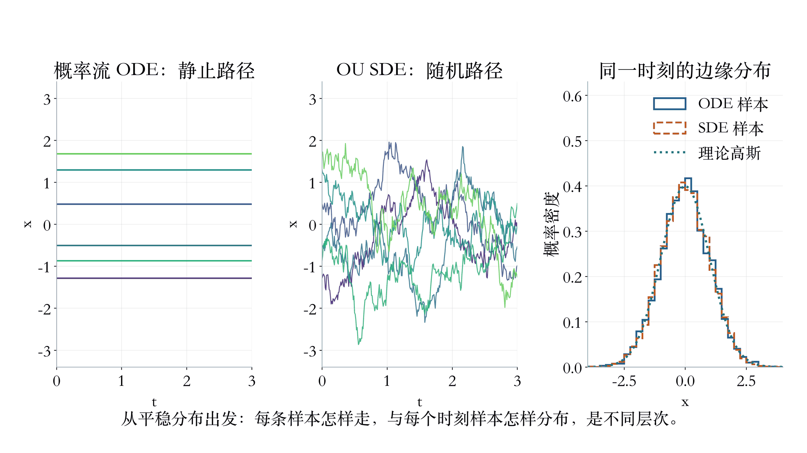
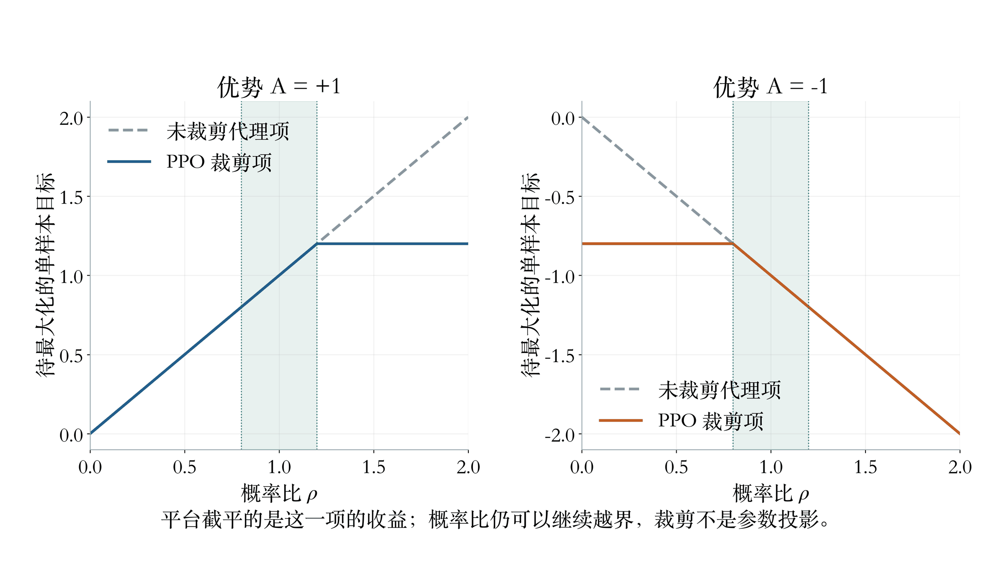

# 目录


[1. 基础求导与损失函数](#q-101)
  - [面试问题：Softmax + Cross Entropy 的梯度如何推导？](#q-001)
  - [面试问题：Sigmoid + Binary Cross Entropy 的梯度如何推导？](#q-002)
  - [面试问题：MSE 为什么对应高斯噪声假设？](#q-003)
  - [面试问题：MAE 为什么对应 Laplace 噪声假设？](#q-004)
  - [面试问题：LayerNorm 和 RMSNorm 的核心反向传播直觉是什么？](#q-005)

[2. 概率、信息论与变分推断](#q-102)
  - [面试问题：最大似然估计为什么等价于最小化负对数似然？](#q-006)
  - [面试问题：Cross Entropy、KL 散度和最大似然之间有什么关系？](#q-007)
  - [面试问题：KL 散度非负性如何证明？](#q-008)
  - [面试问题：Jensen 不等式在机器学习推导中如何使用？](#q-009)
  - [面试问题：VAE 的 ELBO 如何推导？](#q-010)

[3. Transformer 与注意力计算](#q-103)
  - [面试问题：Attention 为什么要除以 $`\sqrt{d_k}`$？](#q-011)
  - [面试问题：RoPE 为什么能表达相对位置信息？](#q-012)
  - [面试问题：KV Cache 为什么能降低自回归推理计算？](#q-013)
  - [面试问题：FlashAttention 的 Online Softmax 如何保证精确？](#q-014)

[4. 扩散与连续生成](#q-104)
  - [面试问题：DDPM 的前向边缘一步采样公式如何推导？](#q-015)
  - [面试问题：DDPM 的训练目标为什么可以化简为预测噪声 MSE？](#q-016)
  - [面试问题：DDIM 为什么可以做确定性采样？](#q-017)
  - [面试问题：Score、SDE、ODE 三者如何互相联系？](#q-018)
  - [面试问题：Flow Matching 的速度场目标如何理解？](#q-019)

[5. 对齐、低秩更新与量化](#q-105)
  - [面试问题：DPO Loss 如何从 KL 约束优化目标推导？](#q-020)
  - [面试问题：PPO clipped objective 的数学意义是什么？](#q-021)
  - [面试问题：GRPO 的组内相对优势如何计算？](#q-022)
  - [面试问题：LoRA 的参数量和计算量如何推导？](#q-023)
  - [面试问题：量化 scale 和 zero-point 如何计算？](#q-024)
  - [面试问题：知识蒸馏中的温度系数为什么常配 $`T^2`$？](#q-025)

---

<h1 id="q-101">1. 基础求导与损失函数</h1>

<h2 id="q-001">面试问题：Softmax + Cross Entropy 的梯度如何推导？</h2>

**难度评分：⭐⭐⭐⭐ (4/5)  |  考察频率：⭐⭐⭐⭐⭐ (5/5)**

先固定对象：$`z\in\mathbb R^K`$ 是 logits，$`y_i\ge0`$、$`\sum_i y_i=1`$，且标签不依赖 $`z`$。记 $`p_i=e^{z_i}/\sum_j e^{z_j}`$，交叉熵 $`L=-\sum_i y_i\log p_i`$。

对商求导，得到 Softmax Jacobian：

```math
\frac{\partial p_i}{\partial z_k}
=\frac{\delta_{ik}e^{z_i}\sum_j e^{z_j}-e^{z_i}e^{z_k}}
{(\sum_j e^{z_j})^2}
=p_i(\delta_{ik}-p_k).
```

代入链式法则：

```math
\frac{\partial L}{\partial z_k}
=-\sum_i y_i\frac1{p_i}p_i(\delta_{ik}-p_k)
=-y_k+p_k\sum_i y_i=p_k-y_k.
```

所以软标签也适用，关键是标签和为 1。若 $`p=(0.25,0.75)`$、$`y=(1,0)`$，梯度 $`(-0.75,0.75)`$ 会提高第一类相对 logit。梯度元素和为零，反映所有 logits 同加一个常量不会改变概率。

再求导得到 $`H=\mathrm{diag}(p)-pp^{\mathsf T}`$。对任意 $`v`$，$`v^{\mathsf T}Hv`$ 等于按 $`p`$ 加权的 $`v_i`$ 方差，因此非负，说明交叉熵关于 logits 是凸的；关于深层网络参数不必凸。

实现用 log-sum-exp，避免先算出极小概率再取 log。若使用 $`z/T`$，梯度变为 $`(p^{(T)}-y)/T`$；若类别加权，$`\sum_iw_iy_i`$ 会进入表达；按 batch 平均还会除以有效样本数。推导应一直追踪这些缩放。

<h2 id="q-002">面试问题：Sigmoid + Binary Cross Entropy 的梯度如何推导？</h2>

**难度评分：⭐⭐⭐⭐ (4/5)  |  考察频率：⭐⭐⭐⭐⭐ (5/5)**

令 $`p=\sigma(z)`$、$`y\in[0,1]`$，二元交叉熵为：

```math
L=-y\log p-(1-y)\log(1-p).
```

因为 $`dp/dz=p(1-p)`$：

```math
\frac{dL}{dz}
=\left(-\frac y p+\frac{1-y}{1-p}\right)p(1-p)
=-y(1-p)+(1-y)p=p-y.
```

两项相消使饱和区仍可对自信错误给出明显的 logit 梯度。例如 $`y=1`$、$`p`$ 接近零时，梯度接近 -1。若改用 Sigmoid 后的平方误差，链式法则会留下额外的 $`p(1-p)`$，学习可能更慢。

数值稳定的损失可直接写成：

```math
L=\max(z,0)-yz+\log(1+e^{-\vert z\vert}).
```

这避免直接形成 $`\log0`$ 或 $`e^{1000}`$，是 `BCEWithLogitsLoss` 一类实现的基础。输入应是原始 logits，提前再做一次 Sigmoid 会改变目标。

多标签任务对每类使用独立二元概率，各类概率不要求总和为 1；互斥多分类则通常使用 Softmax。正样本权重 $`w`$ 加到 $`-wy\log p`$ 后，梯度变为 $`(1-y)p-wy(1-p)`$，不再普遍等于 $`p-y`$。二阶导数在未加权时为 $`p(1-p)`$，说明该损失关于单个 logit 凸。

<h2 id="q-003">面试问题：MSE 为什么对应高斯噪声假设？</h2>

**难度评分：⭐⭐⭐⭐ (4/5)  |  考察频率：⭐⭐⭐⭐⭐ (5/5)**

假设给定输入后，样本误差独立、零均值且同方差高斯：

```math
y_i=f_\theta(x_i)+\epsilon_i,\qquad
\epsilon_i\sim\mathcal N(0,\sigma^2).
```

条件似然的乘积取负对数：

```math
-\log p(y_{1:N}\mid x_{1:N},\theta)
=\frac N2\log(2\pi\sigma^2)
+\frac1{2\sigma^2}\sum_i[y_i-f_\theta(x_i)]^2.
```

当 $`\sigma^2`$ 固定且不依赖 $`\theta`$ 时，第一项与正比例系数都不改变最优参数，于是最大似然等价于最小化平方误差和。除以 $`N`$ 得到 MSE，不改变最优点，但改变梯度尺度。

若让模型同时预测方差 $`\sigma_\theta^2(x)`$，则必须保留：

```math
L_i=\frac{(y_i-\mu_\theta(x_i))^2}{2\sigma_\theta^2(x_i)}
+\frac12\log\sigma_\theta^2(x_i)+\text{常数}.
```

遗漏对数方差项会让模型通过无限增大方差降低第一项，失去合理估计。相关多维噪声则导出 Mahalanobis 二次型和对数行列式。

MSE 的另一个更一般结论是：在平方可积条件下，最优预测为条件均值 $`\mathbb E[Y\mid X]`$，无需真实误差一定高斯。高斯假设提供似然解释，条件均值提供决策论解释。

大残差的平方增长使异常值影响显著。例如残差从 1 变成 10，损失从 1 变成 100。选择 MSE 应看目标是否确实需要惩罚这种大误差。

<h2 id="q-004">面试问题：MAE 为什么对应 Laplace 噪声假设？</h2>

**难度评分：⭐⭐⭐⭐ (4/5)  |  考察频率：⭐⭐⭐⭐ (4/5)**

设条件误差服从固定尺度 Laplace 分布：

```math
p(y_i\mid x_i,\theta)=\frac1{2b}
\exp\left[-\frac{\vert y_i-f_\theta(x_i)\vert}{b}\right],\qquad b>0.
```

独立样本负对数似然为：

```math
L=N\log(2b)+\frac1b\sum_i\vert y_i-f_\theta(x_i)\vert.
```

固定 $`b`$ 时，最大似然等价于 MAE 最小化；若尺度也要学习，对数尺度项不能删除。

绝对损失的总体最优解是条件中位数。对连续条件分布，将 $`\mathbb E[\vert Y-a\vert\mid X=x]`$ 对 $`a`$ 求导得到 $`2F_{Y\mid x}(a)-1`$，零点满足一半概率在两边。含原子的分布可用次梯度表达，中位数可能不唯一。

例如目标为 $`(0,0,0,10)`$，常数模型的 MSE 最优值是均值 2.5，MAE 最优值是中位数 0。离群观测对 MAE 的梯度幅度有界，但这不表示它对所有形式的数据污染都免疫。

绝对值在零处不可微，其次梯度为 $`[-1,1]`$；实现通常选择 0。Huber 损失在小残差内用二次项、大残差处用线性项：

```math
L_\delta(r)=
\begin{cases}
\tfrac12r^2,&\vert r\vert\le\delta,\\
\delta(\vert r\vert-\tfrac12\delta),&\vert r\vert>\delta.
\end{cases}
```

阈值 $`\delta`$ 带有残差的单位，目标尺度改变后应相应调整。某些框架的 Smooth L1 与 Huber 相差整体比例，比较训练超参数时需要核对定义。

<h2 id="q-005">面试问题：LayerNorm 和 RMSNorm 的核心反向传播直觉是什么？</h2>

**难度评分：⭐⭐⭐⭐ (4/5)  |  考察频率：⭐⭐⭐⭐⭐ (5/5)**

归一化的反向关键在于分母依赖全部坐标。对一条长度 $`d`$ 的特征向量，记 $`\mu=\frac1d\sum_i x_i`$、$`r=\sqrt{\frac1d\sum_i(x_i-\mu)^2+\epsilon}`$、$`\widehat x_i=(x_i-\mu)/r`$，输出 $`y_i=\gamma_i\widehat x_i+\beta_i`$。令上游梯度 $`g_i=\partial L/\partial y_i`$，$`a_i=g_i\gamma_i`$。

微分中心化量和分母，分别有：

```math
d(x_i-\mu)=dx_i-\frac1d\sum_jdx_j,\qquad
dr=\frac1d\sum_j\widehat x_j\,dx_j.
```

第二式利用 $`\sum_j(x_j-\mu)=0`$。代入 $`d\widehat x_i=d(x_i-\mu)/r-(\widehat x_i/r)dr`$，收集各个 $`dx_i`$ 的系数：

```math
\frac{\partial L}{\partial x_i}
=\frac1r\left[
a_i-\overline a-\widehat x_i\,\overline{a\widehat x}
\right].
```

上横线表示沿隐藏维取均值。参数梯度是 $`\partial L/\partial\gamma_i=g_i\widehat x_i`$、$`\partial L/\partial\beta_i=g_i`$，参数共享的 token 和 batch 维度还需累加。

RMSNorm 令 $`r=\sqrt{\overline{x^2}+\epsilon}`$、$`\widehat x=x/r`$，推导得到：

```math
\frac{\partial L}{\partial x_i}
=\frac1r[a_i-\widehat x_i\,\overline{a\widehat x}].
```

它少了中心化相关的 $`-\overline a`$。忽略 $`\epsilon`$ 时，公式呈现沿某些方向投影的几何意义；保留 $`\epsilon`$ 后不应把所有投影性质当成严格等式。以上公式可直接用小维度中心差分核对，比只背“稳定分布”更能解释梯度行为。

<h1 id="q-102">2. 概率、信息论与变分推断</h1>

<h2 id="q-006">面试问题：最大似然估计为什么等价于最小化负对数似然？</h2>

**难度评分：⭐⭐⭐ (3/5)  |  考察频率：⭐⭐⭐⭐⭐ (5/5)**

最大似然把观测数据固定，寻找最能解释它的参数。若样本在给定参数下独立：

```math
p(D\mid\theta)=\prod_{i=1}^N p(x_i\mid\theta).
```

对数在正数上严格递增，所以不改变最优点：

```math
\arg\max_\theta p(D\mid\theta)
=\arg\max_\theta\sum_i\log p(x_i\mid\theta)
=\arg\min_\theta-\sum_i\log p(x_i\mid\theta).
```

对数还把极小概率乘积转成可稳定累加的量。如果模型给实际出现的事件零概率，负对数似然是无穷大；代码中的截断会改变此时的目标，需要明确处理。

独立假设只用于第一行的样本乘积分解。序列内部即使相关，也可以用链式法则写成 $`\prod_t p_\theta(x_t\mid x_{\lt t})`$。不能把 token 级损失相加解释成忽略上下文依赖。

以 Bernoulli 数据为例，$`k`$ 次成功、总共 $`N`$ 次，负对数似然为 $`-k\log p-(N-k)\log(1-p)`$。内部驻点给出 $`\widehat p=k/N`$；若全部成功或失败，最优点位于边界，应检查边界而不是强求导数为零。

MLE 不自动纠正偏采样、重复样本或标签污染。损失按 token 平均、按用户平均或按序列平均，也代表不同的经验分布。先确定想拟合的对象，再决定似然与权重。

<h2 id="q-007">面试问题：Cross Entropy、KL 散度和最大似然之间有什么关系？</h2>

**难度评分：⭐⭐⭐⭐ (4/5)  |  考察频率：⭐⭐⭐⭐⭐ (5/5)**

对同一离散样本空间，且相关熵有限、模型覆盖数据支撑时：

```math
D_{\mathrm{KL}}(P\Vert Q)
=\sum_xP(x)\log P(x)-\sum_xP(x)\log Q(x)
=H(P,Q)-H(P).
```

数据分布 $`P`$ 固定，$`H(P)`$ 与模型参数无关，因此最小化交叉熵等价于最小化前向 KL。有限离散数据的经验分布 $`\widehat P`$ 代入后：

```math
H(\widehat P,Q_\theta)
=-\frac1N\sum_{i=1}^N\log q_\theta(x_i),
```

正是平均负对数似然。监督分类则对输入分布再取期望，逐个输入比较标签条件分布与模型条件分布。

连续变量中要小心：平滑真实密度与模型密度之间，在共同参考测度及积分存在的条件下，也有交叉熵与微分熵关系。但有限数据的经验分布是点质量测度，而连续模型给每个点零概率，两者之间的测度 KL 通常为无穷大。

因此不能无条件把“连续样本经验 NLL”写成“经验点质量分布到连续密度的有限 KL”。经验 NLL 是用样本平均估计真实期望对数损失；这个统计解释足够支撑最大似然，不需要错误的测度等价。

实际训练还可能使用重加权、截断似然或标签平滑，它们改变目标分布。说三者“等价”，必须明确固定的是哪个分布、积分是否有限，以及损失里有没有其他参数相关项。

<h2 id="q-008">面试问题：KL 散度非负性如何证明？</h2>

**难度评分：⭐⭐⭐⭐ (4/5)  |  考察频率：⭐⭐⭐⭐⭐ (5/5)**

先处理零概率：若某处 $`p(x)>0`$ 而 $`q(x)=0`$，则 KL 为无穷大，非负性直接成立。其余情形令 $`S=\{x:p(x)>0\}`$，用 $`-\log`$ 的凸性：

```math
D_{\mathrm{KL}}(P\Vert Q)
=\mathbb E_P\left[-\log\frac{q(X)}{p(X)}\right]
\ge-\log\mathbb E_P\left[\frac{q(X)}{p(X)}\right].
```

右侧的期望只遍历 $`P`$ 的支撑：

```math
\mathbb E_P[q(X)/p(X)]=\sum_{x\in S}q(x)\le1.
```

于是 $`D_{\mathrm{KL}}(P\Vert Q)\ge-\log\sum_{x\in S}q(x)\ge0`$。原证明常把最后求和直接写成 1；若 $`Q`$ 还在 $`P`$ 支撑外分配概率，这一步应是不等式。

等号要求 $`q/p`$ 在 $`P`$ 几乎处处为常数，同时 $`Q(S)=1`$，归一化后得到 $`P=Q`$。连续情形在共同密度及绝对连续条件下用积分替代求和，等号理解为几乎处处相等。

例如 $`P=(1,0)`$、$`Q=(1/2,1/2)`$，KL 为 $`\log2`$；这里 $`Q(S)=1/2`$，正好展示了支撑外概率不能凭空消失。

非负只是一项性质。KL 不对称、不满足三角不等式，因此它是散度而不是通常意义的距离。算法中有限样本估计偶尔出现负值，也不推翻总体 KL 的非负定理。

<h2 id="q-009">面试问题：Jensen 不等式在机器学习推导中如何使用？</h2>

**难度评分：⭐⭐⭐⭐ (4/5)  |  考察频率：⭐⭐⭐⭐ (4/5)**

Jensen 不等式把函数曲率与平均操作联系起来。若 $`f`$ 凸且相关期望存在：

```math
f(\mathbb E[X])\le\mathbb E[f(X)].
```

凹函数方向相反。直观上，凸函数的弦位于图像上方；严格凸情况下，常见等号情形是 $`X`$ 几乎必然为常数。

取 $`X`$ 以相同概率为 1 或 3，则 $`\mathbb E[X^2]=5`$，而 $`\mathbb E[X]^2=4`$。差值是方差，展示了“先变换后平均”与“先平均后变换”不能随意互换。

在变分推断中，用凹函数 log：

```math
\log\mathbb E_q[Z]\ge\mathbb E_q[\log Z].
```

这里要确保 $`Z>0`$ 及积分条件。把 $`Z`$ 选为联合密度与近似后验密度的比值，就得到 ELBO；若支撑不匹配，换写期望的那一步本身可能不成立。

对固定标签、关于预测凸的损失，多个预测的平均满足“平均预测的损失不超过平均损失”。这解释了部分集成收益，但不适用于任意非凸评价指标，也不表示平均后准确率一定上升。

Jensen 给的是界，不是精确交换 log 与期望。看到对数内的积分时，应该先确认曲率、正性、支撑及等号条件，再决定这个界是否适合优化。

<h2 id="q-010">面试问题：VAE 的 ELBO 如何推导？</h2>

**难度评分：⭐⭐⭐⭐ (4/5)  |  考察频率：⭐⭐⭐⭐⭐ (5/5)**

VAE 希望优化 $`\log p_\theta(x)`$，但边缘化潜变量 $`z`$ 的积分困难。引入近似后验 $`q_\phi(z\mid x)`$，在支撑允许换写时：

```math
\log p_\theta(x)=
\log\mathbb E_{q_\phi}\left[\frac{p_\theta(x,z)}{q_\phi(z\mid x)}\right]
\ge\mathbb E_{q_\phi}
\left[\log p_\theta(x,z)-\log q_\phi(z\mid x)\right].
```

把联合分布分成似然和先验，得到：

```math
\mathcal L_{\mathrm{ELBO}}
=\mathbb E_{q_\phi}[\log p_\theta(x\mid z)]
-D_{\mathrm{KL}}(q_\phi(z\mid x)\Vert p(z)).
```

更能说明“下界差多少”的恒等式是：

```math
\log p_\theta(x)-\mathcal L_{\mathrm{ELBO}}
=D_{\mathrm{KL}}(q_\phi(z\mid x)\Vert p_\theta(z\mid x))\ge0.
```

在相关量有限时，近似后验等于真实后验，下界才变紧。先验 KL 与这个“后验近似误差 KL”不是同一个对象。

若 $`q_\phi=\mathcal N(\mu,\mathrm{diag}(\sigma^2))`$、先验为标准高斯：

```math
D_{\mathrm{KL}}(q_\phi\Vert p)
=\frac12\sum_j(\mu_j^2+\sigma_j^2-\log\sigma_j^2-1).
```

用 $`z=\mu+\sigma\odot\epsilon`$、$`\epsilon\sim\mathcal N(0,I)`$ 进行可微重参数化。重构项取决于解码似然，不天然就是 MSE。

重构要求潜变量携带输入信息，先验 KL 对这种信息与分布偏离施加代价。过强 KL 或过强解码器可能引起后验坍塌。潜空间生成用的自编码器还可能加入感知或对抗目标，这时完整训练目标不再等于上述纯 ELBO，不能直接继承所有似然解释。

<h1 id="q-103">3. Transformer 与注意力计算</h1>

<h2 id="q-011">面试问题：Attention 为什么要除以 $`\sqrt{d_k}`$？</h2>

**难度评分：⭐⭐⭐⭐ (4/5)  |  考察频率：⭐⭐⭐⭐⭐ (5/5)**

缩放因子来自点积的方差。设 $`q,k\in\mathbb R^{d_k}`$ 相互独立，所有分量零均值、单位方差，并且坐标间满足所需的不相关条件。则：

```math
\mathbb E[q_ik_i]=0,\qquad
\mathrm{Var}(q_ik_i)=\mathbb E[q_i^2]\mathbb E[k_i^2]=1.
```

不同乘积项的协方差为零，所以：

```math
\mathrm{Var}\left(\sum_iq_ik_i\right)=d_k,\qquad
\mathrm{Var}\left(\frac{q^{\mathsf T}k}{\sqrt{d_k}}\right)=1.
```

更一般地，零均值且相互独立的向量可以有非单位协方差 $`\Sigma_q,\Sigma_k`$：

```math
\mathrm{Var}(q^{\mathsf T}k)
=\mathbb E[q^{\mathsf T}kk^{\mathsf T}q]
=\mathrm{tr}(\Sigma_q\Sigma_k).
```

只有两者均为单位矩阵时才化为 $`d_k`$。若 $`q,k`$ 相关，还会出现其他项。这个一般式说明训练后真实方差不必等于初始化估计。

Softmax 的导数为 $`\mathrm{diag}(p)-pp^{\mathsf T}`$。当某个概率趋近 1、其余趋近零时，多数局部导数趋零；大幅 logits 差距容易造成这种状态。因此缩放帮助避免无意的早期饱和。

这里讨论注意力内部 Softmax 的局部梯度。分类交叉熵对 logits 的 $`p-y`$ 在自信错误时仍可很大，不能把“Softmax 饱和”误解成所有组合损失梯度都必然消失。缩放给出合理起点，实际网络还要依靠学习、归一化和数值实现维持合适范围。

<h2 id="q-012">面试问题：RoPE 为什么能表达相对位置信息？</h2>

**难度评分：⭐⭐⭐⭐ (4/5)  |  考察频率：⭐⭐⭐⭐⭐ (5/5)**

先看一个二维坐标对：

```math
R(\varphi)=
\begin{bmatrix}\cos\varphi&-\sin\varphi\\
\sin\varphi&\cos\varphi\end{bmatrix}.
```

位置 $`m,n`$ 的 query 和 key 分别旋转为 $`R(m\theta)q_m`$、$`R(n\theta)k_n`$。利用旋转的复合规律：

```math
R(a)^{\mathsf T}=R(-a),\qquad R(a)R(b)=R(a+b),
```

可得：

```math
\widetilde q_m^{\mathsf T}\widetilde k_n
=q_m^{\mathsf T}R((n-m)\theta)k_n.
```

完整 RoPE 把多个不同频率的二维旋转拼成分块对角矩阵，每个频率都具有同样的相对位移性质。共同平移位置索引，不改变**固定内容向量下的位置旋转部分**。

例如 $`q=k=(1,0)`$，点积就是 $`\cos((n-m)\theta)`$。它随距离振荡，不是距离越远一定越小。多频率和内容投影共同决定实际注意力行为。

完整网络中的内容向量会随上下文、掩码和前层表示变化，所以不应把结论写成“所有注意力分数只依赖相对距离”。有限训练位置也不能覆盖任意长的频率组合，旋转群恒等式正确不等于长度外推已经解决。

如果某层只对一部分维度应用 RoPE，剩余维度仍保留内容项。MLA 的解耦位置分支正利用这种区分，在状态压缩与相对位置建模之间安排结构。

<h2 id="q-013">面试问题：KV Cache 为什么能降低自回归推理计算？</h2>

**难度评分：⭐⭐⭐⭐ (4/5)  |  考察频率：⭐⭐⭐⭐⭐ (5/5)**

KV Cache 成立依赖因果性：固定模型、位置设置和前缀时，追加未来 token 不改变已处理位置的隐藏状态，所以各层历史键和值可重用。双向编码器追加输入通常会改变旧表示，不能直接照搬这一结论。

用总生成长度 $`T`$、隐藏宽度 $`D`$ 简化估算。若每生成一个 token 都重算长度为 $`t`$ 的完整前缀，该步投影与 FFN 主项为 $`O(tD^2)`$，稠密注意力为 $`O(t^2D)`$。累加得到：

```math
\sum_{t=1}^T O(tD^2)=O(T^2D^2),\qquad
\sum_{t=1}^T O(t^2D)=O(T^3D).
```

缓存后，每步只计算新位置的投影与 FFN，并让新 query 读取已有键值：

```math
\text{累计投影/FFN}=O(TD^2),\qquad
\text{累计注意力}=O(T^2D).
```

这些是重复全前缀与逐 token 缓存的对比，省略层数等常数。实际还包括长度为 $`P`$ 的 prompt prefill，以及每步对 $`P+t`$ 个历史位置的访问。

缓存以空间换计算，常见存储为 $`2LBSH_{kv}d_hb`$ 字节。例如 32 层、8 个 KV 头、头宽 128、8192 个 token、BF16、batch 为 1，KV 主项约 1 GiB。

若动态修改 RoPE 频率、编辑历史前缀或改变 adapter，原缓存可能不再有效。多轮复用也应匹配模型版本、token 前缀、位置和注意力配置。计算公式证明缓存能少算什么，实际加速还受显存带宽、batch 与 kernel 约束。

<h2 id="q-014">面试问题：FlashAttention 的 Online Softmax 如何保证精确？</h2>

**难度评分：⭐⭐⭐⭐ (4/5)  |  考察频率：⭐⭐⭐⭐⭐ (5/5)**

对一行注意力，令 logits 为 $`s_j`$、值向量为 $`v_j`$。保持三个统计量：

```math
m=\max_j s_j,\qquad
\ell=\sum_j e^{s_j-m},\qquad
o=\sum_j e^{s_j-m}v_j.
```

最终输出为 $`o/\ell`$。假设已处理集合 A，新块 B 的局部统计量为 $`m_B,\ell_B,o_B`$。取共同基准 $`m'=\max(m,m_B)`$：

```math
\ell'=e^{m-m'}\ell+e^{m_B-m'}\ell_B,\qquad
o'=e^{m-m'}o+e^{m_B-m'}o_B.
```

代入定义，每一项都变成 $`e^{s_j-m'}`$，所以合并结果与一次处理整个 A∪B 完全相同。只更新分母却不重缩放加权分子，输出就会错。

例如第一块只有 $`s=0,v=2`$，第二块只有 $`s=\log3,v=4`$。合并后 $`m'=\log3`$、$`\ell'=1/3+1=4/3`$、$`o'=2/3+4=14/3`$，输出为 3.5，正好等于权重 $`(1/4,3/4)`$ 的加权和。

FlashAttention 把这种合并放进适合片上存储的分块计算，避免保存完整注意力矩阵。反向可以重计算部分中间量，以 FLOPs 换取更少的显存读写。

数学“精确”是相对近似注意力而言。浮点归约顺序、低精度乘法、掩码边界和 dropout 随机数处理仍会影响数值结果。全掩码行应专门处理；不能让 $`-\infty-(-\infty)`$ 进入指数而生成 NaN。

<h1 id="q-104">4. 扩散与连续生成</h1>

<h2 id="q-015">面试问题：DDPM 的前向边缘一步采样公式如何推导？</h2>

**难度评分：⭐⭐⭐⭐ (4/5)  |  考察频率：⭐⭐⭐⭐⭐ (5/5)**

将前向一步写成独立噪声的重参数化：

```math
x_t=\sqrt{\alpha_t}x_{t-1}+\sqrt{\beta_t}\epsilon_t,\qquad
\epsilon_t\overset{\mathrm{iid}}{\sim}\mathcal N(0,I),\quad \beta_t=1-\alpha_t.
```

假设 $`x_{t-1}\mid x_0`$ 的均值为 $`\sqrt{\overline\alpha_{t-1}}x_0`$、协方差为 $`(1-\overline\alpha_{t-1})I`$。独立噪声线性变换后：

```math
\mathbb E[x_t\mid x_0]=\sqrt{\alpha_t\overline\alpha_{t-1}}x_0
=\sqrt{\overline\alpha_t}x_0,
```

```math
\mathrm{Cov}(x_t\mid x_0)
=[\alpha_t(1-\overline\alpha_{t-1})+\beta_t]I
=(1-\overline\alpha_t)I.
```

高斯在线性组合下封闭，归纳得到：

```math
q(x_t\mid x_0)=
\mathcal N(\sqrt{\overline\alpha_t}x_0,(1-\overline\alpha_t)I).
```

因此可直接采一个标准高斯 $`\epsilon`$，构造 $`x_t=\sqrt{\overline\alpha_t}x_0+\sqrt{1-\overline\alpha_t}\epsilon`$。这里的合并噪声与逐步链中的各个噪声不是同一个随机变量。

一步公式保证给定 $`x_0`$ 后该时刻的边缘分布正确。若对每个时刻独立使用新噪声，会得到正确单时刻边缘，却不一定得到原始马尔可夫链的联合轨迹。训练只需随机挑一个时刻时可以这样做，研究路径相关性时则不能混用。

端点约定 $`\overline\alpha_0=1`$ 对应无噪声；$`\overline\alpha_T`$ 足够小才使终点接近标准高斯。噪声日程决定信号与噪声的相对尺度。

<h2 id="q-016">面试问题：DDPM 的训练目标为什么可以化简为预测噪声 MSE？</h2>

**难度评分：⭐⭐⭐⭐⭐ (5/5)  |  考察频率：⭐⭐⭐⭐⭐ (5/5)**

对 $`t\ge2`$，给定干净数据的前向后验是高斯：

```math
q(x_{t-1}\mid x_t,x_0)=\mathcal N(\widetilde\mu_t,\widetilde\beta_tI),\quad
\widetilde\beta_t=\frac{1-\overline\alpha_{t-1}}{1-\overline\alpha_t}\beta_t.
```

由高斯条件分布或配方，后验均值为：

```math
\widetilde\mu_t=
\frac{\sqrt{\overline\alpha_{t-1}}\beta_t}{1-\overline\alpha_t}x_0
+\frac{\sqrt{\alpha_t}(1-\overline\alpha_{t-1})}{1-\overline\alpha_t}x_t.
```

利用一步采样中的 $`x_0`$ 表达式，可改写为：

```math
\widetilde\mu_t=\frac1{\sqrt{\alpha_t}}
\left(x_t-\frac{\beta_t}{\sqrt{1-\overline\alpha_t}}\epsilon\right).
```

用 $`\epsilon_\theta`$ 替代真实噪声参数化反向均值，并固定反向方差 $`\sigma_t^2I`$。两个高斯 KL 中与均值有关的部分变为：

```math
L_t=\frac1{2\sigma_t^2}\Vert\widetilde\mu_t-\mu_\theta\Vert_2^2+\text{常数}
=\frac{\beta_t^2}{2\sigma_t^2\alpha_t(1-\overline\alpha_t)}
\Vert\epsilon-\epsilon_\theta(x_t,t)\Vert_2^2+\text{常数}.
```

这证明的是**带时间权重的噪声 MSE**。常用 $`L_{\mathrm{simple}}`$ 丢掉该权重后，是重新加权的训练目标，不是完整变分目标逐项严格相等。

完整负 ELBO 还包含终端先验匹配项与 $`t=1`$ 的重构项。若方差也由网络学习，方差相关 KL 项不能再当成参数无关常数。

不同噪声日程、时间采样分布和预测参数化会改变各噪声尺度的实际训练权重。比较模型时，应核对这些设置，而不能只因都使用 MSE 就认为学习问题相同。

<h2 id="q-017">面试问题：DDIM 为什么可以做确定性采样？</h2>

**难度评分：⭐⭐⭐⭐ (4/5)  |  考察频率：⭐⭐⭐⭐ (4/5)**

DDIM 构造与 DDPM 共享 $`q(x_t\mid x_0)`$ 边缘的**非马尔可夫前向推断过程族**，由此导出可控制随机性的生成更新。不能把它简单表述成“反向过程非马尔可夫”，因为常用采样代码仍可从当前状态递推。

从噪声时刻 $`t`$ 跳到较干净的 $`s\lt t`$，先估计：

```math
\widehat x_0=
\frac{x_t-\sqrt{1-\overline\alpha_t}\epsilon_\theta(x_t,t)}
{\sqrt{\overline\alpha_t}}.
```

再使用：

```math
\sigma_{t\to s}=
\eta\sqrt{\frac{1-\overline\alpha_s}{1-\overline\alpha_t}}
\sqrt{1-\frac{\overline\alpha_t}{\overline\alpha_s}},
```

```math
x_s=\sqrt{\overline\alpha_s}\widehat x_0+
\sqrt{1-\overline\alpha_s-\sigma_{t\to s}^2}\,
\epsilon_\theta(x_t,t)+\sigma_{t\to s}z.
```

$`z`$ 是新标准高斯噪声。$`\eta=0`$ 时没有额外随机项，给定初始噪声、条件、网络及时间网格，整条离散轨迹确定；样本多样性来自不同初始噪声。

跳步降低网络调用次数，但更大的时间跨度也放大模型误差和离散化误差。“共享训练边缘”不保证有限步、近似网络的采样边缘完全正确。$`\eta=1`$ 在相邻时刻与特定 DDPM 方差选择相对应，也不能无条件等同于所有 DDPM 实现。

确定性提供反演研究的基础，但离散 DDIM 反演一般只有近似一致性；网络依赖当前输入，不能简单把更新式中的加号改成减号就保证精确还原。

<h2 id="q-018">面试问题：Score、SDE、ODE 三者如何互相联系？</h2>

**难度评分：⭐⭐⭐⭐⭐ (5/5)  |  考察频率：⭐⭐⭐⭐ (4/5)**

概率流 ODE 中的 $`1/2`$ 来自 Fokker–Planck 方程。考虑仅随时间变化的标量扩散系数：

```math
dX_t=f(X_t,t)\,dt+g(t)\,dW_t.
```

在密度光滑、边界通量适当等条件下：

```math
\partial_t p_t=-\nabla\cdot(fp_t)+\tfrac12g(t)^2\Delta p_t.
```

因为 $`p_t\nabla\log p_t=\nabla p_t`$，可整理成连续性方程：

```math
\partial_t p_t=
-\nabla\cdot\left[\left(f-\tfrac12g(t)^2\nabla\log p_t\right)p_t\right].
```

确定性 ODE $`\dot X_t=v(X_t,t)`$ 的密度也服从 $`\partial_t p=-\nabla\cdot(vp)`$。因此取 $`v=f-\tfrac12g^2s_t`$，就得到同边缘演化的概率流 ODE。

时间反演定理给出的反向 SDE 漂移为 $`f-g^2s_t`$，配反向布朗运动，从终点向起点积分。把反向 SDE 的噪声直接删掉，会留下错误的系数；需要按密度演化重新分配扩散贡献。

以平稳 OU 过程 $`dX=-aX\,dt+\sqrt{2a}\,dW`$ 为例，标准高斯 score 是 $`-x`$。概率流速度为 $`-ax-\tfrac12(2a)(-x)=0`$。ODE 样本保持原位，SDE 样本持续抖动，但各时刻都服从标准高斯，直观展示了同边缘与同路径的区别。

若扩散系数依赖位置或是一般矩阵，方程含额外导数结构；若 score 由近似网络提供或求解步长有限，也只能近似保持理论边缘。似然计算还需要速度场散度，确定性本身不意味着似然自动可得。

<div align="center">



图 4：精确 OU 转移模拟与概率流 ODE。两者从标准高斯初始化，理论上各时刻边缘相同；中间轨迹不同，有限样本直方图会有统计波动。

</div>

<h2 id="q-019">面试问题：Flow Matching 的速度场目标如何理解？</h2>

**难度评分：⭐⭐⭐⭐⭐ (5/5)  |  考察频率：⭐⭐⭐⭐ (4/5)**

先定义端点耦合 $`(X_0,X_1)\sim\pi`$，其边缘分别为噪声和数据。线性插值 $`X_t=(1-t)X_0+tX_1`$ 的条件速度为 $`U=X_1-X_0`$。

对候选速度场 $`v`$，平方损失可分解为：

```math
\mathbb E\Vert v(X_t,t)-U\Vert^2
=\mathbb E\Vert v(X_t,t)-\mathbb E[U\mid X_t,t]\Vert^2
+\mathbb E\Vert U-\mathbb E[U\mid X_t,t]\Vert^2.
```

交叉项的条件期望为零，第二项与 $`v`$ 无关。所以最优边缘速度是：

```math
v^*(x,t)=\mathbb E[X_1-X_0\mid X_t=x,t].
```

它为什么能推动正确分布？对任意光滑测试函数 $`\varphi`$：

```math
\frac d{dt}\mathbb E[\varphi(X_t)]
=\mathbb E[\nabla\varphi(X_t)^{\mathsf T}U]
=\mathbb E[\nabla\varphi(X_t)^{\mathsf T}v^*(X_t,t)].
```

在可交换求导与期望、边界条件适当时，这就是连续性方程的弱形式。由此把简单条件路径上的回归，与边缘分布的 ODE 联系起来。

多组端点可能在同一时刻穿过同一区域，条件速度平均后会改变实际轨迹方向。因此“训练配对是直线”不等于“学习到的每条 ODE 轨迹都是直线”。端点耦合、reflow 和数值求解共同影响路径难度。

采样解 $`\dot x=v_\theta(x,t)`$，从 $`t=0`$ 到 1。若论文采用数据到噪声的反向时间约定，速度符号和积分方向都要一起转换。条件变量也应保留在条件期望中，不能只在最终网络调用处补一个提示词。

<h1 id="q-105">5. 对齐、低秩更新与量化</h1>

<h2 id="q-020">面试问题：DPO Loss 如何从 KL 约束优化目标推导？</h2>

**难度评分：⭐⭐⭐⭐⭐ (5/5)  |  考察频率：⭐⭐⭐⭐ (4/5)**

固定 prompt $`x`$，参考分布 $`q(y)=\pi_{\mathrm{ref}}(y\mid x)`$，考虑 $`\beta>0`$ 的目标：

```math
\max_\pi\left\{\sum_y\pi(y)r(y)-\beta\sum_y\pi(y)\log\frac{\pi(y)}{q(y)}\right\},
\qquad \sum_y\pi(y)=1.
```

假设目标输出在参考支撑内，且 $`Z=\sum_yq(y)e^{r(y)/\beta}`$ 有限。加入归一化乘子并对 $`\pi(y)`$ 求导：

```math
r(y)-\beta\left(\log\frac{\pi(y)}{q(y)}+1\right)+\lambda=0.
```

整理并归一化，得到：

```math
\pi^*(y\mid x)=\frac{\pi_{\mathrm{ref}}(y\mid x)e^{r(x,y)/\beta}}{Z(x)},
\quad
r(x,y)=\beta\log\frac{\pi^*(y\mid x)}{\pi_{\mathrm{ref}}(y\mid x)}
+\beta\log Z(x).
```

同一 prompt 的两条回答相减，$`\log Z(x)`$ 消去。再假设偏好服从 Bradley–Terry 模型：

```math
P(y_w\succ y_l\mid x)=\sigma(r(x,y_w)-r(x,y_l)).
```

用参数策略表示隐式奖励，对观察到的优选标签最大化似然，得到：

```math
L_{\mathrm{DPO}}=
-\log\sigma\left[
\beta\left(
\log\frac{\pi_\theta(y_w\mid x)}{\pi_{\mathrm{ref}}(y_w\mid x)}
-\log\frac{\pi_\theta(y_l\mid x)}{\pi_{\mathrm{ref}}(y_l\mid x)}
\right)\right].
```

这个推导连接了奖励倾斜分布与偏好分类。它没有证明有限离线数据、有限模型容量和非凸训练一定恢复真实最优策略。参考模型给零概率的输出也无法通过有限 KL 倾斜获得正概率。

更大的 $`\beta`$ 在理想奖励固定问题中降低倾斜幅度，但 DPO 训练中的 margin、梯度饱和与数据噪声也会一起变化。实现还需核对回答 token 的求和口径、参考模型冻结和 prompt 掩码。

<h2 id="q-021">面试问题：PPO clipped objective 的数学意义是什么？</h2>

**难度评分：⭐⭐⭐⭐ (4/5)  |  考察频率：⭐⭐⭐⭐⭐ (5/5)**

PPO 使用采样旧策略下的动作，记新旧策略概率比为 $`\rho_t=\pi_\theta(a_t\mid s_t)/\pi_{\mathrm{old}}(a_t\mid s_t)`$，优势估计 $`A_t`$ 在策略更新时视作固定：

```math
J_{\mathrm{clip}}=
\mathbb E\left[
\min\{\rho_tA_t,\,
\mathrm{clip}(\rho_t,1-\epsilon,1+\epsilon)A_t\}
\right].
```

这是要最大化的目标；写成训练 loss 时通常加负号。其单样本分段结构为：

```math
\ell(\rho,A)=
\begin{cases}
A\min(\rho,1+\epsilon),& A\ge0,\\
A\max(\rho,1-\epsilon),& A\lt0.
\end{cases}
```

正优势样本的概率比超过上界后，不再因继续增大该比值获得额外代理收益；负优势样本低于下界后同理。朝错误方向变化时，目标仍然保留惩罚。

例如 $`\epsilon=0.2`$、$`A=1`$，$`\rho=1.5`$ 与 1.2 的该项收益都为 1.2。它只把这项梯度截平，**没有把参数或概率比投影回区间**。其他样本共享参数、动量和多轮优化，都可能让比值继续越界。

因此 clipping 不提供硬 KL 上界，也不保证每次真实性能提高。实际常监测近似 KL、clip fraction、熵和验证回报，必要时提前停止更新。参考策略 KL 与此处旧策略概率比又是不同约束来源。

如果采样策略版本不一致、概率比用错 token 掩码，重要性校正的意义也会改变。PPO 稳定性的讨论必须包括 rollout 来源与更新次数。

<div align="center">



图 5：优势分别取 +1、−1，裁剪参数为 0.2。平台表示停止提供该方向的额外代理收益，横轴仍包含区间外的概率比。

</div>

<h2 id="q-022">面试问题：GRPO 的组内相对优势如何计算？</h2>

**难度评分：⭐⭐⭐⭐ (4/5)  |  考察频率：⭐⭐⭐⭐ (4/5)**

设同一 prompt 的旧策略回答有 $`G`$ 条，序列奖励为 $`r_i`$。采用总体标准差约定：

```math
\overline r=\frac1G\sum_i r_i,\qquad
s_r=\sqrt{\frac1G\sum_i(r_i-\overline r)^2},\qquad
\widehat A_i=\frac{r_i-\overline r}{s_r+\epsilon}.
```

忽略很小的 $`\epsilon`$，奖励 $`(0,0,1,1)`$ 得到优势 $`(-1,-1,1,1)`$；奖励全部相等则优势全部为零。这是相对比较没有区分信号，不是除法稳定技巧能够补救的问题。

对长度 $`T_i`$ 的回答，常见 GRPO 版本将相同序列优势分配到各 token，使用：

```math
J=\frac1G\sum_i\frac1{T_i}\sum_{t=1}^{T_i}
\ell(\rho_{i,t},\widehat A_i)
-\beta\,\widehat D_{\mathrm{KL}},
```

其中 $`\rho_{i,t}`$ 比较当前与采样旧策略在相同前缀下的 token 概率，$`\ell`$ 是 PPO 裁剪项。这里按序列平均的写法是一个具体版本，不能假定所有实现完全一致。

减去组均值降低题目尺度差异；再除组标准差，相当于按题目奖励离散程度重新加权。组均值包含该回答自身，与独立于该回答动作的基线有区别；标准化和裁剪之后，不应直接把它称作无偏的原始策略梯度估计。

没有 critic 能节省部分训练资源，但组采样要付出额外 rollout 成本。组大小、难度分布、长度归一化、奖励截断及是否动态过滤零优势组，都会影响结果。可验证奖励只保证被检测的性质，判分器覆盖不足仍会产生优化偏差。

<h2 id="q-023">面试问题：LoRA 的参数量和计算量如何推导？</h2>

**难度评分：⭐⭐⭐⭐ (4/5)  |  考察频率：⭐⭐⭐⭐⭐ (5/5)**

对权重 $`W\in\mathbb R^{d_{\mathrm{out}}\times d_{\mathrm{in}}}`$，LoRA 增量为 $`(\alpha/r)BA`$，其中 $`B`$ 有 $`d_{\mathrm{out}}r`$ 个参数，$`A`$ 有 $`rd_{\mathrm{in}}`$ 个参数。可训练参数总数及比例为：

```math
N_{\mathrm{LoRA}}=r(d_{\mathrm{in}}+d_{\mathrm{out}}),\qquad
\frac{N_{\mathrm{LoRA}}}{N_W}
=r\left(\frac1{d_{\mathrm{in}}}+\frac1{d_{\mathrm{out}}}\right).
```

令两边宽度均为 4096、秩为 16，比例为 $`1/128`$。这比较的是可训练参数，不是整个模型文件或总显存。

单个向量前向先算 $`u=Ax`$，再算 $`Bu`$，额外乘加次数约为：

```math
r\,d_{\mathrm{in}}+r\,d_{\mathrm{out}}.
```

若采用一次乘法加一次加法记作 2 FLOPs，数值再乘以 2；有 $`N`$ 个 token 时再乘 $`N`$。原始 $`Wx`$ 仍需要 $`d_{\mathrm{out}}d_{\mathrm{in}}`$ 次乘加。

训练还节省了基座权重梯度和其优化器状态，但需要保留激活，且可能仍需计算输入梯度 $`W^{\mathsf T}g`$。因此“可训练参数少 128 倍”不能推出训练 FLOPs 或显存同样少 128 倍。

合并为 $`W_{\mathrm{merged}}=W+(\alpha/r)BA`$ 后，单个固定适配器的线性层推理可恢复为一次矩阵乘法。量化、adapter dropout、动态选择或其他非线性变体需另行检查等价条件。性能评估应报告是否合并、精度格式和批大小。

<h2 id="q-024">面试问题：量化 scale 和 zero-point 如何计算？</h2>

**难度评分：⭐⭐⭐⭐ (4/5)  |  考察频率：⭐⭐⭐⭐⭐ (5/5)**

先选一个包含零且非退化的浮点范围 $`[a,b]`$ 与整数范围 $`[q_{\min},q_{\max}]`$。仿射量化常取：

```math
s=\frac{b-a}{q_{\max}-q_{\min}},\qquad
z=\mathrm{clip}\left(\mathrm{round}(q_{\min}-a/s),q_{\min},q_{\max}\right).
```

再量化、反量化：

```math
q=\mathrm{clip}(\mathrm{round}(x/s)+z,q_{\min},q_{\max}),\qquad
\widehat x=s(q-z).
```

$`z`$ 必须为整数，舍入意味着两端一般不能同时精确匹配，但浮点零能精确映射为整数 $`z`$。不同后端对舍入、饱和及参数计算的规定要保持一致。

例：范围 $`[-1,2]`$ 映射到 uint8 的 $`[0,255]`$，$`s=3/255`$、$`z=85`$。取 $`x=0.8`$，得到 $`q=153`$，反量化仍为 0.8。范围外数值则发生饱和。

对称 int8 常选 $`[-127,127]`$、$`z=0`$、$`s=\max\vert x\vert/127`$；若使用 $`[-128,127]`$，正负端不完全对称，需说明端点约定。全零或极窄范围需要最小尺度等专门处理。

未裁剪且最近舍入时，$`\vert x-\widehat x\vert\le s/2`$；若输入低于或高于范围，误差不受这个界约束。离群值与分组尺度会改变误差分布。

NF4 是查非均匀码本，不能直接套一个统一步长 $`s`$ 的半间隔界。校准权重误差还不够，应进一步检查代表性输入下的输出和任务指标。

<h2 id="q-025">面试问题：知识蒸馏中的温度系数为什么常配 $`T^2`$？</h2>

**难度评分：⭐⭐⭐⭐ (4/5)  |  考察频率：⭐⭐⭐⭐ (4/5)**

记教师 logits 为 $`a`$、学生 logits 为 $`z`$，相同温度下的概率分别为 $`p^{(T)},q^{(T)}`$。教师固定，对学生 logits 求导：

```math
\frac{\partial}{\partial z_i}D_{\mathrm{KL}}(p^{(T)}\Vert q^{(T)})
=\frac1T(q_i^{(T)}-p_i^{(T)}).
```

第一个 $`1/T`$ 来自 $`z/T`$ 的链式法则。高温使各 logit 相对均值的差远小于 $`T`$ 时，对指数做一阶展开：

```math
q_i^{(T)}\approx\frac1K+\frac{z_i-\overline z}{KT},\qquad
p_i^{(T)}\approx\frac1K+\frac{a_i-\overline a}{KT}.
```

所以概率差又提供一个 $`1/T`$：

```math
\frac{\partial L}{\partial z_i}
\approx\frac{(z_i-\overline z)-(a_i-\overline a)}{KT^2}.
```

乘 $`T^2`$ 后，近似梯度与温度解耦，并表现为对齐中心化 logits。Softmax 对共同平移不敏感，因此比较的是去均值后的相对差异。

这依赖高温展开有效、教师与学生使用相同温度、标签分布固定等条件。普通温度或概率截断下，乘 $`T^2`$ 不保证每个坐标梯度完全不变；温度很高还可能把有用结构压得过平。

实际常将此项与温度为 1 的硬标签损失加权相加，权重需要结合任务和学生容量调整。若只使用教师生成文本做序列级蒸馏，没有可对齐的 logits，就不存在直接套用这个 $`T^2`$ 补偿的理由。

---

## 参考资料

- [Mathematics for Machine Learning](https://mml-book.github.io/)

- [Convex Optimization](https://web.stanford.edu/~boyd/cvxbook/)

- [Auto-Encoding Variational Bayes](https://arxiv.org/abs/1312.6114)

- [Attention Is All You Need](https://arxiv.org/abs/1706.03762)

- [RoFormer](https://arxiv.org/abs/2104.09864)

- [FlashAttention](https://arxiv.org/abs/2205.14135)

- [Denoising Diffusion Probabilistic Models](https://arxiv.org/abs/2006.11239)

- [Denoising Diffusion Implicit Models](https://arxiv.org/abs/2010.02502)

- [Score-Based Generative Modeling through SDEs](https://arxiv.org/abs/2011.13456)

- [Flow Matching for Generative Modeling](https://arxiv.org/abs/2210.02747)

- [Direct Preference Optimization](https://arxiv.org/abs/2305.18290)

- [PPO 原始论文与算法说明](https://arxiv.org/abs/1707.06347)

- [DeepSeekMath](https://arxiv.org/abs/2402.03300)

- [LoRA](https://arxiv.org/abs/2106.09685)

- [Distilling the Knowledge in a Neural Network](https://arxiv.org/abs/1503.02531)
