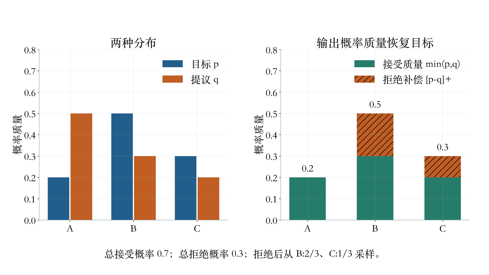
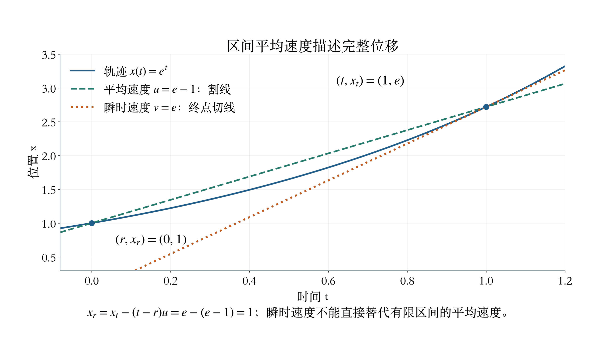
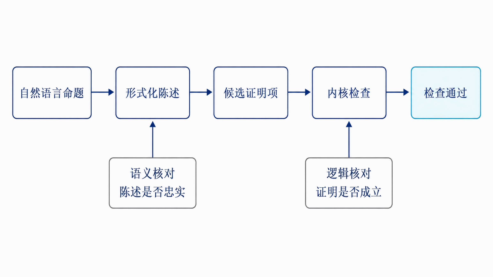

# 目录


[1. 为什么长上下文的核心瓶颈是注意力复杂度和 KV Cache？](#q-001)
  - [面试问题：MHA、MQA、GQA 在 KV Cache 复杂度上有什么数学差异？](#q-002)
  - [面试问题：MLA（Multi-head Latent Attention）为什么能压缩 KV Cache？](#q-003)
  - [面试问题：RoPE Scaling、NTK-aware、YaRN 的长度外推直觉是什么？](#q-004)
  - [面试问题：滑动窗口注意力、稀疏注意力、分块注意力如何降低复杂度？](#q-005)

[2. 为什么 Test-Time Scaling 成为大模型推理能力提升的重要方向？](#q-006)
  - [面试问题：Temperature、Top-p、Typical Sampling、Contrastive Decoding 如何改变生成分布？](#q-007)
  - [面试问题：Best-of-N、Self-Consistency、Majority Vote 的概率收益如何理解？](#q-008)
  - [面试问题：Speculative Decoding 为什么可以无损加速？接受率公式如何理解？](#q-009)
  - [面试问题：Tree of Thoughts、Beam Search、MCTS 在推理搜索中有什么数学区别？](#q-010)

[3. 视觉语言模型和多模态生成为什么依赖对齐空间？](#q-011)
  - [面试问题：CLIP/InfoNCE 对比学习损失如何实现图文对齐？](#q-012)
  - [面试问题：Patch Embedding、视觉 Token 与文本 Token 如何进入同一 Transformer？](#q-013)
  - [面试问题：Cross Attention、Co-Attention、MMDiT 的多模态交互有什么数学差异？](#q-014)
  - [面试问题：Stable Diffusion 3/FLUX 类 Rectified Flow Transformer 的数学特点是什么？](#q-015)

[4. RAG 系统的核心数学不只是余弦相似度吗？](#q-016)
  - [面试问题：Dense Retrieval、Sparse Retrieval、Hybrid Search 的打分函数有什么区别？](#q-017)
  - [面试问题：Rerank、Cross-Encoder、Late Interaction 的数学差异是什么？](#q-018)
  - [面试问题：MMR 如何在相关性和多样性之间折中？](#q-019)
  - [面试问题：RAG 评估中的 Recall@k、MRR、nDCG、Faithfulness 如何理解？](#q-020)

[5. 为什么推理模型训练越来越重视过程奖励和可验证反馈？](#q-021)
  - [面试问题：Outcome Reward Model 和 Process Reward Model 有什么数学区别？](#q-022)
  - [面试问题：Verifier、Reward Model、Critic、Judge Model 的目标函数有什么区别？](#q-023)
  - [面试问题：拒绝采样、Best-of-N、Reward Reranking 与 RL 优化有什么关系？](#q-024)
  - [面试问题：推理时计算预算、成功率和采样次数之间有什么关系？](#q-025)

[6. 结构化优化、递推记忆与可验证科学计算](#q-026)
  - [面试问题：Muon 为什么要对矩阵动量做近似正交化？](#q-030)
  - [面试问题：线性注意力与 Gated DeltaNet 如何把历史压成递推状态？](#q-031)
  - [面试问题：MeanFlow 的平均速度为什么能减少生成时的积分步数？](#q-032)
  - [面试问题：神经算子与 PINN 分别在学习什么？为什么分辨率可变不等于物理泛化？](#q-033)
  - [面试问题：GRPO 的长度归一化、组标准差和动态采样怎样改变训练权重？](#q-034)
  - [面试问题：等变性、守恒律与物理约束之间是什么关系？](#q-035)
  - [面试问题：AI 生成的数学证明如何通过形式化验证？内核检查能保证到哪一步？](#q-036)

---

<h1 id="q-001">1. 为什么长上下文的核心瓶颈是注意力复杂度和 KV Cache？</h1>

<h2 id="q-002">面试问题：MHA、MQA、GQA 在 KV Cache 复杂度上有什么数学差异？</h2>

**难度评分：⭐⭐⭐ (3/5)  |  考察频率：⭐⭐⭐⭐⭐ (5/5)**

长上下文的成本要分阶段看：prefill 的稠密注意力运算按长度平方增长，decode 每步要读取随长度增长的历史状态。MHA、MQA、GQA 主要改变 KV 状态的头数。

设层数 $`L`$、批大小 $`B`$、历史长度 $`S`$、头宽 $`d_h`$、每元素字节数 $`b`$，则常见 KV 主项为：

```math
M_{\mathrm{KV}}=2LBSH_{kv}d_hb.
```

MHA 通常 $`H_{kv}=H_q`$；MQA 取 $`H_{kv}=1`$；GQA 让若干 query 头共享一组 KV，通常 $`1\lt H_{kv}\lt H_q`$ 且头数整除以便分组。

若 $`H_q=32`$，GQA 使用 8 个 KV 头，KV 主项是同宽 MHA 的四分之一；MQA 是三十二分之一。但 query 头仍要分别形成注意力输出，稠密打分的主项并不会自动按相同比例减少。

例如 32 层、8192 token、8 个 KV 头、头宽 128、batch 为 1、每元素 2 字节，KV 主项为 1 GiB。真实内存另有页表、对齐、缓存量化尺度与碎片。

共享 KV 改变表示容量，需要相应训练或 checkpoint 转换。MQA 不必在每个任务都差于 GQA，MHA 也不凭头数保证质量更好。吞吐收益受带宽、batch、kernel 和上下文长度共同影响；长上下文能力还需要检索与多跳任务评测。

<h2 id="q-003">面试问题：MLA（Multi-head Latent Attention）为什么能压缩 KV Cache？</h2>

**难度评分：⭐⭐⭐⭐ (4/5)  |  考察频率：⭐⭐⭐⭐ (4/5)**

MLA 用一个联合低维 latent 表达内容 KV。简化记号下：

```math
c_t=W^{DKV}h_t,\qquad
k_t^C=W^{UK}c_t,\qquad v_t=W^{UV}c_t.
```

这些等式描述所定义架构的参数化，不是先计算完整 KV 再随意近似压缩。推理可缓存 $`c_t`$。内容打分中：

```math
q^{\mathsf T}k_t^C
=q^{\mathsf T}W^{UK}c_t
=((W^{UK})^{\mathsf T}q)^{\mathsf T}c_t.
```

固定线性变换可以移到 query 一侧，value 的上投影也可与输出投影结合，减少每步显式重建历史 KV 的需求。这种权重吸收是其高效实现的重要条件。

RoPE 会插入位置相关旋转，通常不能被一个对所有历史位置相同的固定矩阵直接吸收。DeepSeek-V2 的解耦设计为位置部分保留单独的 RoPE key，因而典型缓存主项为：

```math
M_{\mathrm{MLA}}\approx LBS(d_c+d_R)b.
```

$`d_c`$ 是内容 latent 维度，$`d_R`$ 是独立位置 key 维度。只写 $`LBSd_c`$ 会漏掉位置状态；实际布局、量化和实现也可能有额外开销。

它与 GQA 减少 KV 头数是不同的架构约束，也与 LoRA 的“权重更新低秩”不同。MLA 压缩历史状态，性能依赖吸收后的矩阵形状和专用 kernel；把缓存压小并不保证所有 prefill、decode 配置都更快。[DeepSeek-V2](https://arxiv.org/abs/2405.04434) 给出了这一结构的原始定义。

<h2 id="q-004">面试问题：RoPE Scaling、NTK-aware、YaRN 的长度外推直觉是什么？</h2>

**难度评分：⭐⭐⭐⭐ (4/5)  |  考察频率：⭐⭐⭐⭐ (4/5)**

RoPE 的每个坐标对使用位置角度 $`m\theta_i`$。扩展长度时，需要处理训练中见过的**相对相位组合和距离范围**，不能笼统说只有高频维度进入未知角度；高频往往已转过多圈，低频反而可能尚未覆盖完整周期。

位置插值用 $`m'=m/s`$，相当于各频率除以 $`s`$。它把长位置压回较短范围，同时也把相邻 token 的相位差压小，可能损害局部辨别能力。

调 base 的一类方法改变 $`\theta_i=b^{-2i/d}`$，不同维度被非均匀缩放。NTK-aware 这一名称对应特定动机与实现，不是对实际有限网络长上下文性能的普适 NTK 保证。

YaRN 根据频率在原上下文内的旋转覆盖，混合插值与外推，并配合注意力尺度调整。高频部分更多保留局部分辨率，低频部分更多承担范围扩展，过渡频段平滑衔接。具体参数要对应论文和模型配置。

设原上下文 4096，简单缩放 4 倍后，位置差 1 在模型相位中只相当于原来的 0.25；可计算到 16384 的位置并没有免费增加信息分辨率。扩展训练、数据长度分布和任务内容决定模型能否适应。

缓存也依赖位置设置。若推理中途按当前长度动态改变频率，已有缓存的 key 可能需要一致处理。评估应同时检查短上下文退化、长距离检索、跨段推理与边界长度。[YaRN](https://arxiv.org/abs/2309.00071) 的收益应放在这些条件下理解。

<h2 id="q-005">面试问题：滑动窗口注意力、稀疏注意力、分块注意力如何降低复杂度？</h2>

**难度评分：⭐⭐⭐ (3/5)  |  考察频率：⭐⭐⭐⭐ (4/5)**

稠密自注意力处理 $`S^2`$ 对 token。若每个 query 只访问 $`w`$ 个局部位置，注意力运算主项降为 $`O(SwD)`$；一般稀疏图每行访问 $`k`$ 个 key，则主项为 $`O(SkD)`$，索引或选择这些位置的成本另计。

窗口限制的是单层直接交互范围。堆叠 $`L`$ 层后，信息可经中间 token 传播到更远处，但“有一条传播路径”不代表能无损保留任意远处的细节。全局 token、跨块连接或检索可以缩短路径。

分块有两种不同含义：只让块内或少量块之间交互，会改变注意力稀疏模式；像 FlashAttention 一样只是把全部配对分块计算，则不减少理论配对数。把二者都叫“分块注意力”容易误算复杂度。

例如 32768 token、窗口 1024，局部配对约为全量配对的 $`1/32`$，但层数、边界、全局连接和 FFN 仍要计入。硬件上不规则稀疏可能因访存和调度不连续而无法兑现理论收益。

选择方案时应问丢掉了什么信息：局部窗口删除远距离直接连接，摘要 token 压缩细节，检索依赖召回是否覆盖需要的证据。训练与推理的掩码也应一致或经过适配。理论复杂度、实际速度和任务质量是三个独立检查项。

<h1 id="q-006">2. 为什么 Test-Time Scaling 成为大模型推理能力提升的重要方向？</h1>

<h2 id="q-007">面试问题：Temperature、Top-p、Typical Sampling、Contrastive Decoding 如何改变生成分布？</h2>

**难度评分：⭐⭐⭐ (3/5)  |  考察频率：⭐⭐⭐⭐ (4/5)**

推理时扩展会生成和选择更多候选，解码分布直接影响候选质量与差异。Temperature 用 $`p_i\propto e^{z_i/T}`$ 改变尖锐程度；Top-p 按概率降序截取累计质量达到阈值的最短前缀，再归一化。执行顺序改变时，候选集合也可能改变。

Typical Sampling 使用 token 的惊讶度与条件熵：

```math
I_i=-\log p_i,\qquad H(p)=\sum_i p_iI_i,\qquad
\delta_i=\vert I_i-H(p)\vert.
```

它通常按 $`\delta_i`$ 从小到大选取足够概率质量，再抽样。高概率 token 若远低于平均惊讶度，也可能不在最优先集合中；这与 Top-p 的排序规则不同。

Contrastive Decoding 用专家模型与较弱模型的对数概率差：

```math
s_i=\log p_E(i\mid h)-\alpha\log p_A(i\mid h).
```

实际需要专家概率的可接受集合，例如只保留 $`p_E(i\mid h)\ge\gamma\max_jp_E(j\mid h)`$ 的候选。否则弱模型给某个无意义 token 极低概率，减去其 log probability 反而可能得到很高分。

这些方法改变搜索或抽样的目标，不构成对事实性和推理正确性的保证。所谓 Contrastive Search 又常指概率与隐藏表示退化惩罚的组合，应与双模型 contrastive decoding 区分。比较时统一 tokenizer、候选约束、温度及最终评价器，才能判断差异来自哪里。

<h2 id="q-008">面试问题：Best-of-N、Self-Consistency、Majority Vote 的概率收益如何理解？</h2>

**难度评分：⭐⭐⭐⭐ (4/5)  |  考察频率：⭐⭐⭐⭐ (4/5)**

Best-of-N 的第一层收益是“候选里出现正确答案”。若每次独立、成功率都为 $`p`$：

```math
P(\text{至少一次正确})=1-(1-p)^N.
```

它只是候选覆盖率。只有理想验证器一定能识别并选中正确答案时，才等于最终成功率。若 $`p=0.2`$、$`N=5`$，覆盖率为 0.67232；一个误判较多的选择器可能远达不到这个结果。

Self-Consistency 对多条推理路径的最终答案归一化后投票。在独立二分类、奇数 $`N`$ 情形，多数票正确概率为：

```math
\sum_{k=(N+1)/2}^{N}\binom Nk p^k(1-p)^{N-k}.
```

当 $`p>1/2`$ 时样本数增加可增强多数正确的趋势；$`p\lt 1/2`$ 时反而强化错误。多类别情况下，正确答案只需比每个单独错误答案更常见，就可能随样本数增大赢得相对多数，不能机械套二分类阈值。

候选相关性也很关键。完全复制同一答案，抽 100 次仍只提供一次信息。不同提示、工具验证或分解策略可能增加有效多样性，但也会改变每次成功率，需重新估计。

增加候选还会增加选择器接触极端高分错误的机会。报告 Best-of-N 时最好同时给出候选 pass@N、最终选中准确率、验证器误差和总生成 token，才能区分生成能力与选择能力。

<h2 id="q-009">面试问题：Speculative Decoding 为什么可以无损加速？接受率公式如何理解？</h2>

**难度评分：⭐⭐⭐⭐⭐ (5/5)  |  考察频率：⭐⭐⭐⭐ (4/5)**

经典投机采样先让廉价 draft 分布 $`q`$ 提议 token，再由目标分布 $`p`$ 接受或校正。对 $`q(x)>0`$ 的提议：

```math
a(x)=\min(1,p(x)/q(x)).
```

“提议为 $`x`$ 且被接受”的无条件概率质量为 $`q(x)a(x)=\min(p(x),q(x))`$。总拒绝概率为：

```math
R=1-\sum_x\min(p(x),q(x))
=\sum_x[p(x)-q(x)]_+.
```

若拒绝，从 $`r(x)=[p(x)-q(x)]_+/R`$ 采样。于是最终输出质量：

```math
\min(p(x),q(x))+Rr(x)
=\min(p(x),q(x))+[p(x)-q(x)]_+=p(x).
```

这才是分布保持的原因。$`R=0`$ 时两分布相同，不会进入拒绝分支，无需计算零分母。目标在 draft 支撑之外的质量由残差分布补回。

多 token draft 必须按真实已接受前缀依次验证；第一处拒绝后，后面的 draft 基于错误前缀，不能直接保留。目标模型可用因果掩码并行计算 draft 前缀上的条件概率；全部接受时还可利用额外位置的目标分布继续采样。

“无损”指指定目标分布保持，要求温度、截断、惩罚和随机采样实现一致；低精度与近似验证可能带来差异，也不保证与普通采样相同随机种子逐字一致。

加速取决于接受率、draft 成本、并行验证成本和硬件负载。平均接受率等于 $`1-\mathrm{TV}(p,q)`$，其中 TV 为总变差距离，但高接受率仍不是端到端加速的唯一条件。[原始推导](https://proceedings.mlr.press/v202/leviathan23a.html)。

<div align="center">



图 6：离散三分类例子。接受质量为 min(p,q)，拒绝补偿的无条件质量为 [p−q] 的正部；相加逐项等于目标 p。

</div>

<h2 id="q-010">面试问题：Tree of Thoughts、Beam Search、MCTS 在推理搜索中有什么数学区别？</h2>

**难度评分：⭐⭐⭐⭐ (4/5)  |  考察频率：⭐⭐⭐ (3/5)**

三者都在扩展部分解，但节点定义与保留规则不同。Beam Search 常把 token 前缀作为节点，按累积对数概率保留宽度 $`B`$：

```math
s(y_{1:t})=\sum_{i=1}^t\log p(y_i\mid x,y_{\lt i}).
```

不同长度直接比较会偏向较短序列，EOS、长度惩罚及结束规则必须说明。高概率文本也未必等于任务正确答案，扩大 beam 不保证任务质量单调提升。

Tree of Thoughts 把一句思路或一段推理步骤作为节点，用生成器扩展、评价器判断，再采用 BFS、DFS 或 beam 等搜索。它描述一种推理搜索组织方式，并没有唯一的数学算法。

MCTS 维护访问次数和价值估计，用探索奖励决定继续展开的节点。常见 UCT 形式为：

```math
Q(s,a)+c\sqrt{\frac{\log N(s)}{N(s,a)}}.
```

未访问动作应单独优先探索，不能直接除零。使用策略先验的 PUCT 是另一种规则，不能只换名称。回传更新把后续结果反馈到祖先节点。

语言任务中的动作空间巨大、状态容易重复、评价器有噪声，经典有限树中的理论保证未必直接成立。需要限定扩展候选、去重、预算和终止条件。

搜索适合存在可检查中间状态与终局条件的问题，例如可执行代码和形式化证明。若评价器只偏好流畅措辞，多搜索可能只是更有效地优化这种偏好。比较算法应把生成、评价、工具调用和失败恢复成本一起计入。

<h1 id="q-011">3. 视觉语言模型和多模态生成为什么依赖对齐空间？</h1>

<h2 id="q-012">面试问题：CLIP/InfoNCE 对比学习损失如何实现图文对齐？</h2>

**难度评分：⭐⭐⭐⭐ (4/5)  |  考察频率：⭐⭐⭐⭐ (4/5)**

CLIP 用图像与文本的匹配关系学习可比较表示。给定 $`N`$ 对样本，归一化嵌入 $`v_i,t_i`$ 后：

```math
s_{ij}=v_i^{\mathsf T}t_j/\tau,\qquad
L_{I\to T}=-\frac1N\sum_i
\log\frac{e^{s_{ii}}}{\sum_j e^{s_{ij}}}.
```

文本到图像方向对列做同样分类，最后取两个方向平均。它把每张图“选出对应文本”、每段文本“选出对应图像”组织成批内分类。

对固定图像的一行 logits，梯度仍是预测概率减去匹配标签。困难负例获得较高概率，因此更强地影响更新。温度降低会使分布更尖，也通过链式法则改变梯度尺度，不只是一个视觉上让相似度更大的系数。

若 batch 中两段文字其实都描述同一场景，把非对角项一律当负例会制造假负样本。重复图像、同义描述、数据来源相关性都会破坏“唯一正确匹配”的简化设定，多正样本目标可以缓解。

InfoNCE 在特定联合与边缘负采样假设下满足 $`I(X;Y)\ge\log N-L_{\mathrm{NCE}}`$。这为表示学习提供解释，但有限 batch 的界会饱和，实际损失也不是精确互信息估计。

相似度空间支持跨模态检索与零样本分类，并不自动具备细粒度计数、空间关系或事实推理能力。生成模型可以通过交叉注意力使用条件，也不必先构造与 CLIP 完全相同的共享全局空间。

<h2 id="q-013">面试问题：Patch Embedding、视觉 Token 与文本 Token 如何进入同一 Transformer？</h2>

**难度评分：⭐⭐⭐ (3/5)  |  考察频率：⭐⭐⭐⭐ (4/5)**

把不同模态变成同宽 token，只解决了张量接口，语义兼容还要靠训练。对可被 patch 大小 $`P`$ 整除的 $`H\times W`$ 图像：

```math
N=(H/P)(W/P),\qquad
x_i\in\mathbb R^{P^2C},\quad z_i=x_iW_p+b_p.
```

例如 $`224\times224`$ 图像、$`16\times16`$ patch，得到 196 个 patch token；是否添加分类 token、使用重叠卷积或多尺度会改变总数。不能整除时需要裁剪、缩放或 padding，并记录其影响。

视觉编码器输出宽度 $`D_v`$，语言模型宽度 $`D_t`$，projector 可以映射 $`D_v\to D_t`$，也可通过 resampler 压缩 token 数。拼接后还需要位置编码、模态标记和合适的注意力掩码。

不同架构承担不同任务：CLIP 通常分别编码再比较；LLaVA 类用视觉编码器与投影接入语言模型；Flamingo 类使用交叉注意力；BLIP-2 的 Q-Former 负责从视觉特征提取可接入语言模型的查询表示。这些结构不能仅因都包含视觉 token 就视作同一种融合。

如果图像 token 从 196 增到 784，固定宽度的全量自注意力配对数可能明显增长；视觉 token 压缩降低成本，却可能丢失小字、局部实体或空间细节。接口维度、位置结构、训练对齐和信息保留要一起检查。

<h2 id="q-014">面试问题：Cross Attention、Co-Attention、MMDiT 的多模态交互有什么数学差异？</h2>

**难度评分：⭐⭐⭐⭐ (4/5)  |  考察频率：⭐⭐⭐⭐ (4/5)**

交叉注意力的输出位置属于 query 模态。若文本长 $`M`$、图像长 $`N`$：

```math
Y_T=\mathrm{softmax}(Q_TK_I^{\mathsf T}/\sqrt d)V_I
\in\mathbb R^{M\times d_v}.
```

文本每个位置从图像提取信息，这次操作不会直接更新图像位置。反过来让图像查询文本，又是另一条计算。

Co-Attention 是双向或交替交互的泛称，具体是否同时更新、是否共享参数、使用何种掩码取决于模型。两向各做一次交叉注意力，其主要配对量约为 $`2MN`$。

MMDiT 一类结构为不同模态保留各自投影，再拼接 Q、K、V 做联合注意力：

```math
Q=[Q_I;Q_T],\quad K=[K_I;K_T],\quad V=[V_I;V_T].
```

分数矩阵具有四个块：图像对图像、图像对文本、文本对图像、文本对文本。若都开放，配对量为 $`(N+M)^2`$，比单纯两向 cross attention 还多两个模态内块。

联合注意力让条件和生成状态充分交换，但不意味着所有参数共享，也不意味着文本必须加噪。不同模态的 FFN、归一化和时间调制可以不同。

选择架构时要说明输出对象、允许的连接和计算规模。MMDiT 不是所有多模态模型的统一定义；[SD3 的原始论文](https://arxiv.org/abs/2403.03206) 给出了具体的模态参数分离与联合注意力设计。

<h2 id="q-015">面试问题：Stable Diffusion 3/FLUX 类 Rectified Flow Transformer 的数学特点是什么？</h2>

**难度评分：⭐⭐⭐⭐ (4/5)  |  考察频率：⭐⭐⭐⭐ (4/5)**

这类模型把三个选择组合起来：潜空间表示降低图像维度，Transformer 建模 token 交互，flow 目标学习随时间变化的速度。三个选择可以分别改变，不能只凭 backbone 就判断训练目标。

采用噪声到数据的时间方向：

```math
x_t=(1-t)x_{\mathrm{noise}}+tx_{\mathrm{data}},\qquad
L=\mathbb E\Vert v_\theta(x_t,t,c)-
(x_{\mathrm{data}}-x_{\mathrm{noise}})\Vert_2^2.
```

图像 latent 切成 token，文本编码作为条件，时间与其他条件通过调制注入网络。采样积分 $`dx/dt=v_\theta(x,t,c)`$。若实现采用相反方向，其时间和速度符号也要相应调整。

SD3 研究不同模态参数化及联合交互；FLUX.1 的公开实现包含双流与单流 block 等安排。这里讨论的是公开的具体版本与共有机制，不能据此推断所有后续同名产品的架构。不同蒸馏版本、guidance 接口及采样步数也应分别确认。

路径较易积分时，少步采样可能更有效，但线性条件插值并未保证学到的边缘轨迹笔直。时间采样、损失加权、终端分布、模型误差和求解器都影响结果。

Transformer 便于跨 token 和跨模态交互，但高分辨率仍受 token 数及注意力成本制约。更好的图像结果不能仅归因于 U-Net 换成 Transformer；训练数据、文本编码、潜空间质量和算力规模也同时变化。[SD3](https://arxiv.org/abs/2403.03206) · [FLUX.1 公开实现](https://github.com/black-forest-labs/flux)。

<h1 id="q-016">4. RAG 系统的核心数学不只是余弦相似度吗？</h1>

<h2 id="q-017">面试问题：Dense Retrieval、Sparse Retrieval、Hybrid Search 的打分函数有什么区别？</h2>

**难度评分：⭐⭐⭐ (3/5)  |  考察频率：⭐⭐⭐⭐ (4/5)**

Dense Retrieval 使用学习到的连续表示，常以 $`s_d(q,d)=f(q)^{\mathsf T}g(d)`$ 打分；词项稀疏检索则直接利用出现频次、文档长度和词项稀有度。

BM25 的一个常用形式为：

```math
s_{\mathrm{BM25}}(q,d)=
\sum_{t\in q}\mathrm{IDF}(t)
\frac{f(t,d)(k_1+1)}
{f(t,d)+k_1[1-b+b\,\vert d\vert/\mathrm{avgdl}]}.
```

$`f(t,d)`$ 是词频，$`k_1`$ 控制词频饱和，$`b`$ 控制长度归一化，IDF 的平滑版本随实现不同。它能保留编号、产品名等精确匹配信号，dense 则常帮助匹配不同表达的语义。

直接做 $`\alpha s_d+(1-\alpha)s_s`$ 前，要检查两个分数的尺度与分布。余弦分数和 BM25 分数通常不在同一数值范围，随便设 $`\alpha=0.5`$ 不代表两路贡献各一半。

RRF 通过排名融合：

```math
\mathrm{RRF}(d)=\sum_j\frac1{k+r_j(d)}.
```

排名通常从 1 开始，未被某路召回的文档在该路贡献为零。$`k`$ 平滑顶部排名差距；它不是概率，也不会自动处理重复 chunk、文档权限或互相冲突的证据。

Hybrid 的收益依赖语料与查询。应分别测量各路独有命中、融合后的召回和最终答案表现。若 query 需要精确版本号，语义相似可能召回错误版本，必须结合元数据过滤与证据核验。

<h2 id="q-018">面试问题：Rerank、Cross-Encoder、Late Interaction 的数学差异是什么？</h2>

**难度评分：⭐⭐⭐ (3/5)  |  考察频率：⭐⭐⭐⭐ (4/5)**

Rerank 是对已召回候选重新排序的阶段，Cross-Encoder 和 Late Interaction 是可用于排序的建模方式，三者不是同一级别的互斥类别。

Bi-Encoder 把 query 与文档独立编码，$`s(q,d)=f(q)^{\mathsf T}g(d)`$，文档向量可预计算，适合大规模近邻搜索。压成单个向量会损失部分细粒度匹配关系。

Cross-Encoder 联合编码 $`[q;d]`$，让两侧 token 在编码阶段交互，再输出分数。它常能更细致地判断关系，但每个 query-document 对需要单独计算；分数是否为相关概率取决于训练和校准，不能凭 sigmoid 输出就断定已校准。

ColBERT 风格的 Late Interaction 预先保存多个文档 token 向量，在查询时做 MaxSim：

```math
s(q,d)=\sum_i\max_j q_i^{\mathsf T}d_j.
```

每个 query token 找最匹配文档 token，再累加。它保留更细粒度匹配，同时增加索引存储、向量访问和聚合成本。每个 query token 独立取最大，也不保证多个匹配构成一致语义关系。

例如问题有“药物 A”“禁止”“孕期”三个要素，单向量可能只捕捉主题，细粒度交互更可能检查否定与条件。但若正确文档没进入候选集，重排无法补救。

完整系统可先多路召回，再使用任一种适合预算的重排方法。比较时应固定候选数量、文档长度、批处理与索引开销，而非只比较模型参数量。

<h2 id="q-019">面试问题：MMR 如何在相关性和多样性之间折中？</h2>

**难度评分：⭐⭐⭐ (3/5)  |  考察频率：⭐⭐⭐ (3/5)**

MMR 逐步选择既相关、又不与已选结果过度重复的文档。候选集合为 $`R`$，已选集合为 $`S`$：

```math
d^*=\arg\max_{d\in R\setminus S}
\left[\lambda\,\mathrm{Sim}(q,d)
-(1-\lambda)\max_{s\in S}\mathrm{Sim}(d,s)\right].
```

第一项奖励相关性，第二项惩罚最大冗余。$`\lambda\in[0,1]`$ 越大越偏向相关；$`S`$ 为空时通常先选最相关结果，或把冗余项定义为零。

例：已选 A，另有 B、C。它们与问题相似度为 0.90、0.80，与 A 相似度为 0.95、0.20。取 $`\lambda=0.5`$，B 得分 -0.025，C 得分 0.30，因此选择 C。这在 A、B 基本重复而 C 补充另一证据面时有价值。

两个相似度项必须有可比尺度。若 query-doc 用交叉编码器分数、doc-doc 用余弦，相同系数不再具有直观含义，需要校准或调参。

MMR 是局部贪心选择，不是事实核验，也不普遍保证所需信息覆盖最优。两段相似文档可能分别提供互补数值，过强去重会删掉证据；不同措辞也可能重复同一事实。

RAG 还要考虑 token 预算、来源权限、版本及引用完整性。MMR 解决的是冗余权衡，可与这些约束组合，但不能替代它们。

<h2 id="q-020">面试问题：RAG 评估中的 Recall@k、MRR、nDCG、Faithfulness 如何理解？</h2>

**难度评分：⭐⭐⭐ (3/5)  |  考察频率：⭐⭐⭐⭐ (4/5)**

RAG 需要分开检查召回、排序、上下文与生成。对某个 query，相关文档集合为 $`R`$，前 k 结果为 $`T_k`$：

```math
\mathrm{Recall@k}=\frac{\vert R\cap T_k\vert}{\vert R\vert}.
```

若有 4 篇相关文档、前 5 找到 2 篇，Recall@5 是 0.5，Precision@5 是 0.4，Hit@5 是 1。单相关文档任务才容易把 recall 与 hit 混在一起。没有标注相关文档的 query 应单列规则，不能无说明地除零。

MRR 对每个 query 取首个相关排名的倒数，未命中记零，再平均。若只考察前 k，则应明确标成 MRR@k。

有等级相关性时，常用：

```math
\mathrm{DCG@k}=\sum_{i=1}^k\frac{2^{\mathrm{rel}_i}-1}{\log_2(i+1)},
\qquad
\mathrm{nDCG@k}=\frac{\mathrm{DCG@k}}{\mathrm{IDCG@k}}.
```

也有使用线性 gain 的定义，比较实验必须统一。IDCG 为零时需规定跳过还是记零，不能隐藏这个口径。

Faithfulness 检查答案主张是否被所给上下文支持；correctness 检查主张是否正确；citation accuracy 检查引用是否实际支持对应主张。若检索到过时文档，模型忠实复述也可能事实错误。

LLM judge 可以近似这些评价，但存在位置、风格和模型偏好。应抽样人工核对并保存判定依据。一个检索分数的提升，只有通过后续信息选择与生成环节，才可能转化为更可靠的回答。

<h1 id="q-021">5. 为什么推理模型训练越来越重视过程奖励和可验证反馈？</h1>

<h2 id="q-022">面试问题：Outcome Reward Model 和 Process Reward Model 有什么数学区别？</h2>

**难度评分：⭐⭐⭐⭐ (4/5)  |  考察频率：⭐⭐⭐⭐ (4/5)**

ORM 对完整回答给终局分数，PRM 对中间推理状态或步骤给分数。区别首先是监督粒度，而不是是否使用同一种神经网络。

ORM 可用最终正确性分类，也可用偏好对损失：

```math
L_{\mathrm{pair}}=-\log\sigma(r_\phi(x,y_w)-r_\phi(x,y_l)).
```

PRM 若有逐步正确标签 $`c_t`$，可在包含问题及历史步骤的前缀上预测 $`p_t`$：

```math
L_{\mathrm{PRM}}=-\sum_t
[c_t\log p_t+(1-c_t)\log(1-p_t)].
```

只输入孤立的第 t 步常不足以判断其合法性，必须看前提和已建立的中间结果。过程反馈能帮助定位错误，也有较高标注与评估成本。

如何把步骤分数变成整条轨迹分数，没有统一答案。求和容易偏好更长轨迹，取最小值强调薄弱环节，乘积需要把每项解释成合适的条件概率；若这些条件不满足，不能把乘积直接当作“证明全部正确的概率”。

例如前一步错误、后一步在错误假设下计算正确，标签究竟表示局部变换合法还是整条推理仍有效，会改变训练目标。边界含糊的标签可能比稀疏但可靠的终局反馈更难使用。

PRM 是一种信用分配与搜索工具，不证明每个细分步骤都获得客观真值。对可执行任务，应结合单元测试、约束检查或形式验证，并分别报告标注定义和验证覆盖。

<h2 id="q-023">面试问题：Verifier、Reward Model、Critic、Judge Model 的目标函数有什么区别？</h2>

**难度评分：⭐⭐⭐ (3/5)  |  考察频率：⭐⭐⭐⭐ (4/5)**

名称代表系统角色，不唯一决定损失函数。Verifier 检查某种性质是否成立；Reward Model 提供优化偏好；Critic 估计策略未来回报；Judge 完成综合评审。

学习型 verifier 可预测 $`P(\mathrm{correct}\mid x,y)`$，用分类损失训练；形式证明内核、编译器和测试执行器则是程序检查器，不需要一个可训练损失。测试通过只覆盖测试中的性质，不能等同于完整正确性证明。

奖励模型常学习 $`r_\phi(x,y)`$，用 pairwise ranking loss，但也可使用回归或规则。偏好分数高不代表答案正确概率高。

Critic 针对当前策略定义：

```math
V^\pi(s)=\mathbb E_\pi\left[\sum_{k=0}^\infty\gamma^k r_{t+k}\mid s_t=s\right].
```

它预测从状态出发的未来回报，通常用蒙特卡洛回报或 TD 目标拟合。策略、奖励和终止规则改变后，critic 的对象也改变；它不是对一段文本作静态审美评分。

Judge 可以输出评分、排序或理由，训练方式可以是监督指令、分类或偏好学习。角色允许复用模型，但接口、校准和错误代价应该分开定义。

系统设计时先问“它检查什么、输出是什么、谁使用这个输出”。把一个流畅的 judge 直接接成强化学习奖励，可能让模型优化评审偏好；把 critic 当正确性 verifier，也可能把高预期回报误读成逻辑正确。

<h2 id="q-024">面试问题：拒绝采样、Best-of-N、Reward Reranking 与 RL 优化有什么关系？</h2>

**难度评分：⭐⭐⭐⭐ (4/5)  |  考察频率：⭐⭐⭐⭐ (4/5)**

先区分统计学的严格拒绝采样，与工程中按阈值筛答案。后者从 $`y\sim\pi`$ 采样，接受事件 $`A=\{r(x,y)>\tau\}`$，得到的分布是：

```math
\pi_A(y\mid x)=
\frac{\pi(y\mid x)\mathbf1_A(y)}{P_\pi(A)}.
```

若独立重复直到接受，平均需要 $`1/P_\pi(A)`$ 次采样。它不是任意目标分布的无偏采样器；严格拒绝采样还需要目标与提议密度之比及包络常数。

Best-of-N 生成固定数量候选，选择最高分；reward reranking 是更一般的候选重排阶段。这些操作在推理时改变最终选择分布，不直接更新生成模型参数。

RL 则优化策略参数，典型目标为：

```math
\max_\theta\mathbb E_{y\sim\pi_\theta}[r(x,y)]
-\beta D_{\mathrm{KL}}(\pi_\theta\Vert\pi_{\mathrm{ref}}).
```

它把额外搜索中发现的偏好逐渐摊入模型，期望减少未来调用时的搜索成本。筛选数据再做 SFT 或 DPO 则是另一条把推理计算转成训练信号的路线。

固定 N 的最大值选择并不自动产生上述 KL 正则目标的最优指数倾斜分布，两者不能仅凭“都偏好高奖励”就视作等价。

如果评分器有漏洞，扩大 N 会提高发现漏洞样本的机会，RL 也可能让漏洞行为越来越常见。应把独立验证、数据多样性与真实任务回报作为额外检查。

<h2 id="q-025">面试问题：推理时计算预算、成功率和采样次数之间有什么关系？</h2>

**难度评分：⭐⭐⭐⭐ (4/5)  |  考察频率：⭐⭐⭐⭐ (4/5)**

在同成功率、独立采样且理想选择器的简化模型中：

```math
P_N=1-(1-p)^N,\qquad
P_{N+1}-P_N=p(1-p)^N.
```

后式说明边际覆盖收益递减。若每次候选成本为 $`c`$，验证成本为 $`v(N)`$，预算为 $`B`$，可在 $`Nc+v(N)\le B`$ 下选择 N。这个模型给预算直觉，但没有描述真实选择器的误判。

例如单次成功率 0.2，N 从 1 到 5 的覆盖率由 0.2 提升到约 0.672；从 5 到 6 只再增加约 0.066。若验证器经常选中高分错误，实际提升还可能为负。

问题难度不同，最佳预算也不同。简单题继续采样浪费资源；极难且当前策略几乎没有正确支持的题，大量同质采样也帮助有限。可根据阶段性验证、候选分歧或可靠置信信号停止，但这些信号本身要校准。

还要区分串行加深与并行多样化。延长单条推理会改变单次成功率与单次成本；多候选搜索改变覆盖与选择；工具调用可能提高可验证性。不存在通用的“token 数翻倍，正确率增加多少”定律。

报告推理时扩展应固定任务与基础模型，列出总 token、工具和验证调用、延迟以及最终准确率。pass@N 只能作为候选覆盖指标，不能替代实际部署选择器的成功率。

<h1 id="q-026">6. 结构化优化、递推记忆与可验证科学计算</h1>

<h2 id="q-030">面试问题：Muon 为什么要对矩阵动量做近似正交化？</h2>

**难度评分：⭐⭐⭐⭐⭐ (5/5)  |  考察频率：⭐⭐⭐ (3/5)**

Adam 主要按坐标历史梯度缩放更新，Muon 则利用二维权重的矩阵结构。若某层动量矩阵的紧致 SVD 为 $`M=U_r\Sigma_rV_r^{\mathsf T}`$，其理想化极分解方向可写成 $`O=U_rV_r^{\mathsf T}`$，将非零奇异值调整到相同尺度。

一个清楚的几何解释来自谱范数约束的一阶优化：

```math
\min_{\Vert\Delta W\Vert_2\le\eta}
\langle M,\Delta W\rangle_F,\qquad
\Delta W=-\eta U_rV_r^{\mathsf T}.
```

最优值为 $`-\eta\Vert M\Vert_*`$。它按矩阵方向组织更新，而不是保留原动量中最大奇异值方向的全部幅度优势。矩形或秩亏矩阵的 O 是部分等距映射，不能把它一律称为方阵正交矩阵。

实际 Muon 通常不逐步计算昂贵 SVD，而用少量 Newton–Schulz 多项式迭代构造近似方向：

```math
X_{k+1}=aX_k+bX_kX_k^{\mathsf T}X_k
+c(X_kX_k^{\mathsf T})^2X_k.
```

输入需要合适归一化，矩阵朝向影响计算量。实践系数和有限迭代为了速度可以只近似压平谱，不应宣称输出奇异值精确等于 1。

矩阵形状的尺度调整、Nesterov 变体、权重衰减与分布式实现，会影响更新幅度。偏置、归一化参数和 embedding 等常与 AdamW 分组处理。官方 PyTorch 接口也明确其面向隐藏层二维参数，不能把全模型参数不加区分地塞进去。

[Muon 扩展论文](https://arxiv.org/abs/2502.16982) 与 [PyTorch Muon 文档](https://docs.pytorch.org/docs/2.15/generated/torch.optim.Muon.html) 支持其机制与实现边界。值得长期掌握的是“参数的矩阵几何可以进入优化器”；论文中的训练收益依赖模型、数据与预算，不是对所有任务替代 AdamW 的保证。

<h2 id="q-031">面试问题：线性注意力与 Gated DeltaNet 如何把历史压成递推状态？</h2>

**难度评分：⭐⭐⭐⭐⭐ (5/5)  |  考察频率：⭐⭐⭐ (3/5)**

普通注意力保存可逐项检索的历史 KV，线性递推则把历史合并成固定形状状态。对一类核注意力，特征映射 $`\phi`$ 满足相似度可写成内积，定义：

```math
S_t=S_{t-1}+v_t\phi(k_t)^{\mathsf T},\qquad
z_t=z_{t-1}+\phi(k_t),
```

```math
o_t=\frac{S_t\phi(q_t)}{z_t^{\mathsf T}\phi(q_t)}.
```

需确保分母合法并进行数值处理。这对所选核形式可精确递推，但有限维特征映射一般不等价于原始 Softmax 注意力。历史长度不再直接增加状态大小，代价是不同历史会竞争同一有限容量。

Delta rule 把状态看作从 key 到 value 的联想记忆。令 $`S\in\mathbb R^{d_v\times d_k}`$，最小化当前配对误差 $`\tfrac12\Vert Sk_t-v_t\Vert^2`$ 的一步更新为：

```math
S_t=S_{t-1}
+\beta_t(v_t-S_{t-1}k_t)k_t^{\mathsf T}.
```

先估计旧记忆对 key 的输出，再写入残差。若 $`\Vert k_t\Vert=1`$ 且 $`\beta_t=1`$，更新后该 key 的读出正好变成 $`v_t`$；与其相关的其他 key 也可能被影响。

Gated DeltaNet 加入遗忘门，一种写法为：

```math
\widetilde S_t=\alpha_tS_{t-1},\qquad
S_t=\widetilde S_t+
\beta_t(v_t-\widetilde S_tk_t)k_t^{\mathsf T}.
```

门控制保留多久，残差更新控制怎样修正记忆。训练可用分块并行算法，不能仅因递推式存在就断言训练只能串行。

固定状态对极长序列有吸引力，但精确检索、关联干扰和遗忘仍是边界。[Gated DeltaNet](https://arxiv.org/abs/2412.06464) 讨论了混合局部注意力；[Qwen3-Next 官方模型卡](https://huggingface.co/Qwen/Qwen3-Next-80B-A3B-Instruct) 也明确使用混合结构。它们说明状态压缩与直接检索可以互补，不意味着线性层无条件替代所有注意力。

<h2 id="q-032">面试问题：MeanFlow 的平均速度为什么能减少生成时的积分步数？</h2>

**难度评分：⭐⭐⭐⭐⭐ (5/5)  |  考察频率：⭐⭐⭐ (3/5)**

普通 Flow Matching 学瞬时速度 $`v(x_t,t)`$，有限时间移动仍要积分。MeanFlow 直接学习区间平均速度：对真实轨迹 $`x_t`$、固定起点时间 $`r\lt t`$，

```math
u(x_t,r,t)=\frac1{t-r}\int_r^t v(x_\tau,\tau)\,d\tau
=\frac{x_t-x_r}{t-r}.
```

若这个量准确，就能用 $`x_r=x_t-(t-r)u(x_t,r,t)`$ 跨过整个区间。这里用的是沿轨迹的位移平均，不是任意两个空间点速度的算术平均。

把等式乘以 $`t-r`$ 并对 t 求全导数，r 保持不变：

```math
u+(t-r)\frac{du}{dt}=v,\qquad
\frac{du}{dt}=\partial_tu+J_xu\,v.
```

因此：

```math
u=v-(t-r)(\partial_tu+J_xu\,v).
```

关键是 $`x_t`$ 也随时间变化，不能只保留偏导 $`\partial_tu`$。JVP 计算 $`J_xu\,v`$，无需显式构造巨大的 Jacobian。论文以网络替代 u，并对构造的回归目标停止梯度，避免再次穿过 JVP 做高阶优化；条件路径速度用于可采样监督。

例如 $`x_t=e^t`$，$`r=0,t=1`$ 时瞬时速度是 e，平均速度是 $`e-1`$。用平均速度可准确还原位移，用终点瞬时速度乘区间则会过估。这也说明一步生成并非把普通 Euler 步长直接调大。

当区间趋零，平均速度趋向瞬时速度。有限容量、训练误差、条件引导和复杂数据仍决定一步质量。[Mean Flows](https://arxiv.org/abs/2505.13447) 的论文与[官方代码](https://github.com/Gsunshine/MeanFlow) 提供了具体训练方式；其价值在于把“少步”变成新的建模对象，而不是保证任意 flow 模型都能无损一步采样。

<div align="center">



图 7：用 x(t)=exp(t) 的解析轨迹区分瞬时速度和区间平均速度。这是数学示例，不是生成模型性能曲线。

</div>

<h2 id="q-033">面试问题：神经算子与 PINN 分别在学习什么？为什么分辨率可变不等于物理泛化？</h2>

**难度评分：⭐⭐⭐⭐⭐ (5/5)  |  考察频率：⭐⭐⭐ (3/5)**

PINN 通常用网络表示某个问题的解 $`u_\theta(x,t)`$，通过 PDE 残差、边界、初值和数据训练。神经算子则学习一族问题的解映射：

```math
\mathcal G:a(\cdot)\mapsto u(\cdot).
```

输入函数 a 可以是系数场、初始条件或外力，输出是对应解函数。训练一次后，希望对新的输入场快速求解。也有参数化 PINN 和带物理约束的算子，两类方法可以结合。

Fourier Neural Operator 的一类层使用频域参数化积分算子：

```math
v_{l+1}(x)=\sigma\left[
W_lv_l(x)+\mathcal F^{-1}
\left(R_l(k)\,\mathcal F(v_l)(k)\right)(x)
\right].
```

$`R_l(k)`$ 是在保留频率上学习的通道混合，局部分支 $`W_l`$ 补充点态变换，非线性连接多层。FFT 提供高效全局交互，但截断频率、周期结构与边界处理都会影响结果。

可在不同网格上评估共享算子参数，说明表示具有一定离散化兼容性；不代表训练只见过低频解，就能恢复任意未见的高频冲击，也不代表从一种边界或材料系数外推到另一种仍准确。

例如热方程的低频平滑解较容易学习，含尖锐边界层的对流主导问题则需要更多频率、网格或专门结构。多步 rollout 还可能累积误差，单步 MSE 很小也不保证长时间稳定。

[FNO 原始论文](https://arxiv.org/abs/2010.08895)、[NeuralOperator 实现](https://github.com/neuraloperator/neuraloperator) 与 [PINN 项目](https://maziarraissi.github.io/PINNs/) 展示了两条路径。评价时应固定物理参数范围，分别测新初值、新网格、新边界和长时间外推，避免把它们合并成一个“泛化”分数。

<h2 id="q-034">面试问题：GRPO 的长度归一化、组标准差和动态采样怎样改变训练权重？</h2>

**难度评分：⭐⭐⭐⭐⭐ (5/5)  |  考察频率：⭐⭐⭐ (3/5)**

一个看似只是“求平均”的实现选择，也会改变优化对象。设回答 i 有 $`T_i`$ 个有效 token、优势为 $`A_i`$，先忽略裁剪与 KL：

```math
J_{\mathrm{seq}}=\frac1G\sum_i\frac1{T_i}
\sum_t\rho_{i,t}A_i,\qquad
J_{\mathrm{tok}}=\frac1{\sum_iT_i}
\sum_i\sum_t\rho_{i,t}A_i.
```

前者让每条回答总权重相近，单个长回答 token 权重较小；后者让每个有效 token 权重相近，因此长回答贡献更多项。它们不只是整体常数差异，只有各长度相同时才容易等价。

再把 $`A_i=(r_i-\overline r)/s_r`$ 代入，组标准差等于在不同 prompt 间加入不同倍率。对于二元奖励，较不均衡但仍有差异的组可能使少数样本优势更大；全同奖励组则仍为零。

[Dr. GRPO](https://arxiv.org/abs/2503.20783) 分析了长度和组标准差带来的权重偏差；[DAPO](https://arxiv.org/abs/2503.14476) 使用 token 级目标、动态采样等策略。它们的具体结果依赖训练设置，不能把某一种归约规则宣布为所有奖励目标下唯一正确。

过滤全对或全错组能提高有效梯度比例，但也改变进入优化的数据分布，并增加采样成本。长回答被最大长度截断时，终局奖励可能混入“没有机会完成”的噪声，不能一律当作完整错误回答。

异步或多轮更新还涉及策略陈旧：rollout 概率、当前概率与参考概率必须分别保存并对齐。定位训练异常时，先核对分母、长度掩码、标准差、截断与采样策略，往往比继续叠加奖励更有解释力。

<h2 id="q-035">面试问题：等变性、守恒律与物理约束之间是什么关系？</h2>

**难度评分：⭐⭐⭐⭐⭐ (5/5)  |  考察频率：⭐⭐ (2/5)**

等变性描述输入变换时输出如何相应变换：

```math
f(T_gx)=\rho_g f(x).
```

例如整个三维系统旋转后，能量这种标量应保持不变，力向量应随相同旋转。给坐标增加一个固定平移，不应改变仅依赖相对位置的相互作用。将这些性质写入模型结构，可以减少不必要的数据学习负担。

守恒律描述沿时间演化保持不变的量。Noether 定理在具有作用量与相应正则条件的变分系统中，将连续对称性与守恒量联系起来：时间平移对应能量、空间平移对应动量、旋转对应角动量。

这个联系需要完整动力学框架。一个任意旋转等变网络，不会仅因满足等变性就自动守恒能量或动量。若网络直接预测力，等变性限制其变换规律，却未必保证力能写成某个势能的负梯度。

若学习标量势能 $`E(q)`$ 并令 $`F=-\nabla_qE`$，可以构造保守力。对不显含时间、无外力和耗散的适当系统，它支持能量守恒；但离散积分仍可能产生漂移，数值结构需要另行处理。

硬结构约束能保证所编码的性质，软惩罚仅鼓励训练样本上满足性质。真实系统若有摩擦、开放边界或外部驱动，强行加入封闭系统守恒反而会产生建模错误。

AI for Science 中值得迁移的判断是：先识别对称群、物理量类型和系统边界，再决定用等变架构、势函数参数化还是约束损失。结构假设越强，越需要验证其确实适用于目标问题。

<h2 id="q-036">面试问题：AI 生成的数学证明如何通过形式化验证？内核检查能保证到哪一步？</h2>

**难度评分：⭐⭐⭐⭐ (4/5)  |  考察频率：⭐⭐⭐ (3/5)**

形式化验证把命题写成精确的形式语言，再构造一个满足该命题类型的证明项。模型可以提出中间引理、调用 tactic 或搜索证明，较小的检查内核负责核验最终对象是否符合逻辑规则。

需要分开两种正确性：形式化陈述是否忠实表达原问题，以及证明项是否证明了这个陈述。内核主要检查第二层。例如把“所有非零实数”误写成“所有正实数”，可能得到完全合法却没有解决原问题的证明。

以 Lean 为例，策略和自动化工具是生成证明的方法；可靠交付需要在固定工具链和依赖下重放整个文件，并检查声明依赖的公理。`sorry` 会引入未完成证明的占位公理，不能因为编译退出码为零就当成完整证明。显式添加了过强公理，也可能使目标轻易成立。

程序测试检查有限输入，形式证明在明确公理与语义下可以覆盖量化的全部输入；但前提、数学定义、数值表示和外部世界的对应关系仍需要人来核对。某些自动化或计算加速机制还会扩大信任基础，应记录采用的工具与约定。

因此一个可复核的产物应同时保留命题来源、形式化定义、完整证明代码、依赖版本、检查日志与公理审计。失败信息可以反馈给模型继续搜索，成功则意味着“指定形式系统与信任前提下的这条陈述已验证”。

[Lean 官方的公理与计算说明](https://lean-lang.org/theorem_proving_in_lean4/axioms_and_computation.html) 和[命题类型文档](https://lean-lang.org/doc/reference/latest/The-Type-System/Propositions/) 给出这些边界。长期价值是将候选生成与确定性检查组合起来；流畅的自然语言证明仍需经过同样严格的陈述核对。

<div align="center">



图 8：AI 辅助证明流程示意。内核检查针对形式化陈述与证明项；原命题是否被忠实表达，需要独立语义核对。

</div>

---

## 参考资料

- [GQA](https://arxiv.org/abs/2305.13245)

- [DeepSeek-V2 与 MLA](https://arxiv.org/abs/2405.04434)

- [YaRN](https://arxiv.org/abs/2309.00071)

- [Fast Inference from Transformers via Speculative Decoding](https://proceedings.mlr.press/v202/leviathan23a.html)

- [CLIP](https://arxiv.org/abs/2103.00020)

- [Scaling Rectified Flow Transformers for High-Resolution Image Synthesis](https://arxiv.org/abs/2403.03206)

- [ColBERT](https://arxiv.org/abs/2004.12832)

- [Let's Verify Step by Step](https://arxiv.org/abs/2305.20050)

- [Muon is Scalable for LLM Training](https://arxiv.org/abs/2502.16982)

- [Gated Delta Networks](https://arxiv.org/abs/2412.06464)

- [Mean Flows for One-step Generative Modeling](https://arxiv.org/abs/2505.13447)

- [DAPO](https://arxiv.org/abs/2503.14476)

- [Understanding R1-Zero-Like Training](https://arxiv.org/abs/2503.20783)

- [Fourier Neural Operator](https://arxiv.org/abs/2010.08895)

- [Lean：Axioms and Computation](https://lean-lang.org/theorem_proving_in_lean4/axioms_and_computation.html)
