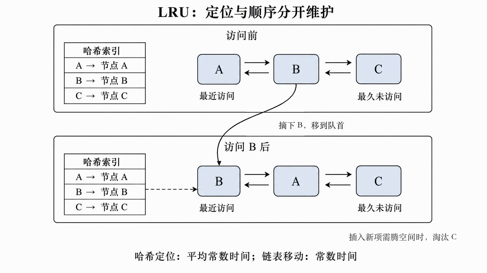

# 目录

[1. 数组为什么是最基础的数据结构？](#q-001)
  - [面试问题：数组和动态数组有什么区别？](#q-002)
  - [面试问题：字符串为什么可以看作特殊数组？](#q-003)
  - [面试问题：Tensor 与数组有什么关系？](#q-004)

[2. 链表的核心思想是什么？](#q-005)
  - [面试问题：数组和链表如何对比？](#q-006)
  - [面试问题：快慢指针为什么能求链表中点和判断环？](#q-007)
  - [面试问题：如何用哈希表 + 双向链表实现 LRU Cache？](#q-008)

[3. 栈和队列分别解决什么问题？](#q-009)
  - [面试问题：栈为什么和递归、DFS、表达式解析有关？](#q-010)
  - [面试问题：队列为什么和 BFS、任务调度、DataLoader 有关？](#q-011)
  - [面试问题：循环队列和阻塞队列在 AI 工程中有什么用？](#q-012)

[4. 单调栈和单调队列解决什么问题？](#q-013)
  - [面试问题：单调栈如何在线性时间内找到下一个更大元素？](#q-014)
  - [面试问题：单调队列如何优化滑动窗口最大值？](#q-015)
  - [面试问题：线性结构在流式大模型推理中有哪些应用？](#q-016)
  - [面试问题：流式服务为什么需要背压，队列容量应该怎样确定？](#q-017)

---

<h1 id="q-001">1. 数组为什么是最基础的数据结构？</h1>

<h2 id="q-002">面试问题：数组和动态数组有什么区别？</h2>

**难度评分：⭐⭐ (2/5)  |  考察频率：⭐⭐⭐⭐⭐ (5/5)**

数组利用下标直接定位元素。对固定宽度、连续存储的元素，第 i 项的地址可由首地址与 $`i\times\mathrm{元素大小}`$ 计算，因此下标访问是常数时间。动态数组在这个表示之上增加容量管理：逻辑长度表示已经使用多少位置，容量表示不重新分配就能容纳多少元素。

尾部追加时，容量足够就直接写入；容量耗尽则申请更大区域并搬移元素。按固定倍数增长能把连续追加的总搬移量控制在线性量级，得到摊还 $`O(1)`$ 追加，但单次扩容仍可能是 $`O(n)`$。中间插入和删除通常需要搬移后续元素，因此是 $`O(n)`$；“动态”不意味着任意位置的更新都快。

语言实现影响实际成本。C++ `vector<int64_t>` 通常连续存放整数值；Java `long[]` 也存基本类型值，`ArrayList<Long>` 保存的是引用并涉及装箱；Python list 连续保存对象引用，可以指向不同类型的对象。数值计算中，引用数组和紧凑数值数组不能按相同字节开销估算。

例如要收集一百万个已知长度的样本 ID，预留容量或一次分配可以减少扩容。若事先不知道总量，几何增长更自然。预留过多又会浪费内存，分配与初始化也有成本，不能不加区分地把最大可能容量全部申请出来。

还要注意引用与迭代器失效。C++ vector 扩容后，指向原存储的指针和引用会失效；Python、Java 的对象引用语义不同。把容器底层存储地址交给原生库时，必须保证其生命周期和布局在使用期间有效。

<h2 id="q-003">面试问题：字符串为什么可以看作特殊数组？</h2>

**难度评分：⭐⭐⭐ (3/5)  |  考察频率：⭐⭐⭐⭐ (4/5)**

字符串可以按序列来处理，但首先要定义一个“元素”是什么。UTF-8 的一个 Unicode 码点可能占多个字节；Java String 的常用下标按 UTF-16 代码单元计数；Python str 的索引通常对应 Unicode 码点。用户看到的一个字形还可能由多个码点组成，例如字母与组合重音、某些 emoji 序列。

因此，同一文本的长度、切片位置和编辑距离可能因计量单位不同而不同。假设文本是 `A😀B`，按 Unicode 码点看，B 的位置是 2；按 UTF-8 字节偏移或 UTF-16 代码单元偏移看，结果会变化。反转字节数组甚至可能破坏 UTF-8 编码；逐码点反转也未必保持组合字形完整。

算法本身只需要可比较的符号序列。KMP 可以比较字节、码点或 token ID，但返回下标必须使用同一单位。本板块三语言实现统一接收整数序列：处理字符时先转换为码点，处理模型输入时直接传 token ID。字符正规化、大小写折叠和字形分段属于调用者明确选择的预处理，不隐含在匹配算法里。

字符串不可变还会影响性能。循环中反复连接长字符串可能重复复制，应用列表收集片段后一次连接，或使用语言提供的构建器。切片是否复制、字符串哈希是否缓存，也取决于具体语言实现。

处理日志偏移、OCR 字符错误率或代码补丁时，应把编码与下标单位写入接口。业务若按用户可见字符计算长度，应采用 Unicode 文本分段规则，不能直接用字节数或 token 数代替。

<h2 id="q-004">面试问题：Tensor 与数组有什么关系？</h2>

**难度评分：⭐⭐⭐⭐ (4/5)  |  考察频率：⭐⭐⭐⭐ (4/5)**

Tensor 可以看成带有形状、步长、类型、设备等信息的多维数据视图。底层通常仍是一段存储，但逻辑坐标怎样对应到存储位置，由 stride 与 storage offset 决定。对某个元素，偏移等于起始偏移加上各维下标与对应步长的乘积之和。

例如一个按行连续的 2×3 张量，其元素步长可为 `(3,1)`。转置成 3×2 后，步长变为 `(1,3)`；元素顺序的解释改变了，底层数据不一定发生搬移。逻辑上相邻的元素此时可能不在相邻地址，所以后续算子的访存效率也可能变化。

PyTorch `view` 要求目标形状与原来的存储布局兼容。它并非只允许完全 contiguous 的输入：若被合并维度满足相应 stride 关系，某些非连续视图也可以变形。`reshape` 则可能返回视图，也可能复制；不能据函数名字推断它总是零拷贝。`contiguous()` 在需要时创建连续副本，会消耗内存和带宽。

广播也值得单独理解。一个长度为 d 的向量参与 batch 运算时，不必预先物理复制 B 次；某些视图通过零步长等方式表达重复访问。但对重叠存储做原地写入会产生歧义，框架可能拒绝该操作。

排查性能时，应同时检查 shape、stride、dtype、device 和是否发生复制。把形状变换当成纯数学操作，容易漏掉隐式分配；把所有转置都当成数据搬移，又会误判成本。接口语义决定正确性，内存布局决定算子怎样执行。

<h1 id="q-005">2. 链表的核心思想是什么？</h1>

<h2 id="q-006">面试问题：数组和链表如何对比？</h2>

**难度评分：⭐⭐⭐ (3/5)  |  考察频率：⭐⭐⭐⭐⭐ (5/5)**

数组通过位置计算地址，链表通过节点连接找到下一个元素。这个差异决定了它们的操作成本：数组随机访问为 $`O(1)`$，链表按下标访问通常要走 $`O(n)`$；数组中间插入往往要搬移元素，链表在已经定位连接位置时只需改少量指针。

**链表插入删除的常数时间有前提。** 单链表若要删除某个节点，一般还需要它的前驱；只有当前节点时，不能普遍在常数时间删除，特别是尾节点。“复制后继值再删除后继”的技巧还会改变节点身份，不适合有外部引用的通用容器。双向链表同时保存前后连接，已知节点时可以直接摘除。

内存代价同样不同。链表每个节点至少多一个指针，双向链表多两个；独立分配还会引入分配器开销与碎片。数组的连续访问通常更利于缓存和预取。所以即使业务经常增删，小规模数组也可能更快，不能仅凭链表的局部 $`O(1)`$ 就宣布它更适合。

LRU 是链表发挥作用的典型条件：哈希表先定位节点，链表再维护访问顺序。这样省掉了链表最不擅长的查找。相反，如果要对一大批 embedding 做矩阵计算，连续数组更符合访问模式。

回答比较题时可以给出一条完整操作：定位、修改、遍历、释放分别花多少成本。若只比较“已知位置后的插入”，却把实际发生的定位过程省略，得出的工程结论通常会偏离真实工作负载。

<h2 id="q-007">面试问题：快慢指针为什么能求链表中点和判断环？</h2>

**难度评分：⭐⭐⭐ (3/5)  |  考察频率：⭐⭐⭐⭐⭐ (5/5)**

求中点时，让 slow 每轮走一步，fast 每轮走两步。走过 t 轮后，slow 距起点约 t 个节点，fast 距起点约 2t 个节点。当 fast 到达尾部，slow 就位于中间。两指针都从头节点开始、循环条件为“fast 与 fast.next 存在”时，偶数长度返回两个中点中的后一个。例如四节点链表返回第 3 个节点。

判环利用相对速度。若有长度为 λ 的环，两个指针都进入环以后，每轮 fast 相对 slow 前进一个位置，最多再经过 λ 轮就会相遇。比较的是节点身份，不能比较节点值；两个不同节点完全可以保存相同值。

要找环入口，设头到入口距离为 μ，入口到相遇点的环内距离为 x。相遇时快指针比慢指针多走整数圈，因此慢指针总步数是 λ 的整数倍，可得 $`\mu+x\equiv0\pmod\lambda`$。让一指针回到头部，另一指针留在相遇点，两者每次都走一步，会在入口相遇。

时间复杂度为 $`O(n)`$，辅助空间为 $`O(1)`$。空链表、单节点、自环、入口在头部、偶数长度都应测试。中点函数以链表无环为前提；若输入可能有环，要先检测，或把“无环”写成接口要求，不能让它无限循环。

快慢指针适用于可以反复沿 next 前进的结构。它不自动解决不可回看的流式数据，也不能直接用来对任意请求队列做中位数统计。适用条件比“两个指针不同速度”这一表面形式更重要。

<h2 id="q-008">面试问题：如何用哈希表 + 双向链表实现 LRU Cache？</h2>

**难度评分：⭐⭐⭐ (3/5)  |  考察频率：⭐⭐⭐⭐⭐ (5/5)**

LRU 淘汰最久没有被访问的条目。实现需要同时支持“按 key 找到条目”和“更新访问顺序”，因此用哈希表保存 key 到节点的映射，用双向链表保存从最近到最久的顺序。

`get` 命中后，把节点摘下再移到最近端；未命中返回明确的缺失状态。`put` 已存在的 key 时更新值并移动节点；插入新 key 后若超容量，删除最久端节点，同时删除哈希映射。哨兵节点可减少空表、头尾变化的特殊分支，但它们不计入容量。

例如容量为 3，顺序是 A、B、C，A 最近、C 最久。读取 B 后变成 B、A、C；再插入 D，则变成 D、B、A，C 被淘汰。哈希表定位通常为期望或平均 $`O(1)`$，链表摘除与连接是确定的常数步，扩容成本需要另作摊还分析。

图：哈希索引定位节点，链表单独维护新旧顺序。示意图中的队尾 C 是容量不足时的淘汰对象。

接口还要规定容量为 0、负容量、重复更新与缺失值的行为。用 -1 表示未命中，会与合法值 -1 混淆；代码库采用可空值或 optional。Python 可以用 OrderedDict，Java 可以组合访问顺序的 LinkedHashMap，C++ 可以组合 list 与 unordered_map；手写节点不是性能更好的保证。

LRU 也有局限。一次大规模顺序扫描可能把热点全挤出去；按条目数限制无法约束不同大小结果的字节数；线程安全、过期时间与进行中的计算需要额外机制。KV 缓存中的共享块还受引用计数约束，正在使用的块不能仅因“访问较早”就被释放。

<h1 id="q-009">3. 栈和队列分别解决什么问题？</h1>

<h2 id="q-010">面试问题：栈为什么和递归、DFS、表达式解析有关？</h2>

**难度评分：⭐⭐ (2/5)  |  考察频率：⭐⭐⭐⭐⭐ (5/5)**

栈保存“最近进入、尚未完成”的工作，后进先出的顺序正好对应嵌套关系。递归调用进入子问题时，调用栈保存父函数的参数、局部状态和返回位置；子问题结束后，恢复最近的父状态继续执行。

二叉树 DFS 可以把这一过程显式化。前序遍历先处理根，再压入右孩子和左孩子，使左孩子先弹出。后序遍历还要知道一个节点的左右子树是否已经完成，因此栈帧需要阶段标记，或保存等价的访问状态。把递归改为栈，不是只把函数名换成 `push`，而是要保存递归隐含的信息。

括号匹配也依赖嵌套顺序。遇到左括号入栈，遇到右括号检查栈顶类型；`([)]` 的括号数量虽然匹配，嵌套却不合法。表达式解析还需要优先级和结合性，仅有一个栈并不能决定何时执行乘法或加法。

树遍历的时间为 $`O(n)`$，深度优先遍历辅助栈通常为 $`O(h)`$，h 是树高；退化链状树上 h 可以达到 n。显式栈可以避开语言递归深度限制，但不会消除需要保存状态这一事实。

工程中还应限制恶意或意外的嵌套深度。解析 AST、JSON 和任务依赖时，循环引用需要额外 visited 或状态标记，不能把一般图当作树无限展开。本板块的迭代遍历测试包含深链，专门检查递归栈风险和结果拼接带来的额外成本。

<h2 id="q-011">面试问题：队列为什么和 BFS、任务调度、DataLoader 有关？</h2>

**难度评分：⭐⭐⭐ (3/5)  |  考察频率：⭐⭐⭐⭐ (4/5)**

队列按先进先出的顺序处理元素。BFS 把刚发现但还没有展开的节点放到队尾，先发现的较浅节点先展开，因此在无权图或所有边权相同的图上，首次发现节点时就能得到最少边数距离。图中应在入队时标记访问，否则同一节点可能重复入队很多次。

DataLoader 的生产者负责读取、解码和预处理，消费者负责训练。队列把两个速率不同的阶段连接起来：生产者偶尔慢一点时，预取内容可以让消费者继续工作。但长期生产速率低于消费速率，增大队列无法弥补吞吐缺口；长期生产更快，则需要容量限制与背压。

FIFO 也不等于最好的任务调度。一个耗时很长的请求可能挡住后面的短请求，形成队首阻塞；优先队列可以改变顺序，却需要考虑低优先级任务饥饿。动态 batching 还会按长度、模型或资源预算组批，其顺序常常偏离严格 FIFO。

实现上，Python 的 list 头部 `pop(0)` 会搬移元素，循环使用可能产生二次成本；deque 或环形缓冲更合适。C++ deque、Java ArrayDeque 也提供适合两端操作的结构。跨线程队列必须额外处理同步和可见性，普通容器的正确性不等于并发正确性。

面试中应把队列的两层价值讲开：算法层面维护访问前沿，系统层面缓冲速率差异。后者需要同时观察队长、等待时间、处理速率和取消请求，而不只是确认 `enqueue/dequeue` 能运行。

<h2 id="q-012">面试问题：循环队列和阻塞队列在 AI 工程中有什么用？</h2>

**难度评分：⭐⭐⭐⭐ (4/5)  |  考察频率：⭐⭐⭐ (3/5)**

循环队列利用固定容量数组复用已经出队的位置。读写位置走到数组末尾后回到开头，避免不断搬移元素。满与空需要可区分的状态：可以保存当前元素数，也可以保留一个不用的槽位，或使用带序号的读写计数。选定一种约定后，容量含义和越界判断必须一致。

例如物理数组长度为 8，采用“保留一格”的方案时，最多只能保存 7 项；若接口宣称容量为 8，却仍使用这个判满规则，就会出现边界错误。使用单独 size 计数可以用满 8 格，但并发更新 size 又增加了同步需求。

阻塞队列定义的是等待语义。队列空时消费者等待，队列满时生产者等待或超时。条件变量等待必须在循环中重新检查条件，因为唤醒不保证条件仍然成立；程序还要提供关闭、取消和唤醒路径，否则退出时可能永久等待。

流式推理可用有界缓冲连接模型生成与网络发送。客户端很慢时，缓冲会积满，此时需要暂停生产、取消请求或执行明确的丢弃策略。日志、视频帧和文本 token 对丢失的容忍度不同，不能共用一个含糊的“满了就覆盖”策略。

环形存储本身不提供无锁保证。单生产者单消费者与多生产者多消费者需要不同的同步设计，还涉及内存顺序、伪共享和对象生命周期。面试实现宜先给出正确的有锁或单线程版本，再依据实际争用证明是否值得引入更复杂的并发结构。

<h1 id="q-013">4. 单调栈和单调队列解决什么问题？</h1>

<h2 id="q-014">面试问题：单调栈如何在线性时间内找到下一个更大元素？</h2>

**难度评分：⭐⭐⭐ (3/5)  |  考察频率：⭐⭐⭐⭐⭐ (5/5)**

单调栈保存尚未找到答案的下标。求“右侧第一个严格更大元素”时，从左向右扫描，让栈中对应的值从栈底到栈顶保持非增。遇到新值 x，只要栈顶值小于 x，就弹出栈顶，并把当前下标记为它的答案；最后将当前下标入栈。

以 `[2,1,2,4,3]` 为例。读到第二个 2 时，1 被弹出，答案下标为 2；第一个 2 与新值相等，不满足严格更大，继续等待。读到 4 时，两个 2 都被弹出，答案为 3。最终下标答案是 `[3,2,3,-1,-1]`。

为什么当前元素一定是被弹出元素的“第一个”更大值？如果两者之间早已出现更大值，该元素早就会被弹出。还留在栈里，说明前面的候选均未满足条件。每个下标只入栈一次、出栈至多一次，虽然代码有嵌套 while，总操作数仍是 $`O(n)`$，辅助空间最坏 $`O(n)`$。

严格更大使用 `<` 弹栈，寻找“大于等于”则要重新处理相等值，不能不看题意地替换比较符。返回下标还是返回值也要明确；代码库返回下标，-1 表示不存在，不会与合法数组值 -1 冲突。

同一思想可用于温度等待天数、直方图边界等问题，但哨兵和相等元素归属需要逐题证明。看到一个“最大值”问题并不意味着都能用单调栈；它适合的核心是按序扫描后，有些候选可以被新元素永久排除。

<h2 id="q-015">面试问题：单调队列如何优化滑动窗口最大值？</h2>

**难度评分：⭐⭐⭐ (3/5)  |  考察频率：⭐⭐⭐⭐⭐ (5/5)**

固定窗口每次右移一格，暴力重扫 k 个元素需要 $`O(nk)`$。单调队列保存仍有可能成为窗口最大值的下标，让值从队首到队尾递减，同时让下标递增。队首始终是当前窗口的最大值候选。

处理下标 i 时，先从队首删除已经离开窗口的下标；再从队尾删除值不大于当前值的候选；最后将 i 入队。队尾旧候选的值更小或相等，而且比新元素更早过期，所以在之后任何同时包含两者的窗口里，都没有保留它的必要。

例如 `[1,3,-1,-3,5,3,6,7]`，k=3，输出为 `[3,3,5,5,6,7]`。读到 5 时，队尾的 -3、-1、3 都被支配并删除；后续窗口只需保留更有竞争力的候选。相等时删除旧下标，是为了留下较晚过期的相同值，也可以采用保留相等值的另一套一致实现。

每个下标入队一次、出队至多一次，所以总时间 $`O(n)`$，辅助空间 $`O(k)`$；输出数组另占 $`O(n-k+1)`$。代码要求 $`1\le k\le n`$，空输入或非法 k 返回明确错误，而不是访问空队列。

这个结构适合窗口最大值、最小值，不适合直接维护 P99。分位数依赖整个值域中的排序位置，被删除的较小值仍会影响秩。精确滑窗分位数需要有序统计结构，近似场景则可考虑带时间分桶的统计摘要，详见[流式分位数问答](05_字符串与高级数据结构高频考点.md#q-024)。

<h2 id="q-016">面试问题：线性结构在流式大模型推理中有哪些应用？</h2>

**难度评分：⭐⭐⭐⭐ (4/5)  |  考察频率：⭐⭐⭐ (3/5)**

一次流式请求可以分成输入缓冲、待调度队列、模型执行状态和输出缓冲。输入 token 序列适合紧凑数组；待处理请求需要队列或优先级结构；输出缓冲吸收模型生成与网络发送之间的速度差；请求完成后还要释放其占用的状态。

这些容器保存的对象不同，不能混成一个“token 队列”。KV Cache 保存每层历史键值张量，通常通过块池与映射组织；输出缓冲保存已经生成、准备发送的内容。清空网络缓冲不会自动释放 KV，取消请求也必须同时通知调度与内存管理模块。

还要区分 token 与文本。token 可能对应字节片段，单独一个 token 未必能解码成完整字符。流式解码应保留必要的解码状态，在合适边界输出文本；按固定字节长度截断可能把 UTF-8 字符切开。前端看到的“每次多一个字”不是底层生成的通用语义。

动态 batching 每轮可能纳入新请求并移除已完成请求，因此维护的是不断变化的活动集合。某次请求的生成顺序必须保持，跨请求的输出可以交错；队列中的取消、超时和完成事件需要稳定的请求 ID 关联。

优化时先观察是预处理供给不足、调度等待、设备计算，还是下游发送慢。有界队列能暴露并控制积压，无界增长只会把慢消费者问题暂时变成内存问题。这也是线性结构从课堂走向服务系统时最重要的一次语义扩展。

<h2 id="q-017">面试问题：流式服务为什么需要背压，队列容量应该怎样确定？</h2>

**难度评分：⭐⭐⭐⭐ (4/5)  |  考察频率：⭐⭐⭐ (3/5)**

背压让下游处理能力反过来约束上游生产速度。若生成端每秒产生 100 个单位、发送端只能处理 60 个，队列每秒净增 40 个；把容量从一千增到一万，只是推迟溢出，并没有提高系统的稳定吞吐。

在稳定、长期平均量存在的系统中，Little 定律给出 $`L=\lambda W`$：L 是系统平均在途数量，λ 是有效到达或完成速率，W 是平均停留时间。它有助于检查“当前并发与等待时间是否相符”，但不是根据平均值直接保证 P99 的公式。突发流量、重试和长尾任务还需要单独测试。

容量设计可以先按可承受等待时间和内存预算给出上限，再选择满载行为。对交互请求，可以限流或及时拒绝，让客户端知道需要重试；对可恢复的数据任务，可以暂停生产者；对实时视频，可能允许按规则丢旧帧。文本生成若丢中间 token，会改变输出含义，通常需要暂停或取消整条请求。

超时、取消与背压应相互配合。用户已经断开连接，继续占着队列和 KV 生成结果没有价值；重试又可能放大过载，所以需要限次和退避。监控应同时记录到达速率、服务速率、队长、最老任务年龄及拒绝率。

这种机制的长期价值在于把资源边界变成明确行为。换了模型、设备或传输协议后，生产者与消费者速率不一致的问题仍然存在；容器只是载体，容量与等待策略才决定系统在压力下怎样工作。

---

## 参考资料

- [PyTorch Tensor.view 的布局条件](https://docs.pytorch.org/docs/stable/generated/torch.Tensor.view.html)
- [Unicode 文本分段 UAX #29](https://www.unicode.org/reports/tr29/)
- [Python collections](https://docs.python.org/3/library/collections.html)
- [vLLM 缓存块与空闲队列](https://docs.vllm.ai/en/latest/design/prefix_caching/)
