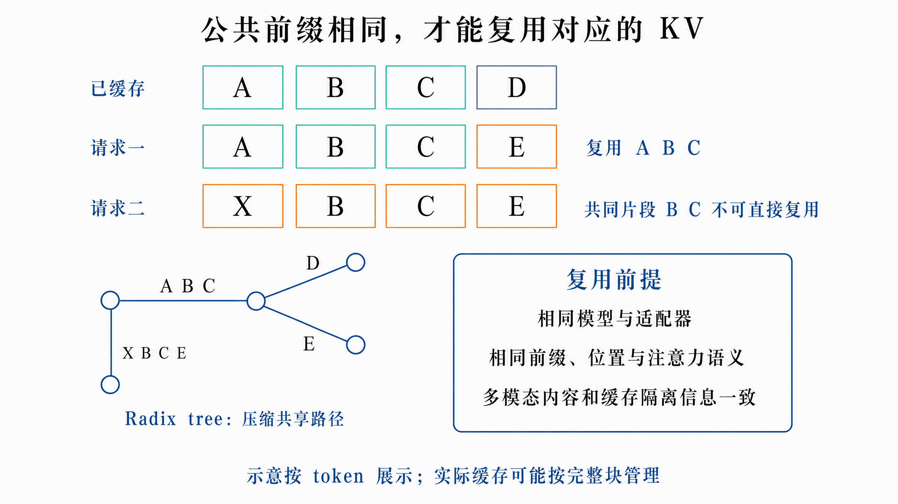
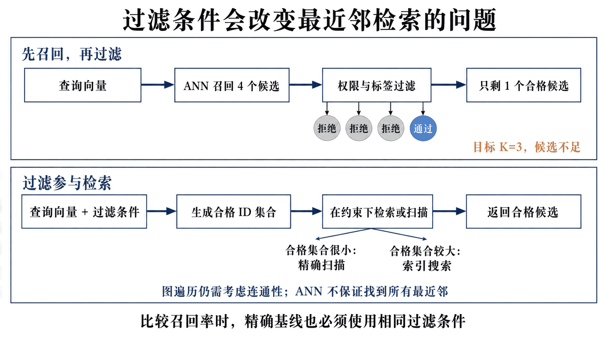

# 目录

[1. 字符串匹配为什么仍然是 AI 工程高频基础？](#q-001)
  - [面试问题：BF、RK、BM、KMP 分别解决什么问题？](#q-002)
  - [面试问题：KMP 的前缀函数或 next 数组本质是什么？](#q-003)
  - [面试问题：BM 算法的坏字符和好后缀思想是什么？](#q-004)

[2. Trie 为什么适合前缀匹配？](#q-005)
  - [面试问题：Trie 在 tokenizer 和 prefix cache 中如何使用？](#q-006)
  - [面试问题：AC 自动机如何实现多模式串匹配？](#q-007)
  - [面试问题：敏感词过滤、约束解码和代码补全如何用到 Trie 类结构？](#q-008)
  - [面试问题：Radix tree 与哈希块索引怎样复用大模型前缀缓存？](#q-022)

[3. 海量数据去重和检索为什么需要高级索引结构？](#q-009)
  - [面试问题：位图 Bitmap 适合解决什么问题？](#q-010)
  - [面试问题：布隆过滤器为什么会误判，但标准插入式实现不漏判？](#q-011)
  - [面试问题：倒排索引和 RAG 检索有什么关系？](#q-012)
  - [面试问题：Roaring Bitmap 怎样兼顾稀疏集合、稠密集合和快速交并？](#q-021)
  - [面试问题：KLL 等流式摘要怎样估计 P99，为什么不能直接平均多个 P99？](#q-024)

[4. 向量索引为什么是 AIGC 检索系统的核心结构？](#q-013)
  - [面试问题：精确 kNN 和 ANN 有什么区别？](#q-014)
  - [面试问题：HNSW、IVF、PQ 的核心思想是什么？](#q-015)
  - [面试问题：如何设计一个面向 RAG 的混合检索结构？](#q-016)
  - [面试问题：过滤条件为什么会改变 ANN 搜索策略？](#q-023)
  - [面试问题：量化检索为什么还需要精排，二值编码又改变了什么？](#q-025)

[5. 计算几何为什么会出现在 AI 视觉和自动驾驶面试中？](#q-017)
  - [面试问题：如何计算多边形面积，鞋带公式有哪些前提？](#q-018)
  - [面试问题：如何判断点是否在多边形内？](#q-019)
  - [面试问题：极角排序和凸包有什么用？](#q-020)

---

<h1 id="q-001">1. 字符串匹配为什么仍然是 AI 工程高频基础？</h1>

<h2 id="q-002">面试问题：BF、RK、BM、KMP 分别解决什么问题？</h2>

**难度评分：⭐⭐⭐ (3/5)  |  考察频率：⭐⭐⭐⭐ (4/5)**

它们都可以处理单模式串匹配，但利用的信息不同。设文本长度为 n、模式长度为 m，BF 逐个起点尝试匹配；RK 用滚动哈希筛选候选；BM 从模式右侧比较并利用失配信息跳跃；KMP 根据已匹配前缀的结构避免文本指针回退。

<div align="center">

| 方法 | 怎样减少工作 | 需要说明的边界 |
|---|---|---|
| BF | 无预处理，直接比较 | 最坏 O(nm)，短输入可能足够实用 |
| RK | 滚动更新窗口哈希 | 哈希相等需要核验；碰撞可能增加成本 |
| BM | 坏字符与好后缀决定位移 | 实际跳跃收益与文本、变体有关 |
| KMP | 前缀函数复用已匹配后缀 | 预处理 O(m)，扫描 O(n)，辅助空间 O(m) |

</div>

滚动哈希不能直接证明两个子串相等。若需要精确匹配，就在哈希一致后比较原文；若只比较哈希，得到的是有碰撞风险的判定。BM 的不同变体有不同最坏界，不能只因“经常跳过很多字符”就宣称所有实现都保证线性。

工程中，标准库的子串查找通常经过按模式长度与字符分布分派的优化，手写 KMP 的最坏界并不保证它在所有短文本上更快。大量关键词同时匹配可以考虑 AC 自动机，文档检索则通常建立倒排索引，避免每次查询都扫描全文。

输入单位也要统一：字节、码点和 token ID 都能作为符号，但匹配下标的含义随之变化。源码定位、日志检索和模型 token 触发片段的需求不同，算法前的预处理与输出坐标转换同样属于正确性的一部分。

<h2 id="q-003">面试问题：KMP 的前缀函数或 next 数组本质是什么？</h2>

**难度评分：⭐⭐⭐⭐ (4/5)  |  考察频率：⭐⭐⭐⭐ (4/5)**

采用前缀函数定义：pi[i] 是子串 `p[0:i+1]` 中，最长的、同时为真前缀和后缀的长度。“真前缀”排除整个子串自身。不同教材的 next 数组可能记录位置或使用 -1 哨兵，应先声明定义，再讨论转移。

例如模式 `ababaca` 的 pi 为 `[0,0,1,2,3,0,1]`。处理到 `ababa` 时，最长相等真前后缀是 `aba`，长度 3；下一位 c 无法接在这个候选后，于是沿 pi 链尝试更短的可复用前缀，直至匹配或归零。

扫描文本时，j 表示当前已经匹配的模式前缀长度。若当前符号失配，就令 `j=pi[j-1]`，把已匹配部分的后缀重新解释为模式前缀；文本位置保持不变，继续比较。这个回退不会跳过合法匹配，因为更长但不具有相应前后缀关系的候选已经被排除。

虽然内层 while 可能回退多次，j 每次增加最多一步，回退总量受此前增加量约束，文本扫描总成本为 $`O(n)`$。预处理 $`O(m)`$，合计 $`O(n+m)`$。返回所有匹配时，找到一次后还要沿前缀函数继续，以支持重叠匹配，例如 `aaaa` 中的 `aa`。

配套实现返回第一次命中的整数序列下标，空模式返回 0，未命中返回 -1。它不依赖“文本与模式之间存在一个从未出现的分隔符”，因此可直接处理任意 token ID。这样的接口约束比记住一种 next 模板更容易跨语言复用。

<h2 id="q-004">面试问题：BM 算法的坏字符和好后缀思想是什么？</h2>

**难度评分：⭐⭐⭐⭐ (4/5)  |  考察频率：⭐⭐⭐ (3/5)**

BM 从模式的右端向左比较。失配时，它同时利用失配字符和已经成功匹配的后缀，计算可以安全向右移动的距离，减少对不可能起点的尝试。

坏字符规则关注文本中导致失配的字符 c。假设在模式位置 j 失配，可以尝试把模式中 j 左侧某个 c 与它对齐；若不存在合适的 c，就越过这一失配约束。简单实现使用最右出现位置，并保证位移至少为 1。若模式中的最右 c 在 j 右侧，直接套用一个负位移显然不成立。

好后缀规则关注失配右侧已匹配的一段 s。若模式前部还有合适的 s 出现，可以移动到那里继续；若没有完整出现，就寻找 s 的某个后缀是否与模式前缀匹配。预处理把这些结构转成可查的位移信息。两个规则给出的安全位移可取较大者，但每种表的定义必须与匹配代码一致。

例如长模式的末尾字符在文本中很少出现，BM 往往很快排除大量位置；在字符种类少、重复片段多的文本中，跳跃收益可能减弱。坏字符简化版、完整 BM、BMH 与带额外优化的变体，不应共用未经限定的最坏复杂度说法。

面试重点是解释“为什么跳过的位置不可能匹配”，而非把位移表背下来。实际日志和源码搜索优先使用经过验证的搜索库；需要自己实现时，要用重复字符、模式长于文本、边界命中和大量失配作差分测试。

<h1 id="q-005">2. Trie 为什么适合前缀匹配？</h1>

<h2 id="q-006">面试问题：Trie 在 tokenizer 和 prefix cache 中如何使用？</h2>

**难度评分：⭐⭐⭐⭐ (4/5)  |  考察频率：⭐⭐⭐⭐ (4/5)**

Trie 用根到节点的路径表示一个前缀，共享开头的序列共享节点。插入长度为 L 的序列时，逐个符号查找或创建孩子；查询前缀时沿同样路径前进。终止标记区分“路径存在”和“完整词存在”，否则插入 `apple` 后会错误地把 `app` 也当成完整词。

在每一步孩子访问为常数或期望常数时间的条件下，查询成本为 $`O(L)`$。固定字母表数组访问快，但每个节点可能浪费大量空指针；哈希映射更适合稀疏或开放符号集。压缩 Trie、Radix tree 把连续单分支路径合并，减少节点数，但边内还需要比较一段符号。

Double-array Trie 则用 base、check 等数组编码转移，减少逐节点指针和对象开销，适合词典相对稳定、查询密集的情况。代价是构建布局与动态插入更复杂。它和路径压缩是不同方向的表示优化，都需要按更新模式评价。

某些 tokenizer 可以借助 Trie 找到词表中的前缀候选。WordPiece 的具体规则还包括子词标记与无法匹配时的处理；BPE 按合并排名逐步构造子词，不能用“每步选词表最长前缀”替代。词表索引与分词算法是两层设计。

Prefix cache 则索引已计算的 token 前缀及其 KV 状态。节点或边可以挂接缓存块，在新请求中定位最长可复用前缀，再计算剩余部分。与词表 Trie 相比，它额外涉及模型上下文、块粒度、引用计数和淘汰，详见[前缀复用机制](#q-022)。

三语言教学实现采用整数 token 为边标签的节点池，支持空序列、完整查询与前缀查询。C++ 节点池扩容会使内部引用失效，插入新节点后必须重新获取父节点；Python 也应避免用 `setdefault(key, Node())` 在命中时仍创建无用节点。

<h2 id="q-007">面试问题：AC 自动机如何实现多模式串匹配？</h2>

**难度评分：⭐⭐⭐⭐ (4/5)  |  考察频率：⭐⭐⭐ (3/5)**

AC 自动机把所有模式串建成 Trie，再为节点建立失败链接。扫描文本时，当前节点代表已读文本的某个后缀；若没有对应字符边，就沿失败链接寻找更短的、仍存在于 Trie 中的后缀，继续尝试。它把 KMP 对单个模式的前后缀复用推广到多个模式。

失败链接通常按 BFS 顺序建立，因为一个节点的失败位置依赖更浅层已完成的信息。例如模式集合包含 `he、she、his、hers`，读到 `she` 时，当前节点可以同时输出 `she`，还应沿输出关系识别后缀模式 `he`。只检查当前节点的终止标记会漏报。

复杂度需要计入输出数量 z。对合适的转移与输出实现，文本扫描可达到 $`O(n+z)`$；模式总长度为 M，构建成本还取决于字母表大小和是否补全所有转移。若为每个节点保存整个字母表转移表，会增加 $`O(M\sigma)`$ 级别的存储或初始化；稀疏边则有不同查找成本。

输出过多也可能成为瓶颈。例如 `a、aa、aaa` 在一长串 a 中有大量重叠命中，即使扫描本身高效，实际输出也需要相应时间。若业务只关心是否命中任意模式，可以提前停止；若要全部位置，就必须承担输出成本。

它适合日志规则、精确词表匹配和符号扫描。大小写、正规化和跨 chunk 的状态应明确处理。关键词命中并不能理解语义，也不能独立解决提示注入或内容安全；自动机提供的是可预测的精确匹配能力。

<h2 id="q-008">面试问题：敏感词过滤、约束解码和代码补全如何用到 Trie 类结构？</h2>

**难度评分：⭐⭐⭐⭐ (4/5)  |  考察频率：⭐⭐⭐ (3/5)**

这三类任务都可能利用“已有前缀决定后续候选”，但约束范围不同。词表过滤关心是否出现某个模式，代码补全关心有哪些符号以当前输入开头，约束解码则要在生成每一步判断哪些 token 能使输出继续合法。

有限枚举值很适合 Trie。例如只允许生成 `red、green、blue`，可以将它们的合法 token 序列插入树，每一步只开放当前节点的孩子。模型提供候选概率，Trie 提供允许集合；终止标记决定何时可以输出结束符。词面不同的 token 切分可能对应同一字符串，构建时要与 tokenizer 保持一致。

一般 JSON、SQL 或递归语法不能仅靠有限词表 Trie 完整表达。它们可能需要有限状态机、上下文无关文法或栈式解析状态；token 又可能包含多个字符、部分字符串或转义序列，因此必须把 token 解码结果与语法状态结合判断。格式合法也不保证字段值或 SQL 语义正确。

代码补全中，Trie 可以快速列出函数名或路径前缀候选，但返回成千上万项仍要输出和排序。作用域、类型、可见性与调用上下文需要符号系统补充，不能由字面前缀推出。

敏感词过滤还要考虑 Unicode 正规化、大小写和分段输入。保留跨片段状态能防止一个词被切开后漏检；过度正规化又可能改变原文坐标或语义。结构负责符号约束，业务层负责如何解释与使用命中结果。

<h2 id="q-022">面试问题：Radix tree 与哈希块索引怎样复用大模型前缀缓存？</h2>

**难度评分：⭐⭐⭐⭐ (4/5)  |  考察频率：⭐⭐⭐⭐ (4/5)**

自回归模型某个位置的 KV 由该位置及其可见前文共同决定。请求 `A B C E` 可以复用已缓存 `A B C D` 中公共前缀 `A B C` 的状态；请求 `X B C E` 虽也出现 `B C`，对应上下文不同，通常不能直接复用原来的 KV。缓存索引必须表达这种前缀依赖。

Radix tree 把 token 序列中连续单分支路径压缩成边。插入新请求时，比较边上的 token，找到分叉位置后拆边；最长前缀查询沿共享路径返回缓存位置。SGLang 的实现还维护使用引用与可淘汰节点，正在使用的缓存不能被普通 LRU 顺序直接释放。

另一条路线是按块建立哈希索引。vLLM 的前缀缓存设计把父块哈希、当前块 token 和必要附加信息组合成键。父块信息让相同局部 token 在不同前文下得到不同身份；按完整块管理时，共有十个 token、块长为四，可能只能命中前八个 token 对应的完整块。

<div align="center">



图：符号 A、B、C 表示 token。共享前缀是复用条件的一部分，实际还要保持模型、位置、适配器和多模态输入等计算上下文一致。

</div>

key 的完整性比选树还是哈希更基础。模型版本、LoRA、位置与注意力语义、多模态内容，以及需要隔离的缓存域都可能影响结果；只比较提示词字符串不足以保证一致。哈希碰撞、引用计数与回收也要有明确策略。

收益主要来自省去已命中前缀的重复 prefill，并可能共享其存储；后续 decode 仍需读取可见历史状态。评估时同时看命中 token 数、首 token 延迟、常驻内存和淘汰行为。最新实现会变化，长期不变的是对公共前缀身份与状态生命周期的精确管理。

<h1 id="q-009">3. 海量数据去重和检索为什么需要高级索引结构？</h1>

<h2 id="q-010">面试问题：位图 Bitmap 适合解决什么问题？</h2>

**难度评分：⭐⭐⭐ (3/5)  |  考察频率：⭐⭐⭐⭐ (4/5)**

位图用一位表示一个整数 ID 是否属于集合。对值域 `[0,U)`，需要约 U/8 字节；插入和查询通过计算字节或机器字位置，再设置或检查对应 bit。它节省的是每个元素的表示开销，但总空间由值域大小决定，而不只由实际元素个数决定。

例如表示一亿个可能 ID，需要约 12.5 MB 十进制字节，不计元数据；如果实际上只有一百个稀疏 ID，普通位图仍要为整个值域留位置，可能远大于排序数组。字符串或 URL 也不能直接当位下标，需要无冲突的 ID 映射，不能随便取哈希后就宣称精确去重。

位图的强项是集合运算。两个条件的 AND 得到交集，OR 得到并集，AND NOT 得到差集。按机器字处理时，一次可并行处理多个成员标记；popcount 还能统计成员数。对筛选条件、已处理样本、推荐曝光记录都很实用。

查询某一位近似常数时间，不代表扫描或集合运算也是常数。密集位图的交并通常与值域机器字数相关；枚举所有元素还受输出大小约束。位图不保存额外属性，也不表示一个 ID 出现了几次，计数需要其他结构。

稀疏与稠密混合时，可使用[Roaring 压缩位图](#q-021)。选择前应同时看值域、局部密度、连续区间比例和交并频率，避免只按“bit 很小”判断总内存。

<h2 id="q-011">面试问题：布隆过滤器为什么会误判，但标准插入式实现不漏判？</h2>

**难度评分：⭐⭐⭐⭐ (4/5)  |  考察频率：⭐⭐⭐⭐ (4/5)**

布隆过滤器用 m 位数组和 k 个哈希位置表示集合。插入元素时，把对应 k 位设为 1；查询时，只要其中一位为 0，就能断定它没有被插入；若全部为 1，只能说明“可能存在”，因为这些位置也可能由其他元素共同置位。

在哈希近似独立均匀、插入 n 个不同元素的假设下，假阳性率常用近似式：

```math
p\approx(1-e^{-kn/m})^k,\qquad k\approx\frac{m}{n}\ln2.
```

m 决定内存预算，n 是预期集合规模。实际插入量超过设计值会提高假阳性率；更多哈希次数也增加查询计算，不能无限增加 k。常见实现可以从少量哈希派生多个位置，但质量与参数仍需验证。

“不漏判”有条件：已成功插入、查询使用同样的哈希与参数、位没有被错误清零，而且并发和存储读写正确。标准布隆过滤器不能直接删除一个元素的位，因为这些位可能被别的元素共享。计数布隆过滤器支持递减计数，但也要处理计数溢出和错误删除。

它适合减少不必要的后端查询：判定不存在时跳过，判定可能存在时查精确存储。训练数据去重若直接丢弃所有“可能存在”的样本，会误删新样本；权限过滤若直接接受“可能允许”，则会放入不合格记录。概率过滤器只能承担与其误差方向匹配的职责，精确决定仍需真实集合或权威存储。

<h2 id="q-012">面试问题：倒排索引和 RAG 检索有什么关系？</h2>

**难度评分：⭐⭐⭐ (3/5)  |  考察频率：⭐⭐⭐⭐ (4/5)**

倒排索引把词项映射到包含该词项的文档列表，列表还可以保存词频、位置与字段信息。查询多个词项时，利用有序 ID 列表交并、跳跃或压缩块，避免逐篇扫描原文，再根据 BM25 等方法计算相关性。

例如词项 `CUDA` 对应文档 1、7、20，`OOM` 对应 3、7，则 AND 查询首先得到文档 7。若要判断短语相邻出现，还需要词位置；仅有文档 ID 无法区分相隔很远的两个词。分词、大小写与同义词处理会直接改变索引语义。

RAG 中，编号、API 名、错误码和专有名词经常需要精确词项信号，向量相似度则补充语义相近的表达。两路候选可以合并去重，采用排名融合或校准后的分数，再交给重排模型。原始 BM25 分数与向量分数通常不在同一尺度，直接相加需要依据。

索引更新不能只更新原文。文档版本、倒排列表、向量、元数据与删除标记需要有一致的生效策略，否则可能召回已经删除的 chunk，或用新文本配旧向量。权限检查应在向生成阶段提供证据之前完成。

向量检索与倒排检索都只是证据召回手段。最终还要评估引用准确性、上下文覆盖和生成质量；混合检索并不必然优于单路，收益应通过任务数据检验。长期价值在于把不同错误模式的候选来源组合起来，并保留可追溯的文档身份。

<h2 id="q-021">面试问题：Roaring Bitmap 怎样兼顾稀疏集合、稠密集合和快速交并？</h2>

**难度评分：⭐⭐⭐⭐ (4/5)  |  考察频率：⭐⭐⭐ (3/5)**

Roaring 的关键是按局部密度选择表示。对经典 32 位整数集合，它用高 16 位划分分块，在每个块内保存低 16 位。不同块可以独立使用有序数组、位图或连续区间表示，避免整个值域被一种格式绑住。

一个块的低位空间有 65,536 个可能值，完整位图需要 8,192 字节；有序 16 位数组保存 4,096 项时，纯元素部分也是 8,192 字节。这解释了经典数组与位图转换阈值的量级，真实对象还包含元数据。连续 ID 很多时，run 容器用区间起点与长度表示，可能更紧凑。

做集合交集时，先对齐高位分块，再根据容器类型选择操作：数组与数组可归并，位图与位图可按机器字 AND，数组与位图可逐个测试。结构把密度差异局部化，使集合操作既能压缩存储，又保留直接计算能力。

它适合文档标签过滤、已看内容集合和分区索引，但不是所有数据都更小。极稀疏且每个值落在不同块中时，容器元数据可能超过普通排序数组；小而稠密的已知值域，未压缩位图也可能更直接。频繁修改后，某种容器是否仍最紧凑也需要重新优化。

对 AI 检索，这类结构的长期价值是让多个硬条件变成精确 ID 集合交并，而不必扫描完整文档。评估应同时测集合大小、序列化大小和 AND/OR 吞吐；不要把项目文档中的某个最佳加速倍数当成所有分布上的保证。

<h2 id="q-024">面试问题：KLL 等流式摘要怎样估计 P99，为什么不能直接平均多个 P99？</h2>

**难度评分：⭐⭐⭐⭐ (4/5)  |  考察频率：⭐⭐⭐ (3/5)**

分位数回答排序位置问题。P99 大致表示 99% 的观测值不超过的阈值，精确定义还取决于样本分位数约定。分片各自的 P99 不包含完整分布信息，因此不能直接取平均得到总体 P99；即使按样本数加权也通常不成立。

KLL 用分层、带权保留样本近似分布。某层满时，将值排序并随机保留一部分，被保留项以更高权重进入下一层。这样用较小空间概括大量输入，查询时按权重估计秩与分位数。随机压缩引入误差，但其空间与误差关系有理论及实现层面的控制。

要区分秩误差和数值误差。若秩估计误差为 ε，不表示返回的延迟值误差也是 ε 毫秒或 ε%。重尾分布在 P99 附近可能跳跃很大，较小秩偏差也会对应明显数值变化。默认参数能否满足尾延迟判断，应按业务分布验证。

可合并摘要允许先在各分片更新，再合并成总体摘要，保留比单个 P99 数字更多的信息。但摘要类型、参数兼容性、采样权重和版本仍需一致；不同摘要之间不能随便拼接。Apache DataSketches 提供了 KLL 等成熟实现与误差说明。

普通插入式摘要不自动支持删除过期数据。最近五分钟的滑窗可以按时间分桶构建摘要，再合并有效桶，但桶边界会带来额外窗口误差；严格精确滑窗需要更丰富的结构。单调队列只保留极值候选，无法恢复分位数所需的秩信息。

<h1 id="q-013">4. 向量索引为什么是 AIGC 检索系统的核心结构？</h1>

<h2 id="q-014">面试问题：精确 kNN 和 ANN 有什么区别？</h2>

**难度评分：⭐⭐⭐ (3/5)  |  考察频率：⭐⭐⭐⭐ (4/5)**

精确 kNN 在指定距离、数据版本和过滤集合下返回真正的最近 K 个元素。最直接的方法计算查询与 N 个 d 维向量的全部距离，成本约为 $`O(Nd)`$，再选 Top K。树索引等方法在某些分布与维度下也能精确检索，所以“精确”不等于必须逐个扫描。

距离定义应与 embedding 的训练和归一化方式一致。内积比较投影与模长共同作用，余弦相似度除以两向量的模长，欧氏距离衡量坐标差；零向量的余弦需要专门约定。对单位归一化向量，平方欧氏距离等于 2 减去两倍内积，因此排序可对应；未归一化时不能直接互换。

ANN 允许漏掉部分真实近邻，以减少访问候选、计算距离或存储向量的成本。图搜索、聚类分区与量化可以分别减少访问数量或近似计算精度。它们的收益依赖数据规模、维度、分布、查询批量和参数。

常见指标 Recall@K 比较近似结果与精确结果的重合比例。基线必须使用相同距离、相同过滤和同一数据快照；相同距离存在并列结果时，还应规定并列处理。检索召回率与最终问答正确率相关，但并不相同。

精确扫描有时更划算：数据小、查询次数少、索引构建无法摊薄，或者 GPU 批量矩阵计算效率高。ANN 也可能因图结构增加额外内存，不能概括为“近似一定更省内存”。压缩则可能节省向量存储，但增加误差和重排需求。

选择时应把构建时间、更新与删除、内存、延迟分布和召回率一起评估。重排器只能重新排列已经召回的候选，无法把从未进入候选池的正确证据凭空找回来，因此不能用“后面还有大模型”来忽略召回损失。

<h2 id="q-015">面试问题：HNSW、IVF、PQ 的核心思想是什么？</h2>

**难度评分：⭐⭐⭐⭐ (4/5)  |  考察频率：⭐⭐⭐⭐ (4/5)**

三者分别作用于搜索路径、候选分区和向量表示，可以组合使用。HNSW 构建分层邻近图，IVF 按聚类中心把向量放进倒排列表，PQ 用短码近似原向量。把它们当成三种完全互斥的检索算法，会漏掉实际索引的组合空间。

HNSW 在较高层用稀疏图快速接近查询区域，再在底层扩大候选搜索。连接数量、构建搜索宽度和查询搜索宽度影响内存、构建成本与召回。经验上的快速查询不构成对任意数据都成立的对数时间保证；高维分布、过滤和插入顺序也可能影响结果。

IVF 先训练粗聚类中心，插入时把向量分配到对应列表；查询时只扫描若干近中心的列表，常用 nprobe 控制访问数量。nprobe 增大通常提高覆盖并增加成本，但不平衡列表可能造成延迟长尾。训练样本必须具有代表性，分布变化后需要重新评估。

PQ 将 d 维向量分成 M 个子空间，每个子空间学习码本，只保存码字编号。若每个子空间使用 b 位，纯编码部分每个向量占 Mb 位，码本和其他索引开销另计。查询可通过查表累加近似距离，减少原向量读写；量化误差可能改变候选次序。

IVF-PQ 同时减少扫描范围和压缩向量；HNSW 也可以与量化组合。评估时要分开观察图或分区漏掉候选的误差，以及压缩距离引入的误差，再决定增加搜索宽度、保存原向量精排或采用其他编码。

<h2 id="q-016">面试问题：如何设计一个面向 RAG 的混合检索结构？</h2>

**难度评分：⭐⭐⭐⭐ (4/5)  |  考察频率：⭐⭐⭐⭐ (4/5)**

先给每个文档版本与 chunk 分配稳定 ID，再让不同索引围绕同一身份工作。原文存储保存内容与来源，倒排索引提供词项候选，向量索引提供语义候选，元数据索引提供时间、类型和权限筛选，最后通过统一 ID 合并结果。

一次查询可以先解析硬约束，再执行词项与向量召回，去重后融合排名，取候选交给 reranker。RRF 等排名融合可以避免直接混用不同分数尺度，但其常数和候选数量仍应在任务集上验证。重复 chunk 和同文档多版本需要明确保留策略。

权限是硬约束，不能交给有假阳性的布隆过滤器独立决定。精确位图、标量索引或权威权限存储可以生成合格 ID 集合；过滤的前后顺序又会改变 ANN 候选覆盖，详见[过滤检索](#q-023)。无合格结果时，应返回空或触发明确降级，不能为凑够 K 条放松权限。

更新路径同样需要设计。新文档写入后，文本、向量与元数据什么时候一起可见，删除如何传播，失败后如何重试，都决定检索是否返回一致版本。缓存 key 还需考虑索引版本与过滤条件。

评估应至少覆盖候选召回、重排质量、答案证据、延迟与内存。可以先用精确检索建立小规模基线，再逐项加入近似、压缩和缓存，观察每一步节省了什么、损失了什么。多放几个组件不会自动提高系统质量。

<h2 id="q-023">面试问题：过滤条件为什么会改变 ANN 搜索策略？</h2>

**难度评分：⭐⭐⭐⭐ (4/5)  |  考察频率：⭐⭐⭐⭐ (4/5)**

过滤最近邻要在“满足条件的向量集合”里求近邻，而不是在全库近邻里随便删掉一些结果。若先召回 K 条再过滤，合格结果可能远少于 K，甚至漏掉原本应排在合格集合前列的向量。增加召回候选数只能缓解，不能在任意选择率下自动保证完整覆盖。

一种路线是先通过标签或权限索引生成合格 ID，再在子集内检索；若合格集合很小，直接扫描其原向量可能比走复杂索引更便宜。另一种路线是在搜索过程中加入过滤，但图索引不能简单删除所有不合格节点，因为其中一些节点可能是通往合格区域的桥梁。实现需要区分“能作为搜索中间节点”和“能进入最终结果”。

<div align="center">



图：数字为机制示例，不是性能测量。对照召回率时，精确基线必须使用相同过滤条件和数据版本。

</div>

索引可为常见标签建立专门入口、邻接或分区，也可以结合位图筛选与自适应扫描。DiskANN、hnswlib 等项目提供了不同的过滤能力，具体参数与更新支持要按版本确认，不能根据“支持过滤”推断所有复杂谓词都有相同代价。

压测应改变过滤选择率、标签与向量分布的相关性、更新频率和目标 K，并同时报告 Recall@K 与延迟。随机保留一半 ID 的测试，不能代表某个稀有租户只占万分之一数据的请求。权限仍要在最终输出前精确确认，近似搜索只允许候选覆盖近似，不允许权限含糊。

<h2 id="q-025">面试问题：量化检索为什么还需要精排，二值编码又改变了什么？</h2>

**难度评分：⭐⭐⭐⭐ (4/5)  |  考察频率：⭐⭐⭐ (3/5)**

量化把高维浮点向量压缩为短码，减少存储与访存，并让候选距离通过查表或位运算快速估计。代价是近似距离可能改变原始排序，尤其当多个候选分数很接近时。检索系统因此常先用压缩表示找较多候选，再读取高精度表示进行精排。

PQ 为不同子空间保存码字编号，二值量化则用更少的位描述方向或坐标符号。现代二值方法可能配合随机旋转、缩放和残差信息，使短码更好地近似原距离；仅对原始每维取正负号，并不能普遍保留距离关系。Faiss 的当前接口已包含 RaBitQ 等路线，但具体编码、指标和支持组合仍应按实现确认。

以 d 维 float32 向量为例，原始数值部分占 4d 字节；每维一位的纯 bit 部分占 d/8 字节。真实索引还包括尺度、中心、邻接、ID、码本或原向量存储，不能只用 32 倍的位数差宣称系统总内存降低 32 倍。

精排能纠正“已进入候选集”的近似排序，却无法找回在粗搜阶段被彻底漏掉的向量。需要同时调节搜索宽度与精排候选数，观察最终 Recall@K；只增加重排模型复杂度不一定解决索引覆盖问题。

当前值得掌握的是压缩、候选覆盖和精排预算之间的分工。对于大库，少读字节可能比少做几次浮点运算更关键；对于小库或少量查询，精确扫描仍可能更简单高效。采用新编码前，应在目标数据与过滤条件上建立准确率、内存、吞吐和构建成本的共同基线。

<h1 id="q-017">5. 计算几何为什么会出现在 AI 视觉和自动驾驶面试中？</h1>

<h2 id="q-018">面试问题：如何计算多边形面积，鞋带公式有哪些前提？</h2>

**难度评分：⭐⭐⭐ (3/5)  |  考察频率：⭐⭐⭐ (3/5)**

对顶点按边界顺序给出的简单多边形，可以用鞋带公式计算有向面积。设顶点为 $`(x_i,y_i)`$，下标循环，令第 n 个点等于第 0 个点，则：

```math
2A_{\mathrm{signed}}=\sum_{i=0}^{n-1}(x_i y_{i+1}-x_{i+1}y_i),\qquad
A=\lvert A_{\mathrm{signed}}\rvert.
```

相邻顶点与原点形成的有向三角形面积相加，内部多余区域会按方向抵消，得到多边形面积。顺时针与逆时针会改变符号，绝对值给出非负面积。四个顶点 `(0,0)、(4,0)、(4,3)、(0,3)` 的两倍面积为 24，面积为 12。

顶点必须按边界顺序输入，任意打乱点集不能直接套公式。凹多边形仍然适用；自交多边形算到的是代数面积，未必等于各区域覆盖面积。带孔多边形需要按环方向或明确的孔洞规则合并面积，不能只对全部点连接一次。

整数坐标可以先精确计算两倍面积，避免不必要的浮点误差。C++ 与 Java 需要估算乘积和总和范围，转成 64 位也不代表永不溢出。本代码限制坐标绝对值与顶点数量，以保证共同整数域内计算安全；Python 虽支持大整数，跨语言比较仍采用同一契约。

浮点大坐标还会出现消减误差，可以考虑平移、补偿求和或成熟几何库。视觉标注的几何面积与离散像素 mask 面积也不是同一指标，应先明确业务需要连续几何量还是像素计数。

<h2 id="q-019">面试问题：如何判断点是否在多边形内？</h2>

**难度评分：⭐⭐⭐⭐ (4/5)  |  考察频率：⭐⭐⭐ (3/5)**

对简单多边形，射线法从查询点向右发射水平射线，统计与边界的有效相交次数：奇数在内、偶数在外。穿过边界会切换内外状态，这就是奇偶规则的依据。点恰好在边界上，应在统计前单独判断。

边界判断可检查三点叉积为零，并确认查询点落在边的坐标包围区间内。整数坐标在安全数值域内可以精确判断；浮点坐标则需要与尺度匹配的误差策略，统一写死一个 epsilon 并不能解决所有近共线情形。

统计交点时，用 `(ay>y)!=(by>y)` 判断一条边是否跨过射线高度。这相当于采用半开区间规则，能避免射线穿过多边形顶点时重复计算相邻两条边；水平边不进入这一步，而由边界判断负责。

判断交点是否在右侧可以使用叉积与边方向比较，避免浮点除法。整体只扫描一次边界，时间 $`O(n)`$，辅助空间 $`O(1)`$。本代码返回 -1、0、1，分别表示外部、边界和内部，由调用方决定边界是否算作命中 ROI。

需要测试凸与凹多边形、水平边、顶点、逆序顶点和重复首尾点。自交轮廓、孔洞与球面经纬度有额外定义，不能直接沿用平面简单多边形的语义。高可靠几何处理中，稳健谓词与经过验证的几何库比不断调大 epsilon 更可靠。

<h2 id="q-020">面试问题：极角排序和凸包有什么用？</h2>

**难度评分：⭐⭐⭐⭐ (4/5)  |  考察频率：⭐⭐⭐ (3/5)**

凸包是包含所有输入点的最小凸集合，在二维中通常由一个凸多边形边界表示。它保留点集的外部极值，填平凹陷，因此适合粗包围、空间剪枝和一些几何度量，但不能当成原始物体的精确轮廓。

Graham Scan 先按相对基点的极角排序，再通过叉积检查转向并删除破坏凸性的点。相同极角的点需要按距离或特定规则处理；直接用浮点 atan2 排序可能引入额外计算和近角误差，象限与叉积比较可以避免部分问题，但比较器必须满足严格弱序。

Andrew 单调链先按 `(x,y)` 字典序排序，再分别构建下凸壳和上凸壳。扫描时检查最近三个点的叉积，若转向不符合约定，就弹出中间点。排序 $`O(n\log n)`$，扫描 $`O(n)`$；若输入已按要求有序，构壳阶段本身是线性的。

共线点保留策略必须明确：只保留极端端点，还是保留所有边界点，会决定弹栈使用严格还是非严格比较。重复点、少于三点、全部共线以及坐标乘积溢出都需要处理。

视觉中可以对分割轮廓或点云投影求凸包，作为粗略包围区域；OCR 的旋转框、检测框交并与多边形裁剪还需要其他算法。凸包会填掉凹区域，可能高估占用面积，不能未经说明地替换真实 mask 或障碍物可通行边界。

---

## 参考资料

- [KMP 前缀函数](https://cp-algorithms.com/string/prefix-function.html)
- [SGLang RadixAttention 机制](https://lmsys.org/blog/2024-01-17-sglang/)
- [vLLM 前缀块索引](https://docs.vllm.ai/en/latest/design/prefix_caching/)
- [RoaringBitmap](https://github.com/RoaringBitmap/RoaringBitmap)
- [DataSketches KLL](https://datasketches.apache.org/docs/KLL/KLLSketch.html)
- [Faiss 索引说明](https://github.com/facebookresearch/faiss/wiki/Faiss-indexes)
- [hnswlib 过滤与搜索接口](https://github.com/nmslib/hnswlib)
- [DiskANN](https://github.com/microsoft/DiskANN)
- [Faiss RaBitQ 接口](https://github.com/facebookresearch/faiss/blob/b14b3d693161c7b1cbc5f2e398c8234b42b04c8b/faiss/impl/RaBitQuantizer.h)
- [稳健计算几何谓词](https://www.cs.cmu.edu/~quake/robust.html)
