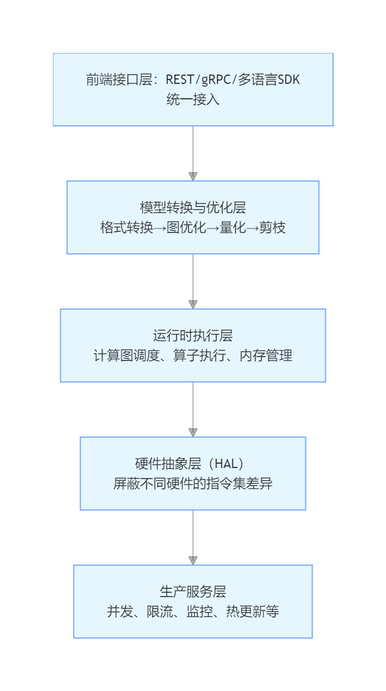
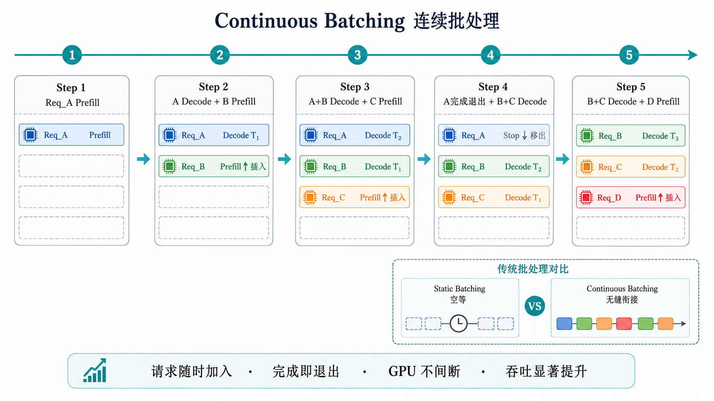

# 目录

> 本节围绕模型推理部署的核心知识展开，覆盖从推理框架基础、框架选型、推理加速，到模型压缩、算子优化、内存优化、批处理调度、硬件选择和服务化部署等内容。读完本节后，读者可以系统理解一个训练好的模型如何从研发阶段走向生产环境，掌握影响推理性能的关键因素，了解传统深度学习模型与大模型在推理部署上的差异，并能够从延迟、吞吐、成本、稳定性和硬件适配等角度分析和设计推理部署方案。

[1.什么是推理框架，它有哪些核心功能？](#1.什么是推理框架，它有哪些核心功能？)
  - [面试问题：讲一下你对推理框架的理解](#面试问题-讲一下你对推理框架的理解)
  - [面试问题（进阶）：请简要描述图优化、算子库、内存管理与运行时调度分别解决什么问题？](#面试问题-请简要描述图优化、算子库、内存管理与运行时调度分别解决什么问题？)

[2.主流推理框架有哪些分类？如何进行选型？](#2.主流推理框架有哪些分类？如何进行选型？)
  - [面试问题：传统深度学习推理框架有哪些？适用场景与选型依据是什么？](#面试问题-传统深度学习推理框架有哪些？适用场景与选型依据是什么？)
  - [面试问题：移动端/边缘端推理框架有哪些？部署限制与选型考量是什么？](#面试问题-移动端/边缘端推理框架有哪些？部署限制与选型考量是什么？)
  - [面试问题：大模型推理框架有哪些？其核心优化技术与选型标准是什么？](#面试问题-大模型推理框架有哪些？其核心优化技术与选型标准是什么？)

[3.推理框架与训练框架的核心差异是什么？](#3.推理框架与训练框架的核心差异是什么？)
  - [面试问题：为什么训练好的模型不能直接用训练框架上线？](#面试问题-为什么训练好的模型不能直接用训练框架上线？)
  - [面试问题：推理框架在性能优化上通常做哪些工作？](#面试问题-推理框架在性能优化上通常做哪些工作？)

[4.为什么要进行推理加速？主要应用场景有哪些？](#4.为什么要进行推理加速？主要应用场景有哪些？)
  - [面试问题：为什么模型推理需要加速？](#面试问题-为什么模型推理需要加速？)
  - [面试问题：哪些业务场景对推理加速最敏感？](#面试问题-哪些业务场景对推理加速最敏感？)

[5.影响模型推理速度的关键因素有哪些？](#5.影响模型推理速度的关键因素有哪些？)
  - [面试问题：影响单次模型推理延迟的因素有哪些？](#面试问题-影响单次模型推理延迟的因素有哪些？)
  - [面试问题：影响推理吞吐量的因素有哪些？](#面试问题-影响推理吞吐量的因素有哪些？)
  - [面试问题（进阶）：如何判断推理瓶颈在计算、访存还是调度？](#面试问题-如何判断推理瓶颈在计算-访存还是调度？)

[6.模型压缩技术整体有哪些？剪枝、蒸馏、量化分别解决什么问题？](#6.模型压缩技术整体有哪些？剪枝、蒸馏、量化分别解决什么问题？)
  - [面试问题：什么是模型压缩？为什么推理部署中需要模型压缩？](#面试问题-什么是模型压缩-为什么推理部署中需要模型压缩？)
  - [面试问题：模型压缩主要有哪些技术路线？各自适合什么场景？](#面试问题-模型压缩主要有哪些技术路线-各自适合什么场景？)
  - [面试问题（进阶）：不同模型压缩方法如何取舍？](#面试问题-不同模型压缩方法如何取舍？)

[7.请详细介绍一下剪枝技术](#7.请详细介绍一下剪枝技术)
  - [面试问题：剪枝的基本流程和重要性判断方法是什么？](#面试问题-剪枝的基本流程和重要性判断方法是什么？)
  - [面试问题（进阶）：结构化剪枝和非结构化剪枝有什么区别？](#面试问题-结构化剪枝和非结构化剪枝有什么区别？)

[8.请详细介绍一下蒸馏技术](#8.请详细介绍一下蒸馏技术)
  - [面试问题：知识蒸馏为什么比只学习真实标签更有效？](#面试问题-知识蒸馏为什么比只学习真实标签更有效？)
  - [面试问题：知识蒸馏有哪些常见方式？](#面试问题-知识蒸馏有哪些常见方式？)
  - [面试问题：知识蒸馏适合哪些场景？有哪些局限？](#面试问题-知识蒸馏适合哪些场景-有哪些局限？)

[9.请详细介绍一下量化技术](#9.请详细介绍一下量化技术)
  - [面试问题：量化如何把浮点数映射成低精度数值？](#面试问题-量化如何把浮点数映射成低精度数值？)
  - [面试问题：PTQ和QAT有什么区别？](#面试问题-ptq和qat有什么区别？)
  - [面试问题（进阶）：权重量化、激活量化和KV Cache量化分别解决什么问题？](#面试问题-权重量化-激活量化和kv-cache量化分别解决什么问题？)

[10.模型编译与即时编译（JIT）在推理中起什么作用？](#10.模型编译与即时编译jit在推理中起什么作用)
  - [面试问题：模型编译在推理中解决什么问题？](#面试问题-模型编译在推理中解决什么问题)
  - [面试问题（进阶）：哪些场景更适合使用AOT或JIT编译？](#面试问题-哪些场景更适合使用aot或jit编译)

[11.计算优化中的算子融合与内核优化分别指什么？](#11.计算优化中的算子融合与内核优化分别指什么)
  - [面试问题：什么是算子融合？为什么它能提升推理性能？](#面试问题-什么是算子融合-为什么它能提升推理性能)
  - [面试问题（进阶）：什么是内核优化？通常会优化哪些方面？](#面试问题-什么是内核优化-通常会优化哪些方面)

[12.如何理解计算瓶颈、访存瓶颈和计算强度？](#12.如何理解计算瓶颈-访存瓶颈和计算强度)
  - [面试问题：计算瓶颈和访存瓶颈在推理中分别有哪些典型表现？](#面试问题-计算瓶颈和访存瓶颈在推理中分别有哪些典型表现)
  - [面试问题：什么是计算强度？它为什么重要？](#面试问题-什么是计算强度-它为什么重要)
  - [面试问题（进阶）：如何用Roofline模型理解推理性能上限？](#面试问题-如何用roofline模型理解推理性能上限)

[13.内存优化有哪些常用技术？](#13.内存优化有哪些常用技术)
  - [面试问题：内存池、张量复用和算子融合分别如何降低内存开销？](#面试问题-内存池-张量复用和算子融合分别如何降低内存开销)
  - [面试问题（进阶）：大模型推理中的KV Cache内存如何优化？](#面试问题-大模型推理中的kv-cache内存如何优化)

[14.静态批处理、动态批处理和连续批处理有什么区别？](#14.静态批处理-动态批处理和连续批处理有什么区别)
  - [面试问题：静态批处理和动态批处理有什么区别？](#面试问题-静态批处理和动态批处理有什么区别)
  - [面试问题：大模型推理中的连续批处理解决了什么问题？](#面试问题-大模型推理中的连续批处理解决了什么问题)

[15.CPU、GPU、NPU推理各有什么特点？](#15.cpu-gpu-npu推理各有什么特点)
  - [面试问题：CPU、GPU、NPU在算力、带宽和能效上有什么差异？](#面试问题-cpu-gpu-npu在算力-带宽和能效上有什么差异)
  - [面试问题（进阶）：实际部署时如何选择推理硬件？](#面试问题-实际部署时如何选择推理硬件)

[16.模型服务上线部署通常包含哪些工程问题？Docker在其中起什么作用？](#16.模型服务上线部署通常包含哪些工程问题docker在其中起什么作用)
  - [面试问题：模型上线时如何处理环境、版本和资源管理问题？](#面试问题-模型上线时如何处理环境-版本和资源管理问题)
  - [面试问题：为什么模型部署常用Docker容器？](#面试问题-为什么模型部署常用docker容器)
  - [面试问题（进阶）：使用Docker部署模型服务时常见问题有哪些？](#面试问题-使用docker部署模型服务时常见问题有哪些)

[17.模型服务化部署通常包含哪些组件？](#17.模型服务化部署通常包含哪些组件)
  - [面试问题：API接口、预处理、推理引擎和调度队列分别承担什么职责？](#面试问题-api接口-预处理-推理引擎和调度队列分别承担什么职责)
  - [面试问题：大模型服务化和传统模型服务化有什么不同？](#面试问题-大模型服务化和传统模型服务化有什么不同)

[18.如何评估一个推理服务的性能和稳定性？](#18.如何评估一个推理服务的性能和稳定性)
  - [面试问题：评估推理服务时为什么不能只看平均延迟？](#面试问题-评估推理服务时为什么不能只看平均延迟)
  - [面试问题：大模型推理服务有哪些特殊评估指标？](#面试问题-大模型推理服务有哪些特殊评估指标)
  - [面试问题（进阶）：如何评估推理服务的稳定性和线上可用性？](#面试问题-如何评估推理服务的稳定性和线上可用性)

---

<h1 id="1.什么是推理框架，它有哪些核心功能？">1.什么是推理框架，它有哪些核心功能？</h1>

> 推理框架是把训练好的模型高效部署到生产环境的系统，它通过模型加载、图优化、算子执行、内存管理、硬件适配和服务化能力，让模型在不同硬件上以更低延迟、更高吞吐和更低成本稳定运行。

<h2 id="面试问题-讲一下你对推理框架的理解">面试问题：讲一下你对推理框架的理解</h2>

**难度评分：⭐⭐⭐ (3/5)  |  考察频率：⭐⭐⭐⭐⭐ (5/5)**

### 一、推理框架的定义
推理框架是**将训练好的AI模型高效部署到生产环境并执行推理的框架或运行时系统**，它的目标是在**保证输出正确性或精度可接受的前提下**，尽可能降低推理延迟、提升吞吐量、降低资源成本，并保证生产服务的稳定性和可维护性。

### 二、为什么需要推理框架
训练框架可以把模型训练出来，但生产环境还需要解决性能、硬件适配和服务稳定性问题。推理框架的价值主要体现在：
1. **让模型跑得更快**：通过图优化、算子融合、量化、编译优化等方式降低推理延迟
2. **让硬件利用率更高**：充分利用CPU/GPU/NPU等硬件的算力和内存带宽
3. **让部署成本更低**：减少显存、内存、机器数量和电力成本
4. **让线上服务更稳定**：配合batching、并发调度、监控、热更新等能力支撑生产请求

### 三、推理框架的核心功能
1. **模型优化与高效执行**：通过图优化、量化、算子融合、编译优化等技术，在合适模型、硬件和后端支持下显著提升推理性能
2. **硬件适配与跨平台部署**：通过统一接口和硬件后端适配，降低CPU/GPU/NPU/TPU/端侧芯片等不同平台的部署和迁移成本
3. **运行时资源管理**：负责算子调度、内存规划、显存复用、batching、并发调度以及大模型推理中的KV Cache管理等能力
4. **生产服务体系能力**：在完整的模型部署系统中，通常还会配合请求队列、负载均衡、限流熔断、监控告警、日志追踪、模型热更新等生产能力
5. **模型管理与发布能力**：在更广义的推理部署平台或MLOps系统中，还会支持模型格式转换、版本管理、A/B测试、灰度发布和动态扩缩容

### 四、推理框架的组成
推理框架通常包含以下几大核心模块：
1. **前端接口层**：统一接入，支持REST/gRPC/多语言SDK
2. **模型转换与优化层**：格式转换→图优化→量化→剪枝
3. **运行时执行层**：计算图调度、算子执行、内存管理以及大模型推理中的 KV Cache 管理与动态批调度
4. **硬件抽象层（HAL）**：屏蔽不同硬件的指令集差异
5. **生产服务层**：并发、限流、监控、热更新等

可以总结为：**推理框架本质上是把模型表达转换成硬件高效执行和线上稳定服务的工程系统。狭义上它偏模型优化与运行时执行，广义上还会和模型服务平台、MLOps系统一起完成监控、发布和版本管理。**



<h2 id="面试问题-请简要描述图优化、算子库、内存管理与运行时调度分别解决什么问题？">面试问题（进阶）：请简要描述图优化、算子库、内存管理与运行时调度分别解决什么问题？</h2>

**难度评分：⭐⭐⭐⭐⭐ (5/5)  |  考察频率：⭐⭐⭐ (3/5)**     


### 一、图优化模块：解决**计算冗余与计算图低效**的问题
训练框架（PyTorch/TensorFlow）导出的模型或中间表示通常优先服务于训练和模型表达，重点是**灵活性、可调试性和通用性**，不一定适合直接高效推理。原始图中可能存在：
- 多个可以合并的小算子，例如 Conv + BN + ReLU
- 可以在编译期提前计算的常量表达式
- 不再影响输出的无效节点或分支
- 不合理的数据布局和算子执行顺序

图优化通过一系列**保持计算语义等价**的图变换，对计算图进行重构，典型手段包括**常量折叠、死代码消除、公共子表达式消除、算子融合、布局转换**等。它的核心目标是**少算、少搬数据、减少调度开销，并让后续算子库和硬件后端更容易发挥性能**。

### 二、算子库模块：解决**单个算子执行效率低**的问题
图优化决定"应该怎么组织计算"，算子库决定"每个计算单元如何在硬件上高效执行"。如果算子实现效率低，即使计算图已经优化，仍然无法充分发挥硬件性能。通用实现往往难以充分利用：
- CPU 的 SIMD 指令、多线程和缓存层次
- GPU 的 CUDA Core、Tensor Core、shared memory 和访存合并
- NPU / TPU 等专用加速器的算子格式和编译后端

算子库会针对不同硬件的**指令集、内存层次和并行计算单元**提供高度优化的 GEMM、Conv、Attention、LayerNorm、Elementwise 等算子实现。常见优化包括**向量化、多线程、tile/block划分、共享内存复用、访存合并、低精度计算和kernel融合**，目标是让硬件计算单元尽量保持高利用率。

### 三、内存管理模块：解决**内存开销、分配开销和显存碎片**的问题
深度学习推理需要存储模型权重、输入输出张量、中间激活、临时 workspace，以及大模型生成过程中的 KV Cache。内存管理模块通常负责：
- **内存池 / 显存池**：减少频繁 malloc/free 或 cudaMalloc/cudaFree 带来的开销
- **张量复用**：根据张量生命周期复用不再使用的内存块
- **静态内存规划**：在 shape 相对固定时提前规划峰值内存
- **显存碎片控制**：降低碎片和预留浪费
- **KV Cache 管理**：通过 PagedAttention、Block Table、Prefix Cache、KV Cache量化等方式支撑长上下文和高并发

它的核心目标是**降低峰值显存、减少分配释放开销、提高显存可承载的 batch 和并发规模**。

### 四、运行时调度模块：解决**执行顺序、资源利用率和请求调度**的问题
运行时调度负责把优化后的计算图和算子放到真实硬件与线上请求流量中执行。常见问题包括：
- 算子执行顺序不合理，导致依赖等待
- 计算与数据传输串行执行，硬件空闲时间长
- 小 kernel 过多，kernel launch 和同步开销明显
- 在线请求动态到达，固定 batch 难以兼顾延迟和吞吐
- 多模型、多任务或多租户之间存在资源竞争

运行时调度主要分为两个层面：
- **算子级调度**：管理算子执行顺序、依赖关系、任务分发、异步拷贝、stream并发、计算通信重叠，目标是减少等待并提高硬件利用率。
- **请求级调度**：管理请求队列、动态batching、连续批处理、优先级、抢占和资源分配，目标是在延迟约束下提升吞吐量。

可以总结为：**图优化负责让计算图更适合推理，算子库负责让单个算子跑得快，内存管理负责让显存用得省且稳定，运行时调度负责让硬件和请求流持续高效运转。**
<h1 id="2.主流推理框架有哪些分类？如何进行选型？">2.主流推理框架有哪些分类？如何进行选型？</h1>

> 推理框架通常可以按部署场景分为云端通用推理框架、移动端/边缘端推理框架和大模型推理框架；选型时优先看硬件平台，其次看模型类型、性能目标、部署复杂度、生态成熟度和服务化能力。

### 一、分类思路

主流推理框架可以按部署位置和模型类型粗略分成三类：

1. **传统深度学习推理框架**：主要服务云端或服务器侧的CV、NLP、推荐等模型，例如TensorRT、ONNX Runtime、OpenVINO
2. **移动端/边缘端推理框架**：主要服务手机、摄像头、嵌入式设备和IoT设备，例如NCNN、MNN、TensorFlow Lite / LiteRT、Core ML
3. **大模型推理框架**：主要服务LLM/VLM等生成式模型，例如vLLM、TensorRT-LLM、SGLang

### 二、选型的核心原则

推理框架选型不要只看“哪个最快”，而要结合实际部署约束：

1. **先看硬件**：NVIDIA GPU、Intel CPU、移动端NPU、国产AI芯片往往对应不同最佳框架
2. **再看模型类型**：CNN、Transformer、推荐模型、大语言模型的优化重点不同
3. **再看性能目标**：低延迟、高吞吐、低成本、长上下文、高并发的选择可能不同
4. **最后看工程生态**：模型支持、文档、社区、服务化接口、监控和运维能力都会影响落地

<h2 id="面试问题-传统深度学习推理框架有哪些？适用场景与选型依据是什么？">面试问题：传统深度学习推理框架有哪些？适用场景与选型依据是什么？</h2>

**难度评分：⭐⭐⭐⭐ (4/5)  |  考察频率：⭐⭐⭐⭐ (4/5)**

- **传统深度学习推理框架**：主要面向**云端服务器或边缘服务器**，硬件资源相对充足，目标是在给定硬件上提升**吞吐量、延迟表现和算力利用率**，常用于CV、NLP、推荐系统等非自回归生成任务。

### 一、主流传统推理框架
1. **NVIDIA TensorRT**：NVIDIA GPU上的高性能推理引擎，擅长图优化、算子融合、低精度推理和engine构建，适合追求极致性能的生产部署；限制是硬件绑定强，动态shape、自定义算子和engine调试有一定门槛。
2. **ONNX Runtime (ORT)**：跨平台推理运行时，支持多种 Execution Provider，例如 CPU、CUDA、TensorRT、OpenVINO、DirectML 等，适合已有ONNX模型、跨硬件部署和快速集成；性能上限取决于具体EP、算子覆盖、模型结构、动态shape和batch大小。
3. **Intel OpenVINO**：面向Intel CPU、iGPU、NPU等硬件优化的推理工具链，适合Intel平台上的服务器、PC与边缘部署，支持模型转换、图优化和低精度推理；对非Intel硬件的适配不是重点。

### 二、适用场景
1. **TensorRT**：NVIDIA GPU生产环境、CV/Transformer/推荐模型加速、低延迟或高吞吐服务。
2. **ONNX Runtime**：多框架模型统一部署、跨平台推理、快速验证、需要在不同硬件后端之间切换的场景。
3. **OpenVINO**：Intel CPU/iGPU/NPU上的边缘推理、工业视觉、PC端AI和CPU成本敏感的服务。

### 三、选型依据
1. **硬件平台优先**
   - NVIDIA GPU：优先评估 TensorRT；如果重视通用性和开发效率，也可评估 ONNX Runtime + CUDA/TensorRT EP
   - Intel CPU / iGPU / NPU：优先评估 OpenVINO，也可评估 ONNX Runtime
   - 多硬件统一部署：优先评估 ONNX Runtime

2. **模型和算子支持**
   - 是否能顺利导出 ONNX 或目标IR
   - 动态shape、控制流、自定义算子是否被支持
   - 关键算子是否有高性能kernel或可融合实现

3. **性能与工程成本**
   - 极致性能：更偏 TensorRT / OpenVINO 这类硬件深度优化框架
   - 跨平台和易集成：更偏 ONNX Runtime
   - 生产落地还要看模型转换稳定性、调试工具、版本兼容、监控接入和团队维护成本

可以总结为：**传统推理框架选型不是只看框架名，而是先看硬件，再看模型能否顺利转换和关键算子是否高效支持，最后通过压测验证延迟、吞吐和稳定性。**

<h2 id="面试问题-移动端/边缘端推理框架有哪些？部署限制与选型考量是什么？">面试问题：移动端/边缘端推理框架有哪些？部署限制与选型考量是什么？</h2>

**难度评分：⭐⭐⭐⭐ (4/5)  |  考察频率：⭐⭐⭐⭐ (4/5)**

- **移动端/边缘端推理框架**：主要面向**手机、嵌入式设备、摄像头、IoT设备和边缘网关**，硬件资源通常受限，目标是在**算力、内存、功耗、包体和实时性**约束下实现稳定可用的本地推理。

### 一、主流移动端/边缘端推理框架
1. **NCNN**：轻量、依赖少、适合移动端和嵌入式设备，常用于对包体和部署简洁性敏感的场景；不足是通用算子覆盖和复杂模型支持不如通用框架全面。
2. **MNN**：跨平台端侧推理框架，支持移动端、嵌入式、PC和Linux，算子覆盖较全面，也支持多种硬件加速后端，适合需要兼顾性能和跨平台的场景。
3. **TensorFlow Lite / LiteRT**：Google端侧推理生态，适合Android、嵌入式和微控制器场景，支持CPU、GPU、NPU/DSP等多种delegate；LiteRT可以理解为Google对TFLite相关运行时生态的延续和更新。
4. **Apple Core ML**：苹果生态专属框架，针对A系列/M系列芯片和系统能力深度优化，适合iOS、macOS等苹果设备；限制是跨平台能力弱。
5. **ONNX Runtime Mobile**：适合已有ONNX模型和跨平台端侧部署，可通过裁剪算子降低包体，也便于和云端ONNX Runtime体系复用。

### 二、移动端/边缘端部署限制
1. **算力限制**：端侧算力通常低于服务器，需要充分利用CPU SIMD、移动GPU、NPU/DSP等硬件加速能力。
2. **内存限制**：可用内存受系统和其他应用影响，嵌入式设备更容易出现内存不足和碎片问题。
3. **功耗与散热限制**：持续推理可能导致发热、降频和续航下降，不能只看短时间benchmark。
4. **包体限制**：移动App、SDK或固件通常限制模型大小、运行时库大小和依赖数量。
5. **算子与模型转换限制**：模型从PyTorch/TensorFlow转换到端侧格式时，可能遇到不支持算子、动态shape受限、精度不一致等问题。
6. **实时性与稳定性限制**：视频、语音、交互式应用通常有端到端延迟上限，还要考虑冷启动、首帧耗时和后台资源竞争。

### 三、选型考量
1. **先看目标硬件和系统生态**
   - iOS / macOS：优先 Core ML
   - Android：优先评估 TensorFlow Lite / LiteRT、NCNN、MNN
   - ARM嵌入式或Linux边缘设备：优先评估 NCNN、MNN、ONNX Runtime Mobile
   - 已有ONNX链路或多平台统一部署：优先 ONNX Runtime Mobile

2. **再看资源约束**
   - 包体极敏感：优先轻量runtime或裁剪后的runtime
   - 功耗敏感：优先选择能调用NPU/DSP delegate的方案
   - 内存紧张：优先考虑量化、模型裁剪、静态内存规划和更小的输入分辨率

3. **最后看工程落地成本**
   - 模型是否容易转换成功
   - 关键算子是否被目标后端支持
   - 精度和速度是否能在真实设备上复现
   - 是否便于集成到App、SDK或边缘服务中

可以总结为：**端侧选型的核心不是单纯追求最高算力，而是在真实设备上平衡模型效果、延迟、功耗、内存、包体和工程可维护性。**

<h2 id="面试问题-大模型推理框架有哪些？其核心优化技术与选型标准是什么？">面试问题：大模型推理框架有哪些？其核心优化技术与选型标准是什么？</h2>

**难度评分：⭐⭐⭐⭐ (4/5)  |  考察频率：⭐⭐⭐⭐ (4/5)**


大模型推理框架与传统推理框架的**核心差异在于工作负载特征不同**：
- 传统推理框架主要解决**静态计算图的高效执行**问题，常见瓶颈包括算子计算效率、内存访问和数据搬运
- 大模型推理框架主要解决**自回归解码模式下的内存管理、请求调度和KV缓存利用率**问题；其中 Prefill 阶段通常更偏计算密集，Decode 阶段通常更偏内存带宽和KV Cache访问瓶颈

大模型的独特特点（参数量巨大、自回归解码、KV缓存随序列长度线性增长、动态序列长度）导致传统静态图优化和固定批处理难以单独解决性能问题，因此催生了以PagedAttention和连续批处理为代表的新一代优化技术。

### 一、主流大模型推理框架
1. vLLM（通用高吞吐开源框架）
vLLM 是目前应用非常广的大模型推理服务框架，核心优势是易用、模型支持广、服务化能力成熟。
- **核心能力**：PagedAttention、连续批处理、OpenAI兼容接口、流式输出、LoRA、多种量化方案
- **适用场景**：通用LLM服务、高并发在线推理、快速部署开源模型
- **主要限制**：极致性能调优空间通常不如TensorRT-LLM；非NVIDIA硬件支持取决于后端成熟度

2. TensorRT-LLM（NVIDIA GPU极致性能框架）
TensorRT-LLM 面向NVIDIA GPU做深度优化，适合追求极致吞吐或低延迟的生产集群。
- **核心能力**：TensorRT图优化、高性能kernel、FP8/INT8/INT4量化、张量并行、流水线并行、多GPU部署
- **适用场景**：NVIDIA GPU集群、H100/H200等新硬件、对性能上限要求很高的服务
- **主要限制**：硬件绑定强，部署和调试复杂，模型适配成本相对更高

3. SGLang（结构化生成和前缀复用友好框架）
SGLang 由LMSYS/UC Berkeley相关团队开发，核心作者与vLLM社区有较强关联，适合复杂生成任务和前缀复用明显的场景。
- **核心能力**：RadixAttention、结构化生成、前缀缓存复用、推测解码、工具调用友好
- **适用场景**：多轮对话、Agent工具调用、结构化输出、公共系统提示词较多的任务
- **主要限制**：生态和运维经验仍在快速发展中，具体模型与硬件支持需要验证

### 二、大模型推理框架的核心优化技术
1. KV Cache与显存管理
大模型自回归生成时，每个请求都需要保存历史token的Key/Value。上下文越长、并发越高，KV Cache显存占用越大。
- **PagedAttention / Block Table**：把KV Cache切成固定大小block，逻辑连续、物理可非连续，减少碎片和预留浪费。
- **Prefix Cache / RadixAttention**：复用系统提示词、多轮对话历史等公共前缀，减少重复Prefill计算和KV构建。
- **KV Cache量化**：用INT8、FP8等低精度保存KV Cache，降低显存占用和Decode访存压力，但需要评估精度影响。

2. 请求调度与批处理
LLM输出长度动态变化，传统固定batch容易被长请求拖慢，也容易出现空槽位。
- **动态批处理**：在短时间窗口内合并请求，提高吞吐，但等待时间过长会增加延迟。
- **连续批处理**：每个decode step动态插入新请求、移除完成请求，提高GPU有效利用率和tokens/s。
- **优先级与抢占**：在混合负载中保障高优先级请求或短请求的响应体验。

3. 计算与解码优化
- **FlashAttention**：通过tiling和online softmax优化Attention访存，减少HBM读写和中间激活显存；精确Attention的计算复杂度仍是O(n²)。
- **低精度计算**：FP16/BF16/INT8/FP8可以降低计算和带宽压力，但加速效果依赖硬件、kernel和框架支持。
- **算子融合与高性能kernel**：减少小kernel、访存和launch开销。
- **推测解码 / Medusa**：一次提出或验证多个候选token，在接受率较高时降低Decode延迟。

4. 多GPU并行
- **张量并行**：切分单层矩阵计算，适合单卡放不下或单层计算量很大的模型。
- **流水线并行**：按层切分模型，适合超大模型，但需要处理pipeline bubble。
- **序列并行 / 上下文并行**：面向超长上下文，切分序列维度或Attention计算。

### 三、大模型推理框架选型标准
1. **看业务目标**
   - 通用聊天服务、快速上线：优先 vLLM
   - NVIDIA GPU极致性能：优先 TensorRT-LLM
   - 多轮对话、Agent、结构化生成、前缀复用明显：优先评估 SGLang

2. **看硬件与模型支持**
   - NVIDIA GPU：vLLM、SGLang、TensorRT-LLM都可评估
   - H100/H200且希望使用FP8：重点评估TensorRT-LLM，也可对比vLLM/SGLang后端支持
   - AMD GPU或其他硬件：需要确认框架后端、算子覆盖和量化能力

3. **看压测负载和工程成本**
   - 输入长度、输出长度、并发数、batch策略会显著影响结果
   - TTFT、TPOT、tokens/s、P95/P99延迟要分别压测
   - 还要考虑部署复杂度、监控、弹性扩缩容、模型热更新和团队维护能力

### 四、主流框架对比
| 框架 | 性能 | 易用性 | 模型支持 | 硬件支持 | 生态完善度 | 典型适用场景 |
|------|------|--------|----------|----------|------------|--------------|
| vLLM | ★★★★☆ | ★★★★★ | ★★★★★ | NVIDIA/AMD/部分其他后端 | ★★★★★ | 通用LLM服务、高吞吐在线推理 |
| TensorRT-LLM | ★★★★★ | ★★☆☆☆ | ★★★☆☆ | NVIDIA | ★★★★☆ | NVIDIA GPU极致性能、H100/H200集群部署 |
| SGLang | ★★★★☆ | ★★★★☆ | ★★★★☆ | NVIDIA/部分其他后端逐步完善 | ★★★☆☆ | 多轮对话、工具调用、结构化生成、前缀复用明显的场景 |

可以总结为：**大模型推理框架的核心不是只把模型跑起来，而是围绕KV Cache、连续批处理、解码优化和多GPU并行，把显存、带宽和调度效率用到极致。最终选型必须结合模型、硬件、输入输出长度、并发负载和运维成本压测验证。**
<h1 id="3.推理框架与训练框架的核心差异是什么？">3.推理框架与训练框架的核心差异是什么？</h1>

> 训练框架的核心目标是把模型训练出来，因此更关注自动求导、参数更新、调试灵活性和分布式训练；推理框架的核心目标是把训练好的模型高效部署出去，因此更关注低延迟、高吞吐、低成本、硬件优化和服务稳定性。


<h2 id="面试问题-为什么训练好的模型不能直接用训练框架上线？">面试问题：为什么训练好的模型不能直接用训练框架上线？</h2>

**难度评分：⭐⭐⭐⭐ (4/5)  |  考察频率：⭐⭐⭐⭐ (4/5)**

严格来说，训练框架也可以直接做推理，例如用 PyTorch 加载模型、调用 `model.eval()` 并关闭梯度计算。但在生产环境中，直接用训练框架上线通常不是最优选择，主要原因有四点：

### 一、训练框架包含大量推理不需要的能力

训练框架为了支持训练，需要保留自动求导、动态图构建、梯度管理、优化器、调试接口和训练态算子等能力。这些能力在推理阶段大多用不上，却会带来额外依赖、运行时开销和部署复杂度。

生产推理通常只需要稳定执行前向计算，因此会尽量裁剪训练相关逻辑，让执行路径更短、依赖更少、行为更可控。

### 二、训练框架不一定能充分利用部署硬件

线上推理往往运行在特定硬件上，例如 NVIDIA GPU、Intel CPU、移动端NPU、边缘AI芯片等。推理框架会针对这些硬件做专门优化，例如：

- TensorRT 针对 NVIDIA GPU 做 kernel 选择、算子融合、低精度推理和engine构建
- OpenVINO 针对 Intel CPU/iGPU/NPU 做图优化、算子优化和低精度执行
- NCNN、MNN、Core ML 针对移动端 CPU、GPU、NPU 做轻量化部署和硬件适配

训练框架更重视通用性、灵活性和开发效率，不一定能在目标部署硬件上达到最优延迟、吞吐和资源利用率。

### 三、生产服务需要更强的稳定性和服务化能力

训练阶段通常是离线任务，慢一点可以接受；推理阶段面向真实用户请求，通常要满足延迟、吞吐、稳定性和成本要求。

生产服务还需要处理：
- 请求队列、batching、并发控制和超时控制
- 资源隔离、限流熔断、健康检查和自动重启
- 日志、指标监控、告警和链路追踪
- 模型版本管理、灰度发布、回滚和热更新

这些能力不是训练框架的核心目标，通常需要推理框架、模型服务框架或MLOps平台配合完成。

### 四、模型格式和运行时需要适配生产约束

训练产物通常包含训练态结构、动态图逻辑或框架私有依赖，直接上线可能遇到启动慢、依赖重、跨平台困难、版本兼容复杂等问题。

所以生产环境通常会把训练好的模型转换成 ONNX、TensorRT Engine、OpenVINO IR、Core ML、TFLite、GGUF 等更适合部署的格式，再交给推理框架或专用运行时执行。

可以总结为：**训练框架关注"把模型训练出来"，推理部署关注"把模型稳定、低成本、高性能地服务真实请求"。训练框架能做推理，但生产环境通常需要推理框架来补足性能优化、硬件适配和服务化能力。**

<h2 id="面试问题-推理框架在性能优化上通常做哪些工作？">面试问题：推理框架在性能优化上通常做哪些工作？</h2>

**难度评分：⭐⭐⭐⭐ (4/5)  |  考察频率：⭐⭐⭐⭐ (4/5)**


推理框架的性能优化可以从”少算、快算、省内存、批量跑”四个角度理解。

### 一、少算：减少不必要的计算

常见方式包括：
- **常量折叠**：把编译期就能算出来的结果提前算好
- **死代码消除**：删除不会影响输出的节点或分支
- **公共子表达式消除**：相同计算只保留一份结果
- **算子融合**：把多个连续小算子合并成一个大算子，例如 Conv + BN + ReLU、MatMul + Bias + Activation
- **低精度推理**：从FP32改为FP16、BF16、INT8、INT4或FP8，在硬件和kernel支持时减少计算开销

### 二、快算：让硬件更高效地执行

推理框架会根据不同硬件选择或生成更快的算子实现：
- CPU上使用SIMD指令、多线程、NUMA亲和性和缓存友好的数据布局
- GPU上使用Tensor Core、shared memory、访存合并、tiling、kernel fusion和CUDA Graph
- NPU/TPU上使用芯片厂商提供的编译器、算子库和专用数据布局

这类优化的目标是提高计算单元利用率，减少访存等待和kernel launch等调度开销。

### 三、省内存：减少内存和显存占用

常见方式包括：
- **内存池 / 显存池**：避免频繁申请和释放内存
- **张量复用**：生命周期不重叠的中间张量共用同一块内存
- **静态内存规划**：提前规划中间张量和workspace，降低峰值占用
- **权重和激活量化**：降低模型参数和中间张量占用
- **KV Cache管理**：大模型推理中通过PagedAttention、Prefix Cache、KV Cache量化等技术减少KV缓存浪费

省内存不仅能降低资源成本，也能让同一张GPU承载更大batch、更长上下文或更多并发会话。

### 四、批量跑：提升吞吐和硬件利用率

单个请求往往无法充分利用GPU或加速器。推理框架通常会把多个请求合并成一个batch执行，从而提高吞吐量。

常见方式包括：
- **静态批处理**：固定batch大小，适合离线或输入形状稳定的场景
- **动态批处理**：在线服务中短时间窗口聚合请求，在延迟和吞吐之间做权衡
- **连续批处理**：大模型推理中每个decode step动态加入新请求、移除已完成请求，避免短请求完成后槽位空闲

可以总结为：**推理框架性能优化的核心是减少无效计算、提升单算子执行效率、降低内存和显存开销，并通过batching和调度提高硬件利用率。实际收益必须结合模型结构、输入shape、硬件后端、精度方案和压测负载验证。**
<h1 id="4.为什么要进行推理加速？主要应用场景有哪些？">4.为什么要进行推理加速？主要应用场景有哪些？</h1>

> 推理加速的本质是让模型在满足精度要求的前提下，以更低延迟、更高吞吐和更低成本服务真实业务请求，尤其是在高并发、实时交互、端侧部署和大模型服务场景中非常关键。

<h2 id="面试问题-为什么模型推理需要加速？">面试问题：为什么模型推理需要加速？</h2>

**难度评分：⭐⭐⭐ (3/5)  |  考察频率：⭐⭐⭐⭐⭐ (5/5)**

### 一、核心原因一句话总结

模型训练完成后，真正上线时面对的是大量真实请求。推理如果太慢，就会导致用户等待时间长、系统吞吐低、机器成本高，甚至无法满足实时业务要求。

因此，推理加速不是单纯“跑得更快”，而是为了让模型具备**工程可用性和商业可用性**。

### 二、从用户体验看：降低响应延迟

很多线上业务都要求模型快速返回结果，例如：

- 搜索推荐希望用户刷新页面时立即返回结果
- 智能客服希望用户发出问题后马上得到回答
- 自动驾驶、工业检测、视频分析需要接近实时响应

如果模型推理一次需要几秒甚至几十秒，算法效果再好，也很难落地到真实业务中。

所以，推理加速的第一个目标是**降低延迟（Latency）**，让单个请求更快返回。

### 三、从系统能力看：提升服务吞吐

线上服务通常不是只处理一个请求，而是同时处理成百上千个请求。

如果一次推理很慢，同样数量的机器能处理的请求数就少；如果推理速度提升，同样的GPU或CPU可以服务更多用户。

所以，推理加速的第二个目标是**提升吞吐量（Throughput）**，让单位时间内处理更多请求。

### 四、从成本角度看：降低部署成本

模型越大、推理越慢，需要的服务器、GPU、显存和电力成本就越高。通过量化、算子优化、batching、KV Cache优化等方式，可以让同一个模型用更少资源跑起来。

所以，推理加速的第三个目标是**降低成本**，包括机器成本、显存成本、电力成本和运维成本。

<h2 id="面试问题-哪些业务场景对推理加速最敏感？">面试问题：哪些业务场景对推理加速最敏感？</h2>

**难度评分：⭐⭐⭐ (3/5)  |  考察频率：⭐⭐⭐⭐ (4/5)**

对推理加速最敏感的场景，通常具备一个或多个特点：**实时性要求高、并发请求多、模型规模大、部署资源受限**。

### 一、实时交互场景

这类场景对延迟非常敏感，用户希望很快得到反馈。

典型例子包括：
- 智能客服、语音助手、实时翻译
- 搜索排序、推荐系统、广告排序
- 人脸识别、OCR识别、拍照识物

这些场景中，推理延迟过高会直接影响用户体验和业务转化率。

### 二、高并发在线服务场景

这类场景每秒请求量很大，重点关注吞吐量和资源成本。

典型例子包括：
- 推荐系统召回与排序
- 广告点击率预估
- 内容审核
- 大模型API服务

在这些业务中，哪怕单次推理只优化几毫秒，放到每天千万级或亿级请求上，也会带来明显的成本收益。

### 三、端侧和边缘部署场景

端侧和边缘设备资源有限，通常受算力、内存、功耗和包体限制。

典型例子包括：
- 手机端图像美化、人脸检测、语音唤醒
- 摄像头侧的视频分析
- 工业质检设备
- IoT设备上的异常检测

这些场景不能简单依赖大服务器，因此必须通过模型压缩、量化、算子优化等方式让模型在小设备上跑起来。

### 四、大模型推理场景

大模型推理尤其需要加速，因为模型参数量大、KV Cache占用高、自回归解码逐token生成，天然容易出现延迟高和显存成本高的问题。

典型优化包括：
- PagedAttention 降低 KV Cache 浪费
- Continuous Batching 提升GPU利用率
- 量化降低显存和带宽压力
- 推测解码降低生成延迟

可以总结为：**推理加速最典型的应用场景包括实时交互、高并发在线服务、端侧/边缘部署和大模型服务。这些场景共同特点是对延迟、吞吐、成本或资源限制非常敏感。**

<h1 id="5.影响模型推理速度的关键因素有哪些？">5.影响模型推理速度的关键因素有哪些？</h1>

> 模型推理速度主要受模型结构、输入规模、计算精度、硬件性能、算子实现、内存访问、batch大小和运行时调度影响。简单来说，既要看模型本身有多复杂，也要看硬件和推理框架能不能高效执行它。

<h2 id="面试问题-影响单次模型推理延迟的因素有哪些？">面试问题：影响单次模型推理延迟的因素有哪些？</h2>

**难度评分：⭐⭐⭐ (3/5)  |  考察频率：⭐⭐⭐⭐⭐ (5/5)**

### 一、核心思路

单次推理延迟指的是一个请求从输入模型到得到输出结果所花的时间。影响延迟的因素可以从“模型、输入、硬件、框架”四个角度理解。

### 二、模型本身的复杂度

模型越大，通常推理越慢。常见影响因素包括：

1. **参数量**：参数越多，权重读取和计算量越大
2. **计算量（FLOPs）**：矩阵乘法、卷积、Attention等计算越多，耗时越长
3. **网络结构**：有些结构天然更难加速，例如动态控制流、小算子很多、分支很多的模型
4. **算子类型**：矩阵乘法、卷积通常容易被硬件加速；复杂后处理、稀疏访问、自定义算子可能成为瓶颈

例如，同样是图像模型，ResNet-50 通常比 ResNet-18 慢；同样是大语言模型，70B模型通常比7B模型慢很多。

### 三、输入规模和输出长度

输入越大，模型需要处理的数据越多。

常见例子：
- 图像分辨率越高，卷积和特征图计算越多
- 文本输入越长，Transformer的Attention计算和KV Cache占用越大
- 大模型生成的输出token越多，总推理时间越长

对大模型来说，要特别区分：
- **Prefill阶段**：处理输入prompt，输入越长越慢
- **Decode阶段**：逐token生成，输出越长总耗时越长

### 四、计算精度

不同精度会直接影响计算速度和内存占用。

常见精度包括：
- FP32：精度高，但计算和显存开销大
- FP16/BF16：常用于GPU推理，速度更快，显存更省
- INT8/INT4：进一步降低计算和存储开销，但需要评估精度损失
- FP8：在新一代GPU上常用于大模型推理加速

一般来说，在硬件、推理框架和算子库支持对应低精度kernel的前提下，低精度推理可以显著降低延迟；否则可能主要体现为节省显存和带宽，不一定带来明显加速。

### 五、硬件和算子实现

同一个模型在不同硬件上的速度差异可能非常大。

影响因素包括：
- CPU/GPU/NPU本身的算力和内存带宽
- 是否使用了Tensor Core、SIMD、NPU专用单元等加速能力
- 算子库是否针对硬件做过优化
- 是否存在不支持的算子导致回退到CPU或低效实现

例如，TensorRT在NVIDIA GPU上通常能比原始PyTorch推理更快，原因就是它做了图优化、kernel选择和低精度优化。

### 六、数据搬运和预后处理

推理延迟不只包括模型前向计算，还包括：
- 输入预处理，例如图像解码、resize、normalize
- CPU到GPU的数据拷贝
- GPU到CPU的结果回传
- 输出后处理，例如NMS、token解码、规则过滤

如果这些步骤没有优化，即使模型本身很快，端到端延迟也可能很高。

可以总结为：**单次推理延迟主要由模型计算量、输入输出规模、计算精度、硬件能力、算子实现和数据搬运共同决定。优化延迟时不能只看模型前向时间，还要看端到端链路。**

<h2 id="面试问题-影响推理吞吐量的因素有哪些？">面试问题：影响推理吞吐量的因素有哪些？</h2>

**难度评分：⭐⭐⭐⭐ (4/5)  |  考察频率：⭐⭐⭐⭐ (4/5)**

### 一、核心思路

吞吐量指单位时间内系统能处理多少请求，常见指标包括 QPS、tokens/s、images/s 等。

影响吞吐量的核心不是“单个请求最快”，而是**硬件资源能不能被充分利用**。

### 二、Batch大小

Batching是提升吞吐量最常见的方法。

单个请求可能无法把GPU算力吃满，把多个请求合并成一个batch后，可以让矩阵乘法、卷积等大算子更高效执行。

但batch不是越大越好：
- batch太小：硬件利用率低，吞吐量低
- batch适中：吞吐量提升明显
- batch太大：显存占用上升，排队时间变长，单请求延迟可能变差

所以，线上服务通常需要在吞吐量和延迟之间做权衡。

### 三、并发和调度策略

推理服务通常会同时处理多个请求。调度策略会直接影响吞吐量。

常见影响因素包括：
- 请求队列如何合并batch
- 是否支持动态batching
- 是否支持异步执行
- 多模型之间如何共享GPU资源
- 大模型中是否支持Continuous Batching

对于大模型推理，连续批处理非常关键。它可以在每个解码step动态加入新请求、移除已完成请求，避免一个batch被长请求拖慢。

### 四、内存和显存容量

吞吐量经常受内存和显存限制。

例如：
- batch越大，中间激活占用越高
- 大模型并发越高，KV Cache占用越高
- 显存不够时，可能无法继续增加batch或并发
- 发生CPU/GPU之间的频繁交换时，吞吐量会明显下降

所以，内存优化、KV Cache管理、量化和模型并行都会影响吞吐量。

### 五、硬件利用率

吞吐量高不高，还要看CPU、GPU、NPU是否被充分利用。

常见低利用率原因包括：
- 算子太小，kernel launch开销占比高
- 数据预处理在CPU上成为瓶颈
- CPU到GPU数据拷贝阻塞计算
- 请求到达不均匀，batch难以凑满
- 模型中存在硬件不友好的算子

优化吞吐量时，通常要让计算、数据搬运和请求调度尽量重叠起来。

可以总结为：**吞吐量主要受batch大小、并发请求、调度策略、显存容量、内存带宽和硬件利用率影响。优化吞吐量的核心是让硬件持续有活干，同时避免显存和调度成为瓶颈。**

<h2 id="面试问题-如何判断推理瓶颈在计算-访存还是调度？">面试问题（进阶）：如何判断推理瓶颈在计算、访存还是调度？</h2>

**难度评分：⭐⭐⭐⭐⭐ (5/5)  |  考察频率：⭐⭐⭐ (3/5)**


### 一、核心思路

推理慢不一定都是“算力不够”。常见瓶颈可以分为三类：

1. **计算瓶颈**：主要时间花在计算上，硬件算力不够
2. **访存瓶颈**：主要时间花在读写内存/显存上，计算单元在等数据
3. **调度瓶颈**：硬件没有被持续喂满，时间浪费在排队、同步、kernel launch或数据搬运上

### 二、计算瓶颈怎么看？

如果模型中大矩阵乘法、卷积、Attention计算占主要时间，并且GPU计算单元利用率很高，就可能是计算瓶颈。

常见现象：
- GPU算力利用率高
- Tensor Core利用率高
- 主要耗时集中在GEMM、Conv、Attention等计算密集算子
- 降低精度后速度明显提升，例如FP32改FP16/INT8后明显变快

常见优化方式：
- 使用FP16/BF16/INT8/FP8等低精度
- 使用更高效的算子库
- 算子融合
- 选择更适合硬件的模型结构

### 三、访存瓶颈怎么看？

如果计算单元利用率不高，但显存带宽接近瓶颈，或者大量时间花在读写中间结果、KV Cache、权重加载上，就可能是访存瓶颈。

常见现象：
- GPU算力利用率不高，但显存带宽占用高
- 算子计算量不大，但读写数据很多
- 大模型Decode阶段速度受KV Cache读写影响明显
- batch变大后性能提升不明显，甚至因为显存压力变差

常见优化方式：
- 算子融合，减少中间张量读写
- 使用FlashAttention等减少显存访问的算法
- 量化权重或KV Cache
- 使用PagedAttention降低KV Cache碎片和浪费
- 优化数据布局，提高访存连续性

### 四、调度瓶颈怎么看？

如果GPU经常空闲、请求排队明显、CPU占用高、kernel很多但每个都很小，就可能是调度瓶颈。

常见现象：
- GPU利用率忽高忽低
- CPU预处理或后处理耗时明显
- kernel launch数量很多，小算子特别多
- 请求间等待时间长，batch凑不齐
- 多模型或多请求之间频繁同步

常见优化方式：
- 使用动态batching或continuous batching
- 合并小算子，减少kernel launch
- 异步执行，让计算和数据拷贝重叠
- 优化预处理/后处理，必要时放到GPU上执行
- 调整请求队列、超时时间和batch策略

### 五、分析思路

分析时可以按照下面顺序展开：

1. 先看端到端延迟拆分：预处理、数据拷贝、模型前向、后处理分别耗时多少
2. 再看硬件利用率：GPU/CPU/NPU是否忙，显存带宽是否高
3. 再看算子级profile：主要耗时集中在哪些算子
4. 最后结合优化手段判断瓶颈类型

可以这样总结：**如果计算单元很忙，是计算瓶颈；如果计算单元不忙但带宽很高，是访存瓶颈；如果硬件经常空闲或小任务太多，是调度瓶颈。实际工程中通常要通过profile工具做端到端拆分，而不是凭感觉判断。**
<h1 id="6.模型压缩技术整体有哪些？剪枝、蒸馏、量化分别解决什么问题？">6.模型压缩技术整体有哪些？剪枝、蒸馏、量化分别解决什么问题？</h1>

> 模型压缩是在尽量保持模型精度的前提下，减少模型参数量、计算量、显存占用和推理延迟的技术集合，常见方法包括剪枝、量化、知识蒸馏、低秩分解和轻量化结构设计。

<h2 id="面试问题-什么是模型压缩-为什么推理部署中需要模型压缩？">面试问题：什么是模型压缩？为什么推理部署中需要模型压缩？</h2>

**难度评分：⭐⭐⭐ (3/5)  |  考察频率：⭐⭐⭐⭐⭐ (5/5)**

### 一、模型压缩是什么？

模型压缩就是把一个原本较大、较慢、资源占用较高的模型，变成一个更小、更快、更容易部署的模型。

压缩后的模型通常希望达到几个目标：

1. **模型更小**：减少参数量和模型文件大小
2. **推理更快**：减少计算量和访存开销
3. **显存/内存更省**：降低部署资源要求
4. **精度尽量不掉**：在可接受范围内保持模型效果

### 二、为什么推理部署中需要模型压缩？

训练阶段通常更关注模型效果，可以使用很大的模型和充足的训练资源；但部署阶段要面对真实业务约束。

常见约束包括：

- **延迟约束**：用户请求需要快速返回
- **吞吐约束**：线上服务要同时处理大量请求
- **成本约束**：GPU、CPU、显存和电力成本都很高
- **端侧约束**：手机、摄像头、IoT设备算力和内存有限
- **包体约束**：移动端App或嵌入式固件不能太大

所以模型压缩的核心价值是：**让效果好的模型真正能上线、能跑快、能跑便宜。**

<h2 id="面试问题-模型压缩主要有哪些技术路线-各自适合什么场景？">面试问题：模型压缩主要有哪些技术路线？各自适合什么场景？</h2>

**难度评分：⭐⭐⭐⭐ (4/5)  |  考察频率：⭐⭐⭐⭐⭐ (5/5)**


模型压缩常见技术路线主要有五类。

### 一、剪枝：删除不重要的参数或结构

剪枝的思路是：模型中不是所有参数都同等重要，可以删除贡献较小的权重、通道、卷积核、注意力头或网络层。

常见分类：
- **非结构化剪枝**：删除单个权重，模型变稀疏
- **结构化剪枝**：删除通道、卷积核、层等完整结构

剪枝的优点是可以减少参数量和计算量；难点是剪完后可能掉精度，通常需要微调恢复效果。

### 二、量化：用低精度表示权重和激活

量化是把模型中的FP32、FP16等高精度数值，用INT8、INT4、FP8等低精度格式表示。

例如，把32位浮点数变成8位整数，模型大小和内存带宽需求都会降低。

量化的优点是工程落地成熟、收益明显，是推理部署中最常见的压缩方法之一。

### 三、知识蒸馏：用大模型指导小模型训练

知识蒸馏的思路是：先训练一个效果好的大模型作为老师模型，再训练一个更小的学生模型去模仿老师模型的输出或中间特征。

这样学生模型虽然更小，但可以学到老师模型的“软知识”，效果通常比直接训练小模型更好。

### 四、低秩分解：把大矩阵拆成小矩阵

低秩分解常用于全连接层、卷积层或大模型中的线性层。它把一个大的权重矩阵近似分解成两个或多个更小的矩阵，从而减少参数量和计算量。

它的优点是数学上比较清晰；缺点是压缩比例过高时精度容易下降，并且并不一定在所有硬件上都能带来实际加速。

### 五、轻量化结构设计：直接设计更小的模型

这类方法不是压缩已有模型，而是在模型设计阶段就使用更轻量的结构。

典型例子包括：
- MobileNet使用深度可分离卷积
- ShuffleNet使用通道shuffle和分组卷积
- TinyBERT、DistilBERT等小型Transformer模型

这种方式通常部署友好，但需要重新设计或训练模型。
<h2 id="面试问题-不同模型压缩方法如何取舍？">面试问题（进阶）：不同模型压缩方法如何取舍？</h2>

**难度评分：⭐⭐⭐⭐ (4/5)  |  考察频率：⭐⭐⭐ (3/5)**

不同压缩方法适合不同场景，不能只看压缩率，还要看精度、硬件支持和工程成本。

### 一、如果想快速落地，优先考虑量化

量化通常是性价比最高的第一选择。尤其是INT8、FP16/BF16等，在主流推理框架和硬件上支持较好；FP8主要依赖H100/H200等新一代GPU或其他支持FP8的硬件和框架，选型时需要确认具体后端能力。

适合场景：
- 云端GPU推理
- CPU推理加速
- 大模型显存优化
- 端侧模型部署

### 二、如果模型明显冗余，可以考虑剪枝

剪枝适合参数冗余较大的模型，例如CNN、推荐模型或部分Transformer结构。

但要注意：非结构化剪枝不一定能在普通硬件上直接加速；即使稀疏率较高，实际收益也依赖稀疏格式、稀疏kernel、稀疏模式和硬件支持，例如NVIDIA的2:4结构化稀疏。结构化剪枝更容易带来真实推理收益。

### 三、如果要训练一个小模型，可以考虑蒸馏

蒸馏适合用大模型带小模型，尤其适合端侧部署、在线服务降本、BERT类模型压缩、大模型能力迁移等场景。

蒸馏通常需要训练数据和训练流程，工程成本比单纯量化更高。

### 四、如果是从零设计模型，可以考虑轻量化结构

如果业务一开始就明确要部署在手机、摄像头或嵌入式设备上，最好在模型设计阶段就考虑轻量化，而不是等模型训练完再压缩。

可以总结为：**模型压缩不是单一技术，而是一组方法。量化最常用、剪枝适合去冗余、蒸馏适合大模型带小模型、轻量化结构适合从设计阶段降低复杂度。实际项目中经常组合使用，例如蒸馏 + 量化，或者剪枝 + 微调 + 量化。**

<h1 id="7.请详细介绍一下剪枝技术">7.请详细介绍一下剪枝技术</h1>

> 剪枝是通过删除模型中不重要的权重、通道、卷积核、注意力头或网络层，减少模型参数量和计算量的压缩方法。剪枝后通常需要微调来恢复精度，其中结构化剪枝更容易带来真实部署加速，非结构化剪枝更容易获得高稀疏率但依赖稀疏硬件或稀疏算子支持。

<h2 id="面试问题-剪枝的基本流程和重要性判断方法是什么？">面试问题：剪枝的基本流程和重要性判断方法是什么？</h2>

**难度评分：⭐⭐⭐ (3/5)  |  考察频率：⭐⭐⭐⭐ (4/5)**

### 一、基本思想

神经网络通常存在一定冗余，并不是每个参数、通道或层都同等重要。剪枝就是找出其中贡献较小的部分，把它们删除或置零，从而让模型更小、更快。

可以类比成修剪树枝：保留主干和重要分支，剪掉对结果影响较小的枝叶。

### 二、剪枝的一般流程

剪枝通常包括四步：

1. **训练原始模型**：先得到一个效果较好的大模型
2. **评估重要性**：判断哪些权重、通道、层或注意力头不重要
3. **执行剪枝**：删除或置零不重要部分
4. **微调恢复精度**：用训练数据继续训练一段时间，弥补剪枝带来的精度损失

### 三、如何判断“不重要”？

常见判断标准包括：

- **权重大小**：绝对值越小，通常认为越不重要
- **梯度信息**：对损失函数影响越小，越可能被剪掉
- **通道贡献**：某些通道输出长期较小，可以考虑删除
- **注意力头贡献**：Transformer中某些attention head对最终效果影响较小

可以总结为：**剪枝的核心是先判断模型中哪些部分贡献小，再删除这些冗余部分，最后通过微调恢复精度。**

<h2 id="面试问题-结构化剪枝和非结构化剪枝有什么区别？">面试问题（进阶）：结构化剪枝和非结构化剪枝有什么区别？</h2>

**难度评分：⭐⭐⭐⭐⭐ (5/5)  |  考察频率：⭐⭐⭐⭐⭐ (5/5)**

### 一、非结构化剪枝

非结构化剪枝是剪掉单个权重。例如一个权重矩阵中，某些数值较小的元素被置为0。

优点：
- 粒度细，压缩空间大
- 可以得到很高的稀疏率
- 对模型结构改动小

缺点：
- 权重矩阵变成不规则稀疏矩阵
- 普通CPU/GPU不一定能直接加速
- 需要稀疏算子库或专用硬件支持，否则可能只是模型文件变小，推理不一定更快

### 二、结构化剪枝

结构化剪枝是删除完整结构，例如整个通道、卷积核、attention head、MLP中间维度或网络层。

优点：
- 删除后模型结构仍然规则
- 更容易被普通推理框架和硬件加速
- 工程部署更友好

缺点：
- 粒度粗，压缩空间相对小
- 剪得太多容易明显掉精度
- 需要处理前后层维度匹配问题

### 三、面试对比总结

| 对比维度 | 非结构化剪枝 | 结构化剪枝 |
|---|---|---|
| 剪枝对象 | 单个权重 | 通道、卷积核、层、注意力头等完整结构 |
| 稀疏形式 | 不规则稀疏 | 规则结构变小 |
| 压缩率 | 通常更高 | 通常较低 |
| 实际加速 | 依赖稀疏算子/硬件 | 更容易在通用硬件上加速 |
| 部署难度 | 较高 | 较低 |

可以总结为：**非结构化剪枝更像“把矩阵里的很多元素变成0”，压缩率高但不一定真实加速；结构化剪枝更像“直接删掉一些通道或层”，压缩率可能没那么极致，但更容易在真实推理部署中获得加速。**
<h1 id="8.请详细介绍一下蒸馏技术">8.请详细介绍一下蒸馏技术</h1>

> 知识蒸馏是用一个效果更好的大模型作为老师模型，指导一个更小、更快的学生模型训练。学生模型不仅学习真实标签，还学习老师模型输出的概率分布、中间特征或行为模式，从而在较小规模下尽量接近老师模型效果。

<h2 id="面试问题-知识蒸馏为什么比只学习真实标签更有效？">面试问题：知识蒸馏为什么比只学习真实标签更有效？</h2>

**难度评分：⭐⭐⭐ (3/5)  |  考察频率：⭐⭐⭐⭐⭐ (5/5)**


### 一、基本思想

知识蒸馏可以理解为“老师教学生”：

- **老师模型**：通常是一个大模型，参数多、效果好，但推理慢、成本高
- **学生模型**：通常是一个小模型，参数少、推理快，但直接训练效果可能不如老师

蒸馏的目标是让学生模型模仿老师模型，使学生模型在更小规模下尽量达到接近老师的效果。

### 二、为什么不只学习真实标签？

真实标签通常是硬标签，例如一张图片的标签是“猫”。但老师模型的输出是一个概率分布，例如：

- 猫：0.85
- 狐狸：0.10
- 狗：0.03
- 车：0.01

这个分布包含了类别之间的相似性信息。学生模型学习这个分布，比只学习“猫”这个硬标签能获得更多知识。

这种来自老师模型的概率分布通常叫做**软标签（soft label）**。

### 三、蒸馏训练目标

学生模型通常同时学习两部分：

1. **真实标签损失**：让学生预测正确答案
2. **蒸馏损失**：让学生输出接近老师模型

最终目标是：既保证学生模型能完成任务，又尽可能继承老师模型的泛化能力。
<h2 id="面试问题-知识蒸馏有哪些常见方式？">面试问题：知识蒸馏有哪些常见方式？</h2>

**难度评分：⭐⭐⭐⭐ (4/5)  |  考察频率：⭐⭐⭐⭐ (4/5)**

常见蒸馏方式主要有三类。

### 一、响应蒸馏：学习老师的最终输出

响应蒸馏是最经典的蒸馏方式。学生模型学习老师模型最终输出的概率分布或logits。

适合场景：
- 图像分类
- 文本分类
- 语音识别
- 大模型输出分布蒸馏

优点是简单、通用；缺点是只利用了老师模型最后一层的信息。

### 二、特征蒸馏：学习老师的中间表示

特征蒸馏不仅看最终输出，还让学生学习老师模型中间层的特征表示。

例如在视觉模型中，让学生的中间特征图接近老师；在Transformer中，让学生学习老师某些层的hidden states。

适合场景：
- 目标检测
- 语义分割
- BERT类模型压缩
- 多层Transformer模型压缩

### 三、关系蒸馏：学习样本或结构之间的关系

关系蒸馏关注的不是单个输出，而是样本之间、token之间或特征之间的关系。

例如：
- 学习不同样本之间的相似度关系
- 学习attention map
- 学习token之间的依赖关系

这种方式更复杂，但有时能保留更多结构性知识。

<h2 id="面试问题-知识蒸馏适合哪些场景-有哪些局限？">面试问题：知识蒸馏适合哪些场景？有哪些局限？</h2>

**难度评分：⭐⭐⭐⭐ (4/5)  |  考察频率：⭐⭐⭐ (3/5)**

### 一、适合场景

知识蒸馏适合“老师模型效果好，但太大太慢”的场景。

典型应用包括：

1. **端侧部署**：把大模型能力迁移到手机或嵌入式小模型上
2. **在线服务降本**：用小模型替代大模型处理高频请求
3. **BERT类模型压缩**：例如DistilBERT、TinyBERT等
4. **大模型能力迁移**：用强模型生成数据或监督信号，训练小模型
5. **集成模型压缩**：把多个模型ensemble的能力蒸馏到一个模型里

### 二、局限性

知识蒸馏也不是万能的，主要局限包括：

- 需要一个效果足够好的老师模型
- 通常需要额外训练，成本高于单纯量化
- 学生模型容量太小时，可能学不动老师模型
- 老师模型本身的错误也可能被学生学到
- 蒸馏效果依赖数据质量、温度系数、损失权重等超参数

可以总结为：**蒸馏的优势是能让小模型继承大模型的部分能力，适合端侧部署和线上降本；局限是需要训练流程和老师模型，且学生模型容量太小或数据不好时，效果会受限。**

<h1 id="9.请详细介绍一下量化技术">9.请详细介绍一下量化技术</h1>

> 量化是把模型中的高精度数值，如FP32、FP16，映射成低精度数值，如INT8、INT4、FP8，从而减少模型大小、显存占用和内存带宽压力，并在硬件支持时提升推理速度。量化需要在性能收益和精度损失之间做平衡。

<h2 id="面试问题-量化如何把浮点数映射成低精度数值？">面试问题：量化如何把浮点数映射成低精度数值？</h2>

**难度评分：⭐⭐⭐⭐ (4/5)  |  考察频率：⭐⭐⭐⭐⭐ (5/5)**


### 一、基本思想

神经网络中的权重和激活通常是浮点数，例如FP32或FP16。量化就是用更少的bit来表示这些数。

例如：
- FP32：每个数占32 bit
- FP16/BF16：每个数占16 bit
- INT8：每个数占8 bit
- INT4：每个数占4 bit

位宽越低，模型越小，内存访问越少，但数值表示能力也越弱，可能带来精度损失。

### 二、量化映射过程

常见INT8量化可以理解为：把浮点数范围映射到整数范围。

例如，某层权重的浮点范围是 `[-1.0, 1.0]`，可以映射到INT8的 `[-128, 127]`。推理时用整数进行存储和计算，必要时再反量化回浮点。

量化中常见两个参数：

- **scale**：缩放系数，表示整数和浮点数之间的比例
- **zero point**：零点，用于表示浮点数0对应的整数值

常见线性量化公式可以写成：

```text
q = round(x / scale) + zero_point
x ≈ (q - zero_point) × scale
```

其中 `x` 是原始浮点数，`q` 是量化后的整数值。

### 三、量化为什么能加速？

量化带来收益主要有三点：

1. **模型更小**：权重占用从FP32到INT8可以理论上减少到1/4
2. **访存更少**：内存和显存带宽压力降低
3. **计算更快**：如果硬件支持INT8、INT4或FP8加速，矩阵乘法会更快

需要注意：量化不一定天然加速，必须有硬件、推理框架和算子库支持，才能转化为真实推理性能收益。
<h2 id="面试问题-ptq和qat有什么区别？">面试问题：PTQ和QAT有什么区别？</h2>

**难度评分：⭐⭐⭐⭐ (4/5)  |  考察频率：⭐⭐⭐⭐ (4/5)**

PTQ和QAT是两种常见量化方式。

### 一、PTQ：训练后量化

PTQ全称是 Post-Training Quantization，即训练后量化。

它的流程是：

1. 先训练好一个浮点模型
2. 准备少量校准数据
3. 统计权重和激活的数值范围
4. 直接生成低精度模型

优点：
- 不需要重新训练或只需要很少校准数据
- 工程成本低
- 落地速度快

缺点：
- 精度损失可能较大，尤其是低bit量化或小模型
- 对异常值、激活分布变化比较敏感

适合场景：模型对量化不敏感、需要快速部署、INT8量化等。

### 二、QAT：量化感知训练

QAT全称是 Quantization-Aware Training，即量化感知训练。

它的流程是：

1. 在训练或微调过程中模拟量化误差
2. 让模型提前适应低精度表示
3. 训练完成后导出真正的量化模型

优点：
- 精度通常比PTQ更好
- 适合低bit量化，例如INT4
- 适合对精度要求高的场景

缺点：
- 需要训练数据和训练流程
- 工程成本更高
- 训练时间更长

### 三、对比总结

| 对比维度 | PTQ | QAT |
|---|---|---|
| 是否需要训练 | 通常不需要 | 需要训练或微调 |
| 工程成本 | 低 | 高 |
| 精度保持 | 一般 | 通常更好 |
| 适用场景 | 快速部署、INT8 | 高精度要求、低bit量化 |

可以总结为：**PTQ适合快速上线，成本低但精度风险更高；QAT适合精度敏感场景，效果更稳但需要重新训练或微调。**

<h2 id="面试问题-权重量化-激活量化和kv-cache量化分别解决什么问题？">面试问题（进阶）：权重量化、激活量化和KV Cache量化分别解决什么问题？</h2>

**难度评分：⭐⭐⭐⭐⭐ (5/5)  |  考察频率：⭐⭐⭐ (3/5)**

### 一、权重量化

权重量化是只量化模型参数，例如Linear层、Embedding层、卷积层的权重。

主要解决：
- 模型文件太大
- 权重加载占显存
- 大模型权重占用过高
- 访存带宽压力大

大语言模型中常见的INT8、INT4权重量化，很多就是为了让模型能放进更小显存的GPU中。

### 二、激活量化

激活量化是量化模型运行过程中产生的中间张量。

主要解决：
- 中间激活占用显存
- 激活读写带宽高
- 希望使用低精度算子完成端到端计算

激活量化通常比权重量化更难，因为激活值和输入数据强相关，分布变化更大，对精度影响也更敏感。

### 三、KV Cache量化

KV Cache量化主要用于大模型推理。Transformer在自回归生成时会缓存历史token的Key和Value，避免重复计算。

主要解决：
- 长上下文时KV Cache显存占用大
- 并发请求多时KV Cache限制batch大小
- Decode阶段频繁读取KV Cache，显存带宽压力高

通过把KV Cache从FP16/BF16量化为INT8、FP8或更低精度，可以降低显存占用和带宽压力。但是否影响效果，需要结合模型、上下文长度和任务评测验证。

### 四、三者区别总结

| 量化对象 | 主要解决问题 | 难度 | 典型场景 |
|---|---|---|---|
| 权重量化 | 模型大小、权重显存、权重带宽 | 相对较低 | 大模型压缩、端侧部署 |
| 激活量化 | 中间张量显存、计算和访存 | 较高 | INT8端到端推理 |
| KV Cache量化 | 大模型长上下文和高并发显存压力 | 较高 | LLM推理服务 |

可以总结为：**权重量化主要让模型更小，激活量化主要让推理过程更省，KV Cache量化主要解决大模型长上下文和高并发时的显存压力。三者都属于量化，但优化对象和工程难点不同。**
<h1 id="10.模型编译与即时编译jit在推理中起什么作用">10.模型编译与即时编译（JIT）在推理中起什么作用？</h1>

> 模型编译的作用是把训练框架导出的通用计算图，转换成更适合目标硬件执行的优化后计算计划。它通过图优化、算子融合、布局转换、内存规划和代码生成等手段，减少运行时开销，提高推理性能。JIT则是在运行时根据实际输入形状和硬件环境进行即时优化。

<h2 id="面试问题-模型编译在推理中解决什么问题">面试问题：模型编译在推理中解决什么问题？</h2>

**难度评分：⭐⭐⭐⭐ (4/5)  |  考察频率：⭐⭐⭐⭐ (4/5)**


### 一、为什么推理中需要模型编译？

训练框架导出的模型通常更关注表达能力和通用性，而不是某个硬件上的极致执行效率。模型中可能包含很多小算子、冗余节点、不适合硬件的数据布局以及运行时才能确定的动态形状。

模型编译的目标，就是在不改变模型语义的前提下，把原始计算图转换成更适合执行的形式。

### 二、模型编译主要做什么？

常见编译优化包括：

1. **图优化**：常量折叠、死代码消除、公共子表达式消除
2. **算子融合**：把多个连续算子合并，减少中间张量读写和kernel launch
3. **布局转换**：根据硬件特点选择NCHW、NHWC或其他更高效的数据布局
4. **算子选择**：为每个算子选择最合适的实现，例如不同的GEMM或卷积算法
5. **内存规划**：提前规划中间张量生命周期，复用内存，降低峰值占用
6. **代码生成**：为特定硬件生成更高效的执行代码或调用计划

### 三、典型例子

- TensorRT会将ONNX模型编译成TensorRT Engine
- OpenVINO会将模型转换成IR并针对Intel硬件优化
- TVM、XLA、TorchInductor等会根据计算图生成优化后的执行代码

因此，模型编译可以理解为：**把“能表达模型”的图，变成“能高效执行模型”的图。**
<h2 id="面试问题-哪些场景更适合使用aot或jit编译">面试问题（进阶）：哪些场景更适合使用AOT或JIT编译？</h2>

**难度评分：⭐⭐⭐⭐ (4/5)  |  考察频率：⭐⭐⭐ (3/5)**

### 一、AOT编译

AOT是 Ahead-of-Time Compilation，即提前编译。

它是在模型真正上线运行之前，就根据目标硬件和输入规格完成编译，生成可直接部署的模型或引擎文件。

典型特点：
- 编译发生在部署前
- 首次请求延迟低
- 运行时更稳定
- 对未覆盖的动态输入适应性相对较弱，通常需要提前配置shape range或多个optimization profile

典型例子：TensorRT Engine、OpenVINO IR、部分端侧NPU模型格式。

### 二、JIT编译

JIT是 Just-in-Time Compilation，即即时编译。

它是在模型运行过程中，根据实际输入形状、执行路径和硬件环境进行编译或优化。

典型特点：
- 编译发生在运行时
- 能根据真实输入做更灵活的优化
- 首次运行可能有编译开销
- 需要缓存编译结果，否则会影响线上延迟

典型例子：XLA JIT、TorchScript JIT、TorchInductor中的部分运行时编译场景。

### 三、对比总结

| 对比维度 | AOT编译 | JIT编译 |
|---|---|---|
| 编译时机 | 部署前 | 运行时 |
| 首次请求延迟 | 较低 | 可能较高 |
| 动态输入适应性 | 较弱 | 较强 |
| 线上稳定性 | 较好 | 依赖缓存和编译策略 |
| 常见场景 | 生产部署、端侧部署 | 动态shape、研究框架、运行时优化 |

<h1 id="11.计算优化中的算子融合与内核优化分别指什么">11.计算优化中的算子融合与内核优化分别指什么？</h1>

> 算子融合关注的是把多个算子合并成更少的执行单元，减少中间数据读写和调度开销；内核优化关注的是把单个算子的底层实现写得更高效，充分利用CPU、GPU或NPU的计算单元、缓存和内存带宽。

<h2 id="面试问题-什么是算子融合-为什么它能提升推理性能">面试问题：什么是算子融合？为什么它能提升推理性能？</h2>

**难度评分：⭐⭐⭐⭐ (4/5)  |  考察频率：⭐⭐⭐⭐⭐ (5/5)**


### 一、什么是算子融合？

算子融合是指把计算图中多个连续的小算子合并成一个更大的算子或kernel执行。

典型例子：
- Conv + BatchNorm + ReLU 融合
- MatMul + Bias + Activation 融合
- Attention中的Scale + Mask + Softmax融合

### 二、为什么融合能加速？

深度学习推理中，很多算子的计算量不大，但会产生中间张量。如果每个算子都单独执行，就会带来：

- 多次读取和写入显存/内存
- 多次kernel launch
- 多次中间张量分配和释放
- 算子之间的调度开销

融合后，中间结果可以保存在寄存器、共享内存或缓存中，减少对全局内存的访问，从而提升性能。

### 三、融合的收益

算子融合通常可以：

1. 减少中间张量读写
2. 降低kernel launch开销
3. 减少内存分配次数
4. 提升缓存命中率
5. 降低端到端延迟
<h2 id="面试问题-什么是内核优化-通常会优化哪些方面">面试问题（进阶）：什么是内核优化？通常会优化哪些方面？</h2>

**难度评分：⭐⭐⭐⭐ (4/5)  |  考察频率：⭐⭐⭐⭐ (4/5)**

### 一、什么是内核优化？

内核优化中的“内核”通常指底层计算kernel，例如CUDA kernel、CPU SIMD kernel或NPU专用算子实现。

它关注的是：对于同一个算子，如何让底层实现更快。

例如同样是矩阵乘法，不同kernel实现的性能可能差很多。

### 二、常见优化方向

1. **并行划分**：合理分配线程、线程块或SIMD向量
2. **访存优化**：合并访存、减少随机访问、提高缓存命中率
3. **共享内存/缓存利用**：把重复访问的数据放到更快的存储层级
4. **寄存器使用优化**：减少寄存器溢出，提高单线程执行效率
5. **指令级优化**：减少分支、循环展开、使用硬件专用指令
6. **Tensor Core利用**：在GPU上使用FP16、BF16、INT8、FP8矩阵计算单元

### 三、典型例子

- cuBLAS、cuDNN中高度优化的GEMM和卷积kernel
- FlashAttention通过tiling和online softmax优化Attention访存
- CPU上使用AVX、AMX等指令优化矩阵乘法

<h1 id="12.如何理解计算瓶颈-访存瓶颈和计算强度">12.如何理解计算瓶颈、访存瓶颈和计算强度？</h1>

> 推理性能通常受计算能力和内存带宽共同限制。计算瓶颈表示算力不够，访存瓶颈表示数据读写跟不上计算，计算强度则用来衡量一个算子每读取一定数据能完成多少计算，是判断性能瓶颈的重要指标。

<h2 id="面试问题-计算瓶颈和访存瓶颈在推理中分别有哪些典型表现">面试问题：计算瓶颈和访存瓶颈在推理中分别有哪些典型表现？</h2>

**难度评分：⭐⭐⭐⭐ (4/5)  |  考察频率：⭐⭐⭐⭐ (4/5)**

### 一、计算瓶颈

计算瓶颈指的是程序主要受硬件计算能力限制。也就是说，计算单元已经很忙，性能主要取决于CPU、GPU或NPU能提供多少FLOPS。

常见计算瓶颈算子：
- 大矩阵乘法
- 大卷积
- 大batch下的GEMM
- Prefill阶段的大规模Attention和MLP计算

优化方向通常是低精度计算、Tensor Core利用、更高效kernel和更强硬件。

### 二、访存瓶颈

访存瓶颈指的是程序主要受内存或显存带宽限制。计算单元没有完全忙起来，而是在等待数据从内存或显存中读出来。

常见访存瓶颈场景：
- 小算子频繁读写中间张量
- 大模型Decode阶段频繁读取KV Cache
- Elementwise算子计算少但读写多
- 数据布局不连续导致访存效率低

优化方向通常是算子融合、减少中间结果、优化数据布局、使用缓存和降低数据精度。

<h2 id="面试问题-什么是计算强度-它为什么重要">面试问题：什么是计算强度？它为什么重要？</h2>

**难度评分：⭐⭐⭐⭐ (4/5)  |  考察频率：⭐⭐⭐⭐ (4/5)**

### 一、定义

计算强度通常指单位数据访问量对应的计算量，常用公式表示为：

```text
计算强度 = 计算量（FLOPs） / 数据访问量（Bytes）
```

计算强度越高，说明每读取一份数据能做更多计算；计算强度越低，说明程序大量时间可能花在搬数据上。

### 二、为什么重要？

计算强度可以帮助判断程序更可能受什么限制：

- **计算强度高**：更可能是计算瓶颈
- **计算强度低**：更可能是访存瓶颈

例如，大矩阵乘法通常计算强度较高，适合GPU充分发挥算力；而ReLU、Add、LayerNorm等算子计算量较少、读写较多，容易受访存限制。

<h2 id="面试问题-如何用roofline模型理解推理性能上限">面试问题（进阶）：如何用Roofline模型理解推理性能上限？</h2>

**难度评分：⭐⭐⭐⭐⭐ (5/5)  |  考察频率：⭐⭐⭐ (3/5)**


### 一、Roofline模型是什么？

Roofline模型是一种分析程序性能上限的方法。它把程序性能看成同时受两个因素限制：

1. **硬件峰值算力**：每秒最多能做多少计算
2. **内存带宽**：每秒最多能搬多少数据

程序最终能达到的性能，不会超过这两个上限中更低的那个。

### 二、如何理解？

可以用下面的公式理解：

```text
可达到性能 = min(硬件峰值算力, 内存带宽 × 计算强度)
```

如果一个算子的计算强度很低，那么即使硬件峰值算力很高，也会因为内存带宽不足而跑不满，这就是访存瓶颈。

如果一个算子的计算强度很高，已经越过带宽限制区间，性能更接近硬件峰值算力，这时就是计算瓶颈。

### 三、在推理中的意义

Roofline模型可以帮助分析：

- 为什么某些算子GPU利用率低
- 为什么算子融合能提升性能
- 为什么低精度量化既能减少计算，也能减少带宽压力
- 为什么大模型Decode阶段常常受KV Cache读取限制

可以总结为：**Roofline模型用计算强度把算力和带宽联系起来，帮助判断一个算子到底是算不动，还是数据喂不够。**
<h1 id="13.内存优化有哪些常用技术">13.内存优化有哪些常用技术？</h1>

> 推理中的内存优化主要围绕减少模型权重、中间激活、输入输出张量和KV Cache的内存占用展开，常见方法包括内存池、张量复用、内存规划、量化、算子融合、PagedAttention和KV Cache量化等。


<h2 id="面试问题-内存池-张量复用和算子融合分别如何降低内存开销">面试问题：内存池、张量复用和算子融合分别如何降低内存开销？</h2>

**难度评分：⭐⭐⭐⭐ (4/5)  |  考察频率：⭐⭐⭐⭐ (4/5)**

### 一、内存池

内存池会预先申请一大块内存，后续重复使用，避免频繁向系统申请和释放内存。这样可以降低分配开销，也能减少内存碎片。

### 二、张量复用

如果两个中间张量的生命周期不重叠，就可以让它们复用同一块内存。推理框架会根据计算图分析张量生命周期，做静态内存规划。

### 三、算子融合

算子融合可以减少中间结果落到显存或内存中。例如将多个elementwise算子融合后，中间结果可以保存在寄存器或缓存中。

### 四、低精度和量化

使用FP16、BF16、INT8、INT4等低精度格式，可以直接减少权重、中间激活和缓存的内存占用。

### 五、显存交换与分层存储

当模型或KV Cache无法完全放入显存时，可以把部分数据放到CPU内存、SSD或远端存储中。但这种方式会引入数据搬运开销，通常作为显存不足时的补充手段。

<h2 id="面试问题-大模型推理中的kv-cache内存如何优化">面试问题（进阶）：大模型推理中的KV Cache内存如何优化？</h2>

**难度评分：⭐⭐⭐⭐ (4/5)  |  考察频率：⭐⭐⭐⭐ (4/5)**


### 一、为什么KV Cache需要优化？

大模型生成时，每生成一个token都要读取历史token的Key和Value。为了避免重复计算，推理系统会缓存这些KV，但这会带来很高的显存占用。

KV Cache占用和以下因素相关：

- 层数
- hidden size / head数 / head维度
- batch大小
- 上下文长度
- 数据精度

可以用一个简化公式估算：

```text
KV Cache显存 ≈ batch_size × seq_len × num_layers × 2 × hidden_size × bytes_per_element
```

其中 `2` 表示同时缓存Key和Value。实际工程中还会受到多查询注意力、分组查询注意力、block管理粒度和额外metadata影响。

上下文越长、并发越高，KV Cache越容易成为显存瓶颈。

### 二、常见优化方法

1. **PagedAttention**：把KV Cache切分成固定大小的block，减少连续内存预留和碎片浪费
2. **KV Cache量化**：用INT8、FP8等低精度存储KV，降低显存占用和带宽压力
3. **Prefix Cache复用**：对相同系统提示词、历史上下文或公共前缀复用KV Cache
4. **分块预填充**：长prompt分块处理，避免一次性占用过多显存
5. **淘汰与换出策略**：在长上下文或多轮会话场景中，对不活跃请求的KV进行管理

可以总结为：**KV Cache优化的核心是减少显存浪费、降低带宽压力、提高并发容量。PagedAttention解决碎片和预留浪费，量化降低单个KV的大小，Prefix Cache复用减少重复计算。**
<h1 id="14.静态批处理-动态批处理和连续批处理有什么区别">14.静态批处理、动态批处理和连续批处理有什么区别？</h1>

> Batching的核心思想是把多个请求合并执行，以提高硬件利用率。静态批处理提前固定batch，动态批处理在服务端短暂等待并合并请求，连续批处理则主要用于大模型推理，在每个解码step动态加入新请求、移除完成请求，从而提高GPU利用率。

<h2 id="面试问题-静态批处理和动态批处理有什么区别">面试问题：静态批处理和动态批处理有什么区别？</h2>

**难度评分：⭐⭐⭐⭐ (4/5)  |  考察频率：⭐⭐⭐⭐ (4/5)**

| 对比维度 | 静态批处理 | 动态批处理 |
|---|---|---|
| 批次大小 | 提前固定（如 batch=8/16） | 短时间窗口内动态合并 |
| 实现复杂度 | 低 | 中，需要调度器控制等待时间和最大 batch |
| 性能稳定性 | 稳定，编译优化容易 | 依赖请求到达模式和窗口策略 |
| 流量适应性 | 差，请求不足需等待凑 batch | 好，适应波动流量 |
| 输入差异处理 | 形状差异大时浪费计算 | 需 padding、分桶或分组，否则补齐浪费影响吞吐 |
| 延迟影响 | 凑 batch 等待增加延迟 | 过度等待会增加延迟，需在延迟和吞吐间权衡 |
| 适用场景 | 离线推理、输入形状稳定 | 在线服务、流量波动
<h2 id="面试问题-大模型推理中的连续批处理解决了什么问题">面试问题：大模型推理中的连续批处理解决了什么问题？</h2>

**难度评分：⭐⭐⭐⭐ (4/5)  |  考察频率：⭐⭐⭐⭐ (4/5)**



### 一、大模型为什么需要连续批处理？

大模型生成是自回归过程，每个请求的输出长度不同。如果使用普通静态batch，必须等batch中所有请求都完成后才能处理下一批。

这会导致两个问题：

- 短请求完成后仍然占着batch位置
- 长请求拖慢整个batch，GPU利用率下降

### 二、连续批处理的思想

连续批处理不会等整个batch全部结束，而是在每个decode step动态维护batch：

- 已完成的请求立即移出batch
- 新到达的请求可以插入batch
- 正在生成的请求继续参与下一轮decode

这样可以让GPU持续处理有效请求，减少空位和等待。

### 三、带来的收益

连续批处理可以：

1. 提高GPU利用率
2. 提升tokens/s吞吐量
3. 在负载和调度策略合适时减少请求排队时间
4. 更好地支持不同输出长度的请求

它是vLLM、SGLang等大模型推理框架的重要调度技术。
<h1 id="15.cpu-gpu-npu推理各有什么特点">15.CPU、GPU、NPU推理各有什么特点？</h1>

> CPU通用性强、部署简单，适合小模型和低并发任务；GPU并行算力强、生态成熟，适合大规模矩阵计算和高吞吐推理；NPU针对神经网络算子做专用加速，能效比高，适合端侧、边缘和特定硬件平台部署。

<h2 id="面试问题-cpu-gpu-npu在算力-带宽和能效上有什么差异">面试问题：CPU、GPU、NPU在算力、带宽和能效上有什么差异？</h2>

**难度评分：⭐⭐⭐ (3/5)  |  考察频率：⭐⭐⭐⭐⭐ (5/5)**

| 对比维度 | CPU | GPU | NPU / AI 加速器 |
|---|---|---|---|
| 架构特点 | 通用处理器，控制逻辑强 | 大规模并行计算，SIMT/SIMD | 神经网络专用加速 |
| 并行算力 | 相对弱 | 强（Tensor Core 等） | 中等（专用优化） |
| 内存/显存带宽 | 较低 | 高（HBM/GDDR） | 中等，片上缓存优化 |
| 能效比 | 低 | 中 | 高 |
| 部署门槛 | 低 | 中 | 较高，依赖厂商工具链 |
| 生态成熟度 | 成熟 | 成熟（CUDA 生态） | 厂商依赖，算子覆盖和模型转换可能受限 |
| 适合模型 | 小模型、预处理、低并发 | CNN / Transformer / 大模型、高吞吐推理 | 端侧、边缘、特定云端 AI 推理 |
| 典型硬件 | Intel Xeon, AMD EPYC | NVIDIA A100/H100, AMD MI300 | Apple Neural Engine, 昇腾, 寒武纪, TPU
<h2 id="面试问题-实际部署时如何选择推理硬件">面试问题（进阶）：实际部署时如何选择推理硬件？</h2>

**难度评分：⭐⭐⭐⭐⭐ (5/5)  |  考察频率：⭐⭐⭐ (3/5)**

### 一、先看模型类型

不同模型适合的硬件不同：

- 小型分类模型：CPU或端侧NPU可能足够
- CNN/Transformer中型模型：GPU或NPU更合适
- 大语言模型：通常优先GPU或专用AI加速卡
- 端侧模型：优先考虑手机NPU、DSP或轻量CPU/GPU后端

### 二、再看业务目标

- 低延迟：关注单请求响应时间
- 高吞吐：关注QPS、images/s、tokens/s
- 低成本：关注单请求成本和机器利用率
- 低功耗：关注能效比
- 易部署：关注框架生态和运维复杂度

### 三、最后看工程约束

实际部署还要考虑：

- 推理框架是否支持该硬件
- 模型算子能否完整落到加速器上
- 量化精度是否可接受
- 驱动、Runtime、容器和监控是否成熟
- 团队是否具备调优和运维能力

可以总结为：**硬件选型不是只看峰值算力，而要综合模型结构、延迟吞吐目标、显存/内存、功耗、框架生态和运维成本。**

<h1 id="16.模型服务上线部署通常包含哪些工程问题docker在其中起什么作用">16.模型服务上线部署通常包含哪些工程问题？Docker在其中起什么作用？</h1>

> 模型服务上线不仅是把模型文件跑起来，还要解决依赖环境、服务接口、资源管理、模型加载、日志监控、健康检查、版本发布和扩缩容等工程问题。Docker的作用是把运行环境和依赖打包成可复现的镜像，降低环境不一致带来的部署风险。

<h2 id="面试问题-模型上线时如何处理环境-版本和资源管理问题">面试问题：模型上线时如何处理环境、版本和资源管理问题？</h2>

**难度评分：⭐⭐⭐ (3/5)  |  考察频率：⭐⭐⭐⭐ (4/5)**


### 一、运行环境问题

模型服务依赖Python版本、CUDA/cuDNN、推理框架、系统库、驱动版本等。环境不一致容易导致本地能跑、线上失败。

### 二、模型加载与版本管理

线上部署需要明确模型文件路径、权重版本、配置文件、tokenizer、预处理逻辑等，并支持版本回滚和灰度发布。

### 三、服务接口

模型通常需要通过HTTP、REST、gRPC或OpenAI兼容接口对外提供服务，同时还要处理请求校验、超时、错误码和鉴权。

### 四、资源管理

需要控制CPU、内存、GPU显存、GPU可见性、线程数、batch大小和并发数，避免资源争抢或OOM。

### 五、可观测性和运维

生产服务需要日志、指标、链路追踪、健康检查、告警和自动重启机制，以便发现性能下降、错误率升高或资源异常。
<h2 id="面试问题-为什么模型部署常用docker容器">面试问题：为什么模型部署常用Docker容器？</h2>

**难度评分：⭐⭐⭐ (3/5)  |  考察频率：⭐⭐⭐⭐ (4/5)**

### 一、环境可复现

Docker可以把系统依赖、Python包、推理框架、启动脚本等打包到镜像中，减少不同机器之间的环境差异。

### 二、部署更方便

镜像构建完成后，可以在测试环境、预发环境和生产环境中使用同一个镜像部署，减少人工配置步骤。

### 三、便于资源隔离

容器可以限制CPU、内存和可见GPU，避免不同服务之间互相影响。需要注意，GPU显存隔离通常不是Docker原生能力，往往依赖NVIDIA Container Runtime、MIG、Kubernetes Device Plugin或推理框架自身的显存管理。

### 四、适合云原生平台

Docker可以和Kubernetes等平台配合，实现滚动升级、自动重启、弹性扩缩容和服务发现。

<h2 id="面试问题-使用docker部署模型服务时常见问题有哪些">面试问题（进阶）：使用Docker部署模型服务时常见问题有哪些？</h2>

**难度评分：⭐⭐⭐⭐⭐ (5/5)  |  考察频率：⭐⭐⭐ (3/5)**

### 一、GPU不可见

常见原因包括没有安装NVIDIA Container Toolkit、启动容器时没有配置GPU参数、容器内CUDA版本和宿主机驱动不兼容等。

### 二、CUDA和驱动版本不匹配

容器内可以打包CUDA Runtime，但底层GPU驱动来自宿主机。如果版本不兼容，可能导致模型无法加载或推理失败。

### 三、镜像过大

模型服务镜像常包含CUDA、PyTorch、TensorRT、模型权重等，容易达到数GB甚至数十GB。需要合理拆分基础镜像、依赖层和模型文件。

### 四、模型文件管理困难

大模型权重通常不适合直接打进镜像，更常见做法是通过挂载目录、对象存储下载或模型仓库管理。

### 五、资源限制不合理

容器内存、共享内存、线程数、GPU显存和文件句柄限制设置不合理，可能导致OOM、加载失败或性能下降。

可以总结为：**Docker解决的是环境一致性和部署标准化问题，但GPU推理还要特别关注驱动、CUDA、显存、模型文件挂载和资源限制。**

<h1 id="17.模型服务化部署通常包含哪些组件">17.模型服务化部署通常包含哪些组件？</h1>

> 模型服务化部署是把模型封装成可被业务系统调用的在线服务，通常包括API接口层、请求队列、预处理、推理引擎、后处理、批处理调度、模型管理、监控日志和资源管理等组件。

<h2 id="面试问题-api接口-预处理-推理引擎和调度队列分别承担什么职责">面试问题：API接口、预处理、推理引擎和调度队列分别承担什么职责？</h2>

**难度评分：⭐⭐⭐ (3/5)  |  考察频率：⭐⭐⭐⭐ (4/5)**


### 一、API接口层

负责接收外部请求，常见协议包括HTTP、REST、gRPC、WebSocket或OpenAI兼容API。

### 二、预处理模块

把原始输入转换成模型可接受的张量。例如图像resize、文本tokenize、音频特征提取等。

### 三、推理引擎

负责真正执行模型推理，可以是TensorRT、ONNX Runtime、OpenVINO、vLLM、SGLang等。

### 四、后处理模块

把模型输出转换成业务可理解的结果，例如分类标签、检测框、文本结果、排序分数等。

### 五、调度与队列模块

负责请求排队、batching、超时控制、优先级调度和并发控制。

### 六、模型管理与监控模块

负责模型版本、加载卸载、日志、指标、健康检查、告警和灰度发布。
<h2 id="面试问题-大模型服务化和传统模型服务化有什么不同">面试问题：大模型服务化和传统模型服务化有什么不同？</h2>

**难度评分：⭐⭐⭐⭐ (4/5)  |  考察频率：⭐⭐⭐⭐ (4/5)**

| 对比维度 | 传统模型服务化 | 大模型服务化 |
|---|---|---|
| 推理模式 | 一次前向计算，一次性返回结果 | 自回归逐 token 生成，流式返回 |
| 调度策略 | batching + 并发控制 | Prefill/Decode 分离 + 连续批处理 + KV Cache 管理 |
| 主要内存瓶颈 | 权重 + 中间激活 | 权重 + KV Cache（长上下文和高并发显著放大） |
| 输入/输出特点 | 输入输出形状相对固定 | 输出长度动态变化，单请求可能持续数秒至数分钟 |
| 核心评估指标 | QPS、P99 延迟、GPU 利用率 | TTFT、TPOT、tokens/s、并发会话数、上下文长度 |
| 典型框架 | TensorRT、ONNX Runtime、OpenVINO | vLLM、TensorRT-LLM、SGLang
<h1 id="18.如何评估一个推理服务的性能和稳定性">18.如何评估一个推理服务的性能和稳定性？</h1>

> 推理服务评估不能只看平均延迟，还要综合P50/P95/P99延迟、吞吐量、资源利用率、显存占用、错误率、超时率、SLA达成率和成本等指标。大模型服务还需要额外关注TTFT、TPOT、tokens/s和并发会话能力。

<h2 id="面试问题-评估推理服务时为什么不能只看平均延迟">面试问题：评估推理服务时为什么不能只看平均延迟？</h2>

**难度评分：⭐⭐⭐ (3/5)  |  考察频率：⭐⭐⭐⭐⭐ (5/5)**


### 一、延迟指标

常见延迟指标包括：

- **平均延迟**：整体平均响应时间
- **P50延迟**：一半请求低于该延迟
- **P95/P99延迟**：长尾延迟，反映线上用户最差体验
- **端到端延迟**：包括预处理、排队、推理、后处理和网络时间

线上服务通常更关注P95/P99，而不是只看平均值。

### 二、吞吐量指标

常见吞吐量指标包括：

- QPS：每秒请求数
- images/s：图像模型每秒处理图片数
- samples/s：通用样本吞吐
- tokens/s：大模型每秒生成或处理token数

常见计算口径如下：

```text
QPS = 完成请求数 / 测试时间
tokens/s = 处理或生成token总数 / 测试时间
单请求成本 ≈ 单位时间资源成本 / QPS
```

比较不同系统时，要保证压测时间、输入输出长度、并发数和统计口径一致。

### 三、资源指标

包括：

- CPU利用率
- GPU/NPU利用率
- 显存/内存占用
- 显存带宽
- batch大小和队列长度

### 四、成本指标

工程中还会关注：

- 单请求成本
- 每千token成本
- 单卡吞吐
- 单机承载能力
<h2 id="面试问题-大模型推理服务有哪些特殊评估指标">面试问题：大模型推理服务有哪些特殊评估指标？</h2>

**难度评分：⭐⭐⭐⭐ (4/5)  |  考察频率：⭐⭐⭐⭐ (4/5)**


### 一、TTFT

TTFT是 Time To First Token，表示用户发出请求后，到收到第一个token所需时间。

```text
TTFT = 首个token返回时间 - 请求发送时间
```

它主要反映Prefill、排队和调度开销，直接影响用户感知的响应速度。

### 二、TPOT

TPOT是 Time Per Output Token，表示生成每个输出token的平均耗时。

```text
TPOT = Decode阶段耗时 / 输出token数量
```

它主要反映Decode阶段效率，和KV Cache读取、batch调度、显存带宽等因素有关。

### 三、tokens/s

tokens/s表示单位时间内系统处理或生成的token数量，常见口径包括输入tokens/s、输出tokens/s、单用户tokens/s和系统总tokens/s。

其中输入tokens/s通常反映Prefill阶段吞吐，输出tokens/s通常反映Decode阶段吞吐；单用户tokens/s更接近用户体感生成速度，系统总tokens/s更接近服务整体吞吐能力。

### 四、并发会话数

大模型服务还要关注在给定显存和延迟约束下，系统能同时服务多少个请求或会话。

长上下文、多轮对话和高并发都会显著影响这个指标。
<h2 id="面试问题-如何评估推理服务的稳定性和线上可用性">面试问题（进阶）：如何评估推理服务的稳定性和线上可用性？</h2>

**难度评分：⭐⭐⭐⭐⭐ (5/5)  |  考察频率：⭐⭐⭐ (3/5)**

### 一、错误率和超时率

稳定服务首先要关注请求是否成功完成。常见指标包括：

- 5xx错误率
- 业务错误率
- 超时率
- OOM次数
- 模型加载失败次数

### 二、SLA和长尾延迟

线上服务通常会定义SLA，例如P99延迟低于某个阈值、可用性达到99.9%。因此需要持续监控P95/P99延迟和SLA达成率。

### 三、资源稳定性

需要观察：

- GPU显存是否持续增长
- 队列长度是否堆积
- CPU/GPU利用率是否异常波动
- 是否存在内存泄漏
- 是否频繁重启或重新加载模型

### 四、压测和灰度验证

上线前通常需要压测，验证服务在目标并发下是否满足延迟、吞吐和稳定性要求。上线时可以使用灰度发布，先让少量流量进入新版本，再逐步扩大。

可以总结为：**评估推理服务稳定性时，要同时看成功率、超时率、长尾延迟、资源利用率、队列堆积和故障恢复能力。性能测试看的是跑得快不快，稳定性评估看的是能不能长期稳定地跑。**
