# 目录

> 本节围绕大模型推理部署展开，以 vLLM 和 SGLang 两大主流框架为主线。内容从大模型推理与传统深度学习推理的本质差异、主流框架选型讲起，深入 vLLM 的 PagedAttention、Prefix Caching、连续批处理与 Chunked Prefill，以及 SGLang 的 RadixAttention、结构化生成与约束解码；随后覆盖量化技术（PTQ/QAT、AWQ/GPTQ、FP8/MXFP8）、FlashAttention/MQA/GQA/DSA/FlashMLA 等底层优化、大模型推理中的常见算子融合方案（Input+Embedding、Add+RMSNorm）、PD 分离、推测解码与多 Token 生成等高级架构；最后落到性能评测与容量规划、分布式并行部署，以及生产环境中的显存 OOM、延迟抖动、吞吐不达预期等常见问题排查。
>
> 读完本节后，读者可以系统理解大模型推理从原理到上线的完整链路，并掌握面试中高频考察的知识点。

[1.大模型推理与传统深度学习推理的主要差异是什么？](#1.大模型推理与传统深度学习推理的主要差异是什么？)
  - [面试问题：大模型推理和传统深度学习推理最本质的差异是什么？](#面试问题-大模型推理和传统深度学习推理最本质的差异是什么？)
  - [面试问题：大模型推理为什么会有"显存墙"问题？KV Cache为什么成为瓶颈？](#面试问题-大模型推理为什么会有显存墙问题kv-cache为什么成为瓶颈？)
  - [面试问题：Continuous Batching是什么？它为什么能提升大模型推理吞吐？](#面试问题-continuous-batching是什么？它为什么能提升大模型推理吞吐？)

[2.主流大模型推理框架如何对比与选型？](#2.主流大模型推理框架如何对比与选型？)
  - [面试问题：请简要介绍一下vLLM、SGLang、TensorRT-LLM三个大模型推理框架？](#面试问题-请简要介绍一下vLLM、SGLang、TensorRT-LLM三个大模型推理框架？)
  - [面试问题：实际项目中如何选择推理框架？请给出选型建议](#面试问题-实际项目中如何选择推理框架请给出选型建议)

[3.vLLM 深度解析：请求调度、PagedAttention 与 KV Cache 管理](#3.vllm深度解析请求调度pagedattention与kv-cache管理)
  - [面试问题：PagedAttention 的原理是什么？它如何解决 KV Cache 内存浪费问题？](#面试问题-pagedattention的原理是什么？它如何解决kv-cache内存浪费问题？)
  - [面试问题：vLLM 的整体架构与请求调度机制如何理解？](#面试问题-vllm的整体架构与请求调度机制如何理解？)
  - [面试问题：vLLM 中 Eager 模式和 Capture 模式有什么区别？CUDA Graph 如何参与 Decode？](#面试问题-vllm中的eager模式和capture模式有什么区别？cuda-graph如何参与decode？)
  - [面试问题：vLLM 的 Chunked Prefill 机制是如何工作的？](#面试问题-vllm的chunked-prefill机制是如何工作的？)
  - [面试问题（进阶）：vLLM 的 Prefix Caching 机制是如何实现的？](#面试问题-vllm的prefix-caching机制是如何实现的？)

[4.SGLang 深度解析：RadixAttention、结构化生成与 Runtime 调度](#4.sglang深度解析radixattention结构化生成与runtime调度)
  - [面试问题：SGLang 的 RadixAttention 与 vLLM 的 Prefix Caching 有什么区别？](#面试问题-sglang的radixattention与vllm的prefix-caching有什么区别？)
  - [面试问题：SGLang 的 Chunked Prefill 机制是如何工作的？](#面试问题-sglang的chunked-prefill机制是如何工作的？)
  - [面试问题：SGLang 的 Overlap Scheduler 如何工作？](#面试问题-sglang的overlap-scheduler如何工作？)
  - [面试问题：SGLang 的约束解码是如何实现的？](#面试问题-sglang的约束解码constrained-decoding是如何实现的？)
  - [面试问题：SGLang 的一次请求如何执行？与 vLLM Runtime 有何异同？](#面试问题-sglang的一次请求如何执行与vllm-runtime有何异同？)

[5.大模型量化技术详解：PTQ vs QAT、AWQ、GPTQ与FP8](#5.大模型量化技术详解ptq-vs-qatawqgptq与fp8)
  - [面试问题：PTQ和QAT有什么区别？各自适用于什么场景？](#面试问题-ptq和qat有什么区别各自适用于什么场景？)
  - [面试问题：AWQ和GPTQ的量化原理是什么？两者有何区别？](#面试问题-awq和gptq的量化原理是什么两者有何区别？)
  - [面试问题（进阶）：KV Cache量化和权重量化有什么不同？为什么要单独量化KV Cache？](#面试问题-kv-cache量化和权重量化有什么不同为什么要单独量化kv-cache？)
  - [面试问题：FP8量化有什么特点？与INT8/INT4量化相比有何优势？](#面试问题-fp8量化有什么特点与int8int4量化相比有何优势？)
  - [面试问题（进阶）：MXFP8与Microscaling量化是什么？](#面试问题-mxfp8与microscaling量化是什么？)

[6.Attention的性能优化：FlashAttention、MQA/GQA、DSA与FlashMLA](#6.attention的性能优化flashattentionmqa-gqadsa与flashmla)
  - [面试问题：FlashAttention为什么能加速注意力计算？IO-aware具体指什么？](#面试问题-flashattention为什么能加速注意力计算io-aware具体指什么？)
  - [面试问题：MQA和GQA如何压缩KV Cache？会带来什么影响？](#面试问题-mqa和gqa如何压缩kv-cache会带来什么影响？)
  - [面试问题：DSA是什么？它如何降低长上下文注意力的计算和访存开销？](#面试问题-dsa是什么它如何降低长上下文注意力的计算和访存开销？)
  - [面试问题：FlashMLA是什么？它如何加速MLA的Decode阶段？](#面试问题-flashmla是什么它如何加速mla的decode阶段？)

[7.大模型推理中的常见算子融合方案](#7.大模型推理中的常见算子融合方案)
  - [面试问题：大模型推理中有哪些常见融合算子？Input和Embedding、Add和RMSNorm如何融合？](#面试问题-大模型推理中有哪些常见融合算子？input和embeddingadd和rmsnorm如何融合？)
  - [面试问题：如何融合QKV Projection？有什么收益和限制？](#面试问题-如何融合qkv-projection？有什么收益和限制？)
  - [面试问题：RoPE和KV Cache Write如何融合？Paged KV Cache下要注意什么？](#面试问题-rope和kv-cache-write如何融合？paged-kv-cache下要注意什么？)

[8.高级推理架构优化：PD分离、推测解码与多Token生成](#8.高级推理架构优化pd分离推测解码与多token生成)
  - [面试问题：Prefill和Decode阶段的瓶颈分别是什么？为什么需要分开优化？](#面试问题-prefill和decode阶段的瓶颈分别是什么为什么需要分开优化？)
  - [面试问题：什么是PD分离（Prefill-Decode Disaggregation）？它的架构是怎样的？](#面试问题-什么是pd分离prefill-decode-disaggregation它的架构是怎样的？)
  - [面试问题：什么是推测解码（Speculative Decoding）？Draft Model和Target Model如何协同？](#面试问题-什么是推测解码speculative-decodingdraft-model和target-model如何协同？)

[9.大模型推理服务评测、压测与容量规划](#9.大模型推理服务评测压测与容量规划)
  - [面试问题：大模型推理服务有哪些性能指标？TTFT、TPOT、Throughput分别衡量什么？](#面试问题-大模型推理服务有哪些性能指标ttfttpotthroughput分别衡量什么？)
  - [面试问题：如何进行大模型推理性能Benchmark？有哪些常用评测工具？](#面试问题-如何进行大模型推理性能benchmark有哪些常用评测工具？)

[10.大模型分布式推理部署：并行策略与多机多卡实践](#10.大模型分布式推理部署并行策略与多机多卡实践)
  - [面试问题：张量并行、流水线并行、数据并行在推理中各自适用什么场景？](#面试问题-张量并行流水线并行数据并行在推理中各自适用什么场景？)
  - [面试问题：vLLM如何配置多GPU分布式推理？关键并行参数如何选择？](#面试问题-vllm如何配置多gpu分布式推理关键并行参数如何选择？)

[11.大模型推理生产部署实践与常见问题排查](#11.大模型推理生产部署实践与常见问题排查)
  - [面试问题：大模型推理中显存OOM如何排查和解决？](#面试问题-大模型推理中显存oom如何排查和解决？)
  - [面试问题：推理速度突然变慢或延迟抖动，通常从哪些方向排查？](#面试问题-推理速度突然变慢或延迟抖动通常从哪些方向排查？)
  - [面试问题：大模型推理服务吞吐不达预期或突然下降，如何排查和优化？](#面试问题-大模型推理服务吞吐不达预期或突然下降如何排查和优化？)

---

<h1 id="1.大模型推理与传统深度学习推理的主要差异是什么？">1.大模型推理与传统深度学习推理的主要差异是什么？</h1>

> 大模型推理与传统深度学习推理的本质差异在于：Transformer自回归解码引入的逐Token生成模式、KV Cache带来的巨大显存压力、以及Prefill/Decode两阶段截然不同的计算特征。这些差异导致传统推理框架（如ONNX Runtime、TensorRT）的直接经验无法简单移植到大模型场景。

<h2 id="面试问题-大模型推理和传统深度学习推理最本质的差异是什么？">面试问题：大模型推理和传统深度学习推理最本质的差异是什么？</h2>

**难度评分：⭐⭐⭐ (3/5)  |  考察频率：⭐⭐⭐⭐⭐ (5/5)**

### 1、传统深度学习推理的特点

传统深度学习推理（CV分类、检测、分割等）通常是一次性前向计算：

- 输入是固定或接近固定尺寸（如224×224图像、固定长度语音序列）
- 一次前向传播得到最终结果，不存在"自回归"迭代过程
- 显存占用主要是模型权重和中间激活，可在推理前准确预估
- 计算特征通常以计算密集型为主（卷积、全连接等大矩阵运算）

例如，ResNet-50推理流程：输入图像 → 一次前向 → 输出概率分布，流程简单直接。

### 2、大模型推理的独特特征

大模型（LLM）推理基于Transformer自回归解码，与传统推理有本质区别：

**1. 自回归生成模式**

大模型推理是一个"逐步生成"的过程：给定Prompt → 模型预测下一个Token → 将该Token拼接到输入 → 再次预测 → 循环直到遇到EOS或达到最大长度。

这意味着一次推理请求实际上要进行N次模型前向计算（N=生成Token数），每次的输入序列都更长一个 Token。

**2. KV Cache 机制**

在自回归生成过程中，已计算的Key和Value矩阵会被缓存复用，避免重复计算历史Token的注意力。KV Cache是保证推理效率的关键，但它会随着生成Token数线性增长，成为最大的显存消耗来源。

**3. 两阶段计算特征**

- Prefill阶段：一次性处理Prompt的所有Tokens，并行计算注意力，属于计算密集型
- Decode阶段：逐个生成Token，每次只处理一个新Token，注意力计算中大量访存KV Cache，属于访存密集型

**4. 动态性与不确定性**

- 输入Prompt长度可变（从几十到几万Tokens）
- 输出长度不确定（取决于模型生成和停止条件）
- 并发请求的到达时间、长度各不相同

### 3、本质差异总结

| 维度 | 传统推理 | 大模型推理 |
|------|---------|-----------|
| 推理模式 | 一次前向 | 自回归迭代生成 |
| 计算次数 | 固定1次 | 取决于输出长度（N次） |
| 输入尺寸 | 通常固定 | 可变长（几十~几万Token） |
| 输出尺寸 | 固定 | 可变长、不确定 |
| 显存瓶颈 | 权重+激活 | 权重+KV Cache（动态增长） |
| 计算瓶颈 | 计算密集为主 | Prefill计算密集/Decode访存密集 |
| 批处理 | Static/Dynamic Batching | Continuous Batching |

可以总结为：**大模型推理和传统推理最本质的差异在于自回归生成模式引入的KV Cache管理与两阶段计算特征。传统推理是"一次性计算"，大模型推理是"循环迭代+动态内存管理"。这一差异使得大模型需要全新的推理框架和调度策略。**

---

<h2 id="面试问题-大模型推理为什么会有显存墙问题kv-cache为什么成为瓶颈？">面试问题：大模型推理为什么会有"显存墙"问题？KV Cache为什么成为瓶颈？</h2>

**难度评分：⭐⭐⭐⭐ (4/5)  |  考察频率：⭐⭐⭐⭐ (4/5)**

### 1、什么是"显存墙"？

"显存墙"指的是大模型推理中，GPU显存容量和带宽成为限制推理性能和模型规模的瓶颈。

对于一个70B参数的大模型：
- 模型权重：70B × 2字节（FP16）≈ 140GB
- 单个80GB的A100/H100 GPU无法完整存放，即使使用多卡张量并行，KV Cache的增量开销依然巨大

### 2、KV Cache的显存开销计算

KV Cache的显存占用公式为：

```
KV Cache大小 = 2 × 层数 × kv_heads × head_dim × 序列长度 × 精度字节数
```

> 注：对于 MHA（所有注意力头独立 K/V），`kv_heads = num_heads`，则 `kv_heads × head_dim = hidden_size`；对于 GQA（分组共享 K/V），`kv_heads` 为实际的 K/V 头数。

以 Llama-2-70B 为例（层数=80, num_heads=64, head_dim=128, FP16）：

- **MHA 下**（64个KV头）：单个Token的KV Cache = 2 × 80 × 64 × 128 × 1 × 2 = 2.6MB
- 如果上下文长度4096，单个请求的KV Cache：2.6MB × 4096 ≈ 10.7GB
- **GQA 下**（8个KV头）：单个Token的KV Cache = 2 × 80 × 8 × 128 × 1 × 2 = 0.33MB
- 上下文长度4096时，单个请求的KV Cache：0.33MB × 4096 ≈ 1.3GB（约为MHA的1/8）

当并发请求数增加时，KV Cache的显存占用线性增长，很快成为显存瓶颈。

### 3、为什么KV Cache是瓶颈？

**1. 动态增长、难以预分配**

与模型权重在启动时就确定不同，KV Cache随着每一个Decode步骤动态增长。传统推理框架固定的内存管理策略（一次分配、大小固定）无法高效适配这种动态性，容易造成严重的内存碎片和浪费。

**2. 离散化浪费**

如果继续采用传统的内存分配方式（为每个请求预先分配最大长度的KV Cache空间），即使实际只用了几百个Token，也要预留4096甚至更长的KV Cache空间。这造成大量显存"空占不用"，严重的显存利用率可能不到30%。

**3. 访存瓶颈**

Decode阶段每个Token的生成需要读取全部KV Cache。随着序列长度增长，每次Decode的访存量越来越大，而计算量不变，导致GPU计算单元大量空闲等待数据。这本质上是**显存带宽**瓶颈，而非计算瓶颈。

可以总结为：**大模型的"显存墙"在于KV Cache的动态增长与GPU有限显存的矛盾。传统固定内存分配导致大量浪费，KV Cache成为显存瓶颈的原因包括：动态增长难以预分配、离散化浪费严重、Decode阶段访存压力大。PagedAttention等技术的诞生正是为了解决这些问题。**

---

<h2 id="面试问题-continuous-batching是什么？它为什么能提升大模型推理吞吐？">面试问题：Continuous Batching是什么？它为什么能提升大模型推理吞吐？</h2>

**难度评分：⭐⭐⭐⭐ (4/5)  |  考察频率：⭐⭐⭐⭐⭐ (5/5)**

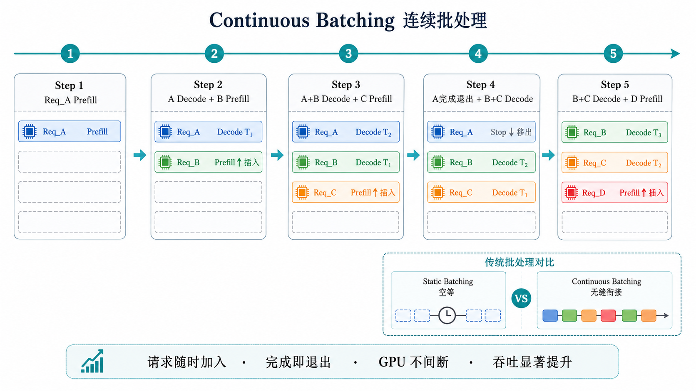

### 1、从Static Batching的问题说起

大模型推理是自回归生成：一个请求通常要进行多次Decode，直到生成EOS或达到最大长度。不同请求的输入长度、输出长度和完成时间差异很大，但传统批处理方式往往把一批请求绑定在一起：

- **Static Batching**：一组请求全部完成后，才能处理下一组请求。短请求完成后只能等待长请求，GPU出现空等。
- **Dynamic Batching**：在一个时间窗口内收集请求组成Batch，但批次形成后，仍然要等待整批请求完成。
- **共同问题**：批次的边界由"最慢的请求"决定，短请求和长请求互相拖累，GPU利用率下降。

因此，Continuous Batching要解决的不是单次矩阵计算速度，而是**如何让不同生命周期的请求持续填满GPU**。

### 2、Continuous Batching的核心思想

Continuous Batching采用**迭代级调度（Iteration-level Scheduling）**：

- 每个Decode Step都重新决定哪些请求参与本轮执行
- 新请求可以在后续Step加入Batch
- 已完成的请求立即退出，不再占用Batch槽位和KV Cache
- 长请求继续Decode，不需要等待与它无关的其他请求

也就是说，Batch不再以"一组完整请求"为单位，而以"一次模型前向"为单位动态变化。这样可以把请求完成时间造成的GPU空洞尽量填上。

### 3、工作流程

```text
Step 1: [Req_A(Prefill)]                                      → A开始处理
Step 2: [Req_A(Decode_T1) + Req_B(Prefill)]                    → A生成Token1，B加入
Step 3: [Req_A(Decode_T2) + Req_B(Decode_T1) + Req_C(Prefill)] → C加入
Step 4: [Req_A(Decode_T3,完成) + Req_B(Decode_T2) + Req_C(Decode_T1)] → A退出
Step 5: [Req_B(Decode_T3) + Req_C(Decode_T2) + Req_D(Prefill)] → D加入
...
```

实际调度还要同时考虑Token预算、最大Batch Size、KV Cache容量、请求优先级和结构化输出状态。若KV Cache不足，可能需要抢占部分请求，把它们暂时放回等待队列。

### 4、与其他优化技术的关系

| 技术 | 解决的问题 | 与Continuous Batching的关系 |
|------|------------|----------------------------|
| PagedAttention | KV Cache按需分配、减少碎片 | 为请求动态加入/退出提供更灵活的显存管理 |
| Chunked Prefill | 长Prompt拆分，避免长时间占用Batch | 让长Prefill与Decode更平滑地混合调度 |
| PD分离 | Prefill与Decode瓶颈不同 | 在更高层把两类负载拆到不同资源池 |
| CUDA Graph | 降低Decode Kernel Launch开销 | 需要处理动态Batch Shape与固定执行图的冲突 |

### 5、收益与代价

**收益：**

- 提高GPU利用率和整体吞吐，减少短请求等待长请求造成的空转
- 短请求可以更早返回，尾延迟和平均延迟通常更可控
- 请求完成即释放KV Cache，配合PagedAttention可提升显存周转效率
- 更适合在线服务中请求持续到达、长度分布不均匀的场景

**代价：**

- Scheduler复杂度上升，需要同时兼顾Token预算、显存容量和请求优先级
- Batch Shape动态变化，给CUDA Graph捕获、编译优化和Kernel选择带来困难
- 过度追求吞吐可能增加排队时间，需要平衡TTFT、TPOT和公平性
- 在请求都很短或负载很低时，Continuous Batching的收益可能不明显

### 6、与Static/Dynamic Batching的对比

| 维度 | Static Batching | Dynamic Batching | Continuous Batching |
|------|----------------|------------------|---------------------|
| 请求加入 | 批次开始前 | 组批次时 | 任意Decode Step |
| 请求退出 | 整批一起结束 | 整批一起结束 | 完成即退出 |
| GPU空闲 | 严重 | 中等 | 通常较少 |
| 实现复杂度 | 低 | 中 | 高 |
| 典型框架 | 早期推理框架 | ONNX Runtime等 | vLLM、SGLang、TensorRT-LLM |

可以总结为：**Continuous Batching通过迭代级调度，让请求在每个Decode Step动态加入和退出批次，消除了Static Batching中"短请求等待长请求"造成的GPU空转。它不改变单次模型前向的计算量，而是通过更细粒度的组批提高吞吐和资源利用率；实际效果取决于请求长度分布、KV Cache容量、调度预算以及CUDA Graph等执行优化能否配合。**

---

<h1 id="2.主流大模型推理框架如何对比与选型？">2.主流大模型推理框架如何对比与选型？</h1>

> 当前主流大模型推理框架各有侧重：vLLM以PagedAttention和连续批处理能力闻名，是高吞吐推理服务中常见的选择；SGLang以RadixAttention和结构化生成为差异化优势；TensorRT-LLM更偏向NVIDIA GPU上的低延迟和深度优化。面试中不仅需要了解各框架特点，更需要能根据实际场景做出合理的选型判断。

<h2 id="面试问题-请简要介绍一下vLLM、SGLang、TensorRT-LLM三个大模型推理框架？">面试问题：请简要介绍一下vLLM、SGLang、TensorRT-LLM三个大模型推理框架？</h2>

**难度评分：⭐⭐⭐⭐ (4/5)  |  考察频率：⭐⭐⭐⭐⭐ (5/5)**

### 1、vLLM

- **PagedAttention**：将KV Cache分页管理，类似操作系统的虚拟内存，减少预留浪费和碎片化，提升显存利用率
- **Continuous Batching**：请求到达和完成时动态加入/移出批次，无需等待整批完成
- **高吞吐**：在合适的硬件、模型和负载条件下，吞吐量通常明显高于原生HuggingFace推理
- **Prefix Caching**：自动复用相同Prompt前缀的KV Cache
- **生态支持广**：覆盖Llama、Mistral、Qwen、DeepSeek等常见开源模型，具体兼容性仍需以版本和模型实现为准
- **多GPU支持**：内置张量并行和流水线并行

### 2、SGLang

- **RadixAttention**：基于Radix Tree（基数树）的KV Cache前缀复用，自动匹配共享前缀；其底层同样采用分页KV Cache（PagedAttention-style）管理，差异主要在前缀复用层。与vLLM的Block哈希式Prefix Caching相比匹配粒度更细，更适合有大量共享Prompt的场景（如多轮对话、少样本提示）
- **前端DSL**：提供gen、select、fork等高级编程语法，简化复杂调用链的编写
- **约束解码**：支持JSON Schema、正则表达式等约束生成，保证输出格式符合要求
- **结构化输出**：原生支持Agent调用链、工具调用等复杂生成逻辑

### 3、TensorRT-LLM

- **In-Flight Batching**：类似Continuous Batching，支持动态批处理
- **极致优化**：与TensorRT生态深度集成，kernel融合、FP8量化、KV Cache压缩等极致优化
- **最低延迟**：TTFT和TPOT均能做到极低水平
- **Triton集成**：可与Triton Inference Server深度集成，支持多模型服务化管理
- **C++ Executor**：提供 C++ 语言运行时接口，进一步降低 Python 解释器开销，适合对延迟敏感的生产部署

### 6、框架对比总结表

| 维度 | vLLM | SGLang | TensorRT-LLM |
|------|------|--------|-------------|
| 吞吐量 | ⭐⭐⭐⭐⭐ | ⭐⭐⭐⭐ | ⭐⭐⭐⭐⭐ |
| 延迟 | ⭐⭐⭐⭐ | ⭐⭐⭐⭐ | ⭐⭐⭐⭐⭐ |
| 易用性 | ⭐⭐⭐ | ⭐⭐⭐ | ⭐⭐ |
| 量化支持 | ⭐⭐⭐⭐ | ⭐⭐⭐ | ⭐⭐⭐⭐⭐ |
| GPU利用率 | ⭐⭐⭐⭐⭐ | ⭐⭐⭐⭐ | ⭐⭐⭐⭐⭐ |
| 前缀复用 | ⭐⭐⭐⭐ | ⭐⭐⭐⭐⭐ | ⭐⭐⭐⭐ |
| 生态/模型支持 | ⭐⭐⭐⭐⭐ | ⭐⭐⭐⭐ | ⭐⭐⭐⭐ |

---

<h2 id="面试问题-实际项目中如何选择推理框架请给出选型建议">面试问题：实际项目中如何选择推理框架？请给出选型建议</h2>

**难度评分：⭐⭐⭐⭐ (4/5)  |  考察频率：⭐⭐⭐⭐ (4/5)**

### 1、选型维度

在实际项目中选择推理框架，需要综合考量以下维度：

1. **性能需求**：关注高吞吐还是低延迟？QPS目标是多少？
2. **硬件资源**：有多少GPU显存？是否多卡？是否只能CPU推理？
3. **业务场景**：在线服务/离线批处理/本地开发？是否有大量共享Prompt？
4. **团队能力**：是否有专业MLOps团队？能接受多复杂的部署流程？
5. **模型生态**：使用的模型是否被框架原生支持？
6. **输出格式要求**：是否需要结构化输出（JSON）、约束解码？

### 2、场景化选型建议

**场景1：高并发在线服务（企业级）**
- 推荐：**vLLM**（主）+ **TensorRT-LLM**（延迟敏感型）
- 理由：vLLM的PagedAttention+Continuous Batching通常能提供较好的吞吐表现；对延迟敏感、且运行在NVIDIA生态内的模块可评估TensorRT-LLM进一步优化

**场景2：复杂交互逻辑（Agent/工具调用/多轮对话）**
- 推荐：**SGLang**
- 理由：RadixAttention对共享前缀的多轮对话场景特别高效；DSL语法让复杂调用链更易编写和维护；约束解码保证输出格式

**场景3：快速原型验证/本地开发**
- 推荐：**Ollama**（上手简单）+ **vLLM**（接近生产服务形态）
- 理由：Ollama启动链路短，适合本地验证；需要评估服务化吞吐和并发时可切换到vLLM

**场景4：边缘设备/端侧部署**
- 推荐：**LMDeploy**（量化能力强）或 **Ollama**（轻量）
- 理由：LMDeploy的W4A16量化和KV Cache量化在有限显存下尤为重要

**场景5：要求最低延迟（如自动驾驶、金融交易）**
- 推荐：**TensorRT-LLM**（NVIDIA GPU生态内优先评估）
- 理由：NVIDIA生态深度优化，适合对TTFT和TPOT要求很高、且能接受模型转换和编译成本的场景

### 3、选型决策矩阵

| 你的情况 | 推荐框架 | 次选 |
|---------|---------|------|
| GPU <= 8GB显存 | Ollama / LMDeploy | vLLM（小模型或量化后） |
| GPU >= 24GB，追求高吞吐 | vLLM | SGLang |
| 多轮对话/Agent场景 | SGLang | vLLM |
| 需要严格JSON输出 | SGLang（约束解码） | vLLM（guided decoding） |
| 非NVIDIA硬件 | vLLM（取决于后端支持） | LMDeploy / 其他硬件厂商方案 |
| 团队人力有限 | Ollama / vLLM | — |
| 已有Triton基础设施 | TensorRT-LLM | vLLM（可集成Triton） |

可以总结为：**框架选型没有"银弹"。高吞吐在线服务可优先评估vLLM，复杂交互和结构化生成可优先评估SGLang，NVIDIA生态内的低延迟深度优化可考虑TensorRT-LLM，一站式端到端部署可考虑LMDeploy，本地快速验证适合Ollama。实际项目中通常需要结合模型、硬件、并发、延迟SLO和团队运维能力综合选择。**

---

<h1 id="3.vllm深度解析请求调度pagedattention与kv-cache管理">3.vLLM 深度解析：请求调度、PagedAttention 与 KV Cache 管理</h1>

> 当前 vLLM 的调度核心仍是 EngineCore，执行层已演进到 Model Runner V2（MRV2）；MRV2 是模型执行层重构，不是独立的“vLLM V2 Engine”。因此本章不再沿用旧版 AsyncLLMEngine、BlockManager、waiting/running/swapped 三队列口径，而是按当前 EngineCore、Scheduler、KVCacheManager、BlockPool、KV Cache Coordinator 与 MRV2 描述。Continuous Batching 的通用机制已在第 1 节说明，本章关注 vLLM 内部如何调度和执行。

<h2 id="面试问题-pagedattention的原理是什么？它如何解决kv-cache内存浪费问题？">面试问题：PagedAttention 的原理是什么？它如何解决 KV Cache 内存浪费问题？</h2>

**难度评分：⭐⭐⭐⭐⭐ (5/5)  |  考察频率：⭐⭐⭐⭐⭐ (5/5)**

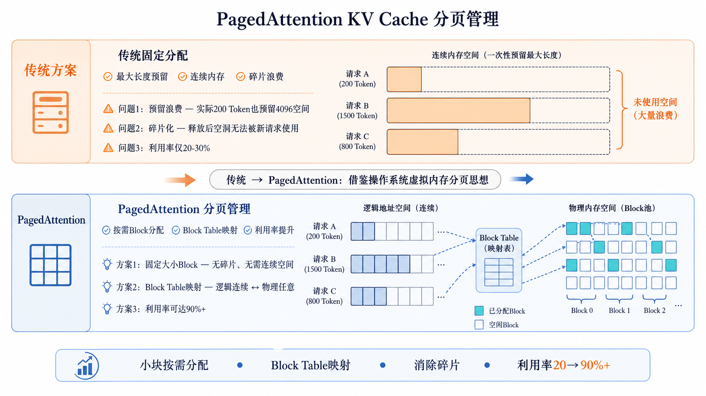

### 1、PagedAttention 之前：KV Cache 的浪费来自哪里

传统实现通常为每个请求预留一块连续的、最大上下文长度的 KV Cache，带来两类浪费：

- **预留浪费**：请求只用了 200 Token，却按 4096 Token 预留。
- **外部碎片**：不同请求的生命周期不同，释放后留下大小不一的连续空洞，新请求可能找不到足够大的连续空间。

除此之外，分页方案本身还存在**内部碎片**：最后一个 Block 通常不会刚好填满。因此不能说 PagedAttention 消除了所有碎片，它主要消除的是外部碎片和最大长度预留浪费。

### 2、PagedAttention 的核心设计

PagedAttention 借鉴操作系统虚拟内存分页：

- **逻辑 Block**：请求视角下连续的 KV 序列。
- **物理 Block**：GPU 显存中固定大小的 KV Block。当前 vLLM 默认 `block_size=64`，不是旧资料中常见的 16；不同 KV Cache group 也可以有不同 Block 大小。
- **Block Table**：逻辑 Block 到物理 Block 的映射表。
- **按需分配**：只为已经计算或即将计算的 Token 分配物理 Block。

类比关系是：逻辑 KV 序列对应虚拟地址空间，物理 Block 对应内存页，Block Table 对应页表。

### 3、计算时如何访问 KV

注意力 Kernel 不假设 K/V 连续存放，而是通过 Block Table 找到每个逻辑 Block 对应的物理 Block：

```text
Token i 的注意力计算：
  对每个逻辑 Block j：
    1. 查 Block Table，得到物理 Block 地址
    2. 读取该 Block 中的 K/V
    3. 计算 Token i 对其中所有历史 Token 的注意力
  汇总所有 Block 的结果
```

工程实现中要区分两个映射：

- **Block Table**：用于 Attention 读取历史 KV。
- **Slot Mapping**：用于把本次新计算出的 K/V 写入分页 Cache 的具体 slot。

只讲 Block Table、不讲 Slot Mapping，容易把“读路径”和“写路径”混为一谈。

### 4、PagedAttention 解决了什么，又没有解决什么

| 问题 | 结论 |
|---|---|
| 最大长度预留 | 基本消除，改为按需分配 |
| 外部碎片 | 基本消除，物理 Block 不要求连续 |
| 内部碎片 | 仍存在，取决于 Block 大小和最后一块的填充率 |
| 显存利用率 | 典型负载下可显著提升，但是否达到 90%+ 取决于请求长度、Block 大小、Prefix Caching 和调度 |
| 并发能力 | 同等显存可容纳更多请求 |
| KV 共享 | 物理 Block 可被多个请求引用，为 Prefix Caching 提供基础 |

Block 越大，Block Table 和元数据开销越小，但最后一块的内部碎片越大；Block 越小则相反。当前默认 64 是吞吐、元数据开销和碎片之间的折中。

### 5、Block 生命周期与混合 KV Cache

一个请求的典型生命周期是：

1. 调度器为请求分配逻辑 Block 和物理 Block。
2. Prefill 或 Decode 产生的 K/V 通过 Slot Mapping 写入物理 Block。
3. Block Table 随请求增长而扩展；vLLM 当前采用 append-only 的 Block Table 设计。
4. 请求完成或被抢占时，释放引用；若 Block 仍被 Prefix Caching 或其他请求引用，则不能立即覆盖。
5. 物理 Block 回收后进入空闲队列，按照缓存策略被复用或淘汰。

对于混合模型，不同层可能是 full attention、sliding window、Mamba 等不同 KV 结构，因此会有多个 KV Cache group，由 KV Cache Coordinator 统一协调分配、命中和释放。

可以总结为：**PagedAttention 用“固定大小物理 Block + Block Table + Slot Mapping”把 KV Cache 从连续大块分配改成分页管理，消除了最大长度预留和外部碎片，但仍存在最后一个 Block 的内部碎片；Block 大小、Prefix Caching 和 KV Cache group 结构共同决定实际显存利用率和并发能力。**

---

<h2 id="面试问题-vllm的整体架构与请求调度机制如何理解？">面试问题：vLLM 的整体架构与请求调度机制如何理解？</h2>

**难度评分：⭐⭐⭐⭐⭐ (5/5)  |  考察频率：⭐⭐⭐⭐ (4/5)**

### 1、当前 vLLM 的分层架构

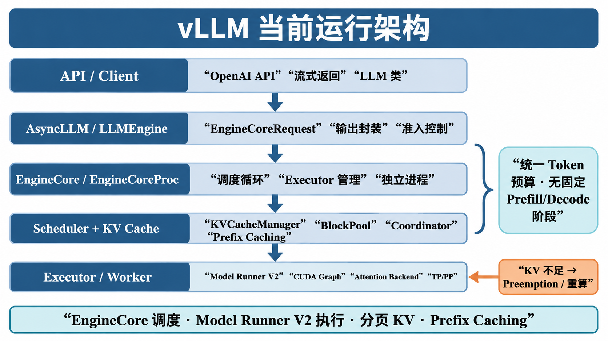

几个容易说错的点：

- 在线服务的主入口是 `AsyncLLM`，离线推理通常使用 `LLM`；`LLMEngine` 仍是同步兼容入口。
- `EngineCore` 负责内层主循环，实际服务中常由 `EngineCoreProc` 在独立进程中运行。
- 执行层当前是 Model Runner V2，不能再简单说成“V1 的 gpu_model_runner 单文件实现”。

### 2、Scheduler 没有固定的 Prefill / Decode 阶段

当前 Scheduler 的核心不是“先做完 Prefill 队列，再做 Decode 队列”，而是让每个请求的 `num_computed_tokens` 追上它的 `num_tokens_with_spec`：

- `num_computed_tokens`：已经计算并写入 KV Cache 的 Token 数。
- `num_tokens_with_spec`：Prompt、已生成 Token 和推测 Token 的总长度。
- 每个调度步给请求分配一部分 Token，直到计算进度追上目标长度。

这个模型同时覆盖 Chunked Prefill、Prefix Caching、Speculative Decoding，以及未来可能的 Jump Decoding。源码也明确说明：Scheduler 中没有固定的“decoding phase”或“prefill phase”。

### 3、调度顺序与等待队列

Scheduler 每一轮大致按以下顺序工作：

1. **先调度 RUNNING 请求**：已经运行的请求优先获得 Token 预算，但它们可能在做 Prefill chunk、Decode 或 Speculative Verify，并不存在固定的“Decode 优先”阶段。
2. **再调度 WAITING 请求**：在剩余 Token 预算、请求并发数和 KV Cache 容量允许时，引入新请求。
3. **检查 KV Cache 容量**：空间不足时触发抢占或延迟新请求。
4. **生成 SchedulerOutput**：交给 Executor 执行，再由输出更新请求状态和 KV Cache 状态。

等待中的请求不只有一个 `waiting` 队列，还可能有：

- `kv_holding_waiting`：持有 Block、等待远端 KV 或传输资源。
- `async_kv_waiting`：允许异步加载远端 KV 的请求。
- `deferred_waiting`：因预算、结构化输出或其他条件暂时不能调度的请求。

### 4、抢占是怎么发生的

当 KV Cache 不足时，Scheduler 可能从 RUNNING 中选择请求抢占：

- 释放该请求占用的 KV Block。
- 状态改为 `PREEMPTED`。
- 把 `num_computed_tokens` 重置为 0。
- 清理推测 Token，并把请求重新放回等待队列。
- 后续资源足够时重新调度，必要时重新计算 KV。

因此“抢占”不是简单的队列移动，而是会带来实际的重算成本，监控时要关注 preemption 次数。

### 5、预算、并发与准入控制

调度不只受一个 `max_num_seqs` 限制，当前至少有三层预算：

| 参数 | 作用 |
|---|---|
| `max_num_batched_tokens` | 单次模型前向可以处理的 Token 总预算 |
| `max_num_scheduled_tokens` | Scheduler 单步最多发出的 Token 数，通常等于前一项；Speculative Decoding 下可能更小 |
| `max_num_seqs` | 运行批次的最大请求数，也用于确定 Model Runner 和 CUDA Graph 容量 |
| `max_num_active_seqs` | 实际允许进入 RUNNING 的请求数，可以小于 `max_num_seqs` |
| `long_prefill_token_threshold` | 长 Prompt 单步最多推进的 Token 数，避免一个长 Prefill 长时间占用预算 |
| `max_num_queued_reqs` | API 侧在途请求上限，超过后返回 503 |
| `max_num_queued_tokens` | 控制 Prefill 积压，用于保护 TTFT |

`max_num_queued_reqs` 和 `max_num_queued_tokens` 属于准入控制，主要发生在 API 进程；`max_num_seqs`、`max_num_active_seqs` 和 Token 预算发生在 Scheduler。面试时应区分“请求被拒绝”和“请求已进入等待队列”。

### 6、EngineCore 一轮做什么

```text
Scheduler.schedule()
  → Executor.execute_model()
  → Model Runner V2 前向
  → sample_tokens()
  → Scheduler.update_from_output()
  → post_step()/输出处理
```

`EngineCore.step()` 负责同步闭环；当启用异步调度或批队列时，会使用 `step_with_batch_queue()` 让 CPU 准备下一步、GPU 执行当前步，降低 Host 侧空泡。

可以总结为：**当前 vLLM 应按“API/AsyncLLM → EngineCore/EngineCoreProc → Scheduler/KVCacheManager → Executor/Worker/Model Runner V2”理解。Scheduler 没有固定 Prefill/Decode 阶段，而是围绕 `num_computed_tokens` 追赶 `num_tokens_with_spec`，在 RUNNING 与多个 WAITING 队列之间按 Token 预算、请求预算、KV 容量和准入控制调度；KV 不足时通过抢占和重算换取并发。**

---

<h2 id="面试问题-vllm中的eager模式和capture模式有什么区别？cuda-graph如何参与decode？">面试问题：vLLM 中 Eager 模式和 Capture 模式有什么区别？CUDA Graph 如何参与 Decode？</h2>

**难度评分：⭐⭐⭐⭐⭐ (5/5)  |  考察频率：⭐⭐⭐⭐ (4/5)**

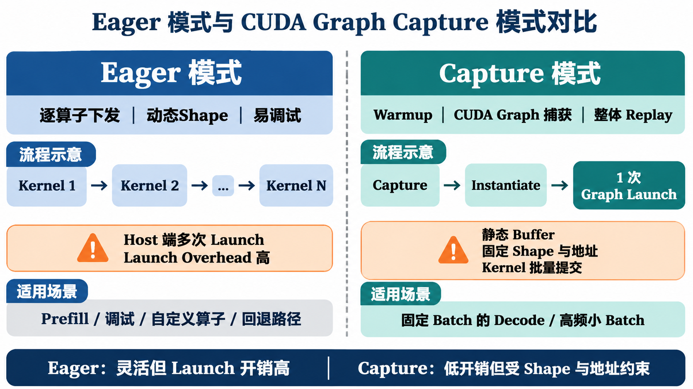

### 1、Eager 与 CUDA Graph 的本质区别

- **Eager 模式**：按执行顺序逐个启动算子，每一步都走正常的 Python/C++ 调度和 Kernel Launch 流程。
- **CUDA Graph 模式**：先捕获一段固定执行序列，后续只更新输入缓冲区并整体回放，减少重复的 Host 端 Launch 开销。

当前 vLLM 不把这件事简化成一个布尔开关，而是由 `CompilationConfig` 和 `cudagraph_mode` 控制。`enforce_eager` 仍可作为快速关闭编译和 CUDA Graph 的方式，等价于：

```text
-cc.mode=none -cc.cudagraph_mode=none
```

### 2、当前五种 CUDA Graph 模式

| 模式 | 语义 |
|---|---|
| `NONE` | 不捕获 CUDA Graph，直接 Eager 执行 |
| `PIECEWISE` | 只把 CUDA Graph 友好的子图分段捕获，Attention 等不兼容算子保持 Eager |
| `FULL` | 尽量把整个模型执行路径捕获为一个完整 Graph，依赖 Attention Backend 支持 |
| `FULL_DECODE_ONLY` | 只对纯 Decode 使用完整 Graph，Prefill/Mixed Batch 不捕获，适合 PD 的 Decode 实例 |
| `FULL_AND_PIECEWISE` | 纯 Decode 用 FULL Graph，Prefill/Mixed 用 PIECEWISE Graph，当前默认组合 |

默认策略不是简单的“Decode 用 Graph、Prefill 用 Eager”：

- 如果可用分段编译，vLLM 通常默认 `FULL_AND_PIECEWISE`。
- 如果分段编译不可用，可能回退到 `NONE`。
- Pooling 模型通常仍使用 `PIECEWISE`。
- 不同 Attention Backend 支持程度不同，配置不支持时会自动降级。

### 3、PIECEWISE 与 FULL 的取舍

**PIECEWISE** 是最兼容的方案：

- 把模型切成多个可捕获片段。
- Attention 等动态或不兼容部分保持 Eager。
- Prefill、Mixed Batch 和 Decode 都可能受益，但 Graph Launch 次数不止一次。

**FULL** 的收益更高，但约束也更强：

- 需要 Attention Backend 支持完整 Graph。
- 对 Batch 形态、输入地址和静态缓冲区要求更高。
- 不是所有后端都支持 Prefill/Mixed Batch，有些只支持 uniform decode。

vLLM 用 `AttentionCGSupport` 描述 Backend 能力，例如 `ALWAYS`、`UNIFORM_BATCH`、`UNIFORM_SINGLE_TOKEN_DECODE`、`NEVER`。混合 Attention 模型会取所有 Backend 的最小能力，必要时把 `FULL` 降级为 `FULL_AND_PIECEWISE` 或 `PIECEWISE`。

### 4、Bucket 与 Capture Size

CUDA Graph 需要固定 Shape，因此 vLLM 不会为任意 Batch Size 实时捕获，而是维护一组 bucket：

- `cudagraph_capture_sizes`：显式指定需要捕获的 Token/Batch 形态。
- `max_cudagraph_capture_size`：未显式指定时的最大捕获上限，默认通常为 512。
- 运行时把请求 Padding 到最近的 bucket，或回退到 Eager/其他模式。

Bucket 设计直接影响显存、启动时间和命中率：bucket 太少会频繁回退，bucket 太多会增加捕获时间和 Graph 内存。

### 5、线上如何判断收益

优先关注：

- 当前实际使用的 `cudagraph_mode`，而不是只看是否设置了 `enforce_eager`。
- Attention Backend 是否支持当前 Batch 形态的 FULL Graph。
- Graph 是否成功捕获，是否因 Shape、动态控制流或显存不足频繁回退。
- Capture 时间和 Graph 内存是否挤占 KV Cache。
- 首请求 Warmup、首次 Capture 和 bucket 切换是否造成延迟抖动。

可以总结为：**Eager 逐算子执行，灵活但 Decode 阶段 Kernel Launch 开销高；CUDA Graph 通过预捕获和回放降低 Host 提交开销。当前 vLLM 由 `CompilationConfig` 控制 `PIECEWISE`、`FULL`、`FULL_DECODE_ONLY` 和 `FULL_AND_PIECEWISE`，默认组合通常是 `FULL_AND_PIECEWISE`；Prefill/Mixed Batch 也可走分段 Graph，并非只能 Eager。真正影响线上性能的是 Backend 能力、capture bucket、回退频率和 Graph 显存开销。**

---

<h2 id="面试问题-vllm的chunked-prefill机制是如何工作的？">面试问题：vLLM 的 Chunked Prefill 机制是如何工作的？</h2>

**难度评分：⭐⭐⭐⭐ (4/5)  |  考察频率：⭐⭐⭐⭐ (4/5)**

### 1、为什么需要 Chunked Prefill

Prefill 和 Decode 的特征不同：

- **Prefill**：一次处理较长 Prompt，计算密集，容易产生巨大的瞬时计算和激活峰值。
- **Decode**：逐 Token 生成，访存密集，对 TPOT/ITL 非常敏感。

如果没有 Chunked Prefill，一个超长 Prompt 可能在某一轮独占大量 Token 预算，让同批次 Decode 请求等待，表现为 ITL 尖峰。Chunked Prefill 把长 Prefill 拆成多个调度步，平滑延迟和显存峰值。

### 2、当前 Scheduler 的执行模型

当前 vLLM 默认开启 Chunked Prefill（`enable_chunked_prefill=True`），但它不是一个独立的“Prefill 阶段开关”，而是统一 Token 预算调度的一部分：

1. Scheduler 先处理 RUNNING 请求，按剩余预算推进它们的 `num_computed_tokens`。
2. 再从 WAITING 请求中引入新请求，分配它们本步可以计算的 Token 数。
3. 一个长 Prompt 可能在多个调度步中分批推进，期间可以和其他请求的 Decode Token 混批。
4. 每个 chunk 的 K/V 通过 Slot Mapping 增量写入分页 KV Cache。
5. 当 Prompt 的 Token 都计算完成，请求自然进入后续 Decode；Scheduler 不需要显式切换阶段。

所以更准确的说法是“每个请求追赶自己的 Token 目标”，而不是“先安排 Decode，剩余预算才做 Prefill”。

### 3、一个长 Prompt 的调度示意

```text
Token 预算 = 8K，Prompt = 32K

Step 1: [Prefill 0-8K]   + [Decode A][Decode B]
Step 2: [Prefill 8-16K]  + [Decode A][Decode B]
Step 3: [Prefill 16-24K] + [Decode A][Decode B]
Step 4: [Prefill 24-32K] + [Decode A][Decode B]
Step 5: 该请求进入 Decode
```

示意图是理想化情况。实际每一步是否混入 Decode、给 Prefill 多少 Token，还受请求状态、KV 容量、长 Prefill 阈值和优先级影响。

### 4、关键参数

| 参数 | 作用 |
|---|---|
| `max_num_batched_tokens` | 单步 Token 总预算，决定 chunk 的大致上限 |
| `max_num_scheduled_tokens` | Scheduler 单步实际发出的 Token 上限，Speculative Decoding 下可能小于总预算 |
| `max_num_seqs` | 同时运行的请求数上限，也影响 Runner 和 Graph 容量 |
| `max_num_active_seqs` | 实际允许进入 RUNNING 的请求数 |
| `long_prefill_token_threshold` | 限制单个长 Prompt 每步推进的 Token 数，避免它长时间挤占预算 |
| `long_prefill_token_threshold_adaptive` | 按排队和运行请求数动态调整长 Prefill 阈值 |
| `max_num_queued_tokens` | 控制 Prefill 积压，保护 TTFT |

### 5、与 Prefix Caching 的协同

Prefix Caching 命中后，请求的 `num_computed_tokens` 可以直接跳过已缓存的前缀，只对未命中的后缀做 Chunked Prefill。因此：

- 命中率越高，需要切分的 Prefill 越少，TTFT 越低。
- 评估 Chunked Prefill 调参时，不能只看 Prompt 长度，还要看 Prefix Cache 命中率。
- 长 Prompt + 高前缀复用场景，Prefix Caching 可能比调小 chunk 更有效。

### 6、收益与代价

**收益：**

- 平滑长 Prefill 对 Decode 的干扰，降低 ITL/TPOT 尾部抖动。
- 降低单步激活峰值和 OOM 风险。
- 通过 Prefill/Decode 混批提高 GPU 利用率。
- 避免长请求长期饿死短请求。

**代价：**

- 长 Prompt 的 TTFT 可能变长。
- 调度步数和 Kernel 启动次数增加。
- Prefill 与 Decode 混批会降低 CUDA Graph 的复用效率。
- chunk 太小会降低 Prefill 吞吐，太大又会重新引入 Decode 抖动。

可以总结为：**Chunked Prefill 把长 Prompt 按 Token 预算拆到多个调度步，并与 Decode 请求混批，核心目的是平滑 ITL/TPOT、降低瞬时显存峰值。当前 vLLM 默认开启该机制，chunk 大小由 `max_num_batched_tokens`、`max_num_scheduled_tokens` 和长 Prefill 阈值共同决定；Prefix Caching 命中会减少实际需要 Prefill 的后缀，因此调优时必须同时观察 TTFT、TPOT、Cache 命中率和 GPU 利用率。**

---

<h2 id="面试问题-vllm的prefix-caching机制是如何实现的？">面试问题（进阶）：vLLM 的 Prefix Caching 机制是如何实现的？</h2>

**难度评分：⭐⭐⭐⭐⭐ (5/5)  |  考察频率：⭐⭐⭐⭐ (4/5)**

### 1、Prefix Caching 在解决什么

多个请求经常共享相同前缀：

- 固定的 System Prompt。
- Few-shot 示例。
- RAG 模板。
- 多轮对话历史。
- Agent 的工具说明和长期上下文。

Prefix Caching 复用这些前缀对应的 KV Cache，避免重复 Prefill，降低 TTFT 和 Prefill 计算量。当前 vLLM 中 `enable_prefix_caching` 默认是开启的。

### 2、核心组件

当前实现不应再用 `BlockManager + CachedAllocator + Evictor` 解释，主要组件是：

- **KVCacheManager**：Scheduler 与 KV Cache 之间的接口，负责查询已计算前缀、分配 Slot、回收请求占用。
- **BlockPool**：管理物理 Block、空闲队列、哈希到 Block 的映射，以及 Block 的引用计数和淘汰。
- **KV Cache Coordinator**：协调单 KV group、混合 KV group、Prefix Caching 和 partial hit。
- **Block Hash**：把 Token 内容和前缀链编码成可查找的键。

### 3、哈希链怎么构造

每个可缓存 Block 的哈希通常由以下信息共同决定：

- 当前 Block 内的 Token IDs。
- 前一个 Block 的哈希值，保证“前缀链”一致。
- LoRA、多模态输入、Prompt Embedding 等会影响 KV 结果的额外键。
- 可选的 `cache_salt`，用于多租户场景下隔离缓存，避免通过命中时延推测其他租户内容。
- KV Cache group id，避免不同 Attention 结构的同内容错误复用。

这样可以避免“当前 Block Token 相同，但前文不同”导致错误命中。

### 4、匹配粒度不再等于物理 Block

旧资料常说“vLLM 只能复用完整 Block、粒度不如 RadixAttention”，这句话需要更新：

- 物理 KV Cache 默认按 64 Token 的 Block 管理。
- 前缀哈希可以使用 `prefix_match_unit` / `hash_block_size`，允许匹配边界落在物理 Block 内部。
- 混合 KV Cache 模型可以使用 per-group 命中和 partial hash hit；`BlockPool.cache_partial_block` 会把部分前缀登记到已有 Block 的元数据中，而不复制整块 KV。
- 在普通单 group 全注意力模型上，默认仍可能表现为 Block 级命中；但不能把它写成 vLLM 的固定能力边界。

准确的区别是：vLLM 采用**可配置固定粒度的哈希精确匹配**，SGLang 采用**Radix Tree 的最长公共前缀匹配**。vLLM 可以通过更细粒度配置支持子 Block 命中，但不是任意 Token 边界的 Radix 路径。

### 5、一次命中的完整流程

```text
新请求到达：
1. 计算 Prompt 的 Block Hash 链
2. KVCacheManager 查询已缓存前缀
3. 命中 Block 增加引用计数并被 touch，避免被淘汰
4. 未命中的部分分配新 Block，执行 Prefill
5. 已填满的 Block 写入 BlockPool 的哈希表
6. 最后一个未填满的 Block 可通过 partial entry 提供块内命中
7. 请求结束后减少引用；引用为 0 的 Block 进入 LRU 空闲队列
8. 需要复用空闲 Block 时，先移除其旧哈希并淘汰
```

vLLM 当前采用 append-only Block Table。一个请求如果在运行中又遇到相同 Block，可能会暂时保留重复物理 Block；这些重复项通常在请求释放后回收，而不是像旧版那样立即改写 Block Table 指向已有 Block。

### 6、性能收益与边界

典型收益包括：

- 共享前缀无需重复 Prefill，降低 TTFT。
- 相同算力可处理更多请求，提高 Prefill 吞吐。
- 多个请求共享只读 KV Block，减少重复 KV 写入。
- 长上下文、多轮对话和高重复模板收益最明显。

但 Prefix Caching 不是免费午餐：

- 缓存 Block 会占用显存，可能挤占可运行请求数。
- 前缀重复率低时，命中率低，收益有限。
- 过大的 Block 或过粗的哈希粒度会降低命中率。
- 多租户场景需要 `cache_salt` 等隔离手段，避免信息泄漏。
- 缓存命中率必须和 TTFT、KV 使用率、抢占次数一起观察。

### 7、与 SGLang RadixAttention 的公平对比

| 维度 | vLLM Prefix Caching | SGLang RadixAttention |
|---|---|---|
| 索引结构 | Block Hash 映射 | Radix Tree |
| 匹配方式 | 固定粒度哈希精确匹配 | 最长公共前缀路径匹配 |
| 命中粒度 | 物理 Block 或配置后的子 Block | 按 `page_size` 对齐的前缀单元 |
| 工程优势 | 与 PagedAttention、KV group 和分布式 Connector 结合紧密 | 共享前缀树结构直观，分支复用灵活 |
| 主要限制 | 粒度受 hash/block 配置约束 | Radix 树维护和缓存管理更复杂 |

面试时不要简单说“vLLM 只能整块命中，所以不如 RadixAttention”。更准确的说法是：两者都在做前缀复用，vLLM 用哈希和分页 Block 换取简单、通用和工程可扩展性；SGLang 用 Radix Tree 换取更自然的最长前缀匹配。

可以总结为：**当前 vLLM 的 Prefix Caching 由 KVCacheManager、BlockPool 和 Coordinator 协同完成，通过带父哈希和额外键的 Block Hash 复用已计算 KV，并用引用计数、LRU 和 append-only Block Table 管理生命周期。匹配粒度可通过 `prefix_match_unit` 细于物理 Block，混合模型还支持 per-group 和 partial hit；它与 SGLang RadixAttention 的核心差异是“可配置固定粒度哈希匹配”与“Radix 最长前缀匹配”，而不是简单的“整块 vs Token 级”。**
<h1 id="4.sglang深度解析radixattention结构化生成与runtime调度">4.SGLang 深度解析：RadixAttention、结构化生成与 Runtime 调度</h1>

> 当前 SGLang 的差异点不只是“Radix Tree 前缀复用”，还包括分页 KV Cache、可配置淘汰策略、HiCache、多后端约束解码、Overlap Scheduler，以及可选的前端 DSL。面试时要把“前缀复用索引”“KV Cache 内存管理”“请求调度”“DSL 执行方式”分开讲，避免把 RadixAttention 说成一种 GPU Attention Kernel，也避免把 DSL 说成会整体编译后下发给 Runtime 的执行计划。

---

<h2 id="面试问题-sglang的radixattention与vllm的prefix-caching有什么区别？">面试问题：SGLang 的 RadixAttention 与 vLLM 的 Prefix Caching 有什么区别？</h2>

**难度评分：⭐⭐⭐⭐⭐ (5/5)  |  考察频率：⭐⭐⭐⭐⭐ (5/5)**

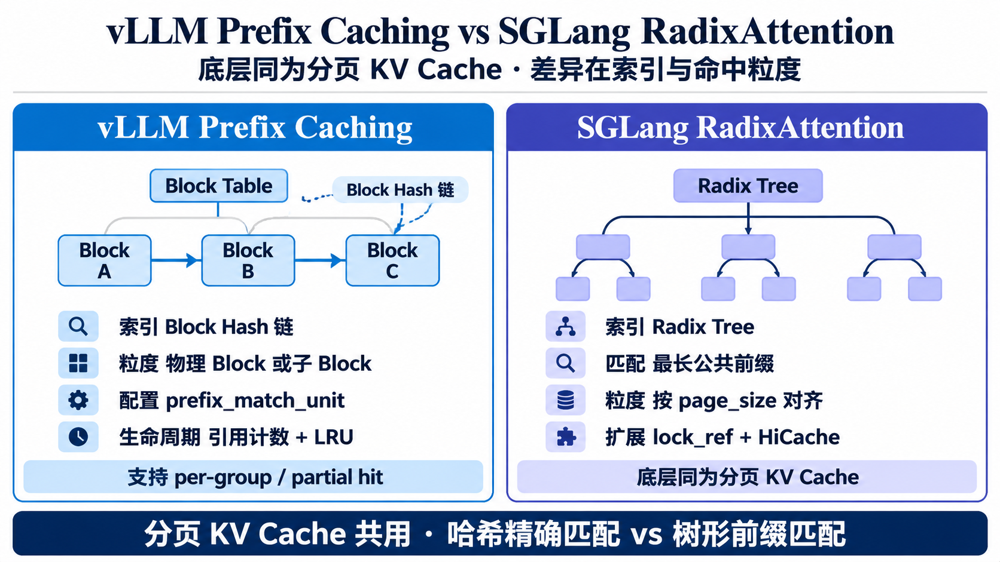

### 1、先厘清比较对象

很多面试题会问“SGLang 的 RadixAttention 与 vLLM 的 PagedAttention 有什么本质区别”，这个问题本身有陷阱：**PagedAttention 和 RadixAttention 不在同一层。**

- **PagedAttention / 分页 KV Cache**：解决 KV Cache 如何按页分配、寻址、共享和回收。
- **Prefix Caching / RadixAttention**：解决“哪些已计算的 KV 可以按前缀复用”。
- **SGLang 的 RadixCache**：把前缀复用索引实现成 Radix Tree，树节点保存一段逻辑 Token 对应的 KV 槽位；实际 Attention 仍然使用 FlashAttention、FlashInfer 等分页注意力 Kernel。

所以正确的比较对象是 **SGLang RadixAttention vs vLLM Prefix Caching**。SGLang 并不是不用分页 KV Cache，而是在分页 KV Cache 之上增加了一层 Radix Tree 索引。

### 2、SGLang 的 Radix Tree 里存了什么

当前实现中，核心对象是 `RadixCache`、`RadixKey` 和 `TreeNode`：

- `RadixKey` 不只有 Token IDs，还带有 `extra_key`、`cache_salt`、`limit`、`is_bigram` 等命名空间或视图信息。
- `TreeNode.key` 是一段 Token 序列，`TreeNode.value` 是这段 Token 对应的 KV 槽位；一个节点可以覆盖多个 Token 或页。
- `TreeNode.lock_ref` 表示这个节点正在被多少个活跃请求引用，被锁住的前缀不能淘汰。
- `last_access_time`、`hit_count`、`priority` 等元数据供不同淘汰策略使用。

`extra_key` 可以隔离 LoRA、Adapter 等不同 KV 语义；`cache_salt` 用于租户或缓存命名空间隔离，避免相同文本在不同安全域中错误复用。对于 EAGLE 等推测解码场景，树还可以使用 bigram 视图组织草稿 Token。

DSL 的 `s.fork(n)` 并不是后端执行原语：它会创建多个从同一 Prompt 前缀分叉的请求。在同一个 Runtime 内，这些分支共享 RadixTree 的公共路径，后续不同输出各自形成新分支，因此 `fork` 的收益来自请求级并行与 RadixCache 前缀复用；它的 `join` 也不会自动把所有分支合并成同一份连续 KV，除非使用支持的后端拼接路径。

### 3、一次前缀匹配怎么做

请求进入调度前，会先用 Prompt Token 构造 `RadixKey`，再调用 `RadixCache.match_prefix()`：

1. 先按 `page_size` 对 Key 做页对齐。
2. 从根节点开始，用当前页作为 child key 定位候选子节点。
3. 对节点内部的长 Token 段做最长公共前缀匹配；当前实现用指数搜索加二分搜索，避免在 Python 层逐 Token 比较长前缀。
4. 如果命中位置落在一个已有节点内部，就拆分节点，把公共前缀独立出来。
5. 命中部分增加 `lock_ref` 并复用 KV；未命中的后缀重新 Prefill。

这里有一个很容易答错的细节：**SGLang 并不是无条件“任意 Token 级匹配”**。匹配长度会向下取整到 `page_size`：

- 常见 NVIDIA 等平台默认 `page_size=1`，此时可以表现为 Token 级匹配。
- 某些后端、模型或平台会把页调大，例如 MUSA 默认 64，部分后端会使用 16/32/64/128，此时匹配按页对齐。
- `page_size > 1` 时，最后一个不完整页仍归请求自己持有，不写入 Radix Tree。

因此更准确的说法是：**SGLang 的 Radix Tree 做最长公共前缀匹配，但可复用边界由实际 `page_size` 决定；默认小页时粒度很细，不等于任何配置下都能任意 Token 对齐。**

### 4、插入、引用与淘汰

请求 Prefill 完成或达到缓存检查点后，SGLang 会把已计算前缀插入 Radix Tree。插入过程同样会匹配、拆分和合并节点，并让多个请求共享同一段 KV。

淘汰不是只有 LRU：

- 默认策略是 `lru`。
- 当前还支持 `lfu`、`slru`、`priority`、`tlru`、`joint_lru`、`state_cost` 等策略，通过 `--radix-eviction-policy` 选择。
- 淘汰以叶子和策略优先级为基础维护候选堆；只有 `lock_ref=0` 的路径才可进入可淘汰集合。
- 删除叶子后，如果父节点不再有活跃子节点且没有被引用，就可以继续向上回收。

这解释了为什么“Radix Tree + 引用计数 + LRU”只是基础版本。当前实现已经把淘汰策略、优先级、混合 Attention 缓存和状态成本纳入考虑。

### 5、HiCache 与多级缓存

当前 SGLang 还提供可选的 HiCache 分层缓存，通过 `--enable-hierarchical-cache`（别名 `--enable-hicache`）开启：

- **L1**：GPU 显存中的 KV Cache。
- **L2**：Host 内存中的 KV Cache 池。
- **L3**：可选的文件、Mooncake、HF3FS、NIXL 等存储后端。

HiCache 还区分 `write_back`、`write_through`、`write_through_selective` 等写策略，并支持 Host/GPU 之间的 `direct` 或 `kernel` 传输。它的意义是：当 GPU 前缀缓存被淘汰后，请求仍有机会从 Host 或远端存储恢复前缀，而不必完全重算。

面试时可以把 RadixAttention 和 HiCache 的关系概括为：**Radix Tree 负责索引和复用决策，HiCache 负责把同一套前缀扩展到 GPU 之外。**

### 6、与 vLLM Prefix Caching 的公平对比

vLLM 当前使用带父哈希链的 Block Hash 索引已计算 KV，物理 Block 通常是 64 Token，但支持通过 `prefix_match_unit` / `hash_block_size` 让匹配边界细于物理 Block；混合 KV Cache 还支持 per-group 命中和 partial hit。它同样支持 `cache_salt` 和引用计数。

因此两者不能简单概括成“vLLM 只能整块命中，SGLang 任意 Token 命中”。更准确的差异是：

| 维度 | vLLM Prefix Caching | SGLang RadixAttention |
|---|---|---|
| 索引结构 | Block Hash 映射 | Radix Tree |
| 匹配方式 | 固定粒度哈希精确匹配 | 最长公共前缀路径匹配 |
| 命中粒度 | 物理 Block 或配置后的子 Block | 实际 `page_size` 对齐的前缀 |
| 节点组织 | Block / KV group / Coordinator | 压缩前缀树节点 + 页对齐 |
| 淘汰 | BlockPool 引用计数、空闲队列和 LRU 等 | `lock_ref` + 叶子候选 + 可配置淘汰策略 |
| 多租户隔离 | `cache_salt`、额外哈希键 | `cache_salt`、`extra_key` |
| 多级缓存 | KV Connector、分布式 Prefix Cache | HiCache：GPU / Host / Storage |
| 工程特点 | 与分页 Block、KV group、Connector 结合紧密 | 前缀树最直观，分支复用和命名空间管理自然 |

### 7、面试中怎么回答

可以总结为：**SGLang 的 RadixAttention 是在分页 KV Cache 之上的一层前缀复用索引。它用 Radix Tree 保存 Token 段到 KV 槽位的映射，通过最长公共前缀匹配、节点拆分和 `lock_ref` 引用保护实现共享；匹配粒度受 `page_size` 约束，常见平台默认 `page_size=1` 时表现为 Token 级，页调大后按页对齐。淘汰策略也不再只有 LRU，并可通过 HiCache 扩展到 Host 和外部存储。它与 vLLM 的“可配置固定粒度哈希匹配”是两种索引方案，而不是“RadixAttention 替代 PagedAttention”。**

---

<h2 id="面试问题-sglang的chunked-prefill机制是如何工作的？">面试问题：SGLang 的 Chunked Prefill 机制是如何工作的？</h2>

**难度评分：⭐⭐⭐⭐ (4/5)  |  考察频率：⭐⭐⭐⭐ (4/5)**

### 1、为什么需要 Chunked Prefill

超长 Prompt 一次性做 Prefill 会带来两个问题：

- 单步计算量和瞬时激活显存过高。
- 一个长 Prefill 长时间占住调度步，使已运行请求的 Decode 等待，ITL/TPOT 抖动。

Chunked Prefill 把长 Prompt 拆成多个 chunk，每个调度步只推进一部分，从而限制单步 Prefill 的规模和时延上界。RadixAttention 可以跳过命中的前缀，但未命中的后缀仍可能很长，因此前缀缓存不能替代 Chunked Prefill。

需要注意：**仅仅开启 Chunked Prefill，并不等于 Decode 会自动穿插执行。** SGLang 默认在有 Prefill 可运行时优先发 Prefill；如果想主动给 Decode 留出轮次，需要 `--prefill-decode-interval`，如果想在同一个 batch 中混排，需要 `--enable-mixed-chunk`。

### 2、Scheduler 中的真实执行路径

SGLang 的 Scheduler 每一轮大致执行：

```text
ingest_requests()
  → get_next_batch_to_run()
      → 合并上一轮完成的 Prefill 请求到 running batch
      → get_new_batch_prefill()
          → 有可运行 Prefill：返回 Prefill / Chunk batch
          → 否则：update_running_batch() 生成 Decode batch
  → run_batch()
  → process_batch_result()
  → 更新请求状态、KV Cache 与 RadixTree
```

其中几个实现细节很能体现当前架构：

- 未完成的 chunk 由 `chunked_req` 持有，后续调度步继续推进，而不是简单把它留在普通 waiting 队列中重新走一遍完整流程。
- 前缀匹配发生在请求的输入准备阶段，例如 `Req.init_next_round_input()` 会与 RadixCache 交互；不是“Scheduler 每轮临时扫一遍 Prompt 做字符串匹配”。
- 代码中的注释和分支明确写着 **Run prefill first if possible**：有 Prefill 可运行时优先返回 Prefill batch，否则才运行 running batch 的 Decode。
- Prefill chunk 的 K/V 通过分页 KV 池增量写入；最后一个不完整页由请求持有，只有满足页或缓存检查点条件的前缀才进入 RadixTree。
- 随着 Overlap Scheduler 默认开启，Scheduler 的 CPU 准备、结果处理与 GPU 前向可以重叠，降低 Host 侧空泡；但 Grammar 等依赖上一批结果的状态会形成同步屏障。

### 3、关键参数

| 参数 | 当前含义 | 面试时怎么说 |
|---|---|---|
| `--chunked-prefill-size` | 单个 Prefill chunk 的最大 Token 数；`-1` 表示关闭 | 默认是 `None`，由运行时结合显存、模型与平台解析，不要背死某个固定值 |
| `--max-prefill-tokens` | 一个 Prefill batch 的 Token 上限，默认 16384 | 还会结合模型上下文长度、KV 预算和调度策略修正 |
| `--prefill-max-requests` | Prefill batch 的请求数上限 | 默认不额外限制 |
| `--enable-mixed-chunk` | 允许 Prefill chunk 与 Decode 在同一个 batch 中混排 | 默认关闭，只在 Chunked Prefill 开启时有意义 |
| `--prefill-decode-interval` | 一次 Prefill 后连续跑多少轮 Decode，再调度下一次 Prefill | 默认通常关闭；用于保护 ITL，但会拉长 Prefill 总时长 |
| `--enable-dynamic-chunking` | Pipeline Parallel 下动态调整 chunk 大小 | 默认关闭；用拟合的耗时模型让各 PP stage 的 chunk 时间更一致 |
| `--schedule-policy` | 请求选择策略，默认 `fcfs` | 还可选 LPM、priority、shortest-prefill-first、HRRN 等 |

这里不要把 `chunked_prefill_size=None` 说成“默认固定 8192”。当前参数先保留为 `None`，再由运行时解析；不同版本、硬件和后端可能给出不同值。面试中更重要的是解释“它控制单 chunk 上限，而 `max_prefill_tokens` 控制整个 Prefill batch 的预算”。

### 4、Prefill 优先与混合批的取舍

**默认 Prefill 优先：**

- 新请求更容易尽快开始计算，有利于 TTFT。
- 长 Prompt 的 chunk 会连续推进，不会因为 Decode 轮次被无限推迟。
- 代价是 Decode 请求的 ITL 可能抖动，尤其是在线服务中长 Prompt 较多时。

**开启 `--enable-mixed-chunk`：**

- 一个 batch 内可以同时包含 Prefill 和 Decode，提高 GPU 利用率。
- 但 Prefill 与 Decode 的 Kernel、序列长度和 CUDA Graph 形态不同，混批会增加执行复杂度。
- 需要用 P99 ITL、TTFT、吞吐和显存一起评估，不能只看平均 GPU 利用率。

**使用 `--prefill-decode-interval`：**

- 一次 Prefill 后先跑若干轮 Decode，再接受下一次 Prefill。
- 适合 Decode 请求已经很多、长 Prefill 会显著拉高尾延迟的服务。
- 但 Prefill 总时长和排队时间会上升，TTFT 与 ITL 需要做显式权衡。

### 5、与 vLLM 的对比

| 维度 | SGLang | vLLM |
|---|---|---|
| 调度入口 | Scheduler 的 Prefill / Decode batch 构造，显式 `chunked_req` | EngineCore Scheduler 的统一 Token 预算 |
| 调度顺序 | 有 Prefill 可运行时优先 Prefill，否则 Decode | 先推进 RUNNING，再用剩余预算引入 WAITING；没有固定阶段 |
| chunk 控制 | 独立 `chunked-prefill-size`，再受 `max-prefill-tokens` 约束 | 主要由 `max-num-batched-tokens` 的剩余预算决定 |
| 默认混合 Prefill/Decode | 默认关闭，`enable-mixed-chunk` 开启 | 默认在同一预算内混合 |
| 前缀复用 | RadixTree 最长公共前缀匹配 | Block Hash + 可配置子 Block 匹配 |
| 主要优化目标 | 通过 Prefill 优先和前缀复用降低 TTFT | 通过统一预算和混合批稳定 ITL / 提升吞吐 |
| 共同点 | Continuous Batching、分页 KV 增量写入、CUDA Graph Decode | 同左 |

### 6、面试中怎么回答

可以总结为：**SGLang 的 Chunked Prefill 是“请求状态驱动 + Prefill 优先”的调度。长 Prompt 被拆成多个 chunk，未完成的请求由 `chunked_req` 跨调度步继续推进；有 Prefill 可运行时优先发 Prefill，否则运行 Decode，默认不混批。`chunked-prefill-size` 控制单 chunk 上限，`max-prefill-tokens` 控制 Prefill batch，`enable-mixed-chunk` 才允许 Prefill/Decode 同批，`prefill-decode-interval` 用于主动保护 Decode 尾延迟，PP 下还可用动态 chunk。它与 vLLM 的统一 Token 预算调度不同，核心取舍是 TTFT 优先还是 ITL 稳定优先。**

---

<h2 id="面试问题-sglang的overlap-scheduler如何工作？">面试问题：SGLang 的 Overlap Scheduler 如何工作？</h2>

**难度评分：⭐⭐⭐⭐ (4/5)  |  考察频率：⭐⭐⭐ (3/5)**

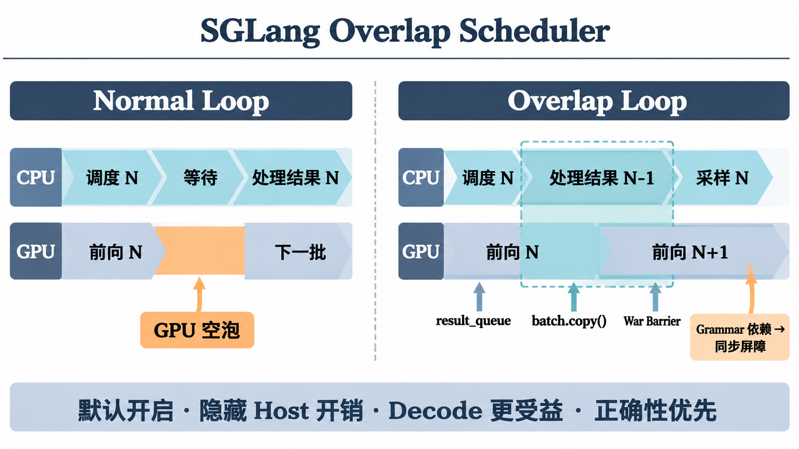

### 1、Overlap Scheduler 解决什么问题

大模型推理的每个调度步不只包含 GPU 前向，还包含大量 CPU 工作：

- 请求状态更新、停止条件判断和流式输出。
- KV Cache 引用管理、RadixTree 更新和请求回收。
- 采样参数准备、Grammar 状态推进和下一批调度。
- Python 侧 Batch 构造与 Executor 参数整理。

如果采用“GPU 算完 → CPU 处理完 → 再发下一批”的同步循环，GPU 前向期间 CPU 空等，CPU 处理结果期间 GPU 空闲，形成 Host 侧空泡。Overlap Scheduler 的目标就是让**当前 batch 的 GPU 前向**与**上一 batch 的 CPU 结果处理**并行。

SGLang 当前默认开启 Overlap Scheduler；`--disable-overlap-schedule` 可用于关闭它进行对照或排查。

### 2、Normal Loop 与 Overlap Loop

图中左侧是 Normal Loop：GPU 前向结束后 CPU 才开始处理结果；右侧是 Overlap Loop：当前批 GPU 前向与上一批 CPU 结果处理重叠。

实现上会有 `result_queue` 保存 `(batch, result)`，CPU 在处理上一批结果时，当前批的 GPU 前向已经在执行。两者不是简单的多线程并行，而是通过 CUDA Stream、事件同步和结果队列形成一条受控流水线。

### 3、代码路径中的关键点

当前 `event_loop_overlap()` 大致依次做：

1. `ingest_requests()` 接收新请求。
2. 根据 `last_batch` 判断是否需要提前处理上一批结果。
3. `get_next_batch_to_run()` 构造当前 batch。
4. `run_batch(batch)` 启动 GPU 前向。
5. 执行 War Barrier，防止 CPU 侧状态复用破坏仍在读取的输入。
6. 把 `(batch.copy(), batch_result)` 放入结果队列。
7. 处理上一批结果，再执行当前批依赖的采样步骤。

几个容易忽略的细节：

- **Batch 元数据要复制。** 当前 batch 启动后，CPU 可能继续修改请求状态；结果队列保存 batch 副本，避免异步处理时读到被改写的状态。
- **War Barrier 保护共享读取。** GPU 前向可能仍在使用某些输入缓冲或 KV 元数据，CPU 不能立刻复用或覆盖它们。
- **采样未必能完全重叠。** 当前批采样可能依赖上一批的 Grammar 状态或结果，因此代码会在处理完上一批后再采样当前批。
- **Prefill 结果可能被提前处理。** 某些配置下会优先处理 Prefill 结果以降低 TTFT，这会减少一部分 CPU/GPU 重叠。
- **Grammar 是硬依赖。** 下一批 token bitmask 依赖上一批已接受 Token，因此 Grammar 重度负载时可能必须提前处理上一批，Overlap 收益下降。

### 4、为什么 Decode 更受益

Overlap 隐藏的是 CPU 调度、Python 与结果处理开销，而不是 GPU 计算本身：

- **Prefill**：单批计算重、GPU 时间长，GPU 通常是瓶颈，Host 空泡占比相对小。
- **Decode**：每步生成 Token 少、Kernel Launch 和采样频繁，CPU 调度与结果处理占比更高，Overlap 更容易带来收益。
- **高并发小 batch**：请求管理、停止判断和流式输出更多，CPU 侧压力更明显。
- **大 batch 长 Prefill**：GPU 已经接近饱和，Overlap 的主要价值变成减少批间空泡，而不是提高单批算力。

因此不能承诺“打开 Overlap 就一定提速”。它优化的是流水线利用率，最终收益要看 GPU 利用率、Batch 大小、Grammar、推测解码和请求完成率。

### 5、与 vLLM 的对比

vLLM 也通过异步调度、Batch Queue 和 `step_with_batch_queue()` 隐藏 Host 侧开销，目标与 SGLang 一致：

| 维度 | SGLang Overlap Loop | vLLM Batch Queue |
|---|---|---|
| 核心目标 | 当前 GPU 前向与上一批 CPU 处理重叠 | CPU 准备下一步与 GPU 执行当前步重叠 |
| 实现入口 | `event_loop_overlap()` + `result_queue` | `step_with_batch_queue()` 等异步执行路径 |
| 关键约束 | Batch 副本、War Barrier、Grammar 屏障 | 输入/输出队列、异步调度与状态同步 |
| 主要收益 | 降低 Decode 与高频调度场景的 Host 空泡 | 降低 EngineCore 与 Worker 之间的串行等待 |
| 共同风险 | In-flight Batch 增多、状态依赖和正确性复杂度上升 | 同左 |

所以更准确的对比不是“SGLang 有 Overlap、vLLM 没有”，而是两者都做 CPU/GPU 流水化，SGLang 的实现与自身 Scheduler、GrammarManager 和 RadixCache 生命周期结合得更紧。

### 6、面试中怎么回答

可以总结为：**SGLang 的 Overlap Scheduler 把“当前 batch 的 GPU 前向”和“上一 batch 的 CPU 结果处理”组织成流水线，通过结果队列、Batch 副本、CUDA Stream/事件同步和 War Barrier 隐藏 Host 侧调度与结果处理开销。它默认开启，Decode 与高频小 Batch 场景收益更明显；但 Prefill 提前处理、Grammar 状态依赖、推测解码验证和 DP 同步都会形成屏障，因此收益必须结合 TTFT、ITL、GPU 利用率和 P99 延迟评估。vLLM 也采用异步 Batch Queue 达成类似目标，不能把它说成 SGLang 独有能力。**

---

<h2 id="面试问题-sglang的约束解码constrained-decoding是如何实现的？">面试问题：SGLang 的约束解码是如何实现的？</h2>

**难度评分：⭐⭐⭐⭐ (4/5)  |  考察频率：⭐⭐⭐⭐ (4/5)**

### 1、约束解码约束的是什么

约束解码要求每个 Decode step 只能采样 Grammar 当前状态允许的 Token。SGLang 服务端支持的主要约束输入包括：

- `json_schema`：结构化 JSON 输出。
- `regex`：正则表达式。
- `ebnf`：扩展巴科斯范式语法。
- `structural_tag`：把工具调用、推理段或固定结构组合成结构化生成。

它不是“先生成再解析”，而是在采样前改写 logits 或 token bitmask，使非法 Token 在第一层就被屏蔽。

### 2、GrammarManager 负责什么

当前实现中，`GrammarManager` 是约束解码的入口：

1. 请求进入 Scheduler 时，根据 `json_schema`、`regex`、`ebnf`、`structural_tag` 生成 grammar cache key。
2. 查询 Grammar 缓存；未命中则异步编译，并把请求放进 `grammar_queue`。
3. 编译完成后，Scheduler 在后续轮次把请求移回可调度队列。
4. 请求对象持有 grammar 状态；每个采样步生成 vocab mask，并按已接受 Token 推进状态机。

这套流程有两个工程价值：

- Grammar 编译可能比普通请求预处理更慢，异步编译可以避免阻塞 Scheduler 主循环。
- 相同的 Schema/Regex 可以复用编译结果，避免每个请求重复构建 FSM。

在 PP/DP 场景中，Grammar 就绪与失败状态还需要跨 rank 同步，避免不同并行阶段对同一请求做出不一致决定。

### 3、后端不是只有一种

当前 `--grammar-backend` 可选：

- `xgrammar`：默认后端，支持 JSON Schema、Regex、EBNF、Structural Tag 等，使用编译后的 matcher 和 token bitmask。
- `outlines`：把 JSON Schema/Regex 转成 `RegexGuide` 状态机，使用布尔 vocab mask。
- `llguidance`：另一套 Grammar 引导后端，同样在采样阶段屏蔽非法 Token。
- `none`：关闭 Grammar 支持。

此外还可以注册自定义 Grammar 后端；推理模型场景还有 `ReasonerGrammarBackend` 负责把“思考段/回答段”的语法与普通约束组合起来。

不同后端支持的 Schema 子集并不完全相同。SGLang 会对 JSON Schema 做后端相关的校验，遇到会“静默忽略或弱化”的关键字时直接拒绝，而不是悄悄生成一个约束不完整的 Grammar。

### 4、每一步如何屏蔽 Token

以 XGrammar 为例：

1. Grammar 被编译为 `CompiledGrammar`，请求持有独立的 `GrammarMatcher`。
2. 每个 Decode step 调用 `fill_vocab_mask()`，把当前状态允许的 Token 填进 bitmask。
3. bitmask 拷贝到 GPU 后，Kernel 把非法 Token 的 logits 置为 `-inf`，或者在采样器中应用 token filter。
4. 采样得到 Token 后调用 `accept_token()`，推进 FSM；如果 Token 不合法则报错。
5. 遇到 speculative decoding 的草稿 Token 时，可以用 `try_accept_tokens()` 验证一串 Token；一旦中途失败，就回滚已经接受的 Grammar 状态。

最后一点是当前架构中很值得关注的设计：约束解码要和推测解码协同，不能只验证最终采样结果。草稿 Token 的 Grammar 状态必须能回滚，验证后的 logits 调整也要和不同推测算法共享，否则会重复实现或在拒绝草稿时破坏状态。

### 5、Overlap Scheduler 下的同步点

约束解码把“上一批已接受 Token → 下一批 Grammar 状态”变成了一条真实依赖：

- 正常 Scheduler 中，先处理上一批结果、推进 FSM，再为下一批生成 mask。
- Overlap Scheduler 中，GPU 前向可能在处理当前 batch，而 CPU 还在处理更早 batch 的结果。
- 如果下一批需要新的 Grammar bitmask，就必须保证上一批的 FSM 已经推进；代码通过 `grammar_needs_sync()` 和语法屏障，必要时提前处理上一批结果，或在 Worker 内推进 pending grammar。

所以 Grammar 负载很重时，Overlap 能提供的 CPU/GPU 重叠会减少。面试时不要只说“约束解码只是把非法 logits 置为 -inf”，还要说明它引入了 Scheduler 与 Worker 之间的状态同步。

### 6、正确的调用示例

**JSON Schema：**

```python
import json
import sglang as sgl

schema = json.dumps(
    {
        "type": "object",
        "properties": {
            "name": {"type": "string"},
            "age": {"type": "integer"},
            "city": {"type": "string"},
        },
        "required": ["name", "age", "city"],
        "additionalProperties": False,
    },
    ensure_ascii=False,
)

@sgl.function
def extract_info(s, text):
    s += f"从以下文本中提取信息：{text}\n"
    s += sgl.gen("result", max_tokens=200, json_schema=schema)
```

**Regex：**

```python
s += sgl.gen(
    "email",
    regex=r"[a-zA-Z0-9._%+-]+@[a-zA-Z0-9.-]+\.[a-zA-Z]{2,}",
)
```

不要把 JSON Schema 塞进 `regex=`。二者是不同约束类型；旧示例里用正则近似 JSON 结构，既难维护，也容易遗漏转义、空白和字段顺序问题。

### 7、与 vLLM Guided Decoding 的对比

| 维度 | SGLang | vLLM |
|---|---|---|
| 默认后端 | XGrammar，可切换 Outlines / llguidance | 支持多种 guided decoding 后端 |
| 集成层 | 服务端参数 + 可选 DSL `gen` | 服务端 `guided_decoding` 参数 |
| 编译管理 | GrammarManager 负责缓存、异步编译队列、跨 rank 同步 | 由 guided decoding 管理器与后端缓存负责 |
| 采样约束 | bitmask / token filter | logits processor / structured output backend |
| 推测解码 | Grammar 状态验证与 rollback | 与 speculative decoding 结合时也要处理验证状态 |

两者方向一致：把格式约束前移到采样阶段。SGLang 的差异主要是与自身 DSL、Scheduler 队列和推测解码路径结合得更深，而不是使用了完全不同的数学原理。

### 8、边界与注意事项

- **格式正确不等于语义正确。** Grammar 保证输出符合 Schema，但字段值仍可能错误。
- **不是任意 Schema 都能高效编译。** 复杂递归、超大枚举或后端不支持的 JSON Schema 关键字可能被拒绝。
- **Tokenizer 兼容性很关键。** XGrammar 初始化失败时可能回退到 `none`，此时结构化输出不可用。
- **约束会改变采样分布。** 强制合法 Token 后，模型原本的首选路径可能被剪掉，延迟和生成质量都要评测。
- **`select` 不是约束解码。** 它是对候选完整续写做 logprob 打分，不能替代 Grammar。

### 9、面试中怎么回答

可以总结为：**SGLang 的约束解码由 GrammarManager、Grammar 缓存和可插拔后端组成，默认使用 XGrammar，也支持 Outlines、llguidance。请求的 JSON Schema、Regex、EBNF 或 Structural Tag 被编译为状态机/Matcher，每个 Decode step 生成 vocab mask，把非法 Token 的 logits 屏蔽，再根据采样结果推进 Grammar 状态。它还要处理异步编译队列、Overlap Scheduler 的状态屏障，以及推测解码下的 Token 验证与 rollback。`select` 是候选打分，不是约束解码；格式保证也只对后端支持的约束有效，不能笼统承诺任意 Schema 都 100% 正确。**

---

<h2 id="面试问题-sglang的一次请求如何执行与vllm-runtime有何异同？">面试问题：SGLang 的一次请求如何执行？与 vLLM Runtime 有何异同？</h2>

**难度评分：⭐⭐⭐⭐ (4/5)  |  考察频率：⭐⭐⭐⭐ (4/5)**

### 1、先讲端到端主链

SGLang Runtime 的请求执行不是“DSL 编译后下发一份执行计划”，而是一条跨越多个进程与线程的请求流水线：

```text
HTTP / OpenAI API / Python DSL
  → Engine + TokenizerManager
  → ZMQ / IPC
  → Scheduler（一个或多个子进程）
  → Worker + ModelRunner（TP / PP / DP / EP）
  → Scheduler
  → DetokenizerManager
  → 客户端
```

可以按三个面来回答：

- **控制面**：TokenizerManager 负责 Tokenize、请求格式转换和结果封装；Scheduler 负责准入、等待/运行队列、Grammar 状态、RadixCache 匹配、Batch 构造和 KV 预算。
- **数据面**：Worker/ModelRunner 执行模型前向、Attention、采样和 CUDA Graph；分页 KV Cache 也在这里被读写。
- **输出面**：Scheduler 处理结果、更新请求与引用状态；DetokenizerManager 做增量解码并流式返回文本。

两个容易说错的点：

- DSL 的 `gen/select/fork` 最终表现为一个或多个普通请求，不会编译成 Runtime 内部的 Execution Plan。
- 这里讨论的是单实例 Runtime 主链；TP/PP/DP/EP、HiCache 和 PD Disaggregation 是主链上的并行与缓存扩展，PD 拓扑放在第 8 节展开。

### 2、进程与组件边界

```text
HTTP Server / OpenAI API / Python DSL
  │
  ▼
Engine + TokenizerManager（服务主进程）
  │ Tokenize、请求转换、结果封装
  ▼ ZMQ / IPC
Scheduler（一个或多个子进程）
  │ 队列、Grammar、RadixCache / HiCache、KV 预算、Batch 构造
  ▼
Worker + ModelRunner（TP / PP / DP / EP）
  │ Forward、Attention、Sampling、CUDA Graph
  ▼
Scheduler
  │ 结果处理、状态与 KV 引用更新
  ▼
DetokenizerManager（可多 Worker + Router）
  │ Token → 文本、增量流式输出
  ▼
客户端
```

源码中的 Scheduler 由 `mp.Process` 启动；DP 场景由 Data Parallel Controller 管理多个 Scheduler 进程。Detokenizer 也支持多个 Worker 加上 Router 的部署方式。面试时知道这些边界就够了，不必把每个子模块都背成一张组件表。

### 3、一次请求的完整生命周期

1. API/DSL 请求到达 TokenizerManager，完成 Tokenize 和内部 Req 封装。
2. Req 经 ZMQ/IPC 进入 Scheduler；Scheduler 做准入，检查 Grammar 是否就绪。
3. 请求准备阶段查询 RadixCache；命中前缀直接锁定并复用 KV，未命中部分进入 Prefill。
4. Scheduler 按 Prefill 优先策略构造 Batch；长 Prompt 由 Chunked Prefill 跨步推进。
5. Worker/ModelRunner 执行前向与采样，输出新 Token 和每步执行结果。
6. Scheduler 处理结果：停止条件、流式输出、请求状态、KV 引用和 RadixTree 登记。
7. Token 交给 DetokenizerManager 做增量解码，再返回客户端。
8. 请求结束后释放 KV 引用；无引用的缓存前缀才可能被淘汰。

KV 容量不足时还可能触发 Retraction，请求回到等待或重新计算。这是 Runtime 的控制面路径，不只是性能细节。

RadixCache 的匹配结构和 Chunked Prefill 的页边界分别在第 1、2 题展开；`fork`、`select` 和约束解码也都在这条主链上展开，而不是另走一套 Runtime。

### 4、调度循环只保留骨架

```text
ingest_requests()
  → get_next_batch_to_run()
  → run_batch()
  → process_batch_result()
  → 进入下一轮
```

- SGLang 当前采用显式 Prefill 优先的 Continuous Batching：有可运行 Prefill 时优先返回 Prefill，否则推进 running batch 的 Decode。
- vLLM 的 Scheduler 更强调统一 Token 预算，用 `num_computed_tokens` 追赶目标长度，不区分固定的 Prefill/Decode 阶段。
- SGLang 的 Overlap Loop 是在这个骨架外再做 CPU/GPU 流水化，机制见第 3 题。
- Chunked Prefill 如何拆页、如何合并完成请求，见第 2 题。

### 5、与 vLLM 的 Runtime 对比

当前 vLLM 的主路径是 `AsyncLLM / EngineCoreProc → Scheduler + KVCacheManager + BlockPool + Coordinator → Executor / Worker / Model Runner V2`。

| 维度 | vLLM | SGLang |
|---|---|---|
| 入口与进程 | `AsyncLLM` / `EngineCoreProc` | Engine + TokenizerManager + Scheduler 子进程 |
| 调度中心 | EngineCore 内层循环 | Scheduler |
| 调度模型 | 统一 Token 预算，先 RUNNING，再 WAITING | 显式 Prefill 优先，否则推进 Decode |
| Chunk 状态 | 用 `num_computed_tokens` 追赶目标长度 | 未完成 Prefill 由 `chunked_req` 跨步推进 |
| 前缀索引 | Block Hash + 可配置子 Block 匹配 | RadixTree 最长公共前缀匹配 |
| KV 管理 | KVCacheManager / BlockPool / Coordinator | 分页 KV 池 + RadixCache + 可选 HiCache |
| 执行层 | Executor / Worker / Model Runner V2 | Worker + ModelRunner |
| CPU/GPU 重叠 | 异步调度与 Batch Queue | 默认 Overlap Scheduler |
| 分布式与 PD | TP/PP/DP/EP、KV Connector | TP/PP/DP Attention/EP、HiCache、Disaggregation |

### 6、相同点与真正的差异

两边底层都在使用 Continuous Batching、分页 KV Cache、CUDA Graph、混合精度和推测解码。真正的差异主要在**控制路径、调度顺序、前缀索引结构和缓存层级**：

- vLLM 更强调统一的 Token 预算模型，用 Block Hash 和 Connector 把分页 KV 管理与分布式能力做通用化。
- SGLang 更强调 RadixTree 前缀索引、显式 Prefill 优先、HiCache 分层以及 DSL/结构化生成集成。
- 不能把差异说成“SGLang 有 Continuous Batching，vLLM 没有”，也不能说“SGLang 有前缀缓存，vLLM 没有”；vLLM 同样有 Block Hash 式 Prefix Caching。

### 7、面试中怎么回答

可以总结为：**SGLang Runtime 的端到端链路是 Engine/TokenizerManager → IPC → Scheduler → Worker/ModelRunner → Detokenizer。TokenizerManager 负责请求转换，Scheduler 负责准入、前缀匹配、Batch 构造、KV 预算和结果处理，Worker 执行前向与采样，Detokenizer 做增量流式输出。相比 vLLM 的 EngineCoreProc + 统一 Token 预算 + KVCacheManager/BlockPool + Model Runner V2，SGLang 的差异主要在前缀树索引、显式 Prefill 优先、HiCache 和 DSL 集成。Overlap Scheduler 与 Chunked Prefill 是这条主链上的优化，不应把 Runtime 说成一份由 DSL 编译出的执行计划。**

---

<h1 id="5.大模型量化技术详解ptq-vs-qatawqgptq与fp8">5.大模型量化技术详解：PTQ vs QAT、AWQ、GPTQ与FP8</h1>

> 量化是大模型推理部署中常见且重要的模型压缩技术之一，通过降低数值精度来减小模型体积、降低显存占用，并在合适硬件和Kernel支持下提高推理速度。大模型量化有独特挑战：参数量巨大使得QAT成本较高，因此PTQ在大模型部署中更常见；此外不同层/通道对量化的敏感度差异明显，需要更精细的量化策略。本节系统梳理PTQ与QAT的区别、AWQ与GPTQ两类算法的原理与差异、FP8与Microscaling（MXFP8/MXFP4/NVFP4）量化的特点与适用场景，以及KV Cache量化的特殊性。

<h2 id="面试问题-ptq和qat有什么区别各自适用于什么场景？">面试问题：PTQ和QAT有什么区别？各自适用于什么场景？</h2>

**难度评分：⭐⭐⭐ (3/5)  |  考察频率：⭐⭐⭐⭐⭐ (5/5)**

### 1、PTQ（Post-Training Quantization，训练后量化）

PTQ是指在模型训练完成后，无需重新训练或微调，直接对模型参数进行量化。

**流程：**
```
预训练模型（FP16/FP32）
  → 校准（Calibration）：使用少量校准数据统计激活值的分布范围
  → 量化参数计算：确定每层的scale和zero_point
  → 量化转换：将权重从浮点转为低精度（INT8/INT4/FP8）
  → 量化模型
```

**优点：**
- 不需要训练数据（或仅需极少校准数据）
- 不需要重新训练或微调
- 快速完成，计算成本低
- 部署简单

**缺点：**
- 精度可能明显下降，尤其在低位宽（INT4及以下）
- 对某些敏感层可能造成较大精度损失
- 无法通过训练补偿量化误差

**适用场景：**
- 大模型（>7B）部署：重新进行QAT成本过高
- 通用场景：对精度要求不是极致的在线服务
- 快速部署：需要尽快上线的场景
- 边缘设备：显存严格受限

### 2、QAT（Quantization-Aware Training，量化感知训练）

QAT是在训练/微调过程中模拟量化操作，让模型在训练时就"感知"到量化的影响，从而通过训练来补偿量化带来的精度损失。

**流程：**
```
预训练模型（FP16/FP32）
  → 插入伪量化节点（FakeQuant：前向时模拟量化-反量化，反向时通过STE估算梯度）
  → 使用训练数据微调若干步
  → 微调完成后去掉伪量化节点，做真实量化
  → 量化模型
```

**优点：**
- 量化精度损失小，尤其在低位宽时
- 可以通过训练补偿量化引入的误差
- 更适合对精度要求高的场景

**缺点：**
- 需要训练数据和GPU计算资源
- 需要额外的微调时间和成本
- 对大模型（>70B）来说QAT的成本极高

**适用场景：**
- 中小模型（<7B）的极低位宽量化（INT4以下）
- 对精度要求极高的业务场景
- 有充足训练数据和计算资源的情况

### 3、PTQ vs QAT 对比总结

| 维度 | PTQ | QAT |
|------|-----|-----|
| 是否需要训练 | 否（仅需少量校准数据） | 是（需要微调） |
| 计算成本 | 低（分钟级） | 高（小时→天级） |
| 精度保持 | 较高位宽（INT8）良好 | 低位宽（INT4）更佳 |
| 适用模型规模 | 大模型常用 | 适合中小模型 |
| 大模型中的角色 | 主流方案 | 较少使用（成本高） |
| 典型工具 | AWQ, GPTQ, bitsandbytes | PyTorch QAT, TensorRT QAT |

### 4、大模型为什么PTQ占主导？

对于大模型（尤其是7B以上模型），PTQ在工程部署中更常见，原因包括：
1. **成本考量**：对70B模型进行QAT需要相当于训练的成本，大多数团队无法承受
2. **PTQ精度已较可用**：INT8/FP8通常精度损失较小；INT4的AWQ/GPTQ在不少模型和任务上也能达到可接受效果
3. **大模型量化鲁棒性**：大模型参数冗余度高，对量化噪声的容忍度比小模型强
4. **快速迭代**：模型升级频繁，PTQ可以快速适配新版本

可以总结为：**PTQ在模型训练后直接量化，通常无需重新训练；QAT在训练过程中模拟量化并通过微调补偿误差。大模型场景中PTQ更常用于部署落地，因为其成本低、速度快，更适合参数量大、迭代频繁的模型；但在强精度约束或特定低比特场景下，QAT仍有价值。**

---

<h2 id="面试问题-awq和gptq的量化原理是什么两者有何区别？">面试问题：AWQ和GPTQ的量化原理是什么？两者有何区别？</h2>

**难度评分：⭐⭐⭐⭐⭐ (5/5)  |  考察频率：⭐⭐⭐⭐ (4/5)**

### 1、共同目标：逐层最小化重构误差

AWQ和GPTQ都是面向大模型的PTQ方法，通常用于INT4权重量化。它们都把量化问题拆成逐层求解：

```
min ||WX - W_quantized X||²
```

即尽量让量化后每一层的输出与原始输出一致。两者的差异在于：**AWQ选择"量化前保护敏感通道"，GPTQ选择"量化后补偿误差"。**

### 2、AWQ：激活感知的逐通道缩放

**核心观察**：并非所有权重通道同等重要。与较大激活值对应的权重通道（salient channels）对量化误差更敏感，即使很小的权重误差也会被大激活放大；保护约1%的显著通道，就能维持大部分精度。

**实现方式**：per-channel scaling（逐通道缩放）。

1. 用少量校准数据统计每层输入激活，计算每个通道的salience（如`mean(|X[:, channel]|)`）
2. 为每个通道搜索缩放因子`s`
3. 缩放权重、反缩放激活：`W' = W · diag(s)`，`X' = X · diag(s^{-1})`，保证`W'X' = WX`
4. 对`W'`做group-wise INT4量化

缩放因子可以吸收到相邻层的权重中，推理时没有额外计算开销。AWQ量化速度快，通常只需几十到几百条校准样本。

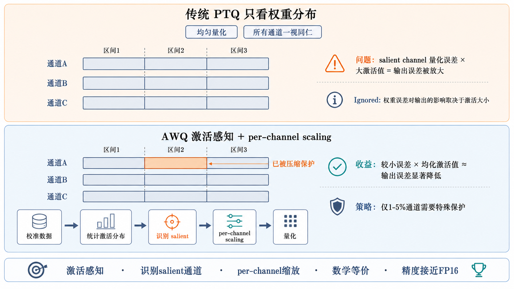

### 3、GPTQ：逐层最优脑外科 + 误差补偿

GPTQ源于最优脑外科（OBS）剪枝思想：量化一个权重后，调整同一行中尚未量化的权重来补偿误差。

- 对每层收集输入激活`X`，计算Hessian矩阵`H = 2XX^T`（加阻尼保证可逆）
- 逐列贪心量化：量化第`q`列后，用`H^{-1}`计算补偿量，更新其余未量化列
- 补偿公式可简写为：`δ = -(W[:,q] - quant(W[:,q])) / [H^{-1}]_{qq} × H^{-1}_{:,q}`

由于每量化一列就立即补偿，量化误差不会在列之间累积。代价是量化过程较慢：需要Cholesky分解和逐列更新，7B模型通常要数十分钟到数小时，且校准数据需求比AWQ更多。

### 4、两者对比

| 维度 | AWQ | GPTQ |
|------|-----|------|
| 核心思想 | 量化前保护敏感通道（事前预防） | 量化后补偿误差（事后修正） |
| 关键工具 | 激活统计 + per-channel scaling | Hessian逆矩阵 + 贪心量化 |
| 量化速度 | 快（分钟级） | 较慢（小时级） |
| 校准数据 | 少（几十到几百条） | 较多（几百到几千条更稳定） |
| 精度表现 | INT4下精度损失较小 | 误差控制好，与AWQ相当 |
| 生态支持 | vLLM、HuggingFace | vLLM、HuggingFace、LMDeploy |

### 5、如何选择

- 先看**模型和工具链支持**：很多模型只发布了AWQ或GPTQ其中一种版本
- 再看**量化预算**：时间紧、校准数据少，优先AWQ；追求更精细的误差补偿，可选GPTQ
- 最后看**业务评测**：两种方法在INT4下精度接近，应在自己的评测集上对比，而不是只看方法名称
- 两者并不互斥：AWQ负责"事前保护"，GPTQ负责"事后补偿"，工程上选一种即可

可以总结为：**AWQ和GPTQ都是逐层最小化重构误差的INT4 PTQ方法。AWQ通过激活统计识别salient channels，用per-channel scaling在量化前保护敏感通道；GPTQ借鉴最优脑外科思想，用Hessian逆矩阵在量化后逐列补偿误差。AWQ更快、校准数据需求更少，GPTQ误差控制更精细但量化更慢，实际选型主要取决于模型版本、工具链和评测结果。**

---

<h2 id="面试问题-kv-cache量化和权重量化有什么不同为什么要单独量化kv-cache？">面试问题（进阶）：KV Cache量化和权重量化有什么不同？为什么要单独量化KV Cache？</h2>

**难度评分：⭐⭐⭐⭐⭐ (5/5)  |  考察频率：⭐⭐⭐ (3/5)**

### 1、权重量化 vs KV Cache量化

| 维度 | 权重量化 | KV Cache量化 |
|------|---------|-------------|
| 量化对象 | 模型参数（静态、恒定） | 推理中生成的K和V矩阵（动态、增长） |
| 量化时机 | 部署前离线完成 | 推理运行时逐Token写入 |
| 数据分布 | 训练后固定，分布可预知 | 每个请求不同，分布难以预知 |
| 对精度的敏感度 | 相对较低（大模型冗余度高） | 较高（直接参与注意力计算） |
| 主要收益 | 减少模型体积和加载时间 | 增大KV Cache容量，支持更长上下文/更多并发 |
| 量化位宽 | INT4/INT8/FP8 | INT8/FP8（INT4精度损失较大） |
| 反量化开销 | 权重加载时一次性 | 每次Decode读取时都需要反量化 |

### 2、为什么要单独量化KV Cache？

**1. KV Cache是显存的最大消耗者**

在长上下文或多并发场景中，KV Cache往往比模型权重占用更多显存。例如：
- 100个并发请求 × 4096上下文 × 7B模型的KV Cache ≈ 数十GB
- 同等条件下模型权重可能只有14GB

**2. K Cache和V Cache的量化敏感度不同**

研究发现K Cache和V Cache对量化的敏感度不同：
- V Cache通常对量化更鲁棒（可以量化到更低位宽）
- K Cache用于计算Attention Score，对精度更敏感（通常需要保留较高精度）

因此很多实现对K和V采用不同的量化策略：K→INT8，V→INT4或K→FP16，V→INT8。

**3. Decode阶段是访存瓶颈**

Decode阶段每次都需要读取全部KV Cache来与当前Token计算注意力。量化KV Cache可以：
- 减少每次Decode的访存量（如INT8查表比FP16少一半带宽）
- 提高有效HBM带宽利用率
- 间接提高Decode速度

### 3、KV Cache量化的实现方式

**方式1：在线统计量化（如LMDeploy）**
- 在Prefill阶段统计K和V的分布范围
- 根据统计的scale和zero_point在写入时量化
- 读取时反量化再参与注意力计算

**方式2：离线校准量化（如使用校准数据统计分布）**
- 使用代表性请求统计KV Cache的分布
- 离线确定量化参数
- 在线推理时直接使用预计算的量化参数

**方式3：混合精度KV Cache**
- K Cache保留FP16/INT8（保证Attention Score精度）
- V Cache量化到INT8/INT4（节省显存）

### 4、KV Cache量化的收益与风险

**收益：**
- 显存节省：INT8节省50%，INT4节省75%
- 支持更长上下文：同样的显存可以放更长的KV Cache
- 支持更多并发：同样的显存可以容纳更多请求

**风险：**
- 精度损失：尤其在长上下文场景中，每层的反量化误差可能累积
- 额外计算开销：每次读取需要反量化（有专门的快速反量化Kernel缓解）
- 分布漂移：不同请求的KV Cache分布差异大，固定量化参数不够适配

可以总结为：**KV Cache量化与权重量化的区别在于对象性质（动态vs静态）和量化目的（扩容vs瘦身）。KV Cache量化主要为了在有限显存下支持更长上下文和更多并发，需要特殊处理K Cache和V Cache对量化的不同敏感度。**

---

<h2 id="面试问题-fp8量化有什么特点与int8int4量化相比有何优势？">面试问题：FP8量化有什么特点？与INT8/INT4量化相比有何优势？</h2>

**难度评分：⭐⭐⭐⭐ (4/5)  |  考察频率：⭐⭐⭐⭐ (4/5)**

### 1、什么是FP8？

FP8（8位浮点数）是一种低精度浮点数据格式，与 INT8（8位定点整数）不同，它保留了浮点数的指数+尾数结构，在有限的 8 位宽度内兼顾了动态范围和精度。

FP8 主要有两种格式（IEEE/OCP标准）：

| 格式 | 符号位 | 指数位 | 尾数位 | 动态范围 | 精度 | 典型用途 |
|------|--------|--------|--------|---------|------|---------|
| **E4M3** | 1 | 4 | 3 | ±448（较窄） | 较高 | 前向传播权重和激活 |
| **E5M2** | 1 | 5 | 2 | ±57344（较宽） | 较低 | 梯度（训练中更常用） |

- **E4M3**（4位指数+3位尾数）：精度更高，适合表示权重和前向激活
- **E5M2**（5位指数+2位尾数）：动态范围更大，适合表示梯度等可能出现大范围数值的量

在推理场景中，主要使用 **E4M3** 格式来量化权重和激活。

### 2、FP8与INT8的区别

| 维度 | INT8 | FP8（E4M3） |
|------|------|-------------|
| 数值类型 | 定点整数 | 浮点数（指数+尾数） |
| 量化方式 | scale × quantized_value | 直接存储浮点近似值 |
| 动态范围 | 取决于scale选择 | 天然大动态范围（指数位） |
| Outlier处理 | 需要clipping，outlier被截断 | 指数位可覆盖较大数值，outlier损失小 |
| 反量化开销 | 需要乘scale | 硬件原生支持，无需反量化 |
| 硬件要求 | 通用（Volta及以上） | Hopper（H100/H200）及更新架构 |

**关键区别**：INT8 是均匀量化的定点数，所有数值间隔相同；FP8 是非均匀的浮点数，数值间隔随大小自适应——小数值间距密（精度高），大数值间距疏（范围广）。这使得 FP8 对大模型中的 **outlier 特征**（显著偏离均值的激活值）比 INT8 更鲁棒。

### 3、为什么FP8对大模型推理很重要？

**1. 天然处理outlier，减少校准复杂度**

大模型的激活值中经常存在 outlier 通道（某些通道的数值比其他通道大 10-100 倍）。INT8 量化时，这些 outlier 要么被 clip 丢失信息，要么迫使 scale 拉大导致普通通道精度下降。FP8 的指数位可以直接覆盖数个数量级的数值范围，outlier 无需特殊处理就能保持精度。

**2. 硬件原生支持，零反量化开销**

NVIDIA Hopper 架构（H100/H200）的第四代 Tensor Core 原生支持 FP8 矩阵乘加（MMA），不需要像 INT8 那样先反量化到 FP16 再计算。减少了一次数据转换，延迟和功耗更低。

**3. Transformer 引擎的自动精度切换**

在 NVIDIA Transformer Engine 中，FP8 可以在不同层、不同矩阵乘法之间动态调整精度策略，对敏感层保留更高精度，非敏感层使用 FP8，在精度和性能之间自动平衡。

### 4、FP8 vs INT4 在推理中的定位

| 维度 | FP8 | INT4（AWQ/GPTQ） |
|------|-----|------------------|
| 压缩率 | 2×（相对FP16） | 4×（相对FP16） |
| 精度保持 | 通常极好，接近FP16 | 依赖算法，部分任务有可见损失 |
| 部署复杂度 | 低（硬件原生，vLLM/TensorRT-LLM直接支持） | 中（需要专用量化Kernel和算法） |
| 显存节省 | 50% | 75% |
| 硬件门槛 | H100/H200（Hopper架构） | 较通用（Volta及以上） |
| 推理速度 | 通常快于FP16（硬件加速），接近INT8 | 取决于Kernel优化，可能不如INT8/FP8 |

### 5、FP8在实际框架中的使用

**vLLM中启用FP8量化：**
```bash
# 使用FP8量化模型（需模型支持或提前量化）
vllm serve neuralmagic/Meta-Llama-3.1-70B-Instruct-FP8 \
    --quantization fp8 \
    --dtype auto
```

**TensorRT-LLM中FP8推理：**
```bash
# 构建FP8 TensorRT Engine（需在构建阶段指定FP8精度）
trtllm-build --checkpoint_dir ./model_ckpt \
    --output_dir ./trt_engines \
    --gemm_plugin fp8 \
    --use_fp8_context_fmha enable
```

### 6、FP8量化与大模型部署的选型建议

- **有 H100/H200**：优先评估 FP8，精度接近 FP16、部署简单、硬件加速
- **需要极致压缩（小显存/边缘设备）**：优先 INT4（AWQ/GPTQ），压缩率是关键
- **需要兼顾精度和压缩**：FP8 权重量化 + KV Cache INT8 量化，组合使用
- **训练场景**：FP8 E5M2 可用于梯度，FP8 E4M3 用于权重和激活的混合精度训练

可以总结为：**FP8 通过浮点数的指数+尾数结构，在 8 位宽度内实现了大动态范围和自适应精度，天然适合处理大模型中的 outlier 激活值。配合 Hopper 架构的硬件原生支持，FP8 在推理时通常接近 FP16 精度，比 INT4 部署更简单且精度风险更小。由于需要 Hopper 及以上 GPU，FP8 更适用于数据中心场景而非边缘端侧部署。FP8 的两种子格式（E4M3/E5M2）分别侧重精度和范围，推理中主要使用 E4M3。**

---

<h2 id="面试问题-mxfp8与microscaling量化是什么？">面试问题（进阶）：MXFP8与Microscaling量化是什么？</h2>

**难度评分：⭐⭐⭐⭐ (4/5)  |  考察频率：⭐⭐⭐ (3/5)**

### 1、什么是MXFP8？

MXFP8是OCP Microscaling（MX）规范中的8位浮点格式。它和普通FP8的元素格式相同（通常为E4M3），区别在于**缩放方式**：

- 普通FP8：per-tensor或per-channel一个scale
- MXFP8：每32个元素组成一个block，block内共享一个E8M0 scale

```
普通FP8（per-tensor）：
  [ 32个元素 ][ 32个元素 ][ 32个元素 ] ...   ← 全部共用一个scale

MXFP8（block-wise）：
  [ 32个元素 | scale0 ][ 32个元素 | scale1 ][ 32个元素 | scale2 ] ...
  ↑ 每个block有自己的E8M0 scale（2的整数次幂）
```

E8M0是8位纯指数格式，只能表示2的整数次幂，因此硬件实现简单；block size固定为32。

### 2、与普通FP8的区别

| 维度 | 普通FP8 | MXFP8 |
|------|---------|-------|
| 元素格式 | E4M3 / E5M2 | E4M3 / E5M2 |
| 缩放粒度 | per-tensor / per-channel | 每32个元素一个block scale |
| scale格式 | FP32/FP16等 | E8M0（2的整数次幂） |
| 异常值处理 | 受全局scale限制 | 局部scale自适应，outlier影响局限在block内 |
| 存储开销 | 几乎可忽略 | 每32个元素多1字节scale（约3%） |
| 硬件支持 | Hopper及更新架构 | Blackwell原生支持MX Tensor Core |

### 3、Microscaling格式谱系：MXFP8、MXFP4与NVFP4

MXFP8不是孤立格式，而是Microscaling（MX）家族中的8-bit成员：

| 格式 | 元素位宽 | block大小 | scale | 定位 |
|------|----------|-----------|-------|------|
| MXFP8 | FP8（E4M3/E5M2） | 32 | E8M0 | 8-bit精度档，主要解决per-tensor FP8的outlier问题 |
| MXFP4 | FP4（E2M1） | 32 | E8M0 | 4-bit压缩档，压缩率更高，精度风险也更大 |
| NVFP4 | FP4（E2M1） | 16 | FP8 E4M3 + per-tensor FP32 | NVIDIA私有方案，block更细，Blackwell原生支持，面向极致压缩 |

三者的关系不是替代，而是同一趋势下的不同精度档位：**MXFP8保精度，MXFP4/NVFP4换压缩率**。选型时先确定业务能接受的精度下限，再决定用哪一档。

### 4、为什么需要MXFP8？

- **缓解outlier问题**：per-tensor FP8的scale由全局最大值决定，个别outlier会压缩其他数值的表示范围；MXFP8按block缩放，outlier只影响所在block
- **精度更高**：在相同8位元素宽度下，block-wise scaling通常比per-tensor FP8更接近FP16
- **适配硬件趋势**：NVIDIA Blackwell的Tensor Core原生支持MXFP8/MXFP4，可以在不牺牲太多精度的情况下获得更高吞吐
- **为更低精度铺路**：同一套block scaling机制可扩展到MXFP6/MXFP4

### 5、部署与使用

**硬件前提**：MXFP8依赖MX Tensor Core，Blackwell（B200/GB200）原生支持；Hopper及更早架构通常没有原生MXFP8 MMA，需要确认框架是否提供模拟或回退路径。

**常见工具链**：

```python
from llmcompressor.modifiers.quantization import QuantizationModifier

recipe = QuantizationModifier(targets="Linear", scheme="MXFP8", ignore=["lm_head"])
```

```bash
# vLLM加载compressed-tensors格式的MXFP8模型
vllm serve <mxfp8-checkpoint> --quantization compressed-tensors
```

TensorRT-LLM在Blackwell上同样支持构建MXFP8 Engine；具体参数和模型支持范围以所用版本为准。

### 6、选型建议

- **H100/H200**：优先使用成熟的per-tensor/per-channel FP8；MXFP8通常没有原生加速
- **B200/GB200（8-bit）**：精度优先选MXFP8，作为per-tensor FP8的升级项
- **B200/GB200（4-bit）**：追求极致压缩时评估NVFP4/MXFP4，但要接受更明显的精度风险
- **框架不支持时**：回退到普通FP8或INT4 AWQ/GPTQ，不要为了"新格式"牺牲可运维性
- **上线前必须验证**：kernel支持、模型架构覆盖、精度评测和吞吐收益

可以总结为：**MXFP8是OCP MX规范中的block-wise FP8格式：每32个元素共享一个E8M0缩放因子，元素仍为E4M3/E5M2。与per-tensor FP8相比，它用极小的scale存储开销换来了更好的outlier鲁棒性和精度；与INT4相比，它的压缩率仍是2倍。它和MXFP4、NVFP4共同构成Microscaling格式谱系：MXFP8保精度，MXFP4/NVFP4换压缩率。MXFP8依赖Blackwell等支持MX Tensor Core的硬件，适合在B200/GB200上追求"接近FP16精度+FP8吞吐"的场景。**

---

<h1 id="6.attention的性能优化flashattentionmqa-gqadsa与flashmla">6.Attention的性能优化：FlashAttention、MQA/GQA、DSA与FlashMLA</h1>

> 大模型推理的底层性能优化主要围绕两类瓶颈展开：Attention计算中的HBM读写，以及KV Cache带来的显存与带宽压力。FlashAttention从IO模式上优化通用注意力计算，MQA/GQA从模型结构上压缩KV Cache，DSA则通过轻量级Indexer选择Top-k历史Token，把长上下文注意力从稠密连接改为动态稀疏连接；FlashMLA进一步面向MLA架构，将低秩KV表示、分页缓存和Decode阶段的访存优化落到专用Attention Kernel中。这些技术共同构成现代推理框架的底层性能基础。

<h2 id="面试问题-flashattention为什么能加速注意力计算io-aware具体指什么？">面试问题：FlashAttention为什么能加速注意力计算？IO-aware具体指什么？</h2>

**难度评分：⭐⭐⭐⭐⭐ (5/5)  |  考察频率：⭐⭐⭐⭐⭐ (5/5)**

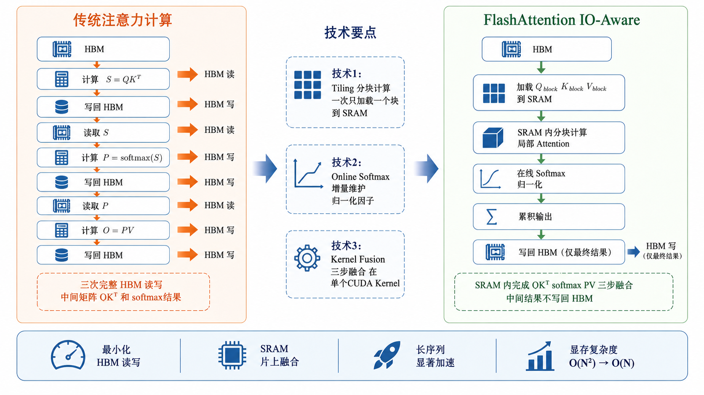

### 1、传统注意力计算的IO瓶颈

标准Transformer注意力计算公式为：

```
Attention(Q, K, V) = softmax(QK^T / √d) × V
```

以Q、K、V都存储在HBM（高带宽显存）为例：

**传统实现的问题：**
1. 先计算S = QK^T（大矩阵写入HBM）
2. 再读取S，计算P = softmax(S)（写入HBM）
3. 再读取P，计算O = PV（写入HBM）

每一步都涉及将中间结果写入HBM再读出，而HBM的带宽（~2TB/s for H100）虽然高，但远低于GPU片上SRAM的计算速度。这种**频繁的HBM读写带来的IO开销**成为注意力计算真正的瓶颈——本质上，注意力计算不是算不过来，是数据搬不过来。

### 2、FlashAttention的IO-aware设计

FlashAttention的原理是**分块计算 + 片上融合**：

**1. 分块（Tiling）**

将Q、K、V矩阵切分为小块（Block），每次只加载一个小块到快速SRAM中：

- 一个Q块 + 一个K块 → 局部Attention Score → softmax → ×V块
- 处理完一个K/V块后，再加载下一个K/V块
- 避免了QK^T整个矩阵的完整物化和HBM写入

**2. 在线Softmax（Online Softmax）**

传统softmax需要两次遍历（一次max、一次exp求和），而FlashAttention实现在分块计算中"在线"维护softmax的归一化因子：

```
对每个K/V块：
  - 计算局部Attention Score
  - 在线更新softmax的max和sum（使用numerically stable的增量算法）
  - 累积加权V结果
```

这样不需要等整个QK^T计算完再做softmax。

**3. 算子融合（Kernel Fusion）**

将Attention(Q, K, V)的三个步骤（QK^T、softmax、×V）融合在单个CUDA Kernel中完成，中间结果全部在SRAM中传递，不写回HBM。

### 3、FlashAttention的速度提升

以FP16精度、序列长度4096为例：

- FlashAttention-1：相比朴素标准实现通常有明显加速，显存占用可从O(N²)中间矩阵降到接近O(N)
- FlashAttention-2：通过改进任务划分和并行策略（让每个thread block处理不同的Q行），进一步提高GPU利用率
- FlashAttention-3：针对 Hopper 架构（H100/H200）深度优化，利用 TMA（Tensor Memory Accelerator）异步数据搬运和 **warp group 级别的 interleaved matmul-softmax 流水线**，将 softmax 延迟隐藏在矩阵乘法中。通过**生产者-消费者 warp 分工**（一部分 warp 负责 TMA 数据预取，另一部分 warp 负责计算），显著提升 SM 利用率，在 H100 上可达到 ~740 TFLOPS 的实际利用率（理论峰值的 75%）

### 4、IO-aware的内涵

**"IO-aware"** 是指算法设计时充分考虑了不同层级存储（HBM vs SRAM）的带宽和容量差异，通过分块计算最大化利用快速但容量小的SRAM，最小化慢速但容量大的HBM的访问。

| 存储层级 | 容量 | 带宽 | 延迟 |
|---------|------|------|------|
| GPU SRAM（Shared Memory） | ~228KB/SM | ~20TB/s | 极低 |
| GPU HBM（显存） | 80GB（A100） | ~2TB/s | 较高（数百cycle） |

FlashAttention正是通过**最小化HBM读写次数**来实现加速，这是"IO-aware"的精髓。

可以总结为：**FlashAttention通过分块计算（Tiling）、在线Softmax和Kernel融合三大技术，将注意力计算的中间结果尽量保持在GPU片上SRAM中，减少HBM读写次数。其主要思想"IO-aware"意味着算法设计时充分考虑不同存储层级的带宽差异，在长序列Attention中通常能改善性能和显存占用。FlashAttention-1/2/3代际演进持续结合新GPU架构优化，已成为主流推理框架中常用的Attention Backend。**

---

<h2 id="面试问题-mqa和gqa如何压缩kv-cache会带来什么影响？">面试问题：MQA和GQA如何压缩KV Cache？会带来什么影响？</h2>

**难度评分：⭐⭐⭐⭐ (4/5)  |  考察频率：⭐⭐⭐⭐⭐ (5/5)**

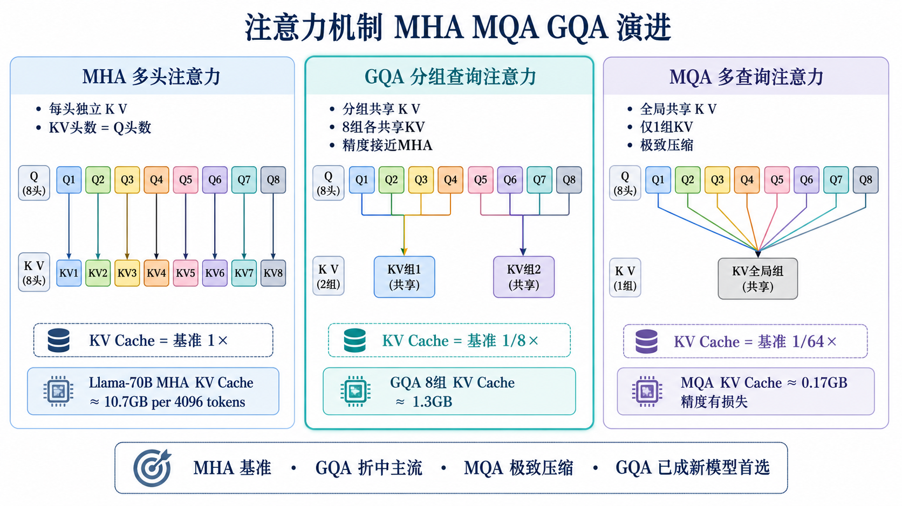

### 1、从MHA到MQA到GQA的演变

**MHA（Multi-Head Attention，多头注意力）**

标准Transformer中，每个注意力头都有独立的Q、K、V投影：

```
Q_i = X × W^Q_i      (每个头独立Q)
K_i = X × W^K_i      (每个头独立K)
V_i = X × W^V_i      (每个头独立V)
```

KV Cache大小 = 层数 × 头数 × 每个头的维度 × 序列长度 × 2(K+V)

**MQA（Multi-Query Attention，多查询注意力）**

所有Q头共享同一组K和V：

```
K_shared = X × W^K      (只有一组K)
V_shared = X × W^V      (只有一组V)
Q_i = X × W^Q_i         (Q仍然多头)
```

KV Cache缩小为原来的 1/头数。以32头为例，KV Cache减少到1/32。

**GQA（Grouped-Query Attention，分组查询注意力）**

将Q头分为若干组，每组共享一组K和V：

```
将H个头分为G组，每组H/G个头共享K、V
KV Cache = MHA的 (G/H)
```

例如Llama-2-70B使用8组：KV Cache从MHA的(H=64)缩减到8/64=1/8。

### 2、三者KV Cache消耗对比

以Llama-2-70B（层数=80, 64头, d_head=128, FP16）为例，4096上下文下：

| 方案 | KV头数 | 单请求KV Cache | 相对大小 |
|------|--------|---------------|----------|
| MHA | 64 | ~10.7GB | 1× |
| GQA (8组) | 8 | ~1.3GB | 1/8× |
| MQA | 1 | ~0.17GB | 1/64× |

### 3、GQA对模型质量的影响

GQA通过减少KV头数来压缩KV Cache，但这会带来模型表达能力的下降：

**正面影响：**
- KV Cache显存大幅减少，可支持更长上下文或更多并发
- Decode阶段访存量减少，推理速度提升
- 对小模型影响更小（因为小模型本身的头数较少）

**负面影响：**
- K和V的表达能力受限（多个Q头共享同一组K/V）
- 可能导致模型在某些任务上的精度略微下降
- 对需要精确注意力模式的任务（如信息检索）影响可能更大

**实验结论：**
- GQA（分组数≥4）在许多任务上可以接近MHA精度
- MQA在部分任务上可能有更明显的精度损失，新模型中通常更偏向采用GQA折中方案
- 当前主流大模型（Llama-2/3、Qwen-2等）广泛采用GQA

### 4、为什么GQA成为主流？

1. **KV Cache节省明显**：8分组意味着约8×的KV Cache压缩
2. **精度影响通常较小**：保留了分组级的K/V多样性，相比MQA的极端压缩更温和
3. **推理速度可能提升**：Decode阶段的访存量下降，在访存瓶颈明显时收益更突出
4. **训练兼容性较好**：GQA可以融入标准Transformer训练流程

可以总结为：**MQA将所有头的K/V合并为一组共享，GQA折中地按分组共享K/V。GQA通常能在较小精度影响下将KV Cache压缩数倍（典型为8×），降低大模型Decode阶段的显存和访存压力。当前不少主流大模型采用GQA，MQA则更多用于对吞吐和KV Cache压缩更敏感、且能接受潜在精度影响的场景。**

---

<h2 id="面试问题-dsa是什么它如何降低长上下文注意力的计算和访存开销？">面试问题：DSA是什么？它如何降低长上下文注意力的计算和访存开销？</h2>

**难度评分：⭐⭐⭐⭐⭐ (5/5)  |  考察频率：⭐⭐⭐⭐ (4/5)**

### 1、DSA要解决什么问题

DSA（DeepSeek Sparse Attention，深度求索稀疏注意力）是DeepSeek-V3.2-Exp引入的稀疏注意力机制。它要解决的核心问题是：在长上下文中，每个Query Token都要和全部历史Token计算注意力，注意力计算与KV Cache读取会随上下文长度快速增长。

**MQA/GQA和MLA主要压缩“每个Token存多少K/V信息”，但Attention仍然是稠密连接。** 即使Cache变小了，Decode时仍要遍历全部历史Token。DSA换了一个角度：不再让每个Query和所有历史Token做完整的Core Attention，而是先选出少量相关Token，再只在这些Token上计算注意力。

### 2、DSA的核心流程

```text
当前Query q_t
  -> Lightning Indexer：对历史Token做轻量相关性打分
  -> Top-k Selector：选出得分最高的k个历史Token
  -> Core Attention：只在选中的Token上执行注意力计算
```

可以把它理解成“**先检索，再做注意力**”：

1. **Lightning Indexer（轻量级索引器）**：用维度更低、计算更便宜的Indexer估计当前Query与历史Token的相关性。它不追求精确的完整注意力结果，只负责“粗筛”。
2. **Top-k Selector（Top-k选择器）**：根据Indexer分数保留k个候选Token。k是训练和部署时可配置的预算，k越大，保留的信息越多，但计算和访存也越高。
3. **Core Attention（核心注意力）**：只对选中的Token执行主注意力，并继续利用MLA的latent KV表示。因此DSA通常不是替代MLA，而是叠加在MLA之上的Token级稀疏选择机制。

### 3、为什么能降低计算和访存

设上下文长度为L、Top-k预算为k、主注意力Head维度为d、Indexer维度为d_i，并满足k << L、d_i << d：

- **Dense Attention**：每个Query都要和L个历史Token做完整注意力，Core Attention的计算和KV读取随L增长。
- **DSA**：先用Indexer粗筛，再只在k个Token上做Core Attention，主注意力的候选集合从L降到k。

因此，DSA主要降低的是“**最昂贵的Core Attention**”的计算量和KV读取量，而不是让整个模型变成零开销：

| 阶段 | 稠密Core Attention | DSA的主要路径 |
|------|--------------------|---------------|
| Prefill | 每个Query关注全部历史Token，约为O(L²d) | Indexer约为O(L²d_i)，Core Attention约为O(Lkd) |
| Decode | 每个新Token读取约O(L)的KV并做完整注意力 | Indexer扫描约O(Ld_i)，Core Attention只处理约O(k)个Token |

由于d_i远小于d、k远小于L，长上下文下通常能获得明显收益。但要注意：**DSA的总体复杂度不是简单的O(L)，Indexer仍要扫描历史Token，Top-k选择、索引读取和稀疏访问也有成本。** 在短上下文或小Batch下，这些额外开销甚至可能抵消稀疏注意力的收益。

### 4、DSA与常见Attention优化有什么区别

| 技术 | 优化层次 | 是否改变注意力连接模式 | 核心作用 |
|------|----------|------------------------|----------|
| MQA/GQA | 模型结构 | 否，仍是稠密注意力 | 减少K/V头数，压缩KV Cache |
| MLA | 模型结构 | 否，仍是稠密注意力 | 用低秩latent表示压缩K/V信息 |
| Sliding Window/Block-Sparse | 注意力模式 | 是，但通常是固定窗口或固定块模式 | 限制可见范围或按块跳过计算 |
| DSA | 注意力模式 | 是，按内容动态选择Token | 用轻量Indexer加Top-k选择减少Core Attention范围 |
| FlashAttention | Kernel执行 | 否 | Tiling、Online Softmax和Kernel融合，减少HBM读写 |
| FlashMLA | Kernel执行 | 否 | 针对MLA的latent Cache和Decode访存模式做专用优化 |
| KV Cache驱逐 | 缓存管理 | 间接改变可见Token集合 | 删除部分历史Cache，直接降低显存占用 |

几个容易混淆的点：

1. **DSA不等于MQA/GQA**：MQA/GQA压缩的是K/V头数；DSA减少的是每个Query实际参与Core Attention的Token数。
2. **DSA不等于MLA**：MLA改变KV Cache的表示方式；DSA改变注意力的稀疏连接方式，两者可以组合使用。
3. **DSA不等于FlashMLA**：FlashMLA优化MLA Kernel怎么执行；DSA优化注意力要算哪些Token。
4. **DSA不等于KV Cache驱逐**：驱逐通常会永久移除Cache；DSA通常是针对当前Query动态选择候选Token，其他历史Token仍可能被后续Query选中。

### 5、收益、代价与部署注意事项

**主要收益：**

- 长上下文下显著减少Core Attention的计算量和KV Cache读取量
- 可以保留MLA的低秩Cache优势，适合与MLA、FlashMLA类Kernel结合
- 相比固定窗口或固定块稀疏模式，能够根据内容动态保留远距离相关信息

**主要代价：**

- **训练与对齐成本**：Indexer需要和主模型共同训练或对齐，Top-k选错Token会直接影响模型质量
- **Top-k预算权衡**：k太小会漏掉关键信息，k太大会削弱稀疏收益，需要结合任务、上下文长度和SLO调优
- **不规则访存**：选中的Token在Paged KV Cache中可能不连续，Gather、排序、掩码和负载均衡都会增加Kernel复杂度
- **仍需管理Cache容量**：DSA降低Core Attention读取量，但历史Token的Cache仍要占用显存，不能替代KV Cache量化、分页和容量规划
- **收益依赖实现和场景**：短序列、强依赖全量上下文的检索任务、稀疏Kernel支持不完善的硬件，收益都可能低于预期

### 6、面试时怎么回答

回答时可以抓住三层关系：**MLA决定KV Cache怎么存，DSA决定Core Attention看哪些Token，FlashMLA决定这些注意力怎么高效算。**

可以总结为：**DSA是DeepSeek-V3.2-Exp引入的稀疏注意力机制，由Lightning Indexer、Top-k Selector和Core Attention组成。它先用轻量Indexer给历史Token打分，选出Top-k候选，再只对这些Token做MLA注意力，从而把最昂贵的Core Attention从全量L个Token降到k个Token，降低长上下文Prefill和Decode的计算与KV读取开销。但Indexer扫描、Top-k选择和稀疏访存仍有成本，DSA不是零开销的线性注意力，也不能替代MLA、FlashMLA或KV Cache容量优化；实际收益取决于Top-k预算、上下文长度、任务分布和Kernel实现。**

---

<h2 id="面试问题-flashmla是什么它如何加速mla的decode阶段？">面试问题：FlashMLA是什么？它如何加速MLA的Decode阶段？</h2>

**难度评分：⭐⭐⭐⭐⭐ (5/5)  |  考察频率：⭐⭐⭐⭐ (4/5)**

### 1、从MLA的KV Cache结构说起

MLA（Multi-head Latent Attention）不直接缓存每个注意力头的完整K/V，而是把历史Token的KV信息联合压缩到一个低维latent向量 `c_KV` 中；同时为了保留位置信息，还会缓存一路解耦的RoPE key `k_rope`。以DeepSeek-V2的典型配置为例，`c_KV`只有512维，远小于"头数 × head_dim"的完整K/V，因此KV Cache容量和HBM读取量都会显著下降。

但压缩后的Cache不能直接交给普通FlashAttention Kernel处理。Decode阶段仍然需要：

- 对每个历史Token读取 `c_KV` 和 `k_rope`
- 用Query与latent表示计算注意力分数
- 从 `c_KV` 恢复或等价计算Value贡献
- 在变长序列、分页KV Cache和混合batch下保持高带宽利用率

推理时可以通过权重吸收把部分上投影合并进Query输出或最终输出投影，避免显式物化所有头的完整K/V。FlashMLA要解决的，正是这种非标准MLA Cache布局下如何写出高效Decode Kernel。

### 2、FlashMLA是什么？

FlashMLA是DeepSeek开源的MLA Decode专用注意力Kernel，面向可变长序列服务和分页KV Cache设计，最初主要针对Hopper架构优化。

需要区分两个层次：

- **MLA是模型结构**：它决定KV Cache存什么、如何压缩，以及注意力如何计算。
- **FlashMLA是执行Kernel**：它不改变MLA的数学结果，也不负责进一步压缩KV Cache，而是让MLA在真实推理服务中更快地读取Cache、完成注意力计算。

因此，FlashMLA不是MQA/GQA的替代方案，也不是"另一种注意力机制"；它更像MLA版本的FlashAttention，针对MLA的Cache布局、Decode阶段的小Batch特征和变长请求做了专门优化。

### 3、FlashMLA的核心优化

**1. 融合投影与注意力计算**

普通实现往往会先恢复K和V，再调用通用Attention Kernel。FlashMLA直接在latent Cache上组织计算，将局部投影、`QK^T`、Online Softmax和Value累积尽量融合到同一个Kernel中，减少中间结果写回HBM。

**2. 分页KV Cache与变长序列**

FlashMLA通过Block Table访问非连续的KV Cache分页，不需要为不同长度请求补齐到最大长度。混合长度的Batch可以按真实序列长度调度，减少Padding带来的无效访存和计算。

**3. KV分块与Split-KV归约**

长上下文Decode中，单个请求的KV Cache很长。FlashMLA会把KV序列切分到多个Block并行处理，每个Block维护局部的最大值、归一化因子和输出累加结果，最后再用Online Softmax的方式合并，避免串行扫描整个上下文。

**4. TMA、WGMMA与Warp流水线**

在Hopper上，Kernel可以利用TMA异步搬运KV Block，并通过WGMMA执行矩阵运算。生产者Warp负责数据预取、消费者Warp负责计算，使数据搬运和Tensor Core计算重叠，降低等待HBM的停顿。

**5. 面向真实服务的调度**

不同请求的序列长度和Cache分页数量差异很大。FlashMLA会根据KV Block数量进行Tile调度，尽量让各SM负载均衡，减少长序列请求造成的尾部空闲。

### 4、一次Decode的概念流程

```text
q_latent = Q @ W_UK
q_rope   = RoPE(Q_r)

for each KV page in page_table:
    load c_KV[page], k_rope[page]
    score = q_latent @ c_KV^T + q_rope @ k_rope^T
    update online softmax(m, l)
    o += P @ c_KV

o = merge_partial_results(o, m, l)
o = o @ W_UV
```

这是概念示意：实际实现可能把 `W_UK` 吸收进Query投影、把 `W_UV` 吸收进输出投影，并根据Split-KV方式合并多个Block的局部结果。关键点是**不对每个头显式物化完整K/V，而是在片上高效消费latent Cache**。

### 5、与FlashAttention、MQA/GQA、MLA的区别

| 技术 | 所在层次 | 核心作用 |
|------|----------|----------|
| MQA/GQA | 模型结构 | 减少K/V头数，从结构上压缩KV Cache |
| MLA | 模型结构 | 用低秩latent表示压缩历史K/V，并缓存必要的位置分量 |
| FlashAttention | 通用Attention Kernel | 通过Tiling、Online Softmax和Kernel融合减少HBM读写 |
| FlashMLA | MLA专用Decode Kernel | 针对MLA的latent Cache、分页KV和变长服务优化Decode执行 |

一句话区分：**MQA/GQA和MLA改变"存什么"，FlashAttention和FlashMLA优化"怎么算"。** 对MHA/GQA模型通常使用FlashAttention类Kernel；对MLA模型，FlashMLA能更充分地利用其压缩后的Cache布局。

### 6、收益、限制与选型

FlashMLA的主要收益是降低长上下文Decode中的HBM访问压力，并提高Tensor Core和显存带宽的利用率。官方初始版本在H800 SXM5上的公开基准中给出过约3000 GB/s访存带宽和580 TFLOPS计算吞吐的成绩；实际效果会随模型尺寸、Batch、序列长度、Cache Block大小和软件版本变化。

它的适用边界也很明确：

1. **只适用于MLA模型**：普通MHA/GQA模型应选择对应的FlashAttention或其他Attention Backend
2. **主要优化Decode**：Prefill阶段仍需结合具体框架选择高吞吐的Prefill Kernel
3. **依赖硬件与框架支持**：不同GPU架构、CUDA版本和推理框架的集成程度不同
4. **不替代系统级优化**：Continuous Batching、量化、PD分离、调度策略仍然必要
5. **不改变算法复杂度**：FlashMLA优化的是访存模式和Kernel执行效率，不会消除长上下文注意力的根本计算量

可以总结为：**FlashMLA是面向MLA结构的Decode专用Attention Kernel。MLA通过低秩latent压缩KV Cache；FlashMLA则围绕 `c_KV + k_rope` 的缓存布局，融合投影与注意力计算，并结合分页KV、变长序列、Split-KV在线归约以及Hopper上的TMA/WGMMA流水线，减少HBM读写并提升长上下文Decode吞吐。它不改变MLA的数学结果，也不是MQA/GQA的替代品；能否使用取决于模型是否为MLA、推理框架是否集成以及GPU和版本支持。**

---

<h1 id="7.大模型推理中的常见算子融合方案">7.大模型推理中的常见算子融合方案</h1>

> 6.1已经讨论过算子融合的一般原理，本章把视角收紧到大模型推理：Transformer Block中反复出现大量小算子，Decode阶段又通常受HBM带宽和Kernel Launch开销限制，因此融合的重点不是单纯减少算子数量，而是减少中间张量的全局内存读写和调度开销。典型方案包括输入侧的Input+Embedding融合、Block内的Add+RMSNorm融合，以及Attention路径上的QKV Projection融合与RoPE+KV Cache Write融合。

<h2 id="面试问题-大模型推理中有哪些常见融合算子？input和embeddingadd和rmsnorm如何融合？">面试问题：大模型推理中有哪些常见融合算子？Input和Embedding、Add和RMSNorm如何融合？</h2>

**难度评分：⭐⭐⭐⭐ (4/5)  |  考察频率：⭐⭐⭐⭐⭐ (5/5)**

### 1、大模型推理为什么需要算子融合

大模型推理的算子序列很长，但很多算子本身计算量不大。例如RMSNorm、残差Add、激活函数、缩放和量化，单独执行时都要把Hidden State从HBM读出、计算后再写回HBM。

在Decode阶段，每生成一个Token都要经过所有Transformer层，Batch又往往较小，容易出现以下问题：

- 单个Kernel的计算量不足以掩盖显存访问延迟
- Kernel Launch、调度和同步开销占比升高
- 中间张量反复读写HBM，实际耗时由带宽而不是FLOPS决定
- 多个相邻小算子之间存在不必要的中间结果

因此，大模型方向的算子融合主要追求三件事：**减少中间张量的HBM读写、减少Kernel Launch次数、提高数据在寄存器或Shared Memory中的复用。** Prefill阶段的大GEMM通常偏Compute-Bound，融合收益更多来自GEMM Epilogue或减少调度；Decode阶段更偏Memory-Bound，融合的带宽收益通常更明显。

### 2、Input + Embedding融合

输入侧通常包含一串很短的算子：

```text
input_ids
  -> cast / reshape
  -> embedding_table gather
  -> 可选的位置编码Add
  -> 可选的scale
  -> Hidden State
```

没有融合时，`input_ids`的转换、Embedding查表、位置编码Add和Scale可能分别启动Kernel，并产生多个中间张量。Input+Embedding融合就是把这些输入准备步骤合并到一个Kernel中：

```text
input_ids, position_ids
  -> fused_input_embedding
  -> Hidden State
```

融合Kernel通常可以完成：

1. `input_ids`的类型转换和布局整理
2. 从Embedding表中按Token ID执行Gather
3. 可选的Position Embedding读取与Add
4. 可选的Embedding Scale
5. 直接写出后续Transformer层需要的Hidden State

**收益主要来自减少小Kernel和中间张量。** 大模型的Embedding表通常很大，查表属于随机访存，融合不会让Gather本身变成计算密集型操作；它优化的是输入准备链路，而不是Embedding表的容量。对于使用RoPE的模型，位置编码通常作用在Attention的Q/K上，而不是在输入端做Position Embedding Add，因此具体融合内容要看模型结构。

还要注意并行边界：词表并行Embedding可能涉及跨GPU的All-Reduce或All-Gather，通信通常不能被普通Embedding Kernel直接融合；Tokenizer一般也在CPU侧执行，不属于GPU算子融合的范畴。

### 3、Add + RMSNorm融合

Transformer Block中常见Pre-Norm残差结构：

```text
h = residual + x
rms = sqrt(mean(h^2) + eps)
y = h / rms * weight
```

没有融合时，通常先执行一个Add Kernel得到`h`，再执行一个RMSNorm Kernel得到`y`：

| 路径 | Kernel数量 | 主要HBM访问 |
|------|------------|-------------|
| 未融合 | Add + RMSNorm | 读`x`、`residual`，写`h`；再读`h`、读`weight`，写`y` |
| 融合 | 一个Add+RMSNorm Kernel | 读`x`、`residual`、`weight`，写`h`和`y` |

融合后有几个直接收益：

- 少启动一个Kernel，降低Launch和调度开销
- 残差Add的结果不需要先写回HBM再被RMSNorm重新读取
- 在同一个线程块内完成平方和归约、归一化和缩放，访存局部性更好
- 可以继续把归一化后的FP8/INT8量化融合在Epilogue中，减少一次额外遍历

实现时通常需要注意：

1. **数值稳定性**：平方和用FP32累加，正确处理`eps`，避免FP16/BF16溢出
2. **归约方式**：按Token对Hidden维做Block Reduction，尽量使用向量化读写
3. **残差保留**：如果下一层仍然需要未归一化的`h`，融合Kernel要同时保留残差流
4. **并行边界**：Tensor Parallel下通常要先完成All-Reduce，才能对完整Hidden维做RMSNorm，不能随意跨通信Barrier融合

Add和RMSNorm可以自然融合，是因为它们作用在同一组Hidden元素上，Add是逐元素操作，RMSNorm需要完整的Hidden维归约。但要把Add+RMSNorm直接塞进前一个GEMM的Epilogue通常更难：GEMM的输出分块可能还没有覆盖完整Hidden维，RMSNorm又必须等所有元素到齐后才能计算归约值。

### 4、其他常见融合方案

| 融合方案 | 典型形式 | 主要目的 |
|----------|----------|----------|
| Input+Embedding | 输入转换、Embedding Gather、可选位置Add和Scale | 减少输入侧小Kernel和中间张量 |
| Add+RMSNorm | 残差Add与RMSNorm合并 | 避免中间Hidden State反复读写 |
| QKV Projection | 将Q、K、V的权重拼接后做一次GEMM | 减少GEMM Launch和权重读取 |
| RoPE+KV Cache Write | 旋转位置编码后直接写入分页KV Cache | 避免额外的中间K/V张量 |
| Attention Epilogue | Scale、Mask、Softmax和PV在同一个Kernel中完成 | 减少Attention中间矩阵落HBM |
| SwiGLU Epilogue | Gate/Up GEMM后融合SiLU与逐元素相乘 | 减少激活中间张量 |
| Norm+Quantize | RMSNorm后直接输出FP8/INT8 | 减少归一化后再量化的额外遍历 |

其中QKV Projection更偏“模块级融合”，FlashAttention中的Scale、Mask、Softmax和PV更偏“Kernel内部融合”，两者都算广义算子融合，但实现层次不同。

### 5、融合方案是否合理的判断标准

不是算子越少越好，实际选型要看：

1. **是否Memory-Bound**：相邻小算子读写多、计算少时，融合收益通常更大
2. **是否存在同步或通信边界**：跨All-Reduce、全局同步或CPU-GPU边界的融合通常不划算
3. **中间张量是否足够大**：中间结果越大，减少一次读写的收益越明显
4. **寄存器与Shared Memory压力**：融合过度可能降低Occupancy，反而变慢
5. **数值语义是否保持**：累加精度、`eps`、量化Scale和舍入方式都要与参考实现对齐
6. **动态Shape与分页Cache是否友好**：变长Batch、Paged KV Cache和CUDA Graph会限制Kernel的通用性
7. **是否已有编译器或框架实现**：TensorRT、TVM、XLA、TorchInductor以及vLLM/SGLang的专用Kernel可能已经完成同类融合，避免重复手写

最终应结合Nsight Systems、Nsight Compute或PyTorch Profiler观察Kernel数量、HBM吞吐、Occupancy和端到端TTFT/TPOT，而不是只看单个Kernel是否变快。

### 6、面试时怎么回答

回答时可以按“输入侧”和“Block内”两条线展开：

可以总结为：**大模型方向的算子融合优先处理Memory-Bound的小算子。Input+Embedding把输入ID转换、Embedding Gather以及可选的位置编码和Scale合并，减少输入准备阶段的Kernel和中间张量；Add+RMSNorm把残差Add与归一化合并，避免Hidden State先写回HBM再被读取。两者都能减少Kernel Launch和访存，但融合不是越多越好：还要考虑FP32归约等数值要求、寄存器和Shared Memory压力、Tensor Parallel的All-Reduce边界、动态Shape和Paged KV Cache，以及框架是否已有成熟Kernel。**

---

<h2 id="面试问题-如何融合qkv-projection？有什么收益和限制？">面试问题：如何融合QKV Projection？有什么收益和限制？</h2>

**难度评分：⭐⭐⭐⭐ (4/5)  |  考察频率：⭐⭐⭐⭐ (4/5)**

### 1、QKV Projection为什么要融合

标准Transformer中，Q、K、V通常由三个独立的Linear投影得到：

```text
q = x @ W_q + b_q
k = x @ W_k + b_k
v = x @ W_v + b_v
```

三个投影读取同一份输入`x`，但分别启动GEMM、分别分配输出张量，并在Kernel之间产生调度和HBM读写开销。Decode阶段每个请求每层只处理很少的Token，GEMM的M维很小，容易受Launch开销和权重读取限制；Prefill阶段虽然单次计算量大，但三次小GEMM也不如一次更大的GEMM容易把Tensor Core喂满。

QKV Projection融合的核心，就是把三个投影合并成一次GEMM。

### 2、融合方式

最直接的做法是在模型加载或编译阶段，把三组权重按输出维拼接：

```text
W_qkv = concat([W_q, W_k, W_v], dim=output_dim)
b_qkv = concat([b_q, b_k, b_v], dim=output_dim)

qkv = x @ W_qkv + b_qkv
q, k, v = split(qkv, [H_q * D, H_kv * D, H_kv * D], dim=-1)
```

这里有两个关键点：

1. **权重拼接在加载或编译阶段完成**，不能在每次Forward时临时`concat`，否则额外的显存搬运会抵消收益。
2. **融合的是一个GEMM或一个融合Kernel**，总FLOPs没有减少；收益来自减少输入`x`的重复读取、减少Kernel Launch，并让GEMM的输出维N更大、Tile划分更高效。

如果后续Attention Backend支持Packed QKV，`q/k/v`可以直接使用带偏移的View，不需要真的复制三份张量；如果Backend只接受三个独立张量，就要评估Split是否产生额外拷贝。

### 3、收益

- **减少Kernel Launch**：三个GEMM变成一次GEMM，降低调度和同步开销
- **减少输入重复读取**：同一份`x`只读一次，而不是被三个投影各读一次
- **改善GEMM形状**：拼接后的输出维更大，通常更容易获得较高的Tensor Core利用率和更好的Tile效率
- **减少中间张量和内存管理开销**：输出可以保持Packed布局，由Attention直接消费
- **便于量化**：可以将Q/K/V的量化Scale按输出通道一起打包，使用一个低精度GEMM完成投影

但要注意：**权重总字节数基本不变，KV Cache也不会因为QKV融合而变小。** QKV Projection优化的是投影阶段，不是Attention的复杂度。

### 4、限制与工程细节

1. **GQA/MQA的维数不一致**：Q的输出维通常是`H_q * D`，K/V是`H_kv * D`，Split偏移必须按真实Head数计算；某些硬件Tile要求N维对齐，可能需要Padding或特殊布局。
2. **Tensor Parallel切分**：Q/K/V通常按Head做列并行切分，每个GPU只拼接本地Head对应的权重；要保持Q与对应K/V Group的映射关系，不能简单跨Rank拼接。
3. **量化Scale布局**：INT8/FP8通常需要按通道或分Group保存Scale和Zero Point，Packed权重要连同量化参数一起打包，避免运行时反量化或重排。
4. **Attention Backend的输入格式**：Packed QKV、Separate QKV和Strided View的支持程度不同；不兼容时，Split拷贝可能抵消融合收益。
5. **动态Shape与CUDA Graph**：权重布局可以固定，但Batch、序列长度和输出Shape仍可能变化，需要确认Graph Capture和Paged Attention路径支持。
6. **不要跨越Attention或通信边界**：QKV融合只解决投影阶段，不能把后续完整Attention或All-Reduce无脑塞进同一个Kernel。

### 5、面试时怎么回答

可以总结为：**QKV Projection融合是典型的模块级GEMM融合：在加载或编译时把`W_q/W_k/W_v`按输出维拼成一个Packed权重，一次GEMM得到Packed QKV，再通过View或Split交给Attention。它不减少FLOPs和KV Cache，但能减少输入`x`的重复读取、Kernel Launch和中间张量，并改善GEMM的N维利用率。真正落地时要处理GQA/MQA维数不一致、Tensor Parallel的Head切分、量化Scale布局和Attention Backend是否支持Packed输入。**

---

<h2 id="面试问题-rope和kv-cache-write如何融合？paged-kv-cache下要注意什么？">面试问题：RoPE和KV Cache Write如何融合？Paged KV Cache下要注意什么？</h2>

**难度评分：⭐⭐⭐⭐ (4/5)  |  考察频率：⭐⭐⭐⭐ (4/5)**

### 1、RoPE和KV Cache Write分别做什么

在每个Transformer层中，Q/K投影之后通常还要对Q和K应用RoPE。K完成旋转后不会只参与当前Token的计算，还要写入KV Cache，供后续Decode步骤读取：

```text
k_rot = apply_rope(k, position)
v     = value_projection(x)

kv_cache[slot].k = k_rot
kv_cache[slot].v = v
```

如果分步实现，典型流程是：

1. RoPE Kernel读取K，计算旋转后的K，并把临时`k_rot`写回HBM
2. KV Cache Write Kernel再从HBM读取`k_rot`，按Page Table写入缓存
3. V可能再经过一个独立的Cache Write Kernel

这样会多出临时K的写回和重新读取，也会增加Kernel Launch。Decode阶段每一层、每一个Token都会重复这一过程，固定开销会被层数放大。

### 2、融合方式

融合后的Kernel在完成RoPE后，直接把结果写入Paged KV Cache：

```text
for each token:
    cos, sin = rope_table[position_id]
    for each local KV head:
        k_rot = rope(k[token, head], cos, sin)
        slot = block_table[seq_id, token_offset] * page_size + page_offset
        kv_cache.k[slot, head] = quantize(k_rot)
        kv_cache.v[slot, head] = quantize(v[token, head])
```

几个实现要点：

1. **RoPE在写入缓存前完成**，缓存中保存的是旋转后的K，而不是原始K
2. **Page Table负责把逻辑Token位置映射到物理Page**，写入时必须处理分页后的非连续地址
3. **V不做RoPE，但可以和K一起写入**，复用同一次地址计算和Kernel调度
4. **Q的RoPE可以一起融合**，也可以留给Attention Kernel处理，取决于Backend的接口设计
5. **量化可以直接放在Epilogue**，把旋转后的K和V写成FP8/INT8，并同步写入Scale

### 3、收益

- **减少一次K的HBM往返**：不再先写`k_rot`临时张量、再由Cache Write读回
- **减少Kernel Launch**：RoPE、K Cache Write和可选的V Cache Write合并
- **便于融合量化**：RoPE后直接量化并写入Cache，避免额外遍历
- **Decode收益明显**：每层每个Token都要写Cache，固定Launch开销占比高
- **Prefill也受益**：Prefill一次写入大量Token的K/V，减少中间张量和带宽开销更明显

需要强调：**RoPE+KV Cache Write优化的是缓存写入路径，不会减少后续Attention读取历史KV Cache的成本。** 它和FlashAttention/FlashMLA优化的主注意力计算是不同层次。

### 4、Paged KV Cache下的难点

1. **非连续写入**：Page Table使逻辑相邻Token可能落在不同物理Page，写入Kernel要做Gather/Scatter，访存合并和向量化更困难
2. **Page边界**：一个Token的Head维通常应在一个Page内连续存储，但相邻Token可能跨Page，需要按Page Size和Block Size设计线程映射
3. **动态Batch与变长序列**：不同请求的写入位置和长度不同，Kernel要按真实Sequence Length调度，避免Padding和无效写
4. **量化Scale布局**：K/V按Head、Token还是Group保存Scale，会影响写入地址和后续Attention的读取方式
5. **RoPE布局一致性**：要区分Interleaved和Half-Split等旋转方式，Cos/Sin表精度和位置ID映射必须与模型一致
6. **GQA/MQA与MLA差异**：GQA/MQA缓存的是`H_kv`个K/V Head；MLA缓存的是latent表示与RoPE分量，融合边界要按具体Attention Backend调整
7. **同步顺序**：当前层的Cache Write必须在Attention读取之前完成，同一Stream上的Kernel顺序通常可以保证，但不要引入额外的全局同步
8. **CUDA Graph兼容性**：Page Table内容会在运行时变化，需要保证地址和缓冲区稳定，避免Graph Capture后失效

### 5、面试时怎么回答

可以总结为：**RoPE+KV Cache Write融合是在写缓存路径上做文章：K完成RoPE后不再生成临时`k_rot`，而是按Page Table直接Scatter到Paged KV Cache，并可顺带写入V、完成FP8/INT8量化。它减少了Kernel Launch、临时K的HBM往返和额外遍历，Decode阶段收益尤其明显。工程难点主要在分页非连续写、Page边界、GQA/MLA布局、量化Scale、RoPE精度和CUDA Graph兼容性；它优化的是Cache写入，不会替代FlashAttention/FlashMLA对Attention读取与计算本身的优化。**

---

<h1 id="8.高级推理架构优化pd分离推测解码与多token生成">8.高级推理架构优化：PD分离、推测解码与多Token生成</h1>

> 在底层算子和KV Cache优化之外，大模型推理还需要从服务架构和生成范式上突破瓶颈。Prefill/Decode的瓶颈差异催生了PD分离架构，推测解码则通过“多Token预测+大模型验证”缓解Decode串行生成问题。本章聚焦这些更偏系统架构层面的高级优化方法。

<h2 id="面试问题-prefill和decode阶段的瓶颈分别是什么为什么需要分开优化？">面试问题：Prefill和Decode阶段的瓶颈分别是什么？为什么需要分开优化？</h2>

**难度评分：⭐⭐⭐⭐ (4/5)  |  考察频率：⭐⭐⭐⭐ (4/5)**

### 1、两阶段瓶颈的本质差异

**Prefill阶段——计算密集型（Compute-Bound）**

Prefill一次性处理所有Prompt Token：
- 计算量：O(n²)注意力 + O(n) FFN（n = Prompt Token数）
- 瓶颈：GPU的FLOPS（计算能力），而非HBM带宽
- 优化方向：让GPU的Tensor Core"吃饱"——大batch、大矩阵运算
- 对硬件的要求：高FLOPS的GPU

**Decode阶段——访存密集型（Memory-Bound）**

Decode逐个Token生成：
- 计算量：O(n)注意力（单Token）+ O(1) FFN
- 瓶颈：HBM带宽，GPU等待数据从显存搬运到计算单元
- 优化方向：减少每步Decode的访存量——MQA/GQA、KV Cache量化、减少KV Cache尺寸
- 对硬件的要求：高HBM带宽的GPU

### 2、分开优化的必要性

将Prefill和Decode放在同一GPU上处理，会产生干扰：

1. **Prefill的"计算轰炸"会抢占Decode的计算资源**：当一个大Prompt的Prefill正在密集使用Tensor Core时，同时运行的Decode请求可能被"饿死"
2. **Decode的"带宽占用"会拖慢Prefill**：Decode需要持续读取KV Cache（占用大量HBM带宽），影响Prefill阶段的权重加载速度
3. **调度复杂度增加**：在同一个Scheduler中同时管理两种不同瓶颈的请求，调度策略更难兼顾TTFT、TPOT和吞吐

### 3、分开优化的方向

| 瓶颈 | 优化策略 |
|------|---------|
| Prefill（计算密集） | 增大batch（一次处理更多Token）、FlashAttention、FP8/INT8矩阵乘法、更多Tensor Core |
| Decode（访存密集） | 减少KV Cache大小（GQA/量化）、减少访问KV Cache的次数（多Token预测）、更高HBM带宽 |

### 4、为什么PD分离是顺势而为

既然两阶段瓶颈不同、对硬件的要求不同、优化方向不同，很自然的思路就是——把它们分开部署到不同的硬件上，各自使用最适合的配置。

可以总结为：**Prefill是计算密集型（瓶颈在FLOPS），Decode是访存密集型（瓶颈在HBM带宽）。两阶段放在一起会相互干扰，分开优化可以各取所需的硬件和策略。这就是PD分离架构的出发点。**

---

<h2 id="面试问题-什么是pd分离prefill-decode-disaggregation它的架构是怎样的？">面试问题：什么是PD分离（Prefill-Decode Disaggregation）？它的架构是怎样的？</h2>

**难度评分：⭐⭐⭐⭐⭐ (5/5)  |  考察频率：⭐⭐⭐⭐ (4/5)**

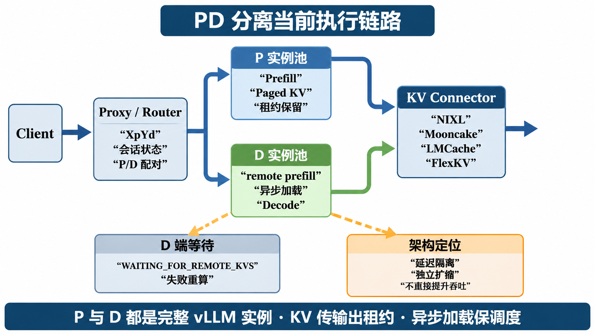

> 版本说明：当前 vLLM 主干仍是“V1 Engine + Model Runner V2”。Model Runner V2 是执行层重构，不是独立的“vLLM V2 Engine”；PD 的公开抽象仍是 `KVConnectorBase_V1`。下面按当前实现口径描述，不再沿用旧的 P2P NCCL / PUT/GET_ASYNC 表述。

### 1、先给结论：PD 优化的是延迟与隔离，不是吞吐

PD 分离把同一个请求的 Prefill 和 Decode 放到不同的 vLLM 实例或资源池中执行，中间通过 KV Connector 传递 KV Cache 和请求元数据。

它最核心的收益不是“让系统吞吐翻倍”，而是：

- **分别优化 TTFT 与 ITL/TPOT**：P 池可以独立选择 TP/PP、Batch 大小和并行策略，不影响 D 池的逐 Token 延迟。
- **控制尾延迟**：避免长 Prompt 的 Prefill 插入 Decode 批次，减少 ITL 尖峰。
- **独立扩缩容**：P 和 D 可以按各自负载分别扩缩，不要求相同副本数。
- **降低相互干扰**：P 池不再和 D 池争抢同一批 GPU 资源。

vLLM 官方文档对此有一句非常关键的结论：**Disaggregated prefill 不提升吞吐，甚至可能因为 KV 传输而降低吞吐**。因此面试中应把 PD 定位为“延迟隔离和弹性架构”，而不是“吞吐优化”。

### 2、为什么不能只靠 Chunked Prefill

Chunked Prefill 在单实例内部把长 Prefill 切块，确实能平滑 Decode 延迟，但有两个局限：

- chunk 大小很难同时满足不同请求长度、并发和 SLO。
- Prefill 与 Decode 仍共享同一个 GPU、同一套调度器和同一份显存。

PD 分离把这种隔离提升到实例级：P 实例可以更偏计算和 Batch 吞吐，D 实例可以更偏 KV 容量和低延迟。P 实例内部仍然可以继续使用 Continuous Batching、Chunked Prefill 和 Prefix Caching。

需要注意，P 用“高 FLOPS GPU”、D 用“高带宽 GPU”只是常见策略，不是硬性要求。实际部署中 P/D 经常使用相同 GPU 型号，通过不同的 TP/PP/DP 配置、Batch 参数和副本数量来区分资源画像；D 通常更受 KV Cache 容量和 HBM 带宽约束。

### 3、最新执行链路

以当前 vLLM 的单向 PD 为例：

1. Proxy 选择一个 P 实例，发送原始请求或已经 Tokenize 的 `prompt_token_ids`。
2. P 实例执行 Prefill，把 KV 写入分页后的 KV Block，并以租约形式保留这些 Block。
3. P 返回 `kv_transfer_params`，其中包含请求标识、远端 Block 信息和必要的握手元数据。vLLM 示例中 P 端通常使用 `max_tokens=1`，把首 Token 和 KV 一起交给 D。
4. Proxy 向 D 实例发送带 `do_remote_prefill=True` 的请求，并携带 P 返回的参数。
5. D 的 Scheduler 通过 Connector 查询可复用的远端 Token 数，分配本地 KV Block，然后启动同步或异步加载。
6. 如果 KV 尚未就绪，请求进入 `WAITING_FOR_REMOTE_KVS` 或对应的异步等待队列；加载完成后继续 Decode。
7. D 生成完整输出并流式返回；P 的 KV Block 在租约到期或被确认读取后释放。

这里有两个容易混淆的点：

- **P 端不是只做一次“裸 Prefill”**：它仍然是一个完整的 vLLM 实例，内部有 Scheduler、PagedAttention、Prefix Caching 和批处理。
- **D 端不是简单接收一个 KV 文件**：它要把远端 KV 映射到本地分页 Block，并参与本地调度、显存管理和失败恢复。

### 4、KV Cache 传输量怎么估算

设层数为 `L`、KV 头数为 `H_kv`、head_dim 为 `d`、Prompt 长度为 `T`、每个元素为 `b` 字节，则 K 和 V 的总传输量为：

```text
KV bytes = 2(K+V) × L × H_kv × d × T × b
```

以 Llama-2-7B（32 层、32 个 KV 头、head_dim=128、FP16、4096 Token）为例：

```text
2 × 32 × 32 × 128 × 4096 × 2 bytes ≈ 2 GiB
```

使用 GQA、KV 头数降为 8 时，约为 `2 GiB × 8/32 = 0.5 GiB`。 MLA、FP8 KV Cache、量化传输和更长的上下文都会改变这个结果。

传输时延可以粗略写成：

```text
传输时延 ≈ KV 字节数 / 有效网络带宽
```

例如 2 GiB KV 在 400 Gbps 链路上的理论上限约为 43 ms，在 100 Gbps 链路上约为 172 ms；实际还要加上协议、握手、分片和拥塞开销。这也是 PD 更适合“长 Prompt + 高带宽网络”的原因。

### 5、当前 Connector 体系

vLLM 通过 `KVTransferConfig` 配置 PD 传输，核心字段包括：

- `kv_connector`：Connector 名称。
- `kv_role`：`kv_producer`、`kv_consumer` 或 `kv_both`。
- `kv_buffer_device`：传输缓冲区所在设备。
- `kv_connector_extra_config`：Connector 私有参数。
- `kv_load_failure_policy`：加载失败后 `recompute` 或直接 `fail`。

当前实现把 Connector 分成 Scheduler 侧和 Worker 侧：

- **Scheduler 侧**：`get_num_new_matched_tokens`、`update_state_after_alloc`、`build_connector_meta`、`request_finished`，负责判断远端有多少 Token 可复用、何时等待、何时释放 Block。
- **Worker 侧**：`start_load_kv`、`wait_for_layer_load`、`save_kv_layer`、`wait_for_save`、`get_transfer_results`，负责真正的分层 KV 读写和异步完成通知。

主流传输实现包括：

| Connector | 传输方式 | 适用场景 |
|---|---|---|
| `NixlConnector` / `NixlPullConnector` | NIXL + UCX/RDMA，D 从 P 拉取，支持全异步 | 当前高性能 PD 的主流选择 |
| `NixlPushConnector` | NIXL 主动写入，P 向 D Push | 需要推送语义或特定网络拓扑 |
| `MooncakeConnector` | Mooncake KV 传输与存储体系 | 已有 Mooncake 基础设施 |
| `LMCacheConnectorV1` | LMCache，可结合 CPU/多级缓存 | KV 缓存分层与复用 |
| `FlexKVConnectorV1` | 分布式 KV Store | 大规模 KV 缓存管理 |
| `MultiConnector` | 按顺序组合多个 Connector | 同时接入多种传输后端 |
| `OffloadingConnector` | CPU/文件系统等层级卸载 | 不只是 PD，也用于 KV Offload |

旧的“P2P NCCL Connector + PUT/GET_ASYNC”不应再作为当前主口径。NIXL 默认使用 UCX，跨机通常走 RDMA；NCCL 环境变量也不一定适用于 NIXL。

一个最小的 P/D 配置示例如下：

```bash
# P 实例
vllm serve <model> \
  --kv-transfer-config '{"kv_connector":"NixlConnector","kv_role":"kv_producer"}'

# D 实例
vllm serve <model> \
  --kv-transfer-config '{"kv_connector":"NixlConnector","kv_role":"kv_consumer"}'
```

真实部署还需要 Proxy 负责请求分发、P/D 配对、重试和会话状态；多轮对话可使用 NIXL 的双向传输，让 P 从 D 拉回上一轮 KV，只计算新增 Token。

### 6、调度、异步加载与可靠性

PD 的难点不只在“把 KV 传过去”，还在等待和失败处理：

- D 端 Scheduler 可能先把请求放入 `async_kv_waiting`，在运行批次已满时提前发起加载。
- `max_num_inflight_kv_loads` 限制同时在途的远端 KV 加载数，`max_num_async_kv_loads_per_step` 限制每个调度步新启动的加载数。
- 远端 KV 未就绪时，请求处于 `WAITING_FOR_REMOTE_KVS` 或 `kv_holding_waiting` 等状态，不能直接进入普通 Decode 批次。
- `kv_load_failure_policy=recompute` 可以在传输失败时回退到本地重算；默认 `fail` 则直接让请求失败。
- NIXL 的 P 端 Block 通常有租约，D 端读取后确认；多轮双向模式还需要维护 D 端 KV 的 TTL 和会话映射。

因此 PD 系统必须同时关注 **KV 传输正确性、Block 生命周期、请求幂等/重试、P/D 版本一致性和故障恢复**，不能只画一张 P→D 的箭头图。

### 7、优势、代价与选型

| 维度 | 收益 | 代价 |
|---|---|---|
| 延迟 | TTFT 与 ITL/TPOT 可独立调优，尾延迟更可控 | KV 传输增加首 Token 链路延迟 |
| 扩展 | P/D 可独立扩缩，分别选择 TP/PP/DP | 需要处理 P/D 配比和流量倾斜 |
| 硬件 | 可做异构资源池，也可同型号不同配置 | 需要高速网络、RDMA/NIXL 和额外运维 |
| 吞吐 | 不直接提升，甚至可能下降 | KV 传输占用带宽，资源池可能碎片化 |
| 可靠性 | P/D 故障域分离 | 多一次传输故障、租约和状态管理 |

适合 PD 的场景通常是：长 Prompt 占比高、TTFT 与 TPOT 都有严格 SLO、尾延迟敏感、并发规模大，并且具备高速网络和较强运维能力。短 Prompt、低并发、纯吞吐离线任务，通常优先使用单实例 Continuous Batching + Chunked Prefill + Prefix Caching，PD 的收益不足以覆盖复杂度。

P:D 配比也不存在固定答案，需要根据输入/输出长度分布、Prefill 与 Decode 单步耗时、TTFT/TPOT 目标、GPU 型号和网络带宽压测确定。面试时最好给出“先测单实例基线，再按 P/D 资源画像拆分，最后用端到端 TTFT/TPOT/吞吐验证”的方法，而不是背一个固定的 1:1 或 1:N。

可以总结为：**PD 分离把 Prefill 与 Decode 拆到不同 vLLM 实例，通过 KV Connector 传递 KV Cache，核心价值是分别优化 TTFT 和 ITL、控制尾延迟并支持独立扩缩容，而不是提升吞吐。当前 vLLM 的主流实现是 NIXL Pull/Push 等 Connector，调度侧要处理远端 Token 查询、异步加载、等待状态、租约和失败重算；只有当长 Prompt、严格延迟 SLO 和高速网络同时成立时，PD 才值得引入。**

---

<h2 id="面试问题-什么是推测解码speculative-decodingdraft-model和target-model如何协同？">面试问题：什么是推测解码（Speculative Decoding）？Draft Model和Target Model如何协同？</h2>

**难度评分：⭐⭐⭐⭐⭐ (5/5)  |  考察频率：⭐⭐⭐⭐ (4/5)**

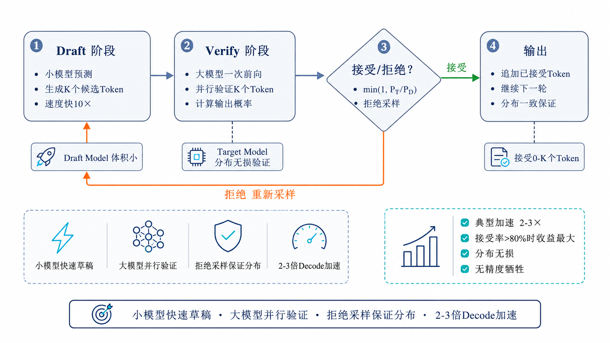

### 1、推测解码

自回归解码的瓶颈在于Token之间存在依赖关系，通常需要逐步生成，每个Token依赖前一个Token。这导致：
- GPU的并行计算能力被严重浪费（每步只生成1个Token）
- Decode延迟随Token数量线性增长

推测解码：**用一个"小而快"的Draft Model预测接下来的K个Token，然后用"大而准"的Target Model一次性验证这些Token，接受正确的部分，拒绝错误的。**

这就是"投机取巧"——反正Decode每步的计算量很小，不如让Target Model一次验证多个Token的推测结果，赌Draft Model预测得对。

### 2、推测解码的工作流程

```
输入: Prompt tokens
循环直到完成:
  1. Draft阶段:
     Draft Model自回归生成K个候选Token (draft_1, draft_2, ..., draft_K)
     (Draft Model很小很快，这一步耗时很短)
  
  2. Verify阶段:
     Target Model一次性处理 (Prompt + draft_1 + ... + draft_K)
     并行计算所有位置的输出概率
     
  3. Accept/Reject（拒绝采样）:
     对每个位置i的draft token x:
       计算接受概率 p_accept = min(1, p_target(x) / p_draft(x))
       以 p_accept 的概率接受该token
       如果接受 → 继续验证下一个draft token
       如果拒绝 → 从 p_target 的残余分布中重新采样，并丢弃后续所有draft token
     
     被接受的Token直接作为输出（可能接受0到K个）
  
  4. 将接受的Token追加到输入，准备下一轮
```

### 3、Draft Model和Target Model的协同机制

**Draft Model（草稿模型/推测模型）**

要求：
- 参数量远小于Target Model（如7B的Target配0.1B的Draft）
- 与Target Model使用相同词表
- 不需要很高的精度，但需要"大致方向正确"
- 推理速度快（最好是Target Model的10倍以上）

常见选择：
- 同一系列的微型版本（如Llama-3-8B配Llama-3-0.1B）
- 或仅用最后几层的轻量Draft Head

**Target Model（目标模型/验证模型）**

要求：
- 就是最终需要的高质量大模型
- 在验证阶段一次前向处理K+1个Token
- 通过注意力掩码实现并行计算所有位置的输出概率

**拒绝采样（Rejection Sampling）保证分布一致**

推测解码的关键数学保证：通过 **min(1, p_target(x) / p_draft(x))** 的拒绝采样机制，使最终输出的Token分布与Target Model直接自回归采样保持一致。因此它通常被称为”分布无损”的加速方法，但实际收益仍取决于Draft模型质量和接受率。需要区分的是，这里的接受判断不是简单比较两个概率的大小，而是基于概率比值进行随机采样——即使 p_target < p_draft 时仍有一定概率被接受，这是保证最终分布一致的关键。

### 4、性能收益分析

**加速比取决于两个因素：**

1. **接受率（Acceptance Rate）**：Draft Model预测被Target Model接受的比例
   - 高接受率（>80%）：受益于Target Model一次验证多个Token
   - 低接受率：大部分Draft Token被拒绝，加速有限

2. **Draft Model速度**：Draft越快越好
   - 理想情况：Draft生成K个Token的时间 << Target一次验证的时间

**典型加速比**：不少场景可达到2×-3×，在Draft模型质量高、接受率高的任务上可能更高；低接受率或Draft开销较大时收益会明显下降。

### 5、推测解码的变体

**1. Medusa（多头预测）**

不依赖独立的Draft Model，而是在Target Model上增加多个"预测头"，每个头负责预测未来不同位置的Token。减少了Draft Model的额外显存占用。

**2. Eagle（投机采样）**

利用Target Model的中间层特征训练轻量Draft Head，而不是独立的Draft Model。进一步降低额外显存和训练成本。

**3. Lookahead Decoding**

利用Jacobi迭代的方式，在Target Model内部实现并行推测，无需额外模型。

### 6、推测解码的局限

1. **Draft Model需要额外显存**：虽然Draft Model很小，但仍需额外空间
2. **小Batch时收益有限**：Target Model Decode本来就不算慢
3. **Draft和Target的对齐**：两者分布差异大时接受率低
4. **长序列验证计算量大**：每轮验证需要处理K个位置的完整注意力

可以总结为：**推测解码通过"小模型预测K个Token→大模型并行验证→拒绝采样保证分布一致"的机制，在不降低生成质量的前提下实现2-3倍的Decode加速。其变体包括Medusa（多头预测）、Eagle（特征级Draft）等。目前vLLM和SGLang都已集成推测解码支持，是大模型推理中低延迟场景的重要优化手段。**

---

<h1 id="9.大模型推理服务评测压测与容量规划">9.大模型推理服务评测、压测与容量规划</h1>

> 大模型推理服务的性能评测与传统推理有显著不同——不仅要看吞吐量，更要关注TTFT（首Token延迟）、TPOT（逐Token延迟）、P99延迟、容量上限和单位成本。构建合理的评测体系，需要先定义指标，再通过压测找到系统拐点，最后结合SLO和成本约束做容量规划。

<h2 id="面试问题-大模型推理服务有哪些性能指标ttfttpotthroughput分别衡量什么？">面试问题：大模型推理服务有哪些性能指标？TTFT、TPOT、Throughput分别衡量什么？</h2>

**难度评分：⭐⭐⭐⭐ (4/5)  |  考察频率：⭐⭐⭐⭐⭐ (5/5)**

### 1、指标体系总览

大模型推理服务的性能评测通常关注四大类指标：

1. **延迟类**：TTFT、TPOT、E2E Latency
2. **吞吐类**：Throughput、QPS、Token/s
3. **资源类**：GPU利用率、显存占用、KV Cache利用率
4. **质量类**：生成质量（Perplexity、任务指标）、首Token正确率

### 2、TTFT（Time To First Token，首Token延迟）

**定义**：从请求发出到收到第一个生成Token的时间间隔。

**TTFT = 排队延迟 + Tokenization时间 + Prefill延迟 + 第一次Decode延迟**

**衡量什么**：用户感知的"响应速度"。TTFT越低，用户感觉响应越快。

**影响因素**：
- Prompt长度：长度越长，Prefill计算量越大，TTFT越高
- 排队情况：高负载时请求在队列中等待，TTFT 增加
- Prefill计算能力：GPU FLOPS越高，Prefill越快

**典型目标**：
- 交互式对话场景：< 200ms（理想），< 500ms（可接受）
- 批量处理场景：< 2s

### 3、TPOT（Time Per Output Token，逐Token延迟）

**定义**：生成阶段中，每个输出Token之间的平均时间间隔。

**TPOT ≈ 一次Decode的计算时间 + 访存时间**

**衡量什么**：生成过程的"流畅度"。TPOT越低，文字"流"得越快。

**影响因素**：
- KV Cache大小（已有的Token数）：序列越长，每次Decode需读取的KV Cache越多，TPOT越高
- HBM带宽：Decode是访存密集型，带宽越大TPOT越低
- Batch Size（并发请求数）：并发越多，每步需处理的请求越多，TPOT可能增加

**典型目标**（需按模型规模区分）：
- 7B/13B 模型交互式场景：< 15-20ms/Token（50+ Token/s 的输出速度）
- 70B+ 模型交互式场景：< 30-50ms/Token（受限于访存瓶颈，单用户 TPOT 难达到 20ms 以内）
- 流式体验（各规模通用）：< 50ms/Token（低于此值时用户感知流畅）
- 批量离线处理：> 100ms/Token 也可接受，关注吞吐而非逐 Token 延迟

### 4、E2E Latency（端到端延迟）

**定义**：从请求发出到收到完整回复（包括所有生成Token）的总时间。

**E2E Latency = TTFT + TPOT × (生成Token数 - 1)**

### 5、Throughput（吞吐量）

**定义**：单位时间内系统处理的Token总数。

**Throughput = 总输出Token数 / 时间（通常以 tokens/s 度量）**

**衡量什么**：系统的整体"产能"。

**影响因素**：
- 并发请求数
- 每批处理的Token数
- Continuous Batching的效率
- GPU数量和型号

**注意区分**：
- 单请求吞吐：延迟敏感型场景关注（TTFT、TPOT更重要）
- 系统总吞吐：批量离线场景关注（Throughput更重要）

### 6、QPS（Queries Per Second）

**定义**：单位时间内成功处理的请求数。

**注意**：大模型场景中QPS关联于多个变量（Prompt长度、生成长度），单纯比较QPS意义有限。通常需要标注输入/输出长度条件。

**正常化QPS**：固定条件（如Prompt=500 Tokens, Output=200 Tokens）下的QPS更有可比性。

### 7、其他重要指标

**1. GPU利用率（GPU Utilization）**：GPU计算单元的使用比例。Decode阶段因为访存绑定，利用率天然低（往往10-30%），不必追求100%利用率。

**2. KV Cache命中率**：Prefix Caching/RadixAttention的命中率。高命中率→更多请求跳过Prefill→更低TTFT。

**3. P50/P95/P99延迟**：延迟的百分位分布，P95/P99反映了"最差体验"。在在线服务中P99比Average Latency更重要。

**4. Time Per Query（TPQ）**：单个请求从进入系统到返回的耗时。

### 8、指标关系图

```
                   E2E Latency
    |←————————————————————————————————————→|
    |←—— TTFT ——→|←—— (N-1) × TPOT ——→|
    |              |                      |
发起请求    收到第1个Token   收到第2个Token   ...   收到第N个Token
```

可以总结为：**大模型推理服务指标中，TTFT衡量"用户等多快能看到第一个字"（取决于Prefill速度），TPOT衡量"生成有多流畅"（取决于Decode访存速度），Throughput衡量"系统多久能处理完一批任务"。在线服务优先关注TTFT和P99延迟，离线批量优先关注Throughput。**

---

<h2 id="面试问题-如何进行大模型推理性能benchmark有哪些常用评测工具？">面试问题：如何进行大模型推理性能Benchmark？有哪些常用评测工具？</h2>

**难度评分：⭐⭐⭐ (3/5)  |  考察频率：⭐⭐⭐⭐ (4/5)**

### 1、Benchmark的基本原则

一个有效的大模型推理Benchmark需要做到：

1. **控制变量**：固定输入长度/输出长度/并发数等关键参数
2. **预热（Warmup）**：排除CUDA Graph构建、模型首次加载等冷启动影响
3. **多轮测试**：取多次测试的中位数/P50/P95，而非单次
4. **真实负载模拟**：使用与实际场景相似的输入/输出长度分布、并发模式
5. **结果可复现**：记录硬件配置、框架版本、关键参数

### 2、常用评测工具

**1. vLLM benchmark_serving.py**

vLLM内置的压测脚本是最常用的评测工具：

```bash
# 使用随机数据压测
python benchmarks/benchmark_serving.py \
    --backend vllm \
    --model Qwen/Qwen2-7B-Instruct \
    --dataset-name random \
    --random-input-len 1024 \
    --random-output-len 128 \
    --num-prompts 1000 \
    --request-rate 10
```

输出结果包括：TTFT均值/P99、TPOT均值/P99、Throughput (tokens/s)、Request throughput (req/s)等。

**2. SGLang bench_serving**

SGLang也提供类似的内置评测工具：

```bash
python -m sglang.bench_serving \
    --backend sglang \
    --num-prompts 500 \
    --random-input-len 2048 \
    --random-output-len 512
```

**3. EvalScope**

阿里开源的LLM评测框架，支持性能Benchmark：

```python
from evalscope.perf import PerfBenchmark

benchmark = PerfBenchmark(
    model="Qwen2-7B",
    input_len_range=(100, 2000),
    output_len_range=(50, 500),
    concurrency=[1, 4, 16, 64]
)
results = benchmark.run()
```

**4. GenAI-Perf (NVIDIA)**

NVIDIA官方的大模型性能评测工具，与Triton Inference Server深度集成：

```bash
genai-perf profile \
    --model llama \
    --backend tensorrtllm \
    --num-prompts 100 \
    --request-rate 5
```

**5. Locust / wrk（通用压测）**

通用HTTP压测工具也适用于大模型API服务的压力测试：

```python
# Locust脚本示例
class LLMUser(HttpUser):
    @task
    def chat(self):
        self.client.post("/v1/chat/completions", json={
            "model": "qwen2-7b",
            "messages": [{"role": "user", "content": "你好"}],
            "max_tokens": 100
        })
```

### 3、Benchmark的常见模式

**模式1：固定压力测试**
- 设定固定的请求频率（如10 req/s）
- 观察延迟和吞吐是否稳定
- 适用：容量规划

**模式2：阶梯压力测试**
- 逐步增加请求频率（1→5→10→20→50 req/s）
- 找到系统的"拐点"——延迟开始快速上升的QPS
- 适用：容量上限评估

**模式3：突发压力测试**
- 模拟突发流量（如瞬时100个并发请求）
- 观察TTFT在突发下的表现
- 适用：弹性评估

**模式4：长文本专项测试**
- 使用不同长度的Prompt（1K/4K/16K/32K）
- 观察TTFT和显存的非线性增长
- 适用：长上下文能力评估

### 4、Benchmark结果解读

一份典型的评测报告应包含：

| 指标 | 值 | 备注 |
|------|-----|------|
| 模型 | Qwen2-7B-Instruct | FP16 |
| 并发数 | 32 | — |
| 平均输入长度 | 1024 tokens | — |
| 平均输出长度 | 256 tokens | — |
| TTFT (P50/P99) | 45ms / 120ms | P99在可接受范围 |
| TPOT (P50/P99) | 12ms / 18ms | 生成流畅 |
| Throughput | 3500 tokens/s | 系统总吞吐 |
| QPS | 13.7 req/s | — |
| GPU利用率 | 65% | Decode主导，利用率合理 |
| 显存占用 | 48GB / 80GB | 有充足KV Cache空间 |

可以总结为：**大模型推理Benchmark需要控制变量、预热、多次取样，模拟真实负载。常用工具包括vLLM/SGLang内置的bench_serving、EvalScope、GenAI-Perf等。Benchmark不仅是性能数字，更重要的是通过阶梯压测找到系统瓶颈和容量上限，以及通过P99延迟了解"最差用户体验"。**

---

<h1 id="10.大模型分布式推理部署并行策略与多机多卡实践">10.大模型分布式推理部署：并行策略与多机多卡实践</h1>

> 当模型大到单卡GPU无法容纳，或者单副本无法满足吞吐需求时，分布式推理通常是必要选择。从单卡到多卡再到多机多卡，问题是如何组合张量并行、流水线并行和数据并行，并在通信开销、显存占用和服务吞吐之间取得平衡。理解这些并行策略的原理和适用边界，是部署70B及以上模型时经常需要掌握的知识。

<h2 id="面试问题-张量并行流水线并行数据并行在推理中各自适用什么场景？">面试问题：张量并行、流水线并行、数据并行在推理中各自适用什么场景？</h2>

**难度评分：⭐⭐⭐⭐⭐ (5/5)  |  考察频率：⭐⭐⭐⭐ (4/5)**

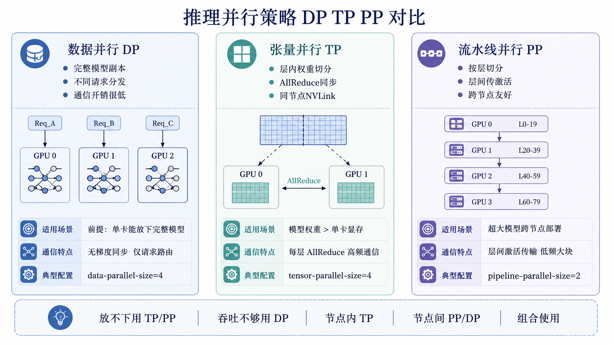

### 1、三种并行的基本概念

**1. 数据并行（Data Parallelism, DP）**

每个GPU持有完整的模型副本，但处理不同的输入数据：

```
GPU0: 完整模型 → 处理 [请求A, 请求B]
GPU1: 完整模型 → 处理 [请求C, 请求D]
```

- 通信：推理时不需要梯度同步；多副本间通常只需要请求路由和状态管理
- 显存：每张卡需要能放下完整模型
- 适用：模型能放入单卡但需要提高吞吐量的场景

**2. 张量并行（Tensor Parallelism, TP）**

将单个Transformer层内的权重矩阵切分到多个GPU上：

```
Attention层的QKV投影矩阵切分：
GPU0: W_Q[:half, :]     → 计算Q的前半部分
GPU1: W_Q[half:, :]     → 计算Q的后半部分
(计算后通过AllReduce合并结果)
```

- 通信：每层需要AllReduce/AllGather，通信频率高但数据量较小
- 显存：每张卡的模型参数量减少为 1/TP_size
- 适用：单层放不下单卡时（如大矩阵乘法的权重超过显存）

**3. 流水线并行（Pipeline Parallelism, PP）**

将模型的不同层分配到不同GPU上，按流水线方式执行：

```
GPU0: Layers 0-19  → 处理完成后传给
GPU1: Layers 20-39 → 处理完成后传给
GPU2: Layers 40-59 → ...
GPU3: Layers 60-79 → 输出最终结果
```

- 通信：层间接口传递激活值，通信频率较低但每次需要传输完整激活
- 显存：每张卡只存放部分层
- 适用：模型总层数太多导致单卡放不下所有层

### 2、推理场景中三种并行的适用性

| 并行方式 | 推理中的适用性 | 通信开销 | 主要用途 |
|---------|-------------|---------|---------|
| 数据并行 | ⭐⭐⭐⭐⭐ 常用 | 很低 | 提高吞吐量（每个GPU副本服务不同请求） |
| 张量并行 | ⭐⭐⭐⭐ 常用 | 中（频繁AllReduce） | 大权重矩阵无法放入单卡 |
| 流水线并行 | ⭐⭐ 较少用 | 低频率但高单次量 | 跨节点部署超大模型 |

### 3、推理中数据并行的特殊性

推理中的数据并行与训练中的数据并行有本质区别：
- 训练的数据并行：需要梯度同步（AllReduce梯度），通信开销大
- 推理的数据并行：每个GPU独立处理不同请求，**通常不需要梯度式模型同步**，通信开销较低

因此推理中数据并行通常很高效——只要每张卡能放下完整模型，数据并行就是较简单的水平扩展方式。

### 4、张量并行在推理中的细节

**为什么推理需要张量并行？**

以Llama-2-70B为例，FP16精度模型权重约140GB，单张A100/H100（80GB显存）无法完整存放。这时就需要将模型权重切分到多张卡上。

**典型的张量并行切分方式：**
1. 对Attention层的Q、K、V投影矩阵按列切分
2. 对FFN的中间层（gate、up）按列切分
3. 通过AllReduce同步部分结果

**通信开销：**
- TP在每层都需要AllReduce，通信频繁
- 因此TP对卡间带宽要求高（需要NVLink或至少PCIe 4.0）
- 跨节点的TP性能会大幅下降（除非有InfiniBand/RoCE）

### 5、如何选择并行策略？

**决策树：**

```
模型能否放入单卡？
├── 能 → 使用数据并行（多卡多副本，提高吞吐）
└── 不能 → 模型多大？
    ├── 2-4张卡能放下 → 张量并行（TP=2/4/8）
    │   - 同节点内使用NVLink连接
    │   - 通常适合70B以下或能在单节点内切分的模型
    └── 需要更多卡 → 张量并行 + 流水线并行
        - 节点内用TP，跨节点用PP
        - 如Llama-405B需要TP=8+PP=2（16卡）
```

**vLLM中的典型配置：**
```bash
# 单节点4卡，TP=4（适合70B模型）
vllm serve model --tensor-parallel-size 4

# 多节点：节点内TP=4，跨2个节点PP=2（适合超大模型）
vllm serve model --tensor-parallel-size 4 --pipeline-parallel-size 2
```

### 6、通信基础设施的重要性

| 连接方式 | 带宽 | 适用并行方式 |
|---------|------|-------------|
| NVLink（同节点GPU间） | 900 GB/s (H100) | TP（优先评估） |
| InfiniBand NDR（跨节点） | 400 GB/s | TP/PP（视负载评估） |
| PCIe 5.0（跨节点） | 128 GB/s | PP（TP容易受带宽限制） |
| 以太网（跨节点） | 100-400 Gb/s | PP/DP（通常不推荐跨节点TP） |

可以总结为：**数据并行是推理中常见且高效的扩展方式，前提是模型能放入单卡或单个副本组。当模型无法放入单卡时，通常优先评估节点内张量并行；流水线并行更常用于跨节点部署超大模型。实际部署中经常组合使用：节点内TP切分大层，跨节点PP切分层分布，请求级数据并行提高吞吐。**

---

<h2 id="面试问题-vllm如何配置多gpu分布式推理关键并行参数如何选择？">面试问题：vLLM如何配置多GPU分布式推理？关键并行参数如何选择？</h2>

**难度评分：⭐⭐⭐ (3/5)  |  考察频率：⭐⭐⭐⭐ (4/5)**

### 1、vLLM多GPU配置的参数

**`--tensor-parallel-size`（张量并行度）**

- 含义：将单个模型副本的权重矩阵切分到多少张GPU上
- 取值：通常为1/2/4/8
- 要求：TP内通信频繁，最好限制在同节点NVLink/NVSwitch范围内
- 适用：模型权重单卡放不下，或单卡放下后KV Cache空间不足

**`--pipeline-parallel-size`（流水线并行度）**

- 含义：将模型层切分到多个流水线阶段
- 取值：通常为1/2/4
- 要求：每个PP stage内部仍可组合TP
- 适用：超大模型跨节点部署，或TP不适合跨节点扩展时

**`--data-parallel-size`（数据并行副本数）**

- 含义：启动多个完整模型副本，每个副本处理不同请求
- 要求：每个DP副本内部可以是单卡，也可以是TP/PP组合
- 适用：单个模型副本已经能跑，但总吞吐不够

**`--distributed-executor-backend`（分布式执行后端）**

- 含义：选择分布式Worker/Executor管理方式
- 单机部署通常使用默认后端即可
- 多节点部署可根据环境选择`ray`等后端，而不是使用旧版`--worker-use-ray`口径

**上下文并行参数**

- `--decode-context-parallel-size`：Decode阶段上下文并行
- `--prefill-context-parallel-size`：Prefill阶段上下文并行
- 适用：超长上下文下单卡/单组GPU处理上下文压力过大时评估

### 2、参数选择指南

**确定模型副本形态的方法：**

1. 先估算单卡能否放下模型权重和必要KV Cache
2. 能放下：优先单卡副本，通过`data-parallel-size`扩吞吐
3. 放不下：优先节点内`tensor-parallel-size`
4. 单节点仍放不下或模型非常大：再组合`pipeline-parallel-size`
5. 长上下文成为主要瓶颈时，再评估Prefill/Decode上下文并行

**常见模型推荐配置：**

| 模型规模 | 精度 | 单卡80GB | 推荐配置 | 说明 |
|---------|------|---------|----------|------|
| 7B | FP16/BF16 | 能放下 | DP多副本 | 提高吞吐优先用数据并行 |
| 13B | FP16/BF16 | 能放下 | DP多副本 | 单副本通常无需TP |
| 34B | FP16/BF16 | 接近上限 | TP2或量化+DP | 需要给KV Cache留空间 |
| 70B | FP16/BF16 | 放不下 | TP4/TP8 | 节点内高速互联更重要 |
| 70B | INT4/AWQ | 能放下或接近 | 单卡/TP2+DP | 量化后可优先扩副本 |
| 405B | FP8/BF16 | 放不下 | TP+PP跨节点 | 需要结合网络和Executor后端 |

### 3、多GPU部署示例

**单节点4卡部署70B模型：**
```bash
vllm serve meta-llama/Llama-2-70b-chat-hf \
    --tensor-parallel-size 4 \
    --gpu-memory-utilization 0.9 \
    --max-model-len 4096
```

**单卡可放下但吞吐不足：使用数据并行扩副本：**
```bash
vllm serve Qwen/Qwen2-7B-Instruct \
    --data-parallel-size 4 \
    --max-num-seqs 128 \
    --max-num-batched-tokens 8192
```

**多节点超大模型：TP+PP并指定分布式后端：**
```bash
vllm serve meta-llama/Llama-3.1-405B-Instruct \
    --tensor-parallel-size 4 \
    --pipeline-parallel-size 2 \
    --distributed-executor-backend ray
```

### 4、多节点部署的关键判断

跨节点部署时，需要考量的是通信是否划算：

- **TP跨节点风险最大**：每层都可能有AllReduce/AllGather，网络差会严重拖慢TPOT
- **PP跨节点更常见**：层间只传激活，通信频率低于TP，但会有流水线气泡
- **DP跨节点更稳妥**：不同副本处理不同请求，模型内部通信较少
- **PD分离另算一类**：P/D之间需要KV传输，应重点评估`kv-transfer-config`、网络带宽和KV大小

因此一般优先级是：**节点内TP，节点间DP；超大模型再节点间PP；PD分离只在Prefill/Decode瓶颈差异明显时引入。**

### 5、常见配置问题

**问题1：TP size不整除注意力头数**

大多数模型的注意力头数是2的幂次或可被常见TP值整除。如果TP size不能整除头数，可能启动失败或性能不佳。

**问题2：跨节点TP延迟高**

如果跨节点没有InfiniBand/RoCE等高速网络，TP通信会成为瓶颈。此时应优先改成节点内TP、跨节点DP或PP。

**问题3：DP副本吞吐没线性提升**

可能瓶颈不在GPU，而在请求路由、CPU Tokenization、网络、限流策略或后端负载不均衡。

**问题4：长上下文下显存不足**

优先检查`max-model-len`、KV Cache容量、`max-num-seqs`和Prefix Caching命中率，再考虑上下文并行或PD分离。

可以总结为：**vLLM多GPU部署要区分”模型放不下”和”吞吐不够”两个问题：放不下通常优先评估TP/PP，吞吐不够通常优先评估DP。旧版`--worker-use-ray`表述应更新为`--distributed-executor-backend`；跨节点部署时优先让高频通信留在节点内，把DP、PP或PD分离放到节点间。**

---

<h1 id="11.大模型推理生产部署实践与常见问题排查">11.大模型推理生产部署实践与常见问题排查</h1>

> 大模型推理服务上线后，故障通常集中在三类：显存OOM、延迟抖动（TTFT/TPOT升高）和吞吐不达预期。排查时建议遵循"现象分类 → 排查路径 → 优化手段"的思路，先判断瓶颈在显存、调度还是计算与链路，再针对性地调整参数或架构，避免只靠调参碰运气。

<h2 id="面试问题-大模型推理中显存oom如何排查和解决？">面试问题：大模型推理中显存OOM如何排查和解决？</h2>

**难度评分：⭐⭐⭐⭐ (4/5)  |  考察频率：⭐⭐⭐⭐⭐ (5/5)**

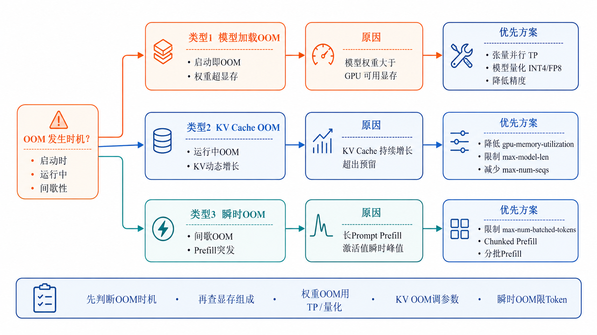

### 1、OOM的分类与定位

大模型推理中的OOM（Out of Memory）通常分为三类：

**类型1：模型加载OOM**
- 现象：模型加载阶段就报OOM，根本无法启动
- 原因：模型权重超过GPU可用显存

**类型2：KV Cache OOM**
- 现象：服务启动成功，但在运行一段时间后、处理到长文本或多并发时OOM
- 原因：KV Cache动态增长超出预留空间

**类型3：瞬时OOM**
- 现象：间歇性OOM，有时正常有时失败
- 原因：Prefill时大量激活值同时分配，瞬时显存峰值超过容量

### 2、OOM排查流程

**Step 1：确认显存使用情况**

```bash
# 实时监控显存
nvidia-smi -l 1
# 或使用
watch -n 1 nvidia-smi

# vLLM启动日志中查看预估显存分配
# 关键日志行：
# "GPU memory utilization: 0.9"
# "Total GPU memory: 80GB"
# "Free GPU memory: XX GB"
# "KV Cache capacity: XX tokens"
```

**Step 2：计算显存分配**

```
总显存分配 = 模型权重 + KV Cache池 + CUDA Context等固定开销

模型权重（FP16）= 参数量 × 2 字节
例如：7B × 2 = 14GB, 70B × 2 = 140GB

KV Cache池 = 总显存 × gpu_memory_utilization - 模型权重 - 固定开销

每个请求的KV Cache = 2 × 层数 × head_dim × kv_heads × 序列长度 × 2字节
```

**Step 3：根据OOM类型定位**

- 启动时OOM → 模型权重过大，需要TP或量化
- 运行中OOM → KV Cache设置过大或限制太宽松
- 瞬时OOM → Prefill burst，max-num-batched-tokens过大

### 3、解决方案

**方案1：降低gpu-memory-utilization**

```bash
vllm serve model --gpu-memory-utilization 0.8  # 从0.9降到0.8
```

减小KV Cache的总池子，降低OOM风险（但会减少可并发请求数）。

**方案2：限制max-model-len**

```bash
vllm serve model --max-model-len 4096  # 从8192降到4096
```

减小每个请求的最大KV Cache预留，有效降低OOM风险。

**方案3：限制max-num-seqs**

```bash
vllm serve model --max-num-seqs 64  # 减少最大并发序列数
```

减少同时活跃的请求数，限制KV Cache的总消耗。

**方案4：使用量化模型**

```bash
# INT4量化模型
vllm serve Qwen/Qwen2-7B-Instruct-AWQ --quantization awq

# FP8量化模型
vllm serve model --quantization fp8
```

模型权重减少到原来的1/4（INT4）或1/2（FP8），留出更多空间给KV Cache。

**方案5：张量并行**

```bash
vllm serve model --tensor-parallel-size 4
```

将模型权重切分到多张卡上，每张卡的权重压力减小。

**方案6：启用KV Cache量化（如LMDeploy）**

```bash
# LMDeploy启用KV Cache INT8量化
lmdeploy serve api_server model --kv-cache-dtype 8
```

### 4、OOM排查速查表

| 现象 | 常见原因 | 优先排查方向 |
|------|----------|-------------|
| 启动即OOM | 模型权重 > 显存 | 张量并行或量化 |
| 长文本OOM | max-model-len设太大 | 降低max-model-len |
| 高并发OOM | KV Cache池耗尽 | 降低max-num-seqs或gpu-memory-utilization |
| 间歇性OOM | Prefill burst瞬发峰值 | 降低max-num-batched-tokens |
| 运行几小时后OOM | 显存碎片或泄漏 | 重启服务，升级vLLM版本 |

可以总结为：**大模型推理OOM排查应首先区分是模型加载OOM、KV Cache OOM还是瞬时OOM，然后针对性解决：模型OOM用TP/量化，KV Cache OOM调低gpu-memory-utilization/max-model-len/max-num-seqs，瞬时OOM限制max-num-batched-tokens。量化模型+张量并行是最有效的OOM解决组合。**

---

<h2 id="面试问题-推理速度突然变慢或延迟抖动通常从哪些方向排查？">面试问题：推理速度突然变慢或延迟抖动，通常从哪些方向排查？</h2>

**难度评分：⭐⭐⭐⭐ (4/5)  |  考察频率：⭐⭐⭐⭐ (4/5)**

### 1、排查方向总览

推理速度变慢或延迟抖动，可以从以下六大方向排查：

1. 请求侧变化
2. 显存与KV Cache状态
3. GPU硬件状态
4. 调度效率
5. 网络与I/O
6. 软件栈问题

### 2、逐方向排查

**方向1：请求侧变化**

首先要排除请求特征变化导致的问题：

- Prompt长度是否变长？→ TTFT增加是正常的
- 生成长度是否增加？→ End-to-End延迟增加是正常的
- 并发量是否增加？→ 每步处理的请求变多，TPOT增加
- 请求分布是否变化（更多长文本混入）？→ P99延迟可能上升

排查方法：检查日志中的输入/输出Token统计分布。

**方向2：显存与KV Cache状态**

KV Cache接近饱和时，Scheduler可调度空间会变小，常表现为等待队列增长、抢占增加或TTFT/P99上升：

- 检查 `nvidia-smi` 显存是否接近上限
- 观察KV Cache使用率是否长期接近上限
- 观察running/waiting请求数是否持续升高
- Prefix Cache命中率是否下降

排查方法：
```bash
# vLLM暴露的metrics endpoint
curl http://localhost:8000/metrics | grep vllm
# 关注：
# vllm:num_requests_running (当前运行请求数)
# vllm:num_requests_waiting (等待调度请求数)
# vllm:kv_cache_usage_perc (KV Cache利用率)
# vllm:prefix_cache_queries / vllm:prefix_cache_hits (Prefix Cache命中情况)
# vllm:external_prefix_cache_queries / vllm:external_prefix_cache_hits (外部Prefix Cache命中情况)
```

**方向3：GPU硬件状态**

GPU硬件问题可能导致性能下降：

- GPU降频（Thermal Throttling）：温度过高→自动降频→性能下降
- ECC错误：内存纠错开销→变慢
- GPU与其他进程共享：被其他任务占用部分算力
- NVLink降级：多卡通信带宽下降

排查方法：
```bash
nvidia-smi -q -d TEMPERATURE,CLOCK  # 检查温度和频率
nvidia-smi topo -m                   # 检查NVLink拓扑
nvidia-smi pmon -c 1                 # 检查是否有其他进程
```

**方向4：调度效率**

- 是否出现了"长请求堵塞短请求"？→ 检查scheduler策略
- 批次是否变得不均衡？→ 检查是否有少量超长Prompt占用了大量计算
- Continuous Batching是否正常工作？

排查方法：观察vLLM日志中的调度Pattern，检查是否频繁出现单个请求独占计算的情况。

**方向5：网络与I/O（API服务模式）**

- 网络延迟是否增加？
- Tokenization/Detokenization是否成为瓶颈？
- 是否有其他服务抢占CPU/内存？

排查方法：
```bash
# 检查API服务延迟
time curl -X POST http://localhost:8000/v1/chat/completions ...
# 检查网络
ping <server>
# 检查CPU
top / htop
```

**方向6：软件栈问题**

- vLLM/SGLang版本是否有已知性能回归？
- CUDA/cuDNN版本是否有兼容性问题？
- PyTorch版本变更？
- 其他依赖更新导致的问题？

排查方法：检查最近是否有软件更新，查阅GitHub Issues看是否有类似报告。

### 3、延迟抖动的常见原因

**1. KV Cache接近上限与抢占增加**

KV Cache容量紧张时，Scheduler可选择的请求会变少，部分running请求可能被preempt后回到waiting，表现为TTFT/P99升高、吞吐波动。

**2. Prefill冲击**

一个大Prompt的Prefill可能占用较多计算资源，导致同一批次中其他Decode请求的延迟突然增加（"Prefill Spike"）。

**3. CUDA Graph重建**

如果vLLM因某种原因需要重建CUDA Graph，会有一段短暂的重建期导致延迟抖动。

**4. Python GC**

Python的垃圾回收可能在不可预测的时间触发，导致短暂停顿。

### 4、性能退化排查清单

```
□ 请求特征变化？ → 对比输入/输出长度分布
□ 显存使用是否接近上限？ → nvidia-smi + metrics
□ GPU降频/过热？ → nvidia-smi -q -d TEMPERATURE
□ 其他进程抢占GPU？ → nvidia-smi pmon
□ KV Cache使用率是否过高？ → vllm:kv_cache_usage_perc
□ running/waiting是否持续升高？ → vllm:num_requests_running / vllm:num_requests_waiting
□ 网络延迟？ → ping + curl测试
□ 版本变更？ → git log / pip list对比
□ CPU/内存瓶颈？ → top / htop
```

可以总结为：**推理速度变慢或延迟抖动时应从请求侧、显存状态、GPU硬件、调度效率、网络I/O和软件栈六个方向系统排查。最常见的原因包括：请求特征变化（长Prompt增加）、KV Cache接近饱和、GPU过热降频、Prefill冲击导致Decode抖动。通过vLLM的metrics endpoint（/metrics）和nvidia-smi可以快速定位大多数性能问题。**

---

<h2 id="面试问题-大模型推理服务吞吐不达预期或突然下降如何排查和优化？">面试问题：大模型推理服务吞吐不达预期或突然下降，如何排查和优化？</h2>

**难度评分：⭐⭐⭐⭐ (4/5)  |  考察频率：⭐⭐⭐⭐ (4/5)**

### 1、先统一吞吐的衡量口径

吞吐常见有三种口径，面试时先说清楚，否则容易各说各话：

| 口径 | 含义 | 适用场景 |
|------|------|----------|
| 输出吞吐（output tokens/s） | 单位时间生成的Token数 | 衡量GPU算力利用 |
| 总吞吐（total tokens/s） | 输入+输出Token总数 | 衡量整体处理能力 |
| 请求吞吐（req/s） | 单位时间完成的请求数 | 衡量服务能力 |

还要先区分"吞吐低"和"延迟高"：

- **吞吐问题**：GPU没吃满、batch没打满、并发上不去
- **延迟问题**：单个请求的TTFT/TPOT变长，此时整体吞吐可能并不低

### 2、排查框架

**方向1：请求侧变化**

- 输入/输出长度分布是否变化？长Prompt占比升高会拉低req/s
- 并发是否达到`max-num-seqs`上限？超出的请求只能在waiting队列排队
- 流量是否突增，或倾斜到少数实例？

**方向2：批处理与调度效率**

- Continuous Batching是否真正打满？观察running batch size
- Prefill和Decode是否互相干扰？长Prompt的Prefill会打断Decode节奏
- 是否启用Chunked Prefill？把长Prefill切块，减少对Decode的冲击

**方向3：显存与KV Cache**

- `vllm:kv_cache_usage_perc`是否长期接近100%？
- 是否出现频繁preemption（running请求被换出后重新排队）？
- `max-model-len`是否设得过大，挤占KV Cache池、限制了并发？
- Prefix Cache命中率是否下降？

**方向4：GPU与CPU资源**

- GPU利用率（SM Util）是否偏低？偏低通常说明batch太小或存在CPU瓶颈
- 是否被其他进程抢占GPU？用`nvidia-smi pmon`确认
- Tokenization/Detokenization是否成为CPU瓶颈？
- 多卡场景下NVLink/PCIe通信是否成为瓶颈？

**方向5：框架参数与版本**

- `max-num-seqs`、`max-num-batched-tokens`、`gpu-memory-utilization`是否配置过保守？
- TP/DP配置是否合理？通信开销是否抵消了并行收益？
- 是否启用CUDA Graph？是否有框架版本性的性能回归？
- 量化格式是否有高效kernel？FP8/INT4在部分框架下可能反而更慢

**方向6：服务链路**

- 网关限流、超时、重试是否限制了实际并发？
- 多实例之间负载是否均衡？
- 同步日志、鉴权等旁路逻辑是否引入了额外开销？

### 3、常用排查命令

```bash
# 推理侧metrics
curl http://localhost:8000/metrics | grep -E "vllm:(num_requests_running|num_requests_waiting|kv_cache_usage_perc|prefix_cache)"

# GPU利用率与显存
nvidia-smi dmon -s um     # util + memory
nvidia-smi pmon -c 1      # 进程占用

# 压测复现
vllm bench serve --model Qwen/Qwen2-7B-Instruct \
    --num-prompts 1000 --request-rate 20 \
    --input-len 1024 --output-len 256
```

### 4、常见原因与优化手段

| 现象 | 常见根因 | 优化方向 |
|------|----------|----------|
| GPU利用率低、batch小 | 并发不足或`max-num-seqs`限制 | 提高并发、放宽`max-num-seqs`、检查网关限流 |
| KV Cache接近100%、频繁抢占 | 显存不足或`max-model-len`过大 | 量化、TP、降低`max-model-len`、启用Prefix Cache |
| 长Prompt多、吞吐波动 | Prefill挤占Decode | Chunked Prefill、PD分离 |
| req/s下降但tokens/s正常 | 输出长度变长 | 属于口径变化，不一定是故障 |
| 量化后吞吐反而下降 | kernel不支持或反量化开销 | 更换量化格式或升级框架 |
| 多卡吞吐无线性提升 | 通信瓶颈或负载不均 | 节点内TP、节点间DP、检查拓扑 |

### 5、优化路径：从参数到架构

1. **参数调优（分钟级）**：放宽`max-num-seqs`、调整`max-num-batched-tokens`、提高`gpu-memory-utilization`、启用Prefix Caching与Chunked Prefill
2. **资源与并行（小时级）**：调整TP/DP、启用KV Cache量化、升级GPU
3. **架构优化（天级）**：PD分离、多实例+负载均衡、模型量化/蒸馏、按请求长度路由

可以总结为：**吞吐问题要先统一口径（tokens/s还是req/s），再区分"GPU没吃满"和"资源被限制"两类根因。排查顺序是请求侧分布、批处理效率、KV Cache、GPU/CPU资源、框架参数、服务链路；最常见的原因包括并发上限太低、KV Cache不足导致抢占、长Prompt的Prefill冲击以及网关限流。优化先从`max-num-seqs`、`max-num-batched-tokens`、Prefix Caching等参数入手，再考虑PD分离和并行策略。**

---
