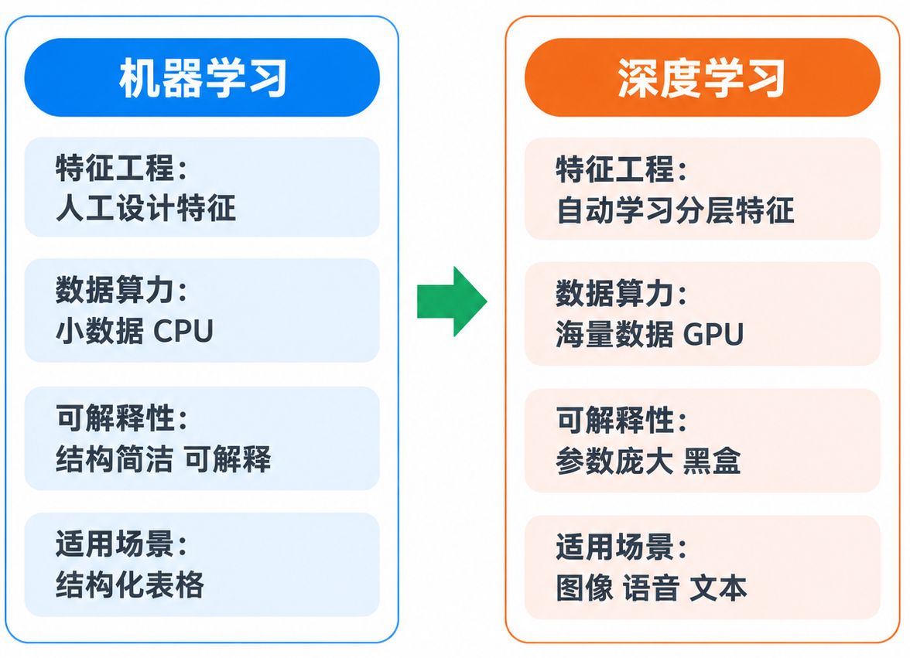
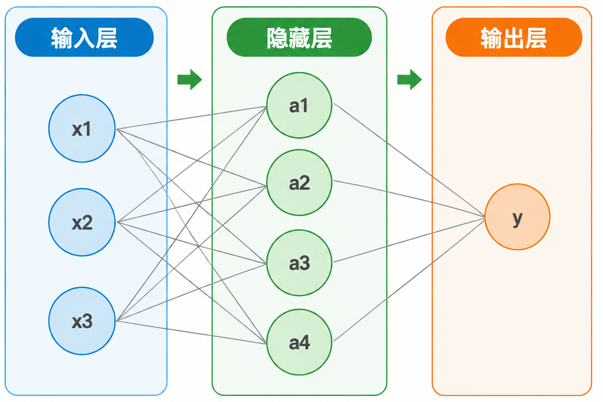
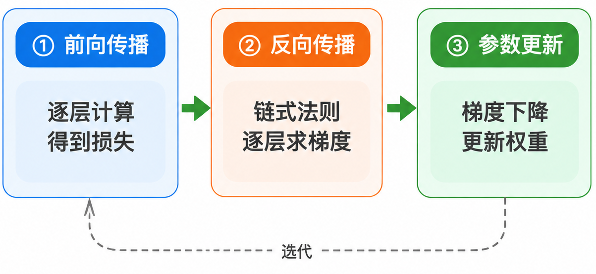
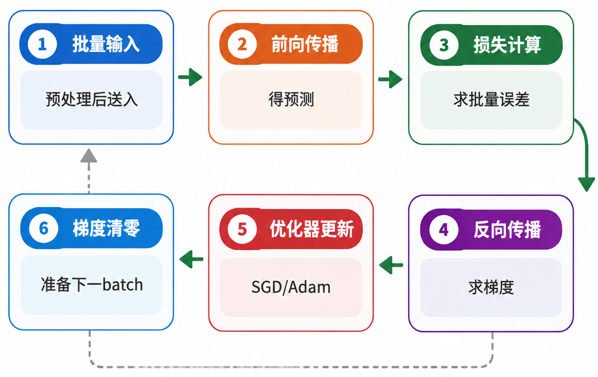
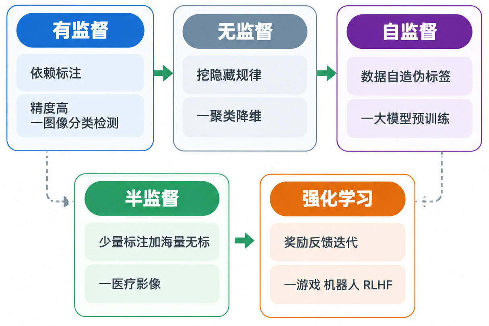
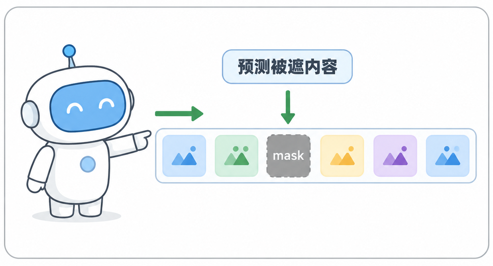
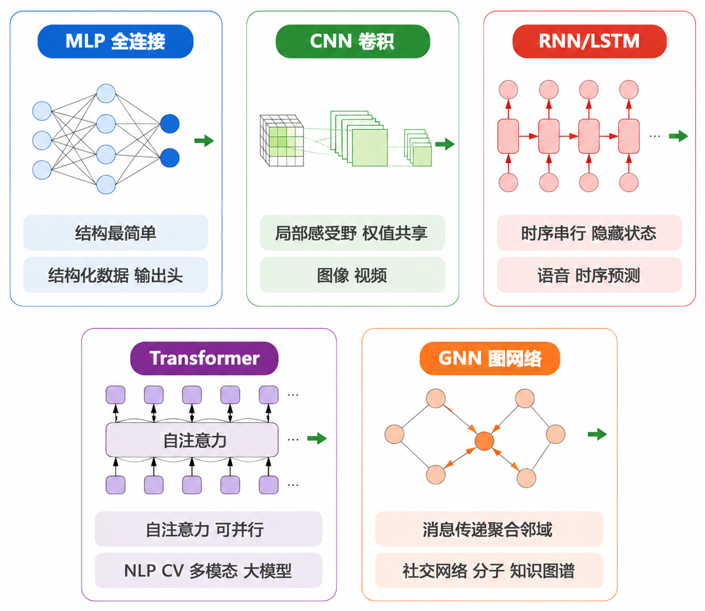

# 目录
## 1.2 深度学习基础
本章梳理深度学习基础核心面试考点，对比深度学习与机器学习的核心差异，讲解深度学习处理非线性问题的核心机制。系统介绍神经网络底层原理，涵盖单层感知机缺陷、多层网络的拟合优势、神经元结构与前向传播流程。同时详解反向传播算法、计算图机制以及批次训练完整流程，区分模型表达、拟合与泛化能力，并归纳判别式与生成式模型、主流训练范式、自监督学习及各类网络架构的特点与适用场景，为深度学习入门打下理论基础。

[1.什么是深度学习？](#q2-1)
  - [面试问题：什么是深度学习，它和机器学习的核心区别是什么？](#q2-1-1)
  - [面试问题：深度学习解决了机器学习的哪些核心痛点？](#q2-1-2)

[2.神经网络是如何工作的？](#q2-2)
  - [面试问题：神经网络的基本组成单元是什么？请从单个神经元开始，描述完整神经网络的前向传播计算流程](#q2-2-1)
  - [面试问题：一个标准的深度神经网络由哪些核心模块组成，每个模块的核心功能是什么？](#q2-2-2)
  - [面试问题：为什么需要非线性激活？单层感知机为什么解决不了异或问题，多层网络是如何解决的？](#q2-2-3)
  - [面试问题：浅层神经网络和深度神经网络的本质差异是什么？深而窄的网络在什么条件下可能优于浅而宽的网络？](#q2-2-4)

[3.神经网络是如何训练的？](#q2-3)
  - [面试问题：什么是反向传播算法？它的核心原理和数学基础是什么？](#q2-3-1)
  - [面试问题：计算图在反向传播中起到什么作用？前向传播和反向传播分别在计算图中完成什么操作？](#q2-3-2)
  - [面试问题：从原理层面描述神经网络训练一个 batch 数据的完整流程](#q2-3-3)

[4.如何理解模型的表达能力、拟合能力与泛化能力？](#q2-4)
  - [面试问题：表达能力、拟合能力、泛化能力有什么区别和联系？](#q2-4-1)

[5.深度学习有哪些常见的模型、范式与架构？](#q2-5)
  - [面试问题：判别式模型与生成式模型的本质区别是什么？分别列举深度学习中的经典算法与适用场景。](#q2-5-1)
  - [面试问题：按训练范式划分，深度学习有哪些核心学习方式？各自的特点与适用场景是什么？](#q2-5-2)
  - [面试问题：自监督学习的核心思想是什么？为什么它成为大模型预训练的主流范式？](#q2-5-3)
  - [面试问题：常见的深度学习网络架构有哪几类？各自的核心特点与适用场景是什么？](#q2-5-4)

# 深度学习基础

<h1 id="q2-1">1.什么是深度学习？</h1>

<h2 id="q2-1-1">面试问题：什么是深度学习，它和机器学习的核心区别是什么？</h2>

**难度评分：⭐⭐ (2/5) | 考察频率：⭐⭐⭐⭐ (4/5)**

深度学习是机器学习的重要分支，其主要模型是具有多层可学习表示的人工神经网络。模型通过组合线性变换、非线性激活、注意力、卷积等可微运算，从数据中学习适合任务的层级表示，并通过反向传播和梯度优化实现分类、回归、生成或决策等功能。“人工神经网络”在历史上受到生物神经系统启发，但现代深度学习模型主要是数学与工程上的函数逼近和表示学习系统，不宜简单理解为对人脑工作机制的真实模拟。

需要先明确：深度学习属于机器学习，二者并不是两个互斥类别。实际比较通常是“深度学习”与“传统机器学习方法”。深度学习的重要特点是把表示学习与任务模型进行联合优化，显著减少对手工特征的依赖，但这也不是唯一差异。可以从以下四个维度理解：

- 特征工程：许多传统机器学习方法依赖人工构建或筛选特征，例如 SIFT、TF-IDF、统计特征和交叉特征，特征质量会显著影响模型效果。深度学习通常能够从原始或较少加工的数据中联合学习表示与预测函数，大幅降低手工特征设计的工作量；但数据清洗、输入编码、数据增强和领域先验仍然重要。

- 数据规模与硬件需求：许多传统模型在中小规模表格数据上具有较强竞争力，通常可以在 CPU 上高效训练。大型深度模型往往更能受益于大规模数据和 GPU、TPU 等并行硬件，训练成本也更高；但小型神经网络、迁移学习和预训练模型微调并不一定需要“海量数据”或专用加速器，传统机器学习在超大规模场景中也可能需要分布式计算。

- 模型结构与可解释性：线性模型和浅层决策树等传统模型通常更容易进行全局解释，但核方法、大型树集成等传统模型也可能难以解释。深度网络通常参数多、内部表示分布式，解释和验证更困难，但仍可使用特征归因、探针、可视化、反事实分析等方法研究其行为。因此，“传统模型都可解释、深度模型完全是黑盒”只是过度简化的说法。

- 适用场景：树模型、线性模型等传统方法在结构化表格数据、样本较少、成本或可解释性要求高的任务中经常很有优势；借助 SIFT、TF-IDF 等特征，传统方法同样可以处理图像和文本。深度学习更擅长直接从图像、语音、文本、视频等高维数据中学习表示，并在生成式任务和基础模型领域占据主导。任务并不存在“浅层”与“高级”的固定分界，最终选择应由数据、指标、成本和风险共同决定。

可以用一句较直观但不绝对的表述概括：传统方案往往更强调人工特征与较简单模型的组合，深度学习则更强调从数据中联合学习表示和任务映射。二者并非替代关系，而是适配不同数据条件、业务约束与生命周期阶段的技术方案。上述核心区别如图2-1所示。

  

图2-1 深度学习与机器学习的核心区别

<h2 id="q2-1-2">面试问题：深度学习解决了机器学习的哪些核心痛点？</h2>

**难度评分：⭐⭐ (2/5) | 考察频率：⭐⭐⭐⭐ (4/5)**

深度学习缓解了许多传统机器学习方案中的局限，主要体现在以下四个方面：

- 人工特征工程依赖较强——许多传统方案的效果高度依赖人工设计的特征，开发成本较高。深度学习通过多层网络联合学习特征表示和任务目标，支持端到端训练，显著降低了对手工特征的依赖；这并不意味着特征、数据处理和领域知识从此不再重要。

- 高维数据的表示学习成本高——传统方法能够通过 SIFT、HOG、TF-IDF 等人工特征处理图像、文本和语音，并非“仅适配表格数据”；但在复杂高维数据上，手工特征的设计和迁移成本较高。CNN、Transformer 等深度架构可以直接从大量原始数据中学习任务相关表示，显著提升了端到端建模能力。

- 复杂组合模式的参数效率不足——一些浅层方法也能表达非线性，例如核方法、树集成和人工基函数模型；但对于具有层级或组合结构的复杂模式，深层网络往往能通过特征复用以较高的参数效率进行建模，支撑视觉识别、围棋决策、蛋白质结构预测等复杂任务。

- 跨任务知识复用能力有限——许多传统方案与特定特征和任务紧密绑定，新任务往往需要重新设计特征或训练模型。深度学习形成了“大规模预训练 + 下游微调、提示或参数高效适配”的开发范式，使表示和部分能力能够跨任务复用，在合适条件下降低新场景的标注与开发成本。

注：深度学习是补充而非取代传统机器学习。在数据量小、强可解释性、实时推理成本敏感的场景中，浅层模型仍有明确价值，二者按任务特性选择而非优劣替换。

<h1 id="q2-2">2.神经网络是如何工作的？</h1>

<h2 id="q2-2-1">面试问题：神经网络的基本组成单元是什么？请从单个神经元开始，描述完整神经网络的前向传播计算流程</h2>

**难度评分：⭐⭐ (2/5) | 考察频率：⭐⭐⭐⭐⭐ (5/5)**

### 1、神经网络的基本组成单元

在经典全连接前馈网络的教学抽象中，基本计算单元是人工神经元，感知机可视为其历史原型或特例。现代网络通常以张量算子和计算块实现，不一定真的逐个执行标量神经元，但对应的仿射变换与激活仍可分解为以下两步：

（1）线性加权求和：对输入特征 $x$ 与对应权重 $w$ 做内积，叠加偏置项 $b$，得到线性结果：

$$
z = \sum_{i=1}^n w_i x_i + b = w^T x + b
$$

（2）非线性激活：将线性结果输入激活函数 $f(\cdot)$（如 ReLU、Sigmoid）做非线性变换，得到神经元最终输出 $a = f(z)$，为网络引入非线性表达能力。

注：经典“感知机”特指单层二分类器 + Heaviside 阶跃激活 + 感知机学习规则，正是下一题中无法解决 XOR 的模型；通用神经网络中的可微神经元是其扩展形态，二者不宜混同。

### 2、神经网络前向传播完整流程

以前馈全连接网络为例，前向传播是数据从输入端沿计算图正向流动、经隐藏层逐层计算，最终得到输出的过程，核心是“仿射变换 + 非线性激活”的逐层组合。CNN、Transformer 等架构还会包含卷积、注意力、归一化、残差连接等运算。基本步骤如下：

（1）输入端：接收输入特征 $X$，在最简单的 MLP 表示中可记为 $A^{[0]} = X$。实际模型还可能先执行嵌入、归一化、位置编码或其他预处理，因此“输入层不做运算”只适用于简化示意图。

（2）隐藏层逐层计算：对第 $l$ 层隐藏层，以上一层输出 $A^{[l-1]}$ 为输入，依次完成仿射变换与激活：

$$
Z^{[l]} = W^{[l]}A^{[l-1]} + b^{[l]},
\qquad A^{[l]} = f(Z^{[l]})
$$

其中 $W^{[l]}$、 $b^{[l]}$ 为第 $l$ 层的可学习权重与偏置， $f$ 为当前层激活函数；批量计算时偏置通常会沿 batch 维广播。

（3）输出层计算：以最后一层隐藏表示为输入，产生与任务匹配的输出。多分类模型通常输出 logits，并在需要概率时应用 Softmax；二分类模型通常输出一个 logit，并在需要概率时应用 Sigmoid；常见实值回归可使用恒等映射，但正值、区间值、计数或概率分布参数预测可能需要其他链接函数。训练时常将 Softmax/Sigmoid 与交叉熵在数值上合并计算，不一定显式生成概率后再计算损失。

神经网络前向传播和神经元参考示意图如图2-2所示：

  

图2-2 神经网络基础组成单元与前向传播

这是一个单隐藏层的全连接前馈神经网络，整体分为输入层、隐藏层、输出层，信息只能从左向右单向传递，相邻层神经元两两互连、同层神经元无连接。

输入层包含 3 个神经元 $x_1$、 $x_2$、 $x_3$，仅负责接收原始输入特征，不做加权、激活运算，直接把特征传递给后方的隐藏层。

隐藏层包含 4 个神经元 $a_1$、 $a_2$、 $a_3$、 $a_4$，使用激活函数 $f^1(\cdot)$，每个神经元与输入层全部 3 个神经元全连接。

（1）先完成线性加权求和叠加偏置： $z_i = W_{i1}x_1 + W_{i2}x_2 + W_{i3}x_3 + b_i$

（2）再通过非线性激活函数得到该神经元输出： $a_i = f^1(z_i)$

这一步为网络提供学习非线性表示的能力，但并不保证任意一次变换后数据就一定线性可分；最终表示取决于架构、参数、数据和训练过程。

输出层包含 1 个输出神经元 $y$，使用激活函数 $f^2(\cdot)$，接收隐藏层全部 4 个神经元的输出。

（1）再次做线性加权叠加偏置： $z_y = w_1a_1 + w_2a_2 + w_3a_3 + w_4a_4 + b_y$

（2）经激活函数输出最终预测结果： $y = f^2(z_y)$

<h2 id="q2-2-2">面试问题：一个标准的深度神经网络由哪些核心模块组成，每个模块的核心功能是什么？</h2>

**难度评分：⭐⭐ (2/5) | 考察频率：⭐⭐⭐⭐ (4/5)**

神经网络在历史上受到生物神经元联结的启发，现代实现本质上是由可学习参数和可微运算组成的函数逼近与表示学习系统。若把模型结构与训练过程一起考虑，一个基础深度学习系统通常包含以下五类核心要素：

（1）计算单元或神经元：在 MLP 中，典型单元对输入做仿射变换并施加激活。对使用 Sigmoid、Tanh 等单调激活的单个标准神经元而言，其二分类决策边界仍是线性超平面，通常需要多个单元和层的组合来表示 XOR 等线性不可分模式。CNN、Transformer 等模型的基本模块则不只包含标量“神经元”，还包括卷积、注意力和归一化等向量化算子。

（2）网络层或计算块（Layer/Block）：组织运算与参数的结构载体。简单前馈网络可分为输入端、隐藏层和输出层；现代网络通常由卷积块、残差块、注意力块等重复构成。层数影响网络深度，隐藏维度、通道数和模块结构共同影响单层容量及计算量。

（3）非线性与结构性运算：ReLU、GELU、Tanh、Sigmoid 等激活函数打破了多层仿射变换仍可合并为单层仿射变换的限制，并影响输出范围和梯度传播。ReLU 在正半轴不饱和，常能缓解由饱和激活造成的梯度消失，但仍可能出现“死亡 ReLU”，也不能单独解决所有深层优化问题。

（4）损失与目标函数（Loss/Objective）：监督任务中常量化预测与标签的差异，分类常用交叉熵，回归可使用 MSE、MAE 等；自监督、生成和强化学习还会使用对比、重建、似然、去噪或策略目标。完整目标也可能包括正则化项和约束项，它定义了参数优化的直接方向。

（5）优化与训练机制（Optimization）：反向传播计算梯度，SGD、AdamW 等优化器根据梯度和学习率、动量、权重衰减等配置更新需要训练的参数。优化器旨在降低训练目标，但对非凸神经网络并不保证到达全局最优解；训练稳定性还依赖初始化、归一化、数据顺序、精度和学习率调度等因素。

注：Transformer 将残差连接、层归一化、自注意力、前馈网络和位置信息编码组合成通用模块，是语言与多模态基础模型的重要主干；视觉和生成系统中还广泛使用 CNN、U-Net、Vision Transformer、Diffusion Transformer 等结构。扩散模型的噪声调度与采样器属于特定生成范式的组件，GAN 则采用生成器与判别器的对抗训练机制。它们并非所有 AIGC 系统共同具备的“标配”，应按模型范式分别讨论。

<h2 id="q2-2-3">面试问题：为什么需要非线性激活？单层感知机为什么解决不了异或问题，多层网络是如何解决的？</h2>

**难度评分：⭐⭐⭐ (3/5) | 考察频率：⭐⭐⭐⭐⭐ (5/5)**

非线性是神经网络区别于线性模型的根本。下面先说明线性模型的表达局限，再用异或（XOR）这一经典问题说明单层感知机为何失效，最后讲多层网络如何通过非线性激活解决。

### 1、线性模型为什么无法处理非线性问题

线性模型的数学表达式为 $y = W^T x + b$，本质是对输入特征做线性加权求和，其表达能力存在本质上限：

（1）决策边界只能是线性超平面

在固定的原始特征空间中，线性分类器只能形成线性超平面，无法直接分开 XOR 这类线性不可分数据；线性回归也只能表示输入特征的线性组合。若预先加入多项式、核映射或其他非线性特征，线性预测器仍可以在变换后的特征空间处理非线性关系，因此限制来自“模型相对于所用表示是线性的”，而不是线性方法永远不能解决任何非线性问题。

（2）无法自动建模特征的高阶非线性交互

原始线性模型通常不能自动表达特征乘积等高阶交互；可以人工构造多项式、交叉特征或使用核方法来扩展表示，但显式多项式特征的数量会随输入维度和阶数呈组合式快速增长，可能引发维度灾难。深度网络的优势之一是能够从数据中联合学习这类非线性表示。

（3）拟合能力存在硬上限

在给定特征表示下，无论如何优化参数，线性模型的函数族都不会超出线性或广义线性边界；当真实关系明显超出该函数族时会产生较高的近似偏差。不过，在线性可分、样本较少或已有高质量特征与 Embedding 的任务中，线性模型仍可能是非常强的基线。

### 2、单层感知机无法解决异或问题的核心原因

单层感知机本质上是一个线性二分类器，其数学表达式为 $y = \text{sign}(w_1x_1 + w_2x_2 + b)$，在二维空间中的决策边界是一条直线（高维空间为超平面），仅能处理线性可分的数据集。

而异或（XOR）问题是典型的线性不可分问题：异或的真值对应二维平面的 4 个样本点：类别 0 为 $(0,0)$、 $(1,1)$，类别 1 为 $(0,1)$、 $(1,0)$。两类样本分别分布在两条对角线上，不存在任何一条直线能将两类样本完全分开，因此仅能输出线性决策边界的单层感知机，永远无法正确分类异或问题。

### 3、多层神经网络的解决机制

多层神经网络通过隐藏层与非线性激活函数的组合，实现输入空间的非线性特征变换，从根源上打破了线性分类的限制，核心逻辑如下：

（1）非线性激活函数：这是普通前馈网络突破线性表达上限的核心。若各层都只是仿射变换，无论堆叠多少层，最终仍可合并为一次仿射变换；加入 ReLU、GELU、Tanh 等非线性激活后，网络才具备表达复杂非线性函数的能力。万能近似结论还依赖激活函数、网络宽度或深度、定义域和近似精度等条件，不能理解为任意规模的网络都能自动学会任意函数。

（2）非线性空间映射：隐藏层的每个神经元会先对输入做线性加权，再通过 sigmoid、ReLU 等非线性激活函数输出。这一步相当于把原始的低维输入空间，非线性地映射到一个新的特征空间中。

注：如果没有非线性激活函数，即使堆叠再多隐藏层，整体也等价于一个单层线性网络，依然无法处理线性不可分问题。

（3）转化为线性可分问题：对 XOR 选择合适的隐藏单元和参数后，隐藏层可以构造 OR、NAND 等中间特征，使原本线性不可分的样本在新表示中变得可由输出层分开。一般任务是否会学到这样的表示，仍取决于架构和训练。

（4）输出层完成分类：输出层相当于一个单层感知机，在变换后的特征空间中学习一个线性决策边界，即可完成异或问题的正确分类。

（5）直观举例：经典的两层异或网络只需 2 个隐藏神经元。隐藏层两个神经元分别学习 OR（或）与 NAND（与非）两种线性特征——OR 在任一位为 1 时输出 1，NAND 在非全 1 时输出 1；输出层对二者做一次带偏置的线性组合并施加阈值激活，即可正确区分异或的两类结果（XOR = OR ∧ NAND）。

<h2 id="q2-2-4">面试问题：浅层神经网络和深度神经网络的本质差异是什么？深而窄的网络在什么条件下可能优于浅而宽的网络？</h2>

**难度评分：⭐⭐⭐ (3/5) | 考察频率：⭐⭐⭐⭐ (4/5)**

### 1、浅层与深度神经网络的本质差异

“浅”与“深”的直接区别仍然是可学习计算层或计算块的深度；更深的函数复合由此可能带来层级表示、特征复用和更高的参数效率，但这些优势取决于任务结构与是否能够有效优化：

（1）特征表达逻辑不同

浅层网络的函数复合层数较少，深度网络则可以通过多层堆叠逐步组合已有表示。在视觉等任务中，经常能观察到“局部纹理或边缘→部件→对象语义”的层级特征；在语言模型中，各层表示也会逐步融合上下文。不过，浅层网络并非绝对无法形成有用表示，深层网络的每一层也不一定对应清晰、固定的人类语义层级。

（2）某些函数类存在显著的表示效率差异

对某些具有组合或层级结构的特定函数类，理论上可以证明浅层网络若要达到与深层网络相同的近似精度，可能需要指数级更多的单元；深层网络可以通过重复使用中间特征获得更高的参数效率。但这不是对所有函数和数据分布都成立的普遍结论：有些任务使用浅层或更宽的网络更易优化，且实际效果还受架构、训练方法和计算预算影响。

### 2、深而窄的网络何时可能更有优势

（1）对组合式函数可能具有更高的参数效率

万能近似定理表明，在常见激活函数和紧致定义域等条件下，单隐层网络只要足够宽，就能以任意精度逼近连续函数。该定理只说明表示的存在性，不保证所需宽度、样本效率、可训练性或泛化。对于适合组合式表示的函数，增加深度能够复用中间计算，可能用更少参数达到相近近似精度；但“深而窄”并非对所有任务都优于“浅而宽”。

（2）适配部分数据的层级与组合结构

网络逐层进行非线性组合，能够逐步扩大有效上下文范围、整合更多位置的信息并复用中间表示，因此常适合图像、文本、语音中的组合结构。浅而宽的网络在理论上仍可能表示同一函数，只是某些任务上的参数效率或学习难度可能不同。残差连接为恒等路径提供更直接的信号与梯度传播通道，归一化和合理初始化也有助于稳定训练；这些技术显著缓解了深层网络的退化与梯度传播问题，但不能笼统地说已经“解决”所有梯度消失或优化困难。

（3）可以学习可迁移表示，但不天然保证更强泛化

大规模深度预训练模型常能学到可跨任务迁移的表示，这是深度学习的重要工程优势。但深度本身不保证更强泛化，浅而宽也不必然更容易过拟合；泛化取决于数据规模与分布、参数化方式、优化器的隐式偏置、正则化、数据增强、预训练和模型选择等多种因素。

注：“深窄优于浅宽”不是普遍经验定律。过深可能增加优化难度和延迟，过窄可能形成信息瓶颈，过宽则会增加计算和内存成本但有时反而更容易优化。残差连接、归一化、Dropout、数据增强等也承担不同作用，必须结合任务、参数量、计算预算和验证集结果评估深度与宽度。

<h1 id="q2-3">3.神经网络是如何训练的？</h1>

<h2 id="q2-3-1">面试问题：什么是反向传播算法？它的核心原理和数学基础是什么？</h2>

**难度评分：⭐⭐⭐ (3/5) | 考察频率：⭐⭐⭐⭐⭐ (5/5)**

反向传播（Backpropagation，BP）是计算神经网络梯度的核心算法。它本质上是反向模式自动微分在分层计算图上的高效实现：从标量损失出发，按照计算图的逆拓扑顺序应用链式法则，计算损失对各中间变量和参数的梯度，为优化器更新参数提供依据。更准确地说，反向传播通过复用中间结果，避免对每个参数分别重复展开整条求导路径；其计算成本通常与一次或少数几次前向计算处于同一数量级，而不是无条件地把任何问题从“指数复杂度”降为“线性复杂度”。对由局部算子组成的计算图而言，其遍历成本通常随图中算子及其局部导数计算成本线性累积。

一次典型训练迭代可概括为“前向计算损失→反向计算梯度→优化器更新参数”，三个阶段如下：

- 前向传播阶段：输入数据沿计算图正向流动，逐层计算中间表示和模型输出，再由独立的损失节点结合目标数据计算标量或待聚合的损失。

- 反向传播阶段：以标量损失的上游梯度 1 为起点，从后往前传播梯度；通过链式法则复用必要的前向中间结果，依次得到各层权重、偏置以及需要求导的中间变量的梯度。在计算图出现分支时，同一变量经不同路径产生的梯度需要相加。

- 参数更新阶段：优化器基于计算得到的梯度、历史状态和正则化配置，更新参与训练且具有梯度的参数，目标是逐步降低训练目标。带动量、自适应缩放或权重衰减的实际更新不一定与当前 mini-batch 的负梯度严格同向。

神经网络可以表示为多层函数的复合。利用链式法则，可将损失对参数的导数分解为局部雅可比与上游梯度的向量—雅可比乘积，并从后向前递推。这样无需显式构造完整雅可比矩阵，也能复用各节点已经计算出的上游梯度。

以单隐层全连接网络为例，设

$$
z^{[1]}_j = \sum_i W^{[1]}_{ji}x_i+b^{[1]}_j,
\qquad a^{[1]}_j=f(z^{[1]}_j),
\qquad z^{[2]}_k=\sum_j W^{[2]}_{kj}a^{[1]}_j+b^{[2]}_k
$$

则隐藏层权重的梯度为：

$$
\frac{\partial L}{\partial W^{[1]}_{ji}}
= \left(\sum_k \frac{\partial L}{\partial z^{[2]}_k}W^{[2]}_{kj}\right)
f'(z^{[1]}_j)x_i
$$

括号中的求和体现了来自下一层各输出路径的梯度汇聚。每个局部导数都可由对应算子的求导规则给出，中间结果又能被相邻节点复用，这正是反向传播高效性的数学根源。反向传播只负责计算梯度，SGD、AdamW 等优化器再利用梯度更新参数；对于非凸神经网络，训练通常只是寻找较低损失的参数区域或驻点，并不保证收敛到全局最优解。

一次典型训练迭代由前向计算损失、反向计算梯度和优化器更新参数构成闭环；其中狭义的“反向传播”专指第二阶段，如图2-3所示。

  

图2-3 反向传播的三阶段闭环

<h2 id="q2-3-2">面试问题：计算图在反向传播中起到什么作用？前向传播和反向传播分别在计算图中完成什么操作？</h2>

**难度评分：⭐⭐⭐ (3/5) | 考察频率：⭐⭐⭐⭐ (4/5)**

### 1、计算图在反向传播中的核心作用

对一次已展开的前向计算而言，计算图通常可表示为有向无环图（DAG）：节点表示张量或基础运算，边表示数据依赖关系。循环网络可以按时间步展开为 DAG，带条件分支或循环的程序则可能在每次执行时形成不同的动态图。计算图是理解反向传播和自动微分的重要抽象：

（1）实现自动微分：将复杂模型拆解为基础运算，并为可微算子定义前向规则和向量—雅可比乘积等反向规则。只要计算路径由框架支持且可微或定义了自定义梯度，就无需手工推导整个模型的全局导数；离散采样、硬路由和外部工具调用等操作则未必能直接求导。

（2）提升计算效率：前向传播会保存反向计算所需的部分张量或上下文，反向传播时复用它们计算局部梯度，避免重复展开整条求导路径。框架并不会必然保存“所有节点的所有结果”；算子可以只保存必要数据，也可以通过激活检查点在反向阶段重计算部分前向结果，以时间换显存。

（3）明确计算依赖：拓扑关系决定运算的先后顺序，互不依赖的算子可能并行执行。自动微分图也为编译优化、算子融合和分布式执行提供信息，但是否并行以及如何分布式训练，还取决于框架运行时、硬件、通信和切分策略，并不是有了计算图就会自动实现。

注：反向传播通常需要保留部分前向激活，同时训练还要保存梯度和优化器状态。因此在相同模型、batch 和不考虑长上下文 KV cache 等特殊推理状态时，训练显存通常高于普通前向推理。激活检查点（gradient/activation checkpointing）可以在反向阶段重算部分前向结果，以额外计算时间换取显存。

### 2、前向传播在计算图中的操作

按计算图的正向拓扑顺序（输入节点→输出节点）执行：

（1）从输入节点出发，逐节点完成对应运算，输出当前节点的计算结果；

（2）保存反向传播所需的中间张量或上下文；具体保存哪些内容由算子实现、自动微分机制和检查点策略决定；

（3）最终遍历至损失节点，得到模型预测结果与损失值。

### 3、反向传播在计算图中的操作

按计算图的逆向拓扑顺序（损失节点→参数节点）执行，核心基于链式求导法则：

（1）通常从标量损失节点的梯度 1 出发，用当前节点的上游梯度和必要的前向信息执行该算子的反向规则，得到对各输入的梯度；对于非标量输出，则需要显式提供上游梯度或计算向量—雅可比乘积；

（2）将输入梯度传递给前驱节点；若同一变量通过多条路径影响损失，来自各后继路径的梯度要按照微分的线性法则求和；

（3）遍历所需的祖先节点后，得到参与该损失计算且要求梯度的权重、偏置等参数的梯度，再交给优化器更新。未参与当前计算、被冻结或被停止梯度的参数可能没有梯度。

<h2 id="q2-3-3">面试问题：从原理层面描述神经网络训练一个 batch 数据的完整流程</h2>

**难度评分：⭐⭐ (2/5) | 考察频率：⭐⭐⭐⭐⭐ (5/5)**

神经网络训练单个 batch 通常遵循“清理旧梯度→准备数据→前向计算→计算损失→反向求梯度→更新参数”的流程。以 PyTorch 风格的普通训练循环为例，可以分为以下 6 个步骤：

（1）清理上一轮梯度

在反向传播前执行 `optimizer.zero_grad()` 或将参数梯度设为 `None`，避免上一轮梯度被无意累积。PyTorch 等框架默认把新梯度累加到参数的 `.grad` 中，因此清理的主要是参数梯度缓冲区，并不是简单地“清空计算图中的所有缓存”。如果有意使用梯度累积，则只在累计若干个 micro-batch 后再清理和更新。

（2）批量数据采样与预处理

从训练集采样指定 batch size 的样本及监督信号，并转换为模型需要的张量。确定性的清洗、词表构建或统计量拟合可以离线完成，但随机裁剪、翻转、遮挡、动态 padding 等数据增强和组批操作常在每个 batch 加载时执行。归一化所用均值、方差等统计量应只由训练数据估计，避免验证集或测试集信息泄漏。

（3）前向传播计算预测结果

批量数据沿计算图正向流动，依次执行模型定义的仿射变换、卷积、注意力、激活、归一化和残差连接等运算，得到该 batch 的 logits、预测值或其他输出。训练模式下 Dropout、BatchNorm 等组件的行为可能与推理模式不同。

（4）计算并聚合损失

根据任务将模型输出与标签、目标序列或自监督目标代入损失函数。损失可以按样本或 token 求平均，也可以求和、加权、掩码或组合多个子目标；是否得到“批量平均梯度”取决于损失的 reduction 设置以及分布式训练中的梯度归约方式，并非固定规则。反向传播通常需要一个标量目标，非标量输出则要先聚合或显式传入上游梯度。

（5）反向传播求解参数梯度

以损失为起点，按照计算图逆拓扑顺序应用链式法则，计算需要训练的参数梯度。在混合精度训练中可能还要进行 loss scaling、反缩放并检查溢出；随后可按需要执行梯度裁剪或分布式梯度同步。

（6）优化器更新参数

优化器根据梯度、学习率、动量、权重衰减等状态更新参与训练的参数，并按计划更新学习率调度器或指数滑动平均等状态。并非所有参数都一定更新：被冻结的参数、没有梯度的参数或采用交替优化的模块可能保持不变。下一轮迭代开始前再次清理梯度；把 `zero_grad()` 放在本轮 `step()` 之后也可以，只要保证下一次 `backward()` 前已按预期清理，但“反向传播前清理”通常更容易理解和维护。

神经网络训练单个 batch 的完整流程如图2-4所示。

  

图2-4 神经网络训练单个 batch 的六步流程

<h1 id="q2-4">4.如何理解模型的表达能力、拟合能力与泛化能力？</h1>

<h2 id="q2-4-1">面试问题：表达能力、拟合能力、泛化能力有什么区别和联系？</h2>

**难度评分：⭐⭐⭐ (3/5) | 考察频率：⭐⭐⭐⭐ (4/5)**

深度学习模型的表达能力、训练集拟合程度和泛化能力是相关但不同的概念。表达能力描述模型函数族能够表示或近似哪些映射，受架构、深度、宽度、激活函数、参数共享等因素影响；参数量只是其中一个粗略指标。拟合能力通常指经过具体优化后，模型在训练数据上将目标函数降到多低，它既受表达能力限制，也受优化算法、初始化、训练预算和数据噪声影响。泛化能力则指模型在来自目标分布的未见样本或真实部署环境中的表现，受训练数据覆盖、分布偏移、模型与优化的归纳偏置、正则化和评估方式等多方面影响。

表达能力不足可能导致欠拟合：即使充分优化，训练误差仍然较高。模型能够很好拟合训练集也不代表能够泛化；当它利用了训练集噪声、偶然相关或泄漏信息时，训练表现与测试表现会出现明显差距。经典教材常用随容量先下降后上升的 U 形测试误差解释偏差—方差权衡，但“容量更大必然过拟合”并不是现代深度学习中的普遍规律。某些模型、数据和训练设置下会观察到双下降（Double Descent）：测试误差在接近插值阈值时上升，越过阈值后又下降。双下降既不是所有任务必然出现，也不表示参数继续增加就会让泛化持续、无限改善；数据质量、有效正则化、优化偏置、训练计算和分布偏移仍会决定最终结果。

<h1 id="q2-5">5.深度学习有哪些常见的模型、范式与架构？</h1>

<h2 id="q2-5-1">面试问题：判别式模型与生成式模型的本质区别是什么？分别列举深度学习中的经典算法与适用场景。</h2>

**难度评分：⭐⭐⭐ (3/5) | 考察频率：⭐⭐⭐⭐⭐ (5/5)**

判别式与生成式的核心区别在于学习目标。判别式模型直接学习输入到目标的预测规则，例如条件分布 $p(y\mid x)$、类别分数或决策边界，而不要求刻画输入 $x$ 本身如何产生。生成式模型则学习能够定义或近似数据生成分布的模型，例如无条件分布 $p(x)$、条件生成分布 $p(x\mid c)$、联合分布 $p(x,y)$，或者带潜变量的 $p(x,z)$；由此可以采样、补全、重建或计算似然。条件语言模型虽然数学形式也是条件分布，但它对输出序列本身的生成分布建模，通常仍归为生成式模型。因此，不能仅凭公式中是否出现 $p(y\mid x)$ 判断类别，还要看变量角色和训练用途。具体对比如表2-1所示：

表2-1 判别式模型与生成式模型对比

| 对比维度 | 判别式模型 | 生成式模型 |
| :--- | :--- | :--- |
| 建模对象 | 决策函数、类别分数或条件分布 $p(y\mid x)$ | $p(x)$、$p(x\mid c)$、$p(x,y)$ 或带潜变量的数据分布模型 |
| 学习目标 | 针对给定输入直接预测目标或学习决策边界 | 学习数据或目标序列的分布，使模型能够采样、补全、重建或评估似然 |
| 核心能力 | 直接完成分类、回归、排序、检测等预测任务 | 生成或重建样本、密度估计和缺失数据补全；部分显式联合模型也能经贝叶斯规则用于判别 |
| 建模难度 | 只需为目标预测保留相关信息，特定判别任务上通常更直接 | 往往需要刻画更丰富的数据变化因素，但难度和性能取决于具体模型、数据与任务，不能笼统比较同算力精度 |
| 典型模型与用法 | 用交叉熵训练的 MLP/CNN 分类器、BERT 分类头、判别式序列标注模型等 | 自回归语言模型、VAE、GAN、扩散模型、归一化流等 |
| 适用场景 | 图像分类、目标检测、文本分类、语义分割、序列标注、风控评分等有监督判别任务 | 文生图/文生视频、文本生成、语音合成、数据增强、图像修复、风格迁移，以及半监督、异常检测等 |

注：① 判别/生成不由 CNN、RNN、Transformer、MLP 等架构名称单独决定，而取决于建模对象和训练目标。BERT 的掩码语言建模是 token 恢复或去噪式表征学习目标，标准 BERT 通常作为编码器使用，并不因此自动成为可直接自由采样的生成模型；接上分类头微调后可作为判别模型。GPT 使用自回归生成目标；RNN/LSTM 既可用于分类，也可用于语言建模或序列生成。二者并非互斥的系统组成。例如 GAN 用判别器提供对抗训练信号来训练生成器，生成式系统也常引入分类器、奖励模型或安全检测器。判别组件可以提供约束或评价，但并不天然保证训练稳定性；GAN 的对抗训练本身就可能不稳定。

<h2 id="q2-5-2">面试问题：按训练范式划分，深度学习有哪些核心学习方式？各自的特点与适用场景是什么？</h2>

**难度评分：⭐⭐ (2/5) | 考察频率：⭐⭐⭐⭐⭐ (5/5)**

按照监督信号来源和交互方式，深度学习中常讨论以下五类训练范式。它们不是严格互斥的一级分类：自监督常被视为无监督表示学习的一类，半监督系统可以同时使用监督损失和自监督损失，大模型训练也经常依次组合自监督预训练、监督微调与偏好优化。

有监督学习以带目标标注的输入—输出样本为训练基础，直接学习输入到目标的映射。其目标通常与下游任务较一致、评估也较直接，但并不保证一定比其他范式收敛更快。模型表现受到标注质量、样本覆盖、模型与优化等因素共同约束，适用于任务定义清晰、标注成本可控的场景，典型应用包括图像分类、目标检测、文本分类及大模型领域监督微调。

无监督学习不使用针对目标任务的人工标签，主要发现数据结构或建模数据分布，常见任务包括聚类、降维、密度估计和异常检测。现代“基础表征预训练”通常进一步采用自监督目标，因此在概念上可以归入广义无监督学习，也可以单列为自监督学习。

自监督学习从数据自身构造预测目标，不依赖为目标任务逐样本制作的人工标签，并使用类似监督学习的损失进行训练。主要路线包括自回归下一 token/片段预测、掩码或去噪重建、对比学习、教师—学生一致性等，是 NLP、视觉、语音和多模态预训练的核心范式。BERT、GPT、MAE、SimCLR 等是典型例子；CLIP 使用互联网图文配对形成自然语言监督，常被称为跨模态对比学习，也有文献将它归为弱监督或自然监督，而不把它视为最严格意义上“完全无人工语义来源”的自监督。

半监督学习同时使用少量标注数据和大量无标注数据，常通过伪标签、一致性正则化、熵最小化或自监督辅助目标利用无标签样本。在低密度分隔、平滑性或聚类等假设与数据相符时，它可以改善决策边界并降低标注需求；若无标签数据分布不匹配或伪标签错误严重，也可能损害效果。典型场景包括医疗影像、工业缺陷检测和低资源 NLP。

强化学习以智能体与环境的交互或离线轨迹为基础，通过奖励信号优化策略，目标通常是最大化期望折扣累计回报。它不一定需要传统的逐样本类别标签，但奖励函数、偏好数据或演示轨迹仍可能来自人工设计与标注。典型应用包括游戏 AI、机器人控制、部分自动驾驶决策研究，以及使用 PPO 等强化学习算法的大模型对齐；RLHF 是利用人类反馈的流程概念，也可以通过 DPO 等不进行在线强化学习的方法实现偏好优化。

注：半监督学习与自监督学习都会利用无标签数据。半监督学习的任务定义中同时存在一部分人工目标标签和一部分无标签样本；自监督学习的训练目标由数据自身的结构或不同视图构造，例如下一 token 预测、掩码恢复、去噪和对比。两者可以组合：先做自监督预训练，再用少量标签半监督微调。还应区分“没有目标任务标签”和“数据完全没有人类产生的语义或筛选信号”，例如图文配对数据通常包含自然语言监督。

五大训练范式如图2-5所示。

  

图2-5 深度学习五大训练范式

<h2 id="q2-5-3">面试问题：自监督学习的核心思想是什么？为什么它成为大模型预训练的主流范式？</h2>

**难度评分：⭐⭐⭐ (3/5) | 考察频率：⭐⭐⭐⭐⭐ (5/5)**

自监督学习通常被视为广义无监督表示学习的重要分支，也常被单独列为一种范式。其核心是不依赖目标任务的人工标签，而是利用数据本身构造预测目标：例如根据前文预测下一个 token、恢复被遮挡内容、从噪声恢复样本、判断不同增强视图是否来自同一实例，或在无标签自蒸馏框架中让学生匹配 EMA 教师的表示（如 BYOL、DINO）。严格来说，这些目标不必称为“伪标签”；它们是由数据结构和预设变换自动产生的训练目标。模型在解决这些预训练任务时有机会学习可迁移表示，但是否真正获得通用语义仍取决于任务设计、数据与模型。

自监督学习成为大模型预训练主流的原因可归纳为四点：

（1）缓解标注数据瓶颈：基础模型需要大规模训练数据，为每个样本制作高质量任务标签代价极高。自监督目标可以利用大量文本、图像、音频和视频，但这些数据仍需要许可、去重、清洗、安全过滤和质量控制，不能把互联网数据简单视为免费且无风险的“无标注数据”。

（2）有利于学习可迁移表示：覆盖广泛数据的自监督预训练不只针对单一下游标签，常能学习语言、视觉或语音中的统计结构，并通过微调、线性探测、提示或少样本学习迁移到多个下游任务。不过，迁移能力不是必然的，还受预训练目标、数据领域和下游分布差异影响。

（3）便于规模化训练：语言模型等系统在一定范围内呈现经验缩放规律，随着模型、有效数据和计算量按合适比例增加，平均训练损失通常可预测地下降。但“规模越大能力越强”不是无条件定律：收益可能递减，数据质量和覆盖会成为瓶颈，训练目标下降也不保证事实性、安全性或所有下游能力同步提升。

（4）可扩展到多模态：文本、图像、音频和视频都能构造自回归、重建、去噪或对比目标；图文、音文等配对数据还可以用于跨模态对齐。多模态训练往往同时包含自监督、弱监督或自然监督成分，具体归类应依据数据来源与目标定义。

自监督学习的掩码预测思想如图2-6所示。

  

图2-6 自监督学习的掩码预测思想

<h2 id="q2-5-4">面试问题：常见的深度学习网络架构有哪几类？各自的核心特点与适用场景是什么？</h2>

**难度评分：⭐⭐⭐ (3/5) | 考察频率：⭐⭐⭐⭐⭐ (5/5)**

下面列出五类代表性架构，但这不是穷尽分类：实际系统还常见自动编码器、U-Net、状态空间模型、混合专家模型，以及由多种模块组成的混合架构。这些架构针对不同数据结构引入不同归纳偏置：CNN 利用网格数据的局部性和平移结构，RNN 通过递归状态编码顺序依赖，Transformer 用注意力和位置信息建模元素交互，GNN 则针对图拓扑进行消息传递。Transformer 并非“没有归纳偏置”，其参数共享、注意力形式、位置编码、掩码方式和上下文窗口同样构成结构假设。

全连接神经网络（MLP）通过仿射变换与非线性激活进行函数逼近，是许多深度模型的基础组件。若把高维原始输入直接连接到宽隐藏层，首层参数量会随输入维度与隐藏宽度的乘积增长；普通 MLP 也不会主动利用空间、时序或图结构，因此可能数据效率较低，但“高维输入必然过拟合”并不成立。MLP 可用于表格数据分类回归、网络输出头、特征融合模块和 Transformer 前馈网络，也可以配合合适的分块、位置编码或参数共享构成视觉等任务的完整模型。

卷积神经网络（CNN）利用局部连接和权值共享，对规则网格数据具有较强的局部性归纳偏置和较高参数效率。标准卷积在忽略边界、步幅等细节时具有平移等变性；池化、步幅卷积和数据增强可以提高一定的平移稳定性或近似不变性，但池化并不是所有 CNN 的必需组件。二维卷积常处理图像或视频帧，视频时空建模还可使用三维卷积；一维卷积可处理音频和时间序列。CNN 广泛用于分类、检测、分割，也是许多 GAN 和 U-Net 扩散模型的组成部分；与此同时，一些扩散模型已经采用 Transformer 或 CNN—Transformer 混合骨干。

循环神经网络（RNN）及其变体 LSTM、GRU 按时间步递归更新隐藏状态，适合建模有顺序依赖的序列。时间步之间的依赖限制了单条序列上的完全并行，但 batch、层和部分算子仍可并行；长序列训练还可能出现梯度消失或爆炸，LSTM/GRU 的门控机制能够缓解但不能彻底消除这一问题。Transformer 已取代 RNN 成为大语言模型和许多序列任务的主流，但 RNN 并非只剩“低算力端侧”用途，在流式语音、时间序列、控制系统和低延迟在线推理等场景仍有价值；现代状态空间与递归式模型也在继续探索线性时间序列建模。

Transformer 通过自注意力让每个 token 或 patch 根据内容聚合其他位置的信息，并用位置编码或位置机制表达顺序。训练时，同一层内各位置通常可以并行计算；但自回归生成在未使用特殊并行解码技术时仍需逐 token 推理。标准稠密全局注意力的时间和注意力矩阵空间复杂度通常随序列长度近似二次增长，实际还受隐藏维度、KV 缓存和实现影响；局部、稀疏、线性注意力及其他长上下文方法可以改变这一权衡。Transformer 可构成编码器、解码器或编码器—解码器，广泛用于语言、视觉、语音和多模态任务。它在大规模数据与算力下表现出良好的扩展性，但小数据任务也可通过预训练迁移、增强和合适正则化有效使用，不能简单断言必须有海量数据才有优势。当前 AIGC 大量采用 Transformer，但图像、音频和视频生成仍可能使用 U-Net、CNN、状态空间模型或混合架构，并非所有方向只有一种“标准底座”。

图神经网络（GNN）针对非欧几里得的图结构数据设计，典型消息传递网络通过聚合邻域节点和边的信息更新表示，主流变体包括 GCN、GAT、GraphSAGE 等。它们适用于推荐、分子性质预测、知识图谱、社交网络和图生成任务。消息传递 GNN 也存在过平滑、过压缩、对远距离依赖建模困难以及表达能力受限等问题；在知识增强模型和药物分子生成中，GNN 是重要组件之一，但并非唯一方案。

注：不同架构的重要差异在于归纳偏置的类型，而不能简单排成“强弱”单轴。CNN 的局部共享、RNN 的递归状态、Transformer 的注意力与位置机制、GNN 的置换等变消息传递分别适合不同结构。更匹配任务的归纳偏置常能提高数据效率，但不保证小数据下一定泛化更好；Transformer 的成功还来自并行训练、统一接口、预训练迁移、硬件适配和规模化工程生态，不能只归因于“偏置弱、上限高”。

五类常见网络架构如图2-7所示。

  

图2-7 五类常见深度学习网络架构

