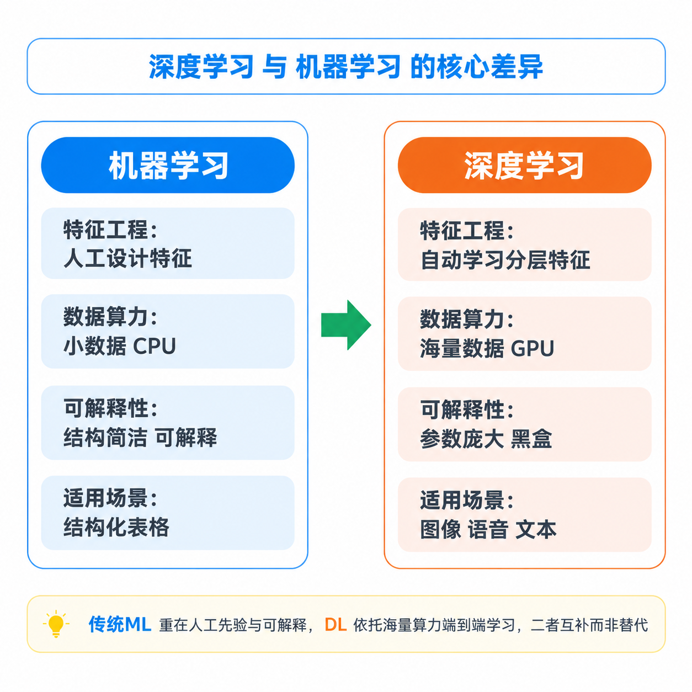
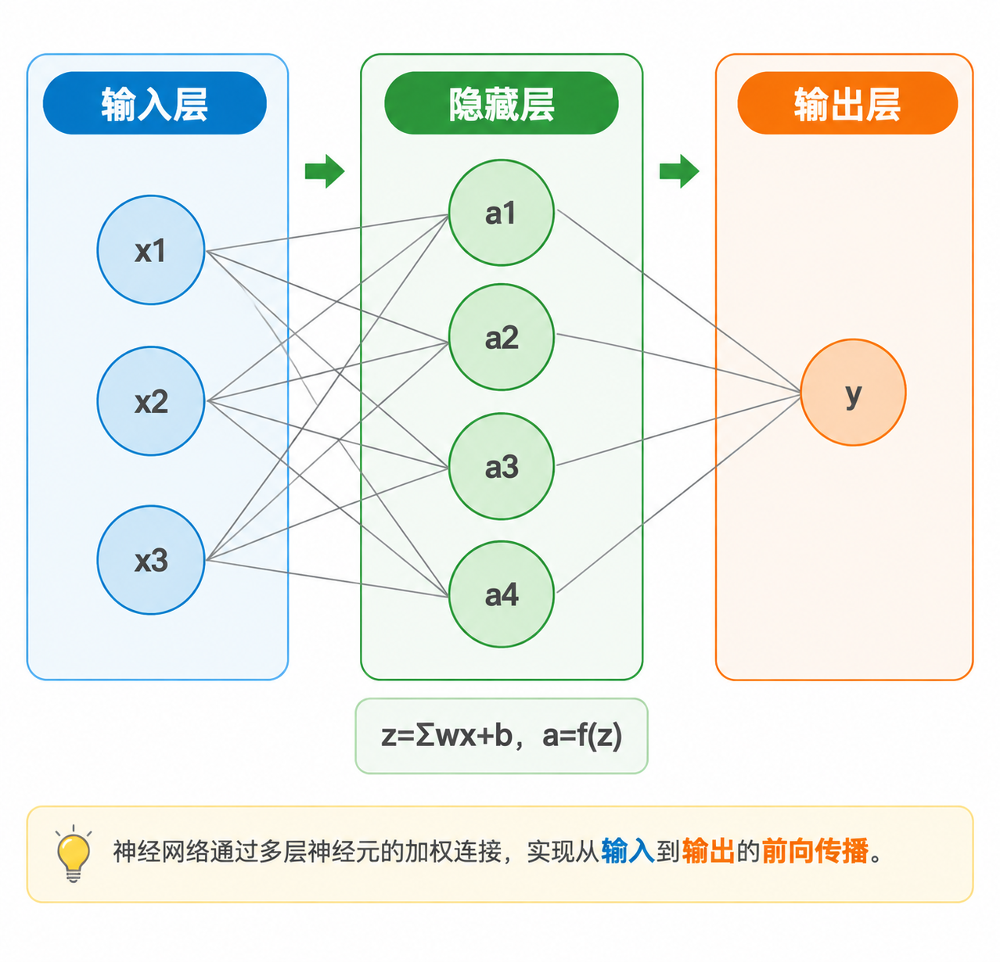
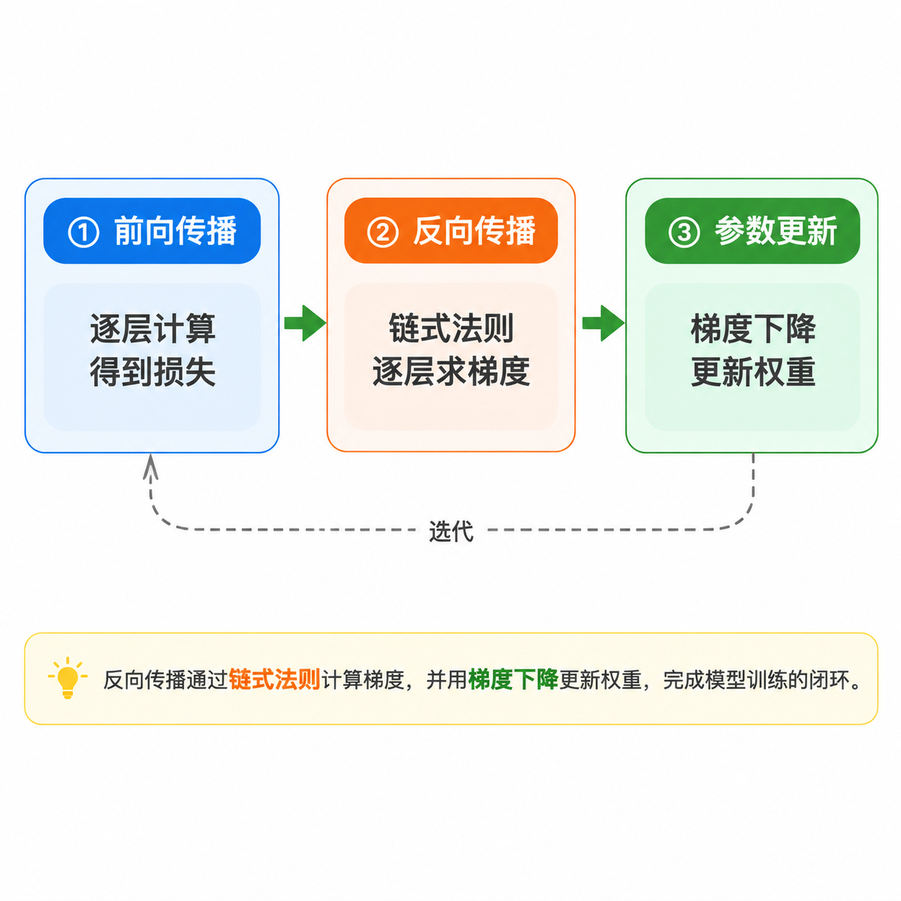
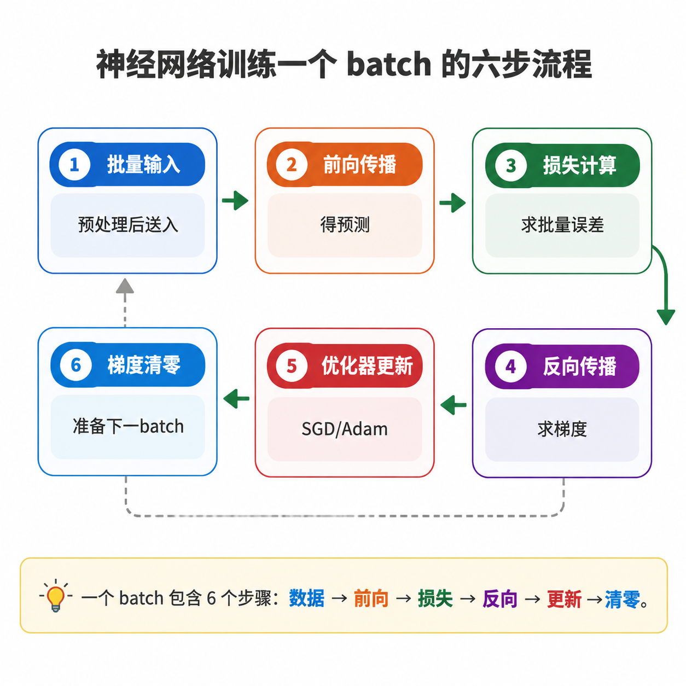
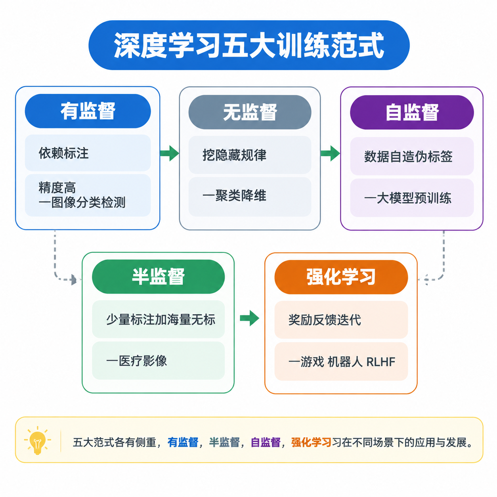
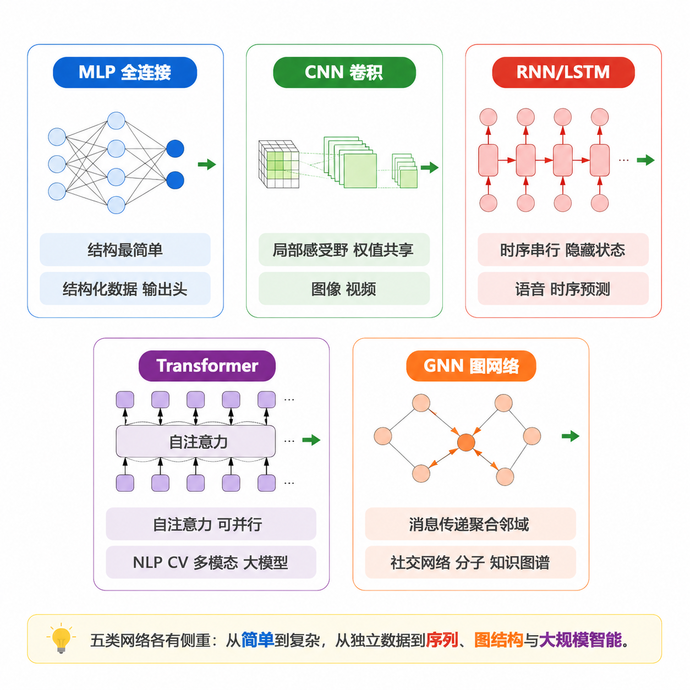

# 目录
## 1.2 深度学习基础
本章梳理深度学习基础核心面试考点，对比深度学习与机器学习的核心差异，讲解深度学习处理非线性问题的核心机制。系统介绍神经网络底层原理，涵盖单层感知机缺陷、多层网络的拟合优势、神经元结构与前向传播流程。同时详解反向传播算法、计算图机制以及批次训练完整流程，区分模型表达、拟合与泛化能力，并归纳判别式与生成式模型、主流训练范式、自监督学习及各类网络架构的特点与适用场景，为深度学习入门打下理论基础。

[1.介绍一下深度学习](#q2-1)
  - [面试问题：什么是深度学习，它和机器学习的核心区别是什么？](#q2-1-1)
  - [面试问题：深度学习解决了机器学习的哪些核心痛点？](#q2-1-2)
  - [面试问题：深度学习是如何处理非线性问题的？](#q2-1-3)

[2.介绍一下神经网络的工作原理](#q2-2)
  - [面试问题：为什么单层感知机无法解决异或问题？多层神经网络是通过什么机制解决这一问题的？](#q2-2-1)
  - [面试问题：神经网络的基本组成单元是什么？请从单个神经元开始，描述完整神经网络的前向传播计算流程](#q2-2-2)
  - [面试问题：一个标准的深度神经网络由哪些核心模块组成？每个模块的核心功能是什么？](#q2-2-3)
  - [面试问题：浅层神经网络和深度神经网络的本质差异是什么？为什么深而窄的网络通常比浅而宽的网络效果更好？](#q2-2-4)

[3.介绍一下反向传播的工作原理](#q2-3)
  - [面试问题：什么是反向传播算法？它的核心原理和数学基础是什么？](#q2-3-1)
  - [面试问题：计算图在反向传播中起到什么作用？前向传播和反向传播分别在计算图中完成什么操作？](#q2-3-2)
  - [面试问题：从原理层面描述神经网络训练一个 batch 数据的完整流程](#q2-3-3)

[4.介绍一下深度学习模型的表达能力、拟合能力、泛化能力](#q2-4)

[5.介绍一下深度学习的常见模型分类](#q2-5)
  - [面试问题：判别式模型与生成式模型的本质区别是什么？分别列举深度学习中的经典算法与适用场景。](#q2-5-1)
  - [面试问题：按训练范式划分，深度学习有哪些核心学习方式？各自的特点与适用场景是什么？](#q2-5-2)
  - [面试问题：自监督学习的核心思想是什么？为什么它成为大模型预训练的主流范式？](#q2-5-3)
  - [面试问题：常见的深度学习网络架构有哪几类？各自的核心特点与适用场景是什么？](#q2-5-4)

# 深度学习基础概念

<h1 id="q2-1">1.介绍一下深度学习</h1>

<h2 id="q2-1-1">面试问题：什么是深度学习，它和机器学习的核心区别是什么？</h2>

**难度评分：⭐⭐ (2/5) | 考察频率：⭐⭐⭐⭐ (4/5)**

深度学习是机器学习的重要分支，隶属于机器学习技术体系，其核心载体是多层（深层）人工神经网络，通过堆叠多层非线性变换单元模拟人脑的层级化信息处理机制，自动从原始数据中学习分层的特征表示，最终实现从输入到输出的端到端映射。

两者最本质的差异是特征提取的责任主体从人类工程师转移到了模型本身，具体可从四个维度系统对比：

- 特征工程：机器学习高度依赖人工特征工程，模型效果上限由人工设计的特征质量决定，常需手动构建、筛选特征，例如 SIFT、TF-IDF 等。深度学习依托多层非线性运算，自动学习分层特征表达，大幅降低了人工设计特征的工作量。

- 数据规模与硬件需求：机器学习在小数据集上也能取得良好效果，仅依靠 CPU 即可完成训练，耗时较短。深度学习的性能优势需要海量数据作为支撑，训练过程高度依赖 GPU、TPU 等高性能并行计算设备，算力与时间成本更高。（注：这一对标注数据的依赖已部分被自监督预训练缓解，见 2-5-3。）

- 模型结构与可解释性：机器学习模型（逻辑回归、决策树、支持向量机等）结构简洁，逻辑清晰，可解释性强。深度学习模型参数量庞大，头部大模型参数量已达万亿级别，内部逻辑难以拆解，属于典型的 “黑盒模型”。

- 适用场景：机器学习更适配结构化表格数据，广泛应用于风控、传统推荐等浅层任务。深度学习则擅长处理图像、语音、文本等非结构化数据，在生成式任务、通用大模型领域占据主导，当下 AIGC 相关应用也基本以深度学习为核心。

传统机器学习的逻辑是 “人提炼规律，模型做计算”，而深度学习的逻辑是 “模型自主从数据中提炼规律”；二者并非替代关系，而是适配不同场景、不同阶段的技术方案。上述核心区别如图2-1所示。

  

图2-1 深度学习与机器学习的核心区别

<h2 id="q2-1-2">面试问题：深度学习解决了机器学习的哪些核心痛点？</h2>

**难度评分：⭐⭐ (2/5) | 考察频率：⭐⭐⭐⭐ (4/5)**

深度学习针对性解决了传统机器学习的四大核心痛点：

- 人工特征工程依赖强、天花板低的痛点——传统机器学习的效果高度依赖人工设计的特征，开发成本高且受人类认知限制存在性能上限，深度学习通过多层非线性网络自动学习分层特征表示，实现端到端训练，大幅降低了对人工特征设计的依赖；

- 非结构化高维数据处理能力缺失的痛点——传统方法仅适配结构化表格数据，无法有效处理图像、文本、语音等高维非结构化数据，深度学习依托CNN、Transformer等适配数据特性的专属架构，可直接从原始非结构化数据中提取深层语义，填补了这一核心能力盲区；

- 复杂模式拟合能力不足的痛点——传统浅层模型非线性表达能力有限，难以胜任多因素强耦合的复杂智能任务，深度学习凭借深层网络的强大拟合能力，可建模复杂映射关系，支撑起围棋决策、蛋白质结构预测等高难度任务；

- 任务迁移成本高、知识复用性差的痛点——传统方案与单一任务深度绑定，新任务需重新设计特征、训练专属模型，深度学习形成了“大规模预训练+下游微调”的通用开发范式，通用知识可跨任务复用，大幅降低了新场景的开发成本与标注数据需求。

> 值得强调的是：深度学习是补充而非取代传统机器学习。在数据量小、强可解释性、实时推理成本敏感的场景中，浅层模型仍有明确价值，二者按任务特性选择而非优劣替换。

<h2 id="q2-1-3">面试问题：深度学习是如何处理非线性问题的？</h2>

**难度评分：⭐⭐ (2/5) | 考察频率：⭐⭐⭐⭐⭐ (5/5)**

1、为什么线性模型无法有效处理非线性问题

线性模型的数学表达式为 $y = W^T x + b$，本质是对输入特征做线性加权求和，其表达能力存在本质上限：

（1）决策边界只能是线性超平面

线性模型只能学习输入与输出的线性映射关系，分类任务中无法处理线性不可分的数据（经典如异或 XOR 问题），回归任务也无法拟合非线性函数关系，对非线性分布数据天然欠拟合。

（2）无法自动建模特征的高阶非线性交互

线性模型中每个特征权重独立，只能刻画特征对结果的独立线性贡献，无法表达特征交叉、耦合等非线性组合关系；若要适配非线性，只能人工构造多项式、交叉特征，极度依赖先验知识，且特征数量随阶数指数增长，极易触发维度灾难。

（3）拟合能力存在硬上限

无论如何优化参数，线性模型的表达空间始终局限在线性变换范围内，对于图像、文本等存在复杂非线性规律的真实数据，偏差（Bias）极高，无法逼近真实映射关系。

2、深度学习解决非线性问题的核心结构与机制

深度学习从基础表达能力、层级化建模、场景化结构三个层面，系统性解决非线性建模问题：

（1）非线性激活函数

这是深度网络突破线性表达上限的核心：

- 若无激活函数，无论堆叠多少层全连接，最终都等价于一层线性变换（线性变换的复合仍是线性变换），和线性模型没有本质区别。

- 在每一层输出后加入 ReLU、GELU、Tanh 等非线性激活函数，让每层特征都经过非线性映射，使整个网络具备拟合任意复杂非线性函数的基础能力。

（2）深度层级化结构

基于非线性激活的深度堆叠，实现了高效的非线性特征抽象：

- 理论保障（万能近似定理）：只要隐层宽度足够，单隐层神经网络就能逼近任意闭区间上的连续函数。需要注意，该定理只保证存在性（需足够宽度），深度网络的优势在于可用远少于浅层网络的参数拟合更复杂的非线性关系，即参数效率与泛化能力更优，而非表达空间本身更大。

- 层级化特征抽象：网络逐层对特征做非线性组合，底层学习简单基础特征（如图像边缘、文本子词），中层学习部件特征，高层学习抽象语义特征，天然适配真实数据的层级化非线性结构。

- 残差连接等配套结构：解决深层网络梯度消失问题，让网络可以做得更深，进一步提升复杂非线性关系的拟合能力。

（3）专项网络的归纳偏置

通过引入符合数据规律的结构假设，针对性建模不同类型的非线性模式：

- CNN（卷积神经网络）：通过局部感受野、权值共享、池化结构，建模图像空间维度的局部非线性关联，层级化提取视觉特征，高效捕捉空间域的非线性模式。

- Transformer / 自注意力：动态计算 token 间的关联权重，建模序列数据中长距离的非线性语义依赖，捕捉特征间动态、高阶的非线性交互。

- RNN/LSTM：通过循环状态传递，建模时序数据的非线性动态依赖，处理序列中的非线性时序变化规律。

<h1 id="q2-2">2.介绍一下神经网络的工作原理</h1>

<h2 id="q2-2-1">面试问题：为什么单层感知机无法解决异或问题？多层神经网络是通过什么机制解决这一问题的？</h2>

**难度评分：⭐⭐ (2/5) | 考察频率：⭐⭐⭐⭐ (4/5)**

1、单层感知机无法解决异或问题的核心原因

单层感知机本质上是一个**线性二分类器**，其数学表达式为 $y = \text{sign}(w_1x_1 + w_2x_2 + b)$，在二维空间中的决策边界是一条直线（高维空间为超平面），仅能处理线性可分的数据集。

而异或（XOR）问题是典型的线性不可分问题：

异或的真值对应二维平面的 4 个样本点：类别 0 为 $(0,0)$、 $(1,1)$，类别 1 为 $(0,1)$、 $(1,0)$。两类样本分别分布在两条对角线上，不存在任何一条直线能将两类样本完全分开，因此仅能输出线性决策边界的单层感知机，永远无法正确分类异或问题。

2、多层神经网络的解决机制

多层神经网络通过隐藏层与非线性激活函数的组合，实现输入空间的非线性特征变换，从根源上打破了线性分类的限制，核心逻辑如下：

（1）非线性空间映射：隐藏层的每个神经元会先对输入做线性加权，再通过 sigmoid、ReLU 等非线性激活函数输出。这一步相当于把原始的低维输入空间，非线性地映射到一个新的特征空间中。

> 关键：如果没有非线性激活函数，即使堆叠再多隐藏层，整体也等价于一个单层线性网络，依然无法处理线性不可分问题。

（2）转化为线性可分问题：经过隐藏层的非线性变换后，原本在原始空间中线性不可分的异或样本，在新的特征空间中会变为线性可分的状态。

（3）输出层完成分类：输出层相当于一个单层感知机，在变换后的特征空间中学习一个线性决策边界，即可完成异或问题的正确分类。

（4）直观举例：经典的两层异或网络只需 2 个隐藏神经元。隐藏层两个神经元分别学习 OR（或）与 NAND（与非）两种线性特征——OR 在任一位为 1 时输出 1，NAND 在非全 1 时输出 1；输出层对二者做一次带偏置的线性组合并施加阈值激活，即可正确区分异或的两类结果（XOR = OR ∧ NAND）。

<h2 id="q2-2-2">面试问题：神经网络的基本组成单元是什么？请从单个神经元开始，描述完整神经网络的前向传播计算流程</h2>

**难度评分：⭐⭐ (2/5) | 考察频率：⭐⭐⭐⭐⭐ (5/5)**

1、神经网络的基本组成单元

神经网络的最小组成单元是人工神经元（感知机可视为其原型或特例），核心计算分为两步：

（1）线性加权求和：对输入特征 $x$ 与对应权重 $w$ 做内积，叠加偏置项 $b$，得到线性结果：

$$z = \sum_{i=1}^n w_i x_i + b = w^T x + b$$

（2）非线性激活：将线性结果输入激活函数 $f(\cdot)$（如 ReLU、Sigmoid）做非线性变换，得到神经元最终输出 $a = f(z)$，为网络引入非线性表达能力。

> 术语说明：经典“感知机”特指单层二分类器 + Heaviside 阶跃激活 + 感知机学习规则，正是上一题中无法解决 XOR 的模型；通用神经网络中的可微神经元是其扩展形态，二者不宜混同。

2、神经网络前向传播完整流程

前向传播是数据从输入层正向流动、经隐藏层逐层计算，最终从输出层得到预测结果的过程，核心是 “线性加权 + 非线性激活” 的逐层递进，步骤如下：

（1）输入层：接收原始输入特征 $X$，不做运算，直接传递给第一层隐藏层，记 $A^{[0]} = X$。

（2）隐藏层逐层计算：对第 $l$ 层隐藏层，以上一层输出 $A^{[l-1]}$ 为输入，依次完成线性变换与激活：

$$Z^{[l]} = W^{[l]} \cdot A^{[l-1]} + b^{[l]}, \quad A^{[l]} = f(Z^{[l]})$$

其中 $W^{[l]}$、 $b^{[l]}$ 为第 $l$ 层的可学习权重与偏置， $f$ 为当前层激活函数。

（3）**输出层计算**：以最后一层隐藏层的输出为输入，根据任务类型做最终变换（多分类加 Softmax、二分类用 Sigmoid、回归任务用恒等映射），输出最终预测结果 $\hat{Y}$。

神经网络前向传播和神经元参考示意图如图2-2所示：

  

图2-2 神经网络基础组成单元与前向传播

> 这是一个单隐藏层的全连接前馈神经网络，整体分为输入层、隐藏层、输出层，信息只能从左向右单向传递，相邻层神经元两两互连、同层神经元无连接。
>
> 输入层包含 3 个神经元 $x_1$、 $x_2$、 $x_3$，仅负责接收原始输入特征，不做加权、激活运算，直接把特征传递给后方的隐藏层。
>
> 隐藏层包含 4 个神经元 $a_1$、 $a_2$、 $a_3$、 $a_4$，使用激活函数 $f^1(\cdot)$，每个神经元与输入层全部 3 个神经元全连接：
>
> （1）先完成线性加权求和叠加偏置： $z_i = w_{1i}x_1 + w_{2i}x_2 + w_{3i}x_3 + b_i$
>
> （2）再通过非线性激活函数得到该神经元输出： $a_i = f^1(z_i)$
>
> 这一步可以把原始线性不可分的特征做非线性变换，让后续可分。
>
> 输出层包含 1 个输出神经元 $y$，使用激活函数 $f^2(\cdot)$，接收隐藏层全部 4 个神经元的输出：
>
> （1）再次做线性加权叠加偏置： $z_y = w_1a_1 + w_2a_2 + w_3a_3 + w_4a_4 + b_y$
>
> （2）经激活函数输出最终预测结果： $y = f^2(z_y)$

<h2 id="q2-2-3">面试问题：一个标准的深度神经网络由哪些核心模块组成？每个模块的核心功能是什么？</h2>

**难度评分：⭐⭐ (2/5) | 考察频率：⭐⭐⭐⭐ (4/5)**

神经网络是借鉴人脑神经元联结机制设计的计算模型，由大量基础运算单元（神经元）互联构成，本质是带可学习参数的可微非线性函数逼近器。一个标准的深度神经网络由五大核心模块组成，各司其职、相互协作：

（1）神经元（感知机）：最小计算单元。负责对输入做“线性加权求和 + 非线性激活”，是网络非线性表达能力的来源；单个神经元无法解决线性不可分问题，需依靠多层组合。

（2）网络层（Layer）：组织神经元的结构载体。按职责分为输入层（接收原始特征）、隐藏层（逐层抽象特征）、输出层（产出预测结果）；层与层之间通过权重矩阵相连，层数决定网络的“深度”，宽度决定单层容量。

（3）激活函数（Activation）：为网络注入非线性的关键。如 ReLU、GELU、Tanh、Sigmoid 等，打破多层线性变换仍等价于单层的困境；同时影响梯度流动（ReLU 缓解梯度消失）与输出范围（Sigmoid 压缩到 0-1）。

（4）损失函数（Loss）：量化预测与真实标签差距的目标函数。分类常用交叉熵（Cross Entropy），回归常用均方误差（MSE）；训练过程本质是最小化该函数，它决定了模型优化的方向。

（5）优化器（Optimizer）：基于梯度更新参数的引擎。如 SGD、Adam 等，控制学习率、动量、权重衰减等策略，沿损失下降方向迭代更新全部可学习参数，驱动模型收敛。

> 进阶组件（AIGC 时代的标配，可在后续章节展开）：进入生成式时代后，上述基础组件被完整延续，行业以 Transformer 架构为核心主干，将残差连接、层归一化、自注意力机制、位置编码整合为通用标准模块；同时针对生成任务新增扩散模型采样器等专属组件，并在生成对抗网络（GAN）等传统生成模型的设计思路上持续迭代。这些内容建议单独成题展开，避免与“基础组成单元”混淆。

<h2 id="q2-2-4">面试问题：浅层神经网络和深度神经网络的本质差异是什么？为什么深而窄的网络通常比浅而宽的网络效果更好？</h2>

**难度评分：⭐⭐⭐ (3/5) | 考察频率：⭐⭐⭐⭐ (4/5)**

1、浅层与深度神经网络的本质差异

二者的核心区别并非单纯的层数多少，而是特征抽象的层级性与非线性拟合的参数效率：

（1）特征表达逻辑不同

浅层网络仅完成 1-2 级特征变换，属于扁平的单级映射，无法形成分层语义；而深度网络通过多层堆叠，实现 “底层基础特征→中层部件特征→高层语义特征” 的递进式抽象，更匹配真实数据的内在层级结构。

（2）拟合效率差异显著

在数据具备层级结构的前提下，浅层网络要拟合复杂非线性函数，神经元数量往往需呈指数级增长；而深度网络通过层级特征组合，仅需相对更少的参数量即可实现同等拟合能力，参数利用效率远高于浅层网络。这是一个启发式结论而非严格定理，其成立依赖数据本身的层级属性。

2、深而窄的网络效果更优的核心原因

（1）参数效率更高

依据万能近似定理，单层网络理论上可拟合任意函数，但需要极多神经元；深而窄的网络通过层级复用特征，以更少的参数量就能拟合复杂规律，参数利用率更高。

（2）适配数据的层级本质

图像、文本、语音等真实数据天然具备层级结构，深度网络的逐层抽象可精准匹配该结构，学习到数据的本质规律；浅而宽的扁平网络仅能捕捉表层关联，难以建模深层语义逻辑。

（3）泛化迁移能力更强

深度网络学到的分层基础特征具备通用性，可跨任务迁移复用；浅而宽的网络更易拟合数据噪声，过拟合风险更高，在未知数据上的泛化表现更差。

> 辩证补充：并非网络越深越窄就必然越好。过深会导致梯度退化与优化困难、过窄会导致欠拟合，二者与正则手段（残差连接、归一化、Dropout）相互配合才能发挥优势；“深窄优于浅宽”是经验性规律，需结合任务特性评估，不能绝对化。

<h1 id="q2-3">3.介绍一下反向传播的工作原理</h1>

<h2 id="q2-3-1">面试问题：什么是反向传播算法？它的核心原理和数学基础是什么？</h2>

**难度评分：⭐⭐⭐ (3/5) | 考察频率：⭐⭐⭐⭐⭐ (5/5)**

反向传播（Back Propagation, BP）是深度神经网络训练的核心算法，本质是基于链式求导法则，从输出层向输入层反向逐层计算损失函数对各层参数的梯度，为梯度下降优化提供参数更新依据。它解决了深度网络多层参数梯度计算效率低的核心问题：将多层复合函数的求导复杂度从指数级降为线性级，让深层网络的高效训练成为可能。

算法以前向算损失→反向算梯度→迭代更新参数的闭环执行，三个阶段如下：

- 前向传播阶段：输入数据从输入层正向流动，逐层计算线性输出与激活输出，最终在输出层计算损失值，得到预测结果与真实标签的误差。

- 反向传播阶段：以输出层的损失为起点，从后往前逐层传递误差；通过链式法则复用前向传播的中间计算结果，依次算出每一层权重、偏置的梯度，直至输入层。

- 参数更新阶段：优化器基于计算得到的梯度，沿损失下降方向更新所有可学习参数，迭代最小化损失函数。

神经网络本质是多层嵌套的复合函数（损失→输出→激活→线性加权→上一层输出→…→原始输入）。利用链式法则，可将损失对任意层参数的偏导拆解为多层偏导的乘积，实现从后往前的逐层递推计算，复用中间结果避免重复求导。

以单隐层网络对某个权重 $W^{[1]}_{ij}$ 求梯度为例，链式展开为：

$$\frac{\partial L}{\partial W^{[1]}_{ij}} = \underbrace{\frac{\partial L}{\partial A^{[2]}}}_{\text{损失对输出}} \cdot \underbrace{\frac{\partial A^{[2]}}{\partial Z^{[2]}}}_{\text{输出对线性}} \cdot \underbrace{\frac{\partial Z^{[2]}}{\partial A^{[1]}}}_{\text{线性对隐层}} \cdot \underbrace{\frac{\partial A^{[1]}}{\partial Z^{[1]}}}_{\text{隐层对线性}} \cdot \underbrace{\frac{\partial Z^{[1]}}{\partial W^{[1]}_{ij}}}_{\text{线性对权重}}$$

每步的偏导都是局部、可预定义的计算，且大量中间项在相邻层之间共享复用，这正是反向传播高效性的数学根源。反向传播的最终目标是得到参数的梯度，支撑梯度下降（及 SGD、Adam 等变种算法）沿损失下降方向迭代更新参数，驱动模型收敛到最优解。

反向传播以前向算损失、反向算梯度、更新参数三个阶段构成闭环，如图2-3所示。

  

图2-3 反向传播的三阶段闭环

<h2 id="q2-3-2">面试问题：计算图在反向传播中起到什么作用？前向传播和反向传播分别在计算图中完成什么操作？</h2>

**难度评分：⭐⭐⭐ (3/5) | 考察频率：⭐⭐⭐⭐ (4/5)**

1、计算图在反向传播中的核心作用

计算图是描述神经网络运算流程的有向无环图（DAG），节点代表变量 / 基础运算单元，边代表数据依赖关系，是反向传播与深度学习框架自动微分的核心载体：

（1）实现自动微分：将复杂的深度网络拆解为标准化的基础运算，每个运算预定义好求导规则，无需手动推导全局求导公式，让任意复杂网络都能自动完成梯度计算。

（2）提升计算效率：前向传播时缓存所有节点的中间运算结果，反向传播时直接复用这些数据计算局部梯度，避免重复计算，大幅降低求导的时间复杂度。

（3）规范计算依赖：以拓扑序明确运算的先后逻辑，天然支持算子并行计算与分布式训练，是所有主流深度学习框架的底层实现基础。

> 工程权衡：反向传播需要缓存前向传播的中间值（激活输出、线性输出等）供反向复用，这是深度模型训练显存/内存占用远高于推理的原因之一。这也是常见的工程面试追问点——为何训练显存远大于推理、能否用重计算（gradient checkpointing）以时间换空间。

2、前向传播在计算图中的操作

按计算图的正向拓扑顺序（输入节点→输出节点）执行：

（1）从输入节点出发，逐节点完成对应运算，输出当前节点的计算结果；

（2）缓存所有节点的中间计算值，为反向传播的局部梯度计算提供数据支撑；

（3）最终遍历至损失节点，得到模型预测结果与损失值。

3、反向传播在计算图中的操作

按计算图的逆向拓扑顺序（损失节点→参数节点）执行，核心基于链式求导法则：

（1）从损失节点出发，逐节点计算梯度：用当前节点的输出梯度，结合前向缓存的中间值算出该运算的局部梯度，二者相乘得到当前节点的输入梯度；

（2）将输入梯度传递给该节点的所有前驱节点，逐层向前回溯传递误差；

（3）遍历完全部节点后，得到所有权重、偏置等可学习参数的梯度，交付优化器完成参数更新。

<h2 id="q2-3-3">面试问题：从原理层面描述神经网络训练一个 batch 数据的完整流程</h2>

**难度评分：⭐⭐ (2/5) | 考察频率：⭐⭐⭐⭐⭐ (5/5)**

神经网络训练单个 batch 是 “前向算误差→反向求梯度→迭代更新参数” 的完整闭环，原理层面分为 6 个核心步骤：

（1）批量数据采样与预处理

从训练集（已在线下完成归一化、数据增强等标准化预处理，这部分在数据加载/训练管线阶段完成，而非每个 batch 内重复）中采样指定 batch size 的样本与对应标签，以张量形式输入网络，作为计算图的输入起点。

（2）前向传播计算预测结果

批量数据沿网络从输入层正向流动，逐层执行 “线性加权求和 + 非线性激活” 运算，全程保留 batch 维度；最终在输出层得到该 batch 所有样本的预测结果。

（3）损失函数计算批量误差

将 batch 的预测值与真实标签代入损失函数，先计算单样本的个体误差，再取平均值得到该 batch 的整体损失值，量化模型当前的预测偏差，作为反向传播的梯度计算源头。

（4）反向传播求解参数梯度

以损失值为起点，基于链式求导法则沿计算图的逆向拓扑序逐层回溯，依次计算每一层权重、偏置的**批量平均梯度**，明确每个参数对损失的影响方向与幅度。

（5）优化器更新网络参数

优化器（如 SGD、Adam）基于计算得到的参数梯度，结合学习率、动量、权重衰减等超参数策略，沿损失下降方向同步更新全网所有可学习参数，完成一次参数迭代优化。

（6）梯度清零完成闭环

参数更新结束后，清空计算图中缓存的梯度数据（框架层面对应 `optimizer.zero_grad()`），避免当前 batch 的梯度与下一个 batch 发生异常累积，为下一轮 batch 训练做好初始化准备。

神经网络训练单个 batch 的完整流程如图2-4所示。

  

图2-4 神经网络训练单个 batch 的六步流程

<h1 id="q2-4">4.介绍一下深度学习模型的表达能力、拟合能力、泛化能力</h1>

**难度评分：⭐⭐⭐ (3/5) | 考察频率：⭐⭐⭐⭐ (4/5)**

深度学习模型的表达能力、拟合能力、泛化能力是衡量模型性能的三个核心维度。表达能力是模型理论上可拟合的函数空间上限，由参数量、网络架构、激活函数等固有属性决定，是模型学习能力的天花板；拟合能力是模型在训练数据集上的实际学习效果，受训练策略、优化器、数据质量等因素影响，其上限由表达能力决定；泛化能力是模型在未见过的新数据上的表现，是模型的核心目标，取决于模型复杂度、数据分布与训练策略的匹配程度。

三者相互制约，表达能力不足会导致欠拟合，表达能力过剩则容易过拟合。随模型容量从小到大变化，模型通常经历 欠拟合 → 拟合良好 → 过拟合的过程：容量过小时连训练数据都拟合不了（欠拟合，偏差高），容量过大时记住训练噪声而泛化变差（过拟合，方差高）。传统模型遵循偏差-方差权衡规律，而大模型时代出现了**双下降（Double Descent）**现象：当模型容量越过“插值阈值”（能完全记忆训练数据）后，继续扩大模型规模，测试误差反而再次下降、泛化能力持续提升，打破了一味“过拟合=更差”的直觉。

<h1 id="q2-5">5.介绍一下深度学习的常见模型分类</h1>

<h2 id="q2-5-1">面试问题：判别式模型与生成式模型的本质区别是什么？分别列举深度学习中的经典算法与适用场景</h2>

**难度评分：⭐⭐⭐ (3/5) | 考察频率：⭐⭐⭐⭐⭐ (5/5)**

判别式模型与生成式模型最本质的区别，在于建模的概率分布与学习目标不同：判别式模型直接建模条件概率 $P(y|x)$，核心是学习输入到输出的映射、刻画类别间的决策边界，负责“区分”；生成式模型则建模联合概率 $P(x,y)$（或数据的边缘分布 $P(x)$），核心是还原数据的内在分布与生成逻辑，负责“生成”。二者在建模目标、核心能力、经典算法与适用场景上的具体区别如表2-1所示：

表2-1 判别式模型与生成式模型对比

| 对比维度 | 判别式模型 | 生成式模型 |
| :--- | :--- | :--- |
| **建模对象** | 条件概率 $P(y\|x)$ | 联合概率 $P(x,y)$（或边缘分布 $P(x)$） |
| **学习目标** | 找类别间的决策边界，学习 $x \to y$ 的映射 | 拟合真实数据分布，还原数据的生成逻辑 |
| **核心能力** | 区分样本、直接输出预测标签 | 生成全新样本；也可经贝叶斯公式由 $P(x,y)$ 推出 $P(y\|x)$，间接完成判别 |
| **建模难度** | 目标聚焦、建模相对简单，同算力下判别精度通常更高 | 需还原完整分布，建模难度更高，但能力更通用 |
| **经典算法** | CNN、RNN/LSTM、BERT 等 Transformer 编码器、MLP | GAN、VAE、扩散模型、GPT 等 Transformer 解码器、归一化流（Flow） |
| **适用场景** | 图像分类、目标检测、文本分类、语义分割、序列标注、风控评分等有监督判别任务 | 文生图/文生视频、文本生成、语音合成、数据增强、图像修复、风格迁移，以及半监督、异常检测等 |

> 注：① 判别/生成不取决于架构本身，而取决于输出层与训练目标——BERT 编码器偏判别、GPT 解码器偏生成，RNN/LSTM 既可分类（判别），也可做语言模型（生成，如 char-RNN、seq2seq）；② 二者并非完全独立，例如 GAN 就由生成器 + 判别器共同组成，生成式任务中也常引入判别式组件来提升训练稳定性。

<h2 id="q2-5-2">面试问题：按训练范式划分，深度学习有哪些核心学习方式？各自的特点与适用场景是什么？</h2>

**难度评分：⭐⭐ (2/5) | 考察频率：⭐⭐⭐⭐⭐ (5/5)**

深度学习核心分为五大主流训练范式，特点与适用场景如下：

（1）**有监督学习**

- 特点：依赖人工标注的样本训练，直接学习输入到标签的映射关系，训练目标明确、收敛速度快，精度上限受标注质量与数据规模约束。

- 适用场景：标注成本低、任务目标明确的场景，如图像分类、目标检测、文本分类、语音识别等。

（2）**无监督学习**

- 特点：无需标注标签，仅基于数据本身的内在结构与分布训练，核心目标是挖掘数据的隐藏规律与通用特征。

- 适用场景：无标注数据的特征提取与分布建模场景，如数据聚类、特征降维、异常检测、表征预训练等。

（3）**自监督学习**

- 特点：从数据自身构造伪标签作为监督信号，无需人工标注，兼顾无监督的数据利用效率与有监督的训练稳定性，核心分为掩码预测与对比学习两大方向。

- 适用场景：大模型通用预训练、海量无标注数据的表征学习，是 NLP、CV、多模态大模型的主流预训练范式。

（4）**半监督学习**

- 特点：混合少量标注数据与大量无标注数据联合训练，用无标注数据补充特征分布信息，平衡标注成本与模型精度。

- 适用场景：标注成本高、标注数据稀缺的场景，如医疗影像分析、工业缺陷检测、低资源 NLP 任务等。

（5）**强化学习**

- 特点：通过智能体与环境交互，基于奖励反馈迭代优化策略，无需标注数据，以长期累积奖励最大化为优化目标。

- 适用场景：序列决策类场景，如游戏 AI、自动驾驶决策、机器人控制、大模型人类对齐（RLHF）等。

> 辨析：半监督学习与自监督学习都以“利用无标注数据”为特征，但机制不同——半监督混合**少量标注 + 大量无标注**数据联合训练（无标注数据辅助约束决策边界）；自监督则完全不用人工标注，**从数据自身构造伪标签**（掩码、打乱、对比等）构造监督信号。前者仍依赖部分标注，后者可完全脱离标注，是高频辨析点。

五大训练范式如图2-6所示。

  

图2-5 深度学习五大训练范式

<h2 id="q2-5-3">面试问题：自监督学习的核心思想是什么？为什么它成为大模型预训练的主流范式？</h2>

**难度评分：⭐⭐⭐ (3/5) | 考察频率：⭐⭐⭐⭐⭐ (5/5)**

自监督学习是无监督学习的重要分支（学界亦有观点将其视为独立于有监督/无监督的第三范式），核心逻辑是**不依赖人工标注，通过对原始数据做掩码、打乱、对比等变换构造伪标签与预训练任务**，让模型在解决构造任务的过程中，学习到数据的内在语义与通用表征，训练的监督信号完全来自数据本身。

自监督学习成为大模型预训练主流的原因可归纳为四点：

（1）**突破标注数据瓶颈**：大模型性能依赖海量训练数据，人工标注成本极高、规模上限低；自监督学习可充分利用互联网上海量的无标注文本、图像、视频数据，支撑模型规模的持续缩放。

（2）**通用表征能力更强**：自监督预训练让模型学习数据的底层规律与通用常识，而非特定任务的判别规则，预训练得到的表征迁移性极强，可通过微调、零样本 / 少样本学习适配海量下游任务。

（3）**适配缩放法则**：自监督学习的性能随数据量、参数量、计算量的提升呈现稳定的正向增长，匹配大模型 "规模越大能力越强" 的缩放定律，可支撑模型能力的持续迭代。

（4）**多模态适配性好**：文本、图像、音频等不同模态均可通过自监督方式学习各自的通用表征，也可通过跨模态对比、对齐任务实现多模态融合，是多模态大模型的核心训练基础。

自监督学习的掩码预测思想如图2-7所示。

  

图2-6 自监督学习的掩码预测思想

<h2 id="q2-5-4">面试问题：常见的深度学习网络架构有哪几类？各自的核心特点与适用场景是什么？</h2>

**难度评分：⭐⭐⭐ (3/5) | 考察频率：⭐⭐⭐⭐⭐ (5/5)**

主流架构分为五大类，核心特点与适用场景如下：

（1）**全连接神经网络（MLP）**

- 核心特点：层间神经元全连接，结构最简单，可实现通用的特征线性组合与非线性变换；但参数量大、对空间 / 序列结构不敏感，易出现过拟合。

- 适用场景：低维结构化数据的分类回归、网络的输出头与特征融合模块，是所有深度学习网络的基础组件。

（2）**卷积神经网络（CNN）**

- 核心特点：基于局部感受野、权值共享、池化降维三大核心设计，天然适配网格型数据的空间局部相关性，参数效率高、对平移等变（池化层进一步带来近似平移不变性），可高效提取层级化空间特征。

- 适用场景：图像、视频等二维网格数据任务，如图像分类、目标检测、语义分割，也可用于时序数据的一维卷积特征提取。

（3）**循环神经网络（RNN/LSTM/GRU）**

- 核心特点：按时间步串行处理序列数据，隐藏状态携带历史时序信息，天然适配序列上下文依赖；但串行计算无法并行、长序列易出现梯度消失，长程建模能力有限。

- 适用场景：早期的 NLP 序列任务与语音任务，如机器翻译、语音识别、时序预测，目前主流场景已逐步被 Transformer 替代。

（4）**Transformer 架构**

- 核心特点：基于自注意力机制建模全局依赖关系，可并行计算长序列，长程建模能力极强；通过堆叠编码器 / 解码器实现灵活的架构设计，具备极强的通用建模能力与规模缩放性。

- 适用场景：当前深度学习的主流通用架构，覆盖 NLP（BERT/GPT）、CV（ViT）、语音、多模态等几乎所有领域，是大模型的核心基础架构。

> 辩证补充：Transformer 的代价是参数量大、需要海量数据支撑，在小规模数据场景下反而可能弱于 CNN、MLP 等强归纳偏置模型；其优势在数据与算力充裕时才能充分发挥。

（5）**图神经网络（GNN）**

- 核心特点：针对图结构数据设计，基于消息传递机制聚合节点的邻域信息，可有效建模非结构化的拓扑关系与节点特征。

- 适用场景：图结构数据任务，如社交网络分析、推荐系统、分子性质预测、知识图谱推理、异常检测等。

五类常见网络架构如图2-8所示。

  

图2-7 五类常见深度学习网络架构

