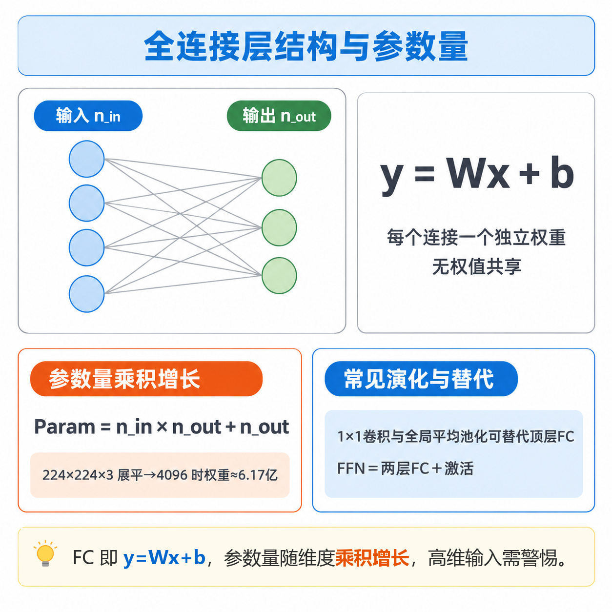
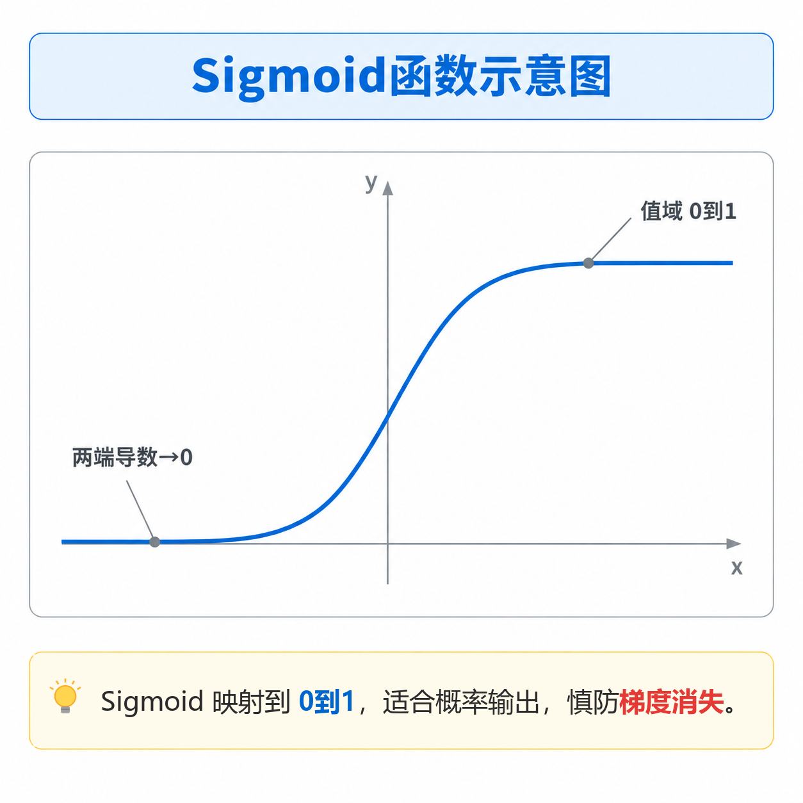
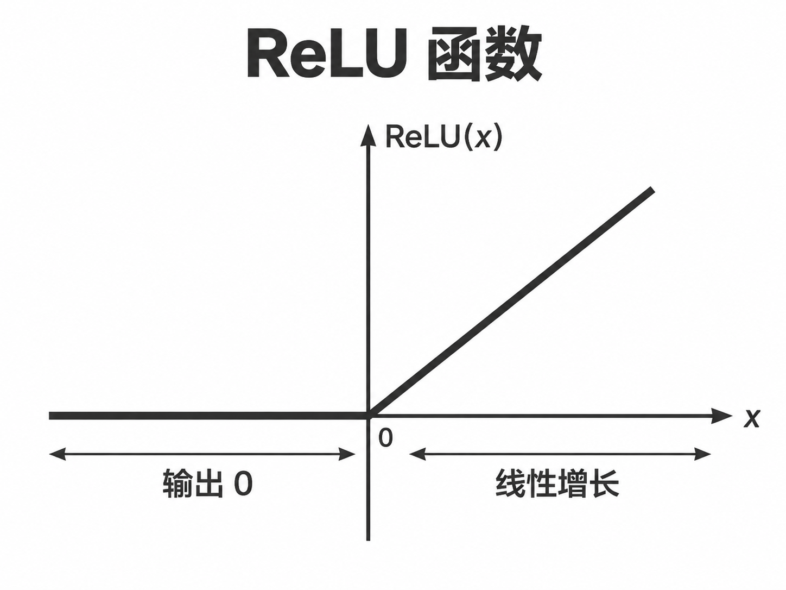
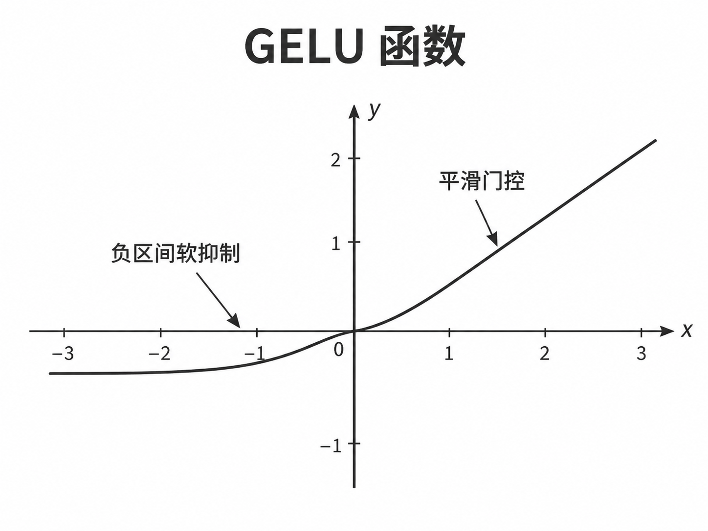
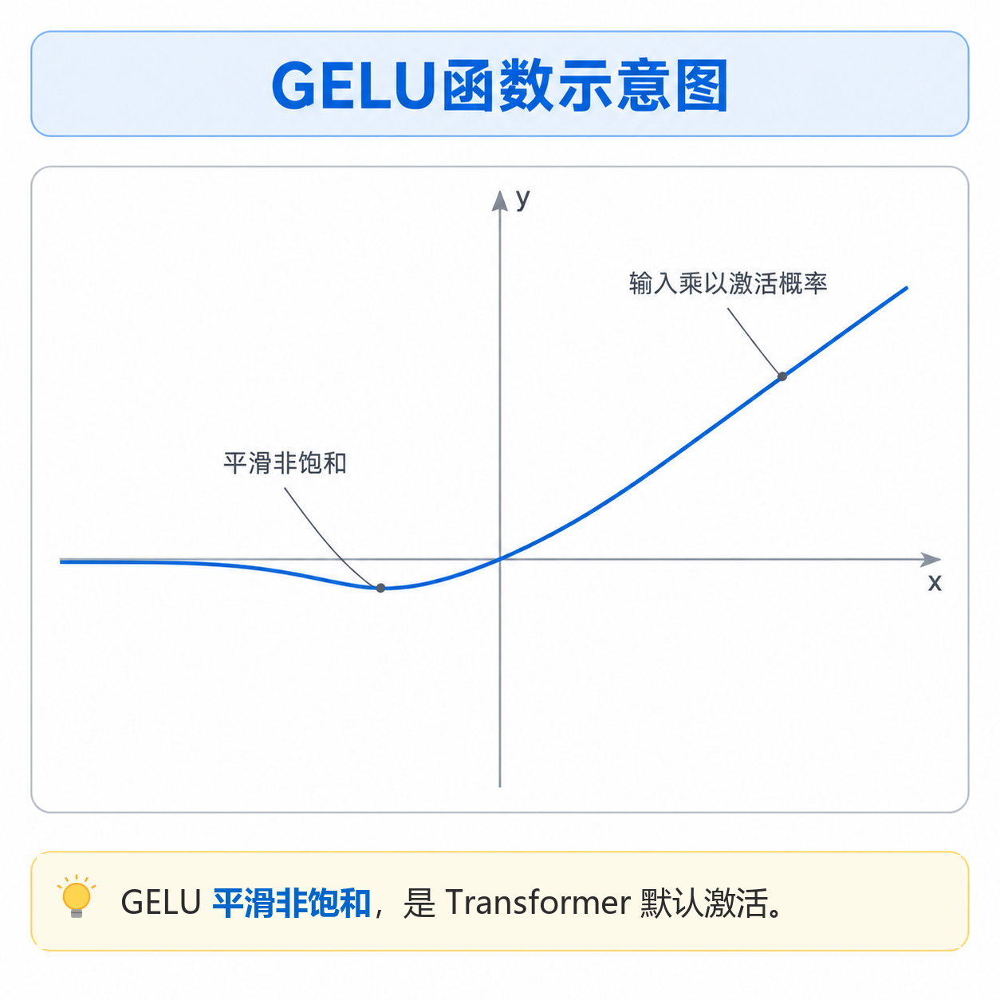
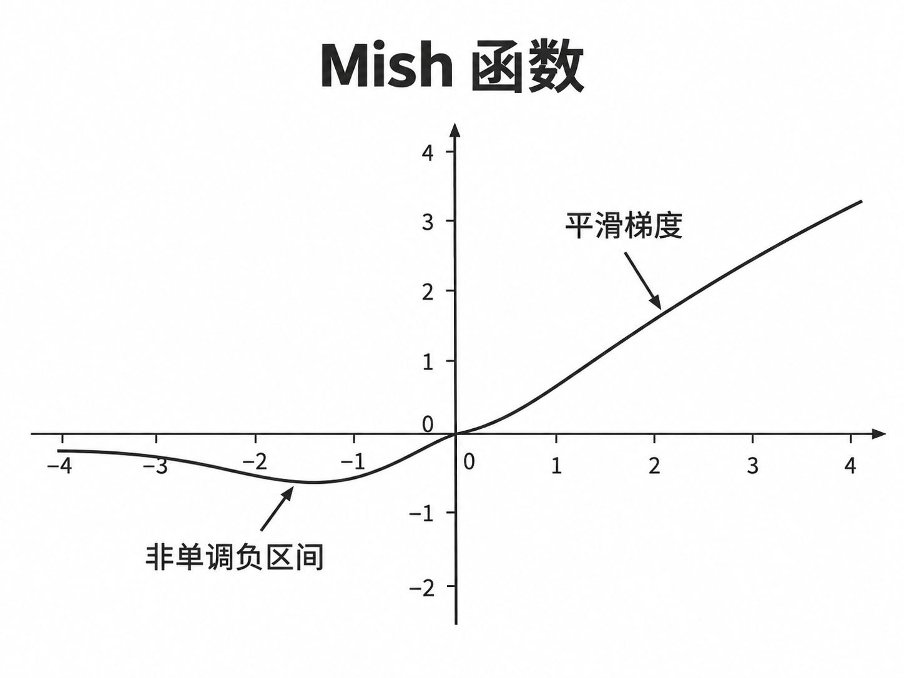
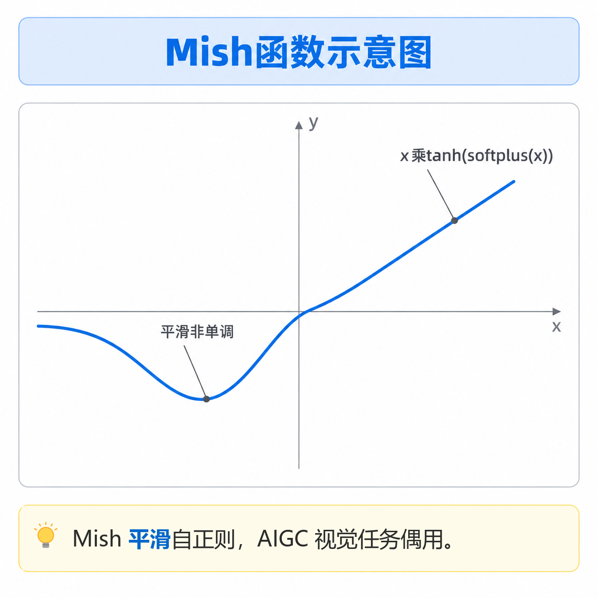
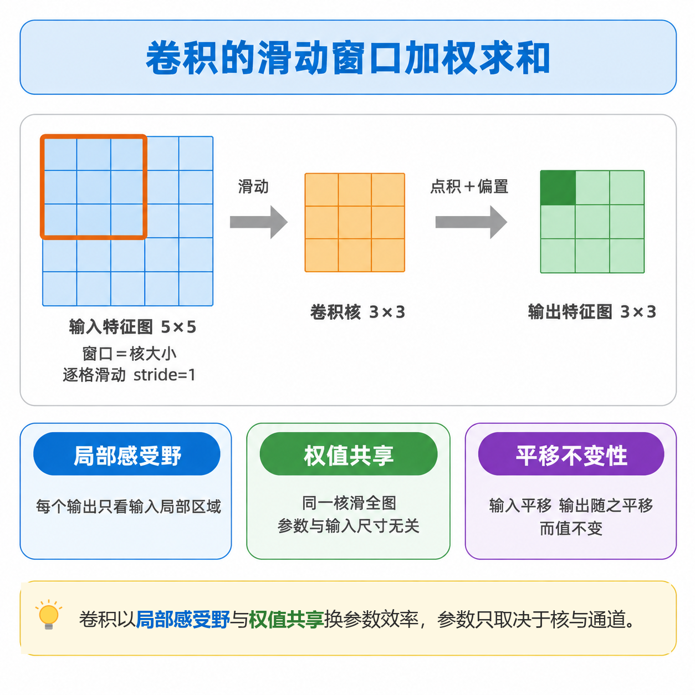
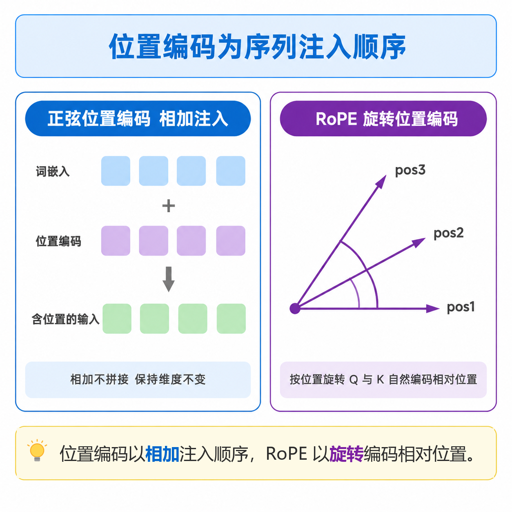
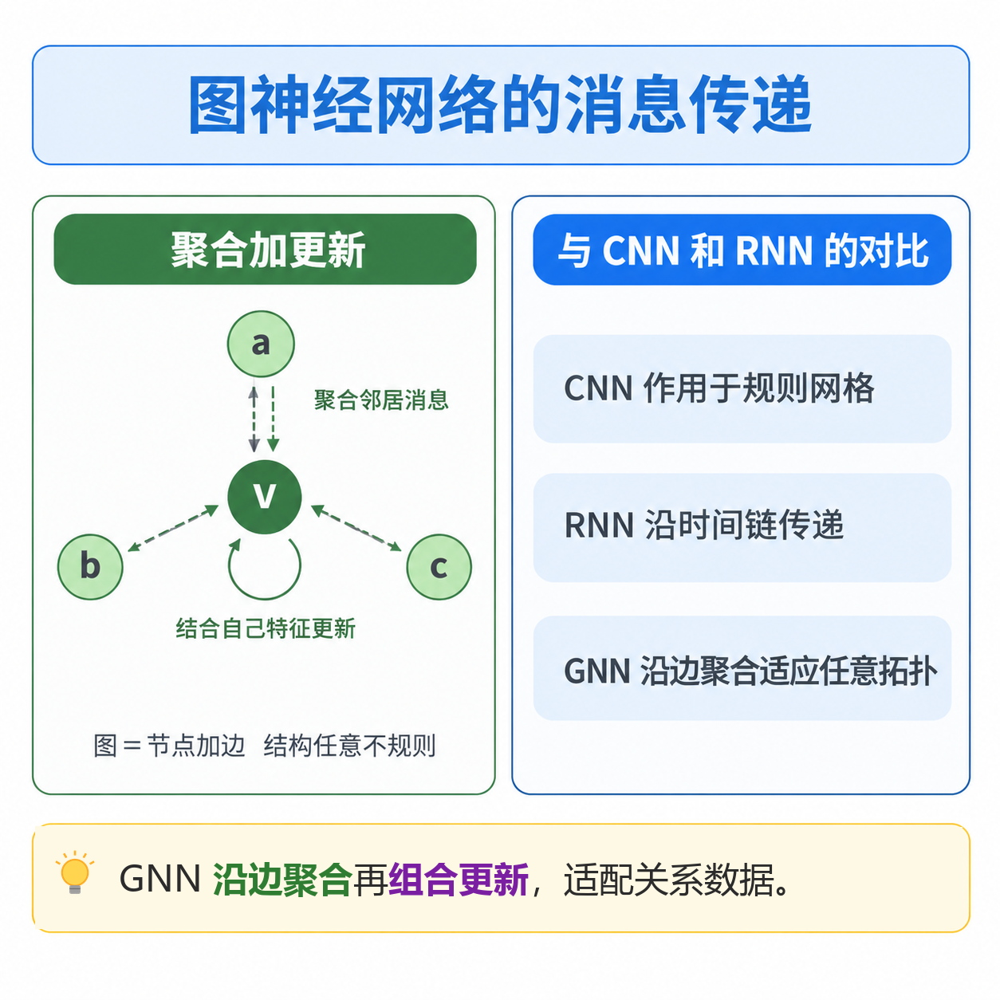

# 目录

## 1.3 深度学习网络架构
本章聚焦深度学习网络架构，汇总 AIGC 面试高频考点。从权重初始化、卷积、归一化、激活函数等基础组件展开，解析 ResNet、U-Net 经典网络；重点讲解 Transformer、自注意力、位置编码与推理优化，同步介绍 MoE、多模态、GNN 等前沿方向，打通传统深度学习、大模型与扩散模型知识脉络。

[1. 如何理解权重初始化？](#q3-1)
  - [面试问题：什么是权重初始化？核心目的是什么？](#q3-1-1)
  - [面试问题：常见的初始化方法有哪些？](#q3-1-2)
  - [面试问题：为什么不能用全0初始化，不合理初始化会导致什么问题？](#q3-1-3)
  - [面试问题：介绍一下 Xavier/He 初始化的核心思想](#q3-1-4)
  - [面试问题：正交初始化的核心原理是什么？在扩散模型/Transformer 的哪些场景中常用？](#q3-1-5)
  - [面试问题：扩散模型的噪声预测头为什么常用小方差初始化？初始化过大会导致什么问题？](#q3-1-6)

[2. 全连接层是如何工作的？](#q3-2)
  - [面试问题：介绍一下全连接层的原理](#q3-2-1)
  - [面试问题：全连接层的参数量如何计算？为什么高维特征下全连接层参数量会急剧膨胀？](#q3-2-2)
  - [面试问题：全连接层和 1×1 卷积有什么区别与联系，分别在什么场景下使用？](#q3-2-3)
  - [面试问题：扩散模型中的时间嵌入 MLP 为什么用全连接层实现，有什么优势？](#q3-2-4)

[3. 归一化层的核心原理是什么？](#q3-3)
  - [面试问题：什么是归一化，常用的归一化方法都有哪些？](#q3-3-1)
  - [面试问题：归一化和标准化的核心区别是什么？](#q3-3-2)
  - [面试问题：归一化在扩散模型中的具体作用是什么？](#q3-3-3)
  - [面试问题：为什么生成类模型普遍不使用 BatchNorm，会带来什么问题？](#q3-3-4)

[4. 介绍一下激活函数的原理](#q3-4)
  - [面试问题：介绍一下激活函数的定义及原理](#q3-4-1)
  - [面试问题：介绍一下激活函数有哪几类，常用经典激活函数有哪些？](#q3-4-2)
  - [面试问题：有哪些激活函数在 AIGC 时代取得了大量的应用，它们有什么优势？](#q3-4-3)
  - [面试问题：激活函数在使用中有哪些典型的问题？](#q3-4-4)

[5. 介绍一下卷积操作的原理](#q3-5)
  - [面试问题：请详细介绍卷积操作及其核心原理](#q3-5-1)
  - [面试问题：介绍一下卷积操作中的卷积核、步幅、填充、感受野的定义及作用](#q3-5-2)
  - [面试问题：常用的卷积层有哪些？请分别详细介绍其结构、原理及适用场景](#q3-5-3)
  - [面试问题：卷积和 Transformer 在 AIGC 中各自的优势和适用场景是什么？](#q3-5-4)
  - [面试问题：卷积核的大小、数量应如何选择？](#q3-5-5)

[6. 介绍一下池化层的原理](#q3-6)
  - [面试问题：什么是池化层？介绍一下其原理](#q3-6-1)
  - [面试问题：常用的池化层有哪些？请分别介绍其结构、计算方式及适用场景？](#q3-6-2)
  - [面试问题：池化操作中，步幅和池化核大小应如何选择？](#q3-6-3)

[7. 介绍一下深度学习发展中的经典网络](#q3-7)
  - [面试问题：介绍 ResNet 网络及其核心亮点](#q3-7-1)
  - [面试问题：介绍 U-Net 网络及其核心亮点](#q3-7-2)

[8. Transformer 的提出背景是什么？解决了 RNN 的哪些核心缺陷？](#q3-8)
  - [面试问题：Transformer 的提出背景是什么？它为了解决 RNN/LSTM 的哪些核心缺陷而设计？](#q3-8-1)
  - [面试问题：相比 CNN 处理序列任务，Transformer 的核心优势和劣势分别是什么？为什么它能实现序列的并行计算？](#q3-8-2)
  - [面试问题：自注意力的全局建模能力，相比 RNN 的时序建模和 CNN 的局部建模，在生成类任务上带来了什么本质差异？](#q3-8-3)

[9. 介绍一下 Transformer 网络结构](#q3-9)
  - [面试问题：请完整介绍 Transformer 的整体架构，简述 Encoder 和 Decoder 的核心区别](#q3-9-1)
  - [面试问题：为什么解码器需要掩码自注意力？请解释 Causal Mask 和 Padding Mask 的作用及实现方式](#q3-9-2)
  - [面试问题：为什么纯解码器架构在 AIGC 时代（如 LLM）成为主流？Encoder-only 和 Encoder-Decoder 架构分别适用于什么场景？](#q3-9-3)
  - [面试问题：Transformer 中为什么要使用残差连接 + 层归一化？Pre-LN 相比 Post-LN 有什么区别？为什么大模型普遍用 Pre-LN？](#q3-9-4)
  - [面试问题：Transformer 的 FFN 起什么作用？为什么大模型常用 SwiGLU 替代传统的 ReLU/GELU？](#q3-9-5)

[10. 介绍一下自注意力机制的原理](#q3-10)
  - [面试问题：详细描述标准自注意力的完整计算流程，并解释 Q、K、V 的含义以及“为什么需要区分三者”](#q3-10-1)
  - [面试问题：为什么自注意力计算中要除以 √d_k（缩放因子）？](#q3-10-2)
  - [面试问题：解释多头注意力（MHA）的核心思想，并介绍 MQA 和 GQA 的区别及适用场景](#q3-10-3)
  - [面试问题：自注意力机制的 O(N²) 复杂度带来了哪些长序列痛点？有哪些主流的算法级解决方案？](#q3-10-4)

[11. 介绍一下位置编码的原理](#q3-11)
  - [面试问题：为什么 Transformer 需要位置编码？位置编码为什么要和词嵌入相加而不是拼接？](#q3-11-1)
  - [面试问题：请简述正弦余弦位置编码的原理，并推导说明其为何能表示相对位置关系](#q3-11-2)
  - [面试问题：解释 RoPE 的外推问题，Base 参数的作用是什么？有哪些常见的外推解决方案（如 NTK-aware、YaRN）？](#q3-11-3)
  - [面试问题：RoPE 的高低频旋转圈数差异对应什么类型的依赖建模？ALiBi 位置编码与 RoPE 相比有什么优缺点？](#q3-11-4)

[12. AIGC 时代 Transformer 架构的主要优化方向有哪些？](#q3-12)
  - [面试问题：什么是 MoE？它是如何在不增加推理计算量的前提下扩大模型参数量的？](#q3-12-1)
  - [面试问题：在多模态大模型中，Transformer 是如何适配不同模态的？扩散模型中的 Transformer（DiT）有何特点？](#q3-12-2)
  - [面试问题：大模型训练中，Transformer 的主要计算瓶颈在哪里？有哪些主流的并行训练方案？](#q3-12-3)
  - [面试问题：在推理阶段，有哪些关键的系统级优化技术？](#q3-12-4)
  - [面试问题：为什么 Transformer 能支撑模型规模不断放大，成为 AIGC 时代的基石架构？未来的演进方向可能是什么？](#q3-12-5)

[13. 介绍一下图神经网络（GNN）的原理](#q3-13)
  - [面试问题：介绍一下图神经网络（GNN）的原理](#q3-13-1)
  - [面试问题：GNN 与 CNN、RNN 的核心区别是什么？为什么 GNN 更适合处理图数据？](#q3-13-2)

# 深度学习网络架构

<h1 id="q3-1">1. 如何理解权重初始化？</h1>

<h2 id="q3-1-1">面试问题：什么是权重初始化？核心目的是什么？</h2>

**难度评分：⭐⭐ (2/5) | 考察频率：⭐⭐⭐⭐⭐ (5/5)**

权重初始化是在训练开始前为可学习参数设置初值。合理初始化为优化提供尺度合适、已打破不必要对称性的起点，主要有以下作用：

1. 打破同层隐藏单元的对称性。如果隐藏单元的输入权重、偏置和后续连接在结构上完全对称，确定性的梯度更新会保持这种对称，使多个单元无法学习不同特征。随机权重是常见的破对称方法，但不是唯一方法。
2. 控制信号和梯度的尺度。深层网络的雅可比连乘可能放大或衰减信号；Xavier、He 和深度相关的残差缩放等方案，在特定独立性与激活分布假设下控制逐层二阶矩。
3. 避免早期饱和和数值失稳。对 sigmoid、tanh，过大的预激活可能导致饱和；过大的注意力 logits 也可能使 softmax 过于尖锐。
4. 改善优化效率。稳定的初始尺度通常减少发散和长时间平台期，但并不保证收敛到全局最优或一定获得更好泛化。

偏置通常可以初始化为 0，因为输入权重已打破对称。归一化缩放参数通常初始化为 1、偏移参数为 0，但归一化操作本身仍会改变输入，不能称为恒等变换。零初始化也可以有意用于残差分支末层或输出头，其条件与“整个隐藏网络全部置零”不同。

权重初始化的两个常见目标如图3-1所示。

  

图3-1 权重初始化打破对称与保持方差一致

<h2 id="q3-1-2">面试问题：常见的初始化方法有哪些？</h2>

**难度评分：⭐⭐⭐ (3/5) | 考察频率：⭐⭐⭐⭐ (4/5)**

常见方法包括常数、小尺度随机、Xavier、He 和正交初始化。选择时应结合激活函数、fan-in/fan-out、网络深度、残差结构及原模型实现，而不是只按任务名称决定。

### 1、常数初始化

隐藏层的全部权重与相关连接都设为相同常数，通常无法打破单元对称性；全零还可能阻断梯度。但常数初始化并非禁止用于任何权重：偏置、归一化参数、残差块最后一层、部分预测头和适配器支路常采用特意设计的常数或零初始化。线性回归、逻辑回归等没有隐藏单元对称问题的模型也可以从零开始。

### 2、小尺度随机初始化

从零均值正态或均匀分布采样，使用与架构匹配的标准差。它常用于 Transformer 线性投影、嵌入、回归头等，但尺度过小也可能使深层梯度衰减。固定标准差是否适合，需要结合宽度、归一化和残差缩放判断。

### 3、Xavier（Glorot）初始化

在近似线性、零均值和独立性假设下，兼顾前向与反向的方差传播。无额外 gain 时：

$$
\mathrm{Var}(w)=\frac{2}{n_{\mathrm{in}}+n_{\mathrm{out}}}
$$

均匀分布版本为：

$$
w\sim U\left(-\sqrt{\frac{6}{n_{\mathrm{in}}+n_{\mathrm{out}}}},
\sqrt{\frac{6}{n_{\mathrm{in}}+n_{\mathrm{out}}}}\right)
$$

这里使用 fan-in 与 fan-out 的算术平均作为有效 fan；等价地，该方差是 $1/n_{\mathrm{in}}$ 与 $1/n_{\mathrm{out}}$ 的调和平均，不能说是对两个 fan 本身取调和平均。它常用于线性层或 tanh 类网络；标准 logistic sigmoid 不是零中心，且在 0 处导数为 $1/4$，因此不能把 tanh 的简化推导不加说明地套到 sigmoid。

### 4、He（Kaiming）初始化

对 ReLU，零均值对称预激活经过截断后，二阶矩约减半；由于输出均值非零，“二阶矩减半”不等于严格的方差减半。常见 fan-in 正态初始化为：

$$
\mathrm{Var}(w)=\frac{2}{n_{\mathrm{in}}}
$$

对负半轴斜率为 $a$ 的 Leaky ReLU，可使用 $2/[(1+a^2)n_{\mathrm{in}}]$；fan-out 模式则侧重反向尺度。卷积层 fan-in 通常为每个输出通道实际连接的输入通道数乘核面积，分组卷积要考虑 groups。

Kaiming 是 ReLU CNN 的常见选择，但 Transformer 的 GELU、SiLU、SwiGLU 层并不统一使用 He；许多实现使用 Xavier、正态/截断正态及按残差深度缩放的初始化。

### 5、正交初始化

方阵正交权重满足 $W^TW=WW^T=I$，奇异值为 1，纯线性变换保持范数。矩形权重只能在一个方向半正交，还可乘 gain。它常用于 RNN 的循环矩阵，也可用于其他模块；非线性、注意力、残差和归一化仍会改变整个网络的雅可比，因此不能仅凭正交权重保证梯度始终稳定。

工程上宜优先遵循成熟架构的初始化方案。常见默认是偏置为 0、归一化缩放为 1、偏移为 0；部分残差分支最后一层和扩散预测头为 0。初始化后可检查逐层激活与梯度范数、注意力熵和初始损失，避免仅凭“用了某种初始化”判断训练已经稳定。

<h2 id="q3-1-3">面试问题：为什么不能用全0初始化，不合理初始化会导致什么问题？</h2>

**难度评分：⭐⭐ (2/5) | 考察频率：⭐⭐⭐⭐⭐ (5/5)**

“不能全零初始化”主要针对存在对称隐藏单元、且依靠梯度训练的多层网络，不是对所有可学习参数的普遍禁令。

当同层隐藏单元拥有相同输入权重、偏置和对称的后续连接时，它们输出相同，梯度也可能保持相同，多个单元无法学到互补特征。如果整个多层网络的权重均为零，许多层还会因为上游权重或激活导数为零而得不到有效梯度。对普通 ReLU 网络尤其容易完全停滞。

可以安全置零的情况包括：

- 已用随机权重破对称后的偏置或归一化偏移；
- 线性回归、逻辑回归等不存在隐藏单元对称问题的模型参数；
- 接在非零、非对称特征上的最终预测头；
- 有恒等旁路的残差支路末层，或按专门训练机制设计的适配器、条件控制支路。

例如将最后一层 $W_{\mathrm{out}}$ 置零时，第一步通常只有该层能获得非零梯度，其前面的网络梯度可能暂时为零；更新输出层后，梯度再传入主干。这与将整个网络全部置零不同。

不合理尺度还可能带来：

1. 激活或梯度逐层放大、数值溢出，或逐层衰减、学习变慢；
2. sigmoid/tanh 饱和，或注意力 logits 过大使 softmax 尖锐；
3. 残差分支累计幅度过大，使深层训练难以稳定；
4. 扩散预测头初始输出过大，增加初始误差和梯度。

这些后果都与归一化、学习率、深度和数据分布有关，不能断言某个尺度一定导致发散，更不能把随机初始化时生成质量差直接称为扩散模型“模式崩溃”。

<h2 id="q3-1-4">面试问题：介绍一下Xavier/He初始化的核心思想</h2>

**难度评分：⭐⭐⭐ (3/5) | 考察频率：⭐⭐⭐⭐⭐ (5/5)**

Xavier 和 He 都利用前向与反向的矩传播来选择权重尺度，但对应的激活假设不同。

设单个输出 $z_j=\sum_{i=1}^{n_{\mathrm{in}}}w_{ji}x_i$。在权重零均值、相互独立、与输入独立且输入各分量具有相同二阶矩等近似条件下：

$$
\mathrm{Var}(z_j)
=n_{\mathrm{in}}\mathrm{Var}(w)\mathbb{E}[x_i^2]
$$

若输入也零均值， $\mathbb{E}[x_i^2]=\mathrm{Var}(x_i)$。保持前向尺度希望权重方差约为 $1/n_{\mathrm{in}}$，保持反向尺度则希望约为 $1/n_{\mathrm{out}}$。

### 1、Xavier（2010）

对于近似线性、零中心的激活，用以下折中：

$$
\mathrm{Var}(w)=\frac{2}{n_{\mathrm{in}}+n_{\mathrm{out}}}
$$

它等价于对两个 fan 取算术平均后求倒数。tanh 在原点附近导数为 1，适合这一简化解释；sigmoid 既非零中心，原点导数也不是 1，不能称两者都满足相同假设。框架提供的 gain 还会按激活修正方差。

### 2、He（2015）

对于零均值对称预激活 $z$：

$$
\mathbb{E}[\mathrm{ReLU}(z)^2]
=\frac12\mathbb{E}[z^2]
$$

据此得到常用 ReLU fan-in 初始化：

$$
\mathrm{Var}(w)=\frac{2}{n_{\mathrm{in}}}
$$

需要区分二阶矩与方差：ReLU 输出具有正均值，严格方差不是输入方差的一半。该方案也不简单等于“把所有 Xavier 权重方差乘 2”，因为 Xavier 的分母同时包含两个 fan。

两者都依赖推导假设，只保证近似的初始统计尺度；深层残差网络、注意力、门控 FFN 和混合精度训练还需结合架构专用缩放、归一化和学习率策略。

<h2 id="q3-1-5">面试问题：正交初始化的核心原理是什么，在扩散模型/Transformer的哪些场景中常用？</h2>

**难度评分：⭐⭐⭐ (3/5) | 考察频率：⭐⭐⭐⭐ (4/5)**

正交初始化通常先对随机矩阵做 QR 或 SVD，再按所需形状取正交或半正交矩阵，并乘可选 gain。

对方阵且 gain 为 1：

$$
W^TW=WW^T=I,\qquad \|Wx\|_2=\|x\|_2
$$

其所有奇异值为 1；方阵正交矩阵的复特征值模长也为 1，但对于矩形权重应讨论奇异值而不是特征值。

设 $W\in\mathbb{R}^{m\times n}$：

- 当 $m\ge n$，可令列正交 $W^TW=I$，前向映射保持输入范数；反向对任意上游向量不一定保持范数。
- 当 $m\le n$，可令行正交 $WW^T=I$，转置方向保持范数；前向一般是带投影的压缩，不能保持所有输入范数。

该代数性质只针对这一线性映射的初始状态。激活函数、softmax、残差相加、归一化和后续参数更新都可能改变整体梯度传播，因而正交初始化不能保证整个注意力网络或扩散采样过程保范数，也不能自动保证跨模态语义对齐。

典型用途是 RNN/LSTM/GRU 的循环权重，减少时间展开时重复矩阵乘法带来的尺度失衡。Transformer、扩散模型的 Q/K/V 或条件投影也可以尝试正交初始化，但这不是这些架构统一的常用默认。主流实现还广泛使用 Xavier、正态/截断正态、残差缩放和零初始化，应按具体模型配置选择。

<h2 id="q3-1-6">面试问题：扩散模型的噪声预测头为什么常用小方差初始化？初始化过大会导致什么问题？</h2>

**难度评分：⭐⭐⭐⭐ (4/5) | 考察频率：⭐⭐⭐⭐ (4/5)**

一些扩散模型将最后的预测头、残差块末层或 AdaLN 调制层初始化为零或较小尺度，以控制训练启动时的输出与残差幅度。它是架构设计选择，不是所有扩散模型都采用同一个标准差。

以 $\epsilon$ 预测为例：

$$
x_t=\alpha_t x_0+\sigma_t\epsilon,\qquad
\epsilon\sim\mathcal N(0,I)
$$

$$
\mathcal L=\mathbb E\left[\frac1D
\|\epsilon-\epsilon_\theta(x_t,t,c)\|_2^2\right]
$$

若完全忽略输入，零向量是零均值噪声的最佳常数预测，按元素平均 MSE 为 1；若使用未归一化的平方范数，期望为数据维数 $D$。这只是无信息常数基线，不是扩散训练的理论最小损失。

因为 $x_t$ 本身含有与 $\epsilon$ 相关的信息，MSE 的最优条件预测是：

$$
\epsilon_\theta^*(x_t,t,c)=\mathbb E[\epsilon\mid x_t,t,c]
$$

它通常并非零。例如在噪声占比很高时， $x_t$ 对真实噪声就提供了较强信息。模型还可能预测 $x_0$、velocity、score 或流匹配向量场，这些参数化的合理初始输出与损失尺度也不完全相同。

较小或零输出头主要有助于避免随机输出额外增加误差，并与恒等残差或 AdaLN-Zero 的训练设计配合。输出头全零时，第一步主干梯度可能暂时被阻断，输出层先获得更新，随后梯度才流入主干；因此不能说它从第一步就“保证全网络梯度稳定”。

初始化过大可能增加输出误差和梯度，导致震荡、溢出或较慢收敛，但是否发生取决于学习率、归一化和架构。扩散训练通常直接采样时间步计算去噪损失，并不必然在每一步训练中展开完整多步采样；初始化也不需要保证尚未训练的网络已能生成有效图像。

<h1 id="q3-2">2. 全连接层是如何工作的？</h1>

<h2 id="q3-2-1">面试问题：介绍一下全连接层的原理</h2>

**难度评分：⭐⭐ (2/5) | 考察频率：⭐⭐⭐⭐⭐ (5/5)**

全连接层（Fully Connected / Linear Layer）对输入最后一个特征维度做仿射变换，非线性通常由后接的激活函数提供。对单个向量：

$$
x\in\mathbb R^{n_{\mathrm{in}}},\quad
W\in\mathbb R^{n_{\mathrm{out}}\times n_{\mathrm{in}}},
\quad y=Wx+b
$$

带偏置时参数量为 $n_{\mathrm{in}}n_{\mathrm{out}}+n_{\mathrm{out}}$，不带偏置则仅有乘积项。

“全连接不共享权重”是指同一个输入向量的不同坐标连接具有独立参数；如果把同一 Linear 层应用到多个 token 或像素，则这些位置之间仍共享同一套矩阵。Transformer 的 FFN 就是典型的逐 token、位置间共享权重的全连接变换。

常见用途包括全局向量分类或回归、维度投影、条件编码和逐 token 通道混合。若把整幅特征图展平后输入 FC，它可以融合所有位置；但逐 token FC 本身不在位置间交换信息。

展平在维度固定、索引已知时是可逆重排，并没有数学上“丢失位置”；真正改变的是模型不再显式利用局部邻域和平移共享结构，且全局混合后难以保持原来的空间对应关系。对可变分辨率任务，常使用全局池化后接 FC，或用共享的逐点投影保留空间轴。

全连接层的结构与参数量如图3-2所示。

  

图3-2 全连接层结构与参数量

<h2 id="q3-2-2">面试问题：全连接层的参数量如何计算？为什么高维特征下全连接层参数量会急剧膨胀？</h2>

**难度评分：⭐⭐ (2/5) | 考察频率：⭐⭐⭐⭐ (4/5)**

设输入、输出特征维度分别为 $n_{\mathrm{in}}$、 $n_{\mathrm{out}}$。带偏置时：

$$
P=n_{\mathrm{out}}(n_{\mathrm{in}}+1)
$$

例如 $1024\to512$ 层包含 $1024\times512+512=524800$ 个参数，约 52.48 万。

对形状为 $[C,H,W]$ 的特征图，若全局展平并映射到 $M$ 维：

$$
P=(CHW)M+M
$$

固定 $C,M$ 时，参数量与像素数 $HW$ 成正比；若高和宽同时扩大 2 倍，参数量约扩大 4 倍。不能混淆“相对像素数线性”与“相对单边长度平方”。

将 $224\times224$ RGB 图像展平后映射到 1024 维，输入维数为 150528，参数量为 154141696，约 1.54 亿。另一例：输出固定为 1024 时，输入从 1024 增至 10240，权重从 1048576（约 104.86 万）增至 10485760（约 1048.58 万），扩大 10 倍。

若输入、输出维度同时扩大 $r$ 倍，权重乘积项约扩大 $r^2$ 倍。计算、权重显存、梯度和优化器状态也随之增长，但过拟合是否发生还取决于数据和正则化。

降低开销的方法包括先池化再分类、低秩分解、共享的逐 token Linear 或 $1\times1$ 卷积。它们具有不同的连接范围，不能无条件替代任意全局 FC。

<h2 id="q3-2-3">面试问题：全连接层和 1×1 卷积有什么区别与联系，分别在什么场景下使用？</h2>

**难度评分：⭐⭐⭐ (3/5) | 考察频率：⭐⭐⭐⭐ (4/5)**

普通 $1\times1$ 卷积（groups=1、stride=1、无额外 padding）等价于对每个空间位置的通道向量使用同一个全连接层：

$$
y_{h,w}=Wx_{h,w}+b
$$

因此，它与 Transformer 中位置间共享的逐 token Linear 很接近；两层逐点变换加激活对应逐位置 MLP。若特征图空间尺寸为 $1\times1$，普通 $1\times1$ 卷积与同维度 FC 可通过权重重排直接互换。两者的连接方式、参数量与输入限制如表3-1所示。

  

表3-1 全局展平 FC 与逐点卷积对比

| 对比维度 | 全局展平 FC | 普通 $1\times1$ 卷积 |
| :---: | :---: | :---: |
| 连接范围 | 每个输出可连接全部 $CHW$ 输入坐标 | 每个输出位置只融合该位置的通道 |
| 空间权重共享 | 各位置连接参数独立 | 全部空间位置共享通道变换矩阵 |
| 带偏置参数量 | $(C_{\mathrm{in}}HW)M+M$ | $C_{\mathrm{in}}C_{\mathrm{out}}+C_{\mathrm{out}}$ |
| 输入限制 | 展平后的总维数必须匹配 | 输入通道数固定，空间尺寸可变化 |
| 空间结构 | 输出通常为全局向量，不保留逐像素对应 | stride=1 时保留位置网格，但不主动融合相邻位置 |

FC 适合全局向量分类、回归、时间嵌入和条件投影； $1\times1$ 卷积适合通道升降维、瓶颈块、逐像素输出头和多分支通道对齐。一次 $1\times1$ 卷积本身仍是仿射运算，只有配合激活、门控等才引入非线性。

可变分辨率还受整体模型的下采样倍率、位置编码和对齐方式限制；并非使用 $1\times1$ 卷积后就能让任意网络直接处理所有尺寸。

<h2 id="q3-2-4">面试问题：扩散模型中的时间嵌入 MLP 为什么用全连接层实现，有什么优势？</h2>

**难度评分：⭐⭐⭐ (3/5) | 考察频率：⭐⭐⭐⭐ (4/5)**

扩散去噪器需要知道当前噪声程度，时间步 $t$、噪声标准差或 log-SNR 都可以作为全局条件。常见实现先使用正弦/Fourier 特征或可学习嵌入，再经过小型 MLP：

$$
e_t=\mathrm{MLP}(\mathrm{Embed}(t))
$$

选择 MLP 主要因为输入已经是全局向量，目标是在特征维上进行非线性混合与投影，而非提取空间邻域。

1. 维度适配方便：可投影到残差块通道数，或输出条件归一化的 scale、shift 和 gate。
2. 非线性混合有效：正弦特征提供不同频率，MLP 学习适合模型的噪声阶段表示。
3. 计算可复用：同一样本的时间表示可在空间维广播，各块再使用自己的投影。
4. 通常相对主干开销较小，但参数量由隐藏宽度和投影数量决定，不固定为“只有几十万”。

U-Net 常通过加法或 FiLM/AdaGN 注入时间条件；DiT 常用 AdaLN/AdaLN-Zero。交叉注意力也可容纳时间条件，但不是所有实现的默认方式。

选择 MLP 是简洁的工程匹配，而非卷积一定“破坏全局属性”或注意力绝对“没有收益”；对空间尺寸为 1 的向量， $1\times1$ 卷积还可与 Linear 等价。

<h1 id="q3-3">3. 归一化层的核心原理是什么？</h1>

<h2 id="q3-3-1">面试问题：什么是归一化，常用的归一化方法都有哪些？</h2>

**难度评分：⭐⭐ (2/5) | 考察频率：⭐⭐⭐⭐⭐ (5/5)**

归一化是调整输入或中间表示尺度的一类操作，有助于改善优化条件与数值稳定性。它不会自动将任意分布变成高斯分布，也不保证每种网络都必须使用。

### 1、数据预处理

Min-Max 将特征按训练数据的极值缩放：

$$
x'=\frac{x-x_{\min}}{x_{\max}-x_{\min}}
$$

训练范围内通常映射到 $[0,1]$，但测试值超出训练极值时也可能超出该区间；分母为零需要单独处理。它保留顺序和仿射距离关系，但减去最小值后一般不保留原始数值的比例。将像素除以 255 是使用已知值域缩放，不必估计数据极值。

Z-Score 为：

$$
x'=\frac{x-\mu_{\mathrm{train}}}{\sigma_{\mathrm{train}}}
$$

它使拟合统计量所依据的数据均值约为 0、方差约为 1，分布形状仍与原分布相同，并不会将非高斯数据变成“标准正态”。均值和标准差仍受离群值影响；需要抗异常值时可考虑中位数、分位数缩放等方法。所有统计量应只在训练集拟合。

### 2、网络内部归一化

常见形式为：

$$
y=\gamma\odot\frac{x-\mu}{\sqrt{\sigma^2+\varepsilon}}+\beta
$$

$\mu,\sigma^2$ 的统计轴不同，构成 BN、LN、IN、GN 的主要区别。仿射参数可选：一些实现省略 $\beta$ 或整个 affine，IN 在某些框架中默认也不启用仿射参数。四种归一化方法的统计轴与训练、推理行为如表3-2所示。

表3-2 四种归一化方法的统计范围对比

| 方法 | 示例张量 | 统计范围 | 训练与推理 |
| :---: | :---: | :---: | :---: |
| BatchNorm | $[N,C,H,W]$ | 每通道，在 $N,H,W$ 上统计 | 常用配置下训练用 batch 统计，推理用移动统计 |
| LayerNorm | $[N,L,C]$ | 常按每个 token 的 $C$ 维统计 | 使用当前输入统计，不需要运行均值 |
| InstanceNorm | $[N,C,H,W]$ | 每样本每通道，在 $H,W$ 上统计 | 通常使用当前实例统计，部分实现可跟踪运行统计 |
| GroupNorm | $[N,C,H,W]$ | 每样本每组，在组内通道及 $H,W$ 上统计 | 不跨 batch，训练推理计算通常一致 |

LN 的统计轴由 normalized_shape 定义，并非在所有布局中都等于“整个样本全部特征”。GN 的组数必须与通道数兼容；使用 32 组是一种常见配置，不是固定规则。

IN 会去除每个实例通道的均值与尺度，这通常削弱部分风格统计，是其适合某些风格迁移任务的原因，不能说它“完整保留样本风格差异”。AdaIN 则通过外部风格统计重新调制。

RMSNorm 也是大模型中常见的选择：

$$
\mathrm{RMSNorm}(x)
=\gamma\odot\frac{x}{\sqrt{\frac1C\sum_{i=1}^C x_i^2+\varepsilon}}
$$

它省去减均值，一般也不使用偏移参数。LN/RMSNorm 常见于 Transformer，GN 常见于卷积扩散 U-Net，BN 常见于 CNN；实际效果应按任务验证，不能简单规定“所有生成任务优先 IN”。

归一化维度的示意如图3-3所示。

  

图3-3 四大归一化的统计维度对比

<h2 id="q3-3-2">面试问题：归一化和标准化的核心区别是什么？</h2>

**难度评分：⭐⭐ (2/5) | 考察频率：⭐⭐⭐⭐⭐ (5/5)**

Normalization 与 standardization 的用法因领域和文献而异。广义 normalization 包括范围缩放、范数归一化和网络内部归一化；狭义的面试对比通常专指 Min-Max 与 Z-Score。两种做法的公式、目的与适用边界如表3-3所示。

表3-3 Min-Max 与 Z-Score 对比

| 对比维度 | Min-Max | Z-Score |
| :---: | :---: | :---: |
| 公式 | $(x-x_{\min})/(x_{\max}-x_{\min})$ | $(x-\mu)/\sigma$ |
| 主要目的 | 调整到参考值域 | 去均值并统一标准差尺度 |
| 分布形状 | 仿射改变位置与尺度 | 仿射改变位置与尺度，不产生正态性 |
| 对异常值 | 极值决定缩放区间，容易压缩主体样本 | 均值与标准差同样受异常值影响，不是鲁棒变换 |
| 新数据范围 | 超出训练极值时可超出目标区间 | 没有预设的固定上下界 |
| 注意点 | 常量特征与分布漂移 | 零方差特征与离群值 |

两者都不会自动让各特征“同等重要”或让梯度贡献完全相同，实际贡献仍由模型权重、相关性和目标函数决定。训练集拟合的统计量应复用到验证、测试和部署阶段。

<h2 id="q3-3-3">面试问题：归一化在扩散模型中的具体作用是什么？</h2>

**难度评分：⭐⭐⭐ (3/5) | 考察频率：⭐⭐⭐⭐ (4/5)**

扩散去噪器在不同噪声程度和条件下共享参数，归一化常用于控制隐藏特征尺度、改善残差与注意力模块的优化。它很常见，但不是扩散模型在数学上成立的必要条件。

1. 稳定隐藏状态尺度。不同 $t$ 的信噪比差异会改变特征；GN、LN 或 RMSNorm 能减少部分尺度差异，不能保证所有时间步特征分布相同或高斯化。若数据已标准化，variance-preserving 加噪甚至可能让输入边缘方差近似保持不变，所以不能说“时间越大方差必然变化越大”。
2. 配合残差和条件调制。标准化后再由条件生成 scale、shift、gate，可让时间和语义条件控制特征流；跨分支相加、拼接仍需要投影和尺度设计。
3. 降低对 batch 的依赖。GN/LN 在单样本内统计，适合不同时间步混合、小 batch 或分布式训练，但不是对任意小样本规模都“统计完全准确”。
4. 帮助注意力数值控制。归一化可能缓解 Q/K 或条件输入尺度失衡；语义对齐仍由数据、投影和训练目标学习，不能由归一化自动获得。

常见配置：

- 卷积 U-Net：GN 配合残差块、SiLU，时间条件可采用加法或 AdaGN/FiLM。
- Transformer 去噪器：LN/RMSNorm，使用 AdaLN、AdaLN-Zero 或其他条件调制。
- 输出头：可先做归一化与激活，再线性映射为预测值；最优噪声预测是条件均值，并不要求具有单位方差，强制归一化最终输出可能扭曲预测。
- 文本交叉注意力：文本与图像可分别归一化或投影，并非所有模型都用同一种 AdaLN 注入文本。

归一化、输入预条件化、噪声参数化、时间步权重和初始化应共同设计。

<h2 id="q3-3-4">面试问题：为什么生成类模型普遍不使用 BatchNorm，会带来什么问题？</h2>

**难度评分：⭐⭐⭐ (3/5) | 考察频率：⭐⭐⭐⭐ (4/5)**

题目的前提需要限定：生成模型并非普遍禁止 BatchNorm。DCGAN 在生成器和判别器中广泛使用 BN，BigGAN 使用条件 BatchNorm，一些 VAE 也使用 BN。这些都是成功的生成模型。

现代扩散 U-Net 和语言 Transformer 常选择 GN、LN 或 RMSNorm，主要考虑以下问题：

1. batch 依赖。训练态 BN 会把一个样本的归一化结果与同批其他样本联系起来；batch 很小或样本条件、噪声时间步差异大时，统计噪声可能影响训练。
2. 训练/推理差异。常规 BN 训练使用批统计、推理使用移动统计，若统计不匹配可能造成偏差。该问题也存在于判别任务，并非生成模型特有。
3. 自回归因果性。若对序列位置共同估计统计量，可能把未来 token 信息引入过去位置，并使增量推理难以与训练一致。按 token 的 LN/RMSNorm 更容易满足因果约束。
4. 采样与条件调制。单样本生成、不同条件批次和多步去噪通常更适合不跨 batch 的归一化，AdaGN/AdaLN 也便于注入条件。

BN 本身支持可变空间尺寸；不能把“要求尺寸固定”当成不使用它的原因。跨样本统计也不等于把每个样本归一化到相同风格，更没有“必然降低多样性或导致模式崩溃”的普遍结论。是否使用 BN，应结合模型类型、批统计可靠性、因果要求和实验结果决定。

<h1 id="q3-4">4. 介绍一下激活函数的原理</h1>

<h2 id="q3-4-1">面试问题：介绍一下激活函数的定义及原理。</h2>

**难度评分：⭐⭐ (2/5) | 考察频率：⭐⭐⭐⭐⭐ (5/5)**

激活函数把线性层或卷积层得到的预激活值映射为下一层使用的特征。常见形式为：

$$
z=Wx+b,\qquad a=f(z)
$$

其中 $Wx+b$ 严格说是仿射变换， $f$ 通常逐元素作用。激活函数的核心作用是引入非线性，使网络能够拟合复杂的非线性关系。

如果一个网络只由仿射层串联构成，那么无论堆叠多少层，整体仍可合并成一个仿射变换。例如：

$$
W_2(W_1x+b_1)+b_2=(W_2W_1)x+(W_2b_1+b_2)
$$

这里的前提是网络中没有其他非线性操作。注意力中的 Softmax、依赖输入统计量的归一化、门控乘法等本身也可以引入非线性，因此不能把“没有显式激活函数”直接等同于“整个网络一定线性”。

反向传播时，激活函数通过导数影响梯度：

$$
\frac{\partial L}{\partial z}
=\frac{\partial L}{\partial a}\odot f'(z)
$$

饱和区中过小的导数可能使梯度衰减，过大的导数也可能放大梯度。但整体梯度还取决于权重矩阵、网络深度、残差连接和归一化，不能仅凭激活函数判断网络是否会梯度消失或爆炸。

常用激活一般连续且几乎处处可微，便于使用梯度优化。ReLU 等函数在少量点不可导，框架会指定反向传播取值，这通常不妨碍训练。

<h2 id="q3-4-2">面试问题：介绍一下激活函数有哪几类，常用经典激活函数有哪些？</h2>

**难度评分：⭐⭐⭐ (3/5) | 考察频率：⭐⭐⭐⭐⭐ (5/5)**

激活函数可以按饱和性、平滑性、单调性和是否包含门控等角度分类，这些分类并不互斥。

若用“输入趋向无穷时导数是否趋近于 0”定义渐近饱和性，则：

- 双侧饱和：Sigmoid、Tanh；ReLU6 两端也都饱和。
- 仅左侧饱和：ReLU、ELU，以及 GELU、SiLU、Mish 等。这些平滑函数在负无穷处导数趋近于 0，不能笼统称为“两侧都不饱和”。
- 两侧均不渐近饱和：斜率 $\alpha>0$ 的 Leaky ReLU，两端导数分别趋向 $\alpha$ 与 1。

工程中也常把正半轴不饱和的 ReLU、GELU、SiLU 等统称为“非饱和激活”，阅读资料时要留意分类口径。下图保留原图，具体分类以以上定义为准。

  

图3-4 激活函数按饱和性分三族

### 1、Sigmoid

Sigmoid，也称 Logistic 函数，定义为：

$$
\sigma(x)=\frac{1}{1+e^{-x}},\qquad
\sigma'(x)=\sigma(x)(1-\sigma(x))
$$

有限实数输入的输出位于 $(0,1)$，导数最大值为 $1/4$，在 $x=0$ 处取得；当输入绝对值较大时，两侧导数都趋近于 0。

  

图3-5 Sigmoid函数示意图

它常用于二分类输出和门控。二分类中，经过适当损失训练后可把输出解释为模型估计的正类概率，但“落在 $(0,1)$”本身不保证预测概率准确或经过校准。实际训练常直接使用 logits 配合数值稳定的 BCE-with-logits 损失，避免先计算 Sigmoid 再取对数。

Sigmoid 平滑、有界，但隐藏层大量使用时容易因饱和和连乘导数而出现梯度衰减。其输出恒为正，通常不是零中心；只有对称输入分布等条件下，输出均值才为 0.5，不能假定任意输入都有该均值。

### 2、Tanh

$$
\tanh(x)=\frac{e^x-e^{-x}}{e^x+e^{-x}},\qquad
\tanh'(x)=1-\tanh^2(x)
$$

它与 Sigmoid 的关系为：

$$
\tanh(x)=2\sigma(2x)-1
$$

  

图3-6 Tanh函数示意图

有限实数输入的值域是 $(-1,1)$，端点只在极限中趋近。Tanh 关于原点奇对称，能够输出正、负值；当输入分布关于 0 对称时，输出均值为 0，但它不自动把任意分布变成零均值。

Tanh 在原点导数为 1，两端仍会饱和。它常用于 RNN/LSTM 的候选状态、需要有界输出的模块等；是否适合深层网络取决于整体结构，不能用固定层数判断其必然失效。

### 3、ReLU

$$
\mathrm{ReLU}(x)=\max(0,x)
$$

$$
\mathrm{ReLU}'(x)=
\begin{cases}
0,&x<0\\
1,&x>0
\end{cases}
$$

$x=0$ 处理论上不可导，常见自动微分实现把该点梯度设为 0。

  

图3-7 ReLU函数示意图

ReLU 计算简单，正半轴的局部导数为 1，避免了 Sigmoid 在正半轴的饱和，是 CNN 中的经典选择。它会产生零输出，但只有在输入分布对称且没有额外点质量等条件下，才可近似说“一半输入被置零”；零均值本身不等于分布对称。

其主要问题是“死亡 ReLU”：如果某个单元对训练样本持续落在负半轴，该分支的局部梯度为 0，可能长时间无法恢复。一次负输入不会让单元永久死亡，上游特征变化、其他梯度路径或优化器状态也可能改变其输入。学习率、初始化和偏置设置都会影响风险。

ReLU 正侧无界，不能仅凭它保证数值稳定；正侧局部梯度为 1 也不代表整个网络的梯度一定不衰减。

### 4、Leaky ReLU 与 PReLU

Leaky ReLU 在负半轴保留小斜率：

$$
f(x)=
\begin{cases}
x,&x>0\\
\alpha x,&x\le 0
\end{cases},
\qquad 0<\alpha<1
$$

$$
f'(x)=
\begin{cases}
1,&x>0\\
\alpha,&x<0
\end{cases}
$$

当 $\alpha\ne1$ 时， $x=0$ 仍不可导，框架会约定该点的反向传播值。 $\alpha$ 常取 0.01、0.1 或 0.2 等，具体取值依架构而定。

  

图3-8 LeakyReLU函数示意图

它避免了 ReLU 负半轴整段梯度严格为零的问题，但不保证整体网络不会梯度消失，也不保证优于 ReLU。若把 $\alpha$ 作为可学习参数，就得到 PReLU。保留负输出不等于自动获得零均值特征。

### 5、ReLU6

$$
f(x)=\min(\max(0,x),6)
$$

$$
f'(x)=
\begin{cases}
0,&x<0\\
1,&0<x<6\\
0,&x>6
\end{cases}
$$

$x=0$ 和 $x=6$ 处不可导，常见实现使用约定的梯度值。

  

图3-9 ReLU6函数示意图

ReLU6 的输出位于 $[0,6]$，属于双侧饱和函数。固定的输出范围有利于控制激活动态范围，因此常见于 MobileNet 等轻量模型和低精度部署场景。不能据此断言它最初就是专门为 INT8 推理设计的。

上限截断会损失较大正输入的差异；当大量预激活落在上饱和区时，该激活处的梯度也会为零。阈值 6 并不适合所有任务。

### 6、GELU

高斯误差线性单元的精确定义为：

$$
\mathrm{GELU}(x)=x\Phi(x)
$$

其中 $\Phi$ 是标准正态分布的累积分布函数， $\phi$ 是其概率密度函数：

$$
\mathrm{GELU}'(x)=\Phi(x)+x\phi(x)
$$

常见近似为：

$$
\mathrm{GELU}(x)\approx
\frac{x}{2}\left[
1+\tanh\left(\sqrt{\frac{2}{\pi}}(x+0.044715x^3)\right)
\right]
$$

  

图3-10 GELU函数示意图

GELU 平滑、非单调，负半轴保留部分小幅信号，已用于 BERT、GPT-2、ViT 等公开架构。它可以理解为一种输入相关的软门控，但标准前向计算是确定性的，不等同于随机 Dropout，也不自动带来可量化的正则化收益。

当 $x\to-\infty$ 时，其导数趋近于 0；当 $x\to+\infty$ 时，导数趋近于 1。平滑不意味着不会梯度消失，也不保证效果或速度总优于 ReLU。实际开销取决于近似形式、融合内核和硬件。

### 7、Swish / SiLU

Swish 常写为：

$$
f(x)=x\sigma(\beta x)
$$

固定 $\beta$ 时，对输入的导数为：

$$
f'(x)=\sigma(\beta x)+\beta x\sigma(\beta x)(1-\sigma(\beta x))
$$

$\beta=1$ 时就是 SiLU； $\beta=0$ 时为 $x/2$；固定 $x$ 且 $\beta\to+\infty$ 时趋向 ReLU。

  

图3-11 Swish函数示意图

SiLU 平滑、非单调，右侧无界，左侧输出与导数都趋近于 0。它被用于 EfficientNet、许多扩散 U-Net，以及门控 FFN 等模块。它没有 ReLU 那样整段严格为零的负半轴，但仍可能出现很小或为零的局部导数，不能说“完全避免梯度消失”。

其计算包含 Sigmoid，通常比单独 ReLU 更复杂；端到端运行速度和精度收益应通过具体实现评估。

### 8、SwiGLU

SwiGLU 是门控前馈网络的一种形式，而非单一的标量激活函数。忽略偏置，用行向量记法可写为：

$$
\mathrm{SwiGLU}(x)=
\left[\mathrm{SiLU}(xW_1)\odot(xV)\right]W_2
$$

其中 $W_1,V\in\mathbb{R}^{d\times m}$， $W_2\in\mathbb{R}^{m\times d}$。一路生成非线性门控，另一路提供被调制的特征，最后投影回模型维度。PaLM、Llama、Mistral 等公开架构采用了这一类设计。

与两矩阵的标准 FFN 相比，同中间维度 $m$ 下，SwiGLU 使用三组矩阵，参数与主要矩阵乘法更多。若与中间宽度为 $4d$ 的标准 FFN 对齐，忽略偏置时：

$$
P_{\mathrm{FFN}}=2d(4d)=8d^2
$$

$$
P_{\mathrm{SwiGLU}}=3dm,\qquad m\approx\frac{8}{3}d
$$

这时两者的大矩阵参数量和主要矩阵乘法 FLOPs 近似相同；SwiGLU 另有门控、激活和数据搬运开销。实际宽度常为适配硬件而取整。训练激活显存还受融合、重计算与保存策略影响，不能固定说“增加三分之一”。

其输入梯度也能清楚展示两路信号。令 $a=\mathrm{SiLU}(xW_1)$、 $b=xV$、 $h=a\odot b$、 $y=hW_2$，上游梯度为 $g=\partial L/\partial y$，则：

$$
\frac{\partial L}{\partial h}=gW_2^\top
$$

$$
\frac{\partial L}{\partial x}=
\left[((gW_2^\top)\odot b)\odot\mathrm{SiLU}'(xW_1)\right]W_1^\top
+\left[(gW_2^\top)\odot a\right]V^\top
$$

其中：

$$
\mathrm{SiLU}'(u)=\sigma(u)+u\sigma(u)(1-\sigma(u))
$$

SwiGLU 在许多语言模型配置中具有较好的参数效率，但门控收益是经验结果，不能保证所有任务收敛更快、损失波动更小或梯度始终非零。

### 9、Hardswish

$$
f(x)=x\frac{\mathrm{ReLU6}(x+3)}{6}=
\begin{cases}
0,&x\le-3\\
x(x+3)/6,&-3<x<3\\
x,&x\ge3
\end{cases}
$$

它以分段线性的门函数近似 Sigmoid，但乘以 $x$ 后，整个 Hardswish 是分段二次/线性函数，不能称为整体分段线性。

$$
f'(x)=
\begin{cases}
0,&x<-3\\
x/3+1/2,&-3<x<3\\
1,&x>3
\end{cases}
$$

$x=\pm3$ 处不可导，工程实现使用约定梯度。

  

图3-12 Hardswish函数示意图

Hardswish 用于 MobileNetV3 等移动网络，避免了指数运算。左侧为 0，右侧等于 $x$，因此右侧无界。实际加速效果取决于硬件和算子支持，不能仅由公式判断它与 ReLU 速度相同。

### 10、Mish

$$
f(x)=x\tanh(\mathrm{Softplus}(x)),\qquad
\mathrm{Softplus}(x)=\ln(1+e^x)
$$

令 $\omega=\mathrm{Softplus}(x)$，则：

$$
f'(x)=\tanh(\omega)+x\sigma(x)\left[1-\tanh^2(\omega)\right]
$$

  

图3-13 Mish函数示意图

Mish 平滑、非单调，右侧无界，左侧趋近于 0。YOLOv4 是采用 Mish 的公开实例；YOLOv5 的常见后期实现主要使用 SiLU，不应据此声称两个模型都验证了 Mish 更优。

Mish 在部分视觉实验中有效，但包含 Softplus 和 Tanh，实际成本取决于稳定实现及内核支持。平滑、保留负值等性质不能保证更优局部极值或更高泛化性能。

<h2 id="q3-4-3">面试问题：有哪些激活函数在AIGC时代取得了大量的应用，它们有什么优势？</h2>

**难度评分：⭐⭐⭐ (3/5) | 考察频率：⭐⭐⭐⭐ (4/5)**

生成模型中常见的是 GELU、SiLU，以及以 SiLU 构建的 SwiGLU 门控 FFN。它们的使用范围和优势应结合架构理解，常见应用与主要特点如表3-4所示。

表3-4 激活函数在生成模型中的常见应用

| 函数或模块 | 公开应用示例 | 主要特点 |
| :---: | :---: | :---: |
| GELU | GPT-2、BERT、ViT 等 Transformer | 平滑的输入相关门控，负半轴保留部分响应 |
| SiLU | 许多扩散 U-Net、EfficientNet 等 | 平滑自门控，常与残差块、归一化配合 |
| SwiGLU | PaLM、Llama、Mistral 等语言模型的 FFN | 两路特征相乘，实现输入相关的特征调制 |

平滑性使局部梯度连续，门控结构提供了不同于单路 FFN 的表达方式。许多大规模实验表明这些选择在相应训练配方下有效，但“平滑”本身不是性能保证，GELU 与 SiLU 的左侧导数仍趋近于 0，SwiGLU 中的乘法也可能放大或抑制梯度。

它们不会自动使激活变成零均值，也不能单独解释大模型为何能稳定收敛。初始化、残差缩放、归一化、优化器与学习率计划同样关键。选型时应在相近参数量、训练数据和计算预算下比较质量、吞吐与显存。

<h2 id="q3-4-4">面试问题：激活函数在使用中有哪些典型的问题？</h2>

**难度评分：⭐⭐⭐ (3/5) | 考察频率：⭐⭐⭐⭐⭐ (5/5)**

激活函数的典型问题主要有以下几类。

1. 饱和与梯度衰减。Sigmoid、Tanh 两侧饱和，ReLU6 两端也有零梯度区；ELU、GELU、SiLU 等在足够负的输入处导数趋近于 0。可通过合适初始化、归一化、残差结构、学习率与激活选择缓解。梯度是否消失取决于整条计算路径，不能只看单个激活。

2. 死亡 ReLU。当一个单元对训练分布持续输出 0 时，该分支难以获得梯度。一次负输入不等于永久死亡。Leaky ReLU/PReLU 通过负半轴非零斜率减轻这一问题，但仍需检查输入分布和训练配置。

3. 激活均值和尺度不合适。Sigmoid、ReLU 等不自动产生零中心输出，可能影响后续层的优化条件。但不能推导出所有样本、所有权重的梯度始终同号，更不能据此断言训练必然震荡。Tanh、GELU、SiLU 也不保证任意输入下的输出均值为零。

4. 数值溢出和低精度误差。直接计算 $e^x$ 或 $\ln(1+e^x)$ 可能溢出，宜使用框架中稳定的 Sigmoid、Softplus 和融合损失实现。无界激活在低精度下也可能出现较大值，应结合混合精度策略、归一化和训练监控处理。

5. 不可导点与计算成本。ReLU、ReLU6、Hardswish 在少量点不可导，自动微分采用约定值；这不意味着训练必然不稳定。平滑激活的计算更复杂，但内核融合后端到端延迟未必按标量公式的运算数排序。

6. 量化适配。截断可以限制激活动态范围，也会损失信息并形成饱和区。低比特部署需结合校准、量化感知训练和任务评测选择激活，不能笼统认为有界激活总优于无界激活。

7. 任务与位置不匹配。隐藏层激活和输出层激活承担不同职责。多分类常使用 logits 配合交叉熵；回归输出是否需要有界取决于目标范围；扩散噪声预测通常需要线性输出头，而不是把预测限制在 $(0,1)$。

<h1 id="q3-5">5. 介绍一下卷积操作的原理</h1>

<h2 id="q3-5-1">面试问题：请详细介绍卷积操作及其核心原理</h2>

**难度评分：⭐⭐ (2/5) | 考察频率：⭐⭐⭐⭐ (4/5)**

卷积层通过在空间位置上共享的局部权重，对输入邻域进行加权求和，提取边缘、纹理及更高层的组合特征。深度学习框架通常实现的是互相关（cross-correlation）：核直接滑动，不像数学卷积那样先翻转卷积核。由于核是学习得到的，这种记法差异通常不影响模型表达能力。

对于输入 $X\in\mathbb{R}^{H\times W\times C_{\mathrm{in}}}$、核 $K\in\mathbb{R}^{k\times k\times C_{\mathrm{in}}\times C_{\mathrm{out}}}$，普通二维卷积在步幅为 1、无填充、无空洞时为：

$$
Y_{i,j,c}=
\sum_{m=0}^{k-1}\sum_{n=0}^{k-1}
\sum_{d=0}^{C_{\mathrm{in}}-1}
K_{m,n,d,c}X_{i+m,j+n,d}+b_c
$$

  

图3-14 卷积的滑动窗口加权求和

其核心特点包括：

- 局部连接：每个位置只直接依赖有限邻域。堆叠多层可扩大理论感受野。
- 权重共享：同一个核在各空间位置复用，普通卷积的权重数为 $k^2C_{\mathrm{in}}C_{\mathrm{out}}$，不随特征图面积变化。
- 平移等变的归纳偏置：在无限网格或适当边界条件下，步幅为 1 的卷积会把输入平移映射为输出的相应平移。有限边界、填充、裁剪和步幅下采样会限制这种性质；它不等于输出对平移完全不变。

固定权重时，无偏置卷积是线性算子，带偏置是仿射算子。多个线性卷积串联仍为线性算子，但在有限尺寸、特定填充和边界条件下，不一定能直接替换成一个同规格的标准卷积层。加入激活、归一化等后，网络通常是非线性的。

卷积可用于分类、检测、分割，也广泛用于生成任务。例如，Stable Diffusion 1.x/2.x 和 SDXL 的 U-Net 使用卷积残差块结合注意力进行去噪；ESRGAN 等超分辨率模型使用残差卷积重建细节；部分视频模型使用时空卷积。CLIP 的公开图像编码器既有 ResNet 版本，也有 ViT 版本，不能一概视为卷积模型。

<h2 id="q3-5-2">面试问题：介绍一下卷积操作中的卷积核、步幅、填充、感受野的定义及作用</h2>

**难度评分：⭐⭐ (2/5) | 考察频率：⭐⭐⭐⭐ (4/5)**

卷积核是可学习的权重张量，空间尺寸决定每次采样的邻域。普通卷积（groups=1）的每个输出通道会聚合所有输入通道；分组卷积和深度卷积则只连接部分输入通道。

步幅 $S$ 是相邻输出位置在输入上的移动间距。 $S>1$ 常用于下采样，减少空间位置数和后续计算量，但也可能丢失细节并引入混叠。

填充 $P$ 在输入边缘扩展数值，常见零填充、反射填充、复制填充和循环填充。“SAME”表示一种输出尺寸规则，不等于永远采用对称零填充；偶数核或特定步幅下可能需要非对称填充。边界策略会影响边缘区域的结果。

一维空间方向上，输入长度为 $I$、核大小为 $K$、膨胀率为 $d$、左右填充为 $P_l,P_r$ 时，常规输出长度为：

$$
O=
\left\lfloor
\frac{I+P_l+P_r-d(K-1)-1}{S}
\right\rfloor+1
$$

二维分别对高度和宽度应用该公式。常见 SAME 规则的目标输出为 $\lceil I/S\rceil$，具体约定需查看框架。

感受野描述某层输出可能依赖的原始输入范围。设第 $l$ 层核大小为 $K_l$、步幅为 $S_l$、膨胀率为 $d_l$， $r_l$ 为理论感受野边长， $j_l$ 为相邻特征位置在原输入上的间距：

$$
r_0=1,\quad j_0=1
$$

$$
r_l=r_{l-1}+(K_l-1)d_lj_{l-1},\qquad
j_l=j_{l-1}S_l
$$

该公式给出依赖范围的跨度；空洞采样时范围内部未必处处连接。实际梯度贡献较大的区域称为有效感受野，通常小于理论范围。

生成模型需要兼顾局部细节和全局结构，可组合多尺度卷积、下采样与注意力。上采样可选转置卷积、插值后卷积或像素重排等，不能只把转置卷积视为唯一方案。

<h2 id="q3-5-3">面试问题：常用的卷积层有哪些？请分别详细介绍其结构、原理及适用场景</h2>

**难度评分：⭐⭐⭐ (3/5) | 考察频率：⭐⭐⭐⭐ (4/5)**

常见卷积层可以从通道连接方式、采样方式和分辨率变换三个角度理解。以下参数量均忽略偏置。

### 1、普通卷积

groups=1 时，每个输出通道聚合全部输入通道，参数量为：

$$
P=K^2C_{\mathrm{in}}C_{\mathrm{out}}
$$

适合通用特征提取，但高分辨率、宽通道时计算较大。

### 2、分组卷积

将输入、输出通道分为 $G$ 组，每组独立卷积，要求通道数满足分组整除条件：

$$
P=\frac{K^2C_{\mathrm{in}}C_{\mathrm{out}}}{G}
$$

在相同输出尺寸下，理论乘加数也约缩小为原来的 $1/G$。分组减少了跨组连接，通常需要逐点卷积或通道混洗等机制交换信息。它并不自动提升精度，实际加速还依赖内核效率。AlexNet 已使用过分组卷积，ResNeXt 后来系统发展了增加分组数的设计，不能说它首次出现于 ResNeXt。

### 3、深度卷积与深度可分离卷积

深度卷积常取 $G=C_{\mathrm{in}}$，每个输入通道独立进行空间滤波。通道倍增系数为 1 时，再接一个 $1\times1$ 逐点卷积，就得到常见的深度可分离卷积：

$$
P=K^2C_{\mathrm{in}}+C_{\mathrm{in}}C_{\mathrm{out}}
$$

它把空间滤波与通道混合分开，常用于 MobileNet 等轻量模型，也可用于生成模型的高效模块。理论 FLOPs 较低不保证设备上的延迟等比例下降，表达能力也可能受到约束。

### 4、空洞卷积

用膨胀率 $d$ 对输入间隔采样，有效核跨度为：

$$
K_{\mathrm{eff}}=d(K-1)+1
$$

可以把它形象理解为核元素之间留出空位，但实现无需真的插入零。固定核元素数及输出尺寸时，它不增加参数量，理论乘加数也基本不变，却能扩大感受野跨度。

它常见于语义分割、图像修复等需要较大上下文且保留空间分辨率的任务。空洞采样可能产生网格效应，通常需组合不同膨胀率或普通卷积；感受野扩大不代表一定能建模任意全局依赖。

### 5、转置卷积

把一次卷积展开为矩阵 $A$ 后，转置卷积使用对应的 $A^\top$ 进行映射。它是线性算子的转置/伴随形式，不是一般意义上的逆卷积，也不保证恢复原输入。

单个空间方向的输出尺寸为：

$$
O=(I-1)S-2P+d(K-1)+\mathrm{output\_padding}+1
$$

这是两侧对称填充时的常见公式。 $\mathrm{output\_padding}$ 用于解决步幅引起的输出尺寸歧义，不是简单在输出边缘追加零值。

转置卷积常用于 GAN、VAE 和分割解码器。核重叠不均匀等因素可能产生棋盘格伪影；核尺寸能被步幅整除可缓解部分问题，但不能彻底保证没有伪影。插值后卷积是另一种常见方案。

### 6、 $1\times1$ 卷积

它在每个空间位置对通道做共享的仿射映射：

$$
y_{i,j}=Wx_{i,j}+b
$$

步幅为 1 且无额外填充时保持空间尺寸，主要用于通道升降维、瓶颈结构和特征投影；步幅大于 1 时也可下采样。没有激活或其他非线性时， $1\times1$ 卷积本身不提供非线性。

其权重数为 $C_{\mathrm{in}}C_{\mathrm{out}}$，宽通道下仍可能占据显著计算量。StyleGAN 的风格调制主要依靠风格向量的仿射映射、调制卷积及相应归一化/去调制等版本相关设计，不能把全部风格注入归因于 $1\times1$ 卷积。

<h2 id="q3-5-4">面试问题：卷积和Transformer在AIGC中各自的优势和适用场景是什么？</h2>

**难度评分：⭐⭐⭐⭐ (4/5) | 考察频率：⭐⭐⭐⭐⭐ (5/5)**

卷积与 Transformer 提供不同的信息交互方式，适用性取决于数据、分辨率、训练规模和部署预算。两者在交互范围、权重来源和计算成本上的差异如表3-5所示。

表3-5 卷积与稠密自注意力的对比

| 维度 | 卷积 | 稠密自注意力/Transformer |
| :---: | :---: | :---: |
| 单层交互范围 | 通常是固定局部邻域，可用深度、多尺度或大核扩大 | 可在允许的掩码范围内直接交互 |
| 聚合权重 | 普通卷积核训练后在不同位置共享，权重不直接由当前输入生成 | 注意力权重由当前内容计算 |
| 空间先验 | 局部性、共享权重及受条件限制的平移等变性 | 先验可由位置编码、窗口、掩码等注入 |
| 长度相关成本 | 核与通道固定时，随空间位置数近似线性增长 | 稠密注意力计算为 $O(N^2d)$；FFN、投影另计 |
| 典型用途 | 局部特征、上下采样、视觉编码器与解码器 | 全局关联、跨模态条件交互、可扩展生成骨干 |

卷积先验在许多视觉任务中有利于数据效率，但不保证所有任务都比 Transformer 更省数据或产生更好纹理。Transformer 也并非没有先验；它可以采用局部窗口、相对位置和层级结构。高效注意力实现还可以避免显式保存完整 $N\times N$ 注意力矩阵，因此不能把所有实现的峰值显存都直接等同于朴素二次矩阵存储。

在生成领域，StyleGAN、许多超分辨率模型和早期扩散 U-Net 大量使用卷积；DiT 等采用 Transformer 作为去噪骨干。Stable Diffusion 1.x/2.x、SDXL 采用卷积 U-Net 结合注意力，Stable Diffusion 3 则采用 MMDiT，不能把整个系列视为同一种架构。

混合结构是常见选择，纯卷积或以 Transformer 为主的结构也都有应用。哪种方案在质量、吞吐和显存之间更合适，需要在相近训练预算和目标分辨率下评估，不能预先宣称某种组合取得“最优平衡”。

<h2 id="q3-5-5">面试问题：卷积核的大小、数量应如何选择？</h2>

**难度评分：⭐⭐⭐ (3/5) | 考察频率：⭐⭐⭐ (3/5)**

卷积核大小影响每层的空间交互范围，输出通道数决定特征宽度。二者应结合输入分辨率、目标感受野、延迟和质量预算选择。

### 1、空间核大小

- $3\times3$ 小核是经典 CNN 和许多扩散 U-Net 的常见配置。步幅为 1、膨胀率为 1 时，两层 $3\times3$ 的理论感受野跨度为 $5\times5$。若各层通道均为 $C$，忽略偏置，两层参数为 $18C^2$，单层 $5\times5$ 为 $25C^2$，参数减少 28%。但二者的可实现函数、深度、激活与边界行为不同，不能称为功能等价。
- $5\times5$、 $7\times7$ 或更大核可用较少层数扩大局部范围，也增加空间滤波成本。ConvNeXt 的 $7\times7$ 深度卷积是一个实例，但当特征图很大时， $7\times7$ 并不构成全局感受野。
- $1\times1$ 核用于通道混合、投影和瓶颈层。是否保持空间尺寸还取决于步幅和填充，它本身不能聚合相邻空间位置。
- 上采样核需要结合步幅与重叠方式选取。例如 $4\times4$、步幅 2 的转置卷积较常见，但仍需检查伪影；插值后卷积也值得比较。

### 2、输出通道数量

编码器中常随下采样增加通道，例如 $64\to128\to256\to512$；解码器常反向调整。这是常见经验设计，不是必须遵循的定律。

普通卷积的参数量和乘加数近似为：

$$
P=K^2C_{\mathrm{in}}C_{\mathrm{out}},\qquad
\mathrm{MACs}=H_{\mathrm{out}}W_{\mathrm{out}}K^2C_{\mathrm{in}}C_{\mathrm{out}}
$$

只增加输入或输出中的一个通道数，成本相应线性增加；两者同时扩大 $a$ 倍时，主要成本扩大 $a^2$ 倍。若以一次乘法和一次加法各计一个 FLOP，则 FLOPs 约为 MACs 的两倍。

瓶颈块可先用 $1\times1$ 降维，再做空间卷积，最后升维，从而减少中间空间卷积成本，但它会改变表示约束，并不保证性能完全不受影响。

实际设计通常从已验证架构出发，按目标分辨率调整宽度、层数和注意力位置，然后实测质量、显存、吞吐和目标设备延迟。理论参数量和 FLOPs 是筛选依据，不能替代端到端测量。

<h1 id="q3-6">6. 介绍一下池化层的原理</h1>

<h2 id="q3-6-1">面试问题：什么是池化层？介绍一下其原理</h2>

**难度评分：⭐⭐ (2/5) | 考察频率：⭐⭐⭐⭐ (4/5)**

池化是在一个局部区域或整个特征图上进行聚合的操作，常见形式是最大值和平均值。标准最大池化、平均池化没有可训练权重，但也存在带可学习权重或注意力机制的广义池化方法。

池化通常配合大于 1 的步幅实现下采样；步幅为 1 并适当填充时，也可以保持空间分辨率，因此“池化”不等于“必然下采样”。

在无填充、无膨胀、采用向下取整模式时，一维输出长度为：

$$
O=\left\lfloor\frac{I-K}{S}\right\rfloor+1
$$

框架还可能支持填充、膨胀或 ceil mode，使用时需核对具体规则。

  

图3-15 池化的窗口内无参数下采样

池化可以压缩特征图、扩大后续特征的感受野，并降低后续层计算量。局部聚合有时能提高对小幅位移的稳定性，但不保证严格平移不变；特别是带步幅采样时，移动一个像素也可能明显改变输出，并可能发生混叠。

VGG 在多个阶段之间使用最大池化；经典 ResNet 常在首部使用最大池化、末端使用全局平均池化，中间阶段的下采样主要通过步幅卷积实现，不能说每个阶段都靠池化降采样。

生成与重建模型常偏好可学习的步幅卷积下采样，以及插值后卷积或转置卷积上采样，但池化仍可用于编码器、判别器和辅助分支。步幅卷积一般也会丢失信息，并不因为可学习就成为可逆操作。

<h2 id="q3-6-2">面试问题：常用的池化层有哪些？请分别介绍其结构、计算方式及适用场景？</h2>

**难度评分：⭐⭐ (2/5) | 考察频率：⭐⭐⭐⭐ (4/5)**

常见池化方法如表3-6所示。

表3-6 常见池化方法对比

| 方法 | 计算方式 | 特点与常见用途 |
| :---: | :---: | :---: |
| 最大池化 | $y=\max_{i\in\mathcal W}x_i$ | 保留窗口内最强响应，常见于分类、检测、分割编码器；也可能保留噪声尖峰 |
| 平均池化 | $y=\frac{1}{\lvert\mathcal W\rvert}\sum_{i\in\mathcal W}x_i$ | 平滑局部响应，可用于下采样；分母是否包含填充值取决于实现 |
| 全局平均池化 | 每个通道在全部空间位置上求均值 | 将 $H\times W\times C$ 聚合为 $C$ 维向量，常用于分类头或全局条件特征 |
| 自适应最大/平均池化 | 先指定输出尺寸，再按输入与输出索引确定聚合区间 | 适合把不同输入分辨率映射为固定尺寸 |
| 随机池化 | 按窗口内激活构造概率，再抽取一个位置 | 引入随机性，历史上用于正则化，当前主流使用较少 |

全局平均池化能替代“展平后大规模全连接”的空间聚合部分，从而减少参数；它本身无参数，但后面仍可能接线性分类器。空间压缩有利于整体表征，却会丢失精确位置信息，因此未必适合需要逐像素输出的主分支。

自适应池化不总能用一个固定核大小、固定步幅的普通池化精确表示。以输入长度 $I$、输出长度 $O$ 为例，常见分桶方式是：

$$
\mathrm{start}(i)=\left\lfloor\frac{iI}{O}\right\rfloor,\qquad
\mathrm{end}(i)=\left\lceil\frac{(i+1)I}{O}\right\rceil
$$

然后聚合半开区间 $[\mathrm{start}(i),\mathrm{end}(i))$。各桶可能不等宽，也可能重叠，具体以框架为准。

经典随机池化常对非负激活使用：

$$
p_i=\frac{x_i}{\sum_{j\in\mathcal W}x_j}
$$

这要求分母为正、各项非负。全零窗口需要约定退化处理，负激活不能直接代入该概率公式。推理可使用采样或期望等策略，需要明确与训练的对应关系。

生成模型并未完全放弃池化。是否使用，应看该模块需要保留多少空间细节；下采样还可选平均池化后卷积、带抗混叠滤波的采样或步幅卷积，上采样则属于另一个问题。

<h2 id="q3-6-3">面试问题：池化操作中，步幅和池化核大小应如何选择？</h2>

**难度评分：⭐⭐ (2/5) | 考察频率：⭐⭐⭐ (3/5)**

池化核 $K$ 控制聚合范围，步幅 $S$ 控制采样间隔。选择时先确定目标输出尺寸，再评估细节损失、抗混叠与任务质量。

- $K=2,S=2$：常见的非重叠下采样。输入边长为偶数、无填充时尺寸恰好减半；奇数输入需根据取整与边界规则计算。
- $K=3,S=2$：常见重叠池化，通常配合适当填充。相邻窗口共享部分输入，但这不保证比非重叠池化更准确，也不消除下采样的信息损失。
- $S=1$：用于局部聚合或平滑。合适填充可保持尺寸，无填充则会缩小边界。
- 大核或全局池化：适合需要较大范围汇总的场景。全局池化与局部池化目的不同，不能统一规定池化核“不应超过 $3\times3$”。

分类常能容忍一定位置细节丢失；分割、超分辨率和生成任务则需要结合跳跃连接、多尺度特征和采样策略保护细节。原始 U-Net 使用 $2\times2$ 最大池化，说明池化与精细空间任务并非不能共存。

步幅卷积允许学习如何聚合再下采样，但同样可能不可逆并出现混叠。需要位移稳定性时，可比较平均池化或低通滤波后采样等方案。最终应根据目标分辨率、边界对齐、延迟和实际质量选择，而不是把某个核与步幅当作所有任务的默认最优解。

<h1 id="q3-7">7. 介绍一下深度学习发展中的经典网络</h1>

<h2 id="q3-7-1">面试问题：介绍ResNet网络及其核心亮点</h2>

**难度评分：⭐⭐ (2/5) | 考察频率：⭐⭐⭐⭐⭐ (5/5)**

ResNet 是 He 等人在 2015 年提出的残差网络，针对深层网络中“增加层数反而使训练误差升高”的退化问题，采用残差分支与捷径连接，使深层优化更容易。

尺寸相同的残差加法可写为：

$$
y=x+F(x;\theta)
$$

若输入与输出的空间尺寸或通道不同，可以用投影捷径：

$$
y=P(x)+F(x;\theta)
$$

其中 $P$ 常为带适当步幅的 $1\times1$ 卷积。学习 $F(x)=H(x)-x$，让网络在需要时接近恒等映射，通常比要求整个多层块直接学习恒等函数更容易。

核心特点包括：

- 梯度捷径：恒等加法路径可在反向传播中提供直接项，但残差连接不保证任意深度、任意参数下梯度都稳定。
- BasicBlock：ResNet-18/34 的典型块使用两个 $3\times3$ 卷积。
- Bottleneck：ResNet-50/101/152 的典型块使用 $1\times1\to3\times3\to1\times1$，控制空间卷积的通道宽度。
- 阶段化设计：同一阶段通常保持分辨率，阶段切换时进行下采样并调整通道数，末端用全局平均池化和分类层。
- 归一化与激活配合：原始实现使用 BN 与 ReLU，后续存在多种变体。

需要区分原始后激活块与预激活块：原始 ResNet 在残差相加之后还有 ReLU，因此完整块不等于始终无阻挡的恒等映射；预激活设计调整归一化与激活位置，使恒等捷径更直接。

  

图3-16 ResNet 核心结构

残差思想广泛用于扩散 U-Net、GAN 和 Transformer，但“采用残差块”不等于“采用标准 ResNet 骨干”。CLIP 公开图像编码器包括修改版 ResNet 和 ViT。原始 ControlNet 则复制扩散 U-Net 的编码与中间模块构建条件分支，通过零初始化卷积连接到冻结主干，不应描述成标准 ResNet 条件编码器。

<h2 id="q3-7-2">面试问题：介绍U-Net网络及其核心亮点</h2>

**难度评分：⭐⭐ (2/5) | 考察频率：⭐⭐⭐⭐⭐ (5/5)**

U-Net 由 Ronneberger 等人在 2015 年提出，最初用于生物医学图像分割。其核心是下采样编码路径、上采样解码路径，以及连接相应尺度的特征拼接，将局部细节与较大范围的语义信息结合。编码端逐级卷积与下采样，解码端逐级上采样，并通过跳跃连接把同尺度的编码特征拼接回解码端，整体呈对称的收缩—扩张形态。

### 1、原始 U-Net 的计算流程

- 编码路径：重复两个 $3\times3$ 卷积和 ReLU，再用 $2\times2$ 最大池化下采样；下采样后通常增加通道数。
- 解码路径：通过 $2\times2$ 的 up-convolution（通常实现为转置卷积）上采样并减小通道数，再与编码特征拼接，接两个 $3\times3$ 卷积和 ReLU。原论文不能笼统改写成“最近邻/双线性插值后卷积”。
- 跳跃连接：把对应层的编码特征沿通道维拼接给解码器，补充较高分辨率的空间信息。
- 输出层：用 $1\times1$ 卷积把特征映射到类别数等目标通道。

原始 U-Net 使用无填充的 valid 卷积，卷积后尺寸缩小，因此拼接前需要裁剪编码特征。常见示例中输入为 $572\times572$，输出为 $388\times388$。现代 same-padding 变体通常保持块内尺寸，再通过裁剪或插值处理尺度对齐。

完整的第 $i$ 级解码过程可写为：

$$
D_i=\mathrm{ConvBlock}_i\left(
\mathrm{Concat}\left[
\mathrm{Up}_i(D_{i+1}),\mathrm{Align}(E_i)
\right]\right)
$$

其中 $\mathrm{Align}$ 表示必要的裁剪或对齐。单独写拼接式只描述中间特征，尚未包含后续卷积。

### 2、核心价值与应用

多尺度编码扩大感受野，解码恢复空间分辨率，拼接将细粒度特征送到输出端；全卷积结构减少了对固定输入尺寸的依赖，但尺寸仍受下采样倍数、边界对齐和显存约束。原论文结合数据增强在有限标注下取得了较好表现，并不代表任意小数据集都能直接训练出高质量模型。

U-Net 及其变体用于医学分割、修复、超分辨率，以及许多扩散去噪网络。扩散 U-Net 通常加入残差块、时间步嵌入、归一化与注意力，可能采用步幅卷积和插值后卷积，其具体结构已经不同于原始分割 U-Net。Stable Diffusion 1.x/2.x、SDXL 是典型实例，不能推广为所有新一代扩散模型都采用 U-Net。

<h1 id="q3-8">8. Transformer 的提出背景是什么？解决了 RNN 的哪些核心缺陷？</h1>

<h2 id="q3-8-1">面试问题：Transformer 的提出背景是什么？它为了解决 RNN/LSTM 的哪些核心缺陷（如长距离依赖、梯度问题、无法并行）而设计？</h2>

**难度评分：⭐⭐ (2/5) | 考察频率：⭐⭐⭐⭐⭐ (5/5)**

Transformer 由 Vaswani 等人在 2017 年的《Attention Is All You Need》中提出，最初面向机器翻译。它使用注意力进行序列位置之间的信息交互，不依赖 RNN 式逐时间步递推，也不以卷积作为主要序列交互算子。

与标准 RNN/LSTM 相比，它主要改善了以下问题：

1. 训练中的时间递归依赖。标准 RNN 的 $h_t=f(h_{t-1},x_t)$ 依赖前一隐状态，限制了同一序列不同时间步的并行；但批次、特征计算和不同设备等仍可并行，不能说 RNN 完全无法并行。给定整段输入时，自注意力可以通过矩阵运算同时计算多个位置，不需要等前一位置生成隐状态。

2. 长距离信息路径。RNN 中远距离位置的交互通常经过 $O(N)$ 个递归步骤；稠密自注意力在允许的可见范围内可用一层建立直接连接，路径长度为 $O(1)$。这使远距离访问更直接，但不保证信息无损、检索准确，也不代表因果模型能访问未来。

3. 优化中的长路径问题。RNN 的反向传播涉及多步雅可比矩阵乘积，可能出现梯度消失或爆炸。LSTM/GRU 的门控缓解了这一问题；Transformer 通过更短的跨位置路径、残差和归一化改善优化条件，但仍需要合理初始化与训练配方。

代价是稠密注意力的计算量随长度呈二次增长。自回归 Transformer 推理通常仍按 token 顺序生成，训练并行的优势不能直接解释为生成时所有 token 也可同时产出。

<h2 id="q3-8-2">面试问题：相比 CNN 处理序列任务，Transformer 的核心优势和劣势分别是什么？为什么它能实现序列的并行计算？</h2>

**难度评分：⭐⭐⭐ (3/5) | 考察频率：⭐⭐⭐⭐ (4/5)**

CNN 和 Transformer 都能在给定输入的情况下并行计算多个位置。关键区别在于局部固定连接与内容相关交互，而不是“CNN 串行、Transformer 并行”。两者在跨位置交互、长程路径和并行性上的差异如表3-7所示。

表3-7 普通局部 CNN 与稠密自注意力 Transformer 的对比

| 方面 | 普通局部 CNN | 稠密自注意力 Transformer |
| :---: | :---: | :---: |
| 跨位置交互 | 固定局部窗口，堆叠后扩大范围 | 在掩码允许范围内按内容直接聚合 |
| 长程路径 | 固定小核、步幅 1 时通常需 $O(N/(K-1))$ 层跨越长度 $N$；空洞/层级结构可缩短 | 单层稠密可见位置之间为 $O(1)$ |
| 长度相关计算 | 固定核与通道时为 $O(N)$ | 注意力部分为 $O(N^2d)$，投影和 FFN 另计 |
| 归纳偏置 | 局部性和权重共享等偏置较强 | 可用位置编码、窗口、掩码等设置偏置 |
| 并行性 | 同层各位置可并行 | 给定全序列后，QKV 投影、注意力和 FFN 可用并行矩阵运算 |

Transformer 的优势在于内容相关的全局关联，以及方便统一不同模态的 token 接口。其困难包括长序列计算、显存和数据需求；但是否比 CNN 更省数据、更准确或更快，取决于任务、架构和训练预算，不能一概而论。

朴素注意力会存储二次大小的矩阵；FlashAttention 等精确实现可通过分块和重计算避免完整存储，稠密注意力的计算量仍为二次。CNN 也能用空洞卷积、层级下采样和大核获得较大感受野，不能把所有卷积的长程路径都写成线性层数。

训练自回归模型时，真实目标序列经过右移并加因果掩码，所有预测位置仍可一次计算；推理时未来 token 尚未知，通常需要逐步生成。

  

图3-17 Transformer 解决 RNN 与 CNN 的瓶颈

<h2 id="q3-8-3">面试问题：自注意力的全局建模能力，相比 RNN 的时序建模和 CNN 的局部建模，在生成类任务上带来了什么本质差异？</h2>

**难度评分：⭐⭐⭐⭐ (4/5) | 考察频率：⭐⭐⭐ (3/5)**

三类结构在生成任务中主要体现为不同的上下文存储与访问方式。

RNN 用递归状态汇总历史，推理所需状态可以与历史长度无关，适合流式处理。但有限状态需要选择性压缩历史，精确保留和访问远处细节可能困难。它并非不能学习长依赖，LSTM 等门控正是为改善这一点而设计。

CNN 用局部连接逐层构建特征，适合局部相关性强的信号。全局信息可通过层数、空洞卷积和多尺度结构传播；在适当设计下，路径可明显短于逐位置递推。局部性不等于必然丢失全局语义。

自注意力 保留可访问的历史 token 表征，并根据当前查询计算内容相关权重。在因果语言模型中，当前 token 能直接聚合窗口内的历史；在非因果视觉去噪网络中，可直接聚合允许的空间/时空位置。这有利于长程关联、条件对齐和上下文检索，但仍受窗口、位置编码、训练分布和注意力权重质量限制。

训练时的并行矩阵计算推动了 Transformer 的规模扩展，而推理中的 KV Cache 则以随上下文增长的存储换取历史特征复用。由此可见，全局可访问性、状态大小、计算量和生成方式之间存在权衡。架构为能力提供条件，不能仅凭“全局注意力”就断言生成必然连贯、信息几乎无损或质量上限更高。

<h1 id="q3-9">9. 介绍一下 Transformer 网络结构</h1>

<h2 id="q3-9-1">面试问题：请完整介绍 Transformer 的整体架构，简述 Encoder 和 Decoder 的核心区别。</h2>

**难度评分：⭐⭐ (2/5) | 考察频率：⭐⭐⭐⭐⭐ (5/5)**

原始 Transformer 是编码器—解码器序列到序列架构，编码器和解码器各堆叠 6 层。这里的两部分相互连接，不宜与检索中独立编码查询和文档的“双塔模型”混淆。

### 1、输入与输出

源序列经词嵌入和位置编码进入编码器。训练时，目标序列右移后进入解码器；解码器每个位置的隐藏状态经词表投影得到 logits，通过 Softmax 定义下一 token 的分布。推理时根据该分布选择 token，并逐步继续生成。

### 2、编码器层

每层包含两个子层：

1. 多头自注意力：除填充等掩码外，可利用源序列的双向上下文。
2. 逐位置前馈网络：同一组 FFN 参数用于每个位置，进行通道方向的非线性变换。

原论文每个子层使用残差、Dropout 和 Post-LN，形式为：

$$
y=\mathrm{LN}(x+\mathrm{Dropout}(F(x)))
$$

### 3、解码器层

每层包含三个子层：

1. 因果掩码自注意力：当前位置只访问当前及更早的解码器输入。
2. 交叉注意力：Query 来自解码器中间状态，Key/Value 来自编码器最终输出，访问源序列信息。
3. 逐位置 FFN：进一步变换特征。

各子层同样配合残差与归一化。解码器的因果限制针对目标序列自注意力，交叉注意力通常可以访问完整的有效源序列。

  

图3-18 Transformer 的 Encoder 与 Decoder

常见变体包括 Encoder-only（如 BERT）、Decoder-only（如 GPT-2、Llama）和 Encoder-Decoder（如 T5、BART）。名称描述的是主要结构，不能把“编码器只能理解、解码器只能生成”当成能力边界。现代模型还常改用 Pre-Norm、RMSNorm、RoPE 和门控 FFN。

<h2 id="q3-9-2">面试问题：为什么解码器需要掩码自注意力？请解释 Causal Mask 和 Padding Mask 的作用及实现方式。</h2>

**难度评分：⭐⭐⭐ (3/5) | 考察频率：⭐⭐⭐⭐⭐ (5/5)**

自回归模型把序列概率分解为：

$$
p(y_1,\ldots,y_T\mid x)
=\prod_{t=1}^{T}p(y_t\mid y_{\lt t},x)
$$

训练时常用右移后的真实序列一次预测所有位置。因果掩码防止某个位置通过注意力看到之后的目标输入，从而避免标签泄露；右移输入和因果掩码需要配合使用。

### 1、Causal Mask

设行索引 $i$ 对应 Query，列索引 $j$ 对应 Key，标准加法掩码为：

$$
M^{\mathrm{causal}}_{ij}=
\begin{cases}
0,&j\le i\\
-\infty,&j>i
\end{cases}
$$

然后计算：

$$
A=\mathrm{Softmax}_{\mathrm{row}}
\left(\frac{QK^\top}{\sqrt{d_k}}+M\right)
$$

数学上，被 $-\infty$ 屏蔽的元素权重为 0。实际可使用专门的 causal 内核，无需物化完整矩阵。带 KV Cache 时，Query 与 Key 的长度及绝对位置可能不同，需要按实际位置对齐掩码。

### 2、Padding Mask

批次内变长序列常用 $\texttt{<PAD>}$ 补齐。Padding Mask 通常屏蔽无效 Key 所在的列，避免有效 Query 聚合填充内容：

$$
M^{\mathrm{pad}}_{ij}=
\begin{cases}
-\infty,&\text{第 }j\text{ 个 Key 为填充}\\
0,&\text{其他}
\end{cases}
$$

对于填充位置自身作为 Query 产生的输出，通常通过有效长度、输出置零或损失忽略等方式单独处理。仅屏蔽 Key 不会自动让 PAD Query 输出为零。

因果掩码与填充掩码可按可见性组合。必须避免把某行所有 Key 都屏蔽后直接对全 $-\infty$ 做普通 Softmax，否则某些实现会产生 NaN。各框架布尔掩码中 True 表示“允许”还是“屏蔽”并不统一，应查看 API。

掩码保证可见范围符合自回归约束，但不能消除 teacher forcing 的 exposure bias：训练时使用真实前缀，推理时使用模型自己生成的前缀，二者仍可能存在分布差异。

<h2 id="q3-9-3">面试问题：为什么纯解码器架构在 AIGC 时代（如 LLM）成为主流？Encoder-only 和 Encoder-Decoder 架构分别适用于什么场景？</h2>

**难度评分：⭐⭐⭐⭐ (4/5) | 考察频率：⭐⭐⭐⭐ (4/5)**

Decoder-only 成为通用自回归语言模型的主流，主要是任务统一和工程积累的结果。

1. 训练目标直接。下一 token 预测可使用大量未人工标注的序列，输入提示、示例与输出都能放在同一个 token 流中，便于统一预训练、指令微调和推理。
2. 结构规整。重复堆叠因果自注意力与 FFN，方便训练扩展、内核优化及服务系统复用。KV Cache、连续批处理和分页缓存等技术已有成熟实现。
3. 上下文适配灵活。多种任务可通过提示模板、对话格式或多模态 token 接口转为条件续写，减少为每个任务设计专用输出结构的需求。

这些优势不构成“同等预算下 Decoder-only 的规模定律必然优于 Encoder-Decoder”的普遍证明。结果依赖目标、数据、训练方式和参数/计算预算如何对齐。Encoder-only 和 Encoder-Decoder 也能使用自监督预训练；带解码器的 Encoder-Decoder 同样可以使用 KV Cache 和投机解码等优化。三种架构的常见模型与典型适用场景如表3-8所示。

表3-8 三种 Transformer 架构的适用场景

| 架构 | 常见模型 | 典型适用场景 |
| :---: | :---: | :---: |
| Encoder-only | BERT、RoBERTa | 双向表征、分类、序列标注、检索与重排序 |
| Encoder-Decoder | T5、BART、原始 Transformer | 翻译、摘要、条件序列生成；编码器可双向理解完整输入 |
| Decoder-only | GPT-2、Llama 等 | 对话、续写、代码生成、统一自回归任务 |

这些是使用倾向，不是严格能力边界。架构名称也不保证推理、工具调用等具体能力，这些还取决于数据、训练目标和后续训练。

<h2 id="q3-9-4">面试问题：Transformer 中为什么要使用残差连接 + 层归一化？Pre-LN（前置）相比 Post-LN（后置）有什么区别？为什么大模型普遍用 Pre-LN？</h2>

**难度评分：⭐⭐⭐⭐ (4/5) | 考察频率：⭐⭐⭐⭐⭐ (5/5)**

残差连接为信息与梯度提供直接路径，归一化控制进入子层的特征尺度，两者通常有助于深层 Transformer 优化，但不保证任意规模都自动稳定。

忽略 Dropout，以一个注意力或 FFN 子层 $F$ 为例：

$$
\text{Post-LN:}\qquad y=\mathrm{LN}(x+F(x))
$$

$$
\text{Pre-LN:}\qquad y=x+F(\mathrm{LN}(x))
$$

Post-LN 是原始 Transformer 的设计。归一化位于残差相加后，梯度要经过 LN 的雅可比矩阵。其深层训练在某些初始化和学习率设置下更敏感，研究中也观察到靠近输出层的梯度偏大或分布不均衡等现象；不能简单断言梯度一定逐层指数衰减。充分调节初始化、残差缩放和学习率后，Post-LN 也能训练深层网络。

Pre-LN 在子层输入处归一化，残差流本身保留恒等项：

$$
\frac{\partial y}{\partial x}
=I+\frac{\partial F(\mathrm{LN}(x))}{\partial x}
$$

这通常使深层优化更容易，是许多大语言模型的常见选择。堆叠结束后一般还需要最终归一化。Pre-LN 并不意味着不需要 warm-up，也不防止残差流尺度增长或其他训练不稳定问题，仍需合适的初始化与优化配置。

LayerNorm 的效果可以从控制尺度和改善优化条件等角度解释，不应把“消除内部协变量偏移”当成唯一已确定的机制。现代模型也常用 RMSNorm；例如 Llama 采用前置 RMSNorm，因此更广义的说法是 Pre-Norm，不是所有模型都使用标准 LayerNorm。

Pre-Norm 与 Post-Norm 的质量差异依模型深度、预算与调参而定，不能只按“一个稳定、一个一定失效”来选择。

<h2 id="q3-9-5">面试问题：Transformer 的 FFN（前馈网络）起什么作用？为什么大模型常用 SwiGLU 替代传统的 ReLU/GELU？</h2>

**难度评分：⭐⭐⭐ (3/5) | 考察频率：⭐⭐⭐⭐ (4/5)**

FFN 在每个 token 上使用共享参数，进行通道方向的非线性变换。传统两层形式为：

$$
\mathrm{FFN}(x)=f(xW_1+b_1)W_2+b_2
$$

其中 $W_1\in\mathbb{R}^{d\times m}$、 $W_2\in\mathbb{R}^{m\times d}$，通常 $m>d$，原始 Transformer 使用 $m=4d$。

注意力主要完成位置之间的内容相关交互，FFN 则在每个位置变换、扩展和组合特征。两者互补。需要纠正的是：注意力对输入的整体映射本身通常是非线性的，因为权重由 $\mathrm{Softmax}(QK^\top/\sqrt{d_k})$ 随输入变化。只有把注意力权重固定后，输出对 $V$ 的加权求和才是线性的。

FFN 在许多配置中占据较大参数量与计算量。部分研究把它类比为键值记忆，用于分析特征检测和知识关联；这是有用的研究视角，不代表每个神经元对应一个独立事实，也不代表全部知识只存储在 FFN。

SwiGLU FFN 可写为：

$$
\mathrm{FFN}_{\mathrm{SwiGLU}}(x)=
[\mathrm{SiLU}(xW_g)\odot(xW_u)]W_d
$$

两路输入相关特征相乘提供动态调制，PaLM、Llama 等公开模型采用这一设计。其收益主要来自相应预算下的经验结果，不能归因为“梯度处处非零”：SiLU 导数可能很小或为零，乘法门控也可能抑制梯度；GELU 本身同样平滑。

同中间宽度时，SwiGLU 使用三组大矩阵，标准 FFN 使用两组。若标准 FFN 宽度为 $4d$，可把 SwiGLU 宽度设为约 $8d/3$，使主要参数量和矩阵乘法 FLOPs 近似对齐。是否更快、更省显存或更准确，需要结合融合实现和完整训练实验判断。

<h1 id="q3-10">10. 介绍一下自注意力机制的原理</h1>

<h2 id="q3-10-1">面试问题：详细描述标准自注意力的完整计算流程（从输入 X 到输出），并解释 Q、K、V 的含义以及“为什么需要区分三者”。</h2>

**难度评分：⭐⭐ (2/5) | 考察频率：⭐⭐⭐⭐⭐ (5/5)**

缩放点积自注意力让每个位置根据当前内容，为可见位置的特征分配权重并聚合。以单头、忽略偏置与 Dropout 的计算为例，设：

$$
X\in\mathbb{R}^{N\times d_{\mathrm{model}}}
$$

### 1、生成 Q、K、V

$$
Q=XW_Q,\qquad K=XW_K,\qquad V=XW_V
$$

其中：

$$
W_Q,W_K\in\mathbb{R}^{d_{\mathrm{model}}\times d_k},
\qquad
W_V\in\mathbb{R}^{d_{\mathrm{model}}\times d_v}
$$

因此 $Q,K\in\mathbb{R}^{N\times d_k}$， $V\in\mathbb{R}^{N\times d_v}$。Q 与 K 的末维需匹配以计算点积，V 的维度 $d_v$ 可以不同于 $d_k$。

### 2、计算分数、掩码和权重

$$
S=\frac{QK^\top}{\sqrt{d_k}}+M,\qquad
A=\mathrm{Softmax}_{\mathrm{row}}(S)
$$

$M$ 表示因果、填充等可选掩码。对至少存在一个有效 Key 的行，注意力权重非负、行和为 1；被严格屏蔽的位置权重为 0。实际模型可能对权重施加 Dropout，此时单次 Dropout 后的行和不必仍为 1。

### 3、聚合 Value

$$
O=AV\in\mathbb{R}^{N\times d_v}
$$

即：

$$
o_i=\sum_j A_{ij}v_j
$$

多头实现会拼接各头输出，并通过输出投影映射回模型维度。

### 4、三种角色为何分开

- Query：当前位置用来查找信息的特征。
- Key：某位置用来与查询匹配的特征。
- Value：被匹配后实际参与输出聚合的内容。

这些是功能类比，不是预先规定的语义标签。独立投影让“如何匹配”和“传递什么内容”可以分别学习，也允许有方向的匹配关系。交叉注意力中，Q 来自目标序列，K/V 来自源序列或条件编码，序列长度也可以不同。

独立 Q/K/V 是常见且灵活的设计，并非注意力成立的数学必要条件。如果 $Q=K$，则掩码前的点积分数矩阵对称，但逐行 Softmax 的分母通常不同，注意力权重矩阵不一定对称；更不能据此说 $Q=K=V$ 时整个计算“完全对称”。

虽然固定 $A$ 后 $AV$ 对 V 是线性的，但 $A$ 随输入变化，因此自注意力对输入 X 的整体映射通常是非线性的。

  

图3-19 自注意力的 QKV 计算流程

<h2 id="q3-10-2">面试问题：为什么自注意力计算中要除以 $\sqrt{d_k}$（缩放因子）？如果不除以会发生什么？</h2>

**难度评分：⭐⭐⭐ (3/5) | 考察频率：⭐⭐⭐⭐⭐ (5/5)**

除以 $\sqrt{d_k}$ 的目的是控制点积分数随维度增长的典型尺度，避免初始注意力过尖锐，使 Softmax 的优化条件较合理。

设 $q,k\in\mathbb{R}^{d_k}$，在两者各分量相互独立、零均值、单位方差等简化假设下：

$$
q^\top k=\sum_{\ell=1}^{d_k}q_\ell k_\ell
$$

每个乘积项均值为 0、方差为 1，且各项不相关，因此：

$$
\mathbb{E}[q^\top k]=0,\qquad
\mathrm{Var}(q^\top k)=d_k
$$

缩放后：

$$
\mathrm{Var}\left(\frac{q^\top k}{\sqrt{d_k}}\right)=1
$$

若分量方差分别是 $\sigma_q^2,\sigma_k^2$，相同独立性条件下，缩放后的方差为 $\sigma_q^2\sigma_k^2$。训练中 Q/K 可能相关、尺度也会变化，尤其同位置的 Q/K 来自同一输入，不能把方差恒为 1 当成普遍精确结论。

Softmax 的导数为：

$$
\frac{\partial p_i}{\partial s_j}
=p_i(\delta_{ij}-p_j)
$$

当 logits 的差异过大、输出接近独热时，许多导数会很小，学习注意力匹配可能变得困难。标准缩放可以减轻这一风险，但不保证分布始终平滑；模型仍可能学习到尖锐注意力。

不使用该缩放也不必然训练失败，可以通过更小初始化、QK 归一化、可学习温度或其他设计控制尺度。还要区分两个问题：Softmax 减去行最大值主要防止指数溢出，并不会消除 logits 差异过大导致的饱和。

<h2 id="q3-10-3">面试问题：解释多头注意力（MHA）的核心思想，并介绍 MQA（多查询）和 GQA（分组查询）的区别及适用场景（KV Cache 显存优化）。</h2>

**难度评分：⭐⭐⭐⭐ (4/5) | 考察频率：⭐⭐⭐⭐⭐ (5/5)**

多头注意力使用不同投影子空间并行计算多组注意力，再拼接并融合：

$$
\mathrm{head}_a=
\mathrm{Attention}(XW_Q^{(a)},XW_K^{(a)},XW_V^{(a)})
$$

$$
\mathrm{MHA}(X)=
\mathrm{Concat}(\mathrm{head}_1,\ldots,\mathrm{head}_h)W_O
$$

不同头可以学习不同的匹配模式，但没有保证每个头必然对应一种可解释的句法或语义关系。增加头数也不保证精度单调提高。

MQA 与 GQA 主要减少 K/V 头数，保留多个 Query 头，三种方式的头数与共享配置如表3-9所示。

表3-9 MHA、MQA 与 GQA 的对比

| 方式 | Query 头数 | KV 头数 | 共享方式 |
| :---: | :---: | :---: | :---: |
| MHA | $h$ | $h$ | 每个 Q 头对应独立的 K/V 头 |
| MQA | $h$ | 1 | 全部 Q 头共享一组 K/V |
| GQA | $h$ | $G$ | 每组 Q 头共享一组 K/V，常要求 $G$ 整除 $h$ |

GQA 中， $G=1$ 为 MQA， $G=h$ 为 MHA。共享 K/V 减少投影参数与缓存大小，但 QK 点积和 AV 聚合仍需要为 Query 头计算，不意味着注意力全部计算也按 KV 头数同比缩小。

自回归推理时，标准全上下文 KV Cache 的字节数近似为：

$$
\mathrm{Bytes}_{\mathrm{KV}}
=2LBT\,h_{\mathrm{kv}}d_h\,b
$$

其中 $L$ 为层数、 $B$ 为批大小、 $T$ 为缓存长度、 $h_{\mathrm{kv}}$ 为 KV 头数、 $d_h$ 为每头维度、 $b$ 为每元素字节数，系数 2 来自 K 和 V。该式假设 K/V 维度相同，各层配置相同，忽略分页、对齐、量化元数据及设备复制等开销。

在相同 $d_h$、缓存长度、数据类型下，MQA 的 KV Cache 约为 MHA 的 $1/h$，GQA 约为 $G/h$。减少缓存读取有利于长上下文、高并发解码，实际加速依赖带宽、批量与内核。

MHA、MQA、GQA 的质量差异需要在相应训练或适配后比较，不能预设 MHA 永远精度最高、MQA 必然损失明显。不能把已训练 MHA 的 K/V 简单共享后就保证保持效果。公开模型中，Llama 2 的 70B 版本使用 GQA，7B/13B 使用 MHA；Llama 3 系列使用 GQA。

<h2 id="q3-10-4">面试问题：自注意力机制的 $O(N^2)$ 复杂度带来了哪些长序列痛点？有哪些主流的算法级解决方案（如稀疏注意力、线性注意力）？</h2>

**难度评分：⭐⭐⭐⭐ (4/5) | 考察频率：⭐⭐⭐⭐ (4/5)**

长度为 $N$、特征维度为 $d$ 时，稠密注意力的 QK 点积与 AV 聚合主要计算为 $O(N^2d)$。投影和 FFN 常为 $O(Nd^2)$ 等，哪部分占主导取决于长度与宽度。

朴素实现显式存储 $N\times N$ 分数/权重矩阵，注意力相关显存为二次量级；但训练并不必然保存完整矩阵。FlashAttention 等精确实现通过分块、在线 Softmax 和反向重计算减少显存读写及中间存储，仍计算相同的稠密注意力，除浮点运算差异外不引入稀疏/低秩近似，计算量仍是二次。

自回归带缓存的单步解码中，一个新 Query 访问长度为 $T$ 的历史，注意力计算随 $T$ 近似线性；生成整段序列的累计注意力计算仍可呈二次增长。

### 1、稀疏与窗口注意力

只保留局部窗口、少量全局位置、块状或其他稀疏连接。若每个位置可见的 Key 数 $w$ 固定，计算约为 $O(Nwd)$，随 N 近似线性。

Longformer 使用局部与全局连接，Swin 使用窗口和移位窗口。稀疏连接改变模型可见范围，跨窗口信息可能需要多层传播；是否能维持质量取决于任务与稀疏模式，并非任意稀疏方案都没有质量代价。

### 2、核化线性注意力

标准 Softmax 不能直接用结合律改写为 $Q(K^\top V)$，因为中间还有指数和逐行归一化。核方法使用特征映射近似或替换相似度，例如：

$$
\exp(q^\top k/\sqrt{d_k})\approx\phi(q)^\top\phi(k)
$$

归一化后的输出可写为：

$$
o_i\approx
\frac{
\phi(q_i)^\top\left(\sum_j\phi(k_j)v_j^\top\right)
}{
\phi(q_i)^\top\left(\sum_j\phi(k_j)\right)
}
$$

Performer 使用随机特征近似 Softmax 核。若特征映射维度为 $r$，主要聚合成本约为 $O(Nrd_v)$，再加特征映射等成本；固定 $r,d_v$ 时随长度线性增长。因果版本需要使用前缀累积。近似精度、数值稳定性、检索能力和特征维度之间存在权衡。

### 3、低秩或压缩注意力

例如 Linformer 沿序列维压缩 K/V 至长度 $r$，构造 $N\times r$ 的交互，注意力部分约为 $O(Nrd)$，还需考虑投影成本与适用的掩码结构。固定压缩预算可能损失细节，不能保证任意输入都能被低秩近似准确表示。

### 4、状态空间模型与混合架构

Mamba 等选择性状态空间模型通过递归状态和高效扫描处理序列，属于注意力之外的建模路线，也可以与注意力混合。固定宽度和状态大小时，其序列处理计算可随 N 线性增长，自回归的状态缓存可不随历史长度增长。

这里的“固定缓存”不等于整个训练显存恒定：训练激活通常仍随长度变化；有限状态也不保证能精确召回任意历史内容。选择时应一起评估长程检索、训练质量、吞吐、延迟和系统成熟度。

此外，MQA/GQA 主要降低 KV Cache，FlashAttention 主要改善精确注意力的实现效率，它们都不把稠密全序列注意力的理论计算量变为线性。

<h1 id="q3-11">11. 介绍一下位置编码的原理</h1>

<h2 id="q3-11-1">面试问题：为什么 Transformer 需要位置编码？位置编码为什么要和词嵌入相加而不是拼接？</h2>

**难度评分：⭐⭐⭐ (3/5) | 考察频率：⭐⭐⭐⭐ (4/5)**

如果自注意力没有位置特征、非对称掩码或其他位置相关操作，那么它对输入排列具有置换等变性。设 $P$ 为置换矩阵，则：

$$
\mathrm{SelfAttention}(PX)
=P\mathrm{SelfAttention}(X)
$$

这意味着重新排列输入后，输出跟着重排，单凭内容注意力难以区分顺序。语言和时序通常需要顺序信息，因此常加入位置编码或相对位置机制。

上述结论有前提：因果掩码本身已经引入先后顺序，不能把带 causal mask 的整个网络也当作任意置换等变。因此显式位置编码是常见有效设计，不是所有 Transformer 都在数学上必须使用的唯一方式。相对位置偏置、RoPE 等也不依靠把位置向量加到输入上。

### 为什么原始 Transformer 使用相加？

设内容嵌入 $e$ 和位置向量 $p$ 的维度均为 $d$：

$$
x=e+p
$$

相加保持宽度不变，额外计算较小；若使用固定正弦位置编码，还不增加可学习位置参数。但位置编码生成和相加本身仍有计算，并非完全没有开销。

若直接拼接得到 $[e;p]\in\mathbb{R}^{2d}$ 并让后续层都保持双倍宽度，成本会增加；但也可以立即投影回 $d$ 维，所以拼接并不必然使所有层宽度翻倍。

此外：

$$
W(e+p)=We+Wp
$$

只能说明同一个 W 作用于两部分，不等于两套独立映射，也不保证语义与位置互不干扰或自动解耦。拼接后再投影反而可以写成 $W_e e+W_p p$，允许不同权重。

相加是一种简单、有效的设计选择，模型通过训练学习如何利用混合信息。现代架构常采用 RoPE，在 Q/K 上编码相对位置，无需把位置向量加到词嵌入中。

图3-20 位置编码为序列注入顺序

<h2 id="q3-11-2">面试问题：请简述正弦余弦位置编码的原理，并推导说明其为何能表示相对位置关系。</h2>

**难度评分：⭐⭐⭐⭐ (4/5) | 考察频率：⭐⭐⭐⭐ (4/5)**

原始 Transformer 的正弦余弦编码为每个位置构造固定向量，不需要学习位置查找表。以下以偶数维度 $d$ 为例， $i=0,\ldots,d/2-1$：

$$
\begin{aligned}
PE_{(p,2i)}&=\sin(p\omega_i)\\
PE_{(p,2i+1)}&=\cos(p\omega_i)\\
\omega_i&=10000^{-2i/d}
\end{aligned}
$$

随着 i 增加， $\omega_i$ 从高到低递减，对应周期 $2\pi/\omega_i$ 逐渐变长。不同频率组合提供多尺度的位置变化模式；它们可以对任意索引计算，但“公式可计算”不等于模型必然泛化到任意长度。

### 1、平移对应每对维度中的线性变换

定义：

$$
v_i(p)=
\begin{bmatrix}
\sin(p\omega_i)\\
\cos(p\omega_i)
\end{bmatrix}
$$

由和角公式：

$$
\begin{aligned}
\sin((p+k)\omega_i)
&=\sin(p\omega_i)\cos(k\omega_i)
+\cos(p\omega_i)\sin(k\omega_i)\\
\cos((p+k)\omega_i)
&=\cos(p\omega_i)\cos(k\omega_i)
-\sin(p\omega_i)\sin(k\omega_i)
\end{aligned}
$$

因此：

$$
v_i(p+k)=
\begin{bmatrix}
\cos(k\omega_i)&\sin(k\omega_i)\\
-\sin(k\omega_i)&\cos(k\omega_i)
\end{bmatrix}
v_i(p)
$$

对固定偏移 k，该矩阵只依赖 k，不依赖绝对位置 p。因此平移在每对正余弦维度上对应一个固定线性变换。

### 2、位置向量点积与相对距离有关

$$
v_i(p)^\top v_i(q)=\cos((p-q)\omega_i)
$$

拼接全部频率对可得：

$$
PE(p)^\top PE(q)=
\sum_{i=0}^{d/2-1}\cos((p-q)\omega_i)
$$

这一性质为学习相对位置模式提供了结构基础。但点积是周期性的、且关于距离符号对称，不能单凭该标量无歧义地恢复任意有符号距离。

实际注意力对 $e_p+PE(p)$ 进行可学习投影，既有内容项，也有位置项及交叉项。上述关系不保证模型能用一个线性层从任意混合特征中完美分离位置或恢复距离。

### 3、与 RoPE 的区别

RoPE 对 Q/K 的成对维度施加旋转。若标准二维旋转矩阵为 R，则：

$$
\widetilde q_m=R_mq_m,\qquad
\widetilde k_n=R_nk_n
$$

$$
\widetilde q_m^\top\widetilde k_n
=q_m^\top R_m^\top R_nk_n
=q_m^\top R_{n-m}k_n
$$

这使位置变换以相对偏移 $n-m$ 进入点积。完整分数仍取决于内容 $q_m,k_n$，不是只由距离决定。

<h2 id="q3-11-3">面试问题：解释 RoPE 的外推问题，Base 参数的作用是什么？有哪些常见的外推解决方案（如 NTK-aware, YaRN）？</h2>

**难度评分：⭐⭐⭐⭐⭐ (5/5) | 考察频率：⭐⭐⭐⭐ (4/5)**

RoPE 通过对 Q/K 的成对特征旋转注入位置信息。设参与旋转的维度为偶数 $d_r$，则常见角频率与位置角度为：

$$
\omega_i=B^{-2i/d_r},\qquad
\theta_i(p)=p\omega_i,\quad
i=0,\ldots,d_r/2-1
$$

其中 B 为 Base，常见早期配置取 10000，现代模型使用的 Base 与扩展方案差别很大。

### 1、长度外推为何可能退化？

推理长度超过训练范围时，模型会遇到未充分训练的相对距离、频率组合和长序列注意力统计，可能出现位置混淆、检索退化和困惑度上升。

旋转具有周期性，相位按 $2\pi$ 取模，不能简单说“大位置的所有角度都从未见过”。即使某些相位曾出现过，长距离与多频率组合及内容分布也可能超出训练分布。退化程度取决于模型、训练长度、位置设置和评测任务。

### 2、Base 的作用

对 $B>1$，增加 B 会降低 $i>0$ 各维的频率、延长周期；但 $i=0$ 时 $\omega_0=1$，不受 B 影响，不能说“所有维度频率都会降低”。

Base 改变不同频率的分布，并不定义一个严格最大可编码长度，也不保证 Base 越大就能支持越长的有效上下文。直接更改已训练模型的 Base 会改变位置分布，需要评估或配合继续训练。

### 3、常见扩展方法

- 位置插值（PI）：把位置缩放为 $p/s$， $s>1$，将较长上下文的位置范围压缩到原训练范围附近。它改变全部频段的距离刻度，常结合长上下文微调；数值位置落回原范围并不意味着模型面对的完整序列分布也完全相同。
- NTK-aware Scaling：常见思路是修改 Base，使高频变化较少、低频得到更大缩放。例如一种静态形式为 $B'=B\,s^{d_r/(d_r-2)}$（ $d_r>2$），具体实现和动态版本有所不同。名称来自相应近似分析，并不构成对任意模型有效的数学保证。
- YaRN：根据各频段在训练窗口内的旋转情况，对插值与外推进行分频段处理，并配合注意力幅度/温度调整，通常结合少量长上下文继续训练。它不是简单给所有频率乘同一个缩放系数。
- 长上下文继续训练与课程式扩展：通过更长样本、合适的数据和位置策略，使模型真正学习目标长度下的行为；还可结合稀疏注意力和系统优化控制成本。

这些方法需要同时评测困惑度、长程检索、实际任务质量、短上下文退化和推理成本。能接收更长输入不等于能可靠利用全部内容，也没有一种方案对所有模型都最优。

<h2 id="q3-11-4">面试问题：RoPE 的高低频旋转圈数差异对应什么类型的依赖建模？ALiBi 位置编码与 RoPE 相比有什么优缺点？</h2>

**难度评分：⭐⭐⭐⭐⭐ (5/5) | 考察频率：⭐⭐⭐ (3/5)**

RoPE 第 i 个频率在长度 L 内的旋转圈数约为：

$$
n_i=\frac{L\omega_i}{2\pi}
$$

高频分量随位置变化快，有助于表征较细的位置变化，但周期也较短，远处位置可能出现相近相位；低频分量变化慢，在较长距离上仍可能保持较平缓的差异。

“高频偏局部、低频偏长程”是一种有用直觉，不代表固定功能分工。实际依赖由内容投影、各频率的组合与训练共同决定，不能说某一维度专门负责句法，另一维度专门负责跨段语义。

### ALiBi 与 RoPE

ALiBi 直接在注意力 logits 上加入与距离有关的偏置。对于第 h 个头的因果注意力，一种标准写法为：

$$
s^{(h)}_{ij}
=\frac{q_i^\top k_j}{\sqrt{d_k}}-a_h(i-j),
\qquad j\le i,\quad a_h>0
$$

其中 $a_h$ 常取按规则设置的不同固定斜率；未来位置另由因果掩码屏蔽。距离越远，偏置越负，但内容匹配项可以超过这一惩罚，因此最终注意力权重不一定随距离单调下降。两种位置方案的注入方式、参数与外推表现如表3-10所示。

表3-10 ALiBi 与 RoPE 的优缺点对比

| 对比维度 | ALiBi | RoPE |
| :---: | :---: | :---: |
| 注入位置 | 在注意力分数上添加距离偏置 | 对 Q/K 的成对维度进行旋转 |
| 距离结构 | 常使用不同头的固定线性距离惩罚，具有偏向近处的先验 | 通过旋转相位差把相对偏移引入内容点积 |
| 额外可学习参数 | 标准固定斜率形式通常不增加 | 标准固定频率形式通常不增加 |
| 优势 | 规则简单，部分设置下具有较好长度外推表现 | 能与内容特征共同建模相对位置，广泛用于语言和多模态模型 |
| 限制 | 距离惩罚可能对远距离访问造成额外压力，效果依训练和任务 | 周期及频率分布在长度扩展时可能不适配，常需缩放与继续训练 |

两者都没有无限外推保证。模型能运行到某个长度、困惑度稳定、以及能完成远程信息检索，是不同层面的指标，需分别验证。

<h1 id="q3-12">12. AIGC 时代 Transformer 架构的主要优化方向有哪些？</h1>

这一节按优化发生的层次来组织。结构层面用稀疏激活、统一的多模态 token 接口来控制单位计算所承载的参数量与模态范围，训练层面用张量、流水线、序列和专家并行把单卡放不下的模型与上下文摊到集群上，推理层面用缓存管理、算子融合、量化和投机解码压缩每 token 的成本与延迟，最后是规模律与架构演进的整体判断。下面几题分别展开，但实际系统里这些手段通常叠加使用，评价时要看首 token 延迟、每 token 延迟、吞吐和峰值显存的联合结果，而不是某一项技术的单点收益。

<h2 id="q3-12-1">面试问题：什么是 MoE（混合专家模型）？它是如何在不增加推理计算量的前提下扩大模型参数量的？</h2>

**难度评分：⭐⭐⭐⭐ (4/5) | 考察频率：⭐⭐⭐⭐⭐ (5/5)**

MoE（Mixture of Experts，混合专家）是一类由多个专家网络和路由器构成的结构。现代语言模型常采用稀疏 MoE：将部分或全部 FFN 替换为多专家层，每个 token 只调用少数专家。MoE 也存在稠密加权等形式，不能把整个概念都限定为 Top-k 稀疏路由。

设路由分数为 $r(x)$，选中的专家集合为 $\mathcal S(x)$，可写为：

$$
y(x)=\sum_{e\in\mathcal S(x)}g_e(x)E_e(x)
$$

其中 $E_e$ 是专家 FFN， $g_e$ 是路由权重。权重是否在选中专家内重新归一化取决于实现。常见 Top-1、Top-2 或其他 Top-k 策略，也可加入共享专家。

假设每个专家约有 P 个参数，总专家数为 E，每次选择 k 个且专家尺寸不变，则：

$$
P_{\mathrm{experts,total}}\approx EP,\qquad
P_{\mathrm{experts,active/token}}\approx kP
$$

固定 k 时，增加 E 可以增加总参数容量，而专家部分的每 token 主要计算近似不变。这是“增加容量、控制激活计算”的含义，不是总推理成本绝对不增加：

- 路由计算随专家数或路由结构变化。
- 全部权重通常仍需存储在显存、内存或多个设备上。
- 专家并行需要 token 分发、结果汇聚，可能带来 all-to-all 通信。
- 专家负载不均会导致等待、填充和利用率下降，小批量时尤其明显。
- 某个 token 没选中的专家仍可能处理其他 token，并非整个专家全程休眠。

训练中常使用负载均衡损失、路由正则或其他均衡策略。某些实现限制专家容量，超额 token 可能被重路由、丢弃或采用其他处理；也有不丢 token 的实现。这些都会影响质量和效率。

MoE 的实际价值应按总参数、激活参数、训练 FLOPs、通信、内存与服务延迟共同评估。稀疏激活并不自动使大模型适合单台低内存设备。

<h2 id="q3-12-2">面试问题：在多模态大模型中，Transformer 是如何适配不同模态的？扩散模型中的 Transformer（DiT）有何特点？</h2>

**难度评分：⭐⭐⭐⭐ (4/5) | 考察频率：⭐⭐⭐ (3/5)**

Transformer 通常通过“模态编码—序列化—投影/连接—联合建模”的流程处理多模态：

1. 模态前端：文本使用 token 嵌入；图像可划分为 patch 或使用视觉编码器；音频可由谱图/波形编码器产生序列；视频还需要时间维编码和时空采样。
2. 维度适配：用线性层、MLP、重采样器等把特征接到主干所需维度，并加入必要的模态、空间或时间信息。
3. 交互融合：可以拼接 token 后联合自注意力，也可以由一侧 Query 对另一侧 K/V 做交叉注意力，或使用独立编码器与跨模态连接模块。
4. 训练对齐：通过对比学习、图文生成、指令微调等目标学习跨模态关联。

向量维度一致只表示接口可连接，不代表已经处于相同语义空间。不同模态也不必在进入交叉注意力前就有相同原始维度，因为各自可以投影到所需空间。某些编码器被冻结或分阶段训练，所以并非所有多模态模型都端到端联合更新全部参数。

### DiT 的核心特点

DiT 用 Transformer 作为扩散去噪骨干。原始代表性设计在 VAE 潜空间中处理加噪图像：

- 将带噪 latent 划分为 patch，投影为 token 并加入位置信息。
- 在 Transformer 块间进行空间信息交互。
- 将扩散时间步与类别等条件编码后注入块中；原始 DiT 的重要设计是 AdaLN-Zero，通过条件调制和零初始化相关输出，使初始残差分支接近零。
- 将 token 输出恢复为空间张量。预测对象由扩散参数化决定，可以是噪声、速度等；原始 DiT 的代表实现还输出用于学习方差的通道。

Transformer 规则的矩阵运算与模型扩展方便复用成熟训练技术，DiT 论文也研究了扩大模型计算规模的收益。但不能推导出任意数据和预算下都优于 U-Net，也不能忽略 patch 数增大时注意力成本。

Stable Diffusion 3 的 MMDiT 对文本与图像交互做了专门设计，不等于原始类别条件 DiT。Sora 的公开资料描述了时空 patch 与 diffusion transformer，但不应据此推断未公开的全部内部结构。

<h2 id="q3-12-3">面试问题：大模型训练中，Transformer 的主要计算瓶颈在哪里？有哪些主流的并行训练方案（如 3D 并行）？</h2>

**难度评分：⭐⭐⭐⭐ (4/5) | 考察频率：⭐⭐⭐⭐⭐ (5/5)**

大模型训练的瓶颈随模型宽度、上下文长度、批量与互联硬件变化，主要包括：

- 计算量：FFN、QKV 和输出投影包含大量矩阵乘法，常是主要 FLOPs 来源；长序列下 $O(N^2d)$ 的稠密注意力可能成为主导。
- 显存容量：需存放参数、梯度、优化器状态及激活，混合精度训练还可能维护主权重。具体字节数取决于优化器和数据类型。
- 内存带宽与中间读写：归一化、激活及部分注意力操作可能受带宽限制，算子融合和 FlashAttention 可减少数据搬运。
- 跨设备通信与调度：梯度同步、张量切分、流水线传输及专家路由可能限制扩展效率。

主流并行方案如表3-11所示。

表3-11 主流并行训练方案对比

| 方案 | 切分对象 | 主要价值与代价 |
| :---: | :---: | :---: |
| 数据并行 DP | 批次样本 | 传统 DDP 每卡保留模型副本并同步梯度，提升吞吐；不直接解决单副本太大的问题 |
| 张量并行 TP | 层内矩阵/张量 | 分摊单层参数和计算，通信较频繁，通常适合高速互联 |
| 流水线并行 PP | 不同层/模块 | 分摊深度，用微批次重叠计算；需处理气泡与阶段负载不均 |
| 序列/上下文并行 | 序列位置及相关激活/注意力计算 | 分摊长上下文成本；不同实现含义和通信方式不同 |
| 专家并行 EP | MoE 专家 | 把专家分布到设备，需 token 分发与汇聚 |

常说的“3D 并行”通常组合 DP、TP、PP；长上下文和 MoE 训练可再组合上下文、序列或专家并行。

ZeRO/FSDP 主要减少数据并行组中模型状态的冗余存储：

- ZeRO-1：切分优化器状态。
- ZeRO-2：进一步切分梯度。
- ZeRO-3：进一步切分参数，计算时按需汇聚。
- FSDP：通过全分片策略实现相近目标，具体机制和峰值内存依配置而异。

在数据并行度为 D 的理想情况下，被切分的状态持久存储可接近原来的 $1/D$；这不代表全部峰值显存都按 $1/D$ 缩小，因为激活、临时缓冲、参数 all-gather 和通信存储仍存在。

其他常见手段包括 BF16/FP16 混合精度、激活重计算、算子融合、通信计算重叠和状态卸载。它们在算力、显存、带宽和重计算之间做权衡，应按实际瓶颈组合。

<h2 id="q3-12-4">面试问题：在推理阶段，有哪些关键的系统级优化技术？</h2>

**难度评分：⭐⭐⭐⭐ (4/5) | 考察频率：⭐⭐⭐⭐⭐ (5/5)**

自回归语言模型推理通常分为 prefill（处理输入提示并建立 KV Cache）与 decode（逐步生成）。Prefill 更容易利用大矩阵并行；小批量 decode 常受权重与缓存读取带宽限制，但实际瓶颈依模型、批量和上下文而变。

常用系统优化如表3-12所示。

表3-12 推理阶段常用系统优化技术

| 技术 | 解决的问题 | 适用限制 |
| :---: | :---: | :---: |
| KV Cache | 避免重复计算历史位置的 K/V | 缓存随上下文与并发增长，读取也有成本 |
| FlashAttention 等融合内核 | 减少注意力中间读写和存储，优化精确计算 | 不改变稠密注意力的二次计算量 |
| 连续批处理 | 按生成迭代移出完成请求并接入新请求，提高利用率 | 需兼顾延迟、吞吐和调度开销 |
| PagedAttention/分页 KV | 以块管理非连续缓存，减少预留浪费和碎片 | 仍有块表、对齐与内部碎片等开销 |
| 分块 prefill | 把长提示处理拆分，与其他请求调度结合 | 需要平衡首 token 延迟和解码请求等待 |
| 前缀缓存复用 | 复用相同前缀的已计算 KV | 要求前缀及相关模型设置匹配，并正确管理缓存 |
| 权重量化 | 减少权重内存与读取带宽 | 是否加速取决于硬件、算子和反量化成本 |
| KV Cache 量化 | 降低长上下文缓存容量与带宽 | 需评估误差、元数据与反量化开销 |
| 投机解码 | 由草稿模型/其他机制提出多个候选，再由目标模型验证 | 加速取决于接受率、草稿成本和验证效率 |

GPTQ、AWQ 是常见权重量化方法，但量化不保证在所有设备和批量上更快。仅量化权重不会自动缩小 KV Cache；KV、激活和权重的量化需要分别设计和评估。

投机解码只有采用正确的接受、拒绝与分布校正机制时，才能在理论上保持目标模型的采样分布。直接接受草稿结果属于另一种近似策略，不能笼统称为无损加速。

架构层面，MQA/GQA 可减少 KV 头数；系统层面，还可使用张量/流水线并行、编译、算子融合等。部署应一起考察首 token 延迟、每 token 延迟、吞吐、峰值显存和任务质量，避免只报告某个局部算子的速度。

<h2 id="q3-12-5">面试问题：为什么 Transformer 能支撑模型规模不断放大，成为 AIGC 时代的基石架构？未来的演进方向可能是什么？</h2>

**难度评分：⭐⭐⭐⭐⭐ (5/5) | 考察频率：⭐⭐⭐⭐ (4/5)**

Transformer 能成为许多生成模型的基础，主要来自几种相互配合的条件：

- 计算结构规整：主要运算可转为大规模矩阵计算，便于利用加速器和分布式训练。
- 内容相关交互：注意力提供灵活的上下文访问，配合 FFN、残差与归一化构成可扩展模块。
- 任务接口通用：文本、图像、音频、视频等可通过合适编码接入 token 序列，但不同模态仍需要专门前端、位置结构和训练目标。
- 训练与工程积累：大量数据、自监督目标、优化方法、分布式系统和推理生态共同推动了规模扩展。

Scaling Laws 描述的是特定模型族、数据分布和预算范围内的经验关系。增加参数、数据和训练计算通常需要合理配比，不能保证固定数据下无限扩参仍持续获益，也不能据此断言“尚无饱和瓶颈”。

部分能力在离散评测中表现出阈值式变化，但这种“涌现”也受指标、任务和训练方式影响。推理、指令遵循与工具调用还依赖相应数据和后续训练，不是只要模型参数超过某阈值就自动获得。

可能继续发展的方向包括：

1. 更高效的长序列建模：窗口/稀疏注意力、压缩记忆、线性注意力、SSM 与混合架构，在成本与精确检索之间权衡。
2. 更可靠的上下文利用：位置策略、长上下文训练、检索增强、分层记忆和缓存管理。有限计算与存储下不存在现成的“无限上下文”能力。
3. 条件计算与稀疏化：MoE、动态路由和自适应计算，在激活 FLOPs 之外同时优化存储、通信与负载均衡。
4. 部署与训练效率：量化、蒸馏、并行、内核和调度优化，针对实际硬件降低成本。
5. 多模态与生成骨干改进：优化跨模态交互、时空建模及扩散/流等生成过程。

这些是研究与工程方向，不是确定的单一路线。尤其是 MoE 总权重仍可能很大，稀疏激活并不自动解决端侧存储与带宽限制。

<h1 id="q3-13">13. 介绍一下图神经网络（GNN）的原理</h1>

<h2 id="q3-13-1">面试问题：介绍一下图神经网络（GNN）的原理</h2>

**难度评分：⭐⭐⭐ (3/5) | 考察频率：⭐⭐⭐⭐ (4/5)**

图神经网络（GNN）是一类利用图结构学习节点、边或整图表示的神经网络。图可记为 $G=(V,E)$，其中节点与边可以携带特征，连接关系描述对象间的结构。

消息传递是常见 GNN 范式，但并非覆盖所有图神经网络。对典型消息传递层，可写为：

$$
m_{u\to v}^{(l)}
=M_l(h_u^{(l)},h_v^{(l)},e_{uv})
$$

$$
a_v^{(l)}
=\mathrm{AGG}_{u\in\mathcal N(v)}
m_{u\to v}^{(l)}
$$

$$
h_v^{(l+1)}
=U_l(h_v^{(l)},a_v^{(l)})
$$

其中 $h_v^{(l)}$ 为节点表示， $e_{uv}$ 为边特征， $M_l$ 生成消息，AGG 聚合邻居消息， $U_l$ 更新节点。AGG 常为求和、均值、最大值，或对无序邻居集合定义的注意力加权和。自环、边方向和边类型等需按任务处理。

典型例子包括 GCN、GraphSAGE、GAT。对于只沿边传递一跳消息的网络，堆叠 K 层后，一个节点最多依赖 K 跳邻域内的信息；是否保留所有较近层信息取决于更新及跳跃连接设计。

### 排列性质

当消息函数共享、邻居聚合满足置换不变性，并同步重排节点、边和特征时，节点级输出具有置换等变性：节点编号变了，输出按相同方式重排，数组本身并非逐项不变。

图级预测还需要不依赖节点顺序的 readout，例如：

$$
h_G=\mathrm{READOUT}(\{h_v^{(K)}:v\in V\})
$$

若 READOUT 为求和或其他对称聚合，才能得到对应的图级置换不变性。加入与任意节点编号绑定的位置特征等操作时，也需重新检查这些性质。

GNN 常用于分子性质预测与生成、知识图谱、推荐、交通和物理模拟，也可与语言模型结合。它提供适合关系结构的归纳偏置，并不意味着每类图任务都优于其他架构。

<h2 id="q3-13-2">面试问题：GNN与CNN、RNN的核心区别是什么？为什么GNN更适合处理图数据？</h2>

**难度评分：⭐⭐⭐ (3/5) | 考察频率：⭐⭐⭐⭐ (4/5)**

CNN、RNN 和典型消息传递 GNN 的区别主要来自默认数据结构与信息传播方式。三者在结构假设与信息传播方式上的差异如表3-13所示。

表3-13 GNN与CNN、RNN的核心区别

| 对比维度 | CNN | RNN | 消息传递 GNN |
| :---: | :---: | :---: | :---: |
| 典型结构 | 一维、二维或三维规则网格 | 有序序列 | 不规则节点与边 |
| 局部关系 | 固定空间偏移的邻域 | 前后时间步的递归关系 | 由图连接定义的可变大小邻域 |
| 参数共享 | 不同空间位置共享卷积核 | 不同时间步共享递归更新 | 不同节点/边共享消息与更新函数 |
| 主要排列性质 | 满足条件时具有平移等变性 | 通常对序列顺序敏感 | 节点级置换等变；图级需对称 readout 才不变 |
| 信息交互 | 局部卷积与多尺度传播 | 递归状态传递 | 沿边聚合邻居信息 |
| 典型任务 | 视觉、音频、时空信号 | 时间序列、流式序列任务 | 分子、关系网络、推荐与图结构预测 |

GNN 适合图数据，主要因为图的连接数不固定、节点编号通常没有语义，邻居也没有天然顺序。对无序集合做共享消息传递与对称聚合，比强行排成网格或单一序列更直接地体现图的结构先验；边特征、方向和关系类型也可进入消息函数。

这不意味着 CNN/RNN 永远无法表示节点、边与结构。可以对图做序列化、使用邻接矩阵或设计专门编码，但需要处理编号依赖、稀疏性与结构保持问题。规则网格也可视为一种特殊图，某些卷积可以理解为带有方向/位置标签的消息传递。

### GNN 的实际限制

- 有限感受野：K 层一跳消息传递通常只覆盖 K 跳邻域，长程信息并非一层即可获得。
- 过平滑：某些多层聚合会使节点表示趋同，降低区分能力。
- 过压缩（oversquashing）：大量远处信息被挤入固定宽度表示，难以同时保留。
- 表达能力边界：许多标准消息传递 GNN 的结构区分能力受 1-WL 测试相关上限约束；这不是所有 GNN 的统一上限。
- 规模成本：大图的邻居扩展、采样、存储和分布式通信也可能成为瓶颈。

因此，多层堆叠使 GNN 能传播多跳信息，但不保证长程依赖总能高效、无损建模。可结合残差、位置/结构编码、图重连、全局注意力或更高阶方法改善，并评估额外成本。

  

图3-21 图神经网络的消息传递

