# 目录

## 1.3 深度学习网络架构
本章聚焦深度学习网络架构，汇总 AIGC 面试高频考点。从权重初始化、卷积、归一化、激活函数等基础组件展开，解析 ResNet、U-Net 经典网络；重点讲解 Transformer、自注意力、位置编码与推理优化，同步介绍 MoE、多模态、GNN 等前沿方向，打通传统深度学习、大模型与扩散模型知识脉络。

[1. 介绍一下权重初始化的原理](#q3-1)
  - [面试问题：什么是权重初始化？核心目的是什么？](#q3-1-1)
  - [面试问题：常见的初始化方法有哪些？](#q3-1-2)
  - [面试问题：为什么不能用全0初始化，不合理初始化会导致什么问题？](#q3-1-3)
  - [面试问题：介绍一下 Xavier/He 初始化的核心思想](#q3-1-4)
  - [面试问题：正交初始化的核心原理是什么？在扩散模型/Transformer 的哪些场景中常用？](#q3-1-5)
  - [面试问题：扩散模型的噪声预测头为什么常用小方差初始化？初始化过大会导致什么问题？](#q3-1-6)

[2. 介绍一下全连接层的原理](#q3-2)
  - [面试问题：介绍一下全连接层的原理](#q3-2-1)
  - [面试问题：全连接层的参数量如何计算？为什么高维特征下全连接层参数量会急剧膨胀？](#q3-2-2)
  - [面试问题：全连接层和 1×1 卷积有什么区别与联系，分别在什么场景下使用？](#q3-2-3)
  - [面试问题：扩散模型中的时间嵌入 MLP 为什么用全连接层实现，有什么优势？](#q3-2-4)

[3. 介绍一下归一化的原理](#q3-3)
  - [面试问题：什么是归一化，常用的归一化方法都有哪些？](#q3-3-1)
  - [面试问题：归一化和标准化的核心区别是什么？](#q3-3-2)
  - [面试问题：归一化在扩散模型中的具体作用是什么？](#q3-3-3)
  - [面试问题：为什么生成类模型普遍不使用 BatchNorm，会带来什么问题？](#q3-3-4)

[4. 介绍一下激活函数的原理](#q3-4)
  - [面试问题：介绍一下激活函数的定义及原理](#q3-4-1)
  - [面试问题：介绍一下激活函数有哪几类，常用经典激活函数有哪些？](#q3-4-2)
  - [面试问题：有哪些激活函数在 AIGC 时代取得了大量的应用，它们有什么优势？](#q3-4-3)
  - [面试问题：激活函数在使用中有哪些典型的问题？](#q3-4-4)

[5. 介绍一下卷积操作的原理](#q3-5)
  - [面试问题：请详细介绍卷积操作及其核心原理](#q3-5-1)
  - [面试问题：介绍一下卷积操作中的卷积核、步幅、填充、感受野的定义及作用](#q3-5-2)
  - [面试问题：常用的卷积层有哪些？请分别详细介绍其结构、原理及适用场景](#q3-5-3)
  - [面试问题：卷积和 Transformer 在 AIGC 中各自的优势和适用场景是什么？](#q3-5-4)
  - [面试问题：卷积核的大小、数量应如何选择？](#q3-5-5)

[6. 介绍一下池化层的原理](#q3-6)
  - [面试问题：什么是池化层？介绍一下其原理](#q3-6-1)
  - [面试问题：常用的池化层有哪些？请分别介绍其结构、计算方式及适用场景？](#q3-6-2)
  - [面试问题：池化操作中，步幅和池化核大小应如何选择？](#q3-6-3)

[7. 介绍一下深度学习发展中的经典网络](#q3-7)
  - [面试问题：介绍 ResNet 网络及其核心亮点](#q3-7-1)
  - [面试问题：介绍 U-Net 网络及其核心亮点](#q3-7-2)

[8. Transformer 的提出背景是什么？解决了 RNN 的哪些核心缺陷？](#q3-8)
  - [面试问题：Transformer 的提出背景是什么？它为了解决 RNN/LSTM 的哪些核心缺陷而设计？](#q3-8-1)
  - [面试问题：相比 CNN 处理序列任务，Transformer 的核心优势和劣势分别是什么？为什么它能实现序列的并行计算？](#q3-8-2)
  - [面试问题：自注意力的全局建模能力，相比 RNN 的时序建模和 CNN 的局部建模，在生成类任务上带来了什么本质差异？](#q3-8-3)

[9. 介绍一下 Transformer 网络结构](#q3-9)
  - [面试问题：请完整介绍 Transformer 的整体架构，简述 Encoder 和 Decoder 的核心区别](#q3-9-1)
  - [面试问题：为什么解码器需要掩码自注意力？请解释 Causal Mask 和 Padding Mask 的作用及实现方式](#q3-9-2)
  - [面试问题：为什么纯解码器架构在 AIGC 时代（如 LLM）成为主流？Encoder-only 和 Encoder-Decoder 架构分别适用于什么场景？](#q3-9-3)
  - [面试问题：Transformer 中为什么要使用残差连接 + 层归一化？Pre-LN 相比 Post-LN 有什么区别？为什么大模型普遍用 Pre-LN？](#q3-9-4)
  - [面试问题：Transformer 的 FFN 起什么作用？为什么大模型常用 SwiGLU 替代传统的 ReLU/GELU？](#q3-9-5)

[10. 介绍一下自注意力机制的原理](#q3-10)
  - [面试问题：详细描述标准自注意力的完整计算流程，并解释 Q、K、V 的含义以及“为什么需要区分三者”](#q3-10-1)
  - [面试问题：为什么自注意力计算中要除以 √d_k（缩放因子）？](#q3-10-2)
  - [面试问题：解释多头注意力（MHA）的核心思想，并介绍 MQA 和 GQA 的区别及适用场景](#q3-10-3)
  - [面试问题：自注意力机制的 O(N²) 复杂度带来了哪些长序列痛点？有哪些主流的算法级解决方案？](#q3-10-4)
  - [面试问题：批量推理时的计算瓶颈在哪里？请解释 KV Cache 的原理及其加速机制，并介绍 FlashAttention 的核心优化思路](#q3-10-5)

[11. 介绍一下位置编码的原理](#q3-11)
  - [面试问题：为什么 Transformer 需要位置编码？位置编码为什么要和词嵌入相加而不是拼接？](#q3-11-1)
  - [面试问题：请简述正弦余弦位置编码的原理，并推导说明其为何能表示相对位置关系](#q3-11-2)
  - [面试问题：为什么现代大模型普遍采用 RoPE？它的核心原理和优势是什么？](#q3-11-3)
  - [面试问题：解释 RoPE 的外推问题。Base 参数的作用是什么？有哪些常见的外推解决方案（如 NTK-aware、YaRN）？](#q3-11-4)
  - [面试问题：RoPE 的高低频旋转圈数差异对应什么类型的依赖建模？ALiBi 位置编码与 RoPE 相比有什么优缺点？](#q3-11-5)

[12. AIGC 时代 Transformer 架构的主要优化方向有哪些？](#q3-12)
  - [面试问题：在模型组件层面，LLM 常用 RMSNorm 和 SwiGLU 替代传统组件，原因是什么？](#q3-12-1)
  - [面试问题：什么是 MoE？它是如何在不增加推理计算量的前提下扩大模型参数量的？](#q3-12-2)
  - [面试问题：在多模态大模型中，Transformer 是如何适配不同模态的？扩散模型中的 Transformer（DiT）有何特点？](#q3-12-3)
  - [面试问题：大模型训练中，Transformer 的主要计算瓶颈在哪里？有哪些主流的并行训练方案？](#q3-12-4)
  - [面试问题：在推理阶段，有哪些关键的系统级优化技术？](#q3-12-5)
  - [面试问题：为什么 Transformer 能支撑模型规模不断放大，成为 AIGC 时代的基石架构？未来的演进方向可能是什么？](#q3-12-6)

[13. 介绍一下图神经网络（GNN）的原理](#q3-13)
  - [面试问题：介绍一下图神经网络（GNN）的原理](#q3-13-1)
  - [面试问题：GNN 与 CNN、RNN 的核心区别是什么？为什么 GNN 更适合处理图数据？](#q3-13-2)

# 深度学习网络架构

<h1 id="q3-1">1. 介绍一下权重初始化的原理</h1>

<h2 id="q3-1-1">面试问题：什么是权重初始化？核心目的是什么？</h2>

**难度评分：⭐⭐ (2/5) | 考察频率：⭐⭐⭐⭐⭐ (5/5)**

权重初始化，就是在训练开始前给网络里所有可学习的权重赋一组初值。这件事看起来不起眼，但初值给得合不合适，直接决定了网络能不能收敛、收敛得快不快，以及最终能达到的精度。它主要解决下面四个问题。

（1）打破对称性：同一层的不同神经元必须有不同的初值。如果把权重都设成同一个值（最典型的是全 0），那么这一层每个神经元前向算出来的结果完全一样，反向传播拿到的梯度也完全一样，于是之后每一步更新都同步，多个神经元等于白设，退化成一个神经元。随机初始化让初始权重彼此不同，每个神经元才能各自去学不同的特征，网络的宽度才真正有意义。

> 偏置一般可以直接初始化为 0，因为它是逐元素相加的，不会让不同神经元的输出变得相同，也就不破坏对称性。

（2）把梯度控制在合理的尺度：反向传播时梯度要沿层连乘，初值偏大，梯度会层层放大，容易梯度爆炸，表现为损失剧烈震荡甚至数值溢出；初值偏小，梯度又会层层衰减，深层参数几乎得不到更新，也就是梯度消失。Xavier、He 这类初始化的思路，就是让每一层输入和输出的方差大致保持一致，把梯度稳定在一个合适的范围内。

（3）加快收敛：初值如果落在离最优解不太远的区域，模型就不用在无效的参数空间里绕远路，需要的迭代轮数更少，训练的时间和算力成本也更低。

（4）降低卡在鞍点和劣质局部最优上的概率：网络的损失曲面里布满了鞍点和局部最优，从不同起点出发往往会收敛到不同的解。合理的初值能让模型更容易避开那些让训练停滞的鞍点和效果较差的局部最优，最后落到泛化更好的解上。

权重初始化的两大主要作用——打破参数对称与保持逐层方差一致——如图3-1所示：

  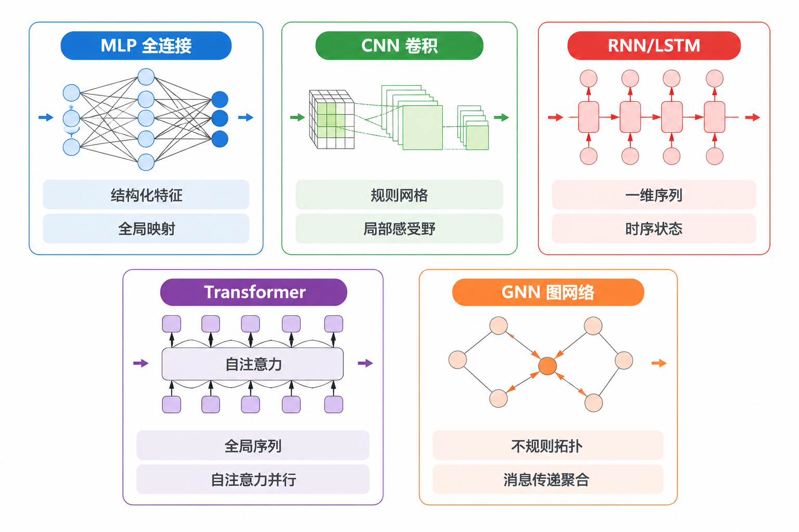

图3-1 权重初始化打破对称与保持方差一致

<h2 id="q3-1-2">面试问题：常见的初始化方法有哪些？</h2>

**难度评分：⭐⭐⭐ (3/5) | 考察频率：⭐⭐⭐⭐ (4/5)**

1、常数初始化

把所有权重都设成同一个固定值，常见的是全 0、全 1。全 0 会让同层神经元的输出和梯度完全一致，更新永久同步，网络退化成单个神经元；全 1 或其他大常数除了对称问题，还会让前向信号和反向梯度被指数放大，直接梯度爆炸。所以常数初始化基本只用于偏置，权重不能这么用。

2、小方差随机初始化

从零均值的均匀或正态分布里采样，方差取很小。实现简单，但网络一深、方差又没设好，特征方差就会逐层放大或衰减，引出梯度问题。它主要用在输出层、回归头、生成模型的预测头这类对初始输出尺度很敏感的地方——方差取小一点，避免训练刚开始预测值就剧烈跳动、损失爆炸。

3、Xavier（Glorot）

它基于“前向时每层特征方差一致、反向时每层梯度方差一致”推导出来，主要配合 tanh、sigmoid 这类在 0 点附近近似线性、且关于 0 对称的饱和激活函数使用。正态分布版的方差为：

$$ Var(w) = \frac{2}{n_{in} + n_{out}} $$

均匀分布版则在下面区间内采样：

$$ w \sim U\left(-\sqrt{\frac{6}{n_{in}+n_{out}}},\ \sqrt{\frac{6}{n_{in}+n_{out}}}\right) $$

其中 $n_{in}$ 是输入神经元数（fan_in）， $n_{out}$ 是输出神经元数（fan_out），取两者的调和平均，同时兼顾前向和反向的方差稳定。它的短板是遇到 ReLU 这类会让一部分神经元失活的非对称激活时，没法再维持方差稳定，特征方差会一层层衰减。

4、He（Kaiming）初始化

它专门针对 ReLU 及其变体（LeakyReLU、PReLU 等）设计。ReLU 会把负输入全部置零，当输入是零均值对称分布时，大约一半神经元被截断，输出方差掉到输入的一半，所以 He 在 Xavier 的基础上乘以 2 来补偿，保证前向时每层方差恒定。GELU、SiLU 这些平滑激活并不是严格的 ReLU 变体，但工程上也普遍直接用 He，效果不错。最常用的 fan_in 模式方差为：

$$ Var(w) = \frac{2}{n_{in}} $$

它同样有正态和均匀两种实现，也有用于反向梯度的 fan_out 模式（ $2/n_{out}$），默认用 fan_in 即可。现在 CNN、Transformer 主干里带激活的层基本都用 He。

5、正交初始化

将权重矩阵初始化为正交矩阵（满足 `W^T W = I`）。正交矩阵的所有特征值模长为1，矩阵乘法不会改变输入向量的范数，因此权重多次相乘后，信号既不会放大也不会衰减，能极强地缓解梯度消失与爆炸。正交初始化尤其适合RNN、LSTM、GRU等循环神经网络（循环权重在时间步上反复相乘），也常用于Transformer注意力投影层、扩散模型注意力层，保证特征在多层/多步传递中尺度稳定。

通用参数初始化惯例：

- 偏置：绝大多数层的偏置默认初始化为0；部分ReLU后的偏置可设为小正数，减少初始阶段神经元失活。
- 归一化层（BatchNorm / LayerNorm）：缩放参数 `γ` 初始化为1，偏移参数 `β` 初始化为0，初始状态为恒等变换，保证训练初期信号平稳传递。

工程落地选型参考：

- 通用视觉CNN（分类、检测、分割）：主干卷积层统一使用He初始化，偏置置0，BN层保持 `γ=1, β=0`。
- Transformer与序列模型：主干MLP、注意力投影层主流使用He初始化；RNN/LSTM循环权重优先正交初始化；LayerNorm固定恒等初始化。
- 生成模型（扩散模型、GAN）：主干卷积/Transformer层用He初始化；注意力层、时间嵌入层常用正交初始化稳定特征传递；输出预测头采用极小方差随机初始化，避免训练初期输出值过大导致训练崩溃。
- 自动驾驶与多任务：2D感知主干沿用He初始化；BEV、空间注意力投影层优先正交初始化，保证空间特征尺度稳定；深度、速度等回归头采用小方差初始化，避免初始预测值跳变；多模态融合层可选用Xavier或温和缩放的He初始化，对齐多分支信号尺度。

<h2 id="q3-1-3">面试问题：为什么不能用全0初始化，不合理初始化会导致什么问题？</h2>

**难度评分：⭐⭐ (2/5) | 考察频率：⭐⭐⭐⭐⭐ (5/5)**

1、为什么不能用全 0 初始化可学习权重

全 0 初始化会让同一层神经元的参数永远对称，网络的宽度直接失效。同一层的每个神经元对应权重矩阵的一行，而且权重全为 0 时，前向和反向会同时“同步”：

（1）前向同质化：所有神经元的线性计算结果一样，过激活函数后还是一样，神经元之间没有任何差异；

（2）反向同步化：根据链式法则，权重梯度由输入、激活函数导数和上游梯度共同决定。既然所有神经元的输出一致，回传的梯度也一致，每个神经元的更新量完全相等。

这会导致不管训练多少轮，这一层所有神经元的权重始终一模一样，等于这一层只有一个有效神经元，多出来的神经元全是摆设，模型学不到复杂特征。

> 补充说明：偏置项（bias）、LayerNorm的β、BatchNorm的偏移参数都可以安全初始化为0。这类参数属于加性参数，只要权重已经通过随机初始化打破了对称性，加性偏移不会让神经元重新回到完全同质的状态，不会引发对称问题。ReLU层后的偏置有时会设为小正数，用于减少初始阶段神经元失活比例，但0初始化仍是通用默认方案。

2、不合理初始化会带来什么问题

（1）通用深度网络的共性问题

- 梯度消失与梯度爆炸：这是最直接的危害。深度网络反向传播遵循链式法则，梯度需要经过多层权重矩阵连续相乘：初始权重尺度过大时，梯度随层数加深呈指数级放大，引发梯度爆炸，表现为损失剧烈震荡、参数数值溢出，模型直接无法收敛；初始权重尺度过小时，梯度随层数加深呈指数级衰减，引发梯度消失，深层网络参数几乎得不到有效更新，模型失去学习能力。
- 激活函数进入饱和区：对于 sigmoid、tanh 等饱和型激活函数，初始权重过大会导致线性输出绝对值过大，激活函数进入两端的平坦饱和区，梯度趋近于0，参数更新几乎停滞，进一步加剧梯度消失问题。
- 收敛效率低，易陷入劣质解：不合理初始化会让参数起点远离最优解所在的有效参数空间，模型需要大量迭代才能找到正确的更新方向，收敛轮次明显增加；极端情况下会直接陷入鞍点或效果较差的局部最优，最终模型精度不足。

（2）大模型与AIGC场景的特殊问题

- 训练初期损失爆炸与数值 NaN：大模型通常有数十到数百层网络堆叠，初始化的微小尺度误差会被多层矩阵连乘指数放大，极易在训练前几步就出现数值溢出，损失变为无穷大或 NaN，训练直接崩溃。
- 生成稳态崩坏，输出质量失控：扩散模型的噪声预测头若初始化尺度过大，初始步预测噪声会严重偏离真实分布，导致去噪逻辑学习失败，最终出现模式崩溃、生成结果杂乱无意义；Transformer 结构中，注意力投影层初始化不当会导致注意力 logits 尺度异常：尺度过大会让注意力分布极端尖锐，模型只关注极少数 token；尺度过小会让注意力分布过度平坦，无法聚焦有效信息，最终生成内容重复、语义混乱。
- 深层参数失效，模型利用率极低：初始化尺度不合理导致的梯度消失，在超深网络中会被进一步放大。往往只有前几层能得到有效更新，深层参数几乎保持初始值不变，大模型的海量参数实际只发挥了浅层网络的能力，参数利用率极低。

<h2 id="q3-1-4">面试问题：介绍一下Xavier/He初始化的核心思想</h2>

**难度评分：⭐⭐⭐ (3/5) | 考察频率：⭐⭐⭐⭐⭐ (5/5)**

Xavier（Glorot）和 He（Kaiming）是目前最主流的两类初始化，思路一脉相承：都是控制权重的初始方差，让前向的激活值和反向的梯度在逐层传递时量级稳定，从训练一开始就避开梯度消失和爆炸。

它们的推导都基于线性层的方差传播规律。对于线性计算 $y = Wx$，如果输入 $x$ 和权重 $W$ 相互独立、且都服从零均值分布，那么输出方差满足：

$$ Var(y) = n_{in} \cdot Var(w) \cdot Var(x) $$

其中 $n_{in}$ 是输入维度。要让输出和输入的方差一致（ $Var(y)=Var(x)$），就得让 $Var(w)=\frac{1}{n_{in}}$，这是所有方差保持类初始化的数学起点。

（1）Xavier 初始化（2010）

它是为 sigmoid、tanh 这类对称饱和激活设计的，早期浅层到中层网络基本都用它。它的假设是：训练初期权重很小，激活值落在激活函数的线性区、导数近似为 1；同时希望前向特征方差和反向梯度方差都稳定。

只保证前向方差时，权重方差应为 $1/n_{in}$；只保证反向梯度方差时，应为 $1/n_{out}$。两者没法同时严格满足（除非 $n_{in}=n_{out}$），于是取折中，用输入输出维度的调和平均：

$$ Var(w) = \frac{2}{n_{in} + n_{out}} $$

工程上有均匀和正态两种实现，都满足上面的方差约束。它的短板是不适合 ReLU：ReLU 的单侧抑制会让约一半神经元输出置零，特征方差逐层衰减，深网络照样会梯度消失。

（2）He 初始化（2015）

它是为 ReLU 及其变体（LeakyReLU、PReLU 等）设计的，现在基本是通用默认，对 GELU、SiLU 这些平滑激活也常用。

它对 Xavier 的修正很直接：ReLU 会把负输入清零，当输入是零均值对称分布时，输出方差掉到输入的约一半，Xavier 的方差假设不再成立，所以把权重方差再放大一倍补偿。默认的 fan_in 模式（保证前向方差稳定）权重方差为：

$$ Var(w) = \frac{2}{n_{in}} $$

另有 fan_out 模式（ $Var(w)=2/n_{out}$）用于保证反向梯度，工业界默认用 fan_in 版本。

<h2 id="q3-1-5">面试问题：正交初始化的核心原理是什么，在扩散模型/Transformer的哪些场景中常用？</h2>

**难度评分：⭐⭐⭐ (3/5) | 考察频率：⭐⭐⭐⭐ (4/5)**

正交初始化是一种强约束的初始化，它把权重矩阵直接初始化成正交矩阵（满足 $W^T W = I$， $I$ 为单位矩阵），工程上一般对随机高斯矩阵做 QR 分解或 SVD 分解得到。

它的好处来自正交矩阵的性质：正交变换不改变向量的 L2 范数，即对任意输入 $x$，恒有 $\|Wx\|_2 = \|x\|_2$。这个性质带来两点好处：

- 前向特征尺度稳定：特征经过多层权重矩阵连乘后，范数不会指数级放大或衰减，深层网络的特征尺度不会逐层漂移。
- 反向梯度尺度稳定：反向传播时梯度要左乘权重的转置 $W^T$，而正交矩阵的转置仍是正交矩阵，梯度范数同样稳定，深层网络的梯度消失和爆炸因此得到缓解。

和 Xavier、He 这类方差一致性初始化相比，正交初始化约束更强：Xavier/He 是在统计意义上让输出方差的期望一致，依赖输入独立同分布的假设；正交初始化则是严格的代数保证，不依赖输入分布，在权重复用、特征长距离传递的场景下更可靠。

它一般不会全网络用，而是有针对性地用在对尺度稳定性要求高、特征传递路径长的模块上。

（1）Transformer 中的常用场景
- 深层Transformer的注意力投影层
深层Transformer（如大语言模型、DiT类扩散模型）通常有数十到上百层网络堆叠，特征需要经过多层注意力与MLP长距离传递。对Q/K/V投影矩阵、输出投影矩阵使用正交初始化，可以保证每一层特征传递前后范数稳定，配合Pre-Norm结构进一步降低梯度消失风险，提升超深网络的训练稳定性。
- 跨模态投影层
在文生图、图文多模态模型中，文本特征与图像特征需要通过投影层做维度对齐后再做交叉注意力。正交初始化的投影层可以保证特征在模态转换过程中尺度不发生畸变，避免某一模态特征量级过大主导注意力，提升跨模态语义对齐的精度与稳定性。

（2）扩散模型中的常用场景
- UNet主干的注意力模块
扩散模型UNet深度大、存在多尺度跳跃连接，且不同时间步的输入特征分布差异明显。对注意力层的投影权重使用正交初始化，能够稳定注意力logits的数值尺度，避免高噪声时间步下特征尺度异常导致注意力失效，保证全时间步范围内去噪学习的稳定性。
- 条件嵌入投影层（时间步、文本提示词）
时间步嵌入、文本条件嵌入需要通过全连接层投影后注入到主干特征中。正交初始化能保证条件信号在投影过程中范数稳定，不会出现条件信号过强覆盖图像特征、或过弱无法起到引导作用的问题，提升条件生成的可控性。
- 多尺度特征投影层（上采样/下采样分支）
UNet编码器-解码器结构存在多次分辨率升降，特征在尺度变换的投影过程中容易出现尺度波动。正交初始化可以维持特征范数稳定，保证编码器到解码器的跳跃连接中，高低层特征的尺度匹配，提升特征融合的质量与生成细节的清晰度。

当权重矩阵不是方阵（输入输出维度不同）时，只能构造列正交/行正交的半正交矩阵，此时仅能保证单方向（前向/反向）的范数稳定，效果略弱于方阵场景；同时正交初始化的构造成本高于普通随机初始化，因此工业界通常只在核心模块使用，其余层仍以He初始化为默认方案。

<h2 id="q3-1-6">面试问题：扩散模型的噪声预测头为什么常用小方差初始化？初始化过大会导致什么问题？</h2>

**难度评分：⭐⭐⭐⭐ (4/5) | 考察频率：⭐⭐⭐⭐ (4/5)**

扩散模型训练的目标，是让噪声预测网络去拟合真实添加的标准高斯噪声（均值为 0、方差为 1），损失主要用 MSE。噪声预测头是网络的最后一层，它用小方差初始化，是为了匹配这个训练目标和多步递推的数值特性，让训练启动和采样生成从一开始就稳定。

1、为什么噪声预测头要用小方差初始化

（1）匹配无信息初始状态，控制初始损失量级：训练初期网络尚未学习到任何去噪规律，此时最优的“无信息预测”是输出接近0的值——真实噪声 $\epsilon \sim \mathcal{N}(0, I)$ 服从零均值单位方差分布，预测 $\hat{\epsilon} \approx 0$ 时，初始 MSE 为 $\mathbb{E}[\|\epsilon - 0\|^2] = \mathbb{E}[\|\epsilon\|^2] = 1$（即噪声本身的方差），处于理论最小损失水平。噪声预测头通常为不带激活函数的线性/卷积层，若沿用隐藏层的 He/Xavier 初始化，输出数值的方差会明显偏大，初始损失远超合理区间。因此工业界普遍采用均值为0、标准差 0.01~0.05 的小方差正态初始化，让初始输出集中在0附近，保证训练启动时损失处于可控范围。

（2）从输出端约束梯度量级，避免训练初期梯度爆炸：扩散模型 UNet 层数深、分支多，反向传播时梯度需要经过多层结构回传。若输出层初始输出量级过大，MSE 损失会急剧升高，回传的梯度也会同步放大；梯度在深层网络中逐层传递时，极易进一步引发梯度爆炸，出现参数数值溢出、损失 NaN 等问题，直接导致训练崩溃。小方差初始化从输出端限制了初始误差的量级，反向保证了全网络梯度的稳定性，让训练可以平稳启动。

（3）适配多步去噪递推逻辑，保证采样轨迹可控：扩散模型的反向采样是多步递推过程，每一步的生成结果 $x_{t-1}$ 都直接依赖当前步的噪声预测值。初始阶段预测噪声的尺度合理，才能保证采样轨迹从起点就处于合理的分布空间内，避免单步预测偏差过大导致后续步骤误差持续累积，最终生成完全失效的结果。

2、初始化过大有什么后果

（1）训练启动直接崩溃：初始输出量级过大将导致 MSE 损失呈数量级升高，反向梯度同步剧烈放大，训练前几步就可能出现参数溢出、损失变为 NaN 的情况，网络完全无法正常启动训练。

（2）收敛效率明显下降：即便未出现数值溢出，模型也需要花费大量迭代先修正输出层的权重尺度，将输出拉回合理区间，严重拖慢整体收敛速度，明显增加训练的时间与算力成本。

（3）破坏主干网络的训练稳定性：异常放大的梯度反向传递到卷积、注意力等主干模块时，会干扰正常的特征学习过程，导致浅层特征提取紊乱，加剧训练震荡；极端情况下会直接破坏主干网络的参数分布，让模型陷入劣质局部最优，最终去噪精度严重不足。

（4）生成质量严重退化：采样推理时，尺度过大的预测噪声会导致去噪步长失控，图像像素值快速超出合理范围，出现色彩崩坏、大面积伪影、语义结构完全混乱等问题；同时不同时间步的预测偏差会逐步累积，最终生成结果完全不具备语义有效性。

<h1 id="q3-2">2. 介绍一下全连接层的原理</h1>

<h2 id="q3-2-1">面试问题：介绍一下全连接层的原理</h2>

**难度评分：⭐⭐ (2/5) | 考察频率：⭐⭐⭐⭐⭐ (5/5)**

全连接层（Fully Connected Layer，简称 FC）是最基础的一种网络层。它的连接方式是：当前层的每个神经元都和上一层的所有神经元一一相连，每条连接都有一个独立的权重，既不共享也不稀疏——这也是“全连接”这个名字的由来。它对输入做的是一次仿射变换，非线性则来自后面跟的激活函数。

全连接层的全互连结构与参数量如图3-2所示：

  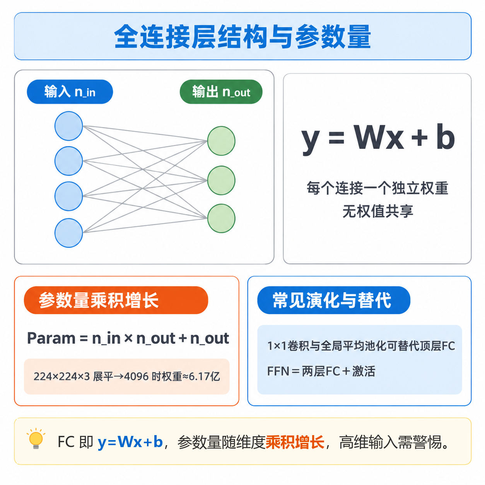

图3-2 全连接层结构与参数量

计算可以直接写成矩阵形式。设输入向量 $x \in \mathbb{R}^{n_{in}}$，权重矩阵 $W \in \mathbb{R}^{n_{out} \times n_{in}}$、偏置 $b \in \mathbb{R}^{n_{out}}$，输出 $y$ 的维度就是 $n_{out}$：

$$ y = Wx + b $$

每条连接对应一个权重、每个输出神经元对应一个偏置，所以参数量为：

$$ Param = n_{in} \times n_{out} + n_{out} $$

参数量和输入、输出维度成正比，一旦输入维度很高（比如把卷积特征图直接展平接进来），参数就会迅速膨胀。

在网络里，全连接层通常承担三个不同的角色。

（1）把局部特征汇总成全局表征：前面卷积、注意力提取的多是纹理、边缘、局部语义这类分散的局部特征，全连接层把所有位置的特征加权融合，形成和类别强相关的全局特征，CNN 分类网络末端就是这么做的。

（2）自由地改变特征维度：调整权重矩阵的形状，就能对特征升维或降维，所以它常用来衔接两个维度不同的模块。

（3）充当任务输出头：分类任务把特征映射到类别数维度再过 Softmax，回归任务映射到目标数值维度，生成任务则映射到输出数据的对应维度。

它的短板也很明显：参数量大、容易过拟合，所以常配合 Dropout 和权重衰减；输入维度必须固定，灵活性不如卷积；特征一旦展平，空间位置信息就丢了，对空间结构敏感的任务不太友好。也正因为如此，现代网络里它在不断被替代——CNN 常用全局平均池化代替顶层全连接，Transformer 的 FFN 本质是“两层全连接 + 激活”且只在每个 token 内部做变换，1×1 卷积则等价于在空间上共享权重的全连接。

<h2 id="q3-2-2">面试问题：全连接层的参数量如何计算？为什么高维特征下全连接层参数量会急剧膨胀？</h2>

**难度评分：⭐⭐ (2/5) | 考察频率：⭐⭐⭐⭐ (4/5)**

1、全连接层参数量计算

全连接层的参数分权重和偏置两部分，它是全互连、每条连接权重都独立的结构。设输入特征维度为 $n_{in}$（输入神经元数量），输出特征维度为 $n_{out}$（输出神经元数量）：

（1）权重参数：每个输入神经元与每个输出神经元之间都对应一个独立权重，权重矩阵规模为 $n_{in} \times n_{out}$，参数量为 $n_{in} \times n_{out}$。
（2）偏置参数：每个输出神经元对应一个独立的偏置项，参数量为 $n_{out}$。

总参数量公式为：

$$ Param_{total} = n_{in} \times n_{out} + n_{out} = n_{out} \times (n_{in} + 1) $$

工程上通常可近似为 $n_{in} \times n_{out}$，因为偏置参数量占比极低。例如输入维度1024、输出维度512的全连接层，总参数量约为 1024×512 ≈ 52万。

2、为什么高维输入会让参数急剧膨胀

根本原因是全连接层没有权值共享，参数量和输入维度严格成正比，输入维度一上去，参数就跟着成倍涨。具体有两点：

（1）全互连设计导致参数量随输入维度线性放大：全连接层没有权值共享，每个输入位置的参数完全独立。对于图像这类具备空间结构的高维特征，若直接将特征图展平接入全连接层，输入维度等于「通道数 × 高度 × 宽度」，空间分辨率每提升一倍，输入维度就会变为原来的4倍，参数量也同步扩大4倍，呈现平方级膨胀。举个直观例子：将 224×224 的 RGB 图像直接展平接入全连接层，输入维度为 224×224×3 = 150528，仅接一个 1024 维输出层，参数量就达到约 1.5 亿，远超过同尺寸卷积层的参数规模。

（2）输入输出维度的乘积效应进一步放大参数规模：全连接层参数量是输入、输出维度的乘积。高维输入场景下，即便只小幅提升输出维度，参数量也会被高输入维度同步放大。例如输入维度从 1024 升至 10240（扩大10倍），同样输出 1024 维，参数量也会从 52 万暴涨至 520 万，同步扩大10倍。

这种参数膨胀特性会直接导致显存占用飙升、模型极易过拟合，因此现代深度学习网络中，常通过全局平均池化、1×1卷积、逐token全连接等方式替代全局全连接层，规避高维特征下的参数爆炸问题。

<h2 id="q3-2-3">面试问题：全连接层和 1×1 卷积有什么区别与联系，分别在什么场景下使用？</h2>

**难度评分：⭐⭐⭐ (3/5) | 考察频率：⭐⭐⭐⭐ (4/5)**

全连接层和 1×1 卷积做的都是线性仿射变换，本质同源，只是设计取向不同。简单说，1×1 卷积就相当于在空间维度上做权值共享的逐像素全连接；二者的差别则集中在权值共享、空间信息处理和参数量上。

先看联系。对形状为 `[C_in, H, W]` 的特征图，1×1 卷积有 `C_out` 个 1×1 的卷积核，每个卷积核只对单个空间位置的通道维做加权求和，而且所有空间位置共用同一套权重。于是对任意位置上的向量 $x \in \mathbb{R}^{C_{in}}$，计算都是 $y = Wx + b$，和全连接层一模一样。由此得到两个结论：

（1）1×1 卷积就是所有空间位置共享同一套权重的全连接层；

（2）当特征图空间尺寸为 1×1 时，两者在数学上完全等价，可以无缝互换。

具体区别如表3-1所示，主要在权值共享、参数规模、输入灵活性和空间信息处理上进行分析对比。

表3-1 全连接层（FC）与1×1 卷积对比表

|对比维度|全连接层（FC）|1×1 卷积|
|---|---|---|
|权值共享机制|完全无共享，每个空间位置、每个通道的连接都对应独立权重|空间维度全量权值共享，仅在通道维度做独立线性变换|
|参数量特性|参数量与空间分辨率平方成正比，高分辨率下参数急剧膨胀 公式： $Param = (C_{in} \times H \times W) \times C_{out} + C_{out}$|参数量仅与通道数相关，与空间分辨率完全无关 公式：  $Param = C_{in} \times C_{out} + C_{out}$|
|输入灵活性|要求输入维度（空间尺寸+通道数）固定，分辨率变化会导致权重不匹配|仅要求通道数匹配，支持任意空间分辨率的输入，适配可变尺寸特征|
|空间信息处理|将空间维度展平后统一变换，彻底丢失像素的空间位置关系|逐像素独立计算，完整保留特征的空间结构与位置信息|

具体怎么选，主要看输入数据有没有空间结构。

（1）全连接层用在没有空间结构的一维向量上

- 全局特征的最终输出映射：分类任务的分类头，将全局池化后的一维特征映射到类别维度；回归任务的预测头，输出目标数值。此时输入为无空间结构的全局特征，全连接层可以做充分的全局特征融合。
- 低维条件向量的特征变换：扩散模型中的时间嵌入MLP、文本条件投影层，输入为低维的条件向量，无需空间结构，通过全连接层完成特征升维、非线性映射与条件信息编码。
- Transformer 的 per-token 特征变换：Transformer中的FFN/MLP结构，本质是对每个token独立执行全连接变换（序列维度等价于空间维度，所有权值共享），用于提升单个token的特征表达能力，数学上与1×1卷积完全等价。

（2）1×1 卷积用在需要保留空间结构的特征图上

- 通道维度低成本升降维：ResNet瓶颈结构、深度可分离卷积的逐点卷积等场景，通过1×1卷积以极低参数量调整通道数，明显压缩计算量。扩散模型UNet中也广泛使用，用于跳跃连接的通道对齐、上下采样前后的通道数匹配。
- 跨通道信息融合：在不改变空间尺寸的前提下，融合不同通道的特征信息并引入非线性，替代大尺寸卷积完成通道维度的特征交互，是轻量化网络的关键组件。
- 全卷积网络的输出头：图像分割、图像生成等需要保留空间结构的任务中，用1×1卷积替代全连接层作为输出头，既完成通道映射，又完整保留空间位置信息，同时支持任意分辨率输入。
- 端侧轻量化生成模型：移动端、端侧扩散模型等对参数量敏感的场景，用1×1卷积配合深度可分离卷积，在保证生成效果的前提下明显压缩模型体积与计算量。

<h2 id="q3-2-4">面试问题：扩散模型中的时间嵌入 MLP 为什么用全连接层实现，有什么优势？</h2>

**难度评分：⭐⭐⭐ (3/5) | 考察频率：⭐⭐⭐⭐ (4/5)**

扩散模型里，时间步 $t$ 是控制整个去噪过程的全局条件。工业界通常先用正弦位置编码把标量时间步转成低维向量，再经多层“全连接 + 激活”的 MLP 升成高维条件特征，注入 UNet/DiT 的各个模块。时间嵌入用全连接层来做，正好契合它的输入形态和功能，优势有四点：

（1）输入本身就是没有空间结构的一维向量
时间步是单个样本的全局标量属性，没有 H/W 空间维度，也不存在图像那种局部空间相关性。卷积的价值在于权值共享和空间局部感受野，对一维全局向量完全用不上，反而要额外做维度变换、引入冗余计算。全连接层天然就是做一维向量线性变换的，直接在特征维度上做全局映射，最贴合这种输入。

（2）让特征维度充分交互，编码质量高
时间嵌入要把时间步的语义（加噪程度、去噪阶段）编码进高维特征，让它能调节网络各层的特征分布。全连接层每个输出维度都和所有输入维度相连，特征维度之间能充分交互，加上激活函数就能完成复杂的非线性映射，把简单的正弦编码变成含丰富去噪语义的条件向量，为后续特征调制服务。

（3）维度映射灵活，适配各种条件注入方式
扩散模型里时间条件的注入方式很多：可以直接和主干特征逐元素相加，可以为 AdaLN 生成 $\gamma/\beta$ 调制参数，也可以作为交叉注意力的条件。全连接层只要调一下输出维度，就能输出任意维度的条件向量，精准匹配各模块的通道数，不用额外做维度对齐，工程上简单高效。

（4）参数和算力开销极小
时间嵌入的输入维度通常很低（正弦编码后多为 128～512 维），哪怕叠 2～3 层全连接，参数也只有几十万，相比 UNet/DiT 主干的数亿参数几乎可以忽略。用很低的成本就完成了条件编码，是工业界验证过的做法。

>之所以不用卷积、注意力这类结构，是因为功能和成本不匹配：卷积会引入不必要的空间归纳偏置，破坏时间条件的全局属性；自注意力则是过度设计，对低维全局条件来说只增加计算量、没有收益。所以全连接 MLP 成了时间嵌入的标准实现。

<h1 id="q3-3">3. 介绍一下归一化的原理</h1>

<h2 id="q3-3-1">面试问题：什么是归一化，常用的归一化方法都有哪些？</h2>

**难度评分：⭐⭐ (2/5) | 考察频率：⭐⭐⭐⭐⭐ (5/5)**

归一化做的事情，就是把输入数据或网络中间特征的尺度和分布拉到一个统一的范围，避免某个数值特别大的特征主导梯度更新，同时把分布稳定在合理区间，从而缓解梯度消失和爆炸、让收敛更快。它是训练里很基础的一道稳定化处理。

按作用的位置，常用归一化可以分成两类：一类用在数据预处理阶段，对模型输入做；另一类用在网络层内部，对中间特征做。

第一类是数据预处理，主要有两种：

（1）Min-Max 归一化

Min-Max 归一化又称线性归一化，通过线性变换把原始数据映射到指定区间，最常用映射至 [0,1]，也可选择 [-1,1]，属于线性缩放，能够完整保留数据的相对分布关系。该方法计算简单，可保留数据比例关系，但对异常值敏感，单个极端值就会压缩整体数据的分布空间，常用于图像数据预处理，将 0-255 像素值缩放到 [0,1] 区间，也适用于取值范围明确的离散特征归一化，还可在生成模型中对输出值域进行约束。

Min-Max 归一化公式（映射至[0,1]）如下所示：

$$ x_{norm} = \frac{x - \min(x)}{\max(x) - \min(x)} $$

（2）Z-Score 标准化（标准差标准化）

Z-Score 标准化可将数据转换为均值为 0、标准差为 1 的标准正态分布，消除量纲与数值量级带来的影响，更适配梯度下降与线性模型优化。该方法能够弱化异常值的影响，契合多数深度学习算法的数值假设，但不会限定数据的上下界，多用于传统机器学习表格数据、时序数据的特征预处理，也可用于部分深度学习任务的输入特征标准化。

Z-Score 标准化公式如下：

$$ x_{norm} = \frac{x - \mu}{\sigma} $$

其中 $\mu$ 为数据整体均值， $\sigma$ 为数据整体标准差。

第二类是网络层内部的归一化，也就是常说的 BN、LN、IN、GN。它们归一化后都会带一对可学习的缩放参数 $\gamma$ 和偏移参数 $\beta$，在标准化的基础上把表达能力还给网络，避免归一化把模型容量限死。

（1）BatchNorm（批量归一化，BN）
BatchNorm以特征通道为单位，在批次与空间维度上计算均值和方差。对于`[N, C, H, W]`形状的卷积特征，每个通道独立在N、H、W维度求取统计量。该方法对每一批次中间特征进行标准化，再借助可学习参数 $\gamma$ 、 $\beta$ 重构特征分布。训练阶段采用当前批次的均值、方差完成归一化，并通过移动平均累积全局统计量；推理阶段直接使用训练阶段保存的全局均值与方差，保障输出结果确定。BN能够显著加快模型收敛速度，缓解梯度消失问题，但性能受批次大小影响明显，小批次场景下统计量偏差较大，归一化效果下降，对变长序列数据适配能力较弱，常作为传统CNN视觉分类、检测、分割任务的标准组件，一般放置在卷积或全连接层之后、激活函数之前，在大批次训练的小型模型中表现突出。

（2）LayerNorm（层归一化，LN）
LayerNorm以单个样本为单位，沿特征维度计算均值与方差。对于`[N, L, C]`形状的序列特征，每个样本内各个token独立在C维度求取统计量。它对单个样本全部特征实施标准化，同样引入可学习参数 $\gamma$、 $\beta$ ，统计量仅由当前样本决定，和批次大小无关。LN不受批次规模约束，可适配变长序列，训练与推理计算逻辑保持一致，不需要额外累积全局统计量，是Transformer、RNN/LSTM等序列模型的标准归一化方案，也是LLM、扩散模型Transformer结构这类AIGC大模型里的核心归一化组件。

（3）InstanceNorm（实例归一化，IN）
InstanceNorm以单样本的单个通道为单位，在空间维度计算均值与方差。针对`[N, C, H, W]`特征，每个样本的每个通道独立在H、W维度求取统计量。它对单张特征图的单个通道做对比度标准化，计算不跨批次、不跨通道，保留样本本身的风格特征。IN聚焦单张图像自身对比度与风格信息，不依赖批次，不会消除样本之间的风格差异，多用于风格迁移、图像生成任务，也是扩散模型UNet部分生成层中稳定特征分布的重要模块。

（4）GroupNorm（组归一化，GN）
GroupNorm将特征通道划分为多组，以单个样本为单位，在组内的空间与通道维度计算均值和方差，属于通道维度与实例维度之间的折中方案。它把通道划分为G组（常用取值32），各组独立完成归一化，计算过程不依赖批次大小，同时保留通道间的特征关联。GN完全不受批次大小影响，解决了小批次训练时BN性能退化的问题，分组数量为可调节超参数，适用于批次规模受限的视觉大模型、检测分割任务以及显存不足、只能使用小批次训练的场景。

四类层内归一化方法的核心区别是归一化统计维度：BN统计范围跨批次、跨空间；LN沿样本特征维度统计；IN仅在空间维度计算；GN在分组内跨通道统计。工程选型时，大批次视觉任务优先选用BN；序列与大模型优先LN；图像生成、风格类任务优先IN；小批次视觉任务优先GN。

四种层内归一化在统计维度上的本质差异如图3-3所示：

  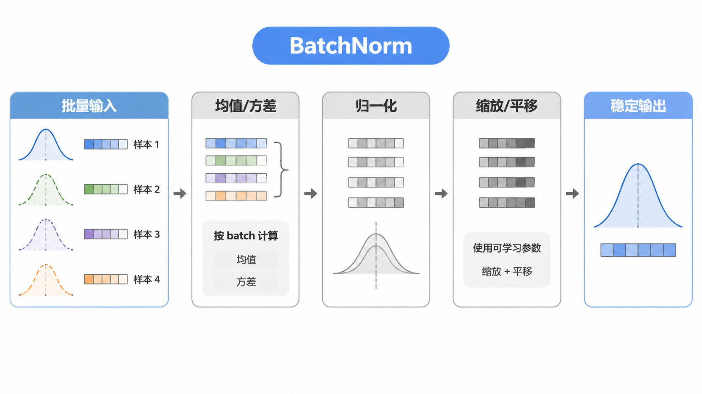

图3-3 四大归一化的统计维度对比

>BatchNorm与LayerNorm的主要差异在于归一化的统计维度不同：BatchNorm以通道为单位，在批次和空间维度上计算均值与方差，效果依赖充足的批次大小，更适配特征维度固定、批次稳定的CNN视觉任务；LayerNorm以单个样本为单位，在特征维度上做归一化，完全不受批次与序列长度影响，更适配RNN、Transformer等序列模型与生成式大模型场景。
>Transformer不采用BatchNorm，原因是文本等序列数据长度不固定，批次内有效统计量偏差大，小批量微调时归一化效果会严重退化，且BatchNorm训练用批次统计量、推理用全局移动平均统计量的不一致性，不利于生成任务的输出稳定性；而LayerNorm对批次与序列长度无感，训练推理逻辑一致，能稳定注意力层的特征尺度，天然适配大模型动态批次与变长序列的训练需求。

<h2 id="q3-3-2">面试问题：归一化和标准化的核心区别是什么？</h2>

**难度评分：⭐⭐ (2/5) | 考察频率：⭐⭐⭐⭐⭐ (5/5)**

这两个词有广义和狭义之分，面试里通常按狭义来对比：
- 广义上，归一化是所有“统一特征尺度、规范数据分布”操作的总称，Z-Score 标准化、BatchNorm、LayerNorm 都算归一化，标准化只是它的一个子类；
- 狭义上，归一化特指 Min-Max 线性归一化，标准化特指 Z-Score 标准化，二者是并列的两种数据预处理方法。

狭义下，两者的区别见表3-2：

表3-2 归一化（Min-Max）和标准化（Z-Score）区别

|对比维度|归一化（Min-Max）|标准化（Z-Score）|
|---|---|---|
|目标|将数据线性缩放到固定数值区间（常用 [0,1] 或 [-1,1]）|将数据统一为均值为 0、方差为 1 的标准统计尺度|
|数学公式| $x_{norm} = \frac{x - x_{min}}{x_{max} - x_{min}}$ | $x_{std} = \frac{x - \mu}{\sigma}$   $\mu$ 为均值， $\sigma$ 为标准差|
|分布影响|线性变换，不改变原始分布形态，完整保留数据的相对比例关系|线性变换，不改变原始分布形态，仅对分布做平移和缩放，统一统计尺度|
|异常值敏感度|极高，单个极端值会决定整体缩放边界，导致正常数据被严重压缩|较低，均值与标准差仍受异常值影响，但影响程度远小于极值驱动的Min-Max归一化|
|输出范围|有明确上下界，严格落在指定区间内|无固定上下界，数值范围由原始数据的离散程度决定|
|作用|统一不同特征的数值范围，适配对输入区间有明确要求的算法|消除量纲与尺度差异，让不同特征对梯度的贡献权重均衡，加速优化收敛|

<h2 id="q3-3-3">面试问题：归一化在扩散模型中的具体作用是什么？</h2>

**难度评分：⭐⭐⭐ (3/5) | 考察频率：⭐⭐⭐⭐ (4/5)**

一般来说扩散模型的训练是离不开归一化的，这是由它的工作方式决定的。扩散模型“前向逐步加噪、反向逐步去噪”，主干（UNet/DiT）层数深、分支多，还要处理随时间步不断变化的特征分布，归一化负责把这些特征的统计分布规范好，让训练不至于崩溃，同时提升生成精度。

归一化在扩散模型里主要起到四方面作用。

（1）稳定不同时间步的特征分布

前向扩散过程中，不同时间步 $t$ 的输入 $x_t$ 分布随加噪程度持续偏移：时间步越大，噪声占比越高，特征的均值、方差变化越明显。归一化（GroupNorm/LayerNorm）把每层输出拉回均值为 0、方差为 1 的标准分布，抵消这种偏移，避免不同时间步的梯度尺度相差过大，噪声预测网络在全时间步上才能稳定学习。

（2）统一跨层、跨分支的特征尺度

扩散模型主干有大量多分支结构：UNet 的编码器-解码器跳跃连接、卷积分支与注意力分支并行、时间嵌入和文本条件注入等，不同支路、不同深度的特征尺度天然不一样。归一化把它们统一起来，避免尺度大的分支主导梯度，让跳跃连接的拼接、注意力的特征交互、条件注入都能稳定生效，去噪精度和细节也更好。

（3）不依赖批次，适合小 batch 训练

扩散模型参数多、输入分辨率高，batch 通常很小，深层注意力又容易出现梯度尺度异常。LayerNorm 和 GroupNorm 都不依赖批次维度，只在单样本内计算统计量，小 batch 下照样准确，既能缓解深层网络的梯度消失和爆炸，也避开了 BatchNorm 在小 batch 下退化的问题。

（4）统一多模态特征尺度，便于图文对齐

文生图这类多模态模型里，文本嵌入和图像特征是两种模态，数值尺度天然不同。归一化把它们映射到同一统计尺度，保证交叉注意力里图文相似度的计算稳定、准确，提示词和生成内容的语义对齐度更高，减少图文不符、语义偏离的问题。

在使用中扩散模型会根据模块的结构选不同的归一化，主流方案如下：

- 卷积主干模块：UNet 编码器、解码器的卷积层普遍采用 GroupNorm，是卷积类扩散模型的标准选型。它既摆脱了对批次大小的依赖，又比 LayerNorm 更好地保留了通道间的特征关联，适配卷积特征的空间特性。
- 注意力层与 Transformer 模块：采用 LayerNorm，是自注意力结构的标配，在特征维度上归一化，稳定注意力计算的数值尺度，是 DiT 等纯 Transformer 结构扩散模型的核心归一化方案。
- 条件注入模块：主流采用 AdaLN（自适应层归一化），通过时间步嵌入、文本嵌入动态生成缩放参数 $\gamma$ 和偏移参数 $\beta$，将条件信息注入归一化过程，是条件扩散模型实现引导生成的机制。
- 噪声预测输出头：通常搭配归一化层，保证输出噪声的分布稳定，避免初始预测值尺度异常导致训练崩溃。

<h2 id="q3-3-4">面试问题：为什么生成类模型普遍不使用 BatchNorm，会带来什么问题？</h2>

**难度评分：⭐⭐⭐ (3/5) | 考察频率：⭐⭐⭐⭐ (4/5)**

扩散模型、GAN、VAE 等生成模型一般不会采用 BatchNorm，核心原因是 BatchNorm 的底层机制与生成任务的训练、推理范式存在天然冲突，强行使用会损害训练稳定性与生成效果，主要体现在四点：

1. 小批量场景下统计估计偏差大，训练容易震荡
生成模型大多处理高分辨率数据，单样本显存开销高，训练批次规模通常很小，一般仅 2～8。BatchNorm 依靠批次内样本计算均值与方差，小批次采样带来的噪声会造成统计量失真，无法代表真实数据分布，不仅达不到归一化稳定训练的目的，还会向特征引入额外噪声，造成训练震荡、收敛速度变慢，极端情况下会出现损失爆炸、训练失败。
2. 训练与推理阶段统计量不一致，生成图像质量受损
BatchNorm 在训练阶段使用当前批次实时统计量，并维护全局移动平均统计量；推理阶段固定复用训练阶段累积的全局统计量。分类、检测这类判别任务的数据分布相对稳定，全局统计量可以较好拟合整体特征。但生成模型的样本分布空间巨大，图像语义、纹理、风格差异显著，全局统计量难以覆盖全部分布。推理时使用固定统计量，会造成归一化结果和训练阶段存在偏差，表现为生成图像细节丢失、画面模糊、色彩偏移。
3. 跨样本归一化破坏样本独立性，降低生成多样性，加剧模式崩溃
BatchNorm 沿批次维度跨样本计算统计量，同批次样本的特征会相互约束，被对齐到相近分布。生成任务的核心目标是输出差异化、多样化样本，而跨样本归一化会抹平样本之间的风格与细节差异，压缩生成分布空间，提升模式崩溃风险。在 GAN 中容易出现生成样本趋同、样式单一；扩散模型则会出现生成内容同质化，随机表现力不足。
4. 适配可变输入与条件生成的能力弱
生成模型经常需要支持可变分辨率输入，BatchNorm 对批次、空间维度较为敏感，输入尺寸变化时统计估计不稳定，灵活性弱于 LayerNorm、GroupNorm。另外在文生图这类条件生成场景中，不同提示词、风格对应的特征分布差异明显，BatchNorm 统一的跨样本归一化会削弱条件信息带来的特征差异，降低条件引导能力，造成生成内容和输入提示的语义匹配度变差。

综上，在生成模型中直接使用 BatchNorm，会引发训练震荡难以收敛、生成样本多样性不足、推理画质下降、条件引导失效等一系列问题。因此工程上更多选用 GroupNorm、LayerNorm、InstanceNorm 以及 AdaLN 等归一化方案，兼顾训练稳定性与生成效果。

<h1 id="q3-4">4. 介绍一下激活函数的原理</h1>

<h2 id="q3-4-1">面试问题：介绍一下激活函数的定义及原理。</h2>

**难度评分：⭐⭐ (2/5) | 考察频率：⭐⭐⭐⭐⭐ (5/5)**

激活函数作用在卷积层、全连接层、注意力层的输出，是一种非线性映射，灵感来源于生物神经元的激活机制，用来控制本层信号向下一层传递的强度。它最核心的作用是给神经网络引入非线性变换，这也是大模型、扩散模型等深度网络能够拟合复杂数据分布的基础。

神经网络基础计算是线性变换 $y=Wx+b$。如果没有激活函数，无论堆叠多少层网络，整体都等价于单层线性模型，只能学习线性可分任务，无法拟合现实世界大量存在的非线性关系。激活函数对线性输出做非线性映射，通用表达式为：

 $$ a = \sigma(Wx + b) $$

其中 $\sigma$ 代表激活函数， $a$ 为激活输出，作为下一层的输入。引入非线性之后，网络才有能力学习高阶特征与复杂关联，比如大模型里文本语义、图像像素分布、语音时序特征这类复杂映射。

激活函数的导数直接决定反向传播中梯度能否正常流通。网络依靠梯度下降更新参数，激活函数需要满足几乎处处可微，导数特性会直接影响深层训练稳定性：
- 导数幅值过大：反向传播时梯度逐层放大，造成梯度爆炸；
- 导数趋近于0：梯度在深层逐层衰减，底层参数无法更新，也就是梯度消失。

一个合适的激活函数能够把梯度维持在合理范围，缓解梯度爆炸与梯度消失，这对大模型这类上百层的深度架构尤为重要。

<h2 id="q3-4-2">面试问题：介绍一下激活函数有哪几类，常用经典激活函数有哪些？</h2>

**难度评分：⭐⭐⭐ (3/5) | 考察频率：⭐⭐⭐⭐⭐ (5/5)** 

工程上通常依据输入在极值区间的梯度行为，将激活函数分为饱和激活函数与非饱和激活函数。
首先需要了解饱和的概念：
右饱和：输入 $x$趋向正无穷，函数导数趋近于0；
左饱和：输入 $x$趋向负无穷，函数导数趋近于0。

同时满足左、右饱和称为双侧饱和；仅单侧饱和属于中间类型；全程无饱和区即为非饱和激活函数。Sigmoid、Tanh属于双侧饱和，深层训练很容易出现梯度消失。ReLU仅左饱和，负区间输出固定为0，正区间导数恒为1，正区间不会产生梯度消失。ReLU6在 $x\ge6$后梯度归零，属于双侧饱和，但截断阈值固定，工程上一般归在ReLU系列讨论。

常见饱和激活函数代表：Sigmoid、Tanh，非饱和激活函数代表：ReLU、Leaky ReLU、ReLU6、GELU、Swish。

激活函数按饱和性的三族划分与代表函数如图3-4所示：

  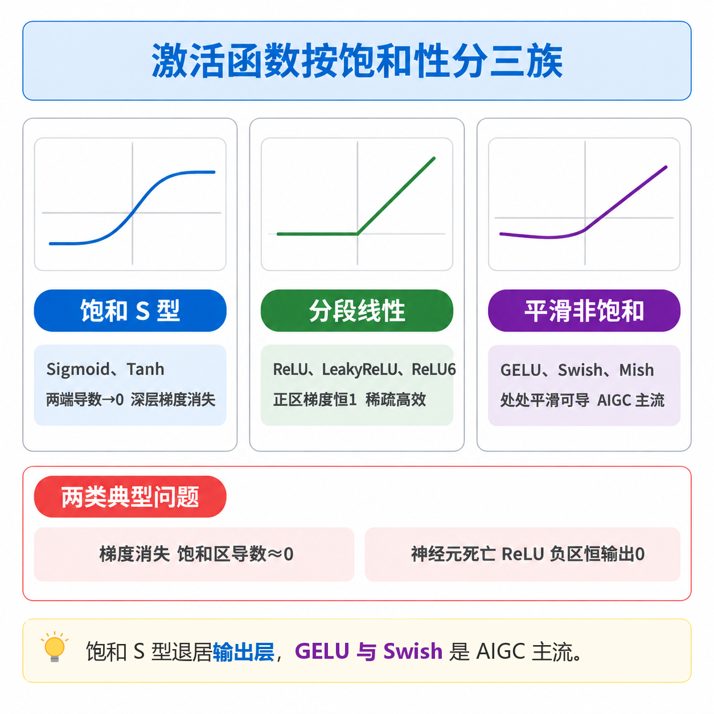

图3-4 激活函数按饱和性分三族

1、传统深度学习阶段（2012-2017）主流激活函数
（1）Sigmoid函数
Sigmoid又称Logistic函数，是早期深度学习经典激活函数，可以将任意实数输入映射到 $(0,1)$ 区间，呈现S型饱和曲线。
- 原函数： $\sigma(x) = \frac{1}{1 + e^{-x}}$
- 导数： $\sigma'(x) = \sigma(x) \cdot (1 - \sigma(x))$

Sigmoid函数曲线与其饱和特性如图3-5所示：

  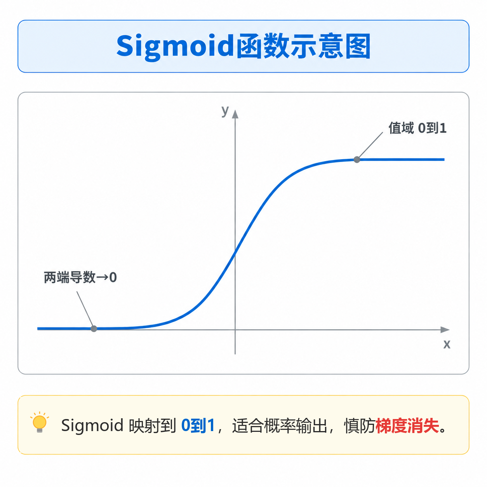

图3-5 Sigmoid函数示意图

优点
- 输出值域在 $(0,1)$，具备概率含义，适合用作二分类任务输出层激活，表征预测置信度；
- 连续平滑、处处可微，导数形式简单，前向输出可直接复用求导；
- 输出有界，限制极端值向后传递，提升数值稳定性；
- 逻辑简单，容易实现。

缺点
- 梯度消失问题明显：导数最大值仅0.25， $|x|>5$时导数接近0。深层网络反向传播时梯度快速衰减，浅层参数更新困难；
- 输出非零中心：输出恒大于0，均值约0.5。下一层神经元输入全部为正，权重梯度符号趋于一致，优化路径震荡，收敛变慢；
- 落入两侧饱和区时梯度近似为0，神经元停止学习；
- 包含指数运算，计算开销高于ReLU这类分段线性激活。

（2）Tanh函数

Tanh即双曲正切函数，是Sigmoid的改进版本，将输入映射至 $[-1,1]$，曲线关于原点对称，更适合隐藏层需要零均值特征的场景。
- 原函数： $\tanh(x) = \frac{e^x - e^{-x}}{e^x + e^{-x}}$
- 导数： $\tanh'(x) = 1 - \tanh^2(x)$
- 与Sigmoid关系： $\tanh(x) = 2\sigma(2x) - 1$，等价于Sigmoid做缩放和平移。

Tanh函数曲线与其零中心特性如图3-6所示：

  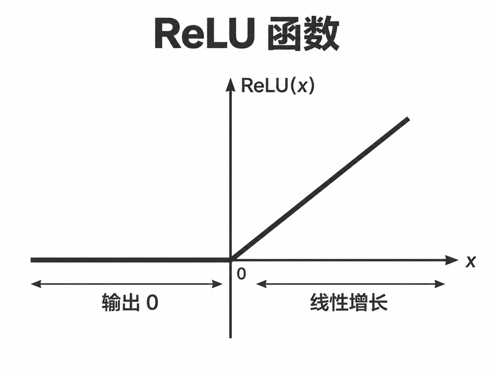

图3-6 Tanh函数示意图

优点
- 输出零均值，解决Sigmoid全正输出带来的梯度更新低效问题，加快中浅层网络收敛；
- 梯度上限为1，高于Sigmoid的0.25，中等深度网络梯度衰减更慢；
- 曲线平滑，输出保留正负符号，可表征信号方向与强弱。

缺点
- 依旧存在梯度消失， $|x|>3$时导数快速趋近0，不适合几十层以上的深度网络；
- 依赖指数运算，计算开销更大，大规模训练速度弱于ReLU系列；
- 输出区间 $[-1,1]$，不直接代表概率，不能直接作为二分类输出层。

（3）ReLU 函数

ReLU全称修正线性单元（Rectified Linear Unit），是深度学习中使用最广泛的激活函数，依靠单侧抑制引入非线性，大幅缓解Sigmoid、Tanh的梯度消失问题。

原函数：

$$
\text{ReLU}(x) = \max(0, x)
$$

分段定义:

$$
\text{ReLU}(x) =
\begin{cases}
0, & \text{if } x \leq 0 \\
x, & \text{if } x > 0
\end{cases}
$$

导数:

$$
\text{ReLU}'(x) =
\begin{cases}
0, & \text{if } x < 0 \\
1, & \text{if } x > 0 \\
\text{undefined (commonly } 0 \text{ or } 1), & \text{if } x = 0
\end{cases}
$$

 $x=0$处理论不可导，工程实现直接指定导数为0或1，对训练几乎没有影响。

ReLU函数曲线与其正负区行为如图3-7所示：

  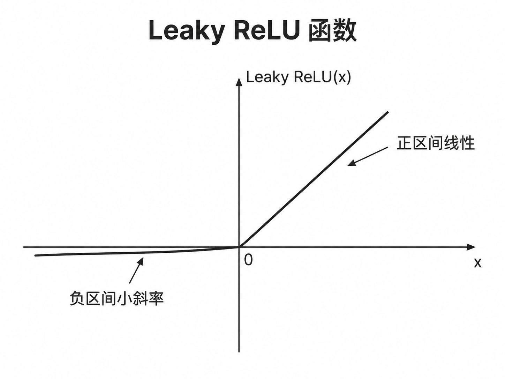

图3-7 ReLU函数示意图

优点
- 正区间导数恒等于1，梯度回传无衰减，显著改善深层网络梯度消失，训练速度更快；
- 计算简单，仅一次大小比较，无指数运算，GPU、TPU硬件加速友好；
- 带来稀疏激活：零均值输入下约一半神经元输出置零，自带正则效果，降低过拟合；
- 优化过程更稳定，收敛速度快。

缺点
- 死亡ReLU问题： $x<0$区间梯度恒为0。神经元若在初始化或训练阶段获得较大负偏置，会永久无法激活，参数不再更新；学习率过大会加剧这个现象；
- 输出非零中心，输出全部大于等于0，仍然存在梯度同号震荡问题；
- 正区间输出无上限，前向传播容易出现激活值溢出，通常搭配BatchNorm使用，保证数值稳定。

（4）Leaky ReLU 函数

Leaky ReLU是针对ReLU死亡神经元问题提出的改进方案，在负区间设置一个很小的固定斜率，保留负输入对应的梯度通路，避免神经元永久失活。

原函数：

$$
f(x) =
\begin{cases}
x, & \text{if } x > 0 \\
\alpha x, & \text{if } x \le 0
\end{cases}
$$

 $\alpha$ 为固定小系数，常用0.01或0.1。

导数：

$$
f'(x) =
\begin{cases}
1, & \text{if } x > 0 \\
\alpha, & \text{if } x \le 0
\end{cases}
$$

Leaky ReLU函数曲线与其负区小斜率如图3-8所示：

  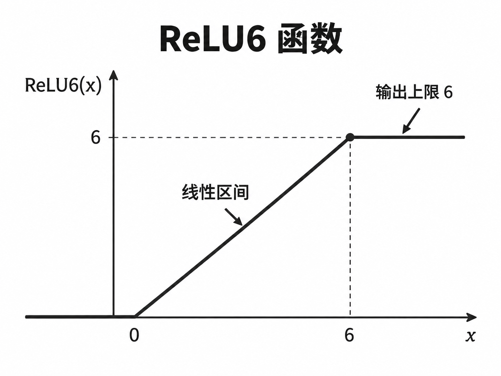

图3-8 LeakyReLU函数示意图

优点
- 消除神经元永久死亡，输入为负时依然保留非零梯度，权重可持续更新；
- 继承ReLU计算简单、正区间无梯度消失、收敛快的特性；
- 负区间保留小幅信号，相比ReLU信息利用率更高。

缺点
- 负区间斜率 $\alpha$是人工预设超参，不同任务最优取值不一样，增加调参成本；
- 在多数工程场景中，相比原生ReLU带来的精度提升有限，部分任务效果甚至略差；
- 没有解决输出非零中心问题，负区间斜率很小，输出均值依旧偏向正值。

（5）ReLU6 函数
ReLU6是ReLU的有界变体，保留ReLU左侧稀疏特性，同时将输出上限硬截断为6，最初为移动端INT8低精度量化推理设计。

原函数：

$$
f(x) = \min(\max(0, x), 6)
$$

导数：

$$
f'(x) =
\begin{cases}
1, & \text{if } 0 < x < 6 \\
0, & \text{otherwise}
\end{cases}
$$

ReLU6函数曲线与其输出封顶特性如图3-9所示：

  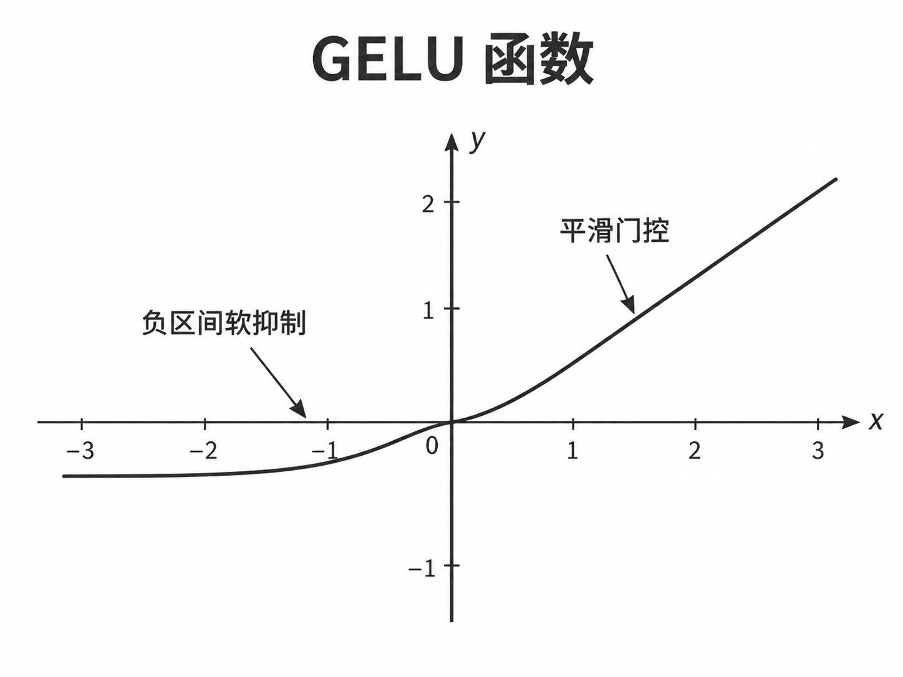

图3-9 ReLU6函数示意图

优点
- 输出限制在 $[0,6]$区间，抑制激活值爆炸，提升低精度量化时的数值保真度；
- 仅两次比较运算，适合移动端与嵌入式设备部署；
- 保留ReLU单侧稀疏激活特性。

缺点
- $x \ge 6$时梯度归零，如果大量神经元长期落在该区间，同样会停止参数更新；
- 延续ReLU输出非零中心的缺陷；
- 截断阈值6是经验值，不一定适配全部数据分布。

2、AIGC时代（2017 - 至今）：生成式AI常用激活函数

（1）GELU 函数

GELU全称高斯误差线性单元（Gaussian Error Linear Unit），是BERT、GPT、ViT这类Transformer架构的主流激活函数。它采用输入依赖的软门控机制，类似随机Dropout，使用标准正态分布累积函数做掩码。
- 精确原函数： $f(x) = x \cdot \Phi(x)$， $\Phi(x)$代表标准正态分布累积分布函数；
- 工程近似公式：

$$ f(x) \approx 0.5x \left(1 + \tanh\left(\sqrt{\frac{2}{\pi}}(x + 0.044715x^3)\right)\right) $$

- 导数： $f'(x) = \Phi(x) + x \cdot \phi(x)$， $\phi(x)$为标准正态分布概率密度函数。

GELU函数曲线与其平滑非饱和特性如图3-10所示：

  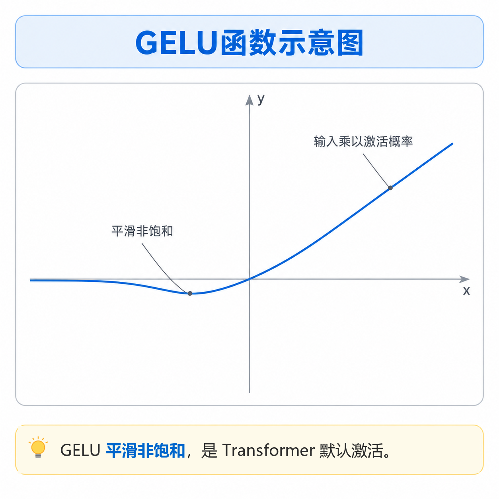

图3-10 GELU函数示意图

优点
- 在NLP、ViT视觉任务上，效果普遍优于ReLU系列；
- 全局平滑可导，给优化器提供连续梯度场；
- 输入相关的软门控自带正则能力，抑制过拟合；
- 输出支持正负，特征分布更贴合真实数据。

缺点
- 计算开销更高，依赖tanh近似或者erf误差函数，推理延迟高于ReLU；
- 数学形式复杂，可解释性偏弱；
- 在纯CNN网络中增益有限，性能优势集中在Transformer结构。

（2）SiLU/Swish 函数
Swish由Google Brain提出，属于自门控激活函数，用Sigmoid作为软门控，实现由输入驱动的平滑非线性变换。
- 原函数： $f(x) = x \cdot \sigma(\beta x)$， $\sigma$为Sigmoid； $\beta$可固定或作为可学习参数，常用取值为1；
- 导数： $f'(x) = \sigma(\beta x) + \beta x \cdot \sigma(\beta x) \cdot (1 - \sigma(\beta x))$
- 特殊性质： $\beta=1$等价于SiLU； $\beta \to 0$退化为线性函数； $\beta \to +\infty$趋近ReLU。

Swish函数曲线与其自门控特性如图3-11所示：

  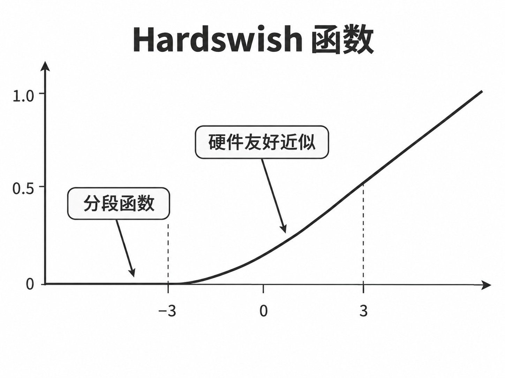

图3-11 Swish函数示意图

优点
- 在ImageNet、COCO等标准数据集上，通常能稳定带来精度提升；
- 负半轴存在饱和效应，自带正则效果；正半轴无界，不会强行截断梯度；
- 自门控、曲线平滑，不存在梯度死区。

缺点
- 包含Sigmoid指数运算，算力开销高于ReLU；
- $\beta$作为可学习参数时，会小幅增加参数量与计算图开销；
- 任务收益不稳定，部分场景相比ReLU提升不明显。

（3）SwiGLU（大模型 FFN 层的事实标准）
SwiGLU全称Swish门控线性单元，属于GLU门控线性单元的变体，把GLU中原Sigmoid门替换为SiLU。在同等参数量条件下提升Transformer表达能力，广泛应用于GPT-4、Llama、Mistral、Qwen等大模型的FFN模块。

工程标准无偏置实现：

$$ \text{SwiGLU}(x) = \left(\text{SiLU}(xW_1) \odot (xV)\right) W_2 $$

符号说明：
  - $W_1, V \in \mathbb{R}^{d_{\text{model}} \times d_{\text{ff}}}$：两路并行升维权重矩阵
  - $W_2 \in \mathbb{R}^{d_{\text{ff}} \times d_{\text{model}}}$：降维权重矩阵
  - $\odot$：逐元素哈达玛积
  - $\text{SiLU}(x) = x \cdot \sigma(x)$： $\beta=1$的标准SiLU激活函数

与标准Transformer FFN对比：
标准FFN： $\text{FFN}(x) = \max(0, xW_1) W_2$，仅两组权重矩阵
SwiGLU FFN：第一个线性层拆成两路并行分支，一路经过SiLU激活后，和另一路做逐元素相乘，一共三组权重矩阵。

参数量对齐技巧：
为保持和标准FFN（ $d_{\text{ff}}=4d_{\text{model}}$）总参数量一致，SwiGLU通常将中间维度设为 $d_{\text{ff}}=\frac{8}{3}d_{\text{model}} \approx 2.666d_{\text{model}}$
- 标准FFN参数量： $2 \cdot d_{\text{model}} \cdot 4d_{\text{model}} = 8d_{\text{model}}^2$
- SwiGLU参数量： $3 \cdot d_{\text{model}} \cdot \frac{8}{3}d_{\text{model}} = 8d_{\text{model}}^2$

反向传播推导：
令 $a = \text{SiLU}(xW_1)$， $b = xV$， $h = a \odot b$， $y = h W_2$。上游梯度 $g = \frac{\partial L}{\partial y}$

$$
\frac{\partial L}{\partial h} = g W_2^\top
$$

$$
\frac{\partial L}{\partial x} = \left[\left((g W_2^\top) \odot b\right) \odot \text{SiLU}'(xW_1)\right] W_1^\top + \left[(g W_2^\top) \odot a\right] V^\top
$$

其中 $\text{SiLU}'(u) = \text{SiLU}(u) + \sigma(u) \cdot (1 - \text{SiLU}(u))$ 为SiLU导数。

优点
- 参数量利用效率高，同等参数量预算下效果普遍优于ReLU/GELU构成的标准FFN；
- 输入驱动的动态门控，模型自适应筛选特征信息流，增强非线性表达；
- 继承SiLU全局平滑特性，规避ReLU梯度消失与神经元死亡，训练稳定性更强；
- 训练loss震荡更小，收敛更快；
- 门控自带正则效果，长序列、复杂语义任务泛化性能更好。

缺点
- 相比标准FFN增加一次矩阵乘法，前向计算量略高，一般精度收益可以覆盖该开销；
- 激活内存占用上升，需要同时保存两路线性分支输出，激活内存约提升三分之一；
- 门控与非线性叠加，内部机制可解释性偏弱；
- 需要精细调整中间维度完成参数量对齐，维度设计不当会造成性能损失或资源浪费。

（4）Hardswish 函数
Hardswish是面向硬件部署的Swish轻量化近似版本。使用ReLU6加偏移的分段线性函数替代原始Sigmoid指数运算，在移动端以接近ReLU的开销复现Swish效果。

原函数：

 $$
f(x) = x \cdot \frac{\text{ReLU6}(x + 3)}{6}
$$

导数：

$$
f'(x) =
\begin{cases}
0, & \text{if } x < -3 \\
\frac{x}{3} + 0.5, & \text{if } -3 \le x \le 3 \\
1, & \text{if } x > 3
\end{cases}
$$

Hardswish函数曲线与其分段线性特性如图3-12所示：

  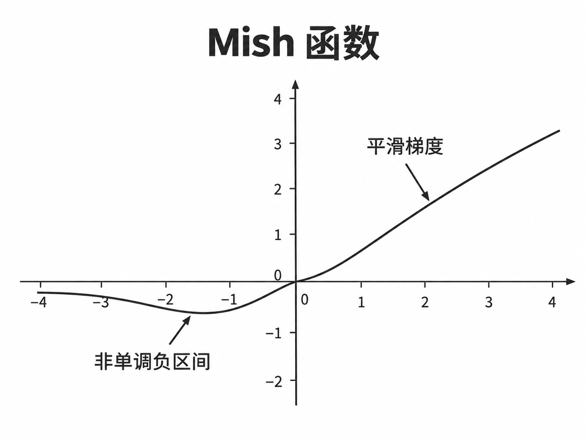

图3-12 Hardswish函数示意图

优点
- 硬件友好，仅乘加与比较操作，无指数运算；常数除法可在编译阶段优化为乘法，适配移动端NPU/GPU加速；
- 近似Swish效果，MobileNetV3等网络可以用ReLU级算力拿到接近Swish的精度；
- 数值稳定，输出右侧有界，左侧趋近0。

缺点
- 在 $x=\pm3$处导数跳变，理论上存在不可导点；工程实践中影响很小，通常忽略；
- 属于近似实现，少数极端任务精度略低于原生Swish。

（5）Mish 函数
Mish是连续光滑、非单调的自正则激活函数，在大规模视觉任务上表现突出。

原函数：

$$
f(x) = x \cdot \tanh\left(\ln(1 + e^x)\right) = x \cdot \tanh\left(\text{Softplus}(x)\right)
$$

导数：

令 $\omega = \text{Softplus}(x) = \ln(1+e^x)$，则：

$$
f'(x) = \tanh(\omega) + x \cdot \sigma(x) \cdot \text{sech}^2(\omega)
$$

式中 $\sigma(x)$ 为Sigmoid， $\text{sech}^2(\omega) = 1 - \tanh^2(\omega)$，导数处处连续，梯度流平滑。

Mish函数曲线与其平滑非单调特性如图3-13所示：

  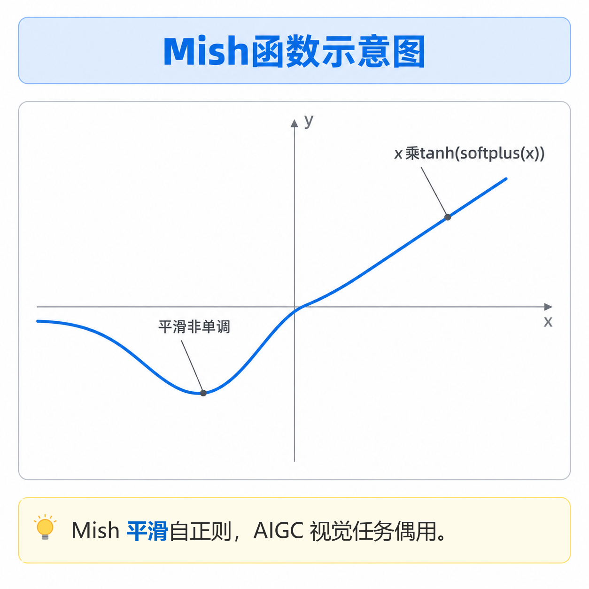

图3-13 Mish函数示意图

优点
- 视觉任务效果突出，YOLOv4、YOLOv5检测主干网络上精度优于ReLU、Swish、Leaky ReLU；
- 无限阶连续可导，损失曲面平滑，更容易收敛到优质局部极值；
- 非单调设计支持负值输出，保留更多微弱负信号信息。

缺点
- 计算成本高，同时包含Tanh、Log、Exp运算，在常用激活函数里推理速度偏低；
- 数学形式复杂，理论分析难度大；
- 在部分网络结构与学习率配置下，训练前期容易震荡。

<h2 id="q3-4-3">面试问题：有哪些激活函数在AIGC时代取得了大量的应用，它们有什么优势？</h2>

**难度评分：⭐⭐⭐ (3/5) | 考察频率：⭐⭐⭐⭐ (4/5)**

在 AIGC 时代的深层 Transformer 模型中，GELU 和 Swish/SiLU 取代 ReLU 成为主流激活函数，根本原因在于它们处处平滑、可导，消除了 ReLU 在零点附近的硬转折，从而为极深网络的训练提供了更平稳的优化地形和更可靠的梯度流动，明显降低了“死亡神经元”的风险。

GELU 通过将输入乘以标准正态 CDF，引入了一种输入依赖的平滑门控正则化（GELU 原始论文将其理解为对输入按输入大小做随机掩码的确定性近似，与 Dropout 思想相近但非等价），能明显提升大规模生成模型的泛化能力；而 Swish/SiLU 利用 Sigmoid 自门控实现了无上界、有下界的非单调映射，在保留负值细微信号的同时避免了梯度消失，其平滑性和高效性直接催生了 SwiGLU 等门控线性单元，成为 LLaMA、GPT 等 SOTA 生成模型的标准配置。二者共同使激活分布更趋近零均值、训练更稳定，这正是参数规模动辄百亿、千亿的现代生成模型能够成功收敛的关键。

<h2 id="q3-4-4">面试问题：激活函数在使用中有哪些典型的问题？</h2>

**难度评分：⭐⭐⭐ (3/5) | 考察频率：⭐⭐⭐⭐⭐ (5/5)**

无论是传统深度学习还是AIGC大模型、扩散生成模型，激活函数在训练与推理阶段普遍存在以下典型问题：

- 梯度消失与梯度饱和
Sigmoid、Tanh 存在明显饱和区，输入绝对值过大时导数趋近于0；ReLU6、ELU 同样存在单侧饱和。深层网络与超长序列Transformer中，饱和会导致反向传播梯度逐层衰减，浅层权重无法更新。AIGC深层大模型场景下，该问题会直接导致模型收敛缓慢、生成效果退化。

- 神经元失活（死亡神经元）
标准ReLU负区间导数恒为0：

$$ f'(x)= \begin{cases} 1, &x>0\\ 0, &x<0 \end{cases} $$

学习率过大、初始化不佳时，大量神经元永久输出0、梯度锁死，称为死亡ReLU。即便Leaky ReLU、ELU有所缓解，负区间梯度极小仍会造成隐性神经元活性不足。

- 输出非零中心化
ReLU、ReLU6、Softplus 输出恒非负，批次特征整体偏移。会使下层权重梯度始终同号，参数更新呈锯齿状震荡，收敛效率下降，该问题在小批量训练的AIGC微调场景中尤为明显。

- 梯度爆炸与数值不稳定
Swish、SiLU、Mish、GELU 等无上限激活函数，正区间输出不受约束，深层堆叠后激活值不断累积放大，易出现数值溢出、梯度爆炸；同时Softmax做多分类/文本预测时，指数运算易引发数值上下溢，需额外做数值截断优化。

- 计算开销与推理延迟
传统ReLU仅做简单阈值运算，开销极低；而AIGC常用的GELU、SiLU、Mish 包含指数、双曲正切、高斯分布等复杂运算，训练与推理算力消耗更高，增加大模型、扩散模型部署成本，不利于端侧AIGC落地。

- 梯度不连续与优化抖动
ReLU、ReLU6、Hardswish 存在分段不可导点，梯度突变会破坏优化平滑性；在大模型微调、扩散模型迭代训练中，容易出现loss震荡、训练不稳定的现象。

- 场景适配性差
单一激活函数无法通用：ReLU不适合深层Transformer；Sigmoid/Tanh难以用于大模型隐藏层；Softmax仅适配分类，不能用于多标签与特征提取，选型错误会直接限制AIGC模型表达能力。

<h1 id="q3-5">5. 介绍一下卷积操作的原理</h1>

<h2 id="q3-5-1">面试问题：请详细介绍卷积操作及其核心原理</h2>

**难度评分：⭐⭐ (2/5) | 考察频率：⭐⭐⭐⭐ (4/5)**

卷积是一种线性运算，在深度学习里特指滑动窗口内的加权求和：可学习的卷积核在输入特征图上滑动，对每个局部区域做点积，从而提取局部空间特征，是 CNN 的基础算子。

卷积的滑动窗口计算过程与三大特性如图3-14所示：

  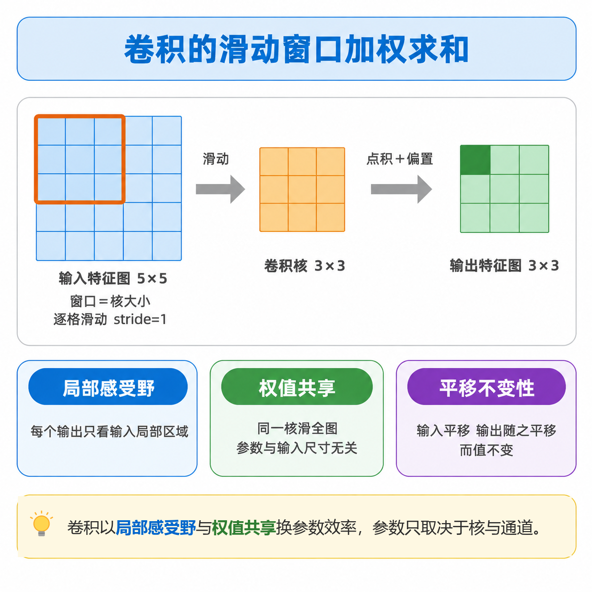

图3-14 卷积的滑动窗口加权求和

（1）对于输入特征图 $X \in \mathbb{R}^{H \times W \times C_{in}}$、卷积核 $K \in \mathbb{R}^{k \times k \times C_{in} \times C_{out}}$、偏置 $b \in \mathbb{R}^{C_{out}}$，二维卷积输出特征图 $Y$ 的每个元素为：

$$ Y_{i,j,c} = \sum_{m=0}^{k-1} \sum_{n=0}^{k-1} \sum_{d=0}^{C_{in}-1} K_{m,n,d,c} \cdot X_{i+m,j+n,d} + b_c $$

（2）卷积有三个关键特性：

- 局部感受野：每个输出神经元仅与输入的一个局部区域相连，模拟生物视觉的局部感知机制，避免全连接带来的参数爆炸。
- 权值共享：同一卷积核在整个特征图上共享参数，使参数量从 $H \times W \times C_{in} \times C_{out}$ 降至 $k^2 \times C_{in} \times C_{out}$，同时让网络学到与位置无关的通用特征。
- 平移不变性：输入发生平移时，输出特征图也相应平移而数值保持不变——这是权值共享的直接结果，使模型对目标位置变化具有鲁棒性。

（3）传统深度学习和 AIGC 时代的用法对比：

- 传统深度学习（判别式任务）：卷积主要做特征提取，ResNet 用于分类、YOLO 用于检测、U-Net 用于分割，作用是从低级边缘到高级语义的逐层抽象。

- AIGC 时代（生成式任务）：卷积成为生成模型的基础算子：

  - 图像生成：Stable Diffusion 的 UNet 以 3×3 卷积为主体构建残差块，配合步幅卷积下采样与插值上采样，在潜空间中完成去噪与图像合成；
  - 超分辨率：ESRGAN 通过残差卷积块生成高频细节；
  - 视频生成：Sora 将视频切成时空 patch 后送入 Diffusion Transformer 处理，另有大量视频扩散模型采用 3D（时空）卷积联合建模空间与时间维度；
  - 多模态：CLIP 的图像编码器用卷积提取视觉特征，与文本特征对齐。

<h2 id="q3-5-2">面试问题：介绍一下卷积操作中的卷积核、步幅、填充、感受野的定义及作用</h2>

**难度评分：⭐⭐ (2/5) | 考察频率：⭐⭐⭐⭐ (4/5)**

- 卷积核：可学习的权重张量，通常为 $K \times K$ 的二维空间核（深度上跨越全部输入通道），定义局部感知模式。
- 步幅：卷积核每次滑动的像素数；大于 1 时直接降低输出分辨率，起到下采样作用。
- 填充：在输入四周补零。步幅为 1 时，"SAME" 对称填充可使输出与输入空间尺寸一致，避免边界信息过快丢失（步幅大于 1 时输出仍会缩小）。
- 感受野：输出特征图上一个像素映射回原图所影响的区域大小。多层堆叠后，感受野按下式递推：

$$ RF_k = RF_{k-1} + (kernel\_size - 1) \times \prod_{i=1}^{k-1} stride_i $$

这些组件共同控制特征图尺度、语义抽象层级与计算开销。
在 AIGC 中，生成器常用步幅卷积或转置卷积做渐进式上采样，配合填充保证边界质量；感受野大小直接影响生成内容的局部纹理与全局结构一致性——例如扩散模型通过精心设计感受野的卷积与时间步条件交互，兼顾纹理清晰度与构图合理性。

<h2 id="q3-5-3">面试问题：常用的卷积层有哪些？请分别详细介绍其结构、原理及适用场景</h2>

**难度评分：⭐⭐⭐ (3/5) | 考察频率：⭐⭐⭐⭐ (4/5)**

常用变种有五种：

- 深度可分离卷积：由逐通道卷积（depthwise）和 $1\times1$ 逐点卷积（pointwise）构成。参数量从标准卷积的 $C_{in}C_{out}K^2$ 降至 $C_{in}K^2 + C_{in}C_{out}$，计算量明显压缩，适用于轻量级生成器，如 MobileStyleGAN。

- 分组卷积：将输入通道分为 $G$ 组，各组独立卷积后再拼接，参数量降至约 $C_{in}C_{out}K^2/G$，同时引入分支多样性。ResNeXt 以此提升性能；AIGC 中可用于多尺度、多分支生成。

- 空洞卷积：在卷积核元素间插入零值，扩张率 $d$ 下有效核大小为 $K+(K-1)(d-1)$，可在不增加参数的前提下扩大感受野。广泛用于语义分割、图像修复与高分辨率生成。

- 转置卷积：可学习的上采样层，将每个输入像素与卷积核相乘后平铺累加，实现分辨率放大。输出尺寸公式为 $O = S(I-1) + K - 2P$（ $I$ 为输入尺寸， $S$ 为步幅， $K$ 为核大小， $P$ 为填充），是 GAN 生成器和 VAE 解码器的经典上采样手段。需注意步幅较大时可能出现棋盘效应，可配合最近邻上采样缓解。

- $1\times1$ 卷积：仅在通道维度做线性变换，参数量为 $C_{in} \times C_{out}$（不计偏置），用于升降维与跨通道信息融合。在 StyleGAN 的 合成网络 （以及各类卷积骨干、注意力门控、瓶颈结构）中广泛使用；而 StyleGAN 的 映射网络 （ $z\to w$）主要由全连接层构成，而非 $1\times1$ 卷积。

传统 CNN 中，这些变种主要用于提升效率与精度；AIGC 领域则用它们搭建高效、可控的上采样与特征变换模块，适配不同分辨率与风格需求。

<h2 id="q3-5-4">面试问题：卷积和Transformer在AIGC中各自的优势和适用场景是什么？</h2>

**难度评分：⭐⭐⭐⭐ (4/5) | 考察频率：⭐⭐⭐⭐⭐ (5/5)**

卷积的优势来自局部感受野和权值共享带来的强归纳偏置：参数效率高，天生擅长捕捉纹理、边缘这类高频局部细节，计算量又随分辨率线性增长，适合高分辨率生成。Transformer 则靠自注意力建模全局依赖，在长距离关联和跨模态对齐上更胜一筹，但复杂度和序列长度平方成正比，高分辨率下开销很大。

落到具体场景：
- 卷积主导的是以 GAN、UNet 为骨干的高保真生成，比如 StyleGAN 的高分辨率人脸、Stable Diffusion 潜空间里的卷积去噪，胜在局部细节；
- Transformer 带来的是结构和语义上的突破，DiT、U-ViT 直接用注意力替代卷积，在全局构图和文本一致性上更强；
- 现在的主流其实是混合架构——在卷积骨干里插进交叉注意力或自注意力，Latent Diffusion、ControlNet 都是这样，兼顾卷积的局部生成效率和 Transformer 的全局交互。

<h2 id="q3-5-5">面试问题：卷积核的大小、数量应如何选择？</h2>

**难度评分：⭐⭐⭐ (3/5) | 考察频率：⭐⭐⭐ (3/5)**

核大小首选 $3\times3$。小核堆叠可获得与大核相同的感受野，同时引入更多非线性并降低参数：两个 $3\times3$ 卷积的感受野等价于 $5\times5$，参数从 $25C^2$ 降为 $18C^2$。在输入层或需快速扩大感受野时，可选用 $5\times5$ 或 $7\times7$ 大核——如 ConvNeXt 重新使用 $7\times7$；AIGC 生成器首层有时也用大核捕捉全局结构，后续深层皆用 $3\times3$ 保持细节。
数量（输出通道数）通常随网络深度逐级翻倍，如 64→128→256，以提取越来越抽象的语义。单层参数量为 $C_{in} \times C_{out} \times K^2$，需在任务复杂度与计算预算间平衡，常用瓶颈结构（先 $1\times1$ 降维、再卷积、再 $1\times1$ 升维）降低计算量。
在 AIGC 的 U-Net 生成器中，编码器通道递增以压缩语义，解码器通道递减并配合跳跃连接恢复空间细节；轻量化方案则引入深度可分离卷积削减通道冗余。总体原则：基于任务分辨率与算力限制，优先 $3\times3$ 小核与"阶段通道翻倍"策略，并可借助 NAS 微调。

<h1 id="q3-6">6. 介绍一下池化层的原理</h1>

<h2 id="q3-6-1">面试问题：什么是池化层？介绍一下其原理</h2>

**难度评分：⭐⭐ (2/5) | 考察频率：⭐⭐⭐⭐ (4/5)**

池化层是对特征图做下采样的无参数操作：对每个局部窗口做聚合统计，输出一个代表值。设输入空间尺寸为 $H \times W$（无 padding、无 dilation），单边长度记为 $I$（如高度 $H$），池化窗口为 $K \times K$，步幅为 $S$，则该维输出长度为：

$$ O = \left\lfloor \frac{I - K}{S} \right\rfloor + 1 $$

两种基本聚合方式：最大池化（取窗口内最大值）与平均池化（取窗口内均值）。

最大池化与平均池化的计算对比如图3-15所示：

  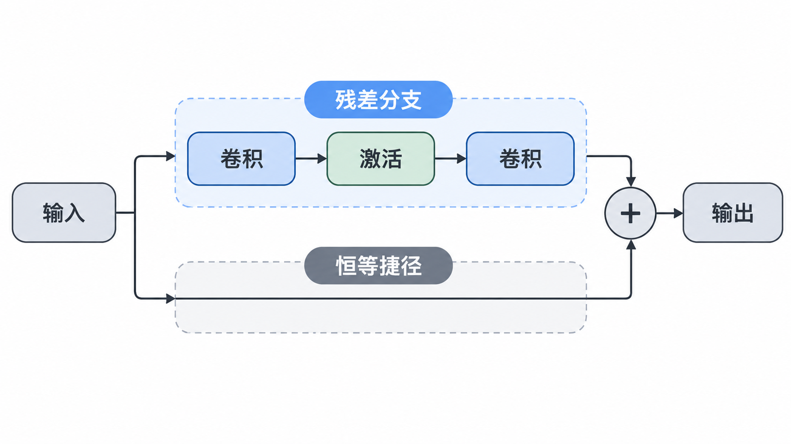

图3-15 池化的窗口内无参数下采样

它的作用主要有三个：

- 空间降维与增大感受野：减小分辨率、降低计算量，使后续卷积层的相对感受野迅速扩大；
- 局部平移不变性：输入微小平移时，池化输出（最大值或均值）可能保持不变，提升鲁棒性；
- 防止过拟合：抽象掉精确位置信息，迫使网络学习更高层的语义特征。

传统深度学习中，池化层广泛嵌入分类网络（VGG、ResNet）的各阶段之间，逐步压缩空间维度。AIGC 时代，生成器几乎摒弃池化，改用步幅卷积或转置卷积做可学习的上下采样，以保留更多空间信息；判别器或编码器也普遍采用步幅卷积下采样。例如 pix2pix 的 PatchGAN 判别器使用 $4\times4$、步幅为 2 的卷积逐级降采样，而非最大池化；Stable Diffusion 等 Latent Diffusion 的 U-Net 编码器同样以步幅卷积为主，一般不再堆叠传统池化层。少量其他架构或早期实现仍可能保留池化以快速降维。

<h2 id="q3-6-2">面试问题：常用的池化层有哪些？请分别介绍其结构、计算方式及适用场景？</h2>

**难度评分：⭐⭐ (2/5) | 考察频率：⭐⭐⭐⭐ (4/5)**

- 最大池化：取窗口内最大值， $y = \max(x_{i,j})$。保留最明显特征，对纹理、边缘响应强，抑制噪声，在分类与检测骨干中占主导。
- 平均池化：取窗口内均值， $y = \frac{1}{K^2}\sum x_{i,j}$。输出更平滑，保留整体背景信息，常用于最后的全局平均池化层替代全连接，减少参数。
- 全局平均池化：窗口等于整张特征图，输出每个通道的一个标量，直接接分类器（如 ResNet 末端以 GAP 替代全连接）。StyleGAN 的映射网络由多层全连接将 $z$ 映射到中间潜码 $w$，并不使用 GAP；GAP 更常见于 CNN 分类头或编码器输出向量前对空间维做通道级聚合。
- 自适应池化：指定输出尺寸（如 $1 \times 1$ 或任意固定大小），自动计算窗口和步幅，可处理任意输入分辨率，常用于多尺度特征对齐。
- 随机池化：按窗口内激活值的概率分布随机采样，相当于一种正则化，实际工程中较少使用。

AIGC 中的应用场景：最大池化突出局部明显响应，便于判别器刻画纹理；平均池化与全局池化用于将空间特征压缩为向量（如分类头、编码器输出）。自适应池化可将不同尺寸的空间特征图对齐到固定大小（如多尺度融合、检测头）；生成器解码侧已普遍用转置卷积或“最近邻上采样 + 卷积”替代旧式上采样，减轻不可逆信息损失；单独使用步幅大于 1 的转置卷积时需注意重叠带来的棋盘效应，常与最近邻上采样 + 卷积组合缓解。

<h2 id="q3-6-3">面试问题：池化操作中，步幅和池化核大小应如何选择？</h2>

**难度评分：⭐⭐ (2/5) | 考察频率：⭐⭐⭐ (3/5)**

最经典的设置是核大小 $2\times2$、步幅 $2$，即无重叠池化——每个窗口独立，分辨率减半，是平衡信息保留与压缩效率的默认选择。若步幅小于核大小（如 $K=3, S=2$），则为有重叠池化，可保留更多邻域信息、缓解边界分裂，适合对细节敏感的任务（如图像生成中的判别器）。池化核通常不超过 $3\times3$，过大核会导致信息过度抽象、细节严重丢失。

选择经验可归纳为：
- 下采样强度：步幅越大，压缩越剧烈，计算量下降但信息损失加剧，需配合网络容量调整。
- 感受野扩展速度：池化核越大，单层感受野扩展越快，但细节损失也越大；通常通过多个 $2\times2$ 池化配合卷积堆叠，渐进式扩展感受野。
- 生成模型中的应用：医学分割等领域中的经典 U-Net 编码器常在卷积块之间插入 $2\times2$ 最大池化；而许多 AIGC 的 U-Net 式结构（pix2pix、扩散模型 U-Net）编码器更普遍采用步幅为 2 的卷积下采样，池化相对少见。可学习的步幅卷积能保留更多任务相关特征。池化仍可能出现在需要显式平移不变性或快速降维的模块，如辅助分支、轻量级骨干或部分传统实现中。

总体原则：首选 $K=2, S=2$ 的最大池化作为基线；若需保留更多空间信息，改用有重叠的 $3\times3, S=2$ 或直接用步幅卷积替代。

<h1 id="q3-7">7. 介绍一下深度学习发展中的经典网络</h1>

<h2 id="q3-7-1">面试问题：介绍ResNet网络及其核心亮点</h2>

**难度评分：⭐⭐ (2/5) | 考察频率：⭐⭐⭐⭐⭐ (5/5)**

ResNet（残差网络）是何恺明团队 2015 年提出的里程碑式架构。它靠残差连接（Residual Connection）解决了网络加深后反而更难优化、误差更高的退化问题，让上百层的网络也能稳定训练、精度更高。

ResNet 残差块与 U-Net 编码器-解码器的核心结构如图3-16所示：

  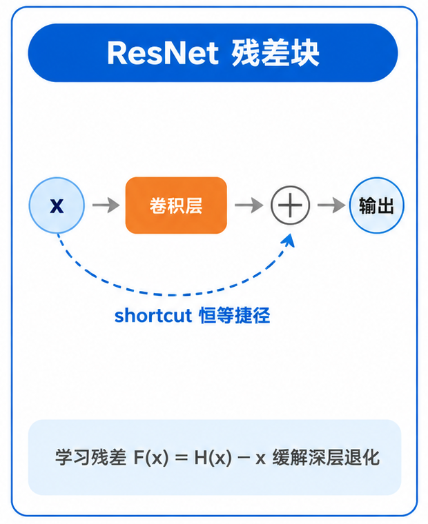

图3-16 ResNet 与 U-Net 的核心结构

它的关键设计有这么几点：

- 残差连接：提供一条恒等映射的捷径，让梯度可以直接沿这条路回传，深层优化因此容易很多。网络学的是残差映射 $F(x) = H(x) - x$，而不是直接去拟合目标 $H(x)$，优化难度明显下降。

- 两种残差块：ResNet-50 及更深的版本用瓶颈块（Bottleneck），结构是 $1\times1$（降维）$\rightarrow 3\times3 \rightarrow 1\times1$（升维），在保持表达能力的同时压住计算量；ResNet-18/34 用基础块（Basic Block），就是两个 $3\times3$ 卷积，结构更简单。

- 批量归一化（BN）：和残差块配合，稳定中间层分布、加快收敛（BN 不是 ResNet 首创，但是它的标准配置）。

- 模块化设计：由一串残差块堆叠而成，结构清晰，扩展和改造都很方便。

传统深度学习和 AIGC 时代的典型用法对比如下：

|应用场景|传统深度学习|AIGC 时代|
|---|---|---|
|主要任务|图像分类（ImageNet 冠军）、目标检测（Faster R-CNN 骨干）、语义分割|扩散模型的 U-Net 类骨干、GAN 的生成器/判别器、视觉编码器（如 CLIP、DALL-E）、ControlNet 等|
|设计目标|提升分类/检测精度，解决极深网络的训练与优化问题|提取多尺度特征，为生成任务提供可用的表征|
|工程价值|奠定了现代深度卷积网络的重要范式之一|在生成管线中常作为骨干或编码/解码组件广泛使用|

<h2 id="q3-7-2">面试问题：介绍U-Net网络及其核心亮点</h2>

**难度评分：⭐⭐ (2/5) | 考察频率：⭐⭐⭐⭐⭐ (5/5)**

U-Net 由 Ronneberger 等人于 2015 年提出，是面向医学图像分割的全卷积网络。它采用编码器-解码器的 U 型对称结构，通过跳跃连接将编码端多尺度特征传到解码端同分辨率处，融合低级细节与高级语义，在小样本医学分割上效果突出。

U-Net 的编码器-解码器与同尺度跳跃连接结构如图3-16右半所示。

它的工作过程可以拆成编码、解码和跳跃连接三部分。

- 编码器（下采样路径）：重复卷积与下采样（原论文用最大池化），空间分辨率一步步降下来、感受野扩大、通道数增加，提取的特征越来越抽象。

- 解码器（上采样路径）：逐步上采样恢复分辨率并配合卷积细化。原论文采用「上采样（双线性/最近邻扩大尺寸）+ 卷积」，工程实现中也常见「转置卷积」或「最近邻/双线性上采样 + 卷积」等写法。

- 跳跃连接：将编码器中与解码器同尺度的特征在通道维拼接（concatenate），再进入后续卷积，可记为：

$$ D_i=\mathrm{Up}(D_{i+1})\,\Vert\, E_i $$

其中 $D_i$ 为解码器第 $i$ 级输出， $\mathrm{Up}$ 表示上采样（及紧随其后的卷积等）， $E_i$ 为编码器同尺度特征， $\Vert$ 表示通道维拼接（与部分资料里用 $\oplus$ 表示拼接的记号等价，此处用拼接符号避免与"逐元素加"混淆）。

在结构上，U-Net 有几个鲜明特点：

- U 型对称结构：编码、解码两侧对称，便于逐层恢复空间结构。

- 跳跃连接：把高分辨率侧的细节特征注入解码器，减轻纯上采样带来的边界模糊与细节丢失。

- 全卷积设计：无全连接层，对输入尺寸更灵活（仍受显存与对齐方式约束）。

- 端到端训练：结构直观、训练流程标准，小样本场景下仍常作强基线。

传统深度学习和 AIGC 时代的典型用法对比如下：

|应用场景|传统深度学习|AIGC 时代|
|---|---|---|
|主要任务|医学图像分割（细胞、器官等）、遥感/语义分割|扩散模型（如 Stable Diffusion）中的 U-Net 式去噪网络、修复/超分/视频生成、ControlNet 等条件分支|
|设计目标|精确勾画目标区域、提升分割边界质量|在去噪或条件生成中融合多尺度信息、稳定训练与细节|
|工程价值|分割领域经典基线与教学范本|大量文生图/图生图管线采用 U-Net 或其变体作为核心模块之一|

<h1 id="q3-8">8. Transformer 的提出背景是什么？解决了 RNN 的哪些核心缺陷？</h1>

<h2 id="q3-8-1">面试问题：Transformer 的提出背景是什么？它为了解决 RNN/LSTM 的哪些核心缺陷（如长距离依赖、梯度问题、无法并行）而设计？</h2>

**难度评分：⭐⭐ (2/5) | 考察频率：⭐⭐⭐⭐⭐ (5/5)**

Transformer 是 Google 团队 2017 年在论文《Attention Is All You Need》里提出的，初衷就是打破机器翻译中 RNN/LSTM 串行计算的瓶颈：它彻底去掉循环结构，完全靠自注意力来建模序列，同时把训练效率和长距离语义能力提上来。它主要解决了 RNN 的三个缺陷。

- 时序依赖导致无法并行训练：RNN的计算严格遵循时间步顺序， $t$ 时刻的隐状态必须依赖 $t-1$ 时刻的输出，无法充分利用GPU的并行计算能力，序列越长训练耗时越高。Transformer通过自注意力机制，让序列中所有位置的计算相互独立，可一次性完成全序列的并行运算，明显提升了训练吞吐效率。
- 长距离依赖建模能力弱：RNN通过隐状态逐步传递信息，信息传递路径长度为 $O(N)$；随着序列长度增加，早期输入的信息会在传递中不断衰减，难以捕捉远距离词元之间的语义关联。Transformer的自注意力直接为任意两个位置建立计算连接，信息传递路径缩短至 $O(1)$，从根本上解决了长距离依赖的信息丢失问题。
- 反向传播梯度不稳定：RNN在长序列反向传播过程中极易出现梯度消失或梯度爆炸问题，即使LSTM/GRU通过门控机制有所缓解，在超长序列场景下仍存在明显局限。Transformer整体结构更扁平，梯度可通过残差连接直接跨层传递，梯度流动更稳定，深层模型更容易训练收敛。

<h2 id="q3-8-2">面试问题：相比 CNN 处理序列任务，Transformer 的核心优势和劣势分别是什么？为什么它能实现序列的并行计算？</h2>

**难度评分：⭐⭐⭐ (3/5) | 考察频率：⭐⭐⭐⭐ (4/5)**

相比 CNN，Transformer 的优势主要在两点：

- 全局感受野：CNN依赖堆叠多层卷积逐步扩大感受野，受卷积核尺寸限制，天然侧重局部特征提取；Transformer通过自注意力机制可一步捕获全序列的全局依赖关系，对长距离语义关联的建模能力更强。
- 动态自适应权重：CNN的卷积核参数训练完成后固定，对所有输入共享静态权重；Transformer的注意力权重由输入内容动态计算生成，可根据不同序列自适应调整信息聚合方式，对语义的适配性更强。

劣势也有两点：

- 计算复杂度更高：标准自注意力的计算与显存复杂度均为 $O(N^2)$，随序列长度平方级增长，超长序列场景下显存压力大、推理延迟高；CNN的计算复杂度为线性 $O(N)$，长序列下效率更优。
- 归纳偏置较弱：CNN内置了平移不变性、局部相关性等先验假设，小样本场景下更容易收敛；Transformer缺乏这类结构化先验，需要依赖大规模数据预训练才能充分发挥性能，小数据集上容易过拟合。

之所以能并行，原因在于：

自注意力的主要运算是矩阵乘法（ $QK^T$ 与权重乘 $V$），输入序列所有位置的词向量可同时参与运算，不存在RNN那样的时间步依赖关系，因此可以充分利用GPU的张量计算单元实现全并行加速。

RNN、CNN 与 Transformer 在依赖路径与并行性上的本质差异如图3-17所示：

  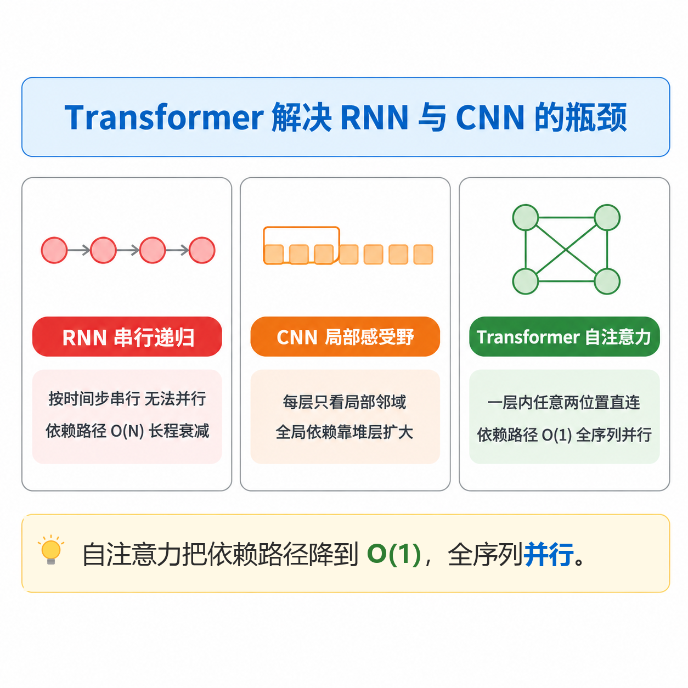

图3-17 Transformer 解决 RNN 与 CNN 的瓶颈

<h2 id="q3-8-3">面试问题：自注意力的全局建模能力，相比 RNN 的时序建模和 CNN 的局部建模，在生成类任务上带来了什么本质差异？</h2>

**难度评分：⭐⭐⭐⭐ (4/5) | 考察频率：⭐⭐⭐ (3/5)**

这种全局建模能力，和 RNN 的时序建模、CNN 的局部建模相比，给生成任务带来了三个本质差异：

- 信息传递从“压缩传递”变为“精准直达”：RNN将所有历史信息压缩为一个固定维度的隐状态向量，存在固有的信息瓶颈，距离越远信息损耗越严重。Transformer通过注意力机制直接定位并召回相关的历史Token，无需经过逐层压缩传递，实现了关键信息的低损耗直达，明显提升了长文本生成的上下文连贯性，缓解了长距离遗忘问题。
- 信息传递路径从线性缩短至常数级：RNN的信息传递路径长度为 $O(N)$，生成当前Token时，远距离信息需经过多步传递才能到达；Transformer的信息路径长度为 $O(1)$，生成任意位置的Token都可以直接关联全序列的所有位置。这一特性让模型能够高效利用长距离上下文信息，支撑了长文档理解、复杂逻辑推理等高阶能力。
- 训练效率的质变支撑了大模型规模化：全局建模天然支持全序列并行训练，明显提升了算力利用效率，使得在海量数据上训练百亿、千亿参数的超大规模模型成为可能，为AIGC时代大模型的爆发提供了算力与架构基础。

<h1 id="q3-9">9. 介绍一下 Transformer 网络结构</h1>

<h2 id="q3-9-1">面试问题：请完整介绍 Transformer 的整体架构，简述 Encoder 和 Decoder 的核心区别（输入、注意力类型、输出用途）。</h2>

**难度评分：⭐⭐ (2/5) | 考察频率：⭐⭐⭐⭐⭐ (5/5)**

Transformer由编码器（Encoder）和解码器（Decoder）两部分构成，二者各自堆叠 $N$ 层相同的网络层（原论文设置为6层）。每层的关键组件包括多头注意力机制、前馈神经网络（FFN），并搭配残差连接与层归一化模块。

Encoder 和 Decoder 的区别主要体现在输入、注意力类型和输出用途上：

（1）输入来源
- Encoder：仅接收源序列作为输入，完成语义特征提取。
- Decoder：输入为右移（Shifted Right）的目标序列，同时接收Encoder的输出作为交叉注意力的Key与Value来源。

（2）注意力类型
- Encoder：采用双向自注意力，计算时可以看到完整序列的所有位置信息。
- Decoder：包含两类注意力模块：一是掩码自注意力（Masked Self-Attention），仅允许访问当前及历史位置的信息，防止未来信息泄露；二是交叉注意力（Cross-Attention），Query来自解码器侧，Key、Value来自编码器的输出。

（3）输出用途
- Encoder：输出源序列的全局语义表征，主要作用是“理解输入”。
- Decoder：基于编码特征自回归生成目标序列，主要作用是“生成输出”。

Transformer 整体架构与 Encoder、Decoder 的堆叠组件如图3-18所示：

  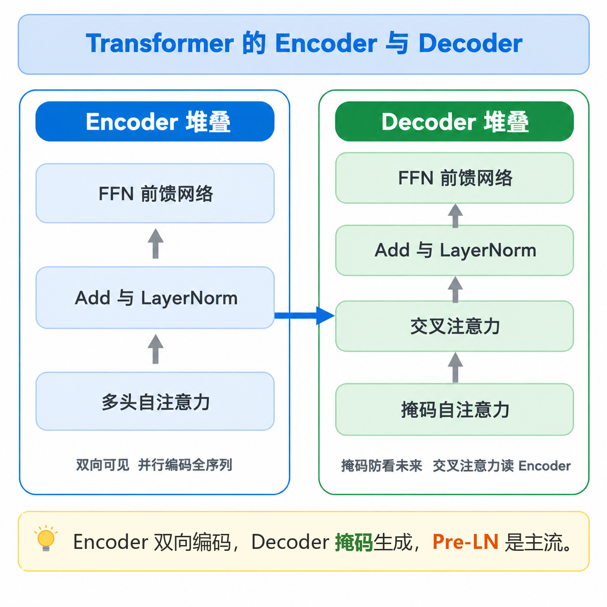

图3-18 Transformer 的 Encoder 与 Decoder

<h2 id="q3-9-2">面试问题：为什么解码器需要掩码自注意力？请解释 Causal Mask 和 Padding Mask 的作用及实现方式。</h2>

**难度评分：⭐⭐⭐ (3/5) | 考察频率：⭐⭐⭐⭐⭐ (5/5)**

1、为什么需要掩码自注意力？

解码器在训练阶段会并行输入完整的目标序列，但自回归生成任务的本质是：预测第 $t$ 个Token时，仅能使用 $t$ 及之前的位置信息，不能窥见未来内容。掩码机制的主要作用是保证训练与推理阶段的行为一致性，避免模型“提前看到”未来信息导致训练失效。

2、两类掩码的作用与实现

（1）Causal Mask（因果掩码）
- 作用：严格屏蔽未来时刻的所有信息，保证模型的自回归生成属性。
- 实现方式：构造一个与注意力分数矩阵同尺寸的上三角矩阵（不含对角线），将上三角区域的数值填充为 $-\infty$；经过Softmax运算后，对应位置的注意力权重会趋近于0，从而实现信息遮蔽。

（2）Padding Mask（填充掩码）
- 作用：忽略序列中的填充占位符（PAD），避免无效的填充字符干扰正常的注意力分布计算。
- 实现方式：在注意力分数矩阵中，将PAD位置对应的分数全部设置为 $-\infty$，使其在Softmax后权重为0，不参与最终的信息聚合。

<h2 id="q3-9-3">面试问题：为什么纯解码器架构在 AIGC 时代（如 LLM）成为主流？Encoder-only 和 Encoder-Decoder 架构分别适用于什么场景？</h2>

**难度评分：⭐⭐⭐⭐ (4/5) | 考察频率：⭐⭐⭐⭐ (4/5)**

（1）Decoder-only 成为AIGC时代主流的原因：
- 规模扩展效应更优：Scaling Laws相关研究验证，在同等参数量与数据量下，Decoder-only架构在零样本/少样本泛化能力、训练稳定性上表现更突出，模型性能随参数、数据规模增长的收益更明显，更适配大模型的规模化路线。
- 工程实现与推理优化更友好：结构统一简洁，天然适配KV Cache等推理加速技术；因果掩码的设计与自回归生成任务完全契合，推理逻辑更直接。
- 适配海量无监督数据：互联网上海量的无标注文本数据，天然适配Decoder-only架构的自回归预训练目标，能够充分利用大规模数据提升模型能力。

（2）三类架构的适用场景：
- Encoder-only（代表模型：BERT）：适用于文本理解类任务，如文本分类、情感分析、实体识别、语义匹配等。双向注意力机制可以充分融合左右上下文信息，语义表征能力更强。
- Encoder-Decoder（代表模型：T5、BART）：适用于输入输出均为序列的Seq2Seq任务，如机器翻译、文本摘要、问答生成等。输入理解与输出生成解耦，更适配输入、输出语义差异较大的场景。
- Decoder-only（代表模型：GPT系列、LLaMA系列）：适用于通用生成类任务，如对话交互、内容创作、代码生成等。统一的自回归架构兼具理解与生成能力，是当前通用大语言模型的主流架构。

<h2 id="q3-9-4">面试问题：Transformer 中为什么要使用残差连接 + 层归一化？Pre-LN（前置）相比 Post-LN（后置）有什么区别？为什么大模型普遍用 Pre-LN？</h2>

**难度评分：⭐⭐⭐⭐ (4/5) | 考察频率：⭐⭐⭐⭐⭐ (5/5)**

（1）残差连接与层归一化的作用
- 残差连接：通过恒等映射为梯度提供直接回传的捷径，从根本上缓解深层网络的梯度消失问题，让数十层甚至上百层的深度模型能够稳定收敛，降低优化难度。
- 层归一化：对每一层的输入特征做归一化处理，稳定每一层的数据分布，加速模型收敛，同时避免训练过程中出现数值异常。

（2）Pre-LN 与 Post-LN 的根本区别
- Post-LN（Transformer原版设计）：计算顺序为 `x + Dropout(Sublayer(x)) → LayerNorm`，即层归一化放在残差相加之后。反向传播时，梯度需要经过LN层才能回传到下层，深层容易出现梯度消失，训练对学习率预热（Warm-up）的要求很高，训练稳定性差。
- Pre-LN（当前大模型主流设计）：计算顺序为 `x + Dropout(Sublayer(LayerNorm(x)))`，即层归一化放在子层输入之前。反向传播时，梯度可以通过残差连接的恒等路径直接回传，无需经过LN变换，深层梯度更稳定，模型训练难度明显降低，对Warm-up的依赖更弱。

（3）大模型普遍采用 Pre-LN 的原因
大模型层数深、参数量大，训练难度呈指数级上升，Pre-LN带来的训练稳定性提升是主要收益。尽管其在理论上存在极轻微的表征精度损失，但在大规模模型场景下，训练稳定性、收敛效率的收益远大于精度损耗，因此成为大模型的标准设计。

<h2 id="q3-9-5">面试问题：Transformer 的 FFN（前馈网络）起什么作用？为什么大模型常用 SwiGLU 替代传统的 ReLU/GELU？</h2>

**难度评分：⭐⭐⭐ (3/5) | 考察频率：⭐⭐⭐⭐ (4/5)**

（1）FFN（前馈神经网络）的主要作用
- 引入非线性变换：注意力层的本质是加权求和，属于线性操作，仅能完成信息的重分配与聚合。FFN通过激活函数引入非线性变换，明显提升了模型的表达能力与拟合能力。
- 特征变换与知识存储：FFN通常采用“升维-激活-降维”的瓶颈结构，将特征映射到高维隐空间再映射回原维度。现有研究表明，FFN层类似键值存储器，承担了存储语言事实知识、完成特征变换的主要功能。

（2）大模型常用 SwiGLU 替代传统激活函数的原因
SwiGLU融合了Swish激活函数的平滑特性与门控线性单元（GLU）的门控机制。
与ReLU的硬截断特性相比，SwiGLU的梯度传递更平滑，避免了神经元死亡问题；同时门控机制可以让模型动态筛选、过滤信息，提升特征表征的灵活性。大量实验验证，SwiGLU能明显提升大语言模型的训练稳定性与最终任务性能，因此成为当前主流设计。

<h1 id="q3-10">10. 介绍一下自注意力机制的原理</h1>

<h2 id="q3-10-1">面试问题：详细描述标准自注意力的完整计算流程（从输入 X 到输出），并解释 Q、K、V 的含义以及“为什么需要区分三者”。</h2>

**难度评分：⭐⭐ (2/5) | 考察频率：⭐⭐⭐⭐⭐ (5/5)**

（1）标准自注意力的完整计算流程
- 线性投影：输入特征矩阵 $X$ 分别与三组可学习的权重矩阵 $W_Q, W_K, W_V$ 相乘，投影得到查询向量 $Q$、键向量 $K$、值向量 $V$。
- 相似度计算：通过 $Q$ 与 $K$ 的点积运算，计算每两个位置之间的相关性，得到注意力分数矩阵。
- 缩放与归一化：将注意力分数除以 $\sqrt{d_k}$（ $d_k$ 为Key向量的维度）进行缩放，再通过Softmax函数归一化，得到取值范围为0~1的注意力权重矩阵。
- 加权求和输出：用归一化后的注意力权重对 $V$ 进行加权求和，得到自注意力的最终输出。

（2）Q、K、V 的含义
- Query（Q，查询向量）：代表当前位置的“查询特征”，用于主动寻找序列中相关的信息。
- Key（K，键向量）：代表每个位置的“索引特征”，用于被其他位置查询匹配，相当于信息的索引。
- Value（V，值向量）：代表每个位置的“内容特征”，存储了实际需要聚合的语义信息。

（3）区分 Q、K、V 的原因
如果不做区分（即 $Q=K=V$），自注意力的计算是完全对称的，会严重限制模型的表达能力。将三者拆分后，模型可以在三个不同的特征子空间中学习独立的投影规则，实现“查询模式”“索引模式”“内容模式”的解耦（例如“寻找指代对象”和“作为指代对象的特征”可以分别学习），明显提升了模型的灵活性与表征能力。

自注意力的完整计算流程与多头扩展如图3-19所示：

  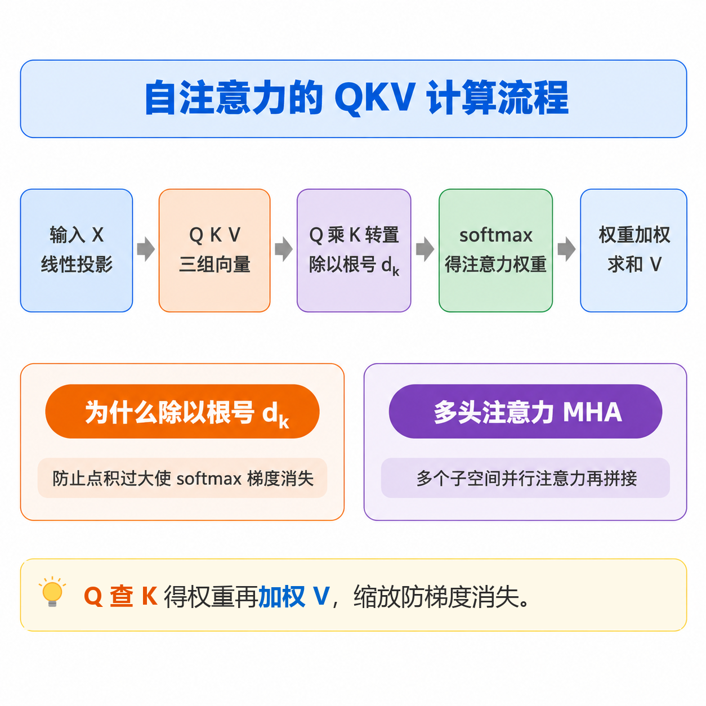

图3-19 自注意力的 QKV 计算流程

<h2 id="q3-10-2">面试问题：为什么自注意力计算中要除以 $\sqrt{d_k}$（缩放因子）？如果不除以会发生什么？（考察 Softmax 饱和与梯度）。</h2>

**难度评分：⭐⭐⭐ (3/5) | 考察频率：⭐⭐⭐⭐⭐ (5/5)**

假设 $Q$ 和 $K$ 中的元素相互独立，且满足均值为0、方差为1的分布，那么二者点积结果的方差会变为 $d_k$。随着向量维度 $d_k$ 增大，点积结果的绝对值会明显增大，数值分布会变得非常离散。

如果不除以 $\sqrt{d_k}$，过大的点积数值会让Softmax函数进入饱和区：输出分布会极度趋近于独热（One-hot）形式，即最大值位置的概率趋近于1，其余位置趋近于0。此时Softmax的梯度会趋近于0，导致反向传播时梯度消失，模型无法正常训练收敛。

除以 $\sqrt{d_k}$ 后，点积结果的方差会被重新缩放至1，数值分布更平缓，Softmax输出的权重分布更平滑，梯度也更稳定，保证了训练的正常收敛。

<h2 id="q3-10-3">面试问题：解释多头注意力（MHA）的核心思想，并介绍 MQA（多查询）和 GQA（分组查询）的区别及适用场景（KV Cache 显存优化）。</h2>

**难度评分：⭐⭐⭐⭐ (4/5) | 考察频率：⭐⭐⭐⭐⭐ (5/5)**

（1）多头注意力（MHA）的核心思想
将输入特征投影到多个相互独立的特征子空间，每个子空间由一个独立的注意力头（Head）单独计算注意力，最后将所有头的输出拼接融合。多头机制让模型可以同时捕捉不同维度的语义信息（如句法依赖、指代关系、语义关联等），提升了模型的多维度表征能力。

（2）MQA 与 GQA 的根本区别及适用场景
- 标准MHA：每个注意力头都拥有独立的K、V投影矩阵。KV Cache存储量最大，推理时显存带宽压力最高，但模型效果最优。
- MQA（Multi-Query Attention，多查询注意力）：所有注意力头共享同一组K、V投影矩阵。KV Cache显存占用最低，推理速度最快，但模型精度会有一定损失。
- GQA（Grouped Query Attention，分组查询注意力）：将所有注意力头划分为若干组，每组内部共享一组K、V投影矩阵。

GQA 本质是 MQA（分组数 $g=1$，即所有头共享一组 K、V）与标准 MHA（分组数 $g=h$，即每个头独立一组 K、V）之间的折中方案。它在模型效果与推理显存/速度之间取得了较好的平衡，因此成为 LLaMA-2、LLaMA-3 等现代大语言模型的标准配置，广泛适用于兼顾效果与推理效率的大模型部署场景。

<h2 id="q3-10-4">面试问题：自注意力机制的 $O(N^2)$ 复杂度带来了哪些长序列痛点？有哪些主流的算法级解决方案（如稀疏注意力、线性注意力）？</h2>

**难度评分：⭐⭐⭐⭐ (4/5) | 考察频率：⭐⭐⭐⭐ (4/5)**

（1）$O(N^2)$ 复杂度带来的长序列痛点
- 显存占用爆炸：标准自注意力需要存储尺寸为 $N \times N$ 的注意力分数矩阵，序列长度翻倍时，显存占用变为原来的4倍，超长序列下极易超出显存上限。
- 计算效率低下：计算量随序列长度呈平方级增长，序列越长，单步推理延迟越高，整体吞吐效率越低。

（2）主流的算法级解决方案
- 稀疏注意力：通过人工设计注意力模式，限制每个位置仅关注局部窗口内的Token或少量全局关键Token，将计算与显存复杂度降至 $O(N)$，代表方案如Longformer。
- 线性/低秩注意力：绕过显式的 $N \times N$ 注意力矩阵，把复杂度降到近似线性，主要有两条思路：一是核函数近似（如 Performer，利用核函数将 $(QK^T)V$ 改写为 $Q(K^TV)$，改变计算顺序），二是沿序列维做低秩投影（如 Linformer，把 K、V 压缩到固定长度 $r \ll N$）。
- 状态空间模型（SSM）：完全摒弃注意力机制，通过状态空间模型实现序列建模，代表方案如Mamba。它在保持全局建模能力的同时，实现了严格的 $O(N)$ 线性计算与显存复杂度，在长序列场景下优势明显。

<h2 id="q3-10-5">面试问题：批量推理时的计算瓶颈在哪里？请解释 KV Cache 的原理及其加速机制，并介绍 FlashAttention 的核心优化思路（IO 感知）。</h2>

**难度评分：⭐⭐⭐⭐⭐ (5/5) | 考察频率：⭐⭐⭐⭐⭐ (5/5)**

（1）批量推理的主要计算瓶颈
自回归生成第 $t$ 个Token时，若采用原生计算方式，需要重复计算前面所有历史Token的Q、K、V投影与注意力矩阵，存在大量冗余计算，且随着生成序列变长，单步计算耗时持续增加，算力利用率低下。

（2）KV Cache 的原理与加速机制
- 原理：将每一步计算得到的Key、Value向量缓存起来，生成新Token时，仅需计算当前新Token的K、V，并拼接到历史缓存中，无需重复计算历史位置的投影。
- 加速机制：以显存空间换取计算时间，避免了历史 Token 的重复计算。每生成一个新 Token，只需计算该 Token 的投影，并让它与缓存中的全部历史 K、V 做一次注意力，无需重算历史位置的 K、V，相比无缓存时每步都重算全部历史，累计计算量明显下降、推理速度明显提升。需要注意的是，新 Token 仍要与全部历史 K/V 计算注意力，单步注意力开销仍是 $O(N)$，且 KV 缓存本身会随上下文长度线性增长。

（3）FlashAttention 的优化思路
FlashAttention 的关键，是 IO 感知的计算优化，专门针对 GPU 显存读写的瓶颈设计。
- 原生痛点：标准自注意力的计算过程中，尺寸巨大的中间注意力矩阵需要在高带宽显存（HBM）和片上高速缓存（SRAM）之间反复读写，显存IO成为主要性能瓶颈。
- 优化方法：采用分块计算与重计算策略，将完整的注意力计算拆分为多个小块，全部在片上SRAM内完成计算，无需将完整的中间矩阵写回HBM；反向传播时通过重计算恢复中间结果，避免存储大量激活值。
- 效果：明显减少了显存IO次数，可实现2~4倍的训练/推理加速，同时将显存占用降低至线性级别。

<h1 id="q3-11">11. 介绍一下位置编码的原理</h1>

<h2 id="q3-11-1">面试问题：为什么 Transformer 需要位置编码？位置编码为什么要和词嵌入相加而不是拼接？</h2>

**难度评分：⭐⭐⭐ (3/5) | 考察频率：⭐⭐⭐⭐ (4/5)**

（1）Transformer 需要位置编码的原因
自注意力计算本身对输入排列具有置换等变性：打乱输入 Token 的顺序，输出也只是相应地重排，注意力本身不携带任何位置信息，模型无法感知 Token 的先后顺序。而语言等序列数据的语序包含核心语义信息，因此必须通过位置编码显式地向模型注入位置信息。

（2）位置编码与词嵌入相加而非拼接的原因
- 维度效率更高：拼接操作会使输出维度翻倍，直接增加后续层的参数量与计算量；相加操作保持原维度不变，不会引入额外的参数与计算开销，更高效。
- 可解耦性有理论保证：在特征维度足够高的前提下，后续的线性投影层可以有效解耦“词嵌入内容”与“位置信息”。从数学上看， $W(Emb + Pos) = W \cdot Emb + W \cdot Pos$，相当于分别对内容和位置做线性变换，二者不会相互干扰，模型可以独立学习两类信息。

正弦位置编码相加注入与 RoPE 旋转编码两种主流方案如图3-20所示：

  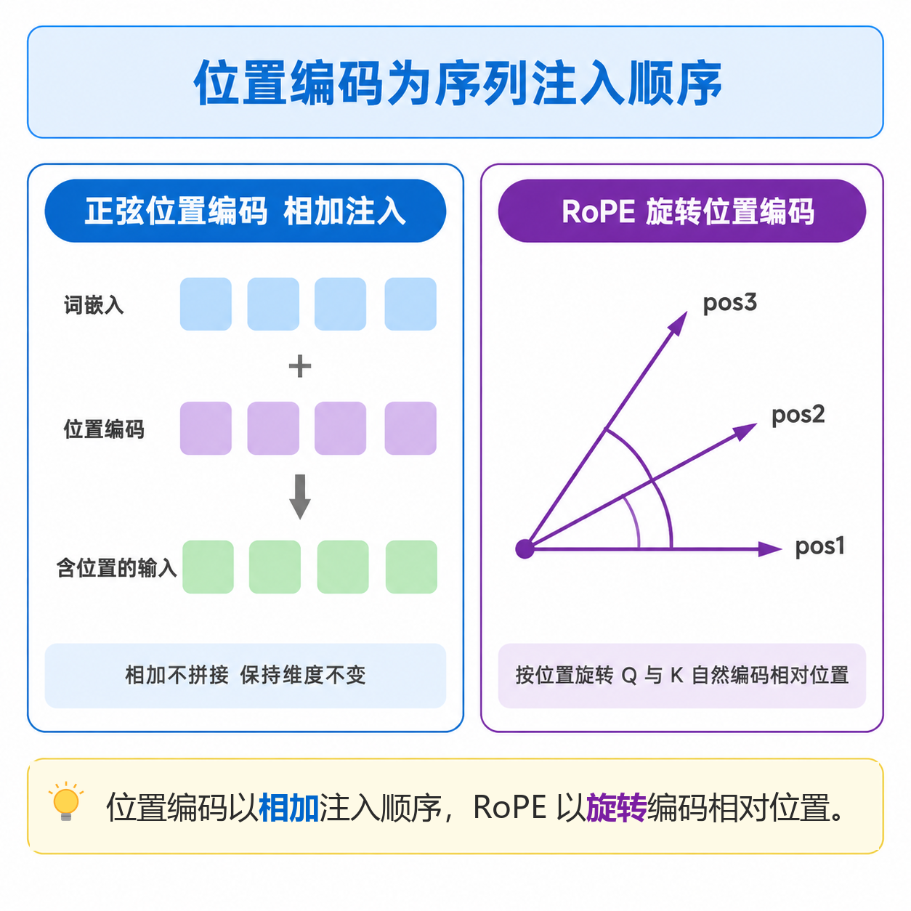

图3-20 位置编码为序列注入顺序

<h2 id="q3-11-2">面试问题：请简述正弦余弦位置编码的原理，并推导说明其为何能表示相对位置关系。</h2>

**难度评分：⭐⭐⭐⭐ (4/5) | 考察频率：⭐⭐⭐⭐ (4/5)**

（1）正弦余弦位置编码的原理

通过不同频率的正弦、余弦函数生成固定的位置向量，无需学习，具体公式为：

$$ PE_{(pos, 2i)} = \sin\left( pos / 10000^{2i/d} \right) $$

$$ PE_{(pos, 2i+1)} = \cos\left( pos / 10000^{2i/d} \right) $$

其中 $pos$ 为位置索引， $i$ 为维度索引， $d$ 为位置编码的总维度。

（2）可表示相对位置的推导说明

利用三角恒等式 $\sin(\alpha+\beta) = \sin\alpha\cos\beta + \cos\alpha\sin\beta$ 可以推导：任意位置 $pos+k$ 的位置编码，都可以表示为位置 $pos$ 编码的线性组合。这意味着模型只需通过简单的线性变换，就能从绝对位置编码中提取出两个位置的相对距离信息，因此天然具备相对位置的建模能力。

<h2 id="q3-11-3">面试问题：为什么现代大模型普遍采用 RoPE（旋转位置编码）？它的核心原理和优势是什么？</h2>

**难度评分：⭐⭐⭐⭐⭐ (5/5) | 考察频率：⭐⭐⭐⭐⭐ (5/5)**

（1）RoPE（旋转位置编码）的原理
RoPE的核心思想是将位置索引转化为旋转角度，把Query和Key向量视为复数形式，在特征空间中进行逐位的旋转操作：位置为 $m$ 的向量，会旋转与 $m$ 成正比的角度。最终通过向量点积计算注意力分数时，结果仅与两个位置的相对差值相关，从而实现相对位置建模。

（2）现代大模型普遍采用 RoPE 的主要优势
- 天然的相对位置感知：注意力分数 $q_m \cdot k_n$ 的计算结果仅包含相对位置差 $m-n$ 的信息，而非绝对位置，更契合语言的相对语义特性，建模更合理。
- 更优的长度外推能力：相比固定的正弦余弦位置编码，RoPE在超出训练长度的长序列场景下，性能衰减更平缓，具备更好的外推潜力。
- 实现高效且兼容性强：通过逐元素相乘即可实现旋转操作，计算开销极低；同时可以无缝融入各类注意力变体，适配性强，因此成为当前大语言模型的主流位置编码方案。

<h2 id="q3-11-4">面试问题：解释 RoPE 的外推问题。Base 参数的作用是什么？有哪些常见的外推解决方案（如 NTK-aware, YaRN）？</h2>

**难度评分：⭐⭐⭐⭐⭐ (5/5) | 考察频率：⭐⭐⭐⭐ (4/5)**

（1）RoPE 的外推问题
当推理时的序列长度超过训练时的最大长度时，模型会遇到训练阶段从未见过的位置索引，导致注意力分布异常、模型性能骤降，长文本生成的质量与连贯性明显下滑，这就是RoPE的长度外推问题。

（2）Base 参数的作用
Base 是控制旋转频率的参数。Base值越大，位置对应的旋转频率越低，角度变化越慢，高频分量越少，模型可编码的最大位置距离越长，但对局部细微位置差的分辨能力会相应下降；反之Base越小，局部分辨率越高，但可编码的最大长度越短。

（3）主流的外推解决方案
- 位置插值（PI）：将推理时的位置索引线性压缩到训练时的长度范围内，实现简单，但会损失局部分辨率，近距离依赖建模效果下降。
- NTK-aware Scaling：通过动态调整Base值实现外推，高频分量不做缩放以保留局部细节，低频分量缩放以扩展可编码长度，在保留局部能力的同时提升了外推效果。
- YaRN：在 NTK-aware 的基础上，结合注意力温度系数调整与分布修正，进一步缓解外推后的分布偏移，是目前综合效果较好的常用外推方案。

<h2 id="q3-11-5">面试问题：RoPE 的高低频旋转圈数差异对应什么类型的依赖建模？ALiBi 位置编码与 RoPE 相比有什么优缺点？</h2>

**难度评分：⭐⭐⭐⭐⭐ (5/5) | 考察频率：⭐⭐⭐ (3/5)**

（1）RoPE 高低频分量对应的依赖建模
- 高频分量：旋转角度变化快，位置的细微差异就会带来编码的明显变化，对应局部依赖建模，用于精准捕捉相邻、近距离 Token 之间的语义关联。
- 低频分量：旋转角度变化慢，长距离位置变化才会带来编码的明显差异，对应长距离依赖建模，避免位置编码随长度增加快速周期重复，支撑远距离的位置区分。

（2）ALiBi 与 RoPE 的优缺点对比
- ALiBi（无位置编码，仅加偏置）
关键设计：不向词向量中注入位置信息，直接在注意力分数上施加与距离正相关的线性惩罚。
优点：零训练成本的外推能力极强，无需微调即可处理远超训练长度的序列，实现简单。
缺点：强制“距离越远、权重越低”的单调衰减假设，限制了模型长距离回溯、远距离依赖建模的表达能力。

- RoPE
优点：相对位置建模更灵活，语义表征能力更强，在大规模预训练下效果更优，适配各类大模型架构，是当前工业界的主流选择。
缺点：原生外推能力有限，超长序列场景需要配合外推算法优化。

<h1 id="q3-12">12. AIGC 时代 Transformer 架构的主要优化方向有哪些？</h1>

<h2 id="q3-12-1">面试问题：在模型组件层面，LLM 常用 RMSNorm 和 SwiGLU 替代传统组件，原因是什么？</h2>

**难度评分：⭐⭐⭐ (3/5) | 考察频率：⭐⭐⭐⭐ (4/5)**

标准LayerNorm需要计算特征的均值与方差，再做中心化与缩放。RMSNorm去掉了均值中心化的步骤，仅基于均方根进行缩放，计算逻辑更简洁，计算开销更低。在大模型的实验验证中，RMSNorm的训练效果与LayerNorm相当甚至更优，同时能提升训练与推理的计算效率，因此成为大模型的标准设计。

SwiGLU融合了Swish激活函数的平滑梯度特性与门控线性单元（GLU）的动态筛选能力。
相比ReLU的硬截断（负区间梯度为0，易出现神经元死亡），SwiGLU的梯度传递更平滑，深层网络的梯度更稳定；同时门控机制可以让模型动态控制信息的流通与过滤，特征表征能力更强。大量实验表明，SwiGLU能明显提升大语言模型的最终性能，因此被广泛采用。

组件替换、MoE、并行训练与推理加速四大优化方向如图3-21所示：

  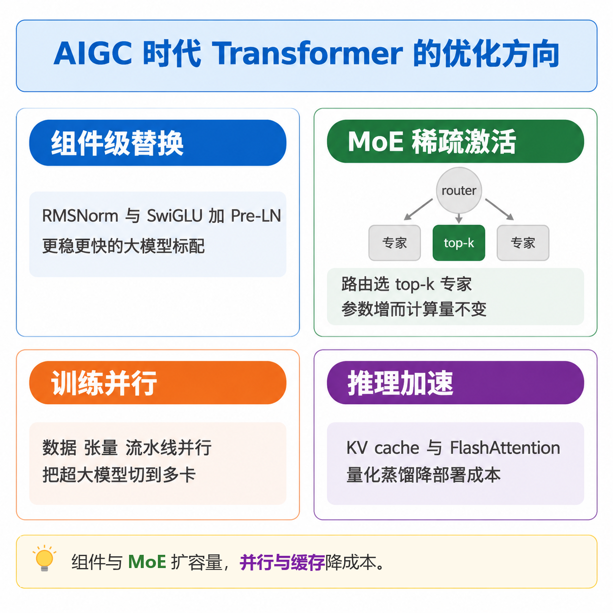

图3-21 AIGC 时代 Transformer 的优化方向

<h2 id="q3-12-2">面试问题：什么是 MoE（混合专家模型）？它是如何在不增加推理计算量的前提下扩大模型参数量的？</h2>

**难度评分：⭐⭐⭐⭐ (4/5) | 考察频率：⭐⭐⭐⭐⭐ (5/5)**

MoE 是一种稀疏架构设计，主要思路是把 Transformer 中的 FFN 层替换为多个并行的“专家”子网络，外加一个轻量的“路由”网络，用于调度专家的激活。它的机制是稀疏激活：对于每一个输入 Token，路由网络只会选择 Top-k 个专家（通常为 Top-2）参与计算，其余专家全部处于休眠状态，不产生计算开销。
最终效果是：模型的总参数量可以做得非常大（知识容量更高），但推理过程中每个Token实际激活的参数量保持不变，计算成本与稠密模型相当。MoE实现了“模型总参数量”与“推理计算成本”的解耦，是低成本构建超大规模高性能模型的主要技术路线。

<h2 id="q3-12-3">面试问题：在多模态大模型中，Transformer 是如何适配不同模态的？扩散模型中的 Transformer（DiT）有何特点？</h2>

**难度评分：⭐⭐⭐⭐ (4/5) | 考察频率：⭐⭐⭐ (3/5)**

Transformer 适配多模态的核心思想是统一 Token 化（Tokenization）：通过对应的模态编码器（如图像用 ViT、音频用 Audio Encoder），将图像、音频、视频等非文本数据转换为与文本 Token 格式一致的序列化向量，再将不同模态的 Token 拼接融合，送入统一的 Transformer 骨干网络中进行处理，从而实现多模态的统一建模。

扩散模型中 DiT（Diffusion Transformer）是用 Transformer 架构替代传统扩散模型中的U-Net骨干网络：
- 关键设计：将扩散过程中的隐空间特征块（Latent Patch）视为序列，通过自注意力机制进行全局建模。
- 主要优势：相比U-Net，DiT的规模扩展（Scaling）特性更优，模型性能随参数量增长的收益更明显；同时可以复用NLP领域Transformer的大量架构优化与训练经验，代表方案如Sora、Stable Diffusion 3.0，已成为新一代文生图、文生视频模型的主流架构。

<h2 id="q3-12-4">面试问题：大模型训练中，Transformer 的主要计算瓶颈在哪里？有哪些主流的并行训练方案（如 3D 并行）？</h2>

**难度评分：⭐⭐⭐⭐ (4/5) | 考察频率：⭐⭐⭐⭐⭐ (5/5)**

大模型训练的主要计算瓶颈是显存容量不足：训练过程中需要同时存储模型参数、梯度、优化器状态以及前向激活值，百亿、千亿级模型的显存需求远超单卡容量；其次是多卡协同的计算通信比偏低，跨卡通信开销大，算力利用率不高。

主流的并行训练方案有以下几种：
- 数据并行：每张卡复制完整的模型副本，输入数据切分到各卡并行计算，最后同步梯度。主要作用是提升训练吞吐，适配数据量大的场景。
- 张量并行：将单层内的矩阵运算切分到多张卡上，每层的参数与计算由多卡共同完成。主要解决单层参数过大、单卡无法存放的问题。
- 流水线并行：将模型的不同层切分到多张卡上，按层的顺序流水线式执行计算。主要解决模型层数过多、单卡无法存放的问题。
- ZeRO（零冗余优化器）：对优化器状态、梯度、模型参数进行跨卡切分存储，按需通信，在不增加太多通信开销的前提下明显节省显存，是当前大模型训练的标配优化。

<h2 id="q3-12-5">面试问题：在推理阶段，有哪些关键的系统级优化技术？</h2>

**难度评分：⭐⭐⭐⭐ (4/5) | 考察频率：⭐⭐⭐⭐⭐ (5/5)**

（1）Continuous Batching
传统静态批处理需要等待批次内最长的序列生成完成后，才能统一释放资源处理下一批。连续批处理允许已完成生成的请求立即退出批次，同时即时接入新的请求，明显减少了GPU的空闲等待时间，明显提升GPU利用率与系统整体吞吐。

（2）PagedAttention
针对KV Cache显存碎片化、利用率低的问题，借鉴操作系统虚拟内存的分页思想，将KV Cache分割为固定大小的“页”，存储在非连续的物理显存中，按需分配与回收。该技术极大提升了显存利用率，可支持更大的并发批次，是当前推理部署的主要优化技术。

（3）权重量化
将模型权重从高精度的FP16/FP32压缩为低精度的INT8/INT4，在尽量少损失精度的前提下，明显降低显存占用与显存带宽压力，同时提升推理速度，适配低显存硬件的部署需求。

<h2 id="q3-12-6">面试问题：为什么 Transformer 能支撑模型规模不断放大，成为 AIGC 时代的基石架构？未来的演进方向可能是什么？</h2>

**难度评分：⭐⭐⭐⭐⭐ (5/5) | 考察频率：⭐⭐⭐⭐ (4/5)**

（1）Transformer 成为AIGC时代基石架构的原因
- 极强的通用性：不仅适配NLP任务，通过Token化思想可以统一处理文本、图像、音频、视频等几乎所有模态，支撑了通用多模态大模型的发展。
- 优秀的可扩展性：架构简洁规整，主要计算以矩阵乘法为主，天然适配GPU的并行计算架构；Scaling Laws验证了其性能随参数量、数据量、算力增长持续提升，尚未出现明显的饱和瓶颈，支持模型规模不断扩大。
- 涌现能力的支撑：基于Transformer的大规模预训练模型，在规模突破阈值后会涌现出推理、指令跟随、工具使用等高阶能力，这是AIGC智能跃迁的基础。

（2）未来的主要演进方向
- 线性化建模：突破自注意力 $O(N^2)$ 的复杂度瓶颈，以Mamba为代表的SSM架构、线性注意力等方案持续演进，追求长序列下的高效全局建模。
- 超长上下文优化：围绕位置编码外推、稀疏注意力、内存优化等方向，持续提升模型可支持的上下文长度，向“无限上下文”的目标演进。
- 稀疏化架构普及：以MoE为代表的稀疏架构进一步成熟，在更低的推理成本下实现更大的模型容量，同时推动大模型向端侧设备落地。

<h1 id="q3-13">13. 介绍一下图神经网络（GNN）的原理</h1>

<h2 id="q3-13-1">面试问题：介绍一下图神经网络（GNN）的原理</h2>

**难度评分：⭐⭐⭐ (3/5) | 考察频率：⭐⭐⭐⭐ (4/5)**

图神经网络（Graph Neural Networks，GNN）是一类专门用于处理图结构数据的深度神经网络。与处理规整欧式数据的 CNN、RNN 不同，GNN 直接作用于由节点（Node）与边（Edge）构成的拓扑图，在保留图结构的前提下进行特征学习。

构成要素：GNN 的学习对象即图数据的三要素：① 节点特征——单个节点的属性信息（如用户年龄、原子类型）；② 边特征——节点之间的关联（如社交关系、化学键类型）；③ 拓扑结构——节点与边构成的整体连接方式。

原理：GNN 以消息传递（Message Passing）机制为核心，通过多层迭代完成特征学习。每一层对每个目标节点执行以下步骤：① 从其邻居节点收集特征消息；② 通过求和、均值、最大值或注意力等方式进行置换不变聚合；③ 与自身上一层表征融合更新。经过 K 层堆叠，节点表征逐步融合 1 阶、2 阶直至 K 阶邻域的拓扑与特征信息。

主要优势：天然适配非欧式的不规则图数据，具备排列等变/不变性（节点级等变、图级不变），不受节点编号与邻居顺序影响，可同时学习节点属性、边关系与局部邻域结构，弥补了 CNN、RNN 无法直接建模复杂拓扑关系的短板。

GNN 的消息传递机制及其与 CNN、RNN 的区别如图3-22所示：

  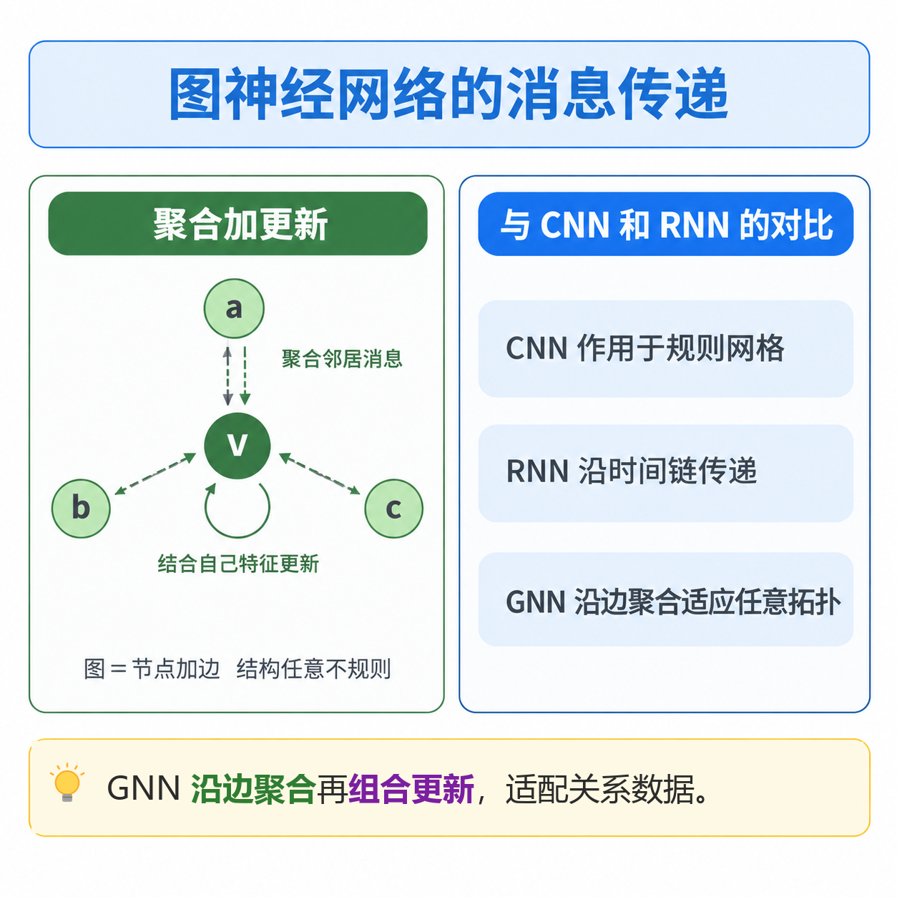

图3-22 图神经网络的消息传递

<h2 id="q3-13-2">面试问题：GNN与CNN、RNN的核心区别是什么？为什么GNN更适合处理图数据？</h2>

**难度评分：⭐⭐⭐ (3/5) | 考察频率：⭐⭐⭐⭐ (4/5)**

（1）三者根本区别

- CNN：处理欧式网格结构（图像、矩阵），依赖固定规整邻域、权重共享、平移等变性。
- RNN：处理一维序列结构（文本、时间序列），依赖时序先后顺序、链式依赖、循环迭代。
- GNN：处理非欧式图结构（节点 + 边 + 拓扑关系），邻域大小与结构随拓扑动态变化，采用置换不变聚合，适配无序可变结构。

|维度|CNN|RNN|GNN|
|---|---|---|---|
|处理数据结构|二维规整网格（图像）|一维线性序列（文本 / 时序）|非规则图（节点、边、拓扑）|
|邻域特点|固定大小、有序邻域|前后时序邻域、线性依赖|每个节点的邻域数量不固定、无序|
|结构不变性|平移等变、局部感受野|时序顺序敏感、位置强相关|置换等变性（节点级）/ 置换不变性（图级）|
|信息聚合方式|卷积滑窗加权求和|逐时间步循环传递|在变长邻域上做置换不变聚合|
|适用场景|图像分类、检测、分割|NLP、语音、时间序列预测|社交网络、知识图谱、分子图、推荐系统|

（2）为什么 GNN 更适合处理图数据？

- 图是非欧式不规则结构，CNN、RNN 无法适配节点邻居数量可变、拓扑任意的特点。
- GNN 依靠消息传递机制，聚合邻居特征并更新节点表征，可同时学习节点、边与局部拓扑信息。
- GNN 具备置换等变 / 不变性，打乱节点顺序不改变图语义；CNN、RNN 对输入顺序敏感。
- 多层 GNN 能扩展到 K 阶邻域，建模多跳高阶依赖，相比 CNN 和 RNN 更适合捕捉图结构长程关联。

