# 目录

## 1.3 深度学习网络架构
本章聚焦深度学习网络架构，汇总 AIGC 面试高频考点。从权重初始化、卷积、归一化、激活函数等基础组件展开，解析 ResNet、U-Net 经典网络；重点讲解 Transformer、自注意力、位置编码与推理优化，同步介绍 MoE、多模态、GNN 等前沿方向，打通传统深度学习、大模型与扩散模型知识脉络。

[1. 如何理解权重初始化？](#q3-1)
  - [面试问题：什么是权重初始化？核心目的是什么？](#q3-1-1)
  - [面试问题：常见的初始化方法有哪些？](#q3-1-2)
  - [面试问题：为什么不能用全0初始化，不合理初始化会导致什么问题？](#q3-1-3)
  - [面试问题：介绍一下 Xavier/He 初始化的核心思想](#q3-1-4)
  - [面试问题：正交初始化的核心原理是什么？在扩散模型/Transformer 的哪些场景中常用？](#q3-1-5)
  - [面试问题：扩散模型的噪声预测头为什么常用小方差初始化？初始化过大会导致什么问题？](#q3-1-6)

[2. 全连接层是如何工作的？](#q3-2)
  - [面试问题：介绍一下全连接层的原理](#q3-2-1)
  - [面试问题：全连接层的参数量如何计算？为什么高维特征下全连接层参数量会急剧膨胀？](#q3-2-2)
  - [面试问题：全连接层和 1×1 卷积有什么区别与联系，分别在什么场景下使用？](#q3-2-3)
  - [面试问题：扩散模型中的时间嵌入 MLP 为什么用全连接层实现，有什么优势？](#q3-2-4)

[3. 归一化层的核心原理是什么？](#q3-3)
  - [面试问题：什么是归一化，常用的归一化方法都有哪些？](#q3-3-1)
  - [面试问题：归一化和标准化的核心区别是什么？](#q3-3-2)
  - [面试问题：归一化在扩散模型中的具体作用是什么？](#q3-3-3)
  - [面试问题：为什么生成类模型普遍不使用 BatchNorm，会带来什么问题？](#q3-3-4)

[4. 介绍一下激活函数的原理](#q3-4)
  - [面试问题：介绍一下激活函数的定义及原理](#q3-4-1)
  - [面试问题：介绍一下激活函数有哪几类，常用经典激活函数有哪些？](#q3-4-2)
  - [面试问题：有哪些激活函数在 AIGC 时代取得了大量的应用，它们有什么优势？](#q3-4-3)
  - [面试问题：激活函数在使用中有哪些典型的问题？](#q3-4-4)

[5. 介绍一下卷积操作的原理](#q3-5)
  - [面试问题：请详细介绍卷积操作及其核心原理](#q3-5-1)
  - [面试问题：介绍一下卷积操作中的卷积核、步幅、填充、感受野的定义及作用](#q3-5-2)
  - [面试问题：常用的卷积层有哪些？请分别详细介绍其结构、原理及适用场景](#q3-5-3)
  - [面试问题：卷积和 Transformer 在 AIGC 中各自的优势和适用场景是什么？](#q3-5-4)
  - [面试问题：卷积核的大小、数量应如何选择？](#q3-5-5)

[6. 介绍一下池化层的原理](#q3-6)
  - [面试问题：什么是池化层？介绍一下其原理](#q3-6-1)
  - [面试问题：常用的池化层有哪些？请分别介绍其结构、计算方式及适用场景？](#q3-6-2)
  - [面试问题：池化操作中，步幅和池化核大小应如何选择？](#q3-6-3)

[7. 介绍一下深度学习发展中的经典网络](#q3-7)
  - [面试问题：介绍 ResNet 网络及其核心亮点](#q3-7-1)
  - [面试问题：介绍 U-Net 网络及其核心亮点](#q3-7-2)

[8. Transformer 的提出背景是什么？解决了 RNN 的哪些核心缺陷？](#q3-8)
  - [面试问题：Transformer 的提出背景是什么？它为了解决 RNN/LSTM 的哪些核心缺陷而设计？](#q3-8-1)
  - [面试问题：相比 CNN 处理序列任务，Transformer 的核心优势和劣势分别是什么？为什么它能实现序列的并行计算？](#q3-8-2)
  - [面试问题：自注意力的全局建模能力，相比 RNN 的时序建模和 CNN 的局部建模，在生成类任务上带来了什么本质差异？](#q3-8-3)

[9. 介绍一下 Transformer 网络结构](#q3-9)
  - [面试问题：请完整介绍 Transformer 的整体架构，简述 Encoder 和 Decoder 的核心区别](#q3-9-1)
  - [面试问题：为什么解码器需要掩码自注意力？请解释 Causal Mask 和 Padding Mask 的作用及实现方式](#q3-9-2)
  - [面试问题：为什么纯解码器架构在 AIGC 时代（如 LLM）成为主流？Encoder-only 和 Encoder-Decoder 架构分别适用于什么场景？](#q3-9-3)
  - [面试问题：Transformer 中为什么要使用残差连接 + 层归一化？Pre-LN 相比 Post-LN 有什么区别？为什么大模型普遍用 Pre-LN？](#q3-9-4)
  - [面试问题：Transformer 的 FFN 起什么作用？为什么大模型常用 SwiGLU 替代传统的 ReLU/GELU？](#q3-9-5)

[10. 介绍一下自注意力机制的原理](#q3-10)
  - [面试问题：详细描述标准自注意力的完整计算流程，并解释 Q、K、V 的含义以及“为什么需要区分三者”](#q3-10-1)
  - [面试问题：为什么自注意力计算中要除以 √d_k（缩放因子）？](#q3-10-2)
  - [面试问题：解释多头注意力（MHA）的核心思想，并介绍 MQA 和 GQA 的区别及适用场景](#q3-10-3)
  - [面试问题：自注意力机制的 O(N²) 复杂度带来了哪些长序列痛点？有哪些主流的算法级解决方案？](#q3-10-4)

[11. 介绍一下位置编码的原理](#q3-11)
  - [面试问题：为什么 Transformer 需要位置编码？位置编码为什么要和词嵌入相加而不是拼接？](#q3-11-1)
  - [面试问题：请简述正弦余弦位置编码的原理，并推导说明其为何能表示相对位置关系](#q3-11-2)
  - [面试问题：解释 RoPE 的外推问题，Base 参数的作用是什么？有哪些常见的外推解决方案（如 NTK-aware、YaRN）？](#q3-11-4)
  - [面试问题：RoPE 的高低频旋转圈数差异对应什么类型的依赖建模？ALiBi 位置编码与 RoPE 相比有什么优缺点？](#q3-11-5)

[12. AIGC 时代 Transformer 架构的主要优化方向有哪些？](#q3-12)
  - [面试问题：什么是 MoE？它是如何在不增加推理计算量的前提下扩大模型参数量的？](#q3-12-2)
  - [面试问题：在多模态大模型中，Transformer 是如何适配不同模态的？扩散模型中的 Transformer（DiT）有何特点？](#q3-12-3)
  - [面试问题：大模型训练中，Transformer 的主要计算瓶颈在哪里？有哪些主流的并行训练方案？](#q3-12-4)
  - [面试问题：在推理阶段，有哪些关键的系统级优化技术？](#q3-12-5)
  - [面试问题：为什么 Transformer 能支撑模型规模不断放大，成为 AIGC 时代的基石架构？未来的演进方向可能是什么？](#q3-12-6)

[13. 介绍一下图神经网络（GNN）的原理](#q3-13)
  - [面试问题：介绍一下图神经网络（GNN）的原理](#q3-13-1)
  - [面试问题：GNN 与 CNN、RNN 的核心区别是什么？为什么 GNN 更适合处理图数据？](#q3-13-2)

# 深度学习网络架构

<h1 id="q3-1">1. 如何理解权重初始化？</h1>

<h2 id="q3-1-1">面试问题：什么是权重初始化？核心目的是什么？</h2>

**难度评分：⭐⭐ (2/5) | 考察频率：⭐⭐⭐⭐⭐ (5/5)**

权重初始化，就是在训练开始前给网络里所有可学习的权重赋一组初值。这件事看起来不起眼，但初值给得合不合适，直接决定了网络能不能收敛、收敛得快不快，以及最终能达到的精度,它主要解决下面四个问题:

（1）打破对称性：隐藏层中原本对称的神经元需要通过初始化等机制打破对称性。如果整网隐藏权重都设成相同值且偏置等也相同，这些神经元可能得到相同的前向输出和更新，无法学到不同特征；全零初始化配合 ReLU 还可能使梯度通路关闭。随机初始化让初始权重彼此不同，每个神经元才能各自去学不同的特征，网络的宽度才真正有意义。

> 偏置一般可以直接初始化为 0，前提是权重等其他参数已经打破神经元之间的对称性；偏置为 0 本身不会消除这些权重差异。

（2）把梯度控制在合理的尺度：反向传播时梯度要沿层连乘，初值偏大，梯度会层层放大，容易梯度爆炸，表现为损失剧烈震荡甚至数值溢出；初值偏小，梯度又会层层衰减，深层参数几乎得不到更新，也就是梯度消失。Xavier、He 这类初始化的思路，就是让每一层输入和输出的方差大致保持一致，把梯度稳定在一个合适的范围内。

（3）加快收敛：初值如果落在离最优解不太远的区域，模型就不用在无效的参数空间里绕远路，需要的迭代轮数更少，训练的时间和算力成本也更低。

（4）降低卡在鞍点和劣质局部最优上的概率：网络的损失曲面里布满了鞍点和局部最优，从不同起点出发往往会收敛到不同的解。合理的初值能让模型更容易避开那些让训练停滞的鞍点和效果较差的局部最优，最后落到泛化更好的解上。

权重初始化的两大主要作用——打破参数对称与保持逐层方差一致——如图3-1所示：

  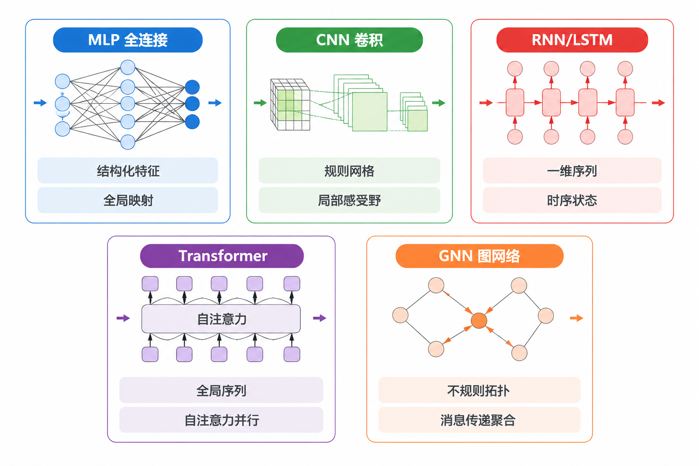

图3-1 权重初始化打破对称与保持方差一致

<h2 id="q3-1-2">面试问题：常见的初始化方法有哪些？</h2>

**难度评分：⭐⭐⭐ (3/5) | 考察频率：⭐⭐⭐⭐ (4/5)**

常见的初始化方法有以下五种：

### 1、常数初始化

把所有权重都设成同一个固定值，常见的是全 0、全 1。若整网隐藏层及其他相关参数保持对称，相同初值会妨碍不同神经元学习不同特征；大常数还可能放大信号或使激活进入饱和区，引起梯度爆炸或消失。因此通常不对整个隐藏网络使用相同常数初始化，但偏置、归一化仿射参数以及某些残差分支末层或输出头可以按架构设计采用常数或零初始化。

### 2、小方差随机初始化

从零均值的均匀或正态分布里采样，方差取很小。实现简单，但网络一深、方差又没设好，特征方差就会逐层放大或衰减，引出梯度问题。它主要用在输出层、回归头、生成模型的预测头这类对初始输出尺度很敏感的地方——方差取小一点，避免训练刚开始预测值就剧烈跳动、损失爆炸。

### 3、Xavier（Glorot）

它基于“前向时每层特征方差一致、反向时每层梯度方差一致”推导出来，适用于线性层以及 tanh 等在原点附近近似线性、输出零中心的激活。Sigmoid 也可结合适当缩放使用，但其输出不关于原点对称，原点导数也不是 1。正态分布版的方差为：

$$ Var(w) = \frac{2}{n_{in} + n_{out}} $$

均匀分布版则在下面区间内采样：

$$ w \sim U\left(-\sqrt{\frac{6}{n_{in}+n_{out}}},\ \sqrt{\frac{6}{n_{in}+n_{out}}}\right) $$

其中 $n_{in}$ 是输入神经元数（fan_in）， $n_{out}$ 是输出神经元数（fan_out），以 fan_in 与 fan_out 的算术平均作为分母，即对前向所需的倒数尺度和反向所需的倒数尺度取调和平均，折中兼顾两向的方差稳定。它的短板是遇到 ReLU 这类会让一部分神经元失活的非对称激活时，没法再维持方差稳定，特征方差会一层层衰减。

### 4、He（Kaiming）初始化

它专门针对 ReLU 及其变体（LeakyReLU、PReLU 等）设计。ReLU 会把负输入全部置零，当输入是零均值对称分布时，大约一半神经元被截断，输出二阶矩约为输入二阶矩的一半；这不等于输出方差减半，因为 ReLU 输出均值一般不为 0。He 因而将基于 fan_in 的线性初始化方差乘以 2，以保持前向信号的二阶矩尺度；LeakyReLU、PReLU 的增益还需按负半轴斜率调整。GELU、SiLU 的初始化应结合具体架构选择，不能直接套用 ReLU 的严格推导。最常用的 fan_in 模式方差为：

$$ Var(w) = \frac{2}{n_{in}} $$

它同样有正态和均匀两种实现，也有用于反向梯度的 fan_out 模式（ $2/n_{out}$），默认用 fan_in 即可。He 常用于 ReLU 类 CNN；Transformer 则常按具体模型采用 Xavier、指定标准差的正态或截断正态及残差缩放等方案，并非都使用 He。

### 5、正交初始化

将权重矩阵初始化为正交或半正交矩阵。对于方阵且增益为 1 时，满足 `W^T W = I`，奇异值均为 1，线性变换保持向量范数；但非线性激活、残差相加和训练后的权重变化仍会影响信号与梯度，不能据此保证整网不发生梯度消失或爆炸。它尤其常用于 RNN、LSTM、GRU 的循环权重，也可作为 Transformer 或扩散模型某些投影层的候选初始化，是否采用需依据具体配方验证。

通用参数初始化惯例：

- 偏置：绝大多数层的偏置默认初始化为0；部分ReLU后的偏置可设为小正数，减少初始阶段神经元失活。
- 归一化层（BatchNorm / LayerNorm）：缩放参数 `γ` 初始化为1，偏移参数 `β` 初始化为0，这只使仿射部分初始为恒等映射，整个归一化层仍会执行标准化，并不等于对输入做恒等变换。

工程落地选型参考：

- 通用视觉CNN（分类、检测、分割）：主干卷积层统一使用He初始化，偏置置0，BN层保持 `γ=1, β=0`。
- Transformer与序列模型：主干MLP、注意力投影层按具体配方选用Xavier、正态或截断正态及深度相关缩放等初始化；RNN/LSTM循环权重优先正交初始化；LayerNorm通常令缩放参数为1、偏移参数为0，但归一化运算并非恒等映射。
- 生成模型（扩散模型、GAN）：ReLU类卷积层可用He初始化，Transformer层应沿用具体模型配方；注意力层和时间嵌入层不要求采用正交初始化；部分残差末层和输出预测头采用小方差或零初始化，以控制初始输出尺度。
- 自动驾驶与多任务：2D感知主干沿用He初始化；BEV、空间注意力投影层按架构选择Xavier、正态或其他初始化，正交初始化并非通用优先选项，也不能单独保证整条路径尺度稳定；深度、速度等回归头采用小方差初始化，避免初始预测值跳变；多模态融合层可选用Xavier或温和缩放的He初始化，对齐多分支信号尺度。

<h2 id="q3-1-3">面试问题：为什么不能用全0初始化，不合理初始化会导致什么问题？</h2>

**难度评分：⭐⭐ (2/5) | 考察频率：⭐⭐⭐⭐⭐ (5/5)**

对整个多层隐藏网络使用全0初始化，且偏置等参数也保持对称时，核心问题是无法打破参数对称性，最终导致同层神经元完全同质化，网络宽度设计失去实际意义。前向传播阶段，同一层所有神经元输入一致、权重均为0，线性计算结果完全相同，经过激活函数后输出依然无差异，神经元不具备差异化特征提取能力。反向传播阶段，权重梯度由输入值、激活函数导数与上游梯度共同决定，对称隐藏单元在相同输入和上游条件下会获得相同更新；对全零的深层网络，梯度还可能直接被零权重或激活导数阻断。在没有其他破坏对称性的机制时，这些隐藏单元仍保持对称，无法充分利用网络宽度，无法拟合复杂特征映射。不过，这不意味着任何单层权重都不能为0：线性模型、已随机初始化主干上的输出头、以及特定残差末层都可能合法使用零初始化。

偏置项、LayerNorm偏移参数、BatchNorm平移参数均属于加性参数，在权重已通过随机初始化打破对称性的前提下，可安全初始化为0。加性偏移不会破坏神经元间的权重差异，不会引发神经元同质化问题。ReLU激活层后的偏置有时会设为较小正数，用于降低训练初期的神经元失活比例，但0初始化仍是绝大多数场景的默认方案。

权重初始化尺度过大或过小均属于不合理初始化，会从梯度稳定性、收敛效率、最终效果多个层面带来负面影响，在深度网络与生成式模型中危害会被进一步放大。

对于通用深度网络，最直接的危害是梯度消失与梯度爆炸。反向传播遵循链式法则，梯度需经过多层权重矩阵连续相乘，初始权重尺度过大时，梯度幅值随层数加深呈指数级增长，引发梯度爆炸，表现为损失剧烈震荡、参数数值溢出，模型无法正常收敛。初始权重尺度过小时，梯度幅值随层数加深呈指数级衰减，引发梯度消失，深层网络参数几乎得不到有效更新，模型失去学习能力。

不合理初始化还会导致激活函数进入饱和区。对于sigmoid、tanh等饱和型激活函数，初始权重过大会使线性输出绝对值过大，激活函数进入两端平坦饱和区间，梯度趋近于0，参数更新近乎停滞，进一步加剧梯度消失问题。

除此之外，不合理初始化会让参数起点远离最优解所在的有效参数空间，模型需要更多迭代才能找到正确更新方向，收敛速度显著下降。极端情况下会直接陷入鞍点或效果较差的局部最优，最终模型精度达不到预期。

在大模型与AIGC生成场景中，初始化的尺度影响会被网络深度与特殊结构放大，带来更严重的问题。大模型通常包含数十到数百层网络堆叠，初始化的微小尺度误差会经过多层矩阵连乘呈指数级放大，极易在训练前几步就出现数值溢出，损失变为无穷大或NaN，训练直接崩溃。

Transformer架构中，注意力投影层的初始化尺度异常会直接破坏注意力分布合理性。尺度过大会导致QK点积结果数值过大，经过softmax后注意力分布极端尖锐，模型仅关注极少数token，出现注意力坍缩。尺度过小会导致QK点积结果数值过小，注意力分布过度平坦，模型无法聚焦有效信息，出现注意力弥散。二者都会严重削弱序列建模能力，最终表现为生成内容重复、语义混乱、逻辑连贯性差。

扩散模型等生成式架构中，噪声预测网络初始化不当可能导致初始损失过大或优化失稳，严重时无法学到有效去噪函数。生成失败还可能与数据、目标参数化、噪声调度和采样设置等有关，不能将模式崩溃或所有采样异常都归因于初始化。

初始化尺度不合理引发的梯度消失，在超深网络中会进一步加剧。在从输出向输入回传时，靠近输入的较早层往往更难得到有效梯度，可能长期停留在初始值附近；实际受影响的层还取决于权重、激活、残差和归一化结构，不能概括为只有浅层能更新。

<h2 id="q3-1-4">面试问题：介绍一下Xavier/He初始化的核心思想</h2>

**难度评分：⭐⭐⭐ (3/5) | 考察频率：⭐⭐⭐⭐⭐ (5/5)**

Xavier（Glorot）和 He（Kaiming）是目前最主流的两类初始化，思路一脉相承：都是控制权重的初始方差，让前向的激活值和反向的梯度在逐层传递时量级稳定，从训练一开始就避开梯度消失和爆炸。

它们的推导都基于线性层的方差传播规律。对于线性计算 $y = Wx$，如果输入 $x$ 和权重 $W$ 相互独立、权重元素零均值且具有相同方差，并且各乘积交叉项的期望为零，输入各维也具有相同方差，那么输出方差满足：

$$ Var(y) = n_{in} \cdot Var(w) \cdot Var(x) $$

其中 $n_{in}$ 是输入维度。要让输出和输入的方差一致（ $Var(y)=Var(x)$），就得让 $Var(w)=\frac{1}{n_{in}}$，这是所有方差保持类初始化的数学起点。

（1）Xavier 初始化（2010）

它的经典推导适用于近似线性、输出零中心的情况，常用于 tanh 等激活。训练初期可将原点附近的 tanh 近似为导数为 1 的线性函数，同时希望前向特征方差和反向梯度方差都稳定；Sigmoid 输出不零中心、原点导数为 0.25，不能直接套用同一假设。

只保证前向方差时，权重方差应为 $1/n_{in}$；只保证反向梯度方差时，应为 $1/n_{out}$。两者没法同时严格满足（除非 $n_{in}=n_{out}$），于是取折中，以输入输出维度的算术平均作分母，等价于对两种目标方差取调和平均：

$$ Var(w) = \frac{2}{n_{in} + n_{out}} $$

工程上有均匀和正态两种实现，都满足上面的方差约束。它的短板是不适合 ReLU：ReLU 的单侧抑制会让约一半神经元输出置零，特征方差逐层衰减，深网络照样会梯度消失。

（2）He 初始化（2015）

它是为 ReLU 及其变体（LeakyReLU、PReLU 等）设计的，常用于对应的卷积网络；GELU、SiLU 和 Transformer 的初始化应按模型配方选择，不能将 He 当作所有架构的统一默认。

它对 Xavier 的修正很直接：ReLU 会把负输入清零，当输入是零均值对称分布时，输出二阶矩约为输入二阶矩的一半，而不是方差必然减半，因此相对于方差为 fan_in 倒数的线性初始化，将权重方差加倍补偿。默认的 fan_in 模式（保持前向二阶矩尺度）权重方差为：

$$ Var(w) = \frac{2}{n_{in}} $$

另有 fan_out 模式（ $Var(w)=2/n_{out}$）用于保证反向梯度，工业界默认用 fan_in 版本。

<h2 id="q3-1-5">面试问题：正交初始化的核心原理是什么，在扩散模型/Transformer的哪些场景中常用？</h2>

**难度评分：⭐⭐⭐ (3/5) | 考察频率：⭐⭐⭐⭐ (4/5)**

正交初始化是一种强约束的初始化，对于方阵且增益为1时，它将权重初始化成正交矩阵（满足 $W^T W = I$， $I$ 为单位矩阵）；矩形权重则构造行正交或列正交的半正交矩阵，工程上一般对随机高斯矩阵做 QR 分解或 SVD 分解得到。

它的好处来自正交矩阵的性质：增益为1的方阵正交变换不改变向量的 L2 范数，即对任意输入 $x$，恒有 $\|Wx\|_2 = \|x\|_2$。这个性质带来两点好处：

- 前向特征尺度稳定：在仅由增益为1的方阵正交线性层连乘时，范数保持不变；加入非线性、残差和归一化后，不能再保证整个网络特征范数不变。
- 反向梯度尺度稳定：反向传播时梯度要左乘权重的转置 $W^T$，而正交矩阵的转置仍是正交矩阵，该线性映射保留梯度范数；整网梯度仍受激活导数等因素影响，因此只能说有助于缓解部分梯度尺度问题。

和 Xavier、He 这类方差一致性初始化相比，正交初始化约束更强：Xavier/He 是在统计意义上让输出方差的期望一致，依赖输入独立同分布的假设；正交初始化对满足条件的单个线性映射有不依赖输入分布的范数保证，但不能据此断言整个非线性网络或所有任务中都更可靠。

它一般不会全网络用，而是有针对性地用在对尺度稳定性要求高、特征传递路径长的模块上。

（1）Transformer 中的常用场景
- 深层Transformer的注意力投影层
深层Transformer（如大语言模型、DiT类扩散模型）通常有数十到上百层网络堆叠，特征需要经过多层注意力与MLP长距离传递。Q/K/V及输出投影可以尝试正交初始化，但主流配方也使用Xavier、正态或截断正态及残差缩放。正交投影的单层范数性质不能直接推广到含softmax、残差和MLP的整个Transformer层，训练收益需要验证。
- 跨模态投影层
在文生图、图文多模态模型中，文本特征与图像特征需要通过投影层做维度对齐后再做交叉注意力。正交或半正交初始化可作为投影层的候选，但不同维度、不同模态的范数和语义分布不一定由此对齐，通常还需训练、归一化或缩放来控制条件信号。

（2）扩散模型中的常用场景
- UNet主干的注意力模块
扩散模型UNet深度大、存在多尺度跳跃连接，且不同时间步的输入特征分布差异明显。对注意力投影采用正交初始化是一种可选尝试，并非扩散模型的通用默认；logits的尺度还由输入分布、Q/K相关性和缩放等因素决定，不能仅凭正交初始化保证所有时间步的稳定性。
- 条件嵌入投影层（时间步、文本提示词）
时间步嵌入、文本条件嵌入需要通过全连接层投影后注入到主干特征中。可根据模型配方选择正态、Xavier或正交等初始化；条件信号是否过强或过弱还受嵌入尺度、激活与注入方式影响，不能由正交初始化单独保证。
- 多尺度特征投影层（上采样/下采样分支）
UNet编码器-解码器结构存在多次分辨率升降，特征在尺度变换的投影过程中容易出现尺度波动。单个投影矩阵的半正交性质不等于整段上采样、下采样或卷积运算保范数，也不能保证跳跃连接两侧尺度匹配；需要结合具体分支结构与缩放设计验证。

当权重矩阵不是方阵（输入输出维度不同）时，只能构造列正交/行正交的半正交矩阵，此时仅能保证单方向（前向/反向）的范数稳定，不能直接推广为双向保范数，任务效果也不能只凭是否方阵判断；同时正交初始化的构造成本高于普通随机初始化，因此应按架构和计算成本选择使用范围，其余层也应沿用具体模型的初始化配方，并非一律采用He。

<h2 id="q3-1-6">面试问题：扩散模型的噪声预测头为什么常用小方差初始化？初始化过大会导致什么问题？</h2>

**难度评分：⭐⭐⭐⭐ (4/5) | 考察频率：⭐⭐⭐⭐ (4/5)**

扩散模型训练的目标，是让噪声预测网络去拟合真实添加的标准高斯噪声（均值为 0、方差为 1），损失主要用 MSE。噪声预测头是网络的最后一层，它用小方差初始化，主要是为了控制这个训练目标下的初始输出和损失尺度；未训练模型并不会因此立刻具备有效去噪或稳定生成能力。

### 1、为什么噪声预测头要用小方差初始化

（1）匹配无信息初始状态，控制初始损失量级：训练初期网络尚未学习到任何去噪规律，此时最优的“无信息预测”是输出接近0的值——真实噪声 $\epsilon \sim \mathcal{N}(0, I)$ 服从零均值单位方差分布，预测 $\hat{\epsilon} \approx 0$ 时，逐元素平均的期望 MSE 为 $\mathbb{E}[\|\epsilon - 0\|^2]/D = \mathbb{E}[\|\epsilon\|^2]/D = 1$（D 为噪声元素数）；若用平方范数求和则期望为 D。这只是忽略输入信息时的常数预测基线，不是利用带噪输入进行条件预测时的理论最小损失。噪声预测头通常为不带激活函数的线性/卷积层，较大的初始输出可能抬高损失，但是否过大取决于隐藏特征尺度和具体初始化。部分扩散配方对输出头采用小方差甚至零初始化，标准差没有统一的 0.01~0.05 范围，应沿用模型配方并检查实际输出与梯度尺度。

（2）从输出端约束梯度量级，避免训练初期梯度爆炸：扩散模型 UNet 层数深、分支多，反向传播时梯度需要经过多层结构回传。若输出层初始输出量级过大，MSE 损失会急剧升高，回传的梯度也会同步放大；梯度在深层网络中逐层传递时，极易进一步引发梯度爆炸，出现参数数值溢出、损失 NaN 等问题，直接导致训练崩溃。小方差初始化从输出端限制了初始误差的量级，有助于控制初始梯度，但不能单独保证全网络稳定，还需要合理的主干初始化、归一化和优化设置。

（3）区分训练启动与多步去噪采样：扩散模型的反向采样是多步递推过程，每一步的生成结果 $x_{t-1}$ 都直接依赖当前步的噪声预测值。小输出初始化主要服务于训练启动；常见训练会随机选取时间步直接构造带噪输入，并不在每次更新中完整展开采样链。训练后噪声预测是否准确才决定多步采样轨迹的质量，不能把初始化接近零等同于采样从一开始就正确。

### 2、初始化过大有什么后果

（1）训练启动直接崩溃：初始输出量级过大将导致 MSE 损失呈数量级升高，反向梯度同步剧烈放大，训练前几步就可能出现参数溢出、损失变为 NaN 的情况，网络完全无法正常启动训练。

（2）收敛效率明显下降：即便未出现数值溢出，模型也需要花费大量迭代先修正输出层的权重尺度，将输出拉回合理区间，严重拖慢整体收敛速度，明显增加训练的时间与算力成本。

（3）破坏主干网络的训练稳定性：异常放大的梯度反向传递到卷积、注意力等主干模块时，会干扰正常的特征学习过程，导致浅层特征提取紊乱，加剧训练震荡；极端情况下会直接破坏主干网络的参数分布，让模型陷入劣质局部最优，最终去噪精度严重不足。

（4）生成质量严重退化：采样推理时，尺度过大的预测噪声会导致去噪步长失控，图像像素值快速超出合理范围，出现色彩崩坏、大面积伪影、语义结构完全混乱等问题；同时不同时间步的预测偏差会逐步累积，最终生成结果完全不具备语义有效性。

<h1 id="q3-2">2. 全连接层是如何工作的？</h1>

<h2 id="q3-2-1">面试问题：介绍一下全连接层的原理</h2>

**难度评分：⭐⭐ (2/5) | 考察频率：⭐⭐⭐⭐⭐ (5/5)**

全连接层（Fully Connected Layer，简称 FC）是最基础的一种网络层。它的连接方式是：当前层的每个神经元都和上一层的所有神经元一一相连，每条连接都有一个独立的权重，既不共享也不稀疏——这也是“全连接”这个名字的由来。它对输入做的是一次仿射变换，非线性则来自后面跟的激活函数。

全连接层的全互连结构与参数量如图3-2所示：

  

图3-2 全连接层结构与参数量

计算可以直接写成矩阵形式。设输入向量 $x \in \mathbb{R}^{n_{in}}$，权重矩阵 $W \in \mathbb{R}^{n_{out} \times n_{in}}$、偏置 $b \in \mathbb{R}^{n_{out}}$，输出 $y$ 的维度就是 $n_{out}$：

$$ y = Wx + b $$

每条连接对应一个权重、每个输出神经元对应一个偏置，所以参数量为：

$$ Param = n_{in} \times n_{out} + n_{out} $$

参数量和输入、输出维度成正比，一旦输入维度很高（比如把卷积特征图直接展平接进来），参数就会迅速膨胀。

在网络里，全连接层通常承担三个不同的角色。

（1）把局部特征汇总成全局表征：前面卷积提取的多尺度特征可以包含局部信息，注意力则还可直接融合全局上下文，全连接层把所有位置的特征加权融合，形成和类别强相关的全局特征，CNN 分类网络末端就是这么做的。

（2）自由地改变特征维度：调整权重矩阵的形状，就能对特征升维或降维，所以它常用来衔接两个维度不同的模块。

（3）充当任务输出头：分类任务把特征映射到类别数维度再过 Softmax，回归任务映射到目标数值维度，生成任务则映射到输出数据的对应维度。

它的短板也很明显：参数量大、容易过拟合，所以常配合 Dropout 和权重衰减；输入维度必须固定，灵活性不如卷积；展平仍保留各位置在向量中的索引，但后续全局全连接不再显式利用二维邻接关系和空间共享先验，对空间结构敏感的任务可能不够高效。也正因为如此，现代网络里它在不断被替代——CNN 常用全局平均池化代替顶层全连接，Transformer 的 FFN 本质是“两层全连接 + 激活”且只在每个 token 内部做变换，1×1 卷积则等价于在空间上共享权重的全连接。

<h2 id="q3-2-2">面试问题：全连接层的参数量如何计算？为什么高维特征下全连接层参数量会急剧膨胀？</h2>

**难度评分：⭐⭐ (2/5) | 考察频率：⭐⭐⭐⭐ (4/5)**

### 1、全连接层参数量计算

全连接层的参数分权重和偏置两部分，它是全互连、每条连接权重都独立的结构。设输入特征维度为 $n_{in}$（输入神经元数量），输出特征维度为 $n_{out}$（输出神经元数量）：

（1）权重参数：每个输入神经元与每个输出神经元之间都对应一个独立权重，权重矩阵规模为 $n_{in} \times n_{out}$，参数量为 $n_{in} \times n_{out}$。
（2）偏置参数：每个输出神经元对应一个独立的偏置项，参数量为 $n_{out}$。

总参数量公式为：

$$ Param_{total} = n_{in} \times n_{out} + n_{out} = n_{out} \times (n_{in} + 1) $$

工程上通常可近似为 $n_{in} \times n_{out}$，因为偏置参数量占比极低。例如输入维度1024、输出维度512的全连接层，总参数量约为 1024×512 ≈ 52万。

### 2、为什么高维输入会让参数急剧膨胀

根本原因是全连接层没有权值共享，参数量和输入维度严格成正比，输入维度一上去，参数就跟着成倍涨。具体有两点：

（1）全互连设计导致参数量随输入维度线性放大：全连接层没有权值共享，每个输入位置的参数完全独立。对于图像这类具备空间结构的高维特征，若直接将特征图展平接入全连接层，输入维度等于「通道数 × 高度 × 宽度」，空间分辨率每提升一倍，输入维度就会变为原来的4倍，参数量也同步扩大4倍，呈现平方级膨胀。举个直观例子：将 224×224 的 RGB 图像直接展平接入全连接层，输入维度为 224×224×3 = 150528，仅接一个 1024 维输出层，参数量就达到约 1.5 亿，远超过同尺寸卷积层的参数规模。

（2）输入输出维度的乘积效应进一步放大参数规模：全连接层参数量是输入、输出维度的乘积。高维输入场景下，即便只小幅提升输出维度，参数量也会被高输入维度同步放大。例如输入维度从 1024 升至 10240（扩大10倍），同样输出 1024 维，权重参数量也会从约 105 万增至约 1049 万，同步扩大10倍。

这种参数膨胀特性会直接导致显存占用飙升、模型极易过拟合，因此现代深度学习网络中，常通过全局平均池化、1×1卷积、逐token全连接等方式替代全局全连接层，规避高维特征下的参数爆炸问题。

<h2 id="q3-2-3">面试问题：全连接层和 1×1 卷积有什么区别与联系，分别在什么场景下使用？</h2>

**难度评分：⭐⭐⭐ (3/5) | 考察频率：⭐⭐⭐⭐ (4/5)**

全连接层和 1×1 卷积做的都是线性仿射变换，本质同源，只是设计取向不同。简单说，1×1 卷积就相当于在空间维度上做权值共享的逐像素全连接；二者的差别则集中在权值共享、空间信息处理和参数量上。

先看联系。对形状为 `[C_in, H, W]` 的特征图，1×1 卷积有 `C_out` 个 1×1 的卷积核，每个卷积核只对单个空间位置的通道维做加权求和，而且所有空间位置共用同一套权重。于是对任意位置上的向量 $x \in \mathbb{R}^{C_{in}}$，计算都是 $y = Wx + b$，和全连接层一模一样。由此得到两个结论：

（1）1×1 卷积就是所有空间位置共享同一套权重的全连接层；

（2）当特征图空间尺寸为 1×1 时，两者在数学上完全等价，可以无缝互换。

具体区别如表3-1所示，主要在权值共享、参数规模、输入灵活性和空间信息处理上进行分析对比。

表3-1 全连接层（FC）与1×1 卷积对比表

|对比维度|全连接层（FC）|1×1 卷积|
|---|---|---|
|权值共享机制|完全无共享，每个空间位置、每个通道的连接都对应独立权重|空间维度全量权值共享，仅在通道维度做独立线性变换|
|参数量特性|参数量与空间分辨率平方成正比，高分辨率下参数急剧膨胀 公式： $Param = (C_{in} \times H \times W) \times C_{out} + C_{out}$|参数量仅与通道数相关，与空间分辨率完全无关 公式：  $Param = C_{in} \times C_{out} + C_{out}$|
|输入灵活性|要求输入维度（空间尺寸+通道数）固定，分辨率变化会导致权重不匹配|仅要求通道数匹配，支持任意空间分辨率的输入，适配可变尺寸特征|
|空间信息处理|将空间维度展平后统一变换，保留位置索引，但不显式利用二维邻接与局部共享结构|逐像素独立计算，完整保留特征的空间结构与位置信息|

具体怎么选，主要看输入数据有没有空间结构。

（1）全连接层用在没有空间结构的一维向量上

- 全局特征的最终输出映射：分类任务的分类头，将全局池化后的一维特征映射到类别维度；回归任务的预测头，输出目标数值。此时输入为无空间结构的全局特征，全连接层可以做充分的全局特征融合。
- 低维条件向量的特征变换：扩散模型中的时间嵌入MLP、文本条件投影层，输入为低维的条件向量，无需空间结构，通过全连接层完成特征升维、非线性映射与条件信息编码。
- Transformer 的 per-token 特征变换：Transformer中的FFN/MLP结构，本质是对每个token独立执行全连接变换（序列维度等价于空间维度，所有权值共享），用于提升单个token的特征表达能力，数学上与1×1卷积完全等价。

（2）1×1 卷积用在需要保留空间结构的特征图上

- 通道维度低成本升降维：ResNet瓶颈结构、深度可分离卷积的逐点卷积等场景，通过1×1卷积以极低参数量调整通道数，明显压缩计算量。扩散模型UNet中也广泛使用，用于跳跃连接的通道对齐、上下采样前后的通道数匹配。
- 跨通道信息融合：在不改变空间尺寸的前提下，线性融合不同通道的特征信息，配合激活函数才引入非线性，替代大尺寸卷积完成通道维度的特征交互，是轻量化网络的关键组件。
- 全卷积网络的输出头：图像分割、图像生成等需要保留空间结构的任务中，用1×1卷积替代全连接层作为输出头，既完成通道映射，又完整保留空间位置信息，同时支持任意分辨率输入。
- 端侧轻量化生成模型：移动端、端侧扩散模型等对参数量敏感的场景，用1×1卷积配合深度可分离卷积，在保证生成效果的前提下明显压缩模型体积与计算量。

<h2 id="q3-2-4">面试问题：扩散模型中的时间嵌入 MLP 为什么用全连接层实现，有什么优势？</h2>

**难度评分：⭐⭐⭐ (3/5) | 考察频率：⭐⭐⭐⭐ (4/5)**

扩散模型里，时间步 $t$ 是控制整个去噪过程的全局条件。工业界通常先用正弦位置编码把标量时间步转成低维向量，再经多层“全连接 + 激活”的 MLP 升成高维条件特征，注入 UNet/DiT 的各个模块。时间嵌入用全连接层来做，正好契合它的输入形态和功能，优势有四点：

（1）输入本身就是没有空间结构的一维向量
时间步是单个样本的全局标量属性，没有 H/W 空间维度，也不存在图像那种局部空间相关性。通常无需为这一向量设计空间卷积；不过，将它视为单个空间位置时，1×1卷积与相应全连接在数学上等价，额外开销取决于实现。全连接层天然就是做一维向量线性变换的，直接在特征维度上做全局映射，最贴合这种输入。

（2）让特征维度充分交互，编码质量高
时间嵌入要把时间步的语义（加噪程度、去噪阶段）编码进高维特征，让它能调节网络各层的特征分布。全连接层每个输出维度都和所有输入维度相连，特征维度之间能充分交互，加上激活函数就能完成复杂的非线性映射，把简单的正弦编码变成含丰富去噪语义的条件向量，为后续特征调制服务。

（3）维度映射灵活，适配各种条件注入方式
扩散模型里时间条件的注入方式很多：可以直接和主干特征逐元素相加，可以为 AdaLN 生成 $\gamma/\beta$ 调制参数，也可以作为交叉注意力的条件。全连接层只要调一下输出维度，就能输出任意维度的条件向量，精准匹配各模块的通道数，不用额外做维度对齐，工程上简单高效。

（4）参数和算力开销极小
时间嵌入的输入维度通常很低（正弦编码后多为 128～512 维），哪怕叠 2～3 层全连接，参数也只有几十万，相比 UNet/DiT 主干的数亿参数几乎可以忽略。用很低的成本就完成了条件编码，是工业界验证过的做法。

>之所以不用卷积、注意力这类结构，是因为功能和成本不匹配：将向量改成空间序列再做局部卷积通常没有必要，1×1卷积则可与全连接等价；对单个全局条件向量使用自注意力也通常缺少必要性，但不能据此断言所有其他设计都没有收益。所以全连接 MLP 成了时间嵌入的标准实现。

<h1 id="q3-3">3. 归一化层的核心原理是什么？</h1>

<h2 id="q3-3-1">面试问题：什么是归一化，常用的归一化方法都有哪些？</h2>

**难度评分：⭐⭐ (2/5) | 考察频率：⭐⭐⭐⭐⭐ (5/5)**

归一化做的事情，就是把输入数据或网络中间特征的尺度和分布拉到一个统一的范围，避免某个数值特别大的特征主导梯度更新，同时把分布稳定在合理区间，从而缓解梯度消失和爆炸、让收敛更快。它是训练里很基础的一道稳定化处理。

按作用的位置，常用归一化可以分成两类：一类用在数据预处理阶段，对模型输入做；另一类用在网络层内部，对中间特征做。

第一类是数据预处理，主要有两种：

（1）Min-Max 归一化

Min-Max 归一化又称线性归一化，通过线性变换把原始数据映射到指定区间，最常用映射至 [0,1]，也可选择 [-1,1]，属于线性缩放，保留排序及分布形状（平移和缩放意义下），但一般不保留原数值的比值。该方法计算简单，但对异常值敏感，单个极端值就会压缩整体数据的分布空间，常用于图像数据预处理，将 0-255 像素值缩放到 [0,1] 区间，也适用于取值范围明确的离散特征归一化，还可在生成模型中对输出值域进行约束。

Min-Max 归一化公式（映射至[0,1]）如下所示：

$$ x_{norm} = \frac{x - \min(x)}{\max(x) - \min(x)} $$

（2）Z-Score 标准化（标准差标准化）

Z-Score 标准化通过减均值、除标准差，将用于拟合统计量的数据变换为均值为 0、标准差为 1 的尺度，但不会把任意分布变成标准正态分布。它能消除量纲与数值量级差异，不限定上下界；均值和标准差仍受异常值影响，因此不属于稳健的异常值处理方法。常用于表格、时序及部分深度学习输入特征的预处理。

Z-Score 标准化公式如下：

$$ x_{norm} = \frac{x - \mu}{\sigma} $$

其中 $\mu$ 为训练集估计的均值， $\sigma$ 为训练集估计的标准差；验证和测试集复用这些统计量，标准差为0时需单独处理。

第二类是网络层内部的归一化，也就是常说的 BN、LN、IN、GN。它们通常可以在归一化后配置可学习的缩放参数 $\gamma$ 和偏移参数 $\beta$，在标准化的基础上把表达能力还给网络，避免归一化把模型容量限死。

（1）BatchNorm（批量归一化，BN）
BatchNorm以特征通道为单位，在批次与空间维度上计算均值和方差。对于`[N, C, H, W]`形状的卷积特征，每个通道独立在N、H、W维度求取统计量。该方法对每一批次中间特征进行标准化，再借助可学习参数 $\gamma$ 、 $\beta$ 重构特征分布。训练阶段采用当前批次的均值、方差完成归一化，并通过移动平均累积全局统计量；推理阶段直接使用训练阶段保存的全局均值与方差，保障输出结果确定。BN能够显著加快模型收敛速度，缓解梯度消失问题，但性能受批次大小影响明显，小批次场景下统计量偏差较大，归一化效果下降，对变长序列数据适配能力较弱，常作为传统CNN视觉分类、检测、分割任务的标准组件，一般放置在卷积或全连接层之后、激活函数之前，在大批次训练的小型模型中表现突出。

（2）LayerNorm（层归一化，LN）
LayerNorm以单个样本为单位，沿特征维度计算均值与方差。对于`[N, L, C]`形状的序列特征，每个样本内各个token独立在C维度求取统计量。它对单个样本全部特征实施标准化，同样引入可学习参数 $\gamma$、 $\beta$ ，统计量仅由当前样本决定，和批次大小无关。LN不受批次规模约束，可适配变长序列，训练与推理计算逻辑保持一致，不需要额外累积全局统计量，是Transformer的常见归一化方案，也可用于部分RNN/LSTM结构，但并非所有循环网络的默认组件，也是LLM、扩散模型Transformer结构这类AIGC大模型里的核心归一化组件。

（3）InstanceNorm（实例归一化，IN）
InstanceNorm以单样本的单个通道为单位，在空间维度计算均值与方差。针对`[N, C, H, W]`特征，每个样本的每个通道独立在H、W维度求取统计量。它对单张特征图的单个通道做对比度标准化，计算不跨批次、不跨通道，会去除各通道的均值、尺度等部分对比度与风格统计。它不依赖批次，常用于风格迁移和部分图像生成网络，可再通过仿射参数注入目标风格；典型扩散UNet更常用GroupNorm，不能把IN当作其通用核心组件。

（4）GroupNorm（组归一化，GN）
GroupNorm将特征通道划分为多组，以单个样本为单位，在组内的空间与通道维度计算均值和方差，属于通道维度与实例维度之间的折中方案。它把通道划分为G组（常用取值32），各组独立完成归一化，计算过程不依赖批次大小，同时保留通道间的特征关联。GN完全不受批次大小影响，解决了小批次训练时BN性能退化的问题，分组数量为可调节超参数，适用于批次规模受限的视觉大模型、检测分割任务以及显存不足、只能使用小批次训练的场景。

四类层内归一化方法的核心区别是归一化统计维度：BN统计范围跨批次、跨空间；LN沿样本特征维度统计；IN仅在空间维度计算；GN在分组内跨通道统计。工程选型时，大批次视觉任务优先选用BN；序列与大模型优先LN；风格迁移可考虑IN，卷积扩散模型常用GN；小批次视觉任务优先GN。

四种层内归一化在统计维度上的本质差异如图3-3所示：

  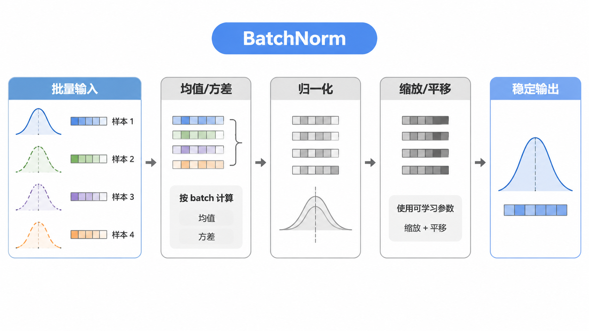

图3-3 四大归一化的统计维度对比

>BatchNorm与LayerNorm的主要差异在于归一化的统计维度不同：BatchNorm以通道为单位，在批次和空间维度上计算均值与方差，效果依赖充足的批次大小，更适配特征维度固定、批次稳定的CNN视觉任务；LayerNorm以单个样本为单位，在特征维度上做归一化，完全不受批次与序列长度影响，更适配RNN、Transformer等序列模型与生成式大模型场景。
>标准文本Transformer通常不采用BatchNorm，原因是文本等序列数据长度不固定，批次内有效统计量偏差大，小批量微调时归一化效果会严重退化，且BatchNorm训练用批次统计量、推理用全局移动平均统计量的不一致性，不利于生成任务的输出稳定性；而LayerNorm对批次与序列长度无感，训练推理逻辑一致，能稳定注意力层的特征尺度，天然适配大模型动态批次与变长序列的训练需求。

<h2 id="q3-3-2">面试问题：归一化和标准化的核心区别是什么？</h2>

**难度评分：⭐⭐ (2/5) | 考察频率：⭐⭐⭐⭐⭐ (5/5)**

这两个词有广义和狭义之分，面试里通常按狭义来对比：
- 广义上，归一化是所有“统一特征尺度、规范数据分布”操作的总称，Z-Score 标准化、BatchNorm、LayerNorm 都算归一化，标准化只是它的一个子类；
- 狭义上，归一化特指 Min-Max 线性归一化，标准化特指 Z-Score 标准化，二者是并列的两种数据预处理方法。

狭义下，两者的区别见表3-2：

表3-2 归一化（Min-Max）和标准化（Z-Score）区别

|对比维度|归一化（Min-Max）|标准化（Z-Score）|
|---|---|---|
|目标|将数据线性缩放到固定数值区间（常用 [0,1] 或 [-1,1]）|将数据统一为均值为 0、方差为 1 的标准统计尺度|
|数学公式| $x_{norm} = \frac{x - x_{min}}{x_{max} - x_{min}}$ | $x_{std} = \frac{x - \mu}{\sigma}$   $\mu$ 为均值， $\sigma$ 为标准差|
|分布影响|线性变换，不改变原始分布形态，保留排序和距离比例，但一般不保留原始数值比值|线性变换，不改变原始分布形态，仅对分布做平移和缩放，统一统计尺度|
|异常值敏感度|极高，单个极端值会决定整体缩放边界，导致正常数据被严重压缩|同样对异常值敏感，均值与标准差可能被极端值显著影响，不能保证影响总远小于Min-Max|
|输出范围|拟合时使用的数据落在指定区间内；新样本超出拟合极值时可越界，除非额外裁剪|无固定上下界，数值范围由原始数据的离散程度决定|
|作用|统一不同特征的数值范围，适配对输入区间有明确要求的算法|消除量纲与尺度差异，让不同特征对梯度的贡献权重均衡，加速优化收敛|

<h2 id="q3-3-3">面试问题：归一化在扩散模型中的具体作用是什么？</h2>

**难度评分：⭐⭐⭐ (3/5) | 考察频率：⭐⭐⭐⭐ (4/5)**

许多扩散模型使用归一化来改善优化稳定性，但这属于常见架构选择，并非扩散过程在数学上必需。扩散模型“前向逐步加噪、反向逐步去噪”，主干（UNet/DiT）层数深、分支多，还要处理随时间步不断变化的特征分布，归一化有助于控制这些特征的数值尺度，改善训练稳定性，但不能单独保证收敛或生成精度。

归一化在扩散模型里主要起到四方面作用。

（1）稳定不同时间步的特征分布

前向扩散过程中，不同时间步 $t$ 的输入 $x_t$ 分布随加噪程度持续偏移：时间步越大，噪声占比通常越高，但均值、方差不一定单调变化，标准化数据的方差还可能近似保持不变。GroupNorm/LayerNorm在各自统计维度上进行近似标准化，随后还可施加仿射或条件调制，并不保证所有层最终输出都为均值0、方差1，也不会消除整个分布差异。它有助于控制不同时间步的特征和梯度尺度，提升去噪学习的稳定性，但并非充分保证。

（2）统一跨层、跨分支的特征尺度

扩散模型主干有大量多分支结构：UNet 的编码器-解码器跳跃连接、卷积分支与注意力分支并行、时间嵌入和文本条件注入等，不同支路、不同深度的特征尺度天然不一样。归一化把它们统一起来，避免尺度大的分支主导梯度，让跳跃连接的拼接、注意力的特征交互、条件注入都能稳定生效，去噪精度和细节也更好。

（3）不依赖批次，适合小 batch 训练

扩散模型参数多、输入分辨率高，batch 通常很小，深层注意力又容易出现梯度尺度异常。LayerNorm 和 GroupNorm 都不依赖批次维度，只在单样本内计算统计量，小 batch 下照样准确，既能缓解深层网络的梯度消失和爆炸，也避开了 BatchNorm 在小 batch 下退化的问题。

（4）统一多模态特征尺度，便于图文对齐

文生图这类多模态模型里，文本嵌入和图像特征是两种模态，数值尺度天然不同。归一化把它们映射到同一统计尺度，有助于控制交叉注意力的数值尺度；语义是否对齐仍取决于编码器、训练目标和数据，不能由归一化单独保证。

在使用中扩散模型会根据模块的结构选不同的归一化，主流方案如下：

- 卷积主干模块：UNet 编码器、解码器的卷积层普遍采用 GroupNorm，是卷积类扩散模型的标准选型。它既摆脱了对批次大小的依赖，又通过组内通道与空间统计适配卷积特征；这与LayerNorm的归纳偏置不同，但不能一概认定其更好地保留通道关联。
- 注意力层与 Transformer 模块：采用 LayerNorm，是自注意力结构的标配，在特征维度上归一化，稳定注意力计算的数值尺度，是 DiT 等纯 Transformer 结构扩散模型的核心归一化方案。
- 条件注入模块：DiT类架构常采用AdaLN（自适应层归一化），通过时间步等条件嵌入生成缩放参数 $\gamma$ 和偏移参数 $\beta$，将条件注入特征调制；卷积UNet也常用加性时间嵌入或自适应GroupNorm，文本条件还可通过交叉注意力注入，并非都采用AdaLN。
- 噪声预测输出头：可在最终线性或卷积投影之前使用归一化；最终噪声预测通常保持无界连续输出，不应强制其每个样本都具有标准正态统计，初始尺度还需由输出头初始化等机制控制。

<h2 id="q3-3-4">面试问题：为什么生成类模型普遍不使用 BatchNorm，会带来什么问题？</h2>

**难度评分：⭐⭐⭐ (3/5) | 考察频率：⭐⭐⭐⭐ (4/5)**

许多扩散UNet和自回归Transformer避免使用BatchNorm，常改用GroupNorm、LayerNorm或RMSNorm，但不能推广为GAN、VAE等生成模型普遍不能使用BN：DCGAN等经典生成器就广泛采用BN。具体是否合适取决于模型结构、有效统计样本数和训练推理设置，常见顾虑有以下四点：

1. 小批量场景下统计估计偏差大，训练容易震荡
生成模型大多处理高分辨率数据，单样本显存开销高，每卡批次可能较小，但没有统一的 2～8 范围。卷积BN按批次与空间维度计算统计量，实际估计质量还受空间大小和相关性影响；有效样本不足时，噪声较大的统计量可能降低稳定性，可考虑SyncBN或不依赖批次的归一化。
2. 训练与推理阶段统计量不一致，生成图像质量受损
BatchNorm 在训练阶段使用当前批次实时统计量，并维护全局移动平均统计量；推理阶段固定复用训练阶段累积的全局统计量。如果移动统计量不能代表推理时的特征分布，训练推理差异就可能降低生成质量；这一问题也存在于判别模型，并非由生成样本空间大就必然引起。应检查统计量估计、条件分布和具体推理设置。
3. 训练时引入跨样本耦合，可能影响特定训练目标
BatchNorm沿批次与空间维度计算统计量，使训练时单个样本的输出依赖同批次其他样本。在某些生成任务或逐样本梯度约束中，这种耦合可能带来问题；但BN不会强制每个样本具有相同分布，也不必然降低多样性或导致模式崩溃。采用运行统计量的推理模式通常不再存在这种跨样本依赖。
4. 适配可变输入与条件生成的能力弱
卷积BatchNorm的参数只依赖通道数，本身能够处理可变空间尺寸；困难主要在于尺寸、时间步或条件改变时，特征分布与运行统计量是否匹配。GroupNorm和LayerNorm不依赖批次统计，通常更便于扩散时间步混合、小批次和动态批次场景，但条件生成能力仍取决于整体架构与训练。

综上，BatchNorm并非与生成任务天然冲突，而是在部分小批次、分布变化明显或要求样本独立的架构中需要谨慎使用。卷积扩散模型常用GroupNorm，Transformer常用LayerNorm或RMSNorm，风格迁移还可使用InstanceNorm及条件调制方案；经典GAN等模型仍可有效使用BN。

<h1 id="q3-4">4. 介绍一下激活函数的原理</h1>

<h2 id="q3-4-1">面试问题：介绍一下激活函数的定义及原理。</h2>

**难度评分：⭐⭐ (2/5) | 考察频率：⭐⭐⭐⭐⭐ (5/5)**

激活函数作用在卷积层、全连接层、注意力层的输出，是一种非线性映射，灵感来源于生物神经元的激活机制，用来控制本层信号向下一层传递的强度。它最核心的作用是给神经网络引入非线性变换，这也是大模型、扩散模型等深度网络能够拟合复杂数据分布的基础。

神经网络的常见基础计算是仿射变换 $y=Wx+b$。如果网络仅由仿射层组成而没有其他非线性操作，无论堆叠多少层，整体都等价于单个仿射映射，无法拟合一般的非线性关系；注意力softmax、输入相关归一化等本身也会引入非线性。激活函数对线性输出做非线性映射，通用表达式为：

 $$ a = \sigma(Wx + b) $$

其中 $\sigma$ 代表激活函数， $a$ 为激活输出，作为下一层的输入。引入非线性之后，网络才有能力学习高阶特征与复杂关联，比如大模型里文本语义、图像像素分布、语音时序特征这类复杂映射。

激活函数的导数会与权重矩阵及其他路径共同决定反向传播中的梯度行为，不能单独决定整个网络的梯度是否稳定。网络依靠梯度下降更新参数，激活函数需要满足几乎处处可微，导数特性会直接影响深层训练稳定性：
- 导数幅值过大：反向传播时梯度逐层放大，造成梯度爆炸；
- 导数趋近于0：梯度在深层逐层衰减，底层参数无法更新，也就是梯度消失。

一个合适的激活函数能够把梯度维持在合理范围，缓解梯度爆炸与梯度消失，这对大模型这类上百层的深度架构尤为重要。

<h2 id="q3-4-2">面试问题：介绍一下激活函数有哪几类，常用经典激活函数有哪些？</h2>

**难度评分：⭐⭐⭐ (3/5) | 考察频率：⭐⭐⭐⭐⭐ (5/5)** 

工程上通常依据输入在极值区间的梯度行为，将激活函数分为饱和激活函数与非饱和激活函数。
首先需要了解饱和的概念：
右饱和：输入 $x$趋向正无穷，函数导数趋近于0；
左饱和：输入 $x$趋向负无穷，函数导数趋近于0。

同时满足左、右饱和称为双侧饱和；仅单侧饱和属于中间类型；全程无饱和区即为非饱和激活函数。Sigmoid、Tanh属于双侧饱和，深层训练很容易出现梯度消失。ReLU仅左饱和，负区间输出固定为0，正区间导数恒为1，正区间不会产生梯度消失。ReLU6在 $x\ge6$后梯度归零，属于双侧饱和，但截断阈值固定，工程上一般归在ReLU系列讨论。

按上述严格定义，Sigmoid、Tanh、ReLU6为双侧饱和；ReLU、GELU及正beta的Swish为单侧饱和；负半轴斜率非零的Leaky ReLU为双侧非饱和。工程中也常将正半轴不饱和的ReLU、GELU、Swish统称为非饱和激活，需区分口径。

激活函数按饱和性的三族划分与代表函数如图3-4所示：

  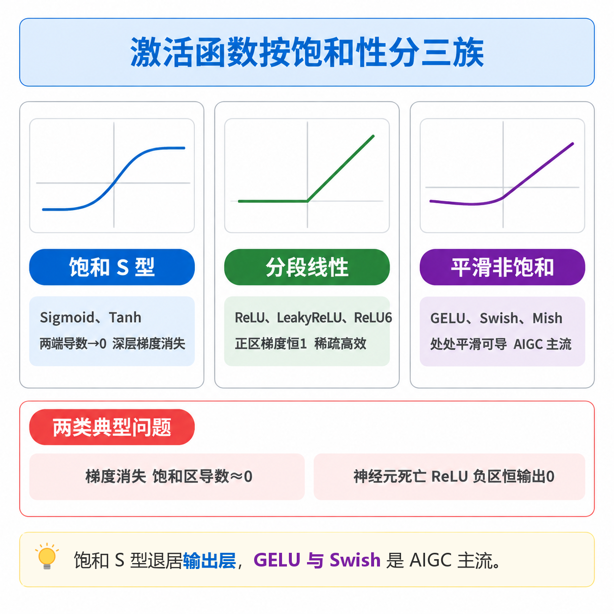

图3-4 激活函数按饱和性分三族

### 1、传统深度学习阶段（2012-2017）主流激活函数
（1）Sigmoid函数
Sigmoid又称Logistic函数，是早期深度学习经典激活函数，可以将任意实数输入映射到 $(0,1)$ 区间，呈现S型饱和曲线。
- 原函数： $\sigma(x) = \frac{1}{1 + e^{-x}}$
- 导数： $\sigma'(x) = \sigma(x) \cdot (1 - \sigma(x))$

Sigmoid函数曲线与其饱和特性如图3-5所示：

  

图3-5 Sigmoid函数示意图

优点
- 输出值域在 $(0,1)$，具备概率含义，适合用作二分类任务输出层激活，表征预测置信度；
- 连续平滑、处处可微，导数形式简单，前向输出可直接复用求导；
- 输出有界，限制极端值向后传递，提升数值稳定性；
- 逻辑简单，容易实现。

缺点
- 梯度消失问题明显：导数最大值仅0.25， $|x|>5$时导数接近0。深层网络反向传播时梯度快速衰减，浅层参数更新困难；
- 输出非零中心：输出恒大于0，均值约0.5。下一层神经元输入全部为正，权重梯度符号趋于一致，优化路径震荡，收敛变慢；
- 落入两侧饱和区时梯度近似为0，神经元停止学习；
- 包含指数运算，计算开销高于ReLU这类分段线性激活。

（2）Tanh函数

Tanh即双曲正切函数，是Sigmoid的改进版本，将有限实数输入映射至 $(-1,1)$，曲线关于原点对称，更适合隐藏层需要零均值特征的场景。
- 原函数： $\tanh(x) = \frac{e^x - e^{-x}}{e^x + e^{-x}}$
- 导数： $\tanh'(x) = 1 - \tanh^2(x)$
- 与Sigmoid关系： $\tanh(x) = 2\sigma(2x) - 1$，等价于Sigmoid做缩放和平移。

Tanh函数曲线与其零中心特性如图3-6所示：

  

图3-6 Tanh函数示意图

优点
- 函数关于原点对称，对对称输入可得到零均值输出，有助于缓解Sigmoid全正输出带来的部分优化问题，但不保证任意输入下输出均值都为0，加快中浅层网络收敛；
- 梯度上限为1，高于Sigmoid的0.25，中等深度网络梯度衰减更慢；
- 曲线平滑，输出保留正负符号，可表征信号方向与强弱。

缺点
- 依旧存在梯度消失， $|x|>3$时导数快速趋近0，不适合几十层以上的深度网络；
- 依赖指数运算，计算开销更大，大规模训练速度弱于ReLU系列；
- 输出区间 $(-1,1)$，不直接代表概率，不能直接作为二分类输出层。

（3）ReLU 函数

ReLU全称修正线性单元（Rectified Linear Unit），是深度学习中使用最广泛的激活函数，依靠单侧抑制引入非线性，大幅缓解Sigmoid、Tanh的梯度消失问题。

原函数：

$$
\text{ReLU}(x) = \max(0, x)
$$

分段定义:

$$
\text{ReLU}(x) =
\begin{cases}
0, & \text{if } x \leq 0 \\
x, & \text{if } x > 0
\end{cases}
$$

导数:

$$
\text{ReLU}'(x) =
\begin{cases}
0, & \text{if } x < 0 \\
1, & \text{if } x > 0 \\
\text{undefined (commonly } 0 \text{ or } 1), & \text{if } x = 0
\end{cases}
$$

 $x=0$处理论不可导，工程实现直接指定导数为0或1，对训练几乎没有影响。

ReLU函数曲线与其正负区行为如图3-7所示：

  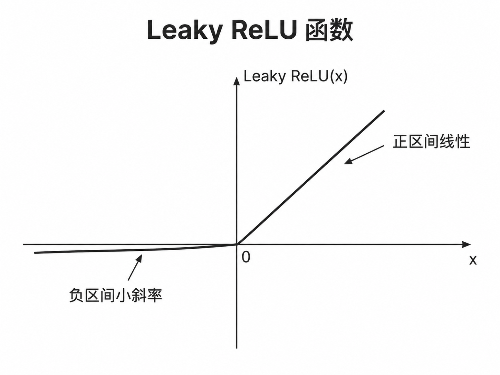

图3-7 ReLU函数示意图

优点
- 正区间导数恒等于1，该激活在正区间自身不会缩小梯度，有助于缓解梯度消失，但整个网络仍受权重和其他路径影响，训练速度更快；
- 计算简单，仅一次大小比较，无指数运算，GPU、TPU硬件加速友好；
- 带来稀疏激活：关于0对称且连续的输入分布下约一半神经元输出置零，自带正则效果，降低过拟合；
- 优化过程更稳定，收敛速度快。

缺点
- 死亡ReLU问题： $x<0$区间梯度恒为0。当神经元对训练样本长期均处于负输入区时，经该激活回传的梯度为0，可能难以恢复；其他层或偏置的变化仍可能使其重新激活，不能只凭某次负输入或负偏置认定永久失活；学习率过大会加剧这个现象；
- 输出非零中心，输出全部大于等于0，仍然存在梯度同号震荡问题；
- 正区间输出无上限，前向传播容易出现激活值溢出，通常搭配BatchNorm使用，保证数值稳定。

（4）Leaky ReLU 函数

Leaky ReLU是针对ReLU死亡神经元问题提出的改进方案，在负区间设置一个很小的固定斜率，保留负输入对应的梯度通路，避免神经元永久失活。

原函数：

$$
f(x) =
\begin{cases}
x, & \text{if } x > 0 \\
\alpha x, & \text{if } x \le 0
\end{cases}
$$

 $\alpha$ 为固定小系数，常用0.01或0.1。原点在斜率不等于1时不可导，下面导数式在原点的取值为工程约定，不是经典导数。

导数：

$$
f'(x) =
\begin{cases}
1, & \text{if } x > 0 \\
\alpha, & \text{if } x \le 0
\end{cases}
$$

Leaky ReLU函数曲线与其负区小斜率如图3-8所示：

  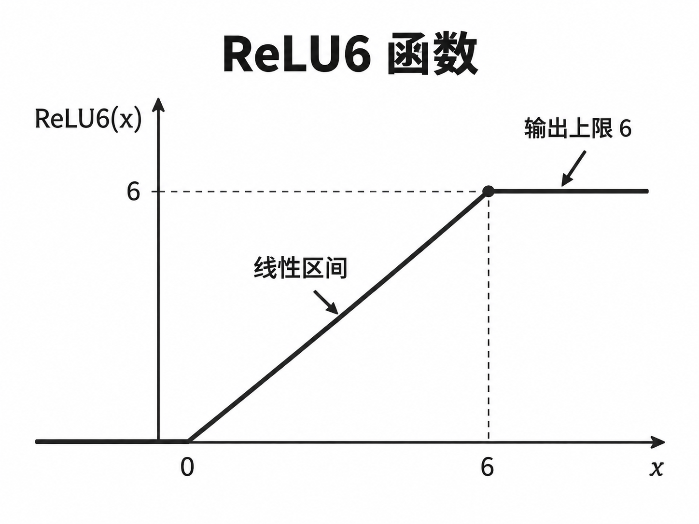

图3-8 LeakyReLU函数示意图

优点
- 消除神经元永久死亡，输入为负时依然保留非零梯度，权重可持续更新；
- 继承ReLU计算简单、正区间无梯度消失、收敛快的特性；
- 负区间保留小幅信号，相比ReLU信息利用率更高。

缺点
- 负区间斜率 $\alpha$是人工预设超参，不同任务最优取值不一样，增加调参成本；
- 在多数工程场景中，相比原生ReLU带来的精度提升有限，部分任务效果甚至略差；
- 没有解决输出非零中心问题，负区间斜率很小，输出均值依旧偏向正值。

（5）ReLU6 函数
ReLU6是ReLU的有界变体，保留ReLU左侧稀疏特性，同时将输出上限硬截断为6，有界输出有利于移动端低精度量化；该函数早于移动端INT8网络的流行，不能把这种用途当作其最初提出目的。

原函数：

$$
f(x) = \min(\max(0, x), 6)
$$

导数：

$$
f'(x) =
\begin{cases}
1, & \text{if } 0 < x < 6 \\
0, & \text{otherwise}
\end{cases}
$$

ReLU6函数曲线与其输出封顶特性如图3-9所示：

  

图3-9 ReLU6函数示意图

优点
- 输出限制在 $[0,6]$区间，抑制激活值爆炸，提升低精度量化时的数值保真度；
- 仅两次比较运算，适合移动端与嵌入式设备部署；
- 保留ReLU单侧稀疏激活特性。

缺点
- $x > 6$时经该激活回传的梯度为0；0和6为不可导点，上式在端点取0是工程约定。若某单元对所有训练样本长期饱和，其相关更新可能受阻；
- 延续ReLU输出非零中心的缺陷；
- 截断阈值6是经验值，不一定适配全部数据分布。

### 2、AIGC时代（2017 - 至今）：生成式AI常用激活函数

（1）GELU 函数

GELU全称高斯误差线性单元（Gaussian Error Linear Unit），是BERT、GPT、ViT这类Transformer架构的主流激活函数。它采用输入依赖的软门控机制，可从随机门控的期望解释，但实际计算是确定性的输入加权，不是执行随机Dropout或二值掩码。
- 精确原函数： $f(x) = x \cdot \Phi(x)$， $\Phi(x)$代表标准正态分布累积分布函数；
- 工程近似公式：

$$ f(x) \approx 0.5x \left(1 + \tanh\left(\sqrt{\frac{2}{\pi}}(x + 0.044715x^3)\right)\right) $$

- 导数： $f'(x) = \Phi(x) + x \cdot \phi(x)$， $\phi(x)$为标准正态分布概率密度函数。

GELU函数曲线与其平滑非饱和特性如图3-10所示：

  

图3-10 GELU函数示意图

优点
- 在NLP、ViT视觉任务上，效果普遍优于ReLU系列；
- 全局平滑可导，给优化器提供连续梯度场；
- 输入相关的软门控自带正则能力，抑制过拟合；
- 输出支持正负，特征分布更贴合真实数据。

缺点
- 计算开销更高，依赖tanh近似或者erf误差函数，推理延迟高于ReLU；
- 数学形式复杂，可解释性偏弱；
- 在纯CNN网络中增益有限，性能优势集中在Transformer结构。

（2）SiLU/Swish 函数
Swish由Google Brain提出，属于自门控激活函数，用Sigmoid作为软门控，实现由输入驱动的平滑非线性变换。
- 原函数： $f(x) = x \cdot \sigma(\beta x)$， $\sigma$为Sigmoid； $\beta$可固定或作为可学习参数，常用取值为1；
- 导数： $f'(x) = \sigma(\beta x) + \beta x \cdot \sigma(\beta x) \cdot (1 - \sigma(\beta x))$
- 特殊性质： $\beta=1$等价于SiLU； $\beta \to 0$退化为线性函数； $\beta \to +\infty$趋近ReLU。

Swish函数曲线与其自门控特性如图3-11所示：

  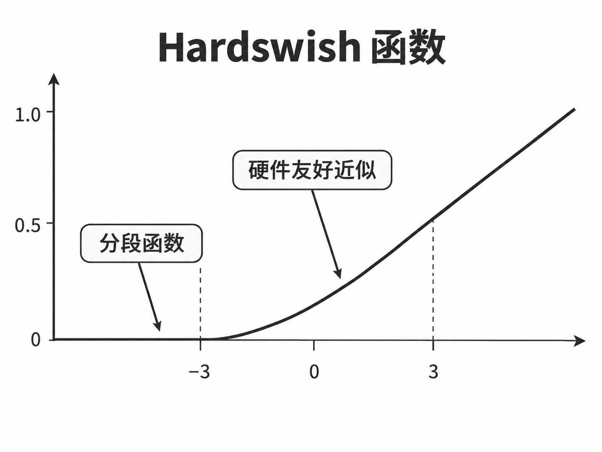

图3-11 Swish函数示意图

优点
- 在ImageNet、COCO等标准数据集上，通常能稳定带来精度提升；
- 负半轴存在饱和效应，自带正则效果；正半轴无界，不会强行截断梯度；
- 自门控、曲线平滑，不存在梯度死区。

缺点
- 包含Sigmoid指数运算，算力开销高于ReLU；
- $\beta$作为可学习参数时，会小幅增加参数量与计算图开销；
- 任务收益不稳定，部分场景相比ReLU提升不明显。

（3）SwiGLU（大模型 FFN 层的事实标准）
SwiGLU全称Swish门控线性单元，属于GLU门控线性单元的变体，把GLU中原Sigmoid门替换为SiLU。在同等参数量条件下提升Transformer表达能力，广泛应用于Llama、Mistral、Qwen等已公开架构的大模型FFN模块；GPT-4的完整架构未公开，不能据此断言其使用SwiGLU。

工程标准无偏置实现：

$$ \text{SwiGLU}(x) = \left(\text{SiLU}(xW_1) \odot (xV)\right) W_2 $$

符号说明：
  - $W_1, V \in \mathbb{R}^{d_{\text{model}} \times d_{\text{ff}}}$：两路并行升维权重矩阵
  - $W_2 \in \mathbb{R}^{d_{\text{ff}} \times d_{\text{model}}}$：降维权重矩阵
  - $\odot$：逐元素哈达玛积
  - $\text{SiLU}(x) = x \cdot \sigma(x)$： $\beta=1$的标准SiLU激活函数

与标准Transformer FFN对比：
标准FFN： $\text{FFN}(x) = \max(0, xW_1) W_2$，仅两组权重矩阵
SwiGLU FFN：第一个线性层拆成两路并行分支，一路经过SiLU激活后，和另一路做逐元素相乘，一共三组权重矩阵。

参数量对齐技巧：
为保持和标准FFN（ $d_{\text{ff}}=4d_{\text{model}}$）总参数量一致，SwiGLU通常将中间维度设为 $d_{\text{ff}}=\frac{8}{3}d_{\text{model}} \approx 2.666d_{\text{model}}$
- 标准FFN参数量： $2 \cdot d_{\text{model}} \cdot 4d_{\text{model}} = 8d_{\text{model}}^2$
- SwiGLU参数量： $3 \cdot d_{\text{model}} \cdot \frac{8}{3}d_{\text{model}} = 8d_{\text{model}}^2$

反向传播推导：
令 $a = \text{SiLU}(xW_1)$， $b = xV$， $h = a \odot b$， $y = h W_2$。上游梯度 $g = \frac{\partial L}{\partial y}$

$$
\frac{\partial L}{\partial h} = g W_2^\top
$$

$$
\frac{\partial L}{\partial x} = \left[\left((g W_2^\top) \odot b\right) \odot \text{SiLU}'(xW_1)\right] W_1^\top + \left[(g W_2^\top) \odot a\right] V^\top
$$

其中 $\text{SiLU}'(u) = \text{SiLU}(u) + \sigma(u) \cdot (1 - \text{SiLU}(u))$ 为SiLU导数。

优点
- 参数量利用效率高，同等参数量预算下效果普遍优于ReLU/GELU构成的标准FFN；
- 输入驱动的动态门控，模型自适应筛选特征信息流，增强非线性表达；
- 继承SiLU全局平滑特性，规避ReLU梯度消失与神经元死亡，训练稳定性更强；
- 训练loss震荡更小，收敛更快；
- 门控自带正则效果，长序列、复杂语义任务泛化性能更好。

缺点
- 同等中间维度下多一组线性投影，参数量与矩阵乘法开销更大；按上述维度对齐后，主要矩阵乘法计算量近似相同，但门控逐元素运算和实际内核开销仍有差别；
- 激活内存占用上升，需要同时保存两路线性分支输出，具体内存增幅取决于中间维度、融合内核和重计算策略，不能固定为三分之一；
- 门控与非线性叠加，内部机制可解释性偏弱；
- 需要精细调整中间维度完成参数量对齐，维度设计不当会造成性能损失或资源浪费。

（4）Hardswish 函数
Hardswish是面向硬件部署的Swish轻量化近似版本。使用基于ReLU6的分段线性门函数替代Sigmoid，再与输入相乘，因此Hardswish本身在中间区间为二次函数，并非整体分段线性；它在移动端以较低开销近似Swish的门控行为。

原函数：

 $$
f(x) = x \cdot \frac{\text{ReLU6}(x + 3)}{6}
$$

导数：

$$
f'(x) =
\begin{cases}
0, & \text{if } x < -3 \\
\frac{x}{3} + 0.5, & \text{if } -3 < x < 3 \\
1, & \text{if } x > 3
\end{cases}
$$

Hardswish函数曲线与其中间区间的二次特性如图3-12所示：

  

图3-12 Hardswish函数示意图

优点
- 硬件友好，仅乘加与比较操作，无指数运算；常数除法可在编译阶段优化为乘法，适配移动端NPU/GPU加速；
- 近似Swish效果，MobileNetV3等网络可以用ReLU级算力拿到接近Swish的精度；
- 负侧有下界，足够负时输出为0；正侧在输入大于3后等于输入，因此输出没有上界。

缺点
- 在 $x=\pm3$处导数跳变，理论上存在不可导点；工程实践中影响很小，通常忽略；
- 属于近似实现，少数极端任务精度略低于原生Swish。

（5）Mish 函数
Mish是连续光滑、非单调的自正则激活函数，在大规模视觉任务上表现突出。

原函数：

$$
f(x) = x \cdot \tanh\left(\ln(1 + e^x)\right) = x \cdot \tanh\left(\text{Softplus}(x)\right)
$$

导数：

令 $\omega = \text{Softplus}(x) = \ln(1+e^x)$，则：

$$
f'(x) = \tanh(\omega) + x \cdot \sigma(x) \cdot \text{sech}^2(\omega)
$$

式中 $\sigma(x)$ 为Sigmoid， $\text{sech}^2(\omega) = 1 - \tanh^2(\omega)$，导数处处连续，梯度流平滑。

Mish函数曲线与其平滑非单调特性如图3-13所示：

  

图3-13 Mish函数示意图

优点
- 视觉任务效果突出，YOLOv4的CSPDarknet53主干采用Mish；YOLOv5的常见后期版本主要使用SiLU，不能用其证明Mish必然优于其他激活，精度优劣应以具体版本和实验为准；
- 无限阶连续可导，损失曲面平滑，更容易收敛到优质局部极值；
- 非单调设计支持负值输出，保留更多微弱负信号信息。

缺点
- 计算成本高，同时包含Tanh、Log、Exp运算，在常用激活函数里推理速度偏低；
- 数学形式复杂，理论分析难度大；
- 在部分网络结构与学习率配置下，训练前期容易震荡。

<h2 id="q3-4-3">面试问题：有哪些激活函数在AIGC时代取得了大量的应用，它们有什么优势？</h2>

**难度评分：⭐⭐⭐ (3/5) | 考察频率：⭐⭐⭐⭐ (4/5)**

在 AIGC 时代的深层 Transformer 模型中，GELU 和 Swish/SiLU 取代 ReLU 成为主流激活函数，根本原因在于它们处处平滑、可导，消除了 ReLU 在零点附近的硬转折，从而为极深网络的训练提供了更平稳的优化地形和更可靠的梯度流动，明显降低了“死亡神经元”的风险。

GELU 通过将输入乘以标准正态 CDF，引入了一种输入依赖的平滑门控正则化（GELU 原始论文将其理解为对输入按输入大小做随机掩码的确定性近似，与 Dropout 思想相近但非等价），能明显提升大规模生成模型的泛化能力；而 Swish/SiLU 利用 Sigmoid 自门控实现了无上界、有下界的非单调映射，在保留部分负值信号的同时缓解了硬截断，但导数仍可能接近0，不能保证避免梯度消失，其平滑性和高效性直接催生了 SwiGLU 等门控线性单元，成为 LLaMA、PaLM 等模型的常见配置，并非所有GPT类模型都采用。GELU和SiLU并不保证输出零均值或整个网络稳定，训练效果还依赖初始化、归一化、残差和优化设置。

<h2 id="q3-4-4">面试问题：激活函数在使用中有哪些典型的问题？</h2>

**难度评分：⭐⭐⭐ (3/5) | 考察频率：⭐⭐⭐⭐⭐ (5/5)**

无论是传统深度学习还是 AIGC 大模型、扩散生成模型，激活函数在训练与推理阶段普遍存在以下典型问题：

1. 梯度消失与梯度饱和

Sigmoid、Tanh 存在明显的双侧饱和区，输入绝对值过大时导数趋近于 0；ReLU6存在双侧饱和，ELU则在负侧饱和。在深层网络与超长序列 Transformer 中，饱和效应会导致反向传播梯度逐层衰减，浅层权重难以有效更新。在 AIGC 深层大模型场景下，该问题会直接导致模型收敛缓慢、生成效果退化。

2. 神经元失活（死亡神经元）

标准 ReLU 负区间导数恒为 0：

$$ 
f'(x)= \begin{cases} 1, &x>0\\ 0, &x<0 \end{cases} 
$$

当学习率过大、初始化不佳时，大量神经元会永久输出 0、梯度锁死，称为“死亡 ReLU”。Leaky ReLU 通过固定小斜率负区间保留梯度通路，显著缓解该问题；ELU 负区间为指数饱和形式，x 越负梯度越小，也能缓解死亡神经元，但极负输入下仍会趋近失活。

3. 输出非零中心化

ReLU、ReLU6、Softplus、Sigmoid 的输出恒非负，批次特征整体发生均值偏移。对同一神经元的单个样本梯度，非负输入会使各输入权重的梯度受共同误差信号影响；但跨神经元或跨样本求和后的梯度并非始终同号。它可能影响优化效率，程度需结合网络和训练设置判断。

4. 数值不稳定与潜在溢出风险

Swish、SiLU、Mish、GELU 等激活函数正区间输出无上界，理论上深层堆叠后激活值可能持续增大；但实际工程中通常配合 LayerNorm 等归一化层，不会单纯因激活函数出现数值溢出。梯度爆炸更多由权重初始化不当、网络深度过大导致，而非激活函数直接引发。
此外，Softmax 做分类或注意力归一化时，直接指数运算易引发数值上下溢，工程上通过减去输入最大值的数值稳定技巧解决，而非简单截断。

5. 计算开销与推理延迟

传统 ReLU 仅做阈值比较，计算开销极低；而 AIGC 常用的 GELU、SiLU、Mish 包含指数、双曲正切、高斯分布等运算，训练与推理算力消耗更高，增加大模型、扩散模型的部署成本，不利于端侧 AIGC 落地。工程上通常使用近似公式（如 GELU 的 tanh 近似）来降低开销。

6. 梯度不连续与优化抖动

ReLU、ReLU6、Hardswish 存在分段不可导点，梯度突变会破坏优化地形的平滑性。但有限个不可导点通常可通过约定次梯度处理，不能仅凭这些点就推断loss必然震荡或训练不稳定，也不能无依据地断言其在扩散或小样本微调中影响一定更明显。

7. 场景适配性差

不存在通用的最优激活函数，选型错误会直接限制模型表达能力：
- ReLU 在浅层 CNN 中高效，但在深层 Transformer 中效果弱于 GELU/SiLU；
- Sigmoid、Tanh 梯度消失严重，难以胜任大模型深层隐藏层；
- Softmax 适用于互斥分类与自注意力权重归一化，但不适合多标签分类输出；
- 端侧部署场景下，复杂激活函数的算力开销会被放大，需优先选用 ReLU、Hardswish 等硬件友好型方案。

<h1 id="q3-5">5. 介绍一下卷积操作的原理</h1>

<h2 id="q3-5-1">面试问题：请详细介绍卷积操作及其核心原理</h2>

**难度评分：⭐⭐ (2/5) | 考察频率：⭐⭐⭐⭐ (4/5)**

卷积本质是一种线性加权运算，在深度学习中特指滑动窗口内的局部加权求和：可学习的卷积核在输入特征图上按步长滑动，对每个局部区域做逐元素点积求和，从而提取局部空间特征，是卷积神经网络（CNN）的基础算子。深度学习框架中的常见实现严格说是互相关，不翻转卷积核；无偏置时为线性运算，带偏置时为仿射变换。仅叠加这类运算不能引入非线性，但有边界填充、步幅等约束时，也不能无条件等同于一个相同形式的单层卷积。

卷积的滑动窗口计算过程与三大特性如图3-14所示：

  

图3-14 卷积的滑动窗口加权求和

对于输入特征图 $X \in \mathbb{R}^{H \times W \times C_{in}}$、卷积核 $K \in \mathbb{R}^{k \times k \times C_{in} \times C_{out}}$（ $k$ 为卷积核空间尺寸， $C_{in}$ 对应输入通道， $C_{out}$ 对应输出通道数）、偏置 $b \in \mathbb{R}^{C_{out}}$，在步长 stride=1、无填充 padding=0的标准二维卷积下，输出特征图 $Y$ 的每个元素为：

$$ 
Y_{i,j,c} = \sum_{m=0}^{k-1} \sum_{n=0}^{k-1} \sum_{d=0}^{C_{in}-1} K_{m,n,d,c} \cdot X_{i+m,j+n,d} + b_c 
$$

其中 $i,j$ 为输出特征图的空间坐标， $m,n$ 为卷积核内的空间偏移， $d$ 为输入通道索引， $c$ 为输出通道索引。

三大核心特性：

- 局部感受野：每个输出神经元仅与输入的一个局部区域相连，模拟生物视觉的局部感知机制，避免全连接层全局连接带来的参数爆炸问题。
- 权值共享：同一输出通道对应的卷积核在整张特征图上共享参数，使参数量与输入、输出的空间分辨率无关，仅由卷积核大小与通道数决定。相比全连接层，参数量从与空间分辨率平方成正比降至仅 $k^2 \times C_{in} \times C_{out}$；同时权值共享让网络学习到与位置无关的通用特征（如边缘、纹理）。
- 平移等变性：在步幅为1且忽略有限边界或采用合适边界条件时，输入平移会引起输出对应平移；步幅大于1、填充和裁剪会限制这种等变性。等变不等于输出整体不变，局部池化也只能在某些扰动下提供有限鲁棒性，不能保证任意平移不变。

在传统深度学习（判别式任务）中卷积的核心作用是特征提取，通过逐层堆叠完成从低级边缘到高级语义的抽象。代表应用包括：ResNet 用于图像分类、YOLO 用于目标检测、U-Net 用于语义分割等。
迈入AIGC 时代（生成式任务）以后卷积仍是生成模型的基础算子之一，广泛应用于视觉生成链路，主要包括以下四个方面：

（1）图像生成：Stable Diffusion 的 UNet 以 3×3 卷积为核心构建残差块，配合步幅卷积完成下采样、插值+卷积完成上采样，在潜空间中实现逐步去噪与图像合成；

（2）超分辨率：ESRGAN 等模型通过密集残差卷积块重建高频细节，实现分辨率提升；

（3）视频生成：Sora 等大模型将视频切分为时空 Patch 后送入 DiT 架构处理；同时大量卷积型视频扩散模型采用 3D（时空）卷积联合建模空间与时间维度；

（4）多模态对齐：CLIP 的卷积版图像编码器通过卷积提取视觉特征，与文本特征在同一空间中完成对齐。

<h2 id="q3-5-2">面试问题：介绍一下卷积操作中的卷积核、步幅、填充、感受野的定义及作用</h2>

**难度评分：⭐⭐ (2/5) | 考察频率：⭐⭐⭐⭐ (4/5)**

- 卷积核：卷积层中可学习的权重张量，空间尺寸通常为 $K \times K$，通道维度覆盖全部输入通道，用于提取输入的局部空间特征模式。

- 步幅：卷积核在特征图上每次滑动的像素步长，步幅大于1时可直接压缩输出空间分辨率，实现空间下采样，同时降低后续计算开销。

- 填充：在输入特征图边界补充数值的操作，可采用零、反射等方式。步幅为1时，SAME填充可保持输出与输入空间尺寸一致，偶数核等情况可能需要非对称填充，同时缓解边界特征信息的过快丢失，步幅大于1时输出尺寸仍会按比例缩小。

- 感受野：输出特征图上单个像素点在原始输入图上所能对应覆盖的区域范围；对于无空洞、按顺序堆叠的卷积，理论感受野可通过如下递推公式计算；有空洞时需使用有效核尺寸，实际有效感受野还受权重与数据影响：

$$ 
RF_k = RF_{k-1} + (kernel\_size - 1) \times \prod_{i=1}^{k-1} stride_i 
$$

这四类核心参数共同决定了特征图的空间尺度、语义抽象层级与网络整体计算量。在 AIGC 场景中，生成模型的下采样分支通常使用大步幅卷积完成特征压缩与语义聚合，上采样分支可通过转置卷积或插值加卷积实现渐进式分辨率提升，配合合理的填充策略保障生成图像的边界连续性与细节完整性；感受野的设计直接影响生成内容的局部纹理精细度与全局结构一致性，例如扩散模型中常通过搭配不同核尺寸、不同膨胀率的卷积层构建分层感受野，结合时间步条件调制机制，同时兼顾生成图像的细节纹理清晰度与整体构图合理性。

<h2 id="q3-5-3">面试问题：常用的卷积层有哪些？请分别详细介绍其结构、原理及适用场景</h2>

**难度评分：⭐⭐⭐ (3/5) | 考察频率：⭐⭐⭐⭐ (4/5)**

卷积层是生成模型视觉骨干的核心基础组件，围绕计算效率、感受野调控、分辨率变换等需求演化出多种经典变种，AIGC领域高频使用的主要有以下五类。

（1）深度可分离卷积将标准卷积的空间滤波与通道融合拆分为两个独立步骤，先由逐通道卷积对每个输入通道独立执行空间特征提取，再由 1×1 逐点卷积完成跨通道信息聚合。其参数量从标准卷积的 $C_{in}C_{out}K^2$ 降至 $C_{in}K^2 + C_{in}C_{out}$，计算开销大幅压缩。该结构广泛应用于端侧轻量化生成模型，如 MobileStyleGAN、轻量化扩散模型解码器，在可接受的质量损失下显著降低模型体积与推理耗时。

（2）分组卷积将输入与输出通道均划分为 $G$ 组，每组内部独立执行卷积运算，最终沿通道维度拼接各组输出。参数量与计算量随分组数 $G$ 等比例下降，同时分组并行的结构能提升特征多样性，增强网络表征能力。分组卷积早已用于AlexNet等模型，ResNeXt进一步展示了增加分组基数在匹配复杂度下的收益；在AIGC场景中多用于多尺度特征融合、多风格分支生成与条件调制模块，可在有限算力开销下丰富生成特征的表达空间。

（3）空洞卷积通过在卷积核元素间插入零值实现间隔采样，引入扩张率 $d$ 控制采样间距，等效感受野尺寸为 $K + (K-1)(d-1)$。其核心优势是在不增加参数量与计算量的前提下，大幅扩大空间感受野，同时避免下采样导致的细节信息丢失。除语义分割任务外，该结构在图像修复、高分辨率图像生成、全景扩散模型中应用广泛，可在高分辨率特征图上高效捕获长距离空间依赖，兼顾局部纹理精细度与全局结构一致性。

（4）转置卷积是一种可学习的上采样操作，对应于卷积线性算子的转置（伴随）映射，可以增加空间尺寸，但一般不是正向卷积的逆，也不能恢复已丢失的信息。在dilation=1、output_padding=0的设定下，其输出空间尺寸满足公式 $O = S(I-1) + K - 2P$，是 GAN 生成器、VAE 解码器与扩散模型上采样分支的经典核心组件。该结构存在固有缺陷：大步幅参数下易产生棋盘格伪影，工程实践中通常搭配最近邻/双线性上采样加卷积的替代方案，或优化卷积核初始化策略以缓解伪影问题。

（5）1×1 卷积的卷积核尺寸为 1×1，仅在通道维度执行线性变换，步幅为1且无额外填充时保持空间尺寸；步幅大于1也可下采样。其核心作用是通道升降维与线性融合，配合激活才引入非线性。忽略偏置时参数量为 $C_{in} \times C_{out}$，计算开销极低。该结构在AIGC模型中应用极为普遍，生成骨干的瓶颈结构、部分注意力通道投影或条件调制可以使用1×1卷积；StyleGAN的风格控制还涉及仿射变换、AdaIN或调制卷积等机制，不能统一归结为1×1卷积。需注意其与全连接层的区别：1×1 卷积空间权重共享，可适配任意分辨率输入；而 StyleGAN 的映射网络（ $z\to w$）为空间无关的向量变换，采用全连接层实现。

在传统计算机视觉任务中，这类卷积变种主要用于平衡模型精度与计算效率；在AIGC领域，它们进一步承担了分辨率变换、风格条件调制、多尺度特征融合等核心功能，是构建高效、可控、高保真生成模型的关键视觉基础组件。

<h2 id="q3-5-4">面试问题：卷积和Transformer在AIGC中各自的优势和适用场景是什么？</h2>

**难度评分：⭐⭐⭐⭐ (4/5) | 考察频率：⭐⭐⭐⭐⭐ (5/5)**

卷积与Transformer是AIGC视觉生成领域的两类核心骨干范式，二者基于不同的归纳偏置设计，在建模特性与适用场景上形成强互补。

- 卷积的核心优势源于局部感受野与权值共享带来的强空间归纳偏置，具备天然的平移等变性。它贴合图像数据的局部相关性假设，参数效率与数据效率更高，对边缘、纹理等高频局部细节的建模能力突出；固定核大小和通道数时，计算复杂度随空间位置数线性增长，即与高、宽的乘积成正比，高分辨率下算力与显存开销可控。在AIGC场景中，卷积主导的架构适配高保真、高分辨率生成需求，典型如StyleGAN系列的人脸肖像生成、扩散模型UNet骨干的特征提取与分辨率变换，以及超分辨率、图像修复等重细节任务，生成结果局部纹理真实自然，推理效率更高。

- Transformer依托自注意力机制实现全局感受野，归纳偏置更弱，擅长建模长距离空间依赖、全局语义关联与跨模态对齐，在复杂构图、语义一致性与文本指令遵从度上表现更优。但由于缺乏内置空间先验，其数据效率低于卷积，且稠密注意力的交互计算量随特征序列长度呈平方级增长，显式保存注意力矩阵时显存也有平方项；FlashAttention等实现可避免完整保存该矩阵，高分辨率下资源占用会急剧上升。纯Transformer架构多用于对全局结构和语义理解要求高的场景，例如DiT、U-ViT等扩散模型骨干，以及文生图跨模态语义对齐、视频生长时序依赖建模，能更好地把控整体布局与语义逻辑。

当前落地方案既包括卷积与注意力混合架构，也包括DiT类Transformer骨干，不能统一限定为混合范式。典型设计是以卷积UNet为基础骨干完成高效的局部特征提取与上下采样，在深层特征图中插入自注意力与交叉注意力模块，Stable Diffusion 1.x/2.x、SDXL及其典型ControlNet分支采用这类设计，后续DiT类版本则不同。这种组合既保留了卷积局部细节生成的效率与质量优势，又通过注意力实现全局语义整合与条件信息对齐，在生成质量、语义一致性与算力成本之间可取得较好的平衡，具体优劣需按任务实测。

整体而言，卷积与Transformer并非替代关系，实际模型设计中需根据任务的分辨率要求、语义复杂度与算力约束灵活选型或融合。

<h2 id="q3-5-5">面试问题：卷积核的大小、数量应如何选择？</h2>

**难度评分：⭐⭐⭐ (3/5) | 考察频率：⭐⭐⭐ (3/5)**

卷积核的空间尺寸与输出通道数量，是卷积生成网络架构设计的核心基础超参数，二者共同决定感受野范围、特征表征能力、参数量与计算开销，选型需结合生成任务的分辨率、语义复杂度与算力约束综合权衡。

### 1、卷积核尺寸：3×3小核为主，大核与1×1做场景补充

- 3×3 是工业界通用的默认配置，核心优势在于参数效率与表征能力的均衡。多层 3×3 卷积堆叠可获得与单层大核等价的感受野，同时可插入更多非线性激活层，提升特征拟合能力。以两层 3×3 卷积为例，其等效感受野与单层 5×5 卷积一致；输入输出通道数均为 $C$ 时，单层 5×5 卷积参数量为 $25C^2$，两层 3×3 卷积仅为 $18C^2$，参数效率提升近 30%。同时小核的空间归纳偏置更强，对局部纹理、边缘等高频细节的建模更精细，是生成模型卷积骨干的核心基础单元。

- 5×5、7×7 等大核用于快速扩大感受野，替代多层小核堆叠以降低网络深度与优化难度。典型适用场景包括网络输入首层，在原始分辨率下扩大初始局部感受野；单个5×5或7×7核通常还不能覆盖全图；以及深层低分辨率的语义瓶颈层，以较低计算成本增强全局上下文建模，如 ConvNeXt 采用7×7深度卷积扩大局部感受野，再通过多层结构整合上下文。在 AIGC 场景中，生成器可通过大核扩大局部上下文，是否覆盖全局还取决于特征图大小及前后层结构，高分辨率图像修复、全景生成任务也会引入大核提升长距离内容一致性；上采样分支的转置卷积常采用 4×4 核配合步幅 2 的配置，平衡上采样倍率与棋盘伪影控制。

- 1×1 卷积不改变空间尺寸，仅在通道维度执行线性变换与信息融合，参数量极低，主要承担通道升降维、跨通道特征聚合与条件信息调制职能，是瓶颈结构、风格注入模块的核心组件。

### 2、通道数量：随分辨率阶梯式演进，配合瓶颈结构控制开销

卷积核数量对应输出特征图的通道数，决定单层网络可提取的特征维度与语义丰富度，整体遵循分层适配的设计规律。

- 基础范式为随下采样层级阶梯式翻倍。通道数与空间分辨率呈反向匹配：浅层高分辨率特征图通道数较少，聚焦底层纹理、边缘等基础视觉特征；深层低分辨率特征图通道数逐步提升，编码更抽象的语义与结构信息，通过空间换通道的方式维持整体表征容量。经典配置如 64→128→256→512 的逐级翻倍策略，广泛应用于各类卷积骨干。

- 工程中普遍通过瓶颈结构控制通道提升带来的计算开销。单层标准卷积的参数量为 $C_{in} \times C_{out} \times K^2$，只增加输入或输出一侧通道数时，计算量对该侧近似线性增长；若两侧同步按同一倍数增加，则近似按该倍数的平方增长。瓶颈结构采用“1×1 降维 → 空间卷积 → 1×1 升维”的三段式设计，在保持输入输出通道数与表征能力的前提下，大幅降低中间空间卷积的计算量。

- 在 AIGC 场景中，UNet 型生成骨干的编码器侧随下采样逐级增加通道数，压缩空间信息的同时丰富语义表征；解码器侧随上采样逐级减少通道数，配合跳跃连接融合浅层细节特征，实现语义抽象与纹理还原的平衡。轻量化生成模型则通过通道宽度缩放、深度可分离卷积替代标准卷积等方式，在保持通道语义维度的同时削减计算冗余，适配端侧与低算力场景。

整体选型遵循“小核为主、大核补全局，分层配通道、瓶颈降开销”的核心原则。实际工程中通常先基于经典基准架构确定初始配置，再根据目标分辨率、生成质量要求与算力预算做针对性调优，也可借助神经架构搜索、通道剪枝等技术完成精细化适配。

<h1 id="q3-6">6. 介绍一下池化层的原理</h1>

<h2 id="q3-6-1">面试问题：什么是池化层？介绍一下其原理</h2>

**难度评分：⭐⭐ (2/5) | 考察频率：⭐⭐⭐⭐ (4/5)**

池化层是一种无参数的特征下采样操作，核心是在特征图的局部滑动窗口内做聚合统计，用单个统计值表征整个窗口的特征，实现空间维度压缩。

在无 padding、无 dilation 的标准设置下，输入特征图单边空间长度为 $I$，池化核大小为 $K$，步幅为 $S$，对应输出维度的长度为：

$$ O = \left\lfloor \frac{I - K}{S} \right\rfloor + 1 $$

最基础的池化分为最大池化与平均池化两类，前者取窗口内特征最大值输出，后者取窗口内特征均值输出。二者的计算对比如图3-15所示：

  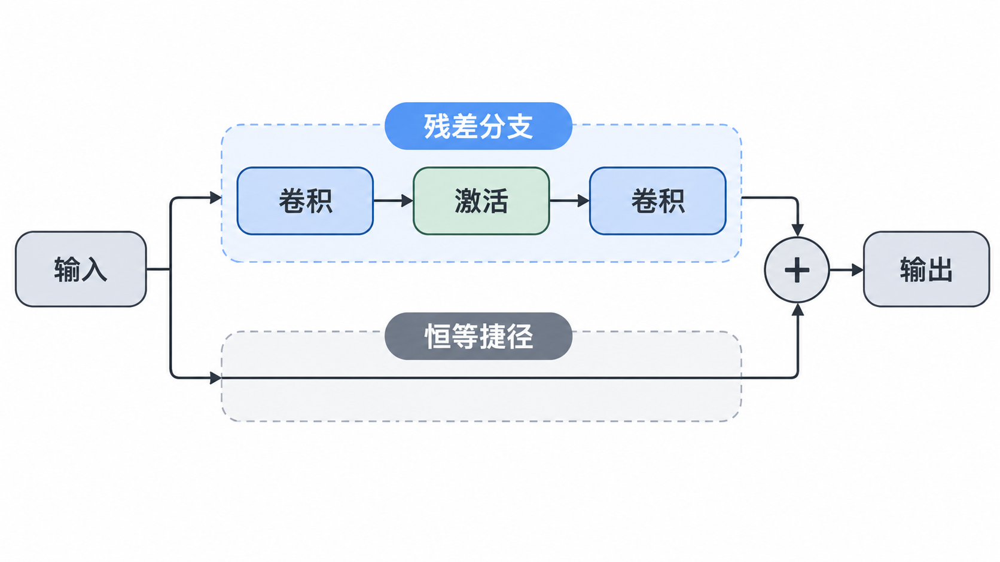

图3-15 池化的窗口内无参数下采样

池化的核心作用有三点。一是压缩空间维度、扩大感受野，在降低后续网络计算量与参数量的同时，快速提升上层卷积的等效感受野范围。二是提供局部平移不变性，输入发生微小平移时池化输出基本保持稳定，增强特征对位置抖动的鲁棒性。三是一定程度缓解过拟合，弱化特征的精确位置权重，引导网络学习更抽象的高层语义特征。

在传统计算机视觉分类网络中，池化层是标准降采样组件，VGG常在阶段之间使用最大池化，经典ResNet则主要在stem使用最大池化，后续阶段切换更多依靠步幅卷积。但在AIGC生成模型体系中，许多骨干更倾向使用步幅卷积，但平均池化等仍存在于部分扩散、GAN和条件编码架构中。生成与重建任务对细节敏感，需要权衡下采样的信息损失；不能据此认定池化无法用于高质量生成。

当前AIGC领域普遍采用可学习的采样方式替代传统池化：上采样可使用转置卷积或插值加卷积，下采样常用步幅卷积；可学习下采样有更大适应空间，但仍可能丢失信息，并不保证信息可逆或总优于池化。例如pix2pix的PatchGAN判别器采用4×4、步幅为2的卷积逐级降维，全程不引入最大池化；Stable Diffusion等隐扩散模型的U-Net编码器同样以步幅卷积为核心降采样方案，仅部分轻量化或早期实现仍会保留池化层实现快速降维。

<h2 id="q3-6-2">面试问题：常用的池化层有哪些？请分别介绍其结构、计算方式及适用场景？</h2>

**难度评分：⭐⭐ (2/5) | 考察频率：⭐⭐⭐⭐ (4/5)**

常用池化层按照聚合逻辑与作用范围可分为多类实现，不同方案对特征信息的保留倾向不同，适用场景存在明显区分。

最大池化是最基础的局部池化形式，在滑动窗口内取激活最大值作为输出，计算式为 $y = \max(x_{i,j})$。它保留窗口内响应最强的特征，抑制背景噪声与弱激活区域，对边缘、纹理等显著性特征的保留能力更强，是传统分类、检测骨干网络中最主流的降采样方式。在AIGC场景中，早期判别器架构偶有用其提取纹理轮廓特征，当前主流方案已普遍被步幅卷积替代。

平均池化同样作用于局部滑动窗口，输出窗口内所有激活值的均值，计算式为 $y = \frac{1}{K^2}\sum x_{i,j}$。相比最大池化，它的输出更平滑，能保留更完整的全局背景与整体分布信息，不会过度放大局部强响应。实际应用中它很少作为中间层降采样组件，更多以全局平均池化的形式出现在网络末端。

全局平均池化是平均池化的特例，池化窗口尺寸与整张特征图的空间尺寸完全一致，每个通道最终仅输出一个标量值。它的核心作用是替代全连接层完成空间维到通道维的聚合，大幅减少网络参数量，同时规避全连接层带来的过拟合风险，经典ResNet等分类网络的输出端均采用这一设计。在AIGC领域，全局平均池化常见于编码器尾部、判别器分类头，用于将二维空间特征压缩为全局特征向量；生成器侧因需保留精细空间信息，几乎不会使用该结构。

自适应池化的核心特点是无需手动指定池化核大小与步幅，仅需设定目标输出尺寸，算法按输入和目标尺寸划分聚合区间，各位置的窗口大小或起点间距不一定相同，适配任意分辨率的输入特征图。它的底层既可以是最大池化逻辑，也可以是平均池化逻辑，对应自适应最大池化与自适应平均池化两类实现。这类池化非常适合处理输入尺度不固定的场景，在多尺度特征融合、检测头与分类头的特征对齐中应用广泛。在AIGC的多尺度生成、条件编码器等模块中，常用来将不同层级、不同尺寸的特征图统一到固定维度，支撑后续特征拼接或融合操作。

经典随机池化通常针对非负激活，按窗口内归一化激活值构建概率分布，全零窗口需要单独处理，按概率随机采样一个值作为窗口输出。激活值越高的位置被选中的概率越大，本质是在池化过程中引入随机性实现正则化，一定程度缓解过拟合。但由于训练和推理行为不一致、工程落地收益有限，目前无论是传统CV还是AIGC领域，实际工程中都很少使用。

从AIGC领域的整体技术选型来看，生成与重建任务对空间细节、位置信息的敏感度远高于传统分类任务，传统池化的不可逆信息损失会严重影响生成质量。生成器的下采样路径可使用步幅卷积或池化，并非完全摒弃池化；上采样是另一类操作，常采用转置卷积或“最近邻上采样+卷积”，后者可缓解部分棋盘伪影；判别器、编码器等下采样路径，也更多使用带可学习参数的步幅卷积替代无参数的池化操作，仅在特征对齐、全局向量生成等特定环节保留平均池化、自适应池化等组件。

<h2 id="q3-6-3">面试问题：池化操作中，步幅和池化核大小应如何选择？</h2>

**难度评分：⭐⭐ (2/5) | 考察频率：⭐⭐⭐ (3/5)**

池化核大小与步幅共同决定下采样倍率、特征保留程度与感受野扩张速度，选型核心是在降维效率与特征完整性之间做权衡，AIGC场景需额外关注空间细节与位置信息的保留需求。

经典基线配置为 $2\times2$ 核、步幅2的无重叠池化：窗口间相互独立，在输入单边长度为偶数时输出分辨率精确减半，奇数长度还受取整规则影响，信息损失可控，是传统卷积网络最通用的降采样方案。当步幅小于核大小时形成重叠池化，如工业界常用的 $3\times3$ 核、步幅2的配置，可缓解边界特征割裂，保留更丰富的邻域细节。池化核尺寸通常不超过 $3\times3$，过大会造成局部信息过度抽象，细节损失严重。

具体选型可从三个核心维度判断：

- 下采样强度：步幅越大，空间压缩越剧烈、后续计算量越低，但空间信息的不可逆损失越严重。分类任务对位置精度敏感度低，可接受更大步幅；AIGC生成、重建任务对像素级细节要求高，核心链路通常避免大步幅池化，甚至完全规避池化操作。
- 感受野扩张节奏：池化核越大，单层感受野扩张越快，但细节损耗也越高。工业界更倾向堆叠小核池化配合卷积层，渐进式扩大感受野，而非依靠单层大核一步到位。
- 重叠设计取舍：无重叠池化计算高效、维度对齐简单；重叠池化信息保留效果更好，适合判别器浅层等对纹理、边缘连续性要求高的模块。

AIGC工程实践中，早期分割类U-Net编码器常在卷积块间插入 $2\times2$ 最大池化完成降维；当前主流AIGC架构，如PatchGAN判别器、扩散模型U-Net编码器，已普遍采用步幅为2的卷积替代传统池化。步幅卷积带有可训练参数，能自适应筛选保留关键特征，但下采样本身仍可能造成不可逆信息损失，不能保证完全保留原始信息；是否更适配生成需求仍需实测。池化层目前多用于辅助分支、轻量化骨干等需要无参数快速降维的场景。

总体选型原则：常规场景优先采用 $K=2, S=2$ 的无重叠最大池化作为基线；对空间细节、边缘连续性要求更高的场景，可选用 $K=3, S=2$ 的重叠池化；AIGC核心生成、重建链路，优先选择步幅卷积替代传统池化。

<h1 id="q3-7">7. 介绍一下深度学习发展中的经典网络</h1>

<h2 id="q3-7-1">面试问题：介绍ResNet网络及其核心亮点</h2>

**难度评分：⭐⭐ (2/5) | 考察频率：⭐⭐⭐⭐⭐ (5/5)**

ResNet（残差网络）是何恺明团队2015年提出的里程碑式卷积神经网络架构，核心通过残差连接解决深度网络的退化问题——层数加深后训练精度不升反降的优化难题，支撑百层级别的深层网络稳定训练、实现精度提升。

其核心设计亮点如下：

- 残差恒等连接：引入跨层恒等映射捷径，梯度可沿捷径直接回传，从根源缓解深层网络梯度消失。网络的学习目标从直接拟合目标映射 $(H(x))$ 转为拟合残差映射 $F(x) = (H(x)) - x$；当最优映射接近恒等时，残差只需趋近于0，大幅降低深层网络的优化难度。
- 双规格残差块：ResNet-18/34采用基础块，由两个 $3\times3$ 卷积串联构成，结构简洁。ResNet-50及更深版本采用瓶颈块，通过 $1\times1$ 降维 → $3\times3$ 空间卷积 →  $1\times1$ 升维 的设计，在保留特征表达能力的同时显著压缩计算量与参数量。
- 标准化组件配套：残差块内标配批量归一化与ReLU激活，配合残差结构稳定中间层特征分布，加快训练收敛。
- 模块化堆叠范式：网络按空间分辨率划分为多个阶段，每个阶段堆叠残差块并完成一次下采样，结构规整，易于扩展与二次改造。

ResNet奠定了现代深度卷积网络的核心范式，在AIGC领域应用广泛：扩散模型U-Net、GAN生成器与判别器普遍以残差块为基础特征单元，保障深层网络训练稳定性；CLIP的部分版本采用修改后的ResNet视觉编码器；经典ControlNet通常复制扩散U-Net的编码部分作为可训练分支，虽然包含残差块，但不能直接称为ResNet骨干。其跨层恒等连接的设计思路，也被广泛迁移到Transformer等各类深层架构中，是深度网络优化的通用核心手段。

ResNet 残差块核心结构如图3-16所示：

  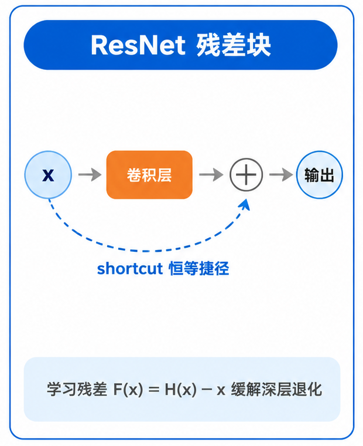

图3-16 ResNet 核心结构

<h2 id="q3-7-2">面试问题：介绍U-Net网络及其核心亮点</h2>

**难度评分：⭐⭐ (2/5) | 考察频率：⭐⭐⭐⭐⭐ (5/5)**

U-Net 由 Ronneberger 等人于 2015 年提出，是面向医学图像分割的全卷积网络。它采用编码器-解码器的 U 型对称结构，通过跳跃连接将编码端多尺度特征传到解码端同分辨率处，融合低级细节与高级语义，在小样本医学分割上效果突出。

U-Net 的编码器-解码器与同尺度跳跃连接结构如图3-16右半所示。

它的工作过程可以拆成编码、解码和跳跃连接三部分。

- 编码器（下采样路径）：重复卷积与下采样（原论文用最大池化），空间分辨率一步步降下来、感受野扩大、通道数增加，提取的特征越来越抽象。

- 解码器（上采样路径）：逐步上采样恢复分辨率并配合卷积细化。原论文使用2×2 up-convolution，可用可学习的转置卷积实现，并配合同尺度编码特征的裁剪与拼接；现代变体也常采用「最近邻/双线性上采样 + 卷积」，不能把插值方案直接当成原论文唯一实现。

- 跳跃连接：将编码器中与解码器同尺度的特征在通道维拼接（concatenate），再进入后续卷积，可记为：

$$ D_i=\mathrm{Up}(D_{i+1})\,\Vert\, E_i $$

其中 $D_i$ 在此式中表示解码器第 $i$ 级拼接后的中间特征，实际该级输出还需经过后续卷积， $\mathrm{Up}$ 表示上采样（及紧随其后的卷积等）， $E_i$ 为经必要裁剪或尺寸对齐后的编码器同尺度特征， $\Vert$ 表示通道维拼接（与部分资料里用 $\oplus$ 表示拼接的记号等价，此处用拼接符号避免与"逐元素加"混淆）。

在结构上，U-Net 有几个鲜明特点：

- U 型对称结构：编码、解码两侧对称，便于逐层恢复空间结构。

- 跳跃连接：把高分辨率侧的细节特征注入解码器，减轻纯上采样带来的边界模糊与细节丢失。

- 全卷积设计：无全连接层，对输入尺寸更灵活（仍受显存与对齐方式约束）。

- 端到端训练：结构直观、训练流程标准，小样本场景下仍常作强基线。

传统深度学习和 AIGC 时代的典型用法对比如下：

|应用场景|传统深度学习|AIGC 时代|
|---|---|---|
|主要任务|医学图像分割（细胞、器官等）、遥感/语义分割|扩散模型（如 Stable Diffusion）中的 U-Net 式去噪网络、修复/超分/视频生成、ControlNet 等条件分支|
|设计目标|精确勾画目标区域、提升分割边界质量|在去噪或条件生成中融合多尺度信息、稳定训练与细节|
|工程价值|分割领域经典基线与教学范本|大量文生图/图生图管线采用 U-Net 或其变体作为核心模块之一|

<h1 id="q3-8">8. Transformer 的提出背景是什么？解决了 RNN 的哪些核心缺陷？</h1>

<h2 id="q3-8-1">面试问题：Transformer 的提出背景是什么？它为了解决 RNN/LSTM 的哪些核心缺陷（如长距离依赖、梯度问题、无法并行）而设计？</h2>

**难度评分：⭐⭐ (2/5) | 考察频率：⭐⭐⭐⭐⭐ (5/5)**

Transformer由Google团队于2017年在论文《Attention Is All You Need》中提出，核心设计是彻底摒弃循环神经网络的串行循环结构，完全基于自注意力机制建模序列依赖关系。其提出初衷是突破机器翻译任务中RNN/LSTM的训练效率与长序列建模瓶颈，目前已成为大语言模型、多模态生成等AIGC核心系统的基础架构。

它针对性解决了RNN/LSTM的三大核心缺陷：

- 串行计算逻辑导致训练无法并行。RNN的计算严格遵循时序依赖，第t时刻的隐状态必须依赖第t-1时刻的输出，训练过程无法沿序列维度并行，序列越长训练耗时越高，难以适配大规模长序列场景。Transformer的自注意力可同时完成全序列所有位置的全局交互计算，各位置的输出可基于已知输入共同并行计算，但仍通过注意力相互依赖，能够充分利用GPU并行计算能力，大幅提升训练吞吐效率，是大模型得以规模化训练的重要基础。
- 长距离依赖建模能力不足。RNN通过隐状态逐步传递信息，信息传递路径长度为O(N)；随着序列长度增加，早期输入的语义信息会在传递中持续衰减，难以捕捉远距离token间的语义关联。Transformer的自注意力直接为序列中任意两个位置建立计算连接，信息传递路径长度压缩至O(1)，缩短了依赖路径并缓解了信息传递瓶颈，但不保证长距离检索或信息保留始终准确，可支撑长文本生成、长序列视觉建模等复杂AIGC任务。
- 长序列下梯度传播不稳定。RNN反向传播需沿时间步逐层展开，长序列场景下极易出现梯度消失或梯度爆炸；LSTM、GRU通过门控机制仅能缓解该问题，无法从根本突破局限，难以支撑超深层模型训练。Transformer依托残差连接与层归一化结构，梯度可通过跨层捷径直接回传，梯度流动更稳定，为深层、超大规模模型的稳定训练收敛提供了结构保障。

<h2 id="q3-8-2">面试问题：相比 CNN 处理序列任务，Transformer 的核心优势和劣势分别是什么？为什么它能实现序列的并行计算？</h2>

**难度评分：⭐⭐⭐ (3/5) | 考察频率：⭐⭐⭐⭐ (4/5)**

Transformer与CNN的核心差异来自自注意力与卷积两种建模范式，二者优劣势互补，在AIGC场景中分别适配不同的任务环节。

### 1、Transformer 的核心优势

（1）全局长距离依赖建模能力突出。
CNN受卷积核局部窗口限制，需多层堆叠才能逐步扩大感受野，长距离信息传递路径长、损耗大；Transformer的自注意力可在单层内建立全序列所有位置的直接关联，信息传递路径为O(1)，天然适配长文本生成、高分辨率视觉生成等场景的全局语义建模需求。
（2）特征聚合具备内容动态适应性。
CNN的卷积核参数训练后固定，对所有输入共享静态权重，特征提取规则不随内容变化；Transformer的注意力权重由输入token动态计算生成，可根据输入内容自适应调整信息聚合策略，对复杂语义的拟合能力更强，更契合生成任务的动态内容生成与语义对齐需求。

### 2、Transformer 的核心劣势

（1）计算与显存开销随序列长度平方级增长。

固定特征维度时，稠密自注意力的交互计算量为O(N²)，朴素实现显式保存注意力矩阵的空间也为O(N²)；FlashAttention等实现可消除完整矩阵的存储需求，处理超长文本、高分辨率图像时显存压力与计算延迟会急剧升高；CNN的计算复杂度随长度线性增长O(N)，长序列场景下效率更优。目前AIGC领域的窗口注意力、稀疏注意力等优化方案，核心都是缓解Transformer的平方级复杂度瓶颈。

（2）归纳偏置弱，强依赖大规模数据。

CNN内置局部连接、权值共享及受边界与步幅限制的平移等变先验，中小数据集上收敛更快、泛化更稳定；Transformer的空间局部先验相对较弱，常受益于大规模预训练，但也能通过合适架构和训练配方用于较小数据集，小样本场景下易过拟合，训练成本远高于CNN。

### 3、实现序列并行计算的核心原因

自注意力的计算本质是张量运算，全程不存在时序依赖：输入序列所有位置的token可独立完成Q、K、V向量的线性映射，后续注意力权重计算、值加权求和的过程也都是全序列同时参与的矩阵运算，没有RNN中“当前步依赖前一步输出”的串行约束。因此，在输入序列已知的训练或预填充阶段可沿序列维度并行计算；自回归推理仍通常逐token生成，层与层也有依赖。CNN同样可沿位置并行，实际速度优劣取决于长度、宽度、实现和硬件，不能一概认定Transformer总比CNN更高效。

RNN、CNN 与 Transformer 在依赖路径与并行性上的本质差异如图3-17所示：

  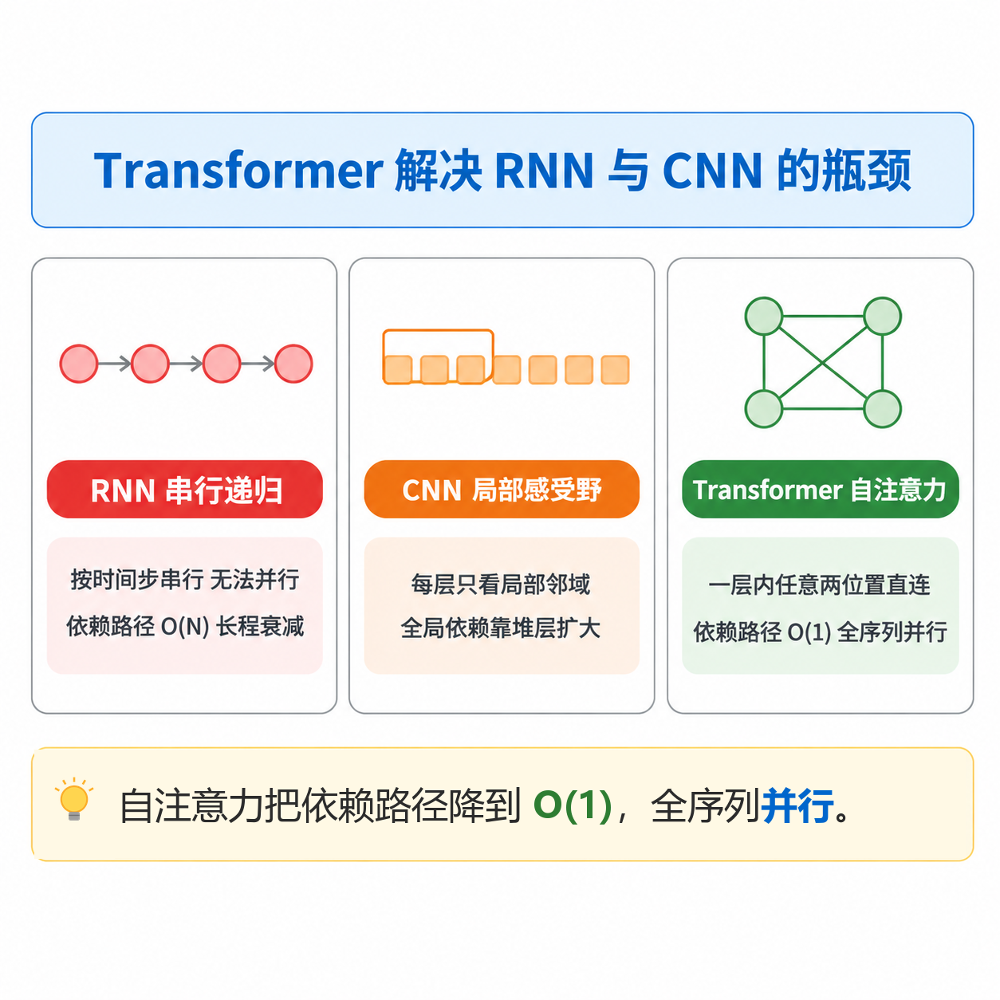

图3-17 Transformer 解决 RNN 与 CNN 的瓶颈

<h2 id="q3-8-3">面试问题：自注意力的全局建模能力，相比 RNN 的时序建模和 CNN 的局部建模，在生成类任务上带来了什么本质差异？</h2>

**难度评分：⭐⭐⭐⭐ (4/5) | 考察频率：⭐⭐⭐ (3/5)**

自注意力的全局建模范式，与RNN的时序递推、CNN的局部窗口建模存在底层逻辑差异，直接决定了三者在生成类任务中的能力上限与工程落地形态，核心本质差异体现在三个层面：

（1）信息交互模式从“压缩传递/局部聚合”升级为“全局精准直达”。RNN将全部历史信息压缩进维度固定的单一隐状态，存在天然信息瓶颈，序列越长，远距离语义衰减越严重，生成长文本时极易出现逻辑断裂、早期设定遗忘的问题。CNN受卷积核局部窗口约束，仅能聚合邻域特征，长距离依赖需通过多层堆叠间接实现，信息在逐层传递中持续损耗，难以保障生成结果的全局结构一致性。Transformer的自注意力直接为全序列任意两个token建立计算关联，在上下文窗口和因果掩码允许的范围内，生成当前token时可直接聚合可见历史位置的信息，无需经过中间层的压缩与递推，信息损耗极低，显著提升了长序列生成的上下文连贯性与细节一致性。

（2）信息传递路径长度从线性级缩短至常数级。RNN的信息沿时间步逐次传递，任意两个位置的信息交互路径长度为 $(O(N))$；固定小核、无空洞且不下采样的CNN，其长距离交互路径随距离近似线性增长；空洞卷积或分层下采样可以缩短路径，不能一概视为线性。传递路径越长，信息衰减与梯度消失的风险越高，深层长序列模型的优化难度越大。全局自注意力中，允许相互访问的位置可在单层内直接交互，路径为 $(O(1))$；因果生成只能访问当前及历史位置，窗口或稀疏模式还会进一步限制可见范围。这一特性让模型可以高效建模长距离语义与结构约束，支撑了长文档生成、高分辨率图像全局布局、复杂代码逻辑生成等高阶生成能力。

（3）训练并行性带来模型规模化的质变。RNN的训练与推理均受时序依赖约束，无法沿序列维度并行，计算效率随序列长度线性下降，难以支撑超大规模模型与海量数据训练。CNN虽具备空间并行性，但全局建模能力与网络深度强绑定，要获得长程依赖能力需大幅堆叠层数，训练成本与优化难度同步上升。Transformer的全局建模天然支持全序列并行训练，自注意力的矩阵运算可充分利用GPU并行算力，训练效率远高于串行结构。正是这种高效并行能力，使得百亿、千亿参数的大模型得以在海量数据上完成预训练，为AIGC时代生成模型的能力爆发提供了架构与算力基础。

<h1 id="q3-9">9. 介绍一下 Transformer 网络结构</h1>

<h2 id="q3-9-1">面试问题：请完整介绍 Transformer 的整体架构，简述 Encoder 和 Decoder 的核心区别。</h2>

**难度评分：⭐⭐ (2/5) | 考察频率：⭐⭐⭐⭐⭐ (5/5)**

Transformer 是 2017 年《Attention Is All You Need》提出的纯注意力序列建模架构，原生采用编码器-解码器（Encoder-Decoder）双塔结构，完全摒弃循环与卷积组件，依靠自注意力机制实现全局序列建模。其整体架构可分为四部分：输入嵌入与位置编码模块、堆叠的编码器层、堆叠的解码器层、输出投影与 Softmax 层。原论文中编码器与解码器各堆叠 6 层，每层内部均包含注意力模块、前馈神经网络（FFN），并配套残差连接与层归一化，保障深层网络的训练稳定性。

Encoder 与 Decoder 的核心差异体现在三个维度：

### 1、输入规则与可见范围不同

- 编码器：输入为完整源序列，经词嵌入转换为向量后叠加位置编码，补充序列位置信息。采用双向可见机制，计算任意位置特征时可访问序列全部位置的信息，用于充分建模输入的全局语义。
- 解码器：训练阶段输入为右移（Shifted Right）的目标序列，推理阶段为已生成的历史 token，同样叠加位置编码。通过因果掩码（Causal Mask）约束可见范围，当前位置仅能访问自身及历史位置的特征，严格防止未来信息泄露，匹配自回归生成的逻辑。

### 2、内部注意力模块组成不同

- 编码器：仅包含多头自注意力一个注意力子层，完成源序列内部的全局信息交互，后续接入两层全连接构成的 FFN 做特征变换。
- 解码器：串联两个注意力子层。第一层为掩码多头自注意力，完成目标序列历史信息的内部交互；第二层为交叉注意力（Cross-Attention），其中 Query 来自解码器侧特征，Key、Value 来自编码器的最终输出，实现源语义向生成过程的注入与对齐。

### 3、功能定位与输出作用不同

- 编码器：核心职责是语义理解与特征编码，输出源序列的全局上下文表征，为后续生成提供完整的输入语义支撑。
- 解码器：核心职责是序列生成，基于已生成内容与编码侧语义信息，自回归逐 token 预测下一个输出，最终完成目标序列的生成。

在 AIGC 工程实践中，Transformer 已衍生出多种架构变体：纯编码器结构多用于语义理解类任务；纯解码器结构（如 GPT、LLaMA 系列大语言模型）是当前生成式大模型的主流选型，仅依靠掩码自注意力即可实现自回归生成；交叉注意力机制也被广泛迁移到扩散模型、多模态生成架构中，用于文本条件与视觉/音频特征的跨模态对齐。

Transformer 整体架构与 Encoder、Decoder 的堆叠组件如图3-18所示：

  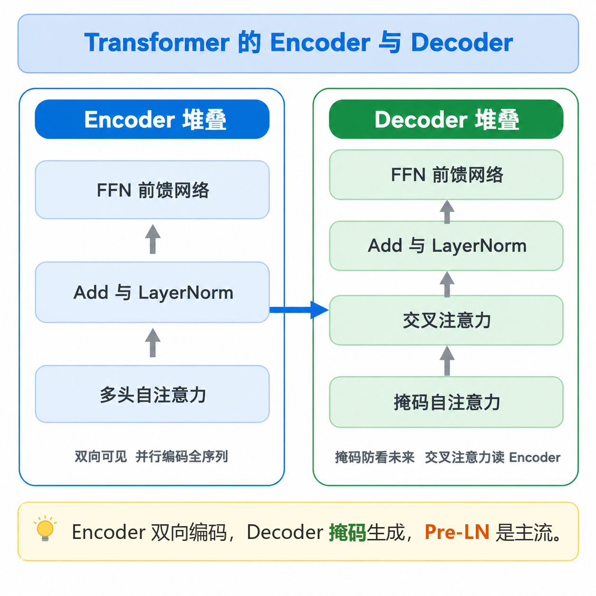

图3-18 Transformer 的 Encoder 与 Decoder

<h2 id="q3-9-2">面试问题：为什么解码器需要掩码自注意力？请解释 Causal Mask 和 Padding Mask 的作用及实现方式。</h2>

**难度评分：⭐⭐⭐ (3/5) | 考察频率：⭐⭐⭐⭐⭐ (5/5)**

解码器采用掩码自注意力，核心是为了对齐训练与推理的行为逻辑。解码器的本质是自回归逐token生成序列：推理阶段只能基于已生成的历史token预测下一位置，无法获取未来信息；但训练阶段为了提升计算效率，会将右移后的目标序列一次性输入做并行计算。若不加掩码约束，当前位置的特征计算会直接访问未来位置的真实标签，造成信息泄露，导致训练与推理的分布不一致，模型无法习得正确的生成逻辑。掩码通过强制屏蔽未来位置信息，让训练严格遵循自回归的因果约束，是自回归生成模型有效训练的基础前提。

Transformer中最核心的两类掩码，作用与实现方式如下：

### 1、Causal Mask（因果掩码）

作用是保障自回归的因果性约束，严格屏蔽当前位置之后的所有未来信息，确保每个token仅能聚合自身与历史位置的特征，是解码器自注意力层的核心组件。在纯解码器架构的大语言模型（如GPT、LLaMA系列）中，因果掩码同样是自注意力的标配，是整个自回归生成体系的基础设计。
实现上，构造与注意力分数矩阵同尺寸的掩码矩阵：对角线及下三角区域取值为0（对应可见的当前与历史位置），严格上三角区域（不含对角线，对应未来位置）统一填充为 $-\infty$。将掩码与原始注意力分数相加后再执行Softmax，未来位置的注意力权重变为0，完全不参与最终的特征加权聚合。

### 2、Padding Mask（填充掩码）

作用是屏蔽批次内的无效填充位。批量训练时为了对齐序列长度，短序列会用<PAD>填充符补至统一长度，填充位无实际语义信息。填充掩码可以避免这些无效位置参与注意力计算，防止其干扰正常的语义聚合，该掩码同时适用于编码器自注意力、解码器自注意力与交叉注意力层。
实现上，根据输入序列的有效长度生成掩码标记，通常将无效Key对应的列分数设为 $-\infty$，使有效Query不聚合这些位置。填充Query的输出或损失通常另行忽略，避免整行全被屏蔽时产生非法softmax；掩码的布尔语义还应按框架接口确认。

在AIGC工程实践中，两类掩码通常组合使用：因果掩码保障生成过程的时序因果逻辑，填充掩码适配批量变长序列的计算需求，二者共同支撑了大语言模型、多模态生成等场景的高效并行训练。

<h2 id="q3-9-3">面试问题：为什么纯解码器架构在 AIGC 时代（如 LLM）成为主流？Encoder-only 和 Encoder-Decoder 架构分别适用于什么场景？</h2>

**难度评分：⭐⭐⭐⭐ (4/5) | 考察频率：⭐⭐⭐⭐ (4/5)**

AIGC 时代通用大模型普遍选择纯解码器架构，而非早期 NLP 主流的纯编码器或编码器-解码器双塔架构，核心是其在规模扩展性、生成任务适配性与数据利用效率上更契合大模型的技术发展路线，具体原因有三点：

### 1、规模扩展效应更显著，高度适配 Scaling Law。

纯解码器采用统一的重复模块，便于扩展参数、数据规模和复用成熟训练栈，已有大量成功实践。但不能据此认定在同等参数、数据和算力下必然比Encoder-Decoder具有更好的缩放收益；优劣依赖预训练目标、数据和下游任务，参数拆到两侧本身也不是性能必然更差的理由。

### 2、与自回归生成任务天然契合，工程优化效率更高。

纯解码器以因果掩码自注意力为核心单元，结构统一规整，和自回归逐 token 生成的逻辑完全对齐，天然适配 KV Cache、投机采样、分页注意力等主流推理加速技术，工程落地与性能优化的成本更低。编码器-解码器还需处理编码结果与交叉注意力，但同样可以缓存解码侧自注意力及交叉注意力的K/V，也可应用投机解码等优化，不能把这些技术视为纯解码器独有。

### 3、预训练目标可充分利用海量无标注数据。

纯解码器以“预测下一个 token”为自回归预训练目标，无需人工标注即可直接在互联网海量文本数据上训练，数据获取门槛低、规模上限高。通过大规模无监督预训练习得通用语言能力后，再经指令微调、人类对齐即可适配各类下游生成任务，是一条广泛采用的技术路径；Encoder-only和Encoder-Decoder同样能用掩码、去噪等自监督目标利用无标注数据，效率优劣需具体比较。

三类 Transformer 架构的适用场景各有侧重：

- Encoder-only（纯编码器，代表模型：BERT、RoBERTa）：核心采用双向自注意力，可同时融合左右上下文信息，语义表征能力强，更擅长语义理解类任务。典型场景包括文本分类、实体识别、情感分析、语义匹配检索等；在 AIGC 体系中，常作为语义编码器用于检索增强生成的召回模块、多模态模型的文本/视觉编码分支，核心负责特征提取与语义理解，不承担序列生成职能。
- Encoder-Decoder（编码器-解码器，代表模型：T5、BART）：采用双塔结构，编码侧完成输入语义理解，解码侧通过交叉注意力对齐输入特征并生成输出序列，适合输入、输出均为序列且语义差异较大的 Seq2Seq 任务，典型场景如机器翻译、长文本摘要、结构化内容生成。在 AIGC 领域，部分条件生成、跨模态翻译类任务仍会采用该架构，但在通用生成大模型赛道，当前使用频率低于纯解码器，但不能据此认定其规模效应与工程效率在所有任务中更差。
- Decoder-only（纯解码器，代表模型：GPT 系列、LLaMA 系列）：基于因果掩码的自回归生成架构，统一的预训练范式使其同时具备语义理解与内容生成能力，随模型规模增长可逐步涌现逻辑推理、指令遵循、工具调用等高阶能力，是当前通用大语言模型、对话交互、内容创作、代码生成等 AIGC 核心场景的主流架构。

<h2 id="q3-9-4">面试问题：Transformer 中为什么要使用残差连接 + 层归一化？Pre-LN（前置）相比 Post-LN（后置）有什么区别？为什么大模型普遍用 Pre-LN？</h2>

**难度评分：⭐⭐⭐⭐ (4/5) | 考察频率：⭐⭐⭐⭐⭐ (5/5)**

残差连接与层归一化（LayerNorm）是 Transformer 实现深层稳定训练的核心配套组件，二者协同解决深层网络的梯度消失与特征分布偏移问题，是大模型可规模化训练的重要基础。

### 1、残差连接与层归一化的核心作用

- **残差连接**：通过跨层恒等映射捷径，让梯度可以沿支路直接回传至低层，从根本上缓解深层网络的梯度消失问题，大幅降低数十至上百层网络的优化难度，保障模型随层数加深实现精度提升，而非出现退化。
- **层归一化**：对单个样本的特征维度做归一化处理，稳定每一层的输入特征分布，缓解训练过程中的内部协变量偏移，加快收敛速度，同时避免特征数值异常导致的训练失稳。

### 2、Pre-LN 与 Post-LN 的核心区别

二者的本质差异是层归一化在残差结构中的放置位置不同，进而带来梯度传播特性与训练稳定性的显著差异。

- Post-LN（Transformer 原生设计）：计算流程为「子层计算 → 残差相加 → 层归一化」，即 LN 位于残差支路的汇合点之后。反向传播时，残差路径上的梯度需要经过 LN 层的变换才能向下传递；其梯度尺度更依赖初始化、深度和归一化雅可比，可能出现不平衡或不稳定，并非必然逐层衰减。经典设置通常更依赖合适的学习率预热与初始化，但经改进和充分调优也可以稳定训练深层模型。
- Pre-LN（当前大模型主流设计）：计算流程为「层归一化 → 子层计算 → 残差相加」，即 LN 置于每个子层的输入侧。此时残差支路为纯恒等映射，反向传播时梯度可不经任何变换直接沿捷径回传，深层梯度流动更稳定，梯度消失风险大幅降低。该结构对学习率预热的依赖更弱，训练过程更平滑，深层网络的收敛难度显著下降。

### 3、大模型普遍采用 Pre-LN 的原因

大模型普遍具备层数深、参数量大的特点，层数往往达到数十甚至上百层，经典Post-LN在这种规模下更可能暴露梯度尺度和优化稳定性问题，需要更仔细的初始化与学习率设计，但不能统一解释为梯度必然指数衰减。

Pre-LN 的核心优势是训练稳定性强。尽管在小参数量场景下，调优充分的 Post-LN 可能取得略优的最终精度，但在大模型规模化训练中，稳定收敛、可顺利扩展到深层大参数量的优先级远高于微小的精度收益。同时 Pre-LN 对超参数（尤其是学习率策略）的宽容度更高，能显著降低大规模训练的调试成本与失败风险。GPT-2等采用Pre-LayerNorm，LLaMA采用Pre-RMSNorm，二者都属于先归一化再进入子层的残差布局，但RMSNorm与LayerNorm的计算不同，不能混称为完全相同的归一化层。

<h2 id="q3-9-5">面试问题：Transformer 的 FFN（前馈网络）起什么作用？为什么大模型常用 SwiGLU 替代传统的 ReLU/GELU？</h2>

**难度评分：⭐⭐⭐ (3/5) | 考察频率：⭐⭐⭐⭐ (4/5)**

FFN（前馈神经网络）是 Transformer 编码器、解码器每层的标配组件，与自注意力模块成对配合，共同完成序列特征的全局交互与逐位置非线性变换，是模型表达能力与知识存储的核心载体之一。

### 1、FFN 的核心作用

（1）补充非线性变换能力，完善模型表达

固定注意力权重后，对Value的加权聚合是线性的；但权重由输入相关的Q/K点积及softmax产生，因此完整自注意力对输入一般是非线性的。FFN 采用「线性升维 → 激活函数 → 线性降维」的瓶颈结构，在每个 token 位置独立引入非线性变换，与注意力的跨位置交互形成互补，大幅提升模型对复杂函数的拟合能力。

（2）承担知识存储与特征路由职能

标准 FFN 通常先将特征维度放大数倍（原论文为隐层维度的 4 倍）再映射回原维度，其参数量占 Transformer 总参数量的大部分。已有研究表明，FFN 层可类比为键值存储器：升维后的神经元对应不同的语义与知识模式，通过激活的动态选择触发对应知识，是大模型存储事实规则、语义模式与生成逻辑的核心载体。

### 2、大模型普遍采用 SwiGLU 替代 ReLU/GELU 的原因

SwiGLU 是门控线性单元（GLU）的改进变体，将 GLU 中的 sigmoid 门替换为 Swish 激活函数，标准形式为 $\text{SwiGLU}(x) = \text{Swish}(xW_1) \odot (xW_2)$，最终再经线性层输出。相比传统单路激活的 FFN，SwiGLU 在大模型场景下的优势十分显著：

（1）梯度特性更平滑，适配深层网络训练

ReLU 存在负半轴硬截断问题，易出现神经元永久失活（Dead ReLU）；GELU和SiLU采用平滑门控，但SwiGLU并非处处具有非零梯度，仍可能出现梯度接近0或被门控抑制。其优势更多来自门控表达和具体实验收益，不能保证相较GELU总能避免深层梯度衰减。

（2）门控机制实现动态信息筛选

传统激活函数仅对单路特征做逐元素变换，而 SwiGLU 通过门控结构实现了特征的动态路由：门控支路根据输入内容自适应调节各维度的信息流通强度，让模型可以选择性激活相关特征、抑制无关信息，特征表征的灵活性与精准度显著提升，更适配生成任务对细粒度语义控制的需求。

（3）规模化场景下性能收益明确

同等中间维度下，SwiGLU比两投影FFN多一组投影；缩小中间维度后可对齐参数量和主要矩阵乘法开销。许多语言建模实验显示了它的收益，但质量与速度仍应按具体预算、模型和实现比较，不能保证所有任务都获益。目前 LLaMA、PaLM 等主流 AIGC 大语言模型均采用 SwiGLU 及其变体作为 FFN 的核心结构，已成为大模型的标准设计。

<h1 id="q3-10">10. 介绍一下自注意力机制的原理</h1>

<h2 id="q3-10-1">面试问题：详细描述标准自注意力的完整计算流程（从输入 X 到输出），并解释 Q、K、V 的含义以及“为什么需要区分三者”。</h2>

**难度评分：⭐⭐ (2/5) | 考察频率：⭐⭐⭐⭐⭐ (5/5)**

标准缩放点积自注意力是Transformer架构的核心计算单元，作用是为序列中每个位置聚合全局上下文信息，输出融合了全序列依赖关系的特征。其完整计算围绕查询（Q）、键（K）、值（V）三组投影向量展开，可拆解为五个核心步骤。

### 1、标准自注意力的完整计算流程

设输入特征矩阵为 $X \in \mathbb{R}^{N \times d_{model}}$，其中 $N$ 为序列长度， $d_{model}$ 为模型特征维度，计算过程如下：

（1）线性投影生成QKV

输入特征分别与三组可学习的权重矩阵 $W_Q, W_K, W_V \in \mathbb{R}^{d_{model} \times d_k}$ 做线性变换，得到查询矩阵 $Q$、键矩阵 $K$、值矩阵 $V$，此处为便于说明取三者维度均为 $\mathbb{R}^{N \times d_k}$， $d_k$ 为Q/K的单头特征维度；一般情况下Value的维度可以与Q/K不同。

（2）点积计算注意力分数

通过矩阵乘法计算两两位置的相关性：$S = Q K^T$，得到注意力分数矩阵 $S \in \mathbb{R}^{N \times N}$。其中元素 $S_{ij}$ 表示第 $i$ 个位置的查询与第 $j$ 个位置的键的相似度得分。

（3）缩放与可选掩码

将分数矩阵除以缩放因子 $\sqrt{d_k}$，抵消特征维度 $d_k$ 过大导致的点积数值膨胀，避免Softmax函数进入梯度饱和区。若为解码器因果自注意力或需屏蔽无效填充位，会在此处叠加对应掩码，将待屏蔽位置的分数置为 $-\infty$。

（4）Softmax归一化得到注意力权重

对分数矩阵的每一行执行Softmax操作，将分数归一化为0~1之间、行和为1的注意力权重矩阵 $A \in \mathbb{R}^{N \times N}$，权重大小代表当前位置对序列各位置的信息关注度分配。

（5）加权求和得到输出

用注意力权重对值矩阵 $V$ 做加权聚合，最终输出 $O = A V \in \mathbb{R}^{N \times d_k}$。每个位置的输出向量，都是全序列所有位置的值向量按注意力权重加权求和的结果。

完整计算可统一为公式：

$$\text{Attention}(Q,K,V) = \text{Softmax}\left( \frac{Q K^T}{\sqrt{d_k}} \right) V$$

### 2、Q、K、V 的含义与角色

- Query（Q，查询向量）：当前位置的检索特征，代表该位置的查询视角，用于主动匹配序列中所有位置的相关程度，相当于信息检索中的提问方。
- Key（K，键向量）：每个位置的索引特征，是该位置的身份标识，用于被其他位置的查询做相似度匹配，相当于信息检索中的索引库。
- Value（V，值向量）：每个位置的内容特征，承载了该位置实际的语义信息，是最终被加权聚合的特征载体，相当于信息检索中的内容库。

### 3、区分 Q、K、V 的核心原因

若不做区分（令 $(Q=K=V=X)$），未加掩码的点积分数矩阵为对称矩阵，但逐行softmax后的权重通常不对称，加入因果掩码后更不对称，查询、匹配、内容三者共享同一特征空间，会严重限制模型的表达能力。拆分三者的核心价值在于实现功能解耦：

（1）角色解耦，提升表达灵活性

三个独立投影矩阵对应三个不同的特征子空间，让主动查询、被查询匹配、承载内容三种职能可以各自学习最优的特征表示。例如同一个token，作为查询者寻找上下文依赖，和作为上下文被其他位置引用，适用的特征模式可以完全不同，模型可以学习更复杂的语义依赖逻辑。

（2）天然支持跨模态/跨序列交互

Q与K、V的拆分设计，天然支持查询与键值来自不同序列的场景。AIGC领域广泛使用的交叉注意力（Cross-Attention）正是基于该设计：Q来自生成侧特征（如图像隐空间特征），K、V来自条件侧特征（如文本编码特征），实现条件信息向生成过程的注入，是文本生成图像、跨模态生成等任务的核心基础。

自注意力的完整计算流程与多头扩展如图3-19所示：

  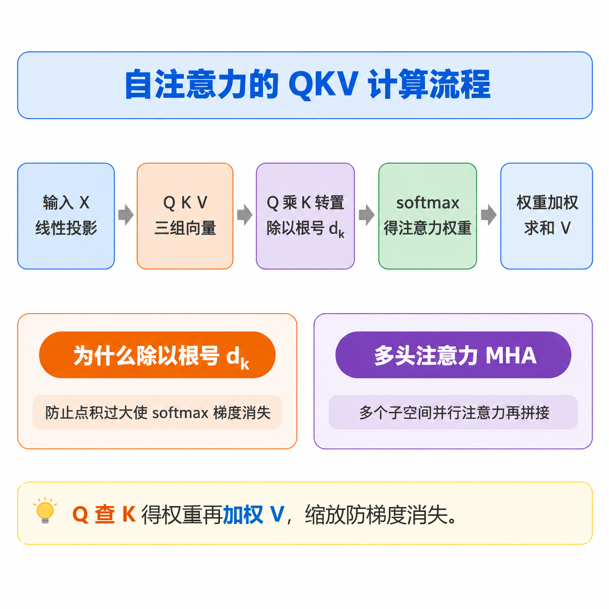

图3-19 自注意力的 QKV 计算流程

<h2 id="q3-10-2">面试问题：为什么自注意力计算中要除以 $\sqrt{d_k}$（缩放因子）？如果不除以会发生什么？。</h2>

**难度评分：⭐⭐⭐ (3/5) | 考察频率：⭐⭐⭐⭐⭐ (5/5)**

除以 $\sqrt{d_k}$ 是缩放点积注意力的核心设计，目的是抵消高维向量点积带来的数值膨胀，稳定 Softmax 的输出分布与梯度流动，是自注意力可稳定训练的关键细节。

### 1、点积方差随维度增长的理论依据

为解释量级，假设查询向量与键向量相互独立、各维度也独立同分布，且满足均值为 0、方差为 1。二者的点积为对应维度元素相乘后求和，其中每一组乘积项的均值为 0、方差为 1；根据方差可加性， $d_k$ 个独立项求和后，点积结果的整体方差等于 $d_k$，标准差为 $\sqrt{d_k}$。
这意味着向量维度 $d_k$ 越大，点积结果的数值波动范围越大，绝对值整体向正负两端膨胀，维度越高数值离散程度越剧烈。

### 2、不做缩放的后果：Softmax 饱和与梯度消失

如果直接将未缩放的点积输入 Softmax，会引发两层连锁问题，在大模型高维场景下尤为严重：

（1）注意力分布退化为近似独热形式

数值量级膨胀会放大不同位置的分数差异，Softmax 输出会极度尖锐：最大值位置的概率被快速推向 1，其余位置的权重被压缩至趋近于 0。此时注意力退化为仅关注单一最强相关位置，丢失了多位置加权聚合的能力，破坏了注意力机制的信息融合作用。

（2）反向传播梯度消失，训练无法收敛

Softmax 函数在输入数值差异极大时会进入饱和区，梯度幅值趋近于 0。此时反向传播过程中，梯度无法通过注意力权重有效回传至下层网络，造成梯度消失。对于层数深、特征维度高的 AIGC 大模型，该问题会被指数级放大，直接导致模型参数无法正常更新、训练失稳。

### 3、缩放因子的核心作用

在前述理想独立、单位方差假设下，将点积结果除以 $\sqrt{d_k}$ 后方差变为1；实际训练中的Q/K可能相关且方差变化，该缩放用于控制量级，而不保证始终精确为1，有助于避免仅因维度增大而使分数差异过大。它通常能缓解softmax过度尖锐及相应梯度缩小的问题，但仍可能出现尖锐注意力或训练失稳，需要结合Q/K尺度、初始化和优化设置判断。

<h2 id="q3-10-3">面试问题：解释多头注意力（MHA）的核心思想，并介绍 MQA（多查询）和 GQA（分组查询）的区别及适用场景（KV Cache 显存优化）。</h2>

**难度评分：⭐⭐⭐⭐ (4/5) | 考察频率：⭐⭐⭐⭐⭐ (5/5)**

### 1、多头注意力（MHA）的核心思想

多头注意力是标准自注意力的核心扩展形式，核心思路是将特征空间拆分为多个独立子空间，并行执行多组注意力计算后再融合输出。
具体实现上，输入特征经线性投影后拆分为 $h$ 组独立的 Q、K、V 向量，对应 $h$ 个注意力头；每个头在各自的特征子空间内独立完成缩放点积注意力计算，可并行捕捉不同类型的序列依赖（如句法结构、指代关系、长距离语义关联等）；最终将所有头的输出沿特征维度拼接，经线性层融合得到最终结果。
多头设计突破了单头注意力单一特征空间的表达局限，显著提升了模型的多维度表征能力。标准 MHA 中 Q、K、V 均为 $h$ 头独立投影，提供较灵活的独立KV子空间，并不保证实际精度总是最高，同时通常带来推理阶段更高的显存与带宽开销。

### 2、MQA 与 GQA 的设计背景与核心区别

大模型自回归推理时，会缓存已生成 token 的 K、V 向量（即 KV Cache）以避免重复计算。KV Cache 的显存占用与 K、V 的头数成正比，长序列、高并发场景下会成为推理显存与带宽的核心瓶颈。MQA、GQA 均为针对 KV 头数的工程优化方案，通过减少 K、V 头数降低推理开销，三者核心差异如下：

（1）标准 MHA（多头注意力）

K、V 与 Q 保持相同头数 $h$，每个 Q 头对应一组独立的 K、V。在相同查询头数、头维度、缓存精度和上下文长度下，其KV共享约束最少，KV Cache占用通常最大，KV读取带宽压力也较大；最终模型精度不保证高于MQA或GQA。一般作为基座模型训练的基准方案，适合效果优先、推理负载较低的场景。

（2）MQA（Multi-Query Attention，多查询注意力）

全部 Q 头共享同一组全局 K、V，即 K、V 仅保留 1 组。KV Cache 显存占用降至标准 MHA 的 $(1/h)$，可大幅降低内存带宽开销、提升推理吞吐。但所有头共享同一组 KV 会压缩特征子空间的多样性，可能影响精度，但并非在所有任务和训练配方下都必然下降。适合极致推理效率优先、可容忍少量精度下降的场景，如端侧部署、低算力推理场景。

（3）GQA（Grouped-Query Attention，分组查询注意力）

将全部 Q 头划分为 $G$ 个组，每组内的 Q 头共享一组 K、V，即 K、V 头数等于分组数 $G$。它是标准 MHA 与 MQA 的折中方案：当 $(G=h)$ 时等价于标准 MHA，当 $(G=1)$ 时等价于 MQA。
在头维度、缓存精度和上下文长度相同的条件下，GQA的KV Cache占用可降至MHA的 $(G/h)$；许多实验中质量接近MHA，但精度变化仍需具体验证。

### 3、工程适用场景

- 标准 MHA：适用于追求最优效果的基座模型训练，以及推理并发低、对延迟不敏感的场景。
- MQA：适用于对推理速度、显存占用要求极致，可接受一定精度损失的轻量化部署、端侧大模型等场景。
- GQA：是当前 AIGC 工业界大模型的主流选型，LLaMA-2 70B和LLaMA-3等采用该设计；LLaMA-2 7B/13B仍使用MHA，不能概括为整个LLaMA-2系列都使用GQA。该方案常用于长上下文生成、高并发在线推理等核心部署场景，在保证生成质量的同时显著降低推理成本。

<h2 id="q3-10-4">面试问题：自注意力机制的 $O(N^2)$ 复杂度带来了哪些长序列痛点？有哪些主流的算法级解决方案（如稀疏注意力、线性注意力）？</h2>

**难度评分：⭐⭐⭐⭐ (4/5) | 考察频率：⭐⭐⭐⭐ (4/5)**

标准自注意力需要计算全序列两两位置的相关性，固定特征维度时，交互计算量为 $O(N^2)$ 量级，朴素实现显式存储的注意力矩阵也具有平方级空间开销；FlashAttention等实现可降低该存储开销，但不消除稠密注意力的平方级算术量。这些计算与存储开销会制约长序列建模，在AIGC领域的长上下文生成、高分辨率视觉生成等场景中问题尤为突出。

### 1、 $O(N^2)$ 复杂度带来的核心痛点

（1） 训练显存瓶颈突出
朴素实现会显式保存 $N \times N$ 的注意力矩阵，具有 $O(N^2)$ 空间开销，长度翻倍时这一矩阵的存储约增至4倍；FlashAttention通过分块、在线softmax和反向重计算等方式，无需保存完整矩阵，因此不能据此认定所有注意力实现的训练显存都增长4倍。超长序列仍可能因其他激活、缓存或计算开销受限，需要结合具体实现评估。

（2）计算效率随长度急剧衰减
自注意力的点积运算时间复杂度为 $O(N^2 d)$（$d$ 为特征维度），计算量随序列长度呈平方级增长。训练阶段全序列并行计算的耗时随长度快速上升；推理阶段虽自回归单步计算为线性开销，但长序列整体生成的总耗时与算力成本仍显著升高，吞吐效率大幅下降，难以支撑长文档生成、长时序视频建模等落地场景。

### 2、主流算法级优化方案

（1）稀疏注意力

核心思路是打破全位置两两交互的稠密设定，通过人工设计稀疏可见模式，仅保留必要的注意力连接，当每个位置的连接数或全局Token数不随序列长度增长时，可将相应交互开销降至近似线性；其他稀疏模式的复杂度需单独分析。
典型实现包括局部滑动窗口（每个位置仅关注邻域固定范围的token）、全局锚点（增设少量全局token汇总全局信息）、扩张窗口等组合模式，代表方案如Longformer，视觉领域的Swin Transformer的窗口与移位窗口注意力也属于同类思路。
该方案设计直观，对模型精度损伤较小，但稀疏模式依赖人工先验，对强全局依赖任务的适配性有限。在AIGC场景中，广泛用于长文本基座模型、高分辨率图像生成骨干，在保留局部细节建模能力的同时降低长序列开销。

（2）线性注意力与低秩近似

核心思路是通过数学变换或低秩近似绕开显式构造 $N \times N$ 注意力矩阵，将复杂度压缩至近似线性，主流分为两条技术路径：

- 核函数近似（代表：Performer）：用随机特征近似指数点积核，并保留注意力归一化分母；对核特征映射后的乘法，借助结合律从 $(\phi(Q)\phi(K)^T)V$ 改写为 $\phi(Q)(\phi(K)^TV)$，无需构造完整注意力图。特征映射维度与通道维度固定时，主要计算对长度近似线性；当随机特征数与通道宽度同阶时，可写为 $O(N d^2)$；这里 $d$ 是相应特征规模，实际开销还取决于随机特征数，不能直接对带softmax的原始 $N$ 长度注意力仅靠结合律完成等价改写。
- 低秩投影（代表：Linformer）：将K、V矩阵沿序列维度投影到固定长度的低维空间，把注意力计算的矩阵尺寸从 $N \times N$ 压缩至 $N \times r$（$r \ll N$ 且为固定值），固定通道宽度时，注意力交互计算对长度的复杂度降至 $O(N r)$。
这类方案可实现理论上的线性复杂度，但存在近似误差，会一定程度损失模型精度，尤其对精细长距离依赖建模有影响，多用于对精度要求不极致、但对长序列效率要求高的AIGC场景。

（3）状态空间模型（SSM，代表：Mamba）

核心思路是完全摒弃自注意力架构，通过结构化状态空间模型建模序列依赖。以Mamba为代表的选择性状态空间模型，通过选择性门控机制实现上下文信息的动态筛选，既保留了类注意力的长距离建模能力，又实现了严格的 $(O(N))$ 线性计算与显存复杂度，在固定模型大小下，其递推状态缓存不随已生成序列长度增长；模型权重、批次和输出等仍占内存，不能将整个推理系统的显存都称为常数。
该方案在长序列场景下兼顾效率与建模能力，是当前长序列建模的核心技术方向之一，已在长上下文大模型、长时序生成、高分辨率视觉建模等AIGC场景中展现出替代标准Transformer的潜力；目前相对短板是架构生态与工程优化成熟度略逊于成熟Transformer体系。

<h1 id="q3-11">11. 介绍一下位置编码的原理</h1>

<h2 id="q3-11-1">面试问题：为什么 Transformer 需要位置编码？位置编码为什么要和词嵌入相加而不是拼接？</h2>

**难度评分：⭐⭐⭐ (3/5) | 考察频率：⭐⭐⭐⭐ (4/5)**

自注意力的计算本质是值向量的加权聚合，在没有位置相关掩码、偏置或编码时具有置换等变性：打乱输入token顺序，输出仅对应重排；因果或局部掩码本身会引入顺序约束，因此该结论需明确这些前提。而语言、时序等序列数据的顺序是语义的核心组成部分，因此需要位置编码、相对位置偏置、因果结构等某种顺序信号，使模型能够利用先后关系；位置编码是常见做法，而不是唯一可能机制。

原始Transformer选择逐元素相加而非拼接，主要有两点考虑；这不是必须规则，RoPE、ALiBi等也不采用这种输入相加方式：

（1）参数与计算效率更高。

若内容和位置向量各占完整模型维度，直接拼接会使维度翻倍并增加后续开销；也可分配较小子维度或拼接后投影回去。逐元素相加保留原维度，除加法本身外不增加后续层维度开销，实现较简单。

（2）内容与位置信息可有效解耦。

在特征维度充足的前提下，后续线性层可分离两类信息。线性变换满足分配律：

$$W(x_{emb} + x_{pos}) = W \cdot x_{emb} + W \cdot x_{pos}$$

这只说明同一个线性映射对加法满足分配律，并不等于两套独立可学习映射，也不保证能无损分离内容与位置。模型可以通过训练利用二者，但相加与拼接后分别投影的表达约束不同。

正弦位置编码相加注入与 RoPE 旋转编码两种主流方案如图 3-20 所示：

图3-20 位置编码为序列注入顺序

<h2 id="q3-11-2">面试问题：请简述正弦余弦位置编码的原理，并推导说明其为何能表示相对位置关系。</h2>

**难度评分：⭐⭐⭐⭐ (4/5) | 考察频率：⭐⭐⭐⭐ (4/5)**

### 1、正弦余弦位置编码原理

正弦余弦位置编码是Transformer原生的无参数固定位置编码，通过不同频率的正、余弦函数为每个位置生成唯一的位置向量，与词嵌入逐元素相加即可注入位置信息。计算公式为：

$$
\begin{aligned}
PE_{(pos, 2i)} &= \sin\left( pos \cdot 10000^{-2i/d} \right) \\
PE_{(pos, 2i+1)} &= \cos\left( pos \cdot 10000^{-2i/d} \right)
\end{aligned}
$$

其中 $pos$ 为序列中的绝对位置索引， $i$ 为维度索引， $d$ 为位置编码的特征维度。随维度对索引i增大，角频率从高到低变化：低频分量周期较长，高频分量对小位移更敏感，这提供多尺度位置信号，但不规定训练后各维度必须承担某类语义依赖。

### 2、相对位置表达能力推导

该编码天然具备相对位置建模能力，可通过三角和角恒等式证明。令第 $i$ 维的角频率为 $\omega_i = 10000^{-2i/d}$，对任意位置 $pos$ 与相对偏移量 $k$，位置 $(pos+k)$ 的编码可展开为：

$$
\begin{aligned}
PE_{((pos+k), 2i)} &= \sin\left( ((pos+k))\omega_i \right) \\
&= \sin(pos\omega_i)\cos(k\omega_i) + \cos(pos\omega_i)\sin(k\omega_i) \\[6pt]
PE_{((pos+k), 2i+1)} &= \cos\left( ((pos+k))\omega_i \right) \\
&= \cos(pos\omega_i)\cos(k\omega_i) - \sin(pos\omega_i)\sin(k\omega_i)
\end{aligned}
$$

可见 $PE_{(pos+k)}$ 可表示为 $PE_{pos}$ 的线性组合，组合系数仅由相对偏移 $k$ 决定，与绝对位置 $pos$ 无关。因此，对固定偏移k存在不依赖绝对位置的线性变换，有利于模型学习相对位置关系；但并不表示一次固定线性投影就能直接输出任意两位置的距离，也不保证加入内容嵌入后的注意力仅取决于相对位置。

<h2 id="q3-11-4">面试问题：解释 RoPE 的外推问题，Base 参数的作用是什么？有哪些常见的外推解决方案（如 NTK-aware, YaRN）？</h2>

**难度评分：⭐⭐⭐⭐⭐ (5/5) | 考察频率：⭐⭐⭐⭐ (4/5)**

### 1、RoPE 的长度外推问题

RoPE通过对Q、K向量施加位置相关的旋转变换注入位置信息，旋转角度随绝对位置单调增长。当推理序列长度超出训练阶段的最大长度时，会出现训练分布外的大位置索引，模型会遇到未训练过的相对距离和相位组合，性能可能下降。旋转相位具有周期性，不能说所有角度都完全未见过；外推效果还与训练长度、频率设置和任务有关，可能表现为困惑度升高及长距离检索退化，即RoPE的长度外推问题。

### 2、Base 参数的核心作用

Base是控制旋转频率的基数参数，第i维特征对应的角频率为 $\theta_i = \text{Base}^{-2i/d}$。Base增大时，除索引为0的频率保持为1外，其余频率会降低、周期变长，改变不同尺度的位置分辨特性；这可用于上下文扩展，但不能仅由Base推导一个通用最大长度，也不保证增大Base就一定提升外推或降低所有短程能力。原生RoPE默认Base=10000，适配常规上下文规模。

### 3、主流外推解决方案

- 位置插值（PI）：将推理端的位置索引线性压缩至训练长度范围内，使缩放后的位置索引位于原训练范围内，但并不使更长内容及所有相对关系自动变成训练分布。实现简单，但会均匀压缩全频段频率，损失近距离位置分辨精度，对短距离依赖建模有一定损伤。
- NTK-aware Scaling：按频率维度差异化缩放：常通过调整Base按频率维度施加不同缩放，索引为0的最高频率不变，其余频率逐渐降低，较低频分量通常被更强地缩放。它试图兼顾局部分辨和长度扩展，但效果需结合长度范围和是否继续训练验证。
- YaRN：根据各频段在原训练长度内的旋转圈数进行分段混合：较高频保留更多原始频率、较低频采用位置插值、中间平滑过渡，并配合注意力尺度或温度调整。它常结合继续训练扩展上下文，不能简化为单纯的NTK-aware加位置分布修正，也不保证对所有模型最优。

<h2 id="q3-11-5">面试问题：RoPE 的高低频旋转圈数差异对应什么类型的依赖建模？ALiBi 位置编码与 RoPE 相比有什么优缺点？</h2>

**难度评分：⭐⭐⭐⭐⭐ (5/5) | 考察频率：⭐⭐⭐ (3/5)**

### 1、RoPE 高低频分量的依赖建模分工

RoPE 各特征维度的旋转频率沿维度从高到低分布，不同频段对应不同尺度的位置依赖建模：

- 高频分量：旋转角度随位置变化快，微小的位置偏移即可产生显著相位差，位置分辨精度高，更容易表达细粒度的位置差异，但高频周期回绕也会带来歧义；不能由频率直接断言该维度必然学习句法或局部语义。
- 低频分量：旋转角度增长平缓，小位移也会产生相位差，只是变化较慢、周期更长，有助于表达较大尺度的位置关系；具体语义分工由训练形成，不能机械地将低频等同于长程依赖。

ALiBi 与 RoPE 的优缺点对比如表3-3所示：

表3-3 ALiBi 与 RoPE 的优缺点对比

| 对比维度 | ALiBi（注意力线性偏置） | RoPE（旋转位置编码） |
| :--- | :--- | :--- |
| **核心设计** | 不向输入特征注入位置编码，直接在注意力分数上叠加与相对距离正相关的线性惩罚，距离越远注意力得分被压低越多 | 对Q、K向量施加位置相关的旋转变换，通过相位差编码相对位置信息，与特征深度融合 |
| **核心优点** | 无额外参数，实现简洁；在部分任务中有较好的训练短、测试长表现，但不保证无需微调就能可靠使用任意长上下文，实际能力仍需验证 | 无强制距离衰减约束，模型可自适应学习不同距离的依赖强度，表征灵活性更强；在许多大规模预训练配方中表现良好，但不保证始终优于ALiBi，适配生成、理解等各类AIGC任务，是当前工业界大模型主流方案 |
| **核心缺点** | 内置「距离越远相关性越低」的强归纳偏置，位置偏置本身随距离施加更强惩罚，但与内容分数相加后的总注意力权重不一定随距离单调衰减，限制了长距离强依赖的建模灵活性，对需要远距离信息召回的生成、推理任务适配性不足 | 原生长度外推能力有限，推理序列大幅超出训练长度时性能会显著下降，超长上下文场景需搭配NTK-aware、YaRN等外推优化方案 |

<h1 id="q3-12">12. AIGC 时代 Transformer 架构的主要优化方向有哪些？</h1>

<h2 id="q3-12-2">面试问题：什么是 MoE（混合专家模型）？它是如何在不增加推理计算量的前提下扩大模型参数量的？</h2>

**难度评分：⭐⭐⭐⭐ (4/5) | 考察频率：⭐⭐⭐⭐⭐ (5/5)**

大语言模型中常见的稀疏MoE（混合专家模型）是一类按输入选择少数专家的大模型架构，广义MoE也可以采用稠密混合。这里所述稀疏语言模型MoE的常见设计是将 Transformer 中的 FFN 层替换为多个并行的专家子网络，搭配轻量级路由网络实现计算调度。

其实现“扩参不增算”的核心机制是稀疏激活：对每个输入 Token，路由网络仅筛选 Top-k 个专家（如Top-1或Top-2，具体取决于架构）参与实际计算，其余专家不处理这个Token，但可能同时处理其他Token；路由、负载均衡、专家通信与内存访问仍会产生开销。

最终模型总参数量可随专家数量同步扩张，知识存储容量大幅提升，但在专家宽度与激活数k等保持不变时，专家前馈计算的主要算术量可大致不随专家总数增长；这并不保证与某个稠密模型计算完全相等，也不保证真实延迟恒定。总权重存储、路由和通信成本仍可能随专家数或部署方式增长，因此主要解耦的是总参数量与每Token的活跃专家计算量，是算力约束下构建超大规模高性能模型的核心技术路线。

<h2 id="q3-12-3">面试问题：在多模态大模型中，Transformer 是如何适配不同模态的？扩散模型中的 Transformer（DiT）有何特点？</h2>

**难度评分：⭐⭐⭐⭐ (4/5) | 考察频率：⭐⭐⭐ (3/5)**

Transformer 适配多模态的核心思路是**统一 Token 化表征**：通过各模态编码器及必要的投影，将图像、音频、视频等转换为序列化向量，并对齐相关接口的特征维度；维度一致不等于已经语义对齐，跨模态对齐还需通过训练获得。多模态 Token 可通过直接拼接、交叉注意力等方式融合，再送入统一的 Transformer 骨干网络做全局语义交互，实现跨模态的端到端统一建模。

扩散模型中的 DiT（Diffusion Transformer），是以纯 Transformer 架构替代传统扩散模型 U-Net 卷积骨干的设计，核心特点如下：

- 输入形式上，将扩散过程中的隐空间特征划分为图像块（Patch）并展平为序列，依靠自注意力完成全局空间依赖建模。
- 架构特性上，DiT相关实验展示了扩大模型与Token计算规模的有效性，但相较U-Net的收益依赖数据、预算和具体实现，不能视为普遍更优的定律，同时可直接复用 NLP 领域 Transformer 的成熟优化方案与工程经验。
- 该架构已成为新一代生成模型的主流骨干，典型代表包括 Stable Diffusion3、Sora 等，广泛应用于高保真文生图、长时序文生视频等 AIGC 场景。

<h2 id="q3-12-4">面试问题：大模型训练中，Transformer 的主要计算瓶颈在哪里？有哪些主流的并行训练方案（如 3D 并行）？</h2>

**难度评分：⭐⭐⭐⭐ (4/5) | 考察频率：⭐⭐⭐⭐⭐ (5/5)**

Transformer大模型训练的核心瓶颈包括矩阵运算、显存容量与多卡协同效率。显存层面，训练过程需同时存储模型参数、梯度、优化器状态与前向激活值，百亿、千亿级参数量的显存需求远超单卡上限；长序列场景下，朴素注意力矩阵的平方级存储会加剧显存压力，FlashAttention等可避免完整保存矩阵，但其他激活和计算开销仍需处理。计算量方面，短中序列时FFN和投影矩阵乘法常占主要部分，更长序列时稠密注意力的平方项会更加突出。计算协同层面，多卡扩展时跨设备通信开销占比过高，易导致算力利用率不足，训练效率随卡数增长出现边际递减。

主流并行训练方案围绕显存分摊与计算并行设计，核心组成3D并行体系，配套零冗余优化进一步降本：

- 数据并行：每张卡保存完整模型副本，输入批次按样本维度切分到多卡并行计算，训练步内同步梯度后统一更新参数。核心作用是提升训练吞吐，适配大规模数据集，是最基础的并行方案。
- 张量并行：属于层内细粒度并行，将单层的矩阵运算（如QKV投影、FFN层）沿特征维度切分到多张卡，单层参数与计算由多卡共同承担。用于解决单层参数量过大、单卡无法容纳的问题，通信频次高，适合单节点内多卡部署。
- 流水线并行：属于层间粗粒度并行，将模型按层切分到不同设备，按网络顺序以微批次流水线方式执行前向与反向计算。用于解决模型层数过多、单卡无法存放的问题，存在流水线气泡开销，通常通过微批次拆分降低空闲损耗。
- ZeRO（零冗余优化器）：在数据并行的基础上，按阶段逐步增加分片范围：ZeRO-1分片优化器状态，ZeRO-2进一步分片梯度，ZeRO-3再分片模型参数，计算时按需通信获取。在可控的通信开销下大幅节省显存，是当前大模型训练的标配优化，其中ZeRO-3可使持久模型状态的每卡存储随数据并行卡数近似反比下降，但激活、临时聚合缓冲等开销使总峰值显存不一定同比缩减。

<h2 id="q3-12-5">面试问题：在推理阶段，有哪些关键的系统级优化技术？</h2>

**难度评分：⭐⭐⭐⭐ (4/5) | 考察频率：⭐⭐⭐⭐⭐ (5/5)**

推理优化的核心目标是提升显存利用率、GPU算力利用率与系统并发吞吐，三类关键系统级技术已成为工业部署标配：

- 连续批处理（Continuous Batching）：传统静态批处理需等待批次内所有请求生成结束才切换下一批，GPU存在大量空闲等待。连续批处理采用逐迭代调度机制，已完成生成的请求可立即退出批次，同时动态接入新请求填充算力空位，大幅减少GPU闲置时间，显著提升系统整体吞吐与并发承载能力。

- PagedAttention：借鉴操作系统虚拟内存分页思想，将KV Cache切分为固定大小的显存页，允许其存储在非连续的物理显存空间中，按需分配与回收。该技术解决了传统KV Cache显存碎片化、预留空间浪费的痛点，大幅提升显存利用率，可支撑更大并发批次与更长上下文，是vLLM等高性能推理框架的核心技术。

- 权重量化：将模型权重从FP16/FP32等高精度格式压缩为INT8、INT4等低位宽表示，在可接受的精度损失下，显著降低显存占用与显存带宽压力，但能否提速取决于硬件、量化内核、批次及解量化开销，不保证所有配置都更快。主流实现包括GPTQ、AWQ等方案，是低显存硬件部署、端侧大模型落地的核心优化手段。

<h2 id="q3-12-6">面试问题：为什么 Transformer 能支撑模型规模不断放大，成为 AIGC 时代的基石架构？未来的演进方向可能是什么？</h2>

**难度评分：⭐⭐⭐⭐⭐ (5/5) | 考察频率：⭐⭐⭐⭐ (4/5)**

（1）Transformer 成为AIGC时代基石架构的原因
- 极强的通用性：不仅适配NLP任务，通过Token化思想可以统一处理文本、图像、音频、视频等几乎所有模态，支撑了通用多模态大模型的发展。
- 优秀的可扩展性：架构简洁规整，主要计算以矩阵乘法为主，天然适配GPU的并行计算架构；Scaling Laws在特定数据、目标和计算范围内描述了损失随规模变化的经验规律，可指导扩展预算，但不能据此保证能力无限增长或不存在数据与优化瓶颈。
- 涌现能力的支撑：基于Transformer的大规模预训练模型，可随规模、数据和训练方法改善推理等能力，但指令跟随和工具使用也显著依赖相应训练。某些指标上的突变可能与评测方式有关，不能认定所有能力都有一个仅由参数量决定的涌现阈值。

（2）未来的主要演进方向
- 线性化建模：突破自注意力 $O(N^2)$ 的复杂度瓶颈，以Mamba为代表的SSM架构、线性注意力等方案持续演进，追求长序列下的高效全局建模。
- 超长上下文优化：围绕位置编码外推、稀疏注意力、内存优化等方向，持续提升模型可支持的上下文长度，向“无限上下文”的目标演进。
- 稀疏化架构普及：以MoE为代表的稀疏架构进一步成熟，在更低的推理成本下实现更大的模型容量，但总权重内存和路由通信仍可能限制端侧部署，不能仅凭稀疏激活就认定端侧成本一定更低。

<h1 id="q3-13">13. 介绍一下图神经网络（GNN）的原理</h1>

<h2 id="q3-13-1">面试问题：介绍一下图神经网络（GNN）的原理</h2>

**难度评分：⭐⭐⭐ (3/5) | 考察频率：⭐⭐⭐⭐ (4/5)**

图神经网络（GNN）是专门处理图结构数据的深度学习模型，核心是在保留拓扑关系的前提下学习节点、边乃至整张图的特征表示，解决了CNN、RNN无法直接适配非欧式不规则数据的问题。

图数据包含三类核心要素：节点特征（单个节点的属性信息，如原子类型、实体属性）、边特征（节点间的关联属性，如关系类型、连接权重）、拓扑结构（节点与边构成的整体连接关系）。

许多常用GNN以消息传递机制为核心，但GNN还包括谱方法和带全局交互等其他形式，以下描述局部消息传递型GNN，通过多层堆叠迭代完成特征学习，每一层的计算分为三步：

（1）消息收集：每个目标节点从其所有邻居节点采集特征信息；

（2）置换不变聚合：通过求和、均值、最大值或注意力等方式对邻居特征做聚合，聚合结果不受邻居排列顺序影响；

（3）特征更新：将聚合后的邻居特征与节点自身特征融合，得到当前层的节点表征。

对于每层仅沿原图一跳传递消息的GNN，经过K层后节点最多依赖K跳邻域；全局节点、跳连或其他交互机制会改变这一范围，层数增加还可能出现过平滑或过压缩。GNN天然具备排列等变/不变性（节点级输出等变、图级输出不变），不受节点编号与邻居顺序干扰，可同时建模节点属性、边关联与拓扑结构。在AIGC领域，GNN广泛用于知识图谱增强大模型、分子生成、推荐系统多兴趣建模等场景。

<h2 id="q3-13-2">面试问题：GNN与CNN、RNN的核心区别是什么？为什么GNN更适合处理图数据？</h2>

**难度评分：⭐⭐⭐ (3/5) | 考察频率：⭐⭐⭐⭐ (4/5)**

GNN与CNN、RNN三者的本质差异源于适配的数据结构不同，进而衍生出完全不同的信息聚合逻辑与不变性特性，对比如表3-4所示：

表3-4 GNN与CNN、RNN的核心区别

| 对比维度 | CNN | RNN | GNN |
| --- | --- | --- | --- |
| 适配数据结构 | 一维、二维或三维等规整网格（序列、图像、体数据） | 一维线性序列（文本、时序数据） | 非规则图结构（节点、边、拓扑） |
| 邻域特性 | 大小固定、顺序固定的局部邻域 | 前后时序邻域，线性链式依赖 | 邻域数量不固定、排列无序，随拓扑动态变化 |
| 结构不变性 | 平移等变性，局部权重共享 | 时序强相关，对位置顺序敏感 | 置换等变性（节点级）/ 置换不变性（图级） |
| 信息聚合方式 | 滑动窗口卷积加权求和 | 逐时间步循环传递隐状态 | 变长邻域上的置换不变聚合 |
| 典型适用场景 | 图像分类、检测、分割 | 自然语言处理、时间序列预测 | 知识图谱、分子建模、社交网络、推荐系统 |

GNN更适合处理图数据的原因如下：

- 适配非规整的拓扑结构：图数据的节点邻居数量不固定、连接关系任意，标准CNN固定滑窗和标准RNN线性链式结构不能直接、自然地表达这种邻接关系，通常需要改造或额外编码；GNN的消息传递机制天然支持变长、无序的邻居聚合，可灵活适配任意图拓扑。
- 同时建模多维度信息：GNN可同时融合节点属性、边特征与局部拓扑结构，端到端学习结构与属性的联合表征，这与图结构的归纳偏置相符，但并不意味着其他架构经适当编码或改造就无法利用这些信息。
- 满足置换不变/等变约束：图的语义与节点编号、邻居排列顺序无关。GNN的聚合函数满足置换不变性，节点重排会使节点级输出对应重排，而配合置换不变读出函数后，图级输出保持不变；这要求节点、边和邻接关系一致重标号，不能将节点级输出也说成完全不变。标准CNN、RNN不直接提供针对任意图重标号的同类约束。
- 高效建模多跳长程依赖：通过多层堆叠，GNN可自然扩展到K阶邻域，建模多跳拓扑依赖，相比CNN逐层扩大感受野、RNN链式传递的方式，更贴合图数据的拓扑关联，但深层消息传递会受过平滑、过压缩等限制，不能保证任意远距离信息都能高效保留。

GNN 的消息传递机制及其与 CNN、RNN 的区别如图3-22所示：

  

图3-22 图神经网络的消息传递

