# 目录
## 1.4 模型训练与优化

本章围绕深度学习模型训练体系，系统梳理 AIGC 算法工程师面试中的高频经典问题，按“数据—正则化—优化—训练实操—稳定性—进阶范式—评估”的完整链路展开。内容从数据标注、噪声标签、数据增强、清洗与长尾处理切入，讲清 L1/L2、Dropout、早停、标签平滑、权重衰减与 AdamW 解耦等正则手段；剖析学习率衰减与 warmup 调度、SGD 到 AdamW 的优化器脉络与选型；覆盖数据集划分、Batch Size、超参调优等训练实操，以及梯度裁剪/累积、混合精度、EMA、权重初始化、归一化层对比、激活函数选型、分布式并行与 ZeRO/FSDP 等稳定性技术；再延伸到迁移学习、预训练+微调、对比学习、参数高效微调 PEFT 等进阶范式，最后落到交叉验证、精确率/召回率/F1、ROC/AUC、偏差-方差与 AIGC 生成评估。

[1. 模型训练中数据预处理与质量优化的核心方法](#q4-1)
  - [面试问题：数据标注常见类型及适用任务有哪些？标注质量如何评估？](#q4-1-1)
  - [面试问题：什么是噪声标签，深度学习场景下有哪些成熟的处理方案？](#q4-1-2)
  - [面试问题：常用的数据增强方式有哪些？CV/NLP/多模态生成任务分别有哪些专属方法？](#q4-1-3)
  - [面试问题：深度学习训练前的数据清洗有哪些核心方法？核心处理逻辑是什么？](#q4-1-4)
  - [面试问题：什么是数据长尾分布，可以从哪些层面解决数据长尾问题？](#q4-1-5)

[2. 正则化的定义、分类及常用方法](#q4-2)
  - [面试问题：什么是正则化？它从原理上为什么能提升模型泛化能力？显式正则化和隐式正则化有什么区别？](#q4-2-1)
  - [面试问题：介绍一下早停的定义、原理、作用及实操注意事项](#q4-2-2)
  - [面试问题：介绍一下 Dropout 及其核心变种的原理与适用场景](#q4-2-3)
  - [面试问题：介绍一下 L1 正则、L2 正则，为什么 L1 能产生稀疏性，L2 不会？](#q4-2-4)
  - [面试问题：标签平滑的原理及作用？在大模型/生成模型训练中有什么注意事项？](#q4-2-5)
  - [面试问题：权重衰减与 L2 正则的关系是什么？为什么 Adam 优化器中二者不等价？AdamW 中是如何实现的？](#q4-2-6)
  - [面试问题：不同正则化方法分别适用于什么场景？实际训练中如何选型与组合使用？](#q4-2-7)

[3. 学习率核心作用与调优策略](#q4-3)
  - [面试问题：介绍一下学习率是什么？学习率过大/过小分别会对模型训练造成什么影响？](#q4-3-1)
  - [面试问题：常用的学习率衰减方法有哪些？各自的特点与适用场景是什么？](#q4-3-2)
  - [面试问题：学习率 warmup 的核心目的是什么？常用的 warmup 方式有哪些？如何设计 warmup 策略？](#q4-3-3)
  - [面试问题：工业界常用的学习率组合策略是什么？大模型训练中为什么普遍采用「线性 warmup + 余弦退火」？](#q4-3-4)
  - [面试问题：有哪些常用的学习率调优方法？LR Finder 的核心原理是什么？](#q4-3-5)

[4. 介绍一下优化器原理与选型](#q4-4)
  - [面试问题：优化器的本质原理是什么？简述从 SGD 到 AdamW 的核心发展脉络，各阶段分别解决了什么问题？](#q4-4-1)
  - [面试问题：SGD、Adam、AdamW 三者各有什么优缺点？为什么大模型预训练与微调几乎都用 AdamW？深度学习场景下如何选型？](#q4-4-2)
  - [面试问题：目前 AIGC 场景常用的优化器有哪些？选型的核心依据是什么？](#q4-4-3)

[5. 数据集划分原则、作用与落地方法](#q4-5)
  - [面试问题：模型训练中训练集、验证集、测试集的作用分别是什么？有哪些划分原则与常见的落地方式？](#q4-5-1)
  - [面试问题：AIGC 场景的数据集划分和传统判别任务有什么区别？有哪些特殊注意事项？](#q4-5-2)

[6. Batch Size 选型逻辑与实操方法](#q4-6)
  - [面试问题：什么是 Batch Size？Batch Size 过大/过小分别有什么影响？实际训练中如何选型？](#q4-6-1)
  - [面试问题：AIGC 场景下，Batch Size 的选型和传统场景有什么核心区别？有哪些特殊约束？](#q4-6-2)

[7. 超参数调优策略与实操](#q4-7)
  - [面试问题：深度学习中模型参数与超参数有什么本质区别？AIGC 大模型训练中常见的核心超参数有哪些？](#q4-7-1)
  - [面试问题：超参数调优的基本流程与核心原则是什么？常用的调优方法有哪些，各自的优缺点和适用场景是什么？](#q4-7-2)
  - [面试问题：AIGC 大模型/扩散模型的超参数调优和传统小模型有什么核心区别？有哪些专属的调优原则？](#q4-7-4)

[8. 训练稳定性提升与常见异常排查方法](#q4-8)
  - [面试问题：梯度消失、梯度爆炸与梯度震荡的核心区别是什么？分别是什么原因导致的？有哪些解决方法？](#q4-8-1)
  - [面试问题：梯度裁剪为何能提升训练稳定性？阈值如何确定？大模型训练中有什么注意事项？](#q4-8-2)
  - [面试问题：梯度累积的核心原理是什么？和直接增大 Batch Size 有什么本质区别？有哪些适用场景？](#q4-8-3)
  - [面试问题：混合精度训练的核心原理是什么？FP16 和 BF16 如何选择？为什么大模型训练普遍用 BF16？](#q4-8-4)
  - [面试问题：什么是权重平均（EMA/SWA）？它的原理是什么？为什么能提升模型泛化能力与鲁棒性？](#q4-8-5)
  - [面试问题：训练中出现 NaN/Inf 的常见原因有哪些？有什么系统的排查与解决方法？](#q4-8-6)

[9. 进阶训练范式与泛化能力提升方法](#q4-9)
  - [面试问题：什么是迁移学习？它的核心假设是什么？常见的迁移学习范式有哪些？](#q4-9-1)
  - [面试问题：预训练 + 微调范式的核心逻辑是什么？完整训练流程与关键注意事项有哪些？](#q4-9-2)
  - [面试问题：对比学习的核心思想与基本原理是什么？它为什么能提升特征表示质量？在 AIGC 中有哪些应用？](#q4-9-3)
  - [面试问题：样本不平衡会对模型训练造成哪些负面影响？从损失层面、训练层面分别有哪些解决方案？](#q4-9-4)
  - [面试问题：什么是参数高效微调（PEFT）？LoRA/QLoRA/Adapter/Prefix Tuning 的原理与区别是什么？](#q4-9-5)

[10. 模型评估核心方法与泛化能力分析](#q4-10)
  - [面试问题：模型评估的核心目标是什么？常用的模型评估方法有哪些？](#q4-10-1)
  - [面试问题：什么是交叉验证？为什么要做交叉验证？常见的交叉验证方式有哪些？深度学习场景使用有什么注意事项？](#q4-10-2)
  - [面试问题：介绍一下精确率、召回率、F1 分数的定义与各自的适用场景？](#q4-10-3)
  - [面试问题：什么是 ROC 曲线与 AUC 值？它和 PR 曲线的核心差异及适用场景是什么？类别不平衡场景为什么优先用 PR 曲线？](#q4-10-4)
  - [面试问题：什么是泛化误差？如何用偏差-方差的权衡关系指导模型调优？](#q4-10-5)
  - [面试问题：如何通过训练指标判断模型是过拟合还是欠拟合？分别有哪些系统性的解决方案与调优优先级？](#q4-10-6)
  - [面试问题：AIGC 生成模型的评估和传统判别模型有什么核心区别？](#q4-10-7)

<h1 id="q4-1">1. 模型训练中数据预处理与质量优化的核心方法</h1>

<h2 id="q4-1-1">面试问题：数据标注常见类型及适用任务有哪些？标注质量如何评估？</h2>

**难度评分：⭐⭐ (2/5) | 考察频率：⭐⭐⭐⭐ (4/5)**

标注直接决定模型训练的数据上限，AIGC 场景下尤其关键——生成模型对标注噪声的容忍度比判别模型更低。

从模态维度划分，标注类型覆盖文本、图像、音频、视频四大基础模态。文本标注是大模型训练的核心，包括文本分类、命名实体识别、关系抽取、指令-响应对构建、RLHF 偏好排序、安全合规标注，对应预训练、指令微调和对齐全流程。图像标注包括分类标签、检测框、语义/实例分割、关键点、图像 caption 和图文匹配对，文生图模型和多模态大模型都依赖这类数据。音频标注主要是 ASR 转写、情感分类、声纹标注和 TTS 的文本-语音对，服务语音识别与生成。视频标注关注动作识别、目标跟踪、时序分割和视频-文本对齐，对应 Sora 这类视频生成模型的训练数据。

进阶场景还涉及两类标注。3D 点云标注包括 3D 检测框、点云语义分割和场景重建，是具身智能和自动驾驶的数据基础。多模态对齐标注做的是图文跨模态匹配、音视频对齐和多模态指令对，直接支撑 CLIP、GPT-4V 这类模型的跨模态理解。

面向大模型本身，还有一类专属高级标注：思维链标注、工具调用轨迹标注、RLHF 人类偏好排序和安全价值观对齐。这类标注主观性强、对标注员领域知识要求高，成本也最高。

标注质量评估有五种主流手段。黄金标准集由领域专家预先标注一批基准数据，所有标注员的产出都跟它对比，适合大模型指令标注和安全对齐这种高精度要求的场景。多人交叉标注是让 2-3 人独立标注同一批数据再算一致性，适合 RLHF 偏好排序、情感标注这种主观性强的任务。分层抽样复核是按难度和批次抽 5%-20% 的数据做人工复核，用于大规模项目的日常质量监控。标注员能力校准是定期做标准化测试，按准确率和一致性把标注员分级，用于长期团队管理和任务分配。还有一种做法是用标注数据先训一版初模，从模型预测错误反推哪些标注可能有问题，适合迭代式标注流程。

量化指标方面，标注准确率就是正确数除以总数，不同任务门槛差异很大——医疗影像要求 ≥98.5%，大模型指令标注 ≥95%，通用图像分类 ≥90%，检测任务用 IoU 量化框的位置精度，一般要求 IoU ≥0.5。标注一致性用 Kappa 系数衡量，它消除了随机一致的影响：

$$ \kappa = \frac{P_o - P_e}{1 - P_e} $$

其中 $P_o$ 是观测一致率, $P_e$ 是随机一致率。两个人标注用 Cohen's Kappa，三人及以上用 Fleiss' Kappa。工程上 $\kappa \geq 0.8$ 算高度一致, $\kappa \geq 0.6$ 可接受, $\kappa < 0.4$ 就需要重标了。最后要建错误追溯机制，定期分析错误类型，回头修正标注规范和培训内容——标注质量不是一次性验收，是持续迭代的过程。

<h2 id="q4-1-2">面试问题：什么是噪声标签（Noisy Labels）？深度学习场景下有哪些成熟的处理方案？</h2>

**难度评分：⭐⭐ (2/5) | 考察频率：⭐⭐⭐⭐ (4/5)**

噪声标签指与样本真实语义不一致的错误标注，在互联网爬取数据、自动标注数据这类大规模场景中普遍存在。生成模型对噪声标签尤其敏感，因为训练目标就是学习数据分布，标签错了学到的分布自然偏。

噪声标签按错误模式分两类。对称噪声是标签随机错配，被错标成其他类的概率均等，实际中较少见。非对称噪声也称类相关噪声，标签偏向错成语义相近的类别，比如把哈士奇标成阿拉斯加，这是真实数据中最主要的噪声类型。

AIGC 场景下噪声标签的来源主要有四个：标注员主观失误或标注标准不统一、样本本身语义模糊（边界样本或多标签样本）、自动标注和伪标签出错（这是大规模 AIGC 数据的主要噪声来源），以及爬取过程中标签与样本错位。

噪声标签对模型的影响贯穿训练全流程。微调阶段模型会先拟合干净数据、后过拟合噪声，导致泛化能力快速下降。生成内容会出现语义错误、风格混乱的问题。RLHF 阶段奖励信号失真，奖励模型学到错误的偏好方向。多轮对话场景下上下文理解能力会退化。

处理噪声标签通常从三个层面入手，AIGC 场景还有额外的优化手段。

数据层面是首选方案，也是成本最低、收益最大的环节。大模型清洗用通用大模型自动识别低质量标注、修正语义错误，比传统规则方法快得多，是当前 AIGC 数据清洗的主流做法。置信度过滤用预训练模型做预测，筛掉「预测结果与标签不一致且模型置信度 >0.9」的高风险样本。去重与一致性校验删除重复样本，对同一内容的多个标注投票取优。

损失函数层面用鲁棒损失替代对噪声敏感的标准交叉熵。广义交叉熵 GCE 用 $q$ 参数控制对高置信错误样本的惩罚力度：

$$ L_{GCE} = \frac{1 - p_t^q}{q} $$

对称交叉熵 SCE 同时优化预测→真实和真实→预测双向交叉熵，对对称噪声鲁棒性更好。标签平滑把硬标签转成软标签，比如把 $[1,0,0]$ 改成 $[0.9, 0.05, 0.05]$，压低模型对错误标签的过度自信。

训练策略层面有三种常用手段。早停利用「模型先拟合干净数据、后拟合噪声」的规律，在验证集准确率开始下降时停止训练。课程学习先训高置信干净样本，再逐步放入低置信样本。自训练用训练过程中模型的高置信预测替换原始噪声标签，做伪标签修正。

面向 AIGC 场景还有几类特殊优化。指令微调数据按质量分 A/B/C 级，训练时给不同权重，低质量数据不直接删而是降权使用。RLHF 阶段用奖励模型过滤低质量人类反馈，挡住错误奖励信号进入后续训练。LoRA 微调比全参数微调对噪声更鲁棒，低秩适配的过拟合风险更低。

工程实践中通常以数据清洗打底，再叠加标签平滑和早停策略。AIGC 大规模数据场景尤其要先把自动清洗跑起来，人工复核只做抽样质检。

<h2 id="q4-1-3">面试问题：常用的数据增强方式有哪些？CV/NLP/多模态生成任务分别有哪些专属方法？</h2>

**难度评分：⭐⭐ (2/5) | 考察频率：⭐⭐⭐⭐⭐ (5/5)**

数据增强的核心目标是在不增加真实采集成本的前提下扩充训练数据、提升模型泛化能力、抑制过拟合，同时增强对分布偏移的鲁棒性。AIGC 时代生成式增强已经成为解决小样本和长尾问题的关键手段。

按实现范式划分，数据增强有四类主流方法。传统手工设计方法基于领域先验，计算成本极低，比如随机裁剪、水平翻转、亮度调整、同义词替换。自动增强用强化学习或进化算法搜索最优增强组合，效果好但搜索成本高，代表工作有 AutoAugment、RandAugment 和 TrivialAugment，其中 RandAugment 因轻量可调在工业界最常用。混合样本增强通过线性混合多个样本及其标签来平滑决策边界，代表方法有 Mixup、CutMix 和 Manifold Mixup，CutMix 通常比 Mixup 效果更好，Manifold Mixup 在特征层做混合。生成式增强用生成模型合成符合真实分布的新样本，是 AIGC 解决小样本和长尾问题的核心手段，包括扩散模型、大语言模型和 GAN 系列。

CV 任务的增强方法最成体系。基础变换分几何变换（旋转、缩放、平移）和像素级变换（亮度、对比度调整、加高斯噪声）。区域擦除类包括 Cutout、GridMask、Random Erasing，主要提升模型对遮挡的鲁棒性。目标检测有专属增强，Mosaic、MixUp、CutMix 是 YOLO 系列的标配，对小目标检测提升明显。3D 点云的增强方法包括点云旋转、平移、随机采样和法向量扰动。需要注意的红线是不能用改变语义的变换，比如数字识别任务翻转会把 6 变成 9，车牌识别做大角度旋转会破坏字符结构。

NLP 任务的增强方法从轻量到重型依次排列。词级增强有同义词替换（基于 WordNet）、随机插入、删除、交换（统称 EDA，是轻量场景首选）、随机掩码。句子级增强包括回译（效果最好但成本高）、随机打乱语序、大模型复述。对抗增强有 FGM、PGD、FreeAT，主要提升模型的对抗鲁棒性。实际使用中要注意同义词替换不能造成语义漂移，大模型复述是当前 NLP 增强的主流做法。

语音 ASR 任务的增强方法相对集中。时域增强包括语速调整、时间拉伸、音量变化和随机裁剪。频域增强的代表是 SpecAugment，做频谱掩蔽，已经是工业界的事实标准。环境增强包括加背景噪声、混响和回声。SpecAugment 的优势是计算成本极低，可以在在线训练时实时做。

多模态大模型的增强围绕跨模态对齐展开。图文对齐类方法包括随机裁剪图像、随机截断文本、跨模态随机掩码。模态替换用生成模型转换某一模态，比如图转文或文转图。这类增强的核心价值是提升跨模态对齐精度和模型泛化能力。

<h2 id="q4-1-4">面试问题：深度学习训练前的数据清洗有哪些核心方法？核心处理逻辑是什么？</h2>

**难度评分：⭐⭐ (2/5) | 考察频率：⭐⭐⭐⭐⭐ (5/5)**

训练前的数据清洗直接决定模型的效果上限，脏数据中的错误、格式不一致、缺失值、重复样本和乱码都会被模型直接学进去。AIGC 场景下数据量动辄百万千万级，清洗不是可选项而是必选项。
完整性层面主要处理字段缺失，根据缺失率决定丢弃样本、填充默认值还是用模型补全，缺失率超过阈值的字段直接弃用。一致性要统一格式、单位和命名规范，解决不同来源数据的冲突，比如日期格式统一、计量单位换算、标签命名对齐。准确性负责识别异常值、错误值和逻辑矛盾，比如数值超出合理范围、标签与样本明显不匹配。唯一性就是去重，避免模型对重复样本过拟合，同时控制数据集的样本冗余度。有效性用来过滤空文本、乱码、过短或无意义的低质量样本，这些样本对训练没有贡献反而引入噪声。

实际落地的时候先做全局数据探查，统计缺失率、重复率和分布特征，再针对性制定清洗策略，而不是上来就盲目删改。清洗流程必须可复现，全部用脚本或 pipeline 实现，不依赖手动操作，否则后续迭代和问题回溯都会出问题。还要保留原始数据备份，每一步清洗操作都记录日志，方便后续追溯和回滚。AIGC 场景还有额外要求，比如过滤有害内容、低质量文本和重复对话片段，保证训练数据的安全合规性和多样性。

<h2 id="q4-1-5">面试问题：什么是数据长尾分布？可以从哪些层面解决数据长尾问题？</h2>

**难度评分：⭐⭐⭐ (3/5) | 考察频率：⭐⭐⭐⭐⭐ (5/5)**

长尾分布指类别频率服从幂律分布，也就是 Zipf 定律：少数头部类别占绝大多数样本，大量尾部类别样本极少。通常前 10%-20% 的头部类贡献 80%-90% 的样本，后 80%-90% 的尾部类只占 10%-20%，分布曲线在头部陡降、尾部平缓拉长。AIGC 场景里这种分布非常普遍：微调时常见任务占比高、小众任务稀缺；多模态生成里常见物体描述多、罕见物体少；语音识别里常用词充足、专业术语和方言稀疏。

长尾分布带来的负面影响贯穿训练和生成全链路。头部类别会被过拟合，对扰动敏感；尾部类别严重欠拟合，召回率甚至趋近于零，决策边界被头部压得往尾部偏。生成内容会出现偏见和同质化，概率空间塌缩到高频模式，对小众文化、边缘群体的内容生成质量差甚至出错。低频知识没有稳定的向量表示，同一问题换个问法答案就差很多，这是大模型幻觉的核心成因之一。评估上也会失真，整体准确率被头部主导，出现「Demo 效果好、上线效果差」的情况，20% 的长尾 case 往往占 50% 的用户投诉。

解决长尾问题优先从数据层面入手。重采样是最直接的手段，上采样对尾部样本重复采样，需要小心过拟合；下采样对头部样本随机丢弃，需要小心信息损失；混合采样折中两者。数据增强对尾部做针对性增强，比如文本回译、同义词替换，图像裁剪、旋转、风格迁移。AIGC 的优势是合成数据，用大模型生成尾部类别的高质量样本，比传统人工采集效率高几个量级。数据融合可以引入外部公开数据集补充尾部类别。

算法层面不改变数据本身的分布。损失函数改进是主流方向，Focal Loss 降低易分头部类的权重、聚焦难分的尾部类；LDAM Loss 按类别有效样本数设计边际损失，是专门为长尾场景设计的损失函数；Balanced Softmax 按样本量做归一化。解耦训练先在全量数据上学通用特征，再在均衡数据上微调分类器，两阶段分开做效果通常比端到端好。集成学习训多个针对不同类别子集的模型，加权融合结果。

模型层面有 AIGC 特有的解法。加权微调给尾部样本更高的学习率或损失权重。LoRA 分层为尾部类别单独训练专属 LoRA 适配器，不改动基座模型。RAG 把尾部知识存在向量库里，推理时检索补充，不需要重新微调就能覆盖低频知识。零样本或少样本方案靠大模型的泛化能力，用提示工程提升尾部类别的表现。

评估层面不能只看整体准确率，要重点看尾部类别的召回率和 F1 值，用混淆矩阵分析类别间的错误模式。整体准确率在长尾场景下参考价值很低，一个模型整体准确率 95%，尾部类别可能一个都预测不对。

数据预处理与质量优化的标注、去噪、增强、均衡四大板块如图4-1所示：

  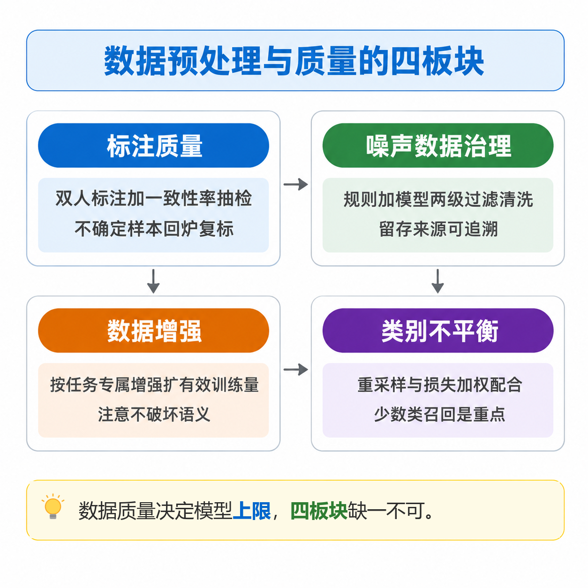

图4-1 数据预处理与质量的四板块

<h1 id="q4-2">2. 正则化的定义、分类及常用方法</h1>

<h2 id="q4-2-1">面试问题：什么是正则化？它从原理上为什么能提升模型泛化能力？显式正则化和隐式正则化有什么区别？</h2>

**难度评分：⭐⭐ (2/5) | 考察频率：⭐⭐⭐⭐⭐ (5/5)**

正则化是防止过拟合、提升泛化能力的一类手段，背后是奥卡姆剃刀原则：在所有能解释训练数据的模型里，选择最简单的那个。具体做法要么在损失函数里加惩罚项，要么对模型结构或训练过程加约束，限制模型的表达能力，让它不要去死抠训练数据里的噪声和异常值，从而在测试数据上表现更好。

正则化能提升泛化能力的原理可以从四个角度理解。惩罚项约束参数的取值范围，让模型学习数据的整体规律而不是噪声细节。它本质上缩小了假设空间，把最优解限制在一个更小的参数空间里，降低过拟合噪声的可能性。Dropout、BatchNorm 这类方法在训练时引入随机性扰动，效果近似模型集成，提升鲁棒性。权重衰减、随机权重平均 SWA 这类方法引导模型收敛到更平坦的极小值，平坦极小值对参数扰动不敏感，泛化能力通常更好。

显式正则化和隐式正则化的区别在于是不是人为设计、在训练流程里看得见摸得着。显式正则化是人为明确设计出来的，直接加在损失函数或训练流程里，比如 L1/L2 正则、Dropout、早停、数据增强、标签平滑、权重衰减。隐式正则化不是刻意加的，而是优化算法或训练机制本身顺带带来的效果，比如 SGD 本身就偏好平坦解、BN 的 batch 统计量噪声、随机打乱训练数据、预训练模型初始化、小批量带来的梯度噪声。

常用的正则化方法里，参数范数惩罚是最基础的一类。L2 正则也就是权重衰减，在损失后面加参数平方和：

$$ L_{total} = L_{original} + \lambda \sum_{i} w_i^2 $$

L1 正则加参数绝对值之和，会让权重稀疏，可用于特征选择：

$$ L_{total} = L_{original} + \lambda \sum_{i} |w_i| $$

Elastic Net 结合了 L1 和 L2。数据增强通过翻转、旋转、裁剪、Mixup、CutMix 等手段扩充训练数据，几乎零成本提升泛化。Dropout 系列在训练时随机失活一部分神经元并做缩放，测试时用完整网络，不需要额外处理。早停监控验证集性能，不再提升就提前停止训练。BatchNorm 归一化层输入，batch 统计量的噪声顺带带来正则效果。除此之外还有标签平滑、权重约束、噪声注入、模型集成等手段。

工程落地的优先级通常是数据增强 > 早停 > L2 > BN > Dropout > 其他。

<h2 id="q4-2-2">面试问题：介绍一下早停（EarlyStopping）的定义、原理、作用及实操注意事项</h2>

**难度评分：⭐⭐ (2/5) | 考察频率：⭐⭐⭐⭐⭐ (5/5)**

正则化是防止过拟合、提升泛化能力的一类手段，背后是奥卡姆剃刀原则：在所有能解释训练数据的模型里，选择最简单的那个。具体做法要么在损失函数里加惩罚项，要么对模型结构或训练过程加约束，限制模型的表达能力，让它不要去死抠训练数据里的噪声和异常值，从而在测试数据上表现更好。

正则化能提升泛化能力的原理可以从四个角度理解。惩罚项约束参数的取值范围，让模型学习数据的整体规律而不是噪声细节。它本质上缩小了假设空间，把最优解限制在一个更小的参数空间里，降低过拟合噪声的可能性。Dropout、BatchNorm 这类方法在训练时引入随机性扰动，效果近似模型集成，提升鲁棒性。权重衰减、随机权重平均 SWA 这类方法引导模型收敛到更平坦的极小值，平坦极小值对参数扰动不敏感，泛化能力通常更好。

显式正则化和隐式正则化的区别在于是不是人为设计、在训练流程里看得见摸得着。显式正则化是人为明确设计出来的，直接加在损失函数或训练流程里，比如 L1/L2 正则、Dropout、早停、数据增强、标签平滑、权重衰减。隐式正则化不是刻意加的，而是优化算法或训练机制本身顺带带来的效果，比如 SGD 本身就偏好平坦解、BN 的 batch 统计量噪声、随机打乱训练数据、预训练模型初始化、小批量带来的梯度噪声。

常用的正则化方法里，参数范数惩罚是最基础的一类。L2 正则也就是权重衰减，在损失后面加参数平方和：

$$ L_{total} = L_{original} + \lambda \sum_{i} w_i^2 $$

L1 正则加参数绝对值之和，会让权重稀疏，可用于特征选择：

$$ L_{total} = L_{original} + \lambda \sum_{i} |w_i| $$

Elastic Net 结合了 L1 和 L2。数据增强通过翻转、旋转、裁剪、Mixup、CutMix 等手段扩充训练数据，几乎零成本提升泛化。Dropout 系列在训练时随机失活一部分神经元并做缩放，测试时用完整网络，不需要额外处理。早停监控验证集性能，不再提升就提前停止训练。BatchNorm 归一化层输入，batch 统计量的噪声顺带带来正则效果。除此之外还有标签平滑、权重约束、噪声注入、模型集成等手段。

工程落地的优先级通常是数据增强 > 早停 > L2 > BN > Dropout > 其他。

<h2 id="q4-2-3">面试问题：介绍一下 Dropout 及其核心变种（DropConnect、DropBlock、DropPath）的原理与适用场景</h2>

**难度评分：⭐⭐ (2/5) | 考察频率：⭐⭐⭐⭐ (4/5)**

Dropout 由 Hinton 团队在 2012 年提出，核心做法是训练时按概率 p 随机把一部分神经元输出置零，测试时所有神经元全部参与计算。现代框架都采用 Inverted Dropout 实现，训练时把保留的神经元输出乘 $1/(1-p)$ 做缩放，这样测试时不需要再做额外缩放就能保证输出期望一致，好处是测试阶段零额外开销，还能动态调整失活率 p。

Dropout 的正则效果来自几个方面。它能打破神经元之间的共适应关系，防止几个神经元绑定在一起共同拟合同一种噪声。训练时每次随机失活相当于在训练一大批不同结构的子网络，测试时相当于这些子网络的集成。它同时降低了模型的有效复杂度，提升泛化能力。

Dropout 后续发展出几个针对不同网络结构的变种：

| 方法 | 失活对象 | 适用场景 | 核心优势 |
|---|---|---|---|
| Dropout | 神经元输出 | 全连接层 | 实现简单，计算开销小 |
| DropConnect | 权重连接 | 全连接层 | 比 Dropout 更严格的正则化，泛化能力更强 |
| DropBlock | 连续区域块 | 卷积层 | 专门针对 CNN 设计，保留空间结构信息 |
| DropPath | 整条残差路径 | 残差块/Transformer | 丢弃整个分支，适用于深层网络与 ViT |

普通 Dropout 用在卷积层上效果不好，因为卷积特征的空间相关性很强，随机置零单个神经元后，周围相邻位置还能补回同样的信息，Dropout 的正则效果就被削弱了。DropBlock 改成丢弃连续的矩形区域块，迫使网络不能依赖局部的某个特征点，对 CNN 的正则效果更好。DropPath 也叫随机深度，训练时随机丢弃整个残差分支或 Transformer 块，相当于随机删除网络的一层，在深层网络和 ViT 里用得很多。

工程使用上有几个注意点。失活率 p 一般取 0.2-0.5，靠近输入层建议取小一点，0.1-0.2 比较合适。Dropout 和 BatchNorm 一起用时要注意层的顺序和 batch 统计量的问题，现代 Transformer 架构里一般用 DropPath 配合 LayerNorm，而不是传统 Dropout。小批量训练下 Dropout 的正则效果更明显，大批量训练时梯度本身就更稳定，Dropout 的作用会被削弱。

<h2 id="q4-2-4">面试问题：介绍一下 L1 正则、L2 正则，为什么 L1 能产生稀疏性，L2 不会？</h2>

**难度评分：⭐⭐⭐ (3/5) | 考察频率：⭐⭐⭐⭐⭐ (5/5)**

L1 和 L2 是最常用的参数范数惩罚正则化方法，在原始损失后面加上参数范数项，限制模型复杂度、防止过拟合。L1 正则的形式是损失加上参数绝对值之和：

$$ L = L_0 + \lambda \sum_{i} |w_i| $$

L2 正则也叫权重衰减，形式是损失加上参数平方和：

$$ L = L_0 + \lambda \sum_{i} w_i^2 $$

其中 $L_0$ 是原始损失，$\lambda$ 控制正则强度。

L1 能产生稀疏性而 L2 不会，可以从导数和几何两个角度解释。

从导数角度看，L1 的次梯度是常数 $\pm\lambda$，不管参数绝对值多大，梯度大小都不变。当参数接近 0 时，L1 的梯度仍然有 $\lambda$ 这么大，会持续把参数往 0 的方向推，直到直接落到 0。L2 的导数是 $2\lambda w$，梯度大小和参数绝对值成正比，参数接近 0 时梯度也趋近于 0，只会把参数不断压小，但永远压不到正好等于 0。

从几何角度看，L1 的约束区域是菱形，在二维平面上是旋转后的正方形。原始损失的等高线和这个菱形约束区的交点，更容易落在坐标轴的顶点上，于是交点对应的某些参数恰好就是 0，产生稀疏性。L2 的约束区域是圆形，等高线和圆的交点一般不会正好落在坐标轴上，所以所有参数都不为 0，只是整体都被缩小了。

工程实践中两者的特点也很明确。L1 产生稀疏权重，可以用来做特征选择，把不重要的特征权重直接压到 0，但优化过程不如 L2 稳定。L2 让权重分布更均匀，数值稳定，计算也简单，是实际项目里最常用的正则化方法。

<h2 id="q4-2-5">面试问题：标签平滑（Label Smoothing）的原理及作用？在大模型/生成模型训练中有什么注意事项？</h2>

**难度评分：⭐⭐ (2/5) | 考察频率：⭐⭐⭐⭐ (4/5)**

标签平滑解决的是 one-hot 硬标签让模型过于自信的问题。它把硬标签转成软标签：

$$ y'_i = (1-\epsilon)y_i + \frac{\epsilon}{K} $$

其中 $\epsilon$ 是平滑系数，一般取 0.1，$K$ 是类别数。比如二分类的硬标签 $[1, 0]$ 会变成 $[0.95, 0.05]$。

标签平滑的作用有几个方面。它不让模型给预测结果塞太高的置信度，提升泛化能力。错误标签的影响被削弱，相当于给噪声标签做了一定程度的容错。模型对输入扰动的鲁棒性也会提升。在 softmax 交叉熵损失下，硬标签可能让梯度趋近于零，标签平滑能保住梯度，避免训练后期梯度消失。

在大模型和生成模型场景下使用标签平滑有几个注意点。平滑系数 $\epsilon$ 一般取 0.1 左右就够了，取太大比如 0.2 以上会损害模型的置信度和预测精度。标签平滑更适合多分类和大词表预测任务，类别数越多收益越明显。知识蒸馏场景里教师模型该不该用标签平滑存在争议，Hinton 原始工作建议教师模型不要用标签平滑，以保留类别之间的相对关系也就是 dark knowledge；后续 Müller 等人 2019 年的研究显示，教师模型用标签平滑在部分场景下也能提升蒸馏效果。大模型预训练阶段常用标签平滑，GPT、ViT 都在用，但下游评估和推理阶段不要用，否则会人为压低概率，影响生成和排序结果。如果训练数据本身非常干净也很充足，标签平滑的收益不明显。生成模型尤其要注意，过度平滑会让生成多样性下降，logits 的区分度变弱。

<h2 id="q4-2-6">面试问题：权重衰减（Weight Decay）与 L2 正则的关系是什么？为什么 Adam 优化器中二者不等价？AdamW 中是如何实现的？</h2>

**难度评分：⭐⭐⭐ (3/5) | 考察频率：⭐⭐⭐⭐ (4/5)**

在 SGD 优化器里，L2 正则和权重衰减本质上是等价的。带 L2 的损失函数写成：

$$ L = L_0 + \frac{\lambda}{2}\|w\|^2 $$

对权重 $w$ 求导得到：

$$ \frac{\partial L}{\partial w} = \frac{\partial L_0}{\partial w} + \lambda w $$

代入 SGD 更新公式：

$$ w_{t+1} = w_t - \eta\frac{\partial L}{\partial w} = (1-\eta\lambda)w_t - \eta\frac{\partial L_0}{\partial w} $$

可以看到 L2 正则的效果就是每次更新把权重乘上一个衰减系数 $(1-\eta\lambda)$，这正是「权重衰减」这个名字的来源。

但到了 Adam 优化器里，二者就不等价了。关键原因在于 Adam 的自适应学习率机制。L2 正则是把 $\lambda w$ 直接加进梯度 $g$ 里，然后整个梯度一起被 Adam 的二阶矩 $\sqrt{v+\epsilon}$ 归一化：

$$ w_{t+1} = w_t - \eta \cdot \frac{g + \lambda w}{\sqrt{v} + \epsilon} $$

不同参数的二阶矩 $\sqrt{v}$ 不一样，这就导致正则强度被各自的 $\sqrt{v}$ 扭曲了——梯度大的参数，它的衰减也被自适应缩放放大或缩小，正则效果不均匀。真正的权重衰减应该是直接对参数做衰减 $w \leftarrow (1-\eta\lambda)w$，和梯度本身无关。所以在 Adam 里，L2 正则和权重衰减的实际行为不一致，经验上 L2 的效果更差，模型泛化能力也更弱。

AdamW 的做法就是把权重衰减从梯度计算里解耦出来。先像标准 Adam 那样用纯梯度做自适应缩放更新，再独立对参数施加衰减：

$$ w_{t+1} = w_t - \eta \cdot \frac{\hat{m}}{\sqrt{\hat{v}}+\epsilon} - \eta\lambda w_t $$

第一项是标准 Adam 更新，用的是纯梯度、做自适应缩放，不含正则项。第二项是解耦的权重衰减，直接作用于参数，不受二阶矩 $\sqrt{v}$ 的影响。这样衰减就不再受自适应学习率的干扰，行为和 SGD 里的权重衰减保持一致，泛化效果比 Adam + L2 好很多。

工程实践里有几个要点。PyTorch 里 `torch.optim.SGD` 和 `torch.optim.AdamW` 都有 `weight_decay` 参数，AdamW 实现的就是解耦权重衰减。不要同时在损失里加 L2 正则项又设置 weight_decay 参数，否则正则强度会翻倍。大模型训练统一用 AdamW 加权重衰减，不要用 Adam 加 L2 正则。

<h2 id="q4-2-7">面试问题：不同正则化方法分别适用于什么场景？实际训练中如何选型与组合使用？</h2>

**难度评分：⭐⭐⭐ (3/5) | 考察频率：⭐⭐⭐⭐ (4/5)**

L2 权重衰减是深度学习的默认基线，数值稳定、对优化友好，适合整体限制参数大小，大模型训练里是 AdamW 的标配。L1 正则在需要做特征选择、希望模型稀疏可解释的时候用，传统线性模型里比较多，深度学习里很少单独用，一般搭配 Elastic Net。Dropout 和 DropPath 适合全连接层、深层网络和 Transformer，数据量中等、模型容易过拟合的时候加；DropPath 专门用在残差块和 ViT 里。早停几乎零成本，只要有验证集就应该开。数据增强在 CV、NLP、语音、多模态任务里都通用，数据不够或者要提升分布鲁棒性的时候优先用。标签平滑适合多分类、大词表预测和知识蒸馏，大模型预训练阶段常用。BatchNorm 主要用在 CNN 和中等批量场景，顺带加速收敛和提供隐式正则效果。

实际选型的时候可以从几个维度判断。按数据规模看，数据量少的时候数据增强 + Dropout + 早停一起上；数据量足够大的时候以权重衰减 + 早停为主，Dropout 的强度可以减弱甚至去掉，因为大数据本身就不容易过拟合。按模型规模看，大模型用权重衰减（AdamW）+ DropPath + 标签平滑，不要上高 Dropout，会拖慢收敛速度；小模型可以放心用 Dropout 配合数据增强。按任务类型看，CV 任务标配是数据增强 + BN + 权重衰减；NLP 和大模型任务用 DropPath + 权重衰减 + 标签平滑；生成模型以权重衰减 + 早停为主，慎用高 Dropout，因为会影响生成质量和多样性。

正则手段可以叠加，但不要过度。所有正则手段都要盯着验证集指标调整，过度正则会导致欠拟合、模型训不收敛。工程上的优先级是数据增强 + 早停作为底线标配先加上，再叠权重衰减，最后根据验证集表现决定要不要加 Dropout 或标签平滑。不要一上来就把所有正则方法全堆上去，那样调参成本太高，也不好定位是哪个环节出了问题。

正则化的常用方法与其落地优先级如图4-3所示：

  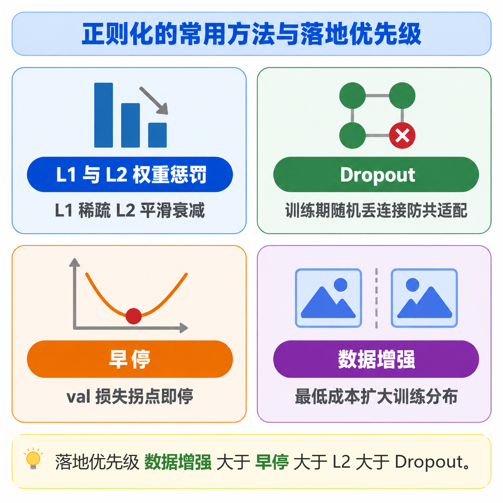

图4-3 正则化的常用方法与落地优先级

<h1 id="q4-3">3. 学习率核心作用与调优策略</h1>

<h2 id="q4-3-1">面试问题：介绍一下学习率是什么？学习率过大/过小分别会对模型训练造成什么影响？</h2>

**难度评分：⭐⭐ (2/5) | 考察频率：⭐⭐⭐⭐⭐ (5/5)**

学习率控制每次梯度下降更新参数的步长。梯度负责给参数更新指方向，学习率决定沿着这个方向迈多大一步，直接决定参数往损失最小值方向走的速度，也直接影响收敛速度和最终模型性能。

学习率过小的时候，参数每步更新幅度太小，收敛会非常慢，训练成本很高。小步长也很难跳出局部最优点或鞍点，模型容易长时间停在次优解附近出不来。

学习率过大的时候，步长超过了合适范围，损失会出现震荡甚至直接发散，根本收敛不了。即使损失没有完全发散，也容易跨过最优区域，在最优点附近来回跳动，没法稳定收敛。过大的学习率还会导致数值不稳定，触发梯度爆炸，训练后期出现 NaN。

学习率合适的时候，损失曲线平稳下降，最终收敛到一个不错的极小值点。

实际项目里有几个经验起点。传统小模型配 Adam 优化器，一般从 1e-3 量级开始调。大模型预训练的学习率通常在 1e-4 到 5e-4 之间。大模型微调的学习率要小得多，一般在 1e-5 到 5e-5，不能太大以免破坏预训练学到的知识。不管哪种场景，配上 warmup 和学习率衰减都能进一步稳住训练过程。

<h2 id="q4-3-2">面试问题：常用的学习率衰减方法有哪些？各自的特点与适用场景是什么？</h2>

**难度评分：⭐⭐ (2/5) | 考察频率：⭐⭐⭐⭐ (4/5)**

阶梯衰减是最常用的方法，每隔固定数量的 epoch 把学习率乘一个衰减因子，比如每 30 个 epoch 衰减为原来的 0.1。实现简单，效果稳定，CNN 分类任务里用得最多。缺点是衰减是阶跃式的，每次衰减后损失可能有一个小跳变。

指数衰减每个 epoch 都按固定比例连续衰减，学习率曲线平滑下降，适合对收敛过程平滑性有要求的场景。

余弦退火让学习率按余弦函数从初始值平滑降到 0，后期学习率很小，收敛更平稳，SGDR 就是带热重启的余弦退火，定期把学习率升回去再衰减，帮助跳出局部最优。

线性衰减从初始学习率线性降到 0，BERT、GPT 这类大模型微调基本都用这种方式，简单直接，配合 warmup 效果很稳。

按指标衰减（ReduceLROnPlateau）不按固定 epoch 衰减，而是监控验证集上的某个指标，连续若干轮不下降就自动降低学习率。这种方法不需要提前知道训练总轮数，适合不确定收敛时长的实验场景。

实际项目里最常用的组合是 warmup 加衰减。训练最开始的几个 step 学习率从 0 线性升到初始值，避免初期大梯度把模型冲坏，然后再接线性衰减或余弦衰减。大模型预训练和微调基本都是这个套路。

常见学习率调度曲线的对比如图4-4所示：

  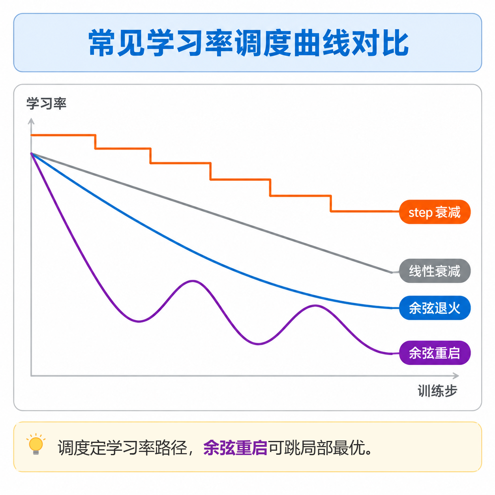

图4-4 常见学习率调度曲线对比

<h2 id="q4-3-3">面试问题：学习率 warmup 的核心目的是什么？常用的 warmup 方式有哪些？如何设计 warmup 策略？</h2>

**难度评分：⭐⭐ (2/5) | 考察频率：⭐⭐⭐⭐ (4/5)**

warmup 是在训练初期让学习率从很小的值慢慢升到预设的初始学习率。核心目的有三个。参数随机初始化的时候，初期梯度方向不准，一开始就上大学习率容易震荡甚至发散，warmup 能缓解这种初始化不稳定。微调预训练模型时，warmup 避免大学习率冲坏预训练好的底层特征。同时它能帮训练初期平稳过渡，缓解 Adam 这类自适应优化器在训练初期二阶矩估计不准的问题。

常用的 warmup 策略里，线性 warmup 是最主流的，从 0 线性增长到初始学习率：

$$ lr = lr_{init} \times \frac{step}{warmup\_steps} $$

简单稳定，是大模型训练的标配。常数 warmup 是在 warmup 阶段保持一个较小的固定学习率，结束后直接切到初始学习率，实现最简单，适合小模型。指数 warmup 从接近 0 的极小值指数增长到初始学习率，前期慢后期快，对初始化保护更充分，但用得比较少。余弦 warmup 按余弦曲线从 0 增长到初始学习率，曲线最平滑，和后续的余弦退火衰减衔接很自然。

设计 warmup 策略主要看几个参数。warmup 步数一般取总训练步数的 1%-10%，大模型场景常用 1000 到 10000 步。warmup 结束时达到的初始学习率，根据模型大小、batch size 和具体任务调整。warmup 结束后直接切到主衰减策略，比如线性衰减或余弦退火，中间不需要额外过渡。

<h2 id="q4-3-4">面试问题：工业界常用的学习率组合策略是什么？大模型训练中为什么普遍采用「线性 warmup + 余弦退火」？</h2>

**难度评分：⭐⭐⭐ (3/5) | 考察频率：⭐⭐⭐⭐⭐ (5/5)**

工业界主流的学习率策略是 warmup 加主衰减的两段式结构。训练初期用 warmup 把学习率从 0 线性升到峰值，随后用主衰减策略逐步降到最小值。最经典的组合就是线性 warmup 加余弦退火。

大模型普遍采用这套策略有几个原因。线性 warmup 解决的是训练初期不稳定的问题。大模型参数量大，初始化之后梯度方差很大，一开始就用大学习率容易发散。Adam 这类自适应优化器在训练初期二阶矩估计不准，warmup 给统计量留出收敛时间。线性 warmup 形式简单、效果稳定，是工程上的默认选择。

余弦退火作为主衰减策略，兼顾了探索和精细收敛两个阶段。它的曲线很平滑，中前期学习率降得慢，保留较大的学习率让模型有足够空间探索参数空间；后期学习率降得快，让模型精细收敛到极小值附近。和阶梯衰减比，它没有阶跃突变，损失曲线更稳，不会因为学习率突然下降产生震荡。和纯线性衰减比，余弦前期保留高学习率的时间更长，探索更充分。

工程上这套策略也很友好。需要调的超参很少，就 warmup 步数、峰值学习率、最小学习率三个。LLaMA、GPT、Stable Diffusion 这些主流模型和生成模型都用这套方案，复现和迁移经验都很成熟。

典型配置上，大模型预训练 warmup 比例取总步数的 1%-3%，峰值学习率在 1e-4 到 5e-4 之间，余弦退火最终降到峰值的 10% 左右或者 1e-5。微调场景 warmup 比例高一些，取 3%-10%，峰值学习率在 1e-5 到 5e-5，退火到更小的值。扩散模型也是 warmup 加余弦退火的组合，再配合噪声调度一起调整。

<h2 id="q4-3-5">面试问题：有哪些常用的学习率调优方法？LR Finder 的核心原理是什么？</h2>

**难度评分：⭐⭐⭐ (3/5) | 考察频率：⭐⭐⭐ (3/5)**

常用的学习率调优方法有几种。经验法最直接，按模型规模和任务套经验区间，小模型 1e-3、预训练 1e-4 到 5e-4、微调 1e-5 到 5e-5，再在这个区间附近微调。网格搜索或随机搜索在候选区间里选几个学习率，跑短周期实验对比验证集表现。LR Finder 自动定位合理的学习率区间，是工业界最常用的方法。ReduceLROnPlateau 是基于损失的自动调度，验证损失进入平台期时自动降低学习率。更系统的超参优化可以用 Optuna、Ray Tune、W&B 这类工具做贝叶斯搜索。

LR Finder 是 Leslie Smith 提出的方法，核心思路是让学习率从极小值开始按指数逐 step 递增，每个 step 做一次前向反向传播并记录对应损失，最后画出学习率和损失的关系曲线。

具体操作时先初始化模型，从一个极小的起始学习率比如 1e-7 开始，每个 batch 之后把学习率乘上一个固定因子比如 1.01，指数式增大，同时记录每个学习率对应的损失。画出来的 lr-loss 曲线里，损失下降最快、斜率最陡的那个区间就是合理的学习率范围。选学习率的时候取这个区间对应的学习率，一般取该区间的 1/10 或者左端点做初始学习率，不要取曲线最低点，因为最低点附近学习率已经偏大，损失已经开始震荡了。

实际使用时有几个注意点。LR Finder 用小数据子集跑短周期实验就行，成本很低。它找到的是初始峰值学习率，正式训练时仍然要配合 warmup 和衰减策略。原始损失曲线波动比较大，通常需要做滑动平均平滑之后才能读出稳定的区间。大模型正式训练前可以用它校验学习率的量级是否合理，但最终还是要以完整训练的曲线表现为准。

学习率大小影响与常用调度策略如图4-5所示：

  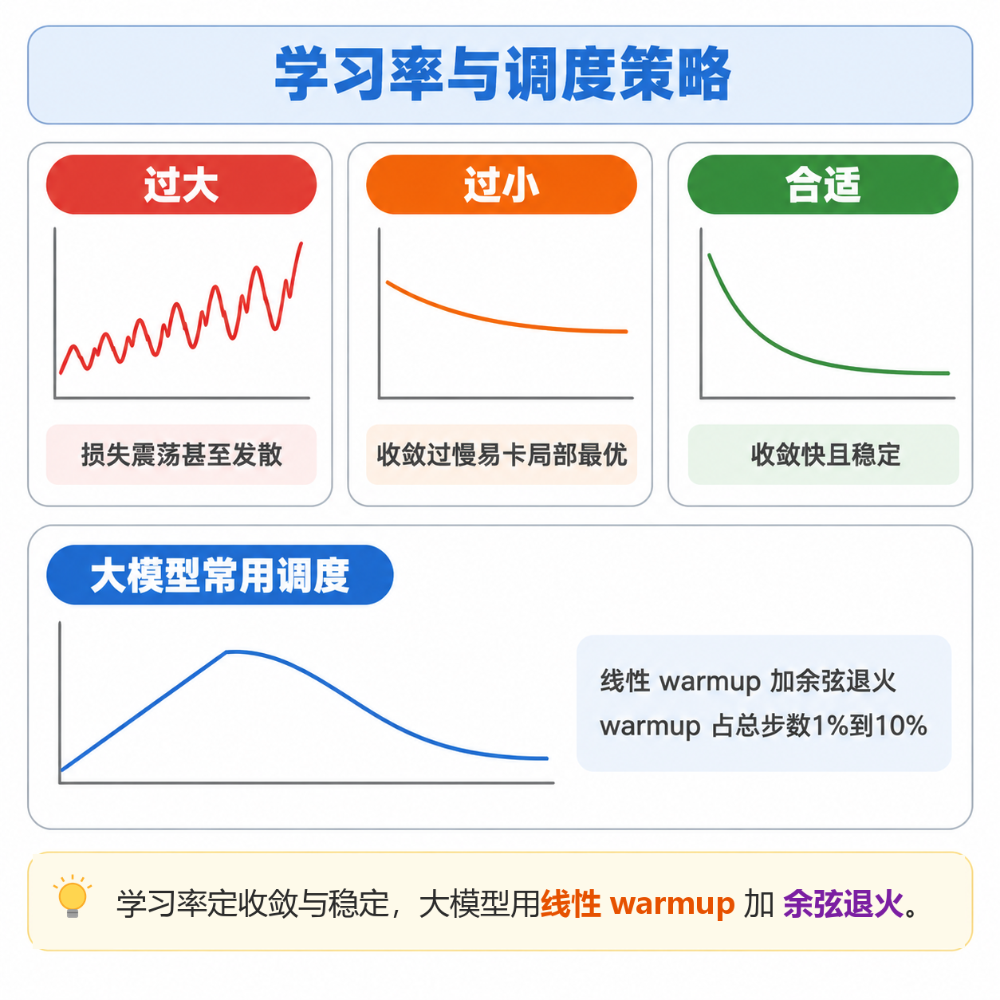

图4-5 学习率与调度策略

<h1 id="q4-4">4. 介绍一下优化器原理与选型</h1>

<h2 id="q4-4-1">面试问题：优化器的本质原理是什么？简述从 SGD 到 AdamW 的核心发展脉络，各阶段分别解决了什么问题？</h2>

**难度评分：⭐⭐ (2/5) | 考察频率：⭐⭐⭐⭐⭐ (5/5)**

优化器利用损失对参数的梯度，按一定规则迭代更新参数，目标是找到损失函数的最小值。学习率决定每步迈多大，优化器则决定这一步具体怎么迈，负责计算梯度方向并配合学习率更新参数。

优化器的发展脉络大致经历了四个阶段，每个阶段都是为了解决前一代的痛点。

最基础的是 SGD，直接用梯度乘学习率更新参数。它的缺点是收敛慢、对学习率敏感、容易陷入局部最优、训练过程震荡大。

在 SGD 基础上引入了动量机制，包括 SGD-Momentum 和 Nesterov 动量。动量累积历史梯度，给参数更新加了惯性，加速收敛的同时减少震荡，也更容易冲出局部最优。

再往后是自适应学习率阶段，代表方法有 AdaGrad、RMSprop 和 Adam。这一阶段的核心变化是不再全局统一学习率，而是给每个参数单独自适应调整学习率。Adam 结合了动量机制和自适应学习率，收敛稳定、速度快，对超参不敏感，很快成为主流优化器。

进入大模型时代后，优化器又有了新的发展。AdamW 修正了 Adam 权重衰减实现上的问题，把权重衰减从梯度计算中解耦出来，成为目前最通用的优化器。Lion 是符号优化器，只用梯度符号做更新，优化器状态内存比 AdamW 减半，训练速度提升 2%-15%，适合千亿级以上大模型预训练。Sophia 是轻量二阶优化器，引入 Hessian 对角估计，收敛速度大约是 AdamW 的两倍，目前还在验证推广阶段。

工业界目前的选择很清晰。AdamW 是最通用的，大模型默认用它，收敛快、鲁棒、对超参不敏感，泛化效果优于原生 Adam，几乎适用于所有深度学习任务。Lion 是大模型领域的新选择，内存占用小，训练快。SGD with Momentum 泛化好、最终精度高，但收敛慢、对学习率敏感，适合 ResNet 这类 CV 任务和对泛化要求极高的场景。RMSprop 用梯度平方的指数衰减平均来自适应调整学习率，解决了 AdaGrad 学习率过早衰减的问题，适合 RNN/LSTM 这类传统序列模型。Sophia 作为前沿的二阶优化器，在大模型预训练场景有潜力，还在推广验证中。

工程上的经验是，大模型优先选 AdamW 或 Lion，学习率一般在 1e-4 到 5e-4；微调时用更小的学习率 1e-5 到 5e-5，配合 warmup。新优化器在超大模型上优势明显，在小模型上差异不大。

<h2 id="q4-4-2">面试问题：SGD、Adam、AdamW 三者各有什么优缺点？为什么大模型预训练与微调几乎都用 AdamW？深度学习场景下如何选型？</h2>

**难度评分：⭐⭐⭐⭐ (4/5) | 考察频率：⭐⭐⭐⭐⭐ (5/5)**

SGD 就是最基础的随机梯度下降，优点是原理简单、泛化能力好、最终精度高，缺点是收敛慢、对学习率敏感、容易震荡。Adam 在 SGD 基础上引入了一阶动量和二阶矩自适应学习率，收敛快、对超参不敏感，几乎免调参，缺点是泛化能力略逊于 SGD，而且权重衰减的实现方式有问题，正则效果打折扣。AdamW 在 Adam 基础上把权重衰减从梯度计算里解耦出来，收敛快、鲁棒、泛化效果优于原生 Adam，缺点是仍然需要存储二阶矩，内存占用比 Lion 这类优化器高一倍。

大模型预训练和微调几乎都用 AdamW，有几个原因。大模型参数量大、训练成本极高，AdamW 收敛快且稳定，对超参不敏感，大幅降低了调参成本和训练失败的风险。解耦权重衰减之后正则效果更合理，最终泛化能力优于原生 Adam。它和 warmup 加余弦退火、梯度裁剪、混合精度训练这些大模型标准训练范式配合得很好，工程链路非常成熟。而且 LLaMA、GPT、Stable Diffusion 这些主流模型都用 AdamW，相关经验和超参配方可以直接迁移，复现性好。

Adam 和 AdamW 的核心区别在权重衰减的实现方式。原生 Adam 把 $\lambda w$ 直接加进梯度 $g$ 里，然后整个梯度一起被二阶矩 $\sqrt{v}$ 归一化：

$$ w_{t+1} = w_t - \eta \cdot \frac{g + \lambda w}{\sqrt{v}+\epsilon} $$

不同参数的二阶矩大小不一样，这就导致权重衰减的强度被自适应学习率扭曲了，正则效果不均匀。AdamW 把权重衰减解耦出来，先用纯梯度做标准 Adam 更新，再独立对参数施加衰减：

$$ w_t \leftarrow w_t - \eta \cdot \frac{\hat{m}}{\sqrt{\hat{v}}+\epsilon} $$
$$ w_t \leftarrow w_t - \eta\lambda \cdot w_t $$

这样每个参数的衰减强度一致，正则效果和 SGD 里的权重衰减等价，泛化更好。这也是大模型训练里 AdamW 几乎完全取代 Adam 的关键原因。

实际选型时，大模型预训练和微调首选 AdamW，这是当前工业界的标准。如果是对最终精度要求极高的 CV 任务，比如 ResNet 在 ImageNet 上刷分，可以用 SGD 加动量，泛化和最终精度通常优于自适应优化器。快速实验或者调参预算有限时用 Adam 或 AdamW，几乎免调参，适合快速验证想法。RNN/LSTM 这类传统序列模型用 RMSprop 或 Adam。资源受限或者超大模型场景可以考虑 Lion，内存占用减半。

工程上小数据或者强过拟合风险的场景用 AdamW 加权重衰减和 warmup。训练收敛慢就用自适应优化器，如果最终精度不理想再换 SGD 做精调。注意不要在 Adam 上用 L2 正则替代权重衰减，那样正则强度会翻倍。

<h2 id="q4-4-3">面试问题：目前 AIGC 场景（大模型、扩散模型）常用的优化器有哪些？选型的核心依据是什么？</h2>

**难度评分：⭐⭐⭐⭐ (4/5) | 考察频率：⭐⭐⭐⭐ (4/5)**

AIGC 场景下 AdamW 是绝对主流，大语言模型预训练和微调、扩散模型训练比如 Stable Diffusion 都把它作为事实标准，收敛稳定、泛化效果好、工程链路成熟。Lion 是符号优化器，优化器状态内存比 AdamW 减半，整体训练显存能省 15%-25%，适合千亿级大模型预训练降本，Google 系大模型用得比较多，但在小模型或微调场景下不一定比 AdamW 强。Adafactor 用矩阵分解存储二阶矩，显著降低显存占用，适合显存受限的超大模型训练，T5 和 Flan-T5 这类模型就用它。Sophia 是轻量二阶优化器，收敛速度大约是 AdamW 的两倍，目前还在验证推广阶段。另外部分 GAN 变体里生成器和判别器会用不同优化器，比如判别器用 SGD、生成器用 Adam，但 StyleGAN 系列这种主流架构普遍还是用 Adam 或 AdamW。

选型时主要从几个维度判断。首先看模型规模和显存预算，超大模型显存紧张就选 Adafactor 或 Lion 降显存，中等规模直接用 AdamW。其次看收敛稳定性和失败成本，训练成本越高越倾向选最稳的 AdamW，实验阶段可以试 Lion 或 Sophia 提速。泛化和最终质量要求高的场景用 AdamW，追求极致精度的小模型可以用 SGD 精调。还要考虑和训练栈的兼容性，是否支持 ZeRO/FSDP 分布式、混合精度、梯度检查点这些特性，AdamW 的生态最完善。最后看任务阶段，预训练阶段看重稳定性和吞吐，选 AdamW 或 Lion；微调阶段看重保真、防止灾难性遗忘，用 AdamW 加小学习率配 warmup。

典型的组合配置有几套。LLM 预训练一般是 AdamW + 线性 warmup + 余弦退火 + BF16 混合精度 + 梯度裁剪。LLM 微调用 LoRA 或 QLoRA 时，是 AdamW + 小学习率 1e-5 到 5e-5 + warmup。扩散模型训练用 AdamW + warmup + 余弦退火 + EMA 权重平均。

优化器的演进脉络与大模型时代选型如图4-6所示：

  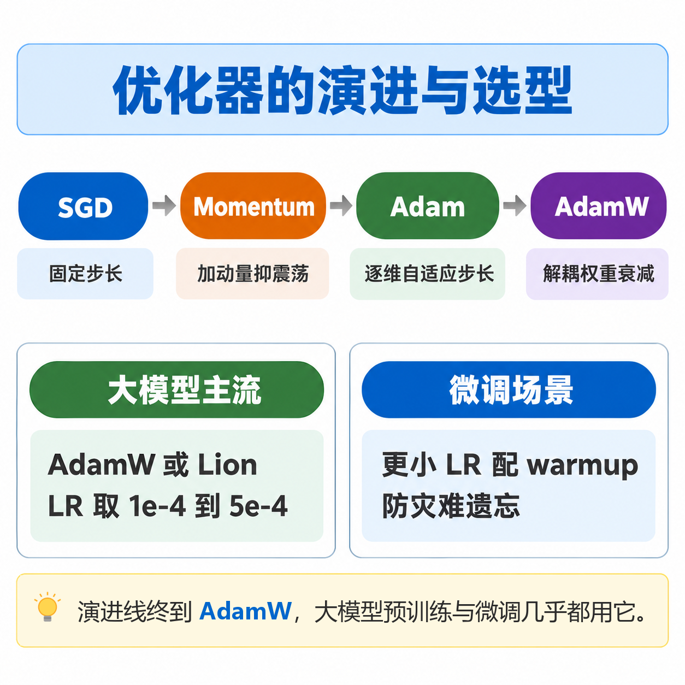

图4-6 优化器的演进与选型

<h1 id="q4-5">5. 数据集划分原则、作用与落地方法</h1>

<h2 id="q4-5-1">面试问题：模型训练中训练集、验证集、测试集的作用分别是什么？有哪些划分原则与常见的落地方式？</h2>

**难度评分：⭐⭐ (2/5) | 考察频率：⭐⭐⭐⭐⭐ (5/5)**

训练集用来学习模型的可训练参数，也就是权重和偏置，通过梯度下降不断更新。验证集用来调超参数，比如学习率、batch size、网络结构，同时监控训练过程、做早停防过拟合、挑选最优的 checkpoint。测试集只在最后用来评估模型的泛化能力，模拟模型在未知真实数据上的表现，一旦用过就不能再根据结果调整模型。

划分的时候有几个基本原则。三个集合必须同分布，否则评估没有意义，不能拿中文训练集去评估英文模型。三个集合之间严格互斥，不能有任何样本重叠，否则会造成数据泄露，评估结果失真。每个集合都要能反映原始数据的特征，类别不平衡的任务要用分层抽样保证三集类别比例一致。测试集必须独立，只做最终泛化评估一次，绝对不能用于参数更新、超参调优或者早停。

最基础的落地方式是留出法，随机划分训练集、验证集、测试集，适合独立同分布的数据。标准比例一般是 7:2:1，数据量超过 100 万的大数据集可以调到 9:0.5:0.5，少量验证和测试样本在统计上就足够稳定评估了。分类任务尤其是类别不平衡的场景，用分层抽样，严格按各类别比例划分，避免稀有类别在某个集合里缺失。时间序列任务必须用时序划分，严格按时间顺序切分，比如前 70% 训练、中间 20% 验证、最后 10% 测试，绝对不能随机划分，否则未来数据会泄露到训练集里。小数据集样本量在 1 万以下时用 k 折交叉验证，把数据分成 k 份，常用 5 折或 10 折，每次拿 k-1 份训练、1 份验证，重复 k 次取平均，最终还要再留一个独立测试集评估泛化。

大数据集和小数据集的处理方式差别很大。大数据集直接用留出法就行，比例甚至可以极端到 98:1:1，数据量足够大，少量验证和测试样本在统计上已经很稳定，不需要做交叉验证，成本太高也没必要，还可以做在线评估和持续采样。小数据集要用 k 折交叉验证把数据用足，验证集和测试集都要保证代表性，必要时用分层抽样，再配合数据增强扩充有效训练量，同时要警惕单次随机划分带来的随机性偏差。

工程上还有一个关键点：预处理必须在划分之后做。不能先对整个数据集做归一化、去重再划分，那样会造成数据泄露。正确做法是先划分好三个集合，再只用训练集的样本计算预处理统计量比如均值和方差，然后把这些统计量套用到验证集和测试集上。大模型微调时验证集留 1000 到 5000 个样本就够了，足够监控过拟合和做早停。

<h2 id="q4-5-2">面试问题：AIGC 场景（大模型微调、文生图扩散模型）的数据集划分和传统判别任务有什么区别？有哪些特殊注意事项？</h2>

**难度评分：⭐⭐⭐ (3/5) | 考察频率：⭐⭐⭐⭐ (4/5)**

和传统判别任务比，AIGC 场景的数据集划分有几个明显区别。判别任务有明确的标签，可以用准确率这类客观指标直接评估；AIGC 生成任务的输出是开放式内容，验证集和测试集经常需要人工评判或者用 LLM-as-a-judge、人类偏好对比的方式评估。数据形态上也不一样，指令微调数据是指令和响应对，扩散模型是图文对或者条件和图像对，划分的时候要保证每一对完整，不能把一条指令和它对应的响应拆到不同集合里。分布匹配的要求更高，微调数据要和实际部署场景的任务类型、风格、长度分布一致，否则生成质量和对齐性会下降。去重和防泄露的要求也更严格，预训练数据量巨大，必须做精确去重加 MinHash 模糊去重，还要剔除评估基准的污染数据，否则验证和测试指标会严重虚高。

具体到不同 AIGC 任务，还有一些针对性的注意点。指令微调数据要按任务类型分层划分，保证验证集覆盖所有能力维度，比如推理、代码、对话、安全等，划分是在样本级做而不是 token 级。RLHF 的偏好数据要把同一个 prompt 的多个排序响应留在同一个 split 里，避免跨集泄露，同时奖励模型的训练集和策略模型的微调集要保持独立。扩散模型的图文对划分要保证每一对完整，验证集要包含多样化的 prompt 和概念，方便算 FID、CLIP Score 以及做人工评估。

还有一个关键问题是基准污染检测。要用 n-gram 匹配检查训练集里是否包含 MMLU、HumanEval 这类公开评估基准的题目，一旦发现就剔除，否则离线指标会虚高，上线后效果和离线表现对不上。最后要明确，AIGC 模型的最终评估通常以线上 A/B 测试和人类偏好为准，离线验证集只能做粗筛，不能完全替代线上评估。

数据集划分的留出法与 k 折交叉验证如图4-7所示：

  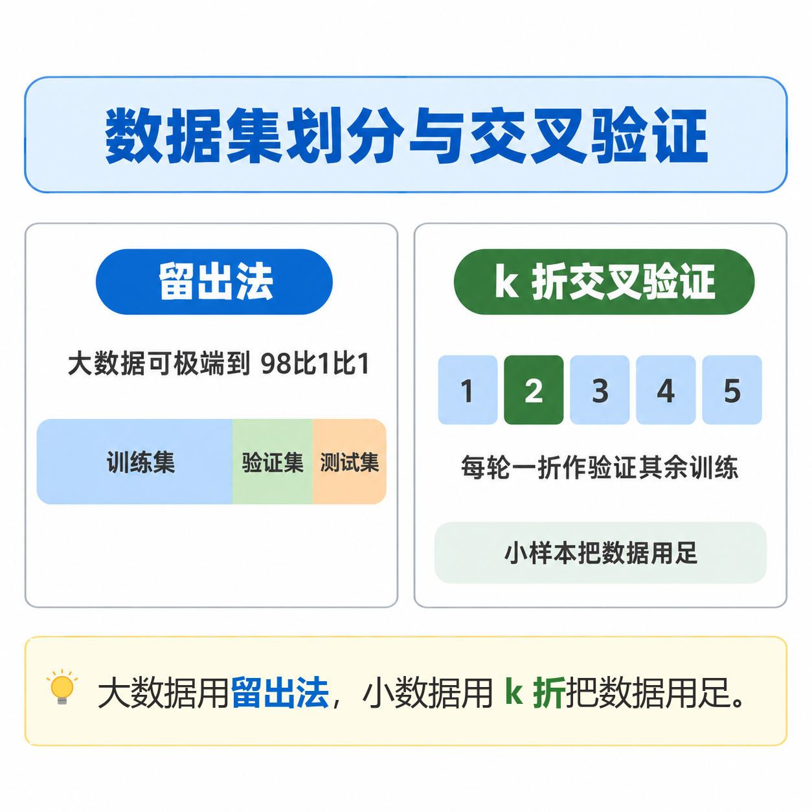

图4-7 数据集划分与交叉验证

<h1 id="q4-6">6. Batch Size 选型逻辑与实操方法</h1>

<h2 id="q4-6-1">面试问题：什么是 Batch Size,Batch Size 过大/过小分别有什么影响？实际训练中如何选型？</h2>

**难度评分：⭐⭐ (2/5) | 考察频率：⭐⭐⭐⭐⭐ (5/5)**

Batch Size 指一次参数更新同时处理的样本数量。Batch Size 过小的时候，比如小于 8，梯度噪声会很大，训练过程震荡明显，不容易收敛。同时 GPU 的并行算力吃不满，吞吐低，训练速度慢。不过小 batch 带来的梯度噪声有一定隐式正则效果，有时候泛化能力反而更好。Batch Size 过大的时候，比如超过 2048，相同 epoch 下梯度更新次数减少，收敛会变慢。而且大 batch 容易收敛到尖锐的局部最小值，泛化能力下降。显存占用也会随之增大，对硬件要求更高。另外 batch 变大之后要同步增大学习率，也就是线性缩放规则，调参复杂度会上升。

适中的 batch size 一般泛化效果最好，收敛速度和训练效率平衡得也最好，具体量级要看任务，CV 分类任务通常在几十到几百之间。

显存方面，batch size 越大，前向传播产生的激活值和反向传播的梯度占用显存越多。混合精度训练和梯度累积可以在不增加显存的情况下等效增大有效 batch size。

实际选型的时候有几个原则。首先看硬件上限，先测出 GPU 显存能装下的最大 batch size，这是最基础的约束。然后平衡训练稳定性，太小梯度噪声大容易震荡，太大更新次数少收敛慢，在稳定和效率之间找平衡。泛化方面适中的 batch size 效果最好，太大容易收敛到尖锐局部最小值。分布式训练的时候，GPU 数量增加 N 倍，batch size 和学习率也要同步增加 N 倍，这就是线性缩放规则。

经验值上，一般 CV 分类任务用 32 到 256。检测和分割任务显存占用大，通常取较小的值比如 2 到 16，再配合梯度累积等效增大 batch size。训练收敛慢的时候可以适度增大 batch size，同时同步调大学习率。

<h2 id="q4-6-2">面试问题：AIGC 场景（大模型微调、扩散模型训练）下，Batch Size 的选型和传统场景有什么核心区别？有哪些特殊约束？</h2>

**难度评分：⭐⭐⭐ (3/5) | 考察频率：⭐⭐⭐⭐ (4/5)**

AIGC 场景下模型参数量大，单样本显存占用也高，单卡几乎装不下较大的 batch size，所以普遍不用传统场景直接增大单卡 batch size 的做法，而是用小的 micro-batch 配合梯度累积和数据并行，等效实现较大的全局 batch size。

显存是最硬的约束。微调时单卡 micro-batch 通常取 1、2、4、8、16 这几个值，再靠梯度累积把有效 batch size 撑上去。序列长度对显存影响很大，LLM 训练的显存占用随序列长度平方级增长，主要来自注意力计算，长序列场景下 batch size 必须更小，通常会配合序列并行或者 FlashAttention 来缓解显存压力。

全局 batch size 仍然要足够大，才能保证训练稳定和吞吐。这个全局 batch 是靠数据并行、ZeRO 或者 FSDP 把多卡的 batch 加起来撑到数百甚至数千的。全局 batch size 变化的时候，学习率要按线性缩放规则同步调整，同时配合 warmup。

扩散模型有自己的特殊要求。训练时通常需要较大的 batch size，比如数百量级，才能保证噪声条件分布估计稳定，一般还会配合 EMA 权重平均提升训练稳定性。

典型的配置有几套。LLM 全参微调一般是 micro-batch 1 到 8，配合 8 到 32 步梯度累积，再多卡做数据并行。LoRA 微调能扛更大的 micro-batch，一般取 8 到 32。扩散模型训练的全局 batch size 通常在 256 到 2048 之间，配 EMA。

Batch Size 选型的权衡及其与学习率的联动如图4-8所示：

  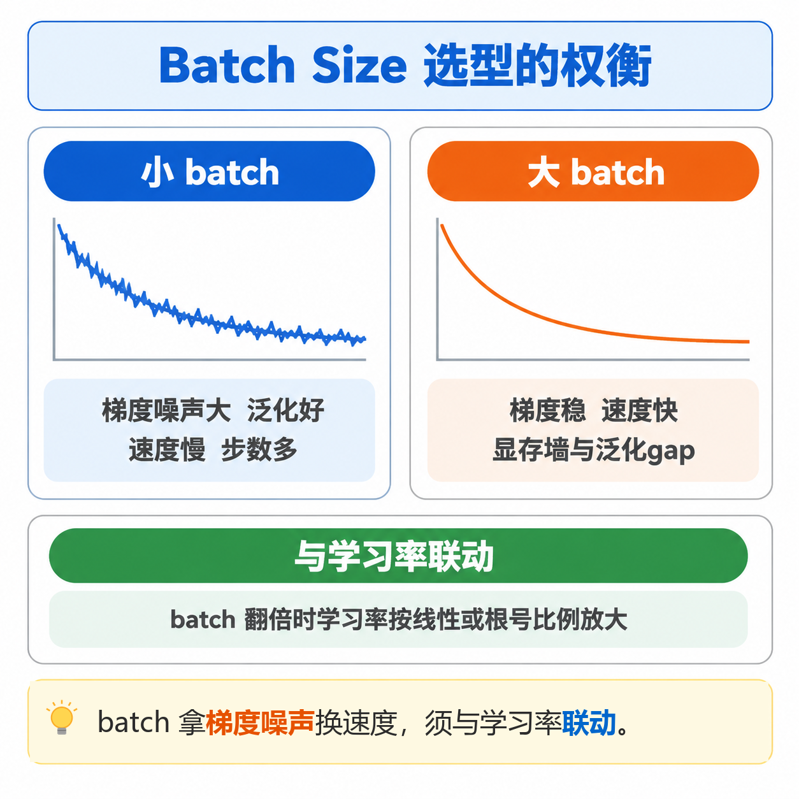

图4-8 Batch Size 选型的权衡

<h1 id="q4-7">7. 超参数调优策略与实操</h1>

<h2 id="q4-7-1">面试问题：深度学习中模型参数与超参数有什么本质区别？AIGC 大模型训练中常见的核心超参数有哪些？</h2>

**难度评分：⭐⭐ (2/5) | 考察频率：⭐⭐⭐⭐⭐ (5/5)**

模型参数是模型内部可学习的变量，比如权重、偏置、注意力矩阵这些，训练过程中由梯度下降自动更新。超参数是训练前人工设定的配置，比如学习率、batch size、网络层数、dropout 率，不参与梯度下降，用来控制模型结构、训练过程和正则化强度。

两者的本质区别在于更新方式。模型参数在训练中由梯度下降自动学习和更新，数量从百万级到千亿级不等，作用是拟合训练数据。超参数由人工设定或者调优算法搜索，数量一般几十到几百个，作用是控制模型的学习能力和泛化能力。早停的轮数、学习率调度的参数这些都不是模型参数，属于超参数。超参数的选择直接决定模型性能上限，实际项目里调超参往往比改模型结构对效果的影响还大。

AIGC 大模型训练里的核心超参数分几类。优化相关的有学习率的峰值和最小值、warmup 步数或比例、权重衰减系数、动量 $\beta_1$ 和 $\beta_2$、梯度裁剪阈值。数据与批次相关的有 batch size、梯度累积步数、序列长度、训练总步数或 epoch 数。模型结构相关的有网络层数、隐藏层维度、注意力头数、上下文长度、词汇表大小。正则化相关的有 dropout 率、标签平滑系数、LoRA 的 rank 和 alpha。训练策略相关的有混合精度类型选 BF16 还是 FP16、EMA 衰减率、学习率调度类型。

<h2 id="q4-7-2">面试问题：超参数调优的基本流程与核心原则是什么？常用的调优方法有哪些，各自的优缺点和适用场景是什么？</h2>

**难度评分：⭐⭐⭐ (3/5) | 考察频率：⭐⭐⭐⭐⭐ (5/5)**

超参数调优先定优化目标，明确评估指标比如验证 loss、下游任务精度、生成质量，同时明确算力和时间约束。然后划定搜索空间，按经验给每个超参数一个候选区间，学习率一般用对数均匀采样，dropout 这类用线性采样。接着选调优方法，手动、网格、随机、贝叶斯按算力和模型成本选。正式调之前先用小数据子集或者小模型跑短周期做预筛，剔除明显差的配置。筛完之后对候选配置做完整训练，对比验证集表现。最后在最优点附近细化搜索，固定超参数并做复现确认。

调优过程中有几个核心原则。按影响力排序调，先调影响最大的超参数，顺序大概是学习率优先，然后是 batch size，再是正则强度，最后才是网络结构参数。调优过程用早停省训练时间。超参数调优只在验证集上做，绝对不能碰测试集，否则测试集泄露会导致结果严重过估。注意不要过度调参，否则模型会在验证集上过拟合，最终还要留独立测试集做最终确认。固定随机种子保证实验可复现，减少不同配置之间比较的噪声。一次只改少数变量，用控制变量法，别同时改多个超参数，否则出了问题没法归因。

常用的调优方法有几种。手动调优基于经验调关键超参数，优点是灵活、能结合领域知识，缺点是依赖经验、难复现，绝大多数项目日常调参都用这种方式。网格搜索遍历所有超参数组合，优点是简单穷举，缺点是维度灾难，计算成本极高，超参数稍多就跑不动，工业界已经很少用。随机搜索在超参数空间随机采样组合评估，比网格搜索高效，重要超参能获得更多采样机会，也容易并行，缺点是可能错过最优点，是工业界超参数较多时的主流方法。贝叶斯优化基于历史评估结果建概率代理模型，比如高斯过程或者 TPE，指导下一次采样方向，效率远高于随机搜索，样本利用率高，缺点是串行性强、实现复杂、有额外开销，适合训练成本高的复杂模型比如大模型，单次评估越昂贵收益越大。

自动化调优工具有 Optuna，支持 TPE 算法和中途剪枝；Ray Tune 支持分布式调优；Weights & Biases Sweeps 集成多种高效算法，支持并行调优和可视化。

选型上，超参数少且训练快的场景用网格或随机搜索。超参数多且训练快用随机搜索。训练成本高比如大模型场景，用贝叶斯优化配合早停剪枝。

<h2 id="q4-7-4">面试问题：AIGC 大模型/扩散模型的超参数调优和传统小模型有什么核心区别？有哪些专属的调优原则？</h2>

**难度评分：⭐⭐⭐ (3/5) | 考察频率：⭐⭐⭐⭐ (4/5)**

和传统小模型比，AIGC 大模型的超参数调优有几个本质区别。大模型单次完整训练动辄几小时到几天，烧掉的算力成本极高，没法像小模型那样做大量网格搜索，必须用贝叶斯优化配合小规模代理任务预筛。搜索空间维度高而且各个超参数之间强耦合，学习率、batch size、warmup、序列长度、权重衰减之间互相影响，孤立调某一个超参数很容易失效。评估也困难且昂贵，生成质量需要人工评判或者 LLM-as-a-judge，没法像小模型那样用单一准确率快速判别。另外大模型调参有 Scaling Law 做指导，可以用计算最优缩放的结论外推模型大小、数据量和 batch size 的配比，而不是纯靠试错。

专属的调优原则有几条。先做代理任务预筛，用小数据、小模型或者短序列先跑超参数的初步筛选，再迁移到大模型全量训练上验证。遵循 Scaling Law，用 Chinchilla 这类计算最优缩放的结论来定模型大小、数据量和 batch size 的配比，避免盲目调参。关键超参数优先且保守，学习率和 warmup 是最关键的两个，先在小规模实验里定出合理区间，全量训练时只在这个区间附近微调。batch size 和学习率要联动调整，全局 batch size 变化时按线性缩放规则同步调学习率，同时调整 warmup 步数。用贝叶斯优化配合早停剪枝，比如用 Optuna 做贝叶斯搜索，配 median 或者 multi-arm 剪枝提前终止表现差的试验。优先复用开源模型的经验配方，比如 LLaMA 同规模模型的超参数配置，先迁移过来再小范围微调，不要从零开始搜。生成质量要做多维评估，用 FID、CLIP Score、人工偏好这些指标组合起来判断，避免单一指标误导决策。

超参数调优的三种常用方法与适用场景如图4-9所示：

  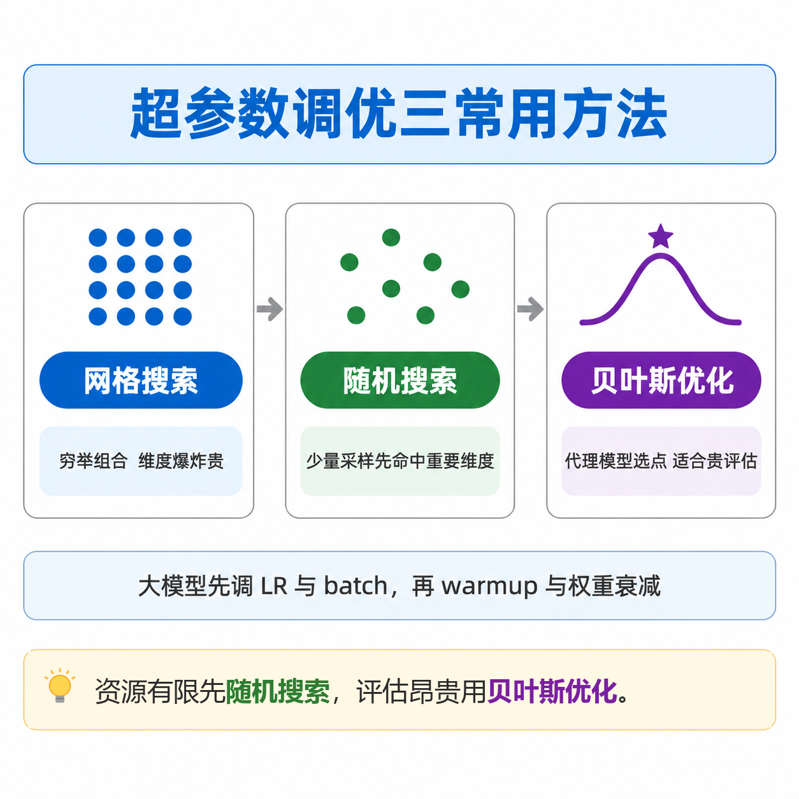

图4-9 超参数调优三常用方法

<h1 id="q4-8">8. 训练稳定性提升与常见异常排查方法</h1>

<h2 id="q4-8-1">面试问题：梯度消失、梯度爆炸与梯度震荡的核心区别是什么？分别是什么原因导致的？有哪些解决方法？</h2>

**难度评分：⭐⭐ (2/5) | 考察频率：⭐⭐⭐⭐⭐ (5/5)**

梯度消失和梯度爆炸本质上都是反向传播链式求导的乘法效应导致的。反向传播时梯度要从输出层一路乘回输入层，每层都乘上激活函数的导数和权重矩阵的转置。如果激活函数导数的绝对值小于 1，多层相乘之后梯度会指数级衰减，浅层参数几乎拿不到梯度、不更新，这就是梯度消失。如果导数绝对值大于 1，多层相乘之后梯度会指数级增长，参数更新步长过大，模型震荡甚至发散，这就是梯度爆炸。

常见的诱因有以下几个：

（1）网络层数越深，链式累积效应越明显，问题越严重。

（2）激活函数选得不对，Sigmoid 和 Tanh 大部分区域导数都小于 1，很容易出现梯度消失。

（3）权重初始化不合理也会出问题，初始化值过大容易梯度爆炸，过小容易梯度消失。学习率设得过高会加剧梯度爆炸。

针对梯度消失，常用的解决方法有 ReLU、GELU 这类导数大于等于 1 的激活函数，ResNet 的残差连接让梯度可以跨层直接传回，BatchNorm 归一化每层输入稳定分布，LSTM/GRU 的门控机制缓解序列模型的梯度消失，以及预训练加微调的方式。针对梯度爆炸，最常用的是梯度裁剪，把梯度范数限制在阈值以内，再配合权重正则、降低学习率、BatchNorm 一起用。

梯度震荡和前两者不一样。梯度消失是梯度过小，表现为损失下降缓慢，浅层参数长时间不更新。梯度爆炸是梯度过大，表现为损失急剧上升，模型直接发散。梯度震荡是梯度方向频繁来回变化，表现为损失曲线上下波动，收敛速度慢，主要原因是学习率过高、数据分布不均匀、或者优化器选得不合适。

<h2 id="q4-8-2">面试问题：梯度裁剪（Gradient Clipping）为何能提升训练稳定性？阈值如何确定？大模型训练中有什么注意事项？</h2>

**难度评分：⭐⭐ (2/5) | 考察频率：⭐⭐⭐⭐ (4/5)**

梯度裁剪的核心作用是防止梯度爆炸，通过限制梯度的最大范数，避免参数更新步长过大导致模型发散。它对 RNN、Transformer 这类序列模型尤其重要，这类模型在训练过程中很容易出现梯度爆炸。有了裁剪保护之后，可以适当提高学习率来加快收敛速度。另外遇到个别异常样本产生极大梯度时，裁剪也能压住这类异常值的负面影响，不让它主导整个 batch 的更新方向。

阈值的确定有几种常用方式。经验法是最常用的，初始值一般取 1.0 到 10.0，Transformer 通常用 1.0，RNN 通常用 5.0。动态阈值是计算所有梯度范数的统计量，把阈值设为均值加 k 倍标准差，k 一般取 2 到 3，能自适应不同训练阶段的梯度分布。实验调优的话从较大阈值比如 10.0 开始逐渐减小，观察损失曲线和梯度范数的变化，选一个既能防爆炸又不影响正常收敛的阈值。

工程上有几个注意点。优先用按范数裁剪而不是按值裁剪，前者保留梯度方向、只缩放梯度大小，后者会直接把单个梯度元素截断，破坏方向信息。裁剪要在梯度计算完成之后、参数更新之前做。阈值不能设得太小，否则会把正常梯度也压下去，导致梯度消失、收敛变慢。大模型训练普遍开启梯度裁剪，阈值一般设为 1.0，配合 warmup、BF16 混合精度、权重衰减一起保证训练稳定。分布式训练时要在 all-reduce 完成之后对全局梯度范数做裁剪，而不是在单卡局部梯度上裁剪。

<h2 id="q4-8-3">面试问题：梯度累积（Gradient Accumulation）的核心原理是什么？和直接增大 Batch Size 有什么本质区别？有哪些适用场景？</h2>

**难度评分：⭐⭐ (2/5) | 考察频率：⭐⭐⭐⭐ (4/5)**

梯度累积的核心思路是把一个大批次拆成多个小批次依次计算，每个小批次算完梯度后不立刻更新参数，而是把梯度存起来，累积 N 个小批次之后，用累积的梯度总和做一次参数更新。数学上在纯梯度意义下，这和直接用大小为 N 乘以 micro-batch 的批次训练是等价的。

代码实现上很简单，伪代码大概是这样：设置累积步数 N，每个 batch 前向算出 loss 之后先除以 N 做归一化，再反向传播；每累积满 N 步之后调用 optimizer.step() 更新参数，再把梯度清零，进入下一轮累积。

和直接增大 batch size 相比，有几个本质区别。BatchNorm 的统计量是基于每个小的 micro-batch 单独计算的，和真正的大 batch 算出的统计量不一样，这会影响最终效果，用 LayerNorm 或者 SyncBN 可以缓解这个问题。显存方面，梯度累积不会增加峰值显存占用，而直接增大 batch size 显存是线性增长的。计算结果上，纯梯度意义下二者等价，但如果网络里有 BatchNorm，统计量上就不等价了；用 LayerNorm 的架构比如 Transformer，二者结果高度等价。学习率方面，用梯度累积增大有效 batch 之后，学习率一般也要按线性缩放规则同步调整。

适用场景主要有一下几种：
（1）显存不够装大批次的时候，靠梯度累积在不增加显存的前提下等效增大 batch size。
（2）大模型单卡显存撑不起大批次，这是最常见的场景。
（3）检测、分割这类任务小批次训练不稳定，用梯度累积把有效 batch 撑大让训练更稳。
（4）分布式节点数量少的时候，也靠梯度累积增加有效批次大小。

<h2 id="q4-8-4">面试问题：混合精度训练的核心原理是什么？FP16 和 BF16 如何选择？为什么大模型训练普遍用 BF16？</h2>

**难度评分：⭐⭐⭐ (3/5) | 考察频率：⭐⭐⭐⭐⭐ (5/5)**

混合精度训练是让 FP16 和 FP32 在同一次训练里各司其职。前向反传的矩阵乘加走 FP16 Tensor Core，激活值和梯度以 FP16 存，省显存提算力；优化器侧保留一份 FP32 主权重副本，参数更新落到副本上，下一轮前向再转回 FP16。Optimizer 的状态比如 Adam 一阶二阶矩也留在 FP32，否则动量项会丢精度。

实现上两个细节绕不开。一是梯度更新路径：FP16 梯度先转 FP32，加到 FP32 主权重上，再回写 FP16 副本。二是损失缩放救 FP16 下溢：小梯度低于 2^-14 ≈ 6e-5 就变 0，所以把 loss 乘大系数反传，更新前除回去，PyTorch GradScaler 默认走动态缩放，检测到 inf 自动砍半。

FP16 和 BF16 都是 16 bit 但切分相反。FP16 是 1 符号 5 指数 10 尾数，量程 ±65504，相对精度约 1e-3；BF16 是 1 符号 8 指数 7 尾数，量程和 FP32 一致约 ±3.4e38，相对精度约 1e-2。FP16 牺牲量程换精度，BF16 牺牲精度换量程。硬件上 FP16 Tensor Core 从 Volta 开始有，BF16 从 Ampere 开始进 Tensor Core，AMD CDNA、Intel Xeon/Max 也支持。

大模型倒向 BF16 的根子在梯度动态范围。LLM 反传梯度跨好几个数量级，前后层量级差十几倍，FP16 必须仔细调 loss scaling，调不好就下溢或上溢；BF16 指数位和 FP32 对齐，天然覆盖动态范围，不需要 loss scaling。Ampere 之后 BF16 Tensor Core 吞吐和 FP16 打平，LoRA 微调、RLHF PPO、扩散 U-Net 都直接用。FP16 仍用于 V100 这类老卡、对尾数敏感的小模型从头训、老框架 BF16 kernel 不全的场景。

工程体感：激活和梯度显存砍半，大 batch 吞吐提 30% 到一倍，主权重和 Optimizer 状态仍是 FP32，总显存不会真砍半。选型简单：Ampere 及以后（A100/H100/4090）直接 BF16，V100 及以前才回 FP16 + GradScaler，推理部署再下探到 FP8。

<h2 id="q4-8-5">面试问题：什么是权重平均（EMA/SWA）？它的原理是什么？为什么能提升模型泛化能力与鲁棒性？</h2>

**难度评分：⭐⭐⭐ (3/5) | 考察频率：⭐⭐⭐⭐ (4/5)**

权重平均的思路是把训练过程中走过的多个权重点合成一个点，避开单点收敛到的尖锐极小值。工程上两种主流做法：EMA 是全程递推的指数加权，SWA 是训练后期等间隔采样的算术平均。

EMA 每个 step 维护一份影子权重，online 权重照常反传，影子权重按 w_ema = α · w_ema + (1 - α) · w_online 跟着走，α 取 0.999 或 0.9999，相当于对最近约 1/(1-α) 步做指数滑动。训练用 online 权重，验证和推理切 EMA。α 不是越大越好，前期权重变化剧烈，常见做法是 warmup 阶段 α 从 0.99 升到 0.9999。扩散模型 DDPM、Stable Diffusion 推理几乎必用 EMA 权重，切回 online 会有明显颗粒感和伪影。

SWA 由 Izmailov 2018 年提出，不做递推，而是训练后期固定较高学习率，每隔若干 epoch 存一个 checkpoint，最后算术平均。后期学习率太小权重会卡在一个点不动，采出来全是同一点，平均无意义，所以要把 lr 抬回去让权重在平坦谷底震荡，采到的点分布在一片区域，平均后落在中心。和 EMA 的差别：EMA 指数衰减、越近权重越大、全程跑；SWA 均匀采样、等权、只在后期开。

泛化提升的主流解释是落在更平坦的极小值。尖锐极小值附近曲率大，权重微抖测试误差就上去，本质是过拟合；平坦极小值附近曲率小，权重扰动带来的测试误差变化小，相当于对权重空间做正则。另一个角度是隐式集成，多个时刻权重做几何平均，等价于不增加推理成本的模型集成，抑制 batch 噪声、数据顺序、初始化的方差。鲁棒性同源：平均后梯度更平滑，对输入扰动、学习率 schedule、小 batch 噪声都不敏感。

工程约定：EMA 从训练开始就开，前几千步 warmup；SWA 放在最后 10% 到 20% epoch，前期权重还在快速下降，采出来不在同一谷底；两者可叠加，全程 EMA，最后阶段再采几个 EMA 权重做 SWA。分类任务上 SWA 一般比单点 best 再提 0.5 到 2 个点，扩散模型 EMA 带来的采样质量提升肉眼可见。大模型全参微调里 EMA 要额外维护一份 fp32 影子权重，通信开销大，用得少；LoRA 小适配器加 EMA 成本很低，值得开。

<h2 id="q4-8-6">面试问题：训练中出现 NaN/Inf 的常见原因有哪些？有什么系统的排查与解决方法？</h2>

**难度评分：⭐⭐⭐ (3/5) | 考察频率：⭐⭐⭐⭐ (4/5)**

<h2 id="q4-8-6">面试问题：训练中出现 NaN/Inf 的常见原因有哪些？有什么系统的排查与解决方法？</h2>
**难度评分：⭐⭐⭐ (3/5) | 考察频率：⭐⭐⭐⭐ (4/5)**

大模型和扩散模型训练里最常见的是 FP16 混合精度溢出。FP16 量程只有 ±65504，激活过大算成 inf，梯度过小下溢成 0，GradScaler 频繁砍 scale 就是信号，换 BF16 基本可解。其次是损失函数本身数值不稳：cross entropy 的 log 输入 0、回归分母为 0、KL 散度两边分布极端、attention 没 mask 把 padding 位算进去导致除零。再往下是 lr 过大或梯度爆炸，前几步权重被怼出激活饱和区，RNN/深层直连、attention logits 没除 sqrt(d_k)、初始化方差大都会放大。数据侧脏样本也常见：未归一化输入、像素越界、token id 超词表、序列长度不均时 BatchNorm running stats 抖动。

排查按顺序走。先用 torch.autograd.set_detect_anomaly(True) 复现，反传碰到产生 nan 的 op 会直接抛调用栈，这个接口慢，只在复现时开。然后 hook 打印每步 loss、grad norm、权重范数、最大激活值，nan 之前 grad norm 通常已经从几百涨到几千，能定位首次爆点。接着二分定位：关混合精度跑 fp32，还 nan 就砍 lr 到 1/10 并开 clip_grad_norm_(params, 1.0)，再不行逐个检查 log、softmax、sqrt、除法有没有加 eps。数据侧在 DataLoader 出口加 torch.isnan(x).any() / torch.isfinite(x).all() 定位脏样本。

修复动作集中在三处。损失函数里所有 log 写 log(x + 1e-8) 或直接用 log_softmax，softmax 前减 max，除法分母加 eps，attention mask 遮全 padding 位。优化器侧开梯度裁剪阈值 1.0，lr 砍 1/10 观察，混合精度切 BF16 或交 GradScaler 动态管理 scale，不要手填死值。数据侧重校归一化 mean/std、过滤超词表 token、剔除脏样本。

两条工程经验：权重一旦被 nan 写入即污染，必须从最近正常 checkpoint 回滚，不要靠调 lr 救回来；分布式下 inf 会经 allreduce 扩散到所有卡，先单卡复现再上多卡。

<h1 id="q4-9">9. 进阶训练范式与泛化能力提升方法</h1>

<h2 id="q4-9-1">面试问题：什么是迁移学习？它的核心假设是什么？常见的迁移学习范式有哪些？</h2>

**难度评分：⭐⭐ (2/5) | 考察频率：⭐⭐⭐⭐ (4/5)**

### 1、定义

迁移学习是把从一个任务（源任务）学到的知识用到另一个相关但不同的任务（目标任务）上，提升目标任务的学习性能。深度学习里主要表现为：用大规模数据预训练好的模型当起点，在目标任务上微调，明显减少目标任务所需数据量和训练时间。

### 2、假设

相关任务之间存在可共享的知识或特征表示——源域和目标域的低层特征（边缘、纹理、语法结构等）有共性，能迁移复用。

### 3、预训练模型选择原则

（1）领域匹配度（最重要）：优先选和目标任务领域最接近的预训练模型，领域越匹配、微调数据需求越少、性能一般越好（如医疗文本用医疗文献预训练模型）；

（2）模型大小与资源匹配：按算力、推理延迟、任务复杂度选合适大小；资源有限可用 LoRA 等方法用上更大模型；

（3）预训练数据规模与质量：规模越大质量越高，通用知识越丰富；

（4）任务类型匹配：生成任务选 Decoder-only（GPT 系列），理解任务选 Encoder-only（BERT 系列），多模态选 CLIP/LLaVA；

（5）开源生态与社区支持：文档完善、社区活跃、权重齐全，便于上手和排错。

### 4、常见范式

（1）基于实例的迁移：重加权源域样本辅助目标域；

（2）基于特征的迁移：学域不变特征表示（如 DANN 对抗对齐）；

（3）基于参数/模型的迁移：预训练 + 微调（最主流），含全参微调、参数高效微调（LoRA/Adapter/Prefix Tuning）；

（4）基于关系的迁移：迁移源域学到的规则或关系结构。

<h2 id="q4-9-2">面试问题：预训练 + 微调范式的核心逻辑是什么？完整训练流程与关键注意事项有哪些？</h2>

**难度评分：⭐⭐ (2/5) | 考察频率：⭐⭐⭐⭐⭐ (5/5)**

### 1、逻辑

预训练是在大规模通用数据上学通用特征表示，微调是把通用知识迁移到特定任务上，用少量任务数据调整参数，快速获得任务特定能力。本质是"先学通用知识，再学专业技能"，降低数据需求和训练成本。

### 2、流程

（1）预训练阶段
   - 数据准备：收集大规模无标注通用数据（文本、图像）；
   - 自监督任务：设计无需人工标注的预训练任务（掩码语言模型 MLM、对比学习、下一个 token 预测等）；
   - 模型训练：从零训大模型，学数据通用分布和特征表示；
   - 模型保存：保存预训练权重作为基础模型。

（2）微调阶段
   - 任务数据准备：收集并标注特定任务数据集；
   - 模型加载：加载预训练权重作为初始化；
   - 微调策略选择：全参数微调、参数高效微调（LoRA、Adapter、Prefix Tuning 等）；
   - 训练配置：设较小学习率（一般为预训练的 1/10~1/100）、适当批次和轮次；
   - 模型评估：验证集评估，选最优模型。

### 3、注意事项

- 过拟合风险：微调数据量一般较小，易过拟合，用早停、权重衰减、Dropout 等正则；
- 学习率：过大破坏预训练通用知识，过小收敛过慢；
- 灾难性遗忘：全参数微调可能让模型忘掉预训练通用知识，参数高效微调可有效缓解；
- 数据分布匹配：微调数据分布尽量和实际部署分布一致；
- 训练稳定性：大模型微调易梯度爆炸/消失，需梯度裁剪、混合精度等。

<h2 id="q4-9-3">面试问题：对比学习的核心思想与基本原理是什么？它为什么能提升特征表示质量？在 AIGC 中有哪些应用？</h2>

**难度评分：⭐⭐⭐ (3/5) | 考察频率：⭐⭐⭐⭐ (4/5)**

### 1、思想

对比学习是自监督学习方法，思想是"相似的样本在特征空间里应该距离更近，不相似的应该更远"。靠构造正样本对和负样本对，让模型学到能区分相似与不相似样本的特征表示。

### 2、基本框架

（1）数据增强：对同一样本做两次不同增强得到两个视图，构成正样本对；
（2）特征提取：用编码器（CNN、Transformer）把两个视图映射到特征空间；
（3）对比损失计算：算正样本对相似度和负样本对相似度，最小化对比损失。

### 3、经典损失：InfoNCE Loss

$$
\mathcal{L}_{InfoNCE} = -\log \frac{\exp(\text{sim}(z_i, z_j)/\tau)}{\sum_{k=1}^{N}\exp(\text{sim}(z_i, z_k)/\tau)}
$$

其中：
- $z_i$ 和 $z_j$ 是正样本对的特征表示；
- $z_k$ 为负样本特征（ $k$ 遍历包含正样本的候选集，分母对 $N$ 个候选求和）；
- $\text{sim}(\cdot,\cdot） $ 是相似度函数，一般用余弦相似度；
- $\tau$ 是温度参数，控制相似度分布的尖锐程度；
- $N$ 是候选样本总数（包含 1 个正样本和 $N-1$ 个负样本）。

### 4、为什么能提特征表示质量

（1）不依赖人工标签，利用数据自身结构学通用表示；
（2）拉近正样本、推远负样本，学到对增强不变的高级语义特征；
（3）大量负样本提供丰富判别信号，特征空间结构更清晰。

### 5、关键技术要点

（1）数据增强策略：好的增强应保留语义同时产生足够多样性；

（2）负样本数量：更多负样本一般带来更好性能，但增加计算成本；

（3）温度参数：  $\tau$ 越小越关注难负样本，越大越关注所有负样本；

（4）动量编码器：如 MoCo 用动量更新队列存负样本，突破 batch size 限制负样本数量；

（5）对称损失：如 SimCLRv2 同时算 $z_i$ 对 $z_j$ 和 $z_j$ 对 $z_i$ 的损失，提稳定性。

### 6、AIGC 中的应用

- 多模态对齐：CLIP 用图文对比学习对齐文本和图像特征空间，是文生图/多模态大模型的基础；
- 表示预训练：为下游生成/理解任务提供高质量视觉或文本编码器；
- 图像检索、人脸识别、推荐系统等需相似度计算的任务；
- 扩散模型条件控制：CLIP 文本特征作为条件引导生成。

<h2 id="q4-9-4">面试问题：样本不平衡会对模型训练造成哪些负面影响？从损失层面、训练层面分别有哪些解决方案？</h2>

**难度评分：⭐⭐ (2/5) | 考察频率：⭐⭐⭐⭐ (4/5)**

### 1、负面影响

（1）决策边界偏向多数类：模型为最小化总体损失，倾向预测多数类，少数类召回率低；

（2）评估指标失真：整体准确率被多数类主导，反映不出少数类性能；

（3）训练不充分：少数类样本少，模型难学到其有效特征表示；

（4）实际危害大：欺诈检测、疾病诊断等场景漏掉少数类代价极高。

### 2、数据层面

（1）重采样
   - 过采样：复制少数类样本，简单但易过拟合；SMOTE 合成少数类样本缓解过拟合；
   - 欠采样：删多数类样本，简单但可能丢信息；EasyEnsemble 集成多个欠采样子集缓解信息丢失；
   - 混合采样：如 SMOTE+Tomek Links。

（2）数据增强：对少数类样本增强（文本回译/同义词；图像旋转/Mixup/CutMix 等）。

### 3、损失层面

（1）类别权重调整：给少数类分配更高损失权重， $loss = -\sum_{i=1}^{N} w_i y_i \log(\hat{y}_i） $；常见权重 $w_i = \frac{N}{C \times N_i}$（ $N$ 总样本数、$C$ 类别数、$N_i$ 第 $i$ 类样本数，即逆频率）。

（2）损失函数改进
   - Focal Loss：降易分类样本权重、聚焦难分类样本， $FL(p_t) = -\alpha_t (1-p_t)^\gamma \log(p_t） $；
   - Dice Loss：基于交并比，对样本不平衡不敏感，常用于分割。

（3）集成学习：Bagging 对多数类多次欠采样后集成；Boosting 每轮重点关注前一轮错分的样本。

### 4、评估指标

- 别用准确率做唯一指标；
- 推荐精确率、召回率、F1、AUC-ROC、AUC-PR、混淆矩阵；
- 极度不平衡时优先用 PR 曲线和 AUC-PR。

<h2 id="q4-9-5">面试问题：什么是参数高效微调（PEFT）？LoRA/QLoRA/Adapter/Prefix Tuning 的原理与区别是什么？</h2>

**难度评分：⭐⭐⭐⭐ (4/5) | 考察频率：⭐⭐⭐⭐⭐ (5/5)**

全参微调要更新大模型全部参数，显存和存储代价大（每个下游任务都得存一份全量权重），还容易灾难性遗忘。参数高效微调（PEFT）只训少量新增或选定参数（占比常 <1%），冻结主体，明显降显存和存储、缓解遗忘，效果还接近全参微调——是 AIGC 在有限算力下适配多任务的主流做法。

### 1、主流方法

（1）Adapter Tuning：在 Transformer 层里插入小 bottleneck 模块（下投影→非线性→上投影），只训 Adapter，主体冻结。缺点是推理多一层计算。

（2）Prefix Tuning / Prompt Tuning：
   - Prompt Tuning：在输入 embedding 前加可学连续 prompt 向量，只训这些向量；
   - Prefix Tuning：在每层 K/V 前加可学前缀向量（作用更深、更强），常配 MLP 重参数化稳训练。主体冻结，推理序列变长。

（3）LoRA（Low-Rank Adaptation）：假设权重更新 $\Delta W$ 是低秩的，用两个小矩阵 $A\in\mathbb{R}^{d\times r}$、$B\in\mathbb{R}^{r\times d}$ 逼近 $\Delta W=BA$，只训 $A$、$B$，原 $W$ 冻结：

$$
h = Wx + \Delta Wx = Wx + BAx
$$

   $r\ll d$（常用 8/16/64），参数量从 $d^2$ 降到 $2dr$。一般 $A$ 用随机高斯初始化、$B$ 初始化为 0，保证训练开始 $\Delta W=0$、不破坏预训练。推理时 $BA$ 可合并进 $W$，零额外延迟。

LoRA 的核心重参数化结构如图4-11所示：

  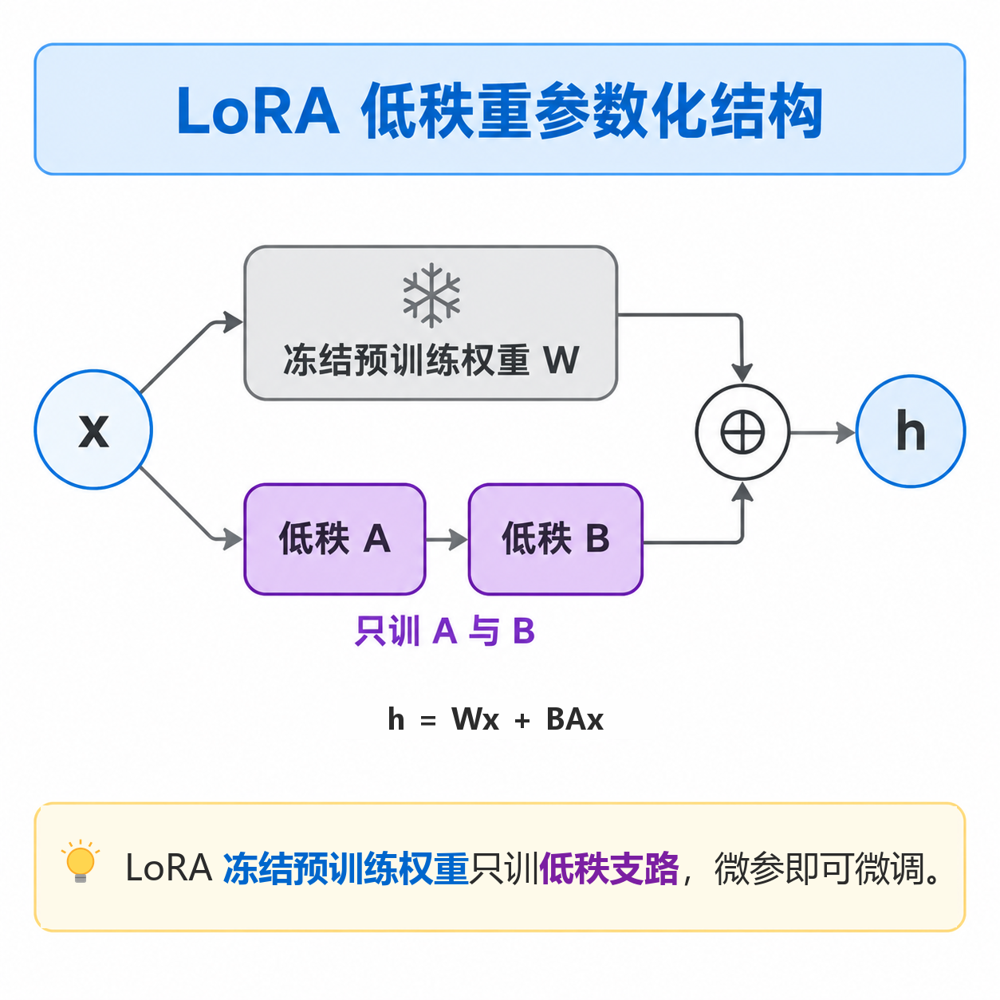

图4-11 LoRA 低秩重参数化结构

（4）QLoRA：在 LoRA 基础上把基座 $W$ 用 4-bit NF4 量化存储（明显省显存），LoRA 部分仍用 BF16 训练，配双重量化、分页优化器，让单卡能微调几百亿参数模型。核心是"4-bit 冻结基座 + 高精度小量 LoRA 可训"。

### 2、对比

| 方法 | 可训位置 | 参数量占比 | 推理额外开销 | 特点 |
|---|---|---|---|---|
| 全参微调 | 全部权重 | 100% | 无 | 显存大、易遗忘 |
| Adapter | 新增 bottleneck 模块 | ~1% | 多一层 | 改结构、推理有额外计算 |
| Prefix/Prompt Tuning | 前缀/prompt 向量 | <1% | 序列变长 | 轻量，深层效果有限 |
| LoRA | 低秩 A/B | <1%（常用） | 可合并，零延迟 | 主流、效果好 |
| QLoRA | LoRA + 4bit 基座 | <1% | 同 LoRA | 单卡微调超大模型 |

### 3、LoRA 工程要点

- rank $r$：8/16/64，任务越复杂、数据越多可适当加大；太小欠拟合，太大接近全参且易过拟合。
- alpha $\alpha$：缩放系数， $\Delta W$ 实际贡献为 $\frac{\alpha}{r}\cdot BA$，调 $\alpha$ 控制 LoRA 项强度。
- 应用模块：常加在 Q/K/V/O 投影或全部线性层；加在注意力投影是主流。
- 学习率：比全参微调略大（1e-4~1e-3 量级），因可训参数少。
- 多 LoRA：一个基座挂多个任务适配器，即插即用，方便多任务部署。

### 4、为什么 LoRA 是主流

参数极少、显存友好、能合并进基座（推理零延迟）、效果接近全参微调、工程链路成熟——这是 LoRA 成为当前 AIGC 微调事实标准的原因。资源更紧或模型更大时退到 QLoRA；要动到深层表示又不愿改结构时考虑 Adapter/Prefix。

进阶训练范式的迁移、对比与参数高效微调三主线如图4-12所示：

  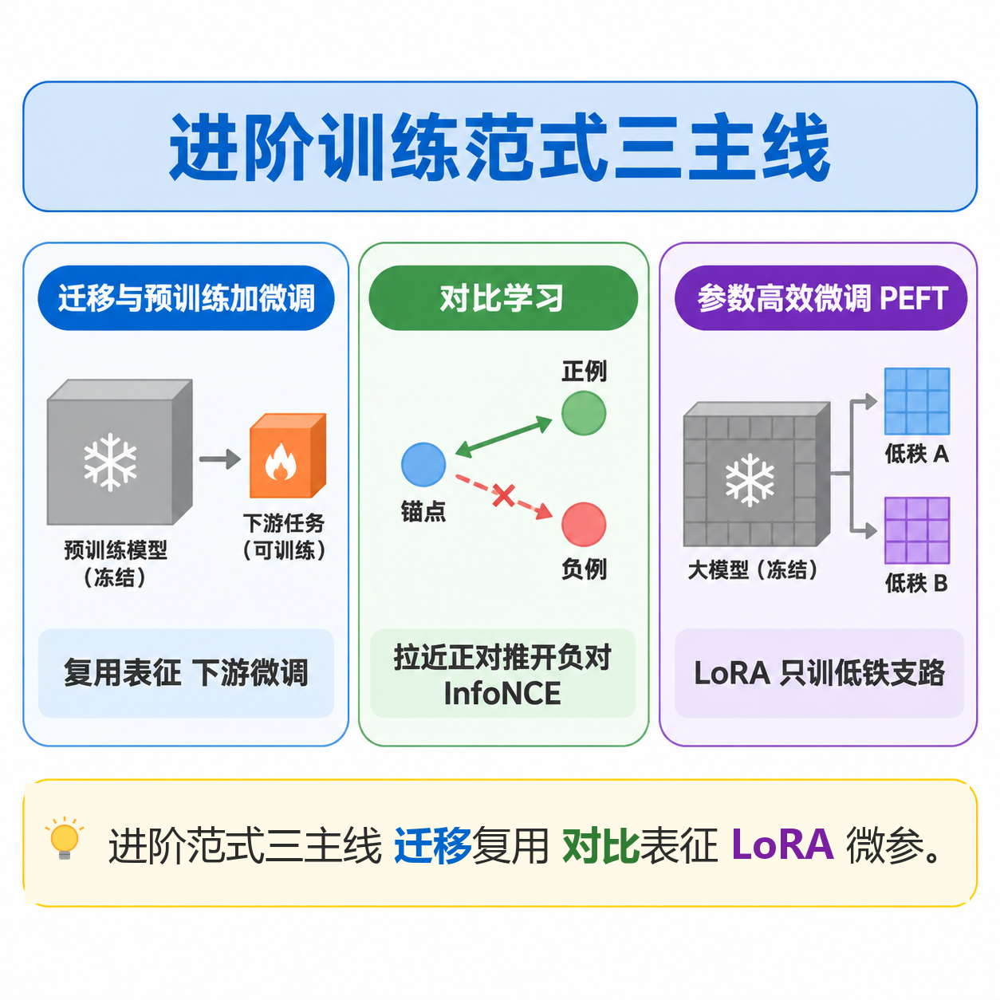

图4-12 进阶训练范式三主线

<h1 id="q4-10">10. 模型评估核心方法与泛化能力分析</h1>

<h2 id="q4-10-1">面试问题：模型评估的核心目标是什么？常用的模型评估方法有哪些？</h2>

**难度评分：⭐⭐ (2/5) | 考察频率：⭐⭐⭐⭐ (4/5)**

### 1、目标

模型评估是量化模型在未知数据上预测能力的过程，用于验证是否达到业务要求、比较不同模型优劣、指导调优。

### 2、常用方法

（1）按数据划分方式
   - 留出法（Holdout）：随机划分为训练集（70%-80%）和测试集（20%-30%）；
   - 交叉验证（Cross Validation）：分 k 个互不重叠子集，轮流 k-1 训练、1 测试，取 k 次平均；
   - 自助法（Bootstrap）：有放回采样生成训练集，未被采样的作测试集，适合小数据集。

（2）按评估指标类型
   - 分类：准确率、精确率、召回率、F1、ROC/AUC、PR 曲线；
   - 回归：均方误差（MSE）、平均绝对误差（MAE）、决定系数（ $R^2$）；
   - 生成（AIGC 特有）：BLEU、ROUGE、Perplexity（困惑度）、FID（Fréchet Inception Distance）、CLIP Score、人类评估。

（3）按评估阶段
   - 离线评估：在历史数据集上评估，快速验证效果；
   - 在线 A/B 测试：真实业务环境中随机分流比业务指标，是最终验证模型价值的金标准。

<h2 id="q4-10-2">面试问题：什么是交叉验证？为什么要做交叉验证？常见的交叉验证方式有哪些？深度学习场景使用有什么注意事项？</h2>

**难度评分：⭐⭐ (2/5) | 考察频率：⭐⭐⭐⭐ (4/5)**

### 1、定义

交叉验证是更可靠的评估方法，通过多次划分数据集重复训练测试，获得更稳定、更准确的性能估计。

### 2、常见类型

- k 折交叉验证（k-fold CV）：最常用，数据集随机分 k 个大小相等的互不重叠子集，每次选 1 个作测试集、其余 k-1 个作训练集，重复 k 次取平均；
- 留一交叉验证（LOOCV）：k 等于样本数的特殊情况，每次留一个样本作测试集；
- 分层 k 折交叉验证（Stratified k-fold）：划分时保持每子集正负样本比例和原始一致，适合样本不平衡场景。

### 3、为什么要做

（1）解决留出法的随机性：单次留出法结果受划分随机性影响大，交叉验证多次划分取平均更稳；

（2）更充分利用数据：所有样本都被用于训练和测试，特别适合小数据集；

（3）有效避免过拟合：更准确评估泛化能力，帮选最优超参；

（4）检测数据分布问题：若 k 次结果差异大，说明数据可能分布不均或质量有问题。

### 4、深度学习场景注意

- 深度学习训练成本高，常减少折数（5 折或 3 折）或用小数据子集做交叉验证；
- 大模型微调一般用单一固定验证集做超参搜索，很少用交叉验证；只在数据量较小且算力允许时用 3-5 折，最终用全部数据训练；
- 折数过高（如 LOOCV）训练次数过多、成本不可接受；
- 注意数据泄露：每折的预处理统计量只能在训练折上算。

<h2 id="q4-10-3">面试问题：介绍一下精确率、召回率、F1 分数的定义与各自的适用场景？</h2>

**难度评分：⭐⭐ (2/5) | 考察频率：⭐⭐⭐⭐⭐ (5/5)**

（1）基于混淆矩阵

混淆矩阵四个基本元素：
- TP（真正例）：实际为正，预测为正；
- FN（假负例）：实际为正，预测为负；
- FP（假正例）：实际为负，预测为正；
- TN（真负例）：实际为负，预测为负。

三个指标：

- 精确率（Precision）：所有被预测为正的样本中实际为正的比例

$$
P = \frac{TP}{TP+FP}
$$

- 召回率（Recall）：所有实际为正的样本中被正确预测为正的比例

$$
R = \frac{TP}{TP+FN}
$$

- F1 分数：精确率和召回率的调和平均

$$
F1 = \frac{2 \times P \times R}{P+R}
$$

（2）适用场景

- 精确率优先：错误预测为正代价高时，如垃圾邮件过滤（正常邮件误判为垃圾邮件代价高）、医疗诊断阳性确认；
- 召回率优先：遗漏正样本代价高时，如癌症筛查、欺诈检测、安全漏洞检测；
- F1 优先：需平衡精确率和召回率时，如信息检索、文本分类、AIGC 内容质量评估。

工程提示：AIGC 内容审核要按业务调阈值平衡精确率和召回率，如涉政内容审核要极高召回率，即使牺牲精确率也在所不惜。

<h2 id="q4-10-4">面试问题：什么是 ROC 曲线与 AUC 值？它和 PR 曲线的核心差异及适用场景是什么？类别不平衡场景为什么优先用 PR 曲线？</h2>

**难度评分：⭐⭐⭐ (3/5) | 考察频率：⭐⭐⭐⭐ (4/5)**

（1）ROC 曲线与 AUC

- ROC 曲线（Receiver Operating Characteristic）：以假阳性率（FPR）为横轴、真阳性率（TPR）为纵轴绘制。
  - 真阳性率 $TPR = TP/(TP+FN） $：所有正样本中被正确预测为正的比例；
  - 假阳性率 $FPR = FP/(FP+TN） $：所有负样本中被错误预测为正的比例。
- AUC 值（Area Under Curve）：ROC 曲线下面积，取值 $[0,1]$。AUC=1 完美分类器；AUC=0.5 随机分类器；AUC<0.5 比随机还差。

（2）PR 曲线

PR 曲线（Precision-Recall）以召回率（Recall）为横轴、精确率（Precision）为纵轴绘制。

（3）核心差异

| 维度 | ROC 曲线 | PR 曲线 |
|---|---|---|
| 对样本不平衡的敏感度 | 不敏感，正负比例变化时曲线基本稳定 | 非常敏感，正负比例变化时曲线显著变化 |
| 关注重点 | 模型区分正负样本的整体能力 | 模型在正样本上的预测准确性 |
| 曲线下面积 | AUC | AP（Average Precision） |

（4）类别不平衡时为什么优先用 PR 曲线

负样本远多于正样本时，FPR = FP/(FP+TN) 分母 TN 极大，即使 FP 很多 FPR 也可能很小，ROC 曲线看起来依然很好，掩盖了模型在正样本上表现差的事实。而 PR 曲线的精确率 P = TP/(TP+FP) 直接反映正样本预测的准确程度，对正样本稀少的场景更敏感、更能真实反映性能。

（5）适用场景

- ROC/AUC：正负样本分布均衡、需评估整体区分能力、比较不同模型整体性能；
- PR 曲线：样本极度不平衡（异常检测、欺诈识别、罕见病诊断）、更关注正样本预测准确性。

工程提示：AIGC 分类任务（如内容审核）负样本远多于正样本，PR 曲线比 ROC 曲线更能真实反映模型性能。

<h2 id="q4-10-5">面试问题：什么是泛化误差？如何用偏差-方差的权衡关系指导模型调优？</h2>

**难度评分：⭐⭐⭐ (3/5) | 考察频率：⭐⭐⭐⭐ (4/5)**

（1）回答

泛化误差是模型在未知测试数据上的期望误差，是衡量泛化能力的指标。偏差-方差分解是理解它的重要理论工具。

（2）泛化误差的分解

$$
E[(y-\hat{f}(x))^2] = \text{Bias}(\hat{f}(x))^2 + \text{Var}(\hat{f}(x)) + \sigma^2
$$

- 偏差（Bias）：模型预测期望值与真实值的差异，反映拟合能力。高偏差：模型过简单，学不到数据真实规律，导致欠拟合。
- 方差（Variance）：模型在不同训练集上预测结果的差异，反映稳定性。高方差：模型过复杂，对训练数据微小变化敏感，导致过拟合。
- 噪声（ $\sigma^2$）：数据本身不可约误差，无法通过改进模型消除。

（3）偏差-方差权衡指导调优

- 模型复杂度低：偏差高、方差低，总误差主要由偏差贡献 → 增大模型、减少正则、延长训练；
- 模型复杂度高：偏差低、方差高，总误差主要由方差贡献 → 增加数据、增强正则、降模型复杂度；
- 最优复杂度是偏差与方差之和最小的点。

工程提示：AIGC 大模型时代，随参数量增加偏差持续降低，方差可通过增加训练数据有效控制，这是"大模型 + 大数据"范式成功的理论基础之一。

<h2 id="q4-10-6">面试问题：如何通过训练指标判断模型是过拟合还是欠拟合？分别有哪些系统性的解决方案与调优优先级？</h2>

**难度评分：⭐⭐ (2/5) | 考察频率：⭐⭐⭐⭐⭐ (5/5)**

### 1、定义与表现

- 欠拟合（Underfitting）：模型在训练集和测试集上都差，学不到数据基本规律。典型表现：训练 loss 高、训练指标也低、验证 loss 和训练 loss 同步高。
- 过拟合（Overfitting）：模型在训练集表现极好但测试集差，学到了噪声和特异性特征。典型表现：训练 loss 持续下降但验证 loss 开始上升、训练和验证指标差距大。

### 2、通过指标判断

- 训练 loss 高 + 验证 loss 高 → 欠拟合；
- 训练 loss 低 + 验证 loss 高 → 过拟合；
- 训练 loss 低 + 验证 loss 低且收敛 → 拟合良好。

### 3、主要成因

- 欠拟合：模型复杂度太低、训练时间不足、特征工程不到位、学习率过小；
- 过拟合：模型复杂度过高、训练数据量不足、数据分布和真实分布不一致、训练时间过长。

### 4、解决方案与优先级

（1）解决欠拟合（增能力）
   - 增加模型复杂度：更深网络、更多参数；
   - 增加特征数量和质量：更细致特征工程；
   - 调整训练策略：增大学习率、延长训练、减少正则强度。

（2）解决过拟合（数据 > 正则 > 模型）
   - 数据层面：增加训练数据量、数据增强、数据清洗去噪（最高优先级）；
   - 模型层面：降低模型复杂度、加正则（L1/L2/Dropout）；
   - 训练层面：早停、集成学习；
   - AIGC 特有：用 LoRA/QLoRA 轻量微调、限制微调步数、指令调优数据增强。

<h2 id="q4-10-7">面试问题：AIGC 生成模型（大语言模型、文生图扩散模型）的评估和传统判别模型有什么核心区别？</h2>

**难度评分：⭐⭐⭐⭐ (4/5) | 考察频率：⭐⭐⭐⭐⭐ (5/5)**

### 1、和传统判别模型的区别

（1）评估对象不同：判别模型输出是确定标签、可用准确率等客观指标；生成模型输出是开放式生成内容，没有唯一正确答案，需多维质量评估。

（2）指标性质不同：判别任务指标客观可自动计算；生成任务很多指标（相关性、连贯性、安全性、美感）依赖人工或模型评判。

（3）维度更多：生成评估要兼顾正确性、流畅性、多样性、一致性、安全性、可控性等多个维度。

### 2、大语言模型常用评估

（1）自动指标：
   - 困惑度（Perplexity）：衡量语言模型对文本的建模能力，越低越好；
   - BLEU：n-gram 精确率，用于机器翻译/文本生成；
   - ROUGE：n-gram 召回率，用于摘要生成；
   - 代码/推理任务 pass@k：生成 k 个候选中至少一个通过的比例。

（2）基准测试：MMLU、HumanEval、GSM8K、C-Eval 等标准化题库。

（3）模型评判（LLM-as-a-judge）：用强模型（GPT-4）对生成结果打分，成本低、规模可扩展。

（4）人类偏好评估：Elo 评分、胜率对比（A vs B），是生成质量金标准。

### 3、文生图扩散模型常用评估

（1）保真度与质量：FID（Fréchet Inception Distance，越低越好，衡量生成分布与真实分布距离）、IS（Inception Score）；

（2）图文一致性：CLIP Score（生成图与文本条件的 CLIP 相似度）；

（3）多样性与覆盖度：CMMD、Coverage 指标；

（4）人工评估：整体美感、结构合理性、文本-图像匹配度、伪影评分。

### 4、工程提示

- AIGC 评估必须组合自动指标 + 模型评判 + 人工偏好，单一指标容易误导；
- 自动指标（如 BLEU/FID）和人类真实偏好有 gap，最终以人工/在线 A/B 为准；
- 评估要关注安全性（毒性、偏见、版权）和可控性（指令遵循、条件控制）。

分类评估指标与曲线选型如图4-13所示：

  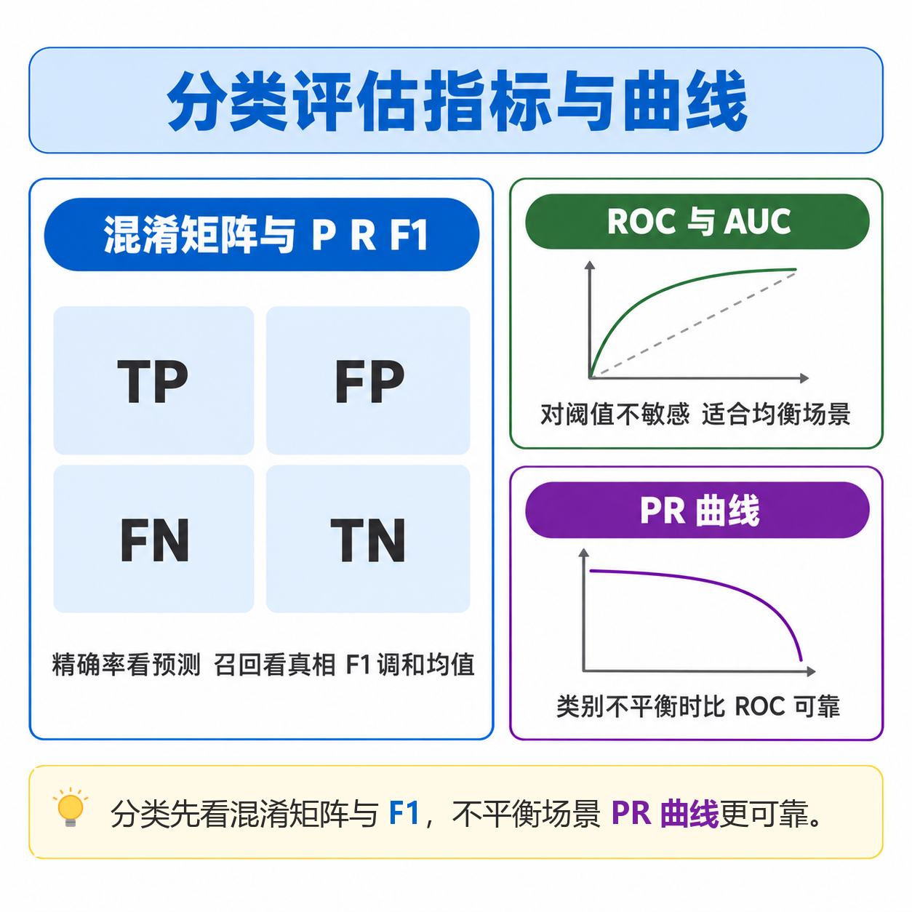

图4-13 分类评估指标与曲线

